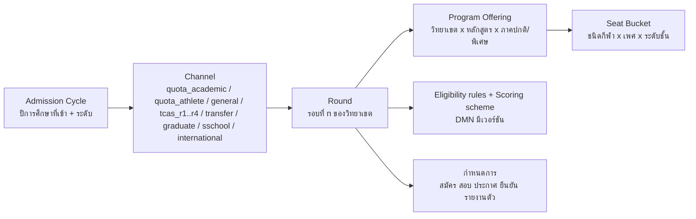
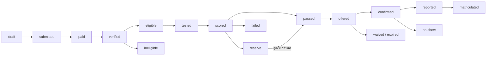

# 02 — เส้นทางนักศึกษา (Student Journey) ทีละขั้น: ตั้งแต่เปิดรับสมัครจนเป็นศิษย์เก่า

> **สถานะ:** v1.0-draft · 28 ต.ค. 2569 · ผู้เขียน: B · ภาษา: ไทย (ศัพท์เทคนิคเป็นภาษาอังกฤษ)
> **อ่านคู่กับ:** [00-blueprint](00-blueprint.md) (สัญญากลาง) · [03-academic-calendar](03-academic-calendar.md) (ปฏิทินรายเดือนและ calendar-as-configuration) · [04-roles-permissions](04-roles-permissions.md) (รหัสบทบาท/สิทธิ์) · [05-workflows](05-workflows.md) (ทะเบียน workflow ฉบับสุดท้าย) · [06-modules](06-modules.md) (โมดูล) · [10-security-compliance](10-security-compliance.md) (PDPA ผู้เยาว์, คุ้มครองเด็ก) · [13-open-questions](13-open-questions.md)
> **แหล่งข้อมูลหลัก:** research v2 `admissions.md`, `academic_calendar_operations.md`, `student_services.md`; `process_requirements.md`; review `review_functional.md`, `review_benchmark.md`; `data/workflows.seed.json`; v0.9 หัวข้อ 3–4 (archive)

เล่มนี้ตอบคำถาม "นักศึกษาหนึ่งคนต้องทำอะไร ที่ไหน เมื่อไร กับใคร และระบบช่วยอะไร" แบบละเอียดทีละขั้น โดยแยกตาม **ช่องทางรับเข้าจริงของ มกช.** (โควตาเรียนดี, โควตานักกีฬา, ประเภททั่วไปหลายรอบที่แต่ละวิทยาเขตจัดเอง, TCAS ถ้าใช้, โรงเรียนกีฬา, บัณฑิตศึกษา, โอนย้าย, ผู้พิการ, ต่างชาติ) แทนภาพรวมแบบ "สมัคร → TCAS → รายงานตัว" ของ v0.9 ซึ่ง research v2 พบว่าไม่ตรงกับความจริง (มกช. ไม่ได้ใช้ TCAS เป็นช่องทางหลัก — blueprint ข้อ 2.1)

---

## 0. วิธีอ่าน

### 0.1 คอลัมน์ของตารางขั้นตอน

| คอลัมน์ | ความหมาย |
|---|---|
| ลำดับ | รหัสขั้นภายในตาราง (เช่น QA-3 = ช่องทางโควตาเรียนดี ขั้นที่ 3) ใช้อ้างอิงข้ามหัวข้อ |
| ผู้ทำ | รหัสบทบาทตาม blueprint หัวข้อ 5 + ชื่อไทย; `system` = งานอัตโนมัติ; `ext:` = หน่วยงานภายนอกที่ไม่มีบทบาทในระบบ (เช่น `ext:ทปอ.`) |
| สิ่งที่ทำ | การกระทำของผู้ทำในขั้นนั้น |
| ระบบช่วยอะไร | ความสามารถของระบบที่ทำให้ขั้นนั้นเร็วขึ้น ถูกต้องขึ้น หรือไม่ต้องใช้กระดาษ |
| เอกสาร/ค่าธรรมเนียม | สิ่งที่ต้องยื่น/จ่าย (ตัวเลขทั้งหมดเป็น **configuration ราย OrgUnit**) |
| เวลา | ช่วงเวลาในปีหรือเวลาสัมพัทธ์ (T0 = วันเปิดภาค, R0 = วันเปิดรับสมัครของรอบ) |
| WID | workflow ID: W-01..W-68 ตาม seed; **ID ที่มีเครื่องหมาย \* (เช่น W-70\*) เป็น workflow ใหม่ที่เสนอ** ดูหัวข้อ 12 (เล่ม 05 เป็นเจ้าของเลขสุดท้าย) |
| โมดูล | รหัสโมดูลตาม blueprint หัวข้อ 4 |

### 0.2 สัญลักษณ์ความน่าเชื่อถือ

- ✅ = มีแหล่งอ้างอิง (ระดับ search snippet ตาม research v2 — ยังควรเปิดต้นฉบับยืนยันก่อนทำ TOR)
- 🟡 = ยังไม่ยืนยัน / อนุมานจากแนวปฏิบัติทั่วไป ถือเป็น **[ต้องตรวจสอบ]** และเป็นสมมติฐานที่ต้องลงทะเบียนในเล่ม 01 (ดูหัวข้อ 13 ของเล่มนี้)
- "ตัวอย่าง" = ค่าจากมหาวิทยาลัยอื่น ใช้แสดงรูปแบบ configuration เท่านั้น ห้ามถือเป็นค่าของ มกช.

### 0.3 รหัสบทบาทที่ใช้ในเล่มนี้

| กลุ่ม | รหัส (ชื่อไทย) |
|---|---|
| ผู้เรียนและครอบครัว | `candidate` ผู้สมัคร · `student` นักศึกษา/นักเรียน · `guardian` ผู้ปกครอง · `alumni` ศิษย์เก่า · `applicant` บุคคลภายนอก/ประชาชน · `employer` สถานประกอบการ/นายจ้าง |
| วิชาการ | `lecturer` อาจารย์ผู้สอน · `advisor` อาจารย์ที่ปรึกษา · `head` หัวหน้าภาค/ประธานหลักสูตร · `dean` คณบดี · `campusvp` รองอธิการบดีประจำวิทยาเขต · `rector` อธิการบดี · `council` สภาวิชาการ/สภามหาวิทยาลัย · `gradschool` บัณฑิตวิทยาลัย/กรรมการวิทยานิพนธ์ · `judge` กรรมการสอบทักษะ/สัมภาษณ์ · `proctor` กรรมการคุมสอบ · `practicum` ศูนย์ฝึกประสบการณ์ · `mentor` ครูพี่เลี้ยง · `supervisor` อาจารย์นิเทศก์ |
| งานบริการ | `admission` งานรับสมัคร · `registrar` งานทะเบียน/นายทะเบียน · `finance` การเงิน · `loan` เจ้าหน้าที่ กยศ. · `scholar` งานทุน · `dorm` หอพัก/ครูหอพัก · `affairs` กิจการนักศึกษา (รวมหน่วยบริการนักศึกษาพิการ) · `medical` แพทย์/พยาบาล/นักกายภาพ · `safeguard` ผู้ดูแลคุ้มครองเด็ก · `complaint` ศูนย์รับเรื่องร้องเรียน · `dpo` DPO · `pr` ประชาสัมพันธ์ · `planner` กองแผน · `hr` บุคลากร · `records` งานสารบรรณ |
| กีฬา | `coach` โค้ช/ผู้จัดการทีม · `sci` นักวิทยาศาสตร์การกีฬา · `sportshead` หัวหน้างานกีฬา |
| โรงเรียนกีฬา | `sschool_dir` ผู้อำนวยการโรงเรียนกีฬา · `homeroom` ครูประจำชั้น (ครูผู้สอนใช้ `lecturer`) |
| ระบบ | `system` งานอัตโนมัติ |

> บทบาท `judge`, `sschool_dir`, `homeroom`, `mentor`, `supervisor`, `gradschool` เป็นบทบาทที่ blueprint อนุญาตให้เพิ่ม เล่ม 04 เป็นเจ้าของรายการสุดท้าย

### 0.4 หลักที่ใช้ทั้งเล่ม

1. **ทุกวิทยาเขตมีงานรับสมัครและงานทะเบียนของตนเอง** ค่าธรรมเนียม รอบ ผู้ลงนาม และกำหนดเวลาต่างกัน จึงเป็น configuration ราย OrgUnit ทั้งหมด (blueprint 2.3) ตัวอย่างผู้ลงนามที่พบ: ใบรับรองของวิทยาเขตมหาสารคามผ่านผู้ช่วยอธิการบดีฝ่ายวิชาการ → รองอธิการบดีประจำวิทยาเขต ✅ ([TNSU MK](https://tnsumk.ac.th/reg/index.php/services/registrar-services/certificate-thai))
2. **ผู้สมัครหนึ่งคนมีตัวตนเดียวทั้งมหาวิทยาลัย** (applicant master: เลขประจำตัวประชาชน / passport / รหัส G) เพื่อให้ clearing ข้าม 17 วิทยาเขตทำได้
3. **ผู้เยาว์** (อายุต่ำกว่า 20 ปีบริบูรณ์ ซึ่งรวมผู้สมัคร ป.ตรี ส่วนใหญ่และนักเรียนโรงเรียนกีฬาทุกคน) ต้องมีผู้ปกครองให้ความยินยอมในขั้นที่กฎหมายกำหนด (รายละเอียดฐานกฎหมายอยู่ในเล่ม 10)
4. **ปฏิทินเป็นข้อมูล** ทุก window (สมัคร ลงทะเบียน ถอน W ส่งเกรด ฯลฯ) เปิด/ปิดฟังก์ชันจากปฏิทินในโมดูล ORG (เล่ม 03)
5. **ประกาศเป็นของ ENG และส่งผ่าน NOTI** ทุกขั้นที่ "ประกาศ" ในเล่มนี้หมายถึง ENG ออกประกาศ + NOTI ส่งแจ้งเตือนรายบุคคล และประกาศรายชื่อสาธารณะต้อง mask ข้อมูลตาม PDPA

---

## 1. ภาพรวมหนึ่งหน้า

### 1.1 แผนภาพเส้นทาง (ทุกช่องทางมารวมที่ "ยืนยันสิทธิ์")

### 1.2 Journey at a glance

| # | ช่วง (stage code) | ช่วงเวลาทั่วไป | ผู้เกี่ยวข้องหลัก | งานหลักของผู้เรียน | Workflow หลัก | โมดูลหลัก | Release ที่รองรับ |
|---|---|---|---|---|---|---|---|
| 1 | สมัครและคัดเลือก (`pre`) | โควตา ต.ค.–ธ.ค. ✅/🟡 · ทั่วไป ก.พ.–มิ.ย. ✅ · TCAS ส.ค.–มิ.ย. ✅ | candidate, guardian, admission, judge, medical, head | สมัคร, ชำระค่าสมัคร, สอบ, ดูผล, ยืนยัน/สละสิทธิ์ | W-69\*, W-41, W-42, W-71\*, W-70\*, W-88\*, W-18, W-74\*, W-75\*, W-76\* | ADM, IAM, PRIV, FIN, ENG, NOTI, CASE | R1 (ก.ย. 2571) |
| 2 | ยืนยันสิทธิ์และแรกเข้า (`first`) | ทันทีหลังผล → ก่อนเปิดภาค (มิ.ย.) | candidate→student, guardian, finance, registrar, medical, sci, dorm, affairs, loan | ชำระ, รายงานตัว, ตรวจสุขภาพ, หอ, ปฐมนิเทศ, กยศ. | W-43, W-44, W-90\*, W-45, W-46, W-47, W-48, W-82\* | ADM→REC, FIN, IAM, SVC, HLT, ATH, HOU, AFF, SCH | R1 (ค่ายืนยันสิทธิ์) + R2 (พ.ค. 2572) |
| 3 | ทุกภาค (`term`) | วนรอบ ภาค 1 ≈ มิ.ย.–ต.ค. 🟡 · ภาค 2 ≈ พ.ย.–มี.ค. 🟡 · ฤดูร้อน ≈ เม.ย.–พ.ค. 🟡 | student, advisor, lecturer, head, dean, registrar, finance, proctor | ลงทะเบียน, ชำระ, เรียน, ลา, สอบ, ดูเกรด | W-79\*, W-49, W-50, W-80\*, W-51, W-27, W-52, W-53, W-54, W-91\*, W-92\*, W-05, W-55, W-01, W-81\*, W-56, W-57, W-61 | REG, FIN, ATT, EXM, ASM, REC, LMS | R2 |
| 4 | ระหว่างเรียน (`during`) | ตามเหตุ / ตามรอบปี | student, registrar, affairs, scholar, practicum, employer | ขอเอกสาร, คำร้อง, ทุน, ผ่อนผันทหาร, กิจกรรม, ฝึกงาน/ฝึกสอน, accommodation | W-58, W-34, W-07, W-59, W-60, W-62, W-32, W-33, W-25, W-21 | SVC, DOC, SCH, AFF, PRA, REC | R2 (ส่วนใหญ่), R3 (PRA) |
| 5 | นักกีฬา (`sport`) | ตลอดปี; พีค ก.ย. (พลศึกษาเกมส์), พ.ย.–ม.ค. | student, coach, sci, medical, sportshead, lecturer | ซ้อม, wellness (opt-in), ลาแข่ง, เดินทาง, บาดเจ็บ, ตรวจสิทธิ์ | W-68, W-30, W-04, W-83\*, W-31, W-84\*, W-39, W-14, W-97\* | ATH, ATT, EXM, HLT, FIN, FAC | R2 (core) + R3 (eligibility, travel) |
| 6 | ปัญหาและกรณีพิเศษ (`problem`) | ตามเหตุ / หลังประกาศเกรด | student, guardian, advisor, dean, rector, affairs, complaint, safeguard | อุทธรณ์, ชี้แจงวินัย, ลาพัก/ลาออก/คืนสภาพ, ร้องเรียน | W-16, W-17, W-02, W-12, W-55, W-11, W-10, W-24, W-26, W-19, W-22, W-09 | CASE, REC, AFF, SAFE, FIN | R1 (CASE อุทธรณ์ผลคัดเลือก) + R2 |
| 7 | จบการศึกษา (`grad`) | ยื่นภายใน 30 วันหลังเปิดภาคสุดท้าย ✅ → สภาอนุมัติ → พิธี ≈ 1 ปีต่อมา ✅ | student, registrar, head, dean, council, affairs | ยื่นจบ, clearance, รับ e-Transcript, ตอบแบบสำรวจ, ซ้อมและรับปริญญา | W-06, W-65, W-64, W-99\* | GRD, DOC, ALU, ENG | R3 (พ.ย. 2572) |
| 8 | ศิษย์เก่า (`alumni`) | ตลอดไป | alumni, employer, registrar | อัปเดตข้อมูล, ขอเอกสาร, ส่งลิงก์ตรวจสอบวุฒิ | W-66, W-67, W-58, W-86\* | ALU, GRD, DOC | R3 |
| 9 | โรงเรียนกีฬา (`sschool`) | ภาค 1 ≈ 16 พ.ค.–30 ก.ย. · ภาค 2 ≈ 1 พ.ย.–31 มี.ค. (รูปแบบปี 2569 ✅) | student (ผู้เยาว์), guardian, homeroom, dorm, sschool_dir, coach, safeguard | สมัคร ม.1/ม.4, มอบตัว, หอพักประจำ, เรียน, ออกนอกหอ, จบ ม.3/ม.6 | W-72\*, W-13, W-93\*, W-94\*, W-95\*, W-89\*, W-22 | SSC, HOU, SAFE, HLT, ATH, PRIV | Wave 1 (พ.ค. 2573) |
| 10 | บัณฑิตศึกษา (`gradstudy`) | รับสมัครยาว พ.ย.–ก.พ. ✅ (ชลบุรี) | student, advisor, gradschool | สอบวัดคุณสมบัติ, โครงร่าง, จริยธรรม, ป้องกัน, ส่งเล่ม | W-73\*, W-96\*, W-77\*, W-78\* | GRAD, ADM, X-RES | R3 |

> **ผู้ใช้กลุ่มแรกบนระบบใหม่:** ผู้สมัครเข้าปีการศึกษา 2572 ใน 2 วิทยาเขต pilot เริ่มสมัครรอบโควตา ต.ค. 2571 (R1) แล้วรายงานตัวและเรียนภาค 1/2572 บน R2; นักศึกษาปัจจุบันย้ายเข้าระบบที่รอยต่อปีการศึกษาพร้อม parallel run 1 ภาค (blueprint หัวข้อ 7)

---

## 2. ก่อนเป็นนักศึกษา: การรับเข้าทุกช่องทาง (`pre`)

### 2.1 โครงสร้างการรับเข้าที่ระบบต้องจำลอง

ข้อเท็จจริงจาก research v2: แต่ละวิทยาเขตออกประกาศในนามของตนเอง ✅ ใช้คำว่า "ประเภทโควตา" (เรียนดี / นักกีฬา) และ "ประเภททั่วไป รอบที่ n" ✅ บางวิทยาเขตเปิดถึงรอบ 5 ✅ (ชลบุรี 2569) หรือรอบ 6 🟡 และไม่พบประกาศปี 2569–2570 ที่ใช้คำว่า "TCAS รอบ x" (หลักฐานเชิงลบ) ([admissions.md §2](../../research_notes/ออกแบบระบบการศึกษา%20TNSU%20ระดับ%20production/v2/admissions.md))

| ระดับ | ตัวอย่างค่า | ใครตั้ง | หมายเหตุ |
|---|---|---|---|
| Cycle | ป.ตรี เข้าปีการศึกษา 2572 | `admission` ส่วนกลาง | ผูก fee schedule และ PolicySet ของรุ่น |
| Channel | โควตานักกีฬา | ส่วนกลางกำหนดรายการช่องทาง วิทยาเขตเลือกใช้ | ช่องทางใหม่เพิ่มได้ด้วย config |
| Round | โควตา รอบเดียว / ทั่วไป รอบ 1..6 | `admission` วิทยาเขต (W-69\*) | รอบถัดไปรับ "ที่นั่งคงเหลือ" อัตโนมัติ |
| Program Offering | ศษ.บ. พลศึกษา วิทยาเขตชลบุรี ภาคปกติ | CUR + วิทยาเขต | ต้องไม่เกิน `AccreditedIntakeCap` ของคุรุสภาสำหรับหลักสูตรครู (G-12) |
| Seat Bucket | ฟุตบอลชาย 8 ที่ | วิทยาเขต | ใช้กับโควตานักกีฬาและโรงเรียนกีฬา |

**สถานะใบสมัคร (application state)** — ใช้ร่วมทุกช่องทาง:

### 2.2 ปฏิทินรับเข้าโดยสรุป (ตัวอย่างรอบเข้าปีการศึกษา 2570 ที่เกิดขึ้นจริงตามหลักฐาน)

| เดือน | มกช. ป.ตรี (รายวิทยาเขต) | TCAS70 (ทปอ.) — ใช้เฉพาะถ้า มกช. เข้าร่วม | โรงเรียนกีฬา (เข้า 2570) | บัณฑิตศึกษา |
|---|---|---|---|---|
| ส.ค. 2569 | — | รอบ 1 Portfolio เปิด 15 ส.ค. ✅ | — | — |
| ก.ย. 2569 | ประกาศโควตา 2570: กรุงเทพ 22 ก.ย. ✅, ชลบุรี (เรียนดี) 30 ก.ย. ✅, อ่างทอง ✅ | — | — | — |
| ต.ค. 2569 | รับสมัครโควตา 🟡 (รอบก่อน: 1 ต.ค.–7 พ.ย. 2568 ✅) | ลงทะเบียน myTCAS 🟡 (ปี 69 เริ่ม 28 ต.ค.) | อุบลฯ ประกาศ 🟡 | ชลบุรีประกาศรับ 2570 วันที่ 1 ต.ค. ✅ |
| พ.ย. 2569 | ปิดรับโควตา ตรวจเอกสาร 🟡 | สมัคร TGAT/TPAT 4–10 พ.ย. (ล่าช้า 11–12) ✅ | — | เปิดรับ 🟡 (ปีก่อน 10 พ.ย.) |
| ธ.ค. 2569 | สอบทักษะ/สัมภาษณ์ ประกาศผลโควตา 🟡 | — | ประกาศรับ (ยะลา 19 ธ.ค. 2568 สำหรับปี 2569 ✅) | สมัครต่อเนื่อง |
| ม.ค. 2570 | ยืนยันสิทธิ์โควตา 🟡 | สมัคร A-Level 14–20 ม.ค. ✅; สอบ TGAT/TPAT3 30 ม.ค. ✅ | รับสมัคร ✅ (สุพรรณฯ ปีก่อน 2–31 ม.ค.) | สมัครต่อเนื่อง |
| ก.พ. 2570 | ทั่วไปรอบ 1–2 ✅ (ปีก่อน รอบ 2 กรุงเทพปิด 3 มี.ค.) | TPAT 31 ม.ค.–1 ก.พ. ✅; ผล 28 ก.พ. ✅ | ประกาศผู้มีสิทธิ์ทดสอบ + ทดสอบ ✅ (ยะลา 11 ก.พ.) | ปิดรับ (ปีก่อน 27 ก.พ.) ✅ |
| มี.ค. 2570 | ทั่วไปรอบ 2–3 ✅ | ผลรอบ 1 + ยืนยัน 10–11 มี.ค. ✅; A-Level 13–15 มี.ค. ✅; รอบ 2 เริ่ม 13 มี.ค. ✅ | ประกาศผล มอบตัว 🟡 | สอบ/สัมภาษณ์ 🟡 |
| เม.ย. 2570 | ทั่วไปรอบ 3 (ข้อเขียน+สัมภาษณ์) ✅ | รอบ 2 คัดเลือก | มอบตัว / หอพัก 🟡 | ประกาศผล 🟡 |
| พ.ค. 2570 | ทั่วไปรอบ 4–5 ✅ | ผลรอบ 2 3 พ.ค. ยืนยัน 3–4 พ.ค. ✅; รอบ 3 สมัคร 7–11 พ.ค. (เพิ่ม 12–13) ✅; ผล 22/27 พ.ค. (แหล่งไม่ตรงกัน) | เปิดภาค ≈ 16 พ.ค. 🟡 | รายงานตัว 🟡 |
| มิ.ย. 2570 | รอบ 5–6 + รายงานตัวทันที (ปีก่อน ชลบุรีประกาศ 8 มิ.ย. รายงานตัว 9 มิ.ย. ✅) | รอบ 4 ≈ 29 พ.ค.–15 มิ.ย. 🟡 | — | เปิดภาค |

แหล่ง: [Trueplookpanya TCAS70](https://www.trueplookpanya.com/tcas/article/detail/97424), [SmartMathPro](https://www.smartmathpro.com/article/tcas70-calendar/), [Bangkokbiznews](https://www.bangkokbiznews.com/health/education/1127836), [tnsubkk โควตา 2570](https://www.tnsubkk.ac.th/%E0%B8%9B%E0%B8%A3%E0%B8%B0%E0%B8%81%E0%B8%B2%E0%B8%A8%E0%B8%A1%E0%B8%AB%E0%B8%B2%E0%B8%A7%E0%B8%B4%E0%B8%97%E0%B8%A2%E0%B8%B2%E0%B8%A5%E0%B8%B1%E0%B8%A2%E0%B8%81%E0%B8%B2%E0%B8%A3%E0%B8%81-97/), [TNSUCBI](https://www.tnsucbi.ac.th/), [tnsucbi รอบ 5](https://www.tnsucbi.ac.th/%E0%B8%9B%E0%B8%A3%E0%B8%B0%E0%B8%81%E0%B8%B2%E0%B8%A8%E0%B8%A3%E0%B8%B2%E0%B8%A2%E0%B8%8A%E0%B8%B7%E0%B9%88%E0%B8%AD%E0%B8%9C%E0%B8%B9%E0%B9%89%E0%B8%A1%E0%B8%B5%E0%B8%AA%E0%B8%B4%E0%B8%97%E0%B8%98-9/), [LINE Today โควตา 2569](https://today.line.me/th/v3/article/wJMap0G), [yalasportsschool](https://yalasportsschool.ac.th/), [Eduzones ชลบุรีบัณฑิต](https://www.eduzones.com/2025/11/07/tnsu-8/) — ปฏิทินรอบปีการศึกษา 2571/2572 อยู่ในเล่ม 03

### 2.3 ขั้นตอนร่วมของทุกช่องทาง (บัญชีผู้สมัคร → ใบสมัคร → ค่าสมัคร)

| ลำดับ | ผู้ทำ | สิ่งที่ทำ | ระบบช่วยอะไร | เอกสาร/ค่าธรรมเนียม | เวลา | WID | โมดูล |
|---|---|---|---|---|---|---|---|
| CM-1 | `admission` งานรับสมัครวิทยาเขต | ตั้งค่ารอบ ที่นั่ง คุณสมบัติ เกณฑ์คะแนน ค่าสมัคร กำหนดการ แล้วเสนออนุมัติและเผยแพร่ประกาศ | wizard ตั้งรอบโดย clone จากรอบปีก่อน, ตรวจ seat ไม่เกินแผนรับ/คุรุสภา cap, สร้างประกาศ PDF ภาษาไทยจาก template, ตั้ง window ในปฏิทินอัตโนมัติ | ประกาศมหาวิทยาลัย (ลงนามโดยผู้มีอำนาจของวิทยาเขต) | ก่อนเปิดรับ ≥ 2–4 สัปดาห์ 🟡 | W-69\* | ADM, ORG, ENG, DOC |
| CM-2 | `candidate` ผู้สมัคร | สร้างบัญชี: ยืนยันตัวตนด้วย ThaID หรือ OTP มือถือ + เลขประจำตัว 13 หลัก / passport / รหัส G | applicant master ระดับมหาวิทยาลัย (dedupe ด้วยเลขประจำตัว + วันเกิด), บัญชีเดียวใช้ได้ทุกวิทยาเขตทุกรอบ, PWA + LINE LIFF | บัตรประชาชน (หรือ passport) | ตลอดปี | W-41 | IAM, ADM |
| CM-3 | `system` | ตรวจอายุจากวันเกิด: ถ้าต่ำกว่า 20 ปี ส่งลิงก์เชิญผู้ปกครองผูกบัญชี | dual consent flow: ผู้ปกครองยืนยันตัวตน (ThaID) และยืนยันความสัมพันธ์; เก็บ consent แยกวัตถุประสงค์ (ข้อมูลสุขภาพ = sensitive) | เอกสารแสดงความเป็นผู้ปกครอง (กรณีไม่ใช่บิดา/มารดา) 🟡 | ก่อนยื่นใบสมัครที่มีข้อมูลสุขภาพหรือการทดสอบร่างกาย | W-41 (ขั้นย่อย) | PRIV, IAM |
| CM-4 | `candidate` | เลือกช่องทาง รอบ วิทยาเขต หลักสูตร (และชนิดกีฬา/ตำแหน่ง) เรียงลำดับ | แสดงเฉพาะรอบที่เปิดอยู่และที่ผู้สมัครมีสิทธิ์, เตือนถ้ายืนยันสิทธิ์ที่อื่นแล้ว (กติกา clearing หัวข้อ 2.8), เปรียบเทียบค่าเทอม/ที่นั่ง | — | ช่วงรับสมัครของรอบ | W-41 | ADM |
| CM-5 | `candidate` | กรอกข้อมูลการศึกษา ผลการเรียน และข้อมูลเฉพาะช่องทาง | ดึง GPAX จาก ปพ.1 (OCR + ให้ผู้สมัครยืนยัน + เจ้าหน้าที่ตรวจ), ตรวจคุณสมบัติทันที (eligibility DMN) | ปพ.1 / หนังสือรับรองผลการเรียน (จำนวนภาคเรียนตามประกาศ 🟡), รูปถ่าย | ช่วงรับสมัคร | W-41 | ADM |
| CM-6 | `candidate` | อัปโหลดเอกสาร | checklist ต่อช่องทาง, ตรวจชนิด/ขนาดไฟล์, hash, แจ้งเอกสารขาดก่อนกดยื่น | ตามช่องทาง (ดูตารางแต่ละช่องทาง) | ช่วงรับสมัคร | W-41 | ADM |
| CM-7 | `candidate` / `guardian` | ชำระค่าสมัครด้วย Thai QR / Bill Payment (ใครจ่ายแทนก็ได้) | ใบแจ้งชำระ Ref1 = เลขใบสมัคร, Ref2 = วิทยาเขต+รอบ; callback ธนาคาร + statement reconcile; e-Receipt; คำขอยกเว้นค่าสมัคร (ผู้มีรายได้น้อย) เป็น e-Form 🟡 | ค่าสมัคร "หลักร้อยบาท" 🟡 ตามประกาศวิทยาเขต | ภายในวันปิดรับ | W-41, W-34 | FIN, ADM |
| CM-8 | `admission` | ตรวจเอกสารที่ระบบตรวจไม่ได้ (คิวตรวจ verify / reject / ขอเพิ่ม) | verification queue แบ่งงานตามเจ้าหน้าที่, ขอเอกสารเพิ่มผ่าน NOTI พร้อม deadline, บันทึกผู้ตรวจ | — | ภายใน 3–7 วันหลังปิดรับ 🟡 | W-41 | ADM, NOTI |
| CM-9 | `admission` → `campusvp` | ประกาศรายชื่อผู้มีสิทธิ์สอบ | สร้างรายชื่อ masked (ไม่แสดงเลขประจำตัวเต็ม), ส่งแจ้งเตือนรายบุคคล, ออกบัตรประจำตัวผู้สอบ (QR) ในแอป | บัตรประจำตัวผู้สอบ | ตามกำหนดการรอบ | W-42 | ADM, ENG, NOTI |
| CM-10 | `candidate` | ดูวัน เวลา สถานที่ ห้อง/สนาม และข้อปฏิบัติ (การแต่งกาย ของที่นำมา) | ปฏิทินส่วนตัว + แผนที่, เตือน T-3/T-1 วัน | ข้อกำหนดการแต่งกาย เช่น ชุดนักเรียนและรองเท้าหุ้มส้น ✅ (ชลบุรี) | ก่อนวันสอบ | W-42 | ADM, NOTI |

### 2.4 ช่องทาง (a): โควตาเรียนดี (ประเภทโควตา ผลการเรียนดี)

ข้อเท็จจริง: ประกาศโควตาเรียนดีออกแยกรายวิทยาเขต ✅ (ชลบุรี "ประเภทโควตา ประเภทผลการเรียนดี" 30 ก.ย. 2569) เปิดรับพร้อมโควตานักกีฬา (ปีก่อน 1 ต.ค.–7 พ.ย. 2568 ✅) ส่วนเกณฑ์ GPAX จำนวนภาคเรียน สัดส่วนคะแนน และค่าสมัคร ยังไม่ได้อ่านฉบับเต็ม 🟡

| ลำดับ | ผู้ทำ | สิ่งที่ทำ | ระบบช่วยอะไร | เอกสาร/ค่าธรรมเนียม | เวลา | WID | โมดูล |
|---|---|---|---|---|---|---|---|
| QA-1 | `admission` | ตั้งรอบโควตาเรียนดี: GPAX ขั้นต่ำ (ตัวอย่าง ≥ 2.75 🟡), นับกี่ภาคเรียน (ตัวอย่าง ม.4–ม.6 ภาค 1 = 5 ภาค 🟡), แผนการเรียนที่รับ, GPA กลุ่มสาระพลศึกษา (ถ้ากำหนด 🟡), ที่นั่งต่อหลักสูตร | DMN eligibility มีเวอร์ชัน, คำนวณที่นั่งจากแผนรับ, ประกาศ PDF | ประกาศ | ปลาย ก.ย. ✅ | W-69\* | ADM, ORG |
| QA-2 | `candidate` | สมัคร (ขั้น CM-2..CM-7) เลือกวิทยาเขต/หลักสูตร | แสดงผลตรวจ GPAX ทันที "ผ่าน/ไม่ผ่านเกณฑ์ขั้นต่ำ" ก่อนจ่ายเงิน (ลดการจ่ายค่าสมัครทั้งที่ไม่มีสิทธิ์) | ปพ.1 5 ภาค 🟡, บัตร, รูป | ต.ค.–ต้น พ.ย. 🟡 | W-41 | ADM, FIN |
| QA-3 | `admission` | ยืนยัน GPAX กับเอกสาร, ตรวจโรงเรียน/แผนการเรียน | OCR ปพ.1 + เทียบค่าที่ผู้สมัครกรอก, flag ค่าต่างกัน | — | ≤ 7 วันหลังปิดรับ 🟡 | W-41 | ADM |
| QA-4 | `admission` | ประกาศผู้มีสิทธิ์สัมภาษณ์ | CM-9 | บัตรประจำตัวผู้สอบ | พ.ย. 🟡 | W-42 | ADM, ENG |
| QA-5 | `judge` กรรมการสัมภาษณ์ (มักเป็น `head`/อาจารย์หลักสูตร) | สัมภาษณ์ตาม rubric (ทัศนคติ ความพร้อม ความเหมาะสมกับวิชาชีพครู/กีฬา) | slot สัมภาษณ์, เช็กอิน QR, rubric บน tablet แบบ offline-first, กรรมการ ≥ 2 คน/ห้อง 🟡, ประกาศ COI | บัตรประชาชน + บัตรผู้สอบ | พ.ย.–ธ.ค. 🟡 | W-42, W-71\* | ADM |
| QA-6 | `judge` + `sci` (เฉพาะหลักสูตรที่กำหนด) | ทดสอบสมรรถภาพพื้นฐาน 🟡 (บางหลักสูตรพลศึกษาอาจกำหนด) | เหมือนสอบทักษะ (หัวข้อ 2.5) แต่ใช้ชุดทดสอบทั่วไป | ใบรับรองแพทย์ (ถ้ามีทดสอบร่างกาย) | วันเดียวกับสัมภาษณ์ 🟡 | W-42 | ADM, HLT |
| QA-7 | `system` | รวมคะแนน = GPAX (weight) + สัมภาษณ์ (+ ทดสอบ) จัดอันดับและสำรอง | scoring scheme ต่อรอบ, tie-break ที่ประกาศไว้ (เช่น GPAX → GPA สาระที่เกี่ยวข้อง → อายุน้อย 🟡) | — | หลังสอบ 1–3 วัน | W-71\* | ADM |
| QA-8 | `head` → `dean` → `campusvp` | ตรวจและอนุมัติผล | approval chain + ล็อกผลหลังอนุมัติ + audit | บันทึกอนุมัติผล | ธ.ค. 🟡 | W-71\* | ADM, AUD |
| QA-9 | `admission` | ประกาศผู้ผ่านและสำรอง | หน้าผลรายบุคคล + PDF masked + แจ้งเตือน (LINE/อีเมล/SMS) แบบ staggered | ประกาศผล | ธ.ค.–ม.ค. 🟡 | W-42 | ADM, ENG, NOTI |
| QA-10 | `candidate` | ยืนยันหรือสละสิทธิ์ (ภายในเวลาที่กำหนด) และชำระค่ายืนยันสิทธิ์ | กติกา clearing ภายใน (หัวข้อ 2.8), นับถอยหลัง, ยืนยัน 1 คลิก + guardian รับทราบ (ผู้เยาว์) | ค่ายืนยันสิทธิ์/ค่าแรกเข้า 🟡 | ตามกำหนด (ตัวอย่าง 3–7 วัน 🟡) | W-70\*, W-43 | ADM, FIN |
| QA-11 | `system` | ผู้ยืนยันแล้วถูกปิดสิทธิ์สมัครรอบอื่นทั้ง มกช. (ตามนโยบายที่ต้องยืนยัน 🟡) | flag ที่ applicant master | — | ทันที | W-70\* | ADM |
| QA-12 | `candidate` → `registrar` | ส่งหลักฐานจบ ม.6 (ปพ.1 ฉบับจบ) ตอนรายงานตัว ถ้าไม่จบ ม.6 = เพิกถอนสิทธิ์ | ตั้งสถานะ "รอหลักฐานจบ", deadline job | ปพ.1 ฉบับสมบูรณ์ | มี.ค.–พ.ค. | W-44, W-90\* | REC, ADM |

### 2.5 ช่องทาง (b): โควตานักกีฬา

ข้อเท็จจริง: โควตานักกีฬาเป็นหนึ่งใน 2 ประเภทของ "ประเภทโควตา" ✅ แต่ละวิทยาเขตเปิดเอง ✅; เกณฑ์ระดับผลงานขั้นต่ำ ช่วงปีของผลงาน ชนิดกีฬาที่รับ และ rubric ทดสอบทักษะของ มกช. ยังไม่พบฉบับเต็ม 🟡 benchmark: มก. นับผลงานย้อนหลังเป็นช่วงวันที่ และเกณฑ์ระดับแรกคือผู้แทนประเทศไทย ✅ ([KU 69-TCAS2-Sport](https://admission.ku.ac.th/media/announcements/2025/11/04/69-TCAS2-Sport.pdf)); มหิดลกำหนดผลงานย้อนหลังไม่เกิน 5 ปีและค่าสอบสัมภาษณ์ 500 บาท ✅ ([Mahidol SS](https://ss.mahidol.ac.th/th/images/SS-Project/TCAS/2568/2.%20ba.pdf))

#### 2.5.1 ขั้นตอน

| ลำดับ | ผู้ทำ | สิ่งที่ทำ | ระบบช่วยอะไร | เอกสาร/ค่าธรรมเนียม | เวลา | WID | โมดูล |
|---|---|---|---|---|---|---|---|
| QS-1 | `admission` + `sportshead` | ตั้งรอบ: ชนิดกีฬา × เพศ × ที่นั่ง (seat bucket), ระดับผลงานขั้นต่ำ, ช่วงวันที่ของผลงาน, ชุดทดสอบทักษะและสมรรถภาพต่อชนิดกีฬา, weight คะแนน | seat matrix, ตารางระดับผลงาน (2.5.2), คลัง rubric ต่อชนิดกีฬา (2.5.3) clone ข้ามวิทยาเขตได้แต่ override ได้ | ประกาศ | ปลาย ก.ย. ✅ | W-69\* | ADM, ATH (คลังชนิดกีฬา) |
| QS-2 | `candidate` (+ `guardian` ถ้าผู้เยาว์) | สมัคร เลือกชนิดกีฬา/ตำแหน่ง/รุ่นน้ำหนัก กรอกประวัติกีฬา (สโมสร สมาคม โค้ช ปีที่เล่น) | sport profile, ผลงานเป็นรายการ (ชื่อรายการ, ระดับ, อันดับ/เหรียญ, วันที่, ไฟล์หลักฐาน) | เกียรติบัตร, หนังสือรับรองจากสมาคมกีฬา/กกท./ต้นสังกัด, ปพ.1, รูป, บัตร | ต.ค.–ต้น พ.ย. 🟡 | W-41 | ADM |
| QS-3 | `system` | ตรวจผลงานอัตโนมัติ: วันที่อยู่ในช่วง, ระดับผลงานถึงขั้นต่ำ, ชนิดกีฬาตรงกับที่รับ | DMN + ตาราง "รายการแข่งขันที่รับรอง" (competition master เช่น กีฬาแห่งชาติ, กีฬานักเรียนนักศึกษาแห่งชาติ ✅ [DPE](https://www.dpe.go.th/th/news-sports/019fd05f-0b4d-72e2-b1bc-98bcf1bb5d95)) ทำให้ระบบรู้ระดับของรายการเอง | — | ทันที | W-41 | ADM, ATH |
| QS-4 | `admission` + `sportshead` | ตรวจความถูกต้องของหลักฐานผลงาน (เทียบผลการแข่งขันจริง/สอบถามสมาคม) | `VerificationTask` (หลักฐาน, ผู้ตรวจ, ผล, หมายเหตุ), ตรวจซ้ำเฉพาะหลักฐานที่ระบบ flag (เช่น ไฟล์ซ้ำกันข้ามผู้สมัคร โดยเทียบ hash) | — | ≤ 7–10 วันหลังปิดรับ 🟡 | W-41 | ADM |
| QS-5 | `candidate` | ส่งใบรับรองแพทย์ และตอบแบบคัดกรองสุขภาพก่อนออกกำลังกาย (PAR-Q+ หรือเทียบเท่า 🟡), ยอมรับข้อตกลงความปลอดภัย | ฟอร์มคัดกรอง; ถ้าตอบ "ใช่" ข้อเสี่ยง → บังคับแนบใบรับรองแพทย์เฉพาะทาง; ข้อมูลเก็บใน health vault (HLT) ไม่ใช่ ADM | ใบรับรองแพทย์ อายุไม่เกิน 30 วัน 🟡 (เลขใบอนุญาตแพทย์) | ก่อนจอง slot ทดสอบ | W-42 | HLT, ADM |
| QS-6 | `guardian` | ลงนามยินยอม (ผู้เยาว์): การทดสอบร่างกาย, การเก็บข้อมูลสุขภาพ, การให้ปฐมพยาบาล/ส่งโรงพยาบาลในวันทดสอบ | e-consent ลงนามดิจิทัล, แยก consent รายวัตถุประสงค์, ไม่มี consent = จอง slot ไม่ได้ | — | ก่อนจอง slot | W-42 | PRIV |
| QS-7 | `admission` | ประกาศผู้มีสิทธิ์ทดสอบ + จัดตาราง slot ตามชนิดกีฬา × เพศ × สนาม × กรรมการ | scheduler: ความจุสนาม, จำนวนกรรมการต่อสถานี, เวลาเผื่อเปลี่ยนสถานี, จองสนามใน FAC อัตโนมัติ (กันชนกับการซ้อมของทีม) | บัตรผู้สอบ QR | พ.ย. 🟡 | W-42 | ADM, FAC |
| QS-8 | `medical` | คัดกรองสุขภาพหน้าสนาม (ชีพจร ความดัน อาการ) ก่อนเริ่มทดสอบ; มี AED/รถพยาบาลประจำจุด | checklist บน tablet, บันทึก `MedicalClearance(PRE_TEST)`; ไม่ผ่าน → `SkillTestIncident` + เสนอวันสำรอง | — | วันทดสอบ | W-42 | HLT, ADM |
| QS-9 | `judge` (≥ 3 คนต่อสถานี 🟡) | ทดสอบทักษะเฉพาะชนิดกีฬา + สมรรถภาพ (2.5.3, 2.5.4) ให้คะแนนอิสระ | judge app offline-first, เห็นเฉพาะเลขผู้สอบไม่เห็นชื่อ (blind) 🟡, ส่งแล้วล็อก, จับเวลา/วัดระยะกรอกตรงจากเครื่อง (ถ้ามี) | — | พ.ย.–ธ.ค. 🟡 | W-42, W-71\* | ADM |
| QS-10 | `judge` หัวหน้ากรรมการ | moderation เมื่อคะแนนกรรมการต่างกันเกินเกณฑ์ (2.5.5) | flag อัตโนมัติ, ดูบันทึก/วิดีโอ (ถ้ามี consent), ให้คะแนนใหม่หรือบันทึกเหตุผล | บันทึก moderation | วันเดียวกัน | W-71\* | ADM |
| QS-11 | `judge` (`head`) | สัมภาษณ์ | เหมือน QA-5 | — | วันเดียวกัน/ถัดไป | W-42 | ADM |
| QS-12 | `system` | รวมคะแนน: ผลงาน (ตามตาราง 2.5.2) + ทักษะ + สมรรถภาพ + สัมภาษณ์ (+ GPAX ถ้ากำหนด) ต่อ seat bucket จัดอันดับและสำรอง | weight ต่อรอบ, normalisation ข้ามกลุ่มกรรมการ (option), tie-break ที่ประกาศไว้ | — | ≤ 3 วันหลังทดสอบ 🟡 | W-71\* | ADM |
| QS-13 | `head` → `dean` → `campusvp` | อนุมัติผล | เหมือน QA-8 + รายงานการกระจายคะแนนต่อชนิดกีฬา | บันทึกอนุมัติ | ธ.ค. 🟡 | W-71\* | ADM |
| QS-14 | `admission` | ประกาศผลแยกตามชนิดกีฬา/เพศ + สำรอง | เหมือน QA-9 | ประกาศ | ธ.ค.–ม.ค. 🟡 | W-42 | ADM, ENG |
| QS-15 | `candidate` | ยืนยัน/สละสิทธิ์ + ชำระ | เหมือน QA-10 + ส่งต่อ sport profile ไป ATH เมื่อรายงานตัว | ค่ายืนยันสิทธิ์ 🟡 | ตามกำหนด | W-70\*, W-43 | ADM, FIN |
| QS-16 | `candidate` | ขอทบทวนผลทดสอบ (ถ้าไม่เห็นด้วย) | ยื่นใน portal ภายในกำหนด (ตัวอย่าง 7 วันทำการ — SLA ตาม W-18), ระบบแสดงคะแนนรายสถานีให้ผู้สมัครดู | — | ≤ 7 วันหลังประกาศ 🟡 | W-18 | CASE, ADM |

#### 2.5.2 ระดับผลงานกีฬา (ตัวอย่าง configuration 🟡)

| ระดับ | ตัวอย่างรายการ | ตัวอย่างคะแนนผลงาน (เต็ม 100) | หลักฐาน | ผู้ตรวจ |
|---|---|---|---|---|
| L1 นานาชาติ / ทีมชาติ | ซีเกมส์, เอเชียนเกมส์, ชิงแชมป์โลก/เอเชีย, เยาวชนทีมชาติ | 100 (เหรียญ) / 90 (เข้าร่วม) | หนังสือรับรองสมาคมกีฬาแห่งประเทศไทย/กกท. | `sportshead` |
| L2 ชาติ (ได้เหรียญ) | กีฬาแห่งชาติ, กีฬาเยาวชนแห่งชาติ, กีฬานักเรียนนักศึกษาแห่งชาติ, ชิงแชมป์ประเทศไทย | 80 (ทอง) / 75 (เงิน) / 70 (ทองแดง) | เกียรติบัตร + ผลการแข่งขัน | `admission` + `sportshead` |
| L3 ชาติ (เข้าร่วม) | ผู้แทนจังหวัดในกีฬาแห่งชาติ | 60 | เกียรติบัตร/หนังสือรับรองจังหวัด | `admission` |
| L4 ภาค / เขต | กีฬาแห่งชาติรอบคัดเลือกภาค, กีฬานักเรียนระดับภาค | 50 (เหรียญ) / 40 | เกียรติบัตร | `admission` |
| L5 จังหวัด | กีฬานักเรียนระดับจังหวัด | 30 (เหรียญ) / 20 | เกียรติบัตร | `admission` |
| ผู้ไม่มีผลงานถึงขั้นต่ำ | — | ไม่มีสิทธิ์ (ถ้าประกาศกำหนดขั้นต่ำ) | — | `system` |

กติกาที่ระบบต้องรองรับ: นับเฉพาะผลงานในช่วงวันที่ที่ประกาศ (ตัวอย่าง มก. นับย้อนหลัง 5 ปี ✅); นับผลงานสูงสุดรายการเดียวหรือรวมหลายรายการตาม config; ประเภททีมใช้ผลของทีมพร้อมหลักฐานว่าผู้สมัครอยู่ในรายชื่อ; กีฬาคนพิการใช้ระดับเดียวกันพร้อม classification (หัวข้อ 2.12)

#### 2.5.3 สอบทักษะเฉพาะชนิดกีฬา (ตัวอย่าง rubric 🟡 — วิทยาเขตตั้งเองได้)

| ชนิดกีฬา | สถานี/รายการทดสอบตัวอย่าง | วิธีให้คะแนน | ข้อควรระวังด้านความปลอดภัย |
|---|---|---|---|
| ฟุตบอล / ฟุตซอล | เลี้ยงลูกอ้อมหลัก (จับเวลา), ส่ง-รับระยะสั้น/ยาว, ยิงประตูเป้าหมาย, เล่นเกมย่อย (สังเกต) | เวลา/จำนวนครั้งเข้าเป้า + rubric เกม 1–5 ต่อหัวข้อ | อบอุ่นร่างกาย, น้ำดื่ม |
| วอลเลย์บอล / วอลเลย์บอลชายหาด | เซต, อันเดอร์, เสิร์ฟลงเป้า, ตบ, เกม | นับครั้งสำเร็จ + rubric | — |
| บาสเกตบอล | เลี้ยงลูกซิกแซก, ชู้ตจุดต่าง ๆ, เลย์อัพ, เกม 3x3 | เวลา + จำนวนลง + rubric | — |
| กรีฑา | ผลเวลา/ระยะตามประเภท (100 ม., 400 ม., กระโดดไกล, ทุ่มน้ำหนัก ฯลฯ) | เทียบตารางเกณฑ์มาตรฐานต่อเพศ/อายุ | จับเวลาไฟฟ้า (ถ้ามี) นำเข้าอัตโนมัติ |
| ว่ายน้ำ | เวลา 50/100 ม. ท่าถนัด | ตารางเวลาเกณฑ์ | เจ้าหน้าที่ช่วยชีวิตประจำสระ |
| มวยไทย / มวยสากล / เทควันโด / ยูโด / คาราเต้ | ท่าพื้นฐาน, ชุดท่า (พุมเซ/คาตะ), เป้าล่อ, ปะทะจำกัด (ถ้ามี) | rubric ต่อทักษะ | **ห้ามปะทะเต็มรูปแบบ** 🟡; ต้องมีแพทย์ข้างเวที, อุปกรณ์ป้องกัน, ข้อมูลผู้ปกครองยินยอมเฉพาะ |
| เซปักตะกร้อ | เดาะ, เสิร์ฟ, ฟาด, เกม | นับครั้ง + rubric | — |
| ยิมนาสติก | ชุดท่าบังคับ | คะแนนความยาก + การแสดง (แบบกรรมการกีฬา) | ผู้ช่วยจับ (spotter) |
| เทนนิส / แบดมินตัน / เทเบิลเทนนิส | ตีโต้, เสิร์ฟลงเป้า, เกม | นับครั้ง + rubric | — |
| ชนิดกีฬาอื่น | วิทยาเขตสร้าง rubric ใหม่ใน config | — | ต้องผ่านการทบทวนความปลอดภัยโดย `medical` ก่อนเปิดใช้ |

#### 2.5.4 ทดสอบสมรรถภาพทางกาย (ตัวอย่างชุดทดสอบ 🟡)

| รายการ | วัดอะไร | อุปกรณ์/การบันทึก |
|---|---|---|
| ส่วนสูง น้ำหนัก (anthropometrics) | สัดส่วนร่างกาย | บันทึกตรงในแอป |
| วิ่ง 50 ม. | ความเร็ว | จับเวลา (มือ/ไฟฟ้า) |
| ยืนกระโดดไกล | พลังกล้ามเนื้อขา | วัดระยะ |
| ลุก-นั่ง 60 วินาที / ดันพื้น | ความอดทนกล้ามเนื้อ | นับจำนวน |
| นั่งงอตัวไปข้างหน้า | ความอ่อนตัว | วัดระยะ |
| วิ่ง 800/1,000 ม. หรือ multistage shuttle run | ความอดทนระบบหัวใจและไหลเวียนเลือด | เวลา / ระดับ — **ต้องผ่าน QS-8 ก่อนเสมอ** |
| แรงบีบมือ | ความแข็งแรง | dynamometer |

ผลทดสอบสมรรถภาพของผู้ที่รายงานตัวแล้วจะถูกนำไปเป็น baseline แรกของโปรไฟล์นักกีฬา (W-45) เมื่อผู้เรียนให้ consent ไม่ต้องทดสอบซ้ำถ้าผ่านไม่เกินระยะที่ `sci` กำหนด 🟡

#### 2.5.5 กติกาการให้คะแนนหลายกรรมการ + moderation (W-71\*)

1. กรรมการแต่ละคนให้คะแนนอิสระบน tablet (ใช้งาน offline ได้, sync เมื่อมีสัญญาณ) และมองไม่เห็นคะแนนของกรรมการคนอื่นจนกว่าทุกคนส่ง
2. ก่อนเริ่ม กรรมการประกาศ **COI** (เช่น เป็นโค้ชหรือญาติของผู้สมัคร) ระบบไม่ให้กรรมการที่มี COI ให้คะแนนผู้สมัครคนนั้น และแจ้งหัวหน้ากรรมการให้จัดคนแทน
3. วิธีรวมคะแนนเป็น config ต่อสถานี: ค่าเฉลี่ย / ตัดสูงสุด-ต่ำสุดแล้วเฉลี่ย (เมื่อกรรมการ ≥ 5 คน) / มัธยฐาน
4. ถ้าคะแนนระหว่างกรรมการต่างกันเกินเกณฑ์ (ตัวอย่าง: พิสัยเกิน 20% ของคะแนนเต็ม 🟡) ระบบ flag ให้หัวหน้ากรรมการทำ moderation: ทบทวนบันทึก ให้คะแนนใหม่ หรือบันทึกเหตุผลคงคะแนน
5. ถ้ามีหลายกลุ่มกรรมการให้คะแนนชนิดกีฬาเดียวกันต่างวัน เลือกเปิด normalisation (เช่น z-score ต่อกลุ่ม) ได้ แต่ต้องประกาศไว้ล่วงหน้า
6. ส่งแล้วแก้ไม่ได้ ยกเว้นหัวหน้ากรรมการเปิดแก้พร้อมเหตุผล (audit log ทุกครั้ง)
7. คะแนนรายสถานีเปิดให้ผู้สมัครดูได้หลังประกาศ เพื่อใช้ประกอบคำขอทบทวน (W-18)
8. กรรมการภายนอก (จากสมาคม) ใช้บัญชี `ExternalPerson` แบบมีวันหมดอายุ ไม่ต้องเป็นบุคลากร (G-22)
9. ค่าตอบแทนกรรมการส่งออกไปเบิกจ่าย (W-29)

### 2.6 ช่องทาง (c): ประเภททั่วไป รอบ 1..N (รายวิทยาเขต)

ข้อเท็จจริง: รอบทั่วไปเปิดหลายรอบตั้งแต่ราว ก.พ. ถึงต้น มิ.ย. ✅ แต่ละวิทยาเขตมีจำนวนรอบและวันที่ไม่ตรงกัน ✅ เช่น กรุงเทพรอบ 2 ปิดรับ 3 มี.ค. 2569 และมีรอบ 4 ✅; ลำปางประกาศผู้มีสิทธิ์สอบรอบ 3 วันที่ 24 เม.ย. 2569 ✅; ชลบุรีรอบ 3 สอบข้อเขียนและสัมภาษณ์ใน เม.ย. ✅ และรอบ 5 ประกาศ 8 มิ.ย. ให้รายงานตัวและชำระเงิน 9 มิ.ย. 2569 ✅; มีวิทยาเขตที่ประกาศรอบ 6 (5 มิ.ย. 2569) 🟡; มหาสารคามใช้ระบบรับสมัครออนไลน์ของตัวเอง ✅ การมีสอบปฏิบัติทักษะในรอบทั่วไป 🟡

#### 2.6.1 ขั้นตอนของหนึ่งรอบ

| ลำดับ | ผู้ทำ | สิ่งที่ทำ | ระบบช่วยอะไร | เอกสาร/ค่าธรรมเนียม | เวลา (สัมพัทธ์) | WID | โมดูล |
|---|---|---|---|---|---|---|---|
| GN-1 | `admission` | เปิดรอบ n ด้วยที่นั่งคงเหลือ (หลังหักผู้ยืนยันรอบก่อน) | ยกที่นั่งคงเหลืออัตโนมัติ + ให้ปรับเพิ่ม/ลด, clone กำหนดการรอบก่อน, ตรวจไม่ชนวันสอบภาค 2 ของมหาวิทยาลัย (เล่ม 03) | ประกาศรอบ n | R0 − 7 วัน 🟡 | W-69\* | ADM, ORG |
| GN-2 | `candidate` | สมัครออนไลน์ + ชำระค่าสมัคร | ห้ามสมัครถ้ายืนยันสิทธิ์ที่ใดแล้ว (เว้นสละก่อน), แสดงสถานะรอบอื่นของตนเอง | ปพ.1 (หรือหนังสือรับรองกำลังศึกษา ม.6), รูป, บัตร; ค่าสมัคร 🟡 | R0 → R0 + 7–21 วัน 🟡 | W-41 | ADM, FIN |
| GN-3 | `admission` | ตรวจคุณสมบัติ ประกาศผู้มีสิทธิ์สอบ | CM-8/CM-9 | บัตรผู้สอบ | ปิดรับ + 2–5 วัน 🟡 | W-42 | ADM |
| GN-4 | `candidate` / `proctor` | สอบข้อเขียน (ความรู้ทั่วไป/ความถนัดเฉพาะสาขา 🟡) | จัดห้องและผังที่นั่ง (ใช้เครื่องมือเดียวกับ EXM), ใบเซ็นชื่อ QR, สอบแบบ CBT ได้ถ้ามีห้องคอมพิวเตอร์ 🟡 | บัตรผู้สอบ + บัตรประชาชน; ชุดนักเรียน รองเท้าหุ้มส้น ✅ | ปิดรับ + 5–10 วัน | W-42 | ADM, EXM |
| GN-5 | `judge` | สัมภาษณ์ (+ ทดสอบทักษะ/สมรรถภาพ สำหรับสาขาพลศึกษา/ผู้ฝึกสอน 🟡) | เหมือน QA-5 / QS-8..QS-10 (ต้องมีคัดกรองสุขภาพทุกครั้งที่มีทดสอบร่างกาย) | ใบรับรองแพทย์ (ถ้ามีทดสอบร่างกาย) | วันเดียวกับข้อเขียน หรือถัดไป | W-42, W-71\* | ADM, HLT |
| GN-6 | `system` → `head` → `campusvp` | รวมคะแนน จัดอันดับ อนุมัติ | W-71\* | — | สอบ + 1–3 วัน | W-71\* | ADM |
| GN-7 | `admission` | ประกาศผู้มีสิทธิ์เข้าศึกษา + สำรอง | ประกาศรายบุคคล + PDF masked + แจ้งเตือน | ประกาศ | สอบ + 2–5 วัน | W-42 | ADM, ENG |
| GN-8 | `candidate` | ยืนยันสิทธิ์ + ชำระ + รายงานตัว (รอบท้าย ๆ อาจต้องทำภายใน 24 ชม. ✅ ตัวอย่างชลบุรีรอบ 5) | e-reporting ต่อเนื่องในหน้าเดียว: ยืนยัน → QR ชำระ → สร้างรหัสนักศึกษา (ถ้าใช้รหัสล่วงหน้า) → นัดวันรายงานตัว | ค่าแรกเข้า + ค่าเทอมภาค 1 (ตัวอย่างกรุงเทพ ≈ 8,500 บาท/ภาค ✅ [tnsubkk](https://www.tnsubkk.ac.th/about/course/)) | ประกาศ + 1–3 วัน | W-70\*, W-43 | ADM, FIN |
| GN-9 | `system` | ปิดรอบ: ผู้ไม่ยืนยัน = expired, ที่นั่งคืนเข้าบัคเก็ต → เรียกสำรอง หรือยกไปรอบ n+1 | seat release + reserve cascade (หัวข้อ 2.8) | — | หมดเวลายืนยัน | W-70\* | ADM |

> **ผลต่อการออกแบบ:** ประกาศ 8 มิ.ย. รายงานตัว 9 มิ.ย. ✅ หมายความว่าระบบต้องออกประกาศ ใบแจ้งชำระ และรหัสนักศึกษาได้ภายใน 24 ชม. หลังอนุมัติผล และต้องมีช่องทางรายงานตัวที่ counter สำหรับผู้ไม่สะดวกออนไลน์ (เจ้าหน้าที่ทำแทนในระบบเดียวกัน)

#### 2.6.2 ตัวอย่างหลายรอบของวิทยาเขตหนึ่ง (รูปแบบจากหลักฐาน 2569, วันที่ทั้งหมด 🟡 ยกเว้นที่ติด ✅)

| รอบ | เปิดรับ | สอบ | ประกาศผล | ยืนยัน/รายงานตัว | ที่นั่งที่ใช้ |
|---|---|---|---|---|---|
| ทั่วไป 1 | ต้น ก.พ. | กลาง ก.พ. | ปลาย ก.พ. | ภายใน 7 วัน | ที่นั่งหลังหักโควตาที่ยืนยัน |
| ทั่วไป 2 | กลาง ก.พ.–3 มี.ค. (กรุงเทพ ✅) | กลาง มี.ค. | ปลาย มี.ค. | ภายใน 5 วัน | คงเหลือรอบ 1 |
| ทั่วไป 3 | ปลาย มี.ค.–ต้น เม.ย. | เม.ย. (ชลบุรี ✅) | ปลาย เม.ย. (ลำปางประกาศผู้มีสิทธิ์สอบ 24 เม.ย. ✅) | ภายใน 5 วัน | คงเหลือรอบ 2 |
| ทั่วไป 4 | ต้น พ.ค. | กลาง พ.ค. | ปลาย พ.ค. | ภายใน 3 วัน | คงเหลือรอบ 3 |
| ทั่วไป 5 | ปลาย พ.ค. | ต้น มิ.ย. | 8 มิ.ย. (ชลบุรี ✅) | 9 มิ.ย. ✅ | คงเหลือรอบ 4 |
| ทั่วไป 6 | 🟡 | 🟡 | 5 มิ.ย. (วิทยาเขตไม่ทราบชื่อ 🟡) | ทันที | คงเหลือ |

### 2.7 ช่องทาง (d): TCAS รอบ 1–4 (adapter ทางเลือก)

สถานะ: พบหน้า tcas.in.th ของสาขาพลศึกษา มกช. ที่อัปเดตล่าสุดปี 2566 เท่านั้น ✅ ([tcas.in.th](https://tcas.in.th/department/%E0%B8%AA%E0%B8%B2%E0%B8%82%E0%B8%B2%E0%B8%9E%E0%B8%A5%E0%B8%A8%E0%B8%B6%E0%B8%81%E0%B8%A9%E0%B8%B2.1541/)) จึงออกแบบ TCAS เป็น **adapter ที่เปิด/ปิดได้ราย Program Offering** (blueprint ข้อ 2.1) ถ้า มกช. หรือบางสาขาเข้าร่วม ระบบต้อง sync สถานะยืนยันสิทธิ์ทุกรอบ ส่วนการสอบทักษะยังเป็นของ มกช. เอง เพราะ TPAT5 วัดความถนัดครู ไม่ได้วัดทักษะกีฬา ✅ ([Trueplookpanya TPAT5](https://www.trueplookpanya.com/learning/detail/35257))

| รอบ TCAS | วันที่ TCAS70 (อ้างอิง) | ใครรับสมัคร | สิ่งที่ระบบ มกช. ทำ | WID | โมดูล |
|---|---|---|---|---|---|
| ลงทะเบียน myTCAS / สอบกลาง | ลงทะเบียน ต.ค.–พ.ย. 🟡; สมัคร TGAT/TPAT 4–10 พ.ย. 2569 ✅; สอบ 30 ม.ค.–1 ก.พ. 2570 ✅ (ผล 28 ก.พ.); A-Level สมัคร 14–20 ม.ค. สอบ 13–15 มี.ค. 2570 ✅; ค่าสอบ TGAT/TPAT วิชาละ 140 บาท, A-Level 100 บาท ✅ | ทปอ. | แสดงข้อมูลในหน้าแนะนำ; ไม่มีธุรกรรม | — | ENG |
| รอบ 1 Portfolio | เปิด 15 ส.ค. 2569 ✅ (มหาวิทยาลัยรับเอง); ประกาศผลในระบบ 10 มี.ค. 2570 ยืนยัน 10–11 มี.ค. สละ 12 มี.ค. ✅ | มกช. (ระบบ ADM) | รับสมัครใน ADM เหมือนโควตา → ส่งรายชื่อผู้ผ่านขึ้น myTCAS ตาม template → ดึงผลยืนยันกลับ | W-88\* | ADM |
| รอบ 2 Quota | เริ่ม 13 มี.ค. 2570 ✅; ประกาศ 3 พ.ค. ยืนยัน 3–4 พ.ค. สละ 5 พ.ค. ✅ | มกช. | เหมือนรอบ 1 | W-88\* | ADM |
| รอบ 3 Admission | สมัครผ่าน myTCAS 7–11 พ.ค. (เพิ่ม 12–13) ✅; ผล 22/27 พ.ค. (แหล่งไม่ตรงกัน) ยืนยัน 22–23 พ.ค. สละ 28 พ.ค. ✅ | ทปอ. ประมวลผลตามเกณฑ์ที่ มกช. ส่งไว้ | ส่งเกณฑ์/ที่นั่งล่วงหน้า → รับรายชื่อผู้ผ่านและผู้ยืนยัน → นัดสอบทักษะ/สัมภาษณ์ (ถ้ากำหนด) | W-88\* | ADM |
| รอบ 4 Direct | ≈ 29 พ.ค.–15 มิ.ย. 2570 🟡 | มกช. | รับเองในกรอบเวลาสั้น → ส่งผล | W-88\* | ADM |

กติกาที่ adapter ต้องบังคับ: ยืนยันสิทธิ์ได้ครั้งละ 1 ที่ ✅; ยืนยันรอบ 1–2 แล้วสมัครรอบ 3/4 ไม่ได้ ✅; รอบ 3 ประกาศเฉพาะอันดับสูงสุดที่ติด ✅; TCAS70 สละสิทธิ์ได้สูงสุด 1 ครั้งในช่วงที่กำหนด ✅; การไม่มารายงานตัวทำให้ถูกตัดชื่อแต่ "ไม่ใช่การสละสิทธิ์ในระบบ TCAS" ✅ ([TCAS65 demo](https://assets.mytcas.com/d/TCAS65-demo-round-3-action-17may65.pdf)) — ดังนั้นสถานะใน ADM (no-show) กับ myTCAS อาจไม่ตรงกัน ระบบต้องแสดงทั้งสองค่า การเชื่อมใช้ไฟล์ตาม template + API ตรวจสถานะด้วยเลขประจำตัว + secret key (สเปกปัจจุบัน [ต้องตรวจสอบ], เล่ม 09)

### 2.8 ช่องทาง (e): clearing ภายในข้าม 17 วิทยาเขต (W-70\*)

ปัญหา: ผู้สมัครหนึ่งคนสมัครได้หลายวิทยาเขตและหลายรอบ เมื่อยืนยันซ้อนกันจะทำให้ที่นั่งว่างหลังวันรายงานตัว (อนุมานจาก admissions.md §6 🟡) ระบบจึงทำ "clearing-house ภายใน" คล้าย TCAS แต่เป็นของ มกช. เอง นโยบายจริงต้องยืนยัน (คำถาม Q-ADM-2 ในหัวข้อ 13)

#### 2.8.1 กติกา (ค่าเริ่มต้นที่เสนอ เป็น configuration ระดับมหาวิทยาลัย)

| รหัส | กติกา | ค่าเริ่มต้นที่เสนอ 🟡 | ทางเลือก config |
|---|---|---|---|
| C-1 | ตัวตนเดียว | applicant master key = เลขประจำตัวประชาชน / passport / รหัส G | — |
| C-2 | สมัครได้หลายที่ | สมัครได้ทุกวิทยาเขตที่เปิด, ไม่เกิน N หลักสูตรต่อรอบต่อวิทยาเขต (ตัวอย่าง N = 3) | จำกัดจำนวนวิทยาเขตต่อรอบ |
| C-3 | ยืนยันได้ที่เดียว | สถานะ `confirmed` ได้ 1 รายการต่อ cycle ต่อระดับ ทั่ว มกช. (บังคับด้วย unique constraint ในฐานข้อมูล ไม่ใช่แค่หน้าจอ) | — |
| C-4 | ยืนยันแล้วสมัครรอบอื่น | ไม่ได้ จนกว่าจะสละสิทธิ์ | อนุญาต "upgrade" (สมัครต่อโดยคงสิทธิ์เดิมไว้จนได้ที่ใหม่) |
| C-5 | จำนวนครั้งที่สละได้ | 1 ครั้งต่อ cycle (สอดคล้อง TCAS70 ✅) | ไม่จำกัด |
| C-6 | เวลาในการยืนยัน | ต่อรอบ (ตัวอย่าง: โควตา 7 วัน, ทั่วไปรอบต้น 5 วัน, รอบท้าย 24 ชม.) | ต่อวิทยาเขต |
| C-7 | ค่ายืนยันสิทธิ์ | ชำระพร้อมยืนยัน; ยืนยันที่ไม่ชำระภายในเวลา = expired | ไม่คืน / คืน / โอนไปวิทยาเขตใหม่ได้ (ถ้าสละเพื่อย้าย) |
| C-8 | หมดเวลา | auto-waive (`expired`) และปล่อยที่นั่งทันที | grace period ที่เจ้าหน้าที่ขยายได้รายบุคคลพร้อมเหตุผล |
| C-9 | ที่นั่งที่ปล่อย | เรียกสำรองลำดับถัดไปในบัคเก็ตเดียวกัน (cascade) พร้อมเวลาให้ยืนยันใหม่ (ตัวอย่าง 48 ชม.) | ไม่เรียกสำรอง → ยกไปรอบถัดไป |
| C-10 | ไม่มารายงานตัว | `no-show` → ต้องแจ้งเหตุเป็นลายลักษณ์อักษรภายใน 7 วัน มิฉะนั้นถือสละสิทธิ์ (รูปแบบ ม.อ. ✅ [PSU Trang](https://www.psu.ac.th/trang/wp-content/uploads/2567_รายงานตัวนักศึกษา.pdf)) | จำนวนวันต่อวิทยาเขต |
| C-11 | ความเป็นส่วนตัว | เจ้าหน้าที่วิทยาเขต A เห็นเพียง "ยืนยันสิทธิ์ที่อื่นแล้ว" ไม่เห็นว่าที่ใด/หลักสูตรใด | — |
| C-12 | TCAS | ถ้า adapter เปิดและพบว่ายืนยันใน myTCAS ที่อื่น → ปิดสิทธิ์ยืนยันใน มกช. | — |
| C-13 | โควตา vs ทั่วไป | ผู้ผ่านโควตาที่ยืนยันแล้ว สมัครทั่วไปไม่ได้ (ตาม C-4) | — |

#### 2.8.2 ขั้นตอน

| ลำดับ | ผู้ทำ | สิ่งที่ทำ | ระบบช่วยอะไร | เอกสาร/ค่าธรรมเนียม | เวลา | WID | โมดูล |
|---|---|---|---|---|---|---|---|
| CL-1 | `system` | สร้าง offer เมื่อผลอนุมัติ พร้อม deadline | offer ต่อผู้ผ่าน, นับถอยหลัง, แจ้งเตือน T-24/T-3 ชม. | — | ทันทีหลังประกาศ | W-70\* | ADM, NOTI |
| CL-2 | `candidate` | ดู offer ทั้งหมดของตน (หลายวิทยาเขต) เลือกยืนยัน 1 ที่ | หน้าเปรียบเทียบ offer, ปุ่มยืนยัน 1 คลิกพร้อมสรุปผลที่จะเกิด ("offer อื่นจะถูกสละโดยอัตโนมัติ") | — | ภายใน deadline | W-70\* | ADM |
| CL-3 | `guardian` | รับทราบการยืนยัน (ผู้เยาว์) | แจ้งเตือนผู้ปกครอง; การยืนยันเป็นผลแม้ผู้ปกครองยังไม่กด (การยินยอมผูกพันทางการเงินทำตอนชำระ/รายงานตัว 🟡 ต้องตรวจสอบกับเล่ม 10) | — | ทันที | W-70\* | PRIV, NOTI |
| CL-4 | `candidate` | ชำระค่ายืนยันสิทธิ์ | QR ที่ผูกกับ offer, หมดอายุพร้อม offer | ค่ายืนยันสิทธิ์ 🟡 | ภายใน deadline | W-43 | FIN |
| CL-5 | `system` | ล็อกสถานะ `confirmed` (transaction เดียวกับการสละ offer อื่น) | กันยืนยันซ้อนเมื่อกดพร้อมกันหลายเครื่อง | — | ทันที | W-70\* | ADM |
| CL-6 | `system` | offer ที่ถูกสละ/หมดเวลา → คืนที่นั่ง → เรียกสำรองลำดับถัดไป | reserve cascade, ส่ง offer ใหม่พร้อม deadline ใหม่, log ทุกการเลื่อนลำดับ | — | ทันทีที่ที่นั่งว่าง | W-70\* | ADM, NOTI |
| CL-7 | `candidate` | ขอสละสิทธิ์ (หลังยืนยันแล้ว) เพื่อไปที่อื่น | e-Form สละสิทธิ์ (นับ C-5), ผลต่อค่ายืนยันตาม C-7 | ค่ายืนยันอาจไม่คืน 🟡 | ก่อนวันรายงานตัว | W-70\* | ADM, FIN |
| CL-8 | `admission` (ส่วนกลาง) | ดู dashboard ที่นั่งคงเหลือทุกวิทยาเขต, อัตรายืนยัน, no-show | dashboard ข้ามวิทยาเขต (ข้อมูลรวม ไม่ระบุตัวบุคคล) | — | ตลอดฤดูรับสมัคร | W-70\* | ADM, ANA |
| CL-9 | `system` | ส่งผู้ `confirmed` เข้าขั้นรายงานตัว (หัวข้อ 3) | event `admissions.OfferConfirmed` (ชื่อ event ฉบับสุดท้ายเป็นของเล่ม 06) | — | ทันที | W-43, W-44 | ADM → REC |

**ตัวอย่าง:** "เอ" (อายุ 17 ปี) สมัครโควตานักกีฬาวอลเลย์บอลที่ชลบุรีและโควตาเรียนดีที่กรุงเทพ ผ่านทั้งคู่ เอยืนยันที่ชลบุรี (ผู้ปกครองได้แจ้งเตือน) offer กรุงเทพถูกสละอัตโนมัติ และที่นั่งเรียนดีกรุงเทพถูกส่งให้สำรองอันดับ 1 ภายในไม่กี่นาที ต่อมาใน ก.พ. เอต้องการสมัครทั่วไปรอบ 1 ที่กรุงเทพ ระบบแจ้งว่าต้องสละสิทธิ์ชลบุรีก่อน (เหลือสิทธิ์สละ 1 ครั้ง) เอตัดสินใจคงชลบุรี

### 2.9 ช่องทาง (f): โรงเรียนกีฬา ม.1 / ม.4 (W-72\*)

ข้อเท็จจริง: โรงเรียนกีฬาสังกัด มกช. ประกาศรับราว ธ.ค. ✅ (ยะลา 19 ธ.ค. 2568 สำหรับปี 2569), รับสมัคร ม.ค. ✅ (สุพรรณบุรี 2–31 ม.ค. 2568; นครศรีธรรมราช 5 ม.ค. 2569), ประกาศผู้มีสิทธิ์ทดสอบสมรรถภาพและทักษะ ก.พ. ✅ (ยะลา 11 ก.พ. 2569), รับแยกชนิดกีฬาและเพศ ✅ และมีหอพัก (อุบลฯ "หอพักฟรี" 🟡) ระวังโรงเรียนกีฬาที่สังกัดหน่วยงานอื่น (เช่น ตราด) ซึ่งไม่อยู่ในขอบเขต ข้อมูลอายุ ส่วนสูง เอกสาร ค่าใช้จ่าย และผู้ตรวจร่างกายยังไม่ยืนยัน 🟡 ([admissions.md §3](../../research_notes/ออกแบบระบบการศึกษา%20TNSU%20ระดับ%20production/v2/admissions.md))

| ลำดับ | ผู้ทำ | สิ่งที่ทำ | ระบบช่วยอะไร | เอกสาร/ค่าธรรมเนียม | เวลา | WID | โมดูล |
|---|---|---|---|---|---|---|---|
| SS-1 | `sschool_dir` + `admission` (ของโรงเรียน) | ตั้งรอบ: ระดับ (ม.1/ม.4) × ชนิดกีฬา × เพศ × ที่นั่ง, คุณสมบัติ (อายุ/ชั้น/ส่วนสูง 🟡), ชุดทดสอบ, ประกาศ | seat matrix ระดับนี้, ประกาศ PDF | ประกาศโรงเรียน | ธ.ค. ✅ | W-72\*, W-69\* | ADM, SSC |
| SS-2 | `guardian` (เป็นผู้ยื่น) + `student` | สร้างบัญชีผู้ปกครอง ผูกบัญชีเด็ก กรอกใบสมัคร | บัญชีผู้ปกครองเป็นหลัก (เด็กอายุ 11–15 ปี), consent PDPA แยกวัตถุประสงค์, รองรับ walk-in โดยเจ้าหน้าที่กรอกแทนในระบบเดียวกัน | ปพ.1 / หนังสือรับรองผลการเรียน (ป.5–6 หรือ ม.1–3), สูติบัตร/บัตรประชาชนเด็ก, ทะเบียนบ้าน, ผลงานกีฬา, ใบรับรองแพทย์, รูปถ่าย 🟡 | ม.ค. ✅ | W-72\* | ADM, PRIV |
| SS-3 | `system` | ตรวจอายุ/ชั้นเรียนตามเกณฑ์ ตรวจเอกสาร | DMN, รองรับเด็กที่ไม่มีเลข 13 หลัก (รหัส G) | — | ทันที | W-72\* | ADM |
| SS-4 | `guardian` | ชำระค่าสมัคร (ถ้ามี 🟡) | Thai QR | 🟡 | ช่วงสมัคร | W-72\* | FIN |
| SS-5 | `guardian` | ยินยอมการทดสอบร่างกาย + ส่งใบรับรองแพทย์ + แบบคัดกรองสุขภาพเด็ก | e-consent; ไม่มี = จอง slot ไม่ได้ | ใบรับรองแพทย์ | ก่อนทดสอบ | W-72\* | PRIV, HLT |
| SS-6 | `admission` | ประกาศผู้มีสิทธิ์ทดสอบ + slot | scheduler เหมือน QS-7 | บัตรผู้สอบ | ก.พ. ✅ | W-72\* | ADM, FAC |
| SS-7 | `medical` + `judge` (`coach` ของโรงเรียน, ครูพลศึกษา) | คัดกรองสุขภาพหน้าสนาม → ทดสอบสมรรถภาพ + ทักษะ (+ ข้อเขียน/สัมภาษณ์เด็กและผู้ปกครอง 🟡) + วัดสัดส่วนร่างกาย | judge app, W-71\* (หลายกรรมการ); **กรรมการทุกคนต้องผ่านการตรวจประวัติผู้ทำงานกับเด็ก (W-23) ก่อนได้สิทธิ์** | — | ก.พ. ✅ | W-71\*, W-23 | ADM, HLT, SAFE |
| SS-8 | `sschool_dir` | อนุมัติผล ประกาศผู้ผ่านและสำรองแยกชนิดกีฬา/เพศ | ประกาศ masked (ชื่อเด็กไม่แสดงเต็ม 🟡) | ประกาศ | ก.พ.–มี.ค. 🟡 | W-72\* | ADM, ENG |
| SS-9 | `guardian` | ยืนยันสิทธิ์ | clearing ระหว่างโรงเรียนกีฬาด้วยกัน (กติกาเดียวกับ 2.8 แต่ cycle แยก) 🟡 | — | ภายในกำหนด | W-70\* | ADM |
| SS-10 | `guardian` + `student` | มอบตัว: ทำสัญญามอบตัว, สัญญาหอพัก, ให้ standing consent รายปี (ออกนอกหอ: กลับเอง/มารับ + รายชื่อผู้รับแทนพร้อมรูป, รักษาพยาบาลเบื้องต้น, เดินทางไปแข่ง, ใช้ภาพ) | e-contract ลงนามดิจิทัล, pickup list, medical alert (แพ้ยา โรคประจำตัว ยาประจำ) เข้า health vault | สัญญามอบตัว, ใบยินยอมหอพัก 🟡; ค่าใช้จ่าย (ค่าบำรุง/อาหาร 🟡) | มี.ค.–เม.ย. 🟡 | W-72\*, W-46 | SSC, HOU, PRIV, HLT |
| SS-11 | `dorm` | จัดห้อง/เตียงตามเพศ ชั้น และชนิดกีฬา | allocation engine + ครูหอรับผิดชอบรายห้อง | — | ก่อนเปิดภาค | W-46 | HOU |
| SS-12 | `system` | ส่งข้อมูลเข้า SSC (ระดับชั้น ห้อง ครูประจำชั้น) และ ATH (โปรไฟล์นักกีฬาเยาวชน) | event มอบตัวสำเร็จ | — | ทันที | W-72\* | SSC, ATH |
| SS-13 | `student` + `guardian` | เข้าหอและเปิดภาค (ภาค 1 ≈ 16 พ.ค. 🟡) | เช็กอินหอ QR, แจ้งผู้ปกครอง "ถึงหอแล้ว" | — | กลาง พ.ค. | W-46 | HOU, NOTI |

> ม.4: นักเรียน ม.3 ของโรงเรียนกีฬาเดิมจะต้องสมัครใหม่หรือเลื่อนต่อได้อัตโนมัติ 🟡 (Q-SS-1) ระบบรองรับทั้งสองแบบ: แบบ "ต่อเนื่อง" สร้างใบสมัครภายในให้อัตโนมัติพร้อมผลการเรียนและผลงานกีฬาที่มีอยู่

### 2.10 ช่องทาง (g): บัณฑิตศึกษา ป.โท / ป.เอก (W-73\*)

ข้อเท็จจริง: เปิดเฉพาะบางวิทยาเขต รับเป็นรอบ ✅ ชลบุรีรับปี 2569 ระหว่าง 10 พ.ย. 2568 – 27 ก.พ. 2569 (สาขาละ 15 คน เช่น บธ.ม. การจัดการการกีฬาฯ, ศษ.ม. พลศึกษาและกีฬา) ✅ และประกาศรอบ 2570 แล้วเมื่อ 1 ต.ค. 2569 ✅; เชียงใหม่มี "ภาคพิเศษ" หลายรอบ ✅ เกณฑ์ภาษาอังกฤษ GPA และรูปแบบการสอบยังไม่พบ 🟡

| ลำดับ | ผู้ทำ | สิ่งที่ทำ | ระบบช่วยอะไร | เอกสาร/ค่าธรรมเนียม | เวลา | WID | โมดูล |
|---|---|---|---|---|---|---|---|
| GS-1 | `gradschool` + `admission` | ตั้งรอบ (rolling หลายรอบ), ภาคปกติ/ภาคพิเศษ (อัตราค่าธรรมเนียมต่างกัน), ที่นั่ง, ขั้นต่ำการเปิดหลักสูตร | Program Offering มี `study_mode`, จำนวนผู้ผ่านขั้นต่ำ (ถ้าน้อยกว่าเกณฑ์ → ไม่เปิด และคืนเงินอัตโนมัติ) | ประกาศ | ต.ค. ✅ | W-73\*, W-69\* | ADM, GRAD |
| GS-2 | `candidate` | สมัคร อัปโหลดทรานสคริปต์ ป.ตรี/ป.โท, หลักฐานภาษาอังกฤษ, หนังสือรับรอง, concept paper/proposal (ป.เอก) | checklist ต่อระดับ, ตรวจวุฒิขั้นต่ำ | ทรานสคริปต์, ใบรับรองคุณวุฒิ, ผลภาษา 🟡, proposal 🟡; ค่าสมัคร 🟡 | พ.ย.–ก.พ. ✅ (ชลบุรี) | W-73\* | ADM |
| GS-3 | `gradschool` | ตรวจคุณสมบัติ ประกาศผู้มีสิทธิ์สอบ | CM-8/9 | — | หลังปิดรับแต่ละรอบ | W-73\* | ADM |
| GS-4 | `gradschool` + `judge` | สอบข้อเขียน/สัมภาษณ์/นำเสนอ proposal (ป.เอก) 🟡 | slot, rubric, หลายกรรมการ | — | มี.ค. 🟡 | W-73\*, W-71\* | ADM, GRAD |
| GS-5 | `gradschool` → `dean` | อนุมัติผล ประกาศ | approval | ประกาศ | เม.ย. 🟡 | W-73\* | ADM |
| GS-6 | `candidate` | ยืนยัน + ชำระ + รายงานตัว (ผูก PolicySet `GRAD` ของรุ่น) | เหมือนหัวข้อ 3 + เลือกแผน ก/ข | ค่าธรรมเนียมแรกเข้า 🟡 | พ.ค. 🟡 | W-43, W-44 | ADM, REC, FIN |
| GS-7 | `system` | เปิดเส้นทางบัณฑิตศึกษา (หัวข้อ 11) | — | — | หลังรายงานตัว | — | GRAD |

### 2.11 ช่องทาง (h): โอนย้าย / เทียบโอนจาก ปวส. หรือมหาวิทยาลัยอื่น (W-74\*)

ข้อเท็จจริง: ไม่พบประกาศของ มกช. สำหรับเทียบโอน ปวส. หรือภาคพิเศษเสาร์-อาทิตย์ ระดับ ป.ตรี (พบเฉพาะมหาวิทยาลัยอื่น เช่น มทร.ธัญบุรี) ✅ (หลักฐานเชิงลบ) กรอบกฎหมายคือประกาศหลักเกณฑ์การเทียบโอนหน่วยกิตฯ พ.ศ. 2565 และคลังหน่วยกิต ✅ ([process_requirements §1](../../research_notes/ออกแบบระบบการศึกษา%20TNSU%20ระดับ%20production/process_requirements.md)) สัดส่วนสูงสุดที่เทียบโอนได้ยังไม่ยืนยัน 🟡 จึงออกแบบเป็น application type แยกที่เชื่อม CUR/REC และเปิดใช้เมื่อ มกช. มีนโยบาย

| ลำดับ | ผู้ทำ | สิ่งที่ทำ | ระบบช่วยอะไร | เอกสาร/ค่าธรรมเนียม | เวลา | WID | โมดูล |
|---|---|---|---|---|---|---|---|
| TR-1 | `admission` + `head` | เปิดรอบรับโอน/เทียบโอน (ถ้ามี) ระบุหลักสูตรปลายทาง ที่นั่ง สาขาต้นทางที่รับ (เช่น ปวส. ช่างกีฬา/พลศึกษา 🟡) | channel `transfer` | ประกาศ | 🟡 | W-74\*, W-69\* | ADM |
| TR-2 | `candidate` | สมัคร อัปโหลดทรานสคริปต์ คำอธิบายรายวิชา (course description) ของสถาบันเดิม | parse ทรานสคริปต์เป็นรายวิชา + เกรด + หน่วยกิต | ทรานสคริปต์ฉบับจริง, คำอธิบายรายวิชา, หนังสือรับรองความประพฤติ (ย้ายจากมหาวิทยาลัย) 🟡 | ช่วงรับสมัคร | W-74\* | ADM, CUR |
| TR-3 | `system` | เสนอการจับคู่รายวิชาอัตโนมัติจาก `TransferRule` ที่เคยอนุมัติแล้ว (สถาบัน + รหัสวิชาเดิม → วิชาปลายทาง) | กฎเทียบโอนที่สะสมไว้ใช้ซ้ำ; ตรวจเกณฑ์ (เกรดขั้นต่ำ ตัวอย่าง ≥ C 🟡, อายุผลการเรียน 🟡, เพดานหน่วยกิตเทียบโอน 🟡) | — | ทันที | W-74\* | CUR |
| TR-4 | `head` กรรมการเทียบโอน | พิจารณารายวิชาที่ระบบจับคู่ไม่ได้ อนุมัติ/ไม่อนุมัติรายวิชา | worklist แสดงคำอธิบายรายวิชาเทียบกัน | — | ≤ 10 วันทำการ 🟡 | W-74\*, W-25 | CUR |
| TR-5 | `dean` | อนุมัติผลเทียบโอนทั้งชุด | approval | — | — | W-74\* | CUR |
| TR-6 | `candidate` | ยืนยันสิทธิ์ ชำระค่าเทียบโอน (ต่อหน่วยกิต 🟡) + ค่าแรกเข้า | invoice อัตโนมัติจากจำนวนหน่วยกิตที่อนุมัติ | ค่าเทียบโอน 🟡 | ก่อนรายงานตัว | W-43 | FIN |
| TR-7 | `registrar` | บันทึก `CreditTransfer` เข้า REC (สัญลักษณ์ตามข้อบังคับ เช่น TC/S 🟡), วางแผนการเรียนที่เหลือ, ตรวจผลต่อเกียรตินิยม | degree audit อ่านผลเทียบโอน, แผนการเรียน (degree planner) | — | รายงานตัว | W-44 | REC, GRD |

> **ย้ายวิทยาเขตภายใน มกช.** (นักศึกษาปัจจุบัน) ไม่ใช่ช่องทางรับเข้า ใช้ W-25 (ย้ายสาขา/เทียบโอน) ที่ต้องผ่านหลักสูตรต้นทางและปลายทาง และรองอธิการบดีทั้งสองวิทยาเขต (หัวข้อ 5.9)

### 2.12 ช่องทาง (i): ผู้สมัครพิการ — accommodation ในการสอบ (W-75\*)

ข้อเท็จจริง: ไม่พบนโยบาย มกช. สำหรับผู้สมัครพิการ ✅ (หลักฐานเชิงลบ) review G-06 ระบุว่า v0.9 ไม่มีกระบวนการเลย การออกแบบนี้ใช้หลัก "ระบุได้โดยสมัครใจ + เปิดเผยเฉพาะการปรับที่อนุมัติ ไม่เปิดเผยการวินิจฉัย"

| ลำดับ | ผู้ทำ | สิ่งที่ทำ | ระบบช่วยอะไร | เอกสาร/ค่าธรรมเนียม | เวลา | WID | โมดูล |
|---|---|---|---|---|---|---|---|
| DA-1 | `admission` | ระบุในประกาศ: ข้อกำหนดทางกายที่จำเป็นของหลักสูตร (inherent requirements) และช่องทางขอ accommodation | template ประกาศมีหัวข้อนี้บังคับ | ประกาศ | ตอนตั้งรอบ | W-69\* | ADM |
| DA-2 | `candidate` | ระบุ (สมัครใจ) ว่าต้องการความช่วยเหลือในการสอบ เลือกประเภท: เวลาเพิ่ม, ข้อสอบตัวพิมพ์ใหญ่/อักษรเบรลล์, ผู้อ่าน/ผู้เขียนแทน, ล่ามภาษามือ, ห้องสอบชั้นล่าง/ทางลาด, ทดสอบทักษะแบบปรับ, จัดกลุ่มตาม classification กีฬาคนพิการ | ฟอร์มแยกจากใบสมัครหลัก, เก็บในส่วนข้อมูลอ่อนไหว, กรรมการคัดเลือกไม่เห็นข้อมูลนี้ | บัตรประจำตัวคนพิการ / ใบรับรองแพทย์, classification card (นักกีฬาพาราฯ) | พร้อมสมัคร หรือ ≥ 7 วันก่อนสอบ 🟡 | W-75\* | ADM, AFF |
| DA-3 | `affairs` หน่วยบริการนักศึกษาพิการ | ตรวจหลักฐาน อนุมัติแผนการปรับ (อาจปรึกษา `medical`) | `AccommodationPlan` อายุเฉพาะรอบ; ส่งต่อเฉพาะ "รายการปรับที่อนุมัติ" ไป ADM/EXM | — | ≤ 5 วันทำการ (ตาม W-33) | W-75\* | AFF |
| DA-4 | `system` | ปรับตารางสอบ/ห้อง/เวลาอัตโนมัติ และแจ้ง `proctor` / `judge` เฉพาะสิ่งที่ต้องทำ | flag ที่ seat/slot (เช่น "+50% เวลา", "ห้องชั้น 1") | — | ก่อนประกาศผังที่นั่ง | W-75\* | ADM, EXM |
| DA-5 | `candidate` | สอบตามแผน ถ้ามีปัญหาวันสอบแจ้งผ่าน `SkillTestIncident` | — | — | วันสอบ | W-75\* | ADM |
| DA-6 | `system` | เมื่อรายงานตัว เสนอให้ต่อแผนเป็น accommodation ระหว่างเรียน (W-33) โดยผู้เรียนยืนยันอีกครั้ง | ไม่ส่งต่ออัตโนมัติถ้าไม่ได้รับความยินยอม | — | รายงานตัว | W-33 | AFF |
| DA-7 | `candidate` | ถ้าถูกปฏิเสธ accommodation หรือเห็นว่าข้อกำหนดทางกายไม่เป็นธรรม → ขอทบทวน | CASE | — | ≤ 7 วัน | W-18 | CASE |

### 2.13 ช่องทาง (j): ผู้สมัครต่างชาติ (W-76\*)

ข้อเท็จจริง: ไม่พบนโยบายรับนักศึกษาต่างชาติของ มกช. ✅ (หลักฐานเชิงลบ); โมดูล X-INTL เป็นสัญญาแยก (2574+) ดังนั้นก่อนหน้านั้น ADM รองรับขั้นต่ำด้วยงานกึ่งมือ review ระบุว่าการชำระจากต่างประเทศ (ไม่มี Thai QR) และการเทียบวุฒิไม่มีใน v0.9 (G-15)

| ลำดับ | ผู้ทำ | สิ่งที่ทำ | ระบบช่วยอะไร | เอกสาร/ค่าธรรมเนียม | เวลา | WID | โมดูล |
|---|---|---|---|---|---|---|---|
| FA-1 | `candidate` | สร้างบัญชีด้วย passport (ไม่มี ThaID) + อีเมล OTP | applicant master รองรับ id_type = passport; หน้าภาษาอังกฤษ | passport | ตลอดปี | W-41 | IAM, ADM |
| FA-2 | `candidate` | สมัครช่องทาง international (หรือช่องทางปกติถ้าหลักสูตรสอนภาษาไทย) | เลือกหลักสูตรที่เปิดรับต่างชาติเท่านั้น | วุฒิการศึกษาต่างประเทศ + คำแปล, หลักฐานภาษา (ไทย/อังกฤษตามหลักสูตร 🟡) | ตามรอบ | W-76\* | ADM |
| FA-3 | `candidate` | ชำระค่าสมัครด้วยบัตรเครดิต/โอนต่างประเทศ | payment adapter สำหรับบัตร/โอนระหว่างประเทศ (FIN) | ค่าสมัคร 🟡 (+ค่าธรรมเนียมธนาคาร) | ช่วงสมัคร | W-76\* | FIN |
| FA-4 | `admission` | ตรวจการเทียบวุฒิ (หนังสือรับรองการเทียบวุฒิ ม.6 จากหน่วยงานที่รับรอง 🟡) | `QualificationEquivalence` task | หนังสือเทียบวุฒิ 🟡 | ≤ 14 วัน 🟡 | W-76\* | ADM |
| FA-5 | `judge` | สัมภาษณ์ออนไลน์ / สอบทักษะ (ถ้ามา) | slot แบบ video call, เขตเวลาผู้สมัคร | — | ตามรอบ | W-42 | ADM |
| FA-6 | `admission` → `campusvp` | ออก acceptance letter สำหรับขอวีซ่านักเรียน (Non-ED 🟡) | template หนังสือ 2 ภาษาลงนามดิจิทัล | หนังสือตอบรับ | หลังยืนยัน | W-76\* | DOC |
| FA-7 | `candidate` | ยืนยันสิทธิ์ + ชำระ | FA-3 | ค่าแรกเข้า 🟡, ประกันสุขภาพที่ครอบคลุม 🟡 | ตามกำหนด | W-70\*, W-43 | ADM, FIN |
| FA-8 | `dorm` | เข้าพักหอ → แจ้ง ตม.30 ภายใน 24 ชม. | timer + เตือน (W-38) | passport, วีซ่า | วันเข้าพัก | W-38 | HOU |
| FA-9 | `student` | รายงานตัว 90 วันต่อ ตม. (นักศึกษาทำเอง มหาวิทยาลัยแจ้งเตือน ✅ ตามบันทึก government-relations) | reminder ทุก 90 วัน, หนังสือรับรองสถานภาพสำหรับต่อวีซ่า (W-58) | — | ทุก 90 วัน | W-58 | NOTI, DOC |

### 2.14 วันสอบที่มีปัญหา และการขอทบทวนผลคัดเลือก

| ลำดับ | ผู้ทำ | สิ่งที่ทำ | ระบบช่วยอะไร | เอกสาร/ค่าธรรมเนียม | เวลา | WID | โมดูล |
|---|---|---|---|---|---|---|---|
| EX-1 | `candidate` | แจ้งป่วย/บาดเจ็บ/ติดแข่งขันในวันทดสอบ ขอเลื่อน | `SkillTestIncident` + เสนอ slot สำรองของรอบเดียวกัน (ถ้ามี) | ใบรับรองแพทย์ / หนังสือขอตัวจากสมาคม | ก่อนหรือภายใน 1 วันหลังวันทดสอบ 🟡 | W-42 | ADM |
| EX-2 | `medical` | ยุติการทดสอบกลางคันเพราะเหตุสุขภาพ | บันทึกการบาดเจ็บทันทีโดยไม่รอ consent (ฐานประโยชน์สำคัญต่อชีวิต, blueprint 9.9), แจ้งผู้ปกครอง | — | ทันที | W-39 (รูปแบบเดียวกัน) | HLT |
| EX-3 | `proctor` / `judge` | บันทึกทุจริตในการสอบคัดเลือก (เช่น ปลอมเอกสาร สวมรอย) | incident log + ระงับใบสมัคร + ส่ง CASE | หลักฐาน | ทันที | W-55 (รูปแบบเดียวกัน) | ADM, CASE |
| EX-4 | `candidate` | ขอทบทวนผลสอบทักษะหรือผลคัดเลือก | ยื่นใน portal, เห็นคะแนนรายสถานี, ระบบนับ SLA | — | ภายใน 7 วันทำการ | W-18 | CASE, ADM |
| EX-5 | `head` คณะกรรมการคัดเลือก | พิจารณาใหม่ ตอบพร้อมเหตุผล ถ้าคะแนนเปลี่ยน → ระบบคำนวณอันดับใหม่และจัดการผลกระทบต่อ offer | re-rank แบบไม่กระทบผู้ที่ confirmed แล้ว (เพิ่มที่นั่งพิเศษถ้าจำเป็น โดยอนุมัติ `campusvp`) | — | SLA 7 วันทำการ | W-18 | ADM |

