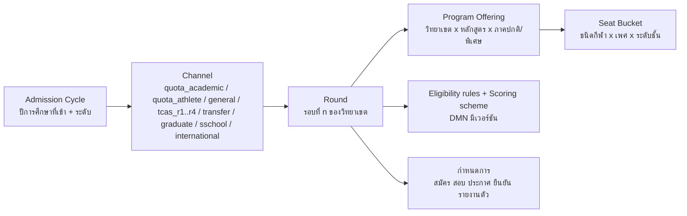
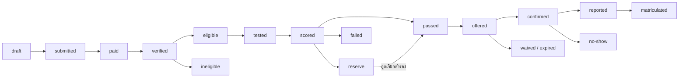

# 02 — เส้นทางนักศึกษา (Student Journey) ทีละขั้น: ตั้งแต่เปิดรับสมัครจนเป็นศิษย์เก่า

> **สถานะ:** v1.0-draft · 28 ต.ค. 2569 · ผู้เขียน: B · ภาษา: ไทย (ศัพท์เทคนิคเป็นภาษาอังกฤษ)
> **อ่านคู่กับ:** [00-blueprint](00-blueprint.md) (สัญญากลาง) · [03-academic-calendar](03-academic-calendar.md) (ปฏิทินรายเดือนและ calendar-as-configuration) · [04-roles-permissions](04-roles-permissions.md) (รหัสบทบาท/สิทธิ์) · [05-workflows](05-workflows.md) (ทะเบียน workflow ฉบับสุดท้าย) · [06-modules](06-modules.md) (โมดูล) · [10-security-compliance](10-security-compliance.md) (PDPA ผู้เยาว์, คุ้มครองเด็ก) · [13-open-questions](13-open-questions.md)
> **แหล่งข้อมูลหลัก:** research v2 `admissions.md`, `academic_calendar_operations.md`, `student_services.md`; `process_requirements.md`; review `review_functional.md`, `review_benchmark.md`; `data/workflows.seed.json`; v0.9 หัวข้อ 3–4 (archive)

เล่มนี้ตอบคำถาม "นักศึกษาหนึ่งคนต้องทำอะไร ที่ไหน เมื่อไร กับใคร และระบบช่วยอะไร" แบบละเอียดทีละขั้น โดยแยกตาม **ช่องทางรับเข้าจริงของ มกช.** (โควตาเรียนดี, โควตานักกีฬา, ประเภททั่วไปหลายรอบที่แต่ละวิทยาเขตจัดเอง, TCAS ถ้าใช้, โรงเรียนกีฬา, บัณฑิตศึกษา, โอนย้าย, ผู้พิการ, ต่างชาติ) แทนภาพรวมแบบ "สมัคร → TCAS → รายงานตัว" ของ v0.9 ซึ่ง research v2 พบว่าไม่ตรงกับความจริง (มกช. ไม่ได้ใช้ TCAS เป็นช่องทางหลัก — blueprint ข้อ 2.1)

---

## 0. วิธีอ่าน

### 0.1 คอลัมน์ของตารางขั้นตอน

| คอลัมน์ | ความหมาย |
|---|---|
| ลำดับ | รหัสขั้นภายในตาราง (เช่น QA-3 = ช่องทางโควตาเรียนดี ขั้นที่ 3) ใช้อ้างอิงข้ามหัวข้อ |
| ผู้ทำ | รหัสบทบาทตาม blueprint หัวข้อ 5 + ชื่อไทย; `system` = งานอัตโนมัติ; `ext:` = หน่วยงานภายนอกที่ไม่มีบทบาทในระบบ (เช่น `ext:ทปอ.`) |
| สิ่งที่ทำ | การกระทำของผู้ทำในขั้นนั้น |
| ระบบช่วยอะไร | ความสามารถของระบบที่ทำให้ขั้นนั้นเร็วขึ้น ถูกต้องขึ้น หรือไม่ต้องใช้กระดาษ |
| เอกสาร/ค่าธรรมเนียม | สิ่งที่ต้องยื่น/จ่าย (ตัวเลขทั้งหมดเป็น **configuration ราย OrgUnit**) |
| เวลา | ช่วงเวลาในปีหรือเวลาสัมพัทธ์ (T0 = วันเปิดภาค, R0 = วันเปิดรับสมัครของรอบ) |
| WID | workflow ID: W-01..W-68 ตาม seed; **ID ที่มีเครื่องหมาย \* (เช่น W-70\*) เป็น workflow ใหม่ที่เสนอ** ดูหัวข้อ 12 (เล่ม 05 เป็นเจ้าของเลขสุดท้าย) |
| โมดูล | รหัสโมดูลตาม blueprint หัวข้อ 4 |

### 0.2 สัญลักษณ์ความน่าเชื่อถือ

- ✅ = มีแหล่งอ้างอิง (ระดับ search snippet ตาม research v2 — ยังควรเปิดต้นฉบับยืนยันก่อนทำ TOR)
- 🟡 = ยังไม่ยืนยัน / อนุมานจากแนวปฏิบัติทั่วไป ถือเป็น **[ต้องตรวจสอบ]** และเป็นสมมติฐานที่ต้องลงทะเบียนในเล่ม 01 (ดูหัวข้อ 13 ของเล่มนี้)
- "ตัวอย่าง" = ค่าจากมหาวิทยาลัยอื่น ใช้แสดงรูปแบบ configuration เท่านั้น ห้ามถือเป็นค่าของ มกช.

### 0.3 รหัสบทบาทที่ใช้ในเล่มนี้

| กลุ่ม | รหัส (ชื่อไทย) |
|---|---|
| ผู้เรียนและครอบครัว | `candidate` ผู้สมัคร · `student` นักศึกษา/นักเรียน · `guardian` ผู้ปกครอง · `alumni` ศิษย์เก่า · `applicant` บุคคลภายนอก/ประชาชน · `employer` สถานประกอบการ/นายจ้าง |
| วิชาการ | `lecturer` อาจารย์ผู้สอน · `advisor` อาจารย์ที่ปรึกษา · `head` หัวหน้าภาค/ประธานหลักสูตร · `dean` คณบดี · `campusvp` รองอธิการบดีประจำวิทยาเขต · `rector` อธิการบดี · `council` สภาวิชาการ/สภามหาวิทยาลัย · `gradschool` บัณฑิตวิทยาลัย/กรรมการวิทยานิพนธ์ · `judge` กรรมการสอบทักษะ/สัมภาษณ์ · `proctor` กรรมการคุมสอบ · `practicum` ศูนย์ฝึกประสบการณ์ · `mentor` ครูพี่เลี้ยง · `supervisor` อาจารย์นิเทศก์ |
| งานบริการ | `admission` งานรับสมัคร · `registrar` งานทะเบียน/นายทะเบียน · `finance` การเงิน · `loan` เจ้าหน้าที่ กยศ. · `scholar` งานทุน · `dorm` หอพัก/ครูหอพัก · `affairs` กิจการนักศึกษา (รวมหน่วยบริการนักศึกษาพิการ) · `medical` แพทย์/พยาบาล/นักกายภาพ · `safeguard` ผู้ดูแลคุ้มครองเด็ก · `complaint` ศูนย์รับเรื่องร้องเรียน · `dpo` DPO · `pr` ประชาสัมพันธ์ · `planner` กองแผน · `hr` บุคลากร · `records` งานสารบรรณ |
| กีฬา | `coach` โค้ช/ผู้จัดการทีม · `sci` นักวิทยาศาสตร์การกีฬา · `sportshead` หัวหน้างานกีฬา |
| โรงเรียนกีฬา | `sschool_dir` ผู้อำนวยการโรงเรียนกีฬา · `homeroom` ครูประจำชั้น (ครูผู้สอนใช้ `lecturer`) |
| ระบบ | `system` งานอัตโนมัติ |

> บทบาท `judge`, `sschool_dir`, `homeroom`, `mentor`, `supervisor`, `gradschool` เป็นบทบาทที่ blueprint อนุญาตให้เพิ่ม เล่ม 04 เป็นเจ้าของรายการสุดท้าย

### 0.4 หลักที่ใช้ทั้งเล่ม

1. **ทุกวิทยาเขตมีงานรับสมัครและงานทะเบียนของตนเอง** ค่าธรรมเนียม รอบ ผู้ลงนาม และกำหนดเวลาต่างกัน จึงเป็น configuration ราย OrgUnit ทั้งหมด (blueprint 2.3) ตัวอย่างผู้ลงนามที่พบ: ใบรับรองของวิทยาเขตมหาสารคามผ่านผู้ช่วยอธิการบดีฝ่ายวิชาการ → รองอธิการบดีประจำวิทยาเขต ✅ ([TNSU MK](https://tnsumk.ac.th/reg/index.php/services/registrar-services/certificate-thai))
2. **ผู้สมัครหนึ่งคนมีตัวตนเดียวทั้งมหาวิทยาลัย** (applicant master: เลขประจำตัวประชาชน / passport / รหัส G) เพื่อให้ clearing ข้าม 17 วิทยาเขตทำได้
3. **ผู้เยาว์** (อายุต่ำกว่า 20 ปีบริบูรณ์ ซึ่งรวมผู้สมัคร ป.ตรี ส่วนใหญ่และนักเรียนโรงเรียนกีฬาทุกคน) ต้องมีผู้ปกครองให้ความยินยอมในขั้นที่กฎหมายกำหนด (รายละเอียดฐานกฎหมายอยู่ในเล่ม 10)
4. **ปฏิทินเป็นข้อมูล** ทุก window (สมัคร ลงทะเบียน ถอน W ส่งเกรด ฯลฯ) เปิด/ปิดฟังก์ชันจากปฏิทินในโมดูล ORG (เล่ม 03)
5. **ประกาศเป็นของ ENG และส่งผ่าน NOTI** ทุกขั้นที่ "ประกาศ" ในเล่มนี้หมายถึง ENG ออกประกาศ + NOTI ส่งแจ้งเตือนรายบุคคล และประกาศรายชื่อสาธารณะต้อง mask ข้อมูลตาม PDPA

---

## 1. ภาพรวมหนึ่งหน้า

### 1.1 แผนภาพเส้นทาง (ทุกช่องทางมารวมที่ "ยืนยันสิทธิ์")

### 1.2 Journey at a glance

| # | ช่วง (stage code) | ช่วงเวลาทั่วไป | ผู้เกี่ยวข้องหลัก | งานหลักของผู้เรียน | Workflow หลัก | โมดูลหลัก | Release ที่รองรับ |
|---|---|---|---|---|---|---|---|
| 1 | สมัครและคัดเลือก (`pre`) | โควตา ต.ค.–ธ.ค. ✅/🟡 · ทั่วไป ก.พ.–มิ.ย. ✅ · TCAS ส.ค.–มิ.ย. ✅ | candidate, guardian, admission, judge, medical, head | สมัคร, ชำระค่าสมัคร, สอบ, ดูผล, ยืนยัน/สละสิทธิ์ | W-69\*, W-41, W-42, W-71\*, W-70\*, W-88\*, W-18, W-74\*, W-75\*, W-76\* | ADM, IAM, PRIV, FIN, ENG, NOTI, CASE | R1 (ก.ย. 2571) |
| 2 | ยืนยันสิทธิ์และแรกเข้า (`first`) | ทันทีหลังผล → ก่อนเปิดภาค (มิ.ย.) | candidate→student, guardian, finance, registrar, medical, sci, dorm, affairs, loan | ชำระ, รายงานตัว, ตรวจสุขภาพ, หอ, ปฐมนิเทศ, กยศ. | W-43, W-44, W-90\*, W-45, W-46, W-47, W-48, W-82\* | ADM→REC, FIN, IAM, SVC, HLT, ATH, HOU, AFF, SCH | R1 (ค่ายืนยันสิทธิ์) + R2 (พ.ค. 2572) |
| 3 | ทุกภาค (`term`) | วนรอบ ภาค 1 ≈ มิ.ย.–ต.ค. 🟡 · ภาค 2 ≈ พ.ย.–มี.ค. 🟡 · ฤดูร้อน ≈ เม.ย.–พ.ค. 🟡 | student, advisor, lecturer, head, dean, registrar, finance, proctor | ลงทะเบียน, ชำระ, เรียน, ลา, สอบ, ดูเกรด | W-79\*, W-49, W-50, W-80\*, W-51, W-27, W-52, W-53, W-54, W-91\*, W-92\*, W-05, W-55, W-01, W-81\*, W-56, W-57, W-61 | REG, FIN, ATT, EXM, ASM, REC, LMS | R2 |
| 4 | ระหว่างเรียน (`during`) | ตามเหตุ / ตามรอบปี | student, registrar, affairs, scholar, practicum, employer | ขอเอกสาร, คำร้อง, ทุน, ผ่อนผันทหาร, กิจกรรม, ฝึกงาน/ฝึกสอน, accommodation | W-58, W-34, W-07, W-59, W-60, W-62, W-32, W-33, W-25, W-21 | SVC, DOC, SCH, AFF, PRA, REC | R2 (ส่วนใหญ่), R3 (PRA) |
| 5 | นักกีฬา (`sport`) | ตลอดปี; พีค ก.ย. (พลศึกษาเกมส์), พ.ย.–ม.ค. | student, coach, sci, medical, sportshead, lecturer | ซ้อม, wellness (opt-in), ลาแข่ง, เดินทาง, บาดเจ็บ, ตรวจสิทธิ์ | W-68, W-30, W-04, W-83\*, W-31, W-84\*, W-39, W-14, W-97\* | ATH, ATT, EXM, HLT, FIN, FAC | R2 (core) + R3 (eligibility, travel) |
| 6 | ปัญหาและกรณีพิเศษ (`problem`) | ตามเหตุ / หลังประกาศเกรด | student, guardian, advisor, dean, rector, affairs, complaint, safeguard | อุทธรณ์, ชี้แจงวินัย, ลาพัก/ลาออก/คืนสภาพ, ร้องเรียน | W-16, W-17, W-02, W-12, W-55, W-11, W-10, W-24, W-26, W-19, W-22, W-09 | CASE, REC, AFF, SAFE, FIN | R1 (CASE อุทธรณ์ผลคัดเลือก) + R2 |
| 7 | จบการศึกษา (`grad`) | ยื่นภายใน 30 วันหลังเปิดภาคสุดท้าย ✅ → สภาอนุมัติ → พิธี ≈ 1 ปีต่อมา ✅ | student, registrar, head, dean, council, affairs | ยื่นจบ, clearance, รับ e-Transcript, ตอบแบบสำรวจ, ซ้อมและรับปริญญา | W-06, W-65, W-64, W-99\* | GRD, DOC, ALU, ENG | R3 (พ.ย. 2572) |
| 8 | ศิษย์เก่า (`alumni`) | ตลอดไป | alumni, employer, registrar | อัปเดตข้อมูล, ขอเอกสาร, ส่งลิงก์ตรวจสอบวุฒิ | W-66, W-67, W-58, W-86\* | ALU, GRD, DOC | R3 |
| 9 | โรงเรียนกีฬา (`sschool`) | ภาค 1 ≈ 16 พ.ค.–30 ก.ย. · ภาค 2 ≈ 1 พ.ย.–31 มี.ค. (รูปแบบปี 2569 ✅) | student (ผู้เยาว์), guardian, homeroom, dorm, sschool_dir, coach, safeguard | สมัคร ม.1/ม.4, มอบตัว, หอพักประจำ, เรียน, ออกนอกหอ, จบ ม.3/ม.6 | W-72\*, W-13, W-93\*, W-94\*, W-95\*, W-89\*, W-22 | SSC, HOU, SAFE, HLT, ATH, PRIV | Wave 1 (พ.ค. 2573) |
| 10 | บัณฑิตศึกษา (`gradstudy`) | รับสมัครยาว พ.ย.–ก.พ. ✅ (ชลบุรี) | student, advisor, gradschool | สอบวัดคุณสมบัติ, โครงร่าง, จริยธรรม, ป้องกัน, ส่งเล่ม | W-73\*, W-96\*, W-77\*, W-78\* | GRAD, ADM, X-RES | R3 |

> **ผู้ใช้กลุ่มแรกบนระบบใหม่:** ผู้สมัครเข้าปีการศึกษา 2572 ใน 2 วิทยาเขต pilot เริ่มสมัครรอบโควตา ต.ค. 2571 (R1) แล้วรายงานตัวและเรียนภาค 1/2572 บน R2; นักศึกษาปัจจุบันย้ายเข้าระบบที่รอยต่อปีการศึกษาพร้อม parallel run 1 ภาค (blueprint หัวข้อ 7)

---

## 2. ก่อนเป็นนักศึกษา: การรับเข้าทุกช่องทาง (`pre`)

### 2.1 โครงสร้างการรับเข้าที่ระบบต้องจำลอง

ข้อเท็จจริงจาก research v2: แต่ละวิทยาเขตออกประกาศในนามของตนเอง ✅ ใช้คำว่า "ประเภทโควตา" (เรียนดี / นักกีฬา) และ "ประเภททั่วไป รอบที่ n" ✅ บางวิทยาเขตเปิดถึงรอบ 5 ✅ (ชลบุรี 2569) หรือรอบ 6 🟡 และไม่พบประกาศปี 2569–2570 ที่ใช้คำว่า "TCAS รอบ x" (หลักฐานเชิงลบ) ([admissions.md §2](../../research_notes/ออกแบบระบบการศึกษา%20TNSU%20ระดับ%20production/v2/admissions.md))

| ระดับ | ตัวอย่างค่า | ใครตั้ง | หมายเหตุ |
|---|---|---|---|
| Cycle | ป.ตรี เข้าปีการศึกษา 2572 | `admission` ส่วนกลาง | ผูก fee schedule และ PolicySet ของรุ่น |
| Channel | โควตานักกีฬา | ส่วนกลางกำหนดรายการช่องทาง วิทยาเขตเลือกใช้ | ช่องทางใหม่เพิ่มได้ด้วย config |
| Round | โควตา รอบเดียว / ทั่วไป รอบ 1..6 | `admission` วิทยาเขต (W-69\*) | รอบถัดไปรับ "ที่นั่งคงเหลือ" อัตโนมัติ |
| Program Offering | ศษ.บ. พลศึกษา วิทยาเขตชลบุรี ภาคปกติ | CUR + วิทยาเขต | ต้องไม่เกิน `AccreditedIntakeCap` ของคุรุสภาสำหรับหลักสูตรครู (G-12) |
| Seat Bucket | ฟุตบอลชาย 8 ที่ | วิทยาเขต | ใช้กับโควตานักกีฬาและโรงเรียนกีฬา |

**สถานะใบสมัคร (application state)** — ใช้ร่วมทุกช่องทาง:

### 2.2 ปฏิทินรับเข้าโดยสรุป (ตัวอย่างรอบเข้าปีการศึกษา 2570 ที่เกิดขึ้นจริงตามหลักฐาน)

| เดือน | มกช. ป.ตรี (รายวิทยาเขต) | TCAS70 (ทปอ.) — ใช้เฉพาะถ้า มกช. เข้าร่วม | โรงเรียนกีฬา (เข้า 2570) | บัณฑิตศึกษา |
|---|---|---|---|---|
| ส.ค. 2569 | — | รอบ 1 Portfolio เปิด 15 ส.ค. ✅ | — | — |
| ก.ย. 2569 | ประกาศโควตา 2570: กรุงเทพ 22 ก.ย. ✅, ชลบุรี (เรียนดี) 30 ก.ย. ✅, อ่างทอง ✅ | — | — | — |
| ต.ค. 2569 | รับสมัครโควตา 🟡 (รอบก่อน: 1 ต.ค.–7 พ.ย. 2568 ✅) | ลงทะเบียน myTCAS 🟡 (ปี 69 เริ่ม 28 ต.ค.) | อุบลฯ ประกาศ 🟡 | ชลบุรีประกาศรับ 2570 วันที่ 1 ต.ค. ✅ |
| พ.ย. 2569 | ปิดรับโควตา ตรวจเอกสาร 🟡 | สมัคร TGAT/TPAT 4–10 พ.ย. (ล่าช้า 11–12) ✅ | — | เปิดรับ 🟡 (ปีก่อน 10 พ.ย.) |
| ธ.ค. 2569 | สอบทักษะ/สัมภาษณ์ ประกาศผลโควตา 🟡 | — | ประกาศรับ (ยะลา 19 ธ.ค. 2568 สำหรับปี 2569 ✅) | สมัครต่อเนื่อง |
| ม.ค. 2570 | ยืนยันสิทธิ์โควตา 🟡 | สมัคร A-Level 14–20 ม.ค. ✅; สอบ TGAT/TPAT3 30 ม.ค. ✅ | รับสมัคร ✅ (สุพรรณฯ ปีก่อน 2–31 ม.ค.) | สมัครต่อเนื่อง |
| ก.พ. 2570 | ทั่วไปรอบ 1–2 ✅ (ปีก่อน รอบ 2 กรุงเทพปิด 3 มี.ค.) | TPAT 31 ม.ค.–1 ก.พ. ✅; ผล 28 ก.พ. ✅ | ประกาศผู้มีสิทธิ์ทดสอบ + ทดสอบ ✅ (ยะลา 11 ก.พ.) | ปิดรับ (ปีก่อน 27 ก.พ.) ✅ |
| มี.ค. 2570 | ทั่วไปรอบ 2–3 ✅ | ผลรอบ 1 + ยืนยัน 10–11 มี.ค. ✅; A-Level 13–15 มี.ค. ✅; รอบ 2 เริ่ม 13 มี.ค. ✅ | ประกาศผล มอบตัว 🟡 | สอบ/สัมภาษณ์ 🟡 |
| เม.ย. 2570 | ทั่วไปรอบ 3 (ข้อเขียน+สัมภาษณ์) ✅ | รอบ 2 คัดเลือก | มอบตัว / หอพัก 🟡 | ประกาศผล 🟡 |
| พ.ค. 2570 | ทั่วไปรอบ 4–5 ✅ | ผลรอบ 2 3 พ.ค. ยืนยัน 3–4 พ.ค. ✅; รอบ 3 สมัคร 7–11 พ.ค. (เพิ่ม 12–13) ✅; ผล 22/27 พ.ค. (แหล่งไม่ตรงกัน) | เปิดภาค ≈ 16 พ.ค. 🟡 | รายงานตัว 🟡 |
| มิ.ย. 2570 | รอบ 5–6 + รายงานตัวทันที (ปีก่อน ชลบุรีประกาศ 8 มิ.ย. รายงานตัว 9 มิ.ย. ✅) | รอบ 4 ≈ 29 พ.ค.–15 มิ.ย. 🟡 | — | เปิดภาค |

แหล่ง: [Trueplookpanya TCAS70](https://www.trueplookpanya.com/tcas/article/detail/97424), [SmartMathPro](https://www.smartmathpro.com/article/tcas70-calendar/), [Bangkokbiznews](https://www.bangkokbiznews.com/health/education/1127836), [tnsubkk โควตา 2570](https://www.tnsubkk.ac.th/%E0%B8%9B%E0%B8%A3%E0%B8%B0%E0%B8%81%E0%B8%B2%E0%B8%A8%E0%B8%A1%E0%B8%AB%E0%B8%B2%E0%B8%A7%E0%B8%B4%E0%B8%97%E0%B8%A2%E0%B8%B2%E0%B8%A5%E0%B8%B1%E0%B8%A2%E0%B8%81%E0%B8%B2%E0%B8%A3%E0%B8%81-97/), [TNSUCBI](https://www.tnsucbi.ac.th/), [tnsucbi รอบ 5](https://www.tnsucbi.ac.th/%E0%B8%9B%E0%B8%A3%E0%B8%B0%E0%B8%81%E0%B8%B2%E0%B8%A8%E0%B8%A3%E0%B8%B2%E0%B8%A2%E0%B8%8A%E0%B8%B7%E0%B9%88%E0%B8%AD%E0%B8%9C%E0%B8%B9%E0%B9%89%E0%B8%A1%E0%B8%B5%E0%B8%AA%E0%B8%B4%E0%B8%97%E0%B8%98-9/), [LINE Today โควตา 2569](https://today.line.me/th/v3/article/wJMap0G), [yalasportsschool](https://yalasportsschool.ac.th/), [Eduzones ชลบุรีบัณฑิต](https://www.eduzones.com/2025/11/07/tnsu-8/) — ปฏิทินรอบปีการศึกษา 2571/2572 อยู่ในเล่ม 03

### 2.3 ขั้นตอนร่วมของทุกช่องทาง (บัญชีผู้สมัคร → ใบสมัคร → ค่าสมัคร)

| ลำดับ | ผู้ทำ | สิ่งที่ทำ | ระบบช่วยอะไร | เอกสาร/ค่าธรรมเนียม | เวลา | WID | โมดูล |
|---|---|---|---|---|---|---|---|
| CM-1 | `admission` งานรับสมัครวิทยาเขต | ตั้งค่ารอบ ที่นั่ง คุณสมบัติ เกณฑ์คะแนน ค่าสมัคร กำหนดการ แล้วเสนออนุมัติและเผยแพร่ประกาศ | wizard ตั้งรอบโดย clone จากรอบปีก่อน, ตรวจ seat ไม่เกินแผนรับ/คุรุสภา cap, สร้างประกาศ PDF ภาษาไทยจาก template, ตั้ง window ในปฏิทินอัตโนมัติ | ประกาศมหาวิทยาลัย (ลงนามโดยผู้มีอำนาจของวิทยาเขต) | ก่อนเปิดรับ ≥ 2–4 สัปดาห์ 🟡 | W-69\* | ADM, ORG, ENG, DOC |
| CM-2 | `candidate` ผู้สมัคร | สร้างบัญชี: ยืนยันตัวตนด้วย ThaID หรือ OTP มือถือ + เลขประจำตัว 13 หลัก / passport / รหัส G | applicant master ระดับมหาวิทยาลัย (dedupe ด้วยเลขประจำตัว + วันเกิด), บัญชีเดียวใช้ได้ทุกวิทยาเขตทุกรอบ, PWA + LINE LIFF | บัตรประชาชน (หรือ passport) | ตลอดปี | W-41 | IAM, ADM |
| CM-3 | `system` | ตรวจอายุจากวันเกิด: ถ้าต่ำกว่า 20 ปี ส่งลิงก์เชิญผู้ปกครองผูกบัญชี | dual consent flow: ผู้ปกครองยืนยันตัวตน (ThaID) และยืนยันความสัมพันธ์; เก็บ consent แยกวัตถุประสงค์ (ข้อมูลสุขภาพ = sensitive) | เอกสารแสดงความเป็นผู้ปกครอง (กรณีไม่ใช่บิดา/มารดา) 🟡 | ก่อนยื่นใบสมัครที่มีข้อมูลสุขภาพหรือการทดสอบร่างกาย | W-41 (ขั้นย่อย) | PRIV, IAM |
| CM-4 | `candidate` | เลือกช่องทาง รอบ วิทยาเขต หลักสูตร (และชนิดกีฬา/ตำแหน่ง) เรียงลำดับ | แสดงเฉพาะรอบที่เปิดอยู่และที่ผู้สมัครมีสิทธิ์, เตือนถ้ายืนยันสิทธิ์ที่อื่นแล้ว (กติกา clearing หัวข้อ 2.8), เปรียบเทียบค่าเทอม/ที่นั่ง | — | ช่วงรับสมัครของรอบ | W-41 | ADM |
| CM-5 | `candidate` | กรอกข้อมูลการศึกษา ผลการเรียน และข้อมูลเฉพาะช่องทาง | ดึง GPAX จาก ปพ.1 (OCR + ให้ผู้สมัครยืนยัน + เจ้าหน้าที่ตรวจ), ตรวจคุณสมบัติทันที (eligibility DMN) | ปพ.1 / หนังสือรับรองผลการเรียน (จำนวนภาคเรียนตามประกาศ 🟡), รูปถ่าย | ช่วงรับสมัคร | W-41 | ADM |
| CM-6 | `candidate` | อัปโหลดเอกสาร | checklist ต่อช่องทาง, ตรวจชนิด/ขนาดไฟล์, hash, แจ้งเอกสารขาดก่อนกดยื่น | ตามช่องทาง (ดูตารางแต่ละช่องทาง) | ช่วงรับสมัคร | W-41 | ADM |
| CM-7 | `candidate` / `guardian` | ชำระค่าสมัครด้วย Thai QR / Bill Payment (ใครจ่ายแทนก็ได้) | ใบแจ้งชำระ Ref1 = เลขใบสมัคร, Ref2 = วิทยาเขต+รอบ; callback ธนาคาร + statement reconcile; e-Receipt; คำขอยกเว้นค่าสมัคร (ผู้มีรายได้น้อย) เป็น e-Form 🟡 | ค่าสมัคร "หลักร้อยบาท" 🟡 ตามประกาศวิทยาเขต | ภายในวันปิดรับ | W-41, W-34 | FIN, ADM |
| CM-8 | `admission` | ตรวจเอกสารที่ระบบตรวจไม่ได้ (คิวตรวจ verify / reject / ขอเพิ่ม) | verification queue แบ่งงานตามเจ้าหน้าที่, ขอเอกสารเพิ่มผ่าน NOTI พร้อม deadline, บันทึกผู้ตรวจ | — | ภายใน 3–7 วันหลังปิดรับ 🟡 | W-41 | ADM, NOTI |
| CM-9 | `admission` → `campusvp` | ประกาศรายชื่อผู้มีสิทธิ์สอบ | สร้างรายชื่อ masked (ไม่แสดงเลขประจำตัวเต็ม), ส่งแจ้งเตือนรายบุคคล, ออกบัตรประจำตัวผู้สอบ (QR) ในแอป | บัตรประจำตัวผู้สอบ | ตามกำหนดการรอบ | W-42 | ADM, ENG, NOTI |
| CM-10 | `candidate` | ดูวัน เวลา สถานที่ ห้อง/สนาม และข้อปฏิบัติ (การแต่งกาย ของที่นำมา) | ปฏิทินส่วนตัว + แผนที่, เตือน T-3/T-1 วัน | ข้อกำหนดการแต่งกาย เช่น ชุดนักเรียนและรองเท้าหุ้มส้น ✅ (ชลบุรี) | ก่อนวันสอบ | W-42 | ADM, NOTI |

### 2.4 ช่องทาง (a): โควตาเรียนดี (ประเภทโควตา ผลการเรียนดี)

ข้อเท็จจริง: ประกาศโควตาเรียนดีออกแยกรายวิทยาเขต ✅ (ชลบุรี "ประเภทโควตา ประเภทผลการเรียนดี" 30 ก.ย. 2569) เปิดรับพร้อมโควตานักกีฬา (ปีก่อน 1 ต.ค.–7 พ.ย. 2568 ✅) ส่วนเกณฑ์ GPAX จำนวนภาคเรียน สัดส่วนคะแนน และค่าสมัคร ยังไม่ได้อ่านฉบับเต็ม 🟡

| ลำดับ | ผู้ทำ | สิ่งที่ทำ | ระบบช่วยอะไร | เอกสาร/ค่าธรรมเนียม | เวลา | WID | โมดูล |
|---|---|---|---|---|---|---|---|
| QA-1 | `admission` | ตั้งรอบโควตาเรียนดี: GPAX ขั้นต่ำ (ตัวอย่าง ≥ 2.75 🟡), นับกี่ภาคเรียน (ตัวอย่าง ม.4–ม.6 ภาค 1 = 5 ภาค 🟡), แผนการเรียนที่รับ, GPA กลุ่มสาระพลศึกษา (ถ้ากำหนด 🟡), ที่นั่งต่อหลักสูตร | DMN eligibility มีเวอร์ชัน, คำนวณที่นั่งจากแผนรับ, ประกาศ PDF | ประกาศ | ปลาย ก.ย. ✅ | W-69\* | ADM, ORG |
| QA-2 | `candidate` | สมัคร (ขั้น CM-2..CM-7) เลือกวิทยาเขต/หลักสูตร | แสดงผลตรวจ GPAX ทันที "ผ่าน/ไม่ผ่านเกณฑ์ขั้นต่ำ" ก่อนจ่ายเงิน (ลดการจ่ายค่าสมัครทั้งที่ไม่มีสิทธิ์) | ปพ.1 5 ภาค 🟡, บัตร, รูป | ต.ค.–ต้น พ.ย. 🟡 | W-41 | ADM, FIN |
| QA-3 | `admission` | ยืนยัน GPAX กับเอกสาร, ตรวจโรงเรียน/แผนการเรียน | OCR ปพ.1 + เทียบค่าที่ผู้สมัครกรอก, flag ค่าต่างกัน | — | ≤ 7 วันหลังปิดรับ 🟡 | W-41 | ADM |
| QA-4 | `admission` | ประกาศผู้มีสิทธิ์สัมภาษณ์ | CM-9 | บัตรประจำตัวผู้สอบ | พ.ย. 🟡 | W-42 | ADM, ENG |
| QA-5 | `judge` กรรมการสัมภาษณ์ (มักเป็น `head`/อาจารย์หลักสูตร) | สัมภาษณ์ตาม rubric (ทัศนคติ ความพร้อม ความเหมาะสมกับวิชาชีพครู/กีฬา) | slot สัมภาษณ์, เช็กอิน QR, rubric บน tablet แบบ offline-first, กรรมการ ≥ 2 คน/ห้อง 🟡, ประกาศ COI | บัตรประชาชน + บัตรผู้สอบ | พ.ย.–ธ.ค. 🟡 | W-42, W-71\* | ADM |
| QA-6 | `judge` + `sci` (เฉพาะหลักสูตรที่กำหนด) | ทดสอบสมรรถภาพพื้นฐาน 🟡 (บางหลักสูตรพลศึกษาอาจกำหนด) | เหมือนสอบทักษะ (หัวข้อ 2.5) แต่ใช้ชุดทดสอบทั่วไป | ใบรับรองแพทย์ (ถ้ามีทดสอบร่างกาย) | วันเดียวกับสัมภาษณ์ 🟡 | W-42 | ADM, HLT |
| QA-7 | `system` | รวมคะแนน = GPAX (weight) + สัมภาษณ์ (+ ทดสอบ) จัดอันดับและสำรอง | scoring scheme ต่อรอบ, tie-break ที่ประกาศไว้ (เช่น GPAX → GPA สาระที่เกี่ยวข้อง → อายุน้อย 🟡) | — | หลังสอบ 1–3 วัน | W-71\* | ADM |
| QA-8 | `head` → `dean` → `campusvp` | ตรวจและอนุมัติผล | approval chain + ล็อกผลหลังอนุมัติ + audit | บันทึกอนุมัติผล | ธ.ค. 🟡 | W-71\* | ADM, AUD |
| QA-9 | `admission` | ประกาศผู้ผ่านและสำรอง | หน้าผลรายบุคคล + PDF masked + แจ้งเตือน (LINE/อีเมล/SMS) แบบ staggered | ประกาศผล | ธ.ค.–ม.ค. 🟡 | W-42 | ADM, ENG, NOTI |
| QA-10 | `candidate` | ยืนยันหรือสละสิทธิ์ (ภายในเวลาที่กำหนด) และชำระค่ายืนยันสิทธิ์ | กติกา clearing ภายใน (หัวข้อ 2.8), นับถอยหลัง, ยืนยัน 1 คลิก + guardian รับทราบ (ผู้เยาว์) | ค่ายืนยันสิทธิ์/ค่าแรกเข้า 🟡 | ตามกำหนด (ตัวอย่าง 3–7 วัน 🟡) | W-70\*, W-43 | ADM, FIN |
| QA-11 | `system` | ผู้ยืนยันแล้วถูกปิดสิทธิ์สมัครรอบอื่นทั้ง มกช. (ตามนโยบายที่ต้องยืนยัน 🟡) | flag ที่ applicant master | — | ทันที | W-70\* | ADM |
| QA-12 | `candidate` → `registrar` | ส่งหลักฐานจบ ม.6 (ปพ.1 ฉบับจบ) ตอนรายงานตัว ถ้าไม่จบ ม.6 = เพิกถอนสิทธิ์ | ตั้งสถานะ "รอหลักฐานจบ", deadline job | ปพ.1 ฉบับสมบูรณ์ | มี.ค.–พ.ค. | W-44, W-90\* | REC, ADM |

### 2.5 ช่องทาง (b): โควตานักกีฬา

ข้อเท็จจริง: โควตานักกีฬาเป็นหนึ่งใน 2 ประเภทของ "ประเภทโควตา" ✅ แต่ละวิทยาเขตเปิดเอง ✅; เกณฑ์ระดับผลงานขั้นต่ำ ช่วงปีของผลงาน ชนิดกีฬาที่รับ และ rubric ทดสอบทักษะของ มกช. ยังไม่พบฉบับเต็ม 🟡 benchmark: มก. นับผลงานย้อนหลังเป็นช่วงวันที่ และเกณฑ์ระดับแรกคือผู้แทนประเทศไทย ✅ ([KU 69-TCAS2-Sport](https://admission.ku.ac.th/media/announcements/2025/11/04/69-TCAS2-Sport.pdf)); มหิดลกำหนดผลงานย้อนหลังไม่เกิน 5 ปีและค่าสอบสัมภาษณ์ 500 บาท ✅ ([Mahidol SS](https://ss.mahidol.ac.th/th/images/SS-Project/TCAS/2568/2.%20ba.pdf))

#### 2.5.1 ขั้นตอน

| ลำดับ | ผู้ทำ | สิ่งที่ทำ | ระบบช่วยอะไร | เอกสาร/ค่าธรรมเนียม | เวลา | WID | โมดูล |
|---|---|---|---|---|---|---|---|
| QS-1 | `admission` + `sportshead` | ตั้งรอบ: ชนิดกีฬา × เพศ × ที่นั่ง (seat bucket), ระดับผลงานขั้นต่ำ, ช่วงวันที่ของผลงาน, ชุดทดสอบทักษะและสมรรถภาพต่อชนิดกีฬา, weight คะแนน | seat matrix, ตารางระดับผลงาน (2.5.2), คลัง rubric ต่อชนิดกีฬา (2.5.3) clone ข้ามวิทยาเขตได้แต่ override ได้ | ประกาศ | ปลาย ก.ย. ✅ | W-69\* | ADM, ATH (คลังชนิดกีฬา) |
| QS-2 | `candidate` (+ `guardian` ถ้าผู้เยาว์) | สมัคร เลือกชนิดกีฬา/ตำแหน่ง/รุ่นน้ำหนัก กรอกประวัติกีฬา (สโมสร สมาคม โค้ช ปีที่เล่น) | sport profile, ผลงานเป็นรายการ (ชื่อรายการ, ระดับ, อันดับ/เหรียญ, วันที่, ไฟล์หลักฐาน) | เกียรติบัตร, หนังสือรับรองจากสมาคมกีฬา/กกท./ต้นสังกัด, ปพ.1, รูป, บัตร | ต.ค.–ต้น พ.ย. 🟡 | W-41 | ADM |
| QS-3 | `system` | ตรวจผลงานอัตโนมัติ: วันที่อยู่ในช่วง, ระดับผลงานถึงขั้นต่ำ, ชนิดกีฬาตรงกับที่รับ | DMN + ตาราง "รายการแข่งขันที่รับรอง" (competition master เช่น กีฬาแห่งชาติ, กีฬานักเรียนนักศึกษาแห่งชาติ ✅ [DPE](https://www.dpe.go.th/th/news-sports/019fd05f-0b4d-72e2-b1bc-98bcf1bb5d95)) ทำให้ระบบรู้ระดับของรายการเอง | — | ทันที | W-41 | ADM, ATH |
| QS-4 | `admission` + `sportshead` | ตรวจความถูกต้องของหลักฐานผลงาน (เทียบผลการแข่งขันจริง/สอบถามสมาคม) | `VerificationTask` (หลักฐาน, ผู้ตรวจ, ผล, หมายเหตุ), ตรวจซ้ำเฉพาะหลักฐานที่ระบบ flag (เช่น ไฟล์ซ้ำกันข้ามผู้สมัคร โดยเทียบ hash) | — | ≤ 7–10 วันหลังปิดรับ 🟡 | W-41 | ADM |
| QS-5 | `candidate` | ส่งใบรับรองแพทย์ และตอบแบบคัดกรองสุขภาพก่อนออกกำลังกาย (PAR-Q+ หรือเทียบเท่า 🟡), ยอมรับข้อตกลงความปลอดภัย | ฟอร์มคัดกรอง; ถ้าตอบ "ใช่" ข้อเสี่ยง → บังคับแนบใบรับรองแพทย์เฉพาะทาง; ข้อมูลเก็บใน health vault (HLT) ไม่ใช่ ADM | ใบรับรองแพทย์ อายุไม่เกิน 30 วัน 🟡 (เลขใบอนุญาตแพทย์) | ก่อนจอง slot ทดสอบ | W-42 | HLT, ADM |
| QS-6 | `guardian` | ลงนามยินยอม (ผู้เยาว์): การทดสอบร่างกาย, การเก็บข้อมูลสุขภาพ, การให้ปฐมพยาบาล/ส่งโรงพยาบาลในวันทดสอบ | e-consent ลงนามดิจิทัล, แยก consent รายวัตถุประสงค์, ไม่มี consent = จอง slot ไม่ได้ | — | ก่อนจอง slot | W-42 | PRIV |
| QS-7 | `admission` | ประกาศผู้มีสิทธิ์ทดสอบ + จัดตาราง slot ตามชนิดกีฬา × เพศ × สนาม × กรรมการ | scheduler: ความจุสนาม, จำนวนกรรมการต่อสถานี, เวลาเผื่อเปลี่ยนสถานี, จองสนามใน FAC อัตโนมัติ (กันชนกับการซ้อมของทีม) | บัตรผู้สอบ QR | พ.ย. 🟡 | W-42 | ADM, FAC |
| QS-8 | `medical` | คัดกรองสุขภาพหน้าสนาม (ชีพจร ความดัน อาการ) ก่อนเริ่มทดสอบ; มี AED/รถพยาบาลประจำจุด | checklist บน tablet, บันทึก `MedicalClearance(PRE_TEST)`; ไม่ผ่าน → `SkillTestIncident` + เสนอวันสำรอง | — | วันทดสอบ | W-42 | HLT, ADM |
| QS-9 | `judge` (≥ 3 คนต่อสถานี 🟡) | ทดสอบทักษะเฉพาะชนิดกีฬา + สมรรถภาพ (2.5.3, 2.5.4) ให้คะแนนอิสระ | judge app offline-first, เห็นเฉพาะเลขผู้สอบไม่เห็นชื่อ (blind) 🟡, ส่งแล้วล็อก, จับเวลา/วัดระยะกรอกตรงจากเครื่อง (ถ้ามี) | — | พ.ย.–ธ.ค. 🟡 | W-42, W-71\* | ADM |
| QS-10 | `judge` หัวหน้ากรรมการ | moderation เมื่อคะแนนกรรมการต่างกันเกินเกณฑ์ (2.5.5) | flag อัตโนมัติ, ดูบันทึก/วิดีโอ (ถ้ามี consent), ให้คะแนนใหม่หรือบันทึกเหตุผล | บันทึก moderation | วันเดียวกัน | W-71\* | ADM |
| QS-11 | `judge` (`head`) | สัมภาษณ์ | เหมือน QA-5 | — | วันเดียวกัน/ถัดไป | W-42 | ADM |
| QS-12 | `system` | รวมคะแนน: ผลงาน (ตามตาราง 2.5.2) + ทักษะ + สมรรถภาพ + สัมภาษณ์ (+ GPAX ถ้ากำหนด) ต่อ seat bucket จัดอันดับและสำรอง | weight ต่อรอบ, normalisation ข้ามกลุ่มกรรมการ (option), tie-break ที่ประกาศไว้ | — | ≤ 3 วันหลังทดสอบ 🟡 | W-71\* | ADM |
| QS-13 | `head` → `dean` → `campusvp` | อนุมัติผล | เหมือน QA-8 + รายงานการกระจายคะแนนต่อชนิดกีฬา | บันทึกอนุมัติ | ธ.ค. 🟡 | W-71\* | ADM |
| QS-14 | `admission` | ประกาศผลแยกตามชนิดกีฬา/เพศ + สำรอง | เหมือน QA-9 | ประกาศ | ธ.ค.–ม.ค. 🟡 | W-42 | ADM, ENG |
| QS-15 | `candidate` | ยืนยัน/สละสิทธิ์ + ชำระ | เหมือน QA-10 + ส่งต่อ sport profile ไป ATH เมื่อรายงานตัว | ค่ายืนยันสิทธิ์ 🟡 | ตามกำหนด | W-70\*, W-43 | ADM, FIN |
| QS-16 | `candidate` | ขอทบทวนผลทดสอบ (ถ้าไม่เห็นด้วย) | ยื่นใน portal ภายในกำหนด (ตัวอย่าง 7 วันทำการ — SLA ตาม W-18), ระบบแสดงคะแนนรายสถานีให้ผู้สมัครดู | — | ≤ 7 วันหลังประกาศ 🟡 | W-18 | CASE, ADM |

#### 2.5.2 ระดับผลงานกีฬา (ตัวอย่าง configuration 🟡)

| ระดับ | ตัวอย่างรายการ | ตัวอย่างคะแนนผลงาน (เต็ม 100) | หลักฐาน | ผู้ตรวจ |
|---|---|---|---|---|
| L1 นานาชาติ / ทีมชาติ | ซีเกมส์, เอเชียนเกมส์, ชิงแชมป์โลก/เอเชีย, เยาวชนทีมชาติ | 100 (เหรียญ) / 90 (เข้าร่วม) | หนังสือรับรองสมาคมกีฬาแห่งประเทศไทย/กกท. | `sportshead` |
| L2 ชาติ (ได้เหรียญ) | กีฬาแห่งชาติ, กีฬาเยาวชนแห่งชาติ, กีฬานักเรียนนักศึกษาแห่งชาติ, ชิงแชมป์ประเทศไทย | 80 (ทอง) / 75 (เงิน) / 70 (ทองแดง) | เกียรติบัตร + ผลการแข่งขัน | `admission` + `sportshead` |
| L3 ชาติ (เข้าร่วม) | ผู้แทนจังหวัดในกีฬาแห่งชาติ | 60 | เกียรติบัตร/หนังสือรับรองจังหวัด | `admission` |
| L4 ภาค / เขต | กีฬาแห่งชาติรอบคัดเลือกภาค, กีฬานักเรียนระดับภาค | 50 (เหรียญ) / 40 | เกียรติบัตร | `admission` |
| L5 จังหวัด | กีฬานักเรียนระดับจังหวัด | 30 (เหรียญ) / 20 | เกียรติบัตร | `admission` |
| ผู้ไม่มีผลงานถึงขั้นต่ำ | — | ไม่มีสิทธิ์ (ถ้าประกาศกำหนดขั้นต่ำ) | — | `system` |

กติกาที่ระบบต้องรองรับ: นับเฉพาะผลงานในช่วงวันที่ที่ประกาศ (ตัวอย่าง มก. นับย้อนหลัง 5 ปี ✅); นับผลงานสูงสุดรายการเดียวหรือรวมหลายรายการตาม config; ประเภททีมใช้ผลของทีมพร้อมหลักฐานว่าผู้สมัครอยู่ในรายชื่อ; กีฬาคนพิการใช้ระดับเดียวกันพร้อม classification (หัวข้อ 2.12)

#### 2.5.3 สอบทักษะเฉพาะชนิดกีฬา (ตัวอย่าง rubric 🟡 — วิทยาเขตตั้งเองได้)

| ชนิดกีฬา | สถานี/รายการทดสอบตัวอย่าง | วิธีให้คะแนน | ข้อควรระวังด้านความปลอดภัย |
|---|---|---|---|
| ฟุตบอล / ฟุตซอล | เลี้ยงลูกอ้อมหลัก (จับเวลา), ส่ง-รับระยะสั้น/ยาว, ยิงประตูเป้าหมาย, เล่นเกมย่อย (สังเกต) | เวลา/จำนวนครั้งเข้าเป้า + rubric เกม 1–5 ต่อหัวข้อ | อบอุ่นร่างกาย, น้ำดื่ม |
| วอลเลย์บอล / วอลเลย์บอลชายหาด | เซต, อันเดอร์, เสิร์ฟลงเป้า, ตบ, เกม | นับครั้งสำเร็จ + rubric | — |
| บาสเกตบอล | เลี้ยงลูกซิกแซก, ชู้ตจุดต่าง ๆ, เลย์อัพ, เกม 3x3 | เวลา + จำนวนลง + rubric | — |
| กรีฑา | ผลเวลา/ระยะตามประเภท (100 ม., 400 ม., กระโดดไกล, ทุ่มน้ำหนัก ฯลฯ) | เทียบตารางเกณฑ์มาตรฐานต่อเพศ/อายุ | จับเวลาไฟฟ้า (ถ้ามี) นำเข้าอัตโนมัติ |
| ว่ายน้ำ | เวลา 50/100 ม. ท่าถนัด | ตารางเวลาเกณฑ์ | เจ้าหน้าที่ช่วยชีวิตประจำสระ |
| มวยไทย / มวยสากล / เทควันโด / ยูโด / คาราเต้ | ท่าพื้นฐาน, ชุดท่า (พุมเซ/คาตะ), เป้าล่อ, ปะทะจำกัด (ถ้ามี) | rubric ต่อทักษะ | **ห้ามปะทะเต็มรูปแบบ** 🟡; ต้องมีแพทย์ข้างเวที, อุปกรณ์ป้องกัน, ข้อมูลผู้ปกครองยินยอมเฉพาะ |
| เซปักตะกร้อ | เดาะ, เสิร์ฟ, ฟาด, เกม | นับครั้ง + rubric | — |
| ยิมนาสติก | ชุดท่าบังคับ | คะแนนความยาก + การแสดง (แบบกรรมการกีฬา) | ผู้ช่วยจับ (spotter) |
| เทนนิส / แบดมินตัน / เทเบิลเทนนิส | ตีโต้, เสิร์ฟลงเป้า, เกม | นับครั้ง + rubric | — |
| ชนิดกีฬาอื่น | วิทยาเขตสร้าง rubric ใหม่ใน config | — | ต้องผ่านการทบทวนความปลอดภัยโดย `medical` ก่อนเปิดใช้ |

#### 2.5.4 ทดสอบสมรรถภาพทางกาย (ตัวอย่างชุดทดสอบ 🟡)

| รายการ | วัดอะไร | อุปกรณ์/การบันทึก |
|---|---|---|
| ส่วนสูง น้ำหนัก (anthropometrics) | สัดส่วนร่างกาย | บันทึกตรงในแอป |
| วิ่ง 50 ม. | ความเร็ว | จับเวลา (มือ/ไฟฟ้า) |
| ยืนกระโดดไกล | พลังกล้ามเนื้อขา | วัดระยะ |
| ลุก-นั่ง 60 วินาที / ดันพื้น | ความอดทนกล้ามเนื้อ | นับจำนวน |
| นั่งงอตัวไปข้างหน้า | ความอ่อนตัว | วัดระยะ |
| วิ่ง 800/1,000 ม. หรือ multistage shuttle run | ความอดทนระบบหัวใจและไหลเวียนเลือด | เวลา / ระดับ — **ต้องผ่าน QS-8 ก่อนเสมอ** |
| แรงบีบมือ | ความแข็งแรง | dynamometer |

ผลทดสอบสมรรถภาพของผู้ที่รายงานตัวแล้วจะถูกนำไปเป็น baseline แรกของโปรไฟล์นักกีฬา (W-45) เมื่อผู้เรียนให้ consent ไม่ต้องทดสอบซ้ำถ้าผ่านไม่เกินระยะที่ `sci` กำหนด 🟡

#### 2.5.5 กติกาการให้คะแนนหลายกรรมการ + moderation (W-71\*)

1. กรรมการแต่ละคนให้คะแนนอิสระบน tablet (ใช้งาน offline ได้, sync เมื่อมีสัญญาณ) และมองไม่เห็นคะแนนของกรรมการคนอื่นจนกว่าทุกคนส่ง
2. ก่อนเริ่ม กรรมการประกาศ **COI** (เช่น เป็นโค้ชหรือญาติของผู้สมัคร) ระบบไม่ให้กรรมการที่มี COI ให้คะแนนผู้สมัครคนนั้น และแจ้งหัวหน้ากรรมการให้จัดคนแทน
3. วิธีรวมคะแนนเป็น config ต่อสถานี: ค่าเฉลี่ย / ตัดสูงสุด-ต่ำสุดแล้วเฉลี่ย (เมื่อกรรมการ ≥ 5 คน) / มัธยฐาน
4. ถ้าคะแนนระหว่างกรรมการต่างกันเกินเกณฑ์ (ตัวอย่าง: พิสัยเกิน 20% ของคะแนนเต็ม 🟡) ระบบ flag ให้หัวหน้ากรรมการทำ moderation: ทบทวนบันทึก ให้คะแนนใหม่ หรือบันทึกเหตุผลคงคะแนน
5. ถ้ามีหลายกลุ่มกรรมการให้คะแนนชนิดกีฬาเดียวกันต่างวัน เลือกเปิด normalisation (เช่น z-score ต่อกลุ่ม) ได้ แต่ต้องประกาศไว้ล่วงหน้า
6. ส่งแล้วแก้ไม่ได้ ยกเว้นหัวหน้ากรรมการเปิดแก้พร้อมเหตุผล (audit log ทุกครั้ง)
7. คะแนนรายสถานีเปิดให้ผู้สมัครดูได้หลังประกาศ เพื่อใช้ประกอบคำขอทบทวน (W-18)
8. กรรมการภายนอก (จากสมาคม) ใช้บัญชี `ExternalPerson` แบบมีวันหมดอายุ ไม่ต้องเป็นบุคลากร (G-22)
9. ค่าตอบแทนกรรมการส่งออกไปเบิกจ่าย (W-29)

### 2.6 ช่องทาง (c): ประเภททั่วไป รอบ 1..N (รายวิทยาเขต)

ข้อเท็จจริง: รอบทั่วไปเปิดหลายรอบตั้งแต่ราว ก.พ. ถึงต้น มิ.ย. ✅ แต่ละวิทยาเขตมีจำนวนรอบและวันที่ไม่ตรงกัน ✅ เช่น กรุงเทพรอบ 2 ปิดรับ 3 มี.ค. 2569 และมีรอบ 4 ✅; ลำปางประกาศผู้มีสิทธิ์สอบรอบ 3 วันที่ 24 เม.ย. 2569 ✅; ชลบุรีรอบ 3 สอบข้อเขียนและสัมภาษณ์ใน เม.ย. ✅ และรอบ 5 ประกาศ 8 มิ.ย. ให้รายงานตัวและชำระเงิน 9 มิ.ย. 2569 ✅; มีวิทยาเขตที่ประกาศรอบ 6 (5 มิ.ย. 2569) 🟡; มหาสารคามใช้ระบบรับสมัครออนไลน์ของตัวเอง ✅ การมีสอบปฏิบัติทักษะในรอบทั่วไป 🟡

#### 2.6.1 ขั้นตอนของหนึ่งรอบ

| ลำดับ | ผู้ทำ | สิ่งที่ทำ | ระบบช่วยอะไร | เอกสาร/ค่าธรรมเนียม | เวลา (สัมพัทธ์) | WID | โมดูล |
|---|---|---|---|---|---|---|---|
| GN-1 | `admission` | เปิดรอบ n ด้วยที่นั่งคงเหลือ (หลังหักผู้ยืนยันรอบก่อน) | ยกที่นั่งคงเหลืออัตโนมัติ + ให้ปรับเพิ่ม/ลด, clone กำหนดการรอบก่อน, ตรวจไม่ชนวันสอบภาค 2 ของมหาวิทยาลัย (เล่ม 03) | ประกาศรอบ n | R0 − 7 วัน 🟡 | W-69\* | ADM, ORG |
| GN-2 | `candidate` | สมัครออนไลน์ + ชำระค่าสมัคร | ห้ามสมัครถ้ายืนยันสิทธิ์ที่ใดแล้ว (เว้นสละก่อน), แสดงสถานะรอบอื่นของตนเอง | ปพ.1 (หรือหนังสือรับรองกำลังศึกษา ม.6), รูป, บัตร; ค่าสมัคร 🟡 | R0 → R0 + 7–21 วัน 🟡 | W-41 | ADM, FIN |
| GN-3 | `admission` | ตรวจคุณสมบัติ ประกาศผู้มีสิทธิ์สอบ | CM-8/CM-9 | บัตรผู้สอบ | ปิดรับ + 2–5 วัน 🟡 | W-42 | ADM |
| GN-4 | `candidate` / `proctor` | สอบข้อเขียน (ความรู้ทั่วไป/ความถนัดเฉพาะสาขา 🟡) | จัดห้องและผังที่นั่ง (ใช้เครื่องมือเดียวกับ EXM), ใบเซ็นชื่อ QR, สอบแบบ CBT ได้ถ้ามีห้องคอมพิวเตอร์ 🟡 | บัตรผู้สอบ + บัตรประชาชน; ชุดนักเรียน รองเท้าหุ้มส้น ✅ | ปิดรับ + 5–10 วัน | W-42 | ADM, EXM |
| GN-5 | `judge` | สัมภาษณ์ (+ ทดสอบทักษะ/สมรรถภาพ สำหรับสาขาพลศึกษา/ผู้ฝึกสอน 🟡) | เหมือน QA-5 / QS-8..QS-10 (ต้องมีคัดกรองสุขภาพทุกครั้งที่มีทดสอบร่างกาย) | ใบรับรองแพทย์ (ถ้ามีทดสอบร่างกาย) | วันเดียวกับข้อเขียน หรือถัดไป | W-42, W-71\* | ADM, HLT |
| GN-6 | `system` → `head` → `campusvp` | รวมคะแนน จัดอันดับ อนุมัติ | W-71\* | — | สอบ + 1–3 วัน | W-71\* | ADM |
| GN-7 | `admission` | ประกาศผู้มีสิทธิ์เข้าศึกษา + สำรอง | ประกาศรายบุคคล + PDF masked + แจ้งเตือน | ประกาศ | สอบ + 2–5 วัน | W-42 | ADM, ENG |
| GN-8 | `candidate` | ยืนยันสิทธิ์ + ชำระ + รายงานตัว (รอบท้าย ๆ อาจต้องทำภายใน 24 ชม. ✅ ตัวอย่างชลบุรีรอบ 5) | e-reporting ต่อเนื่องในหน้าเดียว: ยืนยัน → QR ชำระ → สร้างรหัสนักศึกษา (ถ้าใช้รหัสล่วงหน้า) → นัดวันรายงานตัว | ค่าแรกเข้า + ค่าเทอมภาค 1 (ตัวอย่างกรุงเทพ ≈ 8,500 บาท/ภาค ✅ [tnsubkk](https://www.tnsubkk.ac.th/about/course/)) | ประกาศ + 1–3 วัน | W-70\*, W-43 | ADM, FIN |
| GN-9 | `system` | ปิดรอบ: ผู้ไม่ยืนยัน = expired, ที่นั่งคืนเข้าบัคเก็ต → เรียกสำรอง หรือยกไปรอบ n+1 | seat release + reserve cascade (หัวข้อ 2.8) | — | หมดเวลายืนยัน | W-70\* | ADM |

> **ผลต่อการออกแบบ:** ประกาศ 8 มิ.ย. รายงานตัว 9 มิ.ย. ✅ หมายความว่าระบบต้องออกประกาศ ใบแจ้งชำระ และรหัสนักศึกษาได้ภายใน 24 ชม. หลังอนุมัติผล และต้องมีช่องทางรายงานตัวที่ counter สำหรับผู้ไม่สะดวกออนไลน์ (เจ้าหน้าที่ทำแทนในระบบเดียวกัน)

#### 2.6.2 ตัวอย่างหลายรอบของวิทยาเขตหนึ่ง (รูปแบบจากหลักฐาน 2569, วันที่ทั้งหมด 🟡 ยกเว้นที่ติด ✅)

| รอบ | เปิดรับ | สอบ | ประกาศผล | ยืนยัน/รายงานตัว | ที่นั่งที่ใช้ |
|---|---|---|---|---|---|
| ทั่วไป 1 | ต้น ก.พ. | กลาง ก.พ. | ปลาย ก.พ. | ภายใน 7 วัน | ที่นั่งหลังหักโควตาที่ยืนยัน |
| ทั่วไป 2 | กลาง ก.พ.–3 มี.ค. (กรุงเทพ ✅) | กลาง มี.ค. | ปลาย มี.ค. | ภายใน 5 วัน | คงเหลือรอบ 1 |
| ทั่วไป 3 | ปลาย มี.ค.–ต้น เม.ย. | เม.ย. (ชลบุรี ✅) | ปลาย เม.ย. (ลำปางประกาศผู้มีสิทธิ์สอบ 24 เม.ย. ✅) | ภายใน 5 วัน | คงเหลือรอบ 2 |
| ทั่วไป 4 | ต้น พ.ค. | กลาง พ.ค. | ปลาย พ.ค. | ภายใน 3 วัน | คงเหลือรอบ 3 |
| ทั่วไป 5 | ปลาย พ.ค. | ต้น มิ.ย. | 8 มิ.ย. (ชลบุรี ✅) | 9 มิ.ย. ✅ | คงเหลือรอบ 4 |
| ทั่วไป 6 | 🟡 | 🟡 | 5 มิ.ย. (วิทยาเขตไม่ทราบชื่อ 🟡) | ทันที | คงเหลือ |

### 2.7 ช่องทาง (d): TCAS รอบ 1–4 (adapter ทางเลือก)

สถานะ: พบหน้า tcas.in.th ของสาขาพลศึกษา มกช. ที่อัปเดตล่าสุดปี 2566 เท่านั้น ✅ ([tcas.in.th](https://tcas.in.th/department/%E0%B8%AA%E0%B8%B2%E0%B8%82%E0%B8%B2%E0%B8%9E%E0%B8%A5%E0%B8%A8%E0%B8%B6%E0%B8%81%E0%B8%A9%E0%B8%B2.1541/)) จึงออกแบบ TCAS เป็น **adapter ที่เปิด/ปิดได้ราย Program Offering** (blueprint ข้อ 2.1) ถ้า มกช. หรือบางสาขาเข้าร่วม ระบบต้อง sync สถานะยืนยันสิทธิ์ทุกรอบ ส่วนการสอบทักษะยังเป็นของ มกช. เอง เพราะ TPAT5 วัดความถนัดครู ไม่ได้วัดทักษะกีฬา ✅ ([Trueplookpanya TPAT5](https://www.trueplookpanya.com/learning/detail/35257))

| รอบ TCAS | วันที่ TCAS70 (อ้างอิง) | ใครรับสมัคร | สิ่งที่ระบบ มกช. ทำ | WID | โมดูล |
|---|---|---|---|---|---|
| ลงทะเบียน myTCAS / สอบกลาง | ลงทะเบียน ต.ค.–พ.ย. 🟡; สมัคร TGAT/TPAT 4–10 พ.ย. 2569 ✅; สอบ 30 ม.ค.–1 ก.พ. 2570 ✅ (ผล 28 ก.พ.); A-Level สมัคร 14–20 ม.ค. สอบ 13–15 มี.ค. 2570 ✅; ค่าสอบ TGAT/TPAT วิชาละ 140 บาท, A-Level 100 บาท ✅ | ทปอ. | แสดงข้อมูลในหน้าแนะนำ; ไม่มีธุรกรรม | — | ENG |
| รอบ 1 Portfolio | เปิด 15 ส.ค. 2569 ✅ (มหาวิทยาลัยรับเอง); ประกาศผลในระบบ 10 มี.ค. 2570 ยืนยัน 10–11 มี.ค. สละ 12 มี.ค. ✅ | มกช. (ระบบ ADM) | รับสมัครใน ADM เหมือนโควตา → ส่งรายชื่อผู้ผ่านขึ้น myTCAS ตาม template → ดึงผลยืนยันกลับ | W-88\* | ADM |
| รอบ 2 Quota | เริ่ม 13 มี.ค. 2570 ✅; ประกาศ 3 พ.ค. ยืนยัน 3–4 พ.ค. สละ 5 พ.ค. ✅ | มกช. | เหมือนรอบ 1 | W-88\* | ADM |
| รอบ 3 Admission | สมัครผ่าน myTCAS 7–11 พ.ค. (เพิ่ม 12–13) ✅; ผล 22/27 พ.ค. (แหล่งไม่ตรงกัน) ยืนยัน 22–23 พ.ค. สละ 28 พ.ค. ✅ | ทปอ. ประมวลผลตามเกณฑ์ที่ มกช. ส่งไว้ | ส่งเกณฑ์/ที่นั่งล่วงหน้า → รับรายชื่อผู้ผ่านและผู้ยืนยัน → นัดสอบทักษะ/สัมภาษณ์ (ถ้ากำหนด) | W-88\* | ADM |
| รอบ 4 Direct | ≈ 29 พ.ค.–15 มิ.ย. 2570 🟡 | มกช. | รับเองในกรอบเวลาสั้น → ส่งผล | W-88\* | ADM |

กติกาที่ adapter ต้องบังคับ: ยืนยันสิทธิ์ได้ครั้งละ 1 ที่ ✅; ยืนยันรอบ 1–2 แล้วสมัครรอบ 3/4 ไม่ได้ ✅; รอบ 3 ประกาศเฉพาะอันดับสูงสุดที่ติด ✅; TCAS70 สละสิทธิ์ได้สูงสุด 1 ครั้งในช่วงที่กำหนด ✅; การไม่มารายงานตัวทำให้ถูกตัดชื่อแต่ "ไม่ใช่การสละสิทธิ์ในระบบ TCAS" ✅ ([TCAS65 demo](https://assets.mytcas.com/d/TCAS65-demo-round-3-action-17may65.pdf)) — ดังนั้นสถานะใน ADM (no-show) กับ myTCAS อาจไม่ตรงกัน ระบบต้องแสดงทั้งสองค่า การเชื่อมใช้ไฟล์ตาม template + API ตรวจสถานะด้วยเลขประจำตัว + secret key (สเปกปัจจุบัน [ต้องตรวจสอบ], เล่ม 09)

### 2.8 ช่องทาง (e): clearing ภายในข้าม 17 วิทยาเขต (W-70\*)

ปัญหา: ผู้สมัครหนึ่งคนสมัครได้หลายวิทยาเขตและหลายรอบ เมื่อยืนยันซ้อนกันจะทำให้ที่นั่งว่างหลังวันรายงานตัว (อนุมานจาก admissions.md §6 🟡) ระบบจึงทำ "clearing-house ภายใน" คล้าย TCAS แต่เป็นของ มกช. เอง นโยบายจริงต้องยืนยัน (คำถาม Q-ADM-2 ในหัวข้อ 13)

#### 2.8.1 กติกา (ค่าเริ่มต้นที่เสนอ เป็น configuration ระดับมหาวิทยาลัย)

| รหัส | กติกา | ค่าเริ่มต้นที่เสนอ 🟡 | ทางเลือก config |
|---|---|---|---|
| C-1 | ตัวตนเดียว | applicant master key = เลขประจำตัวประชาชน / passport / รหัส G | — |
| C-2 | สมัครได้หลายที่ | สมัครได้ทุกวิทยาเขตที่เปิด, ไม่เกิน N หลักสูตรต่อรอบต่อวิทยาเขต (ตัวอย่าง N = 3) | จำกัดจำนวนวิทยาเขตต่อรอบ |
| C-3 | ยืนยันได้ที่เดียว | สถานะ `confirmed` ได้ 1 รายการต่อ cycle ต่อระดับ ทั่ว มกช. (บังคับด้วย unique constraint ในฐานข้อมูล ไม่ใช่แค่หน้าจอ) | — |
| C-4 | ยืนยันแล้วสมัครรอบอื่น | ไม่ได้ จนกว่าจะสละสิทธิ์ | อนุญาต "upgrade" (สมัครต่อโดยคงสิทธิ์เดิมไว้จนได้ที่ใหม่) |
| C-5 | จำนวนครั้งที่สละได้ | 1 ครั้งต่อ cycle (สอดคล้อง TCAS70 ✅) | ไม่จำกัด |
| C-6 | เวลาในการยืนยัน | ต่อรอบ (ตัวอย่าง: โควตา 7 วัน, ทั่วไปรอบต้น 5 วัน, รอบท้าย 24 ชม.) | ต่อวิทยาเขต |
| C-7 | ค่ายืนยันสิทธิ์ | ชำระพร้อมยืนยัน; ยืนยันที่ไม่ชำระภายในเวลา = expired | ไม่คืน / คืน / โอนไปวิทยาเขตใหม่ได้ (ถ้าสละเพื่อย้าย) |
| C-8 | หมดเวลา | auto-waive (`expired`) และปล่อยที่นั่งทันที | grace period ที่เจ้าหน้าที่ขยายได้รายบุคคลพร้อมเหตุผล |
| C-9 | ที่นั่งที่ปล่อย | เรียกสำรองลำดับถัดไปในบัคเก็ตเดียวกัน (cascade) พร้อมเวลาให้ยืนยันใหม่ (ตัวอย่าง 48 ชม.) | ไม่เรียกสำรอง → ยกไปรอบถัดไป |
| C-10 | ไม่มารายงานตัว | `no-show` → ต้องแจ้งเหตุเป็นลายลักษณ์อักษรภายใน 7 วัน มิฉะนั้นถือสละสิทธิ์ (รูปแบบ ม.อ. ✅ [PSU Trang](https://www.psu.ac.th/trang/wp-content/uploads/2567_รายงานตัวนักศึกษา.pdf)) | จำนวนวันต่อวิทยาเขต |
| C-11 | ความเป็นส่วนตัว | เจ้าหน้าที่วิทยาเขต A เห็นเพียง "ยืนยันสิทธิ์ที่อื่นแล้ว" ไม่เห็นว่าที่ใด/หลักสูตรใด | — |
| C-12 | TCAS | ถ้า adapter เปิดและพบว่ายืนยันใน myTCAS ที่อื่น → ปิดสิทธิ์ยืนยันใน มกช. | — |
| C-13 | โควตา vs ทั่วไป | ผู้ผ่านโควตาที่ยืนยันแล้ว สมัครทั่วไปไม่ได้ (ตาม C-4) | — |

#### 2.8.2 ขั้นตอน

| ลำดับ | ผู้ทำ | สิ่งที่ทำ | ระบบช่วยอะไร | เอกสาร/ค่าธรรมเนียม | เวลา | WID | โมดูล |
|---|---|---|---|---|---|---|---|
| CL-1 | `system` | สร้าง offer เมื่อผลอนุมัติ พร้อม deadline | offer ต่อผู้ผ่าน, นับถอยหลัง, แจ้งเตือน T-24/T-3 ชม. | — | ทันทีหลังประกาศ | W-70\* | ADM, NOTI |
| CL-2 | `candidate` | ดู offer ทั้งหมดของตน (หลายวิทยาเขต) เลือกยืนยัน 1 ที่ | หน้าเปรียบเทียบ offer, ปุ่มยืนยัน 1 คลิกพร้อมสรุปผลที่จะเกิด ("offer อื่นจะถูกสละโดยอัตโนมัติ") | — | ภายใน deadline | W-70\* | ADM |
| CL-3 | `guardian` | รับทราบการยืนยัน (ผู้เยาว์) | แจ้งเตือนผู้ปกครอง; การยืนยันเป็นผลแม้ผู้ปกครองยังไม่กด (การยินยอมผูกพันทางการเงินทำตอนชำระ/รายงานตัว 🟡 ต้องตรวจสอบกับเล่ม 10) | — | ทันที | W-70\* | PRIV, NOTI |
| CL-4 | `candidate` | ชำระค่ายืนยันสิทธิ์ | QR ที่ผูกกับ offer, หมดอายุพร้อม offer | ค่ายืนยันสิทธิ์ 🟡 | ภายใน deadline | W-43 | FIN |
| CL-5 | `system` | ล็อกสถานะ `confirmed` (transaction เดียวกับการสละ offer อื่น) | กันยืนยันซ้อนเมื่อกดพร้อมกันหลายเครื่อง | — | ทันที | W-70\* | ADM |
| CL-6 | `system` | offer ที่ถูกสละ/หมดเวลา → คืนที่นั่ง → เรียกสำรองลำดับถัดไป | reserve cascade, ส่ง offer ใหม่พร้อม deadline ใหม่, log ทุกการเลื่อนลำดับ | — | ทันทีที่ที่นั่งว่าง | W-70\* | ADM, NOTI |
| CL-7 | `candidate` | ขอสละสิทธิ์ (หลังยืนยันแล้ว) เพื่อไปที่อื่น | e-Form สละสิทธิ์ (นับ C-5), ผลต่อค่ายืนยันตาม C-7 | ค่ายืนยันอาจไม่คืน 🟡 | ก่อนวันรายงานตัว | W-70\* | ADM, FIN |
| CL-8 | `admission` (ส่วนกลาง) | ดู dashboard ที่นั่งคงเหลือทุกวิทยาเขต, อัตรายืนยัน, no-show | dashboard ข้ามวิทยาเขต (ข้อมูลรวม ไม่ระบุตัวบุคคล) | — | ตลอดฤดูรับสมัคร | W-70\* | ADM, ANA |
| CL-9 | `system` | ส่งผู้ `confirmed` เข้าขั้นรายงานตัว (หัวข้อ 3) | event `admissions.OfferConfirmed` (ชื่อ event ฉบับสุดท้ายเป็นของเล่ม 06) | — | ทันที | W-43, W-44 | ADM → REC |

**ตัวอย่าง:** "เอ" (อายุ 17 ปี) สมัครโควตานักกีฬาวอลเลย์บอลที่ชลบุรีและโควตาเรียนดีที่กรุงเทพ ผ่านทั้งคู่ เอยืนยันที่ชลบุรี (ผู้ปกครองได้แจ้งเตือน) offer กรุงเทพถูกสละอัตโนมัติ และที่นั่งเรียนดีกรุงเทพถูกส่งให้สำรองอันดับ 1 ภายในไม่กี่นาที ต่อมาใน ก.พ. เอต้องการสมัครทั่วไปรอบ 1 ที่กรุงเทพ ระบบแจ้งว่าต้องสละสิทธิ์ชลบุรีก่อน (เหลือสิทธิ์สละ 1 ครั้ง) เอตัดสินใจคงชลบุรี

### 2.9 ช่องทาง (f): โรงเรียนกีฬา ม.1 / ม.4 (W-72\*)

ข้อเท็จจริง: โรงเรียนกีฬาสังกัด มกช. ประกาศรับราว ธ.ค. ✅ (ยะลา 19 ธ.ค. 2568 สำหรับปี 2569), รับสมัคร ม.ค. ✅ (สุพรรณบุรี 2–31 ม.ค. 2568; นครศรีธรรมราช 5 ม.ค. 2569), ประกาศผู้มีสิทธิ์ทดสอบสมรรถภาพและทักษะ ก.พ. ✅ (ยะลา 11 ก.พ. 2569), รับแยกชนิดกีฬาและเพศ ✅ และมีหอพัก (อุบลฯ "หอพักฟรี" 🟡) ระวังโรงเรียนกีฬาที่สังกัดหน่วยงานอื่น (เช่น ตราด) ซึ่งไม่อยู่ในขอบเขต ข้อมูลอายุ ส่วนสูง เอกสาร ค่าใช้จ่าย และผู้ตรวจร่างกายยังไม่ยืนยัน 🟡 ([admissions.md §3](../../research_notes/ออกแบบระบบการศึกษา%20TNSU%20ระดับ%20production/v2/admissions.md))

| ลำดับ | ผู้ทำ | สิ่งที่ทำ | ระบบช่วยอะไร | เอกสาร/ค่าธรรมเนียม | เวลา | WID | โมดูล |
|---|---|---|---|---|---|---|---|
| SS-1 | `sschool_dir` + `admission` (ของโรงเรียน) | ตั้งรอบ: ระดับ (ม.1/ม.4) × ชนิดกีฬา × เพศ × ที่นั่ง, คุณสมบัติ (อายุ/ชั้น/ส่วนสูง 🟡), ชุดทดสอบ, ประกาศ | seat matrix ระดับนี้, ประกาศ PDF | ประกาศโรงเรียน | ธ.ค. ✅ | W-72\*, W-69\* | ADM, SSC |
| SS-2 | `guardian` (เป็นผู้ยื่น) + `student` | สร้างบัญชีผู้ปกครอง ผูกบัญชีเด็ก กรอกใบสมัคร | บัญชีผู้ปกครองเป็นหลัก (เด็กอายุ 11–15 ปี), consent PDPA แยกวัตถุประสงค์, รองรับ walk-in โดยเจ้าหน้าที่กรอกแทนในระบบเดียวกัน | ปพ.1 / หนังสือรับรองผลการเรียน (ป.5–6 หรือ ม.1–3), สูติบัตร/บัตรประชาชนเด็ก, ทะเบียนบ้าน, ผลงานกีฬา, ใบรับรองแพทย์, รูปถ่าย 🟡 | ม.ค. ✅ | W-72\* | ADM, PRIV |
| SS-3 | `system` | ตรวจอายุ/ชั้นเรียนตามเกณฑ์ ตรวจเอกสาร | DMN, รองรับเด็กที่ไม่มีเลข 13 หลัก (รหัส G) | — | ทันที | W-72\* | ADM |
| SS-4 | `guardian` | ชำระค่าสมัคร (ถ้ามี 🟡) | Thai QR | 🟡 | ช่วงสมัคร | W-72\* | FIN |
| SS-5 | `guardian` | ยินยอมการทดสอบร่างกาย + ส่งใบรับรองแพทย์ + แบบคัดกรองสุขภาพเด็ก | e-consent; ไม่มี = จอง slot ไม่ได้ | ใบรับรองแพทย์ | ก่อนทดสอบ | W-72\* | PRIV, HLT |
| SS-6 | `admission` | ประกาศผู้มีสิทธิ์ทดสอบ + slot | scheduler เหมือน QS-7 | บัตรผู้สอบ | ก.พ. ✅ | W-72\* | ADM, FAC |
| SS-7 | `medical` + `judge` (`coach` ของโรงเรียน, ครูพลศึกษา) | คัดกรองสุขภาพหน้าสนาม → ทดสอบสมรรถภาพ + ทักษะ (+ ข้อเขียน/สัมภาษณ์เด็กและผู้ปกครอง 🟡) + วัดสัดส่วนร่างกาย | judge app, W-71\* (หลายกรรมการ); **กรรมการทุกคนต้องผ่านการตรวจประวัติผู้ทำงานกับเด็ก (W-23) ก่อนได้สิทธิ์** | — | ก.พ. ✅ | W-71\*, W-23 | ADM, HLT, SAFE |
| SS-8 | `sschool_dir` | อนุมัติผล ประกาศผู้ผ่านและสำรองแยกชนิดกีฬา/เพศ | ประกาศ masked (ชื่อเด็กไม่แสดงเต็ม 🟡) | ประกาศ | ก.พ.–มี.ค. 🟡 | W-72\* | ADM, ENG |
| SS-9 | `guardian` | ยืนยันสิทธิ์ | clearing ระหว่างโรงเรียนกีฬาด้วยกัน (กติกาเดียวกับ 2.8 แต่ cycle แยก) 🟡 | — | ภายในกำหนด | W-70\* | ADM |
| SS-10 | `guardian` + `student` | มอบตัว: ทำสัญญามอบตัว, สัญญาหอพัก, ให้ standing consent รายปี (ออกนอกหอ: กลับเอง/มารับ + รายชื่อผู้รับแทนพร้อมรูป, รักษาพยาบาลเบื้องต้น, เดินทางไปแข่ง, ใช้ภาพ) | e-contract ลงนามดิจิทัล, pickup list, medical alert (แพ้ยา โรคประจำตัว ยาประจำ) เข้า health vault | สัญญามอบตัว, ใบยินยอมหอพัก 🟡; ค่าใช้จ่าย (ค่าบำรุง/อาหาร 🟡) | มี.ค.–เม.ย. 🟡 | W-72\*, W-46 | SSC, HOU, PRIV, HLT |
| SS-11 | `dorm` | จัดห้อง/เตียงตามเพศ ชั้น และชนิดกีฬา | allocation engine + ครูหอรับผิดชอบรายห้อง | — | ก่อนเปิดภาค | W-46 | HOU |
| SS-12 | `system` | ส่งข้อมูลเข้า SSC (ระดับชั้น ห้อง ครูประจำชั้น) และ ATH (โปรไฟล์นักกีฬาเยาวชน) | event มอบตัวสำเร็จ | — | ทันที | W-72\* | SSC, ATH |
| SS-13 | `student` + `guardian` | เข้าหอและเปิดภาค (ภาค 1 ≈ 16 พ.ค. 🟡) | เช็กอินหอ QR, แจ้งผู้ปกครอง "ถึงหอแล้ว" | — | กลาง พ.ค. | W-46 | HOU, NOTI |

> ม.4: นักเรียน ม.3 ของโรงเรียนกีฬาเดิมจะต้องสมัครใหม่หรือเลื่อนต่อได้อัตโนมัติ 🟡 (Q-SS-1) ระบบรองรับทั้งสองแบบ: แบบ "ต่อเนื่อง" สร้างใบสมัครภายในให้อัตโนมัติพร้อมผลการเรียนและผลงานกีฬาที่มีอยู่

### 2.10 ช่องทาง (g): บัณฑิตศึกษา ป.โท / ป.เอก (W-73\*)

ข้อเท็จจริง: เปิดเฉพาะบางวิทยาเขต รับเป็นรอบ ✅ ชลบุรีรับปี 2569 ระหว่าง 10 พ.ย. 2568 – 27 ก.พ. 2569 (สาขาละ 15 คน เช่น บธ.ม. การจัดการการกีฬาฯ, ศษ.ม. พลศึกษาและกีฬา) ✅ และประกาศรอบ 2570 แล้วเมื่อ 1 ต.ค. 2569 ✅; เชียงใหม่มี "ภาคพิเศษ" หลายรอบ ✅ เกณฑ์ภาษาอังกฤษ GPA และรูปแบบการสอบยังไม่พบ 🟡

| ลำดับ | ผู้ทำ | สิ่งที่ทำ | ระบบช่วยอะไร | เอกสาร/ค่าธรรมเนียม | เวลา | WID | โมดูล |
|---|---|---|---|---|---|---|---|
| GS-1 | `gradschool` + `admission` | ตั้งรอบ (rolling หลายรอบ), ภาคปกติ/ภาคพิเศษ (อัตราค่าธรรมเนียมต่างกัน), ที่นั่ง, ขั้นต่ำการเปิดหลักสูตร | Program Offering มี `study_mode`, จำนวนผู้ผ่านขั้นต่ำ (ถ้าน้อยกว่าเกณฑ์ → ไม่เปิด และคืนเงินอัตโนมัติ) | ประกาศ | ต.ค. ✅ | W-73\*, W-69\* | ADM, GRAD |
| GS-2 | `candidate` | สมัคร อัปโหลดทรานสคริปต์ ป.ตรี/ป.โท, หลักฐานภาษาอังกฤษ, หนังสือรับรอง, concept paper/proposal (ป.เอก) | checklist ต่อระดับ, ตรวจวุฒิขั้นต่ำ | ทรานสคริปต์, ใบรับรองคุณวุฒิ, ผลภาษา 🟡, proposal 🟡; ค่าสมัคร 🟡 | พ.ย.–ก.พ. ✅ (ชลบุรี) | W-73\* | ADM |
| GS-3 | `gradschool` | ตรวจคุณสมบัติ ประกาศผู้มีสิทธิ์สอบ | CM-8/9 | — | หลังปิดรับแต่ละรอบ | W-73\* | ADM |
| GS-4 | `gradschool` + `judge` | สอบข้อเขียน/สัมภาษณ์/นำเสนอ proposal (ป.เอก) 🟡 | slot, rubric, หลายกรรมการ | — | มี.ค. 🟡 | W-73\*, W-71\* | ADM, GRAD |
| GS-5 | `gradschool` → `dean` | อนุมัติผล ประกาศ | approval | ประกาศ | เม.ย. 🟡 | W-73\* | ADM |
| GS-6 | `candidate` | ยืนยัน + ชำระ + รายงานตัว (ผูก PolicySet `GRAD` ของรุ่น) | เหมือนหัวข้อ 3 + เลือกแผน ก/ข | ค่าธรรมเนียมแรกเข้า 🟡 | พ.ค. 🟡 | W-43, W-44 | ADM, REC, FIN |
| GS-7 | `system` | เปิดเส้นทางบัณฑิตศึกษา (หัวข้อ 11) | — | — | หลังรายงานตัว | — | GRAD |

### 2.11 ช่องทาง (h): โอนย้าย / เทียบโอนจาก ปวส. หรือมหาวิทยาลัยอื่น (W-74\*)

ข้อเท็จจริง: ไม่พบประกาศของ มกช. สำหรับเทียบโอน ปวส. หรือภาคพิเศษเสาร์-อาทิตย์ ระดับ ป.ตรี (พบเฉพาะมหาวิทยาลัยอื่น เช่น มทร.ธัญบุรี) ✅ (หลักฐานเชิงลบ) กรอบกฎหมายคือประกาศหลักเกณฑ์การเทียบโอนหน่วยกิตฯ พ.ศ. 2565 และคลังหน่วยกิต ✅ ([process_requirements §1](../../research_notes/ออกแบบระบบการศึกษา%20TNSU%20ระดับ%20production/process_requirements.md)) สัดส่วนสูงสุดที่เทียบโอนได้ยังไม่ยืนยัน 🟡 จึงออกแบบเป็น application type แยกที่เชื่อม CUR/REC และเปิดใช้เมื่อ มกช. มีนโยบาย

| ลำดับ | ผู้ทำ | สิ่งที่ทำ | ระบบช่วยอะไร | เอกสาร/ค่าธรรมเนียม | เวลา | WID | โมดูล |
|---|---|---|---|---|---|---|---|
| TR-1 | `admission` + `head` | เปิดรอบรับโอน/เทียบโอน (ถ้ามี) ระบุหลักสูตรปลายทาง ที่นั่ง สาขาต้นทางที่รับ (เช่น ปวส. ช่างกีฬา/พลศึกษา 🟡) | channel `transfer` | ประกาศ | 🟡 | W-74\*, W-69\* | ADM |
| TR-2 | `candidate` | สมัคร อัปโหลดทรานสคริปต์ คำอธิบายรายวิชา (course description) ของสถาบันเดิม | parse ทรานสคริปต์เป็นรายวิชา + เกรด + หน่วยกิต | ทรานสคริปต์ฉบับจริง, คำอธิบายรายวิชา, หนังสือรับรองความประพฤติ (ย้ายจากมหาวิทยาลัย) 🟡 | ช่วงรับสมัคร | W-74\* | ADM, CUR |
| TR-3 | `system` | เสนอการจับคู่รายวิชาอัตโนมัติจาก `TransferRule` ที่เคยอนุมัติแล้ว (สถาบัน + รหัสวิชาเดิม → วิชาปลายทาง) | กฎเทียบโอนที่สะสมไว้ใช้ซ้ำ; ตรวจเกณฑ์ (เกรดขั้นต่ำ ตัวอย่าง ≥ C 🟡, อายุผลการเรียน 🟡, เพดานหน่วยกิตเทียบโอน 🟡) | — | ทันที | W-74\* | CUR |
| TR-4 | `head` กรรมการเทียบโอน | พิจารณารายวิชาที่ระบบจับคู่ไม่ได้ อนุมัติ/ไม่อนุมัติรายวิชา | worklist แสดงคำอธิบายรายวิชาเทียบกัน | — | ≤ 10 วันทำการ 🟡 | W-74\*, W-25 | CUR |
| TR-5 | `dean` | อนุมัติผลเทียบโอนทั้งชุด | approval | — | — | W-74\* | CUR |
| TR-6 | `candidate` | ยืนยันสิทธิ์ ชำระค่าเทียบโอน (ต่อหน่วยกิต 🟡) + ค่าแรกเข้า | invoice อัตโนมัติจากจำนวนหน่วยกิตที่อนุมัติ | ค่าเทียบโอน 🟡 | ก่อนรายงานตัว | W-43 | FIN |
| TR-7 | `registrar` | บันทึก `CreditTransfer` เข้า REC (สัญลักษณ์ตามข้อบังคับ เช่น TC/S 🟡), วางแผนการเรียนที่เหลือ, ตรวจผลต่อเกียรตินิยม | degree audit อ่านผลเทียบโอน, แผนการเรียน (degree planner) | — | รายงานตัว | W-44 | REC, GRD |

> **ย้ายวิทยาเขตภายใน มกช.** (นักศึกษาปัจจุบัน) ไม่ใช่ช่องทางรับเข้า ใช้ W-25 (ย้ายสาขา/เทียบโอน) ที่ต้องผ่านหลักสูตรต้นทางและปลายทาง และรองอธิการบดีทั้งสองวิทยาเขต (หัวข้อ 5.9)

### 2.12 ช่องทาง (i): ผู้สมัครพิการ — accommodation ในการสอบ (W-75\*)

ข้อเท็จจริง: ไม่พบนโยบาย มกช. สำหรับผู้สมัครพิการ ✅ (หลักฐานเชิงลบ) review G-06 ระบุว่า v0.9 ไม่มีกระบวนการเลย การออกแบบนี้ใช้หลัก "ระบุได้โดยสมัครใจ + เปิดเผยเฉพาะการปรับที่อนุมัติ ไม่เปิดเผยการวินิจฉัย"

| ลำดับ | ผู้ทำ | สิ่งที่ทำ | ระบบช่วยอะไร | เอกสาร/ค่าธรรมเนียม | เวลา | WID | โมดูล |
|---|---|---|---|---|---|---|---|
| DA-1 | `admission` | ระบุในประกาศ: ข้อกำหนดทางกายที่จำเป็นของหลักสูตร (inherent requirements) และช่องทางขอ accommodation | template ประกาศมีหัวข้อนี้บังคับ | ประกาศ | ตอนตั้งรอบ | W-69\* | ADM |
| DA-2 | `candidate` | ระบุ (สมัครใจ) ว่าต้องการความช่วยเหลือในการสอบ เลือกประเภท: เวลาเพิ่ม, ข้อสอบตัวพิมพ์ใหญ่/อักษรเบรลล์, ผู้อ่าน/ผู้เขียนแทน, ล่ามภาษามือ, ห้องสอบชั้นล่าง/ทางลาด, ทดสอบทักษะแบบปรับ, จัดกลุ่มตาม classification กีฬาคนพิการ | ฟอร์มแยกจากใบสมัครหลัก, เก็บในส่วนข้อมูลอ่อนไหว, กรรมการคัดเลือกไม่เห็นข้อมูลนี้ | บัตรประจำตัวคนพิการ / ใบรับรองแพทย์, classification card (นักกีฬาพาราฯ) | พร้อมสมัคร หรือ ≥ 7 วันก่อนสอบ 🟡 | W-75\* | ADM, AFF |
| DA-3 | `affairs` หน่วยบริการนักศึกษาพิการ | ตรวจหลักฐาน อนุมัติแผนการปรับ (อาจปรึกษา `medical`) | `AccommodationPlan` อายุเฉพาะรอบ; ส่งต่อเฉพาะ "รายการปรับที่อนุมัติ" ไป ADM/EXM | — | ≤ 5 วันทำการ (ตาม W-33) | W-75\* | AFF |
| DA-4 | `system` | ปรับตารางสอบ/ห้อง/เวลาอัตโนมัติ และแจ้ง `proctor` / `judge` เฉพาะสิ่งที่ต้องทำ | flag ที่ seat/slot (เช่น "+50% เวลา", "ห้องชั้น 1") | — | ก่อนประกาศผังที่นั่ง | W-75\* | ADM, EXM |
| DA-5 | `candidate` | สอบตามแผน ถ้ามีปัญหาวันสอบแจ้งผ่าน `SkillTestIncident` | — | — | วันสอบ | W-75\* | ADM |
| DA-6 | `system` | เมื่อรายงานตัว เสนอให้ต่อแผนเป็น accommodation ระหว่างเรียน (W-33) โดยผู้เรียนยืนยันอีกครั้ง | ไม่ส่งต่ออัตโนมัติถ้าไม่ได้รับความยินยอม | — | รายงานตัว | W-33 | AFF |
| DA-7 | `candidate` | ถ้าถูกปฏิเสธ accommodation หรือเห็นว่าข้อกำหนดทางกายไม่เป็นธรรม → ขอทบทวน | CASE | — | ≤ 7 วัน | W-18 | CASE |

### 2.13 ช่องทาง (j): ผู้สมัครต่างชาติ (W-76\*)

ข้อเท็จจริง: ไม่พบนโยบายรับนักศึกษาต่างชาติของ มกช. ✅ (หลักฐานเชิงลบ); โมดูล X-INTL เป็นสัญญาแยก (2574+) ดังนั้นก่อนหน้านั้น ADM รองรับขั้นต่ำด้วยงานกึ่งมือ review ระบุว่าการชำระจากต่างประเทศ (ไม่มี Thai QR) และการเทียบวุฒิไม่มีใน v0.9 (G-15)

| ลำดับ | ผู้ทำ | สิ่งที่ทำ | ระบบช่วยอะไร | เอกสาร/ค่าธรรมเนียม | เวลา | WID | โมดูล |
|---|---|---|---|---|---|---|---|
| FA-1 | `candidate` | สร้างบัญชีด้วย passport (ไม่มี ThaID) + อีเมล OTP | applicant master รองรับ id_type = passport; หน้าภาษาอังกฤษ | passport | ตลอดปี | W-41 | IAM, ADM |
| FA-2 | `candidate` | สมัครช่องทาง international (หรือช่องทางปกติถ้าหลักสูตรสอนภาษาไทย) | เลือกหลักสูตรที่เปิดรับต่างชาติเท่านั้น | วุฒิการศึกษาต่างประเทศ + คำแปล, หลักฐานภาษา (ไทย/อังกฤษตามหลักสูตร 🟡) | ตามรอบ | W-76\* | ADM |
| FA-3 | `candidate` | ชำระค่าสมัครด้วยบัตรเครดิต/โอนต่างประเทศ | payment adapter สำหรับบัตร/โอนระหว่างประเทศ (FIN) | ค่าสมัคร 🟡 (+ค่าธรรมเนียมธนาคาร) | ช่วงสมัคร | W-76\* | FIN |
| FA-4 | `admission` | ตรวจการเทียบวุฒิ (หนังสือรับรองการเทียบวุฒิ ม.6 จากหน่วยงานที่รับรอง 🟡) | `QualificationEquivalence` task | หนังสือเทียบวุฒิ 🟡 | ≤ 14 วัน 🟡 | W-76\* | ADM |
| FA-5 | `judge` | สัมภาษณ์ออนไลน์ / สอบทักษะ (ถ้ามา) | slot แบบ video call, เขตเวลาผู้สมัคร | — | ตามรอบ | W-42 | ADM |
| FA-6 | `admission` → `campusvp` | ออก acceptance letter สำหรับขอวีซ่านักเรียน (Non-ED 🟡) | template หนังสือ 2 ภาษาลงนามดิจิทัล | หนังสือตอบรับ | หลังยืนยัน | W-76\* | DOC |
| FA-7 | `candidate` | ยืนยันสิทธิ์ + ชำระ | FA-3 | ค่าแรกเข้า 🟡, ประกันสุขภาพที่ครอบคลุม 🟡 | ตามกำหนด | W-70\*, W-43 | ADM, FIN |
| FA-8 | `dorm` | เข้าพักหอ → แจ้ง ตม.30 ภายใน 24 ชม. | timer + เตือน (W-38) | passport, วีซ่า | วันเข้าพัก | W-38 | HOU |
| FA-9 | `student` | รายงานตัว 90 วันต่อ ตม. (นักศึกษาทำเอง มหาวิทยาลัยแจ้งเตือน ✅ ตามบันทึก government-relations) | reminder ทุก 90 วัน, หนังสือรับรองสถานภาพสำหรับต่อวีซ่า (W-58) | — | ทุก 90 วัน | W-58 | NOTI, DOC |

### 2.14 วันสอบที่มีปัญหา และการขอทบทวนผลคัดเลือก

| ลำดับ | ผู้ทำ | สิ่งที่ทำ | ระบบช่วยอะไร | เอกสาร/ค่าธรรมเนียม | เวลา | WID | โมดูล |
|---|---|---|---|---|---|---|---|
| EX-1 | `candidate` | แจ้งป่วย/บาดเจ็บ/ติดแข่งขันในวันทดสอบ ขอเลื่อน | `SkillTestIncident` + เสนอ slot สำรองของรอบเดียวกัน (ถ้ามี) | ใบรับรองแพทย์ / หนังสือขอตัวจากสมาคม | ก่อนหรือภายใน 1 วันหลังวันทดสอบ 🟡 | W-42 | ADM |
| EX-2 | `medical` | ยุติการทดสอบกลางคันเพราะเหตุสุขภาพ | บันทึกการบาดเจ็บทันทีโดยไม่รอ consent (ฐานประโยชน์สำคัญต่อชีวิต, blueprint 9.9), แจ้งผู้ปกครอง | — | ทันที | W-39 (รูปแบบเดียวกัน) | HLT |
| EX-3 | `proctor` / `judge` | บันทึกทุจริตในการสอบคัดเลือก (เช่น ปลอมเอกสาร สวมรอย) | incident log + ระงับใบสมัคร + ส่ง CASE | หลักฐาน | ทันที | W-55 (รูปแบบเดียวกัน) | ADM, CASE |
| EX-4 | `candidate` | ขอทบทวนผลสอบทักษะหรือผลคัดเลือก | ยื่นใน portal, เห็นคะแนนรายสถานี, ระบบนับ SLA | — | ภายใน 7 วันทำการ | W-18 | CASE, ADM |
| EX-5 | `head` คณะกรรมการคัดเลือก | พิจารณาใหม่ ตอบพร้อมเหตุผล ถ้าคะแนนเปลี่ยน → ระบบคำนวณอันดับใหม่และจัดการผลกระทบต่อ offer | re-rank แบบไม่กระทบผู้ที่ confirmed แล้ว (เพิ่มที่นั่งพิเศษถ้าจำเป็น โดยอนุมัติ `campusvp`) | — | SLA 7 วันทำการ | W-18 | ADM |

---

## 3. ยืนยันสิทธิ์และแรกเข้า (`first`)

### 3.1 ยืนยันสิทธิ์และชำระค่าแรกเข้า (W-43)

W-43 คงความหมายเดิม "ยืนยันสิทธิ์และชำระค่าแรกเข้า" แต่เปลี่ยนจุดยืนยันหลักจาก myTCAS เป็น **clearing ภายใน มกช.** (W-70\*) ส่วน myTCAS เป็นเพียงกรณี adapter (W-88\*)

| ลำดับ | ผู้ทำ | สิ่งที่ทำ | ระบบช่วยอะไร | เอกสาร/ค่าธรรมเนียม | เวลา | WID | โมดูล |
|---|---|---|---|---|---|---|---|
| CF-1 | `candidate` | ยืนยันสิทธิ์ (CL-2) | — | — | ภายใน deadline | W-70\* | ADM |
| CF-2 | `system` | ออกใบแจ้งชำระ: ค่ายืนยันสิทธิ์ / ค่าแรกเข้า / ค่าเทอมภาค 1 ตาม fee schedule ของรุ่น วิทยาเขต หลักสูตร | fee engine (เหมาจ่าย/ต่อหน่วยกิต/ผสม), ส่วนลดหรือยกเว้นจากทุนที่ประกาศพร้อมผล (เช่น ทุนนักกีฬา), ลิงก์ชำระส่งให้ผู้ปกครองได้ | ค่าเทอมกรุงเทพ ≈ 8,500 บาท/ภาค ✅; รายการอื่น 🟡 | ทันที | W-43 | FIN |
| CF-3 | `candidate` / `guardian` | ชำระ หรือแจ้งว่าจะกู้ กยศ. | ถ้าเลือก กยศ. → สร้าง `Deferment(reason=LOAN_PENDING)` อัตโนมัติ (W-27) ให้รายงานตัวและลงทะเบียนได้ | — | ภายใน deadline | W-43, W-27 | FIN, SCH |
| CF-4 | `finance` | ออก e-Receipt | เลขที่ใบเสร็จ gapless ต่อปีงบ, ยกเลิกต้องผ่าน W-28 | e-Receipt | ทันทีหลังรับเงิน | W-43 | FIN |
| CF-5 | `admission` | ส่งสถานะผู้ยืนยัน/ผู้สละกลับ myTCAS (เฉพาะหลักสูตรที่ใช้ TCAS) | adapter | — | ตามรอบ TCAS | W-88\* | ADM |
| CF-6 | `system` | สร้าง (หรือจองล่วงหน้า) รหัสนักศึกษาตาม pattern วิทยาเขต/คณะ/ปี | ID generator ราย OrgUnit; ใช้ได้ทันทีแม้รายงานตัวพรุ่งนี้ (รอบท้าย) | — | ≤ 24 ชม. | W-44 | REC |

### 3.2 รายงานตัว / มอบตัวนักศึกษาใหม่ (W-44) — onboarding checklist

รูปแบบอ้างอิง: ม.อ. ใช้ wizard ตรวจรหัส → บันทึกข้อมูลพื้นฐาน → อัปโหลดเอกสาร → ชำระเงิน → แบบสอบถาม → กด "ยืนยันรายงานตัว" ✅ ([PSU Pattani](https://freshmen-api.pn.psu.ac.th/uploads/2568_04994f7a04.pdf)); วิทยาเขตกรุงเทพมีหน้า "รายงานตัวนักศึกษาใหม่" ของตัวเอง ✅ ระบบใหม่ทำเป็น **checklist ที่ติดตามความคืบหน้าได้** (progress bar) แต่ละรายการมีเจ้าของและ deadline ต่างกัน

| ลำดับ | ผู้ทำ | สิ่งที่ทำ | ระบบช่วยอะไร | เอกสาร/ค่าธรรมเนียม | เวลา | WID | โมดูล |
|---|---|---|---|---|---|---|---|
| OB-1 | `student` | Login (บัญชีผู้สมัครเดิมเปลี่ยนสถานะเป็นนักศึกษาใหม่) ตรวจรหัสนักศึกษา | ไม่ต้องสร้างบัญชีใหม่; ThaID option | — | เปิดรายงานตัว (มี.ค.–มิ.ย. ตามรอบ) | W-44 | IAM, REC |
| OB-2 | `student` | บันทึกประวัติ ที่อยู่ ผู้ปกครอง **ผู้ติดต่อฉุกเฉิน** | ดึงข้อมูลจากใบสมัคร ไม่ต้องกรอกซ้ำ | — | ช่วงรายงานตัว | W-44 | REC |
| OB-3 | `student` | ยืนยันข้อมูลสุขภาพ: โรคประจำตัว ยาที่แพ้ ยาประจำ กรุ๊ปเลือด อุปกรณ์ช่วยชีวิต | เก็บใน health vault (HLT) + `MedicalAlert` ขั้นต่ำที่ทีม/หอเห็นได้เมื่อฉุกเฉิน | — | ช่วงรายงานตัว | W-44 | HLT |
| OB-4 | `guardian` | ยืนยันข้อมูลและให้ความยินยอม (ผู้เยาว์ < 20 ปี): consent แยกวัตถุประสงค์, การผูกพันทางการเงิน, (ถ้าเลือก) สิทธิ์ผู้ปกครองดูผลการเรียน | ระบบแยก "guardian" (ผู้เยาว์ ตามกฎหมาย) กับ "parent observer" (นักศึกษาบรรลุนิติภาวะ ให้สิทธิ์ตาม consent ถอนได้) | — | ช่วงรายงานตัว | W-44 | PRIV |
| OB-5 | `student` | อัปโหลดเอกสาร: บัตรประชาชน ทะเบียนบ้าน ปพ.1 ฉบับจบ รูปถ่าย (≤ 6 เดือน .jpg ✅ ตัวอย่าง SPU) ใบเปลี่ยนชื่อ (ถ้ามี) ใบรับรองแพทย์ | checklist + ตรวจรูปตามเกณฑ์อัตโนมัติ | ตามรายการ | ช่วงรายงานตัว | W-44 | REC |
| OB-6 | `student` | ตอบแบบสอบถามแรกเข้า (ภูมิหลัง รายได้ครอบครัว ความต้องการพิเศษ คัดกรองสุขภาพจิตเบื้องต้น 🟡) | survey engine เดียว (ENG); ผลคัดกรองไปที่ `affairs` ไม่ไปที่โค้ช/อาจารย์ | — | ช่วงรายงานตัว | W-44 | ENG, AFF |
| OB-7 | `student` | กด "ยืนยันรายงานตัว" | สถานะ = reported; ไม่ทำภายในกำหนด → แจ้งเหตุภายใน 7 วัน มิฉะนั้นสละสิทธิ์ (C-10) | คำร้องแจ้งเหตุ | deadline รายงานตัว | W-44 | REC |
| OB-8 | `registrar` | อนุมัติ ออกรหัสนักศึกษาถาวร ผูก **PolicySet ของรุ่น** และหลักสูตร (curriculum version) | กฎวิชาการต่อรุ่น (blueprint 9.6) | — | ≤ 1 วันทำการ | W-44 | REC |
| OB-9 | `system` | สร้างบัญชี IT: SSO, อีเมล, Wi-Fi, LMS (Moodle), ห้องสมุด | event-driven provisioning (SCIM) ภายใน 24 ชม. 🟡 | — | ≤ 24 ชม. | W-44 | IAM, LMS |
| OB-10 | `system` | ออกบัตรนักศึกษาดิจิทัลในแอป (QR หมุนเวลา สถานะตามการลงทะเบียน) | revoke อัตโนมัติเมื่อพ้นสภาพ | — | ทันทีหลัง OB-8 | W-44 | SVC |
| OB-11 | `registrar` + ธนาคาร | (ถ้ามี) บัตรนักศึกษาพลาสติกร่วมธนาคาร: ต้องมี consent ส่งข้อมูลให้ธนาคาร ✅ (ตัวอย่าง CRA) | export ไฟล์ให้ธนาคาร + ติดตามสถานะ | รูป | 2–4 สัปดาห์ 🟡 | W-44 | SVC |
| OB-12 | `registrar` | ตรวจวุฒิการศึกษาเดิม: ส่งหนังสือตรวจสอบไปโรงเรียนเดิมหรือตรวจกับฐานข้อมูลกลาง (ถ้าเชื่อมได้); ไม่ผ่าน → พ้นสภาพ (TNSU MK มีบริการตรวจสอบวุฒิ ✅) | bulk letter generator (e-Saraban), ติดตามผลตอบกลับ, เตือนก่อนครบกำหนด | หนังสือราชการ + สำเนา ปพ.1 | ภายในภาคแรก 🟡 | W-90\* | REC, DOC |
| OB-13 | `affairs` | ขึ้นทะเบียนประกันอุบัติเหตุกลุ่ม ส่งรายชื่อให้บริษัทประกัน | export roster, แสดงกรมธรรม์ในแอป | รวมในค่าธรรมเนียม 🟡 | ก่อนเปิดภาค | W-82\* | HLT, FIN |
| OB-14 | `system` | เปิด checklist ต่อ: ตรวจสุขภาพ (3.3), หอพัก (3.4), ปฐมนิเทศ (3.5), กยศ. (3.6), ผ่อนผันทหาร (ชายที่จะอายุครบ 20, 5.4) | progress bar + เตือนรายการค้าง | — | ต่อเนื่อง | W-44 | ENG, NOTI |

### 3.3 ตรวจสุขภาพและสมรรถภาพพื้นฐาน (W-45)

| ลำดับ | ผู้ทำ | สิ่งที่ทำ | ระบบช่วยอะไร | เอกสาร/ค่าธรรมเนียม | เวลา | WID | โมดูล |
|---|---|---|---|---|---|---|---|
| HB-1 | `student` | จองคิวตรวจสุขภาพในแอป | Booking & Queue ร่วม (SVC) | — | สัปดาห์ก่อนเปิดภาค/สัปดาห์แรก | W-45 | SVC, HLT |
| HB-2 | `medical` | ตรวจร่างกาย pre-participation screening (นักกีฬา: ECG ตามเกณฑ์ 🟡) บันทึก `MedicalClearance(PPE)` | health vault; ผลที่ไม่ใช่ข้อมูลวินิจฉัย ("พร้อม/ไม่พร้อมสำหรับวิชาปฏิบัติ") ส่งให้ ATT/ASM | ค่าตรวจรวมในค่าธรรมเนียม 🟡 | สัปดาห์แรก | W-45 | HLT |
| HB-3 | `sci` | ทดสอบสมรรถภาพพื้นฐาน (ใช้ผลจาก QS ถ้าเพิ่งทดสอบ) | baseline เข้า ATH | — | สัปดาห์แรก–เดือนแรก | W-45 | ATH |
| HB-4 | `student` | เลือก consent: ให้โค้ชเห็นข้อมูลสุขภาพระดับใด, เข้าร่วม wellness รายวันหรือไม่ (opt-in หรือตามทีมที่มีนักวิทย์ดูแล) | consent แยกวัตถุประสงค์ ถอนได้ (blueprint 9.9) | — | ตอนสร้างโปรไฟล์ | W-45 | PRIV, ATH |
| HB-5 | `system` | สร้างโปรไฟล์นักกีฬา ส่งให้ `coach` ของชนิดกีฬา | — | — | ทันที | W-45 | ATH |
| HB-6 | `coach` | รับเข้าทีม (นักกีฬาโควตา) หรือเปิดให้คัดตัว (นักศึกษาทั่วไป) | roster ทีมวิทยาเขต | — | มิ.ย.–ก.ค. 🟡 | W-45 | ATH |
| HB-7 | `medical` | ไม่ผ่านการตรวจ → แผนติดตาม/ข้อจำกัดภาคปฏิบัติ | ส่งข้อจำกัด (ไม่ใช่การวินิจฉัย) ให้อาจารย์วิชาปฏิบัติ | — | ทันที | W-45, W-33 | HLT, ATT |

### 3.4 หอพัก (W-46)

รูปแบบอ้างอิง: KKU จองออนไลน์แยกปี 1 vs ปี 2+ ✅; ค่าประกันของเสียหายตัวอย่าง 1,000 บาท และค่าไฟ 5 บาท/หน่วย ✅ (YRU) ([student_services §4](../../research_notes/ออกแบบระบบการศึกษา%20TNSU%20ระดับ%20production/v2/student_services.md)) ระเบียบและอัตราของ มกช. ยังไม่พบ 🟡

| ลำดับ | ผู้ทำ | สิ่งที่ทำ | ระบบช่วยอะไร | เอกสาร/ค่าธรรมเนียม | เวลา | WID | โมดูล |
|---|---|---|---|---|---|---|---|
| DM-1 | `student` | ยื่นขอหอ ระบุเงื่อนไข (ชนิดกีฬา/เวลาซ้อม, ความต้องการพิเศษ, ภูมิลำเนา) | ปี 1 ยื่นใน onboarding; quota ต่อเพศ/ปี/นักกีฬา | ใบสมัคร | หลังยืนยันสิทธิ์ (เม.ย.–พ.ค. 🟡) | W-46 | HOU |
| DM-2 | `system` → `dorm` | จัดลำดับสิทธิ์ (ปี 1, ภูมิลำเนาไกล, นักกีฬาทีมชาติ, รายได้น้อย 🟡) จัดห้องและเพื่อนร่วมห้อง | allocation engine + override + waitlist | — | ก่อนเปิดภาค 2 สัปดาห์ 🟡 | W-46 | HOU |
| DM-3 | `student` (ผู้เยาว์: `guardian` ลงนาม) | ยอมรับระเบียบ/สัญญา ชำระค่าหอ + ค่าประกัน | e-contract + QR; ไม่ชำระ = สละสิทธิ์ | ค่าหอ 🟡, ค่าประกัน (ตัวอย่าง 1,000 บาท) | ภายในกำหนด | W-46 | HOU, FIN |
| DM-4 | `dorm` | เช็กอิน ส่งมอบกุญแจ ตรวจสภาพห้องพร้อมภาพถ่าย จดมิเตอร์ | mobile check-in + photo inventory | — | 3–7 วันก่อนเปิดภาค 🟡 | W-46 | HOU |
| DM-5 | `student` | กดรับทราบระเบียบหอ | — | — | วันเข้าพัก | W-46 | HOU |
| DM-6 | `dorm` | ผู้พักต่างชาติ → ตม.30 ภายใน 24 ชม. | timer | — | ≤ 24 ชม. | W-38 | HOU |
| DM-7 | `student` | ระหว่างพัก: แจ้งซ่อม (QR ประจำห้อง), จ่ายค่าไฟรายเดือน, รับพัสดุ | ticketing + SLA (ด่วน 24 ชม./ปกติ 3 วันทำการ 🟡), meter billing, parcel notify | ค่าไฟ/น้ำ | ตลอดภาค | W-46 | HOU, FIN |
| DM-8 | `student` | ต่อสัญญาภาค 2 / ย้ายห้อง / ย้ายออกและคืนเงินประกัน | ตรวจห้องเทียบ inventory, หักค่าเสียหาย, คืนเงิน ≤ 30 วัน 🟡, clearance flag ก่อนจบ | คำร้องสละสิทธิ์ | ต.ค. (ต่อสัญญา) / ตามเหตุ | W-98\* | HOU, FIN |

### 3.5 ปฐมนิเทศ (W-47)

| ลำดับ | ผู้ทำ | สิ่งที่ทำ | ระบบช่วยอะไร | เอกสาร/ค่าธรรมเนียม | เวลา | WID | โมดูล |
|---|---|---|---|---|---|---|---|
| OR-1 | `affairs` + คณะ | สร้างกิจกรรมปฐมนิเทศ (on-site + online), ปฐมนิเทศผู้ปกครองปี 1 🟡, พบอาจารย์ที่ปรึกษา | ENG event, ลงทะเบียน, ที่นั่ง | — | สัปดาห์ก่อนเปิดภาค | W-47 | ENG, AFF |
| OR-2 | `student` | ลงทะเบียนและเช็กอิน QR | นับชั่วโมงกิจกรรมเข้า ledger เดียวของ AFF | — | วันงาน | W-47, W-60 | ENG, AFF |
| OR-3 | `student` | กดรับทราบระเบียบการศึกษา ระเบียบวินัย ช่องทางร้องเรียน และสายด่วนช่วยเหลือ | journey checklist | — | วันงาน | W-47 | ENG |
| OR-4 | `advisor` | พบนักศึกษาในความดูแล ตั้งแผนการเรียนภาคแรก | advisor workspace | — | สัปดาห์แรก | W-61 | REC |
| OR-5 | `affairs` | กิจกรรมรับน้อง/สานสัมพันธ์ตามประกาศ อว. (ห้ามความรุนแรง 🟡) | ช่องทางแจ้งเหตุในแอป (W-19) | — | เดือนแรก | W-60 | AFF |

### 3.6 กยศ. สำหรับผู้กู้ใหม่ (W-48)

วงรอบ (blueprint 2.5): Pre-Approve ระดับอุดมศึกษา 1 มิ.ย.–13 ก.ค. (ปี 2569 ✅), ยื่นกู้ใน DSL 1 ก.ค.–25 ก.ย. ✅, ทำสัญญาและยืนยันเบิกภาค 1 ภายใน 31 ต.ค. ✅, ภาค 2 ภายใน 28 ก.พ. ✅ ([studentloan.or.th](https://www.studentloan.or.th/th/news/1773729176), [ejan.co](https://www.ejan.co/economics/7i05e9bybl9x))

| ลำดับ | ผู้ทำ | สิ่งที่ทำ | ระบบช่วยอะไร | เอกสาร/ค่าธรรมเนียม | เวลา | WID | โมดูล |
|---|---|---|---|---|---|---|---|
| LN-1 | `student` | ยื่น Pre-Approve / ยื่นกู้ในระบบ DSL ของ กยศ. (ภายนอก) | ลิงก์และคู่มือในแอป, เตือนตามวันปิดรับ | เอกสารรายได้ครอบครัว | มิ.ย.–ก.ย. ✅ | W-48 | SCH |
| LN-2 | `loan` (ผู้ทำ) | ตรวจเอกสารและรายได้ครอบครัว | worklist + checklist | — | ≤ 5 วันทำการ 🟡 | W-48 | SCH |
| LN-3 | `loan` (ผู้ตรวจ — คนละคน) | ตรวจและอนุมัติในสถานศึกษา | maker/checker บังคับ SoD | — | — | W-48 | SCH |
| LN-4 | `system` | ผ่อนผันค่าเทอมระหว่างรอเงินกู้ (ไม่บล็อกการลงทะเบียน) | `Deferment(LOAN_PENDING)` | — | ทันที | W-48, W-27 | FIN |
| LN-5 | `loan` | ยืนยันค่าเล่าเรียนจริงตามใบแจ้งหนี้ (export ไฟล์/กรอกใน DSL) | ไฟล์ส่งออกตามรูปแบบ DSL | — | หลังลงทะเบียน | W-48 | SCH |
| LN-6 | `student` | ทำสัญญาและยืนยันเบิกภาค 1 | เตือน T-14/T-7/T-1 ก่อน 31 ต.ค. | — | ภายใน 31 ต.ค. ✅ | W-48 | SCH, NOTI |
| LN-7 | `system` | รับยอดโอนจาก กยศ. ตัดหนี้ ปิด deferment เรียกเก็บ/คืนส่วนต่าง | import ยอดโอน + reconcile | — | เมื่อเงินเข้า | W-27 | FIN |

---

## 4. ทุกภาคการศึกษา (`term`)

### 4.1 วงรอบหนึ่งภาค (T0 = วันเปิดภาค; ทุกช่วงเป็น configuration ในปฏิทิน — ตัวอย่างวันที่ปี 2570 อยู่ในเล่ม 03)

| ช่วงเวลา | เหตุการณ์ | ผู้ทำหลัก | WID | โมดูล |
|---|---|---|---|---|
| T−10 ถึง T−8 สัปดาห์ | ประกาศปฏิทินภาคต่อวิทยาเขต | `registrar` | W-87\* | ORG |
| T−8 ถึง T−6 | คณะ/สาขาเลือกรายวิชาที่จะเปิดตามแผนการเรียนของแต่ละรุ่น กำหนดกลุ่มเรียน ความจุ ผู้สอน ห้อง/สนาม | `head` | W-79\* | REG, CUR, FAC |
| T−6 ถึง T−4 | จัดตารางเรียน/ตารางสอบกลาง ตรวจชน | `registrar` | W-79\* | REG, EXM |
| T−4 | ล็อกตาราง ตั้ง prerequisite ชั้นปี quota และ reserved seats | `registrar` | W-79\* | REG |
| T−3 ถึง T−1 | ลงทะเบียนตาม priority window + อาจารย์ที่ปรึกษาอนุมัติ | `student`, `advisor` | W-49 | REG |
| T−2 ถึง T0 | ออกใบแจ้งหนี้ ชำระ ยืนยันสถานภาพ | `finance` | W-51 | FIN |
| T0 ถึง T+2 สัปดาห์ | ลงทะเบียนล่าช้า (มีค่าปรับ), เพิ่ม-ลด (ไม่ติด W) | `student` | W-80\*, W-50 | REG, FIN |
| T0 | batch ยกเลิกรายวิชาของผู้ไม่ชำระ (ยกเว้น กยศ./ทุน/ผ่อนผัน) | `system` | W-51 | FIN, REG |
| T0 ถึง T+16 | เข้าเรียน เช็กชื่อ ลา ลาแข่ง | `lecturer`, `student` | W-52, W-53, W-04 | ATT |
| T+2 ถึง T+4 | ปิด I ของภาคก่อน (ตามข้อบังคับ) | `lecturer` | W-81\* | ASM |
| T+6 ถึง T+8 | flag เสี่ยง มส. (ขาด ≥ 10/15/20%) | `system` | W-52 | ATT |
| T+8 ถึง T+9 | สอบกลางภาค | `lecturer`/`registrar` | W-54 | EXM |
| T+12 ถึง T+14 | วันสุดท้ายถอนติด W | `student` | W-03 | REG |
| T+14 ถึง T+16 | ประเมินการสอน (ก่อนดูเกรด) | `student` | W-56 | ASM, ENG |
| T+16 | ประกาศรายชื่อ มส. | `lecturer` → `dean` | W-91\* | ATT, EXM |
| T+17 ถึง T+18 | สอบปลายภาค (ผังที่นั่ง กรรมการคุมสอบ) | `registrar`, `proctor` | W-54, W-92\* | EXM |
| สอบ + 7 ถึง +14 วัน | ส่งเกรด ทวนสอบ อนุมัติ เผยแพร่ | `lecturer` → `head` → `dean` → `registrar` | W-01 | ASM |
| หลังเผยแพร่ | คำนวณ GPA/GPAX จำแนกสถานภาพ แจ้งรอพินิจ/พ้นสภาพ | `system`, `registrar` | W-57, W-11 | REC |
| หลังเผยแพร่ + 7–15 วัน | อุทธรณ์ผลการเรียน | `student` | W-16 | CASE, ASM |

ลำดับนี้อิงแนวปฏิบัติทั่วไปของมหาวิทยาลัยไทย 🟡 ([academic_calendar_operations §2](../../research_notes/ออกแบบระบบการศึกษา%20TNSU%20ระดับ%20production/v2/academic_calendar_operations.md)); ข้อบังคับ มกช. ว่าด้วยเวลาเรียน 80% กำหนดแก้ I การถอน W และอัตราค่าปรับยังไม่พบ 🟡

### 4.2 เปิดรายวิชาและกลุ่มเรียน (W-79\*)

| ลำดับ | ผู้ทำ | สิ่งที่ทำ | ระบบช่วยอะไร | เอกสาร/ค่าธรรมเนียม | เวลา | WID | โมดูล |
|---|---|---|---|---|---|---|---|
| CO-1 | `system` | สร้างร่างแผนเปิดรายวิชาจากแผนการเรียนของทุกรุ่น + จำนวนนักศึกษาคาดการณ์ (รวมผู้ต้องเรียนซ้ำ) | demand forecast จาก degree planner/แผนการเรียน | — | T−8 | W-79\* | REG, CUR |
| CO-2 | `head` | ปรับแผน: จำนวนกลุ่ม ความจุ ผู้สอน (รวมอาจารย์พิเศษภายนอก) ห้อง/สนาม | ตรวจภาระงานอาจารย์, ตรวจสนามชนกับตารางซ้อมทีม (FAC), เปิดกลุ่มข้ามวิทยาเขต/ออนไลน์ได้ | — | T−8 ถึง T−6 | W-79\* | REG, FAC |
| CO-3 | `dean` | อนุมัติแผนเปิดรายวิชา | approval | — | T−6 | W-79\* | REG |
| CO-4 | `registrar` | จัดตาราง ตรวจชน (ผู้สอน/ห้อง/กลุ่มนักศึกษา) ล็อก | assisted timetabling + conflict report | — | T−6 ถึง T−4 | W-79\* | REG |
| CO-5 | `lecturer` | ส่งรายละเอียดรายวิชา (มคอ.3 หรือเทียบเท่า) ก่อนเปิดภาค | template + เตือน | — | ก่อน T0 | W-79\* | CUR |
| CO-6 | `head` → `registrar` | ปิดกลุ่มที่ผู้ลงทะเบียนน้อยกว่าเกณฑ์หลังลงทะเบียน → ย้ายนักศึกษาหรือคืนเงิน | event ปิดกลุ่ม → แจ้งนักศึกษา + ปรับ invoice/refund อัตโนมัติ | — | T+1 สัปดาห์ | W-79\*, W-09 | REG, FIN |
| CO-7 | `student` (กลุ่ม) | ขอเปิดรายวิชาพิเศษ/กลุ่มเรียนพิเศษ (เช่น ผู้จะจบที่ขาดวิชาเดียว) | e-Form ใน catalogue | ค่าเปิดพิเศษ 🟡 | ก่อนลงทะเบียน | W-34 | SVC, REG |

### 4.3 ลงทะเบียนเรียน (W-49) รวม virtual waiting room

| ลำดับ | ผู้ทำ | สิ่งที่ทำ | ระบบช่วยอะไร | เอกสาร/ค่าธรรมเนียม | เวลา | WID | โมดูล |
|---|---|---|---|---|---|---|---|
| RG-1 | `system` | เปิด window ตามปฏิทิน: priority ตามชั้นปี (ตัวอย่าง: ผู้จะจบ → ปี 4 → ... → ปี 1) และตามวิทยาเขต; นักกีฬาทีมชาติได้ priority window ถ้านโยบายกำหนด 🟡 | slot ต่อกลุ่มลดการกระจุก; ตรวจ hold (หนี้ค้าง วินัย เอกสารวุฒิ) ล่วงหน้าและแจ้งก่อนวันลงทะเบียน | — | T−3 ถึง T−1 | W-49 | REG, ORG |
| RG-2 | `student` | เตรียมตะกร้าล่วงหน้า (จาก degree planner) | cart ตรวจ prerequisite/เวลาชนก่อนถึงวัน | — | ก่อน slot | W-49 | REG, GRD |
| RG-3 | `advisor` | อนุมัติแผน (ถ้าหลักสูตรกำหนด) | advisor workspace: GPA trend, holds, ลาแข่ง, readiness | — | ก่อน/ระหว่าง slot | W-49 | REG |
| RG-4 | `student` | เข้าคิว: เมื่อคนมาก gateway ออก token ให้รอใน **virtual waiting room** แสดงลำดับและเวลาโดยประมาณ | token ใน Valkey ที่ gateway, ปล่อยเข้าตามอัตราที่ระบบรับได้ (blueprint 9.4) | — | เวลาเปิด slot | W-49 | REG |
| RG-5 | `student` | ยืนยันตะกร้า | transaction synchronous บน PostgreSQL: ตรวจที่นั่ง prerequisite หน่วยกิตขั้นต่ำ/สูงสุด เวลาชน; เต็ม → waitlist อัตโนมัติ | — | ภายใน slot | W-49 | REG |
| RG-6 | `student` | ลงหน่วยกิตเกิน/ต่ำกว่าเกณฑ์ (ต้องอนุมัติ) | ส่งเข้า W-03 อัตโนมัติ; นักกีฬาแนบหนังสือเก็บตัวได้ | (ตัวอย่าง SUT ยื่นภายใน 10 วันหลังเปิดภาค ✅) | ≤ 10 วันหลัง T0 🟡 | W-03 | REG |
| RG-7 | `system` | ได้ตารางเรียนในแอป + ใบแจ้งหนี้ | iCal export, ตารางรวมซ้อม (ATH) | ใบแจ้งหนี้ | ทันที | W-49, W-51 | REG, FIN |
| RG-8 | `system` | waitlist: เมื่อมีที่ว่าง เสนอที่นั่งตามลำดับ ให้ยืนยันภายใน N ชม. | auto-offer + แจ้งเตือน | — | ถึง T+2 สัปดาห์ | W-50 | REG |
| RG-9 | `student` | ลงวิชากลุ่มเต็ม (ขอเพิ่มที่นั่ง) | e-Form: ผู้สอน → ที่ปรึกษา → ทะเบียน ✅ (รูปแบบ SUT) | — | ช่วง add/drop | W-34 | SVC, REG |

### 4.4 เพิ่ม-ลดรายวิชา (W-50) และลงทะเบียนล่าช้า (W-80\*)

| ลำดับ | ผู้ทำ | สิ่งที่ทำ | ระบบช่วยอะไร | เอกสาร/ค่าธรรมเนียม | เวลา | WID | โมดูล |
|---|---|---|---|---|---|---|---|
| AD-1 | `student` | เพิ่ม/ลดรายวิชา (ไม่ติด W) | เงื่อนไขเหมือนลงทะเบียน, ปรับ invoice/credit note อัตโนมัติ | — | 2 สัปดาห์แรก ✅ (แนว มรภ.เชียงใหม่: ฤดูร้อน 1 สัปดาห์) | W-50 | REG, FIN |
| AD-2 | `advisor` | อนุมัติ | แจ้งเตือน digest รายวัน | — | ≤ 2 วันทำการ | W-50 | REG |
| LR-1 | `student` | ลงทะเบียนครั้งแรกหลัง window ปกติ | เปิดเฉพาะผู้ยังไม่ลงทะเบียน, แสดงค่าปรับที่จะเกิดก่อนยืนยัน | ค่าปรับ: **รายวัน** (ตัวอย่าง มจธ. 50 บาท/วัน นับวันหยุด ✅) หรือ **เหมา** (ตัวอย่าง สจล. 300 บาท ✅) — ค่าจริงของ มกช. 🟡 | T0 ถึง T+2 สัปดาห์ | W-80\* | REG, FIN |
| LR-2 | `system` | คำนวณค่าปรับตาม `FinePolicy(type=daily/flat, amount, cap, count_holidays)` ใส่ใน invoice | ปฏิทินวันหยุด (ORG) | — | ทันที | W-80\* | FIN |
| LR-3 | `student` | ขอยกเว้นค่าปรับ (เหตุสุดวิสัย เช่น แข่งขันต่างประเทศ ป่วย) | e-Form → `dean` → `finance` | หลักฐาน | ก่อนชำระ | W-80\*, W-34 | SVC, FIN |
| LR-4 | `student` | ไม่ลงทะเบียนและไม่รักษาสภาพภายในกำหนด → เสี่ยงพ้นสภาพ | เตือน T+1 / T+2 สัปดาห์ ถึงนักศึกษาและอาจารย์ที่ปรึกษา; แนะนำ W-10 (รักษาสภาพ) | — | หลังหมด window | W-80\*, W-10 | REC, NOTI |

### 4.5 ชำระค่าธรรมเนียม (W-51) รวมค่าปรับและผ่อนชำระ (W-27)

| ลำดับ | ผู้ทำ | สิ่งที่ทำ | ระบบช่วยอะไร | เอกสาร/ค่าธรรมเนียม | เวลา | WID | โมดูล |
|---|---|---|---|---|---|---|---|
| PY-1 | `finance` | ออกใบแจ้งหนี้ (เหมาจ่ายรายภาค / ต่อหน่วยกิต สำหรับฤดูร้อน ลงเกิน รักษาสภาพ) | fee schedule ต่อรุ่น × หลักสูตร × วิทยาเขต | ค่าเทอม (ตัวอย่างกรุงเทพ ≈ 8,500 บาท/ภาค ✅) | T−2 | W-51 | FIN |
| PY-2 | `student` / `guardian` | ชำระ Thai QR / Bill Payment / counter (เงินสด) | idempotent callback + statement reconcile รายวัน; ผู้ปกครองจ่ายผ่านลิงก์ได้; counter session เปิด/ปิดลิ้นชัก | — | ก่อน due date | W-51 | FIN |
| PY-3 | `system` | sponsor billing: ทุน/กองทุนพัฒนาการกีฬาแห่งชาติ/กยศ. จ่ายแทน | แยก invoice line ต่อผู้จ่าย, วางบิลผู้ให้ทุนรวมหลายคน | — | ตามรอบผู้ให้ทุน | W-07, W-51 | FIN |
| PY-4 | `system` | เตือนก่อนครบกำหนด T−7/T−3/T−1 | NOTI | — | — | W-51 | NOTI |
| PY-5 | `student` | ขอผ่อนชำระ/ขยายเวลา (มีปัญหาการเงิน) | e-Form → `finance` (→ `campusvp` ถ้าเกินวงเงิน) → แผนผ่อนพร้อมวันชำระ; ระหว่างผ่อนไม่ถูกยกเลิกรายวิชา | เอกสารรายได้ (ตัวอย่าง RSU มีเงื่อนไขปีที่ศึกษา/GPAX ✅) | ก่อน due date | W-27 | FIN |
| PY-6 | `system` | หลัง due date: ยกเลิกรายวิชาผู้ไม่ชำระ (ยกเว้นรายชื่อ กยศ./ทุน/ผ่อน) หรือใส่ hold ตามข้อบังคับ 🟡 | batch พร้อม dry-run และรายงานให้ทะเบียนตรวจก่อนรันจริง | — | T0 + ตามประกาศ | W-51 | FIN, REG |
| PY-7 | `system` | ชำระแล้วปลด hold ทันที | — | e-Receipt | ทันที | W-51 | FIN |
| PY-8 | `student` | ขอคืนเงิน (ถอนภายในกำหนด ชำระซ้ำ กลุ่มถูกปิด) | refund rule ตามวันที่ (DMN), โอนคืนบัญชีนักศึกษา | บัญชีธนาคาร | ≤ 30 วัน 🟡 | W-09 | FIN |

### 4.6 เข้าเรียน เช็กชื่อ และลา (W-52, W-53)

| ลำดับ | ผู้ทำ | สิ่งที่ทำ | ระบบช่วยอะไร | เอกสาร/ค่าธรรมเนียม | เวลา | WID | โมดูล |
|---|---|---|---|---|---|---|---|
| AT-1 | `lecturer` | เปิดเช็กชื่อ: QR หมุนในห้อง/สนาม, geofence (ถ้าเปิด), หรือนำเข้าจาก Moodle | QR หมุนกันส่งต่อ, รายชื่อบน tablet สำหรับสนามที่ไม่มีสัญญาณ (offline) | — | ทุกคาบ | W-52 | ATT, LMS |
| AT-2 | `student` | เช็กชื่อ / ดูสถิติของตนเอง | % เวลาเรียนต่อวิชาเทียบเกณฑ์ 80% 🟡 | — | ทุกคาบ | W-52 | ATT |
| AT-3 | `student` | ลาป่วย/ลากิจ แนบใบรับรองแพทย์ | e-Form → ผู้สอน; ใบรับรองแพทย์จากคลินิก มกช. ส่งเข้าอัตโนมัติ (ถ้า consent) | ใบรับรองแพทย์ | ภายใน 3 วันหลังกลับ 🟡 | W-53 | ATT |
| AT-4 | `system` | การลาที่อนุมัติ (ลาป่วย ลาแข่ง accommodation) ไม่นับขาด | `AttendanceMark(excused_by=...)` | — | ทันที | W-52, W-04 | ATT |
| AT-5 | `system` → `advisor` | ขาดเรียนสะสมถึงเกณฑ์เตือน (10/15/20%) แจ้งนักศึกษาและอาจารย์ที่ปรึกษา (ผู้ปกครองเฉพาะผู้เยาว์หรือมี consent) | nightly job | — | สัปดาห์ 6–8 เป็นต้นไป | W-52 | ATT, NOTI |
| AT-6 | `lecturer` | เรียนออนไลน์/ชดเชยสำหรับผู้ลาแข่ง | งานชดเชยใน LMS | — | ตามเหตุ | W-04 | LMS |

### 4.7 สอบกลางภาค / ปลายภาค (W-54) รวมสิทธิ์สอบ (มส.) ผังที่นั่ง กรรมการคุมสอบ ทุจริต

| ลำดับ | ผู้ทำ | สิ่งที่ทำ | ระบบช่วยอะไร | เอกสาร/ค่าธรรมเนียม | เวลา | WID | โมดูล |
|---|---|---|---|---|---|---|---|
| EM-1 | `registrar` (งานวัดผล) | จัดตารางสอบกลาง (ปลายภาค; กลางภาคอาจให้ผู้สอนจัดเอง) ไม่ให้ชนกันต่อนักศึกษา และหลบ blackout การแข่งขัน | EXM เป็นเจ้าของตารางสอบเพียงโมดูลเดียว; ตรวจชนกับ `CompetitionEvent` (เล่ม 03) | — | T−4 (ประกาศพร้อมตารางเรียน) | W-54 | EXM |
| EM-2 | `student` | แจ้งสอบซ้อน | e-Form → ทะเบียน → จัดรอบสอบแยก | ตารางสอบ | ก่อนสอบ | W-34 | SVC, EXM |
| EM-3 | `lecturer` → `dean` | ส่งรายชื่อผู้หมดสิทธิ์สอบ (มส.) จากเวลาเรียน + override พร้อมเหตุผล | รายชื่อคำนวณจาก ATT, ล็อกก่อนสอบ, แจ้งนักศึกษา/ที่ปรึกษา (ผู้ปกครองถ้าผู้เยาว์) | — | 1 สัปดาห์ก่อนสอบ | W-91\* | ATT, EXM |
| EM-4 | `student` | ขอทบทวน มส. (เช่น การลาที่ยังไม่บันทึก) | e-Form เร่งด่วน SLA 2 วันทำการ | หลักฐานการลา | ภายใน 2 วันหลังประกาศ 🟡 | W-91\* | ATT |
| EM-5 | `registrar` | จัดห้องและผังที่นั่ง, กรรมการคุมสอบ (ตัวอย่าง 2 คน/ห้องตามขนาด 🟡, กระจายภาระเป็นธรรม, หลีกเลี่ยงคุมวิชาตนเอง 🟡), ซองข้อสอบ | seating chart อัตโนมัติ (สลับกลุ่ม), roster กรรมการ + แจ้งเตือน 1 วันก่อน, ค่าตอบแทนกรรมการส่งไปเบิก (W-29) | — | 1–2 สัปดาห์ก่อนสอบ | W-92\* | EXM, FIN |
| EM-6 | `system` | จัด accommodation (เวลาเพิ่ม ห้องแยก ตัวพิมพ์ใหญ่) ตามแผนที่อนุมัติ | flag ที่ที่นั่ง, ไม่เปิดเผยการวินิจฉัย | — | ก่อนประกาศผัง | W-33 | EXM, AFF |
| EM-7 | `student` | ดูตารางสอบ ที่นั่ง และบัตรเข้าสอบในแอป | QR บัตรเข้าสอบ | บัตรนักศึกษา (ดิจิทัล) | ก่อนสอบ | W-54 | EXM |
| EM-8 | `proctor` | เช็กชื่อเข้าสอบ (สแกน QR) คุมสอบ บันทึกขาดสอบและเหตุผิดปกติ | incident log บนมือถือ | ใบเซ็นชื่อ (ดิจิทัล) | วันสอบ | W-54 | EXM |
| EM-9 | `proctor` | พบทุจริต: บันทึกเหตุ เก็บหลักฐาน | เปิด case W-55, ล็อกเกรดวิชานั้นระหว่างพิจารณา | หลักฐาน | ทันที | W-55 | EXM, CASE |
| EM-10 | `head` → `dean` | ตั้งกรรมการพิจารณาทุจริต นักศึกษาชี้แจง ตัดสิน (เช่น F / พักการเรียน) แจ้งสิทธิ์อุทธรณ์ | case workflow + คำสั่งพร้อมสิทธิ์อุทธรณ์ | — | ≤ 15 วันทำการ | W-55 | CASE, ASM |
| EM-11 | `student` | ขาดสอบมีเหตุ (ป่วย/แข่ง) ขอสอบชดเชย; ลาแข่งที่อนุมัติแล้วระบบสร้างคำขอให้เอง | W-05 + จัดห้อง/ผู้คุม | ใบรับรองแพทย์/หนังสือขอตัว | ≤ 3 วันทำการหลังสอบ 🟡 | W-05 | EXM |
| EM-12 | `lecturer` | ตรวจข้อสอบ กรอกคะแนน | import Excel, autosave | — | หลังสอบ | W-54 | ASM |

### 4.8 ส่งเกรด ค่า I และประเมินการสอน (W-01, W-81\*, W-56)

| ลำดับ | ผู้ทำ | สิ่งที่ทำ | ระบบช่วยอะไร | เอกสาร/ค่าธรรมเนียม | เวลา | WID | โมดูล |
|---|---|---|---|---|---|---|---|
| GR-1 | `system` | เปิดแบบประเมินการสอน (ไม่ระบุตัวตน) ก่อนดูเกรด | survey engine เดียว (ENG), gate "ประเมินก่อนดูเกรด" | — | 2–3 สัปดาห์ก่อนสอบปลายภาค | W-56 | ENG, ASM |
| GR-2 | `lecturer` | กรอกคะแนนและส่งเกรด / ให้ I (ไม่สมบูรณ์) พร้อมเหตุผล | grade distribution, เตือน T−3/T−1, เลยกำหนด escalate ถึง `head` | — | สอบ + 7 ถึง +14 วัน 🟡 | W-01 | ASM |
| GR-3 | `head` | ทวนสอบผลการประเมิน | รายงานการกระจายเกรดเทียบภาคก่อน | — | ≤ 3 วันทำการ (SLA W-01) | W-01 | ASM |
| GR-4 | `dean` | อนุมัติเกรด | approval chain + ล็อก + audit | — | — | W-01 | ASM |
| GR-5 | `registrar` | เผยแพร่เกรด | ประกาศเป็น snapshot (รับโหลดอ่านพร้อมกัน), แจ้งเตือนแบบ staggered | — | หลังอนุมัติ | W-01 | ASM, NOTI |
| GR-6 | `lecturer` | ปิด I ในภาคถัดไป ถ้าเลยกำหนด ระบบเปลี่ยนเป็น F/U อัตโนมัติ | I-grade deadline job + เตือนผู้สอนและนักศึกษา | — | ภายในภาคถัดไป (กำหนดจริง 🟡) | W-81\* | ASM |
| GR-7 | `lecturer` | ดูผลประเมินการสอนหลังประกาศเกรด; `dean` ใช้ประกอบ QA | รายงานสรุป (ไม่ระบุตัวผู้ประเมิน) | — | หลังประกาศ | W-56 | ANA |

### 4.9 ผลการเรียน สถานภาพ และการให้คำปรึกษา (W-57, W-61)

| ลำดับ | ผู้ทำ | สิ่งที่ทำ | ระบบช่วยอะไร | เอกสาร/ค่าธรรมเนียม | เวลา | WID | โมดูล |
|---|---|---|---|---|---|---|---|
| ST-1 | `system` | คำนวณ GPA/GPAX (ไม่นับ S/U/W/I) จำแนกสถานภาพ ปกติ / รอพินิจ / พ้นสภาพ ตาม PolicySet ของรุ่น | batch หลังเกรดปิด, dry-run ให้ทะเบียนตรวจ | — | หลังเผยแพร่เกรด | W-57 | REC |
| ST-2 | `student` | ดูเกรดและสถานภาพในแอป | transcript ไม่สมบูรณ์ดาวน์โหลดได้ (W-58) | — | ทันที | W-57 | REC |
| ST-3 | `advisor` | ได้รายชื่อนักศึกษาเสี่ยง นัดพบวางแผน | advisor workspace + case (ไม่ใช้ AI ทำนายในช่วงแรก, blueprint 9.12) | — | ภายใน 2 สัปดาห์ | W-57, W-61 | REC |
| ST-4 | `student` | จองนัดอาจารย์ที่ปรึกษา (ตัวต่อตัว/ออนไลน์) | Booking & Queue (SVC), บันทึกการพบ (เรื่องส่วนตัวเก็บเป็นความลับ) | — | ตลอดภาค | W-61 | SVC, REC |
| ST-5 | `registrar` → `rector` | ผู้เข้าเกณฑ์พ้นสภาพ: ออกคำสั่งพร้อมแจ้งสิทธิ์อุทธรณ์ (ดูหัวข้อ 7) | — | คำสั่งทางปกครอง | หลังจำแนกสถานภาพ | W-11 | REC, DOC |

---

## 5. ระหว่างเรียน (`during`)

### 5.1 ขอเอกสาร: ใบรับรอง / transcript (W-58)

ข้อเท็จจริง: วิทยาเขตมหาสารคามออกใบรับรองฉบับละ 50 บาท อายุ 60 วัน ผ่านผู้ช่วยอธิการบดีฝ่ายวิชาการ → รองอธิการบดีประจำวิทยาเขต ✅ ([TNSU MK](https://tnsumk.ac.th/reg/index.php/services/registrar-services/certificate-thai)); ค่าเอกสารอื่นของ มกช. ไม่พบ 🟡

| ลำดับ | ผู้ทำ | สิ่งที่ทำ | ระบบช่วยอะไร | เอกสาร/ค่าธรรมเนียม | เวลา | WID | โมดูล |
|---|---|---|---|---|---|---|---|
| DC-1 | `student` | เลือกประเภทเอกสาร ภาษา จำนวน รูปแบบ (digital/กระดาษ) วิธีรับ (ดาวน์โหลด/counter/EMS) | catalogue เอกสาร (รายการด้านล่าง) | — | ตลอดปี | W-58 | DOC, SVC |
| DC-2 | `system` | ตรวจ hold (หนี้ค้าง ห้องสมุด หอพัก) — เอกสารบางประเภทไม่ถูก hold ตามนโยบาย 🟡 | obligation service | — | ทันที | W-58 | FIN |
| DC-3 | `student` | ชำระ Thai QR (+ค่า EMS) | auto-confirm (ไม่ต้องอัปโหลดสลิป) | ใบรับรอง 50 บาท ✅ (MK); transcript 🟡 | ทันที | W-58 | FIN |
| DC-4 | `system` | ออกเอกสารลงนามดิจิทัล (PAdES) พร้อม QR verify และวันหมดอายุ (`valid_until` = 60 วันสำหรับใบรับรอง ✅) | Thai PDF engine, ลายมือชื่ออิเล็กทรอนิกส์ระดับตามประเภทเอกสาร (เล่ม 10) | — | ทันที (เอกสารมาตรฐาน) | W-58 | DOC |
| DC-5 | `registrar` | ตรวจเฉพาะกรณีพิเศษ (ฉบับภาษาอังกฤษพิเศษ ข้อความเฉพาะ) | worklist | — | ≤ 3 วันทำการ 🟡 (Mahidol ≤ 9 วันทำการ ✅) | W-58 | DOC |
| DC-6 | `student` | ดาวน์โหลด หรือส่งลิงก์ตรวจสอบให้ผู้อื่น | public verification endpoint (hash + doc id, รองรับ revoke) | — | — | W-58, W-67 | DOC |

ประเภทเอกสารที่ต้องรองรับ: transcript ไม่สมบูรณ์/สมบูรณ์ (TH/EN), หนังสือรับรองการเป็นนักศึกษา (ใช้ผ่อนผันทหาร วีซ่า ทุน), รับรองความประพฤติ, คาดว่าจะสำเร็จการศึกษา, สำเร็จการศึกษา/คุณวุฒิ (หลังสภาอนุมัติ), รับรองค่าใช้จ่าย (ลดหย่อน/เบิกต้นสังกัด), รับรองลำดับที่/GPA, **หนังสือรับรองสถานภาพเพื่อการแข่งขัน** (นักกีฬา), activity transcript, ใบแทน/ใบแปลปริญญาบัตร (W-86\*)

### 5.2 คำร้องออนไลน์ (e-Form / e-Petition catalogue) (W-34 + workflow เฉพาะ)

หลักการ: คำร้องทุกประเภทอยู่ใน **catalogue เดียวของ SVC** (form builder + approval chain template + SLA + payment gate + deadline สัมพัทธ์กับวันเปิดภาค) ประเภทที่มี workflow เฉพาะใช้ WID ของตน ที่เหลือใช้ W-34 ผู้อนุมัติและค่าธรรมเนียมเป็น config ราย OrgUnit

| กลุ่ม | คำร้อง | ผู้อนุมัติ (ค่าเริ่มต้น) | ค่าธรรมเนียม / SLA (ตัวอย่าง) | WID |
|---|---|---|---|---|
| A รายวิชา | ลงเพิ่มกรณีกลุ่มเต็ม | `lecturer` → `advisor` → `registrar` | — / ช่วง add/drop | W-34 |
| | ถอนรายวิชา (W) | `advisor` (→ `lecturer`) → `registrar` | — / ก่อนวันสุดท้าย W | W-03 |
| | ลงหน่วยกิตเกิน/ต่ำกว่าเกณฑ์ | `advisor` → `head` → `dean` → `registrar` | — / ≤ 10 วันหลังเปิดภาค (ตัวอย่าง SUT ✅) | W-03 |
| | ขอเปิดรายวิชา/กลุ่มเรียนพิเศษ | `lecturer` → `head` → `dean` → `registrar` | 🟡 / ก่อนลงทะเบียน | W-34 |
| | เรียนร่วม/ข้ามคณะ/ข้ามวิทยาเขต | `advisor` → `head` ต้นทาง → `head` ปลายทาง → `registrar` | — | W-34 |
| | แจ้งสอบซ้อน | `registrar` (→ `lecturer`) | — / ก่อนสอบ | W-34 |
| | สอบชดเชย/เลื่อนสอบ | `lecturer` → `head` (→ `coach`) | — / ≤ 3 วันทำการหลังสอบ 🟡 | W-05 |
| | ขอรับ I | `lecturer` → `head` → `dean` | — / ก่อนส่งเกรด | W-81\* |
| | เทียบโอน/ยกเว้นรายวิชา | `advisor` → `head` → `dean` → `registrar` | ต่อหน่วยกิต 🟡 | W-25 |
| | ลาป่วย/ลากิจ | `lecturer` (→ `advisor`) | — / ≤ 3 วัน | W-53 |
| | ลาไปแข่งขัน/เก็บตัว | `coach` → `advisor` → `lecturer` → `dean` | — / ก่อนเดินทาง | W-04 / W-83\* |
| B สถานภาพ | ลาพักการศึกษา | `advisor` → `dean` → `registrar` → **payment gate** | ค่ารักษาสภาพ/ภาค (ตัวอย่าง KMUTT 800 บาท ✅; มกช. 🟡) / ครั้งละ ≤ 2 ภาค (ตัวอย่าง CU ✅) | W-10 |
| | รักษาสภาพนักศึกษา | `advisor` → `registrar` → payment gate | 500–2,500 บาท/ภาค (ตัวอย่างหลายแห่ง ✅) | W-10 |
| | ลาออก | `advisor` → `dean` → `registrar` + clearance (ผู้เยาว์: `guardian` ลงนามร่วม) | — | W-10 |
| | คืนสภาพ / กลับเข้าศึกษา | `dean` → `registrar` → `finance` | ค่าคืนสภาพ + รักษาสภาพย้อนหลัง 🟡 | W-24 |
| | ย้ายสาขา/คณะ/วิทยาเขต | `head` ต้นทาง → `head` ปลายทาง → `dean` ทั้งสอง → (`campusvp` ทั้งสอง) → `registrar` | 🟡 / ก่อนเปิดภาค | W-25 |
| | ขยายเวลาการศึกษา | `advisor` → `dean` → `council` (สภาวิชาการ) | 🟡 | W-34 |
| | ขอสำเร็จการศึกษา | ดูหัวข้อ 8 | ≤ 30 วันหลังเปิดภาคสุดท้าย ✅ | W-06 |
| C การเงิน | ผ่อน/แบ่งชำระ | `finance` (→ `campusvp`) | — | W-27 |
| | คืนเงิน | `finance` → หัวหน้าการเงิน (→ `campusvp`) | ≤ 30 วัน 🟡 | W-09 |
| | ขอยกเว้น/ลดค่าธรรมเนียม (ทุน/ทีมชาติ) | `sportshead`/`affairs` → `dean` → `finance` | — | W-34 |
| | ขอยกเว้นค่าปรับลงทะเบียนล่าช้า | `dean` → `finance` | — | W-80\* |
| D ข้อมูลส่วนบุคคล | เปลี่ยนชื่อ-สกุล/คำนำหน้า | `registrar` | 🟡 / ~2–3 สัปดาห์ (ตัวอย่าง MU ✅) | W-34 |
| | แก้ไขข้อมูล (ที่อยู่ = self-service) | `registrar` | — / 3 วันทำการ 🟡 | W-34 |
| | ทำบัตรนักศึกษาใหม่ | `registrar` (→ ธนาคาร) | 🟡 | W-34 |
| | ขอดู/แก้/ลบข้อมูล (PDPA) | `dpo` | — / ≤ 30 วัน | W-21 |
| E กิจการ | ผ่อนผันทหาร | `affairs` → สัสดี | — / ตามประกาศรายปี | W-59 |
| | เบิกประกันอุบัติเหตุ | `affairs` → บริษัทประกัน | — | W-82\* |
| | บันทึกชั่วโมงกิจกรรมภายนอก | `advisor` → `affairs` | — | W-60 |
| | ขออนุมัติโครงการ/ใช้สถานที่ (ชมรม) | อาจารย์ที่ปรึกษาชมรม → `affairs` | — / ≥ 2 สัปดาห์ก่อนจัด 🟡 | W-34 |
| | ขอแต่งกายตามเพศสภาพ (เรียน/สอบ/รับปริญญา) | `dean` / `affairs` | — / ก่อนวันซ้อม (ตัวอย่าง CRRU ✅) | W-34 |
| | ขอปรับวิธีเรียน/สอบ (ผู้พิการ) | `affairs` → `lecturer` → `registrar` | — / 5 วันทำการ | W-33 |
| F หอพัก | สมัคร/สละสิทธิ์/ย้ายห้อง/ย้ายออก | `dorm` | ค่าประกัน (ตัวอย่าง 1,000 บาท ✅) | W-46 / W-98\* |

### 5.3 ทุนการศึกษา (W-07)

| ลำดับ | ผู้ทำ | สิ่งที่ทำ | ระบบช่วยอะไร | เอกสาร/ค่าธรรมเนียม | เวลา | WID | โมดูล |
|---|---|---|---|---|---|---|---|
| SC-1 | `scholar` | ประกาศทุน (ทุนเรียนดี ทุนขาดแคลน ทุนนักกีฬา ทุนภายนอก) พร้อมเกณฑ์ | eligibility rules (GPAX, รายได้, ผลงานกีฬา, การคงสถานะนักกีฬา), แสดงเฉพาะทุนที่ผู้เรียนมีสิทธิ์ | ประกาศ | ≈ มิ.ย.–ก.ค. (ภาค 1), พ.ย.–ธ.ค. (ภาค 2) 🟡 | W-07 | SCH, ENG |
| SC-2 | `student` | สมัคร แนบเอกสาร | ดึงข้อมูลจาก REC/ATH/AFF อัตโนมัติ | หนังสือรับรองรายได้, transcript | ตามรอบ | W-07 | SCH |
| SC-3 | `system` | ตรวจคุณสมบัติเบื้องต้น | DMN | — | ทันที | W-07 | SCH |
| SC-4 | `advisor` | ให้ความเห็น | — | — | ≤ 5 วัน 🟡 | W-07 | SCH |
| SC-5 | `scholar` | กรรมการทุนให้คะแนน/สัมภาษณ์ | rubric + COI | — | — | W-07 | SCH |
| SC-6 | `campusvp` | อนุมัติทุน | — | — | — | W-07 | SCH |
| SC-7 | `student` | ทำสัญญารับทุน (ผู้เยาว์: `guardian` ลงนาม) | e-contract | สัญญา | — | W-07 | SCH, DOC |
| SC-8 | `finance` | ตัดค่าเทอม / วางบิลผู้ให้ทุน / จ่ายเงินทุนเข้าบัญชี (+ ภาษีหัก ณ ที่จ่ายถ้ามี) | sponsor invoice, payout | — | ตามรอบ | W-07, W-29 | FIN |
| SC-9 | `system` | ติดตามเงื่อนไขทุนทุกภาค (GPA, ชั่วโมงตอบแทน, สถานะนักกีฬา) แจ้งเตือนก่อนเสียสิทธิ์ | rule check หลังเกรดปิด | — | ทุกภาค | W-07 | SCH |

### 5.4 ผ่อนผันการตรวจเลือกทหาร (W-59)

ข้อเท็จจริง: ชายอายุครบ 20 แต่ไม่เกิน 26 ปี ที่ไม่ได้เรียนวิชาทหาร ✅; ยื่นครั้งเดียวผ่อนผันถึงจบ แต่ต้องไปแสดงตนตาม สด.35 ทุกปี ✅; เอกสาร สด.9, สด.35, บัตรประชาชน, ทะเบียนบ้าน, หนังสือรับรองการเป็นนักศึกษา ✅; ช่วงยื่นแต่ละแห่งต่างกัน (ต.ค.–ธ.ค. หรือ ธ.ค.–ม.ค.) ✅; การตรวจเลือก 1–12 เม.ย. ✅ ([student_services §5](../../research_notes/ออกแบบระบบการศึกษา%20TNSU%20ระดับ%20production/v2/student_services.md))

| ลำดับ | ผู้ทำ | สิ่งที่ทำ | ระบบช่วยอะไร | เอกสาร/ค่าธรรมเนียม | เวลา | WID | โมดูล |
|---|---|---|---|---|---|---|---|
| MS-1 | `system` | หาชายที่จะอายุครบ 20 ในปีถัดไปและไม่มี รด. แจ้งเตือนล่วงหน้า 1 ปี | rule จากวันเกิด + ข้อมูล รด. | — | ส.ค. ทุกปี 🟡 | W-59 | AFF |
| MS-2 | `student` | รับ สด.35 ที่ภูมิลำเนา แล้วยื่นคำร้องออนไลน์ | ออกหนังสือรับรองการเป็นนักศึกษาให้อัตโนมัติ | สด.9, สด.35 (2 ชุด), บัตร, ทะเบียนบ้าน | ต.ค.–ธ.ค. 🟡 | W-59 | AFF, DOC |
| MS-3 | `affairs` | ตรวจเอกสาร รวมบัญชีรายชื่อตามแบบ ส่งสัสดีเป็นหนังสือราชการ | export ตามแบบฟอร์ม + e-Saraban | หนังสือราชการ | ภายใน ธ.ค. 🟡 | W-59 | AFF, DOC |
| MS-4 | `student` | รับหนังสือยืนยันการผ่อนผัน | — | — | ม.ค.–มี.ค. 🟡 | W-59 | AFF |
| MS-5 | `system` | เตือนไปแสดงตนทุกปี (นักกีฬาที่เก็บตัวต่างประเทศเสี่ยงพลาด) | annual reminder | — | ก่อน เม.ย. | W-59 | NOTI |
| MS-6 | `system` | เมื่อพ้นสภาพ/ลาออก/จบ แจ้งยุติสิทธิ์ผ่อนผัน | event จาก REC (W-10, W-11, W-06) | — | ทันที | W-59 | AFF |

### 5.5 กิจกรรม จิตอาสา และชั่วโมงกิจกรรม (W-60)

ข้อเท็จจริง: ผู้กู้ กยศ. รายเก่าที่เลื่อนชั้นต้องมีกิจกรรมเพื่อสังคม ≥ 36 ชม./ปีการศึกษา ✅ และกิจกรรมต้องไม่เป็นส่วนหนึ่งของผลการเรียน ✅; บางแห่งจำกัด ≤ 6 ชม./วัน ✅; ความประพฤติเป็นเงื่อนไขขอจบของ มกช. ✅ AFF เป็นเจ้าของ ledger ชั่วโมงเพียงแห่งเดียว (blueprint 4, 10)

| ลำดับ | ผู้ทำ | สิ่งที่ทำ | ระบบช่วยอะไร | เอกสาร/ค่าธรรมเนียม | เวลา | WID | โมดูล |
|---|---|---|---|---|---|---|---|
| AC-1 | `affairs` / ชมรม | สร้างกิจกรรม (ชมรมเสนอ → อาจารย์ที่ปรึกษาชมรม → `affairs`) ระบุหมวด (บังคับ/เลือก/จิตอาสา กยศ.) | ENG event + หมวด ledger | โครงการ | ≥ 2 สัปดาห์ก่อนจัด 🟡 | W-60 | ENG, AFF |
| AC-2 | `student` | ลงทะเบียน เช็กอิน/เช็กเอาต์ QR | ชั่วโมงคำนวณจากเวลาเข้า-ออก, เพดาน 6 ชม./วัน (config) | — | วันงาน | W-60 | ENG, AFF |
| AC-3 | `system` | บันทึกชั่วโมงเข้า ledger + เกียรติบัตรดิจิทัล | ledger เดียวใช้ได้หลายวัตถุประสงค์ (จบการศึกษา, กยศ., ทุน) | — | ทันที | W-60 | AFF |
| AC-4 | `student` | บันทึกกิจกรรมภายนอก แนบเกียรติบัตร | e-Form → `advisor` → `affairs` | เกียรติบัตร | ภายในปีการศึกษา | W-60 | AFF |
| AC-5 | `system` | เตือน "ชั่วโมงจิตอาสา < 36" ก่อนรอบยืนยันกู้ปีถัดไป | rule ต่อผู้กู้ | — | ก่อน พ.ค. | W-60 | AFF, SCH |
| AC-6 | `student` | ดู/ดาวน์โหลด activity transcript | DOC | — | ตลอดเวลา | W-60, W-58 | AFF, DOC |
| AC-7 | `affairs` | เลือกตั้งสโมสร/สภานักศึกษา (e-voting 🟡), งบโครงการชมรม | — | — | ปีละครั้ง | W-34 | AFF |
| AC-8 | หน่วยงาน → `student` | จ้างงานนักศึกษา: เปิดตำแหน่ง → สมัคร → บันทึกชั่วโมง → รับรอง → เบิกจ่ายรายเดือน | timesheet + payout (W-29) | timesheet | รายเดือน | W-29 | AFF, FIN |

### 5.6 ฝึกงาน / สหกิจศึกษา (W-62)

| ลำดับ | ผู้ทำ | สิ่งที่ทำ | ระบบช่วยอะไร | เอกสาร/ค่าธรรมเนียม | เวลา | WID | โมดูล |
|---|---|---|---|---|---|---|---|
| IN-1 | `student` | เลือกสถานประกอบการ (สโมสร ฟิตเนส สมาคม หน่วยงานท่องเที่ยว ฯลฯ) | ทะเบียนสถานประกอบการ + ประวัติรับนักศึกษา | — | ภาคก่อนฝึก | W-62 | PRA |
| IN-2 | `head` | อนุมัติ ออกหนังสือขอความอนุเคราะห์ | หนังสือราชการอัตโนมัติ | หนังสือ | — | W-62 | PRA, DOC |
| IN-3 | `employer` | ตอบรับ (บัญชีภายนอก magic link/OTP) | external user account มีวันหมดอายุ | — | — | W-62 | PRA, IAM |
| IN-4 | `student` | บันทึกงานรายสัปดาห์ (offline ได้) | log + เตือนถ้าขาด | — | ตลอดการฝึก | W-62 | PRA |
| IN-5 | `employer` | ประเมินผล | mobile form + e-sign | — | ปลายการฝึก | W-62 | PRA |
| IN-6 | `lecturer` | ให้เกรด | ผลประเมินไหลเข้า ASM | — | ปลายภาค | W-62 | PRA, ASM |

### 5.7 ฝึกประสบการณ์วิชาชีพครู (W-32)

ข้อเท็จจริง: คุรุสภากำหนดการปฏิบัติการสอนในสถานศึกษา ≥ 1 ปี ✅; หลักสูตร 4 ปีฝึก 2 ภาค สอนวิชาเอก ≥ 4 ชม./สัปดาห์ × ≥ 15 สัปดาห์ (≥ 120 ชม./ภาค) ✅ (snippet); ส่งแผนการสอนล่วงหน้า 1 สัปดาห์ ✅; นิเทศ ≥ 3 ครั้ง/ภาค ✅; ประเมิน 3 ด้านโดยอาจารย์นิเทศก์ ครูพี่เลี้ยง ผู้บริหารสถานศึกษา ✅; สัดส่วนครูพี่เลี้ยง 1:3 และอาจารย์นิเทศก์ 1:10 (government-relations / seed W-32)

| ลำดับ | ผู้ทำ | สิ่งที่ทำ | ระบบช่วยอะไร | เอกสาร/ค่าธรรมเนียม | เวลา | WID | โมดูล |
|---|---|---|---|---|---|---|---|
| PR-1 | `practicum` | ตรวจคุณสมบัติ (รายวิชาบังคับก่อน, ฝึก 1–2 สังเกต/มีส่วนร่วม) | eligibility rule | — | ภาคก่อนฝึก | W-32 | PRA |
| PR-2 | `practicum` | สำรวจ quota โรงเรียนเครือข่าย, นักศึกษาเลือก, จับคู่ + ครูพี่เลี้ยง (สอนพลศึกษา) | placement matching + ตรวจสัดส่วน 1:3 / 1:10 (hard stop) | หนังสือขอความอนุเคราะห์ | 1 ภาคก่อน | W-32 | PRA |
| PR-3 | `hr` → `safeguard` | ตรวจประวัตินักศึกษาฝึกสอน (ทำงานกับเด็ก) | `StaffClearance` มีวันหมดอายุ; ไม่ผ่าน = จับคู่ไม่ได้ | เอกสารตรวจประวัติ 🟡 | ก่อนฝึก | W-23 | SAFE |
| PR-4 | `student` | รายงานตัวโรงเรียน บันทึกเวลาปฏิบัติงานรายวัน ภาระสอน | daily log + hours counter (≥ 120 ชม./ภาค), offline | บันทึกลงเวลา | ≥ 15 สัปดาห์/ภาค — **ตามปฏิทินโรงเรียนคู่สัญญา (สพฐ.) ไม่ใช่ปฏิทินมหาวิทยาลัย** (เล่ม 03) | W-32 | PRA |
| PR-5 | `student` → `mentor` / `supervisor` | ส่งแผนการจัดการเรียนรู้ ≥ 1 สัปดาห์ก่อนสอน | lesson plan + comment | แผนฯ | T−7 วันทุกครั้ง | W-32 | PRA |
| PR-6 | `supervisor` | นิเทศ ≥ 3 ครั้ง/ภาค บันทึก | นัดนิเทศ + เส้นทาง + เบิกค่าเดินทาง + แบบบันทึก offline | แบบบันทึกนิเทศ | ≥ 3 ครั้ง | W-32 | PRA, FIN |
| PR-7 | `mentor` + ผู้บริหารสถานศึกษา | ประเมิน 3 ด้าน | บัญชีภายนอก + e-sign | แบบประเมิน; ค่าตอบแทนครูพี่เลี้ยง 🟡 | กลาง/ปลายภาค | W-32 | PRA |
| PR-8 | `practicum` → `dean` | รวมคะแนน อนุมัติผล → เกรด | event ไป ASM (ไม่กรอกซ้ำ) | — | ปลายภาค | W-32 | PRA, ASM |
| PR-9 | `student` | แจ้งเหตุการณ์ในโรงเรียน/ขอย้ายที่ฝึก | `PracticumIncident`, `PlacementChange`; เหตุเกี่ยวกับเด็ก → W-22 | — | ตามเหตุ | W-32, W-22 | PRA, SAFE |

### 5.8 นักศึกษาพิการ: แผนช่วยเหลือระหว่างเรียน (W-33)

| ลำดับ | ผู้ทำ | สิ่งที่ทำ | ระบบช่วยอะไร | เอกสาร/ค่าธรรมเนียม | เวลา | WID | โมดูล |
|---|---|---|---|---|---|---|---|
| DS-1 | `student` | ขึ้นทะเบียนกับหน่วยบริการนักศึกษาพิการ (หรือยืนยันต่อจาก DA-6) | ข้อมูลใน vault, ผู้เรียนเลือกว่าเปิดเผยอะไร | บัตรประจำตัวคนพิการ / ใบรับรองแพทย์ | ต้นภาค | W-33 | AFF |
| DS-2 | `affairs` | ทำแผนช่วยเหลือรายบุคคล (เวลาสอบเพิ่ม ผู้ช่วย สื่อที่เข้าถึงได้ ห้องเรียนชั้นล่าง) | `AccommodationPlan(items, valid_to)` | — | ≤ 5 วันทำการ | W-33 | AFF |
| DS-3 | `lecturer` | รับทราบรายการปรับในวิชาตน (ไม่เห็นการวินิจฉัย) | แจ้งเฉพาะ section ที่ลงทะเบียน | — | ต้นภาค | W-33 | AFF, ATT |
| DS-4 | `registrar` | จัดสอบตามแผน | EXM flag | — | ทุกการสอบ | W-33 | EXM |
| DS-5 | `affairs` | ขอเงินอุดหนุนนักศึกษาพิการจากหน่วยงานรัฐ (ถ้ามีภาระ 🟡) | รายงานจำนวน (ไม่ระบุตัว) | — | ตามรอบ 🟡 | — | AFF, RPT |

### 5.9 ย้ายสาขา / ย้ายวิทยาเขต / เทียบโอนระหว่างเรียน (W-25)

| ลำดับ | ผู้ทำ | สิ่งที่ทำ | ระบบช่วยอะไร | เอกสาร/ค่าธรรมเนียม | เวลา | WID | โมดูล |
|---|---|---|---|---|---|---|---|
| TM-1 | `student` | ยื่นคำขอ ระบุหลักสูตร/วิทยาเขตปลายทาง | what-if degree audit แสดงหน่วยกิตที่ใช้ได้และระยะเวลาที่เหลือ | transcript | ก่อนเปิดภาค 🟡 | W-25 | REC, GRD |
| TM-2 | `head` ต้นทาง → `head` ปลายทาง | พิจารณา + เทียบโอนรายวิชา | TransferRule ใช้ซ้ำ | — | ≤ 10 วันทำการ | W-25 | CUR |
| TM-3 | `dean` ทั้งสอง (+ `campusvp` ถ้าข้ามวิทยาเขต) | อนุมัติ | — | — | — | W-25 | REC |
| TM-4 | `registrar` | บันทึก ย้าย OrgUnit (RLS เปลี่ยน scope), ผูก curriculum version ปลายทาง, ปรับ fee schedule, ย้ายหอ/ทีมกีฬา (แจ้ง HOU/ATH) | event เปลี่ยนสังกัด | 🟡 | ก่อนเปิดภาค | W-25 | REC, FIN, HOU, ATH |

---

## 6. เส้นทางนักศึกษานักกีฬา (`sport`)

### 6.1 รอบปีของนักกีฬา มกช. (🟡 ลำดับอนุมาน; วันที่จริงติด ✅)

| ช่วง | เหตุการณ์ | ผลต่อการเรียน |
|---|---|---|
| มิ.ย.–ก.ค. | คัดตัวทีมวิทยาเขต 🟡 | ซ้อมนอกเวลาเรียน; จองสนามร่วมกับการเรียนการสอน |
| ก.ค.–ส.ค. | เก็บตัวพลศึกษาเกมส์ 🟡 | ลาเก็บตัวบางวัน |
| ก.ย. | **พลศึกษาเกมส์ (กีฬามหาวิทยาลัยการกีฬาแห่งชาติ)** ครั้งที่ 49 สุพรรณบุรี 1–10 ก.ย. 2569 ✅ มีนักกีฬาจาก 17 วิทยาเขต ([TNSU MK news](https://www.tnsumk.ac.th/web/index.php/component/content/article/19-news-campus/1128-49-17?Itemid=437)) | ทับช่วงก่อนสอบ/สอบปลายภาค 1 ถ้าเปิดภาค มิ.ย. → **ลาแข่งยกคณะ + สอบชดเชย** (W-83\*) |
| ต.ค. | คัดตัวทีมมหาวิทยาลัย 🟡 | ช่วงสอบ/ลงทะเบียนภาค 2 |
| พ.ย. | กีฬามหาวิทยาลัยแห่งประเทศไทย รอบคัดเลือกภูมิภาค (อ้างอิงครั้งที่ 51 ภาคใต้ 8–13 พ.ย. 2568 ✅) | **ตรวจสิทธิ์ลงแข่ง** (W-30) ต้นภาค 2 |
| ธ.ค. | กีฬาแห่งชาติ ครั้งที่ 50 อุดรธานี 19–29 ธ.ค. 2569 ✅ | ทับสัปดาห์ 6–8 ภาค 2 (ใกล้กลางภาค) |
| ม.ค. | กีฬามหาวิทยาลัยแห่งประเทศไทย ครั้งที่ 52 รอบมหกรรม ม.วลัยลักษณ์ 21–30 ม.ค. 2570 ✅; กีฬาคนพิการแห่งชาติ ปลาย ม.ค. 2570 ✅ | ลาแข่งระยะยาว |
| ตลอดปี | รายการนานาชาติ / ทีมชาติ | แผนการเรียนยืดหยุ่น (W-97\*) |

### 6.2 ฝึกซ้อม ติดตามสมรรถภาพ และ wellness (W-68)

| ลำดับ | ผู้ทำ | สิ่งที่ทำ | ระบบช่วยอะไร | เอกสาร/ค่าธรรมเนียม | เวลา | WID | โมดูล |
|---|---|---|---|---|---|---|---|
| TR-A | `coach` | สร้างแผนซ้อมของทีม (periodization) จองสนาม | ตรวจชนกับตารางเรียนของสมาชิกทีม (ไม่บังคับ แต่เตือน), จอง FAC | — | ต้นฤดู/รายสัปดาห์ | W-68 | ATH, FAC |
| TR-B | `student` | กรอก wellness สั้น ๆ (นอน ปวด เหนื่อย) **เฉพาะผู้ที่ opt-in หรืออยู่ในทีมที่มีนักวิทย์ดูแล** | ใช้เวลา < 30 วินาที; ข้อมูลอยู่ใน vault ตาม consent | — | รายวัน (opt-in) | W-68 | ATH, PRIV |
| TR-C | `sci` | ทดสอบสมรรถภาพตามรอบ, ภาระการฝึก | นำเข้าจากอุปกรณ์ (batch), ACWR | — | ทุกภาค | W-68 | ATH, LAB |
| TR-D | `system` | เตือนภาระสูงเสี่ยงบาดเจ็บ | ส่งเฉพาะ "readiness" ให้โค้ช ไม่ส่งรายละเอียดสุขภาพ | — | ทันที | W-68 | ATH |
| TR-E | `coach` | ปรับแผนซ้อม | — | — | — | W-68 | ATH |
| TR-F | `student` | ขอพบนักโภชนาการ/นักจิตวิทยาการกีฬา (เมื่อมีบริการ) | Booking & Queue; บันทึกใน vault สิทธิ์เฉพาะผู้ให้บริการ | — | ตามนัด | W-61 (รูปแบบ) | ATH, HLT |

### 6.3 ตรวจสิทธิ์ลงแข่ง (W-30)

| ลำดับ | ผู้ทำ | สิ่งที่ทำ | ระบบช่วยอะไร | เอกสาร/ค่าธรรมเนียม | เวลา | WID | โมดูล |
|---|---|---|---|---|---|---|---|
| EL-1 | `system` | ล่วงหน้า 4–6 สัปดาห์ก่อนปิดรายชื่อ: ตรวจนักกีฬาในทีมตาม rule set ของรายการ (สถานภาพ, หน่วยกิตขั้นต่ำที่ลงทะเบียน, ผลการเรียน, อายุ, จำนวนปีที่เคยแข่ง) | eligibility engine (DMN ต่อรายการ เช่น ระเบียบ ก.ก.ม.ท. 2559 — เกณฑ์ตัวเลข 🟡) แสดง "เสี่ยงหมดสิทธิ์" ให้โค้ชและ DC tutor | — | T−6 สัปดาห์ | W-30 | ATH, REC, REG |
| EL-2 | `coach` | ส่งรายชื่อ | — | — | ตามกำหนดผู้จัด | W-30 | ATH |
| EL-3 | `registrar` | รับรองรายชื่อ ออกหนังสือรับรองสถานภาพ | e-Document ลงนามดิจิทัลเป็นชุด | หนังสือรับรอง | ≤ 3 วันทำการ | W-30, W-58 | REC, DOC |
| EL-4 | `sportshead` | ส่งรายชื่อให้ผู้จัดการแข่งขัน | export ตามแบบของเจ้าภาพ | — | ก่อนปิดรับ | W-30 | ATH |

### 6.4 ลาไปแข่งขัน/เก็บตัว รายบุคคล (W-04) และแบบยกคณะ (W-83\*)

**รายบุคคล (W-04):** นักศึกษายื่น → `coach` รับรอง → `advisor` เห็นชอบ → `lecturer` ทุกวิชารับทราบและกำหนดงานชดเชย → `dean` อนุมัติ → ระบบไม่นับขาดและนัดสอบชดเชย

**แบบยกคณะ — ตัวอย่างพลศึกษาเกมส์ (W-83\*):**

| ลำดับ | ผู้ทำ | สิ่งที่ทำ | ระบบช่วยอะไร | เอกสาร/ค่าธรรมเนียม | เวลา | WID | โมดูล |
|---|---|---|---|---|---|---|---|
| BL-1 | `sportshead` | สร้าง/เลือก `CompetitionEvent` (ชื่อ ระดับ วันที่ สถานที่) — สำหรับพลศึกษาเกมส์ ปฏิทินกลางสร้างไว้แล้ว (เล่ม 03) | competition master; event นี้ทำให้ EXM รู้ blackout ตั้งแต่ตอนวางตารางสอบ | หนังสือเชิญ/ประกาศการแข่งขัน | ≥ 8 สัปดาห์ก่อน | W-83\*, W-87\* | ATH, ORG |
| BL-2 | `coach` (ทุกชนิดกีฬา) | ส่ง delegation roster: นักกีฬา โค้ช เจ้าหน้าที่ ช่วงวันที่ของแต่ละคน (เดินทาง-แข่ง-กลับ) | roster ต่อชนิดกีฬา รวมเป็นทัพวิทยาเขต (อาจหลายร้อยคน) | — | ≥ 4 สัปดาห์ก่อน | W-83\* | ATH |
| BL-3 | `system` | คำนวณผลกระทบ: วิชา/คาบที่ทับ, การสอบที่ทับ, ฝึกสอน/ฝึกงานที่ทับ ต่อคน | report ต่อนักกีฬา ต่อวิชา ต่อผู้สอน | — | ทันที | W-83\* | ATT, EXM, PRA |
| BL-4 | `sportshead` → `dean` (ทุกคณะที่เกี่ยวข้อง) | อนุมัติลาแข่งทั้งชุด (bulk) | อนุมัติครั้งเดียวทั้งทัพ แต่ยกเว้นรายคนได้ | — | ≥ 3 สัปดาห์ก่อน | W-83\* | ATH |
| BL-5 | `system` → `lecturer` | ส่ง digest ต่อผู้สอน: รายชื่อนักศึกษาในวิชาตนที่ลา + วันที่; ผู้สอนกดรับทราบครั้งเดียวและกำหนดงานชดเชย | bulk acknowledge | — | ≥ 2 สัปดาห์ก่อน | W-83\* | ATT, LMS |
| BL-6 | `system` | บันทึกเวลาเรียนเป็น "ลาแข่ง" (ไม่นับขาด) ทุกคาบที่ทับ | `AttendanceMark(excused_by=CompetitionLeave)` | — | อัตโนมัติ | W-83\* | ATT |
| BL-7 | `system` → `registrar` | สร้างคำขอสอบชดเชยอัตโนมัติสำหรับการสอบที่ทับ จัดรอบสอบชดเชยรวม (หลังกลับ 1–2 สัปดาห์ 🟡) | makeup exam session + ห้อง + ผู้คุม | — | ก่อนเดินทาง | W-83\*, W-05 | EXM |
| BL-8 | `guardian` | ยินยอมการเดินทาง (นักศึกษาผู้เยาว์) | e-consent ผูกกับทริป | — | ก่อนเดินทาง | W-31 | PRIV |
| BL-9 | `student` | ดูสรุป: วิชาที่ลา งานชดเชย วันสอบชดเชย | หน้าเดียวในแอป | — | ตลอด | W-83\* | ATH |
| BL-10 | `system` | ถ้าการแข่งขันเลื่อน/ยกเลิก → ปรับการลาและการสอบชดเชยทั้งชุด | re-run จาก CompetitionEvent | — | ทันที | W-83\* | ATH, ATT, EXM |

### 6.5 เดินทางไปแข่งขันและกลับ (W-31, W-84\*)

| ลำดับ | ผู้ทำ | สิ่งที่ทำ | ระบบช่วยอะไร | เอกสาร/ค่าธรรมเนียม | เวลา | WID | โมดูล |
|---|---|---|---|---|---|---|---|
| TT-1 | `coach` | เสนอแผนเดินทาง (itinerary รถ ที่พัก) และงบ | `TeamTrip` ผูก roster และ CompetitionEvent | ประมาณการค่าใช้จ่าย | ≥ 5 วันก่อนเดินทาง | W-31 | ATH |
| TT-2 | `sportshead` | อนุมัติ | — | — | — | W-31 | ATH |
| TT-3 | `finance` | อนุมัติเงินยืม/เบี้ยเลี้ยง | fund code, วงเงิน | สัญญายืมเงิน | — | W-31 | FIN |
| TT-4 | `affairs` / `system` | ประกันภัยรายทริป (ถ้าต้องมีเพิ่ม 🟡) | roster ส่งบริษัทประกัน | — | ก่อนเดินทาง | W-82\* | HLT |
| TT-5 | `coach` (ผู้จัดการทีม) | เข้าถึง emergency contact + medical alert ของสมาชิกทีม (offline) ระหว่างทริป | สิทธิ์ pre-authorised จำกัดช่วงทริป + audit | — | ระหว่างทริป | W-31 | HLT, ATH |
| TT-6 | `coach` | บันทึกผลการแข่งขัน | ผลไปที่โปรไฟล์นักกีฬา + ข่าว (ENG) ตาม consent ภาพ/ชื่อ | — | ทุกวัน | W-84\* | ATH, ENG |
| TT-7 | `coach` | กลับมาส่งหลักฐานล้างเงินยืม | upload ใบเสร็จ, ตรวจตามระเบียบ, เตือนครบกำหนด | ใบสำคัญ | ภายในกำหนดตามระเบียบ 🟡 | W-84\* | FIN |
| TT-8 | `finance` | ตรวจและปิดเงินยืม / จ่ายเบี้ยเลี้ยงนักกีฬา (+ ภาษี) | payout + WHT | — | ≤ 7 วันทำการ | W-84\*, W-29 | FIN |
| TT-9 | `student` | ขอรางวัล/เงินรางวัล (ถ้ามีระเบียบ 🟡) | `AthleteAward` | — | — | W-29 | ATH, FIN |

### 6.6 บาดเจ็บและกลับมาซ้อม/กลับมาเรียน (W-39, W-14)

| ลำดับ | ผู้ทำ | สิ่งที่ทำ | ระบบช่วยอะไร | เอกสาร/ค่าธรรมเนียม | เวลา | WID | โมดูล |
|---|---|---|---|---|---|---|---|
| IJ-1 | `medical` | บันทึกการบาดเจ็บทันทีที่หน้างาน (ไม่ต้องรอ consent — ฐานประโยชน์สำคัญต่อชีวิต/หน้าที่ตามกฎหมาย) | mobile form offline, health vault | — | ทันที | W-39 | HLT, ATH |
| IJ-2 | `system` | แจ้งนักกีฬา (ผู้ปกครองถ้าผู้เยาว์) | NOTI | — | ทันที | W-39 | NOTI |
| IJ-3 | `student` | เลือกว่าโค้ชจะเห็นรายละเอียดหรือเห็นแค่ "พร้อม/ไม่พร้อม" | consent ระดับรายละเอียด | — | — | W-39 | PRIV |
| IJ-4 | `medical` | วางแผนฟื้นฟูและ return-to-play | RTP stages + clearance | — | ตามแผน | W-39 | HLT |
| IJ-5 | `system` | แจ้งอาจารย์วิชาปฏิบัติเฉพาะ "ข้อจำกัดการเรียนภาคปฏิบัติ" (return-to-learn) โดยไม่ระบุการวินิจฉัย; ลาป่วยอัตโนมัติจากใบรับรองแพทย์ | ATT excused + ASM ปรับวิธีประเมิน (ถ้าอาจารย์อนุมัติ) | — | ระหว่างฟื้นฟู | W-39, W-53 | ATT |
| IJ-6 | `student` | เบิกประกันอุบัติเหตุ | e-Form + upload ใบเสร็จ + ติดตามสถานะ | ใบเสร็จฉบับจริง ใบรับรองแพทย์ บัญชีธนาคาร | ยื่นภายใน 30–90 วัน 🟡 | W-82\* | HLT |
| IJ-7 | `medical` | ขอดูข้อมูลสุขภาพกรณีพิเศษ (เกินสิทธิ์ปกติ) | อนุมัติ 2 คน (แพทย์หัวหน้า + DPO) + ตรวจย้อนหลัง 24 ชม. | — | ทันที | W-14 | HLT, AUD |
| IJ-8 | `affairs` | บาดเจ็บรุนแรงจนหมดอาชีพนักกีฬา → ส่งต่อให้คำปรึกษา ทบทวนทุนนักกีฬา/แผนการเรียน | case + referral | — | ตามเหตุ | W-61, W-07 | AFF, SCH |

### 6.7 นักกีฬาทีมชาติ: แผนการเรียนยืดหยุ่น (W-97\*)

| ลำดับ | ผู้ทำ | สิ่งที่ทำ | ระบบช่วยอะไร | เอกสาร/ค่าธรรมเนียม | เวลา | WID | โมดูล |
|---|---|---|---|---|---|---|---|
| NT-1 | `student` | แจ้งการเรียกตัวทีมชาติ/เก็บตัวระยะยาว | แนบหนังสือสมาคม/กกท.; ระบบคำนวณภาคที่ได้รับผลกระทบ | หนังสือเรียกตัว | ทันทีที่ทราบ | W-97\* | ATH |
| NT-2 | `advisor` + DC tutor (`sportshead` มอบหมาย) | ทำแผนการเรียนรายภาค: ลดหน่วยกิต (ผ่าน W-03), เรียนออนไลน์, ย้ายวิชาปฏิบัติไปภาคถัดไป | degree planner + "athlete tier" policy (สิทธิ์สอบชดเชย/ลดภาระตามระดับนักกีฬา 🟡) | — | ก่อนลงทะเบียน | W-97\*, W-03 | REC, REG, GRD |
| NT-3 | `dean` | อนุมัติแผน | — | — | — | W-97\* | REC |
| NT-4 | `registrar` | จัดสอบนอกสถานที่/ออนไลน์ภายใต้การคุมสอบ (ถ้านโยบายอนุญาต 🟡) | proctor ภายนอกเป็น external person | — | ตามสอบ | W-97\*, W-05 | EXM |
| NT-5 | `student` | ขอยกเว้น/ลดค่าธรรมเนียม หรือรักษาสภาพถ้าต้องหยุดเรียนทั้งภาค | W-34 / W-10 | — | — | W-34, W-10 | FIN, REC |
| NT-6 | `student` | ผ่อนผันทหาร/แสดงตน สด.35 ขณะอยู่ต่างประเทศ | เตือนล่วงหน้า | — | — | W-59 | AFF |

---

## 7. ปัญหาและกรณีพิเศษ (`problem`)

ทุกเรื่องในหัวข้อนี้เข้า **CASE เป็นประตูเดียว** (blueprint 4) แล้วส่งต่อ workflow ที่เกี่ยวข้อง คำสั่งที่กระทบสิทธิ์ (พ้นสภาพ ลงโทษวินัย) เป็นคำสั่งทางปกครองที่ต้องแจ้งสิทธิ์อุทธรณ์และระยะเวลา [ต้องตรวจสอบ] และทุกผู้รับ event การเปลี่ยนสถานะต้องรองรับ "การคืนสถานะ" เมื่ออุทธรณ์สำเร็จ (G-04)

| เหตุการณ์ | ผู้ทำ → ขั้นตอนหลัก | ระบบช่วยอะไร | เอกสาร/ค่าธรรมเนียม | SLA / เวลา | WID | โมดูล |
|---|---|---|---|---|---|---|
| อุทธรณ์ผลการเรียน | `student` ยื่น → `lecturer` ทบทวน → `head` ความเห็น → `dean` + กรรมการวินิจฉัย → `registrar` แก้เกรด (ถ้าสำเร็จ) → `student` รับผลพร้อมเหตุผล | ยื่นภายในกำหนดหลังเผยแพร่เกรด, re-run GPA/standing อัตโนมัติถ้าเกรดเปลี่ยน | คำร้อง | 15 วันทำการ | W-16 | CASE, ASM |
| แก้ไขเกรดหลังประกาศ (อาจารย์เริ่ม) | `lecturer` → `head` → `dean` → `registrar` → แจ้ง `student` | เก็บเกรดเดิม + เหตุผล + audit | แบบแก้เกรด | 5 วันทำการ | W-02 | ASM |
| ทุจริตในการสอบ | `proctor` → `head` → `dean` (กรรมการ) → `student` ชี้แจง/อุทธรณ์ → `registrar` บันทึกผล | ล็อกเกรด, เชื่อมวินัย | หลักฐาน | 15 วันทำการ | W-55 | EXM, CASE |
| วินัยนักศึกษา | ผู้แจ้ง → `affairs` ตั้งกรรมการสอบข้อเท็จจริง → `student` ชี้แจง → `dean` พิจารณาโทษ (ว่ากล่าว/ทัณฑ์บน/ตัดคะแนน/พักการเรียน/พ้นสภาพ) → อุทธรณ์ได้ | case จำกัดสิทธิ์ผู้เห็น; ผลไปที่ "ความประพฤติ" ซึ่งเป็นเงื่อนไขขอจบ ✅ | บันทึกเหตุ | ตามระเบียบ | W-12 | AFF, CASE |
| รอพินิจ (probation) | `system` จำแนก → แจ้ง `student` + `advisor` (+ ผู้ปกครองถ้าผู้เยาว์/มี consent) → นัดวางแผน → จำกัดหน่วยกิตตาม PolicySet 🟡 | แผนการเรียนแก้ไข + ติดตามกลางภาค | — | หลังเกรดปิด | W-57, W-61 | REC |
| พ้นสภาพ (retire) | `system` เสนอรายชื่อตามกฎของรุ่น → `registrar` ตรวจ → `dean` รับทราบ → `rector` ลงนามคำสั่งพร้อมสิทธิ์อุทธรณ์ → `student` (+ ผู้ปกครอง) รับคำสั่ง | **stay of effect**: ระหว่างอุทธรณ์ยังไม่ปิดบัญชี/หอ/กยศ.; cascade ไป FIN SCH HOU AFF IAM เมื่อคำสั่งถึงที่สุด | คำสั่ง | 5 วันทำการ | W-11 | REC, DOC |
| อุทธรณ์คำสั่งพ้นสภาพ | `student` → `registrar` รับเรื่อง → `rector` + คณะกรรมการอุทธรณ์ → คืนสภาพหรือยืนคำสั่ง | คืนสถานะย้อนหลัง + re-run standing | คำร้อง | ตามกฎหมาย | W-17 | CASE, REC |
| ลาพัก / รักษาสภาพ | `student` (+ `guardian` ถ้าผู้เยาว์) → `advisor` → `dean` → `registrar` → **ชำระแล้วจึงสมบูรณ์** → แจ้ง FIN กยศ. หอ ทหารอัตโนมัติ | payment gate; เตือนเมื่อใกล้ครบระยะลาพัก (ครั้งละ ≤ 2 ภาค ตัวอย่าง ✅) | ค่ารักษาสภาพ 🟡 | 3 วันทำการ | W-10 | REC, FIN |
| ลาออก | เหมือนลาพัก + clearance (หนี้ หอ ห้องสมุด อุปกรณ์กีฬา) + คืนเงินตามกฎ | `StudentExitCase` cascade; บัญชี former student เพื่อขอ transcript ภายหลัง | clearance | 3 วันทำการ | W-10 | REC, FIN, IAM |
| คืนสภาพ / กลับเข้าศึกษา | `student` → `dean` พิจารณาแผนการเรียน → `registrar` คืนสถานภาพ → `finance` เรียกเก็บ; กรณีพ้นสภาพแล้วสมัครใหม่ → เทียบโอนจากประวัติเดิม ผูก PolicySet รุ่นใหม่ | ลิงก์ประวัติเดิม (`prior_student_id`) | ค่าคืนสภาพ 🟡 | 5 วันทำการ | W-24 | REC, CUR |
| นักศึกษาเสียชีวิต | ครอบครัว/คณะแจ้ง → `registrar` ตรวจมรณบัตร เปลี่ยนสถานะ → `system` หยุดใบแจ้งหนี้และข้อความทั้งหมด แจ้ง กยศ. คืนห้อง ปิดบัญชี → `dean` ทีมดูแลครอบครัว → `council` พิจารณาปริญญา/ประกาศนียบัตรระลึก | ข้อความแบบ compassionate, เคลมประกัน, ธงผู้เสียชีวิตใน PRIV | มรณบัตร | 1 วันทำการ | W-26 | REC, CASE |
| ร้องเรียน / แจ้งเบาะแส | ใครก็ได้ (ไม่ระบุชื่อได้) → `complaint` คัดแยก → หน่วยรับผิดชอบ/`auditor` → `rector` (เรื่องร้ายแรง) → ติดตามด้วยรหัส | routing แยกจากสายบังคับบัญชา, สถิติสำหรับ ITA | — | 15–30 วัน | W-19 | CASE |
| แจ้งเหตุคุ้มครองเด็ก | ผู้พบเหตุ → `safeguard` รับภายใน 24 ชม. → ดูแลเด็ก แยกผู้ถูกกล่าวหา → ส่งต่อหน่วยงานตามกฎหมาย → `guardian` ได้รับแจ้ง (ยกเว้นเกี่ยวข้องกับเหตุ) → `campusvp` มาตรการ | SAFE แยกสิทธิ์, คำสั่งห้ามติดต่อส่งผลไป ATH/HOU โดยไม่เปิดรายละเอียดเคส | — | รับเรื่อง ≤ 24 ชม. | W-22 | SAFE |
| วิกฤตสุขภาพจิต | `student` กดขอความช่วยเหลือ / ผู้พบเห็นแจ้ง → `affairs` (นักจิตวิทยา) ประเมินความเสี่ยง → ส่งต่อโรงพยาบาล/สายด่วน 1323 → ติดต่อผู้ติดต่อฉุกเฉินบนฐานประโยชน์สำคัญต่อชีวิต | ปุ่มช่วยเหลือในแอป, self-screening ที่ไม่ส่งข้อมูลให้โค้ช | — | ทันที | W-61 (+ เสนอให้เล่ม 05 พิจารณา workflow แยก) | AFF, HLT |
| คืนเงิน | `student` → `finance` ตรวจ → หัวหน้าการเงินอนุมัติ (→ `campusvp` ถ้าเกินวงเงิน) → โอนคืน | refund rule ตามวันที่ | บัญชีธนาคาร | 5 วันทำการ | W-09 | FIN |

---

## 8. จบการศึกษา (`grad`)

ข้อเท็จจริง: วิทยาเขตมหาสารคามให้ยื่นคำร้องขอสำเร็จการศึกษา **ภายใน 30 วันหลังเปิดภาคสุดท้าย** GPAX ≥ 2.00 และความประพฤติดีตรวจโดยฝ่ายกิจการนักศึกษา ✅ ([TNSU MK request-graduation](https://www.tnsumk.ac.th/reg/index.php/services/registrar-services/request-graduation)); สำเร็จการศึกษาสมบูรณ์เมื่อสภามหาวิทยาลัยอนุมัติ transcript ออกหลังกรรมการรับรองบัญชี ✅ ([TNSU MK important-document](https://www.tnsumk.ac.th/reg/index.php/services/registrar-services/important-document)); **พิธีพระราชทานปริญญาบัตรจัดรวมทุกวิทยาเขต** ผู้สำเร็จปีการศึกษา 2567 รับเมื่อ 22 มิ.ย. 2569 ณ อิมแพ็ค เมืองทองธานี (ห่างจากจบประมาณ 1 ปี) ✅ ([Chiang Mai News](https://www.chiangmainews.co.th/news/3956324/))

| ลำดับ | ผู้ทำ | สิ่งที่ทำ | ระบบช่วยอะไร | เอกสาร/ค่าธรรมเนียม | เวลา | WID | โมดูล |
|---|---|---|---|---|---|---|---|
| GD-1 | `system` | ตรวจ degree audit ล่วงหน้าตั้งแต่ภาคก่อนสุดท้าย แจ้งรายการที่ยังขาด (หน่วยกิตหมวด วิชาบังคับ ชั่วโมงกิจกรรม ฝึกสอน ภาษาอังกฤษถ้ามี) | holistic audit อ่าน REC + AFF + PRA + ATH (non-course requirements) | — | ภาคก่อนสุดท้าย | W-06 | GRD |
| GD-2 | `student` | ยื่นคำร้องขอสำเร็จการศึกษา | เปิด window อัตโนมัติ T0 → T0+30 วันของภาคสุดท้าย ✅; เตือนเมื่อใกล้ปิด | ค่าขึ้นทะเบียนบัณฑิต 🟡 | ≤ 30 วันหลังเปิดภาคสุดท้าย ✅ | W-06 | GRD |
| GD-3 | `affairs` | ตรวจความประพฤติ | ดึงผลวินัยจาก CASE/AFF | — | ภายในภาค | W-06 | AFF |
| GD-4 | หลายหน่วย | clearance: การเงิน (หนี้), ห้องสมุด (X-LIB), หอพัก (คืนห้อง/ประกัน), อุปกรณ์กีฬา (FAC), กยศ. (ยืนยันข้อมูลผู้กู้) | clearance checklist หลายหน่วยลงนามในระบบ, แสดงสถานะให้นักศึกษาเห็น | — | ก่อนประกาศเกรดภาคสุดท้าย | W-06 | GRD, FIN, HOU |
| GD-5 | `system` | หลังเกรดภาคสุดท้ายปิด: audit ขั้นสุดท้าย GPAX ≥ 2.00 ✅ คำนวณเกียรตินิยมตาม PolicySet ของรุ่น | — | — | หลังเผยแพร่เกรด | W-06 | GRD |
| GD-6 | `head` → `dean` (กรรมการประจำคณะ) | รับรองผล เสนอรายชื่อ | batch ต่อคณะ/วิทยาเขต | บัญชีรายชื่อ | ≈ 2–4 สัปดาห์หลังเกรด 🟡 | W-06 | GRD |
| GD-7 | `registrar` → `council` | เสนอสภาวิชาการ → สภามหาวิทยาลัยอนุมัติปริญญา บันทึกเลข/วันที่มติ (= วันสำเร็จการศึกษาใน transcript) | `CouncilResolution` (บันทึกมือ + 4-eyes ก่อนมี X-MEET) | มติสภา | ตามรอบประชุม (รายเดือน 🟡) | W-06 | GRD |
| GD-8 | `registrar` | ออก e-Transcript ฉบับสมบูรณ์ + e-Degree/หนังสือรับรองคุณวุฒิ ลงนามดิจิทัล + QR | DOC + PAdES/LTV; Open Badges/CLR ภายหลัง | — | ≤ 1 วันทำการหลังมติ 🟡 | W-06, W-58 | GRD, DOC |
| GD-9 | `system` | ส่งข้อมูลผู้สำเร็จให้ อว. และ (หลักสูตรครู) ส่งรายชื่อให้คุรุสภา | RPT snapshot + export คุรุสภา | — | หลังมติ | W-35, W-99\* | RPT, PRA |
| GD-10 | `student` | ปิดบัญชีนักศึกษา → เปลี่ยนเป็นบัญชีศิษย์เก่า (คงเข้าระบบได้) | IAM lifecycle | — | หลังมติ | W-66 | IAM, ALU |
| GD-11 | `student` (บัณฑิต) | ตอบแบบสำรวจภาวะการมีงานทำ | survey engine เดียว (ENG) + export รูปแบบ สป.อว. — หมายเหตุ: นิยามชุดข้อมูล สป.อว. ระบุผู้ตอบหลังจบ 1 ปี ✅ ([MHESI](https://data.mhesi.go.th/dataset/univ_exp_11_03)) ขณะที่หลายแห่งบังคับก่อนลงทะเบียนบัณฑิต 🟡 → รองรับทั้งสองรอบ | — | ก่อนรับปริญญา / 1 ปีหลังจบ | W-65 | ENG, ALU |
| GD-12 | `registrar` | ประกาศรายชื่อผู้มีสิทธิ์เข้ารับพระราชทานปริญญาบัตร (cohort ข้าม 17 วิทยาเขต) | graduation-ceremony cohort แยกจากวันอนุมัติ | ประกาศ | ≈ 2–3 เดือนก่อนพิธี 🟡 | W-64 | GRD, ENG |
| GD-13 | `student` | ขึ้นทะเบียนบัณฑิต (ทุกคน รวมผู้ไม่ประสงค์เข้ารับ ✅ ตัวอย่าง BSRU), แจ้งความประสงค์เข้ารับ/ไม่เข้ารับ, ยืนยันการสะกดชื่อ TH/EN, ขอแต่งกายตามเพศสภาพ | graduand registration; "ไม่เข้ารับ" เปลี่ยนเส้นทางการรับปริญญาบัตร | สำเนาบัตร (กรณีเพศสภาพ) | ตามประกาศ | W-64, W-34 | GRD |
| GD-14 | `student` | จองชุดครุย (ร้านคู่สัญญา) นัดถ่ายภาพหมู่/เดี่ยว | ลิงก์ vendor, ตารางถ่ายภาพต่อคณะ/สาขา | ค่าครุย/ภาพ 🟡 | ตามประกาศ | W-64 | GRD |
| GD-15 | `affairs` | จัดซ้อมย่อย/ซ้อมใหญ่ เช็กชื่อ QR ตั้งแถวตามลำดับบัณฑิต | ลำดับที่นั่งตามคณะ-วิทยาเขต, ไม่ซ้อม = ไม่มีสิทธิ์เข้าพิธี 🟡 | บัตรบัณฑิต | 1–3 วันก่อนพิธี | W-64 | GRD, ENG |
| GD-16 | `student` | นักกีฬาที่ติดแข่งช่วงซ้อม/พิธี ขอเลื่อนไปรอบถัดไปหรือไม่เข้ารับ | e-Form + ตรวจกับ CompetitionEvent | หนังสือขอตัว | ก่อนซ้อม | W-64 | GRD, ATH |
| GD-17 | `council` | พิธีพระราชทานปริญญาบัตร (รวมทุกวิทยาเขต) | live seat lookup, ประกาศสด | — | ≈ มิ.ย. ปีถัดจากที่จบ ✅ | W-64 | GRD |
| GD-18 | `registrar` | มอบปริญญาบัตร (ผู้ไม่เข้าพิธี: รับเอง/มอบฉันทะ/EMS) | pickup/delivery tracking, `PhysicalDiploma(serial)` | ใบมอบฉันทะ, ค่า EMS 🟡 | หลังพิธี | W-64 | GRD |

---

## 9. ศิษย์เก่า (`alumni`)

| ลำดับ | ผู้ทำ | สิ่งที่ทำ | ระบบช่วยอะไร | เอกสาร/ค่าธรรมเนียม | เวลา | WID | โมดูล |
|---|---|---|---|---|---|---|---|
| AL-1 | `alumni` | เข้าสู่ระบบด้วยบัญชีเดิมหรือ ThaID อัปเดตที่ทำงาน ช่องทางติดต่อ | เชื่อมรุ่นและสาขา, consent การติดต่อ | — | ตลอดเวลา | W-66 | ALU |
| AL-2 | `pr` | ส่งข่าวและกิจกรรมศิษย์เก่า | segment ตามรุ่น/วิทยาเขต/อาชีพ | — | ตามแผน | W-66 | ENG, ALU |
| AL-3 | `alumni` | ขอ transcript/หนังสือรับรอง | เหมือน W-58 (ค่าธรรมเนียมศิษย์เก่าอาจต่างจากนักศึกษา, ตัวอย่าง RU 100 บาท ✅) | ค่าธรรมเนียม 🟡 | ทันที | W-58 | DOC |
| AL-4 | `alumni` → `employer` | ส่งลิงก์ตรวจสอบวุฒิ / นายจ้างเปิดตรวจลายเซ็นดิจิทัล | public verify | ฟรี | ทันที | W-67 | DOC |
| AL-5 | `alumni` | ขอใบแทน/ใบแปลปริญญาบัตร หรือออกใหม่หลังเปลี่ยนชื่อ | ตรวจตัวตน, เลขควบคุมใหม่, เพิกถอนฉบับเดิม | ใบแจ้งความ/ฉบับชำรุด; ค่าธรรมเนียม 🟡 (ตัวอย่าง 100–600 บาท ✅) | ~1 เดือน (ตัวอย่าง MU ✅) | W-86\* | GRD, DOC |
| AL-6 | `employer` | ตอบแบบประเมินความพึงพอใจผู้ใช้บัณฑิต | OTP ไม่ต้องสมัครบัญชี | — | รายปี | W-65 (รูปแบบ) | ENG, ALU |
| AL-7 | ศิษย์เก่าสถาบันการพลศึกษา/ผู้ไม่จบ | ขอเอกสารย้อนหลัง (ข้อมูลกระดาษ) | `LegacyRecordDigitization` queue, template ชื่อสถาบันเดิม, บัญชี former student | ค่าธรรมเนียม 🟡 | ≤ 15 วันทำการ 🟡 | W-58 | DOC, REC |
| AL-8 | ศิษย์เก่าครู | ต่อใบอนุญาตคุรุสภา (ภายนอก) | หนังสือรับรอง/transcript ที่ใช้ยื่น | — | ตามรอบของผู้เรียน | W-58 | DOC |

