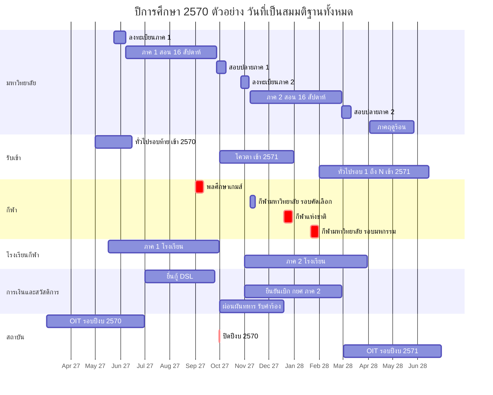
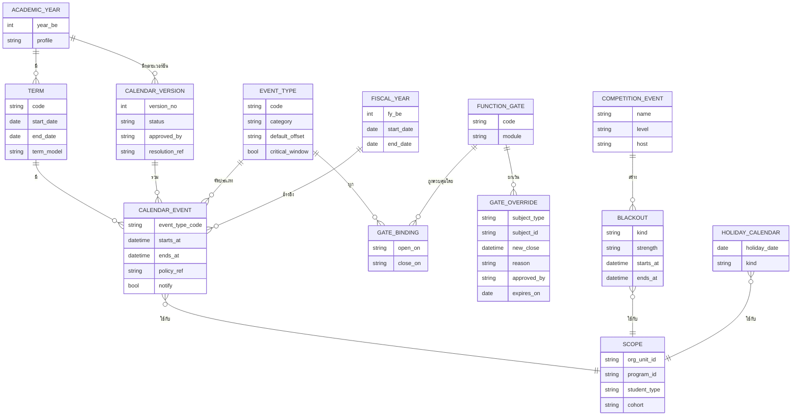
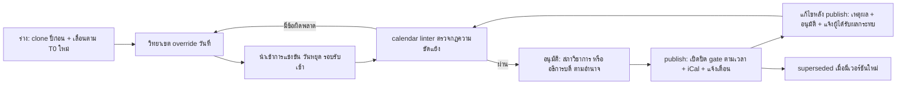

# 03 — ปฏิทินปฏิบัติการรายปี และ Calendar-as-Configuration

> **สถานะ:** v1.1-draft · 28 ต.ค. 2569 (แก้ตาม [00-fix-decisions-v1.1](00-fix-decisions-v1.1.md) D-02, D-03, D-08, D-10; ปิด v1-review ดูหัวข้อ 8) · ผู้เขียน: B · ภาษา: ไทย (ศัพท์เทคนิคเป็นภาษาอังกฤษ)
> **อ่านคู่กับ:** [00-blueprint](00-blueprint.md) · [02-student-journey](02-student-journey.md) (ขั้นตอนของแต่ละเหตุการณ์) · [05-workflows](05-workflows.md) · [06-modules](06-modules.md) (ORG เป็นเจ้าของปฏิทิน, EXM เจ้าของตารางสอบ) · [07-architecture](07-architecture.md) (capacity/SLO) · [09-integrations](09-integrations.md) และ [government-relations](government-relations.md) (ปฏิทินรายงานหน่วยงานรัฐ) · [11-operations](11-operations.md) (change freeze) · [12-roadmap-cost-risk](12-roadmap-cost-risk.md)
> **แหล่งข้อมูลหลัก:** research v2 `academic_calendar_operations.md`, `admissions.md`, `student_services.md`; `government-relations.md` หัวข้อ 5; review `review_functional.md` §2.2, `review_architecture.md` (OPS-04, IC-14)

เล่มนี้มี 3 ส่วน: (1) **ปฏิทินงานรายเดือน** ของปีการศึกษา 2570 (ตัวอย่าง) แยก 5 สายงาน, (2) **ผลต่อระบบ**: ช่วงพีค งานอัตโนมัติ และการแจ้งเตือน, (3) **calendar-as-configuration**: โมเดลข้อมูลที่ทำให้ "วันที่" เป็นตัวเปิด/ปิดฟังก์ชันของทุกโมดูล และการจัดการความขัดแย้งของปฏิทิน

---

## 0. สัญลักษณ์ สมมติฐาน และข้อเท็จจริงที่ใช้ยึด

### 0.1 สัญลักษณ์

- ✅ = มีแหล่งอ้างอิง (ระดับ search snippet ตาม research v2) — วันที่ที่ติด ✅ ส่วนใหญ่เป็นของ **ปี 2569/2570 ที่เกิดแล้วหรือประกาศแล้ว** ใช้เป็นแบบแผน
- 🟡 = **ยังไม่ยืนยัน** [ต้องตรวจสอบ] — รวมถึงวันที่ของปีการศึกษา 2570/ปีงบ 2571 ทุกวันที่คาดจากแบบแผนปีก่อน
- "ตัวอย่างสมมติ" = วันที่ที่เล่มนี้เลือกขึ้นเพื่อสาธิตการตั้งค่า (เช่นวันเปิดภาค) ไม่ใช่ปฏิทินของ มกช.

### 0.2 สมมติฐานโครงปี (อ้างทะเบียน A-xx ในเล่ม 01)

| รหัสในเล่มนี้ | สมมติฐาน | ที่มา | ทะเบียนเล่ม 01 |
|---|---|---|---|
| CAL-A1 | อุดมศึกษา: ภาค 1 ≈ มิ.ย.–ต.ค., ภาค 2 ≈ พ.ย.–มี.ค., ภาคฤดูร้อน ≈ เม.ย.–พ.ค. 🟡 | review_functional §2.2, government-relations หัวข้อ 5 (ยังไม่พบปฏิทินกลาง มกช.; วิทยาเขตอ่างทองมี "ปฏิทินการจัดการศึกษา ภาคเรียนที่ 1/2569" ของตนเอง ✅) | A-35 |
| CAL-A2 | ตัวอย่างสมมติปีการศึกษา 2570: ภาค 1 T0 = จ. 7 มิ.ย. 2570, ภาค 2 T0 = **จ. 8 พ.ย. 2570** (v1.1 เลื่อนจาก 1 พ.ย. เพื่อให้เกรดและการจำแนกสถานภาพภาค 1 เสร็จก่อนเปิดลงทะเบียนภาค 2 — D-08), ฤดูร้อน T0 = จ. 3 เม.ย. 2571; สอนภาคละ 16 สัปดาห์ + สอบปลายภาค 2 สัปดาห์; ส่งเกรด ≤ 7 วันทำการหลังสอบ | เลือกเพื่อสาธิต | — (ตัวอย่างของเล่มนี้) |
| CAL-A3 | โรงเรียนกีฬา (การศึกษาขั้นพื้นฐาน): ภาค 1 ≈ 16 พ.ค.–30 ก.ย., ภาค 2 ≈ 1 พ.ย.–31 มี.ค. (ปี 2569 ✅ จากแหล่งรอง; ⚠️ บางแหล่งระบุเปิด 14 พ.ค. หรือปิดภาค 1 วันที่ 11 ต.ค.) | academic_calendar_operations §5, blueprint 2.7 | A-37 |
| CAL-A4 | ปีงบประมาณ 1 ต.ค.–30 ก.ย. (ปีงบ 2571 = 1 ต.ค. 2570–30 ก.ย. 2571) แยกจากปีการศึกษา ทุกธุรกรรมการเงิน tag ทั้งสองค่า | กฎหมายวิธีการงบประมาณ | A-62 |
| CAL-A5 | แต่ละวิทยาเขตออกปฏิทิน/รอบรับสมัครของตนเองภายใต้ template กลาง (วันที่ override ได้ราย OrgUnit) | blueprint 2.3, admissions §2 | A-36, A-06 |
| CAL-A6 | ระบบใหม่เริ่มใช้จริงกับรอบรับสมัครปีการศึกษา 2572 (R1 ก.ย. 2571 = M18) และภาค 1/2572 (R2 พ.ค. 2572 = M26); R3 พ.ย. 2572 (M32) — ปฏิทิน 2570 ในเล่มนี้เป็นแบบฝึกการตั้งค่าที่จะ clone ไปปีจริง · ถ้าเริ่มสัญญาหลัง ต.ค. 2570 ทุก release เลื่อน 12 เดือนตามรอบรับสมัคร (เล่ม 12 §1.3) · **พลศึกษาเกมส์ ก.ย. 2572 ของ pilot:** ATH eligibility (W-30) + team travel (W-31) และการล้างเงินยืม (W-115 ฝั่ง FIN) อยู่ใน R2 ตาม D-03 จึงใช้ระบบใหม่ได้ทั้งวงจรก่อนปิดปีงบ 30 ก.ย. 2572 (K-23) | blueprint หัวข้อ 7 | A-82, A-84 |

### 0.3 ข้อเท็จจริงที่ใช้ยึด (anchor)

| เหตุการณ์ | วันที่ที่พบ | สถานะ | แหล่ง |
|---|---|---|---|
| ประกาศโควตา ป.ตรี 2570 | กรุงเทพ 22 ก.ย. 2569, ชลบุรี (เรียนดี) 30 ก.ย. 2569 | ✅ | [tnsubkk](https://www.tnsubkk.ac.th/%E0%B8%9B%E0%B8%A3%E0%B8%B0%E0%B8%81%E0%B8%B2%E0%B8%A8%E0%B8%A1%E0%B8%AB%E0%B8%B2%E0%B8%A7%E0%B8%B4%E0%B8%97%E0%B8%A2%E0%B8%B2%E0%B8%A5%E0%B8%B1%E0%B8%A2%E0%B8%81%E0%B8%B2%E0%B8%A3%E0%B8%81-97/), [TNSUCBI](https://www.tnsucbi.ac.th/) |
| รับสมัครโควตา 2569 | 1 ต.ค.–7 พ.ย. 2568 | ✅ | [LINE Today](https://today.line.me/th/v3/article/wJMap0G) |
| ทั่วไปรอบ 5 ชลบุรี | ประกาศ 8 มิ.ย. 2569 รายงานตัว 9 มิ.ย. 2569 | ✅ | [tnsucbi รอบ 5](https://www.tnsucbi.ac.th/%E0%B8%9B%E0%B8%A3%E0%B8%B0%E0%B8%81%E0%B8%B2%E0%B8%A8%E0%B8%A3%E0%B8%B2%E0%B8%A2%E0%B8%8A%E0%B8%B7%E0%B9%88%E0%B8%AD%E0%B8%9C%E0%B8%B9%E0%B9%89%E0%B8%A1%E0%B8%B5%E0%B8%AA%E0%B8%B4%E0%B8%97%E0%B8%98-9/) |
| TCAS70 | รอบ 1 เปิด 15 ส.ค. 2569; TGAT/TPAT สอบ 30 ม.ค.–1 ก.พ. 2570; A-Level 13–15 มี.ค. 2570; รอบ 3 สมัคร 7–11 พ.ค. 2570; รอบ 4 ≈ 29 พ.ค.–15 มิ.ย. 2570 🟡 | ✅/🟡 | [Trueplookpanya](https://www.trueplookpanya.com/tcas/article/detail/97424), [SmartMathPro](https://www.smartmathpro.com/article/tcas70-calendar/) |
| พลศึกษาเกมส์ ครั้งที่ 49 (สุพรรณบุรี, 17 วิทยาเขต) | 1–10 ก.ย. 2569 (⚠️ จำนวนชนิดกีฬา/ผู้เข้าร่วมไม่ตรงกัน: > 3,000 หรือ > 8,000 คน) | ✅ | [TNSU MK](https://www.tnsumk.ac.th/web/index.php/component/content/article/19-news-campus/1128-49-17?Itemid=437), [Dailynews](https://www.dailynews.co.th/news/6157121/) |
| กีฬามหาวิทยาลัยแห่งประเทศไทย | ครั้งที่ 51 รอบคัดเลือกภาคใต้ 8–13 พ.ย. 2568; ครั้งที่ 52 รอบมหกรรม ม.วลัยลักษณ์ 21–30 ม.ค. 2570 | ✅ | [WU CSP](https://csp.wu.ac.th/?p=49343) |
| กีฬาแห่งชาติ ครั้งที่ 50 อุดรธานี | 19–29 ธ.ค. 2569 | ✅ | [Dailynews](https://www.dailynews.co.th/news/6264386/) |
| กีฬาคนพิการแห่งชาติ ครั้งที่ 40 | ปลาย ม.ค. 2570 | ✅ | เดียวกัน |
| พิธีพระราชทานปริญญาบัตร (ผู้จบปีการศึกษา 2567, รวมทุกวิทยาเขต) | 22 มิ.ย. 2569 อิมแพ็ค เมืองทองธานี | ✅ | [Chiang Mai News](https://www.chiangmainews.co.th/news/3956324/) |
| คำร้องขอสำเร็จการศึกษา | ภายใน 30 วันหลังเปิดภาคสุดท้าย (วิทยาเขตมหาสารคาม) | ✅ | [TNSU MK](https://www.tnsumk.ac.th/reg/index.php/services/registrar-services/request-graduation) |
| กยศ. 2569 | Pre-Approve อุดมศึกษา 1 มิ.ย.–13 ก.ค.; ม.ปลาย 16 พ.ค.–13 มิ.ย.; ยื่นกู้ DSL 1 ก.ค.–25 ก.ย.; ยืนยันเบิกภาค 1 ภายใน 31 ต.ค.; ภาค 2 1 พ.ย.–28 ก.พ.; ผู้กู้เก่ายืนยัน 16 พ.ค.–31 ส.ค. | ✅ | [studentloan.or.th](https://www.studentloan.or.th/th/news/1773729176), [ejan.co](https://www.ejan.co/economics/7i05e9bybl9x), [Thairath](https://www.thairath.co.th/news/society/2932312) |
| ITA ปีงบ 2569 | OIT 2 มี.ค.–30 มิ.ย.; IIT ปิด 30 มิ.ย. 17.00; EIT ปิด 30 ก.ย. 17.00 | ✅ | [Mahidol LC timeline](https://lc.mahidol.ac.th/documents/OIT/2026_Timeline.pdf) |
| ข้อมูลนักศึกษาให้ อว. | ข้อมูล ณ 10 มิ.ย. ส่ง 1–31 ส.ค. (เอกสารปี 2566) | ✅ (เก่า) | [catalog.moe.go.th](https://catalog.moe.go.th/dataset/2b63e861-9900-40b4-a679-a6a8f9d965ff/resource/41ef9410-eb88-4a8f-93ec-427825e993ac/download/-.pdf) |
| O-NET | สทศ. รับข้อมูลนักเรียน ส.ค. 2569; ประกาศเลขที่นั่ง ป.6/ม.3 8 ม.ค. 2570 (snippet ไม่ชัด); ผล ป.6/ม.3 ปีก่อน 11–12 มี.ค. 2569 | ✅/🟡 | [Bangkokbiz](https://www.bangkokbiznews.com/news/1240304) |
| ตรวจเลือกทหาร | 1–12 เม.ย. (2569) | ✅ | government-relations [S53] |
| ผ่อนผันทหาร (ตัวอย่าง มศว) | รับคำร้อง 1 ต.ค.–19 ธ.ค. | ✅ | government-relations [S54] |
| โรงเรียนกีฬา: ประกาศรับ/สมัคร/ทดสอบ | ยะลาประกาศ 19 ธ.ค. 2568, ประกาศผู้มีสิทธิ์ทดสอบ 11 ก.พ. 2569; สุพรรณบุรีรับสมัคร 2–31 ม.ค. 2568 | ✅ | [yalasportsschool](https://yalasportsschool.ac.th/), [spbss](https://www.spbss.ac.th/index.php?option=com_content&view=article&id=681&catid=82&Itemid=639) |
| บัณฑิตศึกษา ชลบุรี | ประกาศรับ 2570 วันที่ 1 ต.ค. 2569; รอบ 2569 รับ 10 พ.ย. 2568–27 ก.พ. 2569 | ✅ | [Eduzones](https://www.eduzones.com/2025/11/07/tnsu-8/) |

---

## 1. ภาพรวมปีการศึกษา 2570 (ตัวอย่างสมมติ)

> ทุกแท่งในแผนภาพเป็น 🟡 (คาดจากแบบแผนปี 2569/2570 หรือเป็นตัวอย่างสมมติ CAL-A2) แท่งสีแดง (`crit`) คือเหตุการณ์ที่ชนกับงานวิชาการและต้องจัดการ (หัวข้อ 7)

---

## 2. ปฏิทินงานรายเดือน (พ.ค. 2570 – เม.ย. 2571)

> คอลัมน์ "มหาวิทยาลัย" รวมงานรับเข้า โดยติดป้าย **[เข้า 2570]** = ช่วงท้ายของการรับนักศึกษาที่เข้าปีการศึกษา 2570 และ **[เข้า 2571]** = รอบรับสมัครของปีถัดไปที่เริ่มในปีนี้ · วันที่ของภาคการศึกษาเป็นตัวอย่างสมมติตาม CAL-A2 · WID ตามทะเบียน [05-workflows](05-workflows.md) / `data/workflows.json` (W-01..W-163)

| เดือน | มหาวิทยาลัย (วิชาการ + รับเข้า) | การเงิน / สวัสดิการ | กีฬา | โรงเรียนกีฬา (ม.1–ม.6) | สถาบัน / รายงาน |
|---|---|---|---|---|---|
| **พ.ค. 2570** | [เข้า 2570] ทั่วไปรอบ 4–5 ✅(แบบแผน) และรายงานตัว/onboarding ทยอยตามรอบ (W-44); TCAS70 รอบ 2 ประกาศ/ยืนยัน 3–4 พ.ค. ✅ และรอบ 3 สมัคร 7–11 พ.ค. ✅ (เฉพาะถ้าใช้ adapter) · ภาคฤดูร้อน 2569: สอบ/ส่งเกรด 🟡 · ประกาศตารางเรียน-ตารางสอบภาค 1 (T−4 ≈ 10 พ.ค.) · **ลงทะเบียนภาค 1 ตาม priority slot 24 พ.ค.–6 มิ.ย.** 🟡 · ปฐมนิเทศเริ่มสำหรับผู้รายงานตัวรอบต้น · **ยืนยันสิทธิ์ซ้ำ (reconfirmation) ของผู้ยืนยันรอบต้น 1–15 พ.ค.** (W-163, J-48) · **ลงทะเบียนวิชาฝึกสอนล่วงหน้า ≤ 10 พ.ค.** + roster ประกัน/StaffClearance มีผล 16 พ.ค. (W-156) | กยศ. ผู้กู้เก่ายืนยันเบิก 16 พ.ค.–31 ส.ค. 🟡 · Pre-Approve ม.ปลาย 16 พ.ค.–13 มิ.ย. 🟡 (นักเรียน ม.6 โรงเรียนกีฬาที่จะเข้ามหาวิทยาลัย) · จัดสรรหอภาค 1 · ออกใบแจ้งหนี้ภาค 1 (T−2 สัปดาห์) | คัดตัวทีมวิทยาเขตตาม SelectionPolicy ที่เผยแพร่ ≥ 14 วันก่อน (W-150) 🟡 · ตรวจ PPE ประจำฤดู + concussion baseline (W-130) · ฤดูร้อนจัด: WBGT ก่อนซ้อมกลางแจ้ง (W-153) | **เปิดภาค 1 ≈ 17 พ.ค.** 🟡 (แบบแผน 16 พ.ค. ✅) · รับเข้าหอ, ยืนยัน standing consent รายปี (W-13) · นักเรียนใหม่ ม.1/ม.4 วันแรก | OIT เปิดตอบ/อนุมัติข้อมูล (ถึง 30 มิ.ย.) · ร่าง พ.ร.บ.งบฯ 2571 เข้าสภา 🟡 · เตรียม census 10 มิ.ย. |
| **มิ.ย. 2570** | [เข้า 2570] ทั่วไปรอบ 5–6 **ประกาศและรายงานตัวภายใน 24 ชม.** (แบบแผน 8→9 มิ.ย. ✅); TCAS รอบ 4 ≈ ถึง 15 มิ.ย. 🟡; ปิดรอบ รายงานผู้รับจริง; **cascade_cutoff = T0 + 5 วันทำการ ≈ 14 มิ.ย.** (หลังนี้ไม่เรียกสำรอง, J-49) · ผู้รายงานตัวหลัง 31 พ.ค. เข้า fast-track late-admit (W-148: ลงทะเบียน block ไม่มีค่าปรับ, ATT นับจากวันรายงานตัว, checklist 14 วัน) · **เปิดภาค 1 จ. 7 มิ.ย.** · ลงทะเบียนล่าช้า + เพิ่ม-ลด 7–18 มิ.ย. (W-102, W-50) · ปิด I ของภาค 2/2569 (W-103) · ยื่นขอจบภาค 1: window 7 มิ.ย.–7 ก.ค. (T0+30 ✅) · **พิธีพระราชทานปริญญาบัตร ผู้จบปีการศึกษา 2568 ≈ ปลาย มิ.ย.** 🟡 (แบบแผน 22 มิ.ย. 2569 ✅) + ซ้อมย่อย/ซ้อมใหญ่ | Pre-Approve อุดมศึกษา 1 มิ.ย.–13 ก.ค. 🟡 · **due date ค่าเทอมภาค 1 ≈ 11 มิ.ย.** → batch ยกเลิกผู้ไม่ชำระ ≈ 14 มิ.ย. (J-15; ยกเว้น กยศ./ทุน/ผ่อน/late-admit) · ประกันอุบัติเหตุรอบปี (W-107) · ประกาศทุนภาค 1 | คัดตัว/ซ้อม · โค้ชส่ง roster พลศึกษาเกมส์ฉบับร่าง | **census 10 มิ.ย.** 🟡 (ถ้าใช้ DMC) · ประชุมผู้ปกครองภาค 1 🟡 · O-NET: เตรียมข้อมูลนักเรียน ม.3/ม.6 | **snapshot ข้อมูลนักศึกษา ณ 10 มิ.ย.** 🟡 (ระบุผู้เข้าหลังวันตัดยอดแยก, W-148) · **OIT ปิด / IIT ปิด 30 มิ.ย. 17.00** 🟡 (แบบแผน ✅) · SAR หลักสูตร 🟡 · ส่งข้อมูลนักศึกษาใหม่เข้าฐาน อว. |
| **ก.ค. 2570** | สัปดาห์ 5–8 · ATT เริ่ม flag เสี่ยง มส. (สัปดาห์ 6+) · ส่งรายงานผลรายวิชาภาค 2/2569 (มคอ.5/6 หรือเทียบเท่า ≤ 30 วันหลังสิ้นภาค) 🟡 · ปิด window ขอจบภาค 1 (7 ก.ค.) → pre-audit · [เข้า 2571] เริ่ม config รอบโควตา (W-69) | **ยื่นกู้ DSL 1 ก.ค.–25 ก.ย.** 🟡 · ยืนยันค่าเล่าเรียนจริงใน DSL (W-48) · คัดเลือกทุนภาค 1 (W-07) | **สร้าง CompetitionEvent พลศึกษาเกมส์ + roster ≤ 7 ก.ค.** (≥ 8 สัปดาห์ก่อน, W-114) · เก็บตัว 🟡 | สอบกลางภาค 1 🟡 · รายงานพฤติกรรม/การออกนอกหอรายเดือน | ตรวจประเมิน QA หลักสูตร 🟡 · คำของบ/ชี้แจง กมธ. 🟡 · PMQA/DG readiness 🟡 |
| **ส.ค. 2570** | **สอบกลางภาค 1: 2–6 ส.ค.** 🟡 (หลบ 12 ส.ค.) · ประกาศ "บัญชีผลกระทบ" ลาแข่งพลศึกษาเกมส์ต่อผู้สอน · [เข้า 2571] TCAS71 รอบ 1 เปิด ≈ 15 ส.ค. 🟡 (ถ้าใช้) | **ปิดยืนยันผู้กู้เก่า 31 ส.ค.** 🟡 · ผ่อนผันทหาร: ระบบส่ง reminder ชายที่จะอายุครบ 20 (J-34) · ทุนกองทุนพัฒนาการกีฬาแห่งชาติ (ส.ค.–ก.ย.; ปฐมนิเทศทุน 2568 วันที่ 15 ส.ค. ✅) | ปิดรายชื่อและตรวจสิทธิ์พลศึกษาเกมส์ (W-30) · **อนุมัติลาแข่งยกคณะ ≤ 11 ส.ค.** (≥ 3 สัปดาห์ก่อน) · อนุมัติเงินยืมทริป (W-31) | สทศ. รับข้อมูลนักเรียน O-NET (แบบแผน ส.ค. ✅) | **ส่งข้อมูลหลักสูตร/ผลการเรียนให้ อว. 1–31 ส.ค.** 🟡 · คำของบ 🟡 |
| **ก.ย. 2570** | **พลศึกษาเกมส์ ≈ 1–10 ก.ย. = สัปดาห์ 13–14** (ลาแข่งไม่นับขาด) · **วันสุดท้ายถอน W เลื่อนเป็น 17 ก.ย.** (สัปดาห์ 15 — หลังเกมส์ 1 สัปดาห์, หัวข้อ 7) · ประเมินการสอน 6–24 ก.ย. · **ประกาศ มส. 20 ก.ย.** (W-104) · สอบชดเชยรวมของผู้ไปแข่ง 20–24 ก.ย. (สร้างอัตโนมัติจาก W-114, ไม่ต้องอนุมัติซ้ำ) · **สอบปลายภาค 1: 27 ก.ย.–8 ต.ค.** · [เข้า 2571] **ประกาศโควตา ปลาย ก.ย.** (แบบแผน 22/30 ก.ย. ✅) | **ปิดยื่นกู้ DSL 25 ก.ย.** 🟡 · **ล้างเงินยืมทริปพลศึกษาเกมส์ก่อนปิดปีงบ** (W-115) · **cut-off ปีงบ 2570 วันที่ 30 ก.ย.** (W-116) · ออกใบแจ้งหนี้ภาค 2 ล่วงหน้า (ระบุปีงบ 2571) | **พลศึกษาเกมส์ ครั้งที่ 50 ≈ 1–10 ก.ย.** 🟡 (ครั้งที่ 49 1–10 ก.ย. 2569 ✅) · บันทึกผล/เหรียญ → ข่าว | **ปิดภาค 1 ≈ 30 ก.ย.** 🟡 (⚠️ หรือ 11 ต.ค.) · ออก ปพ.6 ภาค 1 · ผู้ปกครองรับเด็กกลับบ้านตามตารางปิดหอ | **EIT ปิด 30 ก.ย. 17.00** 🟡 · **ปิดปีงบ: รายงานผล, ปิดบัญชี GFMIS** 🟡 · ภาระซ้อน 3 เรื่องในวันเดียว (หัวข้อ 7) |
| **ต.ค. 2570** | สอบปลายภาค 1 ถึง 8 ต.ค. (13 ต.ค. วันหยุด) · **ส่งเกรดภาค 1 ≤ 20 ต.ค.** (7 วันทำการหลังสอบ) → อนุมัติ/เผยแพร่ ≤ 22 ต.ค. · **จำแนกสถานภาพ (dry-run 22 ต.ค., sign-off + แจ้งรอพินิจ/พ้นสภาพพร้อมสิทธิ์อุทธรณ์ 26 ต.ค.)** ก่อนเปิดลงทะเบียน (W-57, W-11; 25 ต.ค. วันหยุดชดเชย 🟡) · **ลงทะเบียนภาค 2: 27 ต.ค.–5 พ.ย.** ด้วยเกรดจริงและเพดานหน่วยกิตรอพินิจ; squad ที่แข่งต้น พ.ย. ลง slot แรก 27 ต.ค.; ผู้ได้รับคำสั่งพ้นสภาพลงทะเบียนได้ในสถานะ ENROLLED_PENDING_APPEAL ระหว่างระยะอุทธรณ์ · [เข้า 2571] **รับสมัครโควตา ≈ 1 ต.ค.–7 พ.ย.** 🟡 (แบบแผน ✅) · บัณฑิตศึกษาประกาศรับ 2571 (แบบแผน 1 ต.ค. ✅) | **ขึ้นปีงบ 2571 วันที่ 1 ต.ค.** — rollover เลขใบเสร็จ/fund code (J-31) · **กยศ. ทำสัญญา + ยืนยันเบิกภาค 1 ภายใน 31 ต.ค.** 🟡 · **ผ่อนผันทหารเปิดรับคำร้อง 1 ต.ค.–19 ธ.ค.** 🟡 · ต่อสัญญาหอภาค 2 · ออกใบแจ้งหนี้ภาค 2 ตามผลลงทะเบียน | คัดเลือกทีมมหาวิทยาลัย (W-150) 🟡 · ตรวจสิทธิ์กีฬามหาวิทยาลัยรอบคัดเลือก 2 รอบ: pre-check ชั่วคราว ≈ 27 ก.ย. และ **final check 28 ต.ค.** หลังเกรด/สถานภาพและการลงทะเบียน slot แรกของ squad (J-36) | ปิดภาค (≈ 1–31 ต.ค.) 🟡 · ซ่อมเสริม/สอบแก้ 0/ร/มส ภาค 1 (W-94) | แผนปฏิบัติราชการ/แผนจัดซื้อปีงบ 2571 🟡 · เตรียม OIT รอบใหม่ 🟡 |
| **พ.ย. 2570** | **เปิดภาค 2 จ. 8 พ.ย.** · ลงทะเบียนล่าช้า + เพิ่ม-ลด 8–19 พ.ย. · ปิด I ภาค 1 (เกรดที่เปลี่ยน → re-validation W-162) · อุทธรณ์เกรด/คำสั่งพ้นสภาพภาค 1 (W-16, W-17; ระหว่างอุทธรณ์เรียน/สอบได้) · **ยื่นขอจบภาค 2: 8 พ.ย.–8 ธ.ค.** · สภาอนุมัติผู้จบภาค 1 (พ.ย.–ธ.ค.) 🟡 · [เข้า 2571] ปิดรับโควตา ≈ 7 พ.ย. → ตรวจเอกสาร/ผลงาน (QS-4) → ประกาศผู้มีสิทธิ์สอบ; TCAS71 สมัคร TGAT/TPAT ≈ ต้น พ.ย. 🟡; บัณฑิตศึกษาเปิดรับ ≈ 10 พ.ย. 🟡 | **กยศ. ยืนยันเบิกภาค 2 เปิด 1 พ.ย.** 🟡 · **due date ค่าเทอมภาค 2 ≈ 12 พ.ย.** → batch ยกเลิกผู้ไม่ชำระ ≈ 15 พ.ย. (J-15) · ประกาศทุนภาค 2 | **กีฬามหาวิทยาลัยแห่งประเทศไทย รอบคัดเลือกภูมิภาค ≈ 8–13 พ.ย.** 🟡 (แบบแผน ✅) — สัปดาห์ที่ 1 ทับ add/drop (squad ลงทะเบียนแล้วตั้งแต่ 27 ต.ค.; GateOverride add/drop) | **เปิดภาค 2 ≈ 1 พ.ย.** 🟡 · **census 10 พ.ย.** 🟡 | **snapshot ณ 10 พ.ย.** 🟡 · ส่งข้อมูลภาค 2 เข้าฐาน อว. (ม.ค.–มี.ค. 🟡) |
| **ธ.ค. 2570** | [เข้า 2571] **สอบทักษะ/สมรรถภาพ/สัมภาษณ์รอบโควตา** (ต้นถึงกลาง ธ.ค., หลบกีฬาแห่งชาติ) → รวมคะแนน/moderation (W-76) → ประกาศผลโควตา ≤ 17 ธ.ค. 🟡 → **ขอทบทวนผล ≤ 3 วันทำการ, ตัดสิน ≤ 5 วันทำการ (W-18) ให้เสร็จก่อนเปิด clearing** · **สอบกลางภาค 2 ไม่วางในสัปดาห์ 7–8** (ทับกีฬาแห่งชาติ + ปีใหม่; 3 ม.ค. 2571 วันหยุดชดเชย 🟡) → เลื่อนเป็น 10–14 ม.ค. 2571 | **ส่งบัญชีผ่อนผันทหารให้สัสดี (ปิดรับ ≈ 19 ธ.ค.)** 🟡 · ภาษี: เตรียม ภ.ง.ด.1ก | **กีฬาแห่งชาติ ≈ 19–29 ธ.ค.** 🟡 (ครั้งที่ 50 19–29 ธ.ค. 2569 ✅) — โค้ช/สนามไม่ว่างสำหรับสอบทักษะช่วงนี้ | สอบกลางภาค 2 🟡 · **ประกาศรับนักเรียน ม.1/ม.4 ปี 2571** (แบบแผน 19 ธ.ค. ✅) | เริ่มคำของบ 🟡 · รายงานไตรมาส 1 ปีงบ 2571 🟡 |
| **ม.ค. 2571** | **สอบกลางภาค 2: 10–14 ม.ค.** 🟡 · [เข้า 2571] **ยืนยันสิทธิ์โควตา (ยืนยันได้ที่เดียวทั้ง มกช. ตรวจ ณ เวลายืนยัน)** (W-74) ≈ 5–12 ม.ค. (sub-bucket ที่ยังมีอุทธรณ์ค้างใช้ appeal_hold); เรียกสำรอง ≤ 15 นาทีหลังเหตุ; ชำระค่ายืนยันสิทธิ์ · TCAS71 สอบ TGAT/TPAT ≈ ปลาย ม.ค. 🟡 | — | **กีฬามหาวิทยาลัยแห่งประเทศไทย รอบมหกรรม ≈ 21–30 ม.ค.** 🟡 (ครั้งที่ 52 21–30 ม.ค. 2570 ✅) = สัปดาห์ 11–12 ภาค 2 · กีฬาคนพิการแห่งชาติ ≈ ปลาย ม.ค. 🟡 (ตรวจ ParaClassification W-157) | **รับสมัคร ม.1/ม.4 ปี 2571** (แบบแผน ม.ค. ✅) · ประกาศเลขที่นั่ง O-NET 🟡 | ITA รอบใหม่: ตั้งค่าเจ้าของข้อมูล OIT (J-30) 🟡 |
| **ก.พ. 2571** | **วันสุดท้ายถอน W ภาค 2 ≈ 11 ก.พ.** (สัปดาห์ 14, หลังกีฬามหาวิทยาลัย ≥ 1 สัปดาห์) · ประเมินการสอน 7–25 ก.พ. · **ประกาศ มส. 21 ก.พ.** · **สอบปลายภาค 2: 28 ก.พ.–10 มี.ค.** · [เข้า 2571] **ทั่วไปรอบ 1–2** (แบบแผน ก.พ.–3 มี.ค. ✅) · บัณฑิตศึกษาปิดรับ ≈ 27 ก.พ. 🟡 | **ปิดยืนยันเบิก กยศ. ภาค 2 ≈ 28 ก.พ.** 🟡 (2571 เป็นปีอธิกสุรทิน ตรวจวันจริง) · ภ.ง.ด.1ก / 50 ทวิ 🟡 | ฤดูร้อนเริ่ม: blackout `heat` (soft) มี.ค.–พ.ค. สำหรับสอบทักษะ/ซ้อมกลางแจ้ง 11:00–15:00 (W-153) | O-NET ม.6 / ม.3 🟡 · **ประกาศผู้มีสิทธิ์ทดสอบ + ทดสอบสมรรถภาพ/ทักษะ ม.1/ม.4** (แบบแผน 11 ก.พ. ✅) · สอบปลายภาค 2 | รายงานผล ITA 5 เดือนแรก 🟡 |
| **มี.ค. 2571** | สอบปลายภาค 2 ถึง 10 มี.ค. · **ส่งเกรดภาค 2 ≤ 21 มี.ค.** → เผยแพร่ ≤ 23 มี.ค. · **standing sign-off 24 มี.ค.** · **ลงทะเบียนภาคฤดูร้อน 27–31 มี.ค.** (หลัง standing) · [เข้า 2571] ทั่วไปรอบ 2–3; TCAS71 รอบ 1 ประกาศ/ยืนยัน ≈ มี.ค. 🟡 | ใบแจ้งหนี้ฤดูร้อน (ต่อหน่วยกิต) | — | **ปิดภาค 2 ≈ 31 มี.ค.** 🟡 · **อนุมัติจบ ม.3/ม.6 + ออก ปพ.1/ปพ.2/ปพ.3** (W-88) · เลื่อนชั้น (W-94) · ผล O-NET 🟡 · ประกาศผลรับเข้า ม.1/ม.4 + มอบตัว 🟡 | **OIT เปิดตอบ/อนุมัติข้อมูล ≈ 2 มี.ค.** 🟡 (แบบแผน ✅) · EIT เริ่มเก็บ 🟡 |
| **เม.ย. 2571** | **ภาคฤดูร้อน จ. 3 เม.ย.** (สงกรานต์ 13–15 เม.ย.) · อุทธรณ์เกรด/คำสั่งพ้นสภาพภาค 2 · ยื่นขอจบภาคฤดูร้อน 3 เม.ย.–3 พ.ค. · สภาอนุมัติผู้จบภาค 2 (เม.ย.–พ.ค.) 🟡 · ประกาศรายชื่อผู้มีสิทธิ์เข้ารับพระราชทานปริญญาบัตร (ผู้จบปีการศึกษา 2569) 🟡 · [เข้า 2571] ทั่วไปรอบ 3 (ข้อเขียน+สัมภาษณ์ ✅แบบแผน) | **ตรวจเลือกทหาร ≈ 1–12 เม.ย.** 🟡 (แบบแผน ✅) — นักศึกษาชายที่ต้องแสดงตนขอเลื่อนสอบฤดูร้อน · เตือนผู้กู้ที่ชั่วโมงจิตอาสา < 36 ก่อนรอบยืนยันกู้ปีถัดไป (J-33) | พักฤดู/ฟื้นฟู 🟡 | ปิดภาค/ซ่อมเสริม · มอบตัว + สัญญาหอนักเรียนใหม่ 🟡 | ภาษีรายเดือนต่อเนื่อง 🟡 · OIT ต่อเนื่อง |

> **รอบปีถัดไปที่ต่อเนื่อง:** พ.ค.–มิ.ย. 2571 = [เข้า 2571] ทั่วไปรอบ 4–6 + รายงานตัว, เปิดภาค 1/2571, พิธีพระราชทานปริญญาบัตรของผู้จบปีการศึกษา 2569 ≈ มิ.ย. 2571 🟡 (ห่างจากจบประมาณ 1 ปีตามแบบแผน ✅)

---

## 3. ช่วงพีคและผลต่อโหลดของระบบ

### 3.1 ช่วงพีค 4 ช่วงตาม blueprint หัวข้อ 8 (แจกแจงเหตุ)

| พีค | ช่วง | อะไรซ้อนกัน | ลักษณะโหลด | ผู้ใช้ที่ได้รับผลกระทบ |
|---|---|---|---|---|
| **P1 เปิดปีการศึกษา** | ปลาย พ.ค.–มิ.ย. | ลงทะเบียนภาค 1 ทุกชั้นปี × 17 วิทยาเขต + นักศึกษาใหม่ onboarding + ทั่วไปรอบท้าย (รายงานตัว 24 ชม.) + เปิดภาคโรงเรียนกีฬา + due date ค่าเทอม + Pre-Approve กยศ. | write-heavy เป็น burst ในชั่วโมงแรกของ slot; payment callback | นักศึกษา, ผู้สมัคร, ผู้ปกครอง, ทะเบียน, การเงิน |
| **P2 ปลายภาค 1 / ต้นภาค 2** | ต.ค.–พ.ย. | ส่งเกรด + ประกาศผล + จำแนกสถานภาพ + ลงทะเบียนภาค 2 + ขึ้นปีงบ 1 ต.ค. + กยศ. 31 ต.ค. + ผ่อนผันทหาร + **รับสมัครโควตา [เข้าปีถัดไป]** + กีฬามหาวิทยาลัยรอบคัดเลือก | write-heavy ฝั่ง finance + read-heavy วันประกาศผล + public burst ผู้สมัคร | ทุกกลุ่ม |
| **P3 ปลายภาค 2** | ก.พ.–มี.ค. | สอบ/เกรดภาค 2 + จบ ม.3/ม.6 (ปพ.) + O-NET + กยศ. 28 ก.พ. + ทั่วไปรอบ 1–3 + รับเข้าโรงเรียนกีฬา + OIT เปิด | ผสม | นักศึกษา, โรงเรียนกีฬา, ผู้สมัคร |
| **P4 มิ.ย. (ซ้อนบน P1)** | มิ.ย. | รับปริญญา (cohort ข้ามวิทยาเขต) + snapshot 10 มิ.ย. + ปิด OIT/IIT 30 มิ.ย. + รอบรับเข้าสุดท้าย | moderate แต่ภาระคนทำงานสูงมาก | ทะเบียน, กองแผน, ITA |

### 3.2 ประมาณการโหลดเบื้องต้น (แสดงสูตร — เล่ม 07 เป็นเจ้าของตัวเลข capacity สุดท้าย)

ฐาน (blueprint 8): นักศึกษาออกแบบรองรับ 15,000 · นักเรียนโรงเรียนกีฬา 4,450 · ผู้ปกครองผู้เยาว์ ~8,000 · ผู้สมัคร 30,000 ใบ/ปี (สมมติฐาน) · บุคลากร 2,700 สัดส่วนทั้งหมดด้านล่างเป็นสมมติฐาน 🟡

| เหตุการณ์ | สูตร | ผลลัพธ์โดยประมาณ | ผลต่อการออกแบบ |
|---|---|---|---|
| เปิด slot ลงทะเบียน | (ก) ค่าเริ่มต้นเหลื่อมเวลา (A-32): ผู้มีสิทธิ์ต่อ slot ≈ 15,000 / 4 ชั้นปี = 3,750; มาใน 15 นาทีแรก 40% = 1,500 คน × ~15 request / 900 s · (ข) worst case ของ A-32 (ทุกวิทยาเขตพร้อมกัน): 40% ของ 15,000 = 6,000 คนใน 15 นาที × 15 request / 900 s | (ก) ≈ 25 request/s เฉลี่ย (พีคช่วงสั้น 3–4 เท่า ≈ 100 request/s) · (ข) ≈ 100 request/s เฉลี่ย (พีค ≈ 300–400 request/s) + token ใน waiting room หลักพัน | waiting room ปล่อยเข้าตามอัตราที่ transaction รับได้; load test ใช้กรณี (ข); นโยบายเหลื่อมเวลาลดโหลดได้ ~4 เท่า (Q-64) |
| วันประกาศเกรด | 15,000 + 4,450 + ผู้ปกครองที่มีสิทธิ์ ~8,000 = 27,450 คน; 50% เข้าในชั่วโมงแรก; 5 นาทีแรก 20% ของชั่วโมง | ≈ 2,700 login ใน 5 นาที (≈ 9 login/s) | ประกาศเป็น snapshot อ่านอย่างเดียว, แจ้งเตือนแบบ staggered ราย OrgUnit |
| ปิดรับสมัคร / ประกาศผลคัดเลือก | A-23: ใบสมัคร ป.ตรี ~23,000 + โรงเรียนกีฬา ~6,000 + บัณฑิต ~1,000 ต่อปี; A-34: ผู้ใช้พร้อมกันช่วงปิดรับ ~3,000 และวันประกาศผล 30,000 คนใน 30 นาที | ≈ 17 ผู้เข้าดู/s เฉลี่ยในวันประกาศผล; ปิดรับ ~3,000 sessions พร้อมกัน | แยก admission portal จาก core; หน้าผลเป็น static/CDN; reconcile ค่าสมัครถูกต้อง |
| ประกาศผลโควตา / เปิด clearing | ผู้ผ่าน + สำรองทุกวิทยาเขต ~6,000 🟡 + ผู้ปกครอง; ยืนยันพร้อมกันในชั่วโมงแรก 30% | ≈ 1,800 การยืนยันใน 1 ชม. | unique constraint "confirmed 1 ที่" ต้องทนการกดพร้อมกันจากหลายเครื่อง; cascade สำรองต่อเนื่องเป็นนาที |
| ทั่วไปรอบสุดท้าย (ประกาศ → รายงานตัว 24 ชม.) | ปริมาณน้อย (หลักร้อยต่อวิทยาเขต) | latency ของ pipeline: อนุมัติ → ประกาศ → ใบแจ้งชำระ → รหัสนักศึกษา ต้อง < 2 ชม. | งานนี้วัดด้วย "เวลา" ไม่ใช่ throughput; ต้องมี counter fallback |
| due date ค่าเทอม | 15,000 ใบแจ้งหนี้; 30% ชำระใน 2 วันสุดท้าย | ≈ 4,500 callback | idempotent callback + statement reconcile รายวัน; ห้ามยกเลิกรายวิชาก่อน reconcile เสร็จ |
| เช็กชื่อเข้าสอบปลายภาค (คาบ 09:00) | นักศึกษาสอบพร้อมกัน ~8,000 สแกนใน 15 นาที | ≈ 9 scan/s | offline-first ใน tablet ของกรรมการคุมสอบ |
| ลาแข่งยกคณะพลศึกษาเกมส์ | ผู้เข้าร่วม 3,000–8,000 (แหล่งไม่ตรงกัน ⚠️) × ~6 วิชา × ~4 คาบที่ทับ | 72,000–192,000 attendance marks + makeup requests | batch job กลางคืน ไม่ใช่ real-time |
| รับปริญญา | ผู้จบ/ปี ≈ 15,000/4 ≈ 3,000–3,750 🟡; เช็กอินวันซ้อมใน 1 ชม. | ≈ 1 scan/s | ปานกลาง; ภาระอยู่ที่การจัดลำดับข้ามวิทยาเขต |

### 3.3 ผลต่อการปฏิบัติการ

1. **SLO ช่วงวิกฤต 99.95%** (blueprint 8) ผูกกับ window ในปฏิทิน: slot ลงทะเบียน, 48 ชม. ก่อน due date, วันประกาศเกรด/ผลคัดเลือก — ช่วงนอกนี้ใช้ 99.9%
2. **Change freeze แบบ ring ราย OrgUnit** (แก้ OPS-04): freeze อัตโนมัติจาก CalendarEvent ประเภท `critical_window` ของ OrgUnit นั้น และ freeze ทั้งระบบเฉพาะเมื่อ ≥ 50% ของ OrgUnit อยู่ใน critical window พร้อมกัน (เช่น 1 ต.ค., วันแรกของภาค) — รายละเอียดใน [11-operations](11-operations.md)
3. **go-live/migration ทำได้เฉพาะช่วงที่ OrgUnit ที่ go-live ไม่มี `critical_window`** (เช่น หลังปิด add/drop หรือระหว่าง standing sign-off กับเปิด slot ไม่ได้ — ต้องเป็นช่วงว่าง) ตาม blueprint 7 ที่ให้ go-live ที่รอยต่อภาค; วันที่ release และการปรับ freeze rule สำหรับ R3 (พ.ย.) เป็นของเล่ม 11/12 (D-07) — เล่มนี้ให้เพียงข้อมูล critical window
4. **กำลังคน**: P2 และ P4 ภาระคนทำงานสูงกว่าภาระระบบ → ระบบต้องลดงานมือ (batch dry-run, digest แทนอีเมลรายรายการ, dashboard deadline compliance ต่อวิทยาเขต)

---

## 4. งานอัตโนมัติตามกำหนด (scheduled jobs)

ทุกงานอ่าน trigger จาก **CalendarEvent** (ไม่ hard-code วันที่) ใช้ PostgreSQL-backed job queue (blueprint 9.2), รองรับ dry-run, idempotent และบันทึก audit วันที่ในคอลัมน์ "ตัวอย่าง 2570" เป็นสมมติตาม CAL-A2

| รหัส | งาน | Trigger (สัมพัทธ์กับ event) | ตัวอย่าง 2570 | โมดูล | ผลลัพธ์ / ข้อยกเว้น | WID |
|---|---|---|---|---|---|---|
| J-01 | เปิด/ปิด function gate ตาม event | start/end ของทุก CalendarEvent ที่ผูก gate | ต่อเนื่อง | ORG | ประเมิน override รายบุคคล/กลุ่มก่อนปิด | W-117 |
| J-02 | แจ้งเตือนก่อนเปิด/ปิด window | T−1 วัน, T−1 ชม. ของ event ที่ตั้ง `notify=true` | ต่อเนื่อง | NOTI | quiet hours 21:00–07:00 🟡 ยกเว้นเร่งด่วน | — |
| J-03 | เปิด/ปิดรับสมัครรอบ; เตือนใบสมัครค้างชำระ | round.open / round.close − 2 วัน, − 1 วัน | 1 ต.ค., 5–6 พ.ย. 2570 | ADM | — | W-69, W-41, W-81 |
| J-04 | offer หมดเวลา → auto-waive → ปล่อยที่นั่ง → เรียกสำรอง (**กติกาเวลาเดียว: คืนที่นั่ง ≤ 15 นาทีหลังเหตุ**, ส่ง offer ใหม่ 07:00–20:00) | ทุก 5 นาทีระหว่าง clearing window จนถึง cascade_cutoff | ม.ค. 2571 | ADM | grace รายบุคคลที่อนุมัติแล้วไม่ถูก waive; ข้าม sub-bucket ที่มี appeal_hold | W-74, W-18 |
| J-05 | sync สถานะ TCAS (ถ้าเปิด adapter) | ทุกชั่วโมงในช่วงยืนยัน/สละของ TCAS | ตามปฏิทิน ทปอ. | ADM | ไม่รันถ้า adapter ปิด | W-73 |
| J-06 | ยกที่นั่งคงเหลือไปรอบถัดไป | round.confirm_close | ปลายแต่ละรอบทั่วไป | ADM | เจ้าหน้าที่ปรับเพิ่ม/ลดได้ก่อนเปิดรอบ | W-69 |
| J-07 | ตรวจผู้ไม่รายงานตัว → เริ่มนับ 7 วันแจ้งเหตุ → สละสิทธิ์ → ที่นั่งเข้า J-04 (ถ้ายังไม่พ้น cascade_cutoff) | reporting.deadline; +7 วัน | มิ.ย. 2570 | REC | ผู้ที่ยื่นแจ้งเหตุแล้วหยุดนับ | W-44, W-78, W-74 |
| J-08 | เตือนรายการ onboarding ค้าง; retry provisioning IT | ทุกวันในช่วงรายงานตัว | พ.ค.–มิ.ย. | REC, IAM | — | W-44 |
| J-09 | ติดตามผลตรวจวุฒิเดิม | ทุกสัปดาห์ จนถึง term1.end | มิ.ย.–ต.ค. | REC | ครบกำหนดยังไม่ตอบ → escalate | W-134 |
| J-10 | สร้างร่างแผนเปิดรายวิชา | T0 − 8 สัปดาห์ | 12 เม.ย. / 13 ก.ย. 2570 | REG | — | W-100 |
| J-11 | เปิด priority slot ลงทะเบียน (gate: standing sign-off แล้ว, L-4) | registration.slot[n].start | 24 พ.ค.–6 มิ.ย.; 27 ต.ค.–5 พ.ย. | REG | slot แรกสำหรับ squad ที่แข่งต้นภาค; ปี 1 ภาค 1 = block enrolment | W-49 |
| J-12 | waitlist auto-offer | ต่อเนื่องจนถึง add_drop.end | ถึง 18 มิ.ย. / 19 พ.ย. | REG | offer หมดอายุใน N ชม. | W-50 |
| J-13 | ออกใบแจ้งหนี้ + เตือน T−7/T−3/T−1 | invoice.issue (T0 − 2 สัปดาห์); payment.due | 24 พ.ค.; due 11 มิ.ย. | FIN | ผู้ปกครองได้ลิงก์ถ้ามี consent | W-51 |
| J-14 | คำนวณค่าปรับลงทะเบียนล่าช้า | ทุกวัน 00:05 ใน late_registration window | 7–18 มิ.ย. | FIN | `FinePolicy` รายวัน/เหมา, cap, นับวันหยุดหรือไม่ | W-102 |
| J-15 | ยกเลิกรายวิชาผู้ไม่ชำระ | payment.due + grace | ≈ 14 มิ.ย. / 15 พ.ย. | FIN, REG | exclusion list: กยศ., ทุน, แผนผ่อน, late-admit ที่ยังไม่ถึง due date ของตน (W-148), ENROLLED_PENDING_APPEAL ที่มีผ่อนผัน; **ต้องมี dry-run + sign-off ทะเบียน** | W-105 |
| J-16 | นำเข้า statement + reconcile | ทุกวัน (และทุกชั่วโมงในช่วง due) | ต่อเนื่อง | FIN | รายการไม่จับคู่ → คิวเจ้าหน้าที่ | W-51 |
| J-17 | ตรวจกลุ่มเรียนต่ำกว่าเกณฑ์ | add_drop.end | 18 มิ.ย. / 19 พ.ย. | REG | เสนอ `head` ไม่ปิดเอง | W-101 |
| J-18 | คำนวณเวลาเรียน + flag เสี่ยง มส. 10/15/20% | ทุกคืน ตลอดภาค | — | ATT | ลาที่อนุมัติไม่นับขาด | W-52 |
| J-19 | สร้างรายชื่อ มส. และล็อก | final_exam.start − 7 วัน | 20 ก.ย. / 21 ก.พ. | ATT, EXM | ผู้สอน override พร้อมเหตุผล | W-104 |
| J-20 | ตรวจตารางสอบชน blackout/วันหยุด | ทุกครั้งที่ CompetitionEvent หรือ Holiday เปลี่ยน + ก่อน publish ตารางสอบ | — | EXM | สร้าง conflict report ให้ทะเบียน | W-117, W-54 |
| J-21 | จัด roster กรรมการคุมสอบ + เตือน 1 วันก่อน | final_exam.start − 14 วัน; ทุกวันสอบ − 1 | 13 ก.ย. | EXM | กระจายภาระเป็นธรรม | W-54 |
| J-22 | เปิด/ปิดประเมินการสอน + ตั้ง gate ดูเกรด | teaching_eval.start/end | 6–24 ก.ย. | ENG, ASM | — | W-56 |
| J-23 | เตือนส่งเกรด T−3/T−1 และ escalate หลังเลยกำหนด | grade_submission.end | ≤ 20 ต.ค. / 21 มี.ค. | ASM | escalate ไป `head` → `dean` | W-01 |
| J-24 | แปลง I → F/U | incomplete_resolution.end | ต้นภาคถัดไป + N สัปดาห์ 🟡 | ASM | — | W-103 |
| J-25 | คำนวณ GPA/standing (dry-run ทันที, sign-off ก่อนเปิด slot ≥ 1 วันทำการ) | grade_publication | 22→26 ต.ค. / 23→24 มี.ค. | REC | dry-run + sign-off; คำสั่งพ้นสภาพยังต้องลงนาม; ระยะอุทธรณ์ = ENROLLED_PENDING_APPEAL | W-57, W-11 |
| J-26 | ตรวจผู้ไม่ลงทะเบียนและไม่รักษาสภาพ; ลาพักใกล้ครบ | add_drop.end; leave.end − 30 วัน | 18 มิ.ย. | REC | แจ้งนักศึกษา + อาจารย์ที่ปรึกษา | W-10 |
| J-27 | pre-audit ผู้คาดว่าจะจบ + เปิด window ขอจบ (T0 → T0+30) | term.start ของภาคก่อนสุดท้าย; term.start | 7 มิ.ย.–7 ก.ค. | GRD | เตือน T−7/T−1 ก่อนปิด window | W-06 |
| J-28 | digest สถานะ clearance ถึงผู้ขอจบ | ทุกสัปดาห์จนถึงมติสภา | — | GRD | — | W-06 |
| J-29 | **census snapshot** มหาวิทยาลัยและโรงเรียนกีฬา | 10 มิ.ย. 23:59 / 10 พ.ย. 23:59 🟡 | 10 มิ.ย., 10 พ.ย. | RPT | immutable snapshot + hash | W-35 |
| J-30 | เตือนภาระรายงานหน่วยงานรัฐ T−30/T−7/T−1 | `RegulatoryObligation.due` | OIT 30 มิ.ย., EIT 30 ก.ย., อว. 31 ส.ค. | RPT | dashboard ต่อวิทยาเขต | W-35, W-136 |
| J-31 | **rollover ปีงบ** (ชุดเลขใบเสร็จใหม่, fund code, ตัดยอด) | fiscal_year.start 00:00 | 1 ต.ค. 2570 | FIN | counter ปิดก่อน 23:30; ธุรกรรมคร่อมเวลาใช้ timestamp | W-116 |
| J-32 | รายชื่อผู้กู้ยังไม่ยืนยันเบิก | loan.confirm_deadline − 14/−7/−1 | 31 ต.ค., 28 ก.พ. | SCH | — | W-48, W-119 |
| J-33 | ชั่วโมงจิตอาสา < 36 ก่อนรอบยืนยันกู้ | loan.renewal_open − 30 วัน | ≈ 16 เม.ย. 🟡 | AFF | — | W-60, W-119 |
| J-34 | ผ่อนผันทหาร: หาชายที่จะอายุ 20 ปีหน้า; เปิดรอบยื่น; เตือนแสดงตน สด.35 | 1 ส.ค.; military.open; ก่อน 1 เม.ย. | 1 ส.ค., 1 ต.ค., 15 มี.ค. | AFF | — | W-59 |
| J-35 | CompetitionEvent สร้าง/เปลี่ยน → วิเคราะห์ผลกระทบ + bulk leave + makeup exam | on change | ก.ค.–ก.ย. (พลศึกษาเกมส์) | ATH | ถ้าเลื่อน/ยกเลิก → ปรับย้อนทั้งชุด | W-114 |
| J-36 | ตรวจสิทธิ์นักกีฬา 2 รอบ: (1) pre-check "ชั่วคราว" ด้วยข้อมูลภาคปัจจุบัน (2) **final check** หลัง `asm.GradesPublished` + standing sign-off + การลงทะเบียน slot แรกของ squad | (1) roster.deadline − 6 สัปดาห์ (2) หลัง squad ลงทะเบียน และก่อน roster.deadline | (1) 27 ก.ย. (2) 28 ต.ค. (กีฬามหาวิทยาลัยคัดเลือก 8–13 พ.ย.) | ATH | แจ้งโค้ช + `advisor.dc_tutor`; ผลรอบ 1 ใช้ส่งรายชื่อไม่ได้ | W-30 |
| J-37 | เตือนล้างเงินยืม; escalate ค้าง; **บังคับก่อนปิดปีงบ** | trip.end + N วัน; fiscal_year.end − 14 วัน | 16 ก.ย. | FIN | — | W-115 |
| J-38 | ตม.30 (24 ชม.) และรายงาน 90 วัน | check-in ผู้พักต่างชาติ; ทุก 90 วัน | — | HOU, NOTI | — | W-38 |
| J-39 | บิลค่าน้ำไฟรายเดือน; เชิญต่อสัญญาหอ | ทุกต้นเดือน; term.end − 4 สัปดาห์ | ต.ค., มี.ค. | HOU | — | W-46, W-147 |
| J-40 | โรงเรียนกีฬา: แจ้งขาดเรียนรายวัน, digest รายเดือน, exeat เกินเวลา | 16:00 ทุกวัน; สิ้นเดือน; real-time | — | SSC, HOU | ไม่แจ้งผู้ปกครองที่มี ContactRestriction | W-13 |
| J-41 | โรงเรียนกีฬา: ออก ปพ.6 ปลายภาค; ปพ.1/2/3 หลังอนุมัติจบ | school_term.end; graduation_basic_ed.approved | 30 ก.ย., มี.ค. | SSC, DOC | — | W-87, W-88 |
| J-42 | StaffClearance ใกล้หมดอายุ | expiry − 30 วัน | — | SAFE | หมดอายุ → ถอดสิทธิ์ทำงานกับเด็กอัตโนมัติ | W-23 |
| J-43 | สถานะเอกสารหมดอายุ (ใบรับรอง 60 วัน ✅) | valid_until | — | DOC | verify page แสดง "หมดอายุ" | W-58 |
| J-44 | รับปริญญา: เปิดขึ้นทะเบียนบัณฑิต, เตือนซ้อม | ceremony.registration_open; rehearsal − 3/−1 วัน | เม.ย.–มิ.ย. | GRD | — | W-64, W-118 |
| J-45 | publish ปฏิทิน → สร้าง iCal feed ใหม่ + แจ้งผู้ติดตาม | calendar.published / amended | — | ORG, ENG | แจ้งเฉพาะผู้ที่ event เปลี่ยนกระทบ | W-117 |
| J-46 | เปิด change freeze ตาม ring | critical_window.start/end ราย OrgUnit | — | ADMIN | union > 50% OrgUnit → freeze ทั้งระบบ | — |
| J-47 | **rollover ปีการศึกษา/ภาค** (สร้าง term, clone fee schedule, ปิด role ราย term, เลื่อนชั้นโรงเรียน) dry-run | term.start − 4 สัปดาห์ (dry-run); term.start (run) | 10 พ.ค., 11 ต.ค. | ORG, ADMIN | ต้อง sign-off ทะเบียน + การเงิน | W-122 |
| J-48 | เปิด window ยืนยันสิทธิ์ซ้ำ + เตือน 2 ครั้ง → waive ผู้ไม่ยืนยัน | `ADM_RECONFIRM_WINDOW` start/end + 2 วันทำการ | 1–15 พ.ค. 2570 🟡 | ADM | ไม่นับเป็นสิทธิ์สละ (C-5); เปิด/ปิดได้ต่อวิทยาเขต | W-163 |
| J-49 | ปิด reserve cascade ที่ `cascade_cutoff` (T0 + 5 วันทำการ) และติดธง late-admit ผู้ matriculated ≥ T0 − 7 วัน | cascade_cutoff; matriculation event | 14 มิ.ย. 2570 | ADM, REC | ที่นั่งหลัง cutoff = unfilled | W-74, W-148 |
| J-50 | post-standing re-validation | ทุกครั้งที่เกรดเปลี่ยนหลัง standing sign-off; หลังผลฤดูร้อน (ถ้า `standing_after_summer`) | พ.ย., ธ.ค. | REG, REC | ระงับหน่วยกิตส่วนเกินให้เลือกถอน 5 วันทำการ; re-add หลังชนะอุทธรณ์ | W-162 |
| J-51 | เตือน WBGT/ความร้อนต่อสนาม + บังคับบันทึกค่าก่อนกิจกรรมกลางแจ้งในช่วง blackout `heat` | ทุกชั่วโมง 10:00–16:00 ในช่วง `HEAT_SEASON` | มี.ค.–พ.ค. 🟡 | FAC | ระดับสูงสุดหยุดกิจกรรมผู้เยาว์/สอบทักษะ | W-153 |
| J-52 | เตือน ParaClassification / ProfessionalLicence / SelectionPolicy ใกล้ครบกำหนด | review_date − 60 วัน; licence expiry − 30 วัน; trials − 14 วัน | — | ATH, IAM | ใบอนุญาตหมด → ระงับบทบาท `physician`/`nurse`/`physio` | W-157, W-150 |

---

## 5. การแจ้งเตือนตามช่วงเวลา

นโยบายช่องทาง: in-app/push + อีเมล เป็นหลัก; LINE OA ส่งเฉพาะหัวข้อ + ลิงก์ (ข้อมูลข้ามพรมแดน, blueprint 9.10); SMS สำหรับผู้ปกครองผู้เยาว์ เหตุฉุกเฉิน และผู้สมัครรอบท้ายที่ต้องรายงานตัวภายใน 24 ชม.; ส่งแบบ staggered ราย OrgUnit ในวันประกาศผล; NOTI เป็นผู้ส่ง ENG เป็นเจ้าของเนื้อหาประกาศ

| ช่วง | ผู้รับ | ข้อความ (ตัวอย่าง) | ช่องทาง | Trigger |
|---|---|---|---|---|
| ฤดูรับสมัคร (ต.ค.–มิ.ย.) | ผู้สมัคร (+ ผู้ปกครองถ้าผู้เยาว์) | เปิดรับรอบที่สนใจ, ใบสมัครค้างชำระ, เอกสารไม่ผ่าน/ขอเพิ่ม, ประกาศผู้มีสิทธิ์สอบ + บัตรผู้สอบ, เตือนวันสอบ T−3/T−1, **ผลคัดเลือก**, offer หมดเวลาใน 24/3 ชม., ถูกเรียกสำรอง, ยืนยันสำเร็จ, นัดรายงานตัว | push/อีเมล/SMS (รอบท้าย) | J-03, J-04, CL-1 |
| ก่อนเปิดภาค (T−4 ถึง T0) | นักศึกษา | ตารางเรียนเผยแพร่, slot ลงทะเบียนของคุณเปิด T−1 วัน/T−1 ชม., hold ที่ต้องแก้ก่อนลงทะเบียน, ใบแจ้งหนี้ออก, ใกล้ due | push/อีเมล | J-11, J-13 |
| ก่อนเปิดภาค | อาจารย์ | ส่งรายละเอียดรายวิชาก่อนเปิดภาค, อนุมัติแผนลงทะเบียนนักศึกษาในความดูแล (digest) | อีเมล/push | J-10 |
| ต้นภาค (สัปดาห์ 1–2) | นักศึกษา | เริ่มคิดค่าปรับ, add/drop ใกล้ปิด, waitlist offer, กลุ่มเรียนถูกปิด, ยังไม่ลงทะเบียน/รักษาสภาพ (เสี่ยงพ้นสภาพ) | push | J-12, J-14, J-17, J-26 |
| กลางภาค | นักศึกษา + อาจารย์ที่ปรึกษา (+ ผู้ปกครองถ้าผู้เยาว์/consent) | ขาดเรียน ≥ 10/15/20%, ตารางสอบกลางภาค, ถอน W ใกล้ปิด | push | J-18 |
| ปลายภาค | นักศึกษา | ประเมินการสอนก่อนดูเกรด, ประกาศ มส. (+ วิธีขอทบทวน), ตารางสอบและที่นั่ง, ผลสอบออก, สถานะรอพินิจ/พ้นสภาพ (+ สิทธิ์อุทธรณ์) | push/อีเมล | J-19, J-22, J-25 |
| ปลายภาค | อาจารย์ / กรรมการคุมสอบ | roster คุมสอบ (−1 วัน), ส่งเกรด T−3/T−1/เลยกำหนด (escalate), I ค้าง, คำร้องลาแข่งในวิชาตน (digest) | อีเมล/push | J-21, J-23, J-24, BL-5 |
| การเงิน (ตลอดปี) | นักศึกษา/ผู้ปกครอง | ใบแจ้งหนี้, ใกล้ครบกำหนด, ชำระสำเร็จ (e-Receipt), ผ่อนผันอนุมัติ + วันชำระใหม่, ค้างชำระ → hold | push/อีเมล | J-13, J-16 |
| กยศ. (ก.ค.–ต.ค., พ.ย.–ก.พ.) | ผู้กู้ | ยังไม่ยืนยันเบิก (T−14/−7/−1), ชั่วโมงจิตอาสาไม่ครบ | push/อีเมล | J-32, J-33 |
| ทหาร (ส.ค.–เม.ย.) | นศ.ชาย | จะอายุครบ 20 ปีหน้า, เปิดรอบยื่นผ่อนผัน, ผลผ่อนผัน, เตือนแสดงตน | push/อีเมล | J-34 |
| กีฬา (ก.ค.–ม.ค.) | นักกีฬา, โค้ช, อาจารย์ | สรุปวิชาที่ลา + งานชดเชย + วันสอบชดเชย, ตรวจสิทธิ์ "เสี่ยงหมดสิทธิ์", ทริปอนุมัติ, ล้างเงินยืมใกล้ครบ | push | J-35..J-37 |
| โรงเรียนกีฬา (ตลอดปี) | ผู้ปกครอง | ขาดเรียนวันนี้, คำขอ exeat รออนุมัติ, เด็ก**ออก/กลับเข้า**หอ, **เกินเวลากลับ**, ผู้มาเยี่ยมมาถึง, เจ็บป่วย/ให้ยา, ปพ.6, digest พฤติกรรมรายเดือน, ปิดหอ/ตารางรับ-ส่ง, ยินยอมทริปแข่ง | push + SMS fallback | J-40, J-41 |
| รับปริญญา (เม.ย.–มิ.ย.) | บัณฑิต | ประกาศผู้มีสิทธิ์, เปิดขึ้นทะเบียนบัณฑิต, แบบสำรวจภาวะการมีงานทำ, ตารางถ่ายภาพ/ซ้อม + ลำดับแถว, ปริญญาบัตรพร้อมรับ/จัดส่ง | push/อีเมล | J-44 |
| ผู้บริหาร (ตลอดปี) | `campusvp`, `dean`, `rector`, `planner` | dashboard deadline compliance: ส่งเกรดทัน %, ยืนยัน กยศ. %, OIT ครบ %, ที่นั่งคงเหลือรับเข้า, ลาแข่งค้างอนุมัติ | digest รายสัปดาห์ | J-30 |
| ความปลอดภัยรายบุคคล (บาดเจ็บ concussion heat illness เหตุร้ายแรงผู้เยาว์) | ผู้ปกครองผู้เยาว์ | **เจ้าหน้าที่โทรก่อนตาม script** แล้วระบบส่งข้อความยืนยันพร้อมเบอร์ติดต่อ; โทรไม่ติด 15 นาที → แจ้งเตือนเร่งด่วนอัตโนมัติ (ไม่ใช้ P0 ทั้งระบบ) | โทรศัพท์ + push/SMS | W-39, W-149, W-152 |
| ฉุกเฉิน | ทุกคนในพื้นที่ + ผู้ปกครองผู้เยาว์ | ปิดมหาวิทยาลัย/ภัยพิบัติ, เลื่อนสอบฉุกเฉิน (ปฏิทินแก้ไขด่วน) | ทุกช่องทาง ≤ 60 วินาที (W-36) | W-36 |

---

## 6. Calendar-as-Configuration

### 6.1 หลักการ

1. **ORG เป็นเจ้าของปฏิทินเพียงโมดูลเดียว** (blueprint 4, 10) — REG/EXM/ADM/FIN อ่าน ไม่เก็บสำเนา (แก้ RF R-03, RF I-21 และ IC-14 ของ review_functional/review_architecture)
2. **ทุก window คือ CalendarEvent ที่ผูกกับ function gate**: ฟังก์ชันเปิด/ปิดเองตามเวลา ไม่มี if-date ในโค้ด
3. **template กลาง + override ราย scope**: มหาวิทยาลัย → วิทยาเขต (OrgUnit) → คณะ/หลักสูตร → ประเภทนักศึกษา (ภาคปกติ/ภาคพิเศษ/บัณฑิตศึกษา/โรงเรียนกีฬา) → รุ่น; scope ที่เฉพาะที่สุดชนะ
4. **ข้อยกเว้นรายบุคคล/กลุ่มเป็นข้อมูล** (`GateOverride`) มีผู้อนุมัติ เหตุผล วันหมดอายุ และ audit เช่น นักกีฬาที่แข่งช่วง add/drop, ผู้รอ กยศ.
5. **มีเวอร์ชันและสถานะอนุมัติ** (W-117): แก้หลัง publish ต้องมีเหตุผล แจ้งผู้ได้รับผลกระทบ และประเมิน gate ใหม่
6. **ปีการศึกษาแยกจากปีงบประมาณ** และแยก term model ระหว่าง `HIGHER_ED` กับ `BASIC_ED`
7. **วันหยุดเป็นข้อมูล** (HolidayCalendar) ใช้คำนวณค่าปรับ วันทำการของ SLA และตรวจตารางสอบ

### 6.2 โมเดลข้อมูล

| Entity | ความหมาย | เจ้าของ |
|---|---|---|
| `AcademicYear(year_be, profile)` | ปีการศึกษาต่อ profile (`HIGHER_ED`, `GRAD`, `BASIC_ED`) | ORG |
| `Term(code=1/2/S, start, end, term_model)` | ภาคการศึกษา; term model กำหนดหน่วยกิต/ชั่วโมง ระบบเกรด | ORG |
| `CalendarVersion(version_no, status, approved_by, resolution_ref)` | draft → review → approved → published → superseded | ORG |
| `CalendarEvent(event_type, starts_at, ends_at, scope, policy_ref, notify)` | เหตุการณ์หนึ่งรายการ; รอบรับสมัครของ ADM ก็เป็น CalendarEvent ที่ scope = round | ORG (ADM อ้าง) |
| `EventType(code, category, default_offset, critical_window)` | catalogue กลางใช้ร่วม 17 วิทยาเขต + โรงเรียน | ORG |
| `FunctionGate(code, module)` | ฟังก์ชันที่เปิด/ปิดได้ เช่น `REG.REGISTER` | โมดูลเจ้าของฟังก์ชันลงทะเบียน gate |
| `GateBinding(event_type → gate, open_on, close_on)` | event ประเภทไหนเปิด/ปิด gate ไหน | ORG |
| `GateOverride(subject, gate, new_close, reason, approved_by, expires_on)` | ข้อยกเว้นรายบุคคล/กลุ่ม/section | ORG (อนุมัติผ่าน workflow ของโมดูลเจ้าของ) |
| `Blackout(kind=competition/holiday/ceremony/freeze, strength=hard/soft, period, scope)` | ช่วงห้ามวางกิจกรรมบางประเภท | ORG |
| `CompetitionEvent(name, level, host, dates)` | ข้อมูลการแข่งขัน; เปลี่ยนแปลงแล้วสร้าง/ปรับ Blackout | ATH |
| `HolidayCalendar(date, kind, scope)` | วันหยุดราชการ/ชดเชย/ท้องถิ่นของวิทยาเขต | ORG |
| `FiscalYear(fy_be, start, end)` | ปีงบประมาณ | ORG (FIN ใช้) |

### 6.3 Event type catalogue และฟังก์ชันที่เปิด/ปิด

| Event type | ชื่อ | Profile | Gate ที่เปิดเมื่อเริ่ม / ปิดเมื่อจบ | โมดูลผู้ใช้ | Offset ค่าเริ่มต้น (ตัวอย่าง) | Override ได้ระดับ | critical |
|---|---|---|---|---|---|---|---|
| `ADM_ROUND_APPLY` | รับสมัครรอบ | ทุก profile | `ADM.APPLY(round)` | ADM | ตามรอบ | วิทยาเขต/รอบ | ✓ (48 ชม. สุดท้าย) |
| `ADM_RESULT_PUBLISH` | ประกาศผลรอบ | ทุก | `ADM.VIEW_RESULT(round)` | ADM | — | รอบ | ✓ |
| `ADM_CONFIRM` | ยืนยัน/สละสิทธิ์ | ทุก | `ADM.CONFIRM(round)` | ADM | ผล + 1 ถึง +7 วัน | รอบ/บุคคล | ✓ |
| `ADM_REPORTING` | รายงานตัว | ทุก | `REC.ONBOARD(cohort)` | REC | — | วิทยาเขต/บุคคล | ✓ |
| `ADM_APPEAL_WINDOW` | ขอทบทวนผลคัดเลือก | ทุก | `CASE.SELECTION_APPEAL(round)` | CASE, ADM | ผล → +3 วันทำการ (รอบยืนยัน ≤ 72 ชม.: +1) | รอบ | — |
| `ADM_RECONFIRM_WINDOW` | ยืนยันสิทธิ์ซ้ำก่อนเปิดภาค | HIGHER_ED | `ADM.RECONFIRM(cycle)` | ADM | ตัวอย่าง 1–15 พ.ค. 🟡 | วิทยาเขต | — |
| `ADM_CASCADE_CUTOFF` | ปิดการเรียกสำรอง | ทุก | ปิด `ADM.CASCADE(cycle)` | ADM | T0 + 5 วันทำการ | มหาวิทยาลัย/วิทยาเขต | — |
| `PRACTICUM_REGISTRATION` | ลงทะเบียนวิชาฝึกสอนล่วงหน้า | HIGHER_ED | `REG.REGISTER(practicum)`, `FIN.INVOICE(practicum)` | REG, PRA | ≤ `PRACTICUM_PERIOD.start` − 3 วันทำการ (ตัวอย่าง ≤ 10 พ.ค.) | หลักสูตร | — |
| `SELECTION_TRIALS` | คัดตัวนักกีฬา | ทุก | `ATH.SELECTION(squad)` | ATH | ต่อ squad; policy เผยแพร่ ≥ 14 วันก่อน | squad | — |
| `HEAT_SEASON` | ฤดูร้อนจัด (blackout `heat`) | ทุก | เตือน/บังคับบันทึก WBGT (J-51) | FAC, ATH, ADM | มี.ค.–พ.ค. 🟡 | วิทยาเขต/โรงเรียน | — |
| `TERM_TEACHING` | ช่วงสอน | HIGHER_ED/BASIC_ED | `ATT.CHECKIN`, `LMS.SYNC` | ATT | T0 → T+16 สัปดาห์ | วิทยาเขต | — |
| `OFFERING_PLANNING` | วางแผนเปิดรายวิชา | HIGHER_ED | `REG.OFFERING_EDIT` | REG | T−8 → T−4 | วิทยาเขต/คณะ | — |
| `REG_PRIORITY_SLOT` | ลงทะเบียนตามลำดับ | HIGHER_ED | `REG.REGISTER(slot)` | REG | T−3 → T−1 | วิทยาเขต/ชั้นปี/กลุ่มนักกีฬา | ✓ |
| `REG_LATE` | ลงทะเบียนล่าช้า | HIGHER_ED | `REG.LATE_REGISTER`, `FIN.FINE_ACCRUE` | REG, FIN | T0 → T+2 สัปดาห์ | วิทยาเขต/บุคคล | — |
| `REG_ADD_DROP` | เพิ่ม-ลด | HIGHER_ED | `REG.ADD_DROP` | REG | T0 → T+2 สัปดาห์ (ฤดูร้อน 1) | วิทยาเขต/บุคคล | — |
| `REG_CANCEL_REFUND` | ยกเลิกพร้อมคืนเงิน | HIGHER_ED | `FIN.REFUND_FULL` | FIN | T0 → T+2 สัปดาห์ 🟡 | วิทยาเขต | — |
| `REG_WITHDRAW_W` | ถอนติด W | HIGHER_ED | `REG.WITHDRAW_W` | REG | T+2 → T+14 สัปดาห์ | วิทยาเขต/บุคคล (นักกีฬา) | — |
| `FEE_DUE` | ครบกำหนดชำระ | ทุก | ปิด `FIN.PAY_NO_PENALTY`; เริ่ม `FIN.CANCEL_UNPAID` | FIN | T0 + N วัน | วิทยาเขต/บุคคล (กยศ./แผนผ่อน) | ✓ |
| `MIDTERM_EXAM` | สอบกลางภาค | ทุก | `EXM.CHECKIN(midterm)` | EXM | สัปดาห์ 8–9 | วิทยาเขต | — |
| `TEACHING_EVAL` | ประเมินการสอน | HIGHER_ED | `ASM.EVAL_SUBMIT`; gate `ASM.VIEW_GRADE` ต้องประเมินก่อน | ENG, ASM | T+14 → T+16 | วิทยาเขต | — |
| `EXAM_ELIGIBILITY_PUBLISH` | ประกาศ มส. | ทุก | `ATT.MS_LOCK` | ATT | สอบปลายภาค − 7 วัน | วิทยาเขต | — |
| `FINAL_EXAM` | สอบปลายภาค | ทุก | `EXM.CHECKIN(final)`; ห้ามแก้ตารางสอบ | EXM | T+17 → T+18 | วิทยาเขต | ✓ (เช็กอิน) |
| `MAKEUP_EXAM` | สอบชดเชยรวม | ทุก | `EXM.CHECKIN(makeup)` | EXM | หลังกลับจากแข่ง 1–2 สัปดาห์ | วิทยาเขต/การแข่งขัน | — |
| `GRADE_ENTRY` | กรอก/ส่งเกรด | ทุก | `ASM.GRADE_ENTRY` | ASM | สอบ → สอบ + 14 วัน | คณะ/section | ✓ (24 ชม. สุดท้าย) |
| `GRADE_PUBLISH` | เผยแพร่เกรด | ทุก | `ASM.VIEW_GRADE` | ASM | หลังอนุมัติ | วิทยาเขต | ✓ |
| `GRADE_APPEAL` | อุทธรณ์เกรด | HIGHER_ED | `CASE.GRADE_APPEAL` | CASE | เผยแพร่ → +15 วัน 🟡 | วิทยาเขต | — |
| `INCOMPLETE_RESOLUTION` | ปิด I | HIGHER_ED | `ASM.RESOLVE_I`; ปิดแล้ว J-24 แปลง | ASM | ภาคถัดไป T0 → T+N 🟡 | วิทยาเขต/บุคคล | — |
| `STANDING_RUN` | จำแนกสถานภาพ (dry-run → sign-off) | HIGHER_ED | `REC.STANDING_BATCH`; sign-off เปิด gate `REG.REGISTER` ของภาคถัดไป | REC | เผยแพร่เกรด → sign-off ≥ 1 วันทำการก่อน slot แรก | มหาวิทยาลัย | ✓ |
| `GRAD_APPLICATION` | ยื่นขอจบ | HIGHER_ED/GRAD | `GRD.APPLY` | GRD | T0 → T0 + 30 วัน ✅ | วิทยาเขต/บุคคล | — |
| `COUNCIL_MEETING` | ประชุมสภา | — | `GRD.CONFER_BATCH` | GRD | รายเดือน 🟡 | มหาวิทยาลัย | — |
| `CEREMONY` | รับพระราชทานปริญญาบัตร + ซ้อม | — | `GRD.GRADUAND_REGISTER`, `GRD.REHEARSAL_CHECKIN` | GRD | ≈ มิ.ย. ปีถัดไป | มหาวิทยาลัย (รวม) | — |
| `LOAN_CONFIRM` | ยืนยันเบิก กยศ. | HIGHER_ED | `SCH.REMIND_CONFIRM` | SCH | ภาค 1 ≤ 31 ต.ค.; ภาค 2 ≤ 28 ก.พ. | มหาวิทยาลัย | — |
| `MILITARY_DEFERMENT` | รับคำร้องผ่อนผันทหาร | HIGHER_ED | `AFF.MILITARY_APPLY` | AFF | ≈ 1 ต.ค. → 19 ธ.ค. 🟡 | มหาวิทยาลัย/วิทยาเขต | — |
| `DORM_BOOKING` | จอง/ต่อสัญญาหอ | ทุก | `HOU.BOOK`, `HOU.RENEW` | HOU | ก่อนภาค 4–6 สัปดาห์ | วิทยาเขต/โรงเรียน | — |
| `DORM_CLOSURE` | ปิดหอ/วันหยุดยาว | BASIC_ED | บังคับ exeat ตามตาราง; ปิด `HOU.STAY` | HOU | ตามโรงเรียน | โรงเรียน | — |
| `CENSUS_DATE` | วันตัดยอด | ทุก | J-29 snapshot | RPT | 10 มิ.ย./10 พ.ย. 🟡 | มหาวิทยาลัย | — |
| `FISCAL_YEAR_START` | ขึ้นปีงบ | — | J-31 rollover | FIN | 1 ต.ค. | มหาวิทยาลัย | ✓ |
| `REPORT_DEADLINE` | กำหนดส่งรายงานรัฐ | — | J-30 | RPT | ตาม obligation | มหาวิทยาลัย/วิทยาเขต | — |
| `PRACTICUM_PERIOD` | ช่วงฝึกสอน (ตามปฏิทินโรงเรียนคู่สัญญา) | HIGHER_ED | `PRA.LOG_HOURS` | PRA | ภาค 1 ≈ 16 พ.ค.–30 ก.ย.; ภาค 2 ≈ 1 พ.ย.–31 มี.ค. 🟡 | หลักสูตร/โรงเรียนคู่สัญญา | — |
| `SCHOOL_PARENT_MEETING` | ประชุมผู้ปกครอง | BASIC_ED | `SVC.BOOK(parent_meeting)` | SSC | ภาคละครั้ง 🟡 | โรงเรียน | — |
| `CHANGE_FREEZE` | ห้าม deploy | — | ADMIN freeze ring | ADMIN | derived จาก event ที่ `critical_window=true` | OrgUnit | — |

### 6.4 การ resolve scope (ตัวอย่าง)

1. template มหาวิทยาลัย: `REG_ADD_DROP` = T0 → T0 + 14 วัน
2. วิทยาเขตชลบุรี override: T0 → T0 + 10 วัน (เพราะมีกิจกรรมรับน้องรวมสัปดาห์ที่ 2)
3. นักศึกษาภาคพิเศษ (บัณฑิตศึกษา) override: T0 → T0 + 21 วัน
4. `GateOverride` รายบุคคล: นักกีฬา 18 คนที่แข่งกีฬามหาวิทยาลัยรอบคัดเลือก 8–13 พ.ย. ได้ add/drop ถึง 26 พ.ย. (อนุมัติครั้งเดียวระดับคณะผ่าน W-114, หมดอายุอัตโนมัติ)
5. ระบบเลือก scope ที่เฉพาะที่สุด และแสดง "ทำไม window ของฉันเป็นแบบนี้" ให้ผู้ใช้/เจ้าหน้าที่เห็น

### 6.5 วงจรชีวิตปฏิทิน (W-117)

| ขั้น | ผู้ทำ | ระบบช่วยอะไร | เวลา (ก่อน T0 ภาค 1) |
|---|---|---|---|
| ร่าง | `registrar` (ส่วนกลาง) | clone ปีก่อน เลื่อนตาม T0 ใหม่ คงความสัมพันธ์ offset | T−6 เดือน 🟡 |
| override | `registrar` วิทยาเขต / `sschool_dir` | แก้เฉพาะ event ที่อนุญาตให้ override; แสดง diff จาก template | T−5 เดือน |
| นำเข้า | `sportshead`, `admission`, HR (วันหยุด) | CompetitionEvent, รอบรับสมัคร, วันหยุดราชการ + วันหยุดท้องถิ่น | T−5 เดือน |
| linter | `system` | ตรวจกฎในหัวข้อ 7.2 | ทุกครั้งที่แก้ |
| อนุมัติ | `council` (สภาวิชาการ) / `rector` | บันทึกเลขมติ | T−4 เดือน |
| publish | `system` | event `org.AcademicCalendarPublished` (ชื่อสุดท้ายเป็นของเล่ม 06) → REG/EXM/FIN/ADM/ENG รับ | T−4 เดือน (≥ T−10 สัปดาห์ ตามแนวปฏิบัติ) |
| แก้ไข | `registrar` → ผู้อนุมัติเดิม | ห้ามหด window ที่เปิดอยู่โดยไม่มีอนุมัติ; ขยายได้ทันทีถ้าไม่กระทบผู้อื่น; ทุกการแก้แจ้งเฉพาะผู้ได้รับผลกระทบ | ตามเหตุ |

### 6.6 Blackout

| ประเภท | ที่มา | ผลต่อการวาง (hard = ห้าม, soft = เตือน) |
|---|---|---|
| competition | `CompetitionEvent` ระดับชาติ/มหาวิทยาลัย/พลศึกษาเกมส์ ที่วิทยาเขตส่งนักกีฬา | **hard** สำหรับสอบปลายภาคและวันสุดท้ายถอน W ของวิทยาเขตที่ส่งนักกีฬา ≥ N คน (ตัวอย่าง N = 30 🟡); **soft** สำหรับสอบกลางภาค และวิทยาเขตที่ส่งน้อย (ใช้สอบชดเชยแทน) |
| holiday | `HolidayCalendar` | hard สำหรับสอบ/เส้นตาย; ค่าปรับรายวันนับหรือไม่ตาม `FinePolicy.count_holidays` |
| ceremony | พิธีพระราชทานปริญญาบัตร + วันซ้อม | hard สำหรับสอบของบุคลากรที่ทำงานพิธี (soft ระดับวิทยาเขต) |
| admission_test | วันสอบทักษะ/สัมภาษณ์ของวิทยาเขต | soft: ห้องสอบ/สนาม/กรรมการซ้อนกับสอบกลางภาค/ปลายภาค |
| freeze | derived จาก event `critical_window` | hard สำหรับ deploy ใน ring ของ OrgUnit (เล่ม 11) |
| heat | `HEAT_SEASON` + ค่า WBGT จาก FAC (W-153) | soft: เตือนเมื่อวาง ADM station / field test / ซ้อมกลางแจ้ง 11:00–15:00; ระดับ WBGT สูงสุดในวันจริง = hard stop สำหรับผู้เยาว์และสอบทักษะ |

---

## 7. ความขัดแย้งของปฏิทินที่ต้องจัดการ

### 7.1 รายการความขัดแย้ง

| # | ความขัดแย้ง | ช่วง (ตัวอย่าง 2570) | ผลกระทบ | วิธีจัดการ (นโยบายที่เสนอ 🟡) | ระบบช่วยอย่างไร |
|---|---|---|---|---|---|
| K-1 | **พลศึกษาเกมส์ vs ปลายภาค 1** | 1–10 ก.ย. = สัปดาห์ 13–14 (ก่อนสอบปลายภาค 27 ก.ย.) | นักกีฬาหลายร้อย–หลายพันคนทุกวิทยาเขตพลาดเรียน 2 สัปดาห์, เส้นตาย W, ประเมินการสอน; ถ้าเปิดภาคช้ากว่านี้จะทับสอบปลายภาคโดยตรง | ห้ามสอบปลายภาคในช่วงเกมส์ + 7 วัน; เลื่อนเส้นตาย W ไปหลังเกมส์ ≥ 1 สัปดาห์; ลาแข่งยกคณะ (W-114) + สอบชดเชยรวม | blackout hard จาก CompetitionEvent, linter, J-35 |
| K-2 | **กีฬาแห่งชาติ (+ ปีใหม่) vs สอบกลางภาค 2** | ≈ 19–29 ธ.ค. = สัปดาห์ 7–8 ภาค 2 | สอบกลางภาคชนการแข่ง + วันหยุด | เลื่อนกลางภาค 2 ไป 10–14 ม.ค. (หรือให้ผู้สอนจัดเอง + สอบชดเชย) | linter เตือน, ตัวเลือก "auto-shift" |
| K-3 | **กีฬามหาวิทยาลัยแห่งประเทศไทย (รอบมหกรรม) vs ปลายภาค 2** | ≈ 21–30 ม.ค. = สัปดาห์ 11–12 | ใกล้เส้นตาย W | เส้นตาย W ภาค 2 ≥ 1 สัปดาห์หลังจบการแข่ง (≈ 11 ก.พ.) | blackout + linter |
| K-4 | กีฬามหาวิทยาลัยรอบคัดเลือก vs add/drop ภาค 2 และการตรวจสิทธิ์ (X-20) | ≈ 8–13 พ.ย. = สัปดาห์ 1 | นักกีฬาลงทะเบียน/เพิ่ม-ลดไม่ได้; ตรวจสิทธิ์ก่อนข้อมูลพร้อม | squad ลง slot แรก 27 ต.ค. → final eligibility 28 ต.ค. (J-36 รอบ 2); GateOverride add/drop กลุ่มนักกีฬา | override หมดอายุอัตโนมัติ |
| K-5 | **ปีงบใหม่ 1 ต.ค. อยู่กลางช่วงสอบ/ลงทะเบียนภาค 2** | 30 ก.ย.–1 ต.ค. | ใบเสร็จต้องขึ้นเลขชุดใหม่ขณะใบแจ้งหนี้ภาคเดียวกันออกก่อน 1 ต.ค.; เงินยืมทริปพลศึกษาเกมส์ต้องล้างก่อนปิดปีงบ; EIT ปิด 30 ก.ย. + โรงเรียนปิดภาค 30 ก.ย. ในวันเดียวกัน | ใบเสร็จผูกปีงบตามเวลารับเงิน (ไม่ใช่วันออกใบแจ้งหนี้); counter ปิดก่อน 23:30 คืน 30 ก.ย.; J-37 บังคับล้างเงินยืม ≤ 16 ก.ย.; ห้าม deploy 28 ก.ย.–3 ต.ค. | J-31, J-37, freeze |
| K-6 | กยศ. vs due date ค่าเทอม | เงินกู้ภาค 1 เข้าหลัง 31 ต.ค. แต่ due date ≈ 11 มิ.ย. | ผู้กู้ถูกยกเลิกรายวิชาหรือติด hold | `Deferment(LOAN_PENDING)` อัตโนมัติ (W-27, W-48) + exclusion ใน J-15 | — |
| K-7 | **มิ.ย.: รับปริญญา + เปิดภาค 1 + census 10 มิ.ย. + OIT 30 มิ.ย. + รอบรับเข้าสุดท้าย** | ทั้งเดือน มิ.ย. | ภาระงานทะเบียน/กองแผนสูงสุดของปี | แยกทีมพิธีออกจากทีมลงทะเบียน; วางวันพิธีหลังสัปดาห์ที่ 2 ของภาค; OIT ส่งก่อน 15 มิ.ย. เป็นเป้าภายใน | dashboard deadline compliance |
| K-8 | รอบทั่วไป (ก.พ.–มิ.ย.) vs สอบปลายภาค 2 และฤดูร้อน | ก.พ.–มี.ค., เม.ย. | ห้องสอบ สนาม กรรมการ อาจารย์สัมภาษณ์ซ้อนกัน | ไม่วางวันสอบคัดเลือกในสัปดาห์สอบปลายภาคของวิทยาเขตนั้น | blackout soft `admission_test` + FAC booking |
| K-9 | สอบทักษะรอบโควตา vs กีฬาแห่งชาติ/การซ้อมทีม | ธ.ค. | โค้ช (กรรมการ) ไปคุมทีม, สนามถูกจองซ้อม | สอบทักษะต้น–กลาง ธ.ค., ใช้กรรมการภายนอก (external person) | FAC booking + scheduler ตรวจกรรมการว่าง |
| K-10 | ปฏิทินโรงเรียนกีฬา vs มหาวิทยาลัย (ใช้สนาม หอ ห้องพยาบาล ร่วมกันในวิทยาเขตเดียวกัน) | 30 ก.ย. (โรงเรียนปิดภาค ขณะมหาวิทยาลัยสอบ), พ.ค. (โรงเรียนเปิดก่อน) | ทรัพยากรชนข้ามองค์กร | จองทรัพยากรผ่าน FAC เดียว ระบุ OrgUnit ผู้จอง | FAC conflict check ข้าม profile |
| K-11 | **ฝึกสอนตามปฏิทินโรงเรียนคู่สัญญา (สพฐ.)** vs ภาคของมหาวิทยาลัย | โรงเรียนเปิด 16 พ.ค. ก่อนมหาวิทยาลัย 3 สัปดาห์; ปิด 30 ก.ย. ก่อนมหาวิทยาลัยสอบ | ชั่วโมงฝึก ≥ 120 ชม./ภาค นับตามโรงเรียน; เกรดฝึกสอนออกไม่ตรงรอบ | `PRACTICUM_PERIOD` ใช้ปฏิทินโรงเรียนคู่สัญญา; กำหนดส่งเกรดวิชาฝึกสอนแยก | profile ปฏิทินต่อหลักสูตร |
| K-12 | วันหยุดในสัปดาห์สอบ/เส้นตาย | 13 ต.ค., 23 ต.ค., 5 ธ.ค., 10 ธ.ค., 31 ธ.ค.–1 ม.ค., วันหยุดทางจันทรคติ (มาฆบูชา วิสาขบูชา อาสาฬหบูชา 🟡 ต้องดูประกาศปี), สงกรานต์ 13–15 เม.ย., วันเลือกตั้ง/วันหยุดพิเศษที่ ครม. ประกาศ | สอบตกวันหยุด, เส้นตายตกวันหยุด | HolidayCalendar เป็นข้อมูลที่แก้ได้ระหว่างปี; เส้นตายที่ตกวันหยุดเลื่อนเป็นวันทำการถัดไป (config) | J-20 ทำงานเมื่อวันหยุดเปลี่ยน |
| K-13 | ตรวจเลือกทหาร 1–12 เม.ย. vs สอบภาคฤดูร้อน | เม.ย. | นักศึกษาชายต้องไปแสดงตน | สิทธิ์สอบชดเชยอัตโนมัติเมื่อแนบ สด.35 | W-05 + rule |
| K-14 | ปฏิทินต่างวิทยาเขต vs วิชาที่เรียนร่วมข้ามวิทยาเขต (GE ออนไลน์) | ทุกภาค | นักศึกษาสองวิทยาเขตมีวันสอบ/เส้นตายต่างกัน | ใช้ปฏิทินของ section เจ้าภาพ (host) สำหรับกิจกรรมของวิชา; ใช้ปฏิทินบ้าน (home) สำหรับการเงิน/สถานภาพ | scope resolution ราย section |
| K-15 | **(แก้ v1.1) ลงทะเบียนภาคถัดไปก่อนเกรด/สถานภาพออก — ทุกรอยต่อภาค** | เดิม 18–29 ต.ค. vs เกรด 26–29 ต.ค.; ฤดูร้อน → ภาค 1 (X-21) | prerequisite เพดานหน่วยกิตรอพินิจ และผู้พ้นสภาพที่ลงทะเบียน/จ่ายเงินแล้วไม่ถูกตรวจ | **จำแนกสถานภาพและ sign-off ก่อนเปิด slot แรก** (ส่งเกรด 7 วันทำการ, T0 ภาค 2 = 8 พ.ย., ลงทะเบียน 27 ต.ค.–5 พ.ย.); ผู้มีคำสั่งพ้นสภาพลงทะเบียนในสถานะ ENROLLED_PENDING_APPEAL; เกรดที่เปลี่ยนภายหลัง (ปิด I, อุทธรณ์) → W-162; ฤดูร้อน → ภาค 1: ใช้เฉพาะเมื่อ PolicySet `standing_after_summer = true` แล้วผู้เรียนฤดูร้อนที่สถานภาพอาจเปลี่ยนลงทะเบียนหลัง standing ฤดูร้อน | linter L-4 (error), J-25, J-50 |
| K-16 | window ขอจบ (T0+30) vs รอบประชุมสภา | ทุกภาค | วันจบในทรานสคริปต์ขึ้นกับวันประชุมสภา | ปฏิทินมีรอบประชุมสภาเป็น event; audit ขั้นสุดท้ายต้องเสร็จก่อนประชุม ≥ 10 วันทำการ 🟡 | linter |
| K-17 | union ของ change freeze ครอบคลุม 30–40% ของปี (OPS-04) | ตลอดปี | release กองรวมกัน | freeze แบบ ring ราย OrgUnit (หัวข้อ 3.3) | J-46 |
| K-18 | นักกีฬาติดแข่งวันซ้อม/พิธีรับปริญญา | มิ.ย. | ไม่ได้เข้ารับ | ขอเลื่อนไปรอบถัดไป/ไม่เข้ารับ (GD-16 ในเล่ม 02) | ตรวจกับ CompetitionEvent |
| K-19 | **ผู้รับเข้ารอบท้าย vs เปิดภาค** (X-05, F-05) | รอบ 5–6 + สำรอง 8–15 มิ.ย. หลัง T0 7 มิ.ย., census 10 มิ.ย., due 11 มิ.ย. | ค่าปรับ ขาดเรียน พลาด census ปฐมนิเทศ/หอ/PPE ไม่ทัน | `cascade_cutoff` = T0 + 5 วันทำการ; W-148 fast-track (block enrolment ไม่มีค่าปรับ, ATT จาก matriculated_at, checklist 14 วัน, ธงใน census) | L-13, J-49 |
| K-20 | **อุทธรณ์ผลคัดเลือก vs กำหนดยืนยันสิทธิ์และเพดานคุรุสภา** (X-06, X-14) | โควตา: ประกาศ ≤ 17 ธ.ค. → clearing 5–12 ม.ค. คร่อมปีใหม่; รอบท้าย 24 ชม. | ผู้ชนะอุทธรณ์ไม่มีที่นั่ง / เกินเพดาน | W-18 เร่งด่วน (ยื่น ≤ 3 วันทำการ ตัดสิน ≤ 5 วันทำการ ก่อนปิดยืนยัน ≥ 1 วันทำการ; รอบ ≤ 72 ชม.: 1 + 2 วันทำการ + GateOverride ผู้ยื่น), `appeal_hold`, ห้ามเกิน AccreditedIntakeCap | L-15 |
| K-21 | **ฝึกสอนเริ่ม 16 พ.ค. ก่อนลงทะเบียน/ประกันภาค 1** (X-22, F-19) | 16 พ.ค. vs ลงทะเบียน 24 พ.ค., ประกัน "ก่อนเปิดภาค" 7 มิ.ย. | ช่องว่างความคุ้มครอง 3 สัปดาห์ | `PRACTICUM_REGISTRATION` ≤ 10 พ.ค.; สถานภาพ/ประกัน/StaffClearance มีผล ณ `PRACTICUM_PERIOD.start` (W-156) | L-10, L-16 |
| K-22 | สอบทักษะรอบโควตา vs กีฬาระดับชาติที่กรรมการ (โค้ช) ต้องคุมทีม (X-15) | ธ.ค. | กรรมการไม่พอ | ห้ามวางสอบทักษะใน 14 วันก่อนการแข่งขันที่ judge อยู่ใน delegation หรือใช้กรรมการภายนอก | L-14 |
| K-23 | **พลศึกษาเกมส์ ก.ย. 2572 ของ pilot** (F-30) | 1–10 ก.ย. 2572 + ปิดปีงบ 30 ก.ย. 2572 | ถ้า W-30/W-31/W-115 ไม่ live ต้องทำเงินยืมสองทาง | D-03: ATH eligibility + team travel + ล้างเงินยืม (FIN) อยู่ใน R2 (พ.ค. 2572 = M26) | — |
| K-24 | ฤดูร้อนจัด (มี.ค.–พ.ค.) vs สอบทักษะรอบทั่วไป/ซ้อม/วิชาปฏิบัติ (F-03, S-03) | มี.ค.–พ.ค. | heat illness | blackout `heat` (soft) + WBGT ต่อสนาม (W-153) + จัด station ใช้แรงช่วงเช้า | L-18, J-51 |

### 7.2 กฎของ calendar linter (ตรวจก่อนอนุมัติและทุกครั้งที่แก้)

| รหัส | กฎ | ระดับ |
|---|---|---|
| L-1 | ไม่มี `FINAL_EXAM` ทับ blackout competition แบบ hard ของ scope เดียวกัน (+ 7 วันหลังการแข่ง) | error |
| L-2 | `REG_WITHDRAW_W.end` ≥ วันจบการแข่งขัน hard + 7 วัน | error |
| L-3 | `GRADE_ENTRY.end` ≥ `FINAL_EXAM.end` + 7 วันทำการ (ไม่นับวันหยุด; ค่าตั้งต้น config ต่อวิทยาเขต) | error |
| L-4 | **(แก้ v1.1)** `STANDING_RUN` sign-off ≤ `REG_PRIORITY_SLOT.start` ของภาคถัดไป − 1 วันทำการ ทุกรอยต่อภาคปกติ; ฤดูร้อน → ภาค 1 ตรวจเมื่อ `standing_after_summer = true` | **error** |
| L-5 | ไม่มี event `critical_window` ใดคร่อม 1 ต.ค. 00:00 | error |
| L-6 | `GRAD_APPLICATION` = T0 → T0 + 30 วัน (ตามข้อบังคับที่ยืนยัน) | error ถ้าต่างโดยไม่มีมติ |
| L-7 | `EXAM_ELIGIBILITY_PUBLISH` ≥ 7 วันก่อน `FINAL_EXAM.start` | warning |
| L-8 | ไม่มีเส้นตายตกวันหยุดราชการ (เลื่อนอัตโนมัติหรือยืนยันโดยเจ้าหน้าที่) | warning |
| L-9 | `ADM_ROUND_APPLY`/สอบคัดเลือกของวิทยาเขต ไม่ทับ `FINAL_EXAM` ของวิทยาเขตเดียวกัน | warning |
| L-10 | `PRACTICUM_PERIOD` อ้างปฏิทินโรงเรียนคู่สัญญาที่ publish แล้ว และ StaffClearance ของ roster ยังไม่หมดอายุ ณ วันเริ่ม | warning |
| L-11 | `CEREMONY` ไม่อยู่ในสัปดาห์ที่ 1–2 ของภาค 1 | warning |
| L-12 | ทุก event ที่ `notify=true` มีข้อความแจ้งเตือนครบทั้ง TH/EN (ถ้ากลุ่มเป้าหมายมีต่างชาติ) | warning |
| L-13 | `ADM_CONFIRM.end` ของทุกรอบ ≤ `TERM.T0` + `cascade_cutoff`; รอบที่ประกาศหลัง T0 − 7 วันต้องผูก W-148 | error |
| L-14 | สอบทักษะ (`admission_test`) ไม่อยู่ใน 14 วันก่อน `CompetitionEvent` ระดับชาติที่ judge ในชุดกรรมการอยู่ใน delegation | warning |
| L-15 | `ADM_CONFIRM.start` ≥ `ADM_RESULT_PUBLISH` + `ADM_APPEAL_WINDOW` + SLA ตัดสินอุทธรณ์ + 1 วันทำการ หรือรอบเปิด `appeal_hold` | error |
| L-16 | `PRACTICUM_REGISTRATION.end` ≤ `PRACTICUM_PERIOD.start` − 3 วันทำการ และ roster ประกันเริ่ม ≤ `PRACTICUM_PERIOD.start` | error |
| L-17 | `SELECTION_TRIALS` มี SelectionPolicy ที่เผยแพร่แล้ว ≥ 14 วันก่อน | warning |
| L-18 | ADM station ที่ใช้แรงมาก / field test / ซ้อมกลางแจ้ง ไม่วาง 11:00–15:00 ในช่วง `HEAT_SEASON` | warning |

> **namespace ของรหัส:** `K-n` ในเล่มนี้ = ความขัดแย้งของปฏิทิน (คงไว้ K-1..K-24) ส่วน KPI ใช้ `KPI-xx` ในเล่ม 14 (D-10); `L-n` = กฎ linter ของเล่มนี้ (คนละชุดกับ lawful-basis `L-xx` ของเล่ม 10 — อ้างข้ามเล่มให้เขียน `03/L-n`)

---

## 8. ผลการปิด review

| ข้อจาก review | ประเด็น | การจัดการในเล่มนี้ |
|---|---|---|
| review_functional §2.2 (ปฏิทินสมมติทั้งปี) | ปฏิทิน v0.9 เป็นสมมติฐาน ไม่มีวันที่จริง | **แก้:** ใช้วันที่จริงปี 2569/2570 ✅ เป็น anchor (หัวข้อ 0.3) และติด 🟡 ทุกวันที่ที่คาด |
| research v2 (ITA) / blueprint 2.6 | OIT ต้องเสร็จ "เม.ย." ใน v0.9/government-relations ผิด | **แก้:** OIT 2 มี.ค.–30 มิ.ย.; IIT ปิด 30 มิ.ย.; EIT ปิด 30 ก.ย. (ตาราง มิ.ย./ก.ย./มี.ค.) |
| G-01 / review_architecture #5 | roadmap ไม่ตรงปฏิทินจริง | **แก้บางส่วน:** CAL-A6 + ตารางรายเดือนแสดงว่ารอบโควตาเปิด ต.ค. และประกาศปลาย ก.ย. (สนับสนุน R1 ก.ย. 2571 ของ blueprint); แผนละเอียดเป็นของเล่ม 12 |
| G-09 | ไม่มี obligation registry / census 10 มิ.ย.–10 พ.ย. | **แก้ในมุมปฏิทิน:** `CENSUS_DATE`, `REPORT_DEADLINE`, J-29, J-30; registry เต็มอยู่ใน RPT (เล่ม 06/09) |
| G-10 | cut-off ปีงบ 30 ก.ย. กลางภาค 1 | **แก้:** K-5, J-31, J-37, W-116 |
| G-11 | ไม่มี attendance | **แก้:** `TERM_TEACHING` + J-18/J-19 + `EXAM_ELIGIBILITY_PUBLISH` |
| G-14 | ทริปแข่งขัน/ตรวจสิทธิ์ | **แก้:** J-35..J-37 และคอลัมน์กีฬา |
| G-20 | ไม่มี runbook rollover ภาค/ปี/ปีงบ | **แก้:** J-31, J-47 (dry-run + sign-off); runbook ปฏิบัติการเป็นของเล่ม 11 |
| R-03 / I-21 / IC-14 | ปฏิทินมีเจ้าของ 4 ที่; event `org.AcademicCalendarPublished` ไม่มีผู้ publish | **แก้:** ORG เจ้าของเดียว (6.1) และเป็นผู้ publish event นี้ (6.5) — ชื่อ event สุดท้ายให้เล่ม 06 ยืนยัน |
| review_architecture OPS-04 | union ของ freeze 30–40% ของปี | **แก้:** freeze แบบ ring ราย OrgUnit (3.3, J-46, K-17) |
| review_architecture NFR-04 | SLO 99.95% ทั้งระบบทำไม่ได้ | **สอดคล้อง blueprint 8:** 99.95% เฉพาะ window วิกฤตที่ผูกกับ `critical_window` (3.3) |
| research v2 calendar §4 | พลศึกษาเกมส์ทับสอบภาค 1 ทุกปี | **แก้:** blackout + linter L-1/L-2 + ลาแข่งยกคณะ (K-1) |
| research v2 calendar §5 | โรงเรียนกีฬาต้องมี term model แยก | **แก้:** profile `BASIC_ED`, CAL-A3, คอลัมน์โรงเรียนกีฬา, K-10 |
| research v2 calendar §8 (deadlines/notifications) | ควร automate และแจ้งเตือน | **แก้:** หัวข้อ 4 (52 งาน, J-01..J-52) และหัวข้อ 5 |
| review_benchmark (Journeys/checklist, booking) | ไม่มี guided journey | **อ้างอิง:** notification ตามช่วง (หัวข้อ 5) ป้อน checklist ในเล่ม 02 |
| ข้อมูลที่ยังขัดกัน | จำนวนผู้เข้าร่วมพลศึกษาเกมส์ (3,000 vs 8,000), วันเปิด/ปิดภาคโรงเรียน (14/16 พ.ค., 30 ก.ย./11 ต.ค.), ผลรอบ 3 TCAS70 (22/27 พ.ค.) | **เลื่อน:** ระบุ ⚠️ ไว้; ส่งเป็นคำถามให้เล่ม 13 (ยืนยันกับ มกช./ทปอ./ศธ.) |
| **v1-review consistency TERM-01** | แถว พ.ค. ยังมี "ป.ป.ช. ตรวจ OIT" (v0.9 leftover) | **แก้:** "OIT เปิดตอบ/อนุมัติข้อมูล (ถึง 30 มิ.ย.)" |
| consistency WF-02 | W-147\* ยังติดดาว / หมายเหตุ "ที่มี \*" | **แก้:** ลบดาวและหมายเหตุ (หัวข้อ 2, J-39) |
| consistency ID-03 | "I-21" อ่านเป็น integration | **แก้:** "RF I-21" (6.1) |
| consistency X14-02 / D-10 | K-xx ชนกับ KPI ของเล่ม 14 | **คง K-1..K-24 ในเล่มนี้**; KPI เป็น `KPI-xx` ในเล่ม 14 — หมายเหตุ namespace ท้าย 7.2 |
| functional_sports X-19 / X-21 / F-20 / D-08 | จำแนกสถานภาพหลังลงทะเบียนภาคถัดไป; ฤดูร้อน → ภาค 1 | **แก้:** CAL-A2 (ภาค 2 T0 = 8 พ.ย.; ส่งเกรด 7 วันทำการ), แถว ต.ค./มี.ค., J-25, K-15, L-3, L-4 = error ทุกรอยต่อ, `STANDING_RUN` critical, J-50/W-162 |
| X-20 | J-36 ตรวจสิทธิ์ก่อนข้อมูลพร้อม | **แก้:** J-36 สองรอบ (pre-check ชั่วคราว + final check 28 ต.ค. หลังเกรด/standing/ลงทะเบียน slot แรกของ squad), K-4 |
| X-04 | เวลาคืนที่นั่ง 4 แบบ | **แก้:** J-04 กติกาเดียว ≤ 15 นาที (สอดคล้อง 02 §2.8 และ W-74) |
| X-05 / F-05 | late-admit cohort | **แก้:** แถว มิ.ย., J-15 exclusion, J-49, K-19, L-13 |
| X-06 / X-14 | อุทธรณ์ vs ยืนยันสิทธิ์/คุรุสภา; โควตาคร่อมปีใหม่ | **แก้:** แถว ธ.ค./ม.ค., `ADM_APPEAL_WINDOW`, K-20, L-15 |
| X-15 | สอบทักษะ vs การแข่งขันระดับชาติ | **แก้:** K-22, L-14 |
| X-18 | batch ยกเลิกผู้ไม่ชำระ T0 vs J-15 | **แก้:** ใช้ J-15 (payment.due + grace) ทั้ง 02 และ 03 |
| X-22 / F-19 | ฝึกสอน 16 พ.ค. ก่อนลงทะเบียน/ประกัน | **แก้:** แถว พ.ค., `PRACTICUM_REGISTRATION`, K-21, L-10, L-16 (W-156) |
| F-01 | ผู้ยืนยันโควตาหลุดไป TCAS ที่อื่น | **แก้:** `ADM_RECONFIRM_WINDOW`, J-48 (W-163) |
| F-03 / S-03 | ไม่มี heat policy | **แก้:** blackout `heat`, `HEAT_SEASON`, J-51, K-24, L-18 (W-153) |
| F-15 / X-26 / X-30 | ลาแข่งยกคณะเจ้าของไม่ชัด, อนุมัติซ้ำ | **แก้:** ATH เป็นเจ้าของ (J-35), สอบชดเชยสร้างอัตโนมัติ (แถว ก.ย.), GateOverride อนุมัติครั้งเดียวระดับคณะ (6.4) |
| F-30 / D-03 | พลศึกษาเกมส์ ก.ย. 2572 ของ pilot | **แก้:** CAL-A6, K-23 (W-30/W-31/W-115 ฝั่ง FIN ใน R2) |
| S-04 / F-11 | คัดตัว, ParaClassification | **แก้:** `SELECTION_TRIALS`, L-17, J-52 (W-150, W-157) |
| D-02 | วันที่ release ไม่มี M-number | **แก้:** CAL-A6 (M18/M26/M32 + กติกาเลื่อน 12 เดือน) |
| D-07 | "ห้าม go-live ใน P1–P3" ขัด R3 พ.ย. | **แก้:** 3.3 ข้อ 3 อิง `critical_window` ราย OrgUnit; วันที่ release เป็นของเล่ม 11/12 |

### สมมติฐาน/คำถามใหม่ที่เสนอ (lead จะออกเลข A-103+/Q-90+)

| ID ชั่วคราว | ประเภท | เนื้อหา | ผลกระทบถ้าคำตอบต่าง |
|---|---|---|---|
| F3-A05 | สมมติฐาน | ส่งเกรดภายใน 7 วันทำการหลังสอบปลายภาค และ T0 ภาค 2 ≈ สัปดาห์ที่ 2 ของ พ.ย. ยอมรับได้ เพื่อให้จำแนกสถานภาพก่อนลงทะเบียน | ถ้าต้อง 10 วันทำการ: เลื่อน T0 ภาค 2 อีก 1 สัปดาห์ หรือย่นช่วงสอบ |
| F3-A06 | สมมติฐาน | ไม่จำแนกสถานภาพหลังภาคฤดูร้อนโดยค่าเริ่มต้น (`standing_after_summer = false`) — ผลฤดูร้อนนับเมื่อสิ้นภาคปกติถัดไป | ถ้าข้อบังคับให้จำแนกหลังฤดูร้อน: ผู้เรียนฤดูร้อนที่เสี่ยงลงทะเบียนภาค 1 หลัง standing ฤดูร้อน (J-50) |
| F3-Q07 | คำถาม | ข้อบังคับ มกช. กำหนดเวลาส่งเกรด จำแนกสถานภาพ และระยะอุทธรณ์คำสั่งพ้นสภาพเท่าไร | ค่า L-3/L-4 และ ENROLLED_PENDING_APPEAL |
| F3-Q08 | คำถาม | เกณฑ์ WBGT/ความร้อนที่ทีมแพทย์ มกช. จะใช้ และวิทยาเขตมีเครื่องวัดหรือไม่ | J-51, W-153, blackout `heat` |
