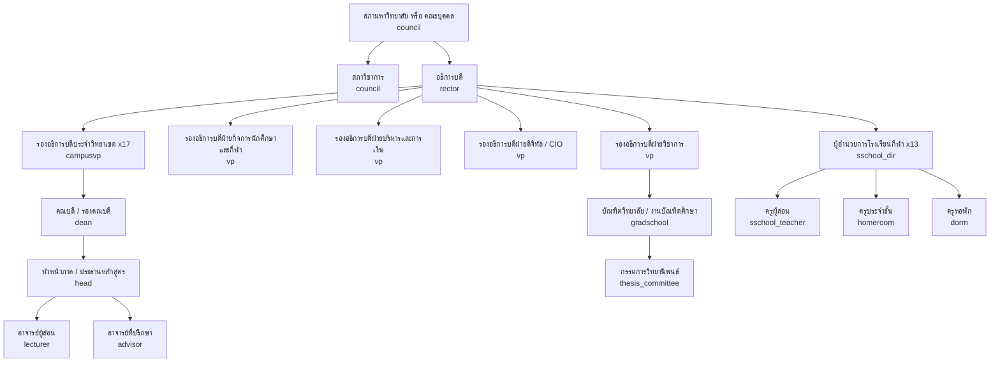
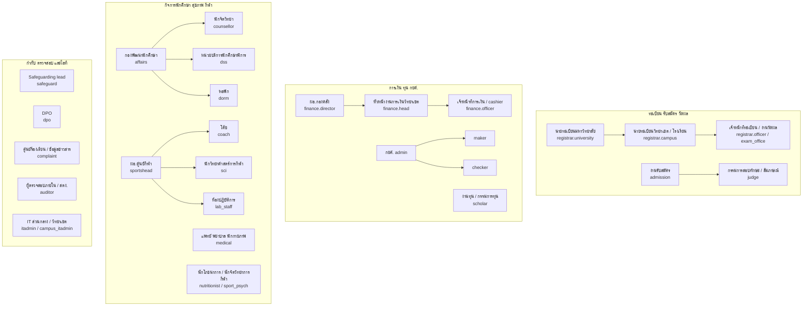

# 04 — บทบาท ลำดับชั้นองค์กร และสิทธิ์ (Roles, Organisation & Permissions)

> **สถานะ:** v1.0-draft · 28 ต.ค. 2569 · ผู้เขียน: C · ภาษา: ไทย (ศัพท์เทคนิคเป็นภาษาอังกฤษ)
> **อ่านคู่กับ:** [00-blueprint](00-blueprint.md) · [05-workflows](05-workflows.md) + [`data/workflows.json`](data/workflows.json) (ใช้รหัสบทบาทชุดเดียวกับเล่มนี้) · [06-modules](06-modules.md) (IAM, PRIV, AUD, ADMIN) · [07-architecture](07-architecture.md) (Keycloak, PAM, RLS) · [08-data](08-data.md) (data classification, GuardianRelation) · [10-security-compliance](10-security-compliance.md) (PDPA lawful basis, consent ผู้เยาว์, threat model)
> **เล่มนี้เป็นเจ้าของ:** รายการรหัสบทบาทสุดท้าย (blueprint หัวข้อ 5), scope model, permission matrix, กฎ SoD, การรักษาราชการแทน/การมอบอำนาจลงนาม, บทบาทผู้ดูแลระบบ, break-glass

## 1. หลักการ

1. **ลำดับชั้นเป็นข้อมูล ไม่ใช่โค้ด** — เก็บเป็น `OrgUnit` (มหาวิทยาลัย → วิทยาเขต / โรงเรียนกีฬา → คณะ → ภาค/หลักสูตร → section/squad/หอ) + `Position` + `RoleAssignment(person, role, org_unit, scope, source, valid_from, valid_to)` เปลี่ยนชื่อหรือเพิ่มระดับได้โดยไม่แก้โค้ด
2. **ผังองค์กรในเล่มนี้เป็นสมมติฐาน** ตามโครงสร้างมหาวิทยาลัยรัฐไทยทั่วไป เพราะยังไม่พบผังทางการของ มกช. **[ต้องตรวจสอบ]** และอาจยังบริหารโดยคณะบุคคลแทนสภามหาวิทยาลัย จึงเก็บ `GoverningBody(type = COUNCIL | INTERIM_BOARD)` (สมมติฐานในทะเบียน A-xx ของเล่ม 01)
3. **RBAC + ABAC** — บทบาท (role) บอกว่า "ทำอะไรได้"; attribute บอกว่า "กับข้อมูลของใคร/หน่วยไหน/ชั้นความอ่อนไหวใด" (scope, `org_unit`, `data_class`, ความสัมพันธ์ดูแล, consent, คำสั่งจำกัด) บังคับซ้ำ 2 ชั้น: application (policy engine) และฐานข้อมูล (PostgreSQL RLS ตาม `org_unit_id`)
4. **ผู้ดูแลระบบจัดการ "ระบบ" แต่ไม่ได้ "ข้อมูลธุรกิจ" โดยอัตโนมัติ** — สิทธิ์ privileged ได้แบบ JIT ผ่าน PAM และ break-glass ต้องมีผู้อนุมัติ 2 คนเสมอ
5. **รหัสบทบาทชุดเดียว** — รหัสในเล่มนี้ = รหัสใน `data/workflows.json` = รหัสใน Keycloak client role (แก้ปัญหา role code 3 ชุดของ v0.9) ตำแหน่งย่อยที่ต้องแยกเพื่อ SoD ใช้ **qualifier** (หัวข้อ 3.3) ไม่สร้างรหัสใหม่

## 2. ลำดับชั้นองค์กร

### 2.1 สายบังคับบัญชาหลัก (สมมติฐาน)

> สังกัดของโรงเรียนกีฬา (ขึ้นตรงอธิการบดี หรือภายใต้วิทยาเขต) **[ต้องตรวจสอบ]** — ระบบรองรับทั้งสองแบบเพราะเป็นเพียง parent ของ OrgUnit

### 2.2 สายงานสนับสนุนและกำกับ

**ข้อกำหนดเชิงโครงสร้างที่ต้องรักษา:** (ก) `safeguard` และ `dpo` รายงานตรงผู้บริหารสูงสุดและไม่อยู่ใต้สายของหน่วยที่ตนกำกับ (ความเป็นอิสระ — review C-13) (ข) `auditor` read-only และ time-boxed (ค) `medical` ผูกกับ "ความสัมพันธ์ดูแล" ไม่ใช่สายบังคับบัญชาของโค้ช

## 3. Role catalogue (รายการสุดท้าย)

**ที่มาของการมอบหมาย (assignment source):** `HR` = ตำแหน่งจาก HR sync (JML) · `ORDER` = คำสั่งแต่งตั้ง มีวาระ/เลขที่คำสั่ง (เชื่อม e-Saraban) · `ROUND` = คำสั่งต่อรอบ/ต่อคดี/ต่อเคส หมดอายุเมื่อปิดรอบ · `TERM` = มอบหมายรายภาคจากตารางสอน/การมอบหมาย หมดอายุอัตโนมัติ · `REL` = ความสัมพันธ์ที่ยืนยันแล้ว (ผู้ปกครอง, care relationship) · `SELF` = สมัครเอง/สถานะ (ผู้สมัคร นักศึกษา) · `SPONSOR` = บุคคลภายนอกที่บุคลากรรับรอง (W-139) · `SYS` = ระบบ

**Scope types:** ดูหัวข้อ 4 (`own`, `child`, `advisee`, `section`, `squad`, `care`, `assigned`, `program`, `department`, `faculty`, `campus`, `school`, `university`, `aggregate`, `technical`)

### 3.1 บทบาทธุรกิจ

| รหัส | ชื่อภาษาไทย | กลุ่ม | Scope types | ที่มา | หมายเหตุ |
|---|---|---|---|---|---|
| `candidate` | ผู้สมัคร | นักศึกษาและครอบครัว | own | SELF | บัญชีระดับมหาวิทยาลัย 1 คน 1 บัญชี (dedupe ด้วยเลขบัตร/passport/รหัส G) |
| `student` | นักศึกษา / นักเรียนโรงเรียนกีฬา | นักศึกษาและครอบครัว | own | SELF (สถานะ REC) | profile `HIGHER_ED` / `BASIC_ED` เป็น attribute; step-up (passkey/OTP) สำหรับถอนวิชา คืนเงิน เปลี่ยนบัญชี |
| `guardian` | ผู้ปกครอง | นักศึกษาและครอบครัว | child | REL | ชนิดความสัมพันธ์ `LEGAL` (ผู้แทนโดยชอบธรรมของผู้เยาว์) หรือ `OBSERVER` (ผู้ปกครองของนักศึกษาที่บรรลุนิติภาวะ ตาม consent) — หัวข้อ 7 |
| `alumni` | ศิษย์เก่า / ผู้สำเร็จการศึกษา | นักศึกษาและครอบครัว | own | SYS (DegreeConferred) | รวมผู้จบโรงเรียนกีฬา |
| `former_student` | อดีตนักศึกษาที่ไม่สำเร็จการศึกษา | นักศึกษาและครอบครัว | own | SYS (W-133) | ขอเอกสาร/คืนสภาพได้ (แก้ review G-17) |
| `applicant` | บุคคลภายนอก / ประชาชน / ผู้แจ้งเรื่อง | ภายนอก | own (เรื่องที่ตนยื่น) | SELF | ร้องเรียนแบบไม่ระบุตัวตนได้ ติดตามด้วยรหัส |
| `employer` | สถานประกอบการ / แหล่งฝึกงาน | ภายนอก | assigned | SPONSOR | ภายใต้ข้อตกลงประมวลผลข้อมูล |
| `verifier` | ผู้ตรวจสอบเอกสาร | ภายนอก | ไม่มี (ลิงก์/QR) | — | ไม่ต้อง login, rate limit, ไม่ค้นหารายชื่อได้ |
| `federation` | สมาคมกีฬา / กกท. / ผู้จัดการแข่งขัน | ภายนอก | assigned | SPONSOR | ยืนยันผลงาน/หนังสือเรียกตัว ไม่เห็นข้อมูลการเรียน/สุขภาพ |
| `insurer` | บริษัทประกันคู่สัญญา | ภายนอก | assigned (เคลม) | SPONSOR | ได้เฉพาะข้อมูลเคลมตาม data sharing agreement |
| `host_principal` | ผู้บริหารสถานศึกษาที่รับฝึก | ภายนอก | assigned (placement) | SPONSOR | ตอบรับ ประเมินภาพรวม |
| `mentor` | ครูพี่เลี้ยง | ภายนอก | assigned (นักศึกษาฝึกสอน) | SPONSOR | สัดส่วน ≤ 1:3 ตรวจโดย RatioRule |
| `lecturer` | อาจารย์ผู้สอน | อาจารย์และผู้บริหาร | section | TERM | หมดอายุหลังช่วงส่งเกรด + grace 60 วัน; ข้ามวิทยาเขตได้ผ่าน host_org_unit |
| `advisor` | อาจารย์ที่ปรึกษา | อาจารย์และผู้บริหาร | advisee | TERM / ORDER | รวม DC tutor (ผู้ประสาน dual career) เป็น qualifier |
| `head` | หัวหน้าภาค / ประธานหลักสูตร / คณะกรรมการคัดเลือก | อาจารย์และผู้บริหาร | department, program | ORDER | qualifier: `dept_head`, `program_chair`, `selection_chair` (ROUND) |
| `dean` | คณบดี / รองคณบดี | อาจารย์และผู้บริหาร | faculty | ORDER | qualifier `associate` สำหรับรองคณบดีที่ได้รับมอบอำนาจ |
| `campusvp` | รองอธิการบดีประจำวิทยาเขต | อาจารย์และผู้บริหาร | campus | ORDER | ผู้อนุมัติเกินวงเงินระดับวิทยาเขต, มาตรการคุ้มครองเด็ก, ผู้บังคับบัญชาสำหรับ recertification |
| `vp` | รองอธิการบดีฝ่าย | อาจารย์และผู้บริหาร | university (เฉพาะสายงาน) | ORDER | qualifier: `academic`, `student_affairs`, `admin_finance`, `digital` (CIO = ผู้อนุมัติคนที่ 2 ของ W-125) |
| `rector` | อธิการบดี | อาจารย์และผู้บริหาร | university | ORDER | ลงนามคำสั่ง/credential; ส่วนใหญ่ลงนามผ่าน **ผู้ได้รับมอบอำนาจลงนาม** (หัวข้อ 9) |
| `council` | สภาวิชาการ / สภามหาวิทยาลัย / คณะบุคคล | อาจารย์และผู้บริหาร | university (aggregate + วาระ) | ORDER | บันทึกมติผ่านเลขานุการสภา (qualifier `secretary`) แบบ 4-eyes |
| `judge` | กรรมการสอบทักษะ / สัมภาษณ์ | อาจารย์และผู้บริหาร | assigned (station/session) | ROUND | ประกาศ COI ต่อรอบ; ภายนอกผ่าน W-139; สิทธิ์หมดเมื่อปิดรอบ |
| `admission` | งานรับสมัคร | เจ้าหน้าที่ | campus (ส่วนกลาง = university) | HR | ไม่เห็นเนื้อหาข้อมูลความพิการ (เห็นเฉพาะแผน accommodation) |
| `registrar` | นายทะเบียน / งานทะเบียนและวัดผล | เจ้าหน้าที่ | campus, school, university | ORDER (นายทะเบียน) / HR (เจ้าหน้าที่) | qualifier: `university`, `campus`, `school` (งานทะเบียนโรงเรียนกีฬา), `officer`, `exam_office` (งานวัดผล = เจ้าของปฏิบัติการตารางสอบใน EXM) |
| `proctor` | กรรมการคุมสอบ | เจ้าหน้าที่ | assigned (ห้องสอบ) | ROUND | ห้ามคุมวิชาที่ตนสอน |
| `finance` | การเงิน / กองคลัง | เจ้าหน้าที่ | campus, university | HR / ORDER | qualifier: `officer`, `cashier`, `head`, `refund_approver`, `director` — แยกเพื่อ SoD-03/05/10 |
| `loan` | เจ้าหน้าที่ กยศ. | เจ้าหน้าที่ | campus | ORDER | qualifier สอดคล้องบทบาทใน DSL: `superuser`, `admin`, `maker`, `checker` |
| `scholar` | งานทุน / กรรมการทุน | เจ้าหน้าที่ | campus, university (ตามประกาศทุน) | HR / ROUND | กรรมการทุนประกาศ COI ต่อรอบ |
| `dorm` | หอพัก / ครูหอพัก | เจ้าหน้าที่ | dorm (OrgUnit หอ) | HR / TERM | qualifier: `manager`, `officer`, `boarding` (ครูหอโรงเรียนกีฬา); เห็นคำสั่งจำกัดที่ต้องปฏิบัติ ไม่เห็นรายละเอียดคดี |
| `affairs` | กิจการนักศึกษา | เจ้าหน้าที่ | campus | HR | qualifier `discipline_committee` (ROUND ต่อคดี) |
| `counsellor` | นักจิตวิทยา / ผู้ให้คำปรึกษา | เจ้าหน้าที่ | care (เคสของตน) | HR | บันทึกการให้คำปรึกษา = ชั้น sensitive |
| `dss` | หน่วยบริการนักศึกษาพิการ | เจ้าหน้าที่ | campus (เคสที่ลงทะเบียน) | HR | เข้าถึงหลักฐานความพิการใน vault |
| `intl` | งานนักศึกษาต่างชาติ | เจ้าหน้าที่ | campus, university | HR | วีซ่า, 90 วัน, ตม.30 |
| `hr` | บุคลากร | เจ้าหน้าที่ | university | HR | เจ้าของ JML, ตรวจประวัติ (W-23), บันทึกคำสั่ง acting/delegation (W-123) |
| `planner` | กองแผน / งานประกันคุณภาพ | เจ้าหน้าที่ | university (aggregate + dataset ที่อนุมัติ) | HR | ไม่มี SQL Lab โดยปริยาย |
| `records` | งานสารบรรณ | เจ้าหน้าที่ | OrgUnit ของตน | HR | ออกเลขหนังสือ, ทำลาย/ส่งมอบเอกสาร |
| `pr` | ประชาสัมพันธ์ | เจ้าหน้าที่ | OrgUnit ของตน | HR | สร้างประกาศ (ENG) ไม่เห็นข้อมูลรายบุคคล |
| `legal` | นิติกร | เจ้าหน้าที่ | assigned (เรื่อง) | HR | อุทธรณ์ คำขอข้อมูลข่าวสาร คำสั่งศาล เพิกถอนปริญญา |
| `facility` | งานอาคารสถานที่ / สนามกีฬา | เจ้าหน้าที่ | campus | HR | |
| `coach` | โค้ช / ผู้จัดการทีม | กีฬาและสุขภาพ | squad | TERM / ORDER | เห็น **สถานะความพร้อม** ไม่เห็นการวินิจฉัย ยกเว้นนักกีฬายินยอม; ต้องมี StaffClearance ถ้าทีมมีผู้เยาว์ |
| `sci` | นักวิทยาศาสตร์การกีฬา | กีฬาและสุขภาพ | squad, assigned | TERM | |
| `sportshead` | หัวหน้างานกีฬา / ผอ.ศูนย์กีฬา | กีฬาและสุขภาพ | campus | ORDER | อนุมัติทริป, delegation roster, talent pathway |
| `medical` | แพทย์ / พยาบาล / นักกายภาพ | กีฬาและสุขภาพ | care | HR + REL | qualifier `lead` (แพทย์หัวหน้า = ผู้อนุมัติคนที่ 1 ของ W-14); MFA แบบ WebAuthn |
| `nutritionist` | นักโภชนาการการกีฬา | กีฬาและสุขภาพ | care (referral) | HR | |
| `sport_psych` | นักจิตวิทยาการกีฬา | กีฬาและสุขภาพ | care (referral) | HR | บันทึกลับระดับเดียวกับ counsellor |
| `lab_staff` | เจ้าหน้าที่ห้องปฏิบัติการวิทยาศาสตร์การกีฬา | กีฬาและสุขภาพ | lab | HR | calibration, booking |
| `sschool_dir` | ผอ. / รอง ผอ.โรงเรียนกีฬา | โรงเรียนกีฬา | school | ORDER | อนุมัติผลการเรียน เลื่อนชั้น จบ ม.3/ม.6 |
| `sschool_teacher` | ครูผู้สอนโรงเรียนกีฬา | โรงเรียนกีฬา | section (ห้อง/วิชา) | TERM | ต้องมี StaffClearance + ใบอนุญาตประกอบวิชาชีพที่ยังไม่หมดอายุ |
| `homeroom` | ครูประจำชั้น | โรงเรียนกีฬา | homeroom | TERM | ช่องทางหลักกับผู้ปกครอง; ร่วมในกลุ่มข้อความทุกกลุ่มของห้อง (two-adult rule) |
| `gradschool` | บัณฑิตวิทยาลัย / งานบัณฑิตศึกษา | บัณฑิตศึกษาและฝึกประสบการณ์ | university (หลักสูตรบัณฑิตศึกษา) | ORDER / HR | |
| `thesis_committee` | อาจารย์ที่ปรึกษาวิทยานิพนธ์ / กรรมการสอบ | บัณฑิตศึกษาและฝึกประสบการณ์ | assigned (นักศึกษาที่ได้รับแต่งตั้ง) | ROUND (คำสั่ง W-95/W-97) | qualifier `main_advisor`, `co_advisor`, `chair`, `external` |
| `practicum` | ศูนย์ฝึกประสบการณ์วิชาชีพ | บัณฑิตศึกษาและฝึกประสบการณ์ | faculty, campus | ORDER | จับคู่ placement, ตรวจ RatioRule |
| `supervisor` | อาจารย์นิเทศก์ | บัณฑิตศึกษาและฝึกประสบการณ์ | assigned (placement) | TERM | สัดส่วน ≤ 1:10 |
| `safeguard` | ผู้รับผิดชอบด้านคุ้มครองเด็ก | กำกับดูแล | school, campus (เคสที่มอบหมาย) | ORDER | qualifier `lead`, `deputy`; ถูกตัดสิทธิ์อัตโนมัติจากเคสที่ตนเกี่ยวข้อง |
| `complaint` | ศูนย์รับเรื่องร้องเรียน / ศูนย์ข้อมูลข่าวสาร | กำกับดูแล | university (intake) | ORDER | เห็นเนื้อหาเพื่อคัดแยก; เคสเด็กส่ง SAFE ทันที |
| `dpo` | DPO | กำกับดูแล | university (metadata + DSR) | ORDER | เห็น metadata ของการเข้าถึง sensitive ไม่ใช่เนื้อหา (ยกเว้นในเคส DSR/breach ที่ต้องใช้) |
| `auditor` | ผู้ตรวจสอบภายใน / สตง. | กำกับดูแล | ตามหนังสือขอ / แผนตรวจ | ORDER (time-boxed) | read-only; export ได้เฉพาะชุดที่อนุมัติ (CSV + hash + data dictionary) |
| `data_owner` | เจ้าของข้อมูล | กำกับดูแล | domain | ORDER | เช่น นายทะเบียน (วิชาการ), หัวหน้าการเงิน (การเงิน), แพทย์หัวหน้า (สุขภาพ) |
| `data_steward` | Data steward | กำกับดูแล | domain | ORDER | DQ, metadata, ดึง snapshot รายงาน (W-35) |
| `system` | ระบบ (อัตโนมัติ) | ระบบ | ตาม process | SYS | service account ต่อโมดูล, ไม่มีการ login แบบโต้ตอบ |

### 3.2 บทบาทผู้ดูแลระบบ

| รหัส | ชื่อภาษาไทย | Scope | ที่มา / วิธีได้สิทธิ์ | สิทธิ์หลัก | ห้าม (SoD) |
|---|---|---|---|---|---|
| `itadmin` | ผู้ดูแลแพลตฟอร์มส่วนกลาง (super admin) | university (technical) | ORDER; งานเสี่ยงผ่าน JIT + 4-eyes + hardware key | onboard OrgUnit, feature flag ระดับมหาวิทยาลัย, อนุมัติ config สำคัญ, ขอใช้ break-glass (W-125) | อ่านข้อมูล sensitive, แก้เกรด, แก้ audit, ใช้บัญชีเดียวกับงานประจำวัน |
| `campus_itadmin` | IT วิทยาเขต / โรงเรียนกีฬา | campus / school (technical) | standing (ต่ำ) + JIT | reset รหัส (ผู้อนุมัติคนที่ 2 ใน W-142), จัด role ภายใต้ catalogue ที่อนุญาต, เปิดบัญชีภายนอก (W-139) | มอบ role สูงกว่าตน, ข้ามวิทยาเขต |
| `iam_admin` | ผู้ดูแล IAM | university | JIT | Keycloak client/IdP (ThaID), role catalogue, ABAC attribute, JML rule, ผูก acting/delegation (W-123) | มอบสิทธิ์ให้ตนเอง, แก้ policy ที่ตนอนุมัติ |
| `module_admin` | ผู้ดูแลการตั้งค่าโมดูล | campus / university ต่อโมดูล | ORDER | ร่าง PolicySet, fee schedule, รอบรับสมัคร, แบบฟอร์ม e-Form (W-113), template | publish สิ่งที่ตนร่าง (SoD-05/06), ดูข้อมูลการบาดเจ็บ |
| `security_admin` | ผู้ดูแลความมั่นคงปลอดภัย / SOC | university | JIT | WAF/SIEM, อนุมัติ JIT (W-124), ผู้อนุมัติคนที่ 1 ของ W-125, ทบทวน break-glass, ระงับบัญชีฉุกเฉิน, key rotation | อ่านข้อมูลธุรกิจ |
| `dba_sre` | DBA / SRE / DevOps | infra | GitOps เป็นหลัก; JIT ผ่าน PAM พร้อม session recording | migration ผ่าน pipeline, tuning, backup/restore, incident | write ตรงใน schema `asm`/`rec`/`fin` (ค่าเริ่มต้น read-only; เขียนผ่าน W-137 เท่านั้น), อ่าน vault (ไม่มี key) |
| `helpdesk` | Helpdesk L1/L2 | campus / university | standing (L1) / JIT ต่อ ticket (L2) | ดูสถานะบัญชี, impersonation แบบดูอย่างเดียวเมื่อผู้ใช้ยินยอมในเซสชัน, สร้าง data-fix request (W-137), rerun job | reset MFA คนเดียว (ต้อง ThaID + ผู้อนุมัติคนที่ 2, W-142), แก้ข้อมูลใน DB |
| `vendor_support` | วิศวกรสนับสนุนของผู้รับจ้าง | ตาม ticket | JIT ≤ 8 ชม. ผ่าน W-124 (itadmin/security_admin + data_owner ถ้าแตะข้อมูล) | log/trace ที่ mask แล้ว, staging; prod เมื่ออนุมัติ | standing access, export ข้อมูล, เข้าจากนอกประเทศโดยไม่มีข้อตกลง |

> **บัญชี break-glass** ไม่ใช่บทบาท แต่เป็นบัญชีฉุกเฉิน 2 บัญชีที่ credential แบ่งเป็น 2 ส่วนเก็บแยกผู้ถือ ใช้ผ่าน W-125 เท่านั้น (หัวข้อ 11.3)

### 3.3 Qualifier (ตำแหน่งย่อยเพื่อ SoD)

Qualifier เขียนเป็น `role.qualifier` (เช่น `finance.head`) เก็บใน `RoleAssignment.qualifier` และใช้ใน policy/SoD; ใน `workflows.json` แสดงในข้อความ action เช่น "(หัวหน้างาน คนละคน)" — ไม่สร้างรหัสบทบาทเพิ่ม

| บทบาท | Qualifier | ใช้ใน |
|---|---|---|
| `finance` | `officer`, `cashier`, `head`, `refund_approver`, `director` | W-09, W-27, W-28, W-29, W-81, W-116, W-120, W-121 |
| `loan` | `superuser`, `admin`, `maker`, `checker` | W-48, W-119 |
| `registrar` | `university`, `campus`, `school`, `officer`, `exam_office` | W-01, W-54, W-74, W-117 |
| `head` | `dept_head`, `program_chair`, `selection_chair` | W-01, W-18, W-76 |
| `medical` | `lead` | W-14 |
| `safeguard` | `lead`, `deputy` | W-22, W-93 |
| `dorm` | `manager`, `officer`, `boarding` | W-13, W-46, W-90, W-91 |
| `thesis_committee` | `main_advisor`, `co_advisor`, `chair`, `external` | W-95..W-98 |
| `vp` | `academic`, `student_affairs`, `admin_finance`, `digital` | W-15, W-117, W-125 |
| `council` | `academic_council`, `university_council`, `secretary` | W-06, W-08 |
| `advisor` | `dc_tutor` | W-04, W-114 |
| `affairs` | `discipline_committee` | W-12 |

### 3.4 ตารางแปลงรหัสจาก v0.9 (ปิด review I-11 / IC-10)

| รหัส v0.9 | รหัส v1.0 |
|---|---|
| `guardian_minor` / `parent_adult_student` | `guardian` + `relation_type = LEGAL / OBSERVER` |
| `president` | `rector` |
| `vp_university` / `vp_campus` | `vp` / `campusvp` |
| `council_member` / `academic_council` | `council` + qualifier |
| `head_of_dept` / `program_chair` / `program_faculty` | `head` + qualifier (อาจารย์ประจำหลักสูตรใช้ `lecturer` + attribute program_faculty) |
| `registrar_university` / `registrar_campus` / `registrar_officer` / `academic_director` | `registrar` + qualifier (ผอ.สำนักวิชาการ = `registrar.university` + `data_owner`) |
| `admissions_officer` / `skilltest_judge` | `admission` / `judge` |
| `finance_director` / `finance_officer` / `refund_approver` | `finance` + qualifier |
| `loan_superuser` / `loan_admin` / `loan_maker` / `loan_checker` | `loan` + qualifier |
| `scholarship_committee` | `scholar` |
| `affairs_director` / `affairs_officer` / `discipline_committee` | `affairs` (+ qualifier) |
| `dorm_manager` / `dorm_officer` / `boarding_staff` | `dorm` + qualifier |
| `sports_director` / `sport_scientist` / `physio` / `medical_officer` / `dc_tutor` | `sportshead` / `sci` / `medical` / `medical` / `advisor.dc_tutor` |
| `ss_director` / `ss_deputy` / `ss_teacher` / `homeroom_teacher` | `sschool_dir` / `sschool_dir` / `sschool_teacher` / `homeroom` |
| `practicum_supervisor` / `practicum_coordinator` / `mentor_teacher` / `school_principal` / `internship_host` | `supervisor` / `practicum` / `mentor` / `host_principal` / `employer` |
| `internal_auditor` / `external_auditor` / `auditor_ro` | `auditor` + attribute `org = INTERNAL / OAG` |
| `executive_viewer` | ไม่มีรหัสแยก: ผู้บริหารได้ dashboard ตาม scope ของตำแหน่ง (หัวข้อ 13) |
| `platform_admin` / `super_admin` / `campus_it_admin` / `sre_devops` / `dba` / `helpdesk_l1` / `helpdesk_l2` | `itadmin` / `itadmin` / `campus_itadmin` / `dba_sre` / `dba_sre` / `helpdesk` / `helpdesk` |
| `module_admin_*` | `module_admin` + attribute module |
| `alumnus` / `verifier_public` / `federation_officer` | `alumni` / `verifier` / `federation` |

## 4. Scope model

| Scope | ความหมาย | การ resolve (ABAC) |
|---|---|---|
| `own` | ข้อมูลของตนเอง | `subject.person_id = resource.person_id` |
| `child` | ข้อมูลของผู้เรียนที่ผู้ปกครองมี GuardianRelation ที่ยืนยันแล้ว | `LEGAL`: ทุกหมวดที่ผู้แทนโดยชอบธรรมมีสิทธิ์ ลบด้วย CustodyRestriction; `OBSERVER`: เฉพาะหมวดที่นักศึกษา consent และยังไม่หมดอายุ |
| `advisee` | นักศึกษาในความดูแลของอาจารย์ที่ปรึกษา/DC tutor | `AdvisorAssignment` ที่ active ใน Term ปัจจุบัน |
| `section` | ผู้เรียนใน section ที่สอน | `TeachingAssignment` × `Enrollment`; ข้ามวิทยาเขตใช้ `section.host_org_unit` (ผู้สอนเห็นเฉพาะชื่อ รหัส ภาพ ข้อมูลการเรียนของ section) |
| `squad` | นักกีฬาในทีมที่เป็นโค้ช/นักวิทย์ | `CoachAssignment` ที่ไม่ถูกระงับโดย ContactRestriction |
| `care` | ผู้ที่อยู่ในความสัมพันธ์ดูแลทางสุขภาพ/การให้คำปรึกษา | `CareRelationship` (เปิดโดยการนัด/การส่งต่อ/เหตุฉุกเฉิน มีวันสิ้นสุด) |
| `assigned` | เรื่อง/เคส/รอบ/station ที่ได้รับมอบหมาย | `CaseAssignment`, `JudgeAssignment`, `PlacementAssignment` — หมดเมื่อปิดเคส/รอบ |
| `program` / `department` / `faculty` | ภายในหลักสูตร / ภาค / คณะ (ต่อวิทยาเขต) | OrgUnit subtree ของ RoleAssignment |
| `campus` / `school` | ภายในวิทยาเขต / โรงเรียนกีฬา | RLS `org_unit_id ∈ subtree` (ตั้งด้วย `SET LOCAL` ต่อ transaction) |
| `university` | ทุก OrgUnit | เฉพาะตำแหน่งระดับมหาวิทยาลัย; ยังถูกจำกัดด้วย data class |
| `aggregate` | ตัวเลขรวมเท่านั้น | ไม่ drill ถึงรายบุคคล; cell ที่น้อยกว่า k (เช่น 5) ถูกซ่อน |
| `technical` | ทรัพยากรระบบ ไม่ใช่ข้อมูลธุรกิจ | ผู้ดูแลระบบ; ข้อมูลธุรกิจต้อง JIT/break-glass |

**กฎผสม scope:** (1) สิทธิ์ = ยูเนียนของ RoleAssignment ที่ active แต่ **ตัดด้วย** data class (หัวข้อ 5) และคำสั่งจำกัด (ContactRestriction/CustodyRestriction/SafeguardingExclusion) ซึ่งมีผลเหนือทุกบทบาท (deny overrides) (2) บุคลากรหลายวิทยาเขตมี RoleAssignment แยกต่อวิทยาเขต (3) นักศึกษาที่ย้ายวิทยาเขต: ประวัติเก่าอยู่ใต้ OrgUnit เดิม วิทยาเขตใหม่เห็นผ่าน `home_org_unit` ปัจจุบัน + สิทธิ์อ่านประวัติวิชาการ (ไม่รวมวินัย/คำปรึกษา) (4) โปรแกรมบัณฑิตศึกษาระดับมหาวิทยาลัยผูกกับ OrgUnit ของบัณฑิตวิทยาลัย (5) BI/replica บังคับ scope ด้วย view ต่อ OrgUnit และปิด SQL Lab สำหรับผู้ใช้ทั่วไป (blueprint ข้อ 9.5)

## 5. ชั้นความอ่อนไหวของข้อมูลและการเข้าถึง (ABAC attributes)

ชั้นพื้นฐาน `PUBLIC / INTERNAL / CONFIDENTIAL / SENSITIVE` นิยามในเล่ม 08 · ชั้นความลับของทางราชการ (`official_secrecy`) แยกเป็น attribute ของเอกสาร (เล่ม 10) · หมวดข้อมูลพิเศษด้านล่างมีกติกาเพิ่ม

| หมวด (data category) | ที่เก็บ | ผู้เข้าถึงเนื้อหา | ผู้อื่นเห็นอะไร | กติกาเพิ่ม |
|---|---|---|---|---|
| **สุขภาพ** (การบาดเจ็บ การรักษา medical alert การให้ยา ผลตรวจ) | HLT health vault (ฐานแยก + per-person key) | `medical` ใน care, เจ้าของข้อมูล, `guardian` LEGAL | โค้ช/ทีม: สถานะพร้อม/ไม่พร้อม (เนื้อหาเฉพาะเมื่อนักกีฬายินยอม); REG/ATT: ข้อจำกัดภาคปฏิบัติไม่มีการวินิจฉัย; หัวหน้าทริป/ครูหอ: medical alert ขั้นต่ำแบบ pre-authorised | บันทึกฉุกเฉินไม่รอ consent; นอก care relationship ต้อง W-14 (2 คน); audit ทุกการอ่าน |
| **คุ้มครองเด็ก** | SAFE | `safeguard` ที่ได้รับมอบหมายเคส | ผู้อื่น: เฉพาะคำสั่งที่ต้องปฏิบัติ (ContactRestriction) | ผู้ถูกกล่าวหาและผู้บังคับบัญชาที่เกี่ยวข้องถูก exclude อัตโนมัติ; ไม่มี break-glass ทางเทคนิคเข้าเนื้อหาเคสยกเว้น W-125 + safeguard lead ร่วมทบทวน |
| **วินัย** | AFF (case) | `affairs.discipline_committee` ที่ได้รับมอบหมาย, `dean`/ผู้มีอำนาจลงโทษ, เจ้าของข้อมูล | อาจารย์ที่ปรึกษา: ผลโทษที่ถึงที่สุด; GRD: ธง "ความประพฤติ" ตอนตรวจจบ | ไม่แชร์ข้ามวิทยาเขตเมื่อย้าย ยกเว้นโทษที่มีผลต่อสถานภาพ |
| **การให้คำปรึกษา / จิตวิทยา** | AFF (confidential notes) | `counsellor` / `sport_psych` ผู้บันทึก | อาจารย์ที่ปรึกษา: ข้อจำกัดการเรียนเมื่อนักศึกษายินยอม; DPO: metadata | เปิดเผยโดยไม่ได้ consent เฉพาะ EmergencyDisclosure (W-129) |
| **ความพิการ** | AFF/DSS ใน vault | `dss`, เจ้าของข้อมูล | ผู้สอน/EXM/ADM: รายการ accommodation เท่านั้น | ห้ามใช้ใน ML/early warning |
| **การเงิน** (หนี้ ใบเสร็จ บัญชีธนาคาร กยศ. รายได้ครอบครัว) | FIN, SCH | `finance` ตาม qualifier, `loan`, เจ้าของข้อมูล, `guardian` LEGAL (หรือ OBSERVER ที่ได้ consent หมวดการเงิน) | อาจารย์ที่ปรึกษา: สถานะ "มี hold" เท่านั้น; ผู้บริหาร: aggregate | เปลี่ยนบัญชีรับเงินต้อง step-up + ยืนยันชื่อ (W-143); รายได้ครอบครัวเห็นเฉพาะงานทุน/กยศ. |
| **ผลการเรียน** | ASM, REC | ผู้สอน (section), ที่ปรึกษา, สายอนุมัติ, ทะเบียน, เจ้าของข้อมูล, guardian ตามสิทธิ์ | ผู้บริหาร: aggregate | เกรดก่อนเผยแพร่เห็นเฉพาะสายอนุมัติ |
| **ข้อมูลผู้เยาว์ทั่วไป** | ทุกโมดูล (flag `minor`) | ตาม scope | — | ไม่ส่งไป LINE/push; ไม่มีข้อความ 1:1 จากบุคลากร; ภาพถ่ายต้องมี media consent |

## 6. Permission matrix (RBAC + ABAC)

สัญลักษณ์: **V** = ดู · **E** = สร้าง/แก้ไข · **A** = อนุมัติ · **P** = เผยแพร่/ลงนาม · **R** = ยื่นคำขอ · **–** = ไม่มี · `(…)` = scope · ทุกช่องถูกจำกัดเพิ่มด้วย RLS ตาม OrgUnit, data class และคำสั่งจำกัด

### 6.1 งานวิชาการ ทะเบียน และการเงิน

| ความสามารถ \ บทบาท | student | guardian LEGAL | guardian OBSERVER | lecturer | advisor | head | dean | campusvp / rector | registrar | finance | affairs | auditor |
|---|---|---|---|---|---|---|---|---|---|---|---|---|
| ข้อมูลส่วนตัว/ติดต่อ | V/E (own) | V (child) | V ตาม consent | V จำกัด (section) | V (advisee) | V (dept) | V (faculty) | V (campus/univ) | V/E (campus) | V จำกัด | V (campus) | V ro |
| ใบสมัคร / ผลคัดเลือก | V (own) | V (child) | – | – | – | A (รับรองผล) | A (เกณฑ์) | A (รอบ, override) | V | V (ค่าสมัคร) | – | V ro |
| ลงทะเบียน / W / ลงเกิน | E/R (own) | V, cosign ถ้า DMN | V ตาม consent | V (section) | A (advisee) | V | A (เกินเกณฑ์) | – | E/A (campus) | – | – | V ro |
| เวลาเรียน / มส. | V (own) | V (child) | V ตาม consent | E (section) | V (advisee) | A (มส.) | V | aggregate | V | – | – | V ro |
| คะแนน / เกรด | V หลังเผยแพร่ | V (child) | V ตาม consent | E (section) | V (advisee) | A (dept) | A (faculty) | aggregate | P (campus) | – | – | V ro |
| แก้เกรดหลังเผยแพร่ | R (อุทธรณ์ W-16) | – | – | R (W-02) | – | A | A | – | P | – | – | V ro |
| สถานภาพ / พ้นสภาพ | V (own) | V (child) | V ตาม consent | – | V (advisee) | V | V/A | P คำสั่ง (rector หรือผู้รับมอบอำนาจ) | A/E | – | – | V ro |
| ใบแจ้งหนี้ / ชำระ | V/จ่าย (own) | V/จ่าย (child) | V/จ่าย ตาม consent | – | V สถานะ hold | – | – | aggregate | V | E (campus) | – | V ro |
| คืนเงิน / ยกเว้น / ตัดหนี้ | R | R | – | – | – | – | A (ยกเว้นค่าธรรมเนียม: เห็นชอบ) | A เกินวงเงิน | – | E (officer) / A (head, refund_approver) แยกคน | – | V ro |
| กยศ. | V (own) | V (child) | – | – | – | – | – | aggregate | – | V | – | V ro |
| เอกสาร / credential | R/V (own) | V (child, ผู้เยาว์) | – | – | – | – | – | P ลงนาม | E/P | – | – | V ro |
| วินัย | V (own) | V (child) | – | – | V ผลถึงที่สุด | – | A (faculty) | A | V | – | E (คดีที่มอบหมาย) | V ro |
| Consent | E (own) | E (child) | – | – | – | – | – | – | – | – | – | V ro |

### 6.2 กีฬา สุขภาพ คุ้มครองเด็ก และกำกับ

| ความสามารถ \ บทบาท | student (นักกีฬา) | guardian LEGAL | coach | sci | medical | counsellor / sport_psych | sportshead | dorm | safeguard | dpo | itadmin / dba_sre | auditor |
|---|---|---|---|---|---|---|---|---|---|---|---|---|
| แผนฝึก / training load / wellness | E (own) | V (child) | V/E (squad) | V/E (squad) | V (care) | – | aggregate | – | – | – | – | – |
| การบาดเจ็บ / การรักษา | V (own) | V (child) | สถานะพร้อม; เนื้อหาเมื่อยินยอม | สถานะ | V/E (care) | – | สถานะ aggregate | – | – | metadata | – | ผ่าน W-14 เท่านั้น |
| Medical alert ขั้นต่ำ | V/E (own) | V/E (child) | V ระหว่างทริป (pre-authorised) | – | V/E | – | – | V (ครูหอ, หอที่ดูแล) | – | metadata | – | – |
| บันทึกการให้ยา (ผู้เยาว์) | V (own) | V/E แผนยา | – | – | V/E | – | – | E (ให้ยาตามแผน) | – | metadata | – | – |
| บันทึกให้คำปรึกษา | – | – | – | – | – | V/E (เคสตน) | – | – | – | metadata | – | – |
| เคสคุ้มครองเด็ก | – | ได้รับแจ้ง (ยกเว้นเกี่ยวข้อง) | แจ้งเหตุได้ / ไม่เห็นเคส | แจ้งเหตุได้ | แจ้งเหตุได้ | แจ้งเหตุได้ | แจ้งเหตุได้ | แจ้งเหตุ + รับคำสั่งจำกัด | V/E (เคสที่มอบหมาย) | metadata | – | ตามแผนตรวจ + safeguard lead |
| CustodyRestriction / ContactRestriction | – | R (ยื่นคำสั่งศาล) | รับคำสั่ง | – | – | – | – | รับคำสั่ง | A | V | – | V ro |
| ลาแข่ง / delegation roster | R (own) | V / permission slip | E (รับรอง) | – | – | – | E/A | – | – | – | – | V ro |
| สิทธิ์ลงแข่ง (eligibility) | V (own) | V | V ผล | – | – | – | E | – | – | – | – | V ro |
| Audit log | V access log ของตน | – | – | – | – | – | – | – | V (เคส) | V (univ) | – (แก้ไม่ได้) | V (univ) |
| อ่านข้อมูลสุขภาพ / แก้เกรด | – | – | – | – | – | – | – | – | – | – | **– (ไม่มีทางยกเว้น W-125/W-137)** | – |

> สิทธิ์ของ guardian OBSERVER ในตาราง 6.2: **ไม่มี** ยกเว้นนักศึกษาให้ consent หมวด "สุขภาพ" แบบเจาะจง; การติดต่อฉุกเฉินใช้ฐานประโยชน์สำคัญต่อชีวิตผ่าน W-129/W-39 [ต้องตรวจสอบ มาตราที่ใช้กับข้อมูลอ่อนไหว]

### 6.3 Admin permission matrix

**A** = อนุมัติ (4-eyes) · **E** = ทำได้ · **J** = ทำได้เฉพาะ JIT · **V** = ดู · **–** = ไม่ได้

| ความสามารถ | itadmin | campus_itadmin | module_admin | iam_admin | security_admin | dba_sre | helpdesk | data_owner | dpo | auditor | vendor_support |
|---|---|---|---|---|---|---|---|---|---|---|---|
| Onboard OrgUnit / วิทยาเขต / โรงเรียน | E+A | – | – | – | – | – | – | A | – | V | – |
| PolicySet / fee schedule / รอบรับสมัคร / e-Form | A (เทคนิค) | – | E (ร่าง) | – | – | – | – | A (publish) | V (privacy text ของ e-Form) | V | – |
| ปฏิทินการศึกษา (master) | – | – | E | – | – | – | – | A (นายทะเบียน) | – | V | – |
| Role assignment / JML | A | E (campus) | – | E | – | – | V | A (บทบาท sensitive) | – | V | – |
| Acting / delegated authority (W-123) | – | – | – | E (4-eyes ถ้า sensitive) | – | – | – | – | – | V | – |
| PAM / JIT grant (W-124) | A | – | – | E | A | R | R | A (ถ้าแตะข้อมูล) | – | V | R |
| Break-glass ระบบ (W-125) | R + ใช้งาน | – | – | – | A (คนที่ 1) + review | – | – | – | review | V | – |
| Data-fix (W-137) | – | – | – | – | A (คนที่ 2) | E (ตรวจ script) | R (L2) | A (ธุรกิจ) | – | V | – |
| MFA reset (W-142) | – | A (คนที่ 2) | – | – | A (บัญชี sensitive) | – | E (L1/L2) | – | – | V | – |
| Bulk export (W-138) | – | – | – | – | – | – | – | A | A (sensitive) | V | – |
| Backup / restore | A | – | – | – | – | J | – | A (restore ข้อมูล) | – | V | – |
| Job / integration monitor (กยศ. ธนาคาร TCAS) | V | V | V | – | – | E | E (L2 rerun/replay) | – | – | V | J |
| Audit log | V | V (campus) | – | V (IAM) | V | – | – | V (domain) | V | V | – |
| อ่านข้อมูลสุขภาพ / เนื้อหาเคสเด็ก / แก้เกรดตรง | – | – | – | – | – | – | – | – | – | – | – |

## 7. กฎผู้ปกครอง (Guardian rules)

แหล่งความจริงเดียว: `GuardianRelation` ใน REC/PRIV (blueprint ข้อ 10: ผู้ปกครอง = โมเดลเดียว) · IAM อ่านเป็น ABAC attribute (`GuardianAccessGrant`) ไม่เก็บซ้ำ

| # | กฎ | การบังคับใช้ |
|---|---|---|
| G1 | **ชนิดความสัมพันธ์** — `LEGAL` (บิดามารดา/ผู้ปกครองตามกฎหมายของผู้เยาว์), `OBSERVER` (ผู้ปกครองของนักศึกษาที่บรรลุนิติภาวะ), `EMERGENCY_CONTACT` (ผู้ติดต่อฉุกเฉิน ไม่มีสิทธิ์ดูข้อมูล), `PICKUP` (ผู้รับตัวแทนที่ผู้ปกครอง LEGAL กำหนด, โรงเรียนกีฬา) | attribute `relation_type` + `legal_authority` |
| G2 | **การผูกบัญชีต้องยืนยัน** ด้วย ThaID ของผู้ปกครอง + เอกสารอำนาจปกครองที่เจ้าหน้าที่ตรวจ + แจ้งนักศึกษาทุกครั้ง (ป้องกันการปลอมตัว — review SEC-03) | W-127 |
| G3 | **ผู้เยาว์ (อายุต่ำกว่า 20 ปีและยังไม่สมรส):** LEGAL เห็นผลการเรียน การเงิน การมาเรียน ความประพฤติ อนุมัติ leave pass/permission slip และให้ consent แทน/ร่วม **ตาม consent policy (อายุ × ประเภทกิจกรรม)** ไม่ใช่ทุกเรื่อง — กลุ่มอายุ 10–20 ปีทำบางกิจการเองได้ตามแนวปฏิบัติ สคส. (review C-07) ตารางเต็มอยู่ในเล่ม 10 | DMN `consent_policy`, `requires_guardian_cosign` |
| G4 | **บรรลุนิติภาวะ (20 ปี หรือสมรส):** สิทธิ์ LEGAL สิ้นสุดอัตโนมัติวันเกิดครบ 20 ปี (หรือเมื่อบันทึกการสมรส) และเปลี่ยนเป็น OBSERVER ที่ **ไม่มีสิทธิ์จนกว่านักศึกษาให้ consent รายหมวด**; consent ถอนได้ทุกเมื่อ | W-127 job รายวัน, W-128 |
| G5 | **นักศึกษามหาวิทยาลัยอายุ 18–19 ปี** เป็นผู้เยาว์ตามกฎหมาย: คำร้องที่ก่อนิติสัมพันธ์ (ลาออก ลาพัก สัญญาหอ ทุน กยศ.) ต้อง cosign ตาม DMN **[ต้องตรวจสอบ ป.พ.พ. ม.21–24]** | W-03, W-10, W-46 |
| G6 | **คำสั่งศาล / จำกัดอำนาจปกครอง:** `CustodyRestriction(guardian, scope = PICKUP / CONTACT / DATA / ALL, court_ref, valid_to)` ผ่าน W-93 มีผลทันทีและเหนือทุกสิทธิ์: ถอดจาก pickup list, ไม่ได้รับคำขอ W-13/W-31, ไม่ได้รับแจ้งเตือนและรายงาน, flag ที่จุดตรวจหอ; เจ้าหน้าที่หน้างานเห็นเพียง "ห้ามรับตัว/ห้ามติดต่อ" | deny-overrides ใน policy engine |
| G7 | **ข้อยกเว้นคุ้มครองเด็ก:** ถ้าผู้ปกครองเกี่ยวข้องกับเหตุ (W-22) ระบบไม่แจ้งผู้ปกครองรายนั้นและซ่อนการเข้าถึงข้อมูลที่อาจกระทบความปลอดภัยของเด็ก จนกว่า safeguard จะยกเลิก | SafeguardingExclusion |
| G8 | **ผู้ปกครองหลายคน:** แต่ละคนมี grant แยก; การอนุมัติ leave pass ใช้ผู้ปกครองคนใดก็ได้ที่มีสิทธิ์ เว้นแต่ตั้งค่า "ต้องทั้งสองคน"; ผู้ปกครองที่มีบุตรหลายคน/หลายโรงเรียนเห็นแยกตาม OrgUnit ของบุตรแต่ละคน | GuardianAccessGrant ต่อคู่ |
| G9 | **DSR โดยผู้ปกครอง:** ยื่นแทนผู้เยาว์ได้ (ระบุ requester type + หลักฐาน); ข้อมูลที่การเปิดเผยอาจกระทบความปลอดภัยของเด็ก (เช่น เคส safeguarding) ถูกยกเว้นพร้อมเหตุผล | W-21 |
| G10 | **การจ่ายเงิน:** ใครก็จ่ายได้ผ่าน shareable link โดยไม่ได้สิทธิ์ดูข้อมูลอื่น; การคืนเงินเข้าบัญชีผู้ปกครองต้องเป็น LEGAL หรือได้ consent และผ่านการยืนยันชื่อบัญชี | W-09, W-143 |
| G11 | **การสื่อสารกับผู้เยาว์:** ไม่มีข้อความ 1:1 จากบุคลากร (โค้ช ครู ครูหอ) ถึงนักเรียนผู้เยาว์ในแพลตฟอร์ม ต้องอยู่ในกลุ่มที่มีผู้ปกครองหรือครูประจำชั้น (two-adult rule) พร้อมปุ่ม report abuse (review SEC-04) | NOTI + ENG policy |
| G12 | **ผู้เสียชีวิต:** ครอบครัวได้รับการติดต่อแบบ compassionate; สิทธิ์ดูข้อมูลของทายาทเป็นกรณีพิจารณาของ DPO **[ต้องตรวจสอบ]** | W-26 |

## 8. Segregation of Duties (SoD)

บังคับ 2 จุด: **ตอนมอบหมาย** (role-conflict check ใน IAM — ห้ามถือคู่บทบาทที่ขัดกันใน scope เดียว) และ **ตอน runtime** (Flowable ตรวจ actor ของขั้นก่อนหน้าในเรื่องเดียวกัน แล้วข้ามไปผู้อนุมัติถัดไป/ผู้แทน)

| รหัส | ความขัดแย้ง | การบังคับใช้ | Workflow |
|---|---|---|---|
| SoD-01 | ผู้บันทึกเกรด ≠ ผู้ทวนสอบ/อนุมัติเกรดวิชาเดียวกัน | runtime ข้ามไปผู้แทน | W-01 |
| SoD-02 | ผู้ขอแก้เกรด ≠ ผู้อนุมัติแก้เกรด | runtime | W-02 |
| SoD-03 | ผู้รับเงิน/บันทึกชำระ/เตรียมคืนเงิน ≠ ผู้อนุมัติคืนเงิน | assign + runtime | W-09 |
| SoD-04 | กยศ. maker ≠ checker ในรายการเดียวกัน | assign | W-48, W-119 |
| SoD-05 | ผู้ตั้งค่า fee schedule ≠ ผู้อนุมัติ | 4-eyes publish | W-122 |
| SoD-06 | ผู้แก้ PolicySet ≠ ผู้ publish | 4-eyes publish | W-15 |
| SoD-07 | ผู้ดูแลระบบไม่มีสิทธิ์ข้อมูลธุรกิจ และแก้ audit log ไม่ได้ | แยก role + WORM | ทั้งหมด |
| SoD-08 | กรรมการสอบทักษะ/สัมภาษณ์ต้องไม่ประเมินผู้มีความสัมพันธ์ (ประกาศ COI ต่อรอบ สลับ station อัตโนมัติ) | runtime | W-75, W-76 |
| SoD-09 | กรรมการทุน ≠ อาจารย์ที่ปรึกษาที่ให้ความเห็นในใบสมัครเดียวกัน | runtime | W-07 |
| SoD-10 | ผู้เสนอ/maker การยกเว้น ลดหย่อน หรือคืนค่าธรรมเนียม/ค่าปรับ ≠ ผู้อนุมัติ (checker) และมีเพดานวงเงินต่อผู้อนุมัติ (review SEC-02, C-34) | assign + runtime | W-81, W-102, W-120 |
| SoD-11 | ผู้ขอยกเลิกใบเสร็จ ≠ ผู้อนุมัติ; ห้ามลบ/ใช้เลขซ้ำ | runtime | W-28 |
| SoD-12 | ผู้ขอเบิกจ่าย ≠ ผู้คำนวณภาษี ≠ ผู้อนุมัติจ่าย; ผู้อนุมัติเงินยืม ≠ ผู้ล้างเงินยืม | runtime | W-29, W-115 |
| SoD-13 | ผู้เสนอตัดหนี้สูญ ≠ ผู้ตรวจ ≠ ผู้อนุมัติ | runtime | W-121 |
| SoD-14 | ผู้ override ผลคัดเลือกต้องมีผู้อนุมัติคนที่ 2; คะแนนที่ล็อกแล้วแก้ตรงไม่ได้ | runtime + hash | W-18, W-74, W-76 |
| SoD-15 | ผู้ขอเข้าถึงข้อมูลสุขภาพ ≠ ผู้อนุมัติทั้ง 2 คน | runtime | W-14 |
| SoD-16 | ผู้ขอ JIT ≠ ผู้อนุมัติ; ไม่มีใครอนุมัติสิทธิ์ให้ตนเอง | PAM | W-124, W-125 |
| SoD-17 | ผู้สร้าง data-fix ≠ ผู้อนุมัติธุรกิจ ≠ ผู้อนุมัติเทคนิค | runtime | W-137 |
| SoD-18 | ประธานกรรมการสอบวิทยานิพนธ์ ≠ อาจารย์ที่ปรึกษาหลัก | runtime | W-96, W-97 |
| SoD-19 | ผู้ถูกกล่าวหาและผู้บังคับบัญชาที่เกี่ยวข้องถูกตัดจากเคสคุ้มครองเด็ก/วินัยที่ตนเกี่ยวข้อง | SafeguardingExclusion | W-12, W-22 |
| SoD-20 | ผู้สอนวิชาที่ถูกอุทธรณ์ไม่อยู่ในคณะกรรมการอุทธรณ์ | runtime | W-16 |
| SoD-21 | ผู้คุมสอบห้ามคุมวิชาที่ตนสอน | roster rule | W-54 |
| SoD-22 | Helpdesk reset MFA ไม่ได้คนเดียว (ThaID + ผู้อนุมัติคนที่ 2) | runtime | W-142 |
| SoD-23 | ผู้ร่าง e-Form/ประกาศ ≠ ผู้อนุมัติเผยแพร่; ประกาศฉุกเฉิน P0 ต้องอนุมัติ 2 คน | runtime | W-36, W-113 |
| SoD-24 | ผู้ขอ export ข้อมูลรายบุคคลจำนวนมาก ≠ ผู้อนุมัติ | runtime | W-138 |

## 9. การรักษาราชการแทน (acting) กับ การมอบอำนาจลงนาม (delegated authority)

v0.9 ใช้คำว่า "delegation" ปนกันหลายความหมาย (review R-07) เล่มนี้แยกเป็น 3 กลไก:

| | **รักษาราชการแทน / ปฏิบัติหน้าที่แทน (acting)** | **มอบอำนาจลงนาม / ปฏิบัติราชการแทน (delegated authority)** | **ผู้ทำงานแทนระดับ task (task substitute)** |
|---|---|---|---|
| ความหมาย | บุคคลหนึ่งใช้อำนาจ **ทั้งหมดของตำแหน่ง** ชั่วคราว เมื่อตำแหน่งว่างหรือผู้ดำรงตำแหน่งไม่อยู่ | ผู้มีอำนาจมอบอำนาจ **บางเรื่อง/บางวงเงิน** ให้ตำแหน่งอื่นใช้แทนเป็นการถาวรจนกว่าจะยกเลิก (เช่น อธิการบดีมอบให้รองอธิการวิทยาเขตลงนามคำสั่งพ้นสภาพ/ใบแทน) | ผู้อนุมัติลาสั้น ๆ ตั้งผู้รับงานใน inbox ที่มีบทบาทเทียบเท่าใน scope เดียวกัน |
| ฐาน | คำสั่งแต่งตั้งรักษาราชการแทน (มีเลขที่/วันที่) | คำสั่งมอบอำนาจ ระบุเรื่อง วงเงิน เงื่อนไข **[ต้องตรวจสอบ ข้อบังคับ มกช. ว่าด้วยการมอบอำนาจ และการนำหลักการ พ.ร.บ.ระเบียบบริหารราชการแผ่นดินมาใช้]** | การตั้งค่าของผู้ใช้ (ไม่ใช่การโอนอำนาจ) |
| Data model | `ActingAssignment(position, acting_person, order_ref, valid_from, valid_to)` | `DelegatedAuthority(from_position, to_position, matters[], amount_limit, conditions, order_ref, valid_from, valid_to)` | `TaskSubstitute(user, substitute, valid_from, valid_to)` |
| สิทธิ์ที่ได้ | ทุกสิทธิ์ของตำแหน่ง ยกเว้นที่คำสั่งจำกัด | เฉพาะ matters/วงเงินที่ระบุ | เฉพาะ task ที่ผู้แทนมีสิทธิ์อยู่แล้ว (ไม่ขยายสิทธิ์) |
| การแสดงบนเอกสาร | "…รักษาราชการแทน (ตำแหน่ง)" | "…ปฏิบัติราชการแทน (ตำแหน่งผู้มอบ)" + อ้างเลขคำสั่งมอบอำนาจ | ลงนามในนามตนเอง |
| Audit | `actor` = ผู้รักษาการ, `on_behalf_of` = ตำแหน่ง, `basis` = order_ref | `actor` = ผู้รับมอบ, `on_behalf_of` = ตำแหน่งผู้มอบ, `basis` = order_ref | `actor` = ผู้แทน, `substituting_for` = ผู้ใช้ |
| กติกา | หมดอายุอัตโนมัติ; ห้ามมอบต่อ; ตรวจ SoD กับบทบาทเดิมของผู้รักษาการ (ถ้าขัด ระบบข้ามขั้นนั้นไปผู้อนุมัติอื่น) | ห้ามมอบต่อ (ยกเว้นคำสั่งระบุ); ผู้มอบยังใช้อำนาจเองได้; เกินวงเงิน → กลับไปผู้มอบ | ห้ามตั้งผู้แทนที่เป็นผู้ยื่นเรื่อง; ไม่ใช้กับ SoD-critical step ที่ต้องเป็นตำแหน่งเฉพาะ |
| Workflow | W-123 | W-123 | ตั้งค่าใน inbox |

การ resolve ผู้อนุมัติ (กฎ R1 ในเล่ม 05): ตรวจ `DelegatedAuthority` ที่ครอบเรื่องนั้นก่อน → ตำแหน่งปกติ → ถ้าว่าง/ลา ใช้ `ActingAssignment` → ถ้าไม่มี ใช้ `TaskSubstitute` → ถ้าไม่มีอีก escalate ไปผู้บังคับบัญชาถัดไป

## 10. บทบาทราย Term รายรอบ และวงจรชีวิตสิทธิ์ (JML)

| กลไก | การออกแบบ |
|---|---|
| **TERM** (`lecturer`, `advisor`, `coach`, `sci`, `supervisor`, `sschool_teacher`, `homeroom`, `dorm.boarding`) | สร้างจาก TeachingAssignment/AdvisorAssignment/CoachAssignment ต่อ Term (W-100, W-122) หมดอายุอัตโนมัติหลังช่วงส่งเกรด + grace period (ค่าตั้งต้น 60 วัน) เพื่อแก้ I (W-103) และตอบอุทธรณ์ |
| **ROUND** (`judge`, `proctor`, `scholar` กรรมการ, `affairs.discipline_committee`, `thesis_committee`, `head.selection_chair`) | ผูกกับรอบ/คดี/คำสั่ง สิทธิ์เห็นเฉพาะ assigned และสิ้นสุดเมื่อปิดรอบ (คะแนน/บันทึกยังอยู่ แต่ผู้บันทึกเข้าไม่ได้) |
| **ORDER** (ผู้บริหาร นายทะเบียน DPO safeguard) | บันทึกเลขที่/วันที่คำสั่งจาก e-Saraban พร้อมวาระ ระบบเตือนก่อนครบวาระ 30 วัน |
| **HR-driven** | ย้าย/ลาออก/เกษียณจาก HR adapter → ระงับ role ภายใน 24 ชม. และโอน task ค้างให้ผู้แทน; ถ้าไม่มี HR adapter ใช้หน้าจอบันทึกบุคลากรขั้นต่ำ |
| **SPONSOR** (บุคคลภายนอก) | W-139: ต้องมีบุคลากรรับรอง วันหมดอายุบังคับ ข้อตกลงรักษาความลับ และ StaffClearance ถ้าทำงานกับผู้เยาว์ |
| **REL** (ผู้ปกครอง, care relationship) | GuardianRelation (W-127) และ CareRelationship (เปิดด้วยนัด/ส่งต่อ/ฉุกเฉิน ปิดเมื่อจบการรักษา) |
| **StaffClearance gate** | บทบาทที่แตะผู้เยาว์ (`coach`, `sci`, `sschool_teacher`, `homeroom`, `dorm`, `medical`, นักศึกษาฝึกสอน, `judge` ของโรงเรียนกีฬา) จะ active เฉพาะเมื่อ W-23 ผ่านและยังไม่หมดอายุ |
| **Access recertification** | W-126 รายไตรมาส; บทบาท sensitive (`medical`, `safeguard`, `counsellor`, `finance.refund_approver`, admin ทั้งหมด) รายเดือน |
| **Authentication strength** | บุคลากรทุกคน MFA; `medical`/`safeguard`/admin ใช้ WebAuthn/hardware key; นักศึกษา/ผู้ปกครอง step-up (passkey/OTP) สำหรับรายการเสี่ยง; ผู้สมัคร ThaID หรือ e-mail + OTP |

## 11. บทบาทผู้ดูแลระบบ: PAM, JIT และ break-glass

### 11.1 หลักการ

1. ไม่มี standing privileged access บน production ยกเว้นงาน read-only ที่จำเป็น; ทุกสิทธิ์สูงได้แบบ **JIT ผ่าน PAM** (W-124) อ้าง ticket ที่อนุมัติแล้ว สิทธิ์ ≤ 8 ชม. พร้อม session recording
2. **DBA/SRE ใน schema `asm`, `rec`, `fin` เป็น read-only โดยค่าเริ่มต้น**; การเขียนข้อมูลธุรกิจต้องผ่าน **data-fix request 4-eyes** (W-137) ที่รันผ่าน pipeline และบันทึก before/after ลง WORM (ปิด review SEC-01)
3. Vault ข้อมูลสุขภาพเข้ารหัสระดับ field ด้วย per-person key — DBA ไม่มี key
4. ผลิตภัณฑ์ PAM ต้องผ่าน licence allow-list (เลือกในเล่ม 07; review SEC-14)

### 11.2 Break-glass ข้อมูลสุขภาพ (ระดับธุรกิจ, W-14)

ผู้ขอ (`medical` นอก care relationship) ระบุเหตุผล/ขอบเขต/เวลา → **แพทย์หัวหน้า (`medical.lead`, คนละคนกับผู้ขอ) + DPO อนุมัติครบ 2 คน** → สิทธิ์มีวันหมดอายุ บันทึกทุกการอ่าน · **กรณีคุกคามชีวิต:** self-activate ได้ทันที แต่ต้องได้การทบทวนจาก 2 คนเดิมภายใน 24 ชม. มิฉะนั้นเปิด security incident อัตโนมัติ (แก้ความขัดแย้ง I-12/IC-11 ของ v0.9)

### 11.3 Break-glass บัญชีระบบ (ระดับเทคนิค, W-125)

- บัญชีฉุกเฉิน 2 บัญชี credential แบ่ง 2 ส่วน: ส่วนที่ 1 ถือโดย `security_admin` ส่วนที่ 2 ถือโดย `vp.digital` (CIO) เก็บ offline (ตู้เซฟ/ซองปิดผนึก) — **ต้องมีผู้อนุมัติ 2 คนเสมอ** (blueprint ข้อ 10)
- ใช้เมื่อ IdP/PAM ล่มหรือเหตุ P0 ที่ช่องทางปกติใช้ไม่ได้; แจ้ง SOC ทันที, ทุกคำสั่งลง WORM
- ทบทวนโดย `security_admin` + `dpo` ภายใน 24 ชม., หมุน credential ทุกครั้งหลังใช้, DPO ประเมินว่าเป็นเหตุละเมิดข้อมูลหรือไม่ (นาฬิกา 72 ชม.)
- ซ้อมใช้ break-glass ปีละ 1 ครั้งพร้อมการซ้อมกู้ระบบ (เล่ม 11)

### 11.4 Vendor และ helpdesk

- `vendor_support` ได้สิทธิ์ผ่าน W-124 เท่านั้น (≤ 8 ชม., ผู้อนุมัติของ มกช.) เห็น log ที่ mask PII แล้ว ห้าม export และห้ามเข้าจากนอกประเทศโดยไม่มีข้อตกลงประมวลผลข้อมูล
- `helpdesk` impersonation เป็นแบบดูอย่างเดียว ผู้ใช้ต้องยินยอมในเซสชันและเห็นแถบเตือน; reset MFA ต้อง ThaID/แสดงตน + ผู้อนุมัติคนที่ 2 และพักรายการเสี่ยง 24 ชม. (W-142)

## 12. Audit

| รายการ | การออกแบบ |
|---|---|
| สิ่งที่บันทึก | ทุก write และทุกขั้น workflow: `actor`, `on_behalf_of`/`basis` (acting, delegated, task substitute), role + qualifier ที่ใช้, OrgUnit, resource, before/after (สำหรับ field สำคัญ), เหตุผล, ช่องทาง, IP/device |
| การอ่าน | บันทึกทุกการ **อ่าน** ข้อมูลหมวดพิเศษ (สุขภาพ คุ้มครองเด็ก คำปรึกษา ความพิการ วินัย) และการ export/พิมพ์ข้อมูลรายบุคคล |
| ความคงทน | append-only แยกจากฐานข้อมูลธุรกิจ + WORM storage; pgaudit + trigger บนตาราง grade/standing/invoice เขียนไป audit แยกจาก app (กัน bypass ด้วย SQL); signed snapshot ของเกรดเทียบ hash ทุกคืน |
| ผู้ดู | เจ้าของข้อมูลเห็น access log ของตนเอง (นักศึกษา/ผู้ปกครองเห็น "ใครเปิดดูข้อมูลของฉัน" ยกเว้นเคสคุ้มครองเด็กที่ยังเปิดอยู่) · `data_owner` เห็นใน domain · `dpo`, `auditor`, `security_admin` เห็นทั้งมหาวิทยาลัย · admin แก้/ลบไม่ได้ |
| UEBA ขั้นต่ำ | bulk read เกินเกณฑ์, อ่านนอกเวลา, ข้ามวิทยาเขต, อ่าน vault โดยไม่มี care relationship, การเข้าถึงเคสที่ตนถูก exclude, export ใหญ่, ใช้ JIT ซ้ำถี่, reset MFA ถี่, refund/waiver ผิดปกติ, login จากต่างประเทศ (รายละเอียด detection อยู่ในเล่ม 10) |
| การทบทวน | break-glass ≤ 24 ชม.; JIT write บน prod ทุกครั้ง; รายงาน exception การเงิน (waiver, void, write-off, refund) รายเดือนให้ผู้ตรวจสอบภายใน; recertification ตามหัวข้อ 10 |
| Export ให้ผู้ตรวจสอบ | ชุดข้อมูล CSV + hash + data dictionary ตามขอบเขตหนังสือขอ มีวันหมดอายุ |

## 13. Dashboard ต่อระดับ

| ระดับ | Dashboard | KPI ตัวอย่าง | รายละเอียดที่เห็น |
|---|---|---|---|
| สภามหาวิทยาลัย / อธิการบดี | University cockpit | ผู้สมัคร/รับเข้าเทียบแผนรายวิทยาเขตและรายช่องทาง, ผล clearing, คงอยู่ปี 1→2, จบตามเวลา, ภาวะการมีงานทำ, ลูกหนี้, ผลงานกีฬา, ความพร้อม ITA/OIT, รายงานหน่วยงานรัฐที่ครบกำหนด, incident/PDPA | aggregate เทียบวิทยาเขต (ไม่เห็นรายบุคคล) |
| รองอธิการบดีฝ่าย | Functional cockpit | วิชาการ: การกระจายเกรด, section ที่ปิด, พ้นสภาพ; กิจการ: กิจกรรม วินัย หอพัก วิกฤต (จำนวน); การเงิน: รายรับ reconcile waiver/write-off กยศ.; ดิจิทัล: SLO, JIT/break-glass | aggregate ข้ามวิทยาเขต |
| รองอธิการบดีประจำวิทยาเขต | Campus cockpit | เหมือนระดับมหาวิทยาลัยในวิทยาเขต + การใช้สนาม/หอพัก + backlog คำร้องและ SLA ต่อ workflow + deadline compliance (ส่งเกรดทัน %, ยืนยัน กยศ. %) | drill ถึงคณะ/หลักสูตร |
| คณบดี | Faculty dashboard | นักศึกษารายหลักสูตร, เกรดค้างส่ง, คำร้องค้าง, มส., PLO, ภาระงานอาจารย์, จำนวนนักศึกษาเสี่ยง | drill ถึง section |
| หัวหน้าภาค / ประธานหลักสูตร | Program dashboard | CLO/PLO, การกระจายเกรดราย section, retention ของรุ่น, ข้อมูล SAR (W-135) | รายชื่อเฉพาะที่มีสิทธิ์ |
| อาจารย์ที่ปรึกษา / DC tutor | Advisee view | สถานะลงทะเบียน, GPA trend, เวลาเรียน, early-warning พร้อมเหตุผล, ตารางแข่ง | รายบุคคล (advisee) |
| อาจารย์ผู้สอน | Section view | เวลาเรียน, ผู้เสี่ยง มส., accommodation ที่ต้องทำ, ผู้ลาแข่ง | section |
| ผอ.โรงเรียนกีฬา | School dashboard | การมาเรียน, ผลการเรียนรายชั้น, 0/ร/มส, หอพัก/เกินเวลากลับ, incident, consent ผู้ปกครองที่ยังไม่ครบ, StaffClearance ใกล้หมดอายุ | รายชั้น/ห้อง |
| ครูประจำชั้น / ครูหอ | Homeroom / Boarding view | การมาเรียน, leave pass, roll call, ยาที่ต้องให้ | ห้อง/หอที่ดูแล |
| ผอ.ศูนย์กีฬา / โค้ช | Performance dashboard | training load, readiness, จำนวนนักกีฬาไม่พร้อม (ไม่มีการวินิจฉัย), clearance หมดอายุ, ผลแข่ง, เงินยืมค้าง | squad / campus |
| Safeguarding lead | Safeguarding view | เคสเปิด, SLA รับเรื่อง 24 ชม., คำสั่งจำกัดที่ใกล้หมดอายุ, StaffClearance | เคสที่มอบหมาย |
| DPO | Privacy dashboard | DSR ค้าง/SLA, consent coverage ผู้เยาว์, การเข้าถึง sensitive ผิดปกติ, break-glass, export ใหญ่, retention jobs | metadata |
| IT / Security | Platform & access dashboard | JIT grant, break-glass, recertification ค้าง, MFA reset, UEBA alerts | technical |

## 14. ผลการปิด review

| ข้อจาก review | การจัดการในเล่มนี้ |
|---|---|
| review_functional I-11 / review_architecture IC-10: role code 3 ชุด | **แก้:** รหัสชุดเดียว (หัวข้อ 3) ใช้ตรงกับ `data/workflows.json` + ตารางแปลงรหัส v0.9 (3.4); ตำแหน่งย่อยใช้ qualifier |
| I-12 / IC-11: break-glass อนุมัติคนเดียว และปน W-14 กับบัญชีระบบ | **แก้:** แยก W-14 (ข้อมูลสุขภาพ: แพทย์หัวหน้า + DPO) กับ W-125 (บัญชีระบบ: security_admin + CIO) ทั้งคู่ 2 คน; ฉุกเฉิน self-activate + ทบทวน 2 คน ≤ 24 ชม. (หัวข้อ 11) |
| blueprint ข้อ 10: แยก acting กับ delegated authority | **แก้:** หัวข้อ 9 แยก 3 กลไก พร้อม data model การแสดงบนเอกสาร และ audit |
| R-07: guardian ถูก model 4 ที่ | **แก้:** GuardianRelation ใน REC/PRIV เป็นแหล่งเดียว IAM อ่านเป็น attribute (หัวข้อ 7) |
| G-02 / C-41 / SEC-04: safeguarding, การสื่อสารกับผู้เยาว์ | **แก้:** บทบาท `safeguard` อิสระ, หมวดข้อมูลคุ้มครองเด็ก (หัวข้อ 5), SoD-19 exclusion, G7, G11 two-adult rule, StaffClearance gate (หัวข้อ 10) |
| G-13: ผู้ปกครองถูกจำกัดอำนาจโดยศาล | **แก้:** CustodyRestriction แบบ deny-overrides (G6, W-93) |
| G-22: บุคคลภายนอก | **แก้:** ที่มา `SPONSOR` + บทบาท `judge`, `mentor`, `host_principal`, `employer`, `federation`, `insurer` มีวันหมดอายุ (W-139) |
| G-26 / C-07: ผู้ปกครองของนักศึกษา 18–19 ปี และ dual consent ที่เข้มเกิน | **แก้:** consent policy อายุ × ประเภทกิจกรรม (G3, G5) — ตารางเต็มในเล่ม 10; ข้อกฎหมาย **[ต้องตรวจสอบ]** |
| G-27: DSR โดยผู้ปกครอง/ผู้เสียชีวิต | **แก้:** G9, G12 |
| C-13: ความเป็นอิสระของ DPO | **แก้:** หัวข้อ 2.2 ข้อกำหนดเชิงโครงสร้าง |
| SEC-01: grade tampering โดย DBA | **แก้:** DBA read-only ใน asm/rec/fin, data-fix 4-eyes (W-137), pgaudit + signed snapshot (หัวข้อ 11.1, 12) |
| SEC-02 / C-34 / C-37: waiver ไม่มี SoD, บัญชีคืนเงิน | **แก้:** SoD-10..13, qualifier ของ `finance`, G10, W-143 |
| SEC-03: account takeover / helpdesk reset MFA | **แก้:** SoD-22, หัวข้อ 11.4, step-up ของนักศึกษา/ผู้ปกครอง (หัวข้อ 10) |
| SEC-05: bulk exfiltration / SQL Lab | **แก้:** scope `aggregate`, ปิด SQL Lab, W-138, SoD-24, UEBA (หัวข้อ 4, 12) |
| SEC-14: licence ของ PAM | **เลื่อน:** การเลือกผลิตภัณฑ์อยู่ในเล่ม 07 ภายใต้ licence allow-list; เล่มนี้กำหนดเฉพาะ capability |
| C-35: score lock / override / COI การคัดเลือก | **แก้:** SoD-08, SoD-14, บทบาท `judge` แบบ ROUND |
| G-06 / G-07: ข้อมูลความพิการและสุขภาพไหลไปผู้ที่ไม่จำเป็น | **แก้:** หัวข้อ 5 กำหนดว่าผู้อื่นเห็นเพียงสถานะ/รายการปรับ |
| v0.9 3A.1: ผังองค์กรไม่มีหลักฐาน | **คงเป็นสมมติฐาน [ต้องตรวจสอบ]** (หัวข้อ 1–2) ระบบเก็บเป็นข้อมูลจึงปรับได้หลัง P0 Discovery; คำถามส่งเล่ม 13 |
| ประเด็นที่ยังต้องยืนยัน (ส่งเล่ม 13) | สังกัดโรงเรียนกีฬา; ข้อบังคับการมอบอำนาจของ มกช.; อายุบรรลุนิติภาวะและนิติกรรมของนักศึกษา 18–19 ปี; มาตรา PDPA ที่ใช้กับการเปิดเผยข้อมูลสุขภาพฉุกเฉิน; สิทธิ์ทายาทต่อข้อมูลผู้เสียชีวิต; ผู้ถือ credential break-glass ส่วนที่ 2 |
