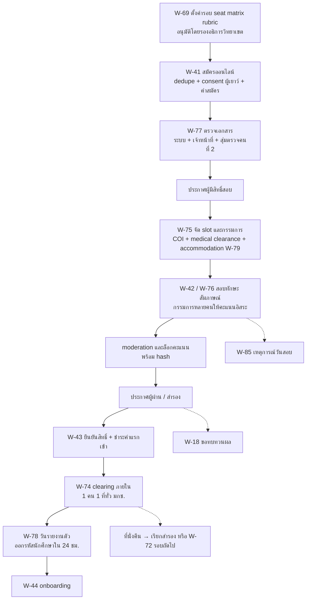
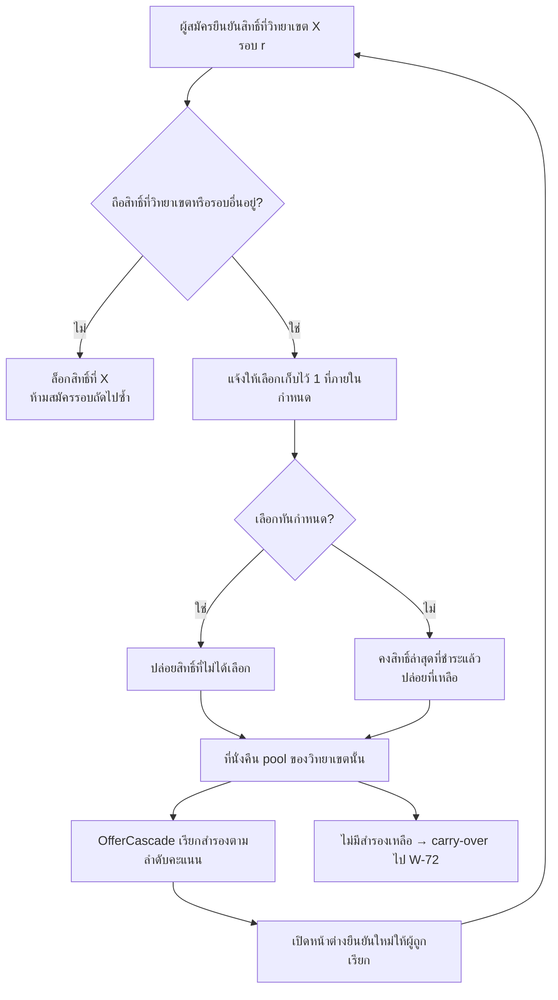
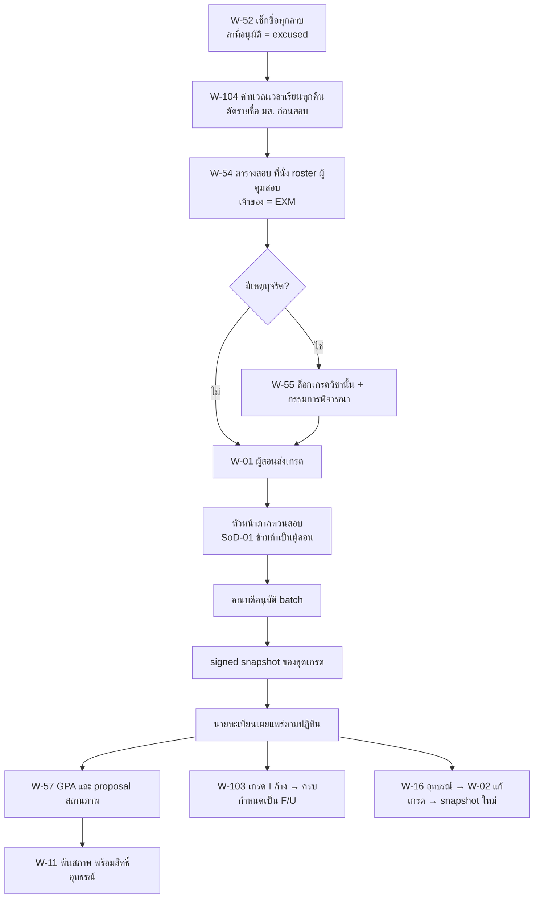
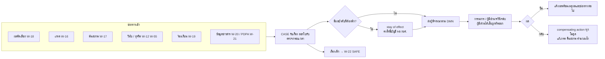
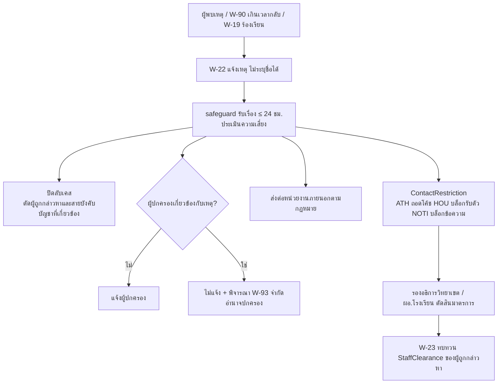
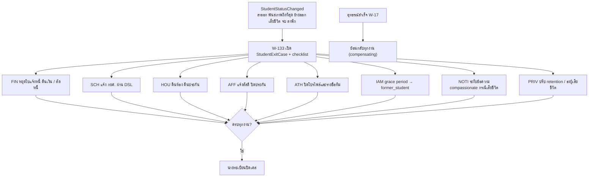
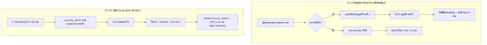
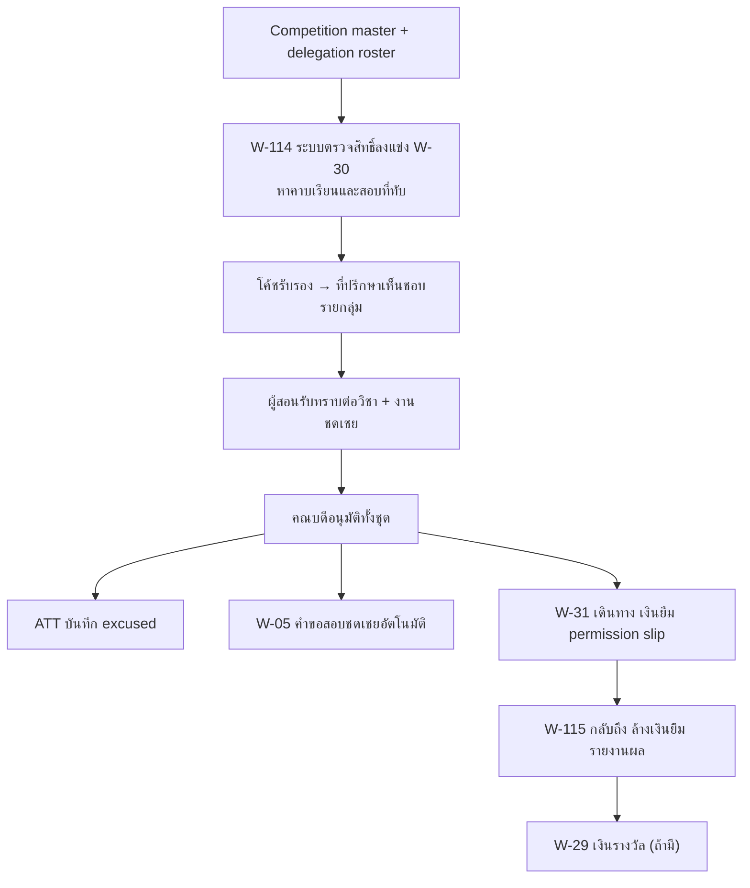

# 05 — ทะเบียน Workflow (Workflow Catalogue)

> **สถานะ:** v1.1-draft · 28 ต.ค. 2569 (หัวข้อ 1, 3, 6 สร้างใหม่จาก `data/workflows.json` ด้วย `tools/gen_05.py`) · ผู้เขียน: C · ภาษา: ไทย (ศัพท์เทคนิคเป็นภาษาอังกฤษ)
> **แหล่งข้อมูลหลัก (source of truth):** [`data/workflows.json`](data/workflows.json) — ตารางในเล่มนี้สร้างจากไฟล์นั้น ถ้าขัดกันให้ยึด JSON
> **อ่านคู่กับ:** [00-blueprint](00-blueprint.md) · [02-student-journey](02-student-journey.md) (เส้นทางนักศึกษาที่อ้าง workflow ID) · [03-academic-calendar](03-academic-calendar.md) (เวลาเกิดของแต่ละ workflow) · [04-roles-permissions](04-roles-permissions.md) (รหัสบทบาท scope SoD การมอบอำนาจ) · [06-modules](06-modules.md) (โมดูลและรายชื่อ event) · [10-security-compliance](10-security-compliance.md) (ระดับ e-signature, lawful basis)

## 1. สรุป

| รายการ | จำนวน |
|---|---|
| Workflow ทั้งหมด | **162** (W-01..W-163; **W-63 ว่าง** ตาม seed) |
| คงความหมายจาก seed (W-01..W-68) | 67 (ปรับขั้นตอนตาม review แล้ว) |
| ใหม่ (W-69 ขึ้นไป) | **95** (W-69..W-163) |
| Stage | 11 (`pre`, `first`, `term`, `during`, `sport`, `sschool`, `gradstudy`, `problem`, `grad`, `alumni`, `admin`) |
| บทบาทที่ใช้ใน JSON | 68 รหัสที่ใช้ในขั้นตอน (catalogue 69 รหัส; รายการสุดท้ายอยู่ในเล่ม 04) |
| workflow ถัดไปที่ว่าง | **W-164** |

**Schema ของ `data/workflows.json`:** เหมือน `workflows.seed.json` (`roles`, `alias`, `stages`, `workflows[{id, stage, name, sla, isNew, steps[{role, action}]}]`) และเพิ่มต่อ workflow: `module` (รหัสโมดูลตาม blueprint หัวข้อ 4 = โมดูลเจ้าของกระบวนงาน), `trigger` (เหตุที่ทำให้เริ่ม), `output` (ผลลัพธ์/สถานะ/เอกสารที่เกิด) · `isNew` ของ W-01..W-68 คงค่าเดิมจาก seed (หมายถึง "ใหม่เทียบกับการทำงานปัจจุบันของ มกช."), W-69+ เป็น `true` ทั้งหมด · `alias.student` ครอบ `student`, `candidate`, `former_student` เพื่อให้หน้า viewer กรองมุมมองนักศึกษาได้ครบ

**การย้าย stage:** W-13 (ขอออกนอกหอ) ย้ายจาก `during` ไป `sschool` เพราะเป็นงานของหอพักประจำโรงเรียนกีฬา ความหมายไม่เปลี่ยน · W-24 ผู้เริ่มเปลี่ยนจาก `student` เป็น `former_student` (ผู้ยื่นคืนสภาพไม่ใช่นักศึกษาปัจจุบัน)

**วิธีอ่านตาราง:** "ผู้เริ่ม" = บทบาทของขั้นแรก · "สายอนุมัติ / ผู้ดำเนินการ" = บทบาทของขั้นถัดไปตามลำดับ (ตัดตัวซ้ำที่ติดกัน; "ระบบ" = งานอัตโนมัติ) · 🆕 = W-69 ขึ้นไป · ชื่อบทบาทในตารางเป็นชื่อย่อ ความหมายเต็ม/รหัสดูเล่ม 04 · ขั้นตอนละเอียดของทุก workflow อยู่ใน **หัวข้อ 6 (ภาคผนวก ก)**

## 2. กฎร่วมของทุก workflow

| # | กฎ | รายละเอียด |
|---|---|---|
| R1 | **Resolve ผู้อนุมัติจาก RoleAssignment** | ไม่ระบุชื่อบุคคลใน process; หาผู้อนุมัติจากตำแหน่ง × OrgUnit ของ "เรื่อง" (เช่น คณบดีของคณะที่เปิด section) ณ เวลาที่ขั้นเริ่ม ถ้าตำแหน่งว่างหรือผู้อนุมัติลา ส่งให้ **ผู้รักษาราชการแทน (acting)** อัตโนมัติ; ถ้าเรื่องอยู่ในขอบเขต **การมอบอำนาจลงนาม (delegated authority)** ส่งให้ผู้รับมอบอำนาจ (เล่ม 04 หัวข้อ 9, W-123) |
| R2 | **SoD** | ผู้เริ่ม/ผู้ทำ (maker) อนุมัติเรื่องของตนเองไม่ได้ ระบบข้ามไปผู้อนุมัติลำดับถัดไปหรือผู้แทน (กฎ SoD-01..SoD-24 ในเล่ม 04 หัวข้อ 8) |
| R3 | **SLA + escalation** | นับเป็นวันทำการตามปฏิทินวันหยุดของ ORG ราย OrgUnit; เกิน SLA → เตือนผู้รับผิดชอบ; เกิน 2 เท่า → แจ้งผู้บังคับบัญชาถัดไป; SLA เป็นค่าตั้งต้น ปรับได้ต่อวิทยาเขต |
| R4 | **Configuration ราย OrgUnit** | ค่าธรรมเนียม ค่าปรับ ผู้ลงนาม window เวลา template แบบฟอร์ม และสายอนุมัติเป็น configuration ราย OrgUnit (blueprint ข้อ 2.3) — workflow เดียวกันใช้ได้ทุกวิทยาเขต/โรงเรียน |
| R5 | **ปฏิทินเป็นตัวสั่ง** | window ของ workflow ที่ผูกเวลา (ลงทะเบียน, W, ส่งเกรด, ยื่นจบ, รับสมัคร) เปิด-ปิดจาก AcademicCalendar ของ ORG เท่านั้น (W-117) ไม่ hard-code |
| R6 | **ใบรับและการติดตาม** | ทุกคำร้องที่ยื่นทางอิเล็กทรอนิกส์ได้ **ใบรับ** (เลขรับ + timestamp) และติดตามสถานะได้ (พ.ร.บ.การปฏิบัติราชการทางอิเล็กทรอนิกส์ 2565 — review C-21) |
| R7 | **Payment gate** | คำร้องที่มีค่าธรรมเนียม (ลาพัก/รักษาสภาพ คืนสภาพ เอกสาร) สมบูรณ์เมื่อชำระแล้ว (blueprint ข้อ 2.8) |
| R8 | **คำสั่งที่กระทบสิทธิ์** | พ้นสภาพ ลงโทษ ปฏิเสธทุน ปฏิเสธข้อมูลข่าวสาร ปฏิเสธ DSR ผลคัดเลือก: แสดงเหตุผล + **แจ้งสิทธิ์อุทธรณ์และกำหนดเวลา** ทุกครั้ง; ระหว่างระยะอุทธรณ์ไม่ทำ cascade ที่ย้อนกลับยาก (W-11, W-133) |
| R9 | **ผู้เยาว์และผู้ปกครอง** | ทุก workflow ที่กระทบผู้เยาว์: ตรวจ GuardianRelation และ CustodyRestriction ก่อนแจ้ง/ขอความเห็นผู้ปกครอง; ใช้ DMN `requires_guardian_cosign` ตามอายุ ณ วันยื่น; ผู้ปกครองของนักศึกษาที่บรรลุนิติภาวะเห็นเฉพาะหมวดที่ได้ consent (W-127, W-128, W-93) |
| R10 | **ข้อมูลอ่อนไหว** | ข้อมูลสุขภาพ คุ้มครองเด็ก การให้คำปรึกษา ความพิการ วินัย: ส่งข้ามโมดูลเป็น "สถานะ/คำสั่ง" เท่านั้น (เช่น cleared/ไม่ cleared, ContactRestriction, รายการ accommodation) ไม่ส่งรายละเอียดการวินิจฉัยหรือเนื้อหาเคส |
| R11 | **การบาดเจ็บฉุกเฉินไม่รอ consent** | บันทึกด้วยฐานประโยชน์สำคัญต่อชีวิต/หน้าที่ตามกฎหมาย consent ใช้เฉพาะการเปิดเผยต่อโค้ช/ทีม (blueprint ข้อ 9.9; W-39, W-85) |
| R12 | **Break-glass = 2 คนเสมอ** | ทั้ง break-glass ข้อมูลสุขภาพ (W-14) และบัญชีฉุกเฉินของระบบ (W-125) ต้องมีผู้อนุมัติ 2 คน; กรณีคุกคามชีวิต self-activate ได้แต่ต้องทบทวนโดย 2 คนภายใน 24 ชม. |
| R13 | **Audit** | ทุกขั้นบันทึก actor, `on_behalf_of` (กรณี acting/delegated), เวลา, ผล และเหตุผลเมื่อปฏิเสธ ลง audit แบบแก้ไขไม่ได้; ข้อมูลอ่อนไหวบันทึกทุกการ **อ่าน** ด้วย |
| R14 | **Notification** | ส่งผ่าน NOTI เท่านั้น; payload ไปช่องทางต่างประเทศ (LINE, push) มีเฉพาะหัวข้อ + ลิงก์ ไม่มีข้อมูลส่วนบุคคล; ไม่มีข้อความ 1:1 จากบุคลากรถึงผู้เยาว์ (ต้องมีผู้ปกครองหรือครูประจำชั้นในกลุ่ม) |
| R15 | **ช่องทาง** | ทำได้ทั้ง web, PWA และ LINE LIFF; ขั้นที่ต้องลงนามใช้ระดับ e-signature ตามประเภทเอกสาร (เล่ม 10); งานกรรมการสอบทักษะและนิเทศทำ offline-first แล้ว sync |
| R16 | **Event** | ทุก workflow publish event เมื่อสถานะเปลี่ยน ชื่อ event เป็นของเล่ม 06 (ตารางนี้ระบุผลลัพธ์เป็นภาษาไทย/ชื่อ entity เท่านั้น เพื่อไม่ให้ชื่อ event ซ้ำซ้อน) |
| R17 | **เวอร์ชัน** | นิยาม workflow และแบบฟอร์มมีเวอร์ชัน คำร้องที่เริ่มแล้วใช้เวอร์ชันเดิมจนจบ (W-113) |

## 3. ทะเบียน workflow ตาม stage

### สมัครและคัดเลือก (`pre`) — 21 workflow

> ก่อนเป็นนักศึกษา: ตั้งรอบ สมัครทุกช่องทาง สอบ ประกาศผล clearing ยืนยันสิทธิ์ รายงานตัว

| ID | ชื่อ | ผู้เริ่ม | สายอนุมัติ / ผู้ดำเนินการ | SLA | โมดูล | ผลลัพธ์ |
|---|---|---|---|---|---|---|
| W-18 | ขอทบทวนผลคัดเลือก (แบบเร่งด่วน ให้จบก่อนกำหนดยืนยันสิทธิ์) | ผู้สมัคร | ระบบ → งานรับสมัคร → กรรมการสอบทักษะ → หัวหน้าภาค → รองอธิการบดีประจำวิทยาเขต → ระบบ → ผู้สมัคร | ยื่น ≤ 3 วันทำการหลังประกาศ (รอบที่ยืนยัน ≤ 72 ชม.: ≤ 1 วันทำการ); ตัดสิน ≤ 5 วันทำการ (รอบยืนยัน ≤ 72 ชม.: ≤ 2 วันทำการ) และก่อนปิดยืนยันสิทธิ์ ≥ 1 วันทำการ | CASE | ยืนผล หรือแก้ผลพร้อม override + ใช้ที่นั่ง appeal_hold (ไม่เกิน AccreditedIntakeCap) |
| W-41 | สมัครเรียนออนไลน์ | ผู้สมัคร | ผู้สมัคร → ผู้ปกครอง → ผู้สมัคร → ระบบ → ผู้สมัคร → ระบบ | ตามรอบรับสมัคร | ADM | ใบสมัครสถานะชำระแล้ว/รอตรวจ + เลขที่สมัคร + ใบรับคำขอ |
| W-42 | สอบคัดเลือก สอบทักษะกีฬา และสัมภาษณ์ | งานรับสมัคร | ผู้สมัคร → ผู้ปกครอง → พยาบาล → กรรมการสอบทักษะ → ระบบ → งานรับสมัคร | ตามตารางสอบของรอบ | ADM | คะแนนรวมที่ล็อก + ประกาศผู้ผ่าน/สำรอง |
| W-43 | ยืนยันสิทธิ์และชำระค่าแรกเข้า | ผู้สมัคร | ระบบ → ผู้สมัคร → การเงิน → ระบบ → งานรับสมัคร | ตามกำหนดของรอบ (รอบท้ายอาจ 24 ชม.) | ADM | สิทธิ์ที่ยืนยันแล้ว 1 ที่ต่อคน + e-Receipt |
| W-69 🆕 | ตั้งค่าและประกาศรอบรับสมัครรายวิทยาเขต | งานรับสมัคร | งานรับสมัคร → หัวหน้าภาค → คณบดี → รองอธิการบดีประจำวิทยาเขต → ระบบ → ประชาสัมพันธ์ | อนุมัติ ≥ 30 วันก่อนเปิดรับ; เผยแพร่ ≥ 7 วันก่อนเปิดรับ | ADM | AdmissionRound เผยแพร่ + ประกาศวิทยาเขต + rubric สาธารณะ |
| W-70 🆕 | รับสมัครประเภทโควตาเรียนดี | ผู้สมัคร | ระบบ → งานรับสมัคร → กรรมการสอบทักษะ → หัวหน้าภาค → งานรับสมัคร | ตามรอบ (ราว ต.ค.–พ.ย.) | ADM | ผู้ผ่าน/สำรองโควตาเรียนดี |
| W-71 🆕 | รับสมัครประเภทโควตานักกีฬา | ผู้สมัคร | งานรับสมัคร → สมาคมกีฬา → พยาบาล → กรรมการสอบทักษะ → หัวหน้าภาค → งานรับสมัคร | ตามรอบ (ราว ต.ค.–ธ.ค.) | ADM | ผู้ผ่าน/สำรองโควตานักกีฬา + ผลงานที่ยืนยันแล้ว |
| W-72 🆕 | รับสมัครประเภททั่วไปรายรอบ (รอบ 1…n) | ระบบ | งานรับสมัคร → รองอธิการบดีประจำวิทยาเขต → ผู้สมัคร → งานรับสมัคร → กรรมการสอบทักษะ → งานรับสมัคร | รอบละ 3–6 สัปดาห์; รอบท้ายรายงานตัวภายใน 24 ชม. | ADM | ผู้ผ่านรอบ n + ที่นั่งคงเหลือสำหรับรอบถัดไป |
| W-73 🆕 | TCAS adapter (ทางเลือก) | งานรับสมัคร | ระบบ → ผู้สมัคร → ระบบ → งานรับสมัคร → ระบบ | ตามปฏิทิน ทปอ. | ADM | ไฟล์/สถานะที่แลกเปลี่ยนกับ myTCAS ครบทุกรอบที่เข้าร่วม |
| W-74 🆕 | Clearing ภายใน มกช. (ยืนยันสิทธิ์ได้ที่เดียว) และเรียกสำรอง | ผู้สมัคร | ระบบ → งานรับสมัคร → นายทะเบียน | ตรวจ uniqueness ณ เวลายืนยัน (synchronous); job J-04 ทุก 5 นาที → คืนที่นั่งและเรียกสำรอง ≤ 15 นาทีหลังเหตุ; ไม่เรียกสำรองหลัง cascade_cutoff (T0 + 5 วันทำการ) | ADM | สิทธิ์ confirmed ≤ 1 ต่อคนต่อ cycle ต่อระดับทั่ว มกช. + ที่นั่งคืน + รายชื่อสำรองที่ถูกเรียก |
| W-75 🆕 | จัดตารางสอบทักษะ / สัมภาษณ์ และแต่งตั้งกรรมการ | งานรับสมัคร | งานรับสมัคร → กรรมการสอบทักษะ → ระบบ → ผู้สมัคร → พยาบาล | ประกาศตาราง ≥ 7 วันก่อนสอบ | ADM | SkillTestSession + slot ผู้สอบ + คำสั่งแต่งตั้งกรรมการ |
| W-76 🆕 | ให้คะแนนสอบทักษะหลายกรรมการ และ moderation | กรรมการสอบทักษะ | กรรมการสอบทักษะ → ระบบ → กรรมการสอบทักษะ → ระบบ → หัวหน้าภาค → ระบบ | flag วันเดียวกับวันสอบ; ปิด moderation ≤ 1 วันทำการหลังวันสอบ และก่อนรวมคะแนน (QS-12) | ADM | คะแนนรวมที่ล็อก (hash) + บันทึก moderation + อันดับ |
| W-77 🆕 | ตรวจเอกสารผู้สมัคร | ระบบ | งานรับสมัคร → ผู้สมัคร → งานรับสมัคร → ระบบ | ≤ 3 วันทำการต่อใบสมัคร | ADM | สถานะเอกสาร verified / rejected / ขอเพิ่ม |
| W-78 🆕 | วันรายงานตัว (ออกรหัสนักศึกษา) | ระบบ | ผู้สมัคร → นายทะเบียน → ระบบ → งานรับสมัคร | ภายใน 24 ชม. หลังยืนยันและชำระ | ADM | รหัสนักศึกษา + ส่งต่อ REC (เปิด W-44) |
| W-79 🆕 | จัด accommodation ในการสอบคัดเลือกสำหรับผู้สมัครพิการ | ผู้สมัคร | หน่วยบริการนักศึกษาพิการ → หัวหน้าภาค → งานรับสมัคร → กรรมการสอบทักษะ → ผู้สมัคร | ยื่น ≥ 10 วันทำการก่อนวันสอบ; อนุมัติ ≤ 3 วันทำการ และ ≥ 5 วันทำการก่อนวันสอบ; ยื่นช้ากว่านั้นได้ provisional accommodation วันสอบ | ADM | AccommodationPlan วันสอบ (ไม่มีรายละเอียดการวินิจฉัย) |
| W-80 🆕 | ผู้สมัครต่างชาติ: เทียบวุฒิและเอกสารวีซ่า | ผู้สมัคร | งานนักศึกษาต่างชาติ → งานรับสมัคร → งานนักศึกษาต่างชาติ → ผู้สมัคร → ระบบ | ตามรอบ + เวลาขอวีซ่า | ADM | ผลเทียบวุฒิ + หนังสือตอบรับเพื่อขอวีซ่า Non-ED |
| W-81 🆕 | ยกเว้น / คืนค่าสมัคร | ผู้สมัคร | งานรับสมัคร → การเงิน → ระบบ → ผู้ตรวจสอบภายใน | 5 วันทำการ | FIN | Waiver หรือ Refund + รายงาน exception |
| W-82 🆕 | รับโอน / เทียบโอนจาก ปวส. หรือสถาบันอื่น | ผู้สมัคร | งานรับสมัคร → หัวหน้าภาค → คณบดี → การเงิน → นายทะเบียน | ภายในภาคแรก | ADM | ผลเทียบโอนรายวิชา + แผนการเรียน + สถานะนักศึกษาโอน |
| W-85 🆕 | เหตุการณ์วันสอบทักษะ (บาดเจ็บ / ขาดสอบ / ขอเลื่อน) | กรรมการสอบทักษะ | พยาบาล → ผู้สมัคร → งานรับสมัคร → หัวหน้าภาค | ยื่นภายใน 48 ชม.; ตัดสินก่อนประกาศผล | ADM | SkillTestIncident + slot ใหม่ หรือผลขาดสอบ |
| W-144 🆕 | นักเรียนโรงเรียนกีฬาสมัครต่อ มกช. (โควตาภายใน) | นักศึกษา | ผู้ปกครอง → ระบบ → ผู้อำนวยการ → งานรับสมัคร → โค้ช → งานรับสมัคร | ตามรอบโควตา | ADM | ใบสมัครโควตาภายในที่ดึงผลการเรียนและผลงานกีฬามาให้อัตโนมัติ |
| W-163 🆕 | ยืนยันสิทธิ์ซ้ำก่อนเปิดภาค (pre-term reconfirmation) สำหรับผู้ยืนยันสิทธิ์รอบต้น | ระบบ | ผู้สมัคร → งานรับสมัคร → ระบบ → งานรับสมัคร | window ยืนยันซ้ำ [config ตัวอย่าง 1–15 พ.ค.]; ไม่ยืนยัน → สละสิทธิ์หลังพ้น window + 2 วันทำการ | ADM | สถานะ reconfirmed หรือ waived + ที่นั่งเข้า cascade (ก่อน cascade_cutoff) |

### เข้าเรียนปีแรก (`first`) — 9 workflow

> รายงานตัว ตรวจสุขภาพ หอพัก ปฐมนิเทศ กยศ. ผูกบัญชีผู้ปกครอง ตรวจวุฒิ

| ID | ชื่อ | ผู้เริ่ม | สายอนุมัติ / ผู้ดำเนินการ | SLA | โมดูล | ผลลัพธ์ |
|---|---|---|---|---|---|---|
| W-44 | รายงานตัว / มอบตัวนักศึกษาใหม่ | นักศึกษา | นักศึกษา → ผู้ปกครอง → ระบบ → นายทะเบียน → ระบบ | ก่อนเปิดภาค; ผู้รับเข้ารอบท้าย (matriculated ≥ T0 − 7 วัน) ใช้ W-148 ภายใน 14 วันหลังรายงานตัว | REC | สถานะนักศึกษา ACTIVE + บัญชี IT + บัตรนักศึกษาดิจิทัล |
| W-45 | ตรวจสุขภาพและทดสอบสมรรถภาพแรกเข้า | นักศึกษา | แพทย์ → ระบบ → นักวิทยาศาสตร์การกีฬา → ระบบ → โค้ช | สัปดาห์แรก (PPE เสร็จ ≤ สัปดาห์ที่ 3; ระหว่างนั้นใช้ PRE_TEST เป็น provisional) | HLT | medical clearance + โปรไฟล์นักกีฬา |
| W-46 | ขอหอพักและเข้าพัก | นักศึกษา | ระบบ → หอพัก → ผู้ปกครอง → นักศึกษา → หอพัก | ก่อนเปิดภาค | HOU | สัญญาหอพัก + การเข้าพัก + งาน ตม.30 (ถ้าต่างชาติ) |
| W-47 | ปฐมนิเทศ | กิจการนักศึกษา | นักศึกษา → ระบบ → ผู้ปกครอง → นักศึกษา | ก่อนเปิดภาค | AFF | ชั่วโมงกิจกรรมใน ledger ของ AFF + การรับทราบระเบียบ |
| W-48 | ยื่นกู้ กยศ. | นักศึกษา | เจ้าหน้าที่ กยศ. → ระบบ → นักศึกษา | ตามรอบ กยศ. (Pre-Approve พ.ค.–ก.ค., ยื่นกู้ ก.ค.–ก.ย.) | SCH | สัญญากู้ + deferment ค่าเทอมระหว่างรอเงิน |
| W-127 🆕 | ผูกบัญชีผู้ปกครองและยืนยันความสัมพันธ์ (ระดับการยืนยัน 2 ระดับ + ช่องทางเจ้าหน้าที่ช่วย) | ผู้ปกครอง | ระบบ → นายทะเบียน → นักศึกษา → ระบบ | 3 วันทำการ | REC | GuardianRelation (LEGAL / CAREGIVER / LOCAL_GUARDIAN / OBSERVER / EMERGENCY_CONTACT / PICKUP) + verification_level + ABAC grant |
| W-134 🆕 | ตรวจวุฒิการศึกษาเดิมของนักศึกษาใหม่ | ระบบ | งานสารบรรณ → นายทะเบียน → ระบบ | ภายในภาคแรก | REC | ผลตรวจวุฒิ; ไม่ผ่าน → เสนอพ้นสภาพ |
| W-148 🆕 | Fast-track ผู้รับเข้ารอบท้าย (late-admit): รายงานตัว ยกเว้นค่าปรับ ปฐมนิเทศ สุขภาพ หอพัก census | ระบบ | ระบบ → นักศึกษา → พยาบาล → หอพัก → อาจารย์ที่ปรึกษา → นายทะเบียน | ภายใน 14 วันหลังรายงานตัว (รหัส/บัญชี/ลงทะเบียน block ภายใน 24 ชม.) | REC | สถานะนักศึกษา + ลงทะเบียน block ภาค 1 โดยไม่มีค่าปรับ + ATT baseline จาก matriculated_at + checklist 14 วัน + ธงเข้าหลังวันตัดยอดในรายงาน census |
| W-160 🆕 | ผู้อุปการะ (CAREGIVER) และผู้ปกครองในประเทศ (LOCAL_GUARDIAN) | ผู้ปกครอง | ครูประจำชั้น → ผู้อำนวยการ → ระบบ → ผู้รับผิดชอบด้านคุ้มครองเด็ก | 5 วันทำการ | REC | GuardianRelation(CAREGIVER / LOCAL_GUARDIAN) พร้อมรายการสิทธิ์ที่กำหนดและวันหมดอายุ |

### ทุกภาคเรียน (`term`) — 19 workflow

> วนซ้ำทุกเทอม: ตารางสอน ลงทะเบียน ค่าปรับ จ่ายค่าเทอม เข้าเรียน มส. สอบ เกรด ปิด I

| ID | ชื่อ | ผู้เริ่ม | สายอนุมัติ / ผู้ดำเนินการ | SLA | โมดูล | ผลลัพธ์ |
|---|---|---|---|---|---|---|
| W-01 | ส่งเกรด | อาจารย์ผู้สอน | หัวหน้าภาค → คณบดี → ระบบ → นายทะเบียน → นักศึกษา | 3 วันทำการ | ASM | เกรดเผยแพร่ + signed snapshot ของชุดเกรด |
| W-03 | ถอนรายวิชา (W) / ลงหน่วยกิตเกินหรือต่ำกว่าเกณฑ์ | นักศึกษา | ระบบ → ผู้ปกครอง → อาจารย์ที่ปรึกษา → อาจารย์ผู้สอน → คณบดี → นายทะเบียน | 2 วันทำการ | REG | Enrollment สถานะ W หรืออนุมัติหน่วยกิตพิเศษ |
| W-05 | สอบชดเชย / เลื่อนสอบ | นักศึกษา | อาจารย์ผู้สอน → หัวหน้าภาค → นายทะเบียน → นักศึกษา | 3 วันทำการ (สายลัดจาก W-04/W-114: จัดรอบภายใน 5 วันทำการหลังกลับ) | EXM | MakeupExam ที่จัดแล้ว |
| W-49 | ลงทะเบียนเรียน | ระบบ | อาจารย์ที่ปรึกษา → นักศึกษา → ระบบ → นักศึกษา → การเงิน | ตามปฏิทินการศึกษา | REG | Enrollment + ตารางเรียน + ใบแจ้งหนี้ |
| W-50 | เพิ่ม-ลดรายวิชา | นักศึกษา | ระบบ → อาจารย์ที่ปรึกษา → นายทะเบียน → การเงิน | 2 สัปดาห์แรกของภาค | REG | Enrollment ที่ปรับแล้ว + ใบแจ้งหนี้/credit note |
| W-51 | ชำระค่าเทอม | การเงิน | นักศึกษา → ระบบ → การเงิน → ระบบ | ตามกำหนดชำระ | FIN | Payment + e-Receipt + ปลด hold |
| W-52 | เข้าเรียนและเช็กชื่อ | อาจารย์ผู้สอน | นักศึกษา → ระบบ → อาจารย์ที่ปรึกษา → นักศึกษา | ทุกคาบ | ATT | AttendanceMark + สถานะเสี่ยง มส. |
| W-53 | ลาป่วย / ลากิจ | นักศึกษา | อาจารย์ผู้สอน → ระบบ | ภายใน 3 วัน | ATT | AttendanceMark = ลา (excused) |
| W-54 | สอบกลางภาค / ปลายภาค | นายทะเบียน | ระบบ → นักศึกษา → กรรมการคุมสอบ → อาจารย์ผู้สอน | ตามตารางสอบ | EXM | ExamSitting + คะแนน + incident (ถ้ามี) |
| W-56 | ประเมินการสอน | ระบบ | นักศึกษา → อาจารย์ผู้สอน → คณบดี | ปลายภาค | ASM | ผลประเมินแบบ aggregate |
| W-57 | ดูผลการเรียนและสถานภาพ | ระบบ | นายทะเบียน → นักศึกษา → อาจารย์ที่ปรึกษา → ระบบ | เกรดเผยแพร่และจำแนกสถานภาพ (sign-off) ก่อนเปิด slot ลงทะเบียนภาคถัดไป ≥ 1 วันทำการ (linter L-4) | REC | GPA/GPAX + proposal สถานภาพ (ปกติ / รอพินิจ / พ้นสภาพ) |
| W-100 🆕 | แผนเปิดรายวิชา ตารางสอน และเปิดกลุ่มเรียน | ระบบ | หัวหน้าภาค → ระบบ → คณบดี → นายทะเบียน → อาจารย์ผู้สอน | T−8 ถึง T−4 สัปดาห์ก่อนเปิดภาค | REG | OfferingPlan อนุมัติ + Section + ตารางสอนเผยแพร่ |
| W-101 🆕 | ปิดกลุ่มเรียนที่มีผู้ลงทะเบียนน้อย | ระบบ | หัวหน้าภาค → คณบดี → ระบบ → การเงิน → นักศึกษา | ภายในสัปดาห์แรกของการเพิ่ม-ลด | REG | SectionCancelled + ย้ายนักศึกษา + ปรับหนี้ |
| W-102 🆕 | ลงทะเบียนล่าช้าพร้อมค่าปรับ | นักศึกษา | ระบบ → อาจารย์ที่ปรึกษา → นักศึกษา → การเงิน → ระบบ | สัปดาห์ 1–2 ของภาค | REG | Enrollment + ใบแจ้งหนี้ที่รวมค่าปรับ |
| W-103 🆕 | ปิดค่า I (ไม่สมบูรณ์) | ระบบ | นักศึกษา → อาจารย์ผู้สอน → หัวหน้าภาค → นายทะเบียน → ระบบ | ภายในกำหนดของภาคถัดไป [ต้องตรวจสอบ] | ASM | เกรดจริงแทน I หรือ F/U อัตโนมัติ |
| W-104 🆕 | ประกาศรายชื่อผู้หมดสิทธิ์สอบ (มส.) | ระบบ | อาจารย์ผู้สอน → หัวหน้าภาค → ระบบ → นักศึกษา | 1 สัปดาห์ก่อนสอบปลายภาค | ATT | ExamEligibility ล็อกใน EXM |
| W-105 🆕 | ยืนยันสถานภาพและยกเลิกรายวิชาผู้ไม่ชำระเงิน | ระบบ | ระบบ → การเงิน → นายทะเบียน → ระบบ | payment.due + grace (J-15) — ไม่ใช่วัน T0; ผู้รับเข้ารอบท้าย (W-148) ได้ due date ของตนเอง | FIN | รายชื่อยกเลิก + แจ้งเตือนสถานภาพ |
| W-106 🆕 | ลงทะเบียนข้ามวิทยาเขต / เรียนร่วม | นักศึกษา | อาจารย์ที่ปรึกษา → หัวหน้าภาค → นายทะเบียน → การเงิน | ช่วงลงทะเบียน | REG | Enrollment ข้าม OrgUnit + การนับหน่วยกิต |
| W-162 🆕 | ตรวจสิทธิ์การลงทะเบียนซ้ำเมื่อเกรด/สถานภาพเปลี่ยนหลังลงทะเบียน (post-standing re-validation) | ระบบ | ระบบ → นายทะเบียน → อาจารย์ที่ปรึกษา | ภายใน 1 วันทำการหลังเกรดเปลี่ยน; นักศึกษาเลือกถอนรายวิชาส่วนเกินภายใน 5 วันทำการ | REG | สถานภาพที่คำนวณใหม่ + การปรับ Enrollment (ระงับส่วนเกิน / re-add) + แจ้งเตือน |

### ระหว่างเรียน (`during`) — 22 workflow

> เรื่องที่เกิดเป็นครั้งคราว: เอกสาร ทุน ทหาร กิจกรรม ฝึกงาน ประกัน สนาม คำร้อง

| ID | ชื่อ | ผู้เริ่ม | สายอนุมัติ / ผู้ดำเนินการ | SLA | โมดูล | ผลลัพธ์ |
|---|---|---|---|---|---|---|
| W-07 | ขอทุนการศึกษา | นักศึกษา | ระบบ → อาจารย์ที่ปรึกษา → งานทุน → รองอธิการบดีประจำวิทยาเขต → การเงิน | ตามรอบทุน | SCH | AwardGranted → วางบิลผู้ให้ทุน/จ่ายทุน |
| W-21 | ขอดู แก้ หรือลบข้อมูลส่วนตัว (PDPA) | นักศึกษา | ระบบ → DPO → เจ้าของข้อมูล → นักศึกษา | ไม่เกิน 30 วัน | CASE | ผลตามสิทธิ์ หรือหนังสือปฏิเสธพร้อมเหตุผล |
| W-25 | ย้ายสาขา / เทียบโอนหน่วยกิต | นักศึกษา | หัวหน้าภาค → คณบดี → นายทะเบียน | 10 วันทำการ | REC | สาขาใหม่ + หน่วยกิตเทียบโอน + PolicySet ที่ถูกต้อง |
| W-27 | ผ่อนชำระค่าเทอม | นักศึกษา | การเงิน → รองอธิการบดีประจำวิทยาเขต → ระบบ → เจ้าหน้าที่ กยศ. | 3 วันทำการ | FIN | PaymentPlan / Deferment + ปลด hold ชั่วคราว |
| W-32 | ฝึกสอน (วิชาชีพครู) | ศูนย์ฝึกประสบการณ์วิชาชีพ | บุคลากร → ผู้บริหารสถานศึกษาที่รับนักศึกษาฝึกสอน → ศูนย์ฝึกประสบการณ์วิชาชีพ → นักศึกษา → อาจารย์นิเทศก์ → ครูพี่เลี้ยง → ศูนย์ฝึกประสบการณ์วิชาชีพ → คณบดี | ตลอดภาค | PRA | Placement + ผลประเมิน 3 ฝ่าย + เกรด + รายชื่อส่งคุรุสภา |
| W-33 | ขอปรับวิธีเรียนหรือสอบ (ผู้พิการ) | นักศึกษา | หน่วยบริการนักศึกษาพิการ → อาจารย์ผู้สอน → นายทะเบียน → ระบบ | 5 วันทำการ | AFF | AccommodationPlan (ส่งเฉพาะรายการปรับ ไม่มีการวินิจฉัย) |
| W-34 | คำร้องออนไลน์อื่น ๆ (e-Form) | นักศึกษา | ระบบ → นายทะเบียน → คณบดี → ระบบ → นักศึกษา | ตามประเภทคำร้อง | SVC | ผลคำร้อง + สถานะติดตามได้ |
| W-58 | ขอเอกสาร: ใบรับรอง / transcript | นักศึกษา | นักศึกษา → ระบบ → นายทะเบียน → นักศึกษา | ทันที (เอกสารมาตรฐาน) | GRD | PDF/A ลงนามดิจิทัล + ลิงก์ตรวจสอบ |
| W-59 | ผ่อนผันการตรวจเลือกทหาร | นักศึกษา | กิจการนักศึกษา → ระบบ → กิจการนักศึกษา → นักศึกษา | ก่อนรอบเกณฑ์ทหาร | AFF | บัญชีรายชื่อส่งสัสดี + หนังสือยืนยัน |
| W-60 | กิจกรรม / จิตอาสา | กิจการนักศึกษา | นักศึกษา → ระบบ → นักศึกษา | ตลอดปี | AFF | ชั่วโมงใน ActivityHourLedger + activity transcript |
| W-61 | นัดพบอาจารย์ที่ปรึกษา / ขอคำปรึกษา | นักศึกษา | อาจารย์ที่ปรึกษา | ตามนัด | AFF | บันทึกการพบ (แยกหมวดวิชาการกับเรื่องส่วนตัว) |
| W-62 | ฝึกงาน / สหกิจศึกษา | นักศึกษา | หัวหน้าภาค → สถานประกอบการ → นักศึกษา → สถานประกอบการ → อาจารย์ผู้สอน | ตลอดภาค | PRA | บันทึกฝึกงาน + ผลประเมิน + เกรด |
| W-107 🆕 | ประกันอุบัติเหตุและการเคลม | นักศึกษา | กิจการนักศึกษา → ระบบ → บริษัทประกันภัยคู่สัญญา → กิจการนักศึกษา | ยื่นภายในกำหนดของกรมธรรม์ [ต้องตรวจสอบ] | HLT | InsuranceClaim + ผลการจ่าย |
| W-111 🆕 | จองสนามและสิ่งอำนวยความสะดวก | นักศึกษา | ระบบ → งานอาคารสถานที่ → การเงิน → งานอาคารสถานที่ | อนุมัติ ≤ 2 วันทำการ | FAC | Booking + ใบแจ้งหนี้ (ภายนอก) |
| W-119 🆕 | ยืนยันเบิก กยศ. รายภาคและชั่วโมงจิตอาสา | ระบบ | นักศึกษา → เจ้าหน้าที่ กยศ. → ระบบ | ภาค 1 ภายใน 31 ต.ค.; ภาค 2 ภายใน 28 ก.พ. | SCH | การยืนยันเบิกครบ + ตัดยอดหนี้เมื่อเงินเข้า |
| W-120 🆕 | ขอยกเว้น / ลดหย่อนค่าธรรมเนียมการศึกษา | นักศึกษา | หัวหน้างานกีฬา → การเงิน → คณบดี → การเงิน → ระบบ → ผู้ตรวจสอบภายใน | 10 วันทำการ | FIN | FeeWaiver + credit note + audit + รายงาน exception รายเดือน |
| W-128 🆕 | ผู้ปกครองของนักศึกษาที่บรรลุนิติภาวะขอดูข้อมูล | ผู้ปกครอง | นักศึกษา → ระบบ → นักศึกษา | นักศึกษาตอบภายใน 7 วัน | PRIV | Consent รายหมวด (เพิกถอนได้) |
| W-131 🆕 | เปลี่ยนชื่อ-สกุลและออกเอกสารใหม่ | นักศึกษา | ระบบ → นายทะเบียน → ระบบ | 5 วันทำการ | REC | ชื่อแบบ effective-dated + เอกสารฉบับใหม่ตามคำขอ |
| W-140 🆕 | ขอเรียนแทน / ยกเว้นรายวิชา / ยกเว้นวิชาบังคับก่อน | นักศึกษา | อาจารย์ที่ปรึกษา → หัวหน้าภาค → คณบดี → นายทะเบียน | 10 วันทำการ | REG | CourseSubstitution / PrerequisiteWaiver ที่ degree audit อ่าน |
| W-143 🆕 | เปลี่ยนบัญชีรับเงิน (คืนเงิน / ทุน / เคลม) | นักศึกษา | ระบบ → การเงิน | ใช้ได้หลัง cooling period 24 ชม. | FIN | บัญชีที่ยืนยันชื่อแล้ว |
| W-147 🆕 | ต่อสัญญาหอ / ย้ายห้อง / ย้ายออก และคืนเงินประกัน | นักศึกษา | หอพัก → นักศึกษา → การเงิน → ระบบ | 7 วันทำการ | HOU | สัญญาใหม่ ห้องใหม่ หรือการคืนห้องพร้อมคืนเงินประกันหลังหักค่าเสียหาย |
| W-156 🆕 | เตรียมความพร้อมฝึกสอนก่อน 16 พ.ค.: ลงทะเบียนล่วงหน้า ประกัน และ StaffClearance | ศูนย์ฝึกประสบการณ์วิชาชีพ | นักศึกษา → นายทะเบียน → บุคลากร → กิจการนักศึกษา → ระบบ | ลงทะเบียน/ชำระหรือผ่อนผันภายใน PRACTICUM_REGISTRATION (≤ 10 พ.ค.); ทุกอย่างมีผล ณ PRACTICUM_PERIOD.start | PRA | Enrollment วิชาฝึกสอน + สถานะนักศึกษาภาค 1 มีผล ณ วันเริ่มฝึก + roster ประกัน + StaffClearance ที่ยังไม่หมดอายุ |

### นักกีฬา (`sport`) — 18 workflow

> ฝึกซ้อม คัดกรอง แข่งขัน ลาแข่งยกคณะ เดินทาง บาดเจ็บ ส่งต่อ talent pathway

| ID | ชื่อ | ผู้เริ่ม | สายอนุมัติ / ผู้ดำเนินการ | SLA | โมดูล | ผลลัพธ์ |
|---|---|---|---|---|---|---|
| W-04 | ลาไปแข่งขัน / เก็บตัว (รายบุคคล) ตามระดับรายการ | นักศึกษา | ระบบ → โค้ช → อาจารย์ที่ปรึกษา → คณบดี → อาจารย์ผู้สอน → ระบบ | T1 อนุมัติอัตโนมัติทันที; T2 2 วันทำการ; T3 3 วันทำการ (เร่งด่วน 1 วัน) | ATH | CompetitionLeave (tier T1/T2/T3) + excused attendance + MakeupExam อัตโนมัติ (W-05 สายลัด) |
| W-14 | ขอดูข้อมูลสุขภาพนักกีฬา (กรณีพิเศษ / break-glass ข้อมูลสุขภาพ) | แพทย์ | แพทย์ → DPO → ระบบ → DPO | ทันที; ฉุกเฉินทบทวน ≤ 24 ชม. | HLT | access grant มีวันหมดอายุ + access log + ผลทบทวน |
| W-30 | ตรวจสิทธิ์ลงแข่ง | โค้ช | ระบบ → นายทะเบียน → หัวหน้างานกีฬา | 3 วันทำการ | ATH | EligibilityCheck ที่รับรองแล้ว |
| W-31 | เดินทางไปแข่งขัน | โค้ช | ระบบ → หัวหน้างานกีฬา → การเงิน → ผู้ปกครอง → ระบบ → โค้ช | ก่อนเดินทาง 5 วัน; เรียกตัวด่วน < 5 วัน: อนุมัติทริปได้ก่อนและทำเอกสารการเงินภายหลัง (gate ผู้ควบคุมยังเป็น hard) | ATH | TeamTrip + เงินยืม + permission slip ต่อทริป |
| W-39 | บันทึกการบาดเจ็บ | นักกายภาพบำบัด | โค้ช → นักกายภาพบำบัด → นักศึกษา → แพทย์ | ทันที | HLT | InjuryRecord ใน hlt_vault + สถานะความพร้อม (FULL / MODIFIED / UNAVAILABLE) + แผน RTP |
| W-68 | ฝึกซ้อมและติดตามสมรรถภาพ | โค้ช | นักศึกษา → นักวิทยาศาสตร์การกีฬา → ระบบ → โค้ช | ทุกวัน / ทุกภาค | ATH | session log + training load trend + readiness (decision support) |
| W-109 🆕 | ส่งต่อบริการโภชนาการ / จิตวิทยาการกีฬา | โค้ช | นักศึกษา → นักโภชนาการการกีฬา → นักจิตวิทยาการกีฬา → โค้ช | นัดภายใน 5 วันทำการ | ATH | Referral + แผนบริการ (บันทึกลับ) |
| W-110 🆕 | จองห้องปฏิบัติการวิทยาศาสตร์การกีฬา (สัญญาแยก) | นักวิทยาศาสตร์การกีฬา | ระบบ → เจ้าหน้าที่ห้องปฏิบัติการวิทยาศาสตร์การกีฬา → นักวิทยาศาสตร์การกีฬา → เจ้าหน้าที่ห้องปฏิบัติการวิทยาศาสตร์การกีฬา | อนุมัติ ≤ 3 วันทำการ | LAB | LabBooking + ผลทดสอบเข้าโปรไฟล์ |
| W-112 🆕 | ทบทวน talent pathway รายภาค | นักวิทยาศาสตร์การกีฬา | โค้ช → หัวหน้างานกีฬา → นักศึกษา → ระบบ | ทุกภาค | ATH | ระดับ pathway + แผนพัฒนารายบุคคล |
| W-114 🆕 | ยื่นลาแข่งแบบยกคณะ (batch) — อนุมัติครั้งเดียวระดับคณะ | โค้ช | หัวหน้างานกีฬา → ระบบ → คณบดี → อาจารย์ที่ปรึกษา → อาจารย์ผู้สอน → ระบบ | 2 วันทำการต่อคณะ (เร่งด่วน 1 วัน); T1 อนุมัติอัตโนมัติ | ATH | CompetitionLeaveBatch (ATH) + excused attendance (ATT) + MakeupExam อัตโนมัติ (EXM) โดยไม่ต้องอนุมัติซ้ำ |
| W-115 🆕 | เดินทางกลับและล้างเงินยืม | โค้ช | ระบบ → โค้ช → การเงิน → หัวหน้างานกีฬา → ระบบ | ล้างเงินยืมภายในกำหนดของระเบียบเงินยืม [ต้องตรวจสอบ] | FIN | เงินยืมล้างแล้ว + ผลการแข่งขัน + คำขอเงินรางวัล |
| W-130 🆕 | คัดกรองสุขภาพก่อนฤดูแข่ง / ก่อนวิชาปฏิบัติ | ระบบ | นักศึกษา → แพทย์ → ระบบ → โค้ช | ก่อนฤดูแข่งหรือก่อนลงทะเบียน | HLT | MedicalClearance (สถานะเท่านั้นที่ส่งออก) |
| W-146 🆕 | แผนการเรียนยืดหยุ่น / ลาระยะยาวของนักกีฬาทีมชาติ | นักศึกษา | โค้ช → อาจารย์ที่ปรึกษา → อาจารย์ผู้สอน → คณบดี → นายทะเบียน → ระบบ | 10 วันทำการ | ATH | แผนการเรียนรายบุคคล (ลดหน่วยกิต เรียนออนไลน์ สอบนอกตาราง) ผูกกับตารางแข่ง |
| W-150 🆕 | คัดเลือกตัวนักกีฬา / ประกาศทีม และทบทวนผลการคัดเลือก | โค้ช | หัวหน้างานกีฬา → โค้ช → นักศึกษา → หัวหน้างานกีฬา → ศูนย์รับเรื่องร้องเรียน → งานทุน → ระบบ | เผยแพร่ SelectionPolicy ≥ 14 วันก่อนคัดตัว; ขอทบทวน ≤ 3 วันทำการ; ตัดสิน ≤ 3 วันทำการ และก่อนส่งรายชื่อ (W-30) | ATH | SelectionPolicy ที่เผยแพร่ + SelectionDecision พร้อมเหตุผลรายคน + ผลทบทวน/อุทธรณ์ |
| W-152 🆕 | สงสัยกระทบกระเทือนสมอง (suspected concussion): ถอดออกทันที → ประเมิน → กลับเรียน → กลับเล่น | โค้ช | ระบบ → แพทย์ → ระบบ → นักกายภาพบำบัด → แพทย์ → ระบบ | ถอดออกทันที; ห้ามกลับเล่นวันเดียวกัน; ประเมินโดย physician ≤ 24–72 ชม.; แต่ละขั้น return-to-sport ≥ 24 ชม. (ผู้เยาว์ยาวกว่า) | HLT | ConcussionEpisode ใน hlt_vault + สถานะ UNAVAILABLE + แผน return-to-learn/return-to-sport + clearance |
| W-153 🆕 | ความร้อน (heat stress): วัด WBGT ปรับกิจกรรม และรับมือ heat illness | งานอาคารสถานที่ | โค้ช → ระบบ → พยาบาล → หัวหน้างานกีฬา | วัดก่อนเริ่มและทุก 1 ชม. ระหว่างกิจกรรมกลางแจ้ง; heat illness: ลดอุณหภูมิทันทีก่อนเคลื่อนย้าย | FAC | HeatReading + การปรับกิจกรรมที่บันทึก + HeatIllness incident (ถ้ามี) |
| W-154 🆕 | การจัดการน้ำหนักในกีฬารุ่นน้ำหนัก (weight management) และห้ามลดน้ำหนักเร่งด่วน | โค้ช | นักโภชนาการการกีฬา → นักศึกษา → ระบบ → แพทย์ | ประกาศรุ่นต้นฤดู; ชั่งน้ำหนักตามรอบ; flag ภายใน 24 ชม. | ATH | WeightManagementPlan + WeighIn log + flag การลดน้ำหนักผิดเกณฑ์ |
| W-157 🆕 | บันทึกและทบทวน classification นักกีฬาพาราฯ (ParaClassification) | นักศึกษา | หน่วยบริการนักศึกษาพิการ → หัวหน้างานกีฬา → ระบบ | เตือนก่อนวันทบทวน 60 วัน; บันทึกผล ≤ 5 วันทำการหลังได้รับผล | ATH | ParaClassification (sport_class, status NEW/REVIEW/CONFIRMED, review_date, ผู้จัดประเภท) ที่ eligibility DMN อ่านได้ |

### โรงเรียนกีฬา (`sschool`) — 12 workflow

> รับนักเรียน ม.1/ม.4 มอบตัว หอพักประจำ ปพ. ประชุมผู้ปกครอง เลื่อนชั้น ย้ายออก

| ID | ชื่อ | ผู้เริ่ม | สายอนุมัติ / ผู้ดำเนินการ | SLA | โมดูล | ผลลัพธ์ |
|---|---|---|---|---|---|---|
| W-13 | ขอออกนอกหอ (โรงเรียนกีฬา) | นักศึกษา | ระบบ → ผู้ปกครอง → หอพัก → ระบบ | ไม่เกิน 4 ชม. | HOU | LeavePass + บันทึกเวลาออก-กลับ |
| W-83 🆕 | รับนักเรียนโรงเรียนกีฬา ม.1 / ม.4 | ผู้อำนวยการ | ผู้ปกครอง → งานรับสมัคร → แพทย์ → กรรมการสอบทักษะ → ผู้อำนวยการ → งานรับสมัคร | ตามประกาศโรงเรียน (ราว ธ.ค.–มี.ค.) | ADM | ผู้ผ่าน/สำรอง + นัดมอบตัว |
| W-86 🆕 | มอบตัวนักเรียนใหม่และเข้าหอพักประจำ | ผู้ปกครอง | นายทะเบียน → ระบบ → พยาบาล → หอพัก → ครูประจำชั้น | ก่อนเปิดภาค (กลาง พ.ค.) | SSC | ทะเบียนนักเรียน + GuardianRelation + pickup list + การเข้าหอ |
| W-87 🆕 | ผลการเรียนรายภาคและสมุดพก (ปพ.5 / ปพ.6) | ครูผู้สอนโรงเรียนกีฬา | ครูประจำชั้น → นายทะเบียน → ผู้อำนวยการ → ระบบ → ผู้ปกครอง | ≤ 2 สัปดาห์หลังปิดภาค | SSC | ผลการเรียนอนุมัติ + ปพ.6 ดิจิทัล |
| W-88 🆕 | จบ ม.3 / ม.6 และออก ปพ.1 / ปพ.2 / ปพ.3 | ระบบ | นายทะเบียน → ผู้อำนวยการ → ระบบ → ผู้ปกครอง → ระบบ | ภายใน มี.ค. (ทันการสมัครเรียนต่อ) | SSC | ผู้จบการศึกษาขั้นพื้นฐาน + เอกสาร ปพ. ลงนามดิจิทัล |
| W-89 🆕 | ประชุมผู้ปกครอง | ผู้อำนวยการ | ครูประจำชั้น → ผู้ปกครอง → ครูประจำชั้น → ระบบ | ภาคเรียนละครั้ง | ENG | บันทึกการเข้าร่วม + ประเด็นติดตามรายบุคคล |
| W-90 🆕 | เช็กชื่อหอพักประจำและแจ้งเกินเวลากลับ | หอพัก | ระบบ → หอพัก → ผู้ปกครอง → ผู้อำนวยการ → ระบบ | เช็กชื่อทุกคืน; แจ้งเกินเวลาภายใน 15 นาที | HOU | RollCall + incident (ถ้ามี) |
| W-91 🆕 | บันทึกการให้ยาผู้เยาว์ในหอพัก | ผู้ปกครอง | แพทย์ → หอพัก → ระบบ → พยาบาล | ตามรอบยา | HLT | MedicationAdministrationRecord ใน vault |
| W-92 🆕 | ย้ายออก / ลาออกจากโรงเรียนกีฬา (ใบย้าย) | ผู้ปกครอง | ครูประจำชั้น → ผู้อำนวยการ → นายทะเบียน → ระบบ | 5 วันทำการ | SSC | ใบย้าย + ปพ.1 ระหว่างเรียน + cascade |
| W-94 🆕 | สอบแก้ตัว 0 / ร / มส และเลื่อนชั้น | ระบบ | ครูผู้สอนโรงเรียนกีฬา → ผู้ปกครอง → นายทะเบียน → ผู้อำนวยการ | ตามระเบียบวัดผล [ต้องตรวจสอบ] | SSC | ผลแก้ตัว + การเลื่อนชั้น/ซ้ำชั้น |
| W-149 🆕 | เหตุร้ายแรงของผู้เยาว์ในหอประจำ/กิจกรรม (เด็กหาย บาดเจ็บสาหัส เสียชีวิต) | หอพัก | ระบบ → ผู้อำนวยการ → ผู้รับผิดชอบด้านคุ้มครองเด็ก → พยาบาล → ประชาสัมพันธ์ → นักจิตวิทยา → ผู้อำนวยการ → ผู้รับผิดชอบด้านคุ้มครองเด็ก | แจ้ง sschool_dir + safeguard ≤ 30 นาที; ผู้ปกครองทางโทรศัพท์ทันที; serious-case review ≤ 30 วัน | SAFE | CriticalIncident + บันทึกการแจ้งผู้ปกครอง/ตำรวจ/ต้นสังกัด + serious-case review |
| W-151 🆕 | ทบทวนสถานะนักกีฬาในโรงเรียนกีฬา (retention review) และแผนเปลี่ยนผ่าน | โค้ช | นักวิทยาศาสตร์การกีฬา → ครูประจำชั้น → ผู้รับผิดชอบด้านคุ้มครองเด็ก → ผู้ปกครอง → ผู้อำนวยการ → ผู้ปกครอง → นักจิตวิทยา → ระบบ | ผู้ปกครองรับทราบ ≥ 10 วันทำการก่อนตัดสิน; อุทธรณ์ ≤ 10 วันทำการ; แผนเปลี่ยนผ่าน ≥ 1 ภาคเรียน | SSC | RetentionDecision + TransitionPlan (เปลี่ยนชนิดกีฬา / เรียนต่อแบบนักเรียนทั่วไปถ้านโยบายมี / ย้ายพร้อมประสานโรงเรียนปลายทาง) |

### บัณฑิตศึกษา (`gradstudy`) — 8 workflow

> รับ ป.โท/เอก กรรมการวิทยานิพนธ์ โครงร่าง สอบป้องกัน ตีพิมพ์

| ID | ชื่อ | ผู้เริ่ม | สายอนุมัติ / ผู้ดำเนินการ | SLA | โมดูล | ผลลัพธ์ |
|---|---|---|---|---|---|---|
| W-84 🆕 | รับสมัคร ป.โท / ป.เอก | บัณฑิตวิทยาลัย | ผู้สมัคร → งานรับสมัคร → หัวหน้าภาค → บัณฑิตวิทยาลัย → งานรับสมัคร | ตามรอบ (หลายรอบ; ราว พ.ย.–ก.พ.) | ADM | ผู้ผ่าน + การตัดสินเปิด/ไม่เปิดหลักสูตรตามขั้นต่ำ |
| W-95 🆕 | แต่งตั้งอาจารย์ที่ปรึกษาวิทยานิพนธ์และกรรมการ | นักศึกษา | ระบบ → หัวหน้าภาค → บัณฑิตวิทยาลัย → ระบบ | 10 วันทำการ | GRAD | คำสั่งแต่งตั้ง (ORDER มีวาระ) + บทบาท thesis_committee |
| W-96 🆕 | สอบโครงร่างวิทยานิพนธ์และขอรับรองจริยธรรม | นักศึกษา | อาจารย์ที่ปรึกษาวิทยานิพนธ์ → บัณฑิตวิทยาลัย → อาจารย์ที่ปรึกษาวิทยานิพนธ์ → นักศึกษา → บัณฑิตวิทยาลัย | นัดสอบภายใน 30 วันหลังยื่น | GRAD | ThesisMilestone PROPOSAL / ETHICS |
| W-97 🆕 | สอบป้องกันวิทยานิพนธ์ | นักศึกษา | ระบบ → อาจารย์ที่ปรึกษาวิทยานิพนธ์ → บัณฑิตวิทยาลัย → อาจารย์ที่ปรึกษาวิทยานิพนธ์ → บัณฑิตวิทยาลัย | นัดสอบภายใน 30 วันหลังยื่น | GRAD | ThesisMilestone DEFENSE + ผล S/U เข้า ASM |
| W-98 🆕 | ส่งผลงานตีพิมพ์และเล่มวิทยานิพนธ์ฉบับสมบูรณ์ | นักศึกษา | อาจารย์ที่ปรึกษาวิทยานิพนธ์ → บัณฑิตวิทยาลัย → ระบบ | ภายในกำหนดของภาคที่จะจบ | GRAD | PublicationEvidence + เล่มสมบูรณ์ในคลัง + ปลดเงื่อนไขจบ |
| W-145 🆕 | สอบวัดคุณสมบัติ ป.เอก และเกณฑ์ภาษาอังกฤษบัณฑิตศึกษา | นักศึกษา | ระบบ → นักศึกษา → บัณฑิตวิทยาลัย → อาจารย์ที่ปรึกษาวิทยานิพนธ์ → บัณฑิตวิทยาลัย | ตามรอบสอบ | GRAD | สถานะผ่าน/ไม่ผ่าน qualifying exam และผ่านเกณฑ์ภาษา บันทึกในระเบียนบัณฑิต |
| W-158 🆕 | สอบประมวลความรู้ (แผน ข) และการค้นคว้าอิสระ | นักศึกษา | ระบบ → บัณฑิตวิทยาลัย → อาจารย์ที่ปรึกษาวิทยานิพนธ์ → บัณฑิตวิทยาลัย | ตามรอบสอบ; ประกาศผล ≤ 10 วันทำการหลังสอบ | GRAD | ComprehensiveExam ผ่าน/ไม่ผ่าน + สิทธิ์สอบซ้ำ + เปิดการค้นคว้าอิสระ (IS) |
| W-159 🆕 | เปลี่ยนอาจารย์ที่ปรึกษา / เปลี่ยนหัวข้อวิทยานิพนธ์หรือ IS | นักศึกษา | อาจารย์ที่ปรึกษาวิทยานิพนธ์ → ระบบ → หัวหน้าภาค → บัณฑิตวิทยาลัย → ระบบ | 10 วันทำการ | GRAD | คำสั่งแต่งตั้งใหม่ + ปิดบทบาท thesis_committee เดิม + โครงร่างใหม่ (ถ้าหัวข้อเปลี่ยนสาระสำคัญ) |

### ปัญหาและกรณีพิเศษ (`problem`) — 18 workflow

> อุทธรณ์ ทุจริต วินัย ลาพัก พ้นสภาพ ร้องเรียน คุ้มครองเด็ก วิกฤต cascade

| ID | ชื่อ | ผู้เริ่ม | สายอนุมัติ / ผู้ดำเนินการ | SLA | โมดูล | ผลลัพธ์ |
|---|---|---|---|---|---|---|
| W-02 | แก้ไขเกรดหลังประกาศ | อาจารย์ผู้สอน | หัวหน้าภาค → คณบดี → นายทะเบียน → ระบบ → นักศึกษา | 5 วันทำการ | ASM | เกรดใหม่ + snapshot ใหม่ + GPA/สถานภาพคำนวณซ้ำ |
| W-09 | ขอคืนเงิน | นักศึกษา | การเงิน → รองอธิการบดีประจำวิทยาเขต → การเงิน → ระบบ | 5 วันทำการ | FIN | Refund โอนเข้าบัญชีที่ยืนยันชื่อ |
| W-10 | ลาพัก / รักษาสภาพ / ลาออก | นักศึกษา | ระบบ → ผู้ปกครอง → อาจารย์ที่ปรึกษา → คณบดี → การเงิน → นายทะเบียน → ระบบ | 3 วันทำการ | REC | StudentStatusChanged + cascade (W-133) |
| W-11 | พ้นสภาพนักศึกษา | ระบบ | นายทะเบียน → คณบดี → อธิการบดี → นักศึกษา → ระบบ | 5 วันทำการ | REC | คำสั่งทางปกครองพร้อมแจ้งสิทธิอุทธรณ์ + e-Saraban |
| W-12 | วินัยนักศึกษา | บุคคลภายนอก | กิจการนักศึกษา → นักศึกษา → ผู้ปกครอง → คณบดี → นักศึกษา | ตามระเบียบ | AFF | Sanction + ผลต่อความประพฤติตอนขอจบ |
| W-16 | อุทธรณ์ผลการเรียน | นักศึกษา | อาจารย์ผู้สอน → หัวหน้าภาค → คณบดี → นายทะเบียน → นักศึกษา | 15 วันทำการ | CASE | ยืนผล หรือแก้เกรดผ่าน W-02 |
| W-17 | อุทธรณ์คำสั่งพ้นสภาพ | นักศึกษา | นายทะเบียน → นิติกร → อธิการบดี → นายทะเบียน → ระบบ | ตามกฎหมาย | CASE | คืนสภาพย้อนหลัง หรือยืนคำสั่งเดิม |
| W-19 | ร้องเรียน / แจ้งเบาะแส | บุคคลภายนอก | ศูนย์รับเรื่องร้องเรียน → ผู้ตรวจสอบภายใน → อธิการบดี → บุคคลภายนอก → ระบบ | 15–30 วัน | CASE | ผลการพิจารณา + สถิติสำหรับ OIT |
| W-22 | แจ้งเหตุคุ้มครองเด็ก | หอพัก | ผู้รับผิดชอบด้านคุ้มครองเด็ก → ระบบ → ผู้รับผิดชอบด้านคุ้มครองเด็ก → ผู้ปกครอง → รองอธิการบดีประจำวิทยาเขต | รับเรื่องใน 24 ชม. | SAFE | SafeguardingCase + ContactRestriction + AgencyReferral |
| W-24 | ขอกลับเข้าเรียน / คืนสภาพ | อดีตนักศึกษาที่ไม่สำเร็จการศึกษา | คณบดี → นายทะเบียน → การเงิน → ระบบ | 5 วันทำการ | REC | สถานะ ACTIVE ผูกประวัติเดิม + PolicySet ที่กำหนด |
| W-26 | นักศึกษาเสียชีวิต | ผู้ปกครอง | นายทะเบียน → ระบบ → คณบดี → หัวหน้างานกีฬา → กิจการนักศึกษา → DPO → สภาวิชาการ | 1 วันทำการ | REC | สถานะ DECEASED + compassionate cascade |
| W-55 | ทุจริตในการสอบ | กรรมการคุมสอบ | ระบบ → หัวหน้าภาค → คณบดี → นักศึกษา → นายทะเบียน | 15 วันทำการ | EXM | IntegrityCase + ผลต่อเกรด/วินัย |
| W-93 🆕 | บันทึกคำสั่งศาล / การจำกัดอำนาจปกครองหรือการติดต่อ | ผู้ปกครอง | นายทะเบียน → นิติกร → ผู้รับผิดชอบด้านคุ้มครองเด็ก → ระบบ → หอพัก | มีผลภายใน 4 ชม. หลังตรวจเอกสาร | REC | CustodyRestriction / ContactRestriction ที่บังคับใช้ทุกโมดูล |
| W-99 🆕 | ขยายระยะเวลาการศึกษา | ระบบ | นักศึกษา → อาจารย์ที่ปรึกษา → คณบดี → สภาวิชาการ → นายทะเบียน | 15 วันทำการ | REC | วันสิ้นสุดสภาพนักศึกษาใหม่ |
| W-129 🆕 | ส่งต่อวิกฤตสุขภาพจิต | อาจารย์ที่ปรึกษา | นักจิตวิทยา → ระบบ → ผู้ปกครอง → นักจิตวิทยา | ทันที; ติดต่อภายใน 1 ชม. | AFF | RiskAssessment + CrisisReferral + EmergencyDisclosure (ถ้ามี) |
| W-133 🆕 | Lifecycle cascade เมื่อสถานภาพเปลี่ยน | ระบบ | การเงิน → เจ้าหน้าที่ กยศ. → หอพัก → กิจการนักศึกษา → โค้ช → ระบบ → นายทะเบียน | ปิดครบภายใน 30 วัน (ข้อความหยุดทันที) | REC | StudentExitCase ปิดครบทุกโมดูล หรือย้อนกลับทั้งหมด |
| W-155 🆕 | Safe sport สำหรับนักกีฬาผู้ใหญ่: แจ้งเหตุคุกคาม/ล่วงละเมิดโดยโค้ชหรือบุคลากร | นักศึกษา | ศูนย์รับเรื่องร้องเรียน → ผู้รับผิดชอบด้านคุ้มครองเด็ก → หัวหน้างานกีฬา → บุคลากร → ผู้รับผิดชอบด้านคุ้มครองเด็ก | รับเรื่อง ≤ 24 ชม.; มาตรการชั่วคราว ≤ 2 วันทำการ | SAFE | AthleteWelfareCase + ContactRestriction + มาตรการคุ้มครองจากการตอบโต้ + ผลสอบสวน |
| W-161 🆕 | ถอนรายวิชาทั้งภาคด้วยเหตุทางการแพทย์ (medical withdrawal) | นักศึกษา | แพทย์ → อาจารย์ที่ปรึกษา → คณบดี → นายทะเบียน → การเงิน → ระบบ | 10 วันทำการ | REC | W ทุกวิชาของภาค (ไม่ติด F) + refund ตาม RefundRule.MEDICAL + แจ้ง กยศ./หอ/ATH |

### จบการศึกษา (`grad`) — 4 workflow

> ยื่นจบ รับปริญญา ภาวะการมีงานทำ

| ID | ชื่อ | ผู้เริ่ม | สายอนุมัติ / ผู้ดำเนินการ | SLA | โมดูล | ผลลัพธ์ |
|---|---|---|---|---|---|---|
| W-06 | ยื่นขอสำเร็จการศึกษา | นักศึกษา | ระบบ → หัวหน้าภาค → คณบดี → นายทะเบียน → สภาวิชาการ → ระบบ → นักศึกษา | ตามรอบประชุมสภา | GRD | DegreeConferred + e-Transcript/e-Degree |
| W-64 | ซ้อมและรับพระราชทานปริญญาบัตร | นายทะเบียน | นักศึกษา → กิจการนักศึกษา → สภาวิชาการ → นายทะเบียน | ตามกำหนดพิธี | GRD | รายชื่อผู้เข้าพิธี + ปริญญาบัตรส่งมอบ |
| W-65 | แบบสำรวจภาวะการมีงานทำ | ระบบ | นักศึกษา → กองแผน | ก่อนรับปริญญา | ALU | ชุดข้อมูลส่ง สป.อว. |
| W-118 🆕 | วางแผนพิธีพระราชทานปริญญาบัตร (รวมทุกวิทยาเขต) | นายทะเบียน | กิจการนักศึกษา → ระบบ → การเงิน → อธิการบดี → นายทะเบียน | เริ่ม ≥ 6 เดือนก่อนพิธี | GRD | รายชื่อบัณฑิต + ผังพิธี + ปริญญาบัตรพิมพ์พร้อมเลขควบคุม |

### ศิษย์เก่า (`alumni`) — 4 workflow

> หลังจบ: ข้อมูลศิษย์เก่า ตรวจสอบวุฒิ ใบแทน เพิกถอน

| ID | ชื่อ | ผู้เริ่ม | สายอนุมัติ / ผู้ดำเนินการ | SLA | โมดูล | ผลลัพธ์ |
|---|---|---|---|---|---|---|
| W-66 | ลงทะเบียนและอัปเดตข้อมูลศิษย์เก่า | ศิษย์เก่า | ศิษย์เก่า → ระบบ → ประชาสัมพันธ์ | ตลอดเวลา | ALU | โปรไฟล์ศิษย์เก่า + consent การตลาด/ระดมทุน |
| W-67 | นายจ้างตรวจสอบวุฒิ | ศิษย์เก่า | ผู้ตรวจสอบเอกสาร → ระบบ | ทันที | GRD | ผลตรวจ valid/revoked + ข้อมูลขั้นต่ำ |
| W-108 🆕 | ขอใบแทนปริญญาบัตร / ประกาศนียบัตร / ปพ. | ศิษย์เก่า | ระบบ → นายทะเบียน → อธิการบดี → ระบบ → นายทะเบียน | ≤ 1 เดือน | GRD | ใบแทนเลขควบคุมใหม่อ้างฉบับเดิม |
| W-132 🆕 | เพิกถอนปริญญา | นายทะเบียน | นิติกร → ศิษย์เก่า → สภาวิชาการ → ระบบ → ศิษย์เก่า | ตามรอบประชุมสภา | GRD | Credential revoked + แจ้ง สป.อว. |

### งานบริหารและกำกับ (`admin`) — 27 workflow

> งานของผู้บริหาร เจ้าหน้าที่ และผู้ดูแลระบบที่ไม่ได้เริ่มจากนักศึกษา

| ID | ชื่อ | ผู้เริ่ม | สายอนุมัติ / ผู้ดำเนินการ | SLA | โมดูล | ผลลัพธ์ |
|---|---|---|---|---|---|---|
| W-08 | ปรับปรุงหลักสูตร | หัวหน้าภาค | คณบดี → สภาวิชาการ → นายทะเบียน → ระบบ | ตามรอบประชุม | CUR | CurriculumVersion อนุมัติ + รหัส CHECO + ProgramOffering |
| W-15 | เปลี่ยนกฎวิชาการ (PolicySet) | ผู้ดูแลการตั้งค่าโมดูล | นายทะเบียน → รองอธิการบดีฝ่าย → สภาวิชาการ → ระบบ | ตามรอบประชุม | REC | PolicySet vN+1 ใช้กับรุ่นที่กำหนด |
| W-20 | ขอข้อมูลข่าวสารราชการ | บุคคลภายนอก | ศูนย์รับเรื่องร้องเรียน → เจ้าของข้อมูล → DPO → นิติกร → ศูนย์รับเรื่องร้องเรียน | ตามกฎหมาย | CASE | เปิดเผย หรือปฏิเสธพร้อมสิทธิ์อุทธรณ์ |
| W-23 | ตรวจประวัติคนที่ทำงานกับเด็ก | บุคลากร | ผู้รับผิดชอบด้านคุ้มครองเด็ก → ระบบ | 15 วันทำการ | SAFE | StaffClearance มีวันหมดอายุ |
| W-28 | ยกเลิกใบเสร็จ | การเงิน | การเงิน → ระบบ → ผู้ตรวจสอบภายใน | วันเดียวกัน | FIN | ใบเดิมสถานะ VOID + ใบใหม่อ้างฉบับเดิม |
| W-29 | จ่ายค่าตอบแทน / เบี้ยเลี้ยง / ทุน / ค่าจ้างนักศึกษา | หัวหน้าภาค | การเงิน → ระบบ | 7 วันทำการ | FIN | Payout + หนังสือรับรองการหักภาษี |
| W-35 | ส่งรายงานให้หน่วยงานรัฐ | Data steward | กองแผน → อธิการบดี → ระบบ | ตามปฏิทินรายงาน | RPT | SubmissionEvidence (hash + ใบตอบรับ) |
| W-36 | ประกาศ / ประกาศฉุกเฉิน | ประชาสัมพันธ์ | ระบบ → คณบดี → รองอธิการบดีประจำวิทยาเขต → ระบบ → นักศึกษา | ฉุกเฉินส่งถึงใน 60 วินาที | ENG | Announcement + การรับทราบ/ฉันปลอดภัย |
| W-37 | คอร์สระยะสั้น / ค่ายกีฬา สำหรับบุคคลภายนอก | บุคคลภายนอก | การเงิน → หัวหน้างานกีฬา → ระบบ | ตามโครงการ | REV | ใบประกาศนียบัตรดิจิทัล + รายได้ |
| W-38 | แจ้งชาวต่างชาติเข้าพักหอ (ตม.30) | หอพัก | ระบบ → หอพัก → งานนักศึกษาต่างชาติ | ภายใน 24 ชม. | HOU | หลักฐานการแจ้ง ตม.30 |
| W-40 | ทำลายเอกสาร / ส่งหอจดหมายเหตุ | งานสารบรรณ | งานสารบรรณ → อธิการบดี → งานสารบรรณ | ปีละครั้ง | DOC | DisposalBatch + archival package |
| W-113 🆕 | สร้าง / เผยแพร่แบบฟอร์ม e-Form | ผู้ดูแลการตั้งค่าโมดูล | DPO → เจ้าของข้อมูล → ระบบ → ผู้ดูแลการตั้งค่าโมดูล | 10 วันทำการ | SVC | FormDefinition เวอร์ชันใหม่ใน catalogue |
| W-116 🆕 | ปิดปีงบประมาณ | การเงิน | ระบบ → การเงิน → ระบบ → การเงิน → ผู้ตรวจสอบภายใน | cut-off 30 ก.ย. 24:00; rollover 1 ต.ค. | FIN | FiscalPeriodClose + เลขใบเสร็จชุดใหม่ + รายงานรายรับปีงบ |
| W-117 🆕 | ปฏิทินการศึกษา: สร้าง / อนุมัติ / เผยแพร่ | นายทะเบียน | นายทะเบียน → ระบบ → รองอธิการบดีฝ่าย → สภาวิชาการ → ระบบ → ประชาสัมพันธ์ | เผยแพร่ ≥ 8–10 สัปดาห์ก่อนเปิดภาค | ORG | AcademicCalendar เวอร์ชันที่เผยแพร่ + window/งานอัตโนมัติ |
| W-121 🆕 | ตัดหนี้สูญ (write-off) | การเงิน | การเงิน → รองอธิการบดีประจำวิทยาเขต → อธิการบดี → ระบบ → ผู้ตรวจสอบภายใน | ตามรอบการเงิน | FIN | WriteOff (ไม่ลบหนี้เดิม) + รายงานผู้ตรวจสอบ |
| W-122 🆕 | ขึ้นภาค / ปีการศึกษาใหม่ (term rollover) | ระบบ | นายทะเบียน → การเงิน → ผู้ดูแลแพลตฟอร์มส่วนกลาง → นายทะเบียน → ระบบ | T−30 วันก่อนเปิดภาค | ORG | Term ใหม่พร้อมใช้ + รายงาน rollover |
| W-123 🆕 | บันทึกการรักษาราชการแทน / การมอบอำนาจลงนาม | งานสารบรรณ | บุคลากร → ระบบ → ผู้ดูแล IAM → ระบบ | บันทึกภายใน 1 วันทำการหลังคำสั่ง | IAM | ActingAssignment / DelegatedAuthority มีช่วงเวลา |
| W-124 🆕 | ขอสิทธิ์ privileged แบบ Just-in-Time (PAM) | DBA | ระบบ → ผู้ดูแลความมั่นคงปลอดภัย → เจ้าของข้อมูล → ระบบ → ผู้ดูแลความมั่นคงปลอดภัย | อนุมัติ ≤ 30 นาที; สิทธิ์ ≤ 8 ชม. | ADMIN | JIT grant มีวันหมดอายุ + session recording |
| W-125 🆕 | ใช้บัญชี break-glass ของระบบ | ผู้ดูแลแพลตฟอร์มส่วนกลาง | ผู้ดูแลความมั่นคงปลอดภัย → รองอธิการบดีฝ่าย → ระบบ → ผู้ดูแลแพลตฟอร์มส่วนกลาง → ผู้ดูแลความมั่นคงปลอดภัย → DPO | ใช้ทันที; ทบทวน ≤ 24 ชม. | ADMIN | BreakGlassSession + รายงานทบทวน + credential ใหม่ |
| W-126 🆕 | รับรองสิทธิ์ผู้ใช้ (access recertification) | ระบบ | รองอธิการบดีประจำวิทยาเขต → เจ้าของข้อมูล → ระบบ → ผู้ตรวจสอบภายใน | รายไตรมาส; บทบาท sensitive รายเดือน | IAM | สิทธิ์ที่ไม่รับรองถูกเพิกถอน + รายงานผล |
| W-135 🆕 | ประเมินคุณภาพหลักสูตร (SAR) | หัวหน้าภาค | ระบบ → คณบดี → กองแผน → หัวหน้าภาค | ตามรอบ QA (ราว มิ.ย.–ส.ค.) | ANA | SelfAssessmentReport + แผนพัฒนา |
| W-136 🆕 | เผยแพร่ข้อมูล ITA / OIT | กองแผน | เจ้าของข้อมูล → ระบบ → อธิการบดี → ประชาสัมพันธ์ | เปิด 2 มี.ค.–30 มิ.ย. ตามรอบ ITA | RPT | หน้าข้อมูล OIT ครบ + snapshot WORM |
| W-137 🆕 | แก้ข้อมูลผ่าน data-fix request (4-eyes) | Helpdesk L1/L2 | เจ้าของข้อมูล → DBA → ผู้ดูแลความมั่นคงปลอดภัย → ระบบ | ตาม priority ของ ticket | ADMIN | DataFix ที่มี before/after ใน WORM |
| W-138 🆕 | ขอ export ข้อมูลรายบุคคลจำนวนมาก | กองแผน | เจ้าของข้อมูล → DPO → ระบบ | 2 วันทำการ | ANA | ไฟล์ watermark ลิงก์หมดอายุ + audit |
| W-139 🆕 | เปิดบัญชีบุคคลภายนอก (กรรมการสอบ อาจารย์พิเศษ ครูพี่เลี้ยง โค้ชสัญญาจ้าง) | หัวหน้าภาค | ระบบ → ผู้รับผิดชอบด้านคุ้มครองเด็ก → IT วิทยาเขต → ระบบ | 3 วันทำการ | IAM | ExternalPerson + บทบาทมีวันหมดอายุ |
| W-141 🆕 | งดรับ / ปิดหลักสูตร และแผน teach-out | หัวหน้าภาค | คณบดี → สภาวิชาการ → ระบบ → นายทะเบียน | ตามรอบประชุมสภา | CUR | ProgramClosure + รายชื่อนักศึกษาคงค้างพร้อมวันสิ้นสุด |
| W-142 🆕 | รีเซ็ต MFA / กู้คืนบัญชี | นักศึกษา | ระบบ → Helpdesk L1/L2 → IT วิทยาเขต → ระบบ | ภายในวันทำการ | IAM | Credential ใหม่ + แจ้งเตือน + พักรายการเสี่ยง |

## 4. ตรวจความครบตาม blueprint หัวข้อ 6 และรายการที่มอบหมาย

| ความต้องการ | Workflow |
|---|---|
| ตั้งค่าและประกาศรอบรับสมัครรายวิทยาเขต | W-69 (+ W-72 รอบถัดไปแบบ carry-over) |
| ช่องทางรับ ป.ตรี: โควตาเรียนดี / โควตานักกีฬา / ทั่วไปรายรอบ / TCAS adapter | W-70 / W-71 / W-72 / W-73 (ร่วมกับ W-41, W-42, W-43) |
| Clearing ข้ามวิทยาเขต + เรียกสำรอง | W-74 |
| จัดตารางสอบทักษะ + ให้คะแนนหลายกรรมการ + moderation | W-75, W-76 (+ W-85 เหตุการณ์วันสอบ) |
| ตรวจเอกสาร / วันรายงานตัว | W-77 / W-78 |
| รับนักเรียนโรงเรียนกีฬา ม.1/ม.4 | W-83 → W-86 |
| รับ ป.โท/เอก | W-84 |
| โอนย้าย/เทียบโอนจาก ปวส. | W-82 (ระหว่างเรียน: W-25) |
| ผู้สมัครพิการ (accommodation ตอนสอบ) | W-79 (ระหว่างเรียน: W-33) |
| ผู้สมัครต่างชาติ (เทียบวุฒิ เอกสารวีซ่า) | W-80 (+ W-38 ตม.30) |
| เสนอ/สอบโครงร่าง, สอบป้องกัน, ตีพิมพ์ | W-95, W-96, W-97, W-98 |
| ตารางสอน / เปิดกลุ่มเรียน | W-100 (+ W-101 ปิดกลุ่ม, W-106 ข้ามวิทยาเขต) |
| ลงทะเบียนล่าช้าพร้อมค่าปรับ (2 แบบ) | W-102 |
| ปิดค่า I | W-103 |
| ประกันอุบัติเหตุ/เคลม | W-107 |
| ลาแข่งแบบยกคณะ | W-114 |
| เดินทางกลับ/ล้างเงินยืม | W-115 |
| ปิดปีงบประมาณ | W-116 |
| ใบแทนประกาศนียบัตร/ปริญญาบัตร | W-108 |
| ปฏิทินการศึกษา สร้าง/อนุมัติ/เผยแพร่ | W-117 (+ W-122 rollover) |
| ปพ. (report cards), หอพักประจำ, ประชุมผู้ปกครอง | W-87, W-88 / W-86, W-90, W-91, W-13 / W-89 |
| พิธีพระราชทานปริญญาบัตรรวมทุกวิทยาเขต | W-118 (+ W-64) |
| จองห้องปฏิบัติการวิทยาศาสตร์การกีฬา / สนาม | W-110 / W-111 |
| ส่งต่อโภชนาการ/จิตวิทยา | W-109 (วิกฤต: W-129) |
| Talent pathway review | W-112 |
| ขอยกเว้น/ลดหย่อนค่าธรรมเนียม (ทีมชาติ ทุน บุตรบุคลากร) แบบ maker/checker + audit — อ้างโดยเล่ม 10 | **W-120** (FIN, during) |
| e-Form generic | W-34 (ยื่น) + W-113 (สร้าง/เผยแพร่แบบฟอร์ม) |
| อื่น ๆ ที่เพิ่มเพื่อปิด review | W-81 ยกเว้นค่าสมัคร, W-93 คำสั่งศาล, W-94 สอบแก้ตัว/เลื่อนชั้น, W-99 ขยายเวลา, W-104 มส., W-105 ยกเลิกรายวิชาผู้ไม่ชำระ, W-119 กยศ. รายภาค, W-120 ยกเว้นค่าธรรมเนียม, W-121 ตัดหนี้สูญ, W-123 acting/delegation, W-124 JIT, W-125 break-glass ระบบ, W-126 recertification, W-127/W-128 ผู้ปกครอง, W-130 PPE clearance, W-131 เปลี่ยนชื่อ, W-132 เพิกถอนปริญญา, W-133 cascade, W-134 ตรวจวุฒิ, W-135 SAR, W-136 ITA/OIT, W-137 data-fix, W-138 bulk export, W-139 บุคคลภายนอก, W-140 เรียนแทน/ยกเว้น prerequisite, W-141 ปิดหลักสูตร, W-142 รีเซ็ต MFA, W-143 เปลี่ยนบัญชีรับเงิน |

**การประสานกับเล่ม 02:** เล่ม 02 อ้าง workflow ด้วย ID ในตารางนี้ ถ้าเล่ม 02 พบขั้นตอนที่ยังไม่มี workflow ให้เสนอเข้ามาที่เล่มนี้ เลขถัดไปที่ว่างดูหัวข้อ 1 (ห้ามตั้งเลขเองในเล่มอื่น) และรอบ consistency pass จะตรวจว่า ID ที่ทุกเล่มอ้างมีอยู่ใน JSON

## 5. Diagram ของ workflow สำคัญ

### 5.1 รอบรับสมัคร ป.ตรี ครบวงจร (W-69 → W-44)

### 5.2 Clearing ภายในข้ามวิทยาเขต (W-74)

### 5.3 การสอบและเกรด (W-104 → W-57)

### 5.4 อุทธรณ์และร้องเรียนผ่านประตูเดียว (CASE)

### 5.5 คุ้มครองเด็ก (W-22, W-93, W-23, W-90)

### 5.6 Lifecycle cascade (W-10 / W-11 / W-26 / W-92 → W-133)

### 5.7 Break-glass สองแบบ (W-14 ข้อมูลสุขภาพ, W-125 บัญชีระบบ)

### 5.8 ลาแข่งยกคณะ → สอบชดเชย → เดินทางกลับ (W-114 → W-05 → W-115)

## 6. ภาคผนวก ก — ขั้นตอนละเอียดของทุก workflow (สร้างจาก `data/workflows.json`)

#### สมัครและคัดเลือก (`pre`)

**W-18 ขอทบทวนผลคัดเลือก (แบบเร่งด่วน ให้จบก่อนกำหนดยืนยันสิทธิ์)** — `CASE` · SLA: ยื่น ≤ 3 วันทำการหลังประกาศ (รอบที่ยืนยัน ≤ 72 ชม.: ≤ 1 วันทำการ); ตัดสิน ≤ 5 วันทำการ (รอบยืนยัน ≤ 72 ชม.: ≤ 2 วันทำการ) และก่อนปิดยืนยันสิทธิ์ ≥ 1 วันทำการ  
เริ่มเมื่อ: ผู้สมัครยื่นภายในกรอบเวลาหลังประกาศผล · ผลลัพธ์: ยืนผล หรือแก้ผลพร้อม override + ใช้ที่นั่ง appeal_hold (ไม่เกิน AccreditedIntakeCap)

1. `candidate` — ยื่นขอทบทวนผลภายในกรอบเวลาที่ประกาศ พร้อมเหตุผล (เห็นคะแนนรายสถานีของตน)
2. `system` — ตรวจว่าอันดับที่อาจแก้ได้ของผู้ยื่นถึงเส้นตัดหรือไม่ ถ้าถึง: ตั้ง appeal_hold 1 ที่ต่อ sub-bucket (หยุด cascade ของที่นั่งสุดท้าย) และขยายกำหนดยืนยันสิทธิ์ของผู้ยื่นถึงวันตัดสิน + 24 ชม. (GateOverride)
3. `admission` — รับเรื่อง ออกใบรับ และตรวจว่าอยู่ในกรอบเวลา
4. `judge` — กรรมการชุดเดิมตรวจการบันทึกและการคำนวณคะแนน (ห้ามแก้คะแนนที่ล็อกแล้วโดยตรง)
5. `head` — ประธานคณะกรรมการคัดเลือกพิจารณา ถ้าเปลี่ยนผลต้องบันทึก override พร้อมเหตุผล
6. `campusvp` — อนุมัติ override (ผู้อนุมัติคนที่สอง); ที่นั่งให้ผู้ชนะอุทธรณ์ใช้ appeal_hold ก่อน — ที่นั่งเพิ่มต้องไม่เกินแผนรับและ AccreditedIntakeCap (hard stop) มิฉะนั้นเสนอรอบถัดไป/ปีถัดไป
7. `system` — ปลด appeal_hold: ใช้กับผู้ชนะอุทธรณ์ หรือปล่อยเข้า cascade ตาม W-74
8. `candidate` — รับผลพร้อมเหตุผล และช่องทางร้องเรียนต่อ (W-19)

**W-41 สมัครเรียนออนไลน์** — `ADM` · SLA: ตามรอบรับสมัคร  
เริ่มเมื่อ: เปิดรอบรับสมัครที่อนุมัติแล้ว (W-69) · ผลลัพธ์: ใบสมัครสถานะชำระแล้ว/รอตรวจ + เลขที่สมัคร + ใบรับคำขอ

1. `candidate` — สร้างบัญชีผู้สมัครระดับมหาวิทยาลัยด้วย ThaID หรือ e-mail + OTP (เลขบัตร / passport / รหัส G เป็นกุญแจ dedupe)
2. `candidate` — เลือกช่องทาง รอบ วิทยาเขต สาขา ชนิดกีฬา และระบุความต้องการช่วยเหลือในการสอบ (ถ้ามี → W-79)
3. `guardian` — ให้ความยินยอมร่วมเฉพาะหัวข้อที่ consent policy (อายุ × ประเภทกิจกรรม) กำหนด เช่น ข้อมูลสุขภาพของผู้สมัครอายุต่ำกว่า 20 ปี
4. `candidate` — อัปโหลด ปพ.1 รูปถ่าย ผลงานกีฬา ใบรับรองแพทย์ ตาม checklist ของช่องทาง
5. `system` — ตรวจคุณสมบัติอัตโนมัติตาม rule ของรอบ (GPAX จำนวนภาคเรียน อายุ ระดับผลงาน) และตรวจว่ายืนยันสิทธิ์ที่อื่นแล้วหรือไม่
6. `candidate` — ชำระค่าสมัครด้วย Thai QR (Ref1 = เลขที่สมัคร) หรือขอยกเว้นค่าสมัคร (W-81)
7. `system` — กระทบยอดอัตโนมัติ ออก e-Receipt และใบรับคำขอ แล้วส่งใบสมัครเข้าคิวตรวจเอกสาร (W-77)

**W-42 สอบคัดเลือก สอบทักษะกีฬา และสัมภาษณ์** — `ADM` · SLA: ตามตารางสอบของรอบ  
เริ่มเมื่อ: ประกาศรายชื่อผู้มีสิทธิ์สอบ · ผลลัพธ์: คะแนนรวมที่ล็อก + ประกาศผู้ผ่าน/สำรอง

1. `admission` — ประกาศรายชื่อผู้มีสิทธิ์สอบ และเปิดเลือก slot ตามตารางจาก W-75
2. `candidate` — ดูวัน เวลา สถานที่ และบัตรประจำตัวผู้สอบพร้อม QR ในแอป
3. `candidate` — ส่งใบรับรองแพทย์/แบบคัดกรองสุขภาพ และยอมรับข้อตกลงความปลอดภัย (ไม่มี medical clearance = จอง slot สอบทักษะไม่ได้)
4. `guardian` — ลงนามยินยอมเข้าร่วมทดสอบสมรรถภาพ (ผู้สมัครผู้เยาว์ ตาม consent policy)
5. `nurse` — คัดกรองสุขภาพหน้าสนามก่อนสอบทักษะ ประจำจุดปฐมพยาบาล และตรวจค่า WBGT ก่อนเริ่ม station ที่ใช้แรงมาก (W-153); physician ประจำสนามสำหรับกีฬาต่อสู้
6. `judge` — เช็คอินผู้สอบด้วย QR และให้คะแนนสอบทักษะ/สัมภาษณ์ตาม rubric ที่ประกาศล่วงหน้า (รายละเอียด W-76)
7. `system` — รวมคะแนนตามน้ำหนักของรอบ จัดอันดับ และ tie-break
8. `admission` — เสนอผลต่อคณะกรรมการคัดเลือก แล้วประกาศผู้ผ่าน/สำรองแบบ mask ข้อมูลส่วนบุคคล

**W-43 ยืนยันสิทธิ์และชำระค่าแรกเข้า** — `ADM` · SLA: ตามกำหนดของรอบ (รอบท้ายอาจ 24 ชม.)  
เริ่มเมื่อ: ประกาศผู้ผ่านการคัดเลือก · ผลลัพธ์: สิทธิ์ที่ยืนยันแล้ว 1 ที่ต่อคน + e-Receipt

1. `candidate` — ยืนยันหรือสละสิทธิ์ในระบบ มกช. (ช่องทาง TCAS ยืนยันใน myTCAS ตาม W-73)
2. `system` — ตรวจกฎ "ยืนยันได้ 1 ที่ทั่ว มกช." ผ่าน clearing ภายใน (W-74)
3. `candidate` — ชำระค่ายืนยันสิทธิ์/ค่าแรกเข้าภายในกำหนด
4. `finance` — ออก e-Receipt และกระทบยอด
5. `system` — ไม่ชำระภายในกำหนด = สละสิทธิ์อัตโนมัติ คืนที่นั่งเข้า pool และเรียกสำรองตามลำดับ (W-74)
6. `admission` — ส่งรายชื่อผู้ยืนยันเข้าวันรายงานตัว (W-78) และส่งผลกลับ myTCAS เฉพาะช่องทาง TCAS

**W-69 ตั้งค่าและประกาศรอบรับสมัครรายวิทยาเขต** — `ADM` · SLA: อนุมัติ ≥ 30 วันก่อนเปิดรับ; เผยแพร่ ≥ 7 วันก่อนเปิดรับ  
เริ่มเมื่อ: ปฏิทินรับสมัครของปีการศึกษาถัดไป (ORG) + แผนรับนักศึกษา · ผลลัพธ์: AdmissionRound เผยแพร่ + ประกาศวิทยาเขต + rubric สาธารณะ

1. `admission` — เริ่มตั้งรอบจาก AdmissionPlan ที่กองแผนอนุมัติแยกไว้แล้ว (ที่นั่งต่อหลักสูตร × วิทยาเขต ไม่เกิน AccreditedIntakeCap ของหลักสูตรครู)
2. `admission` — ตั้งค่ารอบ: ช่องทาง วันเปิด-ปิด ค่าสมัคร seat matrix (สาขา × ชนิดกีฬา × เพศ + sub-bucket ตำแหน่ง/รุ่นน้ำหนักถ้ามี) rule คุณสมบัติ scoring scheme กรอบเวลาอุทธรณ์ (W-18) และ cascade_cutoff
3. `head` — ตรวจเกณฑ์และ rubric สอบทักษะ/สัมภาษณ์ของหลักสูตร
4. `dean` — เห็นชอบเกณฑ์ระดับคณะ
5. `campusvp` — อนุมัติรอบ และลงนามประกาศวิทยาเขต (e-signature)
6. `system` — ตรวจความสอดคล้องกับปฏิทิน (blackout) และรอบของวิทยาเขตอื่นเพื่อ clearing
7. `pr` — เผยแพร่ประกาศ เกณฑ์ และ rubric ก่อนเปิดรับ (ENG + หน้า OIT)

**W-70 รับสมัครประเภทโควตาเรียนดี** — `ADM` · SLA: ตามรอบ (ราว ต.ค.–พ.ย.)  
เริ่มเมื่อ: เปิดรอบโควตาเรียนดี (W-69) · ผลลัพธ์: ผู้ผ่าน/สำรองโควตาเรียนดี

1. `candidate` — สมัครผ่าน W-41 โดยเลือกโควตาเรียนดี
2. `system` — รับ GPAX ตามจำนวนภาคเรียนที่ประกาศ และตรวจขั้นต่ำ
3. `admission` — ยืนยัน GPAX กับ ปพ.1 (W-77)
4. `admission` — ประกาศรายชื่อผู้มีสิทธิ์สัมภาษณ์
5. `judge` — สัมภาษณ์และให้คะแนนตาม rubric (W-76)
6. `head` — คณะกรรมการคัดเลือกรับรองผล
7. `admission` — ประกาศผู้ผ่าน/สำรอง และเปิดยืนยันสิทธิ์ (W-43)

**W-71 รับสมัครประเภทโควตานักกีฬา** — `ADM` · SLA: ตามรอบ (ราว ต.ค.–ธ.ค.)  
เริ่มเมื่อ: เปิดรอบโควตานักกีฬา (W-69) · ผลลัพธ์: ผู้ผ่าน/สำรองโควตานักกีฬา + ผลงานที่ยืนยันแล้ว

1. `candidate` — สมัครผ่าน W-41 เลือกชนิดกีฬา ตำแหน่ง และแนบผลงานตามระดับและช่วงปีที่กำหนด
2. `admission` — ตรวจระดับและช่วงเวลาของผลงานตามเกณฑ์
3. `federation` — ยืนยันความถูกต้องของเกียรติบัตร/ผลงานตามหนังสือที่ admission ส่ง (ไม่มี SLA บังคับบุคคลภายนอก): ระหว่างรอ ผู้สมัครมีสถานะ provisionally_eligible สอบได้ แต่ประกาศผลได้เมื่อ verify ครบภายใน deadline; ผลงานที่ ATH verified แล้ว (W-144) ใช้แทนได้
4. `nurse` — ตรวจ medical clearance และแบบคัดกรอง (แบบผู้ใหญ่/แบบเด็กแยกกัน) ก่อนจอง slot ทดสอบ
5. `judge` — ทดสอบสมรรถภาพและทักษะกีฬาหลายกรรมการ (W-75, W-76)
6. `judge` — สัมภาษณ์
7. `head` — คณะกรรมการคัดเลือกรับรองผล (คะแนนล็อกแล้ว)
8. `admission` — ประกาศผู้ผ่าน/สำรอง และเปิดยืนยันสิทธิ์ (W-43)

**W-72 รับสมัครประเภททั่วไปรายรอบ (รอบ 1…n)** — `ADM` · SLA: รอบละ 3–6 สัปดาห์; รอบท้ายรายงานตัวภายใน 24 ชม.  
เริ่มเมื่อ: ที่นั่งคงเหลือหลังรอบก่อน (carry-over) ตามปฏิทินรับสมัคร · ผลลัพธ์: ผู้ผ่านรอบ n + ที่นั่งคงเหลือสำหรับรอบถัดไป

1. `system` — คำนวณที่นั่งคงเหลือต่อสาขาจากรอบก่อน (หักผู้ยืนยันแล้ว) และเสนอเปิดรอบ n
2. `admission` — ยืนยันที่นั่งและวันของรอบ n จาก template ของ W-69
3. `campusvp` — อนุมัติเปิดรอบ n (อนุมัติแบบย่อเพราะเกณฑ์อนุมัติแล้วใน W-69)
4. `candidate` — สมัครผ่าน W-41 (ผู้ที่ยืนยันสิทธิ์ที่ใดแล้วสมัครไม่ได้)
5. `admission` — ประกาศผู้มีสิทธิ์สอบ และจัดสอบข้อเขียน/สัมภาษณ์/ทักษะ (W-75)
6. `judge` — ให้คะแนน (W-76)
7. `admission` — ประกาศผล และเปิดยืนยันสิทธิ์/รายงานตัวทันที (W-43, W-78)

**W-73 TCAS adapter (ทางเลือก)** — `ADM` · SLA: ตามปฏิทิน ทปอ.  
เริ่มเมื่อ: สาขาที่ มกช. ตัดสินใจเข้าร่วม TCAS [ต้องตรวจสอบ] · ผลลัพธ์: ไฟล์/สถานะที่แลกเปลี่ยนกับ myTCAS ครบทุกรอบที่เข้าร่วม

1. `admission` — ลงทะเบียนสาขา/รอบที่เข้าร่วม และเกณฑ์ตาม template ทปอ.
2. `system` — ส่งออกเกณฑ์และรายชื่อผู้ผ่านตามรูปแบบไฟล์/API ของ ทปอ.
3. `candidate` — ยืนยันหรือสละสิทธิ์ใน myTCAS
4. `system` — นำเข้ารายชื่อผู้ยืนยันสิทธิ์ ตรวจรูปแบบ และ dedupe กับ applicant master
5. `admission` — กระทบยอดรายชื่อกับ myTCAS และจัดการข้อผิดพลาด/ผู้สละสิทธิ์
6. `system` — ส่งต่อผู้ยืนยันเข้า W-43/W-78 และซิงก์สถานะกลับ

**W-74 Clearing ภายใน มกช. (ยืนยันสิทธิ์ได้ที่เดียว) และเรียกสำรอง** — `ADM` · SLA: ตรวจ uniqueness ณ เวลายืนยัน (synchronous); job J-04 ทุก 5 นาที → คืนที่นั่งและเรียกสำรอง ≤ 15 นาทีหลังเหตุ; ไม่เรียกสำรองหลัง cascade_cutoff (T0 + 5 วันทำการ)  
เริ่มเมื่อ: ผู้สมัครยืนยัน/สละสิทธิ์ หมดเวลายืนยัน หรือพ้นกำหนดแจ้งเหตุไม่มารายงานตัว ในรอบใดของวิทยาเขตใด · ผลลัพธ์: สิทธิ์ confirmed ≤ 1 ต่อคนต่อ cycle ต่อระดับทั่ว มกช. + ที่นั่งคืน + รายชื่อสำรองที่ถูกเรียก

1. `candidate` — ดู offer ทั้งหมดของตนและกดยืนยัน 1 ที่ (ผู้เยาว์: ผู้ปกครองได้รับแจ้ง)
2. `system` — ณ เวลายืนยัน ตรวจ unique constraint (confirmed ∪ reported ∪ matriculated ≤ 1 ต่อ cycle ต่อระดับทั่ว มกช.) และสละ offer อื่นใน transaction เดียว — การสละอัตโนมัตินี้และการหมดเวลาไม่นับเป็นสิทธิ์สละ (C-5)
3. `system` — job ทุก 5 นาที: offer หมดเวลา → expired; ที่นั่งว่างจากทุกเหตุคืน bucket และเรียกสำรองลำดับถัดไปภายใน ≤ 15 นาที (ส่ง offer ใหม่เฉพาะ 07:00–20:00; deadline ไม่นับ quiet hours)
4. `system` — ไม่เรียกสำรองหลัง cascade_cutoff — ที่นั่งบันทึกเป็น unfilled; ข้าม sub-bucket ที่มี appeal_hold (W-18)
5. `admission` — ตรวจข้อยกเว้น (ข้อมูลผิด ข้อพิพาท grace รายบุคคล) และอนุมัติ override พร้อมเหตุผล (SoD-14)
6. `registrar` — (ส่วนกลาง) ติดตามภาพรวมที่นั่งทุกวิทยาเขต และรายงานผล clearing ต่อผู้บริหาร (ClearingRun ข้ามวิทยาเขตอัตโนมัติไม่อยู่ใน R1 — D-06)

**W-75 จัดตารางสอบทักษะ / สัมภาษณ์ และแต่งตั้งกรรมการ** — `ADM` · SLA: ประกาศตาราง ≥ 7 วันก่อนสอบ  
เริ่มเมื่อ: ปิดรับสมัคร + ประกาศผู้มีสิทธิ์สอบ · ผลลัพธ์: SkillTestSession + slot ผู้สอบ + คำสั่งแต่งตั้งกรรมการ

1. `admission` — กำหนด station ต่อชนิดกีฬา × เพศ สนาม ความจุ และช่วงเวลา (ตรวจกับ FAC ไม่ให้ชน)
2. `admission` — เสนอคำสั่งแต่งตั้งกรรมการต่อ station (บุคคลภายนอกผ่าน W-139)
3. `judge` — ประกาศ COI กับรายชื่อผู้สอบ; ผู้มีความสัมพันธ์ถูกสลับ station อัตโนมัติ
4. `system` — จัด slot ให้ผู้สอบ โดยคำนึงถึง accommodation (W-79) และ medical clearance
5. `candidate` — รับบัตรประจำตัวสอบ QR และยืนยัน slot
6. `nurse` — จัดหน่วยปฐมพยาบาลประจำสนามตามจำนวนผู้สอบ พร้อม VenueEmergencyPlan (AED จุดรับรถพยาบาล) และอุปกรณ์ลดอุณหภูมิ

**W-76 ให้คะแนนสอบทักษะหลายกรรมการ และ moderation** — `ADM` · SLA: flag วันเดียวกับวันสอบ; ปิด moderation ≤ 1 วันทำการหลังวันสอบ และก่อนรวมคะแนน (QS-12)  
เริ่มเมื่อ: เริ่ม session สอบตาม W-75 · ผลลัพธ์: คะแนนรวมที่ล็อก (hash) + บันทึก moderation + อันดับ

1. `judge` — เช็คอินผู้สอบด้วย QR บน tablet (offline-first); ตรวจ COI อัตโนมัติจากสโมสร/โรงเรียน/โค้ชที่ผู้สมัครกรอก
2. `judge` — station OBJECTIVE (เวลา/ระยะ/จำนวน): บันทึกผลวัดตาม n trials (best-of) ไม่ผ่าน aggregate/moderation; station SUBJECTIVE (rubric): กรรมการแต่ละคนให้คะแนนอิสระ (มองไม่เห็นคะแนนกันจนกว่าจะส่ง)
3. `system` — SUBJECTIVE: ตรวจความต่างของคะแนนระหว่างกรรมการเกินเกณฑ์ และ flag ในวันเดียวกัน
4. `judge` — ประธาน station ทบทวนรายการที่ flag (moderation) และบันทึกเหตุผลถ้าปรับ ภายใน 1 วันทำการ
5. `system` — คำนวณตาม scheme (ตัดสูง-ต่ำเมื่อกรรมการ ≥ 5 / เฉลี่ย / มัธยฐาน; normalisation ข้ามกลุ่มกรรมการปิดโดยค่าเริ่มต้น) และล็อกคะแนนพร้อม hash
6. `head` — ประธานคณะกรรมการคัดเลือกยืนยันผลรวมทุก station
7. `system` — รวมกับ GPAX/ข้อเขียน/สัมภาษณ์ตามน้ำหนัก จัดอันดับภายใน sub-bucket (ตำแหน่ง/รุ่นน้ำหนัก ถ้ามี) แล้ว spill-over ตามกติกาที่ประกาศ ส่งเข้า W-42/W-70/W-71/W-72

**W-77 ตรวจเอกสารผู้สมัคร** — `ADM` · SLA: ≤ 3 วันทำการต่อใบสมัคร  
เริ่มเมื่อ: ใบสมัครชำระค่าสมัครแล้ว · ผลลัพธ์: สถานะเอกสาร verified / rejected / ขอเพิ่ม

1. `system` — ตรวจอัตโนมัติ (ไฟล์ครบ ชนิด ขนาด อายุรูป อ่าน GPAX)
2. `admission` — เจ้าหน้าที่ตรวจสิ่งที่ระบบตรวจไม่ได้ (verify / reject / request-more พร้อมเหตุผล)
3. `candidate` — ส่งเอกสารเพิ่มภายในกำหนด
4. `admission` — ผู้ตรวจคนที่ 2 สุ่มตรวจก่อนประกาศผู้มีสิทธิ์สอบ
5. `system` — บันทึก hash เอกสารและผลตรวจ เพื่อใช้ซ้ำตอนรายงานตัว

**W-78 วันรายงานตัว (ออกรหัสนักศึกษา)** — `ADM` · SLA: ภายใน 24 ชม. หลังยืนยันและชำระ  
เริ่มเมื่อ: ผู้ผ่านยืนยันสิทธิ์และชำระแล้ว (W-43) · ผลลัพธ์: รหัสนักศึกษา + ส่งต่อ REC (เปิด W-44)

1. `system` — ออกรหัสนักศึกษาตาม pattern วิทยาเขต/คณะ/ปี
2. `candidate` — ยืนยันข้อมูล และเลือกรายงานตัวออนไลน์หรือที่จุดบริการ
3. `registrar` — ตรวจเอกสารตัวจริงเมื่อต้องแสดงตน หรืออนุมัติแบบออนไลน์
4. `system` — ส่งข้อมูลเข้า REC เป็นนักศึกษาใหม่ และเปิด onboarding (W-44)
5. `admission` — ติดตามผู้ไม่มารายงานตัว (แจ้งเหตุใน 7 วัน มิฉะนั้นสละสิทธิ์ → W-74)

**W-79 จัด accommodation ในการสอบคัดเลือกสำหรับผู้สมัครพิการ** — `ADM` · SLA: ยื่น ≥ 10 วันทำการก่อนวันสอบ; อนุมัติ ≤ 3 วันทำการ และ ≥ 5 วันทำการก่อนวันสอบ; ยื่นช้ากว่านั้นได้ provisional accommodation วันสอบ  
เริ่มเมื่อ: ผู้สมัครระบุความต้องการช่วยเหลือใน W-41 · ผลลัพธ์: AccommodationPlan วันสอบ (ไม่มีรายละเอียดการวินิจฉัย)

1. `candidate` — ระบุความช่วยเหลือที่ต้องการ (เวลาเพิ่ม ผู้ช่วย ข้อสอบตัวใหญ่ สนามเข้าถึงได้ การทดสอบทักษะแบบปรับ) และแนบหลักฐาน
2. `dss` — ตรวจหลักฐาน (เก็บใน vault) และเสนอแผน
3. `head` — ยืนยันว่าการทดสอบแบบปรับยังวัดสมรรถนะหลักของหลักสูตร
4. `admission` — อนุมัติแผน และจัดห้อง/station/ผู้ช่วย
5. `judge` — ได้รับเฉพาะรายการปรับที่ต้องทำ
6. `candidate` — รับแจ้งผล และช่องทางขอทบทวน (W-18)

**W-80 ผู้สมัครต่างชาติ: เทียบวุฒิและเอกสารวีซ่า** — `ADM` · SLA: ตามรอบ + เวลาขอวีซ่า  
เริ่มเมื่อ: ผู้สมัครสมัครด้วย passport · ผลลัพธ์: ผลเทียบวุฒิ + หนังสือตอบรับเพื่อขอวีซ่า Non-ED

1. `candidate` — สมัครด้วย passport และชำระค่าสมัครช่องทางระหว่างประเทศ (บัตร/โอน)
2. `intl` — ตรวจเทียบวุฒิการศึกษาต่างประเทศและหลักฐานภาษา
3. `admission` — พิจารณาคัดเลือกตามช่องทาง
4. `intl` — ออกหนังสือตอบรับ/หนังสือรับรองเพื่อยื่นขอวีซ่า (e-signature)
5. `candidate` — อัปโหลดวีซ่า Non-ED และข้อมูลที่พัก
6. `system` — ตั้งเตือน 90 วัน/วีซ่าหมดอายุ และสร้างงาน ตม.30 เมื่อเข้าหอ (W-38)

**W-81 ยกเว้น / คืนค่าสมัคร** — `FIN` · SLA: 5 วันทำการ  
เริ่มเมื่อ: ผู้สมัครขอยกเว้น หรือยกเลิกรอบ/ชำระซ้ำ · ผลลัพธ์: Waiver หรือ Refund + รายงาน exception

1. `candidate` — ขอยกเว้นค่าสมัครพร้อมหลักฐาน (หรือระบบสร้างคำขอคืนเมื่อยกเลิกรอบ/ชำระซ้ำ)
2. `admission` — ตรวจคุณสมบัติตามประกาศ
3. `finance` — ผู้อนุมัติตามวงเงิน (คนละคนกับผู้ตรวจ: SoD-10)
4. `system` — ปลดสถานะชำระ หรือคืนเงินช่องทางเดิม
5. `auditor` — ดูรายงาน exception รายเดือน

**W-82 รับโอน / เทียบโอนจาก ปวส. หรือสถาบันอื่น** — `ADM` · SLA: ภายในภาคแรก  
เริ่มเมื่อ: รอบรับโอน/เทียบโอนที่เปิดใน W-69 · ผลลัพธ์: ผลเทียบโอนรายวิชา + แผนการเรียน + สถานะนักศึกษาโอน

1. `candidate` — สมัครประเภทเทียบโอน แนบ transcript เดิมและคำอธิบายรายวิชา
2. `admission` — ตรวจคุณสมบัติและเอกสาร
3. `head` — กรรมการเทียบโอนพิจารณารายวิชา (ไม่เกินสัดส่วนที่ข้อบังคับกำหนด [ต้องตรวจสอบ])
4. `dean` — อนุมัติผลเทียบโอน
5. `finance` — เรียกเก็บค่าเทียบโอนต่อหน่วยกิต (ถ้ามี)
6. `registrar` — บันทึกหน่วยกิตเทียบโอน ผูก PolicySet และแผนการเรียน

**W-85 เหตุการณ์วันสอบทักษะ (บาดเจ็บ / ขาดสอบ / ขอเลื่อน)** — `ADM` · SLA: ยื่นภายใน 48 ชม.; ตัดสินก่อนประกาศผล  
เริ่มเมื่อ: ผู้สอบบาดเจ็บ ขาดสอบ หรืออุปกรณ์ขัดข้องในวันสอบ · ผลลัพธ์: SkillTestIncident + slot ใหม่ หรือผลขาดสอบ

1. `judge` — บันทึกเหตุ (บาดเจ็บระหว่างทดสอบ ขาดสอบ อุปกรณ์ขัดข้อง)
2. `nurse` — ปฐมพยาบาลและบันทึกตาม W-39 (ไม่รอ consent; สงสัยกระทบกระเทือนสมอง → W-152, สงสัย heat illness → W-153)
3. `candidate` — ยื่นขอสอบใหม่/เลื่อนพร้อมหลักฐาน
4. `admission` — พิจารณาตามประกาศ และจัด slot ใหม่ถ้ายังอยู่ในช่วงรอบ
5. `head` — อนุมัติกรณีนอกเกณฑ์

**W-144 นักเรียนโรงเรียนกีฬาสมัครต่อ มกช. (โควตาภายใน)** — `ADM` · SLA: ตามรอบโควตา  
เริ่มเมื่อ: นักเรียน ม.6 โรงเรียนกีฬาในสังกัด มกช. ภาคเรียนสุดท้าย · ผลลัพธ์: ใบสมัครโควตาภายในที่ดึงผลการเรียนและผลงานกีฬามาให้อัตโนมัติ

1. `student` — แสดงความประสงค์สมัครต่อ มกช. และเลือกวิทยาเขต สาขา
2. `guardian` — ยินยอมให้ส่งข้อมูลผลการเรียนและข้อมูลนักกีฬาไปยังวิทยาเขตปลายทาง (ถ้ายังไม่ถึง 20 ปี)
3. `system` — ดึง ปพ.1 ผลงานกีฬา และผลทดสอบสมรรถภาพจากระบบโรงเรียนกีฬาและ ATH
4. `sschool_dir` — รับรองผลการเรียนและความประพฤติ
5. `admission` — ตรวจคุณสมบัติตามโควตาภายใน
6. `coach` — ให้ความเห็นด้านศักยภาพกีฬา
7. `admission` — ส่งเข้ารอบสอบสัมภาษณ์/ทักษะ หรือประกาศผลตามเกณฑ์

**W-163 ยืนยันสิทธิ์ซ้ำก่อนเปิดภาค (pre-term reconfirmation) สำหรับผู้ยืนยันสิทธิ์รอบต้น** — `ADM` · SLA: window ยืนยันซ้ำ [config ตัวอย่าง 1–15 พ.ค.]; ไม่ยืนยัน → สละสิทธิ์หลังพ้น window + 2 วันทำการ  
เริ่มเมื่อ: ADM_RECONFIRM_WINDOW เปิดสำหรับผู้ confirmed ก่อนวันที่กำหนด (เช่น ก่อน 1 พ.ค.) · ผลลัพธ์: สถานะ reconfirmed หรือ waived + ที่นั่งเข้า cascade (ก่อน cascade_cutoff)

1. `system` — แจ้งผู้ยืนยันรอบต้นให้กดยืนยันซ้ำ 1 แตะ (ผู้เยาว์: แจ้งผู้ปกครอง) และเตือน 2 ครั้ง
2. `candidate` — ยืนยันซ้ำ หรือสละสิทธิ์
3. `admission` — โทรติดต่อผู้ที่ยังไม่ตอบก่อนปิด window
4. `system` — พ้น window + 2 วันทำการ → waived (ไม่นับเป็นสิทธิ์สละตาม C-5) และส่งที่นั่งเข้า cascade ตาม W-74
5. `admission` — dashboard ความเสี่ยงหลุดไปที่อื่น (ไม่ระบุตัวบุคคลในภาพรวม)

#### เข้าเรียนปีแรก (`first`)

**W-44 รายงานตัว / มอบตัวนักศึกษาใหม่** — `REC` · SLA: ก่อนเปิดภาค; ผู้รับเข้ารอบท้าย (matriculated ≥ T0 − 7 วัน) ใช้ W-148 ภายใน 14 วันหลังรายงานตัว  
เริ่มเมื่อ: ออกรหัสนักศึกษาในวันรายงานตัว (W-78) · ผลลัพธ์: สถานะนักศึกษา ACTIVE + บัญชี IT + บัตรนักศึกษาดิจิทัล

1. `student` — เข้าสู่ระบบด้วยบัญชีผู้สมัครเดิม และตรวจรหัสนักศึกษา
2. `student` — กรอกประวัติ ที่อยู่ ผู้ปกครอง ผู้ติดต่อฉุกเฉิน และให้ consent แยกตามวัตถุประสงค์
3. `student` — ยืนยัน medical alert ขั้นต่ำ (แพ้ยา โรคประจำตัว) ซึ่งเก็บใน health vault
4. `guardian` — ยืนยันความสัมพันธ์และให้ความยินยอมตาม consent policy (นักศึกษาอายุต่ำกว่า 20 ปี; ผูกบัญชีตาม W-127)
5. `system` — ตรวจเอกสารครบ และสร้างงานตรวจวุฒิเดิมกับโรงเรียนต้นทาง (W-134)
6. `registrar` — อนุมัติรายงานตัว เปลี่ยนสถานะเป็นนักศึกษา และผูก PolicySet ของรุ่น
7. `system` — สร้าง SSO อีเมล LMS Wi-Fi บัตรนักศึกษาดิจิทัล และส่งรายชื่อประกันอุบัติเหตุกลุ่ม

**W-45 ตรวจสุขภาพและทดสอบสมรรถภาพแรกเข้า** — `HLT` · SLA: สัปดาห์แรก (PPE เสร็จ ≤ สัปดาห์ที่ 3; ระหว่างนั้นใช้ PRE_TEST เป็น provisional)  
เริ่มเมื่อ: นักศึกษาใหม่รายงานตัวแล้ว · ผลลัพธ์: medical clearance + โปรไฟล์นักกีฬา

1. `student` — จองคิวตรวจในแอป
2. `physician` — ตรวจร่างกาย (pre-participation screening) บันทึกใน hlt_vault และออก medical clearance (ผ่าน / มีเงื่อนไข / ไม่ผ่าน); ระหว่างรอ PPE ใช้ MedicalClearance(PRE_TEST) จากวันสอบคัดเลือกเป็น provisional (อายุ ≤ 6 เดือน) และ PPE ต้องเสร็จภายในสัปดาห์ที่ 3
3. `system` — ส่งเฉพาะสถานะ clearance และข้อจำกัดภาคปฏิบัติ (ไม่มีการวินิจฉัย) ให้ ATH และ REG
4. `sci` — ทดสอบสมรรถภาพพื้นฐาน (เฉพาะผู้มี clearance)
5. `system` — สร้างโปรไฟล์นักกีฬา
6. `coach` — รับนักกีฬาเข้าทีม (เห็นเฉพาะสถานะความพร้อม)

**W-46 ขอหอพักและเข้าพัก** — `HOU` · SLA: ก่อนเปิดภาค  
เริ่มเมื่อ: เปิดรอบจองหอพักตามปฏิทิน · ผลลัพธ์: สัญญาหอพัก + การเข้าพัก + งาน ตม.30 (ถ้าต่างชาติ)

1. `student` — ยื่นขอหอพักและความต้องการพิเศษ (ห้องเข้าถึงได้ เวลาซ้อมของนักกีฬา)
2. `system` — จัดลำดับสิทธิ์ตามเกณฑ์ที่ประกาศ (ปี 1 ภูมิลำเนาไกล ทุน นักกีฬาทีมชาติ)
3. `dorm` — จัดห้องและเพื่อนร่วมห้อง (override ต้องมีเหตุผล) และประกาศผล
4. `guardian` — ลงนามสัญญาหอพัก (ถ้านักศึกษาเป็นผู้เยาว์)
5. `student` — ยอมรับสัญญาและชำระค่าหอ + ค่าประกัน
6. `dorm` — เช็กอิน ตรวจสภาพห้องพร้อมภาพ และสร้างงาน ตม.30 ถ้าผู้พักเป็นชาวต่างชาติ (W-38)

**W-47 ปฐมนิเทศ** — `AFF` · SLA: ก่อนเปิดภาค  
เริ่มเมื่อ: ปฏิทินปฐมนิเทศ · ผลลัพธ์: ชั่วโมงกิจกรรมใน ledger ของ AFF + การรับทราบระเบียบ

1. `affairs` — สร้างกิจกรรมปฐมนิเทศ (นักศึกษาและผู้ปกครอง)
2. `student` — ลงทะเบียน และเช็กอินด้วย QR
3. `system` — บันทึกชั่วโมงกิจกรรมลง ActivityHourLedger ของ AFF (เจ้าของเดียว)
4. `guardian` — เข้าร่วมปฐมนิเทศผู้ปกครอง onsite/online (ถ้าเปิด)
5. `student` — กดรับทราบระเบียบการศึกษา

**W-48 ยื่นกู้ กยศ.** — `SCH` · SLA: ตามรอบ กยศ. (Pre-Approve พ.ค.–ก.ค., ยื่นกู้ ก.ค.–ก.ย.)  
เริ่มเมื่อ: เปิดรอบยื่นกู้ของ กยศ. · ผลลัพธ์: สัญญากู้ + deferment ค่าเทอมระหว่างรอเงิน

1. `student` — ยื่นกู้ในระบบ DSL ของ กยศ. (ผู้กู้ต่อเนื่องต้องมีจิตอาสา ≥ 36 ชม./ปี จาก ledger AFF)
2. `loan` — (maker) ตรวจเอกสารและรายได้ครอบครัว
3. `loan` — (checker คนละคน) ตรวจและอนุมัติในบทบาท DSL
4. `system` — ตั้ง deferment ค่าเทอมสถานะ "รอ กยศ." (W-27) โดยไม่บล็อกการลงทะเบียน
5. `student` — ยืนยันการเบิกเงินกู้ทุกภาค (ภาค 1 ภายใน 31 ต.ค., ภาค 2 ภายใน 28 ก.พ.; ติดตามด้วย W-119)

**W-127 ผูกบัญชีผู้ปกครองและยืนยันความสัมพันธ์ (ระดับการยืนยัน 2 ระดับ + ช่องทางเจ้าหน้าที่ช่วย)** — `REC` · SLA: 3 วันทำการ  
เริ่มเมื่อ: รายงานตัว/มอบตัว หรือผู้ปกครองขอผูกบัญชี · ผลลัพธ์: GuardianRelation (LEGAL / CAREGIVER / LOCAL_GUARDIAN / OBSERVER / EMERGENCY_CONTACT / PICKUP) + verification_level + ABAC grant

1. `guardian` — ขอผูกกับนักศึกษา/นักเรียนและระบุความสัมพันธ์ (บิดามารดา ผู้ปกครองตามกฎหมาย ปู่ย่าตายาย/ญาติผู้อุปการะ ผู้ปกครองในประเทศของนักเรียนต่างชาติ) ผ่าน LIFF/PWA หรือที่จุดบริการวันรายงานตัว/มอบตัว
2. `system` — เทียบกับข้อมูลผู้ปกครองที่นักศึกษาระบุ (ชื่อ/เลขบัตร/เบอร์) และอายุนักศึกษา; ผูกด้วยเลขบัตร + OTP ได้สถานะ provisional (รับแจ้งเตือนและจ่ายเงินเท่านั้น) จนกว่าจะยืนยันระดับ 1 หรือ 2
3. `registrar` — ระดับ 1 (ค่าเริ่มต้น): เจ้าหน้าที่ตรวจบัตรและเอกสารอำนาจปกครองต่อหน้าในวันรายงานตัว/มอบตัว · ระดับ 2: ผู้ปกครองยืนยันตัวตนด้วย ThaID และอัปโหลดเอกสาร เจ้าหน้าที่ตรวจออนไลน์ (สูติบัตร ทะเบียนบ้าน คำสั่งศาลถ้ามี)
4. `student` — นักศึกษาที่บรรลุนิติภาวะเลือกหมวดข้อมูลที่ให้ดู (observer) และถอนได้
5. `system` — สร้าง GuardianRelation + verification_level และ ABAC grant แล้วแจ้งนักศึกษาทุกครั้งที่มีการผูก; ผู้ดูแลจริงที่ไม่มีเอกสารอำนาจปกครองไปที่ W-160
6. `system` — เมื่อนักศึกษาบรรลุนิติภาวะ (20 ปีหรือสมรส) เปลี่ยนสิทธิ์ LEGAL/CAREGIVER เป็น OBSERVER อัตโนมัติ (ต้องได้ consent ใหม่)

**W-134 ตรวจวุฒิการศึกษาเดิมของนักศึกษาใหม่** — `REC` · SLA: ภายในภาคแรก  
เริ่มเมื่อ: นักศึกษาใหม่รายงานตัวแล้ว (W-44) · ผลลัพธ์: ผลตรวจวุฒิ; ไม่ผ่าน → เสนอพ้นสภาพ

1. `system` — สร้างหนังสือขอตรวจสอบวุฒิแบบ batch ถึงโรงเรียนเดิม หรือตรวจกับฐานข้อมูลถ้าเชื่อมได้
2. `records` — ออกเลขหนังสือและส่งผ่าน e-Saraban
3. `registrar` — บันทึกผลตอบกลับ และติดตามรายการค้าง
4. `system` — ผลไม่ผ่าน/ปลอม → เสนอพ้นสภาพ (W-11) พร้อมสิทธิ์ชี้แจง

**W-148 Fast-track ผู้รับเข้ารอบท้าย (late-admit): รายงานตัว ยกเว้นค่าปรับ ปฐมนิเทศ สุขภาพ หอพัก census** — `REC` · SLA: ภายใน 14 วันหลังรายงานตัว (รหัส/บัญชี/ลงทะเบียน block ภายใน 24 ชม.)  
เริ่มเมื่อ: ผู้ยืนยันสิทธิ์รายงานตัวเมื่อ matriculated_at ≥ T0 − 7 วัน (รอบท้าย/สำรองที่ถูกเรียก ก่อน cascade_cutoff) · ผลลัพธ์: สถานะนักศึกษา + ลงทะเบียน block ภาค 1 โดยไม่มีค่าปรับ + ATT baseline จาก matriculated_at + checklist 14 วัน + ธงเข้าหลังวันตัดยอดในรายงาน census

1. `system` — ติดธง late_admit และสร้างรหัสนักศึกษา บัญชี IT และลงทะเบียน block ภาค 1 จากแผนหลักสูตรภายใน 24 ชม. (ไม่ต้องรอ slot)
2. `system` — ยกเว้น FinePolicy ลงทะเบียนล่าช้าอัตโนมัติ ตั้ง due date ของตนเอง (รายงานตัว + 7 วัน) และ exclude จาก J-15 จนพ้น due date นั้น
3. `system` — ATT นับฐานเวลาเรียนจาก matriculated_at (คาบก่อนหน้าไม่นับขาด) และแจ้งผู้สอนรายวิชาให้เปิดงานตามทัน
4. `student` — ทำ checklist ภายใน 14 วัน: เอกสาร ข้อมูลสุขภาพ ผูกผู้ปกครอง ปฐมนิเทศแบบ online + รอบตามทันสัปดาห์ที่ 2
5. `nurse` — ใช้ MedicalClearance(PRE_TEST) เป็น provisional ถ้ามี; ไม่มี → แบบคัดกรองตนเอง (soft gate) ก่อนวิชาปฏิบัติ และนัด PPE ภายใน 14 วัน
6. `dorm` — จัดเตียงจากโควตาสำรองสำหรับ late-admit หรือ waitlist พร้อมทางเลือกชั่วคราว
7. `advisor` — นัดพบภายในสัปดาห์แรกหลังรายงานตัว และวางแผนตามทันรายวิชา
8. `registrar` — ตรวจรายงาน census: บันทึกผู้ที่เข้าหลังวันตัดยอด (10 มิ.ย.) แยกในรายงาน RPT

**W-160 ผู้อุปการะ (CAREGIVER) และผู้ปกครองในประเทศ (LOCAL_GUARDIAN)** — `REC` · SLA: 5 วันทำการ  
เริ่มเมื่อ: ผู้ดูแลจริงของผู้เยาว์ (ปู่ย่าตายาย ญาติ) ไม่มีเอกสารอำนาจปกครอง หรือนักเรียนต่างชาติผู้เยาว์ต้องมีผู้ปกครองในประเทศ · ผลลัพธ์: GuardianRelation(CAREGIVER / LOCAL_GUARDIAN) พร้อมรายการสิทธิ์ที่กำหนดและวันหมดอายุ

1. `guardian` — ผู้ปกครอง LEGAL มอบหมายผ่านแบบฟอร์ม (ThaID หรือลงนามต่อหน้าเจ้าหน้าที่) ระบุสิทธิ์ที่มอบ (leave pass รับแจ้งเหตุ รับตัว) — หรือผู้ดูแลจริงยื่นเองเมื่อติดต่อ LEGAL ไม่ได้
2. `homeroom` — กรณีไม่มีการมอบหมาย: เยี่ยมบ้าน/ตรวจหลักฐานการดูแลจริง (เช่น หนังสือรับรองผู้นำชุมชน) และเสนอ
3. `sschool_dir` — รับรอง (4-eyes ร่วมกับ registrar) — มหาวิทยาลัยใช้ registrar + affairs
4. `system` — สร้าง GuardianRelation ที่มีสิทธิ์เฉพาะการดูแลประจำวัน; consent ที่ต้องใช้อำนาจปกครองตามกฎหมายยังต้องเป็น LEGAL หรือคำสั่งศาล [ต้องตรวจสอบ ป.พ.พ.]
5. `safeguard` — ทบทวนเมื่อมีสัญญาณเสี่ยงหรือ ContactRestriction

#### ทุกภาคเรียน (`term`)

**W-01 ส่งเกรด** — `ASM` · SLA: 3 วันทำการ  
เริ่มเมื่อ: ครบกำหนดส่งเกรดตามปฏิทิน · ผลลัพธ์: เกรดเผยแพร่ + signed snapshot ของชุดเกรด

1. `lecturer` — กรอกคะแนน/นำเข้าจาก LMS และส่งเกรด (ล็อกการแก้ไขโดยผู้สอน)
2. `head` — ทวนสอบการกระจายเกรด (ถ้าเป็นผู้สอนวิชานั้น ระบบส่งข้ามไปผู้แทน: SoD-01)
3. `dean` — อนุมัติเกรดระดับคณะแบบ batch ด้วย e-signature
4. `system` — เก็บ signed snapshot (hash) ของชุดเกรดที่อนุมัติ
5. `registrar` — เผยแพร่เกรดตามปฏิทิน
6. `student` — เห็นเกรดในแอป (หลังประเมินการสอน W-56)

**W-03 ถอนรายวิชา (W) / ลงหน่วยกิตเกินหรือต่ำกว่าเกณฑ์** — `REG` · SLA: 2 วันทำการ  
เริ่มเมื่อ: นักศึกษายื่นคำร้องในช่วงที่ปฏิทินกำหนด · ผลลัพธ์: Enrollment สถานะ W หรืออนุมัติหน่วยกิตพิเศษ

1. `student` — ยื่นคำร้อง
2. `system` — ตรวจ DMN requires_guardian_cosign (อายุ ณ วันยื่น) และผลต่อทุน กยศ. และสิทธิ์ลงแข่ง แล้วแจ้งนักศึกษาก่อนยืนยัน
3. `guardian` — ลงนามร่วม (ถ้า DMN กำหนด)
4. `advisor` — เห็นชอบ
5. `lecturer` — รับทราบ
6. `dean` — อนุมัติ (กรณีเกินหรือต่ำกว่าเกณฑ์)
7. `registrar` — บันทึก

**W-05 สอบชดเชย / เลื่อนสอบ** — `EXM` · SLA: 3 วันทำการ (สายลัดจาก W-04/W-114: จัดรอบภายใน 5 วันทำการหลังกลับ)  
เริ่มเมื่อ: นักศึกษายื่น หรือระบบสร้างจาก W-04 / W-114 · ผลลัพธ์: MakeupExam ที่จัดแล้ว

1. `student` — ขอสอบชดเชย (ป่วย/เหตุจำเป็น) — กรณีลาแข่งที่อนุมัติแล้ว ระบบสร้างคำขอให้เอง
2. `lecturer` — กรณียื่นเอง: เห็นชอบ; กรณีสายลัดจาก W-04/W-114: ข้ามขั้นนี้ (ส่งเฉพาะชุดข้อสอบชดเชย ไม่ใช่การอนุมัติ)
3. `head` — กรณียื่นเอง: อนุมัติ; สายลัด: ข้าม
4. `registrar` — (งานวัดผล) จัดวัน ห้อง และผู้คุมสอบ — สอบชดเชยรวมต่อการแข่งขัน
5. `student` — ได้รับนัดสอบชดเชยในแอป

**W-49 ลงทะเบียนเรียน** — `REG` · SLA: ตามปฏิทินการศึกษา  
เริ่มเมื่อ: window ลงทะเบียนเปิดตามปฏิทิน (ORG) · ผลลัพธ์: Enrollment + ตารางเรียน + ใบแจ้งหนี้

1. `system` — เปิด window ตามปฏิทินและ time-slot ตามชั้นปี/วิทยาเขต (squad ที่แข่งต้นภาคได้ slot แรก) ตรวจ hold และสถานภาพที่ sign-off แล้ว (W-57); ปี 1 ภาค 1 ลงทะเบียนแบบ block จากแผนหลักสูตรให้อัตโนมัติ นักศึกษาตรวจและยืนยัน
2. `advisor` — อนุมัติแผนการเรียน (ถ้าหลักสูตรกำหนด)
3. `student` — เลือกวิชาและกลุ่มเรียนผ่าน virtual waiting room
4. `system` — ตรวจ prerequisite เวลาชน หน่วยกิต min/max (รวมเพดานรอพินิจ) และที่นั่งว่าง (transaction แบบ synchronous + idempotency key) แล้วแสดงหน้า "ผลการลงทะเบียนล่าสุด" ที่โหลดซ้ำได้และส่งใบยืนยันทาง in-app/LINE; ไม่แสดงปุ่มยืนยันซ้ำจนกว่าจะรู้ผล
5. `student` — ได้ตารางเรียนในแอป
6. `finance` — ออกใบแจ้งค่าเทอมอัตโนมัติตาม FeePolicy ของรุ่น/วิทยาเขต

**W-50 เพิ่ม-ลดรายวิชา** — `REG` · SLA: 2 สัปดาห์แรกของภาค  
เริ่มเมื่อ: ช่วงเพิ่ม-ลดตามปฏิทิน · ผลลัพธ์: Enrollment ที่ปรับแล้ว + ใบแจ้งหนี้/credit note

1. `student` — ขอเพิ่มหรือลดวิชา
2. `system` — ตรวจเงื่อนไขเหมือนตอนลงทะเบียน
3. `advisor` — อนุมัติ
4. `registrar` — ปรับตารางเรียน
5. `finance` — ปรับใบแจ้งหนี้ หรือออก credit note อัตโนมัติ

**W-51 ชำระค่าเทอม** — `FIN` · SLA: ตามกำหนดชำระ  
เริ่มเมื่อ: ใบแจ้งหนี้ออกจาก W-49 · ผลลัพธ์: Payment + e-Receipt + ปลด hold

1. `finance` — ออกใบแจ้งหนี้
2. `student` — ชำระด้วย Thai QR (ปุ่ม "บันทึกรูป QR" + เลขอ้างอิง/จำนวนเงินคัดลอกได้ + deeplink แอปธนาคารเมื่อใช้มือถือเครื่องเดียว) หรือหักจาก กยศ./ทุน (ผู้ปกครองชำระผ่าน shareable link ได้)
3. `system` — รับ callback/statement และกระทบยอดอัตโนมัติ; หน้าสถานะชำระ poll ซ้ำได้หลังกลับจากแอปธนาคาร
4. `finance` — ออกใบเสร็จอิเล็กทรอนิกส์
5. `system` — ปลดล็อกสิทธิ์ (ค้างชำระ → ขอผ่อน W-27 หรือเข้า W-105)

**W-52 เข้าเรียนและเช็กชื่อ** — `ATT` · SLA: ทุกคาบ  
เริ่มเมื่อ: คาบเรียนตามตารางสอน · ผลลัพธ์: AttendanceMark + สถานะเสี่ยง มส.

1. `lecturer` — เปิดเช็กชื่อด้วย QR หรือในระบบเรียนออนไลน์
2. `student` — เช็กชื่อ
3. `system` — นับเวลาเรียน โดยการลาที่อนุมัติ (W-04, W-53, W-114, accommodation W-33) เป็น excused
4. `advisor` — ได้รับแจ้งเตือนเมื่อขาดเรียนเกินเกณฑ์ (10% / 15% / 20%)
5. `student` — ดูสถิติการเข้าเรียนของตัวเอง

**W-53 ลาป่วย / ลากิจ** — `ATT` · SLA: ภายใน 3 วัน  
เริ่มเมื่อ: นักศึกษาขาดเรียนด้วยเหตุป่วย/กิจ · ผลลัพธ์: AttendanceMark = ลา (excused)

1. `student` — ยื่นใบลา และแนบใบรับรองแพทย์ (ผู้เยาว์: ผู้ปกครองแจ้งลาแทนได้)
2. `lecturer` — อนุมัติ
3. `system` — บันทึกเป็นลา ไม่นับขาด และแจ้งอาจารย์ที่ปรึกษาเมื่อเกินเกณฑ์

**W-54 สอบกลางภาค / ปลายภาค** — `EXM` · SLA: ตามตารางสอบ  
เริ่มเมื่อ: ปฏิทินสอบ · ผลลัพธ์: ExamSitting + คะแนน + incident (ถ้ามี)

1. `registrar` — (งานวัดผล) จัดตารางสอบ ห้อง ที่นั่ง และ roster กรรมการคุมสอบ (ห้ามคุมวิชาที่ตนสอน)
2. `system` — ตรวจสิทธิ์สอบจากรายชื่อ มส. (W-104) และ accommodation ที่อนุมัติ
3. `student` — ดูตารางสอบ ที่นั่ง และบัตรเข้าสอบในแอป
4. `proctor` — เช็กชื่อเข้าสอบ คุมสอบ และบันทึกเหตุผิดปกติ (ทุจริต → W-55)
5. `lecturer` — ตรวจข้อสอบ และกรอกคะแนน (ส่งเกรดตาม W-01)

**W-56 ประเมินการสอน** — `ASM` · SLA: ปลายภาค  
เริ่มเมื่อ: 2–3 สัปดาห์ก่อนสอบปลายภาค · ผลลัพธ์: ผลประเมินแบบ aggregate

1. `system` — เปิดแบบประเมิน (survey engine ของ ENG) ก่อนดูเกรด
2. `student` — ประเมินแบบไม่ระบุตัวตน
3. `lecturer` — ดูผลสรุปหลังประกาศเกรด
4. `dean` — ใช้ผลประกอบการประกันคุณภาพ (aggregate เท่านั้น)

**W-57 ดูผลการเรียนและสถานภาพ** — `REC` · SLA: เกรดเผยแพร่และจำแนกสถานภาพ (sign-off) ก่อนเปิด slot ลงทะเบียนภาคถัดไป ≥ 1 วันทำการ (linter L-4)  
เริ่มเมื่อ: เกรดเผยแพร่ (W-01) · ผลลัพธ์: GPA/GPAX + proposal สถานภาพ (ปกติ / รอพินิจ / พ้นสภาพ)

1. `system` — คำนวณ GPA GPAX และเสนอสถานภาพตาม PolicySet ของรุ่น (dry-run) ทันทีที่เกรดเผยแพร่
2. `registrar` — ตรวจและ sign-off ก่อนเปิดลงทะเบียนภาคถัดไป; รายชื่อพ้นสภาพเข้า W-11; รอพินิจได้เพดานหน่วยกิตตาม PolicySet ใน gate ลงทะเบียน
3. `student` — ดูเกรดและสถานภาพในแอป (รวมสิทธิ์และเพดานหน่วยกิตของภาคถัดไป)
4. `advisor` — ได้รายชื่อนักศึกษาที่เสี่ยงพร้อมเหตุผล
5. `advisor` — นัดพบเพื่อวางแผนการเรียน (W-61)
6. `system` — เกรดเปลี่ยนภายหลัง (ปิด I, อุทธรณ์ W-16, แก้เกรด W-02) → re-validation ผ่าน W-162

**W-100 แผนเปิดรายวิชา ตารางสอน และเปิดกลุ่มเรียน** — `REG` · SLA: T−8 ถึง T−4 สัปดาห์ก่อนเปิดภาค  
เริ่มเมื่อ: ปฏิทินภาคเผยแพร่แล้ว (W-117) · ผลลัพธ์: OfferingPlan อนุมัติ + Section + ตารางสอนเผยแพร่

1. `system` — เสนอรายวิชาที่ต้องเปิดจากแผนการเรียนของแต่ละรุ่นและจำนวนผู้คาดว่าจะลง
2. `head` — กำหนด section ความจุ ผู้สอน (อาจารย์พิเศษผ่าน W-139) ห้อง/สนาม
3. `system` — ตรวจชนผู้สอน/ห้อง/สนาม (FAC) ภาระงานอาจารย์ และรายวิชาข้ามวิทยาเขต
4. `dean` — อนุมัติแผนเปิดรายวิชาของคณะ
5. `registrar` — ล็อกตาราง ตั้ง prerequisite quota reserved seats และเผยแพร่ตารางสอน
6. `lecturer` — ยืนยันการสอน และส่งเค้าโครงรายวิชาก่อนเปิดภาค

**W-101 ปิดกลุ่มเรียนที่มีผู้ลงทะเบียนน้อย** — `REG` · SLA: ภายในสัปดาห์แรกของการเพิ่ม-ลด  
เริ่มเมื่อ: จำนวนผู้ลงต่ำกว่าขั้นต่ำเมื่อปิดลงทะเบียน · ผลลัพธ์: SectionCancelled + ย้ายนักศึกษา + ปรับหนี้

1. `system` — แสดงรายการ section ที่ต่ำกว่าขั้นต่ำ
2. `head` — เลือกปิด / รวม / คงไว้ (พร้อมเหตุผล เช่น นักศึกษาจะจบ)
3. `dean` — อนุมัติการปิด
4. `system` — ย้ายนักศึกษาไป section อื่นอัตโนมัติถ้าไม่ชน ที่เหลือแจ้งให้เลือกใหม่
5. `finance` — ปรับใบแจ้งหนี้หรือออก credit note
6. `student` — ยืนยันตารางใหม่

**W-102 ลงทะเบียนล่าช้าพร้อมค่าปรับ** — `REG` · SLA: สัปดาห์ 1–2 ของภาค  
เริ่มเมื่อ: พ้น window ลงทะเบียนปกติ · ผลลัพธ์: Enrollment + ใบแจ้งหนี้ที่รวมค่าปรับ

1. `student` — ลงทะเบียนในช่วงล่าช้า
2. `system` — คำนวณค่าปรับตาม FinePolicy ของวิทยาเขต (รายวันมีเพดาน หรือเหมาครั้งเดียว; นับวันหยุดตามที่ตั้ง)
3. `advisor` — อนุมัติแผน (ถ้าหลักสูตรกำหนด)
4. `student` — ขอยกเว้นค่าปรับพร้อมเหตุผล (เช่น รอเงิน กยศ. เก็บตัวทีมชาติ) ถ้ามี
5. `finance` — อนุมัติยกเว้นตามวงเงิน (SoD-10)
6. `system` — ออกใบแจ้งหนี้รวมค่าปรับ; ลงทะเบียนสมบูรณ์เมื่อชำระ

**W-103 ปิดค่า I (ไม่สมบูรณ์)** — `ASM` · SLA: ภายในกำหนดของภาคถัดไป [ต้องตรวจสอบ]  
เริ่มเมื่อ: มีเกรด I หลังประกาศเกรด · ผลลัพธ์: เกรดจริงแทน I หรือ F/U อัตโนมัติ

1. `system` — บันทึกกำหนดแก้ I ต่อรายการ และเตือนผู้สอน/นักศึกษา T−14 และ T−3
2. `student` — ส่งงาน/สอบส่วนที่ค้าง
3. `lecturer` — ส่งเกรดแทน I
4. `head` — ทวนสอบ
5. `registrar` — บันทึกเกรด
6. `system` — ครบกำหนดไม่แก้ → เปลี่ยนเป็น F/U อัตโนมัติ แจ้งทุกฝ่าย และคำนวณ GPA ซ้ำ

**W-104 ประกาศรายชื่อผู้หมดสิทธิ์สอบ (มส.)** — `ATT` · SLA: 1 สัปดาห์ก่อนสอบปลายภาค  
เริ่มเมื่อ: คำนวณเวลาเรียนทุกคืน + ถึงวันตัดรายชื่อ · ผลลัพธ์: ExamEligibility ล็อกใน EXM

1. `system` — คำนวณเวลาเรียนทุกคืน แจ้งเสี่ยงที่ 10% / 15% / 20% (นับลาที่อนุมัติเป็น excused)
2. `lecturer` — ตรวจรายชื่อ มส. และแก้รายการที่บันทึกผิดพร้อมเหตุผล
3. `head` — อนุมัติรายชื่อ มส.
4. `system` — ล็อกสิทธิ์สอบใน EXM และแจ้งนักศึกษา อาจารย์ที่ปรึกษา และผู้ปกครองตามสิทธิ์
5. `student` — ขอทบทวนภายในกรอบเวลา [ต้องตรวจสอบ]

**W-105 ยืนยันสถานภาพและยกเลิกรายวิชาผู้ไม่ชำระเงิน** — `FIN` · SLA: payment.due + grace (J-15) — ไม่ใช่วัน T0; ผู้รับเข้ารอบท้าย (W-148) ได้ due date ของตนเอง  
เริ่มเมื่อ: ครบวันกำหนดชำระค่าเทอม · ผลลัพธ์: รายชื่อยกเลิก + แจ้งเตือนสถานภาพ

1. `system` — แจ้งเตือน T−7 / T−3 / T−1
2. `system` — สร้างรายชื่อผู้ค้างชำระ ยกเว้นสถานะรอ กยศ. ทุน หรือผ่อนผัน
3. `finance` — ตรวจและเพิ่มรายการยกเว้น
4. `registrar` — อนุมัติ batch ยกเลิกรายวิชา (หรือคงสถานะรอตามข้อบังคับ)
5. `system` — ยกเลิก แจ้งนักศึกษา/อาจารย์ที่ปรึกษา และเตือนความเสี่ยงสถานภาพ

**W-106 ลงทะเบียนข้ามวิทยาเขต / เรียนร่วม** — `REG` · SLA: ช่วงลงทะเบียน  
เริ่มเมื่อ: นักศึกษาขอเรียนรายวิชาที่วิทยาเขตอื่นเปิด หรือ section ออนไลน์ร่วม · ผลลัพธ์: Enrollment ข้าม OrgUnit + การนับหน่วยกิต

1. `student` — ยื่นขอเรียนร่วม
2. `advisor` — เห็นชอบ
3. `head` — หลักสูตรต้นทางเห็นชอบการนับหน่วยกิต
4. `head` — หลักสูตรปลายทาง (host) รับเข้า section
5. `registrar` — ลงทะเบียนด้วย host_org_unit + home_org_unit (ผู้สอนเห็นเฉพาะข้อมูลที่จำเป็นต่อการสอน)
6. `finance` — เรียกเก็บตามวิทยาเขตต้นสังกัด และบันทึกรายได้ระหว่างวิทยาเขตตามข้อตกลง

**W-162 ตรวจสิทธิ์การลงทะเบียนซ้ำเมื่อเกรด/สถานภาพเปลี่ยนหลังลงทะเบียน (post-standing re-validation)** — `REG` · SLA: ภายใน 1 วันทำการหลังเกรดเปลี่ยน; นักศึกษาเลือกถอนรายวิชาส่วนเกินภายใน 5 วันทำการ  
เริ่มเมื่อ: เกรดเปลี่ยนหลัง sign-off สถานภาพ (ปิด I W-103, อุทธรณ์ W-16, แก้เกรด W-02) หรือผลภาคฤดูร้อนเมื่อ PolicySet กำหนดให้จำแนกหลังฤดูร้อน · ผลลัพธ์: สถานภาพที่คำนวณใหม่ + การปรับ Enrollment (ระงับส่วนเกิน / re-add) + แจ้งเตือน

1. `system` — คำนวณ GPA/สถานภาพใหม่เฉพาะผู้ได้รับผลกระทบ และตรวจ prerequisite ของรายวิชาภาคปัจจุบัน
2. `system` — กลายเป็นรอพินิจเกินเพดานหน่วยกิต → ระงับรายวิชาส่วนเกินและให้นักศึกษาเลือกถอนใน 5 วันทำการ (ไม่เลือก → ถอนรายวิชาที่เพิ่มล่าสุด) พร้อมคืนเงิน
3. `registrar` — กลายเป็นพ้นสภาพ → เข้า W-11 (สถานะ ENROLLED_PENDING_APPEAL ระหว่างระยะอุทธรณ์)
4. `registrar` — เกรดดีขึ้น/ชนะอุทธรณ์ → re-add รายวิชาที่ถูก auto-drop ด้วย registrar override นอกช่วง add/drop
5. `advisor` — ได้รับแจ้งและนัดพบรายที่สถานภาพเปลี่ยน

#### ระหว่างเรียน (`during`)

**W-07 ขอทุนการศึกษา** — `SCH` · SLA: ตามรอบทุน  
เริ่มเมื่อ: ประกาศทุน · ผลลัพธ์: AwardGranted → วางบิลผู้ให้ทุน/จ่ายทุน

1. `student` — ยื่นขอทุน
2. `system` — ตรวจคุณสมบัติเบื้องต้น (DMN)
3. `advisor` — ให้ความเห็น
4. `scholar` — กรรมการทุนประกาศ COI และให้คะแนน (ต้องไม่ใช่อาจารย์ที่ปรึกษาที่ให้ความเห็นในใบเดียวกัน: SoD-09)
5. `campusvp` — อนุมัติทุน
6. `finance` — วางบิลผู้ให้ทุน หรือจ่ายทุนเข้าบัญชีที่ยืนยันชื่อแล้ว (W-29, W-143)

**W-21 ขอดู แก้ หรือลบข้อมูลส่วนตัว (PDPA)** — `CASE` · SLA: ไม่เกิน 30 วัน  
เริ่มเมื่อ: เจ้าของข้อมูลหรือผู้ปกครองยื่นคำขอ · ผลลัพธ์: ผลตามสิทธิ์ หรือหนังสือปฏิเสธพร้อมเหตุผล

1. `student` — ยื่นคำขอ (ระบุประเภทผู้ยื่น: ตนเอง / ผู้ปกครองของผู้เยาว์ / ผู้รับมอบอำนาจ พร้อมหลักฐาน)
2. `system` — ยืนยันตัวตนด้วย ThaID
3. `dpo` — ตรวจฐานกฎหมายและ RetentionClass ก่อนลบ/ระงับ
4. `data_owner` — ดำเนินการกับข้อมูลในระบบของตน
5. `student` — รับผล หรือหนังสือปฏิเสธพร้อมเหตุผลและช่องทางร้องเรียน

**W-25 ย้ายสาขา / เทียบโอนหน่วยกิต** — `REC` · SLA: 10 วันทำการ  
เริ่มเมื่อ: นักศึกษายื่นคำร้อง · ผลลัพธ์: สาขาใหม่ + หน่วยกิตเทียบโอน + PolicySet ที่ถูกต้อง

1. `student` — ยื่นคำขอ
2. `head` — หลักสูตรต้นทางเห็นชอบ
3. `head` — หลักสูตรปลายทางเทียบโอนวิชา (ไม่เกินสัดส่วนที่ข้อบังคับกำหนด [ต้องตรวจสอบ])
4. `dean` — อนุมัติ
5. `registrar` — บันทึก และผูก curriculum version/PolicySet ใหม่

**W-27 ผ่อนชำระค่าเทอม** — `FIN` · SLA: 3 วันทำการ  
เริ่มเมื่อ: นักศึกษายื่น หรือระบบตั้งให้เมื่อรอเงิน กยศ. · ผลลัพธ์: PaymentPlan / Deferment + ปลด hold ชั่วคราว

1. `student` — ขอผ่อนชำระ (ผู้ปกครองยื่นแทนได้; ผู้รอเงิน กยศ. ระบบตั้งให้เอง)
2. `finance` — (เจ้าหน้าที่) ตรวจ
3. `finance` — (หัวหน้างาน คนละคน) อนุมัติ
4. `campusvp` — อนุมัติเพิ่ม (ถ้าเกินวงเงิน)
5. `system` — ปลด hold ชั่วคราวและตั้งงวดชำระ พร้อมแจ้งเตือนก่อนครบงวด
6. `loan` — ตัดยอดเมื่อเงินกู้เข้า

**W-32 ฝึกสอน (วิชาชีพครู)** — `PRA` · SLA: ตลอดภาค  
เริ่มเมื่อ: เปิดรอบฝึกประสบการณ์วิชาชีพครู และผ่าน W-156 (ลงทะเบียน/ประกัน/StaffClearance ก่อน PRACTICUM_PERIOD) · ผลลัพธ์: Placement + ผลประเมิน 3 ฝ่าย + เกรด + รายชื่อส่งคุรุสภา

1. `practicum` — ประกาศรอบ ตรวจคุณสมบัติ และจับคู่โรงเรียน (ตรวจเพดานรับและสัดส่วนครูพี่เลี้ยง 1:3 / อาจารย์นิเทศก์ 1:10 ด้วย RatioRule)
2. `hr` — ตรวจประวัติผู้ทำงานกับเด็กของนักศึกษาฝึกสอน (W-23) ก่อนออกหนังสือส่งตัว
3. `host_principal` — ตอบรับ และแต่งตั้งครูพี่เลี้ยง (ตรวจคุณสมบัติ/ใบอนุญาต)
4. `practicum` — มอบหมายอาจารย์นิเทศก์
5. `student` — ฝึกสอน บันทึกชั่วโมงและแผนการสอน
6. `supervisor` — นิเทศตามจำนวนครั้งที่ตั้งค่า (บันทึก offline ได้)
7. `mentor` — ประเมินผลกลางภาคและปลายภาค
8. `practicum` — รวมผล 3 ฝ่าย และส่งเกรดเข้า W-01
9. `dean` — อนุมัติผล และส่งรายชื่อให้คุรุสภาหลังสำเร็จการศึกษา

**W-33 ขอปรับวิธีเรียนหรือสอบ (ผู้พิการ)** — `AFF` · SLA: 5 วันทำการ  
เริ่มเมื่อ: นักศึกษาลงทะเบียนกับหน่วยบริการนักศึกษาพิการ · ผลลัพธ์: AccommodationPlan (ส่งเฉพาะรายการปรับ ไม่มีการวินิจฉัย)

1. `student` — ยื่นคำขอ พร้อมหลักฐานความพิการ
2. `dss` — ตรวจหลักฐาน (เก็บใน vault) และจัดทำแผนรายบุคคล
3. `lecturer` — รับทราบเฉพาะรายการปรับที่ต้องทำ
4. `registrar` — (งานวัดผล) จัดสอบตามแผน เช่น เพิ่มเวลา ห้องแยก
5. `system` — ส่ง accommodation flag ให้ EXM HOU FAC

**W-34 คำร้องออนไลน์อื่น ๆ (e-Form)** — `SVC` · SLA: ตามประเภทคำร้อง  
เริ่มเมื่อ: นักศึกษาเลือกแบบฟอร์มใน catalogue (สร้างโดย W-113) · ผลลัพธ์: ผลคำร้อง + สถานะติดตามได้

1. `student` — เลือกแบบฟอร์มและยื่นคำร้องในแอป
2. `system` — ออกใบรับ (เลขรับ + เวลา) และส่งต่อตาม template สายอนุมัติของแบบฟอร์ม
3. `registrar` — ผู้รับผิดชอบตามประเภทคำร้องดำเนินการ
4. `dean` — อนุมัติ (ถ้าคำร้องนั้นต้องใช้)
5. `system` — payment gate: คำร้องสมบูรณ์เมื่อชำระค่าธรรมเนียม (ถ้ามี)
6. `student` — ติดตามสถานะได้ตลอด

**W-58 ขอเอกสาร: ใบรับรอง / transcript** — `GRD` · SLA: ทันที (เอกสารมาตรฐาน)  
เริ่มเมื่อ: นักศึกษา/ศิษย์เก่า/อดีตนักศึกษายื่นคำขอ · ผลลัพธ์: PDF/A ลงนามดิจิทัล + ลิงก์ตรวจสอบ

1. `student` — ยื่นขอในแอป (former_student และ alumni ใช้ช่องทางเดียวกัน)
2. `student` — ชำระค่าธรรมเนียม (ถ้ามี)
3. `system` — ออกเอกสารลงนามดิจิทัลจาก snapshot ที่อนุมัติแล้ว (ไม่ใช่ live query)
4. `registrar` — ตรวจเฉพาะกรณีพิเศษ เช่น ฉบับภาษาอังกฤษพิเศษ หรือข้อมูลย้อนหลังที่ยังเป็นกระดาษ
5. `student` — ดาวน์โหลด หรือส่งลิงก์ตรวจสอบให้ผู้อื่น

**W-59 ผ่อนผันการตรวจเลือกทหาร** — `AFF` · SLA: ก่อนรอบเกณฑ์ทหาร  
เริ่มเมื่อ: ระบบสร้างรายชื่อชายอายุ 20–26 ปีทุก ส.ค. · ผลลัพธ์: บัญชีรายชื่อส่งสัสดี + หนังสือยืนยัน

1. `student` — นักศึกษาชายอายุ 20–26 ปี ยื่น สด.9 สด.35
2. `affairs` — ตรวจเอกสาร
3. `system` — รวมบัญชีรายชื่อ
4. `affairs` — ส่งรายชื่อให้สัสดีเป็นหนังสือราชการ (ผ่าน e-Saraban)
5. `student` — ได้รับหนังสือยืนยันการผ่อนผัน และเตือนไปแสดงตนทุกปี

**W-60 กิจกรรม / จิตอาสา** — `AFF` · SLA: ตลอดปี  
เริ่มเมื่อ: affairs หรือชมรมเสนอกิจกรรม · ผลลัพธ์: ชั่วโมงใน ActivityHourLedger + activity transcript

1. `affairs` — อนุมัติและสร้างกิจกรรม (หรือชมรมเสนอผ่านอาจารย์ที่ปรึกษาชมรม)
2. `student` — สมัครเข้าร่วม
3. `student` — เช็กอินด้วย QR
4. `system` — บันทึกชั่วโมงกิจกรรมและจิตอาสาสำหรับ กยศ. ใน ledger ของ AFF (SCH อ่านจากที่นี่)
5. `student` — ดูสมุดกิจกรรม (activity transcript)

**W-61 นัดพบอาจารย์ที่ปรึกษา / ขอคำปรึกษา** — `AFF` · SLA: ตามนัด  
เริ่มเมื่อ: นักศึกษาจองนัด หรือ early-warning · ผลลัพธ์: บันทึกการพบ (แยกหมวดวิชาการกับเรื่องส่วนตัว)

1. `student` — จองเวลาในแอป
2. `advisor` — ยืนยันนัด
3. `advisor` — บันทึกการพบ: หมวดวิชาการเห็นได้ในสาย advisee; เรื่องส่วนตัวเป็นบันทึกลับเฉพาะผู้บันทึก
4. `advisor` — ส่งต่อ counsellor เมื่อนักศึกษายินยอม (สัญญาณเสี่ยงสูง → W-129)

**W-62 ฝึกงาน / สหกิจศึกษา** — `PRA` · SLA: ตลอดภาค  
เริ่มเมื่อ: เปิดรอบฝึกงานของหลักสูตร · ผลลัพธ์: บันทึกฝึกงาน + ผลประเมิน + เกรด

1. `student` — เลือกสถานประกอบการ
2. `head` — อนุมัติ
3. `employer` — ตอบรับ (บัญชีภายนอก ภายใต้ข้อตกลงประมวลผลข้อมูล)
4. `student` — บันทึกงานรายสัปดาห์
5. `employer` — ประเมินผล
6. `lecturer` — ให้เกรด (เข้า W-01)

**W-107 ประกันอุบัติเหตุและการเคลม** — `HLT` · SLA: ยื่นภายในกำหนดของกรมธรรม์ [ต้องตรวจสอบ]  
เริ่มเมื่อ: อุบัติเหตุ/บาดเจ็บ (W-39) หรือนักศึกษายื่นเอง · ผลลัพธ์: InsuranceClaim + ผลการจ่าย

1. `student` — ยื่นเคลม แนบใบเสร็จ ใบรับรองแพทย์ และบัญชีธนาคาร (ผู้เยาว์: ผู้ปกครองยื่นแทน)
2. `affairs` — ตรวจความครบถ้วนและสิทธิ์ตามกรมธรรม์กลุ่ม (roster ประกันวิชาฝึกสอนเริ่มคุ้มครอง ณ PRACTICUM_PERIOD.start ตาม W-156)
3. `system` — ส่งเฉพาะข้อมูลที่จำเป็นต่อการเคลมให้บริษัทประกัน (ตาม data sharing agreement)
4. `insurer` — พิจารณาและโอนเงิน
5. `affairs` — บันทึกผลและแจ้งนักศึกษา

**W-111 จองสนามและสิ่งอำนวยความสะดวก** — `FAC` · SLA: อนุมัติ ≤ 2 วันทำการ  
เริ่มเมื่อ: ผู้ใช้ภายใน/ภายนอกต้องการใช้สนาม · ผลลัพธ์: Booking + ใบแจ้งหนี้ (ภายนอก)

1. `student` — ขอจองช่วงเวลา (ผู้ขออาจเป็นโค้ช อาจารย์ ชมรม หรือบุคคลภายนอก)
2. `system` — ตรวจลำดับความสำคัญ (ตารางสอน > แผนซ้อมทีม > กิจกรรม > ภายนอก) และการชน
3. `facility` — อนุมัติ (ภายนอก: ออกใบแจ้งหนี้)
4. `finance` — รับชำระ (ภายนอก)
5. `facility` — เช็กอิน และบันทึกสภาพหลังใช้

**W-119 ยืนยันเบิก กยศ. รายภาคและชั่วโมงจิตอาสา** — `SCH` · SLA: ภาค 1 ภายใน 31 ต.ค.; ภาค 2 ภายใน 28 ก.พ.  
เริ่มเมื่อ: เปิดภาค / รอบยืนยันของ กยศ. · ผลลัพธ์: การยืนยันเบิกครบ + ตัดยอดหนี้เมื่อเงินเข้า

1. `system` — เทียบรายชื่อผู้กู้กับการยืนยันเบิก และชั่วโมงจิตอาสาจาก ledger AFF (< 36 ชม. = เตือน)
2. `student` — ยืนยันการเบิกใน DSL
3. `loan` — (maker) ส่งค่าเล่าเรียนจริง
4. `loan` — (checker คนละคน) ตรวจและยืนยัน
5. `system` — เมื่อเงินเข้า ตัดยอดหนี้และปิด deferment (W-27)

**W-120 ขอยกเว้น / ลดหย่อนค่าธรรมเนียมการศึกษา** — `FIN` · SLA: 10 วันทำการ  
เริ่มเมื่อ: นักกีฬาทีมชาติ ผู้ได้รับทุน บุตรบุคลากร หรือผู้มีความจำเป็นยื่นขอ ตามประกาศยกเว้นค่าธรรมเนียม · ผลลัพธ์: FeeWaiver + credit note + audit + รายงาน exception รายเดือน

1. `student` — ยื่นขอพร้อมหลักฐานตามประเภท (หนังสือเรียกตัวทีมชาติ / สัญญาทุน / หนังสือรับรองบุตรบุคลากร / เอกสารรายได้)
2. `sportshead` — รับรองสถานะตามประเภท (ทีมชาติ: sportshead; ทุน: scholar; บุตรบุคลากร: hr; ความจำเป็น: affairs)
3. `finance` — (maker) ตรวจสิทธิ์ตามประกาศ คำนวณยอดยกเว้น และเสนอ
4. `dean` — เห็นชอบ
5. `finance` — (checker คนละคนกับ maker และผู้เสนอ) อนุมัติตามวงเงิน (SoD-10; เกินวงเงิน → campusvp)
6. `system` — ออก credit note เข้าบัญชีลูกหนี้ บันทึก audit (ผู้เสนอ ผู้อนุมัติ เหตุผล วงเงิน) และเข้ารายงาน exception รายเดือน
7. `auditor` — ตรวจรายงานยกเว้นค่าธรรมเนียมย้อนหลัง (read-only)

**W-128 ผู้ปกครองของนักศึกษาที่บรรลุนิติภาวะขอดูข้อมูล** — `PRIV` · SLA: นักศึกษาตอบภายใน 7 วัน  
เริ่มเมื่อ: ผู้ปกครอง (observer) ขอดูหมวดข้อมูลที่ยังไม่ได้รับ · ผลลัพธ์: Consent รายหมวด (เพิกถอนได้)

1. `guardian` — ขอสิทธิ์ดูหมวดข้อมูล (เช่น ใบแจ้งหนี้ เกรด)
2. `student` — อนุมัติหรือปฏิเสธรายหมวด และกำหนดระยะเวลา
3. `system` — บันทึก consent (purpose, version, ระยะเวลา) และเปิดสิทธิ์
4. `student` — ถอน consent ได้ทุกเมื่อ ระบบตัดสิทธิ์ทันที

**W-131 เปลี่ยนชื่อ-สกุลและออกเอกสารใหม่** — `REC` · SLA: 5 วันทำการ  
เริ่มเมื่อ: นักศึกษาเปลี่ยนชื่อ/คำนำหน้า · ผลลัพธ์: ชื่อแบบ effective-dated + เอกสารฉบับใหม่ตามคำขอ

1. `student` — ยื่นพร้อมหนังสือสำคัญการเปลี่ยนชื่อ
2. `system` — ตรวจกับ ThaID/ข้อมูลทะเบียนราษฎร์ (ถ้าเชื่อมได้)
3. `registrar` — อนุมัติ และบันทึกแบบ effective-dated (เก็บชื่อเดิม)
4. `system` — แจ้ง IAM บัตรนักศึกษา LMS กยศ.; credential เดิมยังตรวจสอบได้ และออกฉบับใหม่ตามคำขอ (W-58)

**W-140 ขอเรียนแทน / ยกเว้นรายวิชา / ยกเว้นวิชาบังคับก่อน** — `REG` · SLA: 10 วันทำการ  
เริ่มเมื่อ: รายวิชาบังคับไม่เปิดสอน หลักสูตรปรับปรุง หรือเหตุจำเป็น · ผลลัพธ์: CourseSubstitution / PrerequisiteWaiver ที่ degree audit อ่าน

1. `student` — ยื่นขอ ระบุรายวิชาที่ต้องการแทน/ยกเว้น
2. `advisor` — เห็นชอบ
3. `head` — ประธานหลักสูตรพิจารณาความเทียบเท่า
4. `dean` — อนุมัติ
5. `registrar` — บันทึกให้ degree audit และ REG ใช้

**W-143 เปลี่ยนบัญชีรับเงิน (คืนเงิน / ทุน / เคลม)** — `FIN` · SLA: ใช้ได้หลัง cooling period 24 ชม.  
เริ่มเมื่อ: นักศึกษาหรือผู้ปกครองขอเปลี่ยนบัญชีรับเงิน · ผลลัพธ์: บัญชีที่ยืนยันชื่อแล้ว

1. `student` — ขอเปลี่ยนบัญชีธนาคาร/PromptPay พร้อม step-up ด้วย ThaID
2. `system` — ตรวจชื่อบัญชี (account-name inquiry) ว่าตรงกับนักศึกษาหรือผู้ปกครองที่มีอำนาจ
3. `system` — ตั้ง cooling period ก่อนจ่ายเงินออก และแจ้งทุกช่องทางที่ผูกไว้
4. `finance` — ตรวจกรณีชื่อไม่ตรง (อนุมัติได้เมื่อมีหลักฐาน คนละคนกับผู้จ่ายเงิน)

**W-147 ต่อสัญญาหอ / ย้ายห้อง / ย้ายออก และคืนเงินประกัน** — `HOU` · SLA: 7 วันทำการ  
เริ่มเมื่อ: ครบรอบสัญญาหอพัก หรือผู้พักขอย้ายห้อง/ย้ายออก · ผลลัพธ์: สัญญาใหม่ ห้องใหม่ หรือการคืนห้องพร้อมคืนเงินประกันหลังหักค่าเสียหาย

1. `student` — ขอต่อสัญญา ย้ายห้อง หรือย้ายออก
2. `dorm` — ตรวจสิทธิ์และห้องว่าง (ย้ายห้อง) หรือนัดตรวจห้อง (ย้ายออก)
3. `dorm` — ตรวจสภาพห้อง บันทึกค่าเสียหายพร้อมรูปถ่าย
4. `student` — รับทราบผลตรวจ หรือโต้แย้งภายในกำหนด
5. `finance` — คำนวณยอดคืนเงินประกันหลังหักค่าเสียหายและค่าสาธารณูปโภคค้าง
6. `finance` — หัวหน้างานอนุมัติการคืนเงิน (คนละคนกับผู้คำนวณ)
7. `system` — ปิดสัญญาเดิม ปรับสิทธิ์เข้าออกอาคาร และแจ้ง ตม.30 ถ้าผู้พักเป็นชาวต่างชาติ

**W-156 เตรียมความพร้อมฝึกสอนก่อน 16 พ.ค.: ลงทะเบียนล่วงหน้า ประกัน และ StaffClearance** — `PRA` · SLA: ลงทะเบียน/ชำระหรือผ่อนผันภายใน PRACTICUM_REGISTRATION (≤ 10 พ.ค.); ทุกอย่างมีผล ณ PRACTICUM_PERIOD.start  
เริ่มเมื่อ: เปิด window PRACTICUM_REGISTRATION ก่อน PRACTICUM_PERIOD ตามปฏิทินโรงเรียนคู่สัญญา · ผลลัพธ์: Enrollment วิชาฝึกสอน + สถานะนักศึกษาภาค 1 มีผล ณ วันเริ่มฝึก + roster ประกัน + StaffClearance ที่ยังไม่หมดอายุ

1. `practicum` — ประกาศรายชื่อผู้มีสิทธิ์ฝึกและเปิด window ลงทะเบียนวิชาฝึกสอนแยกจากการลงทะเบียนภาค 1 ปกติ
2. `student` — ลงทะเบียนวิชาฝึกสอนและชำระ/ขอผ่อนผัน (กยศ. ใช้ Deferment)
3. `registrar` — ยืนยันสถานภาพนักศึกษาภาค 1 ให้มีผลตั้งแต่ PRACTICUM_PERIOD.start
4. `hr` — ตรวจ StaffClearance (W-23) ให้มีผล ณ วันเริ่มฝึก
5. `affairs` — ส่ง roster ประกันอุบัติเหตุกลุ่มให้คุ้มครองตั้งแต่ PRACTICUM_PERIOD.start (W-107)
6. `system` — ไม่ผ่านรายการใด = ออกหนังสือส่งตัวไม่ได้; ผ่านครบ → เข้า W-32

#### นักกีฬา (`sport`)

**W-04 ลาไปแข่งขัน / เก็บตัว (รายบุคคล) ตามระดับรายการ** — `ATH` · SLA: T1 อนุมัติอัตโนมัติทันที; T2 2 วันทำการ; T3 3 วันทำการ (เร่งด่วน 1 วัน)  
เริ่มเมื่อ: นักกีฬารายบุคคลได้รับหนังสือเรียกตัว (ทั้งทีมใช้ W-114) · ผลลัพธ์: CompetitionLeave (tier T1/T2/T3) + excused attendance + MakeupExam อัตโนมัติ (W-05 สายลัด)

1. `student` — ยื่นลาไปแข่ง พร้อมหนังสือเรียกตัว (เลือกรายการจาก competition master)
2. `system` — จัดระดับ LeaveTier: T1 = ทีมชาติ/นานาชาติ/ระดับชาติใน competition master; T2 = ระดับภาค/จังหวัด/รายการเชิญใน master; T3 = นอก master หรือเก็บตัว
3. `coach` — รับรองว่าติดทีมจริง (T1: roster ที่ sportshead รับรองแล้วใช้แทนได้)
4. `advisor` — T2/T3: เห็นชอบ (เห็นผลการเรียนและ risk flag); T1 ไม่ต้องรอ — ได้รับ digest
5. `dean` — T3 (และ T2 ที่มี risk flag): อนุมัติ; T1/T2 ปกติอนุมัติอัตโนมัติและคณบดีรับทราบแบบ digest รายสัปดาห์
6. `lecturer` — รับทราบเท่านั้น (ไม่ใช่ขั้นอนุมัติ) — ใช้ MakeupPolicy ประจำวิชาที่ตั้งครั้งเดียวต่อภาค ไม่ต้องเขียนงานชดเชยรายคน
7. `system` — ไม่นับขาดเรียน (ATT รับผล ath.CompetitionLeaveApproved) และสร้าง MakeupExam อัตโนมัติผ่าน W-05 สายลัดเมื่อวันแข่งทับวันสอบ

**W-14 ขอดูข้อมูลสุขภาพนักกีฬา (กรณีพิเศษ / break-glass ข้อมูลสุขภาพ)** — `HLT` · SLA: ทันที; ฉุกเฉินทบทวน ≤ 24 ชม.  
เริ่มเมื่อ: บุคลากรต้องเข้าถึงข้อมูลสุขภาพนอกความสัมพันธ์ดูแล · ผลลัพธ์: access grant มีวันหมดอายุ + access log + ผลทบทวน

1. `physician` — ผู้ขอ (physician / nurse / physio) ขอเข้าถึงนอกความสัมพันธ์ดูแล ระบุเหตุผล ขอบเขต และระยะเวลา
2. `physician` — แพทย์หัวหน้า (physician.lead คนละคนกับผู้ขอ) อนุมัติเป็นคนที่ 1
3. `dpo` — DPO อนุมัติเป็นคนที่ 2 (ต้องครบ 2 คนก่อนเปิดสิทธิ์)
4. `system` — เปิดสิทธิ์แบบมีวันหมดอายุ และบันทึกทุกการอ่าน
5. `system` — กรณีคุกคามชีวิต: self-activate ได้ทันที แต่ต้องได้การทบทวนจาก 2 คน (แพทย์หัวหน้า + DPO) ภายใน 24 ชม. มิฉะนั้นเปิดเหตุ security
6. `dpo` — ทบทวนย้อนหลัง และแจ้งเจ้าของข้อมูลตามนโยบาย

**W-30 ตรวจสิทธิ์ลงแข่ง** — `ATH` · SLA: 3 วันทำการ  
เริ่มเมื่อ: รายการแข่งขันเปิดรับรายชื่อ · ผลลัพธ์: EligibilityCheck ที่รับรองแล้ว

1. `coach` — ส่งรายชื่อนักกีฬา
2. `system` — ตรวจหน่วยกิต เกรด สถานภาพ และ clearance ตามกฎของรายการ (เช่น ระเบียบ ก.ก.ม.ท. [ต้องตรวจสอบ])
3. `registrar` — รับรองรายชื่อ
4. `sportshead` — ส่งรายชื่อให้ผู้จัดการแข่งขัน

**W-31 เดินทางไปแข่งขัน** — `ATH` · SLA: ก่อนเดินทาง 5 วัน; เรียกตัวด่วน < 5 วัน: อนุมัติทริปได้ก่อนและทำเอกสารการเงินภายหลัง (gate ผู้ควบคุมยังเป็น hard)  
เริ่มเมื่อ: ทีมได้รับสิทธิ์ลงแข่ง (W-30) · ผลลัพธ์: TeamTrip + เงินยืม + permission slip ต่อทริป

1. `coach` — เสนอแผนเดินทาง roster ผู้ควบคุม ห้องพัก งบประมาณ และประกันการแข่งขัน
2. `system` — gate ก่อนอนุมัติ: ตรวจ TripSupervisionRule (DMN) เมื่อทริปค้างคืนมีผู้เยาว์ — ผู้ใหญ่:ผู้เยาว์ 1:10 (1:8 ถ้ามีผู้เยาว์อายุต่ำกว่า 15 ปีหรือกิจกรรมเสี่ยง), ผู้ใหญ่ ≥ 2 คน, มีผู้ควบคุมเพศเดียวกับผู้เยาว์แต่ละกลุ่ม, StaffClearance ของผู้ใหญ่ทุกคนยังไม่หมดอายุ, room plan (ผู้ใหญ่ไม่พักห้องเดียวกับผู้เยาว์) — ค่าตั้งต้น 🟡 [ต้องตรวจสอบ]; ไม่ผ่าน = ส่งอนุมัติไม่ได้
3. `sportshead` — อนุมัติ
4. `finance` — อนุมัติเงินยืมทดรอง และออกแบบฟอร์มการเงินราชการ (สัญญายืมเงิน ใบสำคัญรับเงิน) จาก TeamTrip อัตโนมัติ
5. `guardian` — อนุญาตในแอปต่อทริป (ผู้เยาว์; ผู้ถูกจำกัดสิทธิ์ไม่ได้รับคำขอ; ไม่มีสมาร์ตโฟน: ครู/โค้ชโทรยืนยันตามเบอร์ที่ลงทะเบียนและบันทึก)
6. `system` — เปิดให้หัวหน้าทริปเห็น medical alert ขั้นต่ำและผู้ติดต่อฉุกเฉินของสมาชิกแบบ pre-authorised จนจบทริป; room plan เห็นเฉพาะผู้ควบคุม
7. `coach` — เดินทาง และกลับมาล้างเงินยืมตาม W-115

**W-39 บันทึกการบาดเจ็บ** — `HLT` · SLA: ทันที  
เริ่มเมื่อ: เกิดการบาดเจ็บ/เจ็บป่วยระหว่างฝึก แข่ง เรียนวิชาปฏิบัติ สอบทักษะ หรือในหอ · ผลลัพธ์: InjuryRecord ใน hlt_vault + สถานะความพร้อม (FULL / MODIFIED / UNAVAILABLE) + แผน RTP

1. `physio` — บันทึกทันทีที่หน้างาน (หรือ nurse/physician ที่อยู่หน้างาน) ฐาน PDPA ม.26(5)(ก) ภายใต้ความรับผิดชอบของผู้ประกอบวิชาชีพ [ต้องตรวจสอบถ้อยคำ]; ใช้ vital interest เฉพาะเมื่อขอ consent ไม่ได้
2. `coach` — ผู้กำกับกิจกรรม (coach / lecturer วิชาปฏิบัติ / dorm / judge) บันทึก first-aid incident ขั้นต่ำเมื่อไม่มีบุคลากรการแพทย์หน้างาน แล้ว nurse ทบทวนภายใน 24 ชม.; สงสัยกระทบกระเทือนสมอง → W-152, สงสัย heat illness → W-153
3. `coach` — ผู้เยาว์: เจ้าหน้าที่ (โค้ช/ครูหอ/พยาบาล) โทรแจ้งผู้ปกครองก่อนตาม script แล้วระบบส่งข้อความยืนยันพร้อมเบอร์ติดต่อ; โทรไม่ติดใน 15 นาที → ระบบส่งแจ้งเตือนเร่งด่วนอัตโนมัติ
4. `physio` — กำหนดสถานะความพร้อม FULL / MODIFIED (+ ข้อจำกัดเชิงกิจกรรม) / UNAVAILABLE (ออกได้เฉพาะ physician หรือ physio — nurse/ผู้กำกับกิจกรรมตั้งได้เพียง UNAVAILABLE ชั่วคราวจนกว่าจะประเมิน) แล้วระบบส่งให้ coach ของ squad เสมอโดยไม่ต้องขอ consent (D-05); ถ้าเป็นอุบัติเหตุเปิดเคลมประกัน (W-107)
5. `student` — เลือกว่าจะเปิดรายละเอียดการวินิจฉัย/การรักษาให้โค้ช/ทีมหรือไม่ (consent ใช้เฉพาะรายละเอียด ไม่ใช้กับสถานะความพร้อม)
6. `physician` — วางแผนและออก clearance return-to-play / return-to-learn ร่วมกับ physio (ขั้นฟื้นฟู) coach และนักกีฬา (shared decision) และส่งข้อจำกัดภาคปฏิบัติ (ไม่มีการวินิจฉัย) ให้ ATT/ASM

**W-68 ฝึกซ้อมและติดตามสมรรถภาพ** — `ATH` · SLA: ทุกวัน / ทุกภาค  
เริ่มเมื่อ: แผนฝึกของทีม · ผลลัพธ์: session log + training load trend + readiness (decision support)

1. `coach` — บันทึก TrainingSession (สร้างซ้ำจาก FAC recurring booking ในแตะเดียว) + การมาซ้อม; แผน periodization เป็นไฟล์แนบ (ไม่บังคับ)
2. `student` — กรอก wellness ≤ 60 วินาที + sRPE (เฉพาะทีมที่มีนักวิทย์ดูแล; opt-in ตามทีม) — ข้อมูลเก็บใน hlt_vault; ATH เก็บเพียง readiness ที่คำนวณแล้ว
3. `sci` — ทดสอบสมรรถภาพตามรอบ (field test แบบ bulk/offline) และรับ flag wellness ก่อน (coach เห็นเป็นข้อมูล)
4. `system` — แสดงแนวโน้มภาระฝึก/ค่าต่างจาก individual baseline (ไม่ใช้คำว่า "เสี่ยงบาดเจ็บ"; ACWR เป็นรายงานทางเลือกใน ANA เท่านั้น)
5. `coach` — ปรับแผนซ้อม

**W-109 ส่งต่อบริการโภชนาการ / จิตวิทยาการกีฬา** — `ATH` · SLA: นัดภายใน 5 วันทำการ  
เริ่มเมื่อ: โค้ช นักวิทย์ แพทย์ หรือนักกีฬาเห็นความจำเป็น · ผลลัพธ์: Referral + แผนบริการ (บันทึกลับ)

1. `coach` — เสนอส่งต่อ (ระบุเหตุผลทั่วไป ไม่ใช่การวินิจฉัย)
2. `student` — ยินยอมรับบริการ (ผู้เยาว์: ผู้ปกครองตาม consent policy)
3. `nutritionist` — ประเมินและวางแผนโภชนาการ (กรณีส่งต่อด้านโภชนาการ)
4. `sport_psych` — ประเมินและให้คำปรึกษา บันทึกลับ (ความเสี่ยงสูง → W-129)
5. `coach` — ได้รับเฉพาะข้อแนะนำที่นักกีฬายินยอมให้แชร์

**W-110 จองห้องปฏิบัติการวิทยาศาสตร์การกีฬา (สัญญาแยก)** — `LAB` · SLA: อนุมัติ ≤ 3 วันทำการ  
เริ่มเมื่อ: ต้องการทดสอบตาม protocol (ทีม / วิจัย / บริการภายนอก) — หมายเหตุ v1.1: LAB ทั้งหมด (พื้นฐาน + ขั้นสูง) อยู่ในสัญญาแยก 2574+ (D-06, REL-09); คง workflow ไว้เพื่อความต่อเนื่องของเลข · ผลลัพธ์: LabBooking + ผลทดสอบเข้าโปรไฟล์

1. `sci` — ขอจอง ระบุ protocol อุปกรณ์ และผู้รับการทดสอบ
2. `system` — ตรวจว่าอุปกรณ์ผ่านการสอบเทียบ (calibration) และว่าง; งานวิจัยต้องแนบเลขอนุมัติ EC
3. `lab_staff` — อนุมัติการจองและเตรียมอุปกรณ์
4. `sci` — ทดสอบ และบันทึกผลเข้าโปรไฟล์นักกีฬา
5. `lab_staff` — ปิดงาน บันทึกการใช้อุปกรณ์ และเรียกเก็บค่าบริการ (ภายนอก)

**W-112 ทบทวน talent pathway รายภาค** — `ATH` · SLA: ทุกภาค  
เริ่มเมื่อ: รอบทบทวนรายภาค · ผลลัพธ์: ระดับ pathway + แผนพัฒนารายบุคคล

1. `sci` — สรุปผลทดสอบและพัฒนาการ (decision support)
2. `coach` — ให้ความเห็นระดับ (development / elite / คงระดับ)
3. `sportshead` — คณะกรรมการทบทวนกำหนดระดับ (ห้ามใช้ metric เดียว เช่น ACWR ตัดสินอัตโนมัติ)
4. `student` — รับทราบผลและแผนพัฒนา (ผู้เยาว์: ผู้ปกครองรับทราบ)
5. `system` — ส่งผลให้การพิจารณาทุนนักกีฬา/ที่พัก (W-07)

**W-114 ยื่นลาแข่งแบบยกคณะ (batch) — อนุมัติครั้งเดียวระดับคณะ** — `ATH` · SLA: 2 วันทำการต่อคณะ (เร่งด่วน 1 วัน); T1 อนุมัติอัตโนมัติ  
เริ่มเมื่อ: CompetitionEvent ใน competition master + roster ต่อชนิดกีฬาที่ coach ส่ง · ผลลัพธ์: CompetitionLeaveBatch (ATH) + excused attendance (ATT) + MakeupExam อัตโนมัติ (EXM) โดยไม่ต้องอนุมัติซ้ำ

1. `coach` — ส่ง roster ต่อชนิดกีฬา (นักกีฬา โค้ช เจ้าหน้าที่ และช่วงวันที่ของแต่ละคน)
2. `sportshead` — รวม roster เป็นทัพวิทยาเขต รับรอง แนบหนังสือเชิญ และยื่น batch (ATH เป็นเจ้าของ CompetitionLeaveBatch)
3. `system` — ตรวจสิทธิ์ลงแข่ง (W-30) จัด LeaveTier และคำนวณคาบเรียน การสอบ ฝึกสอน/ฝึกงานที่ทับของทุกคน แยกตามคณะ
4. `dean` — อนุมัติครั้งเดียวต่อคณะสำหรับนักศึกษาทุกคนของคณะใน batch (คัดออกรายคนได้พร้อมเหตุผล); T1 อนุมัติอัตโนมัติและคณบดีรับทราบแบบ digest
5. `advisor` — ได้รับ digest risk flag ของ advisee (ไม่ใช่ขั้นอนุมัติ) และนัดวางแผนเฉพาะรายที่เสี่ยง
6. `lecturer` — รับทราบผ่าน digest ต่อวิชาครั้งเดียว ใช้ MakeupPolicy ประจำวิชา (ไม่ใช่ขั้นอนุมัติ)
7. `system` — บันทึก excused ใน ATT และสร้าง MakeupExam อัตโนมัติผ่าน W-05 สายลัด (registrar จัดรอบสอบชดเชยรวมโดยไม่ต้องให้ lecturer/head อนุมัติซ้ำ)
8. `system` — การแข่งขันเลื่อน/ยกเลิก → ปรับการลาและสอบชดเชยทั้งชุดจาก CompetitionEvent

**W-115 เดินทางกลับและล้างเงินยืม** — `FIN` · SLA: ล้างเงินยืมภายในกำหนดของระเบียบเงินยืม [ต้องตรวจสอบ]  
เริ่มเมื่อ: สิ้นสุดทริป (W-31) · ผลลัพธ์: เงินยืมล้างแล้ว + ผลการแข่งขัน + คำขอเงินรางวัล

1. `coach` — บันทึกกลับถึง (roster check-in) และรายงานผลการแข่งขัน/เหตุการณ์
2. `system` — ปิดสิทธิ์ medical alert ชั่วคราวของหัวหน้าทริป
3. `coach` — ส่งหลักฐานค่าใช้จ่าย และคืนเงินเหลือ
4. `finance` — ตรวจหลักฐานและล้างเงินยืม (คนละคนกับผู้อนุมัติยืม)
5. `sportshead` — รับรองผลงาน และเสนอเงินรางวัล (ถ้ามี → W-29)
6. `system` — แจ้งเตือนเงินยืมค้างเกินกำหนด

**W-130 คัดกรองสุขภาพก่อนฤดูแข่ง / ก่อนวิชาปฏิบัติ** — `HLT` · SLA: ก่อนฤดูแข่งหรือก่อนลงทะเบียน  
เริ่มเมื่อ: clearance ใกล้หมดอายุ หรือก่อนลงทะเบียนวิชาปฏิบัติ/ฤดูแข่ง · ผลลัพธ์: MedicalClearance (สถานะเท่านั้นที่ส่งออก)

1. `system` — แจ้งนักกีฬาที่ clearance ใกล้หมดอายุ
2. `student` — ตอบแบบคัดกรอง และนัดตรวจ
3. `physician` — ตรวจ (PPE / ECG ตามความเสี่ยง; คัดกรอง LEA/RED-S; ทำ concussion baseline ปีละครั้งสำหรับชนิดกีฬาเสี่ยง) และออก clearance — ผลอยู่ใน hlt_vault
4. `system` — ส่งเฉพาะสถานะให้ REG (gate วิชาปฏิบัติ) และ ATH (gate ลงแข่ง)
5. `coach` — เห็นสถานะ cleared / มีเงื่อนไข / ไม่ cleared (ไม่ต้องขอ consent — D-05)

**W-146 แผนการเรียนยืดหยุ่น / ลาระยะยาวของนักกีฬาทีมชาติ** — `ATH` · SLA: 10 วันทำการ  
เริ่มเมื่อ: นักกีฬาถูกเรียกติดทีมชาติหรือเก็บตัวระยะยาวเกิน 2 สัปดาห์ · ผลลัพธ์: แผนการเรียนรายบุคคล (ลดหน่วยกิต เรียนออนไลน์ สอบนอกตาราง) ผูกกับตารางแข่ง

1. `student` — ยื่นหนังสือเรียกตัวทีมชาติและขอแผนการเรียนยืดหยุ่น
2. `coach` — รับรองตารางเก็บตัวและแข่งขัน
3. `advisor` — ร่างแผนการเรียนรายบุคคล เช่น ลดหน่วยกิต เลือกวิชาออนไลน์
4. `lecturer` — กำหนดงานชดเชยและวิธีวัดผลทางเลือกในแต่ละวิชา
5. `dean` — อนุมัติแผน
6. `registrar` — ปรับการลงทะเบียน และให้ EXM จัดสอบนอกตาราง
7. `system` — ติดตามความคืบหน้าและเตือนอาจารย์ที่ปรึกษาเมื่อแผนล่าช้า

**W-150 คัดเลือกตัวนักกีฬา / ประกาศทีม และทบทวนผลการคัดเลือก** — `ATH` · SLA: เผยแพร่ SelectionPolicy ≥ 14 วันก่อนคัดตัว; ขอทบทวน ≤ 3 วันทำการ; ตัดสิน ≤ 3 วันทำการ และก่อนส่งรายชื่อ (W-30)  
เริ่มเมื่อ: เปิดฤดูกาล/รายการแข่งขันที่ต้องคัดตัว หรือทบทวน squad ประจำปี · ผลลัพธ์: SelectionPolicy ที่เผยแพร่ + SelectionDecision พร้อมเหตุผลรายคน + ผลทบทวน/อุทธรณ์

1. `coach` — ร่าง SelectionPolicy: เกณฑ์ น้ำหนัก วันคัดตัว ผู้คัดเลือก ≥ 2 คน และวิธีทบทวน
2. `sportshead` — อนุมัติและเผยแพร่ล่วงหน้า ≥ 14 วันให้นักกีฬาเห็น; ผู้คัดเลือกประกาศ COI
3. `coach` — จัดคัดตัว บันทึกผลตามเกณฑ์ และตัดสิน SelectionDecision พร้อมเหตุผลรายคน (ห้ามใช้รายละเอียดสุขภาพ/จิตวิทยา; ใช้ได้เฉพาะสถานะความพร้อม)
4. `student` — รับผลพร้อมเหตุผล และขอทบทวนภายใน 3 วันทำการ
5. `sportshead` — ทบทวนร่วมกับผู้คัดเลือกที่ไม่ได้ตัดสินครั้งแรก และตอบพร้อมเหตุผล
6. `complaint` — อุทธรณ์เชิงกระบวนการ (ไม่ทำตามเกณฑ์ที่ประกาศ / COI / การกลั่นแกล้ง) ผ่าน CASE; เรื่อง safe sport ส่ง W-155
7. `scholar` — ถ้าผลกระทบทุนนักกีฬา: แจ้งเงื่อนไขและระยะผ่อนผันถึงสิ้นภาค (ไม่ตัดทุนทันที)
8. `system` — ส่ง squad ที่ยืนยันแล้วเข้า W-30/W-114; โรงเรียนกีฬาที่อาจกระทบสถานะการเป็นนักเรียนส่ง W-151

**W-152 สงสัยกระทบกระเทือนสมอง (suspected concussion): ถอดออกทันที → ประเมิน → กลับเรียน → กลับเล่น** — `HLT` · SLA: ถอดออกทันที; ห้ามกลับเล่นวันเดียวกัน; ประเมินโดย physician ≤ 24–72 ชม.; แต่ละขั้น return-to-sport ≥ 24 ชม. (ผู้เยาว์ยาวกว่า)  
เริ่มเมื่อ: ผู้กำกับกิจกรรมหรือใครก็ตามเห็นอาการหลังการปะทะ/ล้ม ในฝึก แข่ง วิชาปฏิบัติ หรือสอบทักษะ · ผลลัพธ์: ConcussionEpisode ใน hlt_vault + สถานะ UNAVAILABLE + แผน return-to-learn/return-to-sport + clearance

1. `coach` — ผู้กำกับกิจกรรม (coach / lecturer / judge / dorm) กดปุ่ม "สงสัยกระทบกระเทือนสมอง" ถอดออกทันที (ไม่ต้องเป็นแพทย์); มี red flag → เรียก 1669
2. `system` — ตั้งสถานะ UNAVAILABLE ชั่วคราวทันที (ปลดได้เฉพาะ physician) บล็อกการลงสนาม การคัดตัว และ competition entry; ผู้เยาว์: เจ้าหน้าที่โทรแจ้งผู้ปกครองก่อน (ตาม W-39)
3. `physician` — ประเมินด้วยเครื่องมือที่ทีมแพทย์เลือก (เช่น SCAT6 / Child SCAT6 [ต้องตรวจสอบ]) เทียบ baseline จาก W-130
4. `system` — return-to-learn: ATT excused และ EXM เลื่อน/ปรับการสอบ (ส่งเฉพาะข้อจำกัด ไม่มีการวินิจฉัย)
5. `physio` — ดูแล return-to-sport ทีละขั้นตามโปรโตคอล บันทึกอาการแต่ละขั้น
6. `physician` — ออก clearance กลับเล่นเต็มรูปแบบ (shared decision กับนักกีฬา/ผู้ปกครอง/โค้ช)
7. `system` — ปลดบล็อก ATH และแจ้งโค้ชเฉพาะสถานะ

**W-153 ความร้อน (heat stress): วัด WBGT ปรับกิจกรรม และรับมือ heat illness** — `FAC` · SLA: วัดก่อนเริ่มและทุก 1 ชม. ระหว่างกิจกรรมกลางแจ้ง; heat illness: ลดอุณหภูมิทันทีก่อนเคลื่อนย้าย  
เริ่มเมื่อ: กิจกรรมกลางแจ้ง (ฝึก แข่ง วิชาปฏิบัติ สอบทักษะ) ในสนามที่มี VenueEmergencyPlan หรือช่วง blackout `heat` · ผลลัพธ์: HeatReading + การปรับกิจกรรมที่บันทึก + HeatIllness incident (ถ้ามี)

1. `facility` — ดูแล VenueEmergencyPlan ต่อสนาม (AED จุดรับรถพยาบาล ผู้รับผิดชอบ อุปกรณ์ลดอุณหภูมิ) และเครื่องวัด WBGT
2. `coach` — ผู้กำกับกิจกรรมบันทึก/นำเข้าค่า WBGT ก่อนเริ่มและทุกชั่วโมง
3. `system` — เทียบเกณฑ์ที่ตั้ง [ต้องตรวจสอบเกณฑ์]: แจ้งปรับกิจกรรม (พักบ่อยขึ้น ลดเวลา ลดอุปกรณ์) เป็น soft gate; ระดับสูงสุด = หยุดกิจกรรมของผู้เยาว์และ station สอบทักษะ (hard)
4. `nurse` — สงสัย heat illness: ลดอุณหภูมิทันที ส่งต่อ และบันทึกตาม W-39
5. `sportshead` — ทบทวนรายเดือนในฤดูร้อนและปรับตารางซ้อม/สอบทักษะให้เลี่ยงช่วง 11:00–15:00

**W-154 การจัดการน้ำหนักในกีฬารุ่นน้ำหนัก (weight management) และห้ามลดน้ำหนักเร่งด่วน** — `ATH` · SLA: ประกาศรุ่นต้นฤดู; ชั่งน้ำหนักตามรอบ; flag ภายใน 24 ชม.  
เริ่มเมื่อ: นักกีฬากีฬาต่อสู้/รุ่นน้ำหนัก (มวยไทย มวยสากล ยูโด เทควันโด ฯลฯ) เข้า squad หรือสมัครรายการ · ผลลัพธ์: WeightManagementPlan + WeighIn log + flag การลดน้ำหนักผิดเกณฑ์

1. `coach` — ประกาศรุ่นน้ำหนักของนักกีฬาต้นฤดูร่วมกับนักกีฬา
2. `nutritionist` — ทำ WeightManagementPlan รายบุคคล (เป้าหมายค่อยเป็นค่อยไป)
3. `student` — ชั่งน้ำหนักตามรอบ และรับทราบวิธีที่ห้ามใช้ (ชุดซาวน่า งดน้ำ ยาขับปัสสาวะ)
4. `system` — flag เมื่อน้ำหนักลดเกิน X% ในสัปดาห์ก่อนแข่ง [config, ต้องตรวจสอบเกณฑ์]; ผู้เยาว์แจ้งผู้ปกครอง
5. `physician` — ทบทวนรายที่ถูก flag และให้ความเห็นว่าลงแข่งรุ่นนั้นได้หรือไม่ (ส่งเฉพาะสถานะให้โค้ช)

**W-157 บันทึกและทบทวน classification นักกีฬาพาราฯ (ParaClassification)** — `ATH` · SLA: เตือนก่อนวันทบทวน 60 วัน; บันทึกผล ≤ 5 วันทำการหลังได้รับผล  
เริ่มเมื่อ: นักกีฬาพาราฯ เข้า squad หรือได้รับผล classification ใหม่/วันทบทวนใกล้ถึง · ผลลัพธ์: ParaClassification (sport_class, status NEW/REVIEW/CONFIRMED, review_date, ผู้จัดประเภท) ที่ eligibility DMN อ่านได้

1. `student` — ยื่นผล classification (บัตร/หนังสือจากหน่วยจัดประเภท) และยินยอมให้ใช้เพื่อการแข่งขัน
2. `dss` — เก็บหลักฐานทางการแพทย์ใน hlt_vault/AFF (ATH ไม่เก็บการวินิจฉัย)
3. `sportshead` — บันทึก sport class สถานะ และวันทบทวนใน ATH
4. `system` — eligibility (W-30) อ่าน class; เตือนก่อนวันทบทวน และใช้ class เดียวกันในการจัดกลุ่มสอบทักษะ (DA-2)

#### โรงเรียนกีฬา (`sschool`)

**W-13 ขอออกนอกหอ (โรงเรียนกีฬา)** — `HOU` · SLA: ไม่เกิน 4 ชม.  
เริ่มเมื่อ: นักเรียนขอออกนอกหอ/กลับบ้าน (exeat) · ผลลัพธ์: LeavePass + บันทึกเวลาออก-กลับ

1. `student` — นักเรียนขอออกนอกหอ ระบุเวลาและผู้มารับ
2. `system` — ตรวจว่าผู้มารับอยู่ใน authorised pickup list และไม่มี CustodyRestriction/ContactRestriction (W-93)
3. `guardian` — ผู้ปกครองที่มีอำนาจ (LEGAL หรือ CAREGIVER ที่ได้รับสิทธิ์ leave pass) อนุญาตในแอป; ไม่มีสมาร์ตโฟน: ครูหอโทรออกไปเบอร์ที่ลงทะเบียน (ไม่รับสายเข้า) หรือรับรหัส OTP ทาง SMS แล้วบันทึกพร้อมเหตุผล/ผู้บันทึก; การรับตัวโดยบุคคลอื่นต้อง 4-eyes
4. `dorm` — ออกบัตรผ่าน QR และบันทึกเวลาออก
5. `system` — บันทึกเวลากลับ; เกินเวลาแจ้งครูหอและผู้ปกครอง (W-90)

**W-83 รับนักเรียนโรงเรียนกีฬา ม.1 / ม.4** — `ADM` · SLA: ตามประกาศโรงเรียน (ราว ธ.ค.–มี.ค.)  
เริ่มเมื่อ: โรงเรียนประกาศรับ (seat matrix ชนิดกีฬา × เพศ × ชั้น) · ผลลัพธ์: ผู้ผ่าน/สำรอง + นัดมอบตัว

1. `sschool_dir` — อนุมัติประกาศรับ seat matrix เกณฑ์ และ rubric
2. `guardian` — สร้างบัญชี ยืนยันตัวตน และยื่นใบสมัครแทน/ร่วมกับนักเรียน พร้อม consent (สุขภาพ หอพัก)
3. `admission` — ตรวจเอกสาร (W-77) และรับสมัคร walk-in โดยป้อนข้อมูลแทน
4. `physician` — ตรวจร่างกายด้วยแบบคัดกรองสำหรับเด็กและออก clearance ก่อนทดสอบ
5. `judge` — ทดสอบสมรรถภาพและทักษะกีฬาหลายกรรมการ (W-76) และสัมภาษณ์ผู้ปกครอง
6. `sschool_dir` — รับรองผล
7. `admission` — ประกาศผู้ผ่าน/สำรอง และนัดมอบตัว (W-86)

**W-86 มอบตัวนักเรียนใหม่และเข้าหอพักประจำ** — `SSC` · SLA: ก่อนเปิดภาค (กลาง พ.ค.)  
เริ่มเมื่อ: ผู้ผ่านคัดเลือก W-83 ยืนยันสิทธิ์ · ผลลัพธ์: ทะเบียนนักเรียน + GuardianRelation + pickup list + การเข้าหอ

1. `guardian` — ยืนยันสิทธิ์ มอบตัว ทำสัญญามอบตัว/หอพัก และ e-consent ประจำปี (ออกนอก ไปแข่ง รักษาพยาบาล ใช้ภาพ)
2. `registrar` — (งานทะเบียนโรงเรียน) ตรวจเอกสาร และออกเลขประจำตัวนักเรียน
3. `system` — ตรวจ GuardianRelation (เอกสารอำนาจปกครอง คำสั่งศาลถ้ามี → W-93) และสร้าง authorised pickup list
4. `nurse` — บันทึก medical alert และแผนการให้ยา (ถ้ามี → W-91)
5. `dorm` — จัดห้องและเพื่อนร่วมห้อง และเช็กอิน
6. `homeroom` — รับนักเรียนเข้าห้อง และติดต่อผู้ปกครองครั้งแรก

**W-87 ผลการเรียนรายภาคและสมุดพก (ปพ.5 / ปพ.6)** — `SSC` · SLA: ≤ 2 สัปดาห์หลังปิดภาค  
เริ่มเมื่อ: ปิดภาคเรียนโรงเรียนกีฬา (ภาค 1 ราว ก.ย. / ภาค 2 ราว มี.ค.) · ผลลัพธ์: ผลการเรียนอนุมัติ + ปพ.6 ดิจิทัล

1. `sschool_teacher` — บันทึกคะแนนตามตัวชี้วัด ผลการเรียน 8 ระดับ / ร / มส คุณลักษณะ และการอ่านคิดวิเคราะห์ (ปพ.5)
2. `homeroom` — ตรวจครบทุกวิชา และบันทึกกิจกรรมพัฒนาผู้เรียน (ผ / มผ)
3. `registrar` — (งานวัดผลโรงเรียน) ตรวจและประมวลผล
4. `sschool_dir` — อนุมัติผลการเรียน
5. `system` — ออก ปพ.6 ดิจิทัล แจ้งนักเรียนและผู้ปกครองที่มีสิทธิ์; รายการ 0 / ร / มส เข้า W-94
6. `guardian` — รับทราบผลการเรียน

**W-88 จบ ม.3 / ม.6 และออก ปพ.1 / ปพ.2 / ปพ.3** — `SSC` · SLA: ภายใน มี.ค. (ทันการสมัครเรียนต่อ)  
เริ่มเมื่อ: ปิดปีการศึกษาโรงเรียนกีฬา · ผลลัพธ์: ผู้จบการศึกษาขั้นพื้นฐาน + เอกสาร ปพ. ลงนามดิจิทัล

1. `system` — ตรวจเกณฑ์จบตามหลักสูตรแกนกลาง (เวลาเรียน ผลการเรียน กิจกรรม คุณลักษณะ)
2. `registrar` — ตรวจรายชื่อผู้จบ
3. `sschool_dir` — อนุมัติการจบ
4. `system` — ออก ปพ.1 ปพ.2 (ระดับ e-signature ตามประเภทเอกสาร) และ ปพ.3 ส่งต้นสังกัด [ต้องตรวจสอบรูปแบบ]
5. `guardian` — รับเอกสาร/ลิงก์ตรวจสอบ
6. `system` — เปิดช่องทาง feeder โควตาภายในของ มกช. (ถ้ามี) และ cascade ออกจากหอพัก

**W-89 ประชุมผู้ปกครอง** — `ENG` · SLA: ภาคเรียนละครั้ง  
เริ่มเมื่อ: ปฏิทินโรงเรียน · ผลลัพธ์: บันทึกการเข้าร่วม + ประเด็นติดตามรายบุคคล

1. `sschool_dir` — กำหนดวันและวาระ
2. `homeroom` — ส่งนัด (ผ่าน ENG/NOTI) และเตรียมรายงานรายบุคคล
3. `guardian` — ตอบรับ (RSVP) และเข้าร่วม onsite/online (ผู้ถูกจำกัดสิทธิ์ไม่ได้รับรายงานรายบุคคล)
4. `homeroom` — บันทึกการเข้าร่วมและประเด็นติดตาม (ประเด็นอ่อนไหวส่ง counsellor/safeguard)
5. `system` — ส่งสรุปให้ผู้ปกครองที่ไม่ได้เข้าร่วม

**W-90 เช็กชื่อหอพักประจำและแจ้งเกินเวลากลับ** — `HOU` · SLA: เช็กชื่อทุกคืน; แจ้งเกินเวลาภายใน 15 นาที  
เริ่มเมื่อ: เวลาเช็กชื่อตามตารางหอ / เวลากลับใน leave pass (W-13) · ผลลัพธ์: RollCall + incident (ถ้ามี)

1. `dorm` — เช็กชื่อกลางคืน (QR/รายชื่อ)
2. `system` — เทียบกับ leave pass และแจ้งรายชื่อที่ไม่อยู่โดยไม่มีอนุญาต
3. `dorm` — ติดต่อนักเรียนและผู้ปกครองตามลำดับ
4. `guardian` — ยืนยันที่อยู่ของนักเรียน
5. `sschool_dir` — ได้รับ escalation เมื่อเกินเวลาที่กำหนด และสั่งมาตรการ/แจ้งตำรวจ
6. `system` — บันทึก incident; ถ้ามีสัญญาณความปลอดภัยของเด็กส่งเข้า W-22

**W-91 บันทึกการให้ยาผู้เยาว์ในหอพัก** — `HLT` · SLA: ตามรอบยา  
เริ่มเมื่อ: แผนการให้ยาจากผู้ปกครอง/แพทย์ หรืออาการเจ็บป่วยในหอ · ผลลัพธ์: MedicationAdministrationRecord ใน vault

1. `guardian` — แจ้งยาประจำ และยินยอมให้ครูหอ/พยาบาลจัดยา พร้อมใบสั่งแพทย์
2. `physician` — ตรวจ และบันทึกแผนการให้ยาใน hlt_vault (ตามใบสั่งแพทย์)
3. `dorm` — ให้ยาตามแผน และบันทึกเวลา ขนาด ผู้ให้
4. `system` — เตือนรอบยา/ยาใกล้หมด และแจ้ง nurse เมื่อข้ามรอบ
5. `nurse` — ทบทวนบันทึกการให้ยารายสัปดาห์ และแจ้ง physician เมื่อผิดแผน

**W-92 ย้ายออก / ลาออกจากโรงเรียนกีฬา (ใบย้าย)** — `SSC` · SLA: 5 วันทำการ  
เริ่มเมื่อ: ผู้ปกครองขอย้าย/ลาออก หรือผลทบทวนสถานะนักกีฬา (W-151) ถึงที่สุดและแผนเปลี่ยนผ่านเลือกการย้าย · ผลลัพธ์: ใบย้าย + ปพ.1 ระหว่างเรียน + cascade

1. `guardian` — ยื่นคำร้องย้าย/ลาออก พร้อมโรงเรียนปลายทาง (กรณีมาจาก W-151: ยื่นตามแผนเปลี่ยนผ่านที่ตกลงแล้ว ไม่ใช่การคัดออกทันที)
2. `homeroom` — ตรวจ clearance (หนังสือ อุปกรณ์ หอพัก ค่าใช้จ่าย)
3. `sschool_dir` — อนุมัติ
4. `registrar` — ออกใบย้าย ปพ.1 (ระหว่างเรียน) และหนังสือรับรอง
5. `system` — cascade: ปิดหอพัก โปรไฟล์นักกีฬา สิทธิ์ผู้ปกครอง และส่งข้อมูลต้นสังกัด

**W-94 สอบแก้ตัว 0 / ร / มส และเลื่อนชั้น** — `SSC` · SLA: ตามระเบียบวัดผล [ต้องตรวจสอบ]  
เริ่มเมื่อ: ผลการเรียน 0 / ร / มส ใน W-87 หรือสิ้นปีการศึกษา · ผลลัพธ์: ผลแก้ตัว + การเลื่อนชั้น/ซ้ำชั้น

1. `system` — สร้างรายการแก้ตัวต่อนักเรียน และกำหนดเวลาตามระเบียบวัดผล
2. `sschool_teacher` — จัดสอนซ่อมเสริม/สอบแก้ตัว และบันทึกผล
3. `guardian` — ได้รับแจ้งรายการและผล
4. `registrar` — ประมวลผลการเลื่อนชั้น/ซ้ำชั้น
5. `sschool_dir` — อนุมัติการเลื่อนชั้น

**W-149 เหตุร้ายแรงของผู้เยาว์ในหอประจำ/กิจกรรม (เด็กหาย บาดเจ็บสาหัส เสียชีวิต)** — `SAFE` · SLA: แจ้ง sschool_dir + safeguard ≤ 30 นาที; ผู้ปกครองทางโทรศัพท์ทันที; serious-case review ≤ 30 วัน  
เริ่มเมื่อ: ครูหอ/ครู/โค้ชพบเด็กหาย (เกินเวลาและติดต่อไม่ได้) บาดเจ็บสาหัส หรือเสียชีวิต · ผลลัพธ์: CriticalIncident + บันทึกการแจ้งผู้ปกครอง/ตำรวจ/ต้นสังกัด + serious-case review

1. `dorm` — เปิด CriticalIncident ในแอป (ปุ่มเดียว) ระบุประเภท เวลา สถานที่; บาดเจ็บสาหัสเรียก 1669 ก่อน
2. `system` — แจ้ง sschool_dir และ safeguard ทันที (ไม่เกิน 30 นาที) พร้อมข้อมูลติดต่อฉุกเฉินและ medical alert ขั้นต่ำ
3. `sschool_dir` — มอบหมายผู้ประสาน และโทรแจ้งผู้ปกครองด้วยตนเองหรือผู้ได้รับมอบหมาย (ไม่ใช้ข้อความอัตโนมัติเป็นช่องทางแรก)
4. `safeguard` — เด็กหาย: แจ้งตำรวจเมื่อพ้นเวลาที่ตั้ง [config] หรือทันทีถ้าเสี่ยงสูง; ประเมินว่าเกี่ยวข้องกับการคุ้มครองเด็กหรือไม่ (→ W-22)
5. `nurse` — บาดเจ็บ/เจ็บป่วย: ปฐมพยาบาล ส่งต่อโรงพยาบาล และบันทึกตาม W-39
6. `pr` — ล็อกการสื่อสารสาธารณะ: ประกาศผ่าน ENG เท่านั้นหลัง sschool_dir อนุมัติ
7. `counsellor` — ดูแลเพื่อนนักเรียนและบุคลากรที่ได้รับผลกระทบ (W-129 แบบกลุ่ม)
8. `sschool_dir` — รายงานต้นสังกัด/อธิการบดี; เสียชีวิต: ใช้ cascade แบบ compassionate (W-133) สำหรับ SSC
9. `safeguard` — serious-case review หลังเหตุ และติดตามมาตรการแก้ไข

**W-151 ทบทวนสถานะนักกีฬาในโรงเรียนกีฬา (retention review) และแผนเปลี่ยนผ่าน** — `SSC` · SLA: ผู้ปกครองรับทราบ ≥ 10 วันทำการก่อนตัดสิน; อุทธรณ์ ≤ 10 วันทำการ; แผนเปลี่ยนผ่าน ≥ 1 ภาคเรียน  
เริ่มเมื่อ: ผลประเมินตามเกณฑ์ที่ประกาศต้นปีต่ำกว่าเกณฑ์ ≥ 2 ครั้งหลังมีแผนพัฒนาแล้ว ≥ 1 ภาค หรือผล W-150 กระทบสถานะนักเรียน · ผลลัพธ์: RetentionDecision + TransitionPlan (เปลี่ยนชนิดกีฬา / เรียนต่อแบบนักเรียนทั่วไปถ้านโยบายมี / ย้ายพร้อมประสานโรงเรียนปลายทาง)

1. `coach` — เสนอทบทวนพร้อมหลักฐานตามเกณฑ์ที่ประกาศต้นปี และแผนพัฒนาที่ให้ไปแล้ว
2. `sci` — ให้ความเห็นด้านพัฒนาการ (คำนึงถึง maturation/อายุสัมพัทธ์ — ใช้เพื่ออธิบาย ไม่ใช่ gate)
3. `homeroom` — ให้ความเห็นด้านการเรียนและสวัสดิภาพ
4. `safeguard` — ตรวจความเสี่ยงด้านสวัสดิภาพและการกลั่นแกล้ง; ห้ามใช้ข้อมูล HLT/จิตวิทยาเป็นเหตุผล
5. `guardian` — ประชุมรับทราบ เสนอข้อมูลเพิ่ม และเลือกทางเลือกในแผนเปลี่ยนผ่าน
6. `sschool_dir` — คณะกรรมการ (ไม่ใช่ผู้เสนอ) ตัดสินพร้อมเหตุผล
7. `guardian` — อุทธรณ์ผ่าน CASE ภายใน 10 วันทำการ
8. `counsellor` — ดูแลนักเรียนระหว่างเปลี่ยนผ่าน และประสานโรงเรียนปลายทางเมื่อเลือกย้าย
9. `system` — ถึงที่สุด + แผนเลือกการย้าย → เปิด W-92; ระหว่างนั้นสถานะนักเรียนและหอพักคงเดิมจนสิ้นภาค

#### บัณฑิตศึกษา (`gradstudy`)

**W-84 รับสมัคร ป.โท / ป.เอก** — `ADM` · SLA: ตามรอบ (หลายรอบ; ราว พ.ย.–ก.พ.)  
เริ่มเมื่อ: ประกาศรับบัณฑิตศึกษา (ภาคปกติ/ภาคพิเศษ) · ผลลัพธ์: ผู้ผ่าน + การตัดสินเปิด/ไม่เปิดหลักสูตรตามขั้นต่ำ

1. `gradschool` — ตั้งรอบ หลักสูตร ภาคปกติ/พิเศษ จำนวนขั้นต่ำการเปิด และเกณฑ์ภาษา
2. `candidate` — สมัคร แนบ transcript หลักฐานภาษา และ concept paper (ป.เอก)
3. `admission` — ตรวจเอกสารและคุณสมบัติ
4. `head` — กรรมการบริหารหลักสูตรสอบข้อเขียน/สัมภาษณ์
5. `gradschool` — รับรองผล และตัดสินเปิดหลักสูตร (ผู้ผ่านต่ำกว่าขั้นต่ำ → ไม่เปิด แจ้งผู้สมัครและคืนเงินตามประกาศ)
6. `admission` — ประกาศผล และเปิดยืนยันสิทธิ์ (W-43)

**W-95 แต่งตั้งอาจารย์ที่ปรึกษาวิทยานิพนธ์และกรรมการ** — `GRAD` · SLA: 10 วันทำการ  
เริ่มเมื่อ: นักศึกษาผ่านเงื่อนไขก่อนเสนอหัวข้อ · ผลลัพธ์: คำสั่งแต่งตั้ง (ORDER มีวาระ) + บทบาท thesis_committee

1. `student` — เสนอหัวข้อ และอาจารย์ที่ปรึกษาหลัก/ร่วม
2. `system` — ตรวจคุณสมบัติอาจารย์และ AdvisorLoadRule (DMN: จำนวนนักศึกษาในความดูแลรวมทุกหลักสูตร ≤ เพดานตามเกณฑ์มาตรฐานหลักสูตร [ต้องตรวจสอบตัวเลข]) — เกินเพดาน = hard stop เว้น gradschool อนุมัติข้อยกเว้นพร้อมเหตุผล
3. `head` — ประธานหลักสูตรเห็นชอบ
4. `gradschool` — ออกคำสั่งแต่งตั้ง
5. `system` — มอบบทบาท thesis_committee (เห็นเฉพาะนักศึกษาที่ได้รับมอบหมาย จนสิ้นวาระ)

**W-96 สอบโครงร่างวิทยานิพนธ์และขอรับรองจริยธรรม** — `GRAD` · SLA: นัดสอบภายใน 30 วันหลังยื่น  
เริ่มเมื่อ: อาจารย์ที่ปรึกษาเห็นชอบให้สอบโครงร่าง · ผลลัพธ์: ThesisMilestone PROPOSAL / ETHICS

1. `student` — ส่งเค้าโครงและขอสอบ
2. `thesis_committee` — อาจารย์ที่ปรึกษาเห็นชอบ
3. `gradschool` — ตั้งกรรมการสอบ (ประธานต้องไม่ใช่อาจารย์ที่ปรึกษาหลัก: SoD-18) และนัดวัน
4. `thesis_committee` — สอบและบันทึกผล (ผ่าน / ผ่านโดยมีเงื่อนไข / ไม่ผ่าน)
5. `student` — ยื่นขอรับรองจริยธรรมการวิจัยในมนุษย์ (ถ้าเกี่ยวข้อง) และแนบเลขอนุมัติ EC
6. `gradschool` — บันทึก milestone PROPOSAL และ ETHICS

**W-97 สอบป้องกันวิทยานิพนธ์** — `GRAD` · SLA: นัดสอบภายใน 30 วันหลังยื่น  
เริ่มเมื่อ: ครบเงื่อนไขก่อนสอบ (หน่วยกิต ภาษา ผลงานตามหลักสูตร) · ผลลัพธ์: ThesisMilestone DEFENSE + ผล S/U เข้า ASM

1. `student` — ส่งร่างฉบับสมบูรณ์
2. `system` — ตรวจ plagiarism (ส่งข้อมูลขั้นต่ำตาม cross-border register) และเงื่อนไขก่อนสอบ
3. `thesis_committee` — อาจารย์ที่ปรึกษาเห็นชอบรายงานความคล้าย
4. `gradschool` — แต่งตั้งกรรมการสอบ (มีผู้ทรงคุณวุฒิภายนอกตามเกณฑ์) และประกาศสอบ
5. `thesis_committee` — สอบป้องกัน และบันทึกผล/เงื่อนไขแก้ไข
6. `gradschool` — บันทึก milestone DEFENSE และส่งผลเข้า ASM

**W-98 ส่งผลงานตีพิมพ์และเล่มวิทยานิพนธ์ฉบับสมบูรณ์** — `GRAD` · SLA: ภายในกำหนดของภาคที่จะจบ  
เริ่มเมื่อ: ผ่านการสอบป้องกัน · ผลลัพธ์: PublicationEvidence + เล่มสมบูรณ์ในคลัง + ปลดเงื่อนไขจบ

1. `student` — ส่งหลักฐานตีพิมพ์/ตอบรับ และเล่มสมบูรณ์ PDF/A
2. `thesis_committee` — รับรองการแก้ไขตามมติกรรมการ
3. `gradschool` — ตรวจรูปแบบเล่มและเกณฑ์การเผยแพร่ตามประกาศ แล้วส่งเข้าคลังห้องสมุด/คลังสถาบัน (embargo ได้)
4. `system` — ปลดเงื่อนไขวิทยานิพนธ์ใน degree audit (W-06)

**W-145 สอบวัดคุณสมบัติ ป.เอก และเกณฑ์ภาษาอังกฤษบัณฑิตศึกษา** — `GRAD` · SLA: ตามรอบสอบ  
เริ่มเมื่อ: นักศึกษา ป.เอกครบเงื่อนไขก่อนสอบวัดคุณสมบัติ หรือยื่นผลสอบภาษา · ผลลัพธ์: สถานะผ่าน/ไม่ผ่าน qualifying exam และผ่านเกณฑ์ภาษา บันทึกในระเบียนบัณฑิต

1. `student` — ยื่นผลสอบภาษาอังกฤษ หรือสมัครสอบภาษาของมหาวิทยาลัย
2. `system` — ตรวจคะแนนเทียบเกณฑ์ของหลักสูตร
3. `student` — ยื่นขอสอบวัดคุณสมบัติ (qualifying exam)
4. `gradschool` — แต่งตั้งกรรมการสอบและจัดตารางสอบ
5. `thesis_committee` — สอบข้อเขียนและสอบปากเปล่า แล้วบันทึกผล
6. `gradschool` — อนุมัติผล และเปิดสิทธิ์เสนอโครงร่างวิทยานิพนธ์

**W-158 สอบประมวลความรู้ (แผน ข) และการค้นคว้าอิสระ** — `GRAD` · SLA: ตามรอบสอบ; ประกาศผล ≤ 10 วันทำการหลังสอบ  
เริ่มเมื่อ: นักศึกษาแผน ข เรียนรายวิชาครบตามเงื่อนไข (เช่น GPA ขั้นต่ำ [ต้องตรวจสอบ]) · ผลลัพธ์: ComprehensiveExam ผ่าน/ไม่ผ่าน + สิทธิ์สอบซ้ำ + เปิดการค้นคว้าอิสระ (IS)

1. `student` — ยื่นขอสอบประมวลความรู้
2. `system` — ตรวจเงื่อนไข (หน่วยกิต GPA ภาษา) และจำนวนครั้งที่สอบแล้ว
3. `gradschool` — แต่งตั้งกรรมการและจัดตารางสอบ
4. `thesis_committee` — สอบข้อเขียน/ปากเปล่าและบันทึกผล
5. `gradschool` — อนุมัติผล; ไม่ผ่านสอบซ้ำได้ตามข้อบังคับ [config]; ผ่าน → เปิด IS (ใช้ W-96/W-97 แบบ IS)

**W-159 เปลี่ยนอาจารย์ที่ปรึกษา / เปลี่ยนหัวข้อวิทยานิพนธ์หรือ IS** — `GRAD` · SLA: 10 วันทำการ  
เริ่มเมื่อ: นักศึกษาหรืออาจารย์ที่ปรึกษาขอเปลี่ยน (เกษียณ ย้าย ลาศึกษาต่อ ความขัดแย้ง เปลี่ยนแนววิจัย) · ผลลัพธ์: คำสั่งแต่งตั้งใหม่ + ปิดบทบาท thesis_committee เดิม + โครงร่างใหม่ (ถ้าหัวข้อเปลี่ยนสาระสำคัญ)

1. `student` — ยื่นคำขอพร้อมเหตุผล (เรื่องความขัดแย้งส่งเป็นความลับถึง gradschool ได้)
2. `thesis_committee` — อาจารย์ที่ปรึกษาใหม่ตอบรับ
3. `system` — ตรวจ AdvisorLoadRule ของอาจารย์ใหม่ และ SoD-18
4. `head` — ประธานหลักสูตรเห็นชอบ
5. `gradschool` — ออกคำสั่งใหม่ ปิดบทบาทเดิม และกำหนดว่าต้องสอบโครงร่างใหม่ (W-96) หรือไม่
6. `system` — โอนบันทึกความก้าวหน้าและไฟล์ให้ที่ปรึกษาใหม่ตามสิทธิ์

#### ปัญหาและกรณีพิเศษ (`problem`)

**W-02 แก้ไขเกรดหลังประกาศ** — `ASM` · SLA: 5 วันทำการ  
เริ่มเมื่อ: ผู้สอนพบข้อผิดพลาด หรือผลอุทธรณ์/ทุจริต · ผลลัพธ์: เกรดใหม่ + snapshot ใหม่ + GPA/สถานภาพคำนวณซ้ำ

1. `lecturer` — ขอแก้เกรด พร้อมเหตุผลและหลักฐาน
2. `head` — ตรวจคำขอ (ผู้ขอ ≠ ผู้อนุมัติ: SoD-02)
3. `dean` — อนุมัติ
4. `registrar` — บันทึกเกรดใหม่
5. `system` — ลงนาม snapshot ใหม่ และคำนวณ GPA/สถานภาพซ้ำ
6. `student` — ได้รับแจ้ง

**W-09 ขอคืนเงิน** — `FIN` · SLA: 5 วันทำการ  
เริ่มเมื่อ: นักศึกษาขอ หรือเกิดจากถอน/ปิดวิชา/ชำระซ้ำ · ผลลัพธ์: Refund โอนเข้าบัญชีที่ยืนยันชื่อ

1. `student` — ขอคืนเงิน (บัญชีปลายทางต้องผ่านการยืนยันชื่อตาม W-143)
2. `finance` — (เจ้าหน้าที่) ตรวจตาม RefundRule
3. `finance` — (หัวหน้างาน คนละคน) อนุมัติ
4. `campusvp` — อนุมัติเพิ่ม (ถ้าเกินวงเงิน)
5. `finance` — โอนเงินคืน และบันทึก
6. `system` — ตรวจ anomaly rule (คืนเงินสูง/ถี่ผิดปกติ) และรายงานผู้ตรวจสอบ

**W-10 ลาพัก / รักษาสภาพ / ลาออก** — `REC` · SLA: 3 วันทำการ  
เริ่มเมื่อ: นักศึกษายื่นคำร้อง · ผลลัพธ์: StudentStatusChanged + cascade (W-133)

1. `student` — ยื่นลาพัก รักษาสภาพ หรือลาออก
2. `system` — ตรวจ DMN requires_guardian_cosign (อายุ ณ วันยื่น) และ clearance (กรณีลาออก)
3. `guardian` — ลงนามร่วม (ถ้า DMN กำหนด)
4. `advisor` — เห็นชอบ
5. `dean` — อนุมัติ
6. `finance` — payment gate ค่าธรรมเนียมรักษาสภาพ (คำร้องสมบูรณ์เมื่อชำระ)
7. `registrar` — เปลี่ยนสถานภาพ
8. `system` — เริ่ม lifecycle cascade (W-133)

**W-11 พ้นสภาพนักศึกษา** — `REC` · SLA: 5 วันทำการ  
เริ่มเมื่อ: proposal สถานภาพหลังประกาศเกรด (W-57) · ผลลัพธ์: คำสั่งทางปกครองพร้อมแจ้งสิทธิอุทธรณ์ + e-Saraban

1. `system` — เสนอรายชื่อตามกฎของรุ่น
2. `registrar` — ตรวจรายชื่อ
3. `dean` — รับทราบ
4. `rector` — ลงนามคำสั่ง (หรือผู้ได้รับมอบอำนาจลงนาม) พร้อมแจ้งสิทธิอุทธรณ์และกำหนดเวลา
5. `student` — ได้รับคำสั่ง (ผู้ปกครองได้รับด้วยถ้าเป็นผู้เยาว์)
6. `system` — ระหว่างระยะอุทธรณ์และระหว่างพิจารณาอุทธรณ์: สถานะ ENROLLED_PENDING_APPEAL — ลงทะเบียน เรียน สอบได้, เรียกเก็บค่าธรรมเนียมตามปกติ (ผ่อนผันได้), คงบัญชี/หอ/กยศ.; ไม่ยื่นอุทธรณ์ภายในกำหนด → คำสั่งถึงที่สุด ถอนรายวิชาภาคถัดไปและคืนเงินเต็มจำนวน แล้วเริ่ม W-133

**W-12 วินัยนักศึกษา** — `AFF` · SLA: ตามระเบียบ  
เริ่มเมื่อ: มีผู้แจ้งเรื่อง (ถ้าเกี่ยวกับความปลอดภัยของเด็ก → W-22) · ผลลัพธ์: Sanction + ผลต่อความประพฤติตอนขอจบ

1. `applicant` — ผู้แจ้งเรื่อง (ภายในหรือภายนอก)
2. `affairs` — รับเรื่อง ตั้งกรรมการสอบข้อเท็จจริง (กรรมการเห็นเฉพาะคดีที่ได้รับมอบหมาย)
3. `student` — ชี้แจง
4. `guardian` — ได้รับแจ้งและร่วมชี้แจง (ผู้เยาว์)
5. `dean` — พิจารณาโทษ
6. `student` — รับทราบผล พร้อมสิทธิ์อุทธรณ์

**W-16 อุทธรณ์ผลการเรียน** — `CASE` · SLA: 15 วันทำการ  
เริ่มเมื่อ: นักศึกษายื่นภายใน N วันหลังประกาศเกรด · ผลลัพธ์: ยืนผล หรือแก้เกรดผ่าน W-02

1. `student` — ยื่นอุทธรณ์เกรดพร้อมเหตุผล
2. `lecturer` — ทบทวนคะแนน
3. `head` — ให้ความเห็น
4. `dean` — คณะกรรมการอุทธรณ์ (ไม่รวมผู้สอนวิชานั้น) และคณบดีวินิจฉัย
5. `registrar` — แก้เกรดผ่าน W-02 (ถ้าอุทธรณ์สำเร็จ) และ re-add รายวิชาที่ถูก auto-drop เพราะ prerequisite ด้วย registrar override นอกช่วง add/drop (W-162)
6. `student` — รับผลพร้อมเหตุผล และสิทธิ์ดำเนินการต่อ

**W-17 อุทธรณ์คำสั่งพ้นสภาพ** — `CASE` · SLA: ตามกฎหมาย  
เริ่มเมื่อ: นักศึกษายื่นภายในระยะอุทธรณ์ที่ระบุในคำสั่ง · ผลลัพธ์: คืนสภาพย้อนหลัง หรือยืนคำสั่งเดิม

1. `student` — ยื่นอุทธรณ์ (ผู้ปกครองร่วมถ้าเป็นผู้เยาว์)
2. `registrar` — รับเรื่อง ออกใบรับ และบันทึก stay of effect (ENROLLED_PENDING_APPEAL: เรียนและสอบได้ ค่าธรรมเนียมเรียกเก็บตามปกติ)
3. `legal` — สรุปข้อเท็จจริงและข้อกฎหมาย
4. `rector` — คณะกรรมการอุทธรณ์และอธิการบดีวินิจฉัย
5. `registrar` — ชนะ: คืนสภาพย้อนหลังและคงผลการเรียนภาคที่เรียนระหว่างอุทธรณ์ · ยืนคำสั่ง: บันทึกผลภาคนั้นเป็น W (ไม่นับ) และคืนค่าธรรมเนียมตาม RefundRule.APPEAL_DISMISSED [ต้องตรวจสอบข้อบังคับ]
6. `system` — compensating action ทุกโมดูล (คืนสิทธิ์ คำนวณสถานภาพซ้ำ) หรือเริ่ม W-133 เมื่อยืนคำสั่ง

**W-19 ร้องเรียน / แจ้งเบาะแส** — `CASE` · SLA: 15–30 วัน  
เริ่มเมื่อ: ใครก็ได้ยื่นเรื่อง (ไม่ระบุชื่อได้) · ผลลัพธ์: ผลการพิจารณา + สถิติสำหรับ OIT

1. `applicant` — ร้องเรียน (ไม่ระบุชื่อก็ได้) และได้รหัสติดตาม
2. `complaint` — คัดแยกเรื่อง: เด็ก → W-22, วินัย → W-12, ข้อมูลข่าวสาร → W-20, PDPA → W-21, อื่น → หน่วยงานที่รับผิดชอบ
3. `auditor` — สอบข้อเท็จจริง (กรณีทุจริต)
4. `rector` — วินิจฉัยเรื่องร้ายแรง
5. `applicant` — ติดตามด้วยรหัส และรับผล
6. `system` — นับสถิติ aggregate สำหรับรายงาน ITA/OIT

**W-22 แจ้งเหตุคุ้มครองเด็ก** — `SAFE` · SLA: รับเรื่องใน 24 ชม.  
เริ่มเมื่อ: ผู้พบเหตุแจ้ง (แอป สายด่วน หรือส่งต่อจาก W-19/W-90) · ผลลัพธ์: SafeguardingCase + ContactRestriction + AgencyReferral

1. `dorm` — ผู้พบเหตุ (ครู ครูหอพัก โค้ช นักเรียน ใครก็ได้) แจ้งผ่านแอป สายด่วน หรือช่องทางที่ไม่ใช้ดิจิทัล (ผู้ใหญ่ที่ไว้วางใจ กล่องรับเรื่อง) แล้วเจ้าหน้าที่บันทึกเข้า SAFE (ไม่ระบุชื่อได้)
2. `safeguard` — รับเรื่องภายใน 24 ชม. และประเมินความเสี่ยง
3. `safeguard` — ดูแลเด็กทันที และออก ContactRestriction แยกผู้ถูกกล่าวหา (ATH/HOU/NOTI ได้เฉพาะคำสั่ง ไม่เห็นรายละเอียด)
4. `system` — ปิดลับเคส: เห็นเฉพาะทีม safeguard ที่ได้รับมอบหมาย ตัดผู้ถูกกล่าวหาและผู้บังคับบัญชาที่เกี่ยวข้องออก และ audit ทุกการอ่าน
5. `safeguard` — ส่งต่อพนักงานเจ้าหน้าที่/หน่วยงานภายนอกตามกฎหมาย [ต้องตรวจสอบกรอบเวลา]
6. `guardian` — ได้รับแจ้ง (ยกเว้นผู้ปกครองเกี่ยวข้องกับเหตุ)
7. `campusvp` — ตัดสินมาตรการ (โรงเรียนกีฬา: ร่วมกับ sschool_dir ถ้าไม่เกี่ยวข้องกับเหตุ) และติดตามแผนความปลอดภัย

**W-24 ขอกลับเข้าเรียน / คืนสภาพ** — `REC` · SLA: 5 วันทำการ  
เริ่มเมื่อ: อดีตนักศึกษายื่นคำขอ · ผลลัพธ์: สถานะ ACTIVE ผูกประวัติเดิม + PolicySet ที่กำหนด

1. `former_student` — ยื่นคำขอ
2. `dean` — พิจารณาแผนการเรียน และกำหนด PolicySet (รุ่นเดิมหรือรุ่นใหม่)
3. `registrar` — คืนสถานภาพ
4. `finance` — เรียกเก็บค่าคืนสภาพ/ค่ารักษาสภาพย้อนหลัง (payment gate)
5. `system` — เปิดสิทธิ์บัญชีใหม่โดยผูกกับประวัติเดิม

**W-26 นักศึกษาเสียชีวิต** — `REC` · SLA: 1 วันทำการ  
เริ่มเมื่อ: ครอบครัว คณะ หรือหอพักแจ้ง · ผลลัพธ์: สถานะ DECEASED + compassionate cascade

1. `guardian` — ครอบครัวหรือคณะแจ้ง
2. `registrar` — ตรวจมรณบัตร และเปลี่ยนสถานะ
3. `system` — เริ่ม cascade W-133 แบบ compassionate: หยุดใบแจ้งหนี้และข้อความทั้งหมด แจ้ง กยศ. คืนห้องพัก ปิดบัญชี
4. `dean` — ทีมดูแลช่วยเหลือครอบครัว
5. `sportshead` — ถ้าเหตุเกิดในกิจกรรมของมหาวิทยาลัย: เปิด serious incident review (CASE) เรื่องสนาม อุปกรณ์ การกำกับ ร่วมกับ campusvp; affairs จัด postvention ให้ทีม (W-129 แบบกลุ่ม)
6. `affairs` — ประสานเคลมประกัน (W-107)
7. `dpo` — ตั้งธงผู้เสียชีวิต และปรับ retention
8. `council` — พิจารณาประกาศนียบัตรระลึก/ปริญญาหลังเสียชีวิต (ถ้าต้องการ)

**W-55 ทุจริตในการสอบ** — `EXM` · SLA: 15 วันทำการ  
เริ่มเมื่อ: กรรมการคุมสอบหรือผู้สอนพบเหตุ · ผลลัพธ์: IntegrityCase + ผลต่อเกรด/วินัย

1. `proctor` — บันทึกเหตุ และเก็บหลักฐาน
2. `system` — ล็อกเกรดวิชานั้นของนักศึกษาระหว่างพิจารณา
3. `head` — ตรวจเบื้องต้น
4. `dean` — ตั้งกรรมการพิจารณา และตัดสิน
5. `student` — ชี้แจง และอุทธรณ์ได้ (W-16)
6. `registrar` — บันทึกผล เช่น F ผ่าน W-02 และส่งโทษวินัยเข้า W-12

**W-93 บันทึกคำสั่งศาล / การจำกัดอำนาจปกครองหรือการติดต่อ** — `REC` · SLA: มีผลภายใน 4 ชม. หลังตรวจเอกสาร  
เริ่มเมื่อ: ได้รับคำสั่งศาล/คำสั่งพนักงานเจ้าหน้าที่ หรือผู้ปกครองอีกฝ่ายแจ้ง · ผลลัพธ์: CustodyRestriction / ContactRestriction ที่บังคับใช้ทุกโมดูล

1. `guardian` — ผู้ปกครองฝ่ายที่มีอำนาจ (หรือหน่วยงาน) ยื่นสำเนาคำสั่ง
2. `registrar` — ตรวจความถูกต้องของคำสั่ง (เลขคดี วันที่ ขอบเขต)
3. `legal` — ยืนยันการตีความขอบเขต (ห้ามรับตัว ห้ามติดต่อ ห้ามดูข้อมูล)
4. `safeguard` — อนุมัติ restriction และกำหนดวันสิ้นสุด/ทบทวน
5. `system` — บังคับใช้ทันที: ถอดจาก pickup list consent และการแจ้งเตือน และ flag ที่จุดตรวจ
6. `dorm` — ได้รับเฉพาะคำสั่งที่ต้องปฏิบัติ (ไม่เห็นรายละเอียดคดี)

**W-99 ขยายระยะเวลาการศึกษา** — `REC` · SLA: 15 วันทำการ  
เริ่มเมื่อ: นักศึกษาใกล้ครบระยะเวลาสูงสุดตาม PolicySet · ผลลัพธ์: วันสิ้นสุดสภาพนักศึกษาใหม่

1. `system` — แจ้งเตือนนักศึกษาที่จะครบระยะเวลาสูงสุดล่วงหน้า 1 ภาค
2. `student` — ยื่นขอขยาย พร้อมแผนการเรียน/แผนวิทยานิพนธ์
3. `advisor` — เห็นชอบ (บัณฑิตศึกษา: อาจารย์ที่ปรึกษาวิทยานิพนธ์)
4. `dean` — เสนอ (บัณฑิตศึกษา: ผ่าน gradschool)
5. `council` — สภาวิชาการอนุมัติ (ถ้าข้อบังคับกำหนด)
6. `registrar` — บันทึกวันสิ้นสุดใหม่

**W-129 ส่งต่อวิกฤตสุขภาพจิต** — `AFF` · SLA: ทันที; ติดต่อภายใน 1 ชม.  
เริ่มเมื่อ: สัญญาณเสี่ยงสูง (เช่น ทำร้ายตนเอง) จากผู้พบ หรือ crisis button · ผลลัพธ์: RiskAssessment + CrisisReferral + EmergencyDisclosure (ถ้ามี)

1. `advisor` — ผู้พบ (อาจารย์ที่ปรึกษา ครูหอ โค้ช เพื่อน) กดแจ้งวิกฤต
2. `counsellor` — ประเมินความเสี่ยงทันที
3. `counsellor` — ส่งต่อโรงพยาบาล/สายด่วน และวางแผนความปลอดภัย
4. `system` — เปิดเผยผู้ติดต่อฉุกเฉินบนฐานประโยชน์สำคัญต่อชีวิต พร้อมผู้อนุมัติและ audit
5. `guardian` — ได้รับแจ้ง (ผู้เยาว์เสมอ; ผู้ใหญ่เฉพาะเมื่อจำเป็นต่อชีวิต)
6. `counsellor` — ติดตามผล บันทึกลับ และแจ้งอาจารย์ที่ปรึกษาเฉพาะข้อจำกัดการเรียน (ถ้านักศึกษายินยอม)

**W-133 Lifecycle cascade เมื่อสถานภาพเปลี่ยน** — `REC` · SLA: ปิดครบภายใน 30 วัน (ข้อความหยุดทันที)  
เริ่มเมื่อ: StudentStatusChanged: ลาออก / พ้นสภาพ (ถึงที่สุด) / ย้ายออก / เสียชีวิต / จบ / ลาพัก · ผลลัพธ์: StudentExitCase ปิดครบทุกโมดูล หรือย้อนกลับทั้งหมด

1. `system` — เปิด StudentExitCase และสร้าง checklist ตามประเภทเหตุ
2. `finance` — ปิดยอด หยุดใบแจ้งหนี้ คำนวณคืนเงิน/ตัดหนี้ (W-09, W-121)
3. `loan` — แจ้ง กยศ. ผ่าน DSL (portal-assist)
4. `dorm` — คืนห้อง ตรวจสภาพ และคืนเงินประกัน
5. `affairs` — แจ้งสัสดีกรณีผ่อนผันทหาร และปิดประกัน/กิจกรรม
6. `coach` — ปิดโปรไฟล์นักกีฬาและรายชื่อทีม
7. `system` — IAM grace period แล้ว deprovision แต่คงบัญชี former_student; NOTI ระงับข้อความ (compassionate กรณีเสียชีวิต); PRIV ปรับ retention
8. `registrar` — ปิดเคสเมื่อครบ หรือสั่งย้อนกลับทั้งหมด (compensating) เมื่ออุทธรณ์สำเร็จ

**W-155 Safe sport สำหรับนักกีฬาผู้ใหญ่: แจ้งเหตุคุกคาม/ล่วงละเมิดโดยโค้ชหรือบุคลากร** — `SAFE` · SLA: รับเรื่อง ≤ 24 ชม.; มาตรการชั่วคราว ≤ 2 วันทำการ  
เริ่มเมื่อ: นักกีฬาอายุ ≥ 18 ปี (หรือผู้พบเหตุ) แจ้งผ่าน CASE หมวด athlete_welfare · ผลลัพธ์: AthleteWelfareCase + ContactRestriction + มาตรการคุ้มครองจากการตอบโต้ + ผลสอบสวน

1. `student` — แจ้งเหตุผ่านแอป สายด่วน หรือผู้ใหญ่ที่ไว้วางใจ (ไม่ระบุชื่อได้)
2. `complaint` — คัดแยกหมวด athlete_welfare และส่ง SAFE ทันที (ไม่ผ่านสายบังคับบัญชาของโค้ช)
3. `safeguard` — safeguard.athlete_welfare_officer (หมวด athlete_welfare) รับเรื่อง ≤ 24 ชม. ประเมินความเสี่ยง และออก ContactRestriction (ถอด CoachAssignment ชั่วคราว ห้ามข้อความ 1:1)
4. `sportshead` — จัดโค้ชทดแทน และตรึงการตัดสินคัดตัว/ทุนที่ผู้ถูกกล่าวหาเกี่ยวข้อง (ทบทวนใหม่โดยผู้ไม่เกี่ยวข้อง)
5. `hr` — ผู้ถูกกล่าวหาเป็นบุคลากร: สอบข้อเท็จจริงตามระเบียบวินัย (X-HR); เป็นนักศึกษา → W-12
6. `safeguard` — safeguard.athlete_welfare_officer ส่งต่อตำรวจ/หน่วยงานเมื่อผู้เสียหายยินยอมหรือกฎหมายกำหนด และแจ้งผลพร้อมสิทธิ์อุทธรณ์

**W-161 ถอนรายวิชาทั้งภาคด้วยเหตุทางการแพทย์ (medical withdrawal)** — `REC` · SLA: 10 วันทำการ  
เริ่มเมื่อ: นักศึกษาบาดเจ็บ/เจ็บป่วยรุนแรงหลังเส้นตายถอน W จนเรียนต่อไม่ได้ · ผลลัพธ์: W ทุกวิชาของภาค (ไม่ติด F) + refund ตาม RefundRule.MEDICAL + แจ้ง กยศ./หอ/ATH

1. `student` — ยื่นคำขอ (ผู้เยาว์: ผู้ปกครองร่วม) และยินยอมให้ยืนยันสถานะทางการแพทย์
2. `physician` — ยืนยันว่ามีเหตุทางการแพทย์ที่เรียนต่อไม่ได้ (ไม่เปิดการวินิจฉัย)
3. `advisor` — ให้ความเห็นและแผนการกลับมาเรียน
4. `dean` — อนุมัติ
5. `registrar` — บันทึก W ทุกวิชาย้อนหลังของภาคนั้น และเสนอทางเลือกลาพักภาคถัดไป (W-10)
6. `finance` — คืนเงินตาม RefundRule.MEDICAL [ต้องตรวจสอบข้อบังคับ]
7. `system` — แจ้ง SCH (กยศ.) HOU ATH และ ATT/EXM ยกเลิกการสอบที่เหลือ

#### จบการศึกษา (`grad`)

**W-06 ยื่นขอสำเร็จการศึกษา** — `GRD` · SLA: ตามรอบประชุมสภา  
เริ่มเมื่อ: นักศึกษายื่น ≤ 30 วันหลังเปิดภาคสุดท้าย (ระบบเตือนเมื่อหน่วยกิตใกล้ครบ) · ผลลัพธ์: DegreeConferred + e-Transcript/e-Degree

1. `student` — ยื่นขอจบ
2. `system` — degree audit + clearance หลายหน่วย (หนี้ หอพัก ห้องสมุด ชั่วโมงกิจกรรม ความประพฤติ กยศ.)
3. `head` — รับรองผล
4. `dean` — เสนอกรรมการคณะ
5. `registrar` — ตรวจ และคำนวณเกียรตินิยม
6. `council` — อนุมัติปริญญา (บันทึกเลขที่มติแบบ manual + 4-eyes จนกว่าจะมี e-Meeting)
7. `system` — ออก e-Transcript และ e-Degree จาก snapshot (batch signing แบบ dual control)
8. `student` — รับ e-Transcript และ e-Degree

**W-64 ซ้อมและรับพระราชทานปริญญาบัตร** — `GRD` · SLA: ตามกำหนดพิธี  
เริ่มเมื่อ: เปิดลงทะเบียนบัณฑิตตาม W-118 · ผลลัพธ์: รายชื่อผู้เข้าพิธี + ปริญญาบัตรส่งมอบ

1. `registrar` — ประกาศรายชื่อผู้มีสิทธิ์เข้ารับ (รวมทุกวิทยาเขต)
2. `student` — ลงทะเบียนบัณฑิต ยืนยันชื่อสะกด TH/EN แจ้งความประสงค์รับ/ไม่รับ และคำขอแต่งกายตามเพศสภาพ
3. `affairs` — จัดซ้อมย่อย ซ้อมใหญ่ และเช็กชื่อด้วย QR
4. `council` — พิธีพระราชทานปริญญาบัตร
5. `registrar` — มอบปริญญาบัตร (ผู้ไม่เข้าพิธี: รับเอง / มอบฉันทะ / EMS)

**W-65 แบบสำรวจภาวะการมีงานทำ** — `ALU` · SLA: ก่อนรับปริญญา  
เริ่มเมื่อ: สภาอนุมัติผู้สำเร็จการศึกษา · ผลลัพธ์: ชุดข้อมูลส่ง สป.อว.

1. `system` — ส่งแบบสำรวจให้บัณฑิต (survey engine ของ ENG)
2. `student` — ตอบแบบสำรวจ
3. `planner` — สรุปและส่ง สป.อว. ผ่าน Reporting Hub (W-35)

**W-118 วางแผนพิธีพระราชทานปริญญาบัตร (รวมทุกวิทยาเขต)** — `GRD` · SLA: เริ่ม ≥ 6 เดือนก่อนพิธี  
เริ่มเมื่อ: ได้กำหนดวันพิธี (รวมทุกวิทยาเขตครั้งเดียว) · ผลลัพธ์: รายชื่อบัณฑิต + ผังพิธี + ปริญญาบัตรพิมพ์พร้อมเลขควบคุม

1. `registrar` — (ส่วนกลาง) รวบรวมรายชื่อผู้มีสิทธิ์จากทุกวิทยาเขตตามมติสภา ณ วันตัดรอบ
2. `affairs` — วางผัง ที่นั่ง ลำดับแถว ตารางซ้อม ถ่ายภาพ และร้านชุดครุย
3. `system` — เปิดลงทะเบียนบัณฑิต (W-64) และแบบสำรวจภาวะการมีงานทำ (W-65)
4. `finance` — เรียกเก็บค่าขึ้นทะเบียนบัณฑิต (ถ้ามี)
5. `rector` — อนุมัติรายชื่อและผังพิธีขั้นสุดท้าย
6. `registrar` — พิมพ์ปริญญาบัตรกระดาษพร้อมเลขควบคุม (print batch แบบ dual control)

#### ศิษย์เก่า (`alumni`)

**W-66 ลงทะเบียนและอัปเดตข้อมูลศิษย์เก่า** — `ALU` · SLA: ตลอดเวลา  
เริ่มเมื่อ: สำเร็จการศึกษา · ผลลัพธ์: โปรไฟล์ศิษย์เก่า + consent การตลาด/ระดมทุน

1. `alumni` — เข้าสู่ระบบด้วยบัญชีเดิมหรือ ThaID
2. `alumni` — อัปเดตที่ทำงาน ช่องทางติดต่อ และ consent ใหม่สำหรับการตลาด/ระดมทุน
3. `system` — เชื่อมกับรุ่นและสาขา
4. `pr` — ส่งข่าวและกิจกรรมศิษย์เก่า (ผ่าน ENG)

**W-67 นายจ้างตรวจสอบวุฒิ** — `GRD` · SLA: ทันที  
เริ่มเมื่อ: บัณฑิตส่งลิงก์/QR ให้นายจ้าง · ผลลัพธ์: ผลตรวจ valid/revoked + ข้อมูลขั้นต่ำ

1. `alumni` — ส่งลิงก์ตรวจสอบเอกสารให้นายจ้าง
2. `verifier` — เปิดลิงก์หรือสแกน QR (ไม่ต้อง login)
3. `system` — ตรวจลายมือชื่อดิจิทัล สถานะเพิกถอน และ LTV
4. `system` — แสดงข้อมูลขั้นต่ำบนเอกสาร พร้อม rate limit และไม่เปิดให้ค้นหารายชื่อ

**W-108 ขอใบแทนปริญญาบัตร / ประกาศนียบัตร / ปพ.** — `GRD` · SLA: ≤ 1 เดือน  
เริ่มเมื่อ: เอกสารสูญหาย ชำรุด หรือเปลี่ยนชื่อ · ผลลัพธ์: ใบแทนเลขควบคุมใหม่อ้างฉบับเดิม

1. `alumni` — ยื่นขอใบแทน แนบใบแจ้งความ/ฉบับชำรุด/หลักฐานเปลี่ยนชื่อ (ศิษย์เก่าโรงเรียนกีฬาใช้ช่องทางเดียวกัน)
2. `system` — ยืนยันตัวตนด้วย ThaID และรับชำระค่าธรรมเนียม
3. `registrar` — ตรวจกับทะเบียนผู้สำเร็จและเลขควบคุมเดิม
4. `rector` — ลงนามใบแทน (หรือผู้ได้รับมอบอำนาจลงนาม)
5. `system` — ออกเลขควบคุมใหม่ อ้างฉบับเดิม และเพิกถอนการตรวจสอบของฉบับเดิม (ถ้าเป็นดิจิทัล)
6. `registrar` — จัดส่งหรือนัดรับ

**W-132 เพิกถอนปริญญา** — `GRD` · SLA: ตามรอบประชุมสภา  
เริ่มเมื่อ: ตรวจพบการทุจริตวุฒิ/คุณสมบัติ หรือมีคำพิพากษา · ผลลัพธ์: Credential revoked + แจ้ง สป.อว.

1. `registrar` — รวบรวมข้อเท็จจริงและหลักฐาน
2. `legal` — ตรวจกระบวนการ (สิทธิ์ชี้แจง)
3. `alumni` — ชี้แจงภายในกำหนด
4. `council` — สภามหาวิทยาลัยมีมติเพิกถอน
5. `system` — เพิกถอน credential (revocation list) ผลตรวจสอบแสดง revoked และแจ้ง สป.อว.
6. `alumni` — รับคำสั่งพร้อมแจ้งสิทธิ์อุทธรณ์/ฟ้องคดี

#### งานบริหารและกำกับ (`admin`)

**W-08 ปรับปรุงหลักสูตร** — `CUR` · SLA: ตามรอบประชุม  
เริ่มเมื่อ: รอบปรับปรุงหลักสูตร (ทุก 5 ปี) หรือหลักสูตรใหม่ · ผลลัพธ์: CurriculumVersion อนุมัติ + รหัส CHECO + ProgramOffering

1. `head` — เสนอหลักสูตร
2. `dean` — กรรมการคณะเห็นชอบ
3. `council` — สภาวิชาการและสภามหาวิทยาลัยอนุมัติ (บันทึกเลขที่มติ)
4. `registrar` — ส่งข้อมูลเข้าระบบ CHECO ของ อว.
5. `system` — publish ProgramOffering ให้รับสมัครได้หลัง สป.อว. รับทราบ

**W-15 เปลี่ยนกฎวิชาการ (PolicySet)** — `REC` · SLA: ตามรอบประชุม  
เริ่มเมื่อ: ข้อบังคับ/ประกาศใหม่ · ผลลัพธ์: PolicySet vN+1 ใช้กับรุ่นที่กำหนด

1. `module_admin` — ร่างแก้ PolicySet (DMN) ตามข้อบังคับ เช่น เกณฑ์พ้นสภาพ เกียรตินิยม
2. `registrar` — นายทะเบียนตรวจและเสนอ
3. `vp` — รองอธิการบดีฝ่ายวิชาการเห็นชอบ
4. `council` — สภาวิชาการอนุมัติ (ถ้าเปลี่ยนสาระ)
5. `system` — publish แบบ 4-eyes (ผู้แก้ ≠ ผู้ publish: SoD-06) และใช้กับรุ่นที่กำหนดเท่านั้น

**W-20 ขอข้อมูลข่าวสารราชการ** — `CASE` · SLA: ตามกฎหมาย  
เริ่มเมื่อ: ประชาชนยื่นคำขอ · ผลลัพธ์: เปิดเผย หรือปฏิเสธพร้อมสิทธิ์อุทธรณ์

1. `applicant` — ประชาชนยื่นขอข้อมูล
2. `complaint` — ศูนย์ข้อมูลข่าวสารรับเรื่อง และออกใบรับ
3. `data_owner` — หน่วยงานเจ้าของข้อมูลจัดเตรียม
4. `dpo` — ตรวจว่ามีข้อมูลส่วนบุคคลหรือไม่
5. `legal` — ตรวจข้อยกเว้นการเปิดเผย [ต้องตรวจสอบมาตรา]
6. `complaint` — เปิดเผย หรือปฏิเสธพร้อมบอกสิทธิ์อุทธรณ์

**W-23 ตรวจประวัติคนที่ทำงานกับเด็ก** — `SAFE` · SLA: 15 วันทำการ  
เริ่มเมื่อ: จ้าง/แต่งตั้งบุคคลที่ต้องทำงานกับผู้เยาว์ · ผลลัพธ์: StaffClearance มีวันหมดอายุ

1. `hr` — ส่งตรวจประวัติ (ครู โค้ช นักศึกษาฝึกสอน อาสาสมัคร บุคคลภายนอก)
2. `safeguard` — อนุมัติ
3. `system` — เปิดสิทธิ์ทำงานกับนักเรียนผู้เยาว์ ตามวันหมดอายุ
4. `system` — เตือนก่อนหมดอายุ และระงับสิทธิ์อัตโนมัติเมื่อหมดอายุ

**W-28 ยกเลิกใบเสร็จ** — `FIN` · SLA: วันเดียวกัน  
เริ่มเมื่อ: พบใบเสร็จออกผิด · ผลลัพธ์: ใบเดิมสถานะ VOID + ใบใหม่อ้างฉบับเดิม

1. `finance` — เจ้าหน้าที่ขอยกเลิก พร้อมเหตุผล
2. `finance` — หัวหน้างานอนุมัติ (ต้องเป็นคนละคน)
3. `system` — เก็บใบเดิมไว้เป็น "ยกเลิก" ห้ามลบหรือใช้เลขซ้ำ
4. `auditor` — ตรวจรายงานย้อนหลังได้

**W-29 จ่ายค่าตอบแทน / เบี้ยเลี้ยง / ทุน / ค่าจ้างนักศึกษา** — `FIN` · SLA: 7 วันทำการ  
เริ่มเมื่อ: หน่วยงานขอเบิกจ่าย · ผลลัพธ์: Payout + หนังสือรับรองการหักภาษี

1. `head` — หน่วยงานขอเบิกจ่าย
2. `finance` — คำนวณภาษีหัก ณ ที่จ่าย
3. `finance` — ผู้มีอำนาจอนุมัติจ่าย (คนละคนกับผู้ขอและผู้คำนวณ)
4. `system` — โอนเข้าบัญชีที่ยืนยันชื่อแล้ว และออกหนังสือรับรองการหักภาษี

**W-35 ส่งรายงานให้หน่วยงานรัฐ** — `RPT` · SLA: ตามปฏิทินรายงาน  
เริ่มเมื่อ: RegulatoryObligation ถึงกำหนด (T-30/T-7/T-1) · ผลลัพธ์: SubmissionEvidence (hash + ใบตอบรับ)

1. `data_steward` — ดึงข้อมูล ณ วันตัดยอด (snapshot) และตรวจคุณภาพข้อมูล
2. `planner` — ผู้อำนวยการกองแผนทบทวน
3. `rector` — อนุมัติส่ง (หรือผู้ได้รับมอบอำนาจลงนาม)
4. `system` — เก็บสำเนาข้อมูลที่ส่ง hash และใบตอบรับไว้เป็นหลักฐาน

**W-36 ประกาศ / ประกาศฉุกเฉิน** — `ENG` · SLA: ฉุกเฉินส่งถึงใน 60 วินาที  
เริ่มเมื่อ: หน่วยงานต้องการประกาศ หรือเกิดเหตุฉุกเฉิน · ผลลัพธ์: Announcement + การรับทราบ/ฉันปลอดภัย

1. `pr` — เขียนประกาศ และเลือกกลุ่มผู้รับ
2. `system` — ตรวจว่าไม่มีข้อมูลส่วนบุคคลหลุด
3. `dean` — อนุมัติตามระดับ OrgUnit (ระดับวิทยาเขต: campusvp)
4. `campusvp` — ประกาศฉุกเฉิน P0 ต้องมีผู้อนุมัติคนที่ 2
5. `system` — ส่งทุกช่องทางผ่าน NOTI (payload ไม่มี PII): แอป LINE อีเมล SMS
6. `student` — กดรับทราบ หรือกด "ฉันปลอดภัย"

**W-37 คอร์สระยะสั้น / ค่ายกีฬา สำหรับบุคคลภายนอก** — `REV` · SLA: ตามโครงการ  
เริ่มเมื่อ: เปิดโครงการ · ผลลัพธ์: ใบประกาศนียบัตรดิจิทัล + รายได้

1. `applicant` — สมัครและชำระเงิน (ผู้เยาว์: ผู้ปกครองยินยอม)
2. `finance` — ออก e-Receipt
3. `sportshead` — ผู้รับผิดชอบโครงการจัดอบรม
4. `system` — ออกใบประกาศนียบัตรดิจิทัล

**W-38 แจ้งชาวต่างชาติเข้าพักหอ (ตม.30)** — `HOU` · SLA: ภายใน 24 ชม.  
เริ่มเมื่อ: ชาวต่างชาติเช็กอินหอพัก · ผลลัพธ์: หลักฐานการแจ้ง ตม.30

1. `dorm` — บันทึกชาวต่างชาติเข้าพัก
2. `system` — นับเวลาและเตือนก่อนครบ 24 ชม.
3. `dorm` — ยื่น ตม.30 และแนบหลักฐาน
4. `intl` — ตรวจรายการค้างและติดตาม 90 วัน

**W-40 ทำลายเอกสาร / ส่งหอจดหมายเหตุ** — `DOC` · SLA: ปีละครั้ง  
เริ่มเมื่อ: รอบสำรวจเอกสารครบอายุ · ผลลัพธ์: DisposalBatch + archival package

1. `records` — เสนอรายการเอกสารที่ครบอายุ
2. `records` — คณะกรรมการทำลายเอกสารตรวจ
3. `rector` — อนุมัติ
4. `records` — ส่งเอกสารถาวรให้หอจดหมายเหตุแห่งชาติ (PDF/A + metadata + checksum)

**W-113 สร้าง / เผยแพร่แบบฟอร์ม e-Form** — `SVC` · SLA: 10 วันทำการ  
เริ่มเมื่อ: หน่วยงานต้องการบริการคำร้องใหม่หรือแก้แบบเดิม · ผลลัพธ์: FormDefinition เวอร์ชันใหม่ใน catalogue

1. `module_admin` — ร่างแบบฟอร์มจาก template สายอนุมัติ (A–G) กำหนด SLA ค่าธรรมเนียม และ payment gate
2. `dpo` — ตรวจข้อมูลที่เก็บ (data minimisation) และข้อความแจ้ง privacy
3. `data_owner` — เจ้าของกระบวนงานอนุมัติ
4. `system` — ทดสอบบน staging และสร้างเวอร์ชันใหม่ (คำร้องที่ยื่นแล้วใช้เวอร์ชันเดิม)
5. `module_admin` — เผยแพร่ใน catalogue และประกาศช่องทางอิเล็กทรอนิกส์ (OIT)

**W-116 ปิดปีงบประมาณ** — `FIN` · SLA: cut-off 30 ก.ย. 24:00; rollover 1 ต.ค.  
เริ่มเมื่อ: สิ้นปีงบประมาณ (30 ก.ย.) · ผลลัพธ์: FiscalPeriodClose + เลขใบเสร็จชุดใหม่ + รายงานรายรับปีงบ

1. `finance` — ตรวจรายการค้าง (เงินยืม ใบแจ้งหนี้ค้าง รายการรับเงินที่ยังไม่กระทบยอด) ตั้งแต่ T−30
2. `system` — dry-run rollover: เลขใบเสร็จชุดใหม่ fund code ปีงบใหม่ และแยก invoice ที่คร่อมปีงบ
3. `finance` — หัวหน้างานการเงินวิทยาเขต sign-off ยอดปิด
4. `system` — freeze การบันทึกย้อนหลังปีเก่า (เปิดได้ด้วยการอนุมัติ 2 คน)
5. `finance` — ส่งออกข้อมูลเข้า GFMIS/ระบบบัญชี และรายงานรายรับปีงบ
6. `auditor` — เข้าถึงรายงานปิดปีแบบ read-only

**W-117 ปฏิทินการศึกษา: สร้าง / อนุมัติ / เผยแพร่** — `ORG` · SLA: เผยแพร่ ≥ 8–10 สัปดาห์ก่อนเปิดภาค  
เริ่มเมื่อ: รอบวางปฏิทินปีการศึกษาถัดไป · ผลลัพธ์: AcademicCalendar เวอร์ชันที่เผยแพร่ + window/งานอัตโนมัติ

1. `registrar` — (ส่วนกลาง) ร่างปฏิทินแม่แบบ: อุดมศึกษา และโรงเรียนกีฬา (TermModel 2 แบบ)
2. `registrar` — (วิทยาเขต) override วันที่ของวิทยาเขต (ค่าปรับ ผู้ลงนาม window)
3. `system` — ตรวจ blackout (พลศึกษาเกมส์ กีฬามหาวิทยาลัย วันหยุด) ลำดับเหตุการณ์ และช่วง change-freeze
4. `vp` — รองอธิการบดีฝ่ายวิชาการเห็นชอบ
5. `council` — สภาวิชาการ/อธิการบดีอนุมัติตามข้อบังคับ
6. `system` — publish เวอร์ชัน ตั้ง window และงานอัตโนมัติ และส่ง iCal
7. `pr` — ประกาศผ่าน ENG

**W-121 ตัดหนี้สูญ (write-off)** — `FIN` · SLA: ตามรอบการเงิน  
เริ่มเมื่อ: หนี้ค้างเกินระยะ ติดตามไม่ได้ หรือผู้เสียชีวิต · ผลลัพธ์: WriteOff (ไม่ลบหนี้เดิม) + รายงานผู้ตรวจสอบ

1. `finance` — (เจ้าหน้าที่) เสนอรายการพร้อมหลักฐานการติดตาม
2. `finance` — (หัวหน้างาน คนละคน) ตรวจ
3. `campusvp` — อนุมัติตามวงเงิน
4. `rector` — อนุมัติกรณีเกินวงเงินวิทยาเขต
5. `system` — บันทึก write-off โดยไม่ลบหนี้เดิม
6. `auditor` — ตรวจย้อนหลัง

**W-122 ขึ้นภาค / ปีการศึกษาใหม่ (term rollover)** — `ORG` · SLA: T−30 วันก่อนเปิดภาค  
เริ่มเมื่อ: ปฏิทินภาคถัดไปเผยแพร่แล้ว · ผลลัพธ์: Term ใหม่พร้อมใช้ + รายงาน rollover

1. `system` — สร้าง Term ใหม่จากปฏิทินที่ publish และ checklist rollover
2. `registrar` — ตรวจ dry-run (clone fee schedule หมดอายุ role ราย term batch I→F standing เลื่อนชั้น SSC)
3. `finance` — อนุมัติ fee schedule ภาคใหม่ (ผู้ตั้งค่า ≠ ผู้อนุมัติ: SoD-05)
4. `itadmin` — ยืนยัน change-freeze และ capacity ช่วงลงทะเบียน
5. `registrar` — sign-off และเริ่ม rollover จริง
6. `system` — รายงานผล และแจ้งเจ้าของรายการที่ล้มเหลว

**W-123 บันทึกการรักษาราชการแทน / การมอบอำนาจลงนาม** — `IAM` · SLA: บันทึกภายใน 1 วันทำการหลังคำสั่ง  
เริ่มเมื่อ: คำสั่งรักษาราชการแทน หรือคำสั่งมอบอำนาจลงนามแล้ว · ผลลัพธ์: ActingAssignment / DelegatedAuthority มีช่วงเวลา

1. `records` — ลงทะเบียนเลขที่คำสั่งจาก e-Saraban
2. `hr` — ระบุตำแหน่งต้นทาง ผู้รับ ประเภท (acting / delegated) ขอบเขต (ทุกอำนาจ หรือรายการเรื่อง/วงเงิน) และวันเริ่ม-สิ้นสุด
3. `system` — ตรวจ SoD กับบทบาทที่ผู้รับมีอยู่ และห้ามมอบต่อ
4. `iam_admin` — ผูกสิทธิ์ (ตำแหน่ง sensitive ต้อง 4-eyes)
5. `system` — เปิดสิทธิ์ตามช่วงเวลา แสดงข้อความ "รักษาราชการแทน" / "ปฏิบัติราชการแทน" บนเอกสาร และหมดอายุอัตโนมัติ

**W-124 ขอสิทธิ์ privileged แบบ Just-in-Time (PAM)** — `ADMIN` · SLA: อนุมัติ ≤ 30 นาที; สิทธิ์ ≤ 8 ชม.  
เริ่มเมื่อ: ticket/change request ที่ต้องใช้สิทธิ์ผู้ดูแล · ผลลัพธ์: JIT grant มีวันหมดอายุ + session recording

1. `dba_sre` — ขอสิทธิ์ผ่าน PAM อ้าง ticket ระบุ scope และระยะเวลา
2. `system` — ตรวจว่า ticket อนุมัติแล้ว และผู้ขอไม่ใช่ผู้อนุมัติ
3. `security_admin` — อนุมัติ
4. `data_owner` — อนุมัติร่วม (เมื่อแตะข้อมูลธุรกิจ; schema asm/rec/fin ค่าเริ่มต้นเป็น read-only)
5. `system` — ออก credential ชั่วคราว บันทึก session และเพิกถอนอัตโนมัติเมื่อหมดเวลา
6. `security_admin` — ทบทวน session recording (ทุกครั้งสำหรับการเขียนบน production)

**W-125 ใช้บัญชี break-glass ของระบบ** — `ADMIN` · SLA: ใช้ทันที; ทบทวน ≤ 24 ชม.  
เริ่มเมื่อ: IdP/PAM ล่ม หรือเหตุ P0 ที่ช่องทางปกติใช้ไม่ได้ · ผลลัพธ์: BreakGlassSession + รายงานทบทวน + credential ใหม่

1. `itadmin` — ประกาศเหตุฉุกเฉิน และขอใช้บัญชี break-glass
2. `security_admin` — ผู้อนุมัติคนที่ 1 (ปลด credential ส่วนที่ 1)
3. `vp` — รองอธิการบดีฝ่ายดิจิทัล/CIO ผู้อนุมัติคนที่ 2 (ปลดส่วนที่ 2; ต้องครบ 2 คน)
4. `system` — แจ้งเตือน SOC ทันที และบันทึกทุกคำสั่งลง WORM
5. `itadmin` — ดำเนินการเฉพาะที่จำเป็นต่อการกู้ระบบ
6. `security_admin` — ทบทวนร่วมกับ DPO ภายใน 24 ชม. และหมุน credential
7. `dpo` — ประเมินว่าเป็นเหตุละเมิดข้อมูลหรือไม่ (นาฬิกา 72 ชม.)

**W-126 รับรองสิทธิ์ผู้ใช้ (access recertification)** — `IAM` · SLA: รายไตรมาส; บทบาท sensitive รายเดือน  
เริ่มเมื่อ: รอบรับรองสิทธิ์ · ผลลัพธ์: สิทธิ์ที่ไม่รับรองถูกเพิกถอน + รายงานผล

1. `system` — สร้างรายการสิทธิ์ต่อผู้บังคับบัญชา (รวมบุคคลภายนอก และ acting/delegation ที่ใช้งาน)
2. `campusvp` — ผู้บังคับบัญชาตามสายงาน (มอบต่อหัวหน้าหน่วยได้) รับรองหรือเพิกถอนรายคน
3. `data_owner` — รับรองบทบาท sensitive (health safeguard ผู้อนุมัติการเงิน)
4. `system` — เพิกถอนรายการที่ไม่ได้รับรองเมื่อครบกำหนด
5. `auditor` — ดูรายงานผลการรับรอง

**W-135 ประเมินคุณภาพหลักสูตร (SAR)** — `ANA` · SLA: ตามรอบ QA (ราว มิ.ย.–ส.ค.)  
เริ่มเมื่อ: สิ้นปีการศึกษา · ผลลัพธ์: SelfAssessmentReport + แผนพัฒนา

1. `head` — ร่าง SAR หลักสูตรจากข้อมูลที่ระบบดึงให้ (OBE retention ภาวะการมีงานทำ)
2. `system` — แนบหลักฐานจาก dataset (ลิงก์ snapshot)
3. `dean` — ทบทวนระดับคณะ
4. `planner` — (งานประกันคุณภาพ) จัดกรรมการประเมินและบันทึกผล
5. `head` — บันทึกแผนพัฒนาและติดตาม

**W-136 เผยแพร่ข้อมูล ITA / OIT** — `RPT` · SLA: เปิด 2 มี.ค.–30 มิ.ย. ตามรอบ ITA  
เริ่มเมื่อ: รอบ ITA ประจำปี · ผลลัพธ์: หน้าข้อมูล OIT ครบ + snapshot WORM

1. `planner` — สร้าง checklist ข้อ OIT ผูกเจ้าของข้อมูลและ deadline
2. `data_owner` — เตรียมข้อมูล/เอกสารของตน
3. `system` — สร้างสถิติ aggregate (ร้องเรียน คำขอข้อมูลข่าวสาร ผลคัดเลือก) จาก snapshot
4. `rector` — อนุมัติเผยแพร่ (หรือผู้ได้รับมอบอำนาจ)
5. `pr` — เผยแพร่บนเว็บไซต์ (ส่วน ITA ของ X-CMS) และเก็บ snapshot แบบ WORM

**W-137 แก้ข้อมูลผ่าน data-fix request (4-eyes)** — `ADMIN` · SLA: ตาม priority ของ ticket  
เริ่มเมื่อ: ticket แจ้งข้อมูลผิดที่แก้ผ่านหน้าจอธุรกิจไม่ได้ · ผลลัพธ์: DataFix ที่มี before/after ใน WORM

1. `helpdesk` — (L2) สร้าง data-fix request ระบุ record ค่าเดิม ค่าใหม่ เหตุผล และ script
2. `data_owner` — อนุมัติทางธุรกิจ (เกรด/สถานภาพ: นายทะเบียน; การเงิน: หัวหน้าการเงิน)
3. `dba_sre` — ตรวจ script บน staging
4. `security_admin` — อนุมัติคนที่ 2 สำหรับ schema asm / rec / fin
5. `system` — รันผ่าน pipeline (ไม่ใช่ console) บันทึก before/after ลง WORM และลงนาม snapshot ที่กระทบใหม่

**W-138 ขอ export ข้อมูลรายบุคคลจำนวนมาก** — `ANA` · SLA: 2 วันทำการ  
เริ่มเมื่อ: ผู้ใช้ขอ export ข้อมูลรายบุคคลเกินเกณฑ์ N แถว · ผลลัพธ์: ไฟล์ watermark ลิงก์หมดอายุ + audit

1. `planner` — เจ้าหน้าที่ผู้ขอระบุวัตถุประสงค์ ฟิลด์ และผู้รับ
2. `data_owner` — อนุมัติ
3. `dpo` — อนุมัติร่วม (กรณีข้อมูล sensitive)
4. `system` — สร้างไฟล์พร้อม watermark (ผู้ดึง/เวลา) ลิงก์หมดอายุ และบันทึก audit

**W-139 เปิดบัญชีบุคคลภายนอก (กรรมการสอบ อาจารย์พิเศษ ครูพี่เลี้ยง โค้ชสัญญาจ้าง)** — `IAM` · SLA: 3 วันทำการ  
เริ่มเมื่อ: ต้องใช้บุคคลภายนอกในงานของมหาวิทยาลัย · ผลลัพธ์: ExternalPerson + บทบาทมีวันหมดอายุ

1. `head` — บุคลากรผู้รับรอง (sponsor) ขอเปิดบัญชี ระบุบทบาท scope และวันหมดอายุ
2. `system` — ยืนยันตัวตน (ThaID หรือ e-mail + OTP + เอกสาร) และส่งข้อตกลงรักษาความลับ/PDPA
3. `safeguard` — ตรวจ StaffClearance (W-23) ถ้าต้องทำงานกับผู้เยาว์
4. `campus_itadmin` — เปิดบทบาทภายใต้ catalogue ที่อนุญาต
5. `system` — หมดอายุอัตโนมัติ; ต่ออายุต้องให้ sponsor รับรองใหม่

**W-141 งดรับ / ปิดหลักสูตร และแผน teach-out** — `CUR` · SLA: ตามรอบประชุมสภา  
เริ่มเมื่อ: หลักสูตรไม่ผ่านเกณฑ์ หรือมีหลักสูตรปรับปรุงแทน · ผลลัพธ์: ProgramClosure + รายชื่อนักศึกษาคงค้างพร้อมวันสิ้นสุด

1. `head` — เสนองดรับ/ปิดหลักสูตร พร้อมแผน teach-out ของนักศึกษาคงค้าง
2. `dean` — กรรมการคณะเห็นชอบ
3. `council` — สภามหาวิทยาลัยอนุมัติ
4. `system` — ปิด ProgramOffering ในรอบรับสมัครถัดไป (ADM) และสร้างรายชื่อนักศึกษาคงค้าง
5. `registrar` — แจ้ง CHECO/สป.อว. และติดตามนักศึกษาคงค้างจนจบ

**W-142 รีเซ็ต MFA / กู้คืนบัญชี** — `IAM` · SLA: ภายในวันทำการ  
เริ่มเมื่อ: ผู้ใช้ทำอุปกรณ์หาย หรือเข้าสู่ระบบไม่ได้ · ผลลัพธ์: Credential ใหม่ + แจ้งเตือน + พักรายการเสี่ยง

1. `student` — ขอรีเซ็ต MFA/บัญชี (บุคลากรใช้ขั้นตอนเดียวกัน)
2. `system` — ยืนยันตัวตนด้วย ThaID หรือแสดงตนพร้อมบัตรที่จุดบริการ
3. `helpdesk` — ตรวจ และบันทึกเหตุผล
4. `campus_itadmin` — อนุมัติคนที่ 2 (บัญชีที่มีบทบาท sensitive ต้องเป็น security_admin)
5. `system` — รีเซ็ต แจ้งทุกช่องทางที่ผูกไว้ และพักรายการเสี่ยง (เปลี่ยนบัญชีรับเงิน) 24 ชม.

## 7. ผลการปิด review (ส่วนที่เกี่ยวกับ workflow)

| ข้อจาก review | การจัดการ |
|---|---|
| review_functional I-12 / review_architecture IC-11: W-14 อนุมัติคนเดียวขัดกับ "2-person" | **แก้:** W-14 ต้องได้แพทย์หัวหน้า + DPO; ฉุกเฉิน self-activate แล้วทบทวน 2 คน ≤ 24 ชม.; แยก break-glass ของระบบเป็น W-125 (2 ผู้อนุมัติ) |
| review_compliance C-06: บันทึกการบาดเจ็บพึ่ง consent | **แก้:** W-39 และ W-85 บันทึกทันทีด้วยฐานประโยชน์สำคัญต่อชีวิต/หน้าที่ตามกฎหมาย consent ใช้เฉพาะการเปิดเผยต่อโค้ช |
| I-13: ลำดับ W-04 ไม่มีอาจารย์ที่ปรึกษาในบางที่ | **แก้:** W-04 และ W-114 มีขั้นอาจารย์ที่ปรึกษาเสมอ |
| I-26 / G-26: ไม่มี consent ผู้ปกครองตอนสมัคร และไม่มี cosign ตามอายุ | **แก้:** W-41, W-42 มีขั้น guardian ตาม consent policy; W-03, W-10 ใช้ DMN `requires_guardian_cosign`; W-127 ผูกบัญชีผู้ปกครอง |
| G-02 / C-41: ไม่มี safeguarding | **แก้:** W-22 (ปิดลับ ตัดผู้ถูกกล่าวหา ContactRestriction), W-23 (มีวันหมดอายุ), W-93, W-90 |
| G-03 / G-04: ไม่มีร้องเรียนและอุทธรณ์ | **แก้:** CASE เป็นประตูเดียว (W-16, W-17, W-18, W-19, W-20, W-21) พร้อม stay of effect และ compensating action (diagram 5.4) |
| G-05: exit lifecycle ไม่ครบ | **แก้:** W-133 cascade, W-26 เสียชีวิต, W-24 คืนสภาพ (ผู้เริ่ม `former_student`), W-92 ย้ายออกโรงเรียนกีฬา |
| G-06: ไม่มี disability inclusion | **แก้:** W-79 (สอบคัดเลือก), W-33 (ระหว่างเรียน) ส่งเฉพาะรายการปรับ |
| G-07: ไม่มี medical clearance / medication log | **แก้:** W-42 gate clearance, W-45, W-130 PPE, W-91 ให้ยาผู้เยาว์, W-31 medical alert ต่อทริป |
| G-08: บัณฑิตศึกษาไม่มี workflow | **แก้:** stage `gradstudy` W-84, W-95..W-98, W-99 |
| G-10 / C-34 / SEC-02: finance exceptions และ waiver ไม่มี SoD | **แก้:** W-27, W-28, W-29, W-81, W-102 (ยกเว้นค่าปรับ), W-105, W-116, W-120, W-121, W-143; SoD-10 |
| G-11 / I-20: ไม่มี attendance | **แก้:** W-52, W-53, W-104 (มส.) โมดูล ATT |
| G-12: คุรุสภา ratio/เพดานรับ | **แก้:** W-32 RatioRule + W-23 ก่อนส่งตัว; W-69 เพดานรับในแผนรับ |
| G-13: โรงเรียนกีฬา (ย้ายออก ปพ. คำสั่งศาล) | **แก้:** stage `sschool` W-83, W-86..W-94, W-13 |
| G-14: ทริปแข่งขันและสิทธิ์ลงแข่ง | **แก้:** W-30, W-31, W-114, W-115 |
| G-15 / C-35: reserve list, dedupe, ตรวจผลงาน, เหตุวันสอบ, score lock, rubric ก่อนเปิดรอบ | **แก้:** W-69 (rubric เผยแพร่ก่อน), W-71 (federation ยืนยันผลงาน), W-74 (dedupe/สำรอง), W-76 (ล็อก + moderation), W-85, W-18 (override 2 คน), W-81, W-80 |
| G-16: เปิด section / ปิด section / ข้ามวิทยาเขต | **แก้:** W-100, W-101, W-106 |
| G-17: เอกสาร ใบแทน เปลี่ยนชื่อ เพิกถอน ผู้ไม่จบ | **แก้:** W-58 (รวม `former_student`), W-108, W-131, W-132, W-118 (พิมพ์ปริญญาบัตรเลขควบคุม) |
| G-18: ทุจริตผูกกับเกรด | **แก้:** W-55 ล็อกเกรด → W-02 / W-12 |
| G-19 / C-04: QA และ ITA มาช้า | **แก้:** W-135, W-136 (ใช้ได้ตั้งแต่ R1 สำหรับส่วน OIT) |
| G-20: rollover ภาค/ปีงบ | **แก้:** W-122, W-116, W-117 |
| G-21: curriculum transition | **แก้:** W-140 เรียนแทน/ยกเว้น prerequisite, W-141 ปิดหลักสูตร + teach-out |
| G-22: บุคคลภายนอก | **แก้:** W-139 sponsor-based พร้อมวันหมดอายุ |
| G-23: วิกฤตสุขภาพจิต | **แก้:** W-129 + EmergencyDisclosure |
| G-24: ย้ายห้อง/ผู้พักภายนอก | **เลื่อน:** เป็น capability ของ HOU ในเล่ม 06 (ไม่ต้องมีสายอนุมัติหลายขั้น); TM30 ครอบคลุมใน W-38 |
| G-28: มติสภาก่อนมี e-Meeting | **แก้:** W-06 บันทึกเลขที่มติ manual + 4-eyes |
| C-01 / C-02 / C-21: ข้อมูลข่าวสารราชการ ใบรับ | **แก้:** W-20 (มี legal ตรวจข้อยกเว้น), กฎ R6 ใบรับ |
| C-37 / SEC-03: บัญชีรับเงิน และ MFA reset | **แก้:** W-143 (account-name inquiry + cooling period), W-142 (ThaID + ผู้อนุมัติคนที่ 2) |
| C-40: TM30/90 วัน/วีซ่า | **แก้:** W-38 (ใช้ได้ตั้งแต่ R2 พร้อม HOU), W-80 |
| SEC-01: grade tampering | **แก้:** W-01 signed snapshot, W-137 data-fix 4-eyes, W-124 DBA read-only เป็นค่าเริ่มต้น |
| SEC-05: bulk exfiltration | **แก้:** W-138 |
| R-01 / R-03 / R-04 / R-06 (เจ้าของซ้ำ) | **แก้:** module ของ workflow ยึด blueprint: ตารางสอบ = EXM (W-54, W-05), ปฏิทิน = ORG (W-117), ชั่วโมงกิจกรรม = AFF (W-47, W-60), สุขภาพ = HLT (W-39, W-45, W-91, W-107) |
| blueprint 2.1: รับรายวิทยาเขต ไม่ใช่ TCAS เป็นหลัก | **แก้:** W-43 ไม่ผูก TCAS แล้ว; TCAS เป็น W-73 (ทางเลือก [ต้องตรวจสอบ]) |
| blueprint 2.4: พลศึกษาเกมส์ชนสอบ | **แก้:** W-117 ตรวจ blackout; W-114 ลาแข่งยกคณะ |
| blueprint 2.5: วงจร กยศ. | **แก้:** W-48, W-119 (31 ต.ค. / 28 ก.พ. / จิตอาสา 36 ชม.) |
| blueprint 2.8: ค่าปรับ 2 แบบ + payment gate | **แก้:** W-102 FinePolicy, W-10 / W-24 payment gate, กฎ R7 |
| ประเด็นที่ยังต้องยืนยัน | **[ต้องตรวจสอบ]** ติดไว้ใน JSON: กฎ ก.ก.ม.ท. (W-30), สัดส่วนเทียบโอน (W-25, W-82), กำหนดแก้ I (W-103), กรอบเวลาส่งต่อคุ้มครองเด็ก (W-22), รูปแบบ ปพ.3 (W-88), ระเบียบเงินยืม (W-115), กรอบเวลาเคลม (W-107), การเข้าร่วม TCAS (W-73) — รวบรวมเข้าเล่ม 13 |
| v1.1: เพิ่ม W-144..W-147 (จากเล่ม 02) และ W-148..W-163 (ตาม 00-fix-decisions-v1.1 D-08) | W-144 โควตาภายในโรงเรียนกีฬา, W-145 สอบวัดคุณสมบัติ ป.เอก, W-146 แผนยืดหยุ่นทีมชาติ, W-147 หอพักต่อสัญญา/ย้าย/คืนเงินประกัน, W-148 ผู้สมัครรอบท้าย fast-track, W-149 เหตุวิกฤตผู้เยาว์, W-150 คัดตัวนักกีฬา, W-151 ทบทวนการคงสภาพนักเรียนกีฬา + แผนเปลี่ยนผ่าน, W-152 concussion, W-153 heat/WBGT, W-154 weight management, W-155 adult safe sport, W-156 ความพร้อมฝึกสอนก่อน 16 พ.ค., W-157 ParaClassification, W-158 สอบประมวลความรู้แผน ข, W-159 เปลี่ยนอาจารย์ที่ปรึกษา/หัวข้อ, W-160 ผู้ปกครองแบบ caregiver/local guardian, W-161 ถอนตัวด้วยเหตุทางการแพทย์, W-162 ตรวจซ้ำหลังคำนวณสถานภาพ, W-163 ยืนยันก่อนเปิดภาค |
