# 06 — Module Catalogue (แคตตาล็อกโมดูล)

> **สถานะ:** v1.0-draft · 28 ต.ค. 2569 · ผู้เขียน: D · ภาษา: ไทย (ศัพท์เทคนิค ชื่อผลิตภัณฑ์ และโค้ดเป็นภาษาอังกฤษ)
> **อ่านคู่กับ:** [00-blueprint](./00-blueprint.md) (สัญญากลาง: รหัสโมดูลหัวข้อ 4, แผนเฟสหัวข้อ 7, กฎเจ้าของเดียวหัวข้อ 10) · [08-data](./08-data.md) (domain model, identifiers, RLS, health vault, migration) · `02-student-journey.md` · `03-academic-calendar.md` · `04-roles-permissions.md` (เจ้าของรหัสบทบาท) · `05-workflows.md` + `data/workflows.json` (เจ้าของ W-xx; ฟิลด์ `output` ต้องใช้ชื่อ event จากหัวข้อ 10 ของเล่มนี้) · `07-architecture.md` (ADR, stack) · `09-integrations.md` · `10-security-compliance.md` · `12-roadmap-cost-risk.md`
> **เล่มนี้เป็นเจ้าของ:** (1) ขอบเขตและความสามารถของทุกโมดูลตามรหัสใน blueprint หัวข้อ 4 (2) **รายการ event แบบ canonical** (หัวข้อ 10) ซึ่งทุกเล่มต้องอ้างชื่อตามนี้ (3) ตารางเจ้าของข้อมูลเพียงโมดูลเดียว (หัวข้อ 3)

---

## สารบัญ

1. [หลักการของโมดูล (bounded context rules)](#1-หลักการของโมดูล-bounded-context-rules)
2. [ภาพรวมโมดูล](#2-ภาพรวมโมดูล)
3. [กฎเจ้าของเพียงโมดูลเดียว (single-owner matrix)](#3-กฎเจ้าของเพียงโมดูลเดียว-single-owner-matrix)
4. [รูปแบบของแต่ละหัวข้อโมดูล](#4-รูปแบบของแต่ละหัวข้อโมดูล)
5. [Platform](#5-platform)
6. [Academic](#6-academic)
7. [Student services](#7-student-services)
8. [Sports](#8-sports)
9. [Extended (สัญญาแยก)](#9-extended-สัญญาแยก)
10. [Event catalogue (canonical)](#10-event-catalogue-canonical)
11. [สรุป release ต่อโมดูล](#11-สรุป-release-ต่อโมดูล)
12. [ผลการปิด review](#12-ผลการปิด-review)

---

## 1. หลักการของโมดูล (bounded context rules)

1. **Modular monolith** (Java 21 + Spring Boot 3 + Spring Modulith) ตามการตัดสินใจหลักข้อ 2 ใน blueprint แต่ละโมดูลเป็นเจ้าของ schema PostgreSQL ของตัวเอง (`adm`, `reg`, `rec`, …) และห้าม JOIN ข้าม schema ส่วน health vault (HLT) อยู่ใน **database แยก** ไม่ใช่ schema (ดู [08-data หัวข้อ 9](./08-data.md#9-health-vault))
2. การเรียกข้ามโมดูลแบบ synchronous ทำผ่าน **published API** (`*.api` package; ภายนอกใช้ REST/OpenAPI) ส่วนแบบ asynchronous ทำผ่าน **domain event → transactional outbox → event publication registry บน PostgreSQL** (Spring Modulith JDBC) โดยยังไม่ใช้ Kafka/Debezium (เลื่อนออกไปเป็นทางเลือกตาม ADR ในเล่ม 07) ผลคือ event ทุกตัวในหัวข้อ 10 ส่งแบบ at-least-once และผู้ consume ต้อง idempotent
3. **ชื่อ event มีรูปแบบเดียว** คือ `<module>.<EventName>` โดย `<module>` คือรหัสโมดูลตัวพิมพ์เล็กที่ตัดขีดออก (`adm`, `rec`, `xhr` สำหรับ X-HR) และ `<EventName>` เป็น PascalCase รูปอดีตกาล เล่มนี้เป็นเจ้าของรายการ ถ้าเล่มอื่นต้องการ event ใหม่ต้องเพิ่มในหัวข้อ 10 ก่อน
4. ทุก aggregate ที่เป็นธุรกรรมมี `org_unit_id` ที่ไม่เป็น null และอยู่ภายใต้ Row-Level Security (กติกาเต็มอยู่ใน [08-data หัวข้อ 10](./08-data.md#10-row-level-security-และการกำหนดขอบเขตข้อมูล))
5. Shared kernel มีเท่าที่จำเป็น: `PersonId`, `OrgUnitId`, `AcademicTermRef`, `FiscalYear`, `Money(THB)`, `ThaiDate` (แสดง พ.ศ. แต่เก็บ ISO), `LocalizedText(th,en)`, `DataClass`
6. **กฎวิชาการเป็น PolicySet แบบมีเวอร์ชันต่อรุ่น** (DMN) และมี 3 profile คือ `HIGHER_ED`, `GRAD`, `BASIC_ED` โดย REC เป็น system of record ของ PolicySet และ ADMIN เป็นเพียงหน้าจอจัดการ (ร่าง, diff, ทดสอบ, 4-eyes, publish)
7. **Workflow engine** ใช้ Flowable (BPMN/DMN แบบ embedded) และไม่ใช้ CMMN ส่วน Case management (CASE, SAFE) สร้างเป็น domain model ของตัวเอง แล้วใช้ BPMN เฉพาะส่วนที่เป็นขั้นตอนอนุมัติ
8. **Configuration ราย OrgUnit**: ค่าธรรมเนียม ผู้ลงนาม รอบรับสมัคร ปฏิทิน และแม่แบบเอกสาร ตั้งค่าแยกตามวิทยาเขตได้ (blueprint หัวข้อ 2 ข้อ 3) โดยสืบทอดจากระดับมหาวิทยาลัยแล้ว override ได้
9. **Build / Adopt / Integrate**: Build แกนวงจรชีวิตนักศึกษา, Adopt open source สำหรับงานทั่วไปภายใต้ licence allow-list (OSI) + SBOM, Integrate ระบบภายนอกหรือระบบกลางของรัฐผ่าน adapter (anti-corruption layer)
10. ในเอกสารนี้ ข้อเท็จจริงที่ยังไม่ยืนยันจะติด **[ต้องตรวจสอบ]** และค่าตัวเลขเชิงนโยบายของ มกช. ทั้งหมดถือเป็น configuration ไม่ hard-code

## 2. ภาพรวมโมดูล

ระบบมี **35 โมดูลในขอบเขตหลัก** (Platform 12, Academic 12, Student services 7, Sports 4) และ **10 โมดูลส่วนขยาย (X-\*) ที่เป็นสัญญาแยก** รวม 45 รหัส (ตรงกับ blueprint หัวข้อ 4) แผนภาพด้านล่างแสดงการจัดกลุ่มและการไหลหลัก (เส้นทึบ = event/ข้อมูลหลัก) โดยไม่แสดงทุก event (ตารางเต็มอยู่ในหัวข้อ 10)

```mermaid
flowchart TB
  subgraph PLAT["Platform"]
    IAM["IAM Identity and Access"]
    ORG["ORG Organisation and Calendar"]
    NOTI["NOTI Notification delivery"]
    ENG["ENG News and Engagement"]
    SVC["SVC Shared Services"]
    CASE["CASE Case Management"]
    DOC["DOC Documents and e-Signature"]
    PRIV["PRIV Privacy and Consent"]
    AUD["AUD Audit"]
    ANA["ANA Analytics and BI"]
    RPT["RPT Regulatory Reporting Hub"]
    ADMIN["ADMIN Admin Console"]
  end
  subgraph ACAD["Academic"]
    ADM["ADM Admissions"]
    CUR["CUR Curriculum"]
    REG["REG Registration and Timetable"]
    ATT["ATT Attendance"]
    EXM["EXM Examination"]
    ASM["ASM Assessment and Grading"]
    REC["REC Student Records and Lifecycle"]
    GRD["GRD Graduation and Credentials"]
    GRAD["GRAD Graduate school"]
    PRA["PRA Practicum and Internship"]
    SSC["SSC Sports School profile"]
    LMS["LMS LMS integration"]
  end
  subgraph SERV["Student services"]
    FIN["FIN Finance and Billing"]
    SCH["SCH Scholarships and Loans"]
    HOU["HOU Housing"]
    AFF["AFF Student Affairs"]
    SAFE["SAFE Safeguarding"]
    HLT["HLT Health vault"]
    ALU["ALU Alumni and Career"]
  end
  subgraph SPORT["Sports"]
    ATH["ATH Athlete Management"]
    FAC["FAC Facilities booking"]
    LAB["LAB Sports-science lab"]
    REV["REV Revenue services"]
  end
  subgraph EXT["Extended - separate contracts"]
    XHR["X-HR"]
    XPAY["X-PAY"]
    XPLAN["X-PLAN"]
    XPROC["X-PROC"]
    XRES["X-RES"]
    XLIB["X-LIB"]
    XMEET["X-MEET"]
    XCMS["X-CMS"]
    XHELP["X-HELP"]
    XINTL["X-INTL"]
  end
  ADM -->|"OfferConfirmed"| REC
  CUR --> REG
  ORG -->|"calendar windows"| REG
  REG -->|"EnrollmentConfirmed"| FIN
  REG --> ATT
  ATT -->|"ExamEligibilityChanged"| EXM
  EXM --> ASM
  ASM -->|"GradesPublished"| REC
  REC --> GRD
  GRD -->|"DegreeConferred"| ALU
  FIN --> SCH
  ATH -->|"CompetitionLeaveApproved"| EXM
  HLT -->|"AvailabilityChanged"| ATH
  SAFE -->|"ContactRestrictionApplied"| ATH
  CASE -->|"AppealFiled"| REC
  REC -->|"StudentExited"| FIN
  PLAT -.-> ACAD
  ACAD --> ANA
  SERV --> ANA
  SPORT --> ANA
  ANA --> RPT
  XMEET -.-> GRD
```

## 3. กฎเจ้าของเพียงโมดูลเดียว (single-owner matrix)

ตารางนี้ปิดประเด็นเจ้าของซ้ำจาก v0.9 (review_functional R-01..R-07, I-21) และบังคับตาม blueprint หัวข้อ 10 โมดูลอื่นอ่านผ่าน API หรือ event เท่านั้น ห้ามเก็บสำเนาที่แก้ไขได้

| ข้อมูล / ความสามารถ | เจ้าของ (System of record) | โมดูลอื่นทำได้เพียง | หมายเหตุ |
|---|---|---|---|
| ปฏิทินการศึกษา, window ลงทะเบียน/W/ส่งเกรด/ยื่นจบ, ช่วงรับสมัครแต่ละรอบ, blackout, ปีงบประมาณ | **ORG** | REG/ASM/GRD/ADM/SCH/EXM consume window events; ENG แสดงผลเป็นปฏิทินรวมและ iCal | แก้ v0.9 ที่ให้ REG เป็น SoR; ADM สร้าง milestone ของรอบผ่าน API ของ ORG |
| ประกาศ (ข่าว, ประกาศทางการ, ประกาศเฉพาะกลุ่ม, ฉุกเฉิน) | **ENG** | NOTI ส่งออกช่องทาง; ADMIN ตั้งค่าช่องทาง/แม่แบบช่องทางเท่านั้น; DOC ลงนาม PDF | R-02 |
| ตารางสอบ (กลางภาค/ปลายภาค/สอบชดเชย), ห้องสอบ, กรรมการคุมสอบ | **EXM** | REG ส่ง section/ผู้ลงทะเบียน; ASM รับผลขาดสอบ/ทุจริต | R-01; การสอบคัดเลือกเข้าศึกษาเป็นของ ADM (ไม่ใช่ตารางสอบรายวิชา) |
| ชั่วโมงกิจกรรม/จิตอาสา (ledger เดียว) | **AFF** | ENG ส่ง check-in; SCH อ่านชั่วโมงจิตอาสา กยศ.; GRD อ่านเพื่อ degree audit | R-04 |
| ข้อมูลสุขภาพทุกประเภท (คลินิก, บาดเจ็บ, RTP, ยา, จิตวิทยา/บันทึกการให้คำปรึกษา, หลักฐานความพิการ, SDQ, ประกัน) | **HLT** (health vault) | ATH/AFF/HOU/SSC ได้เฉพาะ status ที่ไม่มีการวินิจฉัย หรือเข้าถึงตาม purpose ที่ได้รับอนุญาต | R-06; AFF เป็นเจ้าของ workflow ให้คำปรึกษา/DSS แต่เนื้อหาเก็บใน HLT |
| ความสัมพันธ์ผู้ปกครอง–นักเรียน, อำนาจปกครอง, คำสั่งจำกัดสิทธิ์ (custody) | **REC** (`GuardianRelation`) | PRIV เป็นเจ้าของ consent; IAM อ่านเป็น ABAC attribute (`GuardianAccessGrant` เป็นข้อมูลอนุพันธ์) | R-07; ใช้โมเดลเดียวทั้งมหาวิทยาลัยและโรงเรียนกีฬา |
| Hold (การระงับสิทธิ์ลงทะเบียน/ขอเอกสาร/จบ) | **REC** | FIN, X-LIB, FAC, AFF แจ้งภาระผ่าน event; REG/SVC/GRD ตรวจผ่าน API | แก้ v0.9 ที่ FIN publish `HoldPlaced` |
| PolicySet (กฎวิชาการต่อรุ่น) | **REC** | ADMIN เป็นหน้าจอจัดการ; REG/ASM/ATT/GRD/SSC/EXM consume | |
| Person master (ชื่อ, เลขประจำตัว, ผู้ติดต่อ) | **REC** | IAM เป็นเจ้าของบัญชี/credential; ADM สร้าง Person ผ่าน API ของ REC เมื่อสมัคร | เลขประจำตัวและชื่อมีที่เดียว (ดู 08-data) |
| แบบสำรวจ/แบบประเมิน (engine) | **ENG** | ASM เก็บผลประเมินการสอนที่ประมวลแล้ว; ALU เก็บผลภาวะการมีงานทำ | R-05 |
| คำร้อง (form instance + routing + SLA) | **SVC** | โมดูลเจ้าของเรื่องเป็นผู้ตัดสินและบันทึกผล (เช่น REC บันทึกลาพัก) | |
| อุทธรณ์, ร้องเรียน, แจ้งเบาะแส, คำขอข้อมูลข่าวสารราชการ, รับคำขอ DSR | **CASE** (ประตูเดียว) | PRIV ดำเนินการ DSR; SAFE รับเรื่องคุ้มครองเด็ก; AFF รับเรื่องวินัย | |
| ทะเบียนคำสั่งจำกัดการติดต่อ (safeguarding) และการตรวจประวัติผู้ทำงานกับเด็ก | **SAFE** | ATH/HOU/SSC/PRA/NOTI บังคับใช้ผ่าน event | |
| แม่แบบเอกสารราชการ, ลายมือชื่ออิเล็กทรอนิกส์, ชั้นความลับทางราชการ, หน้า verify | **DOC** | GRD/FIN/REC/SSC ขอสร้างเอกสารผ่าน API | |
| รายงานส่งหน่วยงานรัฐ, snapshot ณ วันตัดยอด, OIT | **RPT** | ANA ให้ข้อมูล mart; X-CMS แสดงผลหน้าเว็บ | |
| บัญชีลูกหนี้, ใบเสร็จ, การจ่ายเงินออก | **FIN** | ทุกโมดูลส่ง charge/payout request ผ่าน event | |
| ห้อง/สนาม/อาคาร (master) | **ORG** (ทะเบียน) / **FAC** (การจอง) | REG/EXM/ADM/ATH จองผ่าน FAC | |
| รายการ event และชื่อ event | **เล่ม 06 หัวข้อ 10** | ทุกเล่มอ้างชื่อตามนี้ | blueprint หัวข้อ 10 |

**คำศัพท์ที่แยกกัน (ตาม blueprint หัวข้อ 10):** **การรักษาราชการแทน (acting)** = `ActingAssignment` ใน IAM (ผู้รับมีอำนาจครบตามตำแหน่งในช่วงเวลา) กับ **การมอบอำนาจลงนาม (delegated authority)** = `DelegatedAuthority` ใน IAM (มอบเฉพาะประเภทเอกสาร/วงเงิน) และไม่ใช้คำว่า "Delegation" กับความสัมพันธ์ผู้ปกครอง

## 4. รูปแบบของแต่ละหัวข้อโมดูล

แต่ละโมดูลมีหัวข้อย่อยตามลำดับนี้: **วัตถุประสงค์** · **ความสามารถ** · **Entities หลัก** (รายละเอียด attribute อยู่ใน 08-data) · **Events ที่ publish / consume** (สร้างจากหัวข้อ 10 อัตโนมัติจึงตรงกันเสมอ) · **Workflow ที่เกี่ยวข้อง** (W-xx ตาม seed; workflow ใหม่ W-69 ขึ้นไปเป็นของเล่ม 05) · **Integrations** · **แนวทาง** (Build / Adopt / Integrate) · **Release** (ตาม blueprint หัวข้อ 7: R1 ก.ย. 2571, R2 พ.ค. 2572, R3 พ.ย. 2572, Wave 1 มิ.ย. 2573, Wave 2 มิ.ย. 2574, สัญญาแยก 2574+)

---

## 5. Platform

### 5.1 IAM — Identity & Access

**วัตถุประสงค์:** ยืนยันตัวตน, SSO, บัญชีตลอดวงจรชีวิต และการตัดสินสิทธิ์แบบ RBAC + ABAC สำหรับผู้ใช้ภายใน ภายนอก และผู้เยาว์

**ความสามารถ:**
- Keycloak realm เดียว โดยใช้ organization/group ต่อวิทยาเขตและโรงเรียน, OIDC สำหรับทุกแอป รวมถึงโมดูลที่ Adopt (Moodle, Superset, Zammad, Koha)
- **ThaID** (OIDC Authorization Code ของกรมการปกครอง; discovery `imauth.bora.dopa.go.th`; scope `pid`, ชื่อ, `ial`) สำหรับผู้สมัคร นักศึกษา ผู้ปกครอง และศิษย์เก่า ([ETDA ThaiD RP](https://github.com/ETDA/ThaiD-Python-RP)) ผูก `pid` กับ Person ด้วย HMAC แยก key context (เงื่อนไขการขึ้นทะเบียน RP **[ต้องตรวจสอบ]**) และมี DGA Digital ID เป็นทางเลือก
- บุคลากรใช้ LDAP/AD federation และต้องใช้ **MFA** (WebAuthn/TOTP) ส่วนนักศึกษาและผู้ปกครองใช้ passkey หรือ OTP และต้อง **step-up** เมื่อทำ action เสี่ยง ได้แก่ ถอนรายวิชา ขอคืนเงิน เปลี่ยนบัญชีรับเงิน/อีเมล/เบอร์โทร การ reset MFA ต้องยืนยันด้วย ThaID หรือแสดงตัวพร้อมบัตร และมีผู้อนุมัติคนที่สอง (review_architecture SEC-03)
- **JML lifecycle**: สร้างบัญชีจาก `rec.StudentMatriculated` และ `xhr.StaffJoined` (ก่อนมี X-HR ใช้หน้าจอบันทึกบุคลากรขั้นต่ำใน ADMIN); บัญชี **former_student** ที่คงสิทธิ์ขอเอกสารหลังพ้นสภาพ ลาออก หรือไม่จบ (G-17); grace period ก่อน deprovision; ระงับการ deprovision ระหว่างอุทธรณ์เมื่อได้รับ `case.AppealFiled` ที่มี `stay_of_effect`
- **บุคคลภายนอกแบบมีผู้รับรอง (sponsor-based)**: กรรมการสอบทักษะจากสมาคม, อาจารย์พิเศษ, ครูพี่เลี้ยง, ผู้บริหารสถานศึกษาฝึก, กรรมการสอบวิทยานิพนธ์ภายนอก และอาสาสมัคร ต้องมี `valid_to`, ผู้รับรอง, ระดับการยืนยันตัวตน และ login แบบ magic link/ThaID (G-22)
- `RoleAssignment` (รหัสบทบาทตามเล่ม 04) มี scope, ที่มา (คำสั่ง/HR/ราย term) และวาระ แยก **`ActingAssignment`** (รักษาราชการแทน) กับ **`DelegatedAuthority`** (มอบอำนาจลงนามตามประเภทเอกสาร/วงเงิน)
- **Relationship attributes สำหรับ ABAC/RLS**: advisor-of, coach-of, guardian-of, homeroom-of, supervisor-of, mentor-of, judge-of (ราย session) คำนวณจาก REC/ATH/SSC/PRA/ADM และเคารพ `safe.ContactRestrictionApplied` (ถอดความสัมพันธ์ทันที)
- **Guardian access**: IAM ไม่เป็นเจ้าของความสัมพันธ์ แต่สร้าง `GuardianAccessGrant` จาก REC `GuardianRelation` + PRIV consent; เมื่อบุตรบรรลุนิติภาวะ (`priv.AgeOfMajorityReached`) สิทธิ์เปลี่ยนจาก guardian เป็น parent observer ที่ต้องมี consent ของนักศึกษา
- Provisioning ไปยัง M365/Google Workspace (SCIM), eduroam (RADIUS ผ่าน UniNet) และ Moodle; ทุกปลายทางต่างประเทศอยู่ใน cross-border transfer register ของ PRIV
- Service account / client credentials สำหรับ adapter และบัญชี break-glass ที่ต้อง **อนุมัติ 2 คน** (จัดการผ่าน ADMIN)

**Entities หลัก:** `UserAccount`, `IdentityLink(provider, subject, ial)`, `CredentialBinding`, `RoleAssignment`, `ActingAssignment`, `DelegatedAuthority`, `ExternalPerson(sponsor, valid_to)`, `RelationshipGrant`, `GuardianAccessGrant` (อนุพันธ์), `ServiceAccount`, `AccessPolicy`

**Events ที่ publish:** `iam.AccountProvisioned`, `iam.IdentityVerified`, `iam.AccountSuspended`, `iam.RoleAssigned`, `iam.ExternalAccessExpired`
**Events ที่ consume:** `case.AppealFiled`, `case.AppealDecided`, `priv.AgeOfMajorityReached`, `rec.StudentMatriculated`, `rec.StudentStatusChanged`, `rec.StudentExited`, `rec.StudentReinstated`, `rec.StudentReadmitted`, `rec.ProgramTransferred`, `rec.GuardianRelationChanged`, `rec.PersonDataCorrected`, `rec.AdvisorAssigned`, `grd.DegreeConferred`, `ssc.HomeroomAssigned`, `safe.ContactRestrictionApplied`, `safe.ContactRestrictionLifted`, `safe.StaffClearanceVerified`, `safe.StaffClearanceExpired`, `alu.AlumnusRegistered`, `ath.CoachAssigned`, `xhr.StaffJoined`, `xhr.StaffMoved`, `xhr.StaffLeft`

**Workflow:** W-21 (ส่วนยืนยันตัวตนของผู้ยื่น), W-23 (ผลการตรวจประวัติจำกัดสิทธิ์), JML ในเล่ม 05
**Integrations:** ThaID, DGA Digital ID (ทางเลือก), AD/LDAP, M365/Google (SCIM), eduroam/UniNet, X-HR
**แนวทาง:** **Adopt** Keycloak + **Build** provisioning, relationship/ABAC service และ adapter ThaID
**Release:** R1 (ผู้สมัคร, เจ้าหน้าที่รับเข้า, ThaID, MFA บุคลากร, บุคคลภายนอกสำหรับกรรมการสอบทักษะ) · R2 (นักศึกษา, ผู้ปกครอง, relationship attributes ครบ)

### 5.2 ORG — Organisation, Campus & Academic Calendar

**วัตถุประสงค์:** โครงสร้างองค์กรหลายวิทยาเขต, configuration แบบสืบทอด และเป็น **เจ้าของปฏิทินการศึกษาเพียงโมดูลเดียว** (calendar-as-configuration)

**ความสามารถ:**
- ลำดับชั้น University → HQ / Campus (17) / Sports School (11–13 แห่ง **[ต้องตรวจสอบ]**) / Graduate School → Faculty → Department → Program office และ type ใหม่เพิ่มได้โดยไม่แก้ code
- `OrgSetting` แบบสืบทอดและ override ได้ มีวันที่มีผล (signatory, ID scheme ของรหัสนักศึกษา, ค่าเริ่มต้นของ window, โลโก้, บัญชีรับเงิน (อ้างไป FIN), แม่แบบเอกสาร (อ้างไป DOC)) และการเปลี่ยนค่าสำคัญต้องผ่าน 4-eyes ใน ADMIN
- **`ExternalCode(scheme, code, valid_from/to)`** ต่อ OrgUnit สำหรับ GFMIS_AGENCY, BUDGET_CODE, EGP_DEPT, MHESI_INST, OBEC_SCHOOL, KSP_INST, SARABAN_PREFIX (review_compliance ORG-01, C-24)
- `ParentAgency` และ **`InstitutionName`** แบบ effective-dated รองรับการแยกกระทรวง (ครม. 14 ก.ค. 2569 พิจารณาแยกภารกิจท่องเที่ยวกับกีฬา **[ต้องตรวจสอบผล]**) และชื่อสถาบันเดิม (สถาบันการพลศึกษา) สำหรับออกเอกสารย้อนหลัง (G-17) พร้อม "ministry change runbook" เป็น acceptance test
- **ปฏิทินการศึกษา**: `AcademicCalendar(year, term, profile HIGHER_ED/GRAD/BASIC_ED, campus_scope, student_type ปกติ/พิเศษ, version, approval)` → `CalendarEvent(type, start, end, policy_ref)` โดย event type ใช้ enum ร่วมทั้ง 17 วิทยาเขต แต่วันที่ override ได้ต่อวิทยาเขต; workflow สร้าง → อนุมัติ → เผยแพร่ (workflow ใหม่ของเล่ม 05 "ปฏิทินการศึกษา (สร้าง/อนุมัติ/เผยแพร่)")
- **Window engine**: เปิด/ปิดฟังก์ชันตามปฏิทิน (ลงทะเบียนตามลำดับชั้นปี, ลงทะเบียนล่าช้า, add/drop, ยกเลิกพร้อมคืนเงิน, W, ประเมินการสอน, ส่งเกรด, ยื่นทบทวนผล, ยื่นขอจบ, ยืนยัน กยศ., ช่วงรับสมัครของแต่ละรอบ) พร้อม **`WindowException`** รายบุคคล/รายกลุ่ม (นักกีฬาทั้งทัพ, ผู้กู้ กยศ.) และ audit
- **Blackout period**: เช่น พลศึกษาเกมส์ราว ก.ย. ที่อาจทับช่วงสอบภาค 1 (blueprint หัวข้อ 2 ข้อ 4) ORG รับ `ath.CompetitionScheduled` แล้วเสนอ blackout ให้นายทะเบียนยืนยัน ส่วน EXM ใช้เป็น constraint
- ปีการศึกษามหาวิทยาลัย (ภาค 1 ราว มิ.ย.–ต.ค. **[ต้องตรวจสอบ]**), ปีการศึกษาโรงเรียนกีฬา (ภาค 1 ประมาณ 16 พ.ค.–30 ก.ย., ภาค 2 ประมาณ 1 พ.ย.–31 มี.ค.) และ **ปีงบประมาณ** (1 ต.ค.–30 ก.ย.) แยกกัน โดยทุกรายการการเงินต้อง tag ทั้งสองค่า
- ทะเบียนอาคารและห้อง (`Building`, `Room` พร้อมเลขทะเบียนราชพัสดุและคุณลักษณะการเข้าถึงสำหรับผู้พิการ) ซึ่ง FAC ใช้ในการจอง
- `Signatory` ต่อ OrgUnit × ประเภทเอกสาร อ้างไปยัง `DelegatedAuthority` ใน IAM (เช่น วิทยาเขตมหาสารคามให้ผู้ช่วยอธิการบดีฝ่ายวิชาการและรองอธิการบดีประจำวิทยาเขตลงนามใบรับรอง ([TNSU MK](https://tnsumk.ac.th/reg/index.php/services/registrar-services/certificate-thai)))

**Entities หลัก:** `OrgUnit`, `OrgSetting`, `ExternalCode`, `ParentAgency`, `InstitutionName`, `AcademicYear`, `FiscalYear`, `AcademicCalendar`, `CalendarEvent`, `WindowException`, `BlackoutPeriod`, `Building`, `Room`, `Signatory`

**Events ที่ publish:** `org.OrgUnitCreated`, `org.SettingChanged`, `org.ParentAgencyChanged`, `org.CalendarPublished`, `org.CalendarWindowOpened`, `org.CalendarWindowClosed`, `org.BlackoutPeriodSet`
**Events ที่ consume:** `admin.ConfigChangeApproved`, `admin.OrgUnitGoLive`, `adm.RoundPublished`, `ath.CompetitionScheduled`

**Workflow:** ปฏิทินการศึกษา (ใหม่, เล่ม 05), W-15 (เปลี่ยนกฎวิชาการ ส่วนวันที่มีผล)
**Integrations:** GFMIS/สำนักงบประมาณ (รหัสเป็น config), X-HR (ผังตำแหน่ง)
**แนวทาง:** **Build**
**Release:** R1 (OrgUnit ทุกแห่ง, ปฏิทินรอบรับสมัคร, window engine) · R2 (ปฏิทินภาคการศึกษาเต็ม, blackout) · Wave 1 (ปฏิทินโรงเรียนกีฬา)

### 5.3 NOTI — Notification delivery

**วัตถุประสงค์:** ส่งข้อความทุกช่องทางและเป็นกล่องแจ้งเตือนของผู้ใช้ โดยไม่เป็นเจ้าของเนื้อหาประกาศ (ENG เป็นเจ้าของ)

**ความสามารถ:**
- ช่องทาง: in-app inbox (notification center ใน PWA), Web Push, **LINE OA** (Messaging API; LIFF), อีเมล (SMTP relay), **SMS** (เฉพาะ OTP, ฉุกเฉิน และ fallback ของผู้ปกครองผู้เยาว์); FCM/APNs เมื่อมี Flutter app (สัญญาแยก)
- `NotificationRule` (event → template → ผู้รับ) สำหรับข้อความ transactional เช่น ใบแจ้งหนี้ใกล้ครบกำหนด (T-7/T-3/T-1), เกรดออก, เสี่ยง มส., ใกล้ปิด W, ผลคำร้อง, ผู้ปกครอง: นักเรียนออก/กลับหอ/เกินเวลา; template มีเวอร์ชัน ไทย/อังกฤษ และ override ราย OrgUnit ได้
- Preference ต่อหมวดของผู้รับ, หมวดบังคับ (การเงิน, วิชาการ, ฉุกเฉิน), quiet hours (ยกเว้น P0), digest รายวัน/รายสัปดาห์
- **ลดข้อมูลในช่องทางภายนอก**: ข้อความ confidential/sensitive ส่งไป LINE/SMS/push เพียงหัวข้อ + ลิงก์ให้เปิดแอป (blueprint ข้อ 9.10) และทุกผู้ให้บริการอยู่ใน cross-border register
- **กติกาคุ้มครองผู้เยาว์ (two-adult rule)**: ระบบไม่อนุญาตข้อความส่วนตัว 1:1 จากบุคลากร/โค้ชถึงนักเรียนผู้เยาว์ ข้อความต้องอยู่ในกลุ่มหรือ cc ผู้ปกครองหรือครูประจำชั้น และมีปุ่ม report-abuse (SEC-04, C-41)
- **Suppression**: เคารพ `safe.ContactRestrictionApplied`, custody restriction (`rec.GuardianRelationChanged`), ธงผู้เสียชีวิต (compassionate mode จาก `rec.StudentExited` เหตุ DECEASED ระงับข้อความอัตโนมัติทั้งหมดถึงบัญชีนั้นและผู้ปกครอง ยกเว้นข้อความที่เจ้าหน้าที่ส่งเอง)
- Rate limit ต่อช่องทาง, retry, DLQ, delivery receipt; เป้า P0 ออกครบทุกช่องทางใน 60 วินาทีถึงผู้รับ ~25,000 คน (ความจุต่อช่องทางคำนวณในเล่ม 07)

**Entities หลัก:** `NotificationRule`, `MessageTemplate(version)`, `Message`, `Delivery`, `InboxItem`, `ChannelPreference`, `ChannelBinding` (LINE userId), `QuietHoursPolicy`, `SuppressionEntry`

**Events ที่ publish:** `noti.MessageDelivered`, `noti.DeliveryFailed`
**Events ที่ consume:** `iam.AccountProvisioned`, `iam.AccountSuspended`, `eng.AnnouncementPublished`, `eng.EmergencyDeclared`, `svc.RequestSubmitted`, `svc.RequestCompleted`, `svc.RequestSlaBreached`, `svc.DigitalIdIssued`, `svc.DigitalIdRevoked`, `svc.AppointmentBooked`, `svc.QueueTicketCalled`, `case.CaseReceived`, `case.AppealDecided`, `case.CaseClosed`, `priv.AgeOfMajorityReached`, `priv.ErasureApproved`, `priv.BreachDeclared`, `rpt.ReportDue`, `rpt.ReportOverdue`, `admin.ConfigChangeApproved`, `admin.BreakGlassActivated`, `admin.JobFailed`, `adm.ApplicationSubmitted`, `adm.SkillTestSessionPlanned`, `adm.ResultsAnnounced`, `adm.OfferMade`, `adm.OfferConfirmed`, `adm.OfferDeclined`, `reg.SectionCancelled`, `att.AbsenceThresholdWarning`, `att.ExamEligibilityChanged`, `exm.ExamTimetablePublished`, `exm.ExamConflictDetected`, `exm.MakeupExamScheduled`, `exm.InvigilatorAssigned`, `asm.GradesSubmitted`, `asm.GradesPublished`, `asm.IncompleteExpired`, `rec.StudentMatriculated`, `rec.StudentStatusChanged`, `rec.StudentExited`, `rec.StudentReinstated`, `rec.StudentReadmitted`, `rec.AcademicStandingChanged`, `rec.HoldPlaced`, `rec.HoldReleased`, `rec.GuardianRelationChanged`, `rec.AdvisorAssigned`, `grd.GraduationApplicationSubmitted`, `grd.DegreeConferred`, `grd.CredentialIssued`, `grd.CredentialRevoked`, `grd.BadgeIssued`, `grd.CeremonyRegistrationClosed`, `grad.CommitteeAppointed`, `grad.MilestonePassed`, `pra.PlacementAssigned`, `pra.PlacementChanged`, `ssc.PromotionDecided`, `ssc.HomeroomAssigned`, `ssc.ProgressReportPublished`, `fin.InvoiceIssued`, `fin.PaymentReceived`, `fin.ReceiptIssued`, `fin.ReceiptVoided`, `fin.DebtOverdue`, `fin.DebtCleared`, `fin.PaymentPlanAgreed`, `fin.RefundPaid`, `fin.PayoutMade`, `sch.AwardGranted`, `sch.AwardSuspended`, `hou.Allocated`, `hou.CheckedIn`, `hou.CheckedOut`, `hou.LeavePassApproved`, `hou.LeavePassOverdue`, `aff.DisciplinarySanctionIssued`, `aff.MilitaryDefermentSubmitted`, `safe.ContactRestrictionApplied`, `safe.ContactRestrictionLifted`, `hlt.InjuryReported`, `hlt.InsuranceClaimSubmitted`, `ath.AthleteProfileCreated`, `ath.CompetitionLeaveApproved`, `ath.EligibilityConfirmed`, `ath.EligibilityFailed`, `ath.TripApproved`, `ath.TalentStageChanged`, `fac.BookingConfirmed`, `fac.BookingCancelled`, `lab.CalibrationDue`, `rev.EnrollmentConfirmed`, `xhr.ProfessionalLicenceExpiring`, `xintl.VisaExpiring`

**Integrations:** LINE Messaging API, SMTP relay, SMS gateway, Web Push (VAPID); FCM/APNs (สัญญาแยก)
**แนวทาง:** **Build** (บาง) บน PostgreSQL job queue
**Release:** R1 (in-app, อีเมล, LINE, SMS OTP) · R2 (ผู้ปกครอง, digest)

### 5.4 ENG — News, Announcements, Events & Engagement

**วัตถุประสงค์:** เจ้าของเนื้อหาสื่อสารทั้งหมดและการมีส่วนร่วม: ข่าว, ประกาศ (เจ้าของเพียงโมดูลเดียว), กิจกรรม, แบบสำรวจ, journey และฉุกเฉิน

**ความสามารถ:**
- **ข่าว** ไทย/อังกฤษ แยกหมวด ตั้งเวลาเผยแพร่และวันหมดอายุ เผยแพร่ไป feed, portal และเว็บไซต์วิทยาเขต (X-CMS); ข่าวผลงานนักกีฬาจาก `ath.CompetitionResultRecorded` เผยแพร่ได้เมื่อมี consent (ผู้เยาว์ต้องมี consent ผู้ปกครอง)
- **ประกาศทางการ** มีเลขที่/ปี พ.ศ./ผู้ลงนาม, ลงนามผ่าน DOC, อ้างเลขทะเบียนสารบรรณ, ห่วงโซ่ฉบับแก้ไข/ยกเลิก (ห้ามแก้ทับ) และหมวดที่ต้องเปิดเผยใน OIT ส่งต่อให้ RPT
- **ประกาศเฉพาะกลุ่ม** ใช้ audience segment แบบ dynamic (OrgUnit, หลักสูตร, ชั้นปี, สถานะ, บทบาท, ชนิดกีฬา/ทีม, อาคารหอ, section, ผู้ปกครองผู้เยาว์, ศิษย์เก่ารุ่นปี) ประเมินกลุ่ม ณ เวลาส่ง และบันทึก `RecipientSnapshot` เป็นหลักฐาน
- **รับทราบ (acknowledgement)** พร้อมเตือนซ้ำ 24/72 ชม. และรายงานอัตรารับทราบ (ระเบียบหอ, กฎการสอบ, ประกาศ PDPA)
- **ฉุกเฉิน P0**: ต้องอนุมัติ 2 คน หรือใช้ template ที่อนุมัติล่วงหน้า, ข้าม quiet hours, SMS fallback, **safety check-in "ฉันปลอดภัย"** สำหรับหอพักและโรงเรียนกีฬา พร้อม dashboard ติดตามคนที่ยังไม่ตอบ
- **ผลการคัดเลือกเข้าศึกษา**: ประกาศรายชื่อแบบ mask ข้อมูล (PDF จาก DOC) ส่วนผลรายบุคคลแสดงใน portal ของ ADM
- **กิจกรรม**: ปฏิทินรวม (อ่านจาก ORG + กิจกรรม + การแข่งขัน), iCal, RSVP พร้อมจำนวนรับ/waitlist/เงื่อนไขสิทธิ์/ค่าลงทะเบียน (FIN), **QR check-in** (QR หมุนเวลาหรือ geofence ที่ผ่าน DPIA) แล้วส่ง `eng.EventCheckedIn` ให้ AFF นับชั่วโมง, e-certificate (หรือ Open Badge ผ่าน GRD), แบบประเมินหลังกิจกรรม
- **e-permission slip** สำหรับผู้เยาว์ที่ออกนอกสถานที่/ค้างคืน/ไปแข่ง ผูกกับ ATH trip หรือกิจกรรม
- **Survey engine เดียว** (แบบประเมินการสอน, ความพึงพอใจผู้รับบริการ (ใช้กับ ITA), ภาวะการมีงานทำ, ผู้ใช้บัณฑิต, โพลด่วน) มีโหมดไม่ระบุตัวตน (เก็บเพียงว่าตอบแล้ว) โดยไม่รวมการเลือกตั้งองค์การนักศึกษา (ความเสี่ยงด้านความน่าเชื่อถือสูง)
- **Journey/checklist** ที่ติดตามความคืบหน้าได้ (รายงานตัวออนไลน์, ปฐมนิเทศ, ยื่นจบ, ผ่อนผันทหาร) และ reminder จาก window ของ ORG (benchmark G5)
- DLP check ก่อนเผยแพร่ (ตรวจรูปแบบเลขบัตร/ชื่อ + ผลการเรียน) และบังคับใส่ alt text (WCAG 2.1 AA)

**Entities หลัก:** `NewsArticle`, `Announcement(no, year_be, type, signer, signature_ref, saraban_ref, supersedes_id, requires_ack, priority)`, `AudienceSegment`, `RecipientSnapshot`, `Acknowledgement`, `Event`, `EventSession`, `EventRegistration`, `Ticket`, `CheckIn`, `PermissionSlip`, `Survey`, `SurveyResponse`, `Journey`, `JourneyStep`, `EmergencyIncident`, `SafetyCheckIn`

**Events ที่ publish:** `eng.AnnouncementPublished`, `eng.AnnouncementAcknowledged`, `eng.EventCheckedIn`, `eng.EmergencyDeclared`, `eng.SurveyClosed`, `eng.PermissionSlipDecided`
**Events ที่ consume:** `iam.RoleAssigned`, `org.CalendarPublished`, `org.CalendarWindowOpened`, `org.CalendarWindowClosed`, `noti.MessageDelivered`, `noti.DeliveryFailed`, `doc.DocumentSigned`, `doc.SentToSaraban`, `priv.ConsentGranted`, `priv.ConsentWithdrawn`, `priv.GuardianConsentDecided`, `priv.ErasureApproved`, `rpt.OitItemPublished`, `admin.OrgUnitGoLive`, `adm.RoundPublished`, `adm.ResultsAnnounced`, `exm.ExamTimetablePublished`, `rec.StudentMatriculated`, `rec.StudentStatusChanged`, `rec.StudentExited`, `rec.StudentReinstated`, `rec.GuardianRelationChanged`, `grd.DegreeConferred`, `grd.CeremonyRegistrationClosed`, `fin.PaymentReceived`, `aff.ClubProjectApproved`, `safe.ContactRestrictionApplied`, `safe.ContactRestrictionLifted`, `alu.AlumnusRegistered`, `ath.SquadAssigned`, `ath.CompetitionScheduled`, `ath.TripApproved`, `ath.CompetitionResultRecorded`, `fac.BookingConfirmed`

**Workflow:** W-36 (ประกาศ/ประกาศฉุกเฉิน), W-47 (ปฐมนิเทศ), W-56 (ประเมินการสอน), W-60 (กิจกรรม)
**Integrations:** NOTI, DOC/e-Saraban, X-CMS (เว็บไซต์ + หน้า OIT), FIN, FAC, AFF, PRIV
**แนวทาง:** **Build**
**Release:** R1 (ข่าว, ประกาศ, ประกาศผลคัดเลือก, ฉุกเฉิน P0, journey ผู้สมัคร) · R2 (กิจกรรม/check-in, survey, permission slip, journey นักศึกษาใหม่)

### 5.5 SVC — Shared Services

**วัตถุประสงค์:** ชั้นบริการแนวราบ (horizontal service layer) ที่ทุกโมดูลใช้ร่วมกัน 3 อย่าง: บัตรประจำตัวดิจิทัล, catalogue คำร้อง/แบบฟอร์ม และระบบนัดหมาย/คิว (review_benchmark หัวข้อ 3)

**ความสามารถ:**
- **Digital ID card** สำหรับนักศึกษา บุคลากร นักเรียนโรงเรียนกีฬา และบัตรผู้ปกครองสำหรับรับ-ส่ง: QR ที่ลงนามและหมุนเวลา (TTL สั้น), live watermark กันภาพหน้าจอ, สถานะผูกกับ REC (active/suspended/exited), endpoint ตรวจบัตรสำหรับเครื่องสแกนที่หอ สนาม ห้องสอบ ห้องสมุด และกิจกรรม; บัตรพลาสติกร่วมธนาคารเป็น export ที่ต้องมี consent ส่งข้อมูลให้ธนาคาร; Wallet/NFC pass อยู่ในสัญญาแยก ไม่ใช้ biometric (R-11)
- **e-Form / e-Petition catalogue**: form builder (JSON Schema) ที่เจ้าหน้าที่สร้างแบบฟอร์มใหม่ได้เอง, เลือก **approval-chain template** ~6 แบบ (A รายวิชา, B สถานภาพ + payment gate, C การเงิน, D ข้อมูลส่วนบุคคล, E เอกสาร, F/G กิจการนักศึกษา/หอ-ผู้ปกครอง) และ override ต่อวิทยาเขต, deadline ที่อ้างวันจาก ORG (เช่น ≤ 10 วันหลังเปิดภาค), **payment gate** (คำร้องสมบูรณ์เมื่อชำระเงิน เช่น ลาพัก/รักษาสภาพ ตาม blueprint ข้อ 2.8), SLA ต่อขั้น + escalation, **ใบรับ (receipt)** ที่มีเลขรับและเวลา (พ.ร.บ.การปฏิบัติราชการทางอิเล็กทรอนิกส์ 2565, C-21), track-my-request และ KPI ต่อบริการส่งให้ RPT (ITA)
- seed catalogue ~43 คำร้องจาก research (ลงทะเบียนเพิ่มกรณีกลุ่มเต็ม, W, ลงเกิน/ต่ำกว่าเกณฑ์, ขอเปิดหมู่เรียน, เรียนข้ามวิทยาเขต, สอบซ้อน, สอบชดเชย, I, เทียบโอน, ลาพัก, รักษาสภาพ, คืนสภาพ, ลาออก, ย้ายสาขา/วิทยาเขต, ขอจบ, ขยายเวลา, ผ่อนผันค่าธรรมเนียม, คืนเงิน, เปลี่ยนชื่อ, ทำบัตรใหม่, หนังสือรับรอง, transcript, ใบแทน/ใบแปลปริญญา, ผ่อนผันทหาร, เคลมประกัน, ขอเทียบชั่วโมงกิจกรรม, แต่งกายตามเพศสภาพ, หอพัก/exeat ฯลฯ) ซึ่งค่าธรรมเนียมและ SLA ของ มกช. ยัง **[ต้องตรวจสอบ]**
- **กติกาผู้ร่วมลงนาม**: DMN ระบุ `requires_guardian_cosign` ตามอายุ ณ วันยื่น (เช่น ลาออก/ลาพักของนักศึกษาอายุต่ำกว่า 20 ปี **[ต้องตรวจสอบ ป.พ.พ.]**) (G-26)
- SVC เป็นเจ้าของ form instance, การ route และ SLA ส่วนการตัดสินและบันทึกผลเป็นของโมดูลเจ้าของเรื่อง (REC บันทึกลาพัก, FIN บันทึกผ่อนชำระ, DOC ออกเอกสาร)
- **Booking & queue**: availability ของบุคลากร/จุดบริการ (อาจารย์ที่ปรึกษา, เคาน์เตอร์ทะเบียน, ทุน, ให้คำปรึกษา, กายภาพ, DC tutor, ประชุมผู้ปกครอง), นัดออนไลน์/วิดีโอ, drop-in queue พร้อม e-ticket และแจ้งเตือนเมื่อใกล้ถึงคิว (ช่วงรายงานตัว/รับปริญญา), สถิติ no-show; นัดหมายด้านสุขภาพ/จิตวิทยาเก็บเฉพาะ slot และจุดบริการแบบ masked ส่วนเนื้อหาอยู่ใน HLT
- บริการทั่วไปที่ทำเป็นแบบฟอร์มได้โดยไม่ต้องมีโมดูลใหม่: ลงทะเบียนรถ/สติกเกอร์, ของหาย, ขอ IT service/licence (เชื่อม X-HELP)

**Entities หลัก:** `DigitalIdCard`, `CardToken`, `ScanEvent`, `FormDefinition(version)`, `ApprovalChainTemplate`, `ServiceRequest`, `RequestStep`, `RequestReceipt`, `PaymentGate`, `ServicePoint`, `AvailabilitySlot`, `Appointment`, `QueueTicket`, `ServiceKpiSnapshot`

**Events ที่ publish:** `svc.RequestSubmitted`, `svc.RequestCompleted`, `svc.RequestSlaBreached`, `svc.DigitalIdIssued`, `svc.DigitalIdRevoked`, `svc.AppointmentBooked`, `svc.QueueTicketCalled`
**Events ที่ consume:** `iam.AccountProvisioned`, `iam.AccountSuspended`, `eng.SurveyClosed`, `doc.DocumentSigned`, `priv.ErasureApproved`, `rec.StudentMatriculated`, `rec.StudentStatusChanged`, `rec.StudentExited`, `rec.StudentReinstated`, `rec.ProgramTransferred`, `rec.HoldPlaced`, `rec.HoldReleased`, `rec.PersonDataCorrected`, `grd.DegreeConferred`, `fin.PaymentReceived`

**Workflow:** W-34 (คำร้องออนไลน์อื่น ๆ), W-58 (ขอเอกสาร), W-61 (นัดพบอาจารย์ที่ปรึกษา) และเป็นช่องทางยื่นของ W-03, W-05, W-10, W-24, W-25, W-27
**Integrations:** Flowable (engine), FIN (payment gate), DOC, ธนาคารผู้ออกบัตร (export)
**แนวทาง:** **Build** + **Adopt** Flowable engine
**Release:** R1 บางส่วน (form builder สำหรับคำร้องของผู้สมัคร เช่น ขอยกเว้นค่าสมัคร, ใบรับ, booking สำหรับรายงานตัว) · R2 เต็ม (catalogue คำร้อง, digital ID, queue)

### 5.6 CASE — Case Management (ประตูเดียว)

**วัตถุประสงค์:** รับและติดตามเรื่องที่ต้องมีเลขรับ กำหนดเวลา ผู้พิจารณา และหลักฐานทางกฎหมาย ได้แก่ อุทธรณ์ ร้องเรียน/แจ้งเบาะแส คำขอข้อมูลข่าวสารของราชการ และคำขอใช้สิทธิตาม PDPA (DSR) ในประตูเดียว

**ความสามารถ:**
- ช่องทางรับ: portal (ระบุตัวด้วย ThaID หรือไม่ระบุตัวตน), เจ้าหน้าที่บันทึกแทน (เคาน์เตอร์/โทรศัพท์/หนังสือ), อีเมล; ออกเลขรับ + ใบรับทุกเรื่อง (C-21)
- **Complaint & whistleblowing**: หมวด บริการ / ทุจริตและประพฤติมิชอบ / คุกคามทางเพศ / PDPA / คุ้มครองเด็ก; แจ้งแบบไม่ระบุตัวตนพร้อม token สำหรับติดตามผล; ปิดผนึกตัวตนผู้แจ้ง (เข้ารหัสแยก, ชั้นความลับราชการ "ลับ" ตามที่ DOC กำหนด); route เรื่องทุจริต **นอกสายบังคับบัญชา** ของผู้ถูกร้อง; SLA ตั้งค่าได้ (ตัวอย่างแนวปฏิบัติจุฬาฯ: สั่งการ 7 วัน/แจ้งผล 15 วัน ([Chula](https://transparency.chula.ac.th/storage/files/แนวปฏิบัติการจัดการเรื่องร้องเรียนการทุจริตและประพฤติมิชอบ.pdf))); legal hold; สถิติรายไตรมาสให้ RPT สำหรับ ITA/OIT (G-03, C-04)
- **Triage และส่งต่อ**: เรื่องคุ้มครองเด็กส่งเข้า SAFE (เนื้อหาย้ายไปเก็บใน SAFE store), เรื่องวินัยนักศึกษาส่งเข้า AFF (W-12), เรื่องวิชาการส่ง ASM/REC
- **Appeals (generic)**: `Appeal(subject_type, subject_id, grounds, filed_at, deadline, stay_of_effect)` ใช้กับเกรด (W-16), สถานภาพ/พ้นสภาพ (W-17), วินัย, ทุน, ผลคัดเลือก (W-18), ผลการสอบ/ทุจริต; ระยะเวลายื่นคำนวณจาก `AdministrativeOrder.served_at` ที่ DOC ออกพร้อมแจ้งสิทธิอุทธรณ์ (พ.ร.บ.วิธีปฏิบัติราชการทางปกครอง 2539 **[ต้องตรวจสอบ]**); **stay of effect** ส่ง `case.AppealFiled` ให้ IAM ระงับ deprovision, HOU ระงับการให้ออกจากหอ, SCH ระงับการตัดทุน; ผลชนะส่ง `case.AppealDecided` แล้ว REC คืนสถานะย้อนหลังและคำนวณ standing ใหม่ (G-04)
- **Official Information Request (พ.ร.บ.ข้อมูลข่าวสารของราชการ 2540)**: คำขอตาม ม.11 พร้อมกำหนดเวลาตอบ, บันทึกการพิจารณาข้อยกเว้น ม.14/15 และเหตุผล, การอุทธรณ์ต่อคณะกรรมการวินิจฉัยการเปิดเผยข้อมูลข่าวสาร, เชื่อมหน้า "ศูนย์ข้อมูลข่าวสาร" (ม.9) ที่ใช้ข้อมูลชุดเดียวกับ OIT (C-01) ทั้งนี้นิยาม "หน่วยงานของรัฐ" ใน ม.4 ที่ครอบคลุม มกช. ยัง **[ต้องตรวจสอบ]**
- **Information Rights Desk**: คำขอดู/แก้/ลบข้อมูลของตนใช้ตัวเลือกฐานกฎหมาย (PDPA หรือ พ.ร.บ.ข้อมูลข่าวสารฯ หมวด 3) เพราะบางกรณีเป็นทั้งสองอย่าง เช่น ขอดูกระดาษคำตอบ (C-02); คำขอ DSR ส่ง `case.DsrReceived` ให้ PRIV ดำเนินการ และรองรับผู้ยื่นแทน (ผู้ปกครอง/ผู้รับมอบอำนาจ) พร้อมหลักฐาน (G-27)
- เจ้าหน้าที่เห็นเฉพาะเรื่องที่ได้รับมอบหมาย; การอ่านทุกครั้ง audit; ผู้ถูกร้องไม่มีสิทธิ์เห็นเรื่อง

**Entities หลัก:** `CaseFile(type, channel, anonymous_token_hash, classification, org_unit_id)`, `CaseParty`, `CaseAssignment`, `CaseDeadline`, `CaseEvidence`, `CaseDecision`, `Appeal`, `OfficialInfoRequest(exemption_basis)`, `DsrIntake(requester_type, proof_ref)`, `LegalHold`, `CaseStatsSnapshot`

**Events ที่ publish:** `case.CaseReceived`, `case.CaseRoutedToSafeguarding`, `case.DisciplinaryReferralMade`, `case.AppealFiled`, `case.AppealDecided`, `case.OfficialInfoRequestReceived`, `case.DsrReceived`, `case.CaseClosed`
**Events ที่ consume:** `priv.DsrFulfilled`

**Workflow:** W-16, W-17, W-18, W-19, W-20, W-21 (ส่วนรับเรื่อง)
**Integrations:** ThaID (ยืนยันตัวผู้ยื่น), e-Saraban (ผ่าน DOC), ช่องทางภายนอก ป.ป.ท./ผู้ตรวจการแผ่นดิน (ส่งต่อแบบเอกสาร)
**แนวทาง:** **Build**
**Release:** R1 (ร้องเรียน/แจ้งเบาะแส, อุทธรณ์ผลคัดเลือก, OIR) · R2 เต็ม (อุทธรณ์ทุกประเภท, DSR intake)

### 5.7 DOC — Documents, Thai PDF engine & e-Signature

**วัตถุประสงค์:** ผลิตเอกสารราชการและเอกสารการศึกษาภาษาไทยที่ถูกต้อง ลงลายมือชื่ออิเล็กทรอนิกส์ตามระดับที่เหมาะสม เก็บรักษาและส่งเข้าระบบสารบรรณ

**ความสามารถ:**
- **Thai PDF/report engine**: text shaping ด้วย HarfBuzz (สระลอย/วรรณยุกต์ซ้อนถูกต้อง), ตัดคำด้วย ICU, ฟอนต์ฝัง (TH Sarabun New/Noto Sans Thai **[ต้องตรวจสอบ licence ฟอนต์]**), วันที่ พ.ศ./เลขไทยตามแม่แบบ, **PDF/A-3** (แนบ XML ได้) และ **PDF/UA** (เอกสาร accessible สำหรับผู้พิการ) พร้อม golden-file visual test ทุกแม่แบบ และ batch generation (เช่น transcript ทั้งรุ่น) ตัวเลือก engine เป็น ADR ในเล่ม 07
- **Template registry** แบบ effective-dated ต่อ OrgUnit / ParentAgency / InstitutionName มีเวอร์ชันและอนุมัติแบบ maker-checker: transcript ไทย/อังกฤษ (ฉบับสมบูรณ์/ไม่สมบูรณ์), หนังสือรับรอง (เป็นนักศึกษา, ความประพฤติ, คาดว่าจะจบ, ค่าใช้จ่าย, สถานภาพสำหรับกีฬามหาวิทยาลัย/ผ่อนผันทหาร/ทุน, การขอตัวไปแข่งขัน), ใบแจ้งหนี้/ใบเสร็จ, **ปพ.1/ปพ.2/ปพ.3/ปพ.5/ปพ.6/ปพ.7** (โรงเรียนกีฬา รูปแบบ **[ต้องตรวจสอบ]**), คำสั่ง/ประกาศ (รวมคำสั่งพ้นสภาพที่แจ้งสิทธิอุทธรณ์และระยะเวลา), หนังสือถึงโรงเรียนเดิมเพื่อตรวจวุฒิ ม.6, หนังสือขอความอนุเคราะห์ฝึกสอน, บัญชีรายชื่อผ่อนผันทหาร, บัตรประจำตัวสอบคัดเลือก
- **ระดับลายมือชื่ออิเล็กทรอนิกส์ต่อประเภทเอกสาร** (signature policy matrix; เล่ม 10 เป็นเจ้าของการ map กฎหมาย, DOC เป็นผู้ implement): ระดับ 1 การอนุมัติภายใน = ลายมือชื่อตาม พ.ร.บ.ธุรกรรมฯ ม.9 + audit; ระดับ 2 คำสั่ง/ประกาศ/e-Receipt/หนังสือรับรอง = ลายมือชื่อที่เชื่อถือได้ (ม.26); ระดับ 3 transcript/ปริญญา/ใบรับรองคุณวุฒิ = ลายมือชื่อที่มีใบรับรองจาก CA ภายใต้ NRCA + TSA (ม.28) ตามแนวทาง [ขมธอ. 23-2563](https://opendata.etda.or.th/en/dataset/dataset_16_23/resource/ebb987be-cd7c-4600-8ed1-cda9c2e6fb47) (การ map มาตรา **[ต้องตรวจสอบ]**); รองรับ org seal และ personal signature, dual control ของ batch signing, key อยู่ใน HSM
- **Long-term validation (LTV)**: PAdES-B-LTA / XAdES-A, job ประทับเวลาซ้ำก่อนใบรับรองหรืออัลกอริทึมหมดอายุ และทะเบียน algorithm sunset (C-20)
- **e-Transcript** XML ตาม ขมธอ. 25-2563 (UN/CEFACT + PESC) ฝังใน PDF/A-3 โดย XML ใช้วันที่ ISO (ค.ศ.) ส่วน PDF แสดง พ.ศ. (C-26) ([DGA Digital Transcript](https://www.dga.or.th/en/our-services/digital-platform-services/dga-digital-transcript/))
- **หน้า verify สาธารณะ** (QR + hash + สถานะเพิกถอน + `valid_until` เช่น ใบรับรองของวิทยาเขตมหาสารคามมีอายุ 60 วัน)
- **e-Saraban adapter** (API / e-mail-in / upload ด้วยมือ) บันทึกเลขทะเบียนหนังสือ และ prefix ราย OrgUnit จาก `ExternalCode(SARABAN_PREFIX)`; **เป็นเจ้าของการกำหนดชั้นความลับทางราชการ** (ปกติ/ลับ/ลับมาก/ลับที่สุด) และชั้นความเร็ว (C-03)
- **Records management**: `RetentionClass` ต่อประเภทเอกสาร, workflow **บัญชีขอทำลาย/คณะกรรมการทำลาย/ส่งมอบหอจดหมายเหตุ** (W-40) และ archival package (PDF/A + XML metadata + checksum) (C-23)
- **Digitisation queue** สำหรับเอกสารกระดาษเดิม (ทะเบียนก่อนยุคดิจิทัลของสถาบันการพลศึกษา) พร้อมการรับรองสำเนา (G-17, C-20)

**Entities หลัก:** `DocumentTemplate`, `TemplateVersion`, `GeneratedDocument`, `SignaturePolicy`, `SignatureRequest`, `SignatureRecord`, `TimestampToken`, `LtvRenewalJob`, `SarabanReference`, `SecrecyMarking`, `RetentionClass`, `DisposalBatch`, `ArchivalPackage`, `VerificationRecord`, `DigitisationTask`, `AdministrativeOrder(notice_of_rights, served_at)`

**Events ที่ publish:** `doc.DocumentSigned`, `doc.SentToSaraban`, `doc.SignatureRenewalDue`, `doc.DisposalApproved`
**Events ที่ consume:** `org.SettingChanged`, `org.ParentAgencyChanged`, `grd.CredentialRevoked`, `grad.CommitteeAppointed`, `pra.PlacementAssigned`, `ssc.BasicEdCompleted`, `aff.MilitaryDefermentSubmitted`, `aff.MilitaryDefermentEnded`, `ath.EligibilityConfirmed`

**Workflow:** W-40, W-58 (ส่วนผลิต), W-11 (คำสั่งพ้นสภาพ)
**Integrations:** e-Saraban ของ มกช. (interface **[ต้องตรวจสอบ]**), CA/TSA ภายใต้ NRCA, HSM, ETDA/DGA verification, หอจดหมายเหตุ
**แนวทาง:** **Build** wrapper + **Adopt** engine และ signing library ที่อยู่ใน licence allow-list (ตัวเลือกใน ADR เล่ม 07)
**Release:** R1 (ใบเสร็จค่าสมัคร, ประกาศผล, บัตรประจำตัวสอบ) · R2 (เอกสารมาตรฐาน: หนังสือรับรอง, transcript ไม่สมบูรณ์, คำสั่ง, e-Saraban) · R3 (credential ระดับ 3, LTV) · Wave 1 (ปพ.)

> **หมายเหตุถึงเล่ม 12:** R1 ต้องมี engine ขั้นต่ำของ DOC (ใบเสร็จ, ประกาศ, บัตรสอบ) เพราะ FIN/ENG/ADM ใน R1 ใช้งาน แม้ blueprint ระบุ DOC ใน R2 (R2 = ชุดเอกสารมาตรฐานเต็ม)

### 5.8 PRIV — Privacy & Consent Center

**วัตถุประสงค์:** ทำให้การปฏิบัติตาม PDPA เป็นความสามารถของระบบ ตั้งแต่ฐานทางกฎหมายต่อวัตถุประสงค์ ไปจนถึงการลบและการแจ้งเหตุ

**ความสามารถ:**
- **Purpose registry + lawful-basis matrix** ที่ DPO และนิติกรอนุมัติ และเป็นตาราง config ที่ map ใหม่ได้เมื่อร่างแนวปฏิบัติ สคส. (7 ก.ค. 2569) หรือร่างแก้ไข PDPA มีผล (C-06): ข้อมูลทะเบียนหลักใช้ภารกิจรัฐ/หน้าที่ตามกฎหมาย; การบันทึกบาดเจ็บ/ปฐมพยาบาลใช้ประโยชน์สำคัญต่อชีวิตหรือหน้าที่ตามกฎหมาย **ไม่ต้องรอ consent** (blueprint ข้อ 9.9); consent ใช้เฉพาะ wellness รายวัน, wearables, วิจัย, เผยแพร่ภาพ/ข่าว, เปิดเผยข้อมูลสุขภาพต่อโค้ช
- **Consent ledger** (notice มีเวอร์ชัน, granular, ถอนได้, หลักฐาน) และ **consent policy table อายุ × ประเภทกิจกรรม** แทน dual consent แบบเหมารวม: ข้อมูลอ่อนไหว/การเผยแพร่/ค้างคืน = ผู้เยาว์ + ผู้ปกครอง; กิจกรรมทั่วไปที่ผู้เยาว์ทำเองได้ = ผู้เยาว์ให้เอง (C-07, นิติกรต้องยืนยัน)
- **Guardian consent** ผูกกับ `GuardianRelation` ของ REC และเคารพคำสั่งจำกัดอำนาจปกครอง; job **บรรลุนิติภาวะ** (อายุ 20 ปี หรือกรณีสมรส **[ต้องตรวจสอบ]**) ขอ consent ใหม่และเปลี่ยนสิทธิ์ผู้ปกครอง
- **DSR execution** (รับเรื่องจาก CASE): ตรวจ `RetentionClass` + `LawfulBasis` ก่อนลบ/ระงับ และออกหนังสือปฏิเสธพร้อมเหตุผลเมื่อมีหน้าที่เก็บถาวร (C-11); crypto-shredding ห้ามใช้กับข้อมูลที่อยู่ในประเภทเก็บถาวร
- **ROPA** (ฝั่ง controller และ processor), **DPIA register** พร้อมรายการบังคับและ phase gate (health vault, wellness, geofence/QR หอพัก, wearables, LINE binding, guardian portal, early warning ในอนาคต) (C-08)
- `DataSharingAgreement` (controller-to-controller: กยศ., TCAS, สป.อว., กกท./สมาคม, คุรุสภา, สัสดี, บริษัทประกัน) และ `ProcessorAgreement` (vendor/SaaS) (C-09)
- **Cross-border transfer register**: ทุกบริการต่างประเทศ (LINE, FCM/APNs, M365/Google, Turnitin, CDN, wearable clouds) มีปลายทาง ฐานกฎหมาย DPA และ TIA (blueprint ข้อ 9.10)
- **Breach management** พร้อม decision table ว่าต้องแจ้ง สคส. (72 ชม.), สกมช., ต้นสังกัด, เจ้าของข้อมูล หรือผู้ปกครอง และเก็บหลักฐานเวลา (C-12)
- **Research use gate**: การใช้ข้อมูล ATH/LAB/HLT เพื่อวิจัยต้องมี ethics approval ref (จาก X-RES หรือบันทึกด้วยมือก่อนมี X-RES) + consent เฉพาะ + pseudonymisation (C-22, G-27)
- ธงผู้เสียชีวิตและ retention ของข้อมูลผู้เสียชีวิต (G-05)

**Entities หลัก:** `Purpose`, `LawfulBasisMapping`, `PrivacyNotice(version)`, `Consent`, `ConsentPolicyRule`, `GuardianConsent`, `DsrExecution`, `RopaEntry`, `Dpia`, `DataSharingAgreement`, `ProcessorAgreement`, `CrossBorderTransfer`, `BreachIncident`, `ErasureJob`, `ResearchUseApproval`

**Events ที่ publish:** `priv.ConsentGranted`, `priv.ConsentWithdrawn`, `priv.GuardianConsentDecided`, `priv.AgeOfMajorityReached`, `priv.ErasureApproved`, `priv.DsrFulfilled`, `priv.BreachDeclared`
**Events ที่ consume:** `iam.IdentityVerified`, `case.DsrReceived`, `doc.DisposalApproved`, `aud.AnomalyDetected`, `admin.BreakGlassActivated`, `adm.ApplicationSubmitted`, `rec.StudentMatriculated`, `rec.StudentExited`, `rec.GuardianRelationChanged`, `xres.EthicsApprovalGranted`

**Workflow:** W-21 (ดำเนินการ DSR)
**Integrations:** สคส. (ช่องทางแจ้งเหตุ **[ต้องตรวจสอบ]**), สกมช.
**แนวทาง:** **Build**
**Release:** R1 (notice, consent ผู้สมัครผู้เยาว์, ROPA/DPIA register, cross-border register) · R2 (DSR execution, research gate, ผู้ปกครองครบ)

### 5.9 AUD — Audit

**วัตถุประสงค์:** หลักฐานที่แก้ไขไม่ได้ว่าใครทำอะไร กับข้อมูลใด เมื่อไร ในนามใคร และด้วยวัตถุประสงค์ใด

**ความสามารถ:**
- ระดับ audit (DATA-01): **sensitive** = ทุก read/write; **confidential** = write ทั้งหมด + read ข้อมูลของคนอื่น + read แบบรายการ (bulk); การอ่านข้อมูลของตนเอง = เก็บแบบ sampling/aggregate
- ฟิลด์: actor, on_behalf_of (acting/delegated authority), action, resource, `org_unit_id`, purpose, IP, trace_id, ผลการตัดสินสิทธิ์
- hash chain ต่อ partition รายวัน + สำเนาใน object storage แบบ Object Lock **compliance mode** ใน tenant แยก
- **ป้องกันการแก้เกรด/เงินนอกแอป** (SEC-01): pgaudit + trigger บนตาราง grade, standing, invoice, receipt ส่งไป WORM แยกจากแอป และ job รายคืนเทียบ hash ของ `GradeSnapshot` ที่ลงนามแล้วกับข้อมูลปัจจุบัน ถ้าไม่ตรงจะ publish `aud.AnomalyDetected`
- กฎ UEBA ขั้นต่ำ 10 ข้อ (bulk read, นอกเวลา, ข้ามวิทยาเขต, อ่าน vault โดยไม่มี care relationship, export ใหญ่, ใช้ break-glass ฯลฯ) (SEC-05)
- รายงาน access review รายไตรมาส และ **auditor export package** (CSV + hash + data dictionary) สำหรับ สตง./ผู้ตรวจสอบภายใน (C-36)
- ค้นหา audit ใน PostgreSQL partition (ไม่ใช้ OpenSearch ตาม Minimum Operable Stack) และส่งต่อ SIEM/SOC

**Entities หลัก:** `AuditEvent(actor, on_behalf_of, action, resource, org_unit_id, purpose, ip, trace_id, prev_hash)`, `AuditPartitionSeal`, `IntegrityCheckRun`, `AnomalyRule`, `AnomalyFinding`, `AccessReview`, `AuditorExport`

**Events ที่ publish:** `aud.AnomalyDetected`
**Events ที่ consume:** — (ไม่ consume domain event) (รับ audit stream จากทุกโมดูลผ่าน library ไม่ใช่ domain event)

**Integrations:** SIEM/MSSP (syslog/OTLP)
**แนวทาง:** **Build** + **Adopt** pgaudit
**Release:** R1

### 5.10 ANA — Analytics & BI

**วัตถุประสงค์:** ข้อมูลเชิงวิเคราะห์ชุดเดียวทั้งมหาวิทยาลัยสำหรับผู้บริหาร วิทยาเขต หลักสูตร QA และเป็นแหล่งข้อมูลของ RPT

**ความสามารถ:**
- สถาปัตยกรรม: **PostgreSQL read replica → ELT รายชั่วโมง (dbt) → analytics database → Superset** (BI ตัวเดียว, R-08) ตาม Minimum Operable Stack; ClickHouse/OpenSearch เป็นทางเลือกเมื่อ dashboard p95 > 3 วินาทีที่ข้อมูลจริง
- **Column allow-list** ตั้งแต่ ingestion (ไม่ดึงที่อยู่ ผู้ปกครอง หรือเลขบัตร), `dim_student` ใช้ surrogate key และตาราง identity แยกที่ join ได้เฉพาะ role ที่ได้รับอนุญาต (DATA-02)
- **RLS ใน mart** ด้วย `org_unit_id` + Superset row-level filter ที่ sync role จาก Keycloak; **ปิด SQL Lab** สำหรับผู้ใช้ทั่วไป (data team ใช้ผ่าน JIT); export ข้อมูลบุคคลเกิน N แถวต้องระบุ purpose + อนุมัติ + watermark (SEC-05) รายละเอียดอยู่ใน 08-data หัวข้อ 10
- Marts: รับเข้า (ต่อรอบ/วิทยาเขต/ช่องทาง), คงอยู่/สำเร็จตามเวลา, การเงิน, กยศ., ผลการเรียน, PLO/CLO (OBE), ผลประเมินการสอน, ภาวะการมีงานทำ, ITA service stats, **athlete mart แบบ pseudonymised** (ACWR, readiness) ซึ่งรับข้อมูลจาก health vault ผ่าน pipeline แยกที่ตรวจ k-anonymity เท่านั้น
- Dashboard ตามระดับ (executive, campus cockpit, คณะ, หลักสูตร) และ open data แบบ aggregate (หลักสูตร, สถิติรับเข้า/สำเร็จ) พร้อม licence และ k-anonymity (C-19)
- **ไม่มี** ML early warning หรือ chatbot ในขอบเขตนี้ (blueprint ข้อ 9.12) ส่วนสัญญาณเตือนแบบ rule-based อยู่ใน REC (advisor workspace)

**Entities หลัก (warehouse):** `fct_enrollment`, `fct_grade`, `fct_payment`, `fct_application`, `fct_activity_hours`, `fct_training_load_pseudo`, `dim_student` (pseudonymised), `dim_program`, `dim_org_unit`, `dim_term`, `mart_qa_*`, `mart_ita_*`, `ExportRequest`, `DatasetCatalogEntry` (dbt docs)

**Events ที่ publish:** `ana.MartRefreshed`
**Events ที่ consume:** `org.OrgUnitCreated`, `priv.ConsentWithdrawn`, `priv.ErasureApproved`, `rpt.CensusSnapshotTaken`, `asm.CloResultsComputed`, `lms.EngagementSnapshot`, `fin.FiscalPeriodClosed`, `alu.EmploymentSurveyCompleted`

**Integrations:** data.go.th/GD Catalog (metadata, ร่าง **[ต้องตรวจสอบ]**)
**แนวทาง:** **Adopt** Superset + dbt + **Build** models
**Release:** R2 (core dashboards + marts ที่ RPT ใช้) · R3/Wave (ขยาย)

### 5.11 RPT — Regulatory Reporting Hub

**วัตถุประสงค์:** รู้ว่ารายงานใดครบกำหนดเมื่อไร ใครรับผิดชอบ ส่งแล้วหรือยัง และส่งข้อมูลชุดใด ณ วันตัดยอดใด พร้อมหลักฐาน (G-09, compliance ประเด็น #2)

**ความสามารถ:**
- **Obligation registry**: หน่วยงาน, รายงาน, ฐานกฎหมาย, template version, กติกากำหนดส่ง, หน่วยรับผิดชอบ, ขอบเขตวิทยาเขต; scheduler แจ้งเตือน T-30/T-7/T-1 และ dashboard ความครบถ้วนต่อวิทยาเขต (รายละเอียดปฏิทินรายงานอยู่ในเล่ม 09 และ [government-relations.md](./government-relations.md))
- **Census snapshot ณ วันตัดยอด** แบบ immutable (เช่น ข้อมูล ณ 10 มิ.ย. และ 10 พ.ย. ของ HEdata **[ต้องตรวจสอบรอบปัจจุบัน]**, DMC ถ้าโรงเรียนกีฬามีภาระ **[ต้องตรวจสอบ]**) และ **FTES** ต่อสาขาสำหรับคำของบประมาณ
- Report catalogue: HEdata (สป.อว.), ผู้สำเร็จการศึกษา, ภาวะการมีงานทำ (ข้อมูลจาก ALU), CHECO export (ข้อมูลจาก CUR), รายชื่อผู้สำเร็จหลักสูตรครูให้คุรุสภา (ข้อมูลจาก PRA/GRD), รายงานกองทุนพัฒนาการกีฬาแห่งชาติ (จาก SCH/ATH), สถิติ สขร. (จาก CASE), รายงานจำนวนรับจริงต่อหลักสูตร
- **Validation ก่อน export** + **submission evidence** (file hash, ผู้ส่ง, เวลา, เลขตอบรับ) เก็บแบบ WORM
- **ITA/OIT**: ทะเบียนข้อ OIT ต่อปีงบ ผูกเจ้าของข้อมูลและ deadline (OIT เปิด 2 มี.ค.–30 มิ.ย. ตาม blueprint ข้อ 2.6), snapshot รายปี (WORM) และส่ง `rpt.OitItemPublished` ให้ X-CMS แสดงบนเว็บ; สถิติการให้บริการจาก SVC/X-HELP และสถิติร้องเรียนจาก CASE
- **KPI hub**: indicator → owner → source → target → actual (ก.พ.ร., แผนพัฒนามหาวิทยาลัย, แผนพัฒนาการกีฬาแห่งชาติ)
- **QA workspace**: `QaCycle`, SAR ระดับหลักสูตร/คณะ (CUPT QA/AUN-QA สำหรับอุดมศึกษา และ สมศ. สำหรับโรงเรียนกีฬา), คลังหลักฐานที่ลิงก์ไปยัง dataset ของ ANA, กรรมการประเมิน, แผนพัฒนา (G-19)
- **Regulation register**: ข้อบังคับ/ประกาศของมหาวิทยาลัยพร้อมการอ้างราชกิจจานุเบกษา (เล่ม/ตอน/หน้า) และ PolicySet ที่อ้างถึง (C-05)

**Entities หลัก:** `RegulatoryObligation`, `ReportDefinition`, `ReportTemplateVersion`, `ReportRun`, `ValidationResult`, `SubmissionEvidence`, `CensusSnapshot`, `FtesComputation`, `OitItem`, `OitSnapshot`, `KpiIndicator`, `KpiMeasurement`, `QaCycle`, `SelfAssessmentReport`, `QaEvidence`, `RegulationRegisterEntry`

**Events ที่ publish:** `rpt.CensusSnapshotTaken`, `rpt.ReportDue`, `rpt.ReportOverdue`, `rpt.OitItemPublished`
**Events ที่ consume:** `org.OrgUnitCreated`, `org.ParentAgencyChanged`, `eng.AnnouncementPublished`, `eng.SurveyClosed`, `svc.RequestSubmitted`, `svc.RequestCompleted`, `case.CaseReceived`, `case.OfficialInfoRequestReceived`, `case.CaseClosed`, `priv.BreachDeclared`, `ana.MartRefreshed`, `admin.OrgUnitGoLive`, `cur.CurriculumVersionApproved`, `cur.ProgramOfferingOpened`, `reg.TermRegistrationClosed`, `grd.DegreeConferred`, `fin.ReceiptVoided`, `fin.WriteOffApproved`, `fin.FiscalPeriodClosed`, `safe.AgencyReferralMade`, `alu.EmploymentSurveyCompleted`, `ath.CompetitionResultRecorded`, `xhelp.TicketResolved`, `xplan.KpiTargetSet`

**Workflow:** W-35 (ส่งรายงานให้หน่วยงานรัฐ)
**Integrations:** สป.อว. (HEdata, ภาวะการมีงานทำ, CHECO), ITAS ของสำนักงาน ป.ป.ช., คุรุสภา, สพฐ./สทศ. (ถ้ามีภาระ), กองทุนพัฒนาการกีฬาแห่งชาติ — ส่วนใหญ่เป็น portal/ไฟล์ (เล่ม 09)
**แนวทาง:** **Build**
**Release:** R1 (OIT item registry + snapshot สำหรับหน้า ITA disclosure) · R2 core (obligation registry, census, HEdata, KPI) · R3 (QA workspace)

### 5.12 ADMIN — Admin Console / Platform Ops

**วัตถุประสงค์:** ศูนย์บริหารแพลตฟอร์มที่ปลอดภัย ตรวจสอบได้ และไม่ต้องเข้าฐานข้อมูลโดยตรง โดยไม่เป็นเจ้าของข้อมูลธุรกิจ (เป็นเพียงหน้าจอของโมดูลเจ้าของ)

**ความสามารถ:**
- **Org onboarding wizard** (สร้างวิทยาเขต/โรงเรียนใหม่ → คัดลอก template ของ settings, fee, ปฏิทิน, แม่แบบเอกสาร → checklist ความพร้อม → go-live flag ต่อ **release ring** ราย OrgUnit)
- **Policy console**: ร่าง/เปรียบเทียบ diff/ทดสอบด้วยนักศึกษาตัวอย่าง/อนุมัติ 4-eyes/publish/rollback ของ PolicySet และ DMN (SoR อยู่ที่ REC)
- **4-eyes สำหรับ config สำคัญ**: fee, PolicySet, Biller ID/บัญชีรับเงิน, role catalogue, retention, consent notice, signature policy
- **Calendar operations orchestrator** (G-20): runbook แบบ BPMN ของการขึ้นภาค ขึ้นปีการศึกษา และขึ้นปีงบประมาณ (สร้าง term, clone fee schedule, ปิด role ราย term, batch I→F/standing, เลื่อนชั้นโรงเรียนกีฬา, ขึ้นเลขใบเสร็จชุดใหม่ 1 ต.ค.) พร้อม dry-run และ sign-off; ข้อมูลปฏิทินยังเป็นของ ORG
- **Change freeze** ต่อ OrgUnit ring ตามปฏิทิน (ช่วงลงทะเบียน ประกาศผล ครบกำหนดชำระ) และ freeze ทั้งระบบเฉพาะช่วงที่ทุกแห่งวิกฤตพร้อมกัน
- JML recertification campaign, **PAM/JIT** (เครื่องมือเลือกในเล่ม 07 ตาม licence policy), **break-glass ที่ต้องอนุมัติ 2 คน** + แจ้งเตือนทันที + review ภายใน 24 ชม.
- **Data-fix request** แบบ 4-eyes แทนการให้ DBA เขียนตรงใน schema `asm/rec/fin` (SEC-01)
- Job scheduler & integration monitor (สถานะ batch กยศ./TCAS/ธนาคาร/GFMIS/สป.อว., DLQ replay), system health (ฝัง Grafana), feature flags (flagd/config ใน Git), cost dashboard, หน้าจอบันทึกบุคลากรขั้นต่ำก่อนมี X-HR
- ไม่มีหน้าจอสร้างประกาศ (เป็นของ ENG) มีเพียงการตั้งค่าช่องทางของ NOTI

**Entities หลัก:** `AdminChangeRequest(type, diff, maker, checker, state)`, `ReleaseRing`, `FeatureFlag`, `JitGrant`, `BreakGlassSession(approver_1, approver_2)`, `RecertCampaign`, `CalendarOperation`, `RolloverChecklistItem`, `DataFixRequest`, `JobRun`, `IntegrationRun`, `CostRecord`, `MinimalStaffRecord`

**Events ที่ publish:** `admin.ConfigChangeApproved`, `admin.BreakGlassActivated`, `admin.JobFailed`, `admin.OrgUnitGoLive`
**Events ที่ consume:** `iam.RoleAssigned`, `iam.ExternalAccessExpired`, `org.OrgUnitCreated`, `org.CalendarPublished`, `org.BlackoutPeriodSet`, `noti.DeliveryFailed`, `svc.RequestSlaBreached`, `doc.SignatureRenewalDue`, `doc.DisposalApproved`, `priv.BreachDeclared`, `aud.AnomalyDetected`, `rpt.ReportOverdue`

**Integrations:** Keycloak Admin API, Argo CD, OpenBao, Grafana, PAM tool
**แนวทาง:** **Build** + **Adopt**
**Release:** R1 ขั้นต่ำ (4-eyes config, job monitor, break-glass, onboarding 2 วิทยาเขต pilot) · R2 (policy console, rollover orchestrator, data-fix)

> **หมายเหตุถึงเล่ม 12:** blueprint R1 ไม่ได้ระบุ ADMIN แต่ R1 ใช้งานจริงไม่ได้หากไม่มีส่วนขั้นต่ำข้างต้น จึงถือเป็นส่วนหนึ่งของ platform baseline ของ R1

---
## 6. Academic

### 6.1 ADM — Admissions

**วัตถุประสงค์:** รับสมัครและคัดเลือกทุกระดับและทุกช่องทาง โดยยึดข้อเท็จจริงว่า มกช. **รับ ป.ตรี แยกรายวิทยาเขตด้วยระบบของตนเอง และไม่ได้ใช้ TCAS เป็นช่องทางหลัก** (blueprint หัวข้อ 2 ข้อ 1; ประกาศโควตา 2570 ของวิทยาเขตกรุงเทพลงวันที่ 22 ก.ย. 2569 ([tnsubkk](https://www.tnsubkk.ac.th/)), ชลบุรี 30 ก.ย. 2569 ([tnsucbi](https://www.tnsucbi.ac.th/)))

**ความสามารถ:**
- **โมเดลรอบ**: `AdmissionCycle` (ปีการศึกษา) → `AdmissionChannel` (QUOTA_ACADEMIC โควตาเรียนดี, QUOTA_ATHLETE โควตานักกีฬา, GENERAL ประเภททั่วไป, TCAS_R1..R4 (ทางเลือก), GRADUATE, SPORTS_SCHOOL_M1/M4, TRANSFER/เทียบโอน ปวส., INTERNATIONAL, READMISSION) → **`AdmissionRound` ที่แต่ละวิทยาเขตตั้งเอง** (ประเภททั่วไปได้ถึง 5–6 รอบ ราว ก.พ.–มิ.ย.; โควตาราว ต.ค.–พ.ย.) → seat matrix `Campus × ProgramOffering × study mode (ปกติ/พิเศษ)` และสำหรับโรงเรียนกีฬา `× Sport × Gender × ชั้น`
- **Round wizard**: วันที่ทุก milestone (ลงทะเบียนเป็น `CalendarEvent` ของ ORG), ค่าสมัคร, เอกสารที่ต้องใช้, เกณฑ์คุณสมบัติแบบ DMN (GPAX ขั้นต่ำและจำนวนภาคเรียน, ระดับและช่วงวันที่ของผลงานกีฬา, อายุ, ชนิดกีฬา), scoring scheme (องค์ประกอบ + น้ำหนัก + tie-break), **เผยแพร่ rubric ก่อนเปิดรอบ** (C-35), ที่นั่งคงเหลือยกจากรอบก่อนอัตโนมัติ (carry-over), `AdmissionPlan` ที่ต้องอนุมัติ และ **เพดานรับตามที่คุรุสภาอนุญาต** (`AccreditedIntakeCap` จาก CUR) เป็น hard stop (G-12)
- **Applicant master ระดับมหาวิทยาลัย**: Person ใช้เลขประจำตัวประชาชน/passport/รหัส G ร่วมกับ REC, ตรวจซ้ำข้ามวิทยาเขตและข้ามรอบ, ผู้ปกครองและ consent สำหรับผู้สมัครผู้เยาว์ (I-26), คำขอความช่วยเหลือในการสอบสำหรับผู้พิการ (ส่ง AFF ประเมิน → `aff.AccommodationGranted`), ผู้สมัครต่างชาติ (ชำระเงินผ่าน adapter ต่างประเทศของ FIN, เทียบวุฒิด้วย `QualificationEquivalence`)
- **ใบสมัคร**: เลือกได้หลายอันดับ (campus × program × sport), สถานะ draft → submitted → paid → verified → eligible → tested → scored → passed/reserve/failed → confirmed/declined → reported/no-show, อัปโหลดแบบ resumable (tus) + virus scan, คิวตรวจเอกสาร (verify/reject/request more), ตรวจผลงานกีฬากับสมาคม/กกท. ผ่าน `VerificationTask`, ช่วยกรอก GPAX จาก ปพ.1 (OCR + เจ้าหน้าที่ยืนยัน)
- **ค่าสมัคร**: ใบแจ้งหนี้ Thai QR ผ่าน FIN (Ref1 = เลขใบสมัคร, Ref2 = วิทยาเขต+รอบ), คำขอยกเว้นค่าสมัคร (ยากจน) แบบมีผู้อนุมัติ, คืนเงินเมื่อยกเลิกรอบ
- **วันสอบ**: ประกาศรายชื่อผู้มีสิทธิ์สอบแบบ mask, บัตรประจำตัวสอบพร้อม QR, check-in หน้างาน, จัดห้องสอบข้อเขียน/สัมภาษณ์ของการคัดเลือก (ADM เป็นเจ้าของ `AdmissionTestSession` ซึ่งแยกจากตารางสอบรายวิชาของ EXM)
- **สอบทักษะหลายกรรมการ (multi-judge skill scoring)**: session ตามชนิดกีฬา × เพศ, สถานี, จองสนามผ่าน FAC; **gate ใบรับรองแพทย์/คัดกรองสุขภาพก่อนทดสอบ** (อ่านเพียงสถานะ `hlt.MedicalClearanceChanged`, G-07); กรรมการภายนอกเป็น `ExternalPerson`; **ประกาศ COI** รายผู้สมัคร (ความสัมพันธ์กับโค้ช/โรงเรียน) แล้วถอนตัวอัตโนมัติ; กรอกคะแนนบน tablet/PWA แบบ **offline-first** (UUIDv7 ฝั่ง client, sync, conflict queue, กระดาษ + import เป็น fallback); **ล็อกคะแนนเมื่อกรรมการส่ง**; กติกา aggregate ตั้งค่าได้ (เฉลี่ย, ตัดสูงสุด/ต่ำสุด, median); ตรวจความแปรปรวนระหว่างกรรมการแล้วส่ง **moderation** ให้ประธานกรรมการพร้อมเหตุผล; บันทึกเหตุการณ์วันสอบ (บาดเจ็บ, ขาดสอบ, ขอเลื่อน)
- **จัดอันดับและคัดเลือก**: composite score, tie-break, อนุมัติโดยคณะกรรมการ, ประกาศผล (portal รายบุคคล + PDF รายชื่อแบบ mask ผ่าน DOC/ENG), override ต้องมีเหตุผล + ผู้อนุมัติ, สถิติแบบ aggregate ส่ง OIT
- **Offer และ reserve**: ยืนยัน/สละสิทธิ์ภายในกำหนด; **reserve list cascade** (เรียกสำรองตามลำดับอัตโนมัติ เช่น ภายใน 48 ชม. หลังมีผู้สละ); ตรวจจับ no-show
- **Clearing ภายในข้ามวิทยาเขต**: กติกาตั้งค่าได้ "ยืนยันสิทธิ์ได้ 1 ที่ทั่ว มกช. ต่อรอบ/ระดับ" (เมื่อยืนยันที่หนึ่ง offer อื่นถูกปล่อยอัตโนมัติ) และ `ClearingRun` ที่นำที่นั่งว่างไปเสนอให้ผู้สมัครที่เลือกวิทยาเขตอื่นไว้ (opt-in) ทั้งนี้นโยบายจำกัด 1 วิทยาเขตยัง **[ต้องตรวจสอบ]**
- **ส่งต่อเข้าทะเบียน**: ค่ายืนยันสิทธิ์/ค่าแรกเข้าผ่าน FIN แล้ว `adm.OfferConfirmed` → REC ออกรหัสนักศึกษา; ต้องทำได้ภายใน 24 ชม. เพราะบางรอบประกาศผลแล้วให้รายงานตัววันถัดไป (ชลบุรีรอบ 5: ประกาศ 8 มิ.ย. รายงานตัว 9 มิ.ย. 2569 ([tnsucbi](https://www.tnsucbi.ac.th/)))
- **TCAS adapter (ทางเลือก)**: import/export ตาม template ของ ทปอ., API ตรวจสถานะด้วยเลข 13 หลัก + secret key (เก็บใน OpenBao) ตามคู่มือ TCAS63 และ reconcile job ช่วงยืนยัน/สละสิทธิ์ (สเปกปัจจุบัน **[ต้องตรวจสอบ]**, [TCAS63 manual](https://www.admission.kmutnb.ac.th/sites/default/files/2020-02/TCAS63-University_Manual_V2_20-01.pdf)); ปิดได้ทั้ง adapter ถ้า มกช. ไม่เข้าร่วม
- ช่องทาง **feeder จากโรงเรียนกีฬา** (ดึงผลงาน/ผลการเรียนเมื่อได้รับ consent; `ssc.BasicEdCompleted`, `ath.TalentStageChanged`), **บัณฑิตศึกษา** (rolling หลายรอบ, ภาคปกติ/พิเศษ, ทรานสคริปต์, หลักฐานภาษา, concept paper), **เทียบโอน/โอนย้าย** (ส่ง CUR ประเมินการเทียบโอน), **กลับเข้าศึกษาใหม่** (REC ผูกประวัติเดิม)
- อุทธรณ์ผลคัดเลือกผ่าน CASE (W-18) ภายในกรอบเวลา โดยใช้ score lock และ audit เป็นหลักฐาน

**Entities หลัก:** `AdmissionCycle`, `AdmissionChannel`, `AdmissionRound`, `AdmissionPlan`, `SeatQuota`, `ScoringScheme`, `Rubric`, `RubricItem`, `Applicant` (บทบาทของ Person), `Application`, `ApplicationChoice`, `ApplicationDocument`, `VerificationTask`, `SportAchievement`, `FeeWaiverRequest`, `AdmissionTestSession`, `TestStation`, `JudgePanel`, `JudgeAssignment`, `ConflictDeclaration`, `JudgeScore`, `ScoreModeration`, `CompositeScore`, `RankList`, `Offer`, `ReserveList`, `ClearingRun`, `TestIncident`, `TcasSyncBatch`, `QualificationEquivalence`

**Events ที่ publish:** `adm.RoundPublished`, `adm.ApplicationSubmitted`, `adm.ApplicationFeeWaived`, `adm.SkillTestSessionPlanned`, `adm.ResultsAnnounced`, `adm.OfferMade`, `adm.OfferConfirmed`, `adm.OfferDeclined`, `adm.AccommodationRequested`
**Events ที่ consume:** `iam.IdentityVerified`, `iam.ExternalAccessExpired`, `org.SettingChanged`, `org.CalendarPublished`, `org.CalendarWindowOpened`, `org.CalendarWindowClosed`, `case.AppealFiled`, `case.AppealDecided`, `priv.GuardianConsentDecided`, `priv.ErasureApproved`, `admin.ConfigChangeApproved`, `cur.ProgramOfferingOpened`, `cur.ProgramOfferingClosed`, `cur.AccreditedIntakeCapSet`, `ssc.BasicEdCompleted`, `fin.PaymentReceived`, `aff.AccommodationGranted`, `hlt.MedicalClearanceChanged`, `ath.TalentStageChanged`, `fac.BookingConfirmed`, `fac.BookingCancelled`

**Workflow:** W-41, W-42, W-43, W-18 และ workflow ใหม่ของเล่ม 05: ตั้งค่าและประกาศรอบรายวิทยาเขต, clearing ข้ามวิทยาเขต, ให้คะแนนสอบทักษะหลายกรรมการ + moderation, รับนักเรียนโรงเรียนกีฬา ม.1/ม.4, รับ ป.โท/เอก, โอนย้าย/เทียบโอนจาก ปวส., ผู้สมัครพิการ, ผู้สมัครต่างชาติ
**Integrations:** ThaID, ธนาคาร/Thai QR (ผ่าน FIN), TCAS (ทางเลือก), X-CMS (หน้าประกาศสาธารณะ), สมาคมกีฬา/กกท. (ตรวจหลักฐาน, portal/หนังสือ)
**แนวทาง:** **Build**
**Release:** R1 (2 วิทยาเขต pilot สำหรับรอบโควตา ต.ค. 2571 ของปีการศึกษา 2572 และรอบทั่วไปถัดไป) · Wave 1/2 ขยายวิทยาเขต · Wave 1 ช่องทางโรงเรียนกีฬา

> **คำถามเปิด (ส่งเล่ม 13):** ถ้าวิทยาเขต pilot ต้องออกรหัสนักศึกษาทันทีหลังยืนยันสิทธิ์รอบโควตา (ม.ค. 2572) ก่อน R2 ต้องย้ายความสามารถ "ออกรหัส + Student record ขั้นต่ำ" ของ REC มาไว้ใน R1 หรือให้ ADM จองเลขจาก ID scheme ของ ORG ไว้ก่อน **[ต้องตรวจสอบ]**

### 6.2 CUR — Curriculum & Course Catalogue

**วัตถุประสงค์:** Curriculum master ระดับมหาวิทยาลัยที่มีเวอร์ชันและการเปิดสอนรายวิทยาเขต ครอบคลุม OBE และการส่งข้อมูล CHECO

**ความสามารถ:**
- `Program` → `CurriculumVersion` (ปี พ.ศ. ที่ปรับปรุง, มติสภา, รหัส CHECO) → โครงสร้างหมวด (GE ≥ 24 หน่วยกิต, หลักสูตร 4 ปี ≥ 120 หน่วยกิต ตามเกณฑ์มาตรฐานหลักสูตร 2565 **[ต้องตรวจสอบกับต้นฉบับ]**) → รายวิชา (`CourseVersion`, หน่วยกิตแบบ ท-ป-ศ, prerequisite/co-requisite เป็น expression)
- `EquivalenceRule` ข้ามวิทยาเขตและข้ามเวอร์ชันหลักสูตร (ใช้ใน migration และ degree audit)
- **OBE**: PLO ↔ CLO ↔ รายวิชา พร้อมระดับ I/R/M (Introduced/Reinforced/Mastered) และวิธีประเมิน; รับ `asm.CloResultsComputed` เพื่อรายงาน PLO achievement ต่อรุ่น
- สร้างเอกสารรายละเอียดหลักสูตร/รายวิชา (มคอ.2–7 หรือ "รายละเอียดรายวิชา" ตามแนวปฏิบัติปัจจุบัน **[ต้องตรวจสอบสถานะ]**) ผ่าน DOC และ export ข้อมูลสำหรับกรอก CHECO
- `ProgramOffering` ต่อวิทยาเขต × study mode (ภาคปกติ/ภาคพิเศษ ซึ่งมีค่าธรรมเนียมต่างกัน), อาจารย์ประจำหลักสูตรและการตรวจคุณวุฒิ, การรับรองหลักสูตรโดยคุรุสภาและ **`AccreditedIntakeCap`** ต่อปี
- การเทียบโอน/คลังหน่วยกิต: `TransferRule`, `CreditTransferEvaluation` (กรรมการเทียบโอน), `CreditBankEntry` (รวมผลจาก REV และ Thai MOOC ในอนาคต; ระบบกลาง NCBS **[ต้องตรวจสอบ]**)
- **การเปลี่ยนผ่านหลักสูตร** (G-21): `ProgramClosure(teach_out_until)` งดรับและดูแลนักศึกษาค้าง, ตารางเทียบรายวิชาเดิม→ใหม่ที่ REC ใช้ทำ curriculum migration รายบุคคล
- Catalogue ของ **profile BASIC_ED** (กลุ่มสาระ, ตัวชี้วัด, รายวิชาพื้นฐาน/เพิ่มเติม, ชั่วโมง/หน่วยกิตตามโครงสร้าง) สำหรับ SSC
- บันทึกมติสภาแบบ manual (เลขที่/วันที่ + แนบรายงานการประชุม + 4-eyes) จนกว่าจะมี X-MEET (G-28)

**Entities หลัก:** `Program`, `CurriculumVersion`, `CurriculumBlock`, `Course`, `CourseVersion`, `Requisite`, `EquivalenceRule`, `Plo`, `Clo`, `CloMapping(level)`, `CourseSpecDocument`, `ProgramOffering`, `ProgramFaculty`, `AccreditedIntakeCap`, `TransferRule`, `CreditTransferEvaluation`, `CreditBankEntry`, `ProgramClosure`, `LearningArea`, `Indicator`

**Events ที่ publish:** `cur.CurriculumVersionApproved`, `cur.CourseVersionPublished`, `cur.ProgramOfferingOpened`, `cur.ProgramOfferingClosed`, `cur.AccreditedIntakeCapSet`
**Events ที่ consume:** `asm.CloResultsComputed`, `rev.CompletionRecorded`, `xmeet.ResolutionRecorded`

**Workflow:** W-08 (ปรับปรุงหลักสูตร), W-25 (เทียบโอน ส่วนประเมิน)
**Integrations:** CHECO (export/portal), คุรุสภา (รหัสหลักสูตรที่รับรอง), Thai MOOC/NCBS (**[ต้องตรวจสอบ]**)
**แนวทาง:** **Build**
**Release:** R1 ขั้นต่ำ (`Program`/`ProgramOffering`/cap ของ 2 วิทยาเขต pilot ที่ ADM ต้องใช้) · R2 เต็ม · Wave 1 (BASIC_ED catalogue)

### 6.3 REG — Course Registration & Timetable

**วัตถุประสงค์:** วางแผนเปิดรายวิชา จัดตารางสอน และลงทะเบียนเรียนที่ทนต่อ peak (ไม่รวมตารางสอบ ซึ่งเป็นของ EXM)

**ความสามารถ:**
- **Offering plan** ต่อภาค: ดึงแผนการเรียนของแต่ละรุ่นจาก CUR และ demand จาก degree planner (GRD), กำหนด section/ความจุ/ผู้สอน (`TeachingAssignment` รวมอาจารย์พิเศษภายนอก) และตรวจภาระงาน, เสนออนุมัติตามสายงาน (workflow ใหม่ "ส่ง/อนุมัติตารางสอนและเปิดกลุ่มเรียน") (G-16)
- **Timetable**: meeting, ห้อง/สนามผ่าน FAC (สนามใช้ร่วมกับทีมนักกีฬา), ตรวจการชนของผู้สอน/ห้อง/กลุ่มเรียน และใช้ตารางซ้อม/แข่งของนักกีฬา (`ath.CompetitionScheduled`) เป็น soft constraint
- **Seat pool และที่นั่งสงวน** (โปรแกรม/ชั้นปี/นักกีฬาทีมชาติ/ผู้ลงซ้ำ), **section ข้ามวิทยาเขตและออนไลน์** โดยแยก `host_org_unit_id` ของ section กับ `home_org_unit_id` ของนักศึกษา (กติกา RLS ใน 08-data) และ **ปิด section** ที่ผู้ลงทะเบียนไม่ถึงเกณฑ์ แล้วย้ายนักศึกษาหรือคืนเงิน (`reg.SectionCancelled`)
- **Registration engine**: transaction แบบ synchronous บน PostgreSQL หลัง **virtual waiting room** (token ใน Valkey ที่ gateway) ตาม blueprint ข้อ 9.4; **pre-computed eligibility** (prerequisite, credit load ตาม PolicySet, hold จาก REC, deferment จาก FIN) คำนวณก่อนวันเปิด; ตะกร้าล่วงหน้าที่ prefill จากแผนการเรียน; ลำดับ window ตามชั้นปี/วิทยาเขตจาก ORG; waitlist เลื่อนอัตโนมัติ
- Add/drop/W และลงเกิน/ต่ำกว่าเกณฑ์ผ่านคำร้องใน SVC (อนุมัติโดยอาจารย์ที่ปรึกษา/ผู้สอน), เจ้าหน้าที่ลงทะเบียนแทน, **ลงทะเบียนล่าช้าพร้อมค่าปรับ 2 แบบ (รายวัน/เหมาครั้งเดียว)** ตาม `FinePolicy` (blueprint ข้อ 2.8) ส่งให้ FIN
- ผลต่อสิทธิ์อื่น: การถอน W ตรวจผลต่อทุน/กยศ./สิทธิ์นักกีฬา (eligibility) ก่อนยืนยัน

**Entities หลัก:** `Term` (อ้าง ORG), `OfferingPlan`, `TeachingAssignment`, `Section`, `Meeting`, `SeatPool`, `SeatReservation`, `EligibilitySnapshot`, `RegistrationCart`, `Enrollment(home_org_unit_id, host_org_unit_id)`, `Waitlist`, `SectionCancellation`, `RegistrationOverride`

**Events ที่ publish:** `reg.OfferingPlanApproved`, `reg.SectionScheduled`, `reg.SectionCancelled`, `reg.EnrollmentConfirmed`, `reg.EnrollmentDropped`, `reg.WithdrawalApproved`, `reg.LateRegistrationFineAssessed`, `reg.TermRegistrationClosed`
**Events ที่ consume:** `org.SettingChanged`, `org.CalendarPublished`, `org.CalendarWindowOpened`, `org.CalendarWindowClosed`, `org.BlackoutPeriodSet`, `cur.CurriculumVersionApproved`, `cur.CourseVersionPublished`, `cur.ProgramOfferingClosed`, `rec.StudentStatusChanged`, `rec.StudentExited`, `rec.StudentReinstated`, `rec.ProgramTransferred`, `rec.AcademicStandingChanged`, `rec.HoldPlaced`, `rec.HoldReleased`, `rec.PolicySetPublished`, `grd.AcademicPlanApproved`, `fin.PaymentReceived`, `fin.DefermentGranted`, `hlt.MedicalClearanceChanged`, `ath.CompetitionScheduled`, `xhr.StaffJoined`, `xhr.StaffMoved`, `xhr.StaffLeft`

**Workflow:** W-49, W-50, W-03 และ workflow ใหม่: ส่ง/อนุมัติตารางสอน, ลงทะเบียนล่าช้าพร้อมค่าปรับ
**Integrations:** FAC, LMS (ผ่าน event), Valkey waiting room
**แนวทาง:** **Build**
**Release:** R2

### 6.4 ATT — Attendance

**วัตถุประสงค์:** บันทึกเวลาเรียน คำนวณสิทธิ์สอบตามเกณฑ์ (ค่าเริ่มต้น 80% **[ต้องตรวจสอบข้อบังคับ มกช.]**) และรองรับการลาแข่งที่ไม่นับขาด ซึ่ง v0.9 ไม่มี (G-11, I-20)

**ความสามารถ:**
- `AttendanceSession` สร้างอัตโนมัติจาก meeting ของ REG; ผู้สอนเช็คชื่อด้วย roster หรือ **QR ที่ลงนามและหมุนเวลา** (geofence เป็นทางเลือกที่ต้องผ่าน DPIA; ไม่ใช้ biometric) และนำเข้าการเข้าเรียนออนไลน์จาก Moodle
- สถานะ PRESENT/LATE/ABSENT/EXCUSED พร้อม **แหล่งที่มาของการยกเว้น**: `ath.CompetitionLeaveApproved` (ลาแข่งยกคณะ), `hlt.SickLeaveCertified`, `aff.AccommodationGranted`, วันฝึกสอน (PRA), การลาป่วย/ลากิจที่ยื่นเอง (W-53; ผู้เยาว์ต้องให้ผู้ปกครองยืนยัน)
- เกณฑ์ต่อรายวิชาจาก PolicySet, คำนวณทุกคืน, **แจ้งเตือนล่วงหน้า** ที่ระดับขาด 10%/15%/20% ไปยังนักศึกษา อาจารย์ที่ปรึกษา DC tutor และผู้ปกครอง (ผู้เยาว์), ล็อกรายชื่อ มส. ก่อนสอบปลายภาค โดยผู้สอน override ได้เมื่อมีเหตุผล + ผู้อนุมัติ
- ส่ง `att.ExamEligibilityChanged` ให้ EXM/ASM
- **Profile BASIC_ED**: เช็คชื่อรายวัน/รายคาบของโรงเรียนกีฬา และส่งรายงานการมาเรียนให้ผู้ปกครอง (ATT เป็นเจ้าของ attendance ทั้งสองระดับ)

**Entities หลัก:** `AttendanceSession`, `QrSessionToken`, `AttendanceMark`, `AttendanceExcuse(source_type, source_ref)`, `ClassLeaveRequest`, `ExamEligibility`

**Events ที่ publish:** `att.AbsenceThresholdWarning`, `att.ExamEligibilityChanged`
**Events ที่ consume:** `org.CalendarPublished`, `reg.SectionScheduled`, `reg.SectionCancelled`, `reg.EnrollmentConfirmed`, `reg.EnrollmentDropped`, `reg.WithdrawalApproved`, `rec.PolicySetPublished`, `pra.PlacementAssigned`, `lms.EngagementSnapshot`, `aff.AccommodationGranted`, `hlt.AvailabilityChanged`, `hlt.InjuryReported`, `hlt.SickLeaveCertified`, `ath.CompetitionScheduled`, `ath.CompetitionLeaveApproved`, `ath.TripApproved`

**Workflow:** W-52, W-53, W-04 (ฝั่งรับผลลาแข่ง)
**Integrations:** LMS (engagement), SVC (digital ID สำหรับ check-in)
**แนวทาง:** **Build**
**Release:** R2 (อุดมศึกษา) · Wave 1 (โรงเรียนกีฬา)

### 6.5 EXM — Examination management

**วัตถุประสงค์:** **เจ้าของตารางสอบเพียงโมดูลเดียว** ทั้งสอบกลางภาค ปลายภาค และสอบชดเชย รวมถึงห้อง/ที่นั่ง กรรมการคุมสอบ และเหตุทุจริต (R-01)

**ความสามารถ:**
- จัดตารางสอบที่ไม่ชน (นักศึกษา/ห้อง/ผู้คุมสอบ) โดยใช้ **blackout จาก ORG** (เช่น พลศึกษาเกมส์) และตรวจชนกับรายการแข่งขันและการเดินทางของนักกีฬา (`exm.ExamConflictDetected`)
- **สอบชดเชยแบบยกคณะนักกีฬา**: รับ `ath.CompetitionLeaveApproved` แล้วสร้างคำร้องสอบชดเชยสำหรับทุกรายวิชาที่วันสอบทับอัตโนมัติ (blueprint ข้อ 2.4) รวมถึงสอบชดเชยจากการลาป่วย (W-05)
- จัดห้องและผังที่นั่ง, รายชื่อผู้เข้าสอบ, check-in ด้วย digital ID/QR, การปรับวิธีสอบสำหรับผู้พิการ (เวลาเพิ่ม, ห้องแยก, ตัวพิมพ์ใหญ่) จาก `aff.AccommodationGranted` โดยไม่เห็นการวินิจฉัย
- **กรรมการคุมสอบ**: มอบหมายแบบ fair-share, ห้ามคุมวิชาของตนตามนโยบาย, สลับเวร, แจ้งเตือน 1 วันก่อน, ส่งข้อมูลค่าตอบแทนให้ X-PAY
- **ทุจริตในการสอบ** (W-55): บันทึกเหตุในห้องสอบบน mobile → `exm.MisconductReported` → ASM ระงับเกรดวิชานั้น และ AFF เปิดเรื่องวินัย
- ติดตามซองข้อสอบ (chain of custody) โดยข้อสอบก่อนสอบมีชั้นความลับทางราชการ "ลับ" (DOC กำหนด); คลังข้อสอบแบบเข้ารหัสอยู่ในสัญญาแยก
- สอบออนไลน์ผ่าน Moodle Quiz + Safe Exam Browser (ผ่าน LMS) เป็นทางเลือก
- **ไม่รวม** การสอบคัดเลือกเข้าศึกษา (เป็นของ ADM)

**Entities หลัก:** `ExamPeriod` (อ้าง ORG), `ExamSession`, `ExamRoomAllocation`, `ExamSeat`, `ExamCandidate`, `InvigilationDuty`, `MakeupExamRequest`, `MakeupExam`, `ExamIncident`, `ExamPaperCustody`

**Events ที่ publish:** `exm.ExamTimetablePublished`, `exm.ExamConflictDetected`, `exm.MakeupExamScheduled`, `exm.InvigilatorAssigned`, `exm.MisconductReported`, `exm.ExamAttendanceRecorded`
**Events ที่ consume:** `org.CalendarPublished`, `org.CalendarWindowOpened`, `org.CalendarWindowClosed`, `org.BlackoutPeriodSet`, `case.AppealFiled`, `case.AppealDecided`, `cur.CourseVersionPublished`, `reg.SectionScheduled`, `reg.SectionCancelled`, `reg.EnrollmentConfirmed`, `reg.EnrollmentDropped`, `reg.WithdrawalApproved`, `att.ExamEligibilityChanged`, `rec.PolicySetPublished`, `aff.AccommodationGranted`, `hlt.AvailabilityChanged`, `hlt.SickLeaveCertified`, `ath.CompetitionScheduled`, `ath.CompetitionLeaveApproved`, `fac.BookingConfirmed`, `fac.BookingCancelled`

**Workflow:** W-54, W-05, W-55
**Integrations:** FAC (ห้อง), LMS (สอบออนไลน์), X-PAY (ค่าตอบแทน)
**แนวทาง:** **Build**
**Release:** R2

### 6.6 ASM — Assessment & Grading

**วัตถุประสงค์:** บันทึก คำนวณ อนุมัติ และเผยแพร่ผลการเรียนอย่างตรวจสอบได้และป้องกันการแก้ไขนอกกระบวนการ

**ความสามารถ:**
- Grading scheme ต่อ profile: HIGHER_ED/GRAD (A–F, S/U, I, W; IP สำหรับวิทยานิพนธ์) และ BASIC_ED (8 ระดับ 4–0, ร, มส, ผ/มผ)
- องค์ประกอบคะแนนและน้ำหนัก, grade passback จาก Moodle (LTI AGS), กรอกคะแนน/นำเข้า Excel พร้อม autosave
- **สายอนุมัติตาม W-01**: ผู้สอน → หัวหน้าภาค/ประธานหลักสูตร → คณบดี/กรรมการวิชาการประจำคณะ → นายทะเบียนเผยแพร่ (I-27) พร้อมรายงานการกระจายเกรดและล็อกหลังอนุมัติ
- **Signed grade snapshot** (SEC-01): เมื่อเผยแพร่ ระบบสร้าง hash ของชุดเกรดและลงนามด้วย signing service (DOC) และ AUD ตรวจเทียบทุกคืน; e-Transcript ออกจาก snapshot ไม่ใช่ live query
- แก้เกรดหลังประกาศ (W-02) ต้องมีเหตุผล + อนุมัติ; อุทธรณ์เกรดโดยนักศึกษารับผ่าน CASE (W-16) และให้ตรวจใหม่
- Job แปลง **I → F/U** อัตโนมัติเมื่อเลยกำหนด พร้อมเตือนผู้สอนและนักศึกษา (workflow ใหม่ "ค่า I ค้าง")
- **Academic integrity** (G-18): `IntegrityCase` ผูกกับเหตุจาก EXM และให้ `GradeOverride(reason=MISCONDUCT)` ผ่าน W-02
- รับผลฝึกสอนจาก `pra.EvaluationFinalized` (G-25) และขาดสอบจาก EXM
- ผล CLO ราย assessment; ผลประเมินการสอนที่ประมวลแล้ว (แบบสอบถามอยู่ใน ENG) และตัวเลือก "ประเมินก่อนดูเกรด"

**Entities หลัก:** `GradingScheme`, `AssessmentComponent`, `ComponentScore`, `GradeSubmission`, `GradeSnapshot(hash, signature_ref)`, `Grade`, `GradeChangeRequest`, `IncompleteDeadline`, `IntegrityCase`, `CloResult`, `TeachingEvaluationResult`

**Events ที่ publish:** `asm.GradesSubmitted`, `asm.GradesPublished`, `asm.GradeChanged`, `asm.IncompleteExpired`, `asm.CloResultsComputed`
**Events ที่ consume:** `org.CalendarPublished`, `org.CalendarWindowOpened`, `org.CalendarWindowClosed`, `eng.SurveyClosed`, `case.AppealFiled`, `case.AppealDecided`, `reg.EnrollmentConfirmed`, `reg.EnrollmentDropped`, `reg.WithdrawalApproved`, `att.ExamEligibilityChanged`, `exm.MakeupExamScheduled`, `exm.MisconductReported`, `exm.ExamAttendanceRecorded`, `rec.PolicySetPublished`, `pra.EvaluationFinalized`, `lms.GradebookSynced`, `aff.AccommodationGranted`, `ath.CompetitionLeaveApproved`

**Workflow:** W-01, W-02, W-16 (ฝั่งตรวจใหม่), W-56 (ผล)
**Integrations:** Moodle (LTI AGS ผ่าน LMS)
**แนวทาง:** **Build**
**Release:** R2

### 6.7 REC — Student Records, Academic Standing & Lifecycle status

**วัตถุประสงค์:** system of record ของบุคคลและนักศึกษา สถานภาพตลอดวงจรชีวิต และการไล่ผลกระทบข้ามโมดูลเมื่อสถานะเปลี่ยน (รวมกรณีเสียชีวิต)

**ความสามารถ:**
- **Person master** (ชื่อ ไทย/อังกฤษ + ประวัติการเปลี่ยนชื่อ, identifiers 13 หลัก/รหัส G/passport, ผู้ติดต่อ, **ผู้ติดต่อฉุกเฉิน**) ซึ่งเป็นแหล่งเดียวที่ IAM, ADM และโมดูลอื่นอ้างถึง
- **GuardianRelation (โมเดลเดียว)**: ผู้ปกครองหลายคน, ความสัมพันธ์, อำนาจปกครองตามกฎหมาย, ลำดับการติดต่อ, **`CustodyRestriction`** (อ้างคำสั่งศาล; บล็อกการอนุมัติ exeat, รายชื่อผู้รับตัว และการเห็นข้อมูล) (G-13, R-07); แยก "guardian" ของผู้เยาว์ออกจาก "parent observer" ของนักศึกษาที่บรรลุนิติภาวะ
- **Matriculation**: ออกรหัสนักศึกษาตาม **ID scheme ที่ตั้งค่าได้ต่อวิทยาเขต/ระดับ** (08-data หัวข้อ 5), ผูก **PolicySet** ตามรุ่น/โปรแกรม/profile (REC เป็น SoR ของ PolicySet), journey รายงานตัวออนไลน์ (ผ่าน ENG), ส่งหนังสือตรวจวุฒิ ม.6 ไปโรงเรียนเดิมและติดตามผล (ไม่ผ่านแล้วเข้าสู่การพ้นสภาพ)
- **Lifecycle status machine** แบบ effective-dated: ACTIVE, ON_LEAVE (ลาพัก), MAINTAINING (รักษาสภาพ; **payment gate**: สมบูรณ์เมื่อชำระ), PROBATION, SUSPENDED, LAPSED (ไม่ลงทะเบียน/ไม่รักษาสภาพ), WITHDRAWN (ลาออก), TRANSFERRED_OUT, DISMISSED (พ้นสภาพ), **DECEASED**, GRADUATED (ตั้งโดย GRD), พร้อม REINSTATED (คืนสภาพ) และ READMITTED (สร้าง Student ใหม่ที่ผูก `prior_student_id`)
- **`ExitCase` (BPMN saga) + cascade** ด้วย checklist ที่ติดตามได้และ compensation (G-05): FIN หยุดเรียกเก็บ/ใช้ refund rule/ตัดหนี้สูญ; SCH แจ้ง กยศ. (portal-assist task); HOU check-out; AFF ยุติผ่อนผันทหารและแจ้งสัสดี (C-39); ATH ปิดโปรไฟล์/ถอดจาก squad; LMS ยกเลิกการลงทะเบียน; IAM grace period แล้วเปลี่ยนเป็นบัญชี former_student; NOTI ระงับข้อความอัตโนมัติ; PRIV ตั้งธง/retention; X-INTL แจ้ง สตม. (นักศึกษาต่างชาติ); X-LIB/FAC clearance
- **กรณีเสียชีวิต**: ตรวจหลักฐาน (มรณบัตร), กำหนดผู้ติดต่อของครอบครัว, **compassionate mode** (ระงับใบแจ้งหนี้/เกรด/ข้อความอัตโนมัติถึงบัญชีและผู้ปกครอง), ส่งข้อมูลให้ HLT สำหรับเคลมประกัน, ทางเลือกปริญญาหลังเสียชีวิตตามมติสภา (GRD), แจ้ง กยศ.; ถ้าบันทึกผิดย้อนกลับได้ด้วย `rec.StudentReinstated(cause=RECORD_CORRECTION)` (W-26)
- **อุทธรณ์และการคืนสถานะ**: รับ `case.AppealFiled` ที่มี stay of effect แล้วคงสถานะเดิมไว้ระหว่างพิจารณา; ถ้าชนะ คืนสถานะย้อนหลัง คำนวณ standing ใหม่ และ publish `rec.StudentReinstated` ซึ่งทุกผู้ consume `StudentExited` ต้องรองรับ (W-17, W-24)
- **Academic standing** ทุกสิ้นภาคเป็นข้อเสนอ → นายทะเบียนยืนยัน (human-in-the-loop); GPA/GPAX แบบ deterministic ตาม PolicySet
- **Advisor workspace**: มอบหมายอาจารย์ที่ปรึกษา, บันทึกการให้คำปรึกษาด้านวิชาการ (ไม่ใช่บันทึกจิตวิทยา ซึ่งอยู่ HLT), สัญญาณเตือนแบบ rule-based (GPA ลด, เสี่ยง มส. จาก ATT, hold) แทน ML ที่เลื่อนออกไป
- **Hold registry (เจ้าของเดียว)**: รับภาระจาก FIN (`fin.DebtOverdue`), X-LIB, FAC (อุปกรณ์ค้าง), AFF (โทษวินัย), เอกสารรายงานตัวไม่ครบ และปลดเมื่อเคลียร์
- ดำเนินผลคำร้องสถานภาพ (ลาพัก, ลาออก, ย้ายสาขา/วิทยาเขต พร้อมประวัติเดิม, เปลี่ยนชื่อ, ขยายเวลา) ที่ยื่นผ่าน SVC และออกใบรับรองสถานภาพ (กีฬามหาวิทยาลัย/ทหาร/ทุน) ผ่าน DOC
- `CourseSubstitution` และ `CurriculumMigration` รายบุคคล (เปลี่ยนไปใช้หลักสูตรปรับปรุง) ที่ degree audit อ่าน (G-21)

**Entities หลัก:** `Person`, `PersonIdentifier`, `NameHistory`, `ContactPoint`, `EmergencyContact`, `GuardianRelation`, `CustodyRestriction`, `Student`, `StudentNumberScheme`, `StudentStatusHistory`, `ExitCase`, `ExitCaseTask`, `TermRecord`, `AcademicStanding`, `PolicySet`, `PolicySetAssignment`, `Hold`, `AdvisorAssignment`, `AdvisingNote`, `AcademicAlert`, `CourseSubstitution`, `CurriculumMigration`

**Events ที่ publish:** `rec.StudentMatriculated`, `rec.StudentStatusChanged`, `rec.StudentExited`, `rec.StudentReinstated`, `rec.StudentReadmitted`, `rec.ProgramTransferred`, `rec.AcademicStandingChanged`, `rec.HoldPlaced`, `rec.HoldReleased`, `rec.GuardianRelationChanged`, `rec.PersonDataCorrected`, `rec.PolicySetPublished`, `rec.AdvisorAssigned`
**Events ที่ consume:** `case.AppealFiled`, `case.AppealDecided`, `doc.DocumentSigned`, `doc.SentToSaraban`, `priv.AgeOfMajorityReached`, `admin.ConfigChangeApproved`, `adm.OfferConfirmed`, `cur.CurriculumVersionApproved`, `cur.ProgramOfferingClosed`, `att.AbsenceThresholdWarning`, `att.ExamEligibilityChanged`, `asm.GradesPublished`, `asm.GradeChanged`, `asm.IncompleteExpired`, `grd.DegreeConferred`, `grad.MilestonePassed`, `grad.ExtensionApproved`, `ssc.PromotionDecided`, `ssc.BasicEdCompleted`, `ssc.TransferCertificateIssued`, `fin.DebtOverdue`, `fin.DebtCleared`, `fin.PaymentPlanAgreed`, `fin.DefermentGranted`, `aff.DisciplinarySanctionIssued`, `fac.EquipmentOverdue`, `xhr.StaffJoined`, `xhr.StaffLeft`, `xlib.LoanOverdue`, `xmeet.ResolutionRecorded`, `xintl.VisaExpiring`

**Workflow:** W-44, W-57, W-10, W-11, W-17 (ผล), W-24, W-25 (ย้ายสาขา), W-26, W-15
**Integrations:** สป.อว. (ผ่าน RPT), โรงเรียนเดิม (หนังสือตรวจวุฒิผ่าน DOC/e-Saraban), ทะเบียนราษฎร (ทางเลือกผ่าน MOU **[ต้องตรวจสอบ]**)
**แนวทาง:** **Build**
**Release:** R2 (ดูคำถามเปิดใน ADM เรื่องการออกรหัสก่อน R2) · Wave 1 (BASIC_ED)

### 6.8 GRD — Graduation & Credentials

**วัตถุประสงค์:** ตรวจจบ วางแผนการเรียน อนุมัติปริญญา ออกเอกสารและ credential ดิจิทัลที่ตรวจสอบได้ และจัดการพิธีพระราชทานปริญญาบัตร

**ความสามารถ:**
- **Degree audit engine** ตามโครงสร้าง `CurriculumVersion` ของรุ่น รวม **ข้อกำหนดที่ไม่ใช่รายวิชา** (ชั่วโมงกิจกรรมจาก AFF, ฝึกสอนจาก PRA, วิทยานิพนธ์จาก GRAD, ภาษาอังกฤษ, การอบรม anti-doping) ในโครงสร้างเดียว และรองรับ `CourseSubstitution`/ข้อยกเว้นที่อนุมัติแล้ว พร้อม what-if
- **Degree planner**: `AcademicPlan` หลายภาค (placeholder, ส่งอาจารย์ที่ปรึกษาอนุมัติ) ที่ prefill ตะกร้าลงทะเบียนและให้ demand ของการเปิด section (`grd.AcademicPlanApproved`) รวมถึงการวางแผนภาคเบาในปีแข่งขันของนักกีฬา (benchmark Top-15 #8)
- คำร้องขอสำเร็จการศึกษา (window จาก ORG เช่น ภายใน 30 วันหลังเปิดภาคสุดท้ายของวิทยาเขตมหาสารคาม ([TNSU MK](https://www.tnsumk.ac.th/reg/index.php/services/registrar-services/request-graduation))), **clearance แบบ event-driven** (FIN, HOU, X-LIB, FAC อุปกรณ์, SCH กยศ., AFF ความประพฤติ), เกียรตินิยมตาม PolicySet (ค่าเริ่มต้น 3.60/3.25 + เงื่อนไข เป็น parameter)
- `ConferralBatch`: คณะ → กรรมการรับรองบัญชี → สภาวิชาการ → สภามหาวิทยาลัย บันทึกเลขที่/วันที่มติ (manual + 4-eyes จนกว่ามี X-MEET) (G-28); ปริญญาหลังเสียชีวิตตามมติสภา
- **Credentials**: e-Transcript (XML ขมธอ. 25-2563 ใน PDF/A-3 ลงนามระดับ 3 ผ่าน DOC จาก signed grade snapshot), e-Degree/หนังสือรับรองคุณวุฒิ, **ปริญญาบัตรกระดาษที่มีเลขควบคุมและรอบพิมพ์**, ใบแทน/ออกใหม่หลังเปลี่ยนชื่อ, **workflow เพิกถอนตามมติสภา**, แม่แบบชื่อสถาบันเดิมสำหรับเอกสารย้อนหลัง (G-17); หน้า verify อยู่ใน DOC
- **Open Badges 3.0 / CLR 2.0** ([1EdTech OB 3.0](https://www.1edtech.org/1edtech-article/new-open-badges-30-standard-provides-enhanced-security-and-mobility/411060), [CLR](https://www.1edtech.org/standards/clr)): badge class สำหรับกิจกรรม, คอร์สระยะสั้น (REV), อบรม anti-doping, การรับรองโค้ช และทักษะ; **Comprehensive Learner Record** รวม transcript + activity transcript + ผลงานกีฬา + ฝึกสอน ออกเป็น W3C Verifiable Credential ลงนามด้วย issuer key ใน HSM (ใช้ร่วมกับ e-Transcript) และขอ consent ก่อนใส่ผลงานกีฬา; ePortfolio (teaching portfolio จาก PRA)
- **พิธีพระราชทานปริญญาบัตรรวมทุกวิทยาเขตครั้งเดียว** (ปีการศึกษา 2567 รับเมื่อ 22 มิ.ย. 2569; blueprint ข้อ 2.2): cohort ข้ามวิทยาเขต, แจ้งความประสงค์รับ/ไม่รับ, ยืนยันการสะกดชื่อ ไทย/อังกฤษ, คำขอแต่งกายตามเพศสภาพ, ชุดครุย (ลิงก์ร้านคู่สัญญา), ถ่ายภาพ, ซ้อมย่อย/ซ้อมใหญ่ด้วย QR, ลำดับแถว/ที่นั่ง, รายชื่อส่งหน่วยงานที่เกี่ยวข้อง **[ต้องตรวจสอบ]**, การรับปริญญาบัตรสำหรับผู้ไม่เข้าพิธี (มารับ/มอบฉันทะ/EMS), นักกีฬาที่ติดแข่งขอเลื่อน
- ส่งรายชื่อผู้สำเร็จหลักสูตรครูให้คุรุสภา (ร่วมกับ PRA ผ่าน RPT)

**Entities หลัก:** `DegreeAudit`, `AuditException`, `AcademicPlan`, `PlannedCourse`, `GraduationApplication`, `ClearanceItem`, `HonoursDetermination`, `ConferralBatch`, `CouncilResolution`, `Credential`, `PhysicalDiploma(serial, print_batch)`, `CredentialReissue`, `CredentialRevocation`, `BadgeClass`, `BadgeAssertion`, `LearnerRecord`, `Ceremony`, `CeremonyRegistration`

**Events ที่ publish:** `grd.GraduationApplicationSubmitted`, `grd.DegreeConferred`, `grd.CredentialIssued`, `grd.CredentialRevoked`, `grd.BadgeIssued`, `grd.CeremonyRegistrationClosed`, `grd.AcademicPlanApproved`
**Events ที่ consume:** `org.CalendarPublished`, `org.CalendarWindowOpened`, `org.CalendarWindowClosed`, `doc.DocumentSigned`, `cur.CurriculumVersionApproved`, `asm.GradesPublished`, `asm.GradeChanged`, `rec.StudentExited`, `rec.StudentReadmitted`, `rec.ProgramTransferred`, `rec.HoldPlaced`, `rec.HoldReleased`, `rec.PersonDataCorrected`, `rec.PolicySetPublished`, `grad.MilestonePassed`, `grad.ThesisSubmitted`, `pra.PlacementCompleted`, `fin.DebtCleared`, `sch.LoanClearanceStatusChanged`, `hou.CheckedOut`, `aff.ActivityHoursRecorded`, `aff.ActivityRequirementMet`, `rev.CompletionRecorded`, `xlib.ClearanceStatusChanged`, `xmeet.ResolutionRecorded`

**Workflow:** W-06, W-64, W-67 (ฝั่ง verify) และ workflow ใหม่ "จัดการใบประกาศนียบัตรแทน"
**Integrations:** DGA/ETDA Digital Transcript, CA/TSA/HSM (ผ่าน DOC), คุรุสภา, wallet ที่รองรับ OB 3.0
**แนวทาง:** **Build** + **Adopt** library มาตรฐาน OB/VC (ตาม licence policy)
**Release:** R3 (degree audit, planner, e-Transcript, e-Degree, ปริญญาบัตร, พิธี, badge กิจกรรม/อบรม) · Wave 1 (CLR เต็ม, ePortfolio)

> นักศึกษา pilot ที่จบก่อน R3 ใช้ระบบเดิมผ่าน legacy bridge ตามเล่ม 11/12

### 6.9 GRAD — Graduate school

**วัตถุประสงค์:** วงจรบัณฑิตศึกษา (ป.โท/ป.เอก) ตั้งแต่อาจารย์ที่ปรึกษาจนส่งเล่ม บน profile `GRAD` ของ PolicySet

**ความสามารถ:**
- PolicySet `GRAD`: ระยะเวลาสูงสุด, หน่วยกิตวิทยานิพนธ์ (IP/S/U), เกณฑ์ภาษาอังกฤษ, ข้อกำหนดการตีพิมพ์ก่อนจบ
- อาจารย์ที่ปรึกษาหลัก/ร่วม และกรรมการ พร้อมตรวจคุณสมบัติตามเกณฑ์ **[ต้องตรวจสอบ]**; กรรมการภายนอกเป็น `ExternalPerson`; คำสั่งแต่งตั้งผ่าน DOC; ค่าตอบแทนส่ง X-PAY
- Milestones: สอบวัดคุณสมบัติ → เสนอโครงร่าง → สอบโครงร่าง → **จริยธรรมการวิจัยในมนุษย์** (ref จาก X-RES หรือกรอกเลขอนุมัติด้วยมือก่อนมี X-RES) → รายงานความก้าวหน้ารายภาค → สอบป้องกัน → แก้ไข → ตรวจรูปแบบ → ส่งเล่ม → ฝาก repository (X-LIB) และส่ง ThaiLIS
- ตรวจการคัดลอกผลงาน (อักขราวิสุทธิ์ หรือ Turnitin แบบไม่เก็บใน repository; อยู่ใน cross-border register) และบันทึกหลักฐานการตีพิมพ์
- คำร้องขยายเวลา, ลงทะเบียนรักษาสภาพระหว่างทำวิทยานิพนธ์

**Entities หลัก:** `ThesisProject`, `ThesisCommittee`, `CommitteeMember`, `ThesisMilestone`, `ExamBoardSession`, `PlagiarismReport`, `PublicationEvidence`, `ProgressReport`, `ExtensionRequest`, `ThesisSubmission`

**Events ที่ publish:** `grad.CommitteeAppointed`, `grad.MilestonePassed`, `grad.ThesisSubmitted`, `grad.ExtensionApproved`
**Events ที่ consume:** `xres.EthicsApprovalGranted`

**Workflow:** workflow ใหม่ "เสนอ/สอบโครงร่างและสอบป้องกันวิทยานิพนธ์"
**Integrations:** อักขราวิสุทธิ์/Turnitin (**[ต้องตรวจสอบ licence]**), ThaiLIS, X-LIB, X-RES
**แนวทาง:** **Build**
**Release:** R3 (นักศึกษาบัณฑิตศึกษาของ pilot ก่อน R3 ใช้ระบบเดิม; G-08 ดูเล่ม 12)

### 6.10 PRA — Teaching practicum & internship/co-op

**วัตถุประสงค์:** ฝึกประสบการณ์วิชาชีพครูของนักศึกษาสายศึกษาศาสตร์ ฝึกงานโค้ช และสหกิจของหลักสูตรอื่น โดยบังคับสัดส่วนและเพดานตามคุรุสภา

**ความสามารถ:**
- ทะเบียนสถานศึกษาเครือข่าย + MOU (`PartnerAgreement`) และโควตาต่อโรงเรียน; สถานศึกษาอาจเป็น สพฐ./อปท./โรงเรียนกีฬา
- ตรวจคุณสมบัติก่อนฝึก (รายวิชาบังคับก่อน, GPAX), รับ preference, จับคู่ placement
- **กติกาสัดส่วน (DMN)**: ครูพี่เลี้ยง 1 : นักศึกษา ≤ 3 และอาจารย์นิเทศก์ 1 : นักศึกษา ≤ 10 ตรวจตอนจับคู่และเปลี่ยนตัว (hard stop; override ได้เฉพาะคณบดีพร้อมเหตุผล) — ค่าเป็น config **[ต้องตรวจสอบประกาศคุรุสภา]** (G-12)
- **เพดานรับ**: ตรวจจำนวนนักศึกษาต่อรุ่นเทียบ `AccreditedIntakeCap` (ADM บังคับตอนรับเข้า; PRA แจ้งเตือนถ้ารุ่นที่ต้องฝึกเกินความจุของเครือข่าย)
- **ครูพี่เลี้ยง** เป็น `ExternalPerson` ที่มี `MentorQualification` (เลขใบอนุญาต, วันหมดอายุ, ประสบการณ์, สอนพลศึกษา); **นักศึกษาฝึกสอนต้องมี `StaffClearance` จาก SAFE ก่อนทำงานกับเด็ก**
- บันทึกเวลารายวันและตัวนับชั่วโมง (เช่น ≥ 120 ชม./ภาค **[ต้องตรวจสอบ]**), ส่งแผนการจัดการเรียนรู้ล่วงหน้า ≥ 1 สัปดาห์, นิเทศ ≥ 3 ครั้ง/ภาค ด้วยแบบฟอร์ม mobile แบบ offline, ค่าเดินทางนิเทศส่ง X-PAY
- ประเมิน 3 ฝ่าย (อาจารย์นิเทศก์, ครูพี่เลี้ยง, ผู้บริหารสถานศึกษา) ด้วย login แบบเบาและ e-sign; `pra.EvaluationFinalized` → ASM
- เปลี่ยนที่ฝึก/ฝึกไม่ผ่าน (`PlacementChange`), เหตุการณ์ระหว่างฝึก (`PracticumIncident`; ถ้าเกี่ยวกับเด็กส่ง SAFE), กติกาวันขาดฝึกและการฝึกชดเชยสำหรับนักศึกษาครูที่เป็นนักกีฬา
- หนังสือรับรองการปฏิบัติการสอน, ติดตามความพร้อมขอใบอนุญาต (P License/B License; ทดสอบสมรรถนะ **[ต้องตรวจสอบ]**), ส่งรายชื่อผู้สำเร็จให้คุรุสภาผ่าน RPT
- ใช้ engine เดียวกันกับฝึกงานโค้ช/สหกิจ (scheme ต่างกัน)

**Entities หลัก:** `PartnerSchool`, `PartnerAgreement`, `PracticumScheme`, `PracticumRound`, `PlacementQuota`, `RatioRule`, `PracticumPreference`, `Placement`, `MentorAssignment`, `MentorQualification`, `SupervisorAssignment`, `TeachingLog`, `LessonPlanSubmission`, `SupervisionVisit`, `Evaluation`, `PlacementChange`, `PracticumIncident`, `TeachingPracticeCertificate`, `LicenceReadiness`, `InternshipHost`

**Events ที่ publish:** `pra.PlacementAssigned`, `pra.PlacementChanged`, `pra.SupervisionVisitLogged`, `pra.EvaluationFinalized`, `pra.PlacementCompleted`
**Events ที่ consume:** `iam.ExternalAccessExpired`, `cur.AccreditedIntakeCapSet`, `reg.EnrollmentConfirmed`, `rec.StudentExited`, `grd.DegreeConferred`, `safe.ContactRestrictionApplied`, `safe.ContactRestrictionLifted`, `safe.StaffClearanceVerified`, `safe.StaffClearanceExpired`, `ath.CompetitionLeaveApproved`, `xhr.StaffLeft`

**Workflow:** W-32, W-62, W-23 (ฝั่งตรวจประวัตินักศึกษาฝึกสอน)
**Integrations:** คุรุสภา (ไฟล์/portal), DOC (หนังสือขอความอนุเคราะห์)
**แนวทาง:** **Build**
**Release:** R3

### 6.11 SSC — Sports School academic profile

**วัตถุประสงค์:** ให้โรงเรียนกีฬาใช้แพลตฟอร์มเดียวกันด้วย profile การศึกษาขั้นพื้นฐาน (BASIC_ED) โดยไม่บิดกฎอุดมศึกษา และรองรับวงจรชีวิตของนักเรียนผู้เยาว์ที่อยู่ประจำ

**ความสามารถ:**
- ชั้น ม.1–ม.6, ห้องเรียน, **ครูประจำชั้น** (บทบาท `homeroom`), ผู้อำนวยการ (`sschool_dir`); ใช้ catalogue BASIC_ED จาก CUR, เกรดจาก ASM, เวลาเรียนจาก ATT, หอพักประจำจาก HOU (โหมด boarding), ผู้ปกครองจาก REC
- งานเฉพาะการศึกษาขั้นพื้นฐาน: คุณลักษณะอันพึงประสงค์, อ่าน-คิดวิเคราะห์-เขียน, กิจกรรมพัฒนาผู้เรียน (ผ/มผ), **สอบแก้ 0/ร/มส** (จำนวนครั้งตามระเบียบ **[ต้องตรวจสอบ]**), เลื่อนชั้น/ซ้ำชั้น, **จบ ม.3/ม.6**
- เอกสาร ปพ. ผ่าน DOC: ปพ.1 (ระเบียนแสดงผลการเรียน), ปพ.2 (ประกาศนียบัตร), ปพ.3 (รายงานผู้สำเร็จการศึกษา), ปพ.5, ปพ.6 (รายงานพัฒนาการรายบุคคล) และ ปพ.7 (ใบรับรองผลการเรียน) — รูปแบบ **[ต้องตรวจสอบ]**; ปพ.1/ปพ.3 ต้องออกหลังอนุมัติจบ (ราว มี.ค.) ให้ทันการต่อ ม.4/มหาวิทยาลัย
- **ย้ายเข้า/ย้ายออก/ออกกลางคัน** พร้อมใบย้ายและ ปพ.1 ระหว่างเรียน (G-13)
- **ระบบดูแลช่วยเหลือนักเรียน**: เยี่ยมบ้าน, คัดกรอง SDQ (ผลเก็บใน HLT), ประชุมผู้ปกครอง (ENG event + SVC booking), รายงานผู้ปกครองรายเดือน (การมาเรียน + พฤติกรรม + การออกนอกหอจาก HOU)
- ทะเบียนใบอนุญาตประกอบวิชาชีพครู (ชั่วคราวก่อน X-HR) พร้อมเตือนล่วงหน้า 6 เดือน; รายงานค่าอาหาร/เงินอุดหนุนรายหัว **[ต้องตรวจสอบภาระ]**; ส่งรายชื่อสอบ O-NET (สอบตามความสมัครใจ **[ต้องตรวจสอบ]**) และรายงานข้อมูลนักเรียนให้ต้นสังกัด/ข้อมูลกลาง (DMC ถ้ามีภาระ **[ต้องตรวจสอบ]**) ผ่าน RPT
- รองรับนักเรียนรหัส G และ **ปฏิทินโรงเรียนกีฬาแยก** (ORG profile BASIC_ED)
- **เส้นทางต่อ มกช.** (feeder) ส่งผลการเรียน/ผลงานให้ ADM เมื่อได้รับ consent

**Entities หลัก:** `GradeLevel`, `Homeroom`, `HomeroomAssignment`, `CharacteristicAssessment`, `ReadingThinkingWritingAssessment`, `DevelopmentActivityResult`, `RemedialAttempt`, `PromotionDecision`, `BasicEdCompletion`, `PorPorRecord`, `TransferCertificate`, `SchoolLeaving`, `HomeVisit`, `StudentCareRecord`, `ParentMeeting`, `TeacherLicence` (ชั่วคราว), `MealPlan`, `PerCapitaSubsidyReport`

**Events ที่ publish:** `ssc.PromotionDecided`, `ssc.BasicEdCompleted`, `ssc.TransferCertificateIssued`, `ssc.HomeroomAssigned`, `ssc.ProgressReportPublished`
**Events ที่ consume:** `org.CalendarPublished`, `eng.AnnouncementAcknowledged`, `eng.EmergencyDeclared`, `eng.PermissionSlipDecided`, `doc.DocumentSigned`, `priv.ConsentGranted`, `priv.ConsentWithdrawn`, `priv.GuardianConsentDecided`, `att.AbsenceThresholdWarning`, `asm.GradesPublished`, `rec.StudentExited`, `rec.GuardianRelationChanged`, `rec.PolicySetPublished`, `hou.LeavePassApproved`, `safe.ContactRestrictionApplied`, `safe.ContactRestrictionLifted`, `safe.StaffClearanceVerified`, `safe.StaffClearanceExpired`, `hlt.MedicalClearanceChanged`, `hlt.InjuryReported`, `hlt.MedicalAlertUpdated`, `xhr.ProfessionalLicenceExpiring`

**Workflow:** W-13 (ร่วมกับ HOU), workflow ใหม่ "รับนักเรียนโรงเรียนกีฬา ม.1/ม.4" (ร่วมกับ ADM)
**Integrations:** สทศ. (O-NET), ต้นสังกัด/ศธ. (ข้อมูลรายบุคคล **[ต้องตรวจสอบ]**)
**แนวทาง:** **Build** (ใช้ REG/ASM/REC/ATT ร่วมผ่าน AcademicProfile strategy)
**Release:** Wave 1 (โรงเรียนกีฬานำร่อง 1 แห่ง พ.ค. 2573) · Wave 2 (ที่เหลือ พ.ค. 2574)

### 6.12 LMS — LMS integration

**วัตถุประสงค์:** เชื่อม Moodle แบบมาตรฐานโดยไม่สร้าง LMS เอง

**ความสามารถ:**
- **LTI 1.3 / LTI Advantage**: launch แบบ SSO ผ่าน Keycloak, Names & Roles Provisioning, Assignment & Grade Services (grade passback → ASM)
- สร้าง course shell และ enrolment จาก event ของ REG/CUR และยกเลิกเมื่อถอน/พ้นสภาพ; Moodle Web Services สำหรับงาน bulk
- Engagement snapshot → ATT (การเข้าเรียนออนไลน์) และ ANA
- หลักสูตรอบรมบังคับ (anti-doping, PDPA, safeguarding training) และสอบออนไลน์ (Moodle Quiz + Safe Exam Browser) สำหรับ EXM; Thai MOOC/Open edX สำหรับคอร์สสาธารณะของ REV **[ต้องตรวจสอบ]**

**Entities หลัก:** `LmsCourseLink`, `LtiDeployment`, `LmsSyncJob`, `LmsEnrolmentLink`, `GradebookSync`

**Events ที่ publish:** `lms.GradebookSynced`, `lms.EngagementSnapshot`
**Events ที่ consume:** `iam.AccountProvisioned`, `cur.CourseVersionPublished`, `reg.SectionScheduled`, `reg.SectionCancelled`, `reg.EnrollmentConfirmed`, `reg.EnrollmentDropped`, `rec.StudentMatriculated`, `rec.StudentStatusChanged`, `rec.StudentExited`, `rec.StudentReinstated`, `aff.AccommodationGranted`

**Integrations:** Moodle (Adopt), Safe Exam Browser, Thai MOOC (**[ต้องตรวจสอบ]**)
**แนวทาง:** **Adopt** Moodle + **Integrate** ผ่าน LTI
**Release:** R3

---
## 7. Student services

### 7.1 FIN — Finance & Billing

**วัตถุประสงค์:** บัญชีลูกหนี้ของนักศึกษาและบุคคลภายนอก การรับชำระ ใบเสร็จ และการจ่ายเงินออก ภายใต้ระเบียบการเงินภาครัฐ ครอบคลุม exception ที่เกิดทุกภาค (G-10)

**ความสามารถ:**
- **Party account** สำหรับนักศึกษา ผู้สมัคร ผู้ปกครองที่ชำระแทน ผู้ให้ทุน (sponsor) และลูกค้าภายนอก
- **Fee master** แบบ effective-dated ต่อ OrgUnit × โปรแกรม × รุ่น × study mode: เหมาจ่ายรายภาค, ต่อหน่วยกิต, หรือผสม (ภาคฤดูร้อน, ลงเกิน, รักษาสภาพ, คืนสภาพ) — รูปแบบจริงของ มกช. **[ต้องตรวจสอบ]** (ตัวอย่างค่าธรรมเนียมวิทยาเขตกรุงเทพราว 8,500 บาท/ภาค ([tnsubkk](https://www.tnsubkk.ac.th/about/course/))); ค่าปรับลงทะเบียนช้า 2 แบบ (รายวัน/เหมา); ค่าธรรมเนียมคำร้องและ payment gate
- **Waiver/ลดหย่อน** (นักกีฬาทีมชาติ, ทุน, บุตรบุคลากร) ที่มีวงเงินตามอำนาจและ SoD (ผู้ขอ ≠ ผู้อนุมัติ) (C-34, SEC-02)
- **ใบแจ้งหนี้ + Thai QR** (EMVCo bill payment: Biller ID, Ref1 = เลขใบแจ้งหนี้, Ref2 = รหัสนักศึกษา/ใบสมัคร) และบาร์โค้ด; callback จากธนาคารแบบ idempotent + นำเข้า statement รายวัน → **reconcile 3 ทาง** (invoice–callback–statement); กติกาชำระขาด/เกิน
- **ใบเสร็จอิเล็กทรอนิกส์** เลขที่ต่อเนื่องไม่ขาดช่วงต่อ OrgUnit/ปีงบประมาณ, ลงนามระดับ 2 ผ่าน DOC; **ยกเลิกใบเสร็จ** (W-28) โดยเก็บต้นฉบับ ออกเลขใหม่อ้างฉบับเดิม และต้องมีผู้อนุมัติ; credit note
- **ผ่อนชำระ/ผ่อนผัน** (W-27) และ **deferment ระหว่างรอ กยศ./ทุน** ที่ปลด hold ชั่วคราว (`fin.DefermentGranted`)
- **Sponsor billing**: กยศ., กองทุนพัฒนาการกีฬาแห่งชาติ, กสศ., สมาคมกีฬา, ทุนภายใน — แยก InvoiceLine ระหว่างนักศึกษากับผู้ให้ทุน และออก `SponsorInvoice` รวมรายคน
- **เคาน์เตอร์รับเงินสด**: เปิด/ปิดลิ้นชัก, ยอดนำส่งธนาคาร, ใบนำส่ง
- **คืนเงิน** (W-09): DMN refund rule ตามวันที่ถอน/ยกเลิก/ปิด section; **ตรวจบัญชีปลายทาง** (ชื่อบัญชี/PromptPay ต้องตรงกับนักศึกษาหรือผู้ปกครองที่มีอำนาจ หรือคืนทางช่องทางเดิม); การเปลี่ยนบัญชีรับเงินต้อง step-up ThaID และมี cooling period (C-37); กติกา anomaly (คืนเงินถี่/สูงผิดปกติ)
- **ตัดหนี้สูญ** ตามวงเงินอนุมัติ และการติดตามหนี้ (dunning) → `fin.DebtOverdue` ให้ REC ตั้ง hold
- **จ่ายเงินออก (payout) + ภาษีหัก ณ ที่จ่าย** (W-29): ทุน, เบี้ยเลี้ยง/per diem นักกีฬา, ค่าจ้างงานนักศึกษา, เงินรางวัล; ออกหนังสือรับรองการหักภาษี (50 ทวิ) และข้อมูล ภ.ง.ด. **[ต้องตรวจสอบประเภทแบบ]**; ค่าตอบแทนบุคลากรส่ง X-PAY; เงินยืมทดรองและการล้างเงินยืมของทริปแข่งขัน (จาก ATH)
- **Fund code** (เงินงบประมาณ/เงินรายได้/เงินนอกงบ) และ **ปิดปีงบประมาณ 30 ก.ย.** ซึ่งอยู่กลางภาค 1: ตัดยอด, ขึ้นเลขใบเสร็จชุดใหม่ 1 ต.ค., รายงานรายรับปีงบ, export New GFMIS Thai (workflow ใหม่ "ปิดปีงบประมาณ")
- tax code สำหรับรายได้เชิงพาณิชย์ (เช่าสนาม, REV) และ VAT/e-Tax invoice **[ต้องตรวจสอบสถานะภาษีของ มกช.]**; e-Donation **[ต้องตรวจสอบ]**
- adapter ชำระเงินจากต่างประเทศ (บัตร/โอน) สำหรับผู้สมัครต่างชาติ
- **Pocket-money ledger** แบบ closed-loop สำหรับนักเรียนโรงเรียนกีฬา (ผู้ปกครองเติมและดูรายการได้, วงเงินต่อวัน) — ต้องตรวจเกณฑ์ ธปท. ก่อน **[ต้องตรวจสอบ]**

**Entities หลัก:** `PartyAccount`, `FeeSchedule`, `FeeItem`, `FinePolicy`, `Waiver`, `Invoice`, `InvoiceLine`, `PaymentIntent`, `Payment`, `PaymentCallback`, `PaymentAllocation`, `BankStatementLine`, `Reconciliation`, `Receipt`, `ReceiptVoid`, `CreditNote`, `PaymentPlan`, `Installment`, `Deferment`, `Sponsor`, `SponsorAgreement`, `SponsorInvoice`, `CashierSession`, `CashDeposit`, `RefundRule`, `Refund`, `BeneficiaryAccount`, `WriteOff`, `DunningStep`, `Payout`, `WithholdingTax`, `TaxCertificate`, `Advance`, `FundCode`, `FiscalPeriod`, `GfmisExportBatch`, `PocketMoneyLedger`

**Events ที่ publish:** `fin.InvoiceIssued`, `fin.PaymentReceived`, `fin.ReceiptIssued`, `fin.ReceiptVoided`, `fin.DebtOverdue`, `fin.DebtCleared`, `fin.PaymentPlanAgreed`, `fin.DefermentGranted`, `fin.SponsorBilled`, `fin.RefundPaid`, `fin.PayoutMade`, `fin.WriteOffApproved`, `fin.FiscalPeriodClosed`
**Events ที่ consume:** `iam.IdentityVerified`, `org.SettingChanged`, `org.ParentAgencyChanged`, `org.CalendarPublished`, `doc.DocumentSigned`, `admin.ConfigChangeApproved`, `adm.RoundPublished`, `adm.ApplicationSubmitted`, `adm.ApplicationFeeWaived`, `adm.OfferMade`, `adm.OfferConfirmed`, `adm.OfferDeclined`, `reg.SectionCancelled`, `reg.EnrollmentConfirmed`, `reg.EnrollmentDropped`, `reg.WithdrawalApproved`, `reg.LateRegistrationFineAssessed`, `reg.TermRegistrationClosed`, `rec.StudentMatriculated`, `rec.StudentStatusChanged`, `rec.StudentExited`, `rec.StudentReinstated`, `rec.StudentReadmitted`, `rec.ProgramTransferred`, `rec.PersonDataCorrected`, `grd.GraduationApplicationSubmitted`, `grad.ExtensionApproved`, `ssc.PromotionDecided`, `sch.AwardGranted`, `sch.AwardDisbursed`, `sch.AwardSuspended`, `sch.LoanTuitionConfirmed`, `sch.LoanDisbursementReceived`, `hou.Allocated`, `hou.CheckedIn`, `hou.ChargePosted`, `hou.CheckedOut`, `aff.StudentJobTimesheetApproved`, `aff.ClubProjectApproved`, `alu.DonationReceived`, `ath.TripApproved`, `ath.TripClosed`, `fac.BookingCharged`, `lab.ServiceInvoiced`, `rev.EnrollmentConfirmed`, `rev.TicketSold`, `rev.SponsorshipContracted`, `xpay.PaymentFileAccepted`

**Workflow:** W-43 (ค่าแรกเข้า), W-51, W-27, W-09, W-28, W-29 และ workflow ใหม่ "ปิดปีงบประมาณ", "เดินทางกลับ/ล้างเงินยืม" (ร่วมกับ ATH)
**Integrations:** ธนาคาร (callback API + SFTP statement), Thai QR/PromptPay, New GFMIS Thai, e-Payment ภาครัฐ (ทางเลือก), กรมสรรพากร (**[ต้องตรวจสอบ]**), payment gateway ต่างประเทศ
**แนวทาง:** **Build**
**Release:** R1 (ค่าสมัคร, ค่ายืนยันสิทธิ์, ใบเสร็จ, reconcile, waiver ค่าสมัคร, คืนเงินเมื่อยกเลิกรอบ) · R2 เต็ม · Wave 1 (pocket money ถ้าผ่านการตรวจ)

### 7.2 SCH — Scholarships & Student Loans

**วัตถุประสงค์:** ทุนการศึกษา (รวมทุนนักกีฬาและแหล่งทุนภายนอก) และงาน กยศ. ตามวงรอบจริง

**ความสามารถ:**
- **ทุน**: แหล่งทุน (ภายใน, กองทุนพัฒนาการกีฬาแห่งชาติ, กสศ., สมาคม, เอกชน), ประกาศทุน (ผ่าน ENG), สมัคร + เอกสารรายได้, คัดกรองด้วย DMN, กรรมการ (ประกาศ COI + score lock), ประกาศผล, สัญญา, รูปแบบเบิกจ่าย (waiver/payout/sponsor ผ่าน FIN), **ติดตามเงื่อนไขทุกภาค** (GPA, สถานะนักกีฬา/eligibility, ชั่วโมงจิตอาสา), ระงับ/ตัดทุน (อุทธรณ์ผ่าน CASE), รายงานผลโครงการให้แหล่งทุน (เช่น ใบรับรองผลการเรียน + output/outcome สำหรับกองทุนพัฒนาการกีฬาแห่งชาติ)
- **กยศ. (DSL/LOS)** ตามวงรอบ (blueprint ข้อ 2.5): Pre-Approve พ.ค.–ก.ค., ยื่นกู้ DSL ก.ค.–ก.ย., **ยืนยันเบิกภาค 1 ภายใน 31 ต.ค.**, **ภาค 2 ภายใน 28 ก.พ.**; นำเข้ารายชื่อผู้กู้, สร้าง "ค่าใช้จ่ายตามจริง" ต่อคนต่อภาคจาก invoice ของ FIN แล้ว export ตามแบบเพื่อให้ Maker/Checker ทำในพอร์ทัล DSL (ไม่มี API สาธารณะ ([กยศ. Super User](https://www.studentloan.or.th/th/system/files/files/news/Super%20User%20v.1.64.pdf))), ติดตามสถานะการยืนยันของผู้กู้และเตือนก่อน deadline, นำเข้ายอดโอน → FIN ตัดหนี้ → ส่วนต่าง, คืนเงิน กยศ. เมื่อถอนรายวิชาหลังเบิก
- **ชั่วโมงจิตอาสา ≥ 36 ชม./ปี** ของผู้กู้ต่อเนื่อง อ่านจาก ledger ของ AFF (SCH ไม่นับเอง) และแจ้งเตือนเมื่อไม่ครบก่อนรอบยื่นกู้
- **Portal-assist task** แจ้ง กยศ. เมื่อผู้กู้พ้นสภาพ/ลาออก/เสียชีวิต (จาก `rec.StudentExited`) และสถานะ clearance กยศ. ก่อนจบ
- กยศ. ระดับ ม.ปลาย สำหรับโรงเรียนกีฬา **[ต้องตรวจสอบ]**

**Entities หลัก:** `FundingSource`, `ScholarshipProgram`, `ScholarshipApplication`, `ScreeningResult`, `CommitteeReview`, `Award`, `AwardCondition`, `AwardConditionCheck`, `ExternalGrantReport`, `LoanBorrower`, `LoanTermRecord`, `LoanActualCostExport`, `LoanDisbursementImport`, `LoanPortalTask`

**Events ที่ publish:** `sch.AwardGranted`, `sch.AwardDisbursed`, `sch.AwardSuspended`, `sch.LoanTuitionConfirmed`, `sch.LoanDisbursementReceived`, `sch.LoanClearanceStatusChanged`
**Events ที่ consume:** `org.CalendarPublished`, `org.CalendarWindowOpened`, `org.CalendarWindowClosed`, `case.AppealFiled`, `case.AppealDecided`, `reg.EnrollmentConfirmed`, `reg.EnrollmentDropped`, `reg.WithdrawalApproved`, `reg.TermRegistrationClosed`, `asm.GradesPublished`, `asm.GradeChanged`, `rec.StudentMatriculated`, `rec.StudentStatusChanged`, `rec.StudentExited`, `rec.StudentReinstated`, `rec.AcademicStandingChanged`, `grd.GraduationApplicationSubmitted`, `grd.DegreeConferred`, `fin.InvoiceIssued`, `fin.SponsorBilled`, `fin.RefundPaid`, `fin.PayoutMade`, `aff.ActivityHoursRecorded`, `aff.DisciplinarySanctionIssued`, `ath.EligibilityConfirmed`, `ath.EligibilityFailed`, `ath.CompetitionResultRecorded`

**Workflow:** W-07, W-48
**Integrations:** กยศ. DSL (portal + ไฟล์), ธนาคาร (statement), แหล่งทุนภายนอก (รายงาน)
**แนวทาง:** **Build**
**Release:** R2

### 7.3 HOU — Housing / Dormitory (รวม ตม.30 และ exeat)

**วัตถุประสงค์:** หอพักนักศึกษา และหอพักประจำของโรงเรียนกีฬา (ผู้เยาว์) ตั้งแต่สมัครจนออกจากหอ พร้อมหน้าที่แจ้งที่พักของคนต่างด้าว

**ความสามารถ:**
- รอบจอง → สมัคร (ระบุความต้องการพิเศษ/ห้องที่เข้าถึงได้จาก AFF) → **จัดสรรด้วย DMN** (ปี 1, ภูมิลำเนาไกล, นักกีฬาทีมชาติ/squad, รายได้) + manual override + waitlist → สัญญา e-sign (ผู้ปกครองลงนามกรณีผู้เยาว์) และเงินประกัน → check-in พร้อมตรวจสภาพห้องและภาพถ่าย
- **ย้ายห้อง/สลับห้อง**, **ผู้พักภายนอก** (ทีมเยือน, ค่ายกีฬา) พร้อมค่าบริการ, หอช่วงฤดูร้อน (G-24)
- บิลค่าห้อง + มิเตอร์น้ำ/ไฟรายเดือนต่อห้องแบ่งต่อคน → FIN, แจ้งซ่อมผ่าน app/QR ประจำห้องพร้อม SLA, พัสดุ, คะแนนความประพฤติหอ (เรื่องร้ายแรงส่ง AFF)
- check-out → หักค่าเสียหาย → คืนเงินประกัน → clearance ก่อนจบ
- **โหมด boarding (โรงเรียนกีฬา)**: **exeat** (W-13) ด้วย standing consent รายปีของผู้ปกครอง + การอนุมัติรายครั้งเมื่อนอกปฏิทิน, ครูหอออก QR อนุญาต, บันทึกออก/เข้า, **แจ้งเตือนเมื่อเกินเวลา** (ผู้ปกครอง + ครูเวร + SAFE เมื่อเกินเกณฑ์), **รายชื่อผู้มีสิทธิ์รับตัว** พร้อมรูปและบัตรผู้ปกครองดิจิทัล (SVC), บล็อกผู้ที่มี custody restriction (REC) หรือ contact restriction (SAFE), สมุดผู้มาเยี่ยมที่ตรวจบัตร, เช็คชื่อกลางคืน, รายงานผู้ปกครองรายเดือน, safety check-in เมื่อมีเหตุฉุกเฉิน
- **การให้ยาในหอประจำ**: HOU แสดงรายการที่ต้องให้และบันทึกผ่าน API ของ HLT (ข้อมูลอยู่ใน vault, เข้าถึงตาม purpose ของครูหอที่ได้รับมอบหมาย)
- เรื่องคุ้มครองเด็กส่งเข้า SAFE โดยตรงจากหน้าจอหอ (ไม่เก็บใน `DormIncident`)
- **ตม.30** (W-38; พ.ร.บ.คนเข้าเมือง ม.38 แจ้งภายใน 24 ชม.): check-in ของคนต่างด้าวสร้าง task พร้อมข้อมูลที่ต้องกรอกในพอร์ทัล สตม. (portal-assist), ติดตาม deadline และเก็บหลักฐานการแจ้ง (C-40)

**Entities หลัก:** `Dormitory`, `DormRoom`, `Bed`, `HousingRound`, `HousingApplication`, `AllocationRule`, `Allocation`, `HousingContract`, `Deposit`, `RoomInventoryCheck`, `RoomChange`, `GuestStay`, `MeterReading`, `UtilityCharge`, `MaintenanceTicket`, `Parcel`, `DormConductPoint`, `LeavePass`, `StandingExeatConsent`, `AuthorisedPickup`, `VisitorLog`, `RollCall`, `Tm30Notification`, `DormIncident`

**Events ที่ publish:** `hou.Allocated`, `hou.CheckedIn`, `hou.ChargePosted`, `hou.CheckedOut`, `hou.LeavePassApproved`, `hou.LeavePassOverdue`, `hou.IncidentLogged`, `hou.ForeignResidentReported`
**Events ที่ consume:** `org.CalendarPublished`, `org.CalendarWindowOpened`, `org.CalendarWindowClosed`, `eng.AnnouncementAcknowledged`, `eng.EmergencyDeclared`, `eng.PermissionSlipDecided`, `svc.DigitalIdRevoked`, `case.AppealFiled`, `case.AppealDecided`, `priv.ConsentGranted`, `priv.ConsentWithdrawn`, `priv.GuardianConsentDecided`, `adm.OfferConfirmed`, `rec.StudentMatriculated`, `rec.StudentStatusChanged`, `rec.StudentExited`, `rec.StudentReinstated`, `rec.ProgramTransferred`, `rec.GuardianRelationChanged`, `grd.GraduationApplicationSubmitted`, `ssc.PromotionDecided`, `ssc.TransferCertificateIssued`, `fin.PaymentReceived`, `aff.DisciplinarySanctionIssued`, `aff.AccommodationGranted`, `safe.ContactRestrictionApplied`, `safe.ContactRestrictionLifted`, `safe.StaffClearanceVerified`, `safe.StaffClearanceExpired`, `hlt.MedicalClearanceChanged`, `hlt.MedicalAlertUpdated`, `ath.SquadAssigned`, `ath.TripApproved`

**Workflow:** W-46, W-13, W-38
**Integrations:** พอร์ทัล สตม. (portal-assist), ระบบ access control หอ (ทางเลือกผ่าน adapter)
**แนวทาง:** **Build**
**Release:** R2 (หอมหาวิทยาลัย + ตม.30) · Wave 1 (boarding เต็มที่โรงเรียนนำร่อง)

### 7.4 AFF — Student Affairs

**วัตถุประสงค์:** กิจกรรมและชั่วโมงกิจกรรม (เจ้าของเพียงโมดูลเดียว), ชมรม, วินัย, การให้คำปรึกษา, ผ่อนผันทหาร/รด., บริการนักศึกษาพิการ และงานนักศึกษา

**ความสามารถ:**
- **Activity hours ledger (เจ้าของเดียว)**: หมวดบังคับ/เลือก/จิตอาสา กยศ., tag วัตถุประสงค์หลายอย่าง (เงื่อนไขจบ, กยศ. 36 ชม., ทุน), แหล่งข้อมูลจาก ENG check-in, คำร้องเทียบกิจกรรมภายนอก และโครงการชมรม, กติกา (เช่น ไม่เกิน 6 ชม./วัน **[ต้องตรวจสอบ]**), activity transcript ที่ GRD ใช้ใน CLR (R-04)
- **ชมรม/องค์การนักศึกษา**: ทะเบียน, สมาชิก, อาจารย์ที่ปรึกษา, เสนอโครงการ → อนุมัติ → งบ/สถานที่ (FAC) → รายงานผล (ไม่รวมการเลือกตั้งออนไลน์)
- **วินัย** (W-12): รับเรื่อง (จาก HOU, EXM, CASE, อาจารย์), สอบข้อเท็จจริง, คณะกรรมการ, โทษ (ว่ากล่าว/ทัณฑ์บน/ตัดคะแนน/พักการเรียน/เสนอพ้นสภาพต่อ REC), อุทธรณ์ผ่าน CASE, สถานะความประพฤติสำหรับขอจบ
- **ให้คำปรึกษาและสุขภาวะ**: นัดหมายผ่าน SVC (ไม่ระบุตัวตนได้), บันทึกลับเก็บใน HLT (AFF เป็นเจ้าของ workflow), **crisis protocol** (`RiskAssessment` ระดับความเสี่ยง, ปุ่มขอความช่วยเหลือ, ส่งต่อสายด่วน 1323/โรงพยาบาล, `EmergencyDisclosure` บนฐานประโยชน์สำคัญต่อชีวิตที่ต้องมีผู้อนุมัติ + audit) (G-23); self-screening ที่ไม่ส่งผลให้โค้ช
- **บริการนักศึกษาพิการ (disability services)** (G-06): ลงทะเบียนพร้อมหลักฐาน (เก็บใน HLT), `AccommodationPlan` (เวลาสอบเพิ่ม, ห้องแยก, ผู้ช่วย, เอกสาร accessible, ห้องพักที่เข้าถึงได้) ที่ไม่มีการวินิจฉัย, แจ้งผู้สอน/EXM/ADM/HOU/FAC/LMS ผ่าน `aff.AccommodationGranted`, เงินอุดหนุน **[ต้องตรวจสอบภาระรายงาน]**
- **ผ่อนผันการตรวจเลือกทหาร** (W-59): คัดรายชื่อชายอายุ 20–26 ปีที่ไม่ได้เรียน รด. จากวันเกิดล่วงหน้า 1 ปี, รวบรวม สด.9/สด.35, สร้างบัญชีรายชื่อส่งสัสดีผ่าน DOC/e-Saraban, เตือนแสดงตนทุกปี, แจ้งยุติสิทธิ์เมื่อพ้นสภาพ/จบ/อายุเกิน (C-39); ทะเบียนนักศึกษาวิชาทหาร (รด.) และตรวจชนกับตารางแข่ง/เรียน
- **งานนักศึกษา (student jobs)**: ตำแหน่ง, สมัคร, สัญญา (จ้างงาน/ทุนแลกงาน), timesheet ที่หน่วยงานรับรอง → FIN payout + ภาษี; กติกาห้ามจ้างผู้เยาว์นอกเวลาที่กฎหมายกำหนด และนักศึกษาต่างชาติที่ไม่มีใบอนุญาตทำงาน **[ต้องตรวจสอบ]** (C-38)

**Entities หลัก:** `ActivityCategory`, `Activity`, `ActivityHourLedgerEntry`, `ExternalActivityClaim`, `ActivityRequirement`, `Club`, `ClubMembership`, `ClubProject`, `DisciplinaryCase`, `Hearing`, `Sanction`, `ConductStatus`, `CounsellingCase` (pointer; เนื้อหาใน HLT), `RiskAssessment`, `CrisisReferral`, `EmergencyDisclosure`, `DisabilityRegistration` (pointer), `AccommodationPlan`, `AccommodationItem`, `MilitaryDefermentRecord`, `DefermentBatch`, `RotcEnrollment`, `StudentJobPosition`, `StudentJobContract`, `Timesheet`

**Events ที่ publish:** `aff.ActivityHoursRecorded`, `aff.ActivityRequirementMet`, `aff.DisciplinarySanctionIssued`, `aff.AccommodationGranted`, `aff.MilitaryDefermentSubmitted`, `aff.MilitaryDefermentEnded`, `aff.StudentJobTimesheetApproved`, `aff.ClubProjectApproved`
**Events ที่ consume:** `org.CalendarPublished`, `org.CalendarWindowOpened`, `org.CalendarWindowClosed`, `eng.EventCheckedIn`, `eng.PermissionSlipDecided`, `case.DisciplinaryReferralMade`, `case.AppealFiled`, `case.AppealDecided`, `doc.DocumentSigned`, `priv.GuardianConsentDecided`, `adm.AccommodationRequested`, `exm.MisconductReported`, `rec.StudentMatriculated`, `rec.StudentStatusChanged`, `rec.StudentExited`, `rec.StudentReinstated`, `grd.GraduationApplicationSubmitted`, `grd.DegreeConferred`, `fin.PayoutMade`, `hou.IncidentLogged`

**Workflow:** W-12, W-33, W-59, W-60, W-61 (ส่วนให้คำปรึกษา)
**Integrations:** สัสดี/กรมการรักษาดินแดน (หนังสือ + ไฟล์ผ่าน DOC), สายด่วน/หน่วยบริการสุขภาพจิต (ส่งต่อ)
**แนวทาง:** **Build**
**Release:** R2

### 7.5 SAFE — Safeguarding & Child Protection

**วัตถุประสงค์:** คุ้มครองเด็กและผู้เยาว์ (นักเรียนประจำ ~4,450 คน, นักกีฬาเยาวชน, นักเรียนในโรงเรียนฝึกสอน) ด้วยระบบจัดการเคสที่ปิดลับ และบังคับใช้ข้อจำกัดการติดต่อข้ามโมดูลโดยไม่เปิดเผยรายละเอียด (G-02, C-41)

**ความสามารถ:**
- **รับแจ้งข้อกังวล** จากบุคลากร ครูหอ โค้ช นักเรียน ผู้ปกครอง และช่องทางไม่ระบุตัวตน (ผ่าน CASE) ด้วยฟอร์มเฉพาะที่ไม่บันทึกลงโมดูลต้นทาง
- **Designated Safeguarding Lead** (บทบาท `safeguard`) ต่อโรงเรียน/วิทยาเขต, triage และประเมินความเสี่ยง, chronology, safety plan, หลักฐาน (เข้ารหัส column-level)
- **ส่งต่อหน่วยงาน** (พม., สายด่วน 1300, ตำรวจ, โรงพยาบาล) พร้อม SLA เป็นชั่วโมง ทั้งนี้หน้าที่แจ้งและกรอบเวลาตาม พ.ร.บ.คุ้มครองเด็ก 2546 **[ต้องตรวจสอบ]** (W-22)
- **`ContactRestriction`** (ผู้ได้รับการคุ้มครอง, ผู้ถูกจำกัด, ขอบเขต: การฝึกสอน/โค้ช, การเข้าหอ, การส่งข้อความ, การรับตัว) ส่งเป็น event ที่ไม่มีรายละเอียดเคส: ATH ถอดโค้ชออกจาก `CoachAssignment`, HOU บล็อกการรับตัว/เยี่ยม, NOTI บล็อกข้อความ, IAM ถอด relationship, PRA เปลี่ยนที่ฝึก
- **การจำกัดผู้เห็นเคส**: ผู้ถูกกล่าวหาและโค้ช/ครูในทีมเดียวกันเห็นไม่ได้, คัดกรอง conflict ของผู้ได้รับมอบหมาย, audit ทุกการอ่าน, ชั้นข้อมูล sensitive และชั้นความลับทางราชการ "ลับ" ตามที่ DOC กำหนด
- **`StaffClearance` register** (W-23): การตรวจประวัติอาชญากรรม การอบรม safeguarding และวันหมดอายุ สำหรับโค้ช ครูหอ ครู นักศึกษาฝึกสอน อาสาสมัคร และกรรมการภายนอกที่ทำงานกับเด็ก; หมดอายุแล้วจำกัดสิทธิ์อัตโนมัติ
- กติกา **two-adult communication** (บังคับใช้ใน NOTI), ซ่อนตำแหน่งห้องพัก/ตารางรายบุคคลของเด็กจากบทบาทที่ไม่จำเป็น
- **DPIA ผู้เยาว์บังคับก่อน Wave 1** และรายงานสถิติแบบไม่ระบุตัวตนให้ RPT

**Entities หลัก:** `SafeguardingConcern`, `ConcernParty`, `SafeguardingAssessment`, `ChronologyEntry`, `SafetyPlan`, `ContactRestriction`, `AgencyReferral`, `SafeguardingEvidence`, `StaffClearance`, `ClearanceRequirement`, `SafeguardingTraining`

**Events ที่ publish:** `safe.ContactRestrictionApplied`, `safe.ContactRestrictionLifted`, `safe.StaffClearanceVerified`, `safe.StaffClearanceExpired`, `safe.AgencyReferralMade`
**Events ที่ consume:** `case.CaseRoutedToSafeguarding`, `rec.GuardianRelationChanged`, `pra.PlacementAssigned`, `pra.PlacementChanged`, `hou.LeavePassOverdue`, `ath.CoachAssigned`, `xhr.StaffJoined`, `xhr.StaffLeft`

**Workflow:** W-22, W-23
**Integrations:** พม./สายด่วน 1300/ตำรวจ (ส่งต่อแบบเอกสาร/โทรศัพท์ บันทึกในระบบ), หน่วยงานตรวจประวัติ (**[ต้องตรวจสอบช่องทาง]**)
**แนวทาง:** **Build**
**Release:** R2 (โครงสร้าง: StaffClearance, การรับแจ้ง, ContactRestriction ซึ่ง PRA ใน R3 ต้องใช้) · Wave 1 (เต็มพร้อมโรงเรียนกีฬานำร่อง)

### 7.6 HLT — Health (health vault: ที่เก็บข้อมูลสุขภาพแห่งเดียว)

**วัตถุประสงค์:** เก็บและใช้ข้อมูลสุขภาพทุกประเภทในที่เดียวภายใต้ health vault (database แยก, per-person key, crypto-shredding; ดู 08-data หัวข้อ 9) และส่งให้โมดูลอื่นเฉพาะสถานะที่ไม่มีการวินิจฉัย (R-06)

**ความสามารถ:**
- **Clinic EMR-lite** ของห้องพยาบาลมหาวิทยาลัย/โรงเรียน: การรักษา, การวินิจฉัย (ICD-10), การส่งต่อ, ใบรับรองแพทย์ → `hlt.SickLeaveCertified` ให้ ATT/EXM; ตรวจสุขภาพแรกเข้า/ประจำปี (W-45), วัคซีน
- **Medical clearance** (PRE_TEST ก่อนสอบทักษะ, PPE ก่อนฤดูแข่ง, ANNUAL, PRACTICAL ก่อนวิชาภาคปฏิบัติ) พร้อมวันหมดอายุ และ gate ใน ADM/ATH/REG (G-07)
- **Medical alert** ชุดข้อมูลขั้นต่ำ (แพ้ยา, โรคที่ต้องรู้ในเหตุฉุกเฉิน, อุปกรณ์ช่วยชีวิต) ที่มี purpose = EMERGENCY และอนุญาตล่วงหน้าให้หัวหน้าทริป/ครูหอเวรเข้าถึงได้ (ผู้ติดต่อฉุกเฉินอยู่ใน REC)
- **Treatment consent ล่วงหน้า** จากผู้ปกครอง (ยาสามัญ, ส่งโรงพยาบาล) และ **บันทึกการให้ยา** (MAR) สำหรับผู้เยาว์ในหอประจำ
- **Sports medicine**: injury (บันทึกได้ทันทีบนฐานประโยชน์สำคัญต่อชีวิต/หน้าที่ตามกฎหมาย โดยไม่รอ consent; W-39), การวินิจฉัย, rehab plan, **RTP clearance**, concussion/return-to-learn; ส่งเพียง `hlt.AvailabilityChanged` (FULL/MODIFIED/UNAVAILABLE) ให้ ATH/ATT/EXM; การเปิดเผยรายละเอียดต่อโค้ช/ทีมใช้ consent (blueprint ข้อ 9.9)
- **Sports psychology & counselling notes** (สิทธิ์เฉพาะนักจิตวิทยา/ผู้ให้คำปรึกษา), body composition และ dietitian consult ทางคลินิก, หลักฐานความพิการ, ผลคัดกรอง SDQ/PHQ, TUE reference (ถ้าเก็บ ตาม WADA ISPPPI **[ต้องตรวจสอบ]**, C-43)
- **ประกันอุบัติเหตุ**: กรมธรรม์กลุ่ม, ส่งรายชื่อให้บริษัทประกัน, ประกันรายรายการสำหรับทริปแข่งขัน, เคลม (เอกสาร, สถานะ)
- **การเข้าถึงกรณีพิเศษ** (W-14): break-glass ที่ต้องอนุมัติ 2 คน หรือเปิดใช้เองในเหตุฉุกเฉินแล้ว review โดย 2 คนภายใน 24 ชม. และ audit ทุกการอ่าน
- Retention ผูกกับกฎหมายที่ใช้กับห้องพยาบาล (สถานะห้องพยาบาลตาม พ.ร.บ.สถานพยาบาล **[ต้องตรวจสอบใน P0]**, C-42)

**Entities หลัก:** `HealthSubject` (pseudonymous key), `Encounter`, `Diagnosis`, `Treatment`, `Referral`, `MedicalClearance`, `MedicalAlert`, `TreatmentConsent`, `MedicationOrder`, `MedicationAdministration`, `Injury`, `RehabPlan`, `RtpClearance`, `AvailabilityStatus`, `PsychSession`, `CounsellingNote`, `DisabilityEvidence`, `ScreeningResult`, `BodyComposition`, `Vaccination`, `InsurancePolicy`, `InsuranceEnrolment`, `InsuranceClaim`, `TueReference`, `DisclosureGrant`, `VaultAccessLog`

**Events ที่ publish:** `hlt.MedicalClearanceChanged`, `hlt.AvailabilityChanged`, `hlt.InjuryReported`, `hlt.SickLeaveCertified`, `hlt.MedicalAlertUpdated`, `hlt.InsuranceClaimSubmitted`
**Events ที่ consume:** `priv.ConsentGranted`, `priv.ConsentWithdrawn`, `priv.AgeOfMajorityReached`, `priv.ErasureApproved`, `adm.SkillTestSessionPlanned`, `rec.StudentMatriculated`, `rec.StudentExited`, `ath.AthleteProfileCreated`, `ath.TripApproved`

**Workflow:** W-14, W-39, W-45 และ workflow ใหม่ "ประกันอุบัติเหตุ/เคลม"
**Integrations:** บริษัทประกัน (ไฟล์), โรงพยาบาลคู่สัญญา (ใบส่งตัว), wearable/แล็บ (ผ่าน ATH/LAB เฉพาะข้อมูลที่จัดเป็นสุขภาพ)
**แนวทาง:** **Build**
**Release:** R1 ขั้นต่ำ (vault + `MedicalClearance` สำหรับสอบทักษะของ ADM) · R2 พื้นฐาน (คลินิก, alert, ประกัน, injury, counselling notes, disability evidence) · R3 (sports medicine เต็มพร้อม ATH) · Wave 1 (MAR/treatment consent ในหอประจำ)

> **หมายเหตุถึงเล่ม 12:** blueprint ไม่ได้ระบุ HLT ใน R1 แต่การคัดกรองสุขภาพก่อนสอบทักษะ (G-07) ต้องเก็บใน HLT เพราะเป็นที่เก็บข้อมูลสุขภาพแห่งเดียว จึงเสนอ vault ขั้นต่ำใน R1

### 7.7 ALU — Alumni & Career

**วัตถุประสงค์:** ความสัมพันธ์กับศิษย์เก่า ภาวะการมีงานทำ บริการอาชีพ และการบริจาค

**ความสามารถ:**
- ทะเบียนศิษย์เก่าจาก `grd.DegreeConferred` และข้อมูลย้อนหลังของสถาบันการพลศึกษา, อัปเดตข้อมูลการทำงานด้วยตนเอง (W-66), บัญชีขอเอกสารของผู้ไม่จบอยู่ที่ IAM (former_student)
- **แบบสำรวจภาวะการมีงานทำ** (W-65; engine ของ ENG) และ export ตามรูปแบบ สป.อว. ผ่าน RPT (รูปแบบและจังหวะเวลา เช่น ก่อนรับปริญญาหรือราว 1 ปีหลังจบ **[ต้องตรวจสอบ]**); แบบสอบถามความพึงพอใจของผู้ใช้บัณฑิต (QA)
- **Career services**: ประกาศงาน, career fair (ENG event), นัดที่ปรึกษาอาชีพ (SVC), ฝึกงาน (ลิงก์ PRA)
- บริจาค + ใบเสร็จ (FIN; e-Donation **[ต้องตรวจสอบ]**), campaign
- **Hall of fame** ศิษย์เก่าโอลิมเปียน/ทีมชาติ/โค้ช/ครู จาก `ath.CompetitionResultRecorded` เมื่อได้รับ consent
- CRM: ประเมิน CiviCRM (AGPL ภายใต้ licence policy) แทนการสร้างเองสำหรับ campaign **[ต้องตรวจสอบ]**

**Entities หลัก:** `Alumnus`, `AlumniProfileUpdate`, `EmploymentRecord`, `EmploymentSurveyCycle`, `EmployerSurveyResult`, `JobPosting`, `Donation`, `Campaign`, `HallOfFameEntry`

**Events ที่ publish:** `alu.AlumnusRegistered`, `alu.EmploymentSurveyCompleted`, `alu.DonationReceived`
**Events ที่ consume:** `eng.SurveyClosed`, `priv.ConsentGranted`, `priv.ConsentWithdrawn`, `rec.PersonDataCorrected`, `grd.DegreeConferred`, `grd.CredentialIssued`, `grd.CredentialRevoked`, `grd.BadgeIssued`, `ath.CompetitionResultRecorded`

**Workflow:** W-65, W-66, W-67 (นายจ้างตรวจสอบวุฒิผ่านหน้า verify ของ DOC)
**Integrations:** สป.อว. (ภาวะการมีงานทำผ่าน RPT), ธนาคาร
**แนวทาง:** **Build** + ทางเลือก **Adopt** CRM
**Release:** R3

---

## 8. Sports

### 8.1 ATH — Athlete Management

**วัตถุประสงค์:** ข้อมูลนักกีฬาครบวงจรที่เชื่อมกับการเรียน (dual career) ในระดับเดียวกับ AMS เชิงพาณิชย์ แต่เก็บข้อมูลในประเทศภายใต้ PDPA และไม่เก็บข้อมูลสุขภาพเอง (ใช้ HLT)

**ความสามารถ:**
- **Profile**: ชนิดกีฬา/ประเภท/ตำแหน่ง, ระดับ (ทีมชาติ/เยาวชนทีมชาติ/มหาวิทยาลัย/จังหวัด), athlete tier ที่ผูกสิทธิ์ยืดหยุ่น (จำนวนสอบชดเชย, ลดภาระหน่วยกิต) ผ่าน PolicySet, สมาคมต้นสังกัด, squad, **coach assignment** (ต้องผ่าน `StaffClearance` ถ้าดูแลผู้เยาว์ และถูกถอดทันทีเมื่อมี `safe.ContactRestrictionApplied`)
- **Training**: periodization (macro/meso/micro), session, sRPE/training load (ACWR คำนวณใน analytics), **wellness แบบ opt-in หรือตามทีม** เฉพาะ squad ที่มีนักวิทยาศาสตร์การกีฬาดูแล (R-09) โดยใช้ consent; ผลทดสอบสมรรถภาพจาก LAB
- **Competitions**: master ของรายการ (พลศึกษาเกมส์, กีฬามหาวิทยาลัยแห่งประเทศไทย, กีฬาแห่งชาติ, ทีมชาติ), delegation/roster ต่อวิทยาเขต, ผลแข่ง/สถิติ/เหรียญ, การเรียกตัวทีมชาติ, รายการที่ มกช. เป็นเจ้าภาพ (`HostedEvent`, accreditation พื้นฐาน)
- **ลาแข่งแบบยกคณะ** (W-04; blueprint ข้อ 2.4): คำร้องเป็นชุดต่อรายการ → อนุมัติ → `ath.CompetitionLeaveApproved` → ATT ยกเว้นเวลาเรียน, EXM สร้างสอบชดเชยเมื่อวันสอบทับ, PRA จัดวันฝึกชดเชย
- **Eligibility engine** (W-30): `EligibilityRuleSet` แบบ DMN ต่อรายการ/ทุน (เช่น ระเบียบกีฬามหาวิทยาลัยแห่งประเทศไทย 2559 ([มทร.ล้านนา](https://webs.rmutl.ac.th/assets/upload/files/2024/03/20240321133409_80477.pdf)) — เกณฑ์หน่วยกิต/สถานภาพ/อายุ **[ต้องตรวจสอบ]**) อ่านสถานะจาก REC, หน่วยกิตที่ลงจาก REG, GPA จาก ASM; ตรวจล่วงหน้าและแจ้งเตือนก่อนปิดรายชื่อ, dashboard โค้ช/DC tutor, ใบรับรองสถานภาพผ่าน DOC
- **Team travel & per diem** (W-31): คำขอทริป, itinerary, roster, งบประมาณ, **เงินยืมทดรอง**, per diem policy, ยานพาหนะ/ที่พัก (ปล่อยห้องหอระหว่างทริป), ประกันรายรายการ (HLT), **permission slip ของผู้เยาว์** (ENG + PRIV), ชุด medical alert ที่อนุญาตล่วงหน้าให้หัวหน้าทริป (HLT), อนุมัติ, **ล้างเงินยืม/ใบสำคัญ** หลังกลับ → FIN; เงินรางวัล/เบี้ยเลี้ยงพร้อมภาษีผ่าน FIN payout
- **Nutrition**: แผนโภชนาการเพื่อการแข่งขัน, fuelling/meal log, เชื่อมโรงอาหาร/หอนักกีฬา (ข้อมูลคลินิก เช่น body composition และ dietitian consult อยู่ใน HLT)
- **Sports psychology**: workshop ต่อทีม, นัดหมายรายบุคคลผ่าน SVC, mental-health screening ที่ส่งต่อได้ (บันทึกอยู่ใน HLT สิทธิ์เฉพาะนักจิตวิทยา)
- **Talent pathway**: `TalentPoolEntry`, การเจริญเติบโต (PHV) และ norm ต่อชนิดกีฬา/อายุ, ขั้น pathway (โรงเรียนกีฬา → มกช. → ทีมชาติ) แบบ longitudinal, แชร์ข้อมูลกับ กกท./สมาคมภายใต้ DataSharingAgreement + consent
- **Dual career**: มอบหมาย DC tutor, academic risk view (ไม่มีการวินิจฉัย), การเรียนออนไลน์ระหว่างเก็บตัว (LMS)
- **Anti-doping**: หลักสูตรอบรมผ่าน LMS + badge (GRD), เตือน TUE หมดอายุ (เก็บเฉพาะ reference) และไม่เก็บ whereabouts (ใช้ ADAMS ของ WADA)
- เบิก/คืนชุดและอุปกรณ์ต่อนักกีฬาผ่าน FAC inventory
- **Import adapters**: CSV/Excel, Catapult/Polar/Garmin (ต้องผ่าน DPIA + cross-border register และไม่บังคับให้นักกีฬาผูกบัญชีส่วนตัวโดยไม่แจ้ง)

**Entities หลัก:** `AthleteProfile`, `SportDiscipline`, `AthleteTier`, `Squad`, `SquadMembership`, `CoachAssignment`, `TrainingPlan`, `TrainingSession`, `SessionLoad`, `WellnessEntry`, `Competition`, `Delegation`, `CompetitionEntry`, `CompetitionResult`, `NationalTeamCallUp`, `CompetitionLeaveBatch`, `CompetitionLeaveItem`, `EligibilityRuleSet`, `EligibilityCheck`, `TeamTrip`, `TripRoster`, `TripItinerary`, `TripBudget`, `TripAdvance`, `TripExpenseClaim`, `PerDiemPolicy`, `AthleteAward`, `NutritionPlan`, `FuellingLog`, `TalentPoolEntry`, `MaturationMeasure`, `PathwayStage`, `DcTutorAssignment`, `AntiDopingEducation`, `TueReminder`, `DeviceImportBatch`, `HostedEvent`

**Events ที่ publish:** `ath.AthleteProfileCreated`, `ath.SquadAssigned`, `ath.CoachAssigned`, `ath.CompetitionScheduled`, `ath.CompetitionLeaveApproved`, `ath.EligibilityConfirmed`, `ath.EligibilityFailed`, `ath.TripApproved`, `ath.TripClosed`, `ath.CompetitionResultRecorded`, `ath.TrainingPlanPublished`, `ath.TalentStageChanged`
**Events ที่ consume:** `eng.EmergencyDeclared`, `eng.PermissionSlipDecided`, `priv.ConsentGranted`, `priv.ConsentWithdrawn`, `priv.GuardianConsentDecided`, `priv.ErasureApproved`, `adm.OfferConfirmed`, `reg.SectionScheduled`, `reg.EnrollmentConfirmed`, `reg.WithdrawalApproved`, `reg.TermRegistrationClosed`, `att.AbsenceThresholdWarning`, `exm.ExamTimetablePublished`, `exm.ExamConflictDetected`, `exm.MakeupExamScheduled`, `asm.GradesPublished`, `asm.GradeChanged`, `rec.StudentMatriculated`, `rec.StudentStatusChanged`, `rec.StudentExited`, `rec.StudentReinstated`, `rec.ProgramTransferred`, `rec.AcademicStandingChanged`, `rec.GuardianRelationChanged`, `ssc.BasicEdCompleted`, `fin.PayoutMade`, `sch.AwardGranted`, `safe.ContactRestrictionApplied`, `safe.ContactRestrictionLifted`, `safe.StaffClearanceVerified`, `safe.StaffClearanceExpired`, `hlt.MedicalClearanceChanged`, `hlt.AvailabilityChanged`, `hlt.InjuryReported`, `hlt.MedicalAlertUpdated`, `fac.BookingConfirmed`, `fac.BookingCancelled`, `lab.TestResultRecorded`, `xhr.StaffLeft`, `xhr.ProfessionalLicenceExpiring`, `xres.EthicsApprovalGranted`

**Workflow:** W-68, W-30, W-04, W-31, W-39 (ฝั่งสถานะ) และ workflow ใหม่ "ยื่นลาแข่งแบบยกคณะ (batch)", "เดินทางกลับ/ล้างเงินยืม"
**Integrations:** wearables/แล็บ (adapters), กกท./สมาคมกีฬา (ไฟล์/portal), เจ้าภาพกีฬามหาวิทยาลัย (ใบรับรองสถานภาพ), DCAT/ADAMS (ไม่มี API, เก็บ reference)
**แนวทาง:** **Build** + import adapters
**Release:** R2 core (profile, squad, coach, training, competitions, ลาแข่ง batch) · R3 เต็ม (eligibility, travel & per diem, nutrition, psychology, talent pathway)

### 8.2 FAC — Sports facilities booking

**วัตถุประสงค์:** จองสนาม สระ ยิม ห้องเรียน/ห้องประชุม และอุปกรณ์ด้วย policy เดียว รวมถึงคลังอุปกรณ์/ชุดของนักกีฬา

**ความสามารถ:**
- ทะเบียน facility อ้าง `Room`/`Building` ของ ORG (ทุกประเภทห้อง ไม่เฉพาะสนาม), ช่วงเวลา, ความจุ, ค่าบริการ, คุณลักษณะการเข้าถึง
- ลำดับความสำคัญตั้งค่าได้: **การเรียนการสอน > ทีมมหาวิทยาลัย > ภายในอื่น > บริการภายนอกที่มีค่าบริการ**; block เวลาเรียนจาก REG, ห้องสอบจาก EXM, สนามสอบทักษะจาก ADM, ตารางซ้อมจาก ATH (recurring), กิจกรรม/ชมรมจาก ENG/AFF, ห้องแล็บจาก LAB
- คิดค่าบริการบุคคลภายนอก (tax code) → FIN, check-in ด้วย digital ID/QR, รายงานอัตราการใช้งาน
- **Inventory & uniform issue**: สินค้า/ขนาด/คลัง, เบิก-คืนต่อนักกีฬา, ของสิ้นเปลือง, อุปกรณ์ค้างคืน → REC hold (clearance), เลขครุภัณฑ์อ้าง X-PROC

**Entities หลัก:** `Facility`, `FacilitySlot`, `BookingPolicy`, `Booking`, `RecurringBookingSeries`, `BookingCheckIn`, `Equipment`, `EquipmentLoan`, `InventoryItem`, `StockLocation`, `IssueTransaction`

**Events ที่ publish:** `fac.BookingConfirmed`, `fac.BookingCancelled`, `fac.BookingCharged`, `fac.EquipmentOverdue`
**Events ที่ consume:** `svc.DigitalIdRevoked`, `adm.SkillTestSessionPlanned`, `reg.OfferingPlanApproved`, `reg.SectionScheduled`, `exm.ExamTimetablePublished`, `grd.GraduationApplicationSubmitted`, `fin.PaymentReceived`, `aff.AccommodationGranted`, `aff.ClubProjectApproved`, `ath.SquadAssigned`, `ath.CompetitionScheduled`, `ath.TrainingPlanPublished`, `xproc.AssetRegistered`

**Integrations:** ระบบประตู/ไฟสนาม (ทางเลือก), X-PROC
**แนวทาง:** **Build**
**Release:** R3 (ใน R1–R2 การจองสนามสอบทักษะและห้องเรียนใช้ booking ขั้นต่ำของ FAC ที่ส่งพร้อม ADM/REG — ดูหมายเหตุ)

> **หมายเหตุถึงเล่ม 12:** ADM (R1) และ REG/EXM (R2) ต้องจองสนาม/ห้อง จึงต้องมี FAC แบบขั้นต่ำ (ทะเบียน facility + booking ภายใน) ก่อน FAC เต็มใน R3

### 8.3 LAB — Sports-science lab management

**วัตถุประสงค์:** บริหารห้องปฏิบัติการวิทยาศาสตร์การกีฬาแบบ LIMS-lite: protocol, การจอง, calibration และรายงานผล

**ความสามารถ:**
- คลัง protocol แบบมีเวอร์ชัน (VO2max, sprint, CMJ ฯลฯ), ทะเบียนเครื่องมือ, **ตาราง calibration และบันทึกผล**, การรับรองผู้ใช้เครื่อง (training gate) ก่อนจอง
- จองผ่าน FAC, session ทดสอบ, นำเข้าผลจากเครื่อง (CSV/batch) → `lab.TestResultRecorded` ให้ ATH (นักกีฬา) หรือรายงานลูกค้าภายนอก (คิดค่าบริการผ่าน FIN)
- การใช้ข้อมูลเพื่อวิจัยต้องมี ethics ref (X-RES/บันทึกด้วยมือ) + consent ผ่าน PRIV
- รายงานผลผ่าน DOC

**Entities หลัก:** `TestProtocol`, `ProtocolVersion`, `Instrument`, `CalibrationRecord`, `InstrumentQualification`, `LabSession`, `LabTestResult`, `ExternalClientOrder`, `LabReport`

**Events ที่ publish:** `lab.TestResultRecorded`, `lab.CalibrationDue`, `lab.ServiceInvoiced`
**Events ที่ consume:** `priv.ConsentGranted`, `priv.ConsentWithdrawn`, `fin.PaymentReceived`, `ath.SquadAssigned`, `ath.TrainingPlanPublished`, `fac.BookingConfirmed`, `fac.BookingCancelled`, `xres.EthicsApprovalGranted`

**แนวทาง:** **Build**
**Release:** R3 พื้นฐาน (protocol, calibration, จองผ่าน FAC, ส่งผลให้ ATH) · สัญญาแยก (LIMS ขั้นสูง, บริการภายนอกเต็มรูปแบบ)

### 8.4 REV — Revenue services

**วัตถุประสงค์:** บริการที่สร้างรายได้แก่บุคคลภายนอก: คอร์สระยะสั้น ค่ายกีฬา การอบรม/รับรองโค้ชและผู้ตัดสิน ticketing และ sponsorship (W-37)

**ความสามารถ:**
- Catalogue คอร์ส/ค่าย/อบรม, ลงทะเบียนสาธารณะด้วยบัญชี OTP, ชำระผ่าน FIN, roster, เวลาเรียน, การประเมิน, e-certificate และ **Open Badge** (ออกโดย GRD), บันทึกเข้าคลังหน่วยกิต (CUR) ถ้าเข้าเกณฑ์
- Ticketing สำหรับงานแข่งขัน/กิจกรรม (งานใหญ่ใช้ partner), สัญญา sponsorship และติดตามสิ่งที่ต้องส่งมอบ (โลโก้บนชุด/ป้าย)
- ค่าย/อบรมที่มีผู้เยาว์ต้องใช้ permission slip, StaffClearance ของวิทยากร และ PDPA ผู้เยาว์ตามโมดูลเจ้าของ

**Entities หลัก:** `RevOffering`, `RevSession`, `RevEnrollment`, `RevAssessment`, `TicketedEvent`, `Ticket`, `SponsorshipContract`, `SponsorDeliverable`

**Events ที่ publish:** `rev.EnrollmentConfirmed`, `rev.CompletionRecorded`, `rev.TicketSold`, `rev.SponsorshipContracted`
**Events ที่ consume:** `fin.PaymentReceived`

**แนวทาง:** **Build** + ทางเลือก **Adopt** CRM/ticketing partner
**Release:** สัญญาแยก (เฟสหลัง, 2574+)

---

## 9. Extended (สัญญาแยก)

โมดูล X-\* อยู่นอก core lifecycle และจัดหาเป็นสัญญาแยกตั้งแต่ 2574 ยกเว้น **X-HELP และส่วน ITA/OIT ของ X-CMS ที่ต้องพร้อมตั้งแต่ R1** (blueprint หัวข้อ 4 และ 7) หลักการ: ใช้ IAM/ORG/NOTI/DOC/AUD/ANA ของแพลตฟอร์ม, โมดูล Adopt ต้องรองรับ OIDC กับ Keycloak และส่ง log/audit ผ่าน OpenTelemetry, แนวทางคือ **Integrate-first, Adopt-second, Build-last**

| รหัส | ขอบเขต | แนวทาง | Release | Events ที่ publish | เชื่อมกับ core / หมายเหตุ |
|---|---|---|---|---|---|
| **X-HR** | ตำแหน่ง/สังกัด/วาระ (แหล่ง RoleAssignment), ภาระงานอาจารย์, ตำแหน่งวิชาการ, คุณวุฒิอาจารย์ประจำหลักสูตร, **ใบอนุญาตวิชาชีพ** (ครู, โค้ช, ผู้ตัดสิน) และ work permit ต่างชาติ | Integrate ระบบ HR เดิม + Build ส่วนวิชาการ | สัญญาแยก (ก่อนมี: หน้าจอบุคลากรขั้นต่ำใน ADMIN และทะเบียนใบอนุญาตครูชั่วคราวใน SSC) | `xhr.StaffJoined`, `xhr.StaffMoved`, `xhr.StaffLeft`, `xhr.ProfessionalLicenceExpiring` | IAM (JML), REG, REC, SAFE, ATH |
| **X-PAY** | ส่งค่าสอนพิเศษ ค่าคุมสอบ ค่านิเทศ ค่ากรรมการวิทยานิพนธ์ เข้าระบบเงินเดือน | Integrate (ไฟล์) | สัญญาแยก (ก่อนมี: export ไฟล์จาก EXM/PRA/GRAD) | `xpay.PaymentFileAccepted` | EXM, PRA, GRAD, FIN |
| **X-PLAN** | แผนพัฒนา → แผนปฏิบัติราชการ → โครงการ → KPI, ติดตามงบ | Integrate MIS เดิม หรือ Build แบบเบา | สัญญาแยก | `xplan.KpiTargetSet` | RPT (KPI hub), FIN |
| **X-PROC** | อ้างเลขครุภัณฑ์/ทะเบียนสินทรัพย์, e-GP project ID และสถิติจัดซื้อสำหรับ OIT (สขร.1) | Integrate (e-GP, ทะเบียนเดิม) ไม่สร้างระบบจัดซื้อ | สัญญาแยก | `xproc.AssetRegistered` | FAC, HOU, RPT |
| **X-RES** | โครงการวิจัย, ทุน, ผลงานตีพิมพ์, **คณะกรรมการจริยธรรมการวิจัยในมนุษย์** | Integrate NRIIS + Build ethics | สัญญาแยก (ก่อนมี: ช่องกรอกเลขอนุมัติจริยธรรมด้วยมือใน PRIV/GRAD) | `xres.EthicsApprovalGranted` | PRIV (research gate), ATH, LAB, GRAD |
| **X-LIB** | ห้องสมุด Koha, e-resources ผ่าน Keycloak, clearance ก่อนจบ, repository วิทยานิพนธ์ | Adopt Koha | สัญญาแยก (ก่อนมี: clearance ห้องสมุดเป็น manual item ใน GRD) | `xlib.LoanOverdue`, `xlib.ClearanceStatusChanged` | GRD, REC (hold), GRAD |
| **X-MEET** | e-Meeting สภามหาวิทยาลัย/สภาวิชาการ: วาระ, เอกสารจากระบบ, มติที่ส่งกลับเข้า workflow | Adopt/Build | สัญญาแยก (ก่อนมี: บันทึกมติด้วยมือ + 4-eyes ใน GRD/CUR) | `xmeet.ResolutionRecorded` | GRD, CUR, REC |
| **X-CMS** | เว็บไซต์มหาวิทยาลัย/วิทยาเขต/โรงเรียน, **หน้าเปิดเผยข้อมูล ITA/OIT** | Adopt headless CMS | **ส่วน OIT: R1**; ส่วนเว็บไซต์เต็ม: สัญญาแยก | — (ไม่มี event ที่ publish; ทำงานผ่าน API/ไฟล์) | RPT, ENG, ADM, CUR |
| **X-HELP** | Helpdesk/ticket ราย OrgUnit, SLA L1–L3, knowledge base ไทย, สถิติความพึงพอใจ (ITA) | Adopt (Zammad/GLPI ภายใต้ licence policy) | **R1** | `xhelp.TicketResolved` | ADMIN, NOTI, RPT |
| **X-INTL** | นักศึกษาต่างชาติ: วีซ่า Non-ED, รายงานตัว 90 วัน, หนังสือรับรอง, ประกันสุขภาพ | Build | สัญญาแยก (ก่อนมี: ตม.30 อยู่ใน HOU ตั้งแต่ R2 และเตือนวีซ่าหมดอายุขั้นต่ำผ่าน REC) | `xintl.VisaExpiring` | HOU, REC, ADM, PRIV |

---
## 10. Event catalogue (canonical)

เล่มนี้เป็นเจ้าของรายการ event (blueprint หัวข้อ 10) มี **212 event** และ **682 คู่ publisher→subscriber** จาก 44 โมดูลที่ publish โดย **ทุก event ที่มีผู้ subscribe มีผู้ publish เพียงโมดูลเดียว** และส่วน "Events ที่ publish / consume" ของทุกโมดูลในเล่มนี้สร้างจากตารางเดียวกันนี้ (ไม่มีการพิมพ์ซ้ำด้วยมือ)

### 10.1 กติกาของ event

| หัวข้อ | กติกา |
|---|---|
| ชื่อ | `<module>.<EventName>`; `<module>` = รหัสโมดูลตัวพิมพ์เล็กไม่มีขีด (`xhr`, `xlib`, …); `<EventName>` = PascalCase รูปอดีตกาล; ห้ามใช้ prefix อื่น เช่น `credentials.*`, `loan.*`, `consent.*` แบบ v0.9 (I-10) |
| Envelope | `event_id` (UUIDv7), `event_name`, `schema_version`, `occurred_at`, `org_unit_id`, `actor` (หรือ `system`), `on_behalf_of`, `correlation_id`, `causation_id`, `data_class` |
| Payload | ส่งเฉพาะ ID และข้อมูลขั้นต่ำที่ผู้ consume ต้องใช้; **ห้ามมีข้อมูลสุขภาพ รายละเอียดเคสคุ้มครองเด็ก รายละเอียดวินัย การวินิจฉัย หรือเลขประจำตัวประชาชน**; ถ้าต้องการรายละเอียด ผู้ consume เรียก API ของเจ้าของภายใต้การตรวจสิทธิ์และ audit |
| การส่ง | transactional outbox → Spring Modulith event publication registry บน PostgreSQL; at-least-once; ลำดับรับประกันต่อ aggregate; consumer ต้อง idempotent ด้วย `event_id`; ล้มเหลวเกินจำนวนครั้งเข้า DLQ และ replay ผ่าน ADMIN |
| การกลับสถานะ | event ที่มีผลย้อนกลับได้ต้องมีคู่: `rec.StudentExited` ↔ `rec.StudentReinstated`, `safe.ContactRestrictionApplied` ↔ `safe.ContactRestrictionLifted`, `case.AppealFiled` (stay) ↔ `case.AppealDecided`, `rec.HoldPlaced` ↔ `rec.HoldReleased`; ผู้ consume ต้องมี compensating action |
| เวอร์ชัน | เปลี่ยนแบบเพิ่มฟิลด์ (backward compatible) เพิ่ม `schema_version`; breaking change ต้อง publish คู่ขนานเวอร์ชันเก่า ≥ 12 เดือน และบันทึกใน AsyncAPI |
| Contract test | CI ตรวจว่า (1) ทุก subscription ใน code อ้างชื่อที่อยู่ในตารางนี้ (2) ทุก event ที่ publish มี schema (3) ฟิลด์ `output` ใน `data/workflows.json` (เล่ม 05) ใช้ชื่อจากตารางนี้เท่านั้น |
| Notification | NOTI subscribe event ที่ notifiable แล้วใช้ `NotificationRule` แปลงเป็นข้อความ ส่วนประกาศ (broadcast) มาจาก ENG เท่านั้น |

### 10.2 ตาราง event

| # | Event (canonical) | Publisher | Subscribers | Payload สาระสำคัญ (อ้าง ID ไม่ใส่ข้อมูลอ่อนไหว) |
|---|---|---|---|---|
| 1 | `iam.AccountProvisioned` | IAM | NOTI, LMS, SVC, X-LIB | person_id, account_id, account_type, org_unit_id |
| 2 | `iam.IdentityVerified` | IAM | ADM, PRIV, FIN | person_id, method (ThaID/เอกสาร), ial |
| 3 | `iam.AccountSuspended` | IAM | NOTI, SVC | person_id, reason_code, effective_at |
| 4 | `iam.RoleAssigned` | IAM | ENG, ADMIN | person_id, role_code, scope, valid_from/to, source |
| 5 | `iam.ExternalAccessExpired` | IAM | ADM, PRA, ADMIN | external_person_id, sponsor_id, role_code |
| 6 | `org.OrgUnitCreated` | ORG | ADMIN, ANA, RPT | org_unit_id, type, parent_id |
| 7 | `org.SettingChanged` | ORG | FIN, REG, DOC, ADM | org_unit_id, setting_key, valid_from |
| 8 | `org.ParentAgencyChanged` | ORG | DOC, RPT, FIN | agency_id, valid_from, codes |
| 9 | `org.CalendarPublished` | ORG | REG, ATT, EXM, ASM, FIN, SCH, HOU, ENG, SSC, ADMIN, ADM, AFF, GRD | calendar_id, academic_year, term, org_unit_scope, version |
| 10 | `org.CalendarWindowOpened` | ORG | REG, ASM, GRD, ENG, SCH, AFF, ADM, HOU, EXM | window_type (REGISTRATION/LATE_REG/ADD_DROP/W/GRADE_ENTRY/GRAD_APPLY/ADMISSION_*), org_unit_scope, start/end |
| 11 | `org.CalendarWindowClosed` | ORG | REG, ASM, GRD, ENG, SCH, AFF, ADM, HOU, EXM | เหมือน CalendarWindowOpened |
| 12 | `org.BlackoutPeriodSet` | ORG | EXM, REG, ADMIN | org_unit_scope, start/end, reason (เช่น พลศึกษาเกมส์), source_ref |
| 13 | `noti.MessageDelivered` | NOTI | ENG | message_id, channel, delivered_at |
| 14 | `noti.DeliveryFailed` | NOTI | ENG, ADMIN | message_id, channel, error_class |
| 15 | `eng.AnnouncementPublished` | ENG | NOTI, X-CMS, RPT | announcement_id, type, priority, audience_snapshot_id, oit_category? |
| 16 | `eng.AnnouncementAcknowledged` | ENG | HOU, SSC | announcement_id, person_id, acked_at (ใช้กับระเบียบหอ/กฎโรงเรียน) |
| 17 | `eng.EventCheckedIn` | ENG | AFF | event_id, person_id, checked_in_at, check_out_at, activity_category |
| 18 | `eng.EmergencyDeclared` | ENG | NOTI, HOU, SSC, ATH | incident_id, org_unit_scope, level=P0, safety_checkin_required |
| 19 | `eng.SurveyClosed` | ENG | ASM, ALU, RPT, SVC | survey_id, survey_type, response_dataset_ref (anonymised) |
| 20 | `eng.PermissionSlipDecided` | ENG | ATH, AFF, SSC, HOU | slip_id, student_id, guardian_id, decision, activity_ref |
| 21 | `svc.RequestSubmitted` | SVC | NOTI, RPT | request_id, form_code, org_unit_id, receipt_no (ใบรับ), sla_due_at |
| 22 | `svc.RequestCompleted` | SVC | NOTI, RPT | request_id, outcome, completed_at |
| 23 | `svc.RequestSlaBreached` | SVC | NOTI, ADMIN | request_id, step, overdue_by |
| 24 | `svc.DigitalIdIssued` | SVC | NOTI | card_id, person_id, card_type, valid_to |
| 25 | `svc.DigitalIdRevoked` | SVC | NOTI, HOU, FAC | card_id, person_id, reason |
| 26 | `svc.AppointmentBooked` | SVC | NOTI | appointment_id, service_point_id, slot (ไม่มีหัวข้อที่อ่อนไหว) |
| 27 | `svc.QueueTicketCalled` | SVC | NOTI | ticket_id, counter, called_at |
| 28 | `case.CaseReceived` | CASE | NOTI, RPT | case_id, case_type, category, org_unit_id, channel, receipt_no (ไม่มีเนื้อหา) |
| 29 | `case.CaseRoutedToSafeguarding` | CASE | SAFE | case_id, intake_ref (เนื้อหาอยู่ใน CASE/SAFE store เท่านั้น) |
| 30 | `case.DisciplinaryReferralMade` | CASE | AFF | case_id, subject_person_id, category |
| 31 | `case.AppealFiled` | CASE | REC, ADM, ASM, SCH, AFF, EXM, IAM, HOU | appeal_id, subject_type (GRADE/STANDING/DISMISSAL/DISCIPLINE/SCHOLARSHIP/ADMISSION/EXAM), subject_id, stay_of_effect |
| 32 | `case.AppealDecided` | CASE | REC, ADM, ASM, SCH, AFF, EXM, NOTI, IAM, HOU | appeal_id, subject_type, subject_id, decision, remedy |
| 33 | `case.OfficialInfoRequestReceived` | CASE | RPT | oir_id, received_at, due_at (สถิติ สขร.) |
| 34 | `case.DsrReceived` | CASE | PRIV | dsr_id, right_type, requester_type (SELF/GUARDIAN/PROXY), person_id |
| 35 | `case.CaseClosed` | CASE | RPT, NOTI | case_id, case_type, outcome_code, closed_at |
| 36 | `doc.DocumentSigned` | DOC | GRD, ENG, REC, SVC, FIN, SSC, AFF | document_id, request_ref, template_code, signature_level, hash |
| 37 | `doc.SentToSaraban` | DOC | ENG, REC | document_id, saraban_no, sent_at |
| 38 | `doc.SignatureRenewalDue` | DOC | ADMIN | document_batch_id, reason (cert/algorithm expiry), due_at |
| 39 | `doc.DisposalApproved` | DOC | PRIV, ADMIN | disposal_batch_id, retention_class, record_refs (สำหรับลบ/ส่งหอจดหมายเหตุ) |
| 40 | `priv.ConsentGranted` | PRIV | ATH, HLT, ENG, SSC, HOU, X-RES, ALU, LAB | consent_id, person_id, purpose_code, notice_version, by (SELF/GUARDIAN) |
| 41 | `priv.ConsentWithdrawn` | PRIV | ATH, HLT, ENG, SSC, HOU, X-RES, ALU, LAB, ANA | consent_id, person_id, purpose_code |
| 42 | `priv.GuardianConsentDecided` | PRIV | HOU, ATH, ENG, SSC, AFF, ADM | consent_id, minor_person_id, guardian_person_id, purpose_code, decision |
| 43 | `priv.AgeOfMajorityReached` | PRIV | IAM, REC, HLT, NOTI | person_id, reached_on (สิทธิ์ผู้ปกครองเปลี่ยนเป็น observer ตาม consent) |
| 44 | `priv.ErasureApproved` | PRIV | ADM, HLT, ATH, ANA, NOTI, ENG, SVC | erasure_job_id, person_id, scope (purpose/record types), method (DELETE/ANONYMISE/CRYPTO_SHRED) |
| 45 | `priv.DsrFulfilled` | PRIV | CASE | dsr_id, outcome, legal_basis_of_refusal? |
| 46 | `priv.BreachDeclared` | PRIV | NOTI, ADMIN, RPT | breach_id, severity, notify_targets (สคส./สกมช./ต้นสังกัด/เจ้าของข้อมูล/ผู้ปกครอง) |
| 47 | `aud.AnomalyDetected` | AUD | ADMIN, PRIV | rule_id, actor_id, resource_type, org_unit_id, severity |
| 48 | `ana.MartRefreshed` | ANA | RPT | mart_name, as_of, row_count, dq_status |
| 49 | `rpt.CensusSnapshotTaken` | RPT | ANA | snapshot_id, census_date (10 มิ.ย./10 พ.ย./อื่น), scope |
| 50 | `rpt.ReportDue` | RPT | NOTI | obligation_id, report_code, due_at, owner_unit, stage (T-30/T-7/T-1) |
| 51 | `rpt.ReportOverdue` | RPT | NOTI, ADMIN | obligation_id, report_code, owner_unit |
| 52 | `rpt.OitItemPublished` | RPT | X-CMS, ENG | oit_item_code, fiscal_year, snapshot_ref (WORM) |
| 53 | `admin.ConfigChangeApproved` | ADMIN | ORG, FIN, REC, ADM, NOTI | change_id, target_module, change_type, maker, checker |
| 54 | `admin.BreakGlassActivated` | ADMIN | NOTI, PRIV | session_id, requester, approvers[2], scope, expires_at |
| 55 | `admin.JobFailed` | ADMIN | NOTI, X-HELP | job_id, job_type, org_unit_scope, error_class |
| 56 | `admin.OrgUnitGoLive` | ADMIN | ORG, RPT, ENG | org_unit_id, ring, go_live_at |
| 57 | `adm.RoundPublished` | ADM | ENG, X-CMS, FIN, ORG | round_id, cycle, channel, org_unit_id, programs/seat matrix ref |
| 58 | `adm.ApplicationSubmitted` | ADM | FIN, NOTI, PRIV | application_id, applicant_person_id, round_id, org_unit_id, is_minor |
| 59 | `adm.ApplicationFeeWaived` | ADM | FIN | application_id, waiver_reason, approved_by |
| 60 | `adm.SkillTestSessionPlanned` | ADM | FAC, HLT, NOTI | session_id, sport, venue_need, date, org_unit_id |
| 61 | `adm.ResultsAnnounced` | ADM | ENG, NOTI, X-CMS | round_id, announcement_ref, counts (ไม่มีรายชื่อ) |
| 62 | `adm.OfferMade` | ADM | NOTI, FIN | offer_id, application_id, program_offering_id, confirm_deadline, from_reserve |
| 63 | `adm.OfferConfirmed` | ADM | REC, FIN, HOU, NOTI, ATH | offer_id, person_id, program_offering_id, org_unit_id, channel |
| 64 | `adm.OfferDeclined` | ADM | FIN, NOTI | offer_id, reason (DECLINED/LAPSED/CONFIRMED_ELSEWHERE) |
| 65 | `adm.AccommodationRequested` | ADM | AFF | application_id, person_id, need_category (ไม่มีการวินิจฉัย) |
| 66 | `cur.CurriculumVersionApproved` | CUR | REC, GRD, REG, X-CMS, RPT | curriculum_version_id, program_id, council_resolution_ref, effective_cohort |
| 67 | `cur.CourseVersionPublished` | CUR | REG, LMS, EXM | course_version_id, course_code, credits pattern |
| 68 | `cur.ProgramOfferingOpened` | CUR | ADM, X-CMS, RPT | program_offering_id, org_unit_id, checo_code, study_mode |
| 69 | `cur.ProgramOfferingClosed` | CUR | ADM, REC, REG | program_offering_id, teach_out_until |
| 70 | `cur.AccreditedIntakeCapSet` | CUR | ADM, PRA | program_offering_id, academic_year, cap, source (คุรุสภา) |
| 71 | `reg.OfferingPlanApproved` | REG | FAC, X-HR | term_id, org_unit_id, plan_id |
| 72 | `reg.SectionScheduled` | REG | FAC, ATT, LMS, EXM, ATH | section_id, host_org_unit_id, meetings[], instructor_ids |
| 73 | `reg.SectionCancelled` | REG | FIN, NOTI, LMS, ATT, EXM | section_id, reason, affected_count |
| 74 | `reg.EnrollmentConfirmed` | REG | FIN, LMS, ATT, ASM, ATH, PRA, SCH, EXM | enrollment_id, student_id, section_id, home_org_unit_id, host_org_unit_id, credits |
| 75 | `reg.EnrollmentDropped` | REG | FIN, LMS, ATT, ASM, SCH, EXM | enrollment_id, student_id, section_id, dropped_at |
| 76 | `reg.WithdrawalApproved` | REG | FIN, ASM, SCH, ATH, ATT, EXM | enrollment_id, student_id, section_id (สัญลักษณ์ W) |
| 77 | `reg.LateRegistrationFineAssessed` | REG | FIN | student_id, term_id, fine_policy (DAILY/FLAT), days |
| 78 | `reg.TermRegistrationClosed` | REG | FIN, SCH, RPT, ATH | term_id, org_unit_id |
| 79 | `att.AbsenceThresholdWarning` | ATT | NOTI, REC, SSC, ATH | student_id, section_id, absence_pct, threshold |
| 80 | `att.ExamEligibilityChanged` | ATT | EXM, ASM, NOTI, REC | student_id, section_id, status (ELIGIBLE/BARRED มส.), reason |
| 81 | `exm.ExamTimetablePublished` | EXM | NOTI, ATH, FAC, ENG | term_id, org_unit_id, version |
| 82 | `exm.ExamConflictDetected` | EXM | ATH, NOTI | student_id, exam_session_id, conflict_type (COMPETITION/TRIP/OVERLAP) |
| 83 | `exm.MakeupExamScheduled` | EXM | NOTI, ASM, ATH | makeup_id, student_id, section_id, session |
| 84 | `exm.InvigilatorAssigned` | EXM | NOTI, X-PAY | exam_session_id, staff_id, role |
| 85 | `exm.MisconductReported` | EXM | ASM, AFF | incident_id, student_id, section_id |
| 86 | `exm.ExamAttendanceRecorded` | EXM | ASM | exam_session_id, student_id, status (PRESENT/ABSENT) |
| 87 | `asm.GradesSubmitted` | ASM | NOTI | grade_submission_id, section_id, step |
| 88 | `asm.GradesPublished` | ASM | REC, SCH, ATH, GRD, NOTI, SSC | grade_submission_id, section_id, term_id, snapshot_hash |
| 89 | `asm.GradeChanged` | ASM | REC, GRD, SCH, ATH | grade_id, student_id, old/new symbol, reason_code, approval_ref |
| 90 | `asm.IncompleteExpired` | ASM | REC, NOTI | grade_id, student_id, converted_to (F/U) |
| 91 | `asm.CloResultsComputed` | ASM | CUR, ANA | section_id, clo_result_dataset_ref |
| 92 | `rec.StudentMatriculated` | REC | IAM, SVC, FIN, HOU, AFF, ATH, LMS, PRIV, HLT, ENG, NOTI, SCH | student_id, person_id, student_no, program_offering_id, org_unit_id, policy_set_id, academic_profile |
| 93 | `rec.StudentStatusChanged` | REC | IAM, SVC, FIN, SCH, HOU, AFF, ATH, LMS, ENG, NOTI, X-INTL, X-LIB, REG | student_id, from_status, to_status (ACTIVE/ON_LEAVE/MAINTAINING/SUSPENDED/PROBATION), effective_at, order_ref |
| 94 | `rec.StudentExited` | REC | IAM, SVC, FIN, SCH, HOU, AFF, ATH, HLT, NOTI, PRIV, ENG, GRD, LMS, X-INTL, X-LIB, REG, SSC, PRA | student_id, exit_reason (WITHDRAWN/TRANSFERRED_OUT/DISMISSED/DECEASED/LAPSED), effective_at, exit_case_id, compassionate_mode |
| 95 | `rec.StudentReinstated` | REC | IAM, SVC, FIN, SCH, HOU, AFF, ATH, LMS, NOTI, REG, ENG | student_id, restored_status, retroactive_from, cause (APPEAL/REINSTATEMENT/RECORD_CORRECTION) |
| 96 | `rec.StudentReadmitted` | REC | IAM, FIN, GRD, NOTI | new_student_id, prior_student_id, policy_set_id |
| 97 | `rec.ProgramTransferred` | REC | REG, FIN, HOU, ATH, GRD, IAM, SVC | student_id, from/to program_offering_id, from/to org_unit_id |
| 98 | `rec.AcademicStandingChanged` | REC | REG, SCH, ATH, NOTI | student_id, term_id, standing, decided_by |
| 99 | `rec.HoldPlaced` | REC | REG, SVC, GRD, NOTI | hold_id, student_id, hold_type, source_module, blocks[] |
| 100 | `rec.HoldReleased` | REC | REG, SVC, GRD, NOTI | hold_id, student_id |
| 101 | `rec.GuardianRelationChanged` | REC | IAM, PRIV, HOU, SSC, ENG, NOTI, ATH, SAFE | relation_id, student_person_id, guardian_person_id, relation_type, legal_authority, custody_restriction_flag |
| 102 | `rec.PersonDataCorrected` | REC | IAM, GRD, FIN, SVC, ALU | person_id, fields_changed[] (เช่น ชื่อ-สกุล) |
| 103 | `rec.PolicySetPublished` | REC | REG, ASM, GRD, ATT, SSC, EXM | policy_set_id, code, profile, effective_cohorts |
| 104 | `rec.AdvisorAssigned` | REC | NOTI, IAM | student_id, advisor_staff_id, valid_from |
| 105 | `grd.GraduationApplicationSubmitted` | GRD | AFF, FIN, HOU, SCH, X-LIB, NOTI, FAC | grad_app_id, student_id, expected_term |
| 106 | `grd.DegreeConferred` | GRD | REC, ALU, IAM, AFF, PRA, SCH, ENG, X-INTL, RPT, NOTI, SVC | student_id, conferral_batch_id, council_resolution_no, conferred_on, honours |
| 107 | `grd.CredentialIssued` | GRD | NOTI, ALU | credential_id, type, person_id, verify_ref |
| 108 | `grd.CredentialRevoked` | GRD | NOTI, ALU, DOC | credential_id, reason, resolution_ref |
| 109 | `grd.BadgeIssued` | GRD | NOTI, ALU | assertion_id, badge_class, recipient_ref |
| 110 | `grd.CeremonyRegistrationClosed` | GRD | ENG, NOTI | ceremony_id, counts per org_unit |
| 111 | `grd.AcademicPlanApproved` | GRD | REG | plan_id, student_id, planned_terms[] (ใช้ prefill ตะกร้า + demand forecast) |
| 112 | `grad.CommitteeAppointed` | GRAD | DOC, NOTI, X-PAY | thesis_id, committee_members[], order_ref |
| 113 | `grad.MilestonePassed` | GRAD | GRD, REC, NOTI, X-RES | thesis_id, milestone (PROPOSAL/ETHICS/PROGRESS/DEFENSE/SUBMISSION) |
| 114 | `grad.ThesisSubmitted` | GRAD | X-LIB, GRD | thesis_id, final_file_ref, embargo |
| 115 | `grad.ExtensionApproved` | GRAD | REC, FIN | student_id, extended_until |
| 116 | `pra.PlacementAssigned` | PRA | NOTI, DOC, SAFE, ATT | placement_id, student_id, partner_school_id, mentor_ref, supervisor_id, term_id |
| 117 | `pra.PlacementChanged` | PRA | NOTI, SAFE | placement_id, reason |
| 118 | `pra.SupervisionVisitLogged` | PRA | X-PAY | visit_id, supervisor_id, distance_km |
| 119 | `pra.EvaluationFinalized` | PRA | ASM | placement_id, section_id, final_score, evaluator_set |
| 120 | `pra.PlacementCompleted` | PRA | GRD | placement_id, student_id, hours_logged |
| 121 | `ssc.PromotionDecided` | SSC | REC, HOU, FIN, NOTI | student_id, from_grade, to_grade, decision (PROMOTE/REPEAT) |
| 122 | `ssc.BasicEdCompleted` | SSC | REC, DOC, ADM, ATH | student_id, level (ม.3/ม.6), completed_on |
| 123 | `ssc.TransferCertificateIssued` | SSC | REC, HOU | student_id, destination_school, issued_on |
| 124 | `ssc.HomeroomAssigned` | SSC | IAM, NOTI | homeroom_id, teacher_staff_id, student_ids |
| 125 | `ssc.ProgressReportPublished` | SSC | NOTI | student_id, report_type (ปพ.6), term_id |
| 126 | `lms.GradebookSynced` | LMS | ASM | section_id, sync_id, item_count |
| 127 | `lms.EngagementSnapshot` | LMS | ATT, ANA | section_id, as_of, activity_metrics_ref |
| 128 | `fin.InvoiceIssued` | FIN | NOTI, SCH | invoice_id, party_id, org_unit_id, fiscal_year, amount, due_date |
| 129 | `fin.PaymentReceived` | FIN | ADM, REG, HOU, SVC, ENG, REV, FAC, NOTI, LAB | payment_id, invoice_id, amount, channel, paid_at |
| 130 | `fin.ReceiptIssued` | FIN | NOTI | receipt_id, receipt_no, invoice_id |
| 131 | `fin.ReceiptVoided` | FIN | NOTI, RPT | receipt_id, replacement_receipt_id, reason, approver |
| 132 | `fin.DebtOverdue` | FIN | REC, NOTI | party_id, student_id, amount, overdue_since |
| 133 | `fin.DebtCleared` | FIN | REC, GRD, NOTI | party_id, student_id |
| 134 | `fin.PaymentPlanAgreed` | FIN | REC, NOTI | plan_id, student_id, installments |
| 135 | `fin.DefermentGranted` | FIN | REC, REG | deferment_id, student_id, reason (LOAN_PENDING/SCHOLARSHIP_PENDING), valid_until |
| 136 | `fin.SponsorBilled` | FIN | SCH | sponsor_invoice_id, sponsor_id, beneficiary_count |
| 137 | `fin.RefundPaid` | FIN | NOTI, SCH | refund_id, party_id, amount, destination_verified |
| 138 | `fin.PayoutMade` | FIN | NOTI, ATH, AFF, SCH | payout_id, payee_person_id, purpose, gross, wht |
| 139 | `fin.WriteOffApproved` | FIN | RPT | write_off_id, amount, approval_ref |
| 140 | `fin.FiscalPeriodClosed` | FIN | RPT, ANA, X-PLAN | org_unit_id, fiscal_year, period |
| 141 | `sch.AwardGranted` | SCH | FIN, NOTI, ATH | award_id, student_id, program_code, amount, conditions |
| 142 | `sch.AwardDisbursed` | SCH | FIN | award_id, amount, disbursement_mode (WAIVER/PAYOUT/SPONSOR) |
| 143 | `sch.AwardSuspended` | SCH | FIN, NOTI | award_id, reason |
| 144 | `sch.LoanTuitionConfirmed` | SCH | FIN | student_id, term_id, amount (ยืนยันใน DSL แล้ว) |
| 145 | `sch.LoanDisbursementReceived` | SCH | FIN | batch_ref, student_id, amount |
| 146 | `sch.LoanClearanceStatusChanged` | SCH | GRD | student_id, status |
| 147 | `hou.Allocated` | HOU | NOTI, FIN | allocation_id, person_id, bed_id, org_unit_id, period |
| 148 | `hou.CheckedIn` | HOU | NOTI, FIN, X-INTL | allocation_id, person_id, checked_in_at, is_foreign |
| 149 | `hou.ChargePosted` | HOU | FIN | charge_id, person_id, type (ROOM/UTILITY/DAMAGE), amount |
| 150 | `hou.CheckedOut` | HOU | FIN, GRD, NOTI | allocation_id, person_id, deposit_deduction |
| 151 | `hou.LeavePassApproved` | HOU | NOTI, SSC | pass_id, student_id, out/in window, approver |
| 152 | `hou.LeavePassOverdue` | HOU | NOTI, SAFE | pass_id, student_id, overdue_minutes |
| 153 | `hou.IncidentLogged` | HOU | AFF | incident_id, person_id, category (ไม่ใช่เรื่องคุ้มครองเด็ก — เรื่องนั้นเข้า SAFE โดยตรง) |
| 154 | `hou.ForeignResidentReported` | HOU | X-INTL | person_id, tm30_ref, reported_at |
| 155 | `aff.ActivityHoursRecorded` | AFF | SCH, GRD | ledger_entry_id, student_id, category, hours, purpose_tags[] |
| 156 | `aff.ActivityRequirementMet` | AFF | GRD | student_id, requirement_code |
| 157 | `aff.DisciplinarySanctionIssued` | AFF | REC, HOU, SCH, NOTI | case_id, student_id, sanction_type, effective_from/to |
| 158 | `aff.AccommodationGranted` | AFF | ADM, EXM, ASM, ATT, HOU, FAC, LMS | plan_id, person_id, items[] (เวลาเพิ่ม/ห้อง/ผู้ช่วย) ไม่มีการวินิจฉัย |
| 159 | `aff.MilitaryDefermentSubmitted` | AFF | NOTI, DOC | batch_id, year, count |
| 160 | `aff.MilitaryDefermentEnded` | AFF | DOC | student_id, reason (EXITED/GRADUATED/AGE) |
| 161 | `aff.StudentJobTimesheetApproved` | AFF | FIN | timesheet_id, student_id, hours, rate |
| 162 | `aff.ClubProjectApproved` | AFF | FAC, ENG, FIN | project_id, club_id, budget, venue_need |
| 163 | `safe.ContactRestrictionApplied` | SAFE | ATH, HOU, SSC, NOTI, PRA, ENG, IAM | restriction_id, protected_person_id, restricted_person_id, scope (ไม่มีรายละเอียดเคส) |
| 164 | `safe.ContactRestrictionLifted` | SAFE | ATH, HOU, SSC, NOTI, PRA, ENG, IAM | restriction_id |
| 165 | `safe.StaffClearanceVerified` | SAFE | PRA, ATH, IAM, HOU, SSC | person_id, clearance_type, valid_to |
| 166 | `safe.StaffClearanceExpired` | SAFE | IAM, ATH, PRA, HOU, SSC, X-HR | person_id, clearance_type |
| 167 | `safe.AgencyReferralMade` | SAFE | RPT | referral_id, agency_type, org_unit_id (สถิติเท่านั้น) |
| 168 | `hlt.MedicalClearanceChanged` | HLT | ADM, ATH, REG, SSC, HOU | person_id, clearance_type (PRE_TEST/PPE/ANNUAL/PRACTICAL), status, valid_to |
| 169 | `hlt.AvailabilityChanged` | HLT | ATH, ATT, EXM | person_id, availability (FULL/MODIFIED/UNAVAILABLE), valid_to (ไม่มีการวินิจฉัย) |
| 170 | `hlt.InjuryReported` | HLT | ATH, NOTI, SSC, ATT | person_id, occurred_at, context (TRAINING/COMPETITION/CLASS/DORM), severity_band |
| 171 | `hlt.SickLeaveCertified` | HLT | ATT, EXM | person_id, from/to |
| 172 | `hlt.MedicalAlertUpdated` | HLT | ATH, HOU, SSC | person_id, has_alert (ตัวชี้ ไม่ใช่เนื้อหา) |
| 173 | `hlt.InsuranceClaimSubmitted` | HLT | NOTI | claim_id, person_id, insurer_ref |
| 174 | `alu.AlumnusRegistered` | ALU | ENG, IAM | alumnus_id, person_id, cohort |
| 175 | `alu.EmploymentSurveyCompleted` | ALU | RPT, ANA | survey_cycle, person_id, completed_at |
| 176 | `alu.DonationReceived` | ALU | FIN | donation_id, donor_ref, amount, e_donation_flag |
| 177 | `ath.AthleteProfileCreated` | ATH | HLT, NOTI | athlete_id, person_id, sport, level, org_unit_id |
| 178 | `ath.SquadAssigned` | ATH | HOU, FAC, ENG, LAB | squad_id, athlete_id, valid_from/to |
| 179 | `ath.CoachAssigned` | ATH | IAM, SAFE | assignment_id, coach_person_id, squad_id/athlete_id |
| 180 | `ath.CompetitionScheduled` | ATH | EXM, REG, ATT, FAC, ENG, ORG | competition_id, level, start/end, venue, org_unit_scope |
| 181 | `ath.CompetitionLeaveApproved` | ATH | ATT, EXM, ASM, NOTI, PRA | leave_batch_id, competition_id, student_ids[], from/to |
| 182 | `ath.EligibilityConfirmed` | ATH | NOTI, SCH, DOC | check_id, athlete_id, rule_set, competition_id |
| 183 | `ath.EligibilityFailed` | ATH | NOTI, SCH | check_id, athlete_id, reasons[] |
| 184 | `ath.TripApproved` | ATH | FIN, HOU, HLT, ENG, NOTI, ATT | trip_id, competition_id, roster[], dates, budget |
| 185 | `ath.TripClosed` | ATH | FIN | trip_id, settlement_ref |
| 186 | `ath.CompetitionResultRecorded` | ATH | ENG, ALU, SCH, RPT | result_id, athlete_id, competition_id, rank/medal, publish_consent |
| 187 | `ath.TrainingPlanPublished` | ATH | FAC, LAB | plan_id, squad_id, sessions[] (ต้องการสนาม/แล็บ) |
| 188 | `ath.TalentStageChanged` | ATH | ADM, NOTI | person_id, pathway_stage, sport |
| 189 | `fac.BookingConfirmed` | FAC | NOTI, ADM, ATH, ENG, EXM, LAB | booking_id, facility_id, slot, requester_module |
| 190 | `fac.BookingCancelled` | FAC | NOTI, ADM, ATH, EXM, LAB | booking_id, reason |
| 191 | `fac.BookingCharged` | FAC | FIN | booking_id, party_id, amount, tax_code |
| 192 | `fac.EquipmentOverdue` | FAC | REC | loan_id, person_id, item_ref |
| 193 | `lab.TestResultRecorded` | LAB | ATH | result_id, person_id, protocol_code, metrics_ref |
| 194 | `lab.CalibrationDue` | LAB | NOTI | instrument_id, due_at |
| 195 | `lab.ServiceInvoiced` | LAB | FIN | service_id, client_party_id, amount |
| 196 | `rev.EnrollmentConfirmed` | REV | FIN, NOTI | rev_enrollment_id, learner_person_id, offering_id, fee |
| 197 | `rev.CompletionRecorded` | REV | GRD, CUR | rev_enrollment_id, learner_person_id, offering_id, outcome, credit_bank_eligible |
| 198 | `rev.TicketSold` | REV | FIN | ticket_id, event_ref, amount |
| 199 | `rev.SponsorshipContracted` | REV | FIN | contract_id, sponsor_party_id, schedule |
| 200 | `xhr.StaffJoined` | X-HR | IAM, SAFE, REC, REG | staff_id, person_id, org_unit_id, position |
| 201 | `xhr.StaffMoved` | X-HR | IAM, REG | staff_id, from/to org_unit_id |
| 202 | `xhr.StaffLeft` | X-HR | IAM, REG, REC, ATH, SAFE, PRA | staff_id, effective_at |
| 203 | `xhr.ProfessionalLicenceExpiring` | X-HR | NOTI, SSC, ATH | staff_id, licence_type, expires_on |
| 204 | `xlib.LoanOverdue` | X-LIB | REC | person_id, item_count |
| 205 | `xlib.ClearanceStatusChanged` | X-LIB | GRD | person_id, status |
| 206 | `xmeet.ResolutionRecorded` | X-MEET | GRD, CUR, REC | meeting_id, resolution_no, agenda_ref, decided_on |
| 207 | `xres.EthicsApprovalGranted` | X-RES | PRIV, ATH, LAB, GRAD | ethics_ref, project_id, valid_to, data_scope |
| 208 | `xintl.VisaExpiring` | X-INTL | NOTI, REC | person_id, expires_on |
| 209 | `xhelp.TicketResolved` | X-HELP | RPT | ticket_id, category, org_unit_id, sla_met |
| 210 | `xproc.AssetRegistered` | X-PROC | FAC | asset_no, location_ref |
| 211 | `xplan.KpiTargetSet` | X-PLAN | RPT | kpi_id, fiscal_year, target |
| 212 | `xpay.PaymentFileAccepted` | X-PAY | FIN | batch_id, count, total |

### 10.3 การแก้ความไม่สอดคล้องของ event จาก v0.9

| v0.9 | ปัญหา | v1.0 |
|---|---|---|
| `athlete.ResultRecorded` vs `athlete.CompetitionResultRecorded` | ชื่อไม่ตรงกัน (I-06, IC-13) | `ath.CompetitionResultRecorded` |
| `org.AcademicCalendarPublished` (ENG subscribe แต่ไม่มีผู้ publish) | ไม่มี publisher (I-07, IC-14) | `org.CalendarPublished` (ORG เป็นเจ้าของปฏิทิน) |
| `registration.SectionScheduled`, `admissions.SkillTestSessionPlanned`, `athlete.TrainingPlanPublished` | ไม่มี publisher (I-07) | `reg.SectionScheduled`, `adm.SkillTestSessionPlanned`, `ath.TrainingPlanPublished` อยู่ใน Pub ของเจ้าของแล้ว |
| `loan.DisbursementConfirmed` vs `loan.DisbursementReceived` | ชื่อไม่ตรงกัน (I-08) | `sch.LoanDisbursementReceived` |
| `eng.EventCheckedIn` ไม่อยู่ใน Sub ของ AFF | ขาด subscriber (I-09) | AFF subscribe แล้ว |
| PRA → ASM ไม่มี event | ขาด contract (G-25) | `pra.EvaluationFinalized` → ASM |
| `finance.HoldPlaced/Released` | hold มีหลายแหล่ง แต่ FIN เป็นเจ้าของ | REC เป็นเจ้าของ (`rec.HoldPlaced/Released`), FIN ส่ง `fin.DebtOverdue/DebtCleared` |
| `credentials.*`, `scholarship.*`, `loan.*`, `consent.*`, `privacy.*`, `sportsschool.*`, `housing.*` | prefix ไม่ตรงรหัสโมดูล (I-10) | `grd.*`, `sch.*`, `priv.*`, `ssc.*`, `hou.*` |
| `assessment.MakeupExamScheduled` | ตารางสอบมีเจ้าของ 3 ที่ (R-01) | `exm.MakeupExamScheduled` |
| `analytics.RiskFlagRaised` | ML early warning เลื่อน (blueprint ข้อ 9.12) | ตัดออก; สัญญาณเตือนแบบ rule-based อยู่ใน REC (`AcademicAlert`) และ ATT (`att.AbsenceThresholdWarning`) |

## 11. สรุป release ต่อโมดูล

อ้างอิง blueprint หัวข้อ 7 (เล่ม 12 ขยายรายละเอียดและเป็นผู้ตัดสินเมื่อมีหมายเหตุ "เสนอ") ✓ = ใช้งานในรอบนั้น, ◐ = บางส่วน/ขั้นต่ำ, + = ขยายเพิ่ม

| โมดูล | R1 ก.ย. 2571 | R2 พ.ค. 2572 | R3 พ.ย. 2572 | Wave 1 มิ.ย. 2573 | Wave 2 มิ.ย. 2574 | สัญญาแยก 2574+ |
|---|---|---|---|---|---|---|
| IAM | ✓ ผู้สมัคร, บุคลากร, ThaID, บุคคลภายนอก | + นักศึกษา, ผู้ปกครอง | | + 5 วิทยาเขต, โรงเรียน 1 แห่ง | + ทั้งหมด | |
| ORG | ✓ OrgUnit ทุกแห่ง, ปฏิทินรับสมัคร, window | + ปฏิทินภาค, blackout | | + ปฏิทินโรงเรียนกีฬา | | |
| NOTI | ✓ | + ผู้ปกครอง, digest | | | | FCM/APNs (Flutter) |
| ENG | ✓ ข่าว, ประกาศ, ฉุกเฉิน, journey ผู้สมัคร | + กิจกรรม, survey, permission slip | | | | |
| SVC | ◐ คำร้องผู้สมัคร, ใบรับ, นัดรายงานตัว | ✓ catalogue, digital ID, คิว | | | | Wallet/NFC |
| CASE | ◐ ร้องเรียน, อุทธรณ์ผลคัดเลือก, OIR | ✓ ทุกประเภท | | | | |
| DOC | ◐ ใบเสร็จ, ประกาศ, บัตรสอบ (เสนอ) | ✓ เอกสารมาตรฐาน, e-Saraban | + credential ระดับ 3, LTV | + ปพ. | | |
| PRIV | ✓ | + DSR execution, research gate | | + DPIA ผู้เยาว์ (gate) | | |
| AUD | ✓ | | | | | |
| ANA | | ✓ core | + | + | + | ClickHouse ถ้าจำเป็น |
| RPT | ◐ OIT registry/snapshot | ✓ core | + QA workspace | | | |
| ADMIN | ◐ ขั้นต่ำ (เสนอ) | ✓ | | + onboarding wave | + | |
| ADM | ✓ 2 วิทยาเขต pilot | | | + 5 วิทยาเขต, ช่องทางโรงเรียนกีฬา | + ทั้งหมด | |
| CUR | ◐ ProgramOffering/cap ของ pilot | ✓ | | + BASIC_ED | | |
| REG | | ✓ | | | | |
| ATT | | ✓ | | + โรงเรียนกีฬา | | |
| EXM | | ✓ | | | | คลังข้อสอบเข้ารหัส |
| ASM | | ✓ | | + BASIC_ED | | |
| REC | (คำถามเปิด: ออกรหัสก่อน R2) | ✓ | | + BASIC_ED | | |
| GRD | | | ✓ | + CLR เต็ม | | |
| GRAD | | | ✓ | | | |
| PRA | | | ✓ | | | |
| SSC | | | | ✓ โรงเรียนนำร่อง | ✓ ที่เหลือ | |
| LMS | | | ✓ | | | |
| FIN | ◐ ค่าสมัคร/ยืนยันสิทธิ์ | ✓ เต็ม | | + pocket money (ถ้าผ่านการตรวจ) | | |
| SCH | | ✓ | | | | |
| HOU | | ✓ หอมหาวิทยาลัย + ตม.30 | | + boarding เต็ม | | |
| AFF | | ✓ | | | | |
| SAFE | | ◐ โครงสร้าง | | ✓ เต็ม | | |
| HLT | ◐ vault + clearance (เสนอ) | ✓ พื้นฐาน | + sports medicine | + MAR/treatment consent | | |
| ALU | | | ✓ | | | |
| ATH | | ◐ core | ✓ เต็ม | | | |
| FAC | ◐ booking ขั้นต่ำ (เสนอ) | ◐ ห้องเรียน/ห้องสอบ | ✓ | | | |
| LAB | | | ◐ พื้นฐาน (เสนอ) | | | LIMS ขั้นสูง |
| REV | | | | | | ✓ |
| X-HELP | ✓ | | | | | |
| X-CMS | ◐ หน้า OIT | | | | | ✓ เว็บไซต์เต็ม |
| X-HR, X-PAY, X-PLAN, X-PROC, X-RES, X-LIB, X-MEET, X-INTL | | | | | | ✓ |

## 12. ผลการปิด review

| ข้อจาก review | ประเด็น | การจัดการในเล่มนี้ |
|---|---|---|
| review_functional G-02, review_compliance C-41, review_architecture SEC-04, benchmark #4 | ไม่มี safeguarding | **แก้**: โมดูล SAFE (7.5) + ContactRestriction events + StaffClearance + two-adult rule ใน NOTI |
| G-03, C-04, benchmark #3 | ไม่มีร้องเรียน/แจ้งเบาะแส | **แก้**: CASE (5.6) ตั้งแต่ R1 พร้อมสถิติให้ RPT |
| G-04 | ไม่มีอุทธรณ์/stay of effect | **แก้**: `Appeal` ใน CASE + `case.AppealFiled/Decided` + `rec.StudentReinstated` + `AdministrativeOrder` ใน DOC |
| G-05 | ไม่มีเสียชีวิต/ลาออก/รับกลับ และไม่มี cascade | **แก้**: REC `ExitCase` saga, สถานะ DECEASED/WITHDRAWN/TRANSFERRED_OUT/READMITTED, compassionate mode, consumer list ของ `rec.StudentExited` |
| G-06 | ไม่มี disability services | **แก้**: AFF disability services + `aff.AccommodationGranted` (ไม่มีการวินิจฉัย); หลักฐานใน HLT; PDF/UA ใน DOC |
| G-07, benchmark P4 | ไม่มีคัดกรองสุขภาพ/medical alert/การให้ยา | **แก้**: HLT MedicalClearance (gate ใน ADM/ATH/REG), MedicalAlert purpose EMERGENCY, MAR + TreatmentConsent; เสนอ vault ขั้นต่ำใน R1 (หมายเหตุถึงเล่ม 12) |
| G-08 | Graduate profile มาช้า | **เลื่อนพร้อมเหตุผล**: GRAD อยู่ R3 ตาม blueprint; นักศึกษา ป.โท/เอก ของ pilot ก่อน R3 ใช้ระบบเดิม (legacy bridge เล่ม 11/12) |
| G-09, C-02 (compliance #2) | ไม่มี Regulatory Reporting Hub | **แก้**: RPT (5.11) obligation registry, census snapshot, FTES, OIT, KPI hub, QA workspace, evidence |
| G-10, C-34, C-37, SEC-02 | FIN ไม่รองรับ exception | **แก้**: FIN (7.1) payment plan, deferment, sponsor billing, receipt void, cashier, refund rule + ตรวจบัญชีปลายทาง, write-off, payout + WHT, fund code, ปิดปีงบ, SoD ของ waiver |
| G-11, I-20, benchmark #7 | ไม่มี attendance อุดมศึกษา | **แก้**: ATT (6.4) |
| G-12, compliance §2.1 (คุรุสภา) | ไม่มี ratio/cap | **แก้**: PRA RatioRule 1:3/1:10 (config) + `AccreditedIntakeCap` (CUR→ADM hard stop) + MentorQualification + StaffClearance ของนักศึกษาฝึกสอน |
| G-13 | SSC lifecycle ขาด | **แก้**: SSC (6.11) ย้ายเข้า/ออก, จบ ม.3/ม.6, ปพ., custody restriction (REC), เยี่ยมบ้าน/SDQ, ใบอนุญาตครู |
| G-14, benchmark #9/#10/#11/#14 | ATH ขาด travel, eligibility, nutrition, psychology, talent | **แก้**: ATH (8.1) ครบทุกข้อ ข้อมูลคลินิกอยู่ HLT |
| G-15 | ADM exceptions | **แก้**: reserve cascade, dedupe ข้ามวิทยาเขต, VerificationTask, TestIncident, FeeWaiver, AdmissionPlan, QualificationEquivalence, ชำระเงินต่างประเทศ |
| blueprint ข้อ 2.1 (research v2 admissions) | รับแยกรายวิทยาเขต, ไม่ใช้ TCAS หลัก | **แก้**: รอบรายวิทยาเขต, clearing ภายในข้ามวิทยาเขต, multi-judge + moderation + score lock, TCAS adapter เป็นทางเลือก |
| G-16 | offering plan/ข้ามวิทยาเขต | **แก้**: REG OfferingPlan, TeachingAssignment, SectionCancellation, host/home org (กติกา RLS ใน 08-data) |
| G-17 | บริการเอกสาร/ปริญญาบัตร/ใบแทน/เพิกถอน | **แก้**: GRD PhysicalDiploma, reissue, revocation; DOC InstitutionName template, digitisation queue; IAM former_student |
| G-18 | academic integrity | **แก้**: ASM IntegrityCase + EXM MisconductReported |
| G-19, C-04 | QA/ITA cycle | **แก้**: RPT QA workspace + OIT registry ตั้งแต่ R1 |
| G-20 | rollover | **แก้**: ADMIN CalendarOperation orchestrator (ข้อมูลปฏิทินเป็นของ ORG) |
| G-21 | curriculum transitions | **แก้**: CUR ProgramClosure + EquivalenceRule; REC CourseSubstitution/CurriculumMigration |
| G-22 | บุคคลภายนอก | **แก้**: IAM ExternalPerson แบบ sponsor-based |
| G-23 | crisis | **แก้**: AFF RiskAssessment/CrisisReferral/EmergencyDisclosure |
| G-24, C-40 | ย้ายห้อง, ผู้พักภายนอก, ตม.30 | **แก้**: HOU RoomChange, GuestStay, Tm30Notification ตั้งแต่ R2 |
| G-25 | PRA→ASM | **แก้**: `pra.EvaluationFinalized` |
| G-26 | guardian co-sign | **แก้**: SVC DMN `requires_guardian_cosign` ตามอายุ |
| G-27, C-22 | DSR โดยผู้แทน, วิจัย | **แก้**: CASE DsrIntake(requester_type), PRIV ResearchUseApproval |
| G-28 | มติสภาก่อนมี e-Meeting | **แก้**: บันทึกมติด้วยมือ + 4-eyes ใน GRD/CUR |
| G-01 | roadmap/pilot coverage | **ส่งต่อ**: release ต่อโมดูลอยู่หัวข้อ 11 ตาม blueprint; pilot coverage และ legacy bridge เป็นของเล่ม 11/12 พร้อมหมายเหตุ dependency (DOC/ADMIN/HLT/FAC ขั้นต่ำใน R1) |
| R-01 | ตารางสอบ 3 เจ้าของ | **แก้**: EXM เจ้าของเดียว (ตารางหัวข้อ 3) |
| R-02 | ประกาศ 3 เจ้าของ | **แก้**: ENG เจ้าของเดียว; NOTI ส่ง; ADMIN ตั้งค่าช่องทาง |
| R-03, I-21 | ปฏิทิน 4 เจ้าของ | **แก้**: ORG เจ้าของเดียวตาม blueprint (ไม่ใช่ REG ตามที่ review เสนอ) |
| R-04 | ชั่วโมงกิจกรรมซ้อน | **แก้**: AFF ledger เดียว |
| R-05 | survey engine ซ้อน | **แก้**: ENG engine เดียว |
| R-06 | ข้อมูลสุขภาพ 3 ที่ | **แก้**: HLT ที่เดียว |
| R-07 | guardian 4 โมเดล, "Delegation" สองความหมาย | **แก้**: REC GuardianRelation + PRIV consent; IAM ActingAssignment/DelegatedAuthority |
| R-08 | BI 2 ตัว | **แก้**: Superset ตัวเดียว |
| R-09 | wellness รายวันเกินจริง | **แก้**: opt-in/ตามทีมที่มีนักวิทย์ดูแล |
| R-10 | Build ส่วนขยายก่อน gap หลัก | **แก้**: X-\* เป็นสัญญาแยก แนวทาง Integrate-first |
| R-11 | face biometric | **แก้**: ตัดออก ใช้ QR/digital ID |
| I-06..I-10, IC-13, IC-14 | ชื่อ event ไม่ตรง/ไม่มี publisher | **แก้**: หัวข้อ 10 (generate จากแหล่งเดียว + กติกา contract test) |
| I-18 | จำนวนโมดูลไม่ตรง | **แก้**: 35 core + 10 X-\* ตาม blueprint |
| I-22 | ENG อยู่นอก core | **แก้**: ENG อยู่ Platform core R1 |
| I-27, IC-16 | สายอนุมัติเกรดไม่ตรง | **แก้**: ASM อ้าง W-01 |
| benchmark #1 | Digital ID | **แก้**: SVC digital ID |
| benchmark #2 | e-Form catalogue | **แก้**: SVC form builder + approval-chain template + ใบรับ |
| benchmark #5 | student-success case management | **แก้บางส่วน**: advisor workspace + AcademicAlert ใน REC และ referral ผ่าน AFF/SVC; ML เลื่อนตาม blueprint ข้อ 9.12 |
| benchmark #6 | booking & queue | **แก้**: SVC |
| benchmark #8 | degree planner | **แก้**: GRD AcademicPlan |
| benchmark #12 | short courses/camps | **แก้**: REV (สัญญาแยกตาม blueprint) |
| benchmark #13 | Open Badges 3.0/CLR | **แก้**: GRD |
| benchmark #15 | lab management | **แก้**: LAB |
| benchmark T2/P2 | e-wallet/pocket money | **แก้บางส่วน**: pocket-money ledger แบบ closed-loop ใน FIN **[ต้องตรวจสอบเกณฑ์ ธปท.]**; e-wallet ทั่วไปไม่ทำ (ใช้ partner bank) |
| benchmark S8 | equipment/uniform | **แก้**: FAC inventory |
| benchmark T14 | chatbot | **เลื่อน**: AI เลื่อนตาม blueprint ข้อ 9.12 |
| C-01, C-02 | พ.ร.บ.ข้อมูลข่าวสารฯ | **แก้**: CASE OfficialInfoRequest + Information Rights Desk |
| C-03 | ชั้นความลับราชการ | **แก้**: DOC เป็นเจ้าของ SecrecyMarking (นิยามชั้นข้อมูลใน 08-data) |
| C-05 | ทะเบียนข้อบังคับ | **แก้**: RPT RegulationRegister |
| C-06, C-07, C-08, C-09, C-12 | lawful basis, consent ผู้เยาว์, DPIA, DSA, breach | **แก้**: PRIV (5.8) |
| C-20 | ระดับลายมือชื่อ, LTV | **แก้**: DOC signature policy matrix + LTV (การ map กฎหมายเป็นของเล่ม 10) |
| C-21 | ใบรับคำร้องอิเล็กทรอนิกส์ | **แก้**: SVC/CASE RequestReceipt |
| C-23, C-24 | ทำลาย/หอจดหมายเหตุ, prefix สารบรรณ | **แก้**: DOC DisposalBatch/ArchivalPackage; ORG ExternalCode |
| C-26 | ปี ค.ศ./พ.ศ. ใน XML | **แก้**: DOC (XML ISO, PDF แสดง พ.ศ.) |
| C-35 | โปร่งใสการคัดเลือก | **แก้**: ADM เผยแพร่ rubric ก่อนเปิดรอบ, score lock, override มีเหตุผล, สถิติ OIT |
| C-36 | auditor export | **แก้**: AUD AuditorExport |
| C-38 | student job | **แก้**: AFF + FIN payout/WHT + กติกาผู้เยาว์ |
| C-39 | แจ้งสัสดีเมื่อพ้นสภาพ | **แก้**: AFF consume `rec.StudentExited` → `aff.MilitaryDefermentEnded` → DOC |
| C-42, C-43 | retention เวชระเบียน, TUE | **แก้บางส่วน**: HLT ผูก retention กับสถานะห้องพยาบาล **[ต้องตรวจสอบใน P0]**; TUE เก็บเป็น reference ใน vault |
| SEC-01 | grade tampering | **แก้**: ASM signed GradeSnapshot + AUD integrity job + ADMIN DataFixRequest |
| SEC-03 | account takeover | **แก้**: IAM step-up, MFA reset ด้วย ThaID + ผู้อนุมัติคนที่สอง |
| SEC-05 | SQL Lab/bulk export | **แก้**: ANA ปิด SQL Lab, export มี purpose + watermark (รายละเอียด 08-data) |
| ARCH-01 | Kafka เกินจำเป็น | **แก้**: event ผ่าน outbox + PostgreSQL publication registry (หลักการข้อ 2) |
| ARCH-02, ARCH-03 | ClickHouse/OpenSearch | **แก้**: ANA บน PostgreSQL replica + dbt + Superset; ค้นหาด้วย PostgreSQL |
| ARCH-07 | CMMN ไม่มี use case | **แก้**: ไม่ใช้ CMMN (หลักการข้อ 7) |
| ARCH-11 | offline/อัปโหลดไฟล์ใหญ่ | **แก้**: ADM offline-first scoring + tus resumable upload; PRA นิเทศ offline |
| review_compliance #9 | TM30 มาช้า | **แก้**: HOU ตั้งแต่ R2 |
| blueprint หัวข้อ 10 | event เป็นของเล่ม 06, เจ้าของเดียว, acting vs delegated | **แก้**: หัวข้อ 3 และ 10 |
