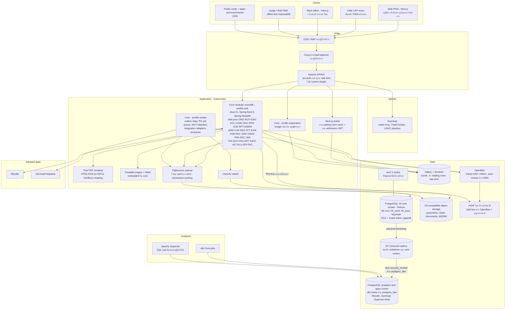
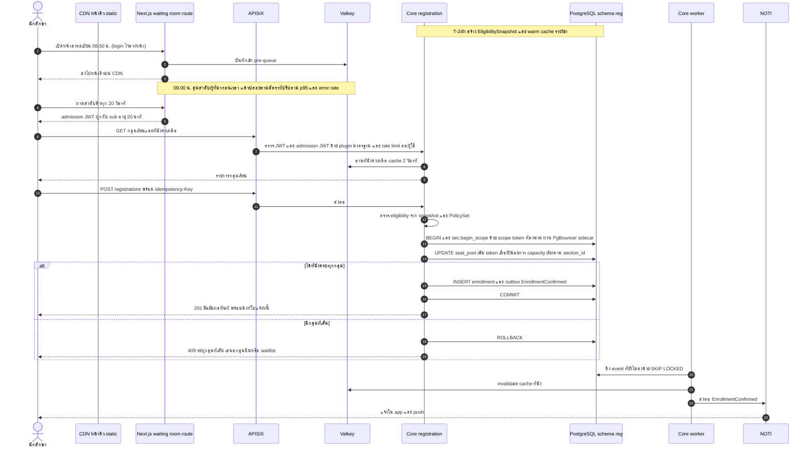
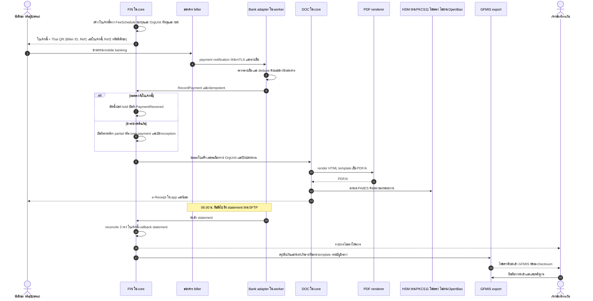
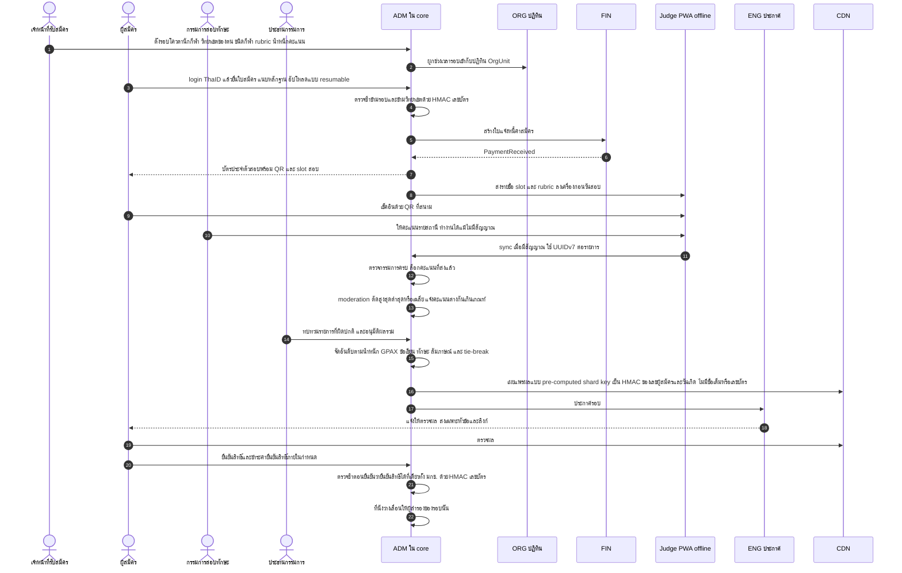
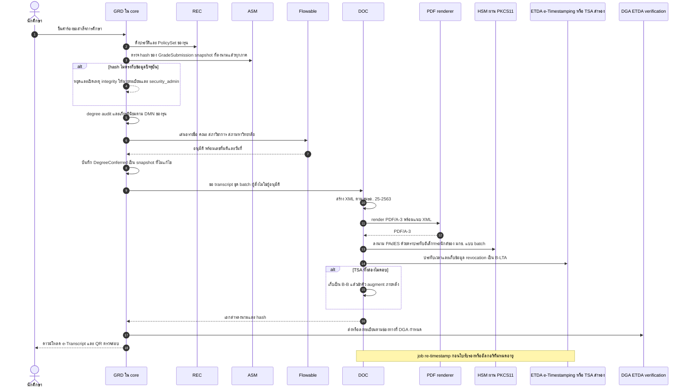
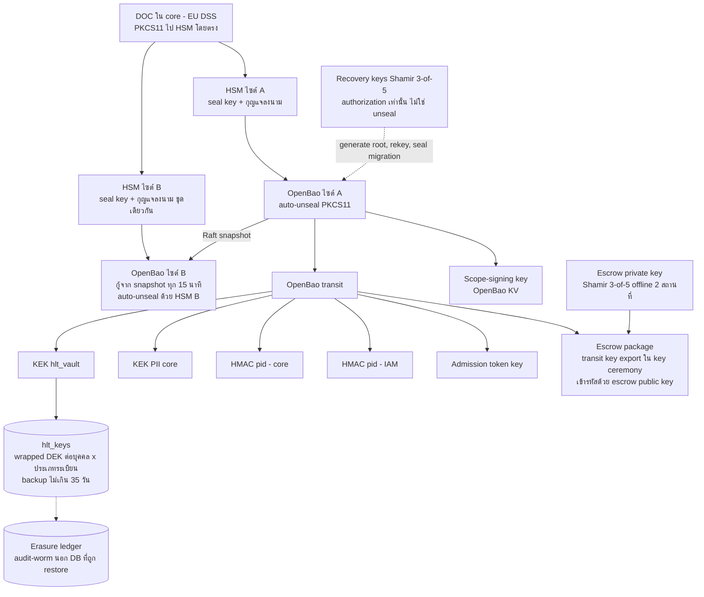

# 07 — สถาปัตยกรรมระบบ (Architecture, Minimum Operable Stack, ADR, NFR)

> **สถานะ:** v1.1-draft · 28 ต.ค. 2569 (v1.0 → v1.1 ตาม [00-fix-decisions-v1.1](00-fix-decisions-v1.1.md): D-04 กุญแจ/`hlt_vault`/`hlt_keys`/HSM ไซต์ B, D-06 นับ component ใหม่และตัดของเกิน, D-09 RLS scope token + analytics แบบ physical replica + ตราประทับอิเล็กทรอนิกส์/TSA, SLO chain ที่นับ PgBouncer และ load balancer) · ผู้เขียน: E · ภาษา: ไทย (ศัพท์เทคนิคและชื่อผลิตภัณฑ์เป็นภาษาอังกฤษ)
>
> **เปลี่ยนใน v1.1 (สรุป):** หัวข้อ 1, 4, 5 (นับใหม่ 35 → 32), 6, ADR-004/005/010/011/012/013/016/017/018/023 แก้, **ADR-026..031 ใหม่**, 9 (sequence), 10.2–10.8 (SLO chain คำนวณใหม่), 11.2/11.8/11.11, 12 (seal model ใหม่), 13 (STRIDE เพิ่ม), 14.1 (ข้อเสนอ A/Q ใหม่), 15.10 (ผลการปิด v1-review)
>
> **อ่านคู่กับ:** [00-blueprint](00-blueprint.md) (ข้อตกลงกลาง ข้อ 7–9) · [01-overview](01-overview.md) (Assumptions register A-xx) · [04-roles-permissions](04-roles-permissions.md) · [06-modules](06-modules.md) (เจ้าของรายการ event) · [08-data](08-data.md) · [09-integrations](09-integrations.md) · [10-security-compliance](10-security-compliance.md) (รายละเอียด STRIDE, PDPA, ระดับลายมือชื่อ) · [11-operations](11-operations.md) · [12-roadmap-cost-risk](12-roadmap-cost-risk.md)
>
> **ฐานเดิม:** `archive/v0.9/system-design.md` หัวข้อ 5, 8, 9 (เล่มนี้เขียนใหม่ทั้งหมด ไม่ได้แก้ต่อจากฉบับเดิม) · ประเด็นจาก [review_architecture](<../../research_notes/ออกแบบระบบการศึกษา TNSU ระดับ production/review_architecture.md>) ปิดครบทุกข้อในหัวข้อ 14

**ป้ายความน่าเชื่อถือในเล่มนี้:** **[ตรวจแล้ว]** = ผู้เขียนค้นยืนยันจากเว็บในรอบนี้ (มีลิงก์) · **[ความรู้ผู้เขียน]** = ไม่ได้ตรวจซ้ำในรอบนี้ ต้องให้ฝ่ายกฎหมาย/ผู้ตรวจรับยืนยันจาก LICENSE ของเวอร์ชันที่ใช้จริง · **[ต้องตรวจสอบ]** = ยังไม่ยืนยัน ห้ามใช้เป็นข้อเท็จจริง · **S7-xx** = สมมติฐานของเล่มนี้ (เล่ม 01 จะรวมเข้าทะเบียน A-xx)

---

## สารบัญ

1. [สรุปสำหรับผู้อ่านเร็ว](#1-สรุปสำหรับผู้อ่านเร็ว)
2. [หลักการสถาปัตยกรรม](#2-หลักการสถาปัตยกรรม)
3. [C4 Level 1 — System Context](#3-c4-level-1--system-context)
4. [C4 Level 2 — Container (Minimum Operable Stack)](#4-c4-level-2--container-minimum-operable-stack)
5. [จำนวน component: v0.9 เทียบ v1.0](#5-จำนวน-component-v09-เทียบ-v10)
6. [ตาราง Technology stack ฉบับเต็ม](#6-ตาราง-technology-stack-ฉบับเต็ม)
7. [Licence policy, allow-list และ SBOM](#7-licence-policy-allow-list-และ-sbom)
8. [Architecture Decision Records (ADR-001..031)](#8-architecture-decision-records-adr-001031)
9. [Sequence diagram หลัก](#9-sequence-diagram-หลัก)
10. [NFR: capacity ที่คำนวณใหม่, SLO, RPO/RTO](#10-nfr-capacity-ที่คำนวณใหม่-slo-rporto)
11. [Cross-cutting concerns](#11-cross-cutting-concerns)
12. [Key management](#12-key-management)
13. [STRIDE threat model (สรุป)](#13-stride-threat-model-สรุป)
14. [สมมติฐานและคำถามเปิดของเล่มนี้](#14-สมมติฐานและคำถามเปิดของเล่มนี้)
15. [ผลการปิด review](#15-ผลการปิด-review)

---

## 1. สรุปสำหรับผู้อ่านเร็ว

| ประเด็น | v0.9 | v1.0 (เล่มนี้) |
|---|---|---|
| Runtime component ที่ต้องดูแล | 53 รายการ (นับในหัวข้อ 5; review ประเมิน 45–50) | v1.0 ประกาศ 28 แต่**นับต่ำ** (ไม่นับ etcd ของ Patroni, PostgreSQL 3 cluster, Valkey Sentinel, FreeRADIUS, cert-manager, waiting-room plugin) → นับจริง **35**; **v1.1 = 32** หลังตัด Tempo, ย้าย waiting room เข้า Next.js และรวม apps DB เข้า analytics cluster (หัวข้อ 5.3) |
| Event bus | Kafka + Strimzi + MirrorMaker 2 + Apicurio + Debezium | **Transactional outbox + PostgreSQL event publication registry + PG job queue**; Kafka เป็นทางเลือกเมื่อถึงเกณฑ์ (ADR-003) |
| Registration engine | Redis DECR → Kafka → worker (dual-write ข้าม 3 ระบบ) | **Transaction แบบ synchronous บน PostgreSQL** หลัง virtual waiting room ที่ gateway (ADR-004) |
| Analytics | ClickHouse + Keeper + Debezium + Superset + Metabase + OpenMetadata | **v1.1: physical read replica (ELT source) + view แบบ `security_invoker` (column allow-list) + `postgres_fdw` เข้า analytics DB + dbt Core + Superset ตัวเดียว** (ADR-017; เลิก logical replication เข้าตาราง RLS ตาม D-09) |
| Secrets / IaC / cache / object | Vault (BSL), Terraform (BSL), Redis, MinIO | **OpenBao, OpenTofu, Valkey, S3 ของผู้ให้บริการ หรือ Ceph RGW/SeaweedFS** (ADR-012..015) |
| Environments | 8 | **5** ([11-operations](11-operations.md) หัวข้อ 1) |
| Peak ลงทะเบียน (worst case ไม่ stagger) | 3,000 RPS เป้า, ไม่นับ polling | **origin ≈ 1,050 RPS คาด / 2,100 RPS ออกแบบ**; command 60/s burst, ออกแบบ 120/s, ทดสอบยืนยัน 300/s |
| P0 broadcast | เป้า 200 msg/s แต่ต้องส่ง 417 msg/s (ขัดกันเอง) | **≈ 800 delivery/s** ในนาทีแรก, dispatcher ออกแบบ 1,000/s, SMS เป็นคอขวด (ครบ ≤ 5 นาที) |
| SLO ช่วงวิกฤต | 99.95% แต่ dependency ต่ออนุกรมได้จริง ≈ 99.70–99.80% | v1.0 อ้าง 99.950% จาก 4 ตัวอนุกรม แต่**ไม่ได้นับ PgBouncer และ cloud load balancer**; นับครบ 6 ตัว = **99.930%** (7.1 นาที/7 วัน) ไม่ถึงเป้า → **v1.1:** ย้าย PgBouncer เป็น sidecar ใน pod ของ core (ADR-027) เหลือ 5 ตัว = **99.940%** (6.0 นาที/7 วัน) และ**ปรับเป้าภายในช่วงวิกฤตเป็น 99.94%** โดยเสนอแก้ blueprint ข้อ 8 (Q-90); SLA สัญญา 99.9% ไม่เปลี่ยน (หัวข้อ 10.7) |
| Ransomware | RTO 4 ชม. | แยก 2 กรณี: logical corruption RTO ≤ 4 ชม. / platform compromise **RTO 48–72 ชม.** จาก immutable backup |
| Key management (v1.1) | Vault + Shamir unseal | OpenBao **auto-unseal ด้วย HSM ทั้งสองไซต์** (ไซต์ B มี HSM และ seal key ของตนเอง); Shamir 3-of-5 เป็น **recovery key** สำหรับ authorization เท่านั้น (ถอดรหัส root key ไม่ได้); ทางกู้จริงเมื่อ HSM หายคือ **escrow ของ transit key** ที่ซ้อมกรณี "HSM สูญหาย"; wrapped DEK ต่อ **บุคคล × ประเภทระเบียน** อยู่ใน DB `hlt_keys` (หัวข้อ 12) |
| RLS (v1.1) | `SET LOCAL app.org_scope` จาก app role | scope ตั้งผ่าน **`SECURITY DEFINER` function ที่ตรวจ scope token ที่ลงนามและผูกกับ transaction** — SQL injection ที่เรียก `set_config` เองไม่ขยาย scope ได้ (ADR-005) |

---

## 2. หลักการสถาปัตยกรรม

| รหัส | หลักการ | ผลต่อการออกแบบ |
|---|---|---|
| AP-01 | **Operability ก่อนความสวยงาม:** ทุก runtime component ต้องมีผู้ดูแลฝั่ง มกช. ที่ระบุบทบาทได้ (`itadmin`, `dba_sre`, `security_admin`, `campus_itadmin`) หรือเป็นบริการที่ผู้ให้บริการ cloud/MSP ดูแลตามสัญญา | ตัด/เลื่อน component ที่ไม่มีเจ้าของ (หัวข้อ 5) |
| AP-02 | **Boring technology:** ใช้ PostgreSQL ให้สุดก่อนเพิ่ม datastore ใหม่ ทุก datastore ใหม่ต้องมี ADR ที่มีเกณฑ์เชิงตัวเลข | ไม่มี Kafka, ClickHouse, OpenSearch ใน R1–R3 |
| AP-03 | **Modular monolith ที่บังคับ boundary:** โมดูลตามรหัสใน blueprint ข้อ 4 แยก schema, สื่อสารผ่าน published API/event เท่านั้น, ตรวจใน CI | ADR-002 |
| AP-04 | **Configuration ราย OrgUnit ไม่ใช่ fork ของโค้ด:** ค่าธรรมเนียม ผู้ลงนาม ปฏิทิน รอบรับสมัคร template เป็นข้อมูลที่มีเวอร์ชันและผ่าน maker-checker | ADR-005, ADR-006 |
| AP-05 | **Defence-in-depth ข้ามวิทยาเขต:** RLS ที่ DB + ABAC ที่แอป + scope ใน BI/replica; ชั้น DB ต้อง**เป็นอิสระจากแอป** คือ scope ที่ policy ใช้ต้องผ่านการตรวจลายเซ็นใน DB (v1.1) ไม่ใช่ค่าที่ app role ตั้งเองได้ | ADR-005, ADR-017 |
| AP-06 | **ลด serial dependency บน journey สำคัญ** และออกแบบให้ degrade ได้ (fail-open สำหรับ cache, fail-static สำหรับประกาศ) | หัวข้อ 10.5 |
| AP-07 | **Open standards และ licence allow-list:** OIDC, S3 API, BPMN/DMN 2.0, OpenAPI 3.1, AsyncAPI, PDF/A, PAdES, ขมธอ. 25-2563; ห้าม licence BSL/SSPL/RSAL/ELv2 ในแกน | ADR-019 |
| AP-08 | **ข้อมูลอยู่ในประเทศไทยโดยค่าเริ่มต้น** บริการต่างประเทศต้องอยู่ใน cross-border transfer register และส่งเฉพาะหัวข้อ + ลิงก์ (blueprint ข้อ 9.10) | NOTI payload policy, หัวข้อ 11 |
| AP-09 | **Mobile-first บนเครือข่ายไม่ดี:** PWA + LINE LIFF, งบ JS ต่อหน้า, offline สำหรับงานภาคสนาม | ADR-008, หัวข้อ 11.8 |
| AP-10 | **ความถูกต้องตรวจสอบได้ (auditability):** เอกสารราชการสร้างจาก snapshot ที่ลงนาม, audit แยกจากแอป, ทุกการเปลี่ยนแปลง config มีผู้อนุมัติ | ADR-010, หัวข้อ 13 |
| AP-11 | **Brand-neutral สำหรับ TOR:** ชื่อผลิตภัณฑ์ในเล่มนี้เป็น reference architecture ของผู้เสนองาน ถ้าใช้ทำ TOR ต้องแปลงเป็น capability spec + มาตรฐานเปิด (blueprint ข้อ 9.11) | ตาราง stack มีคอลัมน์ทางเลือกทุกแถว |
| AP-12 | **ถอยกลับได้:** ทุก release ใช้ DB migration แบบ expand/contract, feature flag ราย OrgUnit ring, kill-switch รายโมดูล | ADR-025, [11-operations](11-operations.md) |

---

## 3. C4 Level 1 — System Context

```mermaid
flowchart TB
  subgraph USERS["ผู้ใช้"]
    U1["ผู้สมัคร / นักศึกษา / นักกีฬา / นักเรียนโรงเรียนกีฬา"]
    U2["ผู้ปกครอง (guardian)"]
    U3["อาจารย์ / โค้ช / กรรมการสอบทักษะ / ครูพี่เลี้ยง"]
    U4["เจ้าหน้าที่ทะเบียน การเงิน หอพัก กิจการ สุขภาพ"]
    U5["ผู้บริหาร / QA / DPO / ผู้ตรวจสอบ"]
    U6["ศิษย์เก่า / นายจ้าง / ผู้ตรวจสอบเอกสาร"]
  end

  SYS["ระบบสารสนเทศ มกช. v1.0<br/>Student and Athlete Lifecycle Platform"]

  subgraph GOV["หน่วยงานรัฐและระบบกลาง"]
    G1["ThaID - กรมการปกครอง"]
    G2["TCAS adapter - ทปอ. (ทางเลือก)"]
    G3["กยศ. DSL"]
    G4["สป.อว. CHECO / ฐานข้อมูลอุดมศึกษา"]
    G5["DGA / ETDA Digital Transcript"]
    G6["New GFMIS Thai - กรมบัญชีกลาง"]
    G7["คุรุสภา / สทศ. / DMC"]
    G8["ITA - สำนักงาน ป.ป.ช. (OIT)"]
  end

  subgraph BANK["การเงิน"]
    B1["ธนาคาร - Bill Payment / Thai QR / statement"]
  end

  subgraph XB["บริการต่างประเทศ (อยู่ใน cross-border register)"]
    X1["LINE OA / LIFF"]
    X2["FCM / APNs / Web Push"]
    X3["Email / SMS gateway"]
  end

  subgraph INT["ระบบอื่นของ มกช."]
    I1["Moodle LMS (LTI 1.3)"]
    I2["AD / LDAP รายวิทยาเขต"]
    I3["e-Saraban"]
    I4["HR / Koha / ระบบเดิมระหว่าง migration"]
  end

  U1 --> SYS
  U2 --> SYS
  U3 --> SYS
  U4 --> SYS
  U5 --> SYS
  U6 --> SYS
  SYS <--> G1
  SYS <--> G2
  SYS <--> G3
  SYS --> G4
  SYS --> G5
  SYS --> G6
  SYS --> G7
  SYS --> G8
  SYS <--> B1
  SYS --> X1
  SYS --> X2
  SYS --> X3
  SYS <--> I1
  SYS <--> I2
  SYS --> I3
  SYS <--> I4
```

สถานะการยืนยันของแต่ละ integration (เช่น สถานะ มกช. ต่อ GFMIS, การใช้ TCAS) อยู่ใน [09-integrations](09-integrations.md) เล่มนี้ถือว่าทุกตัวเชื่อมผ่าน **integration adapter ภายใน core (โปรไฟล์ worker)** และ adapter ต้องทำงานแบบ file-based ได้เมื่อหน่วยงานไม่มี API

---

## 4. C4 Level 2 — Container (Minimum Operable Stack)

**หมายเหตุ container (ค่าเดียวที่ใช้ทั้งชุดเอกสาร — ขนาดอยู่ใน [11-operations](11-operations.md) หัวข้อ 2):**

| Container | Deploy unit | หน้าที่ | หมายเหตุ |
|---|---|---|---|
| Core profile `web` | image `core` | REST API ทุกโมดูล, BFF ของ web | stateless, JWT ตรวจที่ gateway และตรวจซ้ำที่แอป |
| Core profile `registration` | image `core` (deployment แยก) | endpoint ลงทะเบียน/ที่นั่ง เท่านั้น | แยกเพื่อ bulkhead และ scale ช่วง peak (ADR-004) ไม่ใช่ service แยก |
| Core profile `worker` | image `core` | outbox relay, PG job queue, NOTI dispatcher, integration adapters (ไฟล์/API/SFTP), scheduled jobs จากปฏิทิน (ORG) | leader election ผ่าน PG advisory lock |
| Thai PDF renderer | image `doc-render` | แปลง HTML/CSS template เป็น PDF/A (ไม่มีกุญแจลงนาม) | การลงนาม PAdES ทำใน core ผ่าน PKCS#11 (ADR-010) |
| Next.js | image `web` (2 deployment: portal, backoffice) | SSR หน้า public/portal, CSR back-office, service worker; **v1.1: route `/queue` ของ waiting room** (ลำดับคิวใน Valkey, ออก admission JWT ที่ลงนามด้วยกุญแจ K5) | LIFF ใช้ portal เดียวกัน; waiting room เขียนด้วย TypeScript ซึ่งเป็นภาษาเดียวกับทีม frontend (ADR-028) |
| PgBouncer | sidecar ในทุก pod ของ `core` (v1.1, ADR-027) | transaction pooling ต่อ pod | PgBouncer ≥ 1.21 พร้อม `max_prepared_statements` (หรือ JDBC `prepareThreshold=0`); ล่มพร้อม pod ของตน จึงไม่เป็น tier อนุกรมแยก |
| Keycloak | 3 replicas | OIDC, ThaID broker, LDAP, passkey/OTP | DB แยกใน Patroni ชุดเดียวกัน (เชื่อมผ่าน pool ของ Keycloak เอง) |
| APISIX | 3 replicas (peak 6) | routing, ตรวจ JWT ผู้ใช้และ admission JWT ด้วย plugin มาตรฐาน (`jwt-auth`/`openid-connect`), rate limit | ใช้โหมด standalone/declarative จาก Git เพื่อไม่ต้องดูแล etcd ของ APISIX **[ต้องตรวจสอบ: ingress controller เวอร์ชันที่เลือกต้องรองรับโหมดนี้]**; v1.1 ไม่มี custom Lua plugin |
| etcd (Patroni DCS) | 3 members ต่อไซต์ (ADR-026) | leader election ของ Patroni | ไซต์ A วางบน 3 node ของ data zone (primary, sync standby, ELT replica) บน volume แยก; ไซต์ B 3 members (node PG + VM เล็ก 2 ตัว) สำหรับ standby cluster |

โมดูล IAM (provisioning), ORG, ENG, NOTI, AUD, ANA, RPT และ ADMIN อยู่ใน core ทั้งหมด (ปิดประเด็น IC-25) ส่วน X-* อยู่นอกขอบเขตสัญญานี้และเชื่อมผ่าน adapter

---

## 5. จำนวน component: v0.9 เทียบ v1.0

### 5.1 เกณฑ์การนับ

นับ **runtime component ที่ทีมต้อง install, patch, upgrade, monitor และ backup แยกกัน** ไม่นับ library ที่อยู่ใน JVM (Spring Modulith, Flowable engine, EU DSS, ICU4J) และไม่นับบริการที่ผู้ให้บริการ cloud/MSSP ดูแลตามสัญญา (CDN/WAF, HSM แบบ managed, SOC/SIEM, SMS/email gateway) ซึ่งแยกแสดงไว้

### 5.2 v0.9 (53 รายการ)

| # | Component v0.9 | ผลใน v1.0 |
|---|---|---|
| 1 | Kubernetes | คง |
| 2 | CDN/WAF (OWASP CRS ดูแลเอง) | ใช้ของผู้ให้บริการ (ไม่นับ) |
| 3 | Waiting room service แยก | รวมเป็น plugin ใน APISIX + Valkey |
| 4 | APISIX | คง |
| 5 | Keycloak | คง |
| 6 | Core modular monolith | คง |
| 7 | Registration Engine (image แยก) | รวมเป็น profile ของ core |
| 8 | Notification Service (image แยก) | รวมใน core worker |
| 9 | Integration Adapters (Camel, image แยก) | รวมใน core worker |
| 10 | Document & Signing Service | แยกเฉพาะ renderer ที่ไม่มีกุญแจ; การลงนามอยู่ใน core |
| 11 | Reporting API (warehouse) | ตัด (RPT อยู่ใน core, BI ผ่าน Superset) |
| 12 | Flowable Design/Admin UI | ตัด (Flowable 7 OSS ไม่มี UI; ใช้ bpmn-js/dmn-js ใน ADMIN) |
| 13 | PostgreSQL core (Patroni) | คง |
| 14 | PostgreSQL health vault cluster แยก | ลดเป็น database แยกใน cluster เดียวกัน |
| 15 | PgBouncer | คง |
| 16 | pgBackRest | คง |
| 17 | Redis | เปลี่ยนเป็น Valkey |
| 18 | Kafka (Strimzi) | เลื่อน |
| 19 | MirrorMaker 2 | เลื่อน |
| 20 | Apicurio | เลื่อน (AsyncAPI ใน Git) |
| 21 | Debezium | เลื่อน (v1.0 ใช้ PG logical replication; v1.1 ใช้ physical replica + FDW) |
| 22 | MinIO | ไม่ใช้ (upstream archived) |
| 23 | OpenSearch | เลื่อน |
| 24 | ClickHouse | เลื่อน |
| 25 | ClickHouse Keeper | เลื่อน |
| 26 | dbt | คง (dbt Core) |
| 27 | Superset | คง |
| 28 | Metabase | ตัด |
| 29 | OpenMetadata | เลื่อน (ใช้ dbt docs + ROPA ใน PRIV) |
| 30 | HashiCorp Vault | เปลี่ยนเป็น OpenBao |
| 31 | HSM | คง (นับเป็นบริการ managed/appliance ไม่นับ) |
| 32 | Teleport | ไม่ใช้ (licence) |
| 33 | Unleash | เลื่อน (OpenFeature SDK + flag ใน DB/Git) |
| 34 | Argo CD | คง |
| 35 | Argo Rollouts | เลื่อน |
| 36 | Velero | เลื่อน (app tier stateless, state อยู่นอก cluster) |
| 37 | Prometheus/Alertmanager | คง |
| 38 | Grafana | คง |
| 39 | Loki | คง |
| 40 | Tempo | คง |
| 41 | Kyverno | คง (baseline policies) |
| 42 | Falco | เลื่อน (ให้ MSSP เป็นเจ้าของถ้าต้องการ) |
| 43 | Service mesh | เลื่อน |
| 44 | Wazuh (SIEM) | ย้ายไป MSSP/SOC (ไม่นับ) |
| 45 | Dependency-Track | คง |
| 46 | SonarQube (server) | ตัดเป็น CI tooling (Semgrep CE/SpotBugs ใน pipeline) |
| 47 | GitLab | คง (Git forge + CI) |
| 48 | Harbor | คง |
| 49 | ClamAV | คง |
| 50 | Moodle | คง (ถ้า มกช. ไม่มี instance เดิม) |
| 51 | Zammad | คง (X-HELP) |
| 52 | Next.js web | คง |
| 53 | Flutter app | เลื่อนไปสัญญาแยก |

### 5.3 Minimum Operable Stack: นับใหม่ v1.0 (35) และ v1.1 (32 รายการ)

**ที่มาของการนับใหม่ (D-06, review v1-review architecture_compliance A-01..A-04, Top-7):** ตาราง v1.0 ประกาศ 28 รายการ แต่ไม่นับ 7 รายการที่ต้อง install/patch/monitor แยกจริง ได้แก่ (1) **etcd** ซึ่งเป็น DCS ของ Patroni (v1.0 ไม่กล่าวถึงเลยทั้งชุด) (2–3) PostgreSQL มี **3 cluster** (core, analytics, apps) แต่นับเป็นแถวเดียว ทั้งที่แต่ละ cluster มี backup stanza, upgrade และ monitoring ของตน (4) **Valkey Sentinel** (5) **FreeRADIUS** สำหรับ eduroam (09 I-46) (6) **cert-manager** (7) **APISIX waiting-room plugin** ที่ต้องเขียนเองด้วย Lua (bespoke code บน critical path) → **v1.0 นับจริง = 35**

**สิ่งที่ตัด/ย้ายใน v1.1 (−3):** (ก) **Tempo** ตัดออกจาก R1–Wave 2 (trace id อยู่ใน log ของ Loki และ OTel Collector sampling ส่งไป Loki; เกณฑ์นำกลับในหัวข้อ 5.4) (ข) **waiting-room plugin** เลิกใช้ ย้ายเป็น route ใน Next.js + Valkey และให้ APISIX ตรวจ admission JWT ด้วย plugin มาตรฐาน (ADR-028) จึงไม่ใช่ runtime component แยก (ค) **apps DB รวมเข้า analytics cluster** (Moodle, Zammad, Superset metadata) เหลือ PostgreSQL 2 cluster (ADR-026) → **v1.1 = 32**

| # | Component | กลุ่ม | ผู้ดูแลหลัก / สำรอง ฝั่ง มกช. (role ตามเล่ม 04) | Tier | v1.0 นับ? |
|---|---|---|---|---|---|
| 1 | Kubernetes (managed ของผู้ให้บริการ หรือ RKE2) รวม CNI/CoreDNS/CSI ของ distribution | Platform | `itadmin` / `campus_itadmin` ส่วนกลาง | Must | ✓ |
| 2 | **cert-manager** (ใบรับรองภายใน, mTLS ไป PostgreSQL/OpenBao) | Platform | `itadmin` / `security_admin` | Must | ✗ เพิ่ม |
| 3 | Apache APISIX (gateway + rate limit + ตรวจ admission JWT) | Edge | `itadmin` / `dba_sre` | Must | ✓ |
| 4 | Keycloak | Identity | `security_admin` / `itadmin` | Must | ✓ |
| 5 | **FreeRADIUS** (eduroam IdP → Keycloak/LDAP; ใช้ของเดิมถ้าวิทยาเขตมีอยู่แล้ว — Q-68) | Identity | `itadmin` / `campus_itadmin` | Should (R2) | ✗ เพิ่ม |
| 6 | Core modular monolith (profiles web/registration/worker) | App | vendor L3 + `itadmin` / `dba_sre` | Must | ✓ |
| 7 | Next.js web tier (portal PWA + back-office + waiting room route) | App | vendor L3 / `itadmin` | Must | ✓ |
| 8 | Thai PDF renderer | App | vendor L3 / `itadmin` | Must | ✓ |
| 9 | PostgreSQL 16 + Patroni — **cluster core** (core, `hlt_vault`, `hlt_keys`, keycloak + ELT replica) | Data | `dba_sre` / `itadmin` | Must | ✓ (รวมแถวเดียว) |
| 10 | PostgreSQL 16 + Patroni — **cluster analytics+apps** (marts, Moodle, Zammad, Superset meta) | Data | `dba_sre` / `data_steward` | Must | ✗ แยกนับ |
| 11 | **etcd** (Patroni DCS, 3 members ต่อไซต์) | Data | `dba_sre` / `itadmin` | Must | ✗ เพิ่ม |
| 12 | PgBouncer (sidecar ใน pod ของ core) | Data | `dba_sre` / vendor L3 | Must | ✓ |
| 13 | pgBackRest | Data | `dba_sre` / `itadmin` | Must | ✓ |
| 14 | Valkey | Data | `dba_sre` / `itadmin` | Must | ✓ |
| 15 | **Valkey Sentinel** | Data | `dba_sre` / `itadmin` | Must | ✗ เพิ่ม |
| 16 | S3-compatible object storage (บริการของผู้ให้บริการ; สำรอง Ceph RGW/SeaweedFS) | Data | `itadmin` / `dba_sre` | Must | ✓ |
| 17 | OpenBao | Security | `security_admin` / `dba_sre` | Must | ✓ |
| 18 | ClamAV | Security | `security_admin` / `itadmin` | Must | ✓ |
| 19 | Kyverno (baseline + verify image signature) | Security | `security_admin` / `itadmin` | Must | ✓ |
| 20 | Dependency-Track | Security | `security_admin` / vendor | Must | ✓ |
| 21 | PAM/bastion ที่ licence ชัด (บริการของ GDCC/MSSP หรือ JumpServer) | Security | `security_admin` / `itadmin` | Must | ✓ |
| 22 | dbt Core (batch job) | Analytics | `data_steward` / vendor | Must | ✓ |
| 23 | Apache Superset | Analytics | `data_steward` / `dba_sre` | Must | ✓ |
| 24 | OpenTelemetry Collector | Observability | `dba_sre` / `itadmin` | Must | ✓ |
| 25 | Prometheus + Alertmanager | Observability | `dba_sre` / `itadmin` | Must | ✓ |
| 26 | Grafana | Observability | `dba_sre` / `itadmin` | Must | ✓ |
| 27 | Loki | Observability | `dba_sre` / `itadmin` | Must | ✓ |
| 28 | Argo CD | Delivery | `itadmin` / `dba_sre` | Must | ✓ |
| 29 | Git forge + CI runners (GitLab CE หรือ Forgejo) | Delivery | `itadmin` / vendor | Must | ✓ |
| 30 | Harbor (รวม Trivy scanner) | Delivery | `itadmin` / `security_admin` | Must | ✓ |
| 31 | Zammad (X-HELP) | Adopted | `helpdesk` / `itadmin` | Must ตั้งแต่ R1 | ✓ |
| 32 | Moodle | Adopted | `itadmin` (หรือ instance เดิม) / vendor MA | ใช้เมื่อ มกช. ไม่มี instance เดิม | ✓ |
| — | ~~Tempo~~ | Observability | — | **ตัด** (หัวข้อ 5.4) | ✓ (v1.0) |
| — | ~~APISIX waiting-room plugin (Lua)~~ | Edge | — | **ตัด** → route ใน Next.js (ADR-028) | ✗ (v1.0 ไม่นับ) |
| — | ~~PostgreSQL cluster apps~~ | Data | — | **รวม** เข้าแถว 10 | ✗ (v1.0 ไม่นับ) |

**ผลลัพธ์ (ตัวเลขจริง):** v0.9 = 53 · v1.0 ประกาศ 28 / **นับจริง 35** · **v1.1 = 32** (ลดจาก v0.9 = 21 รายการ หรือ 40%) ถ้า มกช. ใช้ Moodle เดิม, PAM เป็นบริการของ GDCC/MSSP และ eduroam ใช้ RADIUS เดิมของวิทยาเขต จะเหลือ **29** — บริการ managed ที่ไม่นับแต่ต้องอยู่ในสัญญา: CDN/WAF, **cloud L4 load balancer**, **HSM 2 ไซต์** (v1.1: ไซต์ B ต้องมี HSM ของตนเอง — ผลต่อต้นทุนเป็นหมายเหตุให้เล่ม 12), SOC/SIEM 24×7, SMS/email gateway, ETDA e-Timestamping (TSA), ปลายทาง backup แบบ offline

**Bus factor (A-04):** ทุกแถวมีผู้ดูแลหลักและสำรองคนละคน; KT metric ใหม่ "≥ 2 คนของ มกช. ทำ runbook วิกฤตได้เอง" สำหรับ OpenBao unseal/restore/HSM-lost, Patroni failover/PITR/etcd, Keycloak upgrade และ restore จาก backup เป็นเงื่อนไข MS-W1 ([11-operations](11-operations.md) หัวข้อ 16)

**ข้อจำกัดที่ยังอยู่ (บอกตรง ๆ):** 32 component ยังมากสำหรับทีม IT มกช. 5–10 คน ถ้าไม่มี MA/MSP; สิ่งที่ลดภาระได้มากที่สุดคือใช้ **managed Kubernetes, managed object storage, HSM/KMS และ PAM ของ GDCC** ถ้ามี (ผล GDCC spike, ADR-020) ซึ่งตัดภาระ patch/upgrade ของ 4–5 แถวออกไป

### 5.4 รายการที่เลื่อน พร้อมเกณฑ์นำกลับ (บันทึกใน ADR)

| เลื่อน/ตัด | เกณฑ์นำกลับ (ต้องมีหลักฐานจาก production) | ADR |
|---|---|---|
| Kafka + Strimzi + MirrorMaker 2 + schema registry | event > 500/s ต่อเนื่อง 15 นาทีในช่วงปกติ **หรือ** consumer ภายนอก ≥ 5 ระบบที่ต้อง replay **หรือ** outbox lag p95 > 30 s แม้ปรับ relay แล้ว | ADR-003 |
| Debezium CDC | ผู้ใช้จริงต้องการ freshness < 15 นาที และ ELT รายชั่วโมงผ่าน FDW ไม่พอ | ADR-017 |
| ClickHouse | dashboard p95 > 3 s บนข้อมูลจริงหลังทำ partition/materialized view แล้ว | ADR-017 |
| OpenSearch | ต้องค้น full-text ในเอกสาร/ไฟล์ปริมาณมาก หรือ PG FTS p95 > 500 ms | ADR-021 |
| Service mesh (mTLS ภายใน) | threat model รอบทบทวนพบ lateral movement risk สูง; ระหว่างนี้ใช้ NetworkPolicy default-deny + WireGuard ของ CNI ถ้ามี | ADR-018 |
| Argo Rollouts | มีทีม SRE ประจำ ≥ 3 คน | ADR-025 |
| Unleash/flag service | flag > 100 หรือต้องทำ % rollout | ADR-025 |
| Falco | มี SOC 24×7 ที่รับ alert runtime ได้ | ADR-018 |
| OpenMetadata | GD Catalog บังคับ หรือ dataset > 200 | ADR-017 |
| Flutter app | PWA/LIFF ไม่พอสำหรับ wellness รายวัน/offline หนัก (วัดจาก adoption) | ADR-008 |
| Velero | มี stateful workload ใน cluster ที่ไม่อยู่ใน backup ของ DB/object | [11-operations](11-operations.md) |
| Tempo (distributed tracing store) — **ตัดใน v1.1** | incident ที่หาสาเหตุไม่ได้ด้วย log + trace id ใน Loki ≥ 2 ครั้ง/ไตรมาส **และ** มีผู้ดูแลสำรองที่ผ่าน KT | ADR-018 |
| APISIX custom plugin (Lua) — **ตัดใน v1.1** | plugin มาตรฐานทำไม่ได้และมีผู้ดูแลภาษา Lua ≥ 2 คน | ADR-028 |
| PostgreSQL cluster ที่ 3 (แยก apps) | Moodle/Zammad รบกวน dbt จนเกินเกณฑ์ capacity review ([11-operations](11-operations.md) หัวข้อ 11) | ADR-026 |

---

## 6. ตาราง Technology stack ฉบับเต็ม

> คอลัมน์ licence: ระบุ SPDX และสถานะการตรวจ ผู้ตรวจรับต้องยืนยันจาก LICENSE ของเวอร์ชันที่ส่งมอบจริงผ่าน SBOM gate (ADR-019) ทุกแถวเป็น reference architecture ไม่ใช่ spec ใน TOR (AP-11)

| Layer | Component | ตัวเลือก | Licence | เหตุผล | ทางเลือก | ทบทวนเมื่อ |
|---|---|---|---|---|---|---|
| Runtime | ภาษา | Java 21 LTS (Eclipse Temurin), virtual threads | GPL-2.0 WITH Classpath-exception-2.0 [ความรู้ผู้เขียน] | ตลาดแรงงานไทยใหญ่, LTS ยาว | Kotlin บน JVM, .NET 8, TypeScript | Java LTS ถัดไป (25) ผ่าน 1 ปี |
| Runtime | Framework | Spring Boot 3 + Spring Modulith | Apache-2.0 [ความรู้ผู้เขียน] | boundary verification + event publication registry บน JDBC ([Spring Modulith docs](https://docs.spring.io/spring-modulith/reference/1.4/events.html) [ตรวจแล้ว]) | Quarkus, Micronaut | Spring Boot major ใหม่ |
| Runtime | Job queue | PG-backed (event publication registry + ตาราง job แบบ `FOR UPDATE SKIP LOCKED` หรือ db-scheduler) | db-scheduler: Apache-2.0 [ต้องตรวจสอบ]; ทางเลือก JobRunr OSS LGPL-3.0 [ต้องตรวจสอบ] | ไม่เพิ่ม component, transaction เดียวกับข้อมูล | Kafka, RabbitMQ | ถึงเกณฑ์ ADR-003 |
| Workflow/rules | BPMN/DMN | Flowable 7 engine (embedded) | Apache-2.0 [ความรู้ผู้เขียน]; UI apps ถูกตัดออกตั้งแต่ v7 ([Flowable forum](https://forum.flowable.org/t/flowable-7-0-0-m1-plans-for-ui-and-content-engine/10733) [ตรวจแล้ว]) | BPMN/DMN มาตรฐาน อยู่ใน JVM | Camunda 7 CE (EOL [ต้องตรวจสอบ]), Camunda 8 (licence แยก), state machine เอง | ต้องการ CMMN จริง หรือ Flowable เปลี่ยน licence |
| Workflow/rules | Modeler | bpmn-js / dmn-js ฝังใน ADMIN (deploy ผ่าน pipeline) | bpmn.io License (MIT-style แต่บังคับคง watermark bpmn.io ให้มองเห็นเต็มที่ — review v1-review A-10 ✅ อ่าน LICENSE แล้ว) **ไม่ใช่ OSI มาตรฐาน → อยู่ในทะเบียนข้อยกเว้น; DoD ของ ADMIN ห้ามซ่อน/แก้ watermark** | ไม่ต้องซื้อ Flowable Design | Flowable Design (subscription), modeler ภายนอกที่ export BPMN | ฝ่ายกฎหมายไม่รับเงื่อนไขโลโก้ |
| API | Style | REST + OpenAPI 3.1, AsyncAPI 3 สำหรับ event, RFC 9457 | — | มาตรฐาน, สอดคล้องแนว API ภาครัฐ | GraphQL (เฉพาะ BFF) | — |
| Frontend | Web | React + Next.js (App Router) + TypeScript, PWA (service worker) | MIT [ความรู้ผู้เขียน] | talent pool ใหญ่, SSR สำหรับมือถือ | Vue/Nuxt | — |
| Frontend | Design system | "TNSU DS" บน React Aria Components + Tailwind, ฟอนต์ไทยฝัง (Sarabun / IBM Plex Sans Thai) | Apache-2.0 / MIT / OFL-1.1 [ความรู้ผู้เขียน] | a11y ระดับ component | MUI | — |
| Frontend | LINE | LINE LIFF + Messaging API | ข้อตกลงบริการของ LINE (ไม่ใช่ OSS) | ช่องทางที่ผู้ใช้ไทยเปิดจริง | — | ข้อตกลง/ราคาเปลี่ยน |
| Frontend | Upload | Uppy + S3 multipart (presigned) | MIT [ความรู้ผู้เขียน] | resumable บน 4G ไม่ต้องมี upload server | tus (tusd) | — |
| Identity | IdP | Keycloak 26 | Apache-2.0 [ความรู้ผู้เขียน] | OIDC/SAML, broker ThaID, passkey | Authentik, WSO2 IS | — |
| Edge | Gateway | Apache APISIX (standalone config จาก Git) | Apache-2.0 (โครงการ ASF) [ความรู้ผู้เขียน] | plugin มาตรฐาน JWT/limit; **v1.1 ไม่มี custom plugin** (waiting room อยู่ใน Next.js, ADR-028) | Envoy Gateway, Kong OSS, NGINX | — |
| Edge | WAF/CDN | บริการของผู้ให้บริการ (GDCC/CSP ในไทย) | บริการ | ไม่ต้องดูแล rule set เอง | Coraza (Apache-2.0) ใน APISIX [ต้องตรวจสอบ] | ผู้ให้บริการไม่มี WAF |
| Data | OLTP | PostgreSQL 16 + Patroni (2 cluster: core, analytics+apps) | PostgreSQL License ([postgresql.org](https://www.postgresql.org/about/licence/) [ตรวจแล้ว]); Patroni MIT [ความรู้ผู้เขียน] | ACID, RLS, ICU collation ไทย, physical streaming replica, view `security_invoker` (PG15+) | Oracle, managed DB ของ CSP | PG major ใหม่ทุก 2 ปี |
| Data | DCS ของ Patroni | **etcd 3.5** (3 members ต่อไซต์, ADR-026) | Apache-2.0 (CNCF) [ความรู้ผู้เขียน] | ไม่ผูก HA ของ DB กับ control plane ของ Kubernetes | Consul (BSL ตั้งแต่ 1.17 → ห้าม [ความรู้ผู้เขียน]), Kubernetes API เป็น DCS | — |
| Data | Pooler | PgBouncer ≥ 1.21 (transaction mode) **แบบ sidecar ใน pod ของ core** (ADR-027) | ISC [ความรู้ผู้เขียน] | connection ต่ำ; `max_prepared_statements` รองรับ prepared statement ของ JDBC; ไม่เป็น tier อนุกรมแยก | PgCat, Odyssey, PgBouncer แบบ deployment แยก ≥ 2 instance | — |
| Data | Backup | pgBackRest | MIT [ความรู้ผู้เขียน] | PITR, S3, encryption, parallel restore | Barman (GPL-3.0) | — |
| Data | Cache/token | **Valkey** | BSD-3-Clause ([elest.io](https://blog.elest.io/valkey-vs-redis-vs-keydb-which-in-memory-store-after-the-license-change/), [InfoQ](https://www.infoq.com/news/2025/05/redis-agpl-license) [ตรวจแล้ว]) | fork ของ Redis 7.2.4 ภายใต้ Linux Foundation | Redis 8 (เลือกได้ AGPLv3/RSAL/SSPL [ตรวจแล้ว]) | — |
| Data | Object | S3 ของผู้ให้บริการ; สำรอง Ceph RGW หรือ SeaweedFS | Ceph LGPL-2.1/3.0 [ความรู้ผู้เขียน]; SeaweedFS Apache-2.0 [ต้องตรวจสอบ]; Garage AGPL-3.0 ([SUSE](https://packagehub.suse.com/packages/garage/) [ตรวจแล้ว]) | ต้องการ Object Lock **compliance mode** | MinIO: upstream archived 25 เม.ย. 2569, หยุดแจก binary ต.ค. 2568 ([GitHub](https://github.com/minio/minio), [itsfoss](https://itsfoss.com/news/minio-moves-away-from-open-source/) [ตรวจแล้ว]) → ไม่ใช้ | ผู้ให้บริการไม่มี Object Lock |
| Security | Secrets/keys | **OpenBao ≥ 2.2** + HSM (PKCS#11 auto-unseal) ทั้ง 2 ไซต์ | MPL-2.0 ([desdelinux](https://blog.desdelinux.net/en/openbao-an-open-source-fork-of-hashicorp/) [ตรวจแล้ว, แหล่งรอง]) | fork ของ Vault 1.14 ที่ยังเป็น open source; Vault เป็น BSL 1.1 ([The Register](https://www.theregister.com/2023/12/08/hashicorp_openbao_fork/)); **PKCS#11 seal มีตั้งแต่ 2.2 และต้องใช้ build ที่เปิด HSM (cgo); ตั้งแต่ 2.7 seal เป็น external plugin** (review v1-review A-11 ✅ จาก release notes/เอกสาร OpenBao) → จัดหา build/plugin พร้อม checksum + SBOM; **OSS ไม่มี cross-cluster DR replication** 🟡 จึงกู้ไซต์ B จาก snapshot (หัวข้อ 12) | Vault Enterprise (มีค่าใช้จ่าย), Cloud KMS ในไทย | build HSM ของเวอร์ชันที่ใช้ไม่ผ่าน bake-off P0 |
| Security | Antivirus | ClamAV (clamd) | GPL-2.0 [ความรู้ผู้เขียน] | สแกนไฟล์อัปโหลดก่อนปล่อย | บริการสแกนของผู้ให้บริการ | — |
| Security | Policy | Kyverno | Apache-2.0 [ความรู้ผู้เขียน] | baseline pod security + verify cosign | OPA Gatekeeper | — |
| Security | SBOM/SCA | Dependency-Track + Trivy (ใน Harbor/CI) + cosign | Apache-2.0 [ความรู้ผู้เขียน] | SBOM CycloneDX เป็น acceptance gate | Grype | — |
| Security | PAM | บริการ PAM ของ GDCC/MSSP; สำรอง JumpServer | JumpServer GPL-3.0 [ต้องตรวจสอบ] | session recording, JIT | Teleport CE: licence จำกัดองค์กร < 100 คน และรายได้ < USD 10M ตั้งแต่ v16 ([Teleport](https://goteleport.com/blog/teleport-community-license) [ตรวจแล้ว]) → ไม่ใช้ | — |
| Docs | PDF render | HTML/CSS → PDF ด้วย **WeasyPrint** (Pango + HarfBuzz) | BSD-3-Clause ([Debian](https://sources.debian.org/src/weasyprint/67.0-1/PKG-INFO) [ตรวจแล้ว]); รองรับ PDF/A, PDF/UA ([openapps](https://openapps.pro/packages/weasyprint) [แหล่งรอง, ต้องตรวจสอบ]) | shaping ไทยด้วย HarfBuzz; ตัดคำไทยต้องพิสูจน์ด้วย golden file | Chromium headless (Gotenberg, MIT [ความรู้ผู้เขียน]); JasperReports (LGPL, แต่ exporter ใช้ iText 2.1.7 รุ่นเก่า [ตรวจแล้ว: Wikipedia]); Typst ยังไม่ตัดคำไทยตามพจนานุกรม ([Typst forum](https://forum.typst.app/t/how-to-implement-dictionary-based-word-recognition-for-thai-for-line-breaking-hyphenation/7470) [ตรวจแล้ว]) | bake-off P0 ไม่ผ่าน |
| Docs | ลงนาม | EU DSS library (PAdES-B-LTA, XAdES) ใน core | LGPL-2.1 ([EC DSS](https://ec.europa.eu/digital-building-blocks/sites/display/DIGITAL/Digital%20Signature%20Service%20-%20%20DSS) [ตรวจแล้ว]) | ครบทั้ง PAdES/XAdES/timestamp/LTV | iText 7 (AGPL/commercial [ตรวจแล้ว]) | — |
| Docs | ตรวจ PDF/A | veraPDF (ใน CI/gate) | GPL-3.0+ หรือ MPL-2.0+ [ความรู้ผู้เขียน] | validation ก่อนออกเอกสาร | — | — |
| Search | ค้นหา | PostgreSQL FTS + `pg_trgm` + ICU4J BreakIterator ตัดคำไทยฝั่งแอป | PostgreSQL License; ICU License [ความรู้ผู้เขียน] | ไม่เพิ่ม cluster | OpenSearch (Apache-2.0) | ADR-021 |
| Analytics | Transform | dbt Core | Apache-2.0; dbt Fusion เป็น proprietary ไม่ใช้ ([dbt licensing](https://docs.getdbt.com/docs/dbt-licensing) [ตรวจแล้ว]) | SQL + test + docs/lineage | SQLMesh | — |
| Analytics | BI | Apache Superset | Apache-2.0 (ASF) [ความรู้ผู้เขียน] | RLS filter, embed, ไทยได้ | Metabase (AGPL) | — |
| Observability | Telemetry | OpenTelemetry SDK/Collector | Apache-2.0 [ความรู้ผู้เขียน] | มาตรฐานเปิด | — | — |
| Observability | Metrics | Prometheus + Alertmanager | Apache-2.0 [ความรู้ผู้เขียน] | SLO burn-rate | VictoriaMetrics | ข้อมูล > 13 เดือน |
| Observability | Dashboard/logs | Grafana, Loki (**Tempo ตัดใน v1.1**) | **AGPL-3.0** ([Grafana Labs](https://grafana.com/blog/2021/04/20/grafana-loki-tempo-relicensing-to-agplv3) [ตรวจแล้ว]) — ใช้ภายในโดยไม่แก้ไข ต้องผ่าน legal review; **ห้าม fork/แก้ source** (ถ้าแก้แล้วเปิดให้ผู้ใช้นอกทีมผ่านเครือข่าย เช่น dashboard ให้วิทยาเขต ต้องเสนอ source ส่วนที่แก้ตาม AGPL §13) — อยู่ใน DoD | ทีมรู้จักแพร่หลาย | OpenSearch Dashboards, Jaeger (Apache-2.0) | legal ไม่รับ AGPL |
| Observability | RUM | Grafana Faro Web SDK / OTel web | Apache-2.0 [ต้องตรวจสอบ] | เห็นปัญหาผู้ใช้ต่างจังหวัด | — | — |
| Delivery | IaC | **OpenTofu** | MPL-2.0, โครงการ CNCF ([The New Stack](https://thenewstack.io/opentofu-joins-cncf-new-home-for-open-source-iac-project/) [ตรวจแล้ว]) | Terraform เป็น BSL 1.1 | Pulumi, Ansible | — |
| Delivery | GitOps | Argo CD | Apache-2.0 [ความรู้ผู้เขียน] | declarative, audit ผ่าน Git | Flux | — |
| Delivery | Git + CI | GitLab CE หรือ Forgejo + runners ในไทย | GitLab CE: MIT [ความรู้ผู้เขียน]; Forgejo: GPL-3.0+ [ความรู้ผู้เขียน] | source อยู่ในประเทศ, repo ของ มกช. | GitHub + self-hosted runner | — |
| Delivery | Registry | Harbor | Apache-2.0 (CNCF) [ความรู้ผู้เขียน] | สแกน + replication + signature | registry ของผู้ให้บริการ | — |
| Platform | Certificates | cert-manager | Apache-2.0 (CNCF) [ความรู้ผู้เขียน] | ออก/หมุนใบรับรองภายในอัตโนมัติ | ใบรับรองจาก OpenBao PKI ด้วยมือ | — |
| Identity | RADIUS (eduroam) | FreeRADIUS (ถ้าวิทยาเขตไม่มีของเดิม) | GPL-2.0 [ความรู้ผู้เขียน] — รันแยก ไม่ link | IdP ของ eduroam ผ่าน UniNet (09 I-46) | RADIUS เดิมของวิทยาเขต | ไม่เป็นสมาชิก eduroam (Q-68) |
| Testing | Load | k6 | **AGPL-3.0** ([pkg.go.dev](https://pkg.go.dev/go.k6.io/k6) [ตรวจแล้ว]) — ใช้เป็นเครื่องมือภายใน ไม่แจกจ่าย | script JS, scenario ซับซ้อน | Gatling (Apache-2.0) | legal ไม่รับ AGPL |
| Testing | อื่น | JUnit 5, Testcontainers, ArchUnit, Pact, Playwright, axe-core, PIT, ZAP, Semgrep CE, gitleaks | Apache-2.0 / MIT / EPL / LGPL-2.1 [ความรู้ผู้เขียน] | — | — | — |
| Adopted | LMS | Moodle 4.x (LTI 1.3) | GPL-3.0 [ความรู้ผู้เขียน] | มาตรฐานในไทย | Open edX | — |
| Adopted | Helpdesk | Zammad | AGPL-3.0 (review_compliance C-28, 🟡) | ภาษาไทย, ใช้โดยไม่แก้ core | GLPI (GPL-3.0), osTicket (GPL-2.0) | legal ไม่รับ AGPL |
| Platform | Container | Kubernetes managed ของผู้ให้บริการ หรือ RKE2 | Apache-2.0 [ความรู้ผู้เขียน] | portable ข้าม GDCC/CSP | VM + systemd (ไม่มี HA เพียงพอ) | ADR-020 |
| Deferred | Event bus | Kafka, Debezium | Apache-2.0 [ความรู้ผู้เขียน] | — | NATS JetStream | ADR-003 |
| Deferred | OLAP/search | ClickHouse, OpenSearch | Apache-2.0 [ความรู้ผู้เขียน] | — | — | ADR-017, ADR-021 |

---

## 7. Licence policy, allow-list และ SBOM

ตามมติ blueprint ข้อ 9.1 และ review_compliance C-28 ([review_compliance](<../../research_notes/ออกแบบระบบการศึกษา TNSU ระดับ production/review_compliance.md>))

| ระดับ | Licence | เงื่อนไข |
|---|---|---|
| **อนุญาต** | Apache-2.0, MIT, BSD-2/3-Clause, ISC, PostgreSQL, MPL-2.0, EPL-2.0, LGPL-2.1/3.0 (dynamic linking), Unicode/ICU, OFL-1.1 (ฟอนต์), CC-BY-4.0 (เนื้อหา) | ใช้ได้ทุกที่ |
| **อนุญาตแบบมีเงื่อนไข** | GPL-2.0/3.0 | เฉพาะโปรแกรมที่รันแยก (ClamAV, Moodle, JumpServer) ไม่ link กับโค้ดของ มกช. |
| | AGPL-3.0 | ใช้ภายในโดย **ไม่แก้ไข** (Grafana, Loki, k6, Zammad) ต้องผ่าน legal review ก่อน TOR; **ห้าม fork** — ถ้าแก้ไขแล้วให้ผู้ใช้นอกทีมใช้ผ่านเครือข่ายต้องเสนอ source ส่วนที่แก้ (AGPL §13); ห้ามใช้ใน core; อยู่ใน DoD ของทุก release |
| | Licence เฉพาะ (bpmn.io) | อยู่ในทะเบียนข้อยกเว้น ต้องมีความเห็นฝ่ายกฎหมาย |
| **ห้ามใน core และ runtime** | BSL/BUSL, SSPL, RSAL, Elastic License v2, Commons Clause, "Community Edition" ที่จำกัดจำนวนพนักงาน/รายได้ (เช่น Teleport CE v16+), licence ที่เปลี่ยนเป็น proprietary ได้ฝ่ายเดียวโดยไม่มี fork ที่เป็น OSI | ถ้าจำเป็นจริงต้องซื้อ subscription เชิงพาณิชย์และระบุงบในเล่ม 12 |

**กลไกบังคับ:**
1. ทุก build สร้าง **SBOM CycloneDX** (image + dependency ของ Java/Node) ส่งเข้า Dependency-Track
2. CI ล้มเมื่อพบ licence นอก allow-list ที่ไม่อยู่ในทะเบียนข้อยกเว้น
3. **ทะเบียน licence และ obligation** (ชื่อ, เวอร์ชัน, SPDX, obligation, ผู้อนุมัติ, วันทบทวน) เป็น deliverable ทุก release และเป็น **เงื่อนไขตรวจรับ** ของแต่ละงวด
4. ทบทวนทะเบียนทุก 6 เดือนและเมื่อมีการเปลี่ยน licence ของ upstream (เหตุการณ์ Vault, Terraform, Redis, MinIO แสดงว่าเกิดได้จริง)
5. ตัวเลือกทุกตัวในหัวข้อ 6 ต้องมีทางหนีที่เป็น OSI licence (คอลัมน์ "ทางเลือก")

---

## 8. Architecture Decision Records (ADR-001..031)

> รูปแบบ: บริบท → การตัดสินใจ → ทางเลือกที่พิจารณา → ผลที่ตามมา → **ทบทวนเมื่อ** · สถานะทุกข้อ: **Accepted (รอยืนยันใน P0 Discovery)** · ADR ชุดนี้เขียนใหม่ทั้งหมดและแทน ADR-001..019 ของ v0.9 · **v1.1:** ADR ที่แก้มีป้าย "(แก้ v1.1)" และ ADR-026..031 เป็นข้อใหม่ (ท้ายหัวข้อนี้)

### ADR-001: Build แกนวงจรชีวิตนักศึกษา + Adopt open source สำหรับงานทั่วไป + Integrate ระบบรัฐ

- **บริบท:** SIS ระดับ Tier-1 มีต้นทุนและความล้มเหลวสูง (เช่น Workday ที่ WashU ราว USD 266M ([The Register](https://www.theregister.com/2025/12/12/washington_university_workday_costs_revealed/)), PeopleSoft ที่ Minnesota ทำให้ทุน 37,000 คนล่าช้า ([Minnesota Daily](https://mndaily.com/187685/uncategorized/peoplesoft-glitches-create-headaches))) ไม่พบการติดตั้งในมหาวิทยาลัยไทย; open source SIS ยังไม่พร้อม (Kuali Student ราว USD 40M แล้ว sunset ([e-Literate](https://eliterate.us/kuali-student-sunsetting-40-million-project-moving-kualico/))); ตลาดไทยใช้ REG ที่พัฒนาในประเทศ ([products_architecture](<../../research_notes/ออกแบบระบบการศึกษา TNSU ระดับ production/products_architecture.md>)); มกช. มีความต้องการเฉพาะ (นักกีฬา, โรงเรียนกีฬา, 17 วิทยาเขตที่รับสมัครเอง)
- **การตัดสินใจ:** **Build** โมดูลกลุ่ม Academic, Student services และ Sports ตามรหัสใน blueprint ข้อ 4 (รวม ATH เพราะ AMS เชิงพาณิชย์ใช้ proprietary API และข้อมูลอยู่ต่างประเทศ); **Adopt** Keycloak, Flowable engine, Moodle, Superset, Zammad, Koha (X-LIB) ภายใต้ ADR-019; **Integrate** GFMIS, e-Saraban, กยศ., ThaID, ธนาคาร, HR เดิม
- **ทางเลือก:** ซื้อ Tier-1 SaaS (data residency, ไม่ fit กฎไทย, ต้นทุน); ซื้อ REG package ไทยแล้ว customise (เร็วช่วงต้น แต่ไม่รองรับกีฬา/โรงเรียน/multi-campus และ IP เป็นของผู้ขาย); OSS ERP (OpenEduCat/Frappe) ไม่ถึงระดับหลายวิทยาเขต
- **ผล:** + มกช. เป็นเจ้าของ IP, ไม่มีค่า licence รายหัว − ต้องมี governance กันขอบเขตบาน, ต้องมีทีมรับช่วง (ADR-002, [11-operations](11-operations.md) หัวข้อ 16–18)
- **ทบทวนเมื่อ:** มี SIS เชิงพาณิชย์ที่รองรับกฎไทยพร้อม reference ในไทย ≥ 2 แห่ง

### ADR-002: Modular monolith (Java 21 + Spring Boot 3 + Spring Modulith)

- **บริบท:** ผู้ใช้ราว 35,000 คนรวมผู้ปกครองและบุคลากร (blueprint ข้อ 8), ~35 โมดูล, ทีมผู้รับจ้าง 28–39 FTE ตลอดช่วงสร้าง (สูงสุด 39 FTE ต.ค. 2571–พ.ค. 2572 ตาม [12-roadmap-cost-risk](12-roadmap-cost-risk.md) หัวข้อ 5.2), ทีม IT ของ มกช. ขยายจาก 5 เป็น 10 คน, peak เกิดไม่กี่จุด
- **การตัดสินใจ:** codebase เดียว, image `core` เดียว, หลาย deployment profile (`web`, `registration`, `worker`); โมดูลละ Java package + DB schema ของตน; ห้าม query ข้าม schema (ตรวจด้วย Spring Modulith verify + ArchUnit ใน CI); สื่อสารข้ามโมดูลผ่าน published interface หรือ event; bulkhead (thread pool/connection pool) แยกต่อโมดูลที่เสี่ยง; เกณฑ์แยก service: ต้อง scale ต่างกัน ≥ 5 เท่า **และ** มีทีมเจ้าของแยก **หรือ** มีข้อกำหนด isolation ทางกฎหมาย
- **ทางเลือก:** microservices 20+ (overhead เกินทีม), monolith ไม่มี boundary (big ball of mud)
- **ผล:** + transaction ภายในง่าย (ลงทะเบียน + ใบแจ้งหนี้ในธุรกรรมเดียว), deploy ง่าย − ต้องมีวินัย boundary, build ใหญ่ (แก้ด้วย Gradle multi-module + test ต่อโมดูล)
- **ทบทวนเมื่อ:** build > 20 นาที หรือทีมพัฒนา > 40 คน หรือมีโมดูลถึงเกณฑ์แยก

### ADR-003: Transactional outbox + PostgreSQL event publication registry + PG job queue (Kafka/Debezium เลื่อน)

- **บริบท:** ภาระ event ระดับหลักสิบต่อวินาที (หัวข้อ 10); Kafka เป็น component ที่ operate ยากที่สุดในชุดเดิม (review ARCH-01)
- **การตัดสินใจ:** (1) event ภายในใช้ **Spring Modulith event publication registry บน JDBC** ซึ่งบันทึกใน transaction เดียวกับข้อมูลธุรกิจ และ resubmit รายการที่ยังไม่เสร็จได้ (2) งานที่ต้องส่งออกนอกระบบ (NOTI, adapter, ส่งไฟล์รัฐ) เป็น **job ใน PostgreSQL** ดึงด้วย `FOR UPDATE SKIP LOCKED`, retry แบบ exponential backoff, dead-letter table, idempotency key (3) analytics ใช้ physical replica + FDW (ADR-017, v1.1) ไม่ใช้ CDC (4) ชื่อ event เป็น `<module>.<EventName>.v<n>` ตามรายการที่เล่ม 06 เป็นเจ้าของ และอธิบายใน AsyncAPI ใน Git (5) event ไม่บรรจุข้อมูล sensitive ใส่เฉพาะ id + ข้อมูลขั้นต่ำ (6) purge รายการที่เสร็จแล้วตามรอบ (completion mode DELETE หรือ archive)
- **ทางเลือก:** Kafka + Debezium (ops หนัก), RabbitMQ (เพิ่ม component), NATS JetStream
- **ผล:** + ไม่มี dual-write, backup/DR ชุดเดียวกับ DB − throughput จำกัดโดย PG (พอสำหรับ < 500 event/s), ไม่มี replay ระยะยาวสำหรับ consumer ภายนอก
- **ทบทวนเมื่อ:** ถึงเกณฑ์ในหัวข้อ 5.4 (event > 500/s ต่อเนื่อง, consumer ภายนอก ≥ 5, outbox lag p95 > 30 s)

### ADR-004: Registration engine = synchronous PostgreSQL transaction หลัง virtual waiting room (แก้ v1.1)

- **บริบท:** v0.9 ใช้ Redis DECR → Kafka → worker ทำให้เกิด seat leak/oversell และต้องพึ่ง reconcile job (review Top-4); ภาระที่คำนวณใหม่คือ 60 cmd/s burst (หัวข้อ 10.3)
- **การตัดสินใจ:**
  1. **Waiting room (v1.1 ย้ายจาก APISIX plugin ไป Next.js ตาม ADR-028):** route `/queue` ของ Next.js เก็บลำดับคิวใน Valkey และออก admission JWT ที่ลงนามด้วยกุญแจ K5 ส่วน APISIX ตรวจลายเซ็นด้วย plugin มาตรฐาน, หน้าคิวเป็น static บน CDN; **pre-queue randomisation** (ผู้ที่เข้ามาก่อนเวลาเปิดได้ลำดับสุ่ม เปิดเผยกติกา); ปล่อยตามอัตราที่ปรับได้อัตโนมัติจาก p95 latency และ error rate; token เป็น JWT อายุ 20 นาที ผูกกับ `sub` (กันการขาย/แชร์คิว) ใช้ได้ 1 session
  2. **Command แบบ synchronous:** `POST /api/v1/registrations` ทำงานในธุรกรรมเดียว: ตรวจ eligibility จาก `EligibilitySnapshot` (คำนวณ T-24h, invalidate ด้วย event) → `UPDATE seat_pool SET taken = taken + 1 WHERE id = ? AND taken < capacity` เรียงตาม `section_id` เพื่อกัน deadlock → INSERT enrollment (unique `(student_id, term_id, course_id)`) → outbox → COMMIT แล้วตอบผลสุดท้ายทันที (201 หรือ 409 พร้อมกลุ่มที่เต็มและทางเลือก) **ไม่มี command status polling**
  3. Valkey ใช้เป็น **read cache** ของที่นั่งคงเหลือ (TTL 2 s) เท่านั้น ไม่ใช่ source of truth
  4. **Staggered window ราย OrgUnit/ชั้นปีเป็นค่าเริ่มต้นทางนโยบาย** ตั้งใน ORG (ปฏิทิน) ไม่ใช่ option
  5. กันบอท: quota ต่อผู้ใช้ (≤ 10 command/นาที), token ผูกอุปกรณ์/session, ไม่ใช้ CAPTCHA ที่ขัด a11y
  6. **Fallback:** ถ้า load test ที่ 300 cmd/s ไม่ผ่าน ให้เพิ่ม queue (PG job queue) หน้า transaction เดิม โดยไม่เปลี่ยน invariant ของ DB
  7. **(v1.1) Hot row:** lock ของแถว `seat_pool` ค้างจนถึง COMMIT ซึ่งรอ synchronous standby (RTT + fsync) จึงอาจ 15–25 ms ไม่ใช่ 5 ms (ตารางความไวในหัวข้อ 10.3) → (ก) ทำ UPDATE seat **เป็นขั้นสุดท้ายก่อน COMMIT** (INSERT enrollment/outbox/audit ทำก่อน) (ข) เตรียม **seat-pool bucketing** (แบ่งที่นั่งกลุ่มยอดนิยมเป็น 4 bucket, เลือก bucket แบบสุ่ม, รวมเมื่อ bucket หมด) ไว้ตั้งแต่ R2 แต่เปิดด้วย flag (ค) วัด lock hold จริงใน spike P0; **ไม่ลด** `synchronous_commit` ของ schema `reg` เพราะเสี่ยงยืนยันผลแล้วหายเมื่อ failover
  8. **(v1.1) กัน seat hoarding/ส่งต่อที่นั่ง:** ที่นั่งที่ถอนระหว่าง window **เข้า waitlist อัตโนมัติ** (offer ตามลำดับ) ไม่คืน pool ทันที, การถอนแล้วลงกลุ่มเดิมซ้ำมี cool-down, UEBA rule "ถอน–ลงคู่กันระหว่างสองบัญชี" ([11-operations](11-operations.md) หัวข้อ 10.3)
  9. **(v1.1) ผลที่ไม่แน่ใจเมื่อสัญญาณหลุด (UX):** ทุก command มี `Idempotency-Key` ที่ client สร้างก่อนส่ง; หน้า **"ผลการลงทะเบียนล่าสุด"** ดึงผลด้วย key เดิมได้ซ้ำ (ไม่ส่งคำสั่งใหม่), ปุ่มยืนยันถูกปิดจนกว่าจะรู้ผล, ใบยืนยันส่งทาง in-app/LINE (หัวข้อเท่านั้น)
- **ทางเลือก:** async queue engine (ซับซ้อน, UX ต้อง polling), Queue-it SaaS (ข้อมูลออกนอกประเทศ; เป็นแผนสำรองถ้า self-hosted ไม่ผ่าน)
- **ผล:** + ไม่มี oversell โดยโครงสร้าง (constraint ใน DB), ผู้ใช้รู้ผลทันที, ตัด reconcile job − hot row ของกลุ่มเรียนยอดนิยม (คำนวณในหัวข้อ 10.3 ว่ารับได้), ต้องคุมความยาว transaction
- **ทบทวนเมื่อ:** load test 300 cmd/s ไม่ผ่าน p95 ≤ 1 s หรือ lock wait p95 > 200 ms

### ADR-005: Multi-campus = OrgUnit + Row-Level Security (implementation contract) (แก้ v1.1)

- **บริบท:** 17 วิทยาเขต + โรงเรียนกีฬา ที่มีงานทะเบียน ค่าธรรมเนียม ผู้ลงนามของตน (blueprint ข้อ 2.3) แต่ต้องรายงานรวม; review Top-10 ชี้ช่องโหว่ RLS ทางเทคนิค
- **การตัดสินใจ (สัญญาการ implement ที่ตรวจใน CI):**
  1. ทุกตารางธุรกรรมมี `org_unit_id NOT NULL` (denormalised แม้ตารางลูก เช่น enrollment, grade, invoice, payment, consent, guardian_relation) และ index นำด้วย `org_unit_id`
  2. `ALTER TABLE ... ENABLE ROW LEVEL SECURITY` + **`FORCE ROW LEVEL SECURITY`**; policy (v1.1) `USING (org_unit_id = ANY ((SELECT sec.org_scope())))` และ `WITH CHECK` เดียวกัน — ใช้ subquery เพื่อให้ฟังก์ชันถูกประเมินครั้งเดียวต่อ statement (InitPlan) และ index นำด้วย `org_unit_id` ใช้งานได้; ส่วนการมองเห็นผ่านความสัมพันธ์ (advisor-of, coach-of ฯลฯ) แยกเป็น **policy ที่สองแบบ permissive** ที่ใช้ `EXISTS` บนตาราง relationship ที่มี index `(person_id, target_id)` แทนการเรียก `rel_visible()` ต่อแถว (review v1-review A-08)
  3. app role **ไม่เป็น owner** ของตาราง และ **ไม่มี `BYPASSRLS`**; migration ใช้ role แยก
  4. **(v1.1, D-09) Scope ตั้งผ่าน `SECURITY DEFINER` function ที่ตรวจ claim ไม่ใช่ `set_config` จาก app role:** ใน v1.0 app role เรียก `set_config('app.org_scope', …)` เอง ผู้โจมตีที่ฉีด SQL ได้จึงขยาย scope ได้ ทำให้ RLS ไม่เป็นชั้นป้องกันอิสระ (review v1-review Top-5/S-02) กลไกใหม่:
     - core สร้าง **scope token** ต่อ transaction = `{sub, roles, org_scope[], purpose, txid, exp}` + HMAC-SHA256 ด้วย **scope-signing key** (ดึงจาก OpenBao KV ตอนเริ่ม pod, หมุนรายวัน, มี key version); token สร้างจาก JWT ที่ตรวจแล้ว + `RoleAssignment` ที่มีผล (เล่ม 04)
     - ต้นทุก transaction (hook ใน transaction manager ของ Spring) เรียก `SELECT sec.begin_scope($token)` ซึ่งเป็น `SECURITY DEFINER` (owner = role `sec_owner` แบบ NOLOGIN) ที่ (ก) ตรวจ HMAC ด้วย verification key ในตาราง `sec.scope_key` ที่ **app role อ่านไม่ได้** (ข) ตรวจ `txid = txid_current()` และ `exp` (กัน replay ข้าม transaction) (ค) ตรวจซ้ำว่า `org_scope` ⊆ scope จาก `iam.role_assignment` ที่มีผลของ `sub` (defence-in-depth แม้ key รั่ว) แล้วเก็บ token ไว้ใน GUC ระดับ transaction
     - `sec.org_scope()` (`SECURITY DEFINER`, `STABLE`) อ่าน token จาก GUC แล้ว **ตรวจ HMAC + txid ซ้ำทุกครั้ง** ก่อนคืน array — ถ้า SQL injection เรียก `set_config` ใส่ค่าอื่น ลายเซ็นไม่ผ่านและคืนค่าว่าง → 0 แถว (fail-closed)
     - PgBouncer ใช้ transaction pooling ได้ตามเดิม เพราะทุกอย่างเป็นระดับ transaction; ห้าม `SET` ระดับ session; ถ้าไม่ได้เรียก `begin_scope` policy คืน 0 แถว
     - กันทางลัด: ห้าม dynamic SQL ใน repository (Semgrep/ArchUnit rule), ใช้ bind parameter เท่านั้น, app role ไม่มีสิทธิ์ `CREATE` ใน schema ใด และไม่มีสิทธิ์บน schema `sec`
     - **PgBouncer + JDBC (A-07):** PgBouncer ≥ 1.21 ตั้ง `max_prepared_statements` (หรือ JDBC `prepareThreshold=0`), ArchUnit rule บังคับให้ repository ทุกตัวถูกเรียกภายใน `@Transactional` (query นอก transaction จะไม่มี scope และคืน 0 แถว ซึ่ง fail-closed แต่เป็น bug ที่หายาก)
  5. scope มาจาก JWT claim + RoleAssignment ที่มีวันเริ่ม/สิ้นสุด (เล่ม 04); งาน batch ข้าม OrgUnit ใช้ role เฉพาะที่ audit ทุกครั้ง
  6. **Tenancy rules** (ownership vs visibility) ตามหัวข้อ 11.9: ข้อมูลมี `owning_org` (ผู้รับผิดชอบทางทะเบียน) และอาจมี `serving_org` (ผู้ให้บริการ เช่น กลุ่มเรียนข้ามวิทยาเขต); PERSON เป็นข้อมูล shared ที่มองเห็นผ่าน relationship
  7. **นอก OLTP (v1.1, D-09):** ELT อ่านจาก **physical replica** ผ่าน view แบบ **`security_invoker = true`** (RLS ของ base table ทำงานในนามผู้เรียก) ด้วย service identity ที่ได้ scope token ระดับมหาวิทยาลัย — **ไม่มี role ใดมี `BYPASSRLS`** และไม่ใช้ logical replication เข้าตารางที่เปิด RLS (เพราะ subscription owner ต้อง bypass RLS); mart ใน analytics มี `org_unit_id` + RLS; Superset ใช้ RLS filter ของ Superset ผูกกับกลุ่มใน Keycloak (ไม่พึ่ง DB impersonation) และ CI ตรวจว่า dataset ทุกตัวมี filter; **SQL Lab ปิด** สำหรับผู้ใช้ทั่วไป เปิดเฉพาะ data team ผ่าน JIT (ADR-017)
  8. **Test:** RLS cross-tenant suite รันทุก PR: ทุก repository ถูกเรียกด้วย scope ผิดแล้วต้องได้ 0 แถว/ถูกปฏิเสธ, fuzz scope แบบสุ่ม, ทดสอบผ่าน PgBouncer จริง (Testcontainers) เพื่อจับ scope รั่วข้าม transaction; **(v1.1)** test ว่า `set_config('app.ctx', <ค่าปลอม/ค่าจาก transaction อื่น>)` จาก app role ได้ 0 แถว, token หมดอายุ/ผิด txid ถูกปฏิเสธ, view ทุกตัวใน schema ที่ ELT ใช้มี `security_invoker = true` (lint `pg_class.reloptions`), และไม่มี role ที่มี `BYPASSRLS` นอกจาก superuser ที่ใช้ผ่าน break-glass
  9. **(v1.1) Performance:** วัด p95 ของ query รายงาน/รายการใหญ่ที่มีและไม่มี policy ใน load test (เกณฑ์ทบทวน +20% เดิม); การตรวจ HMAC ต่อ statement คาดว่าเป็นระดับไมโครวินาที **[ต้องยืนยันใน spike P0]**
- **ทางเลือก:** DB ต่อวิทยาเขต (ops ×30, รายงานรวมยาก), schema ต่อวิทยาเขต, กรองในแอปอย่างเดียว; (v1.1) `SET ROLE` ต่อ OrgUnit (role ระเบิดตามจำนวน OrgUnit × บทบาท), ตรวจ JWT RS256 ใน DB โดยตรง (ต้องใช้ extension เพิ่ม)
- **ผล:** + defence-in-depth ที่เป็นอิสระจากแอปจริง (SQLi ไม่ขยาย scope), ย้ายวิทยาเขตได้ − ต้องคุม performance ของ policy, หมุน scope-signing key และ test เข้ม; scope-signing key เป็นความลับใหม่ที่ต้องอยู่ใน threat model (หัวข้อ 13)
- **ทบทวนเมื่อ:** นักศึกษา > 50,000 หรือ policy ทำให้ p95 query เพิ่ม > 20%

### ADR-006: กฎวิชาการเป็น PolicySet แบบมีเวอร์ชันต่อรุ่น (DMN)

- **บริบท:** ข้อบังคับแต่ละฉบับใช้กับรุ่นที่เข้าศึกษาตั้งแต่ปีที่กำหนด และมีทั้ง profile มหาวิทยาลัยและโรงเรียนกีฬา (blueprint ข้อ 9.6)
- **การตัดสินใจ:** `PolicySet` = bundle ที่มีเวอร์ชัน ประกอบด้วย parameter (JSON Schema), DMN decision tables (สถานภาพ, เกียรตินิยม, eligibility, ค่าปรับลงทะเบียนช้า 2 แบบ), grading scheme และอ้างเลขที่ข้อบังคับ; `AcademicProfile` = `HIGHER_ED`, `GRAD`, `BASIC_ED`; ผูกกับนักศึกษาตอนขึ้นทะเบียน เปลี่ยนได้ผ่าน workflow เท่านั้น; ทุก PolicySet มี golden test cases ที่ต้องผ่านก่อน publish แบบ 4-eyes; ประเมินด้วย DMN engine ของ Flowable ใน JVM
- **ทางเลือก:** hard-code ต่อปี, Drools DRL, OPA/Rego (เหมาะกับ authorization)
- **ผล:** + นายทะเบียนอ่าน DMN ได้, คำนวณย้อนหลังตามกฎของรุ่นได้ − ต้องมี tooling diff/test ของ policy
- **ทบทวนเมื่อ:** มีกฎที่ DMN แสดงไม่ได้ > 10% ของกฎ

### ADR-007: Workflow = Flowable 7 engine แบบ embedded; modeler = bpmn-js/dmn-js; ไม่ใช้ CMMN

- **บริบท:** Flowable 7 open source ตัด UI apps (modeler/admin/task) ออก ส่วน Flowable Design แบบติดตั้งเองต้องมี subscription ([Flowable forum](https://forum.flowable.org/t/flowable-ui-app-maven-repository-does-not-have-7-0-0-support/10880) [ตรวจแล้ว])
- **การตัดสินใจ:** ใช้ engine (BPMN + DMN) ใน core; task UI สร้างเองใน back-office (Inbox รวม); modeler ฝังใน ADMIN ด้วย bpmn-js/dmn-js; process/decision อยู่ใน Git และ deploy ผ่าน pipeline เท่านั้น; process versioning: instance ที่ค้างทำงานต่อบนเวอร์ชันเดิม, migration ระหว่างเวอร์ชันต้องมี script + test; ไม่ใช้ CMMN; ทางเลือกซื้อ Flowable subscription ระบุเป็น option ในเล่ม 12
- **ผล:** + ไม่ผูก UI เชิงพาณิชย์ − ต้องสร้าง task UI และ admin view เอง (รวมใน effort)
- **ทบทวนเมื่อ:** BA ต้องการ modeler ที่ simulate ได้ หรือ bpmn.io licence ไม่ผ่าน legal

### ADR-008: Frontend = Next.js PWA + LINE LIFF ก่อน; Flutter เลื่อน

- **บริบท:** ผู้ใช้ส่วนใหญ่ใช้มือถือ, อุปกรณ์ระดับล่าง, เครือข่ายต่างจังหวัดไม่เสถียร; การมี Flutter + PWA + web ทำให้ต้องมี 2 stack ภาษา (review ARCH-05)
- **การตัดสินใจ:** Next.js เดียว (portal + back-office แยก deployment) เป็น **PWA** (service worker, offline cache, Web Push); LINE LIFF เปิดหน้าเดียวกัน (ไม่สร้างแอปแยก); งาน offline ภาคสนาม (กรรมการสอบทักษะ, นิเทศ, เช็คชื่อ) ใช้ IndexedDB + sync protocol (หัวข้อ 11.8); งบ performance: JS ≤ 200 KB gzip ต่อ route, LCP ≤ 2.5 s บน Android ระดับล่างที่ 4G/3G profile; Flutter ไปสัญญาแยกเมื่อถึงเกณฑ์ในหัวข้อ 5.4
- **ทางเลือก:** Flutter ตั้งแต่ต้น, React Native
- **ผล:** + stack เดียว, ไม่ต้องผ่าน app store review ก่อน freeze − Web Push บน iOS ต้องติดตั้ง PWA ลง home screen ก่อน (จึงใช้ LINE เป็นช่องทางหลักสำรอง) **[ต้องตรวจสอบพฤติกรรม iOS เวอร์ชันปัจจุบัน]**
- **ทบทวนเมื่อ:** adoption ของ PWA push < 40% ของนักศึกษาหลัง 1 ภาค หรือ ATH ต้อง offline หนัก

### ADR-009: Identity = Keycloak realm เดียว + ThaID + LDAP + passkey/step-up

- **การตัดสินใจ:** realm `tnsu` เดียว, organization/group ต่อ OrgUnit; IdP broker: ThaID (ผู้สมัคร นักศึกษา ผู้ปกครอง), LDAP/AD รายวิทยาเขต (บุคลากร); **MFA บังคับบุคลากรทุกคน**, passkey/WebAuthn สำหรับ admin และบทบาท sensitive; **นักศึกษาและผู้ปกครอง:** passkey หรือ OTP เป็น **step-up** สำหรับ action เสี่ยง (ถอนรายวิชา, ขอคืนเงิน, เปลี่ยนบัญชีรับเงิน/อีเมล/เบอร์); แจ้งเตือนทุกช่องทางเมื่อ credential เปลี่ยน; ไม่เก็บเลขบัตรประชาชนแบบ plain ใน Keycloak (เก็บ HMAC ด้วยกุญแจเฉพาะ context ของ IAM, ADR-012); access token 5 นาที; session เจ้าหน้าที่ re-auth ทุก 8 ชม. และ step-up เมื่อ export; ช่วง window ลงทะเบียน refresh token ต้องครอบคลุม window เพื่อตัด Keycloak ออกจาก critical path (หัวข้อ 10.5)
- **(v1.1) เครื่องใช้ร่วม (เคาน์เตอร์, ห้องพักครู):** fast user switching ด้วย passkey บนมือถือ/บัตร (FIDO2) + session สั้นและ auto-lock 5 นาทีที่หน้าจอ back-office บนเครื่องที่ลงทะเบียนเป็น shared device, ห้าม shared account (ตรวจด้วย UEBA "หลาย session จากเครื่องเดียวสลับบัญชีผิดปกติ") เพื่อไม่ให้ MFA ทำให้เกิดการแชร์รหัสผ่าน (review v1-review UXR-41)
- **ทางเลือก:** realm ต่อวิทยาเขต, IdP SaaS ต่างประเทศ
- **ผล:** + SSO ทั้งระบบ, Moodle, eduroam − Keycloak สำคัญต่อ login (HA 3 nodes) แต่ไม่อยู่ใน path ของ request ทั่วไป
- **ทบทวนเมื่อ:** ThaID เปลี่ยนเงื่อนไข RP หรือมี national federation

### ADR-010: Thai PDF/document engine + PDF/A + PAdES + ระดับลายมือชื่อต่อประเภทเอกสาร (แก้ v1.1)

- **บริบท:** ปพ. (โรงเรียนกีฬา), transcript, ใบรับรอง, ใบเสร็จ, คำสั่ง/ประกาศ เป็น deliverable ที่ผู้ใช้เห็นมากที่สุด ภาษาไทยมีสระบน/ล่างและวรรณยุกต์ซ้อนที่ต้อง shaping ถูกต้อง และตัดบรรทัดตามคำ (ไม่มีช่องว่างระหว่างคำ) (review Top-8)
- **การตัดสินใจ:**
  1. **Template** = HTML/CSS (Thymeleaf/Handlebars ฝั่ง core เติมข้อมูล) เก็บใน template registry ที่มีเวอร์ชันราย OrgUnit/ParentAgency พร้อม maker-checker
  2. **Renderer** = service แยก (ไม่มีกุญแจ) ใช้ engine ที่ทำ shaping ด้วย **HarfBuzz**: ตัวเลือกหลัก WeasyPrint (Pango + HarfBuzz) ทางเลือก Chromium headless; **ตัดคำไทยทำฝั่ง core ด้วย ICU4J BreakIterator แล้วแทรก zero-width space (U+200B) ก่อนส่งเข้า renderer** เพื่อไม่พึ่งการตัดคำของ engine; ฟอนต์ไทยฝังทั้งหมด (OFL); **(v1.1, A-09)** ZWSP ใส่**เฉพาะชั้น render** ไม่ใส่ในข้อมูล, XML ขมธอ. 25 หรือ text layer ที่ใช้ค้น (ใช้ ActualText/ลบ ZWSP ใน text layer ถ้า engine รองรับ **[ต้องตรวจสอบใน bake-off]**), golden test รวม **text extraction** (copy/คัดข้อความต้องไม่มี U+200B) และ pin เวอร์ชัน Pango/HarfBuzz/ฟอนต์ใน image เพราะ Pango มีประวัติ regression การตัดบรรทัดไทย
  3. **ผลลัพธ์:** PDF/A-3b (transcript แนบ XML ตาม ขมธอ. 25-2563 ภายใน), PDF/A-2b สำหรับเอกสารอื่น; เอกสารสาธารณะต้องผ่าน PDF/UA; ตรวจด้วย veraPDF ใน CI และสุ่มใน production
  4. **ลงนาม (v1.1: เส้นทางเดียว)** = EU DSS ใน core → **PKCS#11 → HSM โดยตรง** (OpenBao **ไม่อยู่ใน path** ของการลงนาม; แก้ความไม่ตรงกันระหว่าง 07/08/10 ตาม review v1-review Top-9) มี HSM ทั้งไซต์ A และ B ที่ถือกุญแจลงนามชุดเดียวกัน (clone/backup ด้วยกลไกของผู้ผลิต HSM) เพื่อให้ออกเอกสารได้หลัง DR; **PAdES-B-LTA** เฉพาะเอกสารเก็บถาวรจริง (transcript, ปริญญา, คำสั่ง/ประกาศถาวร) ส่วนเอกสารอายุสั้นใช้ B-LT ตาม policy matrix ของเล่ม 10; job **re-timestamp** ก่อนใบรับรอง/อัลกอริทึมหมดอายุ; ทะเบียน algorithm sunset
  5. **ระดับลายมือชื่อต่อประเภทเอกสาร** (ตาราง policy และฐานกฎหมายเป็นของเล่ม 10 §7.2) — **หลักของ v1.1 (D-09):** เอกสารที่ออก**จำนวนมากแบบ batch** (transcript หลังสภาอนุมัติ, หนังสือรับรอง, ใบเสร็จ, ประกาศ) ลงนามด้วย **ตราประทับอิเล็กทรอนิกส์ของหน่วยงาน (organisational e-seal)** ของ มกช./วิทยาเขต โดยระบุชื่อ/ตำแหน่งนายทะเบียนหรือผู้มีอำนาจในเนื้อเอกสาร เพราะลายมือชื่อรายบุคคลที่กุญแจอยู่ใน HSM ของสถาบันแล้วถูกใช้ลงนาม 3,000 ฉบับต่อครั้งเสี่ยงไม่ผ่านหลัก sole control (ม.26 🟡); **ลายมือชื่อรายบุคคล (S3)** ใช้เฉพาะเอกสารที่กฎหมาย/ข้อบังคับกำหนดให้บุคคลลงนาม ผ่าน **remote signing ที่ผู้ลงนามยืนยันด้วย 2FA ของตนเองต่อ batch** (ตามเล่ม 10 v1.1); นิติกรและ ETDA ยืนยันใน P0 (คำถามเล่ม 13)
  5a. **TSA และ trust anchor (v1.1, review v1-review C-06):** TSA หลัก = **ETDA e-Timestamping** ✅ (มีบริการในประเทศ; ความเข้ากันได้กับ RFC 3161 🟡 ยืนยันใน P0) + **TSA สำรองเชิงพาณิชย์** (CA ไทยภายใต้ NRCA **[ต้องตรวจสอบผู้ให้บริการ]**) ตามเล่ม 10/09 v1.1; ตั้ง **trusted certificate source ของ EU DSS = Thailand NRCA (G3 สำหรับ document signing)** เพราะไม่มี EU Trusted List ของไทย; NRCA อยู่ใน Adobe AATL ตั้งแต่ 2019 ✅ → ทดสอบ "green check" ใน Acrobat และ Foxit ใน P0; **เมื่อ TSA ทั้งหลักและสำรองล่ม:** ลงนาม PAdES-B-B ทันทีแล้วเข้าคิว augment เป็น B-T/B-LT เมื่อ TSA กลับมา (ไม่ block การออกใบเสร็จ), สลับไป TSA สำรองอัตโนมัติเมื่อ TSA หลักไม่ตอบ (circuit breaker), แสดงสถานะ "รอประทับเวลา" ในหน้าตรวจสอบ
  6. **เอกสารสำคัญสร้างจาก snapshot ที่ลงนาม** (เช่น GradeSubmission snapshot, DegreeConferred record) ไม่ใช่ live query
  7. **Batch signing** (เช่น transcript 3,000 ฉบับหลังสภาอนุมัติ) ใช้ e-seal ของหน่วยงาน (ข้อ 5) ต้องมี dual control (ผู้สั่ง ≠ ผู้อนุมัติ, ผู้อนุมัติยืนยันด้วย step-up) และบันทึก manifest รายการ hash ที่ผู้อนุมัติเห็นก่อนกดยืนยัน
  8. **Golden-file visual test**: ชุดเอกสารไทยที่ยากที่สุด (ชื่อมีสระซ้อน เช่น "ปุ้ม", "ฐิติพัฒน์", ชื่อยาวล้นบรรทัด, เลขไทย, จำนวนเงินเป็นตัวอักษร) เทียบ pixel diff ทุก release; bake-off ใน P0 ระหว่าง WeasyPrint กับ Chromium ด้วยเอกสารจริงของ มกช.
- **ทางเลือก:** JasperReports (PDF exporter ใช้ iText 2.1.7 รุ่นเก่า ปัญหา Thai shaping [ต้องตรวจสอบ]), iText 7 (AGPL/commercial), Typst (ยังไม่ตัดคำไทยตามพจนานุกรม), docx → PDF ผ่าน LibreOffice (layout ไม่แน่นอน)
- **ผล:** + เอกสารไทยถูกต้องและตรวจสอบได้ระยะยาว − renderer เป็น Python/Chromium อีกหนึ่ง runtime (ยอมรับเพราะแยกจากกุญแจ)
- **ทบทวนเมื่อ:** bake-off ไม่ผ่าน golden file หรือ batch 3,000 ฉบับเกิน 1 ชม.

### ADR-011: Health vault = database แยก `hlt_vault` + DEK ต่อบุคคล × ประเภทระเบียน + key store `hlt_keys` + crypto-shredding (แก้ v1.1)

- **บริบท:** PostgreSQL community ไม่มี TDE (blueprint ข้อ 10); การแยก cluster เพิ่มภาระ ops (review ARCH-04); การบันทึกบาดเจ็บต้องไม่ถูก block ด้วย consent (blueprint ข้อ 9.9); review v1-review พบว่า v1.0 (ก) เล่ม 07 เก็บ wrapped DEK ใน vault แต่เล่ม 08 เก็บใน key store แยก (ข) DEK เดียวต่อคนลบตาม retention ที่ต่างกันรายประเภทไม่ได้ (ค) ชื่อ DB ไม่ตรงกัน (`hlt_vault` vs `hlt_vault`) — ปิดตาม D-04
- **การตัดสินใจ:**
  1. HLT เป็นเจ้าของข้อมูลสุขภาพแห่งเดียว เก็บใน **database `hlt_vault`** ใน Patroni cluster core (credential, role, pgBackRest stanza, NetworkPolicy แยก; role ของ ELT/analytics ไม่มีสิทธิ์ CONNECT); **v1.1: ข้อมูล wellness รายวัน (อารมณ์ การนอน ความปวด ความเมื่อยล้า) ย้ายมาอยู่ใน `hlt_vault`** ส่วน ATH เก็บเพียงสถานะความพร้อม/ข้อจำกัดการฝึกและค่าที่ได้รับอนุญาต (readiness band) (D-04, D-05)
  2. ป้องกันด้วย (ก) volume/disk encryption (ข) **column-level encryption ด้วย DEK ต่อ (บุคคล × ประเภทระเบียน)** — ประเภทตั้งต้น: `CLINICAL` (เวชระเบียน), `MEDICATION_MINOR`, `INJURY_RTP`, `WELLNESS`, `COUNSELLING`, `DISABILITY`, `SELECTION_MEDICAL` (ใบรับรองแพทย์/ผลตรวจตอนคัดเลือก), `INSURANCE`, `TUE` (รายการสุดท้ายเป็นของเล่ม 08 §9.2) (ค) purpose-bound API ที่ตรวจ care relationship + audit ทุก read
  3. **Wrapped DEK เก็บใน database `hlt_keys` แยก** (ไม่ใช่ใน `hlt_vault` และไม่ใช่ OpenBao KV) ห่อด้วย KEK ใน OpenBao transit; backup ของ `hlt_keys` เก็บ **≤ 35 วัน** (สั้นกว่า `hlt_vault` 13 เดือน) และไม่อยู่ในสำเนา offline ระยะยาว
  4. **Key-before-data (RPO ≈ 0 ของกุญแจเทียบกับข้อมูล):** DEK ใหม่ต้องถูก commit ใน `hlt_keys` และ**ยืนยันว่าไปถึง standby ไซต์ B แล้ว** (ตรวจ `replay_lsn` ของ standby ≥ LSN ของ commit) ก่อนนำไปเข้ารหัสข้อมูลแถวแรก — ข้อมูลที่ไปถึงไซต์ B จึงมีกุญแจของตนอยู่ที่ไซต์ B เสมอ; การสร้าง DEK เกิดน้อย (ครั้งเดียวต่อบุคคล × ประเภท) จึงรับเวลารอได้; ถ้าไซต์ B ไม่ตอบใน 5 s ให้ queue การบันทึก (ยกเว้นบันทึกฉุกเฉินซึ่งเข้ารหัสด้วย DEK ฉุกเฉินของหน่วยบริการที่สร้างล่วงหน้าแล้ว rewrap ภายหลัง)
  5. **Crypto-shredding:** ครบ retention ของประเภทนั้นและไม่มี legal hold/หน้าที่เก็บ → ลบทุกเวอร์ชันของ DEK ของ (บุคคล × ประเภท) นั้นใน `hlt_keys` + บันทึกใน **erasure ledger (tombstone list) ที่อยู่นอก DB ที่ถูก restore** (bucket `audit-worm`, Object Lock) → ciphertext ใน `hlt_vault` และ backup ทุกชุดอ่านไม่ได้เมื่อ backup ของ `hlt_keys` ที่มี DEK นั้นหมดอายุ (≤ 35 วัน) ซึ่งเป็นกรอบที่ประกาศใน privacy notice
  6. **Restore-then-reapply-erasure:** ทุกการ restore (`hlt_vault`, `hlt_keys` หรือ core) ต้องเปิดใน maintenance mode → ใช้ erasure ledger ลบ DEK/แถวที่อยู่ใน ledger ซ้ำ → ตรวจ → จึงเปิดใช้งาน (runbook [11-operations](11-operations.md) หัวข้อ 6–7)
  7. **ฐานทางกฎหมาย (เป็นของเล่ม 10):** บันทึกการบาดเจ็บ/การรักษาตามปกติโดยผู้ประกอบวิชาชีพใช้ ม.26(5)(ก) 🟡; ประโยชน์สำคัญต่อชีวิตใช้เฉพาะเหตุฉุกเฉินที่ขอ consent ไม่ได้; โค้ชเห็น **สถานะความพร้อม (พร้อม/จำกัด/ไม่พร้อม) + ข้อจำกัดการฝึก** โดยไม่ต้องขอ consent ส่วนรายละเอียดการวินิจฉัย/การรักษาต้องมี consent (D-05)
  8. ส่งไป analytics เฉพาะ aggregate ที่ pseudonymised ผ่าน export job ที่อนุมัติและตรวจ k-anonymity
- **ทางเลือก:** cluster แยก (ops +1/3), Postgres distribution ที่มี TDE (ค่า licence), เก็บร่วม DB หลัก, wrapped DEK ใน OpenBao KV (RPO ของ OpenBao ข้ามไซต์ = รอบ snapshot ซึ่งยาวกว่า DB → แถวที่สร้างก่อน failover ถอดรหัสไม่ได้; ปฏิเสธ), DEK เดียวต่อคน (ลบรายประเภทไม่ได้; ปฏิเสธ)
- **ผล:** + blast radius เล็ก, ลบได้จริงภายใน ≤ 35 วันหลังลบ DEK ทั้งใน DB และ backup, ลบตาม retention รายประเภทได้ − จำนวน DEK เพิ่มราว 9 เท่าต่อคน (ยังเป็นหลักแสนแถว), ค้นหาข้อมูลเข้ารหัสไม่ได้ (index เฉพาะ field ที่ไม่ sensitive), ขั้นตอน restore ยาวขึ้น
- **ทบทวนเมื่อ:** ผู้ตรวจ/หน่วยงานกำกับกำหนดให้แยก physical หรือสถานะห้องพยาบาลเป็นสถานพยาบาลที่มีหน้าที่เก็บเวชระเบียนยาวกว่า (คำถามเล่ม 13, review v1-review K-06)

### ADR-012: Key management = OpenBao auto-unseal ด้วย HSM ทั้งสองไซต์ + recovery key แบบ Shamir + escrow ของ transit key + ซ้อม "HSM สูญหาย" (แก้ v1.1)

- **บริบท:** ถ้ากุญแจหาย ข้อมูลเลขบัตรและ health vault กู้ไม่ได้ถาวร (review Top-2); review v1-review Top-1/K-01 (Critical): v1.0 เขียนว่า recovery key แบบ Shamir ใช้ unseal ได้ ซึ่ง**ผิด** — ในโหมด auto-unseal ด้วย HSM, recovery key **ถอดรหัส root key ไม่ได้** ใช้เพื่อ authorization (เช่น generate root, rekey, seal migration) เท่านั้น และถ้ากุญแจ seal ใน HSM หาย snapshot ทุกชุดก็กู้ไม่ได้ ✅ (เอกสาร seal ของ Vault ซึ่ง OpenBao fork มา)
- **การตัดสินใจ:** (รายละเอียดหัวข้อ 12)
  1. **Seal model เดียวทั้งชุดเอกสาร:** OpenBao ≥ 2.2 ใช้ **PKCS#11 auto-unseal** กับ HSM; **ไซต์ A และไซต์ B มี HSM ของตนเอง** ที่ถือ seal key ชุดเดียวกัน (clone/backup แบบเข้ารหัสด้วยกลไกของผู้ผลิต HSM หรือ Cloud HSM ในไทยที่ replicate ข้ามไซต์) — ผลต่อต้นทุน: HSM ชุดที่สองเป็นหมายเหตุให้เล่ม 12 (ไม่คำนวณราคาใหม่ในเล่มนี้)
  2. **Recovery keys** แบบ Shamir 3-of-5 ถือโดยตำแหน่งผู้บริหาร มกช. (ไม่ใช่ vendor) ใช้สำหรับ authorization เท่านั้น จึง**ไม่อยู่บนเส้นทางวิกฤตของ DR** (การ unseal ทำอัตโนมัติด้วย HSM ของไซต์นั้น)
  3. **ทางกู้จริงเมื่อ HSM หาย = escrow ของ transit key:** transit key ทุกตัว (KEK ต่อโดเมน, HMAC key) ตั้งค่าให้ backup ได้ และ**ถูก export เฉพาะใน key ceremony บนเครื่อง air-gapped** แล้วเข้ารหัสด้วย escrow public key ทันที (ไม่มีขั้นตอนอัตโนมัติ, ไม่เรียกว่า "non-exportable" อีกต่อไป — review v1-review K-02); escrow private key แบ่ง Shamir 3-of-5 เก็บ offline 2 สถานที่
  4. **RPO ของ OpenBao ข้ามไซต์:** OpenBao OSS ไม่มี DR replication 🟡 → ไซต์ B กู้จาก Raft snapshot ที่ถี่ขึ้นเป็น **ทุก 15 นาที** (เดิมรายชั่วโมง) ดังนั้น **RPO ของ OpenBao = 15 นาที**; กติกา **snapshot-before-use:** การสร้าง transit key ใหม่, rotate KEK หรือ HMAC ต้องทำ snapshot ทันทีและยืนยันว่าถึงไซต์ B (และอยู่ใน escrow ถ้าเป็น key ใหม่) ก่อนใช้งานกับข้อมูลจริง → ข้อมูลไม่ขึ้นกับ secret ที่อาจหายใน 15 นาที; wrapped DEK ไม่อยู่ใน OpenBao (อยู่ใน `hlt_keys`, ADR-011) จึงไม่ได้รับผลจาก RPO นี้
  5. **ซ้อม:** รายไตรมาส (restore escrow + snapshot ใน environment แยก แล้วถอดรหัส canary), ปีละ 2 ครั้ง "restore จากศูนย์", และ **ปีละ 1 ครั้ง "HSM สูญหาย"** (ไม่มี HSM เดิม: ตั้ง OpenBao ใหม่ด้วย seal ใหม่, import transit key จาก escrow, ถอดรหัส canary ของ `hlt_keys` และ HMAC) เป็น exit criteria ของ go-live ([11-operations](11-operations.md) หัวข้อ 8)
  6. HMAC key ของเลขบัตร **2 context** (core, IAM) — v1.1 ตัด context "migration" ออก (migration ใช้ HMAC ของ core ผ่าน API ใน enclave; review v1-review หัวข้อ 2.7) — มี key version สำหรับ rotate
- **ทางเลือก:** HashiCorp Vault (BSL; DR replication อยู่ใน Enterprise), Cloud KMS ต่างประเทศ (cross-border), Kubernetes Secrets อย่างเดียว, Shamir seal (ไม่ใช้ HSM: ต้องประกอบ quorum ทุกครั้งที่ restart → RTO ขึ้นกับผู้บริหารที่อาจไม่อยู่นอกเวลาราชการ)
- **ผล:** + ไม่มี single point of key loss (HSM 2 ไซต์ + escrow), DR ไม่ต้องรอผู้ถือ share, vendor ไม่ถือกุญแจ − ต้องมี HSM 2 ชุด, พิธีกุญแจ, ผู้ถือที่หมุนเวียนตามตำแหน่ง และการซ้อม HSM-lost ที่ใช้เวลาครึ่งวัน
- **ทบทวนเมื่อ:** ซ้อมกู้ล้มเหลว 2 ไตรมาสติด, OpenBao มี DR replication ใน OSS, หรือ GDCC มี KMS/HSM ในไทยที่ผ่านการประเมิน

### ADR-013: Cache, waiting room และ rate-limit store = Valkey

- **การตัดสินใจ:** Valkey 3 nodes (primary + 2 replicas) + **Valkey Sentinel 3 processes** (นับเป็น component แยกใน v1.1) ใช้สำหรับ (1) ลำดับคิวของ waiting room (route ใน Next.js, ADR-028) (2) cache ที่นั่งคงเหลือและ catalogue (3) rate-limit counter; **ไม่มีข้อมูลที่เป็น source of truth** ทุกการใช้งานต้องมี fallback เมื่อ Valkey ล่ม: cache → อ่านจาก PG, rate limit → local limiter ที่ APISIX, waiting room → โหมด fixed-rate ที่ Next.js แต่ละ pod ออก admission JWT ตามโควตาของตน (stateless)
- **ทางเลือก:** Redis 8 (AGPLv3/RSAL/SSPL), Memcached (ไม่มีโครงสร้างข้อมูลที่ต้องใช้)
- **ทบทวนเมื่อ:** Valkey หยุดพัฒนา หรือ licence เปลี่ยน

### ADR-014: Object storage = S3-compatible ของผู้ให้บริการ (สำรอง Ceph RGW/SeaweedFS); Object Lock compliance mode; ไม่ใช้ MinIO

- **การตัดสินใจ:** ใช้ S3 API เท่านั้น; ลำดับเลือก (1) object storage ของ GDCC/CSP ในไทยที่มี versioning + **Object Lock compliance mode** + replication ข้าม site (2) Ceph RGW (เมื่อทีมมีทักษะ Ceph) (3) SeaweedFS; bucket: `quarantine` (ไฟล์อัปโหลดยังไม่สแกน, ไม่มี read ให้ผู้ใช้), `clean`, `documents` (เอกสารลงนาม, versioning), `audit-worm`, `backup-*` ใน **account/tenant แยก** ที่ credential ของ production เขียนได้แต่ลบไม่ได้; เข้ารหัส server-side; presigned URL อายุสั้น
- **ทางเลือก:** MinIO (upstream archived, หยุดแจก binary [ตรวจแล้ว]), Garage (AGPL), NFS (ไม่มี Object Lock)
- **ทบทวนเมื่อ:** ผลทดสอบ Object Lock ของผู้ให้บริการใน P0 ไม่ผ่าน

### ADR-015: IaC = OpenTofu; GitOps = Argo CD; ทุกอย่างสร้างใหม่ได้จาก repo ของ มกช.

- **การตัดสินใจ:** OpenTofu สำหรับ infrastructure (state เข้ารหัสใน object storage ในไทย, lock), Helm/Kustomize + Argo CD สำหรับ workload; repo อยู่ใน Git forge ของ มกช.; สร้าง environment ใหม่จาก repo ได้ภายใน 1 วัน; **independent rebuild test** ก่อนรับมอบแต่ละ release ([11-operations](11-operations.md) หัวข้อ 16)
- **ทางเลือก:** Terraform (BSL 1.1), Pulumi, Ansible-only
- **ทบทวนเมื่อ:** provider ที่จำเป็นไม่รองรับ OpenTofu

### ADR-016: API gateway = Apache APISIX + WAF ของผู้ให้บริการ

- **การตัดสินใจ:** APISIX ทำ routing, ตรวจ JWT ในเครื่อง (JWKS cache), **ตรวจ admission JWT ของ waiting room ด้วย plugin มาตรฐาน (v1.1 ไม่มี custom Lua plugin, ADR-028)**, rate limit (per IP / per `sub` / per route), request size limit, CORS; config แบบ declarative ใน Git; WAF (OWASP CRS) ที่ CDN/edge ของผู้ให้บริการ; endpoint ของธนาคาร (payment callback) แยก route + mTLS + IP allow-list
- **ทางเลือก:** Envoy Gateway, Kong OSS, ingress-nginx
- **ทบทวนเมื่อ:** การตรวจ admission JWT ที่ 2,000 RPS ไม่ผ่าน load test

### ADR-017: Analytics = PostgreSQL physical replica + view `security_invoker` + dbt Core + Superset (ClickHouse/OpenSearch ภายหลัง) (แก้ v1.1)

- **บริบท:** ข้อมูลวิชาการราว 200,000 แถว/ปี; v0.9 มี warehouse ที่เกินขนาดและอยู่นอก RLS (review ARCH-02, DATA-02, SEC-05)
- **การตัดสินใจ (v1.1, D-09 — แก้ความขัดกันระหว่าง 07 logical กับ 08 physical และช่องโหว่ RLS):**
  1. **ต้นทาง ELT = physical streaming replica** ของ cluster core (สมาชิก Patroni แบบ `nofailover`, ไม่อยู่ใน synchronous set, `max_standby_streaming_delay` ≤ 30 s, query ถูก cancel ได้แทนการหน่วง replay) — **เลิกใช้ logical replication** เพราะการ replicate เข้าตารางที่เปิด RLS ต้องให้ subscription owner bypass RLS ✅ (PG15+)
  2. role `elt_reader` อ่านผ่าน schema `elt_api` ซึ่งเป็น **view แบบ `security_invoker = true`** ที่มี column allow-list (ไม่มีชื่อ, เลขบัตร, ที่อยู่, ผู้ปกครอง, บัญชีธนาคาร) — view จึงไม่ข้าม RLS ของ base table; `elt_reader` ได้ scope ระดับมหาวิทยาลัยผ่าน scope token ของ service identity (ADR-005) **ไม่มี `BYPASSRLS`**; ไม่มีสิทธิ์ CONNECT `hlt_vault`/`hlt_keys` และ `pg_hba` ปฏิเสธ
  3. **analytics DB** (cluster analytics+apps, ADR-026) ดึงข้อมูลด้วย `postgres_fdw` จาก `elt_api` แบบ incremental รายชั่วโมง แล้ว dbt Core สร้าง mart (pseudonymised โดยค่าเริ่มต้น) ที่มี `org_unit_id` + RLS แบบเดียวกับ core
  4. Superset ตัวเดียว (ตัด Metabase) ใช้ **RLS filter ของ Superset** ผูกกับกลุ่มใน Keycloak (ไม่พึ่ง DB impersonation ซึ่งยังไม่ยืนยันว่ารองรับ PostgreSQL 🟡), DB role ของ Superset อ่านได้เฉพาะ curated view, CI ตรวจว่า dataset ทุกตัวมี filter; **SQL Lab ปิด** ยกเว้น data team ผ่าน JIT
  5. **Export (ค่าเดียวทั้งชุดเอกสาร, v1.1):** (ก) **standard export ต่อบทบาท** ที่อนุมัติไว้ล่วงหน้า (เช่น รายชื่อในกลุ่มเรียน, รายชื่อสอบ, ลูกหนี้ของวิทยาเขต — catalogue เป็นของเล่ม 14/06) ไม่ต้องขออนุมัติรายครั้ง แต่มี audit + watermark (ข) **ad-hoc export ข้อมูลระดับบุคคล > 500 แถวต่อครั้ง หรือ > 2,000 แถวสะสมต่อผู้ใช้ต่อวัน** ต้องระบุ purpose + อนุมัติ + watermark (ค) export ที่มี attribute อ่อนไหวเชิงสถิติ (ความพิการ, วินัย, สุขภาพ aggregate) ต้องอนุมัติทุกขนาด — ค่า 500 นี้แทนค่า 100 ในเล่ม 08 v1.0 และใช้ใน UEBA ของเล่ม 11
  6. dbt docs เป็น data catalogue จนกว่าจะถึงเกณฑ์ OpenMetadata; RPT (snapshot ณ วันตัดยอด) อยู่ใน core ไม่ใช่ BI; KPI ที่มาจาก observability (availability, p95, เวลารอคิว) ส่งเข้า ANA เป็น `fct_slo_daily` ด้วย job รายวันจาก Prometheus (review v1-review UXR-12)
- **ทางเลือก:** ClickHouse, Iceberg + Trino, Debezium CDC, logical replication + row filter (ต้องมี role ที่ bypass RLS; ปฏิเสธใน v1.1)
- **ทบทวนเมื่อ:** dashboard p95 > 3 s หลังทำ materialized view/partition หรือข้อมูล ATH time-series > 50 ล้านแถว/ปี

### ADR-018: Observability = OpenTelemetry + Prometheus + Grafana/Loki + RUM; runtime security แบบ tier (แก้ v1.1)

- **การตัดสินใจ:** OTel SDK ทุก service, trace id แสดงในหน้า error และ ticket และเขียนลง log; **v1.1 ตัด Tempo** (ใช้ trace id ใน Loki + span สำคัญเป็น log event; เกณฑ์นำกลับหัวข้อ 5.4); **SLI หลักเป็น request-based จาก log ของ APISIX** ส่วน synthetic ทุก 1 นาทีเป็นสัญญาณเสริม (review v1-review N-06); SLO ราย journey + burn-rate alert แบบ multi-window; synthetic checks จากนอกศูนย์ข้อมูล (รวมจุดในวิทยาเขต); **RUM** แยกตาม OrgUnit/ISP; log ไม่มี PII (masking ที่ logger); Grafana/Loki เป็น AGPL ใช้ภายในโดยไม่แก้ไข ต้องผ่าน legal review และห้าม fork; security tier **Must:** NetworkPolicy default-deny, image signed + scanned, Kyverno baseline, pgaudit; **Later:** service mesh, Falco
- **ทางเลือก:** Datadog/New Relic (SaaS ต่างประเทศ), OpenSearch stack
- **ทบทวนเมื่อ:** legal ไม่รับ AGPL (เปลี่ยนเป็น Jaeger + OpenSearch Dashboards/VictoriaLogs [ต้องตรวจสอบ licence]) หรือถึงเกณฑ์นำ Tempo กลับ

### ADR-019: Licence allow-list + SBOM เป็นเงื่อนไขตรวจรับ

- **การตัดสินใจ:** ตามหัวข้อ 7; ใช้เกณฑ์เดียวกันทั้งเอกสาร (ปิดความไม่สม่ำเสมอ IC-01: ตัด Redpanda เพราะ BSL แต่เลือก Vault/Terraform)
- **ทบทวนเมื่อ:** ทุก 6 เดือน หรือ upstream เปลี่ยน licence

### ADR-020: Hosting = Kubernetes บน cloud ในประเทศไทย 2 sites; Cloud First/GDCC เป็นสมมติฐาน

- **บริบท:** นโยบาย Cloud First ให้จัดหา cloud ผ่าน GDCC ตั้งแต่ 1 ต.ค. 2568 ([Bangkok Post](https://bangkokpost.com/business/general/2986926/cloud-first-policy-gets-underway-on-oct-1)) แต่ **ยังไม่ยืนยันว่าผูกพัน มกช.** (blueprint ข้อ 10) → **สมมติฐาน S7-01**
- **การตัดสินใจ:** ออกแบบให้ cloud-portable (Kubernetes มาตรฐาน CNCF, S3 API, PostgreSQL ที่ดูแลเอง, ไม่ใช้ PaaS เฉพาะเจ้า); 2 sites คนละศูนย์ข้อมูล (site A primary, site B warm DR); ข้อมูลทั้งหมดรวม backup และ log อยู่ในไทย; **GDCC technical spike ใน P0 (เม.ย.–มิ.ย. 2570)**: สร้าง cluster จริง, ทดสอบ Object Lock compliance mode, latency ข้าม site, HSM/PKCS#11, egress ไป ThaID/ธนาคาร, SOC; decision tree: (1) managed K8s ของ GDCC → (2) K8s บน VM ของ GDCC ที่ vendor ดูแลตลอดสัญญา MA → (3) CSP ในไทยที่ผ่านเกณฑ์ (ถ้า มกช. ไม่ถูกบังคับ)
- **(v1.1)** HSM ต้องมีที่ทั้ง 2 sites (ADR-012) และ Kubernetes ต้อง upgrade minor ≥ 3 ครั้ง/ปี ([11-operations](11-operations.md) หัวข้อ 5.1) จึงให้น้ำหนัก managed K8s และ HSM/KMS ในไทยของ GDCC เป็นพิเศษใน spike
- **ทบทวนเมื่อ:** ผล spike หรือคำตอบทางกฎหมายเรื่อง Cloud First

### ADR-021: Search = PostgreSQL FTS + pg_trgm + การตัดคำไทยฝั่งแอป

- **การตัดสินใจ:** ตามหัวข้อ 11.6; OpenSearch เลื่อนตามเกณฑ์ในหัวข้อ 5.4
- **ทบทวนเมื่อ:** p95 > 500 ms หรือมีความต้องการค้นเนื้อหาเอกสาร

### ADR-022: API style และ versioning

- **การตัดสินใจ:** REST resource-oriented, `/api/v{major}`, OpenAPI 3.1, RFC 9457 problem details, cursor pagination, `Idempotency-Key` บังคับสำหรับ POST ที่มีผลทางการเงิน/ที่นั่ง; นโยบาย versioning ตามหัวข้อ 11.3; event ตาม AsyncAPI พร้อม compatibility check ใน CI; API ภายนอก (ธนาคาร, หน่วยงานรัฐ) มีเวอร์ชันแยกจาก API ของแอป
- **ทบทวนเมื่อ:** มี consumer ภายนอกจำนวนมากที่ต้องการ GraphQL

### ADR-023: Privileged access = JIT + PAM ที่ licence ชัด + break-glass 2 คน + data-fix 4-eyes

- **การตัดสินใจ:** ไม่มี standing access ระดับ prod สำหรับมนุษย์; JIT ผ่าน PAM ของ GDCC/MSSP หรือ JumpServer (ไม่ใช้ Teleport CE); session recording ของ `kubectl`/`psql`; **DBA JIT บน schema `asm`, `rec`, `fin`, `grd` เป็น read-only โดยค่าเริ่มต้น และไม่มี DML**; **ช่องทางแก้ข้อมูลมีช่องทางเดียว (v1.1, review v1-review S-08) = `DataFixRequest` แบบ 4-eyes ที่รันผ่าน pipeline** ด้วย role เฉพาะที่ถูก audit (ไม่ใช่ DBA); break-glass (2 คน) ใช้เฉพาะเมื่อ pipeline ใช้ไม่ได้และต้องตามด้วย DataFixRequest ย้อนหลัง; vendor ที่เข้าถึง prod/migration enclave ต้องผ่าน background check, JIT ≤ 8 ชม. ที่ผู้อนุมัติฝั่ง มกช. และ session recording ถูกสุ่มตรวจรายเดือน (S-07); **break-glass ต้องอนุมัติ 2 คน** (blueprint ข้อ 10) ในกรณีฉุกเฉินทางการแพทย์ให้ self-activate ได้แล้วต้องมี 2-person review ภายใน 24 ชม. (นิยามสุดท้ายอยู่ในเล่ม 04); vendor access time-boxed ≤ 8 ชม.
- **ทบทวนเมื่อ:** ผล pen test หรือ audit พบช่องทาง bypass

### ADR-024: AI (early warning, chatbot) เลื่อน; เงื่อนไขก่อนเริ่ม

- **การตัดสินใจ:** ไม่มี ML/LLM ใน R1–Wave 2 (blueprint ข้อ 9.12); early alert แบบ rule-based ที่อธิบายได้ส่งให้ advisor เท่านั้น; ก่อนเริ่ม AI ในสัญญาแยกต้องมี: DPIA ต่อฟีเจอร์, AI register, human-in-the-loop, fairness review (ห้ามใช้วิทยาเขต/ภูมิภาค/สถานะนักกีฬา/เพศ/ความพิการเป็นตัวทำนายโดยไม่ผ่านการทบทวน), ไม่ใช้กับ profile `BASIC_ED` (ผู้เยาว์) จนกว่าแนวปฏิบัติข้อมูลเด็กของ สคส. จะออก; chatbot เริ่มจาก retrieval-only พร้อม citation, ห้ามตอบเรื่องสถานภาพรายบุคคล, eval set ภาษาไทย ≥ 200 คำถาม, chat log ไม่เก็บ PII เกิน 30 วัน, LLM host ในไทยหรือไม่ส่งข้อมูลส่วนบุคคลออก
- **ทบทวนเมื่อ:** มีข้อมูลสะอาด ≥ 3 ปี และงบสัญญาแยก

### ADR-025: Release แบบ ring ราย OrgUnit + feature flag + kill-switch

- **การตัดสินใจ:** โค้ดเดียว deploy ทุก OrgUnit แต่ **เปิดฟีเจอร์ตาม ring**: ring 0 (ทีมภายใน/test), ring 1 (วิทยาเขต pilot), ring 2 (wave 1), ring 3 (ทั้งหมด); flag ใช้ OpenFeature SDK + provider ที่อ่านจาก DB/Git (ไม่มี service เพิ่ม); **kill-switch ราย module × OrgUnit** สำหรับปิดฟังก์ชันที่มีปัญหาโดยไม่ rollback; rolling update + readiness gate แทน canary ตาม traffic (ไม่ให้ผู้ใช้คนเดียวเห็น 2 เวอร์ชัน); freeze ราย ring ตามปฏิทินใน [11-operations](11-operations.md) หัวข้อ 5
- **ทบทวนเมื่อ:** ถึงเกณฑ์ Argo Rollouts/Unleash ในหัวข้อ 5.4

### ADR-026: Patroni DCS = etcd 3 members ต่อไซต์; PostgreSQL เหลือ 2 cluster (ใหม่ v1.1)

- **บริบท:** Patroni ต้องมี DCS (etcd/Consul/ZooKeeper/Kubernetes API) แต่ v1.0 ไม่ระบุเลยทั้งชุด ถ้าใช้ Kubernetes API เป็น DCS, HA ของ DB ที่อยู่บน VM แยกจะผูกกับ control plane ของ K8s (review v1-review A-01); v1.0 มี PostgreSQL 3 cluster (core, analytics, apps) แต่นับเป็นแถวเดียว (A-02)
- **การตัดสินใจ:**
  1. **etcd 3.5, 3 members ต่อไซต์**: ไซต์ A วางบน 3 node ของ data zone ของ cluster core (primary, sync standby, ELT replica) บน volume แยกจากข้อมูล PostgreSQL เพื่อไม่ให้ fsync แย่งกัน; ไซต์ B 3 members (node PG standby + VM เล็ก 2 ตัว 2 vCPU) สำหรับ **Patroni standby cluster** ที่ promote ด้วยมือ (ไม่ failover ข้ามไซต์อัตโนมัติ — ตรงกับ runbook [11-operations](11-operations.md) หัวข้อ 7.2)
  2. cluster analytics+apps ใช้ etcd ของไซต์ A (namespace/scope แยก)
  3. **PostgreSQL 2 cluster:** (ก) **core** = `core`, `hlt_vault`, `hlt_keys`, `keycloak` + ELT physical replica (ข) **analytics+apps** = marts, Moodle, Zammad, Superset metadata (primary + async replica) — ตัด cluster apps แยกออก
  4. Failure mode ที่ยอมรับ: etcd เสีย quorum → Patroni ลด primary เป็น read-only (ไม่เกิด split-brain) จึงใส่ใน game day: ฆ่า etcd 1 member (ต้องไม่กระทบ) และ 2 members (ต้อง fail-safe ตามที่คาด) ([11-operations](11-operations.md) หัวข้อ 4.2)
- **ทางเลือก:** Kubernetes API เป็น DCS (ผูก HA ของ DB กับ control plane), Consul (BSL ตั้งแต่ 1.17 — ห้ามตาม ADR-019 [ความรู้ผู้เขียน]), managed PostgreSQL ของ GDCC (ถ้ามีและรองรับ RLS/extension ที่ต้องใช้ — ประเมินใน GDCC spike)
- **ผล:** + HA ของ DB เป็นอิสระจาก K8s, ลด cluster ที่ต้อง upgrade/backup จาก 3 เหลือ 2 − etcd เป็น component ที่ต้องดูแล (นับในหัวข้อ 5.3), Moodle อยู่ร่วม cluster กับ analytics (ติดตามใน capacity review)
- **ทบทวนเมื่อ:** มี managed PostgreSQL ในไทยที่ผ่านเกณฑ์ หรือ Moodle/dbt แย่งทรัพยากรเกินเกณฑ์

### ADR-027: PgBouncer แบบ sidecar และ SLO chain ที่นับ load balancer (ใหม่ v1.1)

- **บริบท:** SLO ช่วงวิกฤต 99.95% ของ v1.0 นับ 4 ตัวอนุกรม แต่ PgBouncer (deployment แยก) และ cloud load balancer อยู่บน path จริง นับครบ 6 ตัวได้ 99.930% (review v1-review Top-6/N-01); v1.0 ยังมีตัวเลข client connection ไม่ตรงกันระหว่าง 07 และ 11 (N-03)
- **การตัดสินใจ:** PgBouncer ≥ 1.21 รันเป็น **sidecar ใน pod ของ core ทุก profile** (transaction pooling, `default_pool_size` ต่อ pod: web 6, registration 8, worker 4; `max_prepared_statements` เปิด) → ล่มพร้อม pod ของตนซึ่งมี replica และ PDB อยู่แล้ว จึง**ไม่เป็น tier อนุกรมแยก**; server connection รวมช่วง peak = 10 × 6 + 6 × 8 + 4 × 4 = **124** (ต่ำกว่า `max_connections` 300 ของ core ที่สำรองให้ Keycloak, Patroni, ELT replica และ admin); load balancer ของผู้ให้บริการ**นับเข้า chain อย่างเปิดเผย** (หัวข้อ 10.7)
- **ทางเลือก:** PgBouncer deployment แยก ≥ 2 instance + health check (ยังเป็นตัวอนุกรมที่ต้องนับ), ไม่ใช้ pooler (connection ต่อ pod สูงเกินไปช่วง peak)
- **ผล:** + ลด serial dependency 1 ตัว, ไม่มีจุดรวม connection เดียว − pooling ต่อ pod มีประสิทธิภาพน้อยกว่าแบบรวม, ต้องคุมผลรวม pool ตามจำนวน pod (ใส่ใน capacity review)
- **ทบทวนเมื่อ:** จำนวน pod ของ core ช่วง peak > 40 หรือ server connection เกิน 70% ของ `max_connections`

### ADR-028: Waiting room = route ใน Next.js + Valkey + admission JWT ที่ APISIX ตรวจด้วย plugin มาตรฐาน (ใหม่ v1.1)

- **บริบท:** v1.0 ใช้ custom APISIX plugin ภาษา Lua บน critical path วันพีค ซึ่งทั้งทีม มกช. และ vendor Java ไม่ถนัด (review v1-review A-03) และไม่ได้นับเป็น component
- **การตัดสินใจ:** หน้าคิว static บน CDN; การเข้าคิว/ถามลำดับ/ออก token เป็น route ของ Next.js portal (TypeScript) ที่เก็บลำดับใน Valkey (sorted set) พร้อม pre-queue randomisation และอัตราปล่อยที่ปรับตาม p95/error rate ซึ่งอ่านจาก Prometheus; admission token เป็น **JWT อายุ 20 นาที ผูก `sub` และใช้ได้ 1 session** ลงนามด้วยกุญแจ K5 (หมุนรายเดือน, public key เผยแพร่เป็น JWKS ภายใน); APISIX ตรวจด้วย plugin มาตรฐานบน route ลงทะเบียน; Valkey ล่ม → Next.js แต่ละ pod ออก token แบบ fixed-rate ตามโควตาของตน (stateless); ภาระ poll 975 RPS คาด / 1,950 RPS ออกแบบ ตกที่ Next.js portal (peak 8 pods → ~250 RPS/pod ซึ่งเป็นการอ่าน Valkey อย่างเดียว **[ยืนยันใน load test]**)
- **ทางเลือก:** custom APISIX plugin (เดิม), Queue-it SaaS (ข้อมูลออกนอกประเทศ; แผนสำรอง)
- **ผล:** + ไม่มีภาษาที่สามบน critical path, ทดสอบด้วย tooling เดียวกับ frontend − Next.js portal ต้อง scale ตาม poll ช่วงพีค (รวมในตาราง sizing ของ [11-operations](11-operations.md) หัวข้อ 2.1)
- **ทบทวนเมื่อ:** load test ที่ 2,000 RPS poll ไม่ผ่าน p95 ≤ 200 ms

### ADR-029: Signing pipeline = organisational e-seal สำหรับ batch + ETDA TSA + NRCA trust anchor + fallback (ใหม่ v1.1)

- **บริบท:** review v1-review Top-9/C-05/C-06: ลายมือชื่อรายบุคคลแบบ batch ขัดหลัก sole control, เส้นทางลงนามต่างกันใน 07/08/10, และไม่ได้เลือก TSA/trust anchor/fallback (D-09)
- **การตัดสินใจ:** เส้นทางเดียว core (EU DSS) → PKCS#11 → HSM (ไม่ผ่าน OpenBao); e-seal ของหน่วยงานสำหรับเอกสารจำนวนมาก, S3 รายบุคคลผ่าน remote signing ที่ยืนยัน 2FA ต่อ batch เฉพาะที่กฎหมายกำหนด; TSA หลัก ETDA e-Timestamping + TSA สำรองเชิงพาณิชย์; trust anchor = Thailand NRCA ใน EU DSS; ถ้า TSA ทั้งสองล่มให้ลงนาม B-B แล้ว augment ภายหลัง (ไม่ block ใบเสร็จ); HSM ทั้ง 2 ไซต์มีกุญแจลงนาม (รายละเอียดใน ADR-010 ข้อ 4–7, policy matrix ในเล่ม 10 §7.2)
- **ทางเลือก:** ลายมือชื่อรายบุคคลใน HSM ของสถาบันสำหรับทุกเอกสาร (เสี่ยงไม่ผ่าน sole control), ลงนามผ่าน OpenBao (เพิ่ม dependency บน path)
- **ผล:** + ออกเอกสารได้แม้ TSA ล่ม, ตรวจสอบ green check ได้ในโปรแกรมทั่วไป − ต้องได้ใบรับรอง e-seal ของหน่วยงาน (และของวิทยาเขตถ้าออกใบเสร็จแยก) และสัญญา TSA 2 ราย (หมายเหตุต้นทุนให้เล่ม 12)
- **ทบทวนเมื่อ:** นิติกร/ETDA ให้ความเห็นใน P0 ต่างจากนี้

### ADR-030: Integrity ของเกรด = โมเดลเดียว (ใหม่ v1.1)

- **บริบท:** v1.0 มีกลไก 2 แบบที่ไม่บอกว่าใช้ร่วมกันอย่างไร (hash chain append-only ต่อ section ในเล่ม 10 กับ GradeSubmission snapshot ลงนามในเล่มนี้) และนิยามช่องทาง data-fix ไม่ตรงกัน (review v1-review S-08)
- **การตัดสินใจ:** **source of truth ของความถูกต้อง = GradeSubmission snapshot ที่ลงนาม** (e-seal ระบบ) ต่อ section ต่อรอบส่ง/แก้; ทุกการแก้เกรดหลังส่งสร้าง snapshot ใหม่ที่อ้าง snapshot ก่อนหน้า (จึงเป็น hash chain ต่อ section โดยธรรมชาติ); root hash รายวันของ snapshot ทั้งหมดประทับเวลาด้วย TSA และเก็บใน `audit-worm` เป็น evidence; job รายคืนเทียบ hash กับข้อมูลปัจจุบัน; ช่องทางแก้ข้อมูลเดียว = DataFixRequest 4-eyes (ADR-023)
- **ผล:** + มีกลไกเดียวให้ทดสอบและตรวจรับ − ทุกการแก้เกรดต้องผ่าน workflow (ตั้งใจ)
- **ทบทวนเมื่อ:** ผู้ตรวจสอบกำหนดรูปแบบหลักฐานอื่น

### ADR-031: ความปลอดภัยของ CI/CD และ GitOps (ใหม่ v1.1)

- **บริบท:** STRIDE v1.0 ไม่มี CI/CD/GitOps: ผู้ที่ merge env repo ได้ก็ deploy prod ได้ด้วย review 1 คน, runner มี secret, Argo CD admin (review v1-review S-01)
- **การตัดสินใจ:** env repo ของ prod ต้องมี **branch protection + 2 reviewers (1 คนเป็นของ มกช.)** และ signed commits; Argo CD ใช้ SSO (Keycloak) + RBAC แยก project prod, ไม่มีบัญชี admin ภายในที่ใช้งานปกติ; **runner ของ prod แยก** และไม่มี secret ถาวร (OIDC → OpenBao ออก credential อายุสั้น); image ต้องลงนาม cosign และ Kyverno ตรวจ; การเปลี่ยน policy ของ Kyverno/Argo CD เองต้องผ่าน 2 reviewers
- **ผล:** + ปิดเส้นทาง supply chain ที่ข้าม CAB − release ช้าลงเล็กน้อย
- **ทบทวนเมื่อ:** ผล pen test หรือ audit

---

## 9. Sequence diagram หลัก

### 9.1 ลงทะเบียนเรียนวัน peak หลัง waiting room (ADR-004)

### 9.2 ชำระเงิน → e-Receipt → ส่งออก GFMIS

หมายเหตุ: สถานะ มกช. ต่อ GFMIS และ e-Payment ภาครัฐยังไม่ยืนยัน ([external_integrations](<../../research_notes/ออกแบบระบบการศึกษา TNSU ระดับ production/external_integrations.md>) หัวข้อ 6) adapter จึงออกแบบเป็นไฟล์ตาม template ที่ตั้งค่าได้; หลัง DR failover ใช้ชุดเลขใบเสร็จใหม่ ([11-operations](11-operations.md) หัวข้อ 7)

### 9.3 รอบรับสมัครรายวิทยาเขต + สอบทักษะหลายกรรมการ

หมายเหตุ v1.1 (D-06): R1 ใช้ clearing แบบ "ยืนยันสิทธิ์ได้ที่เดียวทั้ง มกช." ที่ตรวจซ้ำตอนยืนยัน ส่วน `ClearingRun` ข้ามวิทยาเขตแบบอัตโนมัติเลื่อนไปจนกว่าจะมีนโยบาย (Q-12); กติกา clearing ชุดเดียวเป็นของเล่ม 02

### 9.4 สำเร็จการศึกษา → ลงนาม e-Transcript

---

## 10. NFR: capacity ที่คำนวณใหม่, SLO, RPO/RTO

### 10.1 ค่าตั้งต้น (blueprint ข้อ 8)

| ตัวแปร | ค่า | หมายเหตุ |
|---|---|---|
| นักศึกษามหาวิทยาลัย | 12,300 (ออกแบบ **N = 15,000**) | headroom 1.22× ซ้อนครั้งเดียว |
| นักเรียนโรงเรียนกีฬา | 4,450 | ลงทะเบียนต่างเวลา (ภาคเริ่ม 16 พ.ค. / 1 พ.ย.) |
| บุคลากร | 2,700 | อาจารย์ที่ส่งเกรด สมมติ 1,200 คน (S7-02) |
| ผู้ปกครองผู้เยาว์ | ~8,000 | |
| ใบสมัครต่อปี | 30,000 | สมมติฐานของ blueprint |
| ช่วงพีค | พ.ค.–มิ.ย., ต.ค.–พ.ย., ก.พ.–มี.ค., มิ.ย. | [academic_calendar_operations](<../../research_notes/ออกแบบระบบการศึกษา TNSU ระดับ production/v2/academic_calendar_operations.md>) หัวข้อ 7–8 |

**กติกา headroom (ปิด NFR-01):** ใช้ worst case ที่นิยามชัดเพียงครั้งเดียว แล้วคูณ **2× เป็นเป้าออกแบบ** และ load test ยืนยันที่เป้าออกแบบ + stress test หาจุดแตกที่ 3× (สำหรับ registration command ใช้ 300/s ตามข้อเสนอ review) เมื่อได้ log จริงจากระบบเดิม (คำถามเล่ม 13) ให้แทนค่า worst case ด้วย peak จริง

### 10.2 Admissions peak

| ขั้น | การคำนวณ | ผล |
|---|---|---|
| ใบสมัครในรอบที่หนาแน่นที่สุด (โควตา ต.ค.–พ.ย. ทุกวิทยาเขตพร้อมกัน, S7-03) | 30,000 × 40% | 12,000 ใบ ใน 21 วัน |
| 48 ชม. สุดท้าย | 12,000 × 30% | 3,600 ใบ |
| ชั่วโมงสูงสุด | 3,600 × 10% | **360 ใบ/ชม. = 0.1 ใบ/s** |
| API ช่วงชั่วโมงสูงสุด | 360 × 40 request ต่อใบ ÷ 3,600 s × 5 (เผื่อการเปิดดูซ้ำ) | **≈ 20 RPS** |
| Upload เอกสาร | 360 × 5 MB ÷ 3,600 s | 0.5 MB/s ≈ 4 Mbps |
| Upload วิดีโอผลงานกีฬา (30% ของใบสมัคร, เฉลี่ย 150 MB, สูงสุด 200 MB) | 108 × 150 MB ÷ 3,600 s | 4.5 MB/s ≈ **36 Mbps** ขาเข้า → ออกแบบ 100 Mbps |
| ประกาศผล (v1.1 ใช้ A-34: ผู้เข้าดู 30,000 คนใน 30 นาที, 60% ใน 10 นาทีแรก) | 18,000 ÷ 600 s; burst ×10 | 30/s เฉลี่ย, **300/s burst** → ให้บริการจาก CDN (pre-computed shard; key = HMAC(เลขผู้สมัคร + วันเกิด) กัน scrape) origin ≈ 0 |
| รายงานตัว + ชำระค่ายืนยันสิทธิ์ (รับ 40% = 4,800 คนใน 24 ชม., ชั่วโมงสูงสุด 15%) | 720 ÷ 3,600 s | 0.2 รายการ/s |
| สอบทักษะ: 3,000 คน × 4 สถานี × 3 กรรมการ | 36,000 คะแนนใน 3 วัน; sync หลังปิดสถานี 50 เครื่อง × 200 รายการใน 5 นาที | ≈ 33 รายการ/s ช่วง sync |

**ข้อสรุป:** admissions ไม่ใช่ตัวกำหนด capacity ความเสี่ยงจริงคือ upload บนเครือข่ายไม่ดี (แก้ด้วย S3 multipart resumable), ความเป็นธรรมและความถูกต้องของคะแนน (offline + lock + moderation), และวันประกาศผล (แก้ด้วย static shard)

### 10.3 Registration peak (รวม status polling)

**Scenario B — worst case ที่ใช้ออกแบบ:** ทุกวิทยาเขตทุกชั้นปีเปิดพร้อมกัน, 40% เข้ามาใน 15 นาทีแรก, session 8 นาที, 1 request ทุก 4 s ต่อผู้ใช้ active, 1.5 command ต่อคน, 6 กลุ่มเรียนต่อ command

| ตัวชี้วัด | การคำนวณ | คาด (B) | **ออกแบบ (2×)** | ทดสอบ |
|---|---|---|---|---|
| ผู้เข้ามาใน 15 นาทีแรก | 15,000 × 40% | 6,000 | — | — |
| Session ในคิวพร้อมกัน | 15,000 × 1.3 (หลายแท็บ/อุปกรณ์) | 19,500 | 39,000 | — |
| Poll ลำดับคิว (ทุก 20 s, ตอบที่ APISIX + Valkey) | 19,500 ÷ 20 | 975 RPS | 1,950 RPS | 2,000 RPS |
| อัตราปล่อยจากคิว | 6,000 ÷ 15 นาที | 400 คน/นาที | ปรับได้ 100–1,000 | — |
| ผู้ใช้ active ใน portal | 400 × 8 นาที | 3,200 | 6,400 | — |
| Request ปกติถึง core | 3,200 ÷ 4 s | 800 RPS | — | — |
| ดูที่นั่งคงเหลือ (50% ของ active, ทุก 10 s, จาก Valkey) | 3,200 × 50% ÷ 10 | 160 RPS | — | — |
| ถามสถานะชำระเงิน (10% ของ active ที่อยู่ขั้นชำระ, ทุก 5 s) | 320 ÷ 5 | 64 RPS | — | — |
| ถามสถานะ command | synchronous (ADR-004) | **0** (v0.9 ไม่ได้นับ ≈ 1,600 RPS ที่ poll ทุก 2 s) | — | — |
| **รวม origin RPS** | 800 + 160 + 64 | **≈ 1,050** | **2,100** | ผ่านที่ 2,100 นาน 30 นาที; stress 3,150 |
| Registration command | 6,000 × 1.5 ÷ 900 s = 10/s; burst ×6 | **60 cmd/s** | **120 cmd/s** | ยืนยัน 300 cmd/s |
| Row writes ต่อ command | 6 UPDATE seat + 6 INSERT enrollment + 1 header + 1 outbox + 1 audit | 15 | — | — |
| Row writes/s | 60 × 15 / 120 × 15 / 300 × 15 | 900 | 1,800 | 4,500 (PG 16 vCPU/NVMe รับได้) |
| Hot row (กลุ่มยอดนิยมอยู่ใน 20% ของ command) — **v1.1: lock ค้างจนถึง COMMIT ที่รอ sync standby** | cmd/s × 20% × lock hold | 5 ms: 6% · 15 ms: 18% | 5 ms: 12% · 15 ms: 36% | 5 ms: 30% · 15 ms: **90%** · 25 ms: **150% (อิ่มตัว)** → ที่ 300 cmd/s ผ่านเฉพาะเมื่อ lock hold < ~10 ms; จึงเตรียม seat-pool bucketing ไว้ตั้งแต่ R2 (ADR-004 ข้อ 7) |
| Keycloak login (ผู้ที่ไม่ได้ login ล่วงหน้า) | 400 ÷ 60 | 6.7/s | 20/s → **v1.1 เป้าออกแบบ 40/s** (3 pods × 2 vCPU × ~15 password login/s/vCPU ≈ 90/s ก่อนหัก headroom ตามคู่มือ sizing ของ Keycloak ✅; ผู้ใช้ ThaID ไม่มีการ hash) | 50/s |
| PgBouncer (v1.1 sidecar, ADR-027) | peak: web 10 × 6 + registration 6 × 8 + worker 4 × 4 | — | server conn **124** | ตรวจ wait time ต่อ pod (แทนตัวเลข 240 client ของ v1.0 ที่ไม่ตรงกับ 11) |

**Scenario A — นโยบาย staggered (ค่าเริ่มต้น):** แบ่ง 4 slot ตามชั้นปี → 3,750 คนต่อ slot → 1,500 คนใน 15 นาที → 100 คน/นาที → active 800 → origin ≈ 260 RPS, command burst ≈ 15/s ดังนั้นเป้าออกแบบมี headroom ราว **8×** เทียบภาระที่คาดภายใต้นโยบายจริง ซึ่งเพียงพอที่จะรับกรณีวิทยาเขตไม่ทำตาม slot โดยไม่ต้อง scale เพิ่ม

### 10.4 วันประกาศเกรด และ deadline ส่งเกรด

| ตัวชี้วัด | การคำนวณ | ผล |
|---|---|---|
| ผู้เปิดดูเกรด (แจ้งพร้อมกันทั้งหมด; ไม่รวมผู้ปกครอง/โรงเรียนกีฬาซึ่งแจ้งแยกรอบตาม 03 §3.2 — ถ้ารวมฐาน 27,450 คน ค่าจะเป็น 68.6 session/s และยังอยู่ในขีด Keycloak ~90/s) | 15,000 × 60% ใน 15 นาที, 25% ของผู้เปิดอยู่ในนาทีแรก | 2,250 ในนาทีแรก = **37.5 session/s** |
| Active sessions (session 2 นาที) | 37.5 × 120 s | 4,500 → 4,500 × 6 request ÷ 120 s = **225 RPS** |
| Keycloak login burst | 37.5/s | **v1.1:** ไม่เกินเป้าออกแบบใหม่ 40/s (ความจุ ~90/s) — ยังทยอยแจ้งเพื่อลด burst ของ core แต่ไม่ใช่เพราะ Keycloak เป็นคอขวด (review v1-review A-12) |
| แจ้งแบบ batch 2,000 คน/นาที (ADR NOTI) | 2,000 × 25% ÷ 60 s + ส่วนค้าง | ≈ 12 session/s → 1,440 active → 72 RPS, login 12/s |
| แบบประเมินการสอนที่บังคับก่อนดูเกรด (ถ้า มกช. ใช้) | 9,000 คน × 6 แบบ ÷ 900 s | **60 form/s** — มากกว่า command ลงทะเบียน → เปิดประเมินก่อนสอบ และ gate ตรวจเพียงสถานะครบ |
| ส่งเกรด (1,200 อาจารย์ × 5 กลุ่ม = 6,000 ใบ, 50% ใน 24 ชม. สุดท้าย, ชั่วโมงสูงสุด 15%) | 3,000 × 15% | 450 ใบ/ชม. + autosave จาก 300 คนทุก 30 s = 10 RPS |

มาตรการ: ทยอยแจ้งเกรด 2,000 คน/นาที (P2 ไม่ใช่ P0), pre-compute มุมมองเกรดหลัง publish, ตรวจ hash ของ GradeSubmission snapshot ก่อน publish, load test scenario "grade release"

### 10.5 P0 broadcast fan-out (เหตุฉุกเฉิน)

| ตัวชี้วัด | การคำนวณ | ผล |
|---|---|---|
| ผู้รับ | 15,000 + 4,450 + 8,000 + 2,700 | **30,150 คน** |
| Push (in-app/Web Push, 70% มี subscription — S7-04) | 30,150 × 70% | 21,105 |
| LINE (60% ผูกบัญชี — S7-04) | 30,150 × 60% | 18,090 |
| SMS (ผู้ปกครองผู้เยาว์ + บุคลากรที่ไม่มีแอป) | 8,000 + 1,000 | 9,000 |
| Delivery ในระลอกแรก | 21,105 + 18,090 + 9,000 | **48,195** |
| อัตราที่ dispatcher ถ้าต้องครบใน 60 s | 48,195 ÷ 60 | **≈ 803 delivery/s** (v0.9 ตั้งเป้า 200 msg/s แต่ต้องการ 417 — ขัดกันเอง, IC-18) |
| คำขอ HTTP ไปผู้ให้บริการ | LINE multicast 500 คน/คำขอ → 37 คำขอ; Web Push ทีละอุปกรณ์ → 21,105 ÷ 60 = 352 req/s | — |
| SMS | 9,000 ÷ 100 msg/s (throughput ของ gateway, **[ต้องตรวจสอบ]** S7-05) | 90 s → **คอขวด** |
| อีเมล | 30,150 ฉบับ ไม่อยู่ใน SLA ระลอกแรก | — |

**เป้าใหม่ (NOTI):** dispatcher ออกแบบ **1,000 delivery/s** (virtual threads + connection pool ต่อผู้ให้บริการ, เขียน delivery record แบบ batch); P0 เริ่มส่ง ≤ 10 s หลังกดยืนยัน (2 คนอนุมัติ), push + LINE ถึง 95% ≤ 2 นาที, SMS ถึง 95% ≤ 5 นาที; ข้อความ P0 มีเพียงหัวข้อ + ลิงก์ไปหน้าประกาศ **static บน CDN** (ENG publish) เพื่อไม่ให้การเปิดอ่านพร้อมกัน (~30,000 × 70% ใน 5 นาที ≈ 70 คน/s) วิ่งเข้า core; ข้อความที่ไม่ใช่ P0 ทยอย ≤ 2,000 ผู้รับ/นาที

### 10.6 เป้า performance (p95 ที่โหลดออกแบบ)

| Interaction | p95 | p99 |
|---|---|---|
| API อ่านทั่วไป (โปรไฟล์ เกรด ตาราง) | ≤ 300 ms | ≤ 800 ms |
| API เขียนทั่วไป (คำร้อง แบบฟอร์ม) | ≤ 500 ms | ≤ 1.5 s |
| Registration command → ผลสุดท้าย (synchronous) | **≤ 1 s** | ≤ 2.5 s |
| หน้าคิว (CDN) TTFB | ≤ 200 ms | — |
| LCP หน้า portal บน Android ระดับล่าง 4G | ≤ 2.5 s | — |
| ค้นหา (PG FTS/trgm) | ≤ 500 ms | — |
| เอกสาร PDF/A ลงนาม | ≤ 5 s ต่อฉบับ; batch 3,000 ฉบับ ≤ 1 ชม. | — |
| คำนวณ GPA/สถานภาพทั้งมหาวิทยาลัยสิ้นภาค | ≤ 30 นาที | — |
| Dashboard ผู้บริหาร | ≤ 3 s | — |
| Outbox lag | ≤ 5 s | ≤ 30 s |

### 10.7 SLO ราย journey และคณิตศาสตร์ความพร้อมใช้แบบอนุกรม

> คำนวณใหม่ใน v1.1 (review v1-review Top-6, N-01, N-06)

**ปัญหาเดิม (v0.9):** ถ้า journey ลงทะเบียนต้องผ่าน CDN/WAF → APISIX → Keycloak → core → PostgreSQL → Valkey และแต่ละตัว 99.95% ความพร้อมใช้รวม = 0.9995⁶ = **99.70%** (≈ 30 นาทีใน 7 วัน) ไม่ใช่ 99.95% (review NFR-04)

**การลด serial dependency (blueprint ข้อ 8):**
1. **Keycloak ออกจาก path:** JWT ตรวจในเครื่องที่ APISIX และ core (JWKS cache), ผู้ใช้ login ล่วงหน้า, refresh token ครอบคลุม window, Keycloak ใช้เฉพาะ login ใหม่ (journey "login" แยก SLO)
2. **Valkey ออกจาก path:** cache fail-open ไปอ่าน PG; waiting room fallback เป็น fixed-rate signed token แบบ stateless; rate limit fallback เป็น local limiter
3. **OpenBao ไม่อยู่ใน path ของ command ลงทะเบียน** (ไม่มีการถอดรหัส PII หรือค้น HMAC ใน transaction ลงทะเบียน; eligibility มาจาก snapshot) — แต่**อยู่ใน path** ของ journey ที่ถอดรหัส PII/สุขภาพหรือค้นด้วย HMAC (ผูกบัญชี ThaID ครั้งแรก, ดูข้อมูลส่วนตัว, HLT, บัญชีรับเงิน) จึงนับใน journey เหล่านั้น และลดผลด้วย **cache ของ DEK ที่ unwrap แล้วในหน่วยความจำของ pod อายุ 10 นาที** (ไม่เขียนลงดิสก์, ล้างเมื่อ pod หยุด) ทำให้ OpenBao ล่ม < 10 นาทีไม่กระทบการอ่าน (review v1-review Top-6)
4. **v1.0 นับขาด:** PgBouncer และ cloud load balancer อยู่บน path จริงแต่ไม่ได้นับ (review v1-review N-01)

**ผลการคำนวณใหม่อย่างตรงไปตรงมา (ช่วงวิกฤต, หน้าต่าง 7 วัน = 10,080 นาที):**

| แบบ | Component อนุกรม | ความพร้อมใช้รวม | budget ใน 7 วัน | ผล |
|---|---|---|---|---|
| v1.0 ตามที่เขียน | edge, APISIX, core, PostgreSQL | 0.9999³ × 0.9998 = 0.99950 | 5.0 นาที | **นับไม่ครบ** |
| v1.0 นับครบ | edge, **LB**, APISIX, core, **PgBouncer**, PostgreSQL | 0.9999⁵ × 0.9998 = **0.99930** | **7.1 นาที** | ไม่ถึง 99.95% |
| **v1.1** (PgBouncer เป็น sidecar ใน pod ของ core, ADR-027) | edge, LB, APISIX, core(+sidecar), PostgreSQL | 0.9999⁴ × 0.9998 = **0.99940** | **6.0 นาที** | ยังไม่ถึง 99.95% |
| ถ้าจะถึง 99.95% | ต้องให้ edge และ LB ≥ 99.995% ในช่วงวิกฤต | 0.99995² × 0.9999² × 0.9998 = 0.99950 | 5.0 นาที | ขึ้นกับ SLA ผู้ให้บริการที่ยังไม่ยืนยัน (A-103) |

| Component (v1.1) | เป้าภายในช่วงวิกฤต | budget ใน 7 วัน | เหตุที่ทำได้ |
|---|---|---|---|
| Edge CDN/WAF | 99.99% | 1.0 นาที | SLA ของผู้ให้บริการ [ต้องตรวจสอบ] |
| Cloud L4 load balancer | 99.99% | 1.0 นาที | SLA ของผู้ให้บริการ [ต้องตรวจสอบ]; health check ไปยัง APISIX ทุก 5 s |
| APISIX | 99.99% | 1.0 นาที | 3–6 replicas, config freeze |
| Core registration (+ PgBouncer sidecar) | 99.99% | 1.0 นาที | ≥ 4 pods, PDB, ไม่มี deploy ระหว่าง freeze |
| PostgreSQL (Patroni + etcd) | 99.98% | 2.0 นาที | failover 1 ครั้ง (≈ 30–60 s รวม reconnect) ใช้ budget ได้ |
| **รวม** | **0.99940 (99.94%)** | **6.0 นาที** | |

**การตัดสินใจ v1.1:** (1) แก้สถาปัตยกรรมเท่าที่คุ้ม (PgBouncer sidecar ลดได้ 1 ตัว) (2) **ปรับเป้าภายในช่วงวิกฤตของ journey ลงทะเบียนเป็น 99.94%** (≈ 6 นาที/7 วัน) ซึ่งเป็นค่าที่คณิตศาสตร์รองรับ และ**เสนอแก้ blueprint ข้อ 8** จาก 99.95% (Q-90) — ถ้า GDCC spike ยืนยัน SLA ของ edge และ LB ≥ 99.995% จึงคง 99.95% ได้ (3) **SLA ในสัญญา MA ไม่เปลี่ยน** (99.9% รายเดือนและช่วงวิกฤต) เพราะต่ำกว่าทั้งสองค่า

**รายเดือน 99.9% (43.8 นาที):** 5 ตัวอนุกรมที่ 99.98% เท่ากัน → 0.9998⁵ = **99.900%** ดังนั้นเป้าภายในต่อ component รายเดือน = 99.98% (v1.0 ใช้ 4 ตัวที่ 99.975%)

| Journey (SLI หลักเป็น request-based จาก log ของ APISIX; synthetic + RUM เป็นสัญญาณเสริม) | Chain อนุกรม | SLO รายเดือน | SLO ช่วงวิกฤต | หมายเหตุ |
|---|---|---|---|---|
| ลงทะเบียน (ไม่นับ login) | edge, LB, APISIX, core, PG | 99.9% | **99.94%** (เดิม 99.95%) | ตามตารางข้างบน |
| Login (Keycloak + ThaID) | edge, LB, APISIX, Keycloak 99.98, PG 99.98, OpenBao (ผูกบัญชีครั้งแรก) | 99.9% | 99.9% (คำนวณได้ 0.9999⁴ × 0.9998² = 99.92%) | ThaID ล่ม → ใช้รหัสผ่าน + OTP ของ Keycloak; ไม่นับเวลาที่ ThaID ล่ม |
| ดูเกรด/ตารางเรียน | edge, LB, APISIX, core, PG | 99.9% | 99.9% | |
| ข้อมูลส่วนตัว/บัญชีรับเงิน/HLT | + OpenBao 99.99% (ลดผลด้วย DEK cache 10 นาที) | 99.9% | 99.9% | OpenBao อยู่ใน game day ([11-operations](11-operations.md) หัวข้อ 4.2) |
| ชำระเงิน | edge, LB, APISIX, core, PG | 99.9% (หน้าใบแจ้งหนี้ + QR) | 99.9% | **callback ไม่สัญญา 99.95%** ใช้ bank retry + statement reconcile ไม่มีเงินหาย |
| ประกาศผลรับสมัคร / ประกาศ P0 | CDN อย่างเดียว | 99.95% | 99.95% | static บน CDN, fail-static |
| Back-office เจ้าหน้าที่ | — | 99.5% (เวลาทำการ 99.9%) | 99.9% | |
| ตรวจสอบเอกสาร (public verify) | — | 99.5% | — | |
| BI | — | 99.0% | — | |

**Error budget policy:** ใช้ budget > 50% ในช่วงวิกฤต → freeze ทุก change ยกเว้นแก้เหตุ; หมด budget → postmortem ภายใน 10 วันทำการ + งานแก้ reliability อยู่หน้า feature **SLA ในสัญญา MA** แยกจาก SLO ภายใน: เสนอ 99.9% รายเดือนสำหรับ journey นักศึกษา และ 99.9% ในช่วงวิกฤต (≈ 10 นาที/7 วัน) พร้อม service credit **DR failover ทั้ง site (ชั่วโมงระดับ) จะทำให้ไม่ถึงเป้าทั้งสองแบบ** และนับรวมอย่างเปิดเผย ไม่ซ่อนเป็นข้อยกเว้น; ค่า SLI รายวันส่งเข้า ANA เป็น `fct_slo_daily` (ADR-017)

### 10.8 RPO / RTO (รวม ransomware)

> แก้ใน v1.1: OpenBao, `hlt_keys`, etcd, HSM, degraded mode, DB ↔ object reconciliation

| สถานการณ์ | RPO | RTO | กลไก |
|---|---|---|---|
| Pod/node ล้ม | 0 | < 1 นาที | replicas, PDB, anti-affinity |
| PG primary ล้มใน site | **0** (synchronous standby) | ≤ 1 นาที | Patroni auto-failover (etcd quorum, ADR-026); ถ้า sync standby ล้มด้วยจะลดเป็น async พร้อม alert |
| etcd เสีย 1 member / เสีย quorum | 0 | 0 / primary เป็น read-only จนกว่า quorum กลับ | ADR-026; อยู่ใน game day |
| Valkey node ล้ม | ยอมเสีย cache | < 1 นาที | Sentinel + fail-open |
| OpenBao node ล้มในไซต์ | 0 | < 1 นาที | Raft 3 nodes + auto-unseal ด้วย HSM ของไซต์ |
| OpenBao ทั้ง cluster ล้มในไซต์ | 0 (Raft data อยู่) | ≤ 30 นาที (restart + auto-unseal); การอ่าน PII ไม่สะดุดถึง 10 นาทีจาก DEK cache | game day รายภาค |
| Site A ล้มทั้งหมด | DB **≤ 5 นาที**; **`hlt_keys` ≈ 0 เทียบกับข้อมูล** (key-before-data, ADR-011); **OpenBao ≤ 15 นาที** (snapshot-before-use ทำให้ไม่มีข้อมูลที่พึ่ง secret ในช่วงนั้น); object storage ตามรอบ replication | **≤ 4 ชม.** (เป้ายืดในช่วงวิกฤต ≤ 2 ชม. เมื่อ pre-scale DR) | async standby cluster ที่ site B + WAL archive, promote ด้วยมือ, OpenBao ที่ site B กู้จาก snapshot และ unseal ด้วย **HSM ของไซต์ B**, Argo CD sync, DNS/GSLB, **DB ↔ object reconciliation** (เทียบ hash ที่ DB อ้างกับ object ที่มีจริง; เอกสารที่หายสร้างใหม่จาก snapshot) — เอกสารลงนามใช้ **write-both** (เขียนทั้งสองไซต์ก่อน commit สถานะ "issued") |
| หลัง failover ไป site B | — | — | **Degraded mode:** มี PG node เดียวที่ไซต์ B (ไม่มี HA) → สร้าง standby ใหม่ที่ไซต์ B ภายใน ≤ 8 ชม. และวัดเวลานี้ใน DR drill (review v1-review N-05) |
| Logical corruption (deploy ผิด, data-fix ผิด) | ≤ 5 นาทีก่อนเหตุ (WAL archive ทุก ≤ 60 s) | ≤ 4 ชม. | pgBackRest PITR (restore ขนาน), ตรวจ integrity ด้วย hash ของ snapshot เกรด/ลำดับเลขใบเสร็จ, **reapply erasure ledger ก่อนเปิดใช้** |
| **Ransomware: platform ถูกยึด** (K8s/OpenBao/Keycloak/Git/credential) | ≤ 15 นาที ถ้า WORM (compliance mode, tenant แยก) ไม่ถูกแตะ; กรณีเลวร้ายสุด **≤ 7 วัน** จากสำเนา offline รายสัปดาห์ | **48–72 ชม.** | สร้าง platform ใหม่ใน clean room จาก IaC + Git mirror offline, กู้ OpenBao จาก snapshot (unseal ด้วย HSM ที่ไม่ถูกแตะ หรือถ้าสงสัยว่า HSM ถูกใช้โดยมิชอบ ใช้ escrow ตั้ง seal ใหม่), restore DB, reapply erasure ledger, หมุนทุก credential (ขั้นตอนใน [11-operations](11-operations.md) หัวข้อ 7) |
| HSM สูญหาย/ใช้ไม่ได้ทั้งสองไซต์ | transit key ณ escrow ล่าสุด (ทุก key ใหม่เข้า escrow ก่อนใช้) | ≤ 24 ชม. | ตั้ง OpenBao ใหม่ด้วย seal ใหม่ + import จาก escrow ([11-operations](11-operations.md) หัวข้อ 8) |
| Health vault (`hlt_vault`) | ≤ 5 นาที | ≤ 4 ชม. | เหมือน core + `hlt_keys` + escrow ของ KEK |
| Analytics | 24 ชม. | 24 ชม. | rebuild จาก ELT replica + dbt |

**บริการขั้นต่ำระหว่าง ransomware recovery:** หน้า status/ประกาศ static ที่โฮสต์แยกจาก platform, ประกาศขยายกำหนดเวลา (ลงทะเบียน/ชำระเงิน) ตามปฏิทิน, ธนาคารยังรับชำระได้และ reconcile ย้อนหลังจาก statement, ช่องทางคำร้องกระดาษที่นำเข้าภายหลัง

---

## 11. Cross-cutting concerns

### 11.1 Caching

| ชั้น | ใช้กับ | นโยบาย |
|---|---|---|
| CDN | static assets (hash ในชื่อไฟล์, cache 1 ปี), หน้า public, หน้าคิว, ผลรับสมัครแบบ shard, ประกาศ P0 | ห้าม cache response ที่มีข้อมูลบุคคล (`Cache-Control: private, no-store`) |
| HTTP | catalogue รายวิชา, ปฏิทิน, ค่าธรรมเนียมที่ประกาศ | `ETag` + `Cache-Control: max-age` สั้น; invalidate ด้วยเวอร์ชันของข้อมูล |
| Valkey | ที่นั่งคงเหลือ (TTL 2 s), EligibilitySnapshot (ถึงสิ้น window), catalogue, rate-limit | invalidate จาก event ผ่าน outbox; ทุก key มี TTL; fail-open |
| ในแอป (Caffeine) | PolicySet, OrgSetting, template | invalidate ด้วย event + TTL 5 นาที |
| Service worker | shell ของ PWA, ตารางเรียน, บัตรนักศึกษาดิจิทัล, ประกาศล่าสุด | stale-while-revalidate; ข้อมูล confidential ไม่เก็บถาวรบนเครื่อง (ยกเว้นงาน offline ที่เข้ารหัสและล้างหลัง sync) |

### 11.2 Rate limiting และกันบอท

- APISIX: per IP (กัน flood), per `sub` (กันสคริปต์), per route (endpoint แพง เช่น export, PDF); ค่าเริ่ม: API ทั่วไป 20 req/s ต่อผู้ใช้, registration command ≤ 10/นาที, login ตาม brute-force detection ของ Keycloak (backoff + แจ้งเตือน)
- Waiting room: pre-queue randomisation, token ผูก `sub` และใช้ได้ 1 session, ตรวจ pattern ผิดปกติ (หลาย token จาก IP เดียว)
- **(v1.1 ให้ตรงกับเล่ม 09/10)** กันบอทค่าเริ่มต้น = **self-hosted challenge** แบบ proof-of-work/ไม่ต้องแก้ภาพ (09 I-55; เครื่องมือเช่น ALTCHA 🟡) ที่ใช้แบบปรับตามความเสี่ยงบน endpoint สมัคร/login/ลืมรหัส ไม่ใช่ CAPTCHA SaaS ต่างประเทศ; **ตรวจรหัสผ่านที่รั่ว** ตอนตั้งรหัส (09 I-56 แบบ k-anonymity range query ส่งเฉพาะ hash prefix); ทางเลือกที่ accessible คือ step-up OTP
- **SMS pumping/OTP toll fraud (review v1-review S-03):** rate limit ต่อเบอร์/IP/prefix, ส่ง SMS เฉพาะเบอร์ไทยโดยค่าเริ่มต้น, ใช้ OTP ทาง LINE/อีเมลก่อน SMS, alert เมื่อยอด SMS รายวันเกินงบ
- Response 429 มี `Retry-After` และข้อความภาษาไทยที่เข้าใจได้

### 11.3 API versioning

- Path `/api/v{major}`; การเปลี่ยนที่ไม่ breaking เพิ่มใน major เดิม; breaking change ออก major ใหม่
- **รองรับ N-1 major อย่างน้อย 12 เดือน**; ส่ง header `Deprecation` และ `Sunset` (RFC 8594) พร้อมลิงก์เอกสาร
- PWA: endpoint `/api/meta/min-client-version`; service worker ตรวจและบังคับ reload เมื่อเวอร์ชันต่ำกว่า; ไม่มี app store จึงไม่มีปัญหาแอปค้างเวอร์ชันนานแบบ native
- Contract test (Pact) ระหว่าง web กับ core และกับ adapter; event ตรวจ compatibility ของ AsyncAPI ใน CI; ชื่อ event มี `.v<n>`
- API สำหรับภายนอก (ธนาคาร, partner) มีเอกสารและเวอร์ชันแยก แจ้งล่วงหน้า ≥ 6 เดือน

### 11.4 File upload และ virus scanning

1. Client ขอ presigned URL (ระบุชนิด/ขนาด) → upload แบบ **S3 multipart resumable** (Uppy) ไปยัง bucket `quarantine` (resume ได้เมื่อสัญญาณหลุด)
2. Event "object created" → job ใน worker: ตรวจขนาดจริง, magic bytes vs ชนิดที่ประกาศ, สแกน ClamAV (clamd), ตรวจ PDF ที่มี JavaScript/ไฟล์ฝัง, **ลบ EXIF/GPS ของรูป** (โดยเฉพาะผู้เยาว์)
3. ผ่าน → ย้ายไป `clean` และผูกกับ record; ไม่ผ่าน → เก็บใน quarantine 30 วันพร้อม alert ให้ `security_admin`, แจ้งผู้ใช้ด้วยข้อความกลาง
4. ไฟล์ที่ยังไม่สแกนเปิดอ่านไม่ได้ทุกกรณี; download ผ่าน presigned URL อายุสั้นพร้อม `Content-Disposition: attachment`
5. ขีดจำกัด: เอกสาร 10 MB, วิดีโอผลงาน 200 MB (ไม่ transcode ใน R1–R3), signature ClamAV อัปเดตรายชั่วโมง

### 11.5 Thai search

- ชื่อคน/รหัส: `pg_trgm` (GIN) บนคอลัมน์ search key ที่ normalise แล้ว (ตัดวรรณยุกต์และเครื่องหมายบางชนิดเพื่อให้พิมพ์ผิดเล็กน้อยยังเจอ) + B-tree สำหรับรหัสนักศึกษา; เลขบัตรค้นด้วย HMAC เท่านั้น
- ข้อความไทย (ชื่อวิชา คำอธิบาย ประกาศ): PostgreSQL ไม่มี parser ที่ตัดคำไทย จึง **ตัดคำในแอปด้วย ICU4J BreakIterator** แล้วเก็บเป็น `tsvector` แบบ `simple`; ภาษาอังกฤษใช้ config `english`
- เรียงลำดับด้วย ICU collation `th-TH-x-icu` (สระหน้า เ แ โ ใ ไ เรียงถูกต้อง)
- **ข้อจำกัด:** ไม่มี stemming/synonym ภาษาไทย, ranking พื้นฐาน, คำที่ไม่อยู่ในพจนานุกรม ICU (ชื่อเฉพาะ ศัพท์กีฬา) อาจตัดผิด → ใช้ trigram เสริม; การทำงานของ `pg_trgm` กับอักขระไทยที่เป็นเครื่องหมายประกอบต้องพิสูจน์ด้วย test set **[ต้องตรวจสอบ]**; ไม่รองรับค้นเนื้อหาไฟล์ PDF (เกณฑ์นำ OpenSearch กลับใน ADR-021)

### 11.6 i18n: ไทย/อังกฤษ และ พ.ศ.

| หัวข้อ | ข้อกำหนด |
|---|---|
| ภาษา | ไทยเป็นค่าเริ่มต้น, อังกฤษครบทุกหน้าของผู้ใช้ภายนอก; เอกสารทางการ 2 ภาษาตาม template |
| วันที่ | เก็บ ISO-8601 (ค.ศ., timestamp เป็น UTC); แสดง **พ.ศ.** ด้วย locale `th-TH-u-ca-buddhist`; ปีการศึกษาและปีงบประมาณ (1 ต.ค.–30 ก.ย.) เป็น type แยก ทุกรายการการเงิน tag ทั้งสองค่า |
| ตัวเลข | เลขไทย (๑๒๓) เป็นตัวเลือกต่อ template; จำนวนเงินเป็นตัวอักษรไทยในใบเสร็จ |
| เวลา | Asia/Bangkok |
| ชื่อบุคคล | คำนำหน้า/ยศ/ตำแหน่งวิชาการ, ชื่อ-สกุลไทย/อังกฤษ, ประวัติเปลี่ยนชื่อ |
| ที่อยู่ | โครงสร้างไทยจาก reference dataset ที่มีเวอร์ชัน (เจ้าของคือเล่ม 08) |
| ข้อความ | message catalogue แยกจากโค้ด, ภาษาง่ายสำหรับผู้ปกครอง, ไม่ต่อสตริงแบบ hard-code |

### 11.7 Accessibility

- **WCAG 2.1 AA บังคับ** ทุกหน้าที่ผู้ใช้ภายนอกใช้และ back-office หลัก; งานใหม่ตั้งเป้า **WCAG 2.2 AA** (focus appearance, target size)
- เอกสารสาธารณะ (ประกาศ, transcript ที่ผู้ใช้ได้รับ) ต้องผ่าน **PDF/UA**
- CI: axe-core (fail เมื่อพบ critical) + ตรวจด้วย screen reader ภาษาไทย (NVDA, TalkBack, VoiceOver) ก่อน release หลัก; LIFF ต้องผ่านเกณฑ์เดียวกัน
- ขยาย 200%, contrast ≥ 4.5:1, ใช้คีย์บอร์ดได้ทั้งหมด, ไม่ใช้สีเป็นสื่อเดียว, ทางเลือกแทน CAPTCHA, timeout ของ waiting room ขยายได้สำหรับผู้ใช้ที่แจ้งความต้องการ (disability services ใน AFF)

### 11.8 Offline และเครือข่ายไม่ดีที่วิทยาเขตต่างจังหวัด

- **PWA caching:** shell + ข้อมูลอ่านบ่อย (ตารางเรียน, ตารางสอบ/ที่นั่ง, บัตรนักศึกษาดิจิทัลที่เป็น signed QR ตรวจได้ offline ภายในอายุที่กำหนด, ประกาศล่าสุด)
- **งาน offline-first** (กรรมการสอบทักษะ, นิเทศ PRA, เช็คชื่อ ATT ภาคสนาม): IndexedDB เข้ารหัสด้วย **WebCrypto key แบบ non-extractable ที่ปลดด้วย PIN ของกรรมการ** (v1.1, review v1-review S-05) และ tablet ของ มกช. อยู่ใน MDM/kiosk mode, ทะเบียนอุปกรณ์ที่ **revoke จากระยะไกล** ได้ (ข้อมูลที่ยังไม่ sync ของเครื่องที่ถูก revoke ถูกปฏิเสธเมื่อ sync), ทุกรายการมี **UUIDv7 ที่สร้างฝั่ง client**, sync แบบ idempotent, server ตรวจ validation อีกครั้ง, ความขัดแย้ง (แก้รายการเดียวกันจากสองเครื่อง) เข้า **conflict queue** ให้ประธาน/ผู้รับผิดชอบตัดสิน (ไม่ใช้ last-writer-wins กับคะแนน), ข้อมูลบนเครื่องล้างหลัง sync สำเร็จ
- **Upload resumable** ตามหัวข้อ 11.4
- **งบ performance:** JS ≤ 200 KB gzip ต่อ route, รูปปรับขนาดอัตโนมัติ, LCP ≤ 2.5 s บนโปรไฟล์ Android ระดับล่าง + 3G ใน CI (Lighthouse)
- **RUM แยกตาม OrgUnit/ISP** เพื่อเห็นปัญหาเฉพาะพื้นที่
- **WAN ของวิทยาเขตล่ม:** ระบบอยู่บน cloud จึงใช้ 4G/5G เป็นเส้นทางสำรองได้; มี **manual fallback** (แบบฟอร์มกระดาษมาตรฐาน + ช่อง import CSV ที่มี 4-eyes) สำหรับ check-in, คะแนนสอบทักษะ และการรับชำระที่ counter — ชุดอุปกรณ์/SOP/การซ้อม (business continuity kit) อยู่ใน [11-operations](11-operations.md) หัวข้อ 7.4
- LINE เป็นช่องทางสำรองเมื่อ Web Push ไม่ถึง (ส่งเฉพาะหัวข้อ + ลิงก์)

### 11.9 Tenancy rules (กรณีขอบของหลายวิทยาเขต)

| กรณี | owning_org | serving_org / การมองเห็น | กติกา |
|---|---|---|---|
| ย้ายวิทยาเขต | ประวัติเดิมคงที่ OrgUnit เดิม; record ใหม่ที่ OrgUnit ใหม่ | นายทะเบียนวิทยาเขตใหม่เห็นประวัติเดิมแบบ read-only ผ่าน relationship "transferred_from" | ไม่ย้าย `org_unit_id` ของประวัติ |
| ลงเรียนข้ามวิทยาเขต/กลุ่มเรียน online | วิทยาเขตต้นสังกัดของนักศึกษา | วิทยาเขตที่เปิดกลุ่มเรียนเห็น enrollment ของกลุ่มตน | enrollment มีทั้ง `org_unit_id` (นักศึกษา) และ `serving_org_id` (กลุ่มเรียน) |
| บุคลากรหลายวิทยาเขต | — | RoleAssignment หลายรายการ แต่ละรายการมี scope และวันสิ้นสุด | scope = union ของ assignment ที่มีผล |
| หลักสูตรบัณฑิตศึกษาระดับมหาวิทยาลัย | OrgUnit "บัณฑิตวิทยาลัย" | วิทยาเขตที่สอนเห็นเฉพาะกลุ่มเรียนของตน | — |
| นักเรียนโรงเรียนกีฬาที่มาเป็นนักศึกษา | PERSON เดียว (shared), Student record ใหม่ | ประวัติโรงเรียนอยู่ใต้โรงเรียนเดิม มองเห็นตามความยินยอม/ฐานกฎหมาย | PERSON ไม่มี RLS ตาม OrgUnit แต่เข้าถึงผ่าน relationship |
| ผู้ปกครองที่มีบุตรหลายแห่ง | Guardian เป็น PERSON shared | เห็นข้อมูลบุตรแต่ละคนตาม guardian_relation ที่ยืนยันแล้ว | โมเดลผู้ปกครองเดียวใน REC/PRIV (blueprint ข้อ 10) |

ทุกกรณีมี test case ใน RLS suite (ADR-005)

### 11.11 Import/Export ไฟล์ของเจ้าหน้าที่ (v1.1)

- **Export:** ใช้กติกาเดียวของ ADR-017 ข้อ 5 (standard export ต่อบทบาทไม่ต้องอนุมัติรายครั้ง; ad-hoc > 500 แถว/ครั้งหรือ > 2,000 แถว/วันต้องอนุมัติ; ทุก export มี audit + watermark) และ CSV ออกเป็น **UTF-8 with BOM** ให้เปิดใน Excel ภาษาไทยได้
- **Import (review v1-review UXR-38):** ตรวจ encoding อัตโนมัติ (UTF-8/UTF-8 BOM/TIS-620/Windows-874), รับปี พ.ศ. ในเซลล์วันที่ (ปี > 2400 แปลงเป็น ค.ศ. พร้อมเตือนให้ยืนยัน), แสดง preview + รายการแถวที่ผิดก่อน commit, import ที่กระทบเกรด/การเงินต้องผ่าน 4-eyes; ทั้งหมดเป็น test case ตรวจรับ ([11-operations](11-operations.md) หัวข้อ 4.1)

### 11.10 Audit (ระดับการบันทึก)

| ชั้นข้อมูล | Write | Read |
|---|---|---|
| Sensitive (สุขภาพ, safeguarding, เลขบัตร) | ทุกครั้ง | **ทุกครั้ง** พร้อม purpose |
| Confidential (เกรด, การเงิน, ที่อยู่, ผู้ปกครอง) | ทุกครั้ง | การอ่านข้อมูล **ของผู้อื่น** ทุกครั้ง + การอ่านแบบรายการ (bulk); การอ่านข้อมูลของตนเองเก็บเป็น aggregate |
| Internal/Public | การเปลี่ยนแปลง config และ master data | ไม่บันทึกรายครั้ง |

Audit ระดับแอปเขียนผ่าน outbox ไปยัง bucket `audit-worm`; **pgaudit + trigger** บนตาราง `asm.grade`, `rec.standing`, `fin.invoice`, `fin.payment`, `fin.refund` เขียนแยกจากแอป (กัน bypass ด้วย SQL); hash chain รายวัน (รายละเอียดใน 08/10)

---

## 12. Key management

> เขียนใหม่ใน v1.1 ตาม D-04 และ review v1-review Top-1/Top-2, K-01..K-08

| หัวข้อ | การออกแบบ (v1.1) |
|---|---|
| Seal model (แบบเดียวทั้งชุดเอกสาร) | OpenBao ≥ 2.2 **auto-unseal ด้วย PKCS#11 กับ HSM ของไซต์ตนเอง**; ไซต์ B มี HSM ที่ถือ seal key ชุดเดียวกัน (clone/backup ด้วยกลไกของผู้ผลิต HSM หรือ Cloud HSM ในไทยที่ replicate ข้ามไซต์) — ไม่มีการ unseal ด้วย Shamir ในงานปกติหรือ DR |
| ลำดับชั้นกุญแจ | HSM → seal ของ OpenBao → transit KEK ต่อโดเมน (core-PII, vault, safeguarding, finance-bank) → DEK ต่อ (บุคคล × ประเภทระเบียน) สำหรับ health ซึ่งเก็บแบบห่อใน **`hlt_keys`** / DEK ต่อโดเมนหรือตารางสำหรับ PII ใน core |
| Recovery keys | Shamir 3-of-5 ผู้ถือคือตำแหน่ง (เช่น รองอธิการบดีที่กำกับ IT, ผอ.สำนักคอมพิวเตอร์, DPO, ผู้อำนวยการกองคลัง, ผู้ตรวจสอบภายใน) **[ต้องยืนยันรายชื่อตำแหน่งกับ มกช. — คำถามเล่ม 13]** + ผู้แทนสำรองต่อ share; vendor ไม่ถือ share; **ใช้ authorization เท่านั้น** (generate root token, rekey, seal migration) **ถอดรหัส root key ไม่ได้** จึงไม่ใช่ทางกู้เมื่อ HSM หาย |
| Escrow ของ transit key (ทางกู้จริงเมื่อ HSM หาย) | transit key ตั้งค่าให้ backup ได้ (`exportable`/`allow_plaintext_backup` 🟡 ตามพฤติกรรม Vault transit) แต่**ถูก export เฉพาะใน key ceremony บนเครื่อง air-gapped** แล้วเข้ารหัสด้วย escrow public key ทันที; escrow private key แบ่ง Shamir 3-of-5 บนสื่อ offline (smartcard/กระดาษใน sealed envelope) ในตู้นิรภัย 2 สถานที่; กติกา: **key ใหม่/เวอร์ชันใหม่ต้องเข้า escrow ก่อนใช้กับข้อมูลจริง** |
| แยก context ของ HMAC | **2 context** (core, IAM) — ตัด context migration (migration เรียก HMAC ของ core ผ่าน API ใน enclave); key version สำหรับ rotate (เก็บ lookup ของเวอร์ชันเก่าจนกว่าจะ re-hash ครบ); ไม่เรียกว่า "non-exportable" เพราะมี escrow |
| Snapshot และ RPO ข้ามไซต์ | Raft snapshot **ทุก 15 นาที** → เข้ารหัส → `backup-openbao` (Object Lock) ทั้ง 2 sites; **RPO ของ OpenBao = 15 นาที** (OSS ไม่มี DR replication 🟡) + กติกา **snapshot-before-use** (สร้าง/rotate key แล้ว snapshot + ยืนยันถึงไซต์ B ก่อนใช้) → ไม่มีข้อมูลที่พึ่ง secret ที่อาจหาย; สำเนา offline รายสัปดาห์ (retention ตาราง offline ใน [11-operations](11-operations.md) หัวข้อ 6) |
| `hlt_keys` (key store ของ health vault) | database แยกใน cluster core; replicate พร้อม Patroni; **key-before-data** (DEK ต้องถึง standby ไซต์ B ก่อนใช้เข้ารหัส) จึง RPO ของกุญแจ ≈ 0 เทียบกับข้อมูล; backup ≤ 35 วัน; ไม่อยู่ในสำเนา offline เกิน 35 วัน |
| Crypto-shredding | ลบ DEK ของ (บุคคล × ประเภท) ใน `hlt_keys` + บันทึก erasure ledger ใน `audit-worm` → ข้อมูลใน DB และ backup ทุกชุดอ่านไม่ได้เมื่อ backup ของ `hlt_keys` หมดอายุ (≤ 35 วัน); ทุกการ restore ต้อง reapply ledger ก่อนเปิดใช้ (ADR-011) |
| ซ้อมกู้ | **รายไตรมาส:** restore escrow + snapshot ใน environment แยก แล้วถอดรหัส canary; **ปีละ 2 ครั้ง:** "restore from zero"; **ปีละ 1 ครั้ง: "HSM สูญหาย"** (ไม่มี HSM เดิม → seal ใหม่ + import จาก escrow → ถอดรหัส canary ของ `hlt_keys` และ HMAC); **ปีละ 1 ครั้งนอกเวลาราชการ:** ประกอบ quorum escrow ด้วยผู้แทนสำรอง ([11-operations](11-operations.md) หัวข้อ 8) |
| Signing | กุญแจลงนาม (e-seal ของหน่วยงาน) อยู่ใน HSM ทั้ง 2 ไซต์; core เรียกผ่าน PKCS#11 โดยตรง (OpenBao ไม่อยู่ใน path); batch ต้อง dual control; การใช้กุญแจมี audit แยก; S3 รายบุคคลใช้ remote signing ของ CA (ADR-029) |
| Rotation | KEK หมุนรายปี (rewrap DEK แบบ lazy), HMAC ตามเหตุการณ์, admission token key รายเดือน, scope-signing key รายวัน (DB เก็บ verification key 2 เวอร์ชันซ้อนกันระหว่างหมุน) |
| Exit/ย้ายผู้ให้บริการ | การย้าย GDCC ↔ CSP ต้องทำ **seal migration** (ใช้ recovery keys authorize) และออกใบรับรองลงนามใหม่ถ้า HSM เปลี่ยน; อยู่ใน exit plan ([11-operations](11-operations.md) หัวข้อ 18) |

---

## 13. STRIDE threat model (สรุป)

> สรุประดับสถาปัตยกรรมเพื่อใช้กำหนด control และขอบเขต pen test รายละเอียด (attack tree, ASVS level, PDPA) อยู่ใน [10-security-compliance](10-security-compliance.md) ทำซ้ำทุก release ใหญ่

| Asset | ภัยหลัก (STRIDE) | Control หลักในสถาปัตยกรรม |
|---|---|---|
| **เกรดและสถานภาพ** | **T** DBA/ผู้มีสิทธิ์แก้เกรดตรงใน DB; **R** ปฏิเสธว่าไม่ได้แก้; **E** อาจารย์แก้เกรดนอก workflow | workflow อนุมัติ + SoD (เล่ม 04); **GradeSubmission snapshot ที่ลงนาม** + job รายคืนเทียบ hash; pgaudit + trigger ไป WORM; DBA JIT read-only ค่าเริ่มต้น, เขียนผ่าน data-fix 4-eyes; transcript สร้างจาก snapshot |
| **การเงิน/คืนเงิน** | **S** QR ปลอมใน phishing, callback ปลอม; **T** แก้ Biller ID/บัญชีรับเงิน; **E** waiver/คืนเงินโดยไม่มี SoD | callback mTLS + ลายเซ็น + IP allow-list + idempotency; reconcile 3 ทาง; SoD ผู้ให้ waiver ≠ ผู้อนุมัติ + เพดานวงเงิน (SoD-10 ในเล่ม 04); คืนเงินเฉพาะบัญชีที่ยืนยันชื่อบัญชีตรงกับผู้เรียน/ผู้ปกครอง หรือช่องทางเดิม + cooling period เมื่อเปลี่ยนบัญชี; config การเงินเปลี่ยนแบบ maker-checker; anomaly rules (คืนเงินสูง/ถี่) |
| **ข้อมูลสุขภาพ/safeguarding** | **I** รั่วไหลจากการอ่านเกินจำเป็น หรือ export; **I** ส่งออกต่างประเทศผ่าน LINE/push | `hlt_vault` แยก + DEK ต่อบุคคล × ประเภทระเบียนใน `hlt_keys`; ABAC ตาม care relationship + purpose; audit ทุก read; SAFE case ปิดลับแยกสิทธิ์; ไม่มีข้อมูลสุขภาพใน event, analytics, หรือข้อความแจ้งเตือน |
| **บัญชีผู้ดูแลระบบ** | **S** phishing/ขโมย session; **E** สิทธิ์ถาวรเกินจำเป็น; **R** การกระทำไม่ถูกบันทึก | passkey บังคับ; JIT + PAM + session recording; break-glass 2 คน; ไม่มี standing access; audit ของ Keycloak/K8s/PG/OpenBao ส่ง SOC; แจ้งเตือน login จาก ASN ต่างประเทศ |
| **ข้อมูลผู้เยาว์** | **S** ปลอมเป็นผู้ปกครอง; **I** การสื่อสาร 1:1 ระหว่างผู้ใหญ่กับเด็ก (grooming); **I** ภาพมี GPS | guardian linking 2 ช่องทาง (เอกสาร + ยืนยันจากโรงเรียน) + cooling period; **two-adult rule** ใน NOTI/messaging (ไม่มี DM ส่วนตัวระหว่างผู้ใหญ่กับผู้เยาว์ ต้อง cc ผู้ปกครองหรือครูประจำชั้น) + ปุ่มรายงาน; ลบ EXIF; ไม่ส่งข้อมูลส่วนบุคคลของผู้เยาว์ไป LINE |
| **บัญชีนักศึกษา/ผู้ปกครอง** | **S** account takeover แล้วถอน/ขอคืนเงิน; **S** social engineering helpdesk ให้ reset MFA | step-up passkey/OTP สำหรับ action เสี่ยง; แจ้งเตือนเมื่อ credential เปลี่ยน; reset MFA ต้องยืนยัน ThaID หรือแสดงตัว + ผู้อนุมัติคนที่สอง ([11-operations](11-operations.md) หัวข้อ 15) |
| **Credential / e-Transcript** | **S** ปลอมเอกสาร; **T** แก้ PDF | PAdES-B-LTA + QR ตรวจสอบ + ลงทะเบียน DGA/ETDA; batch signing dual control |
| **ข้อมูลรวม (insider/bulk)** | **I** ดึงข้อมูลจำนวนมากผ่าน BI/export | SQL Lab ปิด; standard export ต่อบทบาท + ad-hoc > 500 แถว/ครั้งหรือ > 2,000 แถว/วันต้องอนุมัติ + watermark (ADR-017); UEBA rules ขั้นต่ำ ([11-operations](11-operations.md) หัวข้อ 10) |
| **(v1.1) ขอบเขตข้อมูลข้ามวิทยาเขต — RLS bypass ผ่าน SQL injection** | **E/I** ผู้โจมตีที่ฉีด SQL ผ่าน app role เรียก `set_config` ขยาย `org_scope` เป็นทุก OrgUnit แล้วอ่านข้อมูลทั้งมหาวิทยาลัย; **E** scope-signing key รั่ว | scope ผ่าน `sec.begin_scope()` แบบ `SECURITY DEFINER` ที่ตรวจ HMAC + txid + ตรวจซ้ำกับ `role_assignment` (ADR-005 ข้อ 4); ห้าม dynamic SQL (Semgrep/ArchUnit); app role ไม่มีสิทธิ์บน schema `sec`; test ว่า `set_config` ปลอมได้ 0 แถว; UEBA: การตรวจ token ล้มเหลวซ้ำ = สัญญาณ SQLi; หมุน scope-signing key รายวัน |
| **(v1.1) Supply chain / CI-CD / GitOps** | **T/E** merge env repo แล้ว deploy prod; ขโมย secret ของ runner; ยึด Argo CD admin | ADR-031: 2 reviewers + signed commits บน env repo, Argo CD SSO + RBAC แยก prod, runner prod แยกไม่มี secret ถาวร (OIDC → OpenBao), cosign + Kyverno |
| **(v1.1) Vendor insider** | **I/T** ทีม vendor ที่มี JIT ใน prod/migration enclave ดึงหรือแก้ข้อมูล | background check, JIT ≤ 8 ชม. อนุมัติโดย มกช., session recording สุ่มตรวจรายเดือน, DataFixRequest ช่องทางเดียว (ADR-023) |
| **(v1.1) กุญแจ (availability)** | **D** HSM หรือ seal key หาย → ข้อมูลเข้ารหัสทั้งหมดกู้ไม่ได้ | HSM 2 ไซต์ + escrow ของ transit key + ซ้อม "HSM สูญหาย" รายปี (ADR-012) |
| **(v1.1) ที่นั่งและผลรับสมัคร** | **E** seat hoarding/ส่งต่อที่นั่ง; **I** scrape ผลประกาศจาก static shard ที่เดา key ได้; **I** tablet กรรมการหายก่อน sync | waitlist อัตโนมัติ + cool-down (ADR-004 ข้อ 8); shard key = HMAC(เลขผู้สมัคร + วันเกิด) ไม่มีชื่อเต็ม/เลขบัตร; WebCrypto non-extractable key + PIN + MDM + remote revoke (หัวข้อ 11.8) |
| **ความพร้อมใช้ช่วงวิกฤต** | **D** บอท/flood วันลงทะเบียน, ransomware | waiting room + rate limit + WAF; immutable backup + ขั้นตอน 48–72 ชม. |

---

## 14. สมมติฐานและคำถามเปิดของเล่มนี้

| รหัส | สมมติฐาน | ผลถ้าผิด |
|---|---|---|
| S7-01 | Cloud First/GDCC อาจผูกพัน มกช. (ยังไม่ยืนยัน) และ GDCC มี managed K8s, Object Lock, HSM | ADR-020 decision tree: ภาระ ops ของ vendor เพิ่มถ้าได้เพียง VM |
| S7-02 | อาจารย์ที่ส่งเกรดราว 1,200 คน เฉลี่ย 5 กลุ่มเรียน | sizing ส่งเกรดเปลี่ยนเล็กน้อย (ไม่ใช่ตัวกำหนด capacity) |
| S7-03 | รอบโควตา ต.ค.–พ.ย. รับราว 40% ของใบสมัครทั้งปี ทุกวิทยาเขตพร้อมกัน | admissions ยังไม่ใช่ตัวกำหนด capacity แม้ผิด 3× |
| S7-04 | 70% มี Web Push subscription, 60% ผูก LINE | ถ้าต่ำกว่า SMS จะเพิ่มและเป็นคอขวดของ P0 มากขึ้น |
| S7-05 | SMS gateway ส่งได้ราว 100 msg/s | ถ้าต่ำกว่า SMS P0 ครบช้ากว่า 5 นาที → ต้องใช้หลายผู้ให้บริการ |
| S7-06 | ระบบเดิมไม่มี log peak จริงในตอนนี้ จึงใช้ worst case B | เมื่อได้ log จริงให้คำนวณใหม่ตามกติกาหัวข้อ 10.1 |
| S7-07 | ฝ่ายกฎหมายรับ AGPL สำหรับใช้ภายในโดยไม่แก้ไข | ต้องเปลี่ยน Grafana/Loki/Tempo/Zammad/k6 ตามคอลัมน์ทางเลือก |

**คำถามเปิด (ส่งเล่ม 13):** GDCC ให้บริการอะไรได้จริง; วันลงทะเบียน/ประกาศเกรดจริงราย OrgUnit; มกช. ยอมรับ staggered window เป็นนโยบายหรือไม่; ใครถือ recovery share และใบรับรองลงนาม (นิติบุคคล/รายบุคคล); ขนาดและทักษะทีมรับช่วง; ความเห็นฝ่ายกฎหมายต่อ AGPL/BSL/licence bpmn.io; ตัวอย่างไฟล์ ปพ./transcript/ใบรับรองจริงสำหรับ golden files; มี Moodle instance เดิมหรือไม่; มีแบบประเมินการสอนบังคับก่อนดูเกรดหรือไม่

### 14.1 สมมติฐาน/คำถามใหม่ของเล่มนี้ (ลงทะเบียนกลางแล้ว)

นิยามอยู่ใน [01-overview](01-overview.md) หัวข้อ 7.11 และ [13-open-questions](13-open-questions.md) หัวข้อ 9.2 เท่านั้น: **A-103** SLA ของ edge/LB ≥ 99.99% (ใช้คำนวณ SLO 99.94%) · **A-104** HSM ทั้งสองไซต์ · **A-105** OpenBao OSS ไม่มี DR replication (snapshot 15 นาที) · **A-106** ETDA e-Timestamping RFC 3161 + TSA สำรอง · **A-107** ขนาด ELT replica และ etcd บน node PG · **Q-90** ยอมรับ SLO ภายในช่วงวิกฤต 99.94% (ADR-027) · **Q-91** HSM/Cloud HSM 2 ไซต์ + PKCS#11

---

## 15. ผลการปิด review

แหล่ง: [review_architecture.md](<../../research_notes/ออกแบบระบบการศึกษา TNSU ระดับ production/review_architecture.md>) (ปิดทุกข้อ) และส่วน licence ของ [review_compliance.md](<../../research_notes/ออกแบบระบบการศึกษา TNSU ระดับ production/review_compliance.md>) · สถานะ: **แก้** / **เลื่อน** (พร้อมเหตุผล) / **ปฏิเสธ** (พร้อมเหตุผล) / **ส่งต่อ** (เล่มอื่นเป็นเจ้าของ เล่มนี้ตรวจแล้วว่าสอดคล้อง)

### 15.1 Top-10

| ข้อ | การจัดการ | ที่อยู่ |
|---|---|---|
| Top-1 Stack ใหญ่เกินทีม | **แก้** 53 → 28 component (v1.0 ประกาศ; v1.1 นับจริง 35 → 32 ตามหัวข้อ 5.3) พร้อมผู้ดูแลราย component และเกณฑ์นำกลับ | หัวข้อ 5 |
| Top-2 ไม่มีแผน key backup/escrow | **แก้** OpenBao + Shamir recovery + KEK escrow + snapshot + ซ้อมรายไตรมาส | ADR-012, หัวข้อ 12, 11-operations หัวข้อ 8 |
| Top-3 ไม่มี threat model | **แก้** (สรุป) | หัวข้อ 13; รายละเอียดเล่ม 10 |
| Top-4 Registration engine เกินจำเป็น | **แก้** synchronous PG transaction | ADR-004, หัวข้อ 9.1, 10.3 |
| Top-5 Roadmap ไม่ตรงปฏิทิน | **แก้** ใน blueprint ข้อ 7 (R1 ก.ย. 2571 ก่อนรอบโควตา ต.ค., go-live เฉพาะรอยต่อภาค) | ส่งต่อเล่ม 12; freeze ในเล่ม 11 |
| Top-6 Phase 1 scope ใหญ่ | **แก้** ใน blueprint ข้อ 7 (แยก R1/R2/R3) | ส่งต่อเล่ม 12 |
| Top-7 ไม่มี parallel run/rollback | **แก้** | 11-operations หัวข้อ 13 |
| Top-8 ไม่มี document engine ไทย | **แก้** | ADR-010 |
| Top-9 Licence OSS | **แก้** allow-list + SBOM + เปลี่ยนเป็น OpenBao/OpenTofu/Valkey/S3 ไม่ใช่ MinIO/ไม่ใช้ Teleport | หัวข้อ 6–7, ADR-019 |
| Top-10 ช่องโหว่ RLS | **แก้** implementation contract (SET LOCAL, FORCE RLS, ไม่มี BYPASSRLS, org_unit_id ทุกตาราง, BI scope, test) | ADR-005, ADR-017 |

### 15.2 Architecture (ARCH)

| ข้อ | การจัดการ |
|---|---|
| ARCH-01 Kafka | **แก้** ADR-003 + เกณฑ์นำกลับเชิงตัวเลข |
| ARCH-02 ClickHouse/Metabase/OpenMetadata | **แก้** ADR-017 (ตัด Metabase, เลื่อน ClickHouse/OpenMetadata พร้อมเกณฑ์) |
| ARCH-03 OpenSearch | **แก้** ADR-021, หัวข้อ 11.5 |
| ARCH-04 Health vault cluster + "TDE" | **แก้** ADR-011 (database แยก, volume + column encryption, ไม่อ้าง TDE) |
| ARCH-05 Flutter + PWA + web | **แก้** ADR-008 (Flutter เลื่อนตาม blueprint) |
| ARCH-06 security/platform tooling ทั้งหมดตั้งแต่ต้น | **แก้** แบ่ง Must/Later (หัวข้อ 5.3–5.4, ADR-018) |
| ARCH-07 Flowable UI | **แก้** ADR-007 (engine OSS + bpmn-js, ตัด CMMN, process versioning) |
| ARCH-08 Blast radius / canary | **แก้** ADR-025 ring ราย OrgUnit + kill-switch |
| ARCH-09 API versioning | **แก้** หัวข้อ 11.3, ADR-022 (Flutter ไม่อยู่ใน scope จึงไม่มีปัญหาแอปค้างเวอร์ชัน) |
| ARCH-10 Multi-tenancy edge cases | **แก้** หัวข้อ 11.9; รายละเอียด schema ส่งต่อเล่ม 08 |
| ARCH-11 Offline/poor connectivity | **แก้** หัวข้อ 11.4, 11.8 (ใช้ S3 multipart resumable แทน tus เพื่อไม่เพิ่ม component) |

### 15.3 Capacity, SLO, RPO/RTO (NFR)

| ข้อ | การจัดการ |
|---|---|
| NFR-01 Headroom ซ้อน | **แก้** กติกา headroom เดียว (worst case × 2) + staggered เป็นค่าเริ่มต้น (หัวข้อ 10.1, 10.3) |
| NFR-02 Polling/grade release/bot | **แก้** command synchronous (polling = 0), คำนวณ grade release และ P0, quota + token ผูก sub (หัวข้อ 10.3–10.5, 11.2) |
| NFR-03 ความเป็นธรรมของคิว | **แก้** pre-queue randomisation + เปิดเผยกติกา (ADR-004) |
| NFR-04 SLO vs serial dependency | **แก้** SLO ราย journey + ลด serial เหลือ 4 ตัว + แยก SLA สัญญา (หัวข้อ 10.7) |
| NFR-05 RTO ransomware | **แก้** แยก 2 scenario, 48–72 ชม. (หัวข้อ 10.8; ขั้นตอนใน 11) |
| NFR-06 RPO กับเลขใบเสร็จ | **แก้** runbook ชุดเลขใหม่หลัง failover + reconcile (11-operations หัวข้อ 7); **เลื่อน** การพิจารณา sync replication ข้าม site สำหรับ schema `fin` ไปผล GDCC spike เพราะต้องรู้ latency จริง |
| NFR-07 GDCC feasibility | **แก้บางส่วน** decision tree ใน ADR-020; **เลื่อน** การยืนยันไป P0 spike (ต้องเข้าถึง GDCC จริง) |

### 15.4 Security (SEC)

| ข้อ | การจัดการ |
|---|---|
| SEC-01 Grade tampering | **แก้** signed snapshot + hash job + pgaudit/trigger + DBA read-only (หัวข้อ 11.10, 13, ADR-023) |
| SEC-02 Payment/refund fraud | **แก้** ระดับสถาปัตยกรรม (หัวข้อ 13, 9.2); SoD-10 **ส่งต่อ** เล่ม 04, กติกา partial/over-payment ส่งต่อเล่ม 06 |
| SEC-03 Account takeover | **แก้** step-up passkey/OTP, แจ้งเตือน, ขั้นตอน reset MFA (ADR-009; 11 หัวข้อ 15); guardian linking ส่งต่อเล่ม 04/10 |
| SEC-04 Safeguarding ผู้เยาว์ | **แก้** two-adult rule ใน NOTI/messaging, ลบ EXIF, ไม่ส่ง PII ไป LINE (หัวข้อ 13); SAFE ส่งต่อเล่ม 06/10 |
| SEC-05 Insider/bulk exfiltration | **แก้** SQL Lab ปิด, export อนุมัติ + watermark (ADR-017); UEBA rules ใน 11 หัวข้อ 10 |
| SEC-06 SIEM/SOC | **แก้** MSSP/SOC 24×7 (11 หัวข้อ 9–10) |
| SEC-07 IR vs PDPA 72 ชม./NCSA | **แก้** ใน 11 หัวข้อ 9; DPA clause ส่งต่อเล่ม 10 |
| SEC-08 Backup immutability | **แก้** compliance mode + tenant แยก + offline + ครอบคลุม Git/registry/OpenBao/state (ADR-014; 11 หัวข้อ 6) |
| SEC-09 Crypto-shredding กับ backup | **แก้** (v1.1 แก้ซ้ำ: wrapped DEK ต่อบุคคล × ประเภทใน `hlt_keys` backup ≤ 35 วัน + erasure ledger นอก DB, ADR-011; ดู 15.10) |
| SEC-10 HMAC เลขบัตร | **แก้** transit non-exportable + แยก context + versioned (หัวข้อ 12) |
| SEC-11 Signing key governance | **แก้** dual control batch signing, HSM, TSA (ADR-010); ผู้ถือใบรับรองเป็นคำถามเปิด (เล่ม 13); ตารางระดับลายมือชื่อส่งต่อเล่ม 10 |
| SEC-12 Cross-border ที่ซ่อนอยู่ | **แก้** หลัก AP-08 + payload หัวข้อ + ลิงก์; register ส่งต่อเล่ม 09/10 (blueprint ข้อ 9.10) |
| SEC-13 Zero trust staff | **แก้** re-auth 8 ชม., step-up เมื่อ export, แจ้งเตือน ASN ต่างประเทศ (ADR-009, หัวข้อ 13); device posture **เลื่อน** เพราะ มกช. ไม่มี MDM [ต้องตรวจสอบ] |
| SEC-14 Teleport CE | **ปฏิเสธ Teleport CE** เพราะ licence จำกัด < 100 คน [ตรวจแล้ว]; ใช้ PAM ของ GDCC/MSSP หรือ JumpServer (ADR-023) |

### 15.5 Data (DATA)

| ข้อ | การจัดการ |
|---|---|
| DATA-01 ระดับ audit | **แก้** หัวข้อ 11.10 |
| DATA-02 CDC ส่งทุก schema | **แก้** ไม่มี CDC; v1.1 เปลี่ยนเป็น physical replica + view `security_invoker` column allow-list, ไม่ส่ง `hlt_vault` (ADR-017) |
| DATA-03 Legacy archive | **แก้** 11 หัวข้อ 13 |
| DATA-04 Migration tooling | **แก้** 11 หัวข้อ 13 (factory, rehearsal ≥ 3); งบ FTE ส่งต่อเล่ม 12 |
| DATA-05 Bitemporal | **ส่งต่อ** เล่ม 08 (จำกัด bitemporal ที่ PolicySet, FeeSchedule, OrgSetting, ParentAgency, StudentStatus) — เล่มนี้ใช้หลักเดียวกัน |
| DATA-06 Master data ไทย | **ส่งต่อ** เล่ม 08 |
| DATA-07 Test data non-prod | **แก้** synthetic เป็นค่าเริ่มต้น, masked copy เฉพาะ migration enclave (11 หัวข้อ 1) |

### 15.6 Operations, delivery, AI, a11y, observability

| ข้อ | การจัดการ |
|---|---|
| OPS-01 8 environments | **แก้** 5 environments (11 หัวข้อ 1) |
| OPS-02 TCO หลังปีที่ 5 | **แก้บางส่วน** cost drivers + FinOps KPI (11 หัวข้อ 12); ตัวเลข TCO ปี 6–10 ส่งต่อเล่ม 12 |
| OPS-03 On-call 24×7 | **แก้** vendor/MSP ถือ L2/L3 24×7 (11 หัวข้อ 15) |
| OPS-04 Freeze ซ้อนกัน | **แก้** freeze ราย ring (ADR-025; 11 หัวข้อ 5) |
| OPS-05 Exit plan | **แก้** 11 หัวข้อ 16–18 |
| OPS-06 Training | **แก้** 11 หัวข้อ 14 |
| OPS-07 Moodle ownership | **แก้** ใช้ instance เดิมถ้ามี มิฉะนั้น vendor ดูแลใน MA (หัวข้อ 5.3; คำถามเล่ม 13) |
| DEL-01 Phase โรงเรียนกีฬา | **แก้** ใน blueprint ข้อ 7 (นำร่อง พ.ค. 2573, ที่เหลือ พ.ค. 2574) — ส่งต่อเล่ม 12 |
| DEL-02 ENG/Helpdesk ใน pilot | **แก้** blueprint R1 มี ENG + X-HELP; Zammad อยู่ใน MOS |
| DEL-03 Testing strategy | **แก้** 11 หัวข้อ 4 |
| DEL-04 Coverage 80% | **แก้** mutation testing + defect escape rate (11 หัวข้อ 4) |
| DEL-05 Game day | **แก้** 11 หัวข้อ 4 และ 7 |
| DEL-06 Procurement realism | **แก้** AP-11 + คอลัมน์ทางเลือกทุกแถว; ส่งต่อเล่ม 10 (brand-neutral spec, COI) |
| AI-01 Chatbot governance | **เลื่อน** ตาม blueprint ข้อ 9.12; เงื่อนไขก่อนเริ่มอยู่ใน ADR-024 |
| AI-02 ACWR/readiness | **ส่งต่อ** เล่ม 06 (ATH แสดงเป็น decision support พร้อมคำอธิบาย ไม่ใช่การตัดสินอัตโนมัติ) — สอดคล้อง ADR-024 |
| A11Y-01 WCAG 2.2/PDF/UA/Flutter | **แก้** WCAG 2.1 AA บังคับ + 2.2 AA เป้างานใหม่ + PDF/UA (หัวข้อ 11.7); Flutter ไม่อยู่ใน scope |
| OBS-01 RUM | **แก้** RUM แยก OrgUnit/ISP (ADR-018, หัวข้อ 11.8) |

### 15.7 Internal inconsistencies (IC)

| ข้อ | การจัดการ |
|---|---|
| IC-01 เกณฑ์ licence ไม่สม่ำเสมอ | **แก้** หัวข้อ 7 |
| IC-02 TDE | **แก้** ADR-011 |
| IC-03 Flowable UI | **แก้** ADR-007 |
| IC-04 Event vs CDC | **แก้** ADR-003, ADR-017 |
| IC-05 Boring tech vs 45–50 component | **แก้** หัวข้อ 5 |
| IC-06 Wave 2 กลางภาค | **แก้** blueprint ข้อ 7 (มิ.ย. 2574) — ส่งต่อเล่ม 12 |
| IC-07 R1 ช้ากว่ารอบรับสมัคร | **แก้** blueprint ข้อ 7 (ก.ย. 2571) |
| IC-08 คน-เดือนรวมผิด | **ส่งต่อ** เล่ม 12 |
| IC-09 ทีม 25–40 vs 41 FTE | **แก้** ADR-002 ใช้ตัวเลขเล่ม 12: 28–39 FTE (สูงสุด 39) |
| IC-10 role code ไม่ตรง | **ส่งต่อ** เล่ม 04 (เล่มนี้ใช้รหัสตาม blueprint ข้อ 5) |
| IC-11 Break-glass 1 vs 2 คน | **แก้** ADR-023 (2 คน; ฉุกเฉินการแพทย์ self-activate + review 2 คนใน 24 ชม.) — นิยามสุดท้ายเล่ม 04 |
| IC-12 Audit ทุก read vs bulk | **แก้** หัวข้อ 11.10 |
| IC-13 ชื่อ event ไม่ตรง | **ส่งต่อ** เล่ม 06 (กติกาตั้งชื่อใน ADR-003) |
| IC-14 เจ้าของปฏิทิน | **แก้** blueprint: ORG เป็นเจ้าของปฏิทิน; รายการ event ส่งต่อเล่ม 06 |
| IC-15 org_unit_id ไม่ครบใน ER | **แก้** ADR-005 ข้อ 1; ER ส่งต่อเล่ม 08 |
| IC-16 W-01 approval chain | **ส่งต่อ** เล่ม 05 |
| IC-17 ENG/Helpdesk ไม่อยู่ใน R1 | **แก้** blueprint R1 |
| IC-18 NOTI 200 vs 417 msg/s | **แก้** คำนวณใหม่ ≈ 803 delivery/s, ออกแบบ 1,000/s (หัวข้อ 10.5) |
| IC-19 Headroom "4–5 เท่า" | **แก้** ระบุ headroom ต่อตัวชี้วัด (หัวข้อ 10.3) |
| IC-20 HPA ไม่ตรงกัน | **แก้** sizing มีตารางเดียวใน 11 หัวข้อ 2 |
| IC-21 RTO DR 1 vs 2 ชม. | **แก้** ตารางเดียวในหัวข้อ 10.8 (≤ 4 ชม. baseline ตาม blueprint, ≤ 2 ชม. เป้ายืดในช่วงวิกฤต) |
| IC-22 ห้าม SaaS ต่างประเทศ vs ใช้จริง | **แก้** AP-08 (register แทนการห้าม) — ส่งต่อเล่ม 09/10 |
| IC-23 Superset/Metabase | **แก้** Superset ตัวเดียว |
| IC-24 ลำดับ A-36/A-35 | **ส่งต่อ** เล่ม 01 |
| IC-25 Container ไม่ครบโมดูล | **แก้** หัวข้อ 4 แสดงทุกโมดูลใน core |

### 15.8 คำถาม Phase 0 ของ review (หัวข้อ 7 ของ review)

| ข้อ | การจัดการ |
|---|---|
| 1 GDCC ให้บริการอะไร | **ส่งต่อ** เล่ม 13 + GDCC spike (ADR-020) |
| 2 วันจริงราย OrgUnit | **ส่งต่อ** เล่ม 13 / เล่ม 03 |
| 3 Staggered window เป็นนโยบาย | **ส่งต่อ** เล่ม 13 (เล่มนี้ตั้งเป็นค่าเริ่มต้น) |
| 4 ผู้ถือ recovery key/ใบรับรอง | **ส่งต่อ** เล่ม 13 (หัวข้อ 12 เสนอโครง) |
| 5 ขนาด/ทักษะทีมรับช่วง | **ส่งต่อ** เล่ม 13 / 12 |
| 6 Legal รับ BSL/SSPL/AGPL หรือไม่ | **ส่งต่อ** เล่ม 13 (S7-07) |
| 7 ตัวอย่างเอกสารจริง | **ส่งต่อ** เล่ม 13 (golden files ของ ADR-010) |

### 15.9 ส่วน licence ของ review_compliance

| ข้อ | การจัดการ |
|---|---|
| ประเด็น #4 / C-28 Licence ไม่ตรงที่อ้าง | **แก้** หัวข้อ 6–7 (ตรวจซ้ำ: Teleport CE, MinIO, Grafana stack, Redis 8, Valkey, OpenBao, OpenTofu, dbt, k6, Garage, EU DSS, WeasyPrint) |
| ข้อสังเกต 4.3 เกณฑ์ licence ไม่เท่ากัน | **แก้** ADR-019 |
| รายการ 🟡: licence Grafana/Loki/Tempo/Redis/Zammad รุ่นที่ใช้จริง | **แก้บางส่วน** Grafana stack และ Redis ตรวจแล้ว; Zammad ยังไม่ได้ตรวจซ้ำ → SBOM gate ตอนส่งมอบ |

### 15.10 ผลการปิด review v1-review (รอบ v1.1)

แหล่ง: `research_notes/ออกแบบระบบการศึกษา TNSU ระดับ production/v1-review/` — **AC** = architecture_compliance.md, **CO** = consistency.md, **UX** = ux_exec_change.md, **FS** = functional_sports.md · ตาม [00-fix-decisions-v1.1](00-fix-decisions-v1.1.md)

| ข้อ | สถานะ | ที่อยู่ในเล่มนี้ |
|---|---|---|
| AC Top-1 / K-01 recovery key ≠ unseal | **แก้** seal model เดียว (HSM auto-unseal ทั้ง 2 ไซต์), recovery key = authorization, escrow เป็นทางกู้, ซ้อม HSM สูญหาย (D-04) | ADR-012, หัวข้อ 12 |
| AC Top-2 / K-03 / CO OWN-01 ที่เก็บ DEK ขัดกัน | **แก้** wrapped DEK ใน `hlt_keys` (ไม่ใช่ vault/OpenBao KV), key-before-data, backup ≤ 35 วัน, ledger นอก DB | ADR-011, หัวข้อ 12 |
| AC Top-3 / K-04 DEK ต่อคน vs retention ต่อประเภท | **แก้** DEK ต่อ (บุคคล × ประเภทระเบียน) | ADR-011 ข้อ 2 |
| AC Top-4 RLS นอก OLTP / replica ขัดกัน | **แก้** physical replica + `security_invoker` + FDW; ไม่มี BYPASSRLS; Superset RLS filter + CI (D-09) | ADR-005 ข้อ 7, ADR-017 |
| AC Top-5 / S-02 SQLi ขยาย scope | **แก้** scope token + `SECURITY DEFINER` + เพิ่มใน STRIDE (D-09) | ADR-005 ข้อ 4, หัวข้อ 13 |
| AC Top-6 / N-01 SLO chain ไม่นับ PgBouncer/LB, OpenBao ไม่อยู่ใน SLO | **แก้** คำนวณใหม่ (99.93% → 99.94% หลัง sidecar), ปรับเป้าเป็น 99.94% + Q-90, OpenBao ใน journey ที่เกี่ยว + DEK cache + game day | ADR-027, หัวข้อ 10.7–10.8 |
| AC Top-7 / A-01..A-04 stack นับต่ำ, bus factor | **แก้** นับจริง 35 → v1.1 32, etcd/Sentinel/FreeRADIUS/cert-manager นับ, ตัด Tempo/Lua plugin/cluster apps, ผู้ดูแลหลัก/สำรอง (D-06) | หัวข้อ 5.3–5.4, ADR-026, ADR-028 |
| AC Top-8 migration/parallel run | **ส่งต่อ** เล่ม 11 (shadow comparison) และ 12 (Wave 2a/2b, FTE) | [11-operations](11-operations.md) หัวข้อ 13 |
| AC Top-9 / C-05 sole control ของ batch signing, signing path ขัดกัน | **แก้** e-seal สำหรับ batch, S3 ผ่าน remote signing 2FA ต่อ batch, path เดียว core → PKCS#11 → HSM (ตรงกับเล่ม 10 v1.1) | ADR-010, ADR-029 |
| AC Top-10 cross-border / lawful basis | **ส่งต่อ** เล่ม 09/10 (I-53..I-58); เล่มนี้ใช้ self-hosted challenge + breached-password + SMS pumping controls | หัวข้อ 11.2 |
| AC A-05 สรรหา IT ก่อน R2 | **ส่งต่อ** เล่ม 12 | — |
| AC A-06 OpenBao ไม่มี DR replication | **แก้** RPO OpenBao = 15 นาที + snapshot-before-use | ADR-012 ข้อ 4, หัวข้อ 10.8 |
| AC A-07 PgBouncer + prepared statements | **แก้** PgBouncer ≥ 1.21 `max_prepared_statements`, ArchUnit บังคับ transaction | ADR-005 ข้อ 4, ADR-027 |
| AC A-08 `rel_visible()` ต่อแถว | **แก้** policy แยก org scope (InitPlan) + relationship แบบ EXISTS ที่ index ได้ | ADR-005 ข้อ 2 |
| AC A-09 ZWSP | **แก้** ZWSP เฉพาะชั้น render + text-extraction test + pin เวอร์ชัน | ADR-010 ข้อ 2 |
| AC A-10 / C-11 bpmn-js watermark, AGPL | **แก้** DoD ห้ามซ่อน watermark; ห้าม fork AGPL | หัวข้อ 6–7 |
| AC A-11 OpenBao PKCS#11 | **แก้** ≥ 2.2, HSM build, external plugin ตั้งแต่ 2.7 | หัวข้อ 6 |
| AC A-12 Keycloak sizing | **แก้** เป้า 40/s, ไม่ใช่คอขวด | หัวข้อ 10.3–10.4 |
| AC N-02 hot row รวม sync commit | **แก้** ตารางความไว, UPDATE seat ท้าย transaction, bucketing พร้อมตั้งแต่ R2 | ADR-004 ข้อ 7, หัวข้อ 10.3 |
| AC N-03 PgBouncer connection ไม่ตรง | **แก้** ตัวเลขเดียว 124 server conn (sidecar) | ADR-027, หัวข้อ 10.3 |
| AC N-04 DB ↔ object หลัง failover | **แก้** reconciliation + write-both ของเอกสารลงนาม | หัวข้อ 10.8; runbook เล่ม 11 |
| AC N-05 site B degraded | **แก้** degraded mode + สร้าง standby ≤ 8 ชม. วัดใน drill | หัวข้อ 10.8 |
| AC N-06 synthetic 1 นาที | **แก้** SLI request-based จาก APISIX log | ADR-018, หัวข้อ 10.7 |
| AC N-07 | Info — ไม่ต้องแก้ | — |
| AC S-01 CI/CD/GitOps | **แก้** | ADR-031, หัวข้อ 13 |
| AC S-03 SMS pumping | **แก้** | หัวข้อ 11.2 |
| AC S-04 seat hoarding | **แก้** | ADR-004 ข้อ 8 |
| AC S-05 judge tablet | **แก้** | หัวข้อ 11.8 |
| AC S-06 static shard scrape | **แก้** shard key = HMAC(เลขผู้สมัคร + วันเกิด) | หัวข้อ 9.3, 10.2 |
| AC S-07 vendor insider | **แก้** | ADR-023, หัวข้อ 13 |
| AC S-08 integrity เกรดสองกลไก / data-fix สองช่องทาง | **แก้** โมเดลเดียว + DataFixRequest ช่องทางเดียว | ADR-030, ADR-023 |
| AC S-09 CAPTCHA | **แก้** self-hosted challenge (09 I-55) | หัวข้อ 11.2 |
| AC K-02 "non-exportable" ขัดกับ escrow | **แก้** export เฉพาะ key ceremony air-gapped | ADR-012 ข้อ 3, หัวข้อ 12 |
| AC K-05 offline/backup ระยะยาว vs DSR | **แก้ส่วนสถาปัตยกรรม** (ledger + reapply); ตาราง retention ของ offline อยู่เล่ม 11 | ADR-011 ข้อ 6 |
| AC K-06 เวชระเบียน | **เลื่อน** ไป P0 (สถานะห้องพยาบาล); รองรับด้วยประเภทระเบียน `CLINICAL` แยก | ADR-011 |
| AC K-07 / O-08 ต้นทุน HSM 2 ไซต์, TSA | **หมายเหตุให้เล่ม 12** (ไม่คำนวณราคาใหม่ตาม D-01): เพิ่ม HSM ชุดที่สอง, ใบรับรอง e-seal, TSA สำรอง | หัวข้อ 5.3, ADR-029 |
| AC K-08 quorum ≤ 4 ชม. บนเส้นทาง DR | **แก้** auto-unseal ไม่ต้องใช้ share; ผู้แทนสำรอง + ซ้อมนอกเวลา | หัวข้อ 12 |
| AC C-06 TSA/trust anchor/fallback | **แก้** ETDA + สำรองเชิงพาณิชย์ + NRCA ใน DSS + B-B queue | ADR-010 ข้อ 5a |
| AC หัวข้อ 2.7 over-engineered | **แก้บางส่วน:** ตัด Tempo, Lua plugin, HMAC 3 → 2 context, รวมกลไก integrity เกรด, B-LTA เฉพาะเอกสารถาวร; DEK ต่อบุคคลคงไว้แต่เปลี่ยนเป็นต่อประเภท (จำเป็นต่อ retention) | หัวข้อ 5, ADR-010/012/030 |
| AC O-01 K8s upgrade cadence | **ส่งต่อ** เล่ม 11 หัวข้อ 5.1 (≥ 3 ครั้ง/ปี); ADR-020 ให้น้ำหนัก managed K8s | ADR-020 |
| CO OWN-02 ชื่อ DB | **แก้** `hlt_vault`/`hlt_keys` ทั้งเล่ม | ทั้งเล่ม |
| CO NUM-02 ภาระวันประกาศผล | **แก้** ใช้ A-34 (300/s burst) | หัวข้อ 10.2 |
| CO NUM-03 ฐานวันประกาศเกรด | **แก้** ระบุฐานและผลถ้ารวม 27,450 คน | หัวข้อ 10.4 |
| CO NUM-04 จำนวน component ใน 01 | **ส่งต่อ** เล่ม 01: ใช้ "53 → v1.0 นับจริง 35 → v1.1 32" | หัวข้อ 5.3 |
| UX UXR-12 KPI จาก observability | **แก้** `fct_slo_daily` | ADR-017 ข้อ 6, หัวข้อ 10.7 |
| UX UXR-27 ผลไม่แน่ใจเมื่อเน็ตหลุด | **แก้** idempotency key + หน้าผลล่าสุด | ADR-004 ข้อ 9 |
| UX UXR-37 export threshold ไม่กำหนด/ขัดกัน | **แก้** ค่าเดียว: standard export ต่อบทบาท + ad-hoc 500 แถว/ครั้ง, 2,000 แถว/วัน (แทน 100 ใน 08 v1.0) | ADR-017 ข้อ 5, หัวข้อ 11.11 |
| UX UXR-38 encoding/ปี พ.ศ. ใน import | **แก้** | หัวข้อ 11.11 |
| UX UXR-40 business continuity kit | **ส่งต่อ** เล่ม 11 หัวข้อ 7.4 | หัวข้อ 11.8 |
| UX UXR-41 เครื่องใช้ร่วม | **แก้** fast user switching | ADR-009 |
| FS X-27 wellness อยู่ ATH | **แก้** ย้ายเข้า `hlt_vault` (D-04) | ADR-011 ข้อ 1 |
| FS O-10 / D-06 ClearingRun อัตโนมัติ | **แก้** R1 ใช้ยืนยันสิทธิ์ได้ที่เดียว ตรวจซ้ำตอนยืนยัน | หัวข้อ 9.3 |
