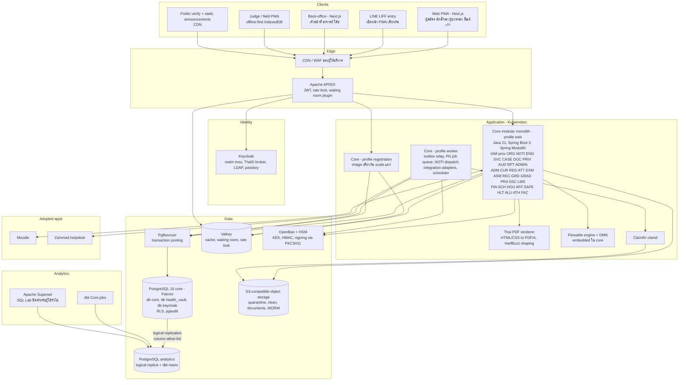
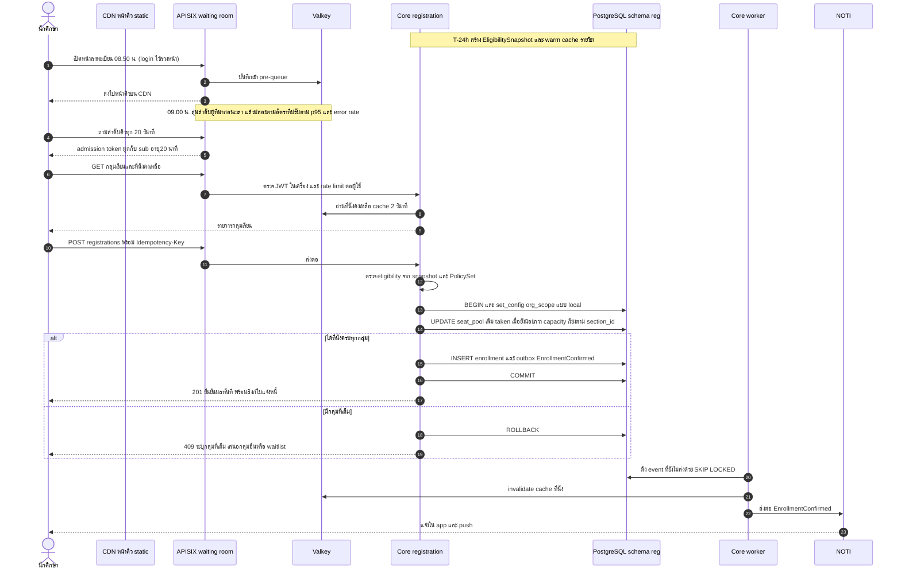
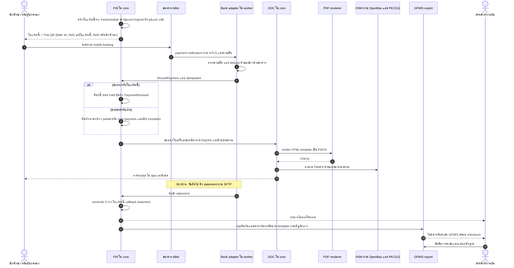
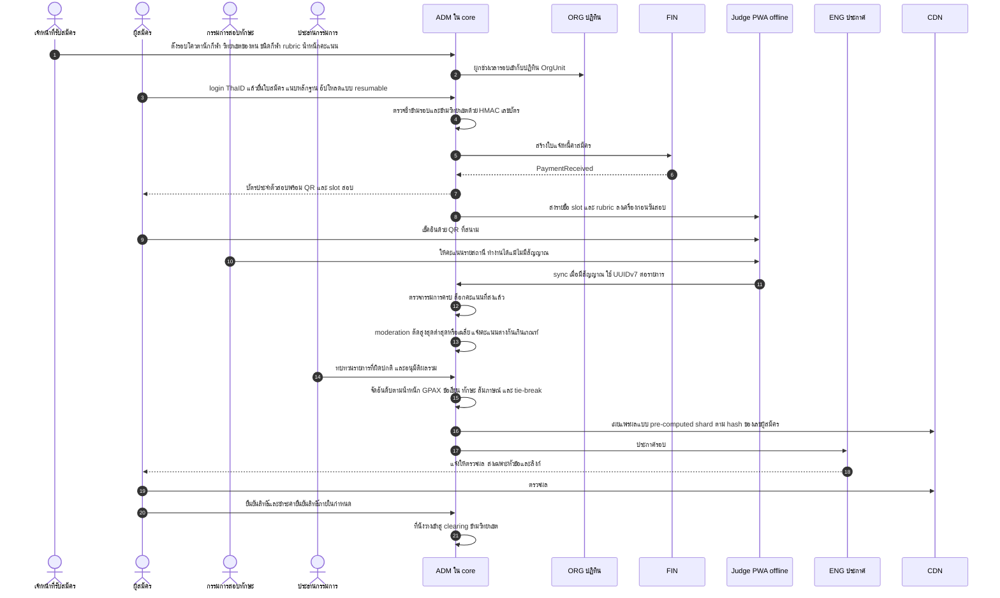
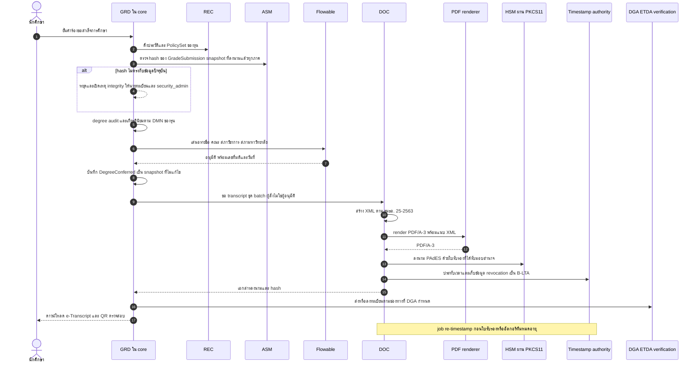
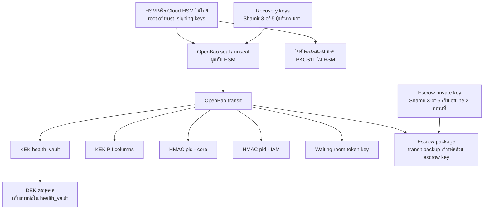

# 07 — สถาปัตยกรรมระบบ (Architecture, Minimum Operable Stack, ADR, NFR)

> **สถานะ:** v1.0-draft · 28 ต.ค. 2569 · ผู้เขียน: E · ภาษา: ไทย (ศัพท์เทคนิคและชื่อผลิตภัณฑ์เป็นภาษาอังกฤษ)
>
> **อ่านคู่กับ:** [00-blueprint](00-blueprint.md) (ข้อตกลงกลาง ข้อ 7–9) · [01-overview](01-overview.md) (Assumptions register A-xx) · [04-roles-permissions](04-roles-permissions.md) · [06-modules](06-modules.md) (เจ้าของรายการ event) · [08-data](08-data.md) · [09-integrations](09-integrations.md) · [10-security-compliance](10-security-compliance.md) (รายละเอียด STRIDE, PDPA, ระดับลายมือชื่อ) · [11-operations](11-operations.md) · [12-roadmap-cost-risk](12-roadmap-cost-risk.md)
>
> **ฐานเดิม:** `archive/v0.9/system-design.md` หัวข้อ 5, 8, 9 (เล่มนี้เขียนใหม่ทั้งหมด ไม่ได้แก้ต่อจากฉบับเดิม) · ประเด็นจาก [review_architecture](<../../research_notes/ออกแบบระบบการศึกษา TNSU ระดับ production/review_architecture.md>) ปิดครบทุกข้อในหัวข้อ 14

**ป้ายความน่าเชื่อถือในเล่มนี้:** **[ตรวจแล้ว]** = ผู้เขียนค้นยืนยันจากเว็บในรอบนี้ (มีลิงก์) · **[ความรู้ผู้เขียน]** = ไม่ได้ตรวจซ้ำในรอบนี้ ต้องให้ฝ่ายกฎหมาย/ผู้ตรวจรับยืนยันจาก LICENSE ของเวอร์ชันที่ใช้จริง · **[ต้องตรวจสอบ]** = ยังไม่ยืนยัน ห้ามใช้เป็นข้อเท็จจริง · **S7-xx** = สมมติฐานของเล่มนี้ (เล่ม 01 จะรวมเข้าทะเบียน A-xx)

---

## สารบัญ

1. [สรุปสำหรับผู้อ่านเร็ว](#1-สรุปสำหรับผู้อ่านเร็ว)
2. [หลักการสถาปัตยกรรม](#2-หลักการสถาปัตยกรรม)
3. [C4 Level 1 — System Context](#3-c4-level-1--system-context)
4. [C4 Level 2 — Container (Minimum Operable Stack)](#4-c4-level-2--container-minimum-operable-stack)
5. [จำนวน component: v0.9 เทียบ v1.0](#5-จำนวน-component-v09-เทียบ-v10)
6. [ตาราง Technology stack ฉบับเต็ม](#6-ตาราง-technology-stack-ฉบับเต็ม)
7. [Licence policy, allow-list และ SBOM](#7-licence-policy-allow-list-และ-sbom)
8. [Architecture Decision Records (ADR-001..025)](#8-architecture-decision-records-adr-001025)
9. [Sequence diagram หลัก](#9-sequence-diagram-หลัก)
10. [NFR: capacity ที่คำนวณใหม่, SLO, RPO/RTO](#10-nfr-capacity-ที่คำนวณใหม่-slo-rporto)
11. [Cross-cutting concerns](#11-cross-cutting-concerns)
12. [Key management](#12-key-management)
13. [STRIDE threat model (สรุป)](#13-stride-threat-model-สรุป)
14. [สมมติฐานและคำถามเปิดของเล่มนี้](#14-สมมติฐานและคำถามเปิดของเล่มนี้)
15. [ผลการปิด review](#15-ผลการปิด-review)

---

## 1. สรุปสำหรับผู้อ่านเร็ว

| ประเด็น | v0.9 | v1.0 (เล่มนี้) |
|---|---|---|
| Runtime component ที่ต้องดูแล | 53 รายการ (นับในหัวข้อ 5; review ประเมิน 45–50) | **28** (แกน 26 + แอป adopt 2) ลดลงราว 47% |
| Event bus | Kafka + Strimzi + MirrorMaker 2 + Apicurio + Debezium | **Transactional outbox + PostgreSQL event publication registry + PG job queue**; Kafka เป็นทางเลือกเมื่อถึงเกณฑ์ (ADR-003) |
| Registration engine | Redis DECR → Kafka → worker (dual-write ข้าม 3 ระบบ) | **Transaction แบบ synchronous บน PostgreSQL** หลัง virtual waiting room ที่ gateway (ADR-004) |
| Analytics | ClickHouse + Keeper + Debezium + Superset + Metabase + OpenMetadata | **PostgreSQL logical replica (column allow-list) + dbt Core + Superset ตัวเดียว** (ADR-017) |
| Secrets / IaC / cache / object | Vault (BSL), Terraform (BSL), Redis, MinIO | **OpenBao, OpenTofu, Valkey, S3 ของผู้ให้บริการ หรือ Ceph RGW/SeaweedFS** (ADR-012..015) |
| Environments | 8 | **5** ([11-operations](11-operations.md) หัวข้อ 1) |
| Peak ลงทะเบียน (worst case ไม่ stagger) | 3,000 RPS เป้า, ไม่นับ polling | **origin ≈ 1,050 RPS คาด / 2,100 RPS ออกแบบ**; command 60/s burst, ออกแบบ 120/s, ทดสอบยืนยัน 300/s |
| P0 broadcast | เป้า 200 msg/s แต่ต้องส่ง 417 msg/s (ขัดกันเอง) | **≈ 800 delivery/s** ในนาทีแรก, dispatcher ออกแบบ 1,000/s, SMS เป็นคอขวด (ครบ ≤ 5 นาที) |
| SLO ช่วงวิกฤต | 99.95% แต่ dependency ต่ออนุกรมได้จริง ≈ 99.70–99.80% | **99.95% เฉพาะ journey ลงทะเบียนที่ตัด Keycloak และ Valkey ออกจาก critical path แล้ว** (4 ตัวอนุกรม: 99.99³ × 99.98 = 99.950%) |
| Ransomware | RTO 4 ชม. | แยก 2 กรณี: logical corruption RTO ≤ 4 ชม. / platform compromise **RTO 48–72 ชม.** จาก immutable backup |

---

## 2. หลักการสถาปัตยกรรม

| รหัส | หลักการ | ผลต่อการออกแบบ |
|---|---|---|
| AP-01 | **Operability ก่อนความสวยงาม:** ทุก runtime component ต้องมีผู้ดูแลฝั่ง มกช. ที่ระบุบทบาทได้ (`itadmin`, `dba_sre`, `security_admin`, `campus_itadmin`) หรือเป็นบริการที่ผู้ให้บริการ cloud/MSP ดูแลตามสัญญา | ตัด/เลื่อน component ที่ไม่มีเจ้าของ (หัวข้อ 5) |
| AP-02 | **Boring technology:** ใช้ PostgreSQL ให้สุดก่อนเพิ่ม datastore ใหม่ ทุก datastore ใหม่ต้องมี ADR ที่มีเกณฑ์เชิงตัวเลข | ไม่มี Kafka, ClickHouse, OpenSearch ใน R1–R3 |
| AP-03 | **Modular monolith ที่บังคับ boundary:** โมดูลตามรหัสใน blueprint ข้อ 4 แยก schema, สื่อสารผ่าน published API/event เท่านั้น, ตรวจใน CI | ADR-002 |
| AP-04 | **Configuration ราย OrgUnit ไม่ใช่ fork ของโค้ด:** ค่าธรรมเนียม ผู้ลงนาม ปฏิทิน รอบรับสมัคร template เป็นข้อมูลที่มีเวอร์ชันและผ่าน maker-checker | ADR-005, ADR-006 |
| AP-05 | **Defence-in-depth ข้ามวิทยาเขต:** RLS ที่ DB + ABAC ที่แอป + scope ใน BI/replica | ADR-005, ADR-017 |
| AP-06 | **ลด serial dependency บน journey สำคัญ** และออกแบบให้ degrade ได้ (fail-open สำหรับ cache, fail-static สำหรับประกาศ) | หัวข้อ 10.5 |
| AP-07 | **Open standards และ licence allow-list:** OIDC, S3 API, BPMN/DMN 2.0, OpenAPI 3.1, AsyncAPI, PDF/A, PAdES, ขมธอ. 25-2563; ห้าม licence BSL/SSPL/RSAL/ELv2 ในแกน | ADR-019 |
| AP-08 | **ข้อมูลอยู่ในประเทศไทยโดยค่าเริ่มต้น** บริการต่างประเทศต้องอยู่ใน cross-border transfer register และส่งเฉพาะหัวข้อ + ลิงก์ (blueprint ข้อ 9.10) | NOTI payload policy, หัวข้อ 11 |
| AP-09 | **Mobile-first บนเครือข่ายไม่ดี:** PWA + LINE LIFF, งบ JS ต่อหน้า, offline สำหรับงานภาคสนาม | ADR-008, หัวข้อ 11.8 |
| AP-10 | **ความถูกต้องตรวจสอบได้ (auditability):** เอกสารราชการสร้างจาก snapshot ที่ลงนาม, audit แยกจากแอป, ทุกการเปลี่ยนแปลง config มีผู้อนุมัติ | ADR-010, หัวข้อ 13 |
| AP-11 | **Brand-neutral สำหรับ TOR:** ชื่อผลิตภัณฑ์ในเล่มนี้เป็น reference architecture ของผู้เสนองาน ถ้าใช้ทำ TOR ต้องแปลงเป็น capability spec + มาตรฐานเปิด (blueprint ข้อ 9.11) | ตาราง stack มีคอลัมน์ทางเลือกทุกแถว |
| AP-12 | **ถอยกลับได้:** ทุก release ใช้ DB migration แบบ expand/contract, feature flag ราย OrgUnit ring, kill-switch รายโมดูล | ADR-025, [11-operations](11-operations.md) |

---

## 3. C4 Level 1 — System Context

```mermaid
flowchart TB
  subgraph USERS["ผู้ใช้"]
    U1["ผู้สมัคร / นักศึกษา / นักกีฬา / นักเรียนโรงเรียนกีฬา"]
    U2["ผู้ปกครอง (guardian)"]
    U3["อาจารย์ / โค้ช / กรรมการสอบทักษะ / ครูพี่เลี้ยง"]
    U4["เจ้าหน้าที่ทะเบียน การเงิน หอพัก กิจการ สุขภาพ"]
    U5["ผู้บริหาร / QA / DPO / ผู้ตรวจสอบ"]
    U6["ศิษย์เก่า / นายจ้าง / ผู้ตรวจสอบเอกสาร"]
  end

  SYS["ระบบสารสนเทศ มกช. v1.0<br/>Student and Athlete Lifecycle Platform"]

  subgraph GOV["หน่วยงานรัฐและระบบกลาง"]
    G1["ThaID - กรมการปกครอง"]
    G2["TCAS adapter - ทปอ. (ทางเลือก)"]
    G3["กยศ. DSL"]
    G4["สป.อว. CHECO / ฐานข้อมูลอุดมศึกษา"]
    G5["DGA / ETDA Digital Transcript"]
    G6["New GFMIS Thai - กรมบัญชีกลาง"]
    G7["คุรุสภา / สทศ. / DMC"]
    G8["ITA - สำนักงาน ป.ป.ช. (OIT)"]
  end

  subgraph BANK["การเงิน"]
    B1["ธนาคาร - Bill Payment / Thai QR / statement"]
  end

  subgraph XB["บริการต่างประเทศ (อยู่ใน cross-border register)"]
    X1["LINE OA / LIFF"]
    X2["FCM / APNs / Web Push"]
    X3["Email / SMS gateway"]
  end

  subgraph INT["ระบบอื่นของ มกช."]
    I1["Moodle LMS (LTI 1.3)"]
    I2["AD / LDAP รายวิทยาเขต"]
    I3["e-Saraban"]
    I4["HR / Koha / ระบบเดิมระหว่าง migration"]
  end

  U1 --> SYS
  U2 --> SYS
  U3 --> SYS
  U4 --> SYS
  U5 --> SYS
  U6 --> SYS
  SYS <--> G1
  SYS <--> G2
  SYS <--> G3
  SYS --> G4
  SYS --> G5
  SYS --> G6
  SYS --> G7
  SYS --> G8
  SYS <--> B1
  SYS --> X1
  SYS --> X2
  SYS --> X3
  SYS <--> I1
  SYS <--> I2
  SYS --> I3
  SYS <--> I4
```

สถานะการยืนยันของแต่ละ integration (เช่น สถานะ มกช. ต่อ GFMIS, การใช้ TCAS) อยู่ใน [09-integrations](09-integrations.md) เล่มนี้ถือว่าทุกตัวเชื่อมผ่าน **integration adapter ภายใน core (โปรไฟล์ worker)** และ adapter ต้องทำงานแบบ file-based ได้เมื่อหน่วยงานไม่มี API

---

## 4. C4 Level 2 — Container (Minimum Operable Stack)

**หมายเหตุ container (ค่าเดียวที่ใช้ทั้งชุดเอกสาร — ขนาดอยู่ใน [11-operations](11-operations.md) หัวข้อ 2):**

| Container | Deploy unit | หน้าที่ | หมายเหตุ |
|---|---|---|---|
| Core profile `web` | image `core` | REST API ทุกโมดูล, BFF ของ web | stateless, JWT ตรวจที่ gateway และตรวจซ้ำที่แอป |
| Core profile `registration` | image `core` (deployment แยก) | endpoint ลงทะเบียน/ที่นั่ง เท่านั้น | แยกเพื่อ bulkhead และ scale ช่วง peak (ADR-004) ไม่ใช่ service แยก |
| Core profile `worker` | image `core` | outbox relay, PG job queue, NOTI dispatcher, integration adapters (ไฟล์/API/SFTP), scheduled jobs จากปฏิทิน (ORG) | leader election ผ่าน PG advisory lock |
| Thai PDF renderer | image `doc-render` | แปลง HTML/CSS template เป็น PDF/A (ไม่มีกุญแจลงนาม) | การลงนาม PAdES ทำใน core ผ่าน PKCS#11 (ADR-010) |
| Next.js | image `web` (2 deployment: portal, backoffice) | SSR หน้า public/portal, CSR back-office, service worker | LIFF ใช้ portal เดียวกัน |
| Keycloak | 3 replicas | OIDC, ThaID broker, LDAP, passkey/OTP | DB แยกใน Patroni ชุดเดียวกัน |
| APISIX | 3 replicas (peak 6) | routing, JWT, rate limit, waiting room | ใช้โหมด standalone/declarative จาก Git เพื่อไม่ต้องดูแล etcd **[ต้องตรวจสอบ: ingress controller เวอร์ชันที่เลือกต้องรองรับโหมดนี้]** |

โมดูล IAM (provisioning), ORG, ENG, NOTI, AUD, ANA, RPT และ ADMIN อยู่ใน core ทั้งหมด (ปิดประเด็น IC-25) ส่วน X-* อยู่นอกขอบเขตสัญญานี้และเชื่อมผ่าน adapter

---

## 5. จำนวน component: v0.9 เทียบ v1.0

### 5.1 เกณฑ์การนับ

นับ **runtime component ที่ทีมต้อง install, patch, upgrade, monitor และ backup แยกกัน** ไม่นับ library ที่อยู่ใน JVM (Spring Modulith, Flowable engine, EU DSS, ICU4J) และไม่นับบริการที่ผู้ให้บริการ cloud/MSSP ดูแลตามสัญญา (CDN/WAF, HSM แบบ managed, SOC/SIEM, SMS/email gateway) ซึ่งแยกแสดงไว้

### 5.2 v0.9 (53 รายการ)

| # | Component v0.9 | ผลใน v1.0 |
|---|---|---|
| 1 | Kubernetes | คง |
| 2 | CDN/WAF (OWASP CRS ดูแลเอง) | ใช้ของผู้ให้บริการ (ไม่นับ) |
| 3 | Waiting room service แยก | รวมเป็น plugin ใน APISIX + Valkey |
| 4 | APISIX | คง |
| 5 | Keycloak | คง |
| 6 | Core modular monolith | คง |
| 7 | Registration Engine (image แยก) | รวมเป็น profile ของ core |
| 8 | Notification Service (image แยก) | รวมใน core worker |
| 9 | Integration Adapters (Camel, image แยก) | รวมใน core worker |
| 10 | Document & Signing Service | แยกเฉพาะ renderer ที่ไม่มีกุญแจ; การลงนามอยู่ใน core |
| 11 | Reporting API (warehouse) | ตัด (RPT อยู่ใน core, BI ผ่าน Superset) |
| 12 | Flowable Design/Admin UI | ตัด (Flowable 7 OSS ไม่มี UI; ใช้ bpmn-js/dmn-js ใน ADMIN) |
| 13 | PostgreSQL core (Patroni) | คง |
| 14 | PostgreSQL health vault cluster แยก | ลดเป็น database แยกใน cluster เดียวกัน |
| 15 | PgBouncer | คง |
| 16 | pgBackRest | คง |
| 17 | Redis | เปลี่ยนเป็น Valkey |
| 18 | Kafka (Strimzi) | เลื่อน |
| 19 | MirrorMaker 2 | เลื่อน |
| 20 | Apicurio | เลื่อน (AsyncAPI ใน Git) |
| 21 | Debezium | เลื่อน (ใช้ PG logical replication) |
| 22 | MinIO | ไม่ใช้ (upstream archived) |
| 23 | OpenSearch | เลื่อน |
| 24 | ClickHouse | เลื่อน |
| 25 | ClickHouse Keeper | เลื่อน |
| 26 | dbt | คง (dbt Core) |
| 27 | Superset | คง |
| 28 | Metabase | ตัด |
| 29 | OpenMetadata | เลื่อน (ใช้ dbt docs + ROPA ใน PRIV) |
| 30 | HashiCorp Vault | เปลี่ยนเป็น OpenBao |
| 31 | HSM | คง (นับเป็นบริการ managed/appliance ไม่นับ) |
| 32 | Teleport | ไม่ใช้ (licence) |
| 33 | Unleash | เลื่อน (OpenFeature SDK + flag ใน DB/Git) |
| 34 | Argo CD | คง |
| 35 | Argo Rollouts | เลื่อน |
| 36 | Velero | เลื่อน (app tier stateless, state อยู่นอก cluster) |
| 37 | Prometheus/Alertmanager | คง |
| 38 | Grafana | คง |
| 39 | Loki | คง |
| 40 | Tempo | คง |
| 41 | Kyverno | คง (baseline policies) |
| 42 | Falco | เลื่อน (ให้ MSSP เป็นเจ้าของถ้าต้องการ) |
| 43 | Service mesh | เลื่อน |
| 44 | Wazuh (SIEM) | ย้ายไป MSSP/SOC (ไม่นับ) |
| 45 | Dependency-Track | คง |
| 46 | SonarQube (server) | ตัดเป็น CI tooling (Semgrep CE/SpotBugs ใน pipeline) |
| 47 | GitLab | คง (Git forge + CI) |
| 48 | Harbor | คง |
| 49 | ClamAV | คง |
| 50 | Moodle | คง (ถ้า มกช. ไม่มี instance เดิม) |
| 51 | Zammad | คง (X-HELP) |
| 52 | Next.js web | คง |
| 53 | Flutter app | เลื่อนไปสัญญาแยก |

### 5.3 v1.0 Minimum Operable Stack (28 รายการ)

| # | Component | กลุ่ม | ผู้ดูแลฝั่ง มกช. (role ตามเล่ม 04) | Tier |
|---|---|---|---|---|
| 1 | Kubernetes (managed ของผู้ให้บริการ หรือ RKE2) | Platform | `itadmin` | Must |
| 2 | Apache APISIX (gateway + waiting room + rate limit) | Edge | `itadmin` | Must |
| 3 | Keycloak | Identity | `itadmin` + `security_admin` | Must |
| 4 | Core modular monolith (profiles web/registration/worker) | App | vendor L3 + `itadmin` | Must |
| 5 | Next.js web tier (portal PWA + back-office) | App | vendor L3 | Must |
| 6 | Thai PDF renderer | App | vendor L3 | Must |
| 7 | PostgreSQL 16 + Patroni (core, analytics, apps) | Data | `dba_sre` | Must |
| 8 | PgBouncer | Data | `dba_sre` | Must |
| 9 | pgBackRest | Data | `dba_sre` | Must |
| 10 | Valkey | Data | `dba_sre` | Must |
| 11 | S3-compatible object storage (บริการของผู้ให้บริการ; สำรอง Ceph RGW/SeaweedFS) | Data | `itadmin` | Must |
| 12 | OpenBao | Security | `security_admin` | Must |
| 13 | ClamAV | Security | `security_admin` | Must |
| 14 | Kyverno (baseline + verify image signature) | Security | `security_admin` | Must |
| 15 | Dependency-Track | Security | `security_admin` | Must |
| 16 | PAM/bastion ที่ licence ชัด (บริการของ GDCC/MSSP หรือ JumpServer) | Security | `security_admin` | Must |
| 17 | dbt Core (batch job) | Analytics | `data_steward` + vendor | Must |
| 18 | Apache Superset | Analytics | `data_steward` | Must |
| 19 | OpenTelemetry Collector | Observability | `dba_sre` | Must |
| 20 | Prometheus + Alertmanager | Observability | `dba_sre` | Must |
| 21 | Grafana | Observability | `dba_sre` | Must |
| 22 | Loki | Observability | `dba_sre` | Must |
| 23 | Tempo | Observability | `dba_sre` | Should (ปิดได้ถ้าทีมไม่พร้อม) |
| 24 | Argo CD | Delivery | `itadmin` | Must |
| 25 | Git forge + CI runners (GitLab CE หรือ Forgejo) | Delivery | `itadmin` | Must |
| 26 | Harbor (รวม Trivy scanner) | Delivery | `itadmin` | Must |
| 27 | Zammad (X-HELP) | Adopted | `helpdesk` | Must ตั้งแต่ R1 |
| 28 | Moodle | Adopted | `itadmin` (หรือ instance เดิม) | ใช้เมื่อ มกช. ไม่มี instance เดิม |

**ผลลัพธ์:** แกน 26 + แอป adopt 2 = **28** (ถ้า มกช. ใช้ Moodle เดิมและ PAM เป็นบริการของ GDCC/MSSP เหลือ **26**) เทียบกับ 53 ใน v0.9 ลดลง 25 รายการ (47%) ส่วนบริการ managed ที่ไม่นับแต่ต้องอยู่ในสัญญา: CDN/WAF, HSM, SOC/SIEM 24×7, SMS/email gateway, ปลายทาง backup แบบ offline

### 5.4 รายการที่เลื่อน พร้อมเกณฑ์นำกลับ (บันทึกใน ADR)

| เลื่อน/ตัด | เกณฑ์นำกลับ (ต้องมีหลักฐานจาก production) | ADR |
|---|---|---|
| Kafka + Strimzi + MirrorMaker 2 + schema registry | event > 500/s ต่อเนื่อง 15 นาทีในช่วงปกติ **หรือ** consumer ภายนอก ≥ 5 ระบบที่ต้อง replay **หรือ** outbox lag p95 > 30 s แม้ปรับ relay แล้ว | ADR-003 |
| Debezium CDC | ผู้ใช้จริงต้องการ freshness < 15 นาที และ logical replication ไม่พอ | ADR-017 |
| ClickHouse | dashboard p95 > 3 s บนข้อมูลจริงหลังทำ partition/materialized view แล้ว | ADR-017 |
| OpenSearch | ต้องค้น full-text ในเอกสาร/ไฟล์ปริมาณมาก หรือ PG FTS p95 > 500 ms | ADR-021 |
| Service mesh (mTLS ภายใน) | threat model รอบทบทวนพบ lateral movement risk สูง; ระหว่างนี้ใช้ NetworkPolicy default-deny + WireGuard ของ CNI ถ้ามี | ADR-018 |
| Argo Rollouts | มีทีม SRE ประจำ ≥ 3 คน | ADR-025 |
| Unleash/flag service | flag > 100 หรือต้องทำ % rollout | ADR-025 |
| Falco | มี SOC 24×7 ที่รับ alert runtime ได้ | ADR-018 |
| OpenMetadata | GD Catalog บังคับ หรือ dataset > 200 | ADR-017 |
| Flutter app | PWA/LIFF ไม่พอสำหรับ wellness รายวัน/offline หนัก (วัดจาก adoption) | ADR-008 |
| Velero | มี stateful workload ใน cluster ที่ไม่อยู่ใน backup ของ DB/object | [11-operations](11-operations.md) |

---

## 6. ตาราง Technology stack ฉบับเต็ม

> คอลัมน์ licence: ระบุ SPDX และสถานะการตรวจ ผู้ตรวจรับต้องยืนยันจาก LICENSE ของเวอร์ชันที่ส่งมอบจริงผ่าน SBOM gate (ADR-019) ทุกแถวเป็น reference architecture ไม่ใช่ spec ใน TOR (AP-11)

| Layer | Component | ตัวเลือก | Licence | เหตุผล | ทางเลือก | ทบทวนเมื่อ |
|---|---|---|---|---|---|---|
| Runtime | ภาษา | Java 21 LTS (Eclipse Temurin), virtual threads | GPL-2.0 WITH Classpath-exception-2.0 [ความรู้ผู้เขียน] | ตลาดแรงงานไทยใหญ่, LTS ยาว | Kotlin บน JVM, .NET 8, TypeScript | Java LTS ถัดไป (25) ผ่าน 1 ปี |
| Runtime | Framework | Spring Boot 3 + Spring Modulith | Apache-2.0 [ความรู้ผู้เขียน] | boundary verification + event publication registry บน JDBC ([Spring Modulith docs](https://docs.spring.io/spring-modulith/reference/1.4/events.html) [ตรวจแล้ว]) | Quarkus, Micronaut | Spring Boot major ใหม่ |
| Runtime | Job queue | PG-backed (event publication registry + ตาราง job แบบ `FOR UPDATE SKIP LOCKED` หรือ db-scheduler) | db-scheduler: Apache-2.0 [ต้องตรวจสอบ]; ทางเลือก JobRunr OSS LGPL-3.0 [ต้องตรวจสอบ] | ไม่เพิ่ม component, transaction เดียวกับข้อมูล | Kafka, RabbitMQ | ถึงเกณฑ์ ADR-003 |
| Workflow/rules | BPMN/DMN | Flowable 7 engine (embedded) | Apache-2.0 [ความรู้ผู้เขียน]; UI apps ถูกตัดออกตั้งแต่ v7 ([Flowable forum](https://forum.flowable.org/t/flowable-7-0-0-m1-plans-for-ui-and-content-engine/10733) [ตรวจแล้ว]) | BPMN/DMN มาตรฐาน อยู่ใน JVM | Camunda 7 CE (EOL [ต้องตรวจสอบ]), Camunda 8 (licence แยก), state machine เอง | ต้องการ CMMN จริง หรือ Flowable เปลี่ยน licence |
| Workflow/rules | Modeler | bpmn-js / dmn-js ฝังใน ADMIN (deploy ผ่าน pipeline) | bpmn.io License (MIT-style แต่บังคับคงโลโก้ bpmn.io) **ไม่ใช่ OSI มาตรฐาน → อยู่ในทะเบียนข้อยกเว้น** [ต้องตรวจสอบ] | ไม่ต้องซื้อ Flowable Design | Flowable Design (subscription), modeler ภายนอกที่ export BPMN | ฝ่ายกฎหมายไม่รับเงื่อนไขโลโก้ |
| API | Style | REST + OpenAPI 3.1, AsyncAPI 3 สำหรับ event, RFC 9457 | — | มาตรฐาน, สอดคล้องแนว API ภาครัฐ | GraphQL (เฉพาะ BFF) | — |
| Frontend | Web | React + Next.js (App Router) + TypeScript, PWA (service worker) | MIT [ความรู้ผู้เขียน] | talent pool ใหญ่, SSR สำหรับมือถือ | Vue/Nuxt | — |
| Frontend | Design system | "TNSU DS" บน React Aria Components + Tailwind, ฟอนต์ไทยฝัง (Sarabun / IBM Plex Sans Thai) | Apache-2.0 / MIT / OFL-1.1 [ความรู้ผู้เขียน] | a11y ระดับ component | MUI | — |
| Frontend | LINE | LINE LIFF + Messaging API | ข้อตกลงบริการของ LINE (ไม่ใช่ OSS) | ช่องทางที่ผู้ใช้ไทยเปิดจริง | — | ข้อตกลง/ราคาเปลี่ยน |
| Frontend | Upload | Uppy + S3 multipart (presigned) | MIT [ความรู้ผู้เขียน] | resumable บน 4G ไม่ต้องมี upload server | tus (tusd) | — |
| Identity | IdP | Keycloak 26 | Apache-2.0 [ความรู้ผู้เขียน] | OIDC/SAML, broker ThaID, passkey | Authentik, WSO2 IS | — |
| Edge | Gateway | Apache APISIX (standalone config จาก Git) | Apache-2.0 (โครงการ ASF) [ความรู้ผู้เขียน] | plugin JWT/limit, เขียน waiting room plugin ได้ | Envoy Gateway, Kong OSS, NGINX | — |
| Edge | WAF/CDN | บริการของผู้ให้บริการ (GDCC/CSP ในไทย) | บริการ | ไม่ต้องดูแล rule set เอง | Coraza (Apache-2.0) ใน APISIX [ต้องตรวจสอบ] | ผู้ให้บริการไม่มี WAF |
| Data | OLTP | PostgreSQL 16 + Patroni | PostgreSQL License ([postgresql.org](https://www.postgresql.org/about/licence/) [ตรวจแล้ว]); Patroni MIT [ความรู้ผู้เขียน] | ACID, RLS, ICU collation ไทย, logical replication column list | Oracle, managed DB ของ CSP | PG major ใหม่ทุก 2 ปี |
| Data | Pooler | PgBouncer (transaction mode) | ISC [ความรู้ผู้เขียน] | connection ต่ำ, ต้องใช้ `SET LOCAL` (ADR-005) | PgCat, Odyssey | — |
| Data | Backup | pgBackRest | MIT [ความรู้ผู้เขียน] | PITR, S3, encryption, parallel restore | Barman (GPL-3.0) | — |
| Data | Cache/token | **Valkey** | BSD-3-Clause ([elest.io](https://blog.elest.io/valkey-vs-redis-vs-keydb-which-in-memory-store-after-the-license-change/), [InfoQ](https://www.infoq.com/news/2025/05/redis-agpl-license) [ตรวจแล้ว]) | fork ของ Redis 7.2.4 ภายใต้ Linux Foundation | Redis 8 (เลือกได้ AGPLv3/RSAL/SSPL [ตรวจแล้ว]) | — |
| Data | Object | S3 ของผู้ให้บริการ; สำรอง Ceph RGW หรือ SeaweedFS | Ceph LGPL-2.1/3.0 [ความรู้ผู้เขียน]; SeaweedFS Apache-2.0 [ต้องตรวจสอบ]; Garage AGPL-3.0 ([SUSE](https://packagehub.suse.com/packages/garage/) [ตรวจแล้ว]) | ต้องการ Object Lock **compliance mode** | MinIO: upstream archived 25 เม.ย. 2569, หยุดแจก binary ต.ค. 2568 ([GitHub](https://github.com/minio/minio), [itsfoss](https://itsfoss.com/news/minio-moves-away-from-open-source/) [ตรวจแล้ว]) → ไม่ใช้ | ผู้ให้บริการไม่มี Object Lock |
| Security | Secrets/keys | **OpenBao** + HSM (PKCS#11) | MPL-2.0 ([desdelinux](https://blog.desdelinux.net/en/openbao-an-open-source-fork-of-hashicorp/) [ตรวจแล้ว, แหล่งรอง]) | fork ของ Vault 1.14 ที่ยังเป็น open source; Vault เป็น BSL 1.1 ([The Register](https://www.theregister.com/2023/12/08/hashicorp_openbao_fork/)) | Vault Enterprise (มีค่าใช้จ่าย), Cloud KMS ในไทย | ฟีเจอร์ auto-unseal/PKCS#11 ที่ต้องใช้ไม่มีใน OpenBao [ต้องตรวจสอบ] |
| Security | Antivirus | ClamAV (clamd) | GPL-2.0 [ความรู้ผู้เขียน] | สแกนไฟล์อัปโหลดก่อนปล่อย | บริการสแกนของผู้ให้บริการ | — |
| Security | Policy | Kyverno | Apache-2.0 [ความรู้ผู้เขียน] | baseline pod security + verify cosign | OPA Gatekeeper | — |
| Security | SBOM/SCA | Dependency-Track + Trivy (ใน Harbor/CI) + cosign | Apache-2.0 [ความรู้ผู้เขียน] | SBOM CycloneDX เป็น acceptance gate | Grype | — |
| Security | PAM | บริการ PAM ของ GDCC/MSSP; สำรอง JumpServer | JumpServer GPL-3.0 [ต้องตรวจสอบ] | session recording, JIT | Teleport CE: licence จำกัดองค์กร < 100 คน และรายได้ < USD 10M ตั้งแต่ v16 ([Teleport](https://goteleport.com/blog/teleport-community-license) [ตรวจแล้ว]) → ไม่ใช้ | — |
| Docs | PDF render | HTML/CSS → PDF ด้วย **WeasyPrint** (Pango + HarfBuzz) | BSD-3-Clause ([Debian](https://sources.debian.org/src/weasyprint/67.0-1/PKG-INFO) [ตรวจแล้ว]); รองรับ PDF/A, PDF/UA ([openapps](https://openapps.pro/packages/weasyprint) [แหล่งรอง, ต้องตรวจสอบ]) | shaping ไทยด้วย HarfBuzz; ตัดคำไทยต้องพิสูจน์ด้วย golden file | Chromium headless (Gotenberg, MIT [ความรู้ผู้เขียน]); JasperReports (LGPL, แต่ exporter ใช้ iText 2.1.7 รุ่นเก่า [ตรวจแล้ว: Wikipedia]); Typst ยังไม่ตัดคำไทยตามพจนานุกรม ([Typst forum](https://forum.typst.app/t/how-to-implement-dictionary-based-word-recognition-for-thai-for-line-breaking-hyphenation/7470) [ตรวจแล้ว]) | bake-off P0 ไม่ผ่าน |
| Docs | ลงนาม | EU DSS library (PAdES-B-LTA, XAdES) ใน core | LGPL-2.1 ([EC DSS](https://ec.europa.eu/digital-building-blocks/sites/display/DIGITAL/Digital%20Signature%20Service%20-%20%20DSS) [ตรวจแล้ว]) | ครบทั้ง PAdES/XAdES/timestamp/LTV | iText 7 (AGPL/commercial [ตรวจแล้ว]) | — |
| Docs | ตรวจ PDF/A | veraPDF (ใน CI/gate) | GPL-3.0+ หรือ MPL-2.0+ [ความรู้ผู้เขียน] | validation ก่อนออกเอกสาร | — | — |
| Search | ค้นหา | PostgreSQL FTS + `pg_trgm` + ICU4J BreakIterator ตัดคำไทยฝั่งแอป | PostgreSQL License; ICU License [ความรู้ผู้เขียน] | ไม่เพิ่ม cluster | OpenSearch (Apache-2.0) | ADR-021 |
| Analytics | Transform | dbt Core | Apache-2.0; dbt Fusion เป็น proprietary ไม่ใช้ ([dbt licensing](https://docs.getdbt.com/docs/dbt-licensing) [ตรวจแล้ว]) | SQL + test + docs/lineage | SQLMesh | — |
| Analytics | BI | Apache Superset | Apache-2.0 (ASF) [ความรู้ผู้เขียน] | RLS filter, embed, ไทยได้ | Metabase (AGPL) | — |
| Observability | Telemetry | OpenTelemetry SDK/Collector | Apache-2.0 [ความรู้ผู้เขียน] | มาตรฐานเปิด | — | — |
| Observability | Metrics | Prometheus + Alertmanager | Apache-2.0 [ความรู้ผู้เขียน] | SLO burn-rate | VictoriaMetrics | ข้อมูล > 13 เดือน |
| Observability | Dashboard/logs/traces | Grafana, Loki, Tempo | **AGPL-3.0** ([Grafana Labs](https://grafana.com/blog/2021/04/20/grafana-loki-tempo-relicensing-to-agplv3) [ตรวจแล้ว]) — ใช้ภายในโดยไม่แก้ไข ต้องผ่าน legal review | ทีมรู้จักแพร่หลาย | OpenSearch Dashboards, Jaeger (Apache-2.0) | legal ไม่รับ AGPL |
| Observability | RUM | Grafana Faro Web SDK / OTel web | Apache-2.0 [ต้องตรวจสอบ] | เห็นปัญหาผู้ใช้ต่างจังหวัด | — | — |
| Delivery | IaC | **OpenTofu** | MPL-2.0, โครงการ CNCF ([The New Stack](https://thenewstack.io/opentofu-joins-cncf-new-home-for-open-source-iac-project/) [ตรวจแล้ว]) | Terraform เป็น BSL 1.1 | Pulumi, Ansible | — |
| Delivery | GitOps | Argo CD | Apache-2.0 [ความรู้ผู้เขียน] | declarative, audit ผ่าน Git | Flux | — |
| Delivery | Git + CI | GitLab CE หรือ Forgejo + runners ในไทย | GitLab CE: MIT [ความรู้ผู้เขียน]; Forgejo: GPL-3.0+ [ความรู้ผู้เขียน] | source อยู่ในประเทศ, repo ของ มกช. | GitHub + self-hosted runner | — |
| Delivery | Registry | Harbor | Apache-2.0 (CNCF) [ความรู้ผู้เขียน] | สแกน + replication + signature | registry ของผู้ให้บริการ | — |
| Testing | Load | k6 | **AGPL-3.0** ([pkg.go.dev](https://pkg.go.dev/go.k6.io/k6) [ตรวจแล้ว]) — ใช้เป็นเครื่องมือภายใน ไม่แจกจ่าย | script JS, scenario ซับซ้อน | Gatling (Apache-2.0) | legal ไม่รับ AGPL |
| Testing | อื่น | JUnit 5, Testcontainers, ArchUnit, Pact, Playwright, axe-core, PIT, ZAP, Semgrep CE, gitleaks | Apache-2.0 / MIT / EPL / LGPL-2.1 [ความรู้ผู้เขียน] | — | — | — |
| Adopted | LMS | Moodle 4.x (LTI 1.3) | GPL-3.0 [ความรู้ผู้เขียน] | มาตรฐานในไทย | Open edX | — |
| Adopted | Helpdesk | Zammad | AGPL-3.0 (review_compliance C-28, 🟡) | ภาษาไทย, ใช้โดยไม่แก้ core | GLPI (GPL-3.0), osTicket (GPL-2.0) | legal ไม่รับ AGPL |
| Platform | Container | Kubernetes managed ของผู้ให้บริการ หรือ RKE2 | Apache-2.0 [ความรู้ผู้เขียน] | portable ข้าม GDCC/CSP | VM + systemd (ไม่มี HA เพียงพอ) | ADR-020 |
| Deferred | Event bus | Kafka, Debezium | Apache-2.0 [ความรู้ผู้เขียน] | — | NATS JetStream | ADR-003 |
| Deferred | OLAP/search | ClickHouse, OpenSearch | Apache-2.0 [ความรู้ผู้เขียน] | — | — | ADR-017, ADR-021 |

---

## 7. Licence policy, allow-list และ SBOM

ตามมติ blueprint ข้อ 9.1 และ review_compliance C-28 ([review_compliance](<../../research_notes/ออกแบบระบบการศึกษา TNSU ระดับ production/review_compliance.md>))

| ระดับ | Licence | เงื่อนไข |
|---|---|---|
| **อนุญาต** | Apache-2.0, MIT, BSD-2/3-Clause, ISC, PostgreSQL, MPL-2.0, EPL-2.0, LGPL-2.1/3.0 (dynamic linking), Unicode/ICU, OFL-1.1 (ฟอนต์), CC-BY-4.0 (เนื้อหา) | ใช้ได้ทุกที่ |
| **อนุญาตแบบมีเงื่อนไข** | GPL-2.0/3.0 | เฉพาะโปรแกรมที่รันแยก (ClamAV, Moodle, JumpServer) ไม่ link กับโค้ดของ มกช. |
| | AGPL-3.0 | ใช้ภายในโดย **ไม่แก้ไข** (Grafana, Loki, Tempo, k6, Zammad) ต้องผ่าน legal review ก่อน TOR; ถ้าแก้ไขต้องพร้อมเปิด source ส่วนที่แก้ตามเงื่อนไข network use; ห้ามใช้ใน core |
| | Licence เฉพาะ (bpmn.io) | อยู่ในทะเบียนข้อยกเว้น ต้องมีความเห็นฝ่ายกฎหมาย |
| **ห้ามใน core และ runtime** | BSL/BUSL, SSPL, RSAL, Elastic License v2, Commons Clause, "Community Edition" ที่จำกัดจำนวนพนักงาน/รายได้ (เช่น Teleport CE v16+), licence ที่เปลี่ยนเป็น proprietary ได้ฝ่ายเดียวโดยไม่มี fork ที่เป็น OSI | ถ้าจำเป็นจริงต้องซื้อ subscription เชิงพาณิชย์และระบุงบในเล่ม 12 |

**กลไกบังคับ:**
1. ทุก build สร้าง **SBOM CycloneDX** (image + dependency ของ Java/Node) ส่งเข้า Dependency-Track
2. CI ล้มเมื่อพบ licence นอก allow-list ที่ไม่อยู่ในทะเบียนข้อยกเว้น
3. **ทะเบียน licence และ obligation** (ชื่อ, เวอร์ชัน, SPDX, obligation, ผู้อนุมัติ, วันทบทวน) เป็น deliverable ทุก release และเป็น **เงื่อนไขตรวจรับ** ของแต่ละงวด
4. ทบทวนทะเบียนทุก 6 เดือนและเมื่อมีการเปลี่ยน licence ของ upstream (เหตุการณ์ Vault, Terraform, Redis, MinIO แสดงว่าเกิดได้จริง)
5. ตัวเลือกทุกตัวในหัวข้อ 6 ต้องมีทางหนีที่เป็น OSI licence (คอลัมน์ "ทางเลือก")

---

## 8. Architecture Decision Records (ADR-001..025)

> รูปแบบ: บริบท → การตัดสินใจ → ทางเลือกที่พิจารณา → ผลที่ตามมา → **ทบทวนเมื่อ** · สถานะทุกข้อ: **Accepted (รอยืนยันใน P0 Discovery)** · ADR ชุดนี้เขียนใหม่ทั้งหมดและแทน ADR-001..019 ของ v0.9

### ADR-001: Build แกนวงจรชีวิตนักศึกษา + Adopt open source สำหรับงานทั่วไป + Integrate ระบบรัฐ

- **บริบท:** SIS ระดับ Tier-1 มีต้นทุนและความล้มเหลวสูง (เช่น Workday ที่ WashU ราว USD 266M ([The Register](https://www.theregister.com/2025/12/12/washington_university_workday_costs_revealed/)), PeopleSoft ที่ Minnesota ทำให้ทุน 37,000 คนล่าช้า ([Minnesota Daily](https://mndaily.com/187685/uncategorized/peoplesoft-glitches-create-headaches))) ไม่พบการติดตั้งในมหาวิทยาลัยไทย; open source SIS ยังไม่พร้อม (Kuali Student ราว USD 40M แล้ว sunset ([e-Literate](https://eliterate.us/kuali-student-sunsetting-40-million-project-moving-kualico/))); ตลาดไทยใช้ REG ที่พัฒนาในประเทศ ([products_architecture](<../../research_notes/ออกแบบระบบการศึกษา TNSU ระดับ production/products_architecture.md>)); มกช. มีความต้องการเฉพาะ (นักกีฬา, โรงเรียนกีฬา, 17 วิทยาเขตที่รับสมัครเอง)
- **การตัดสินใจ:** **Build** โมดูลกลุ่ม Academic, Student services และ Sports ตามรหัสใน blueprint ข้อ 4 (รวม ATH เพราะ AMS เชิงพาณิชย์ใช้ proprietary API และข้อมูลอยู่ต่างประเทศ); **Adopt** Keycloak, Flowable engine, Moodle, Superset, Zammad, Koha (X-LIB) ภายใต้ ADR-019; **Integrate** GFMIS, e-Saraban, กยศ., ThaID, ธนาคาร, HR เดิม
- **ทางเลือก:** ซื้อ Tier-1 SaaS (data residency, ไม่ fit กฎไทย, ต้นทุน); ซื้อ REG package ไทยแล้ว customise (เร็วช่วงต้น แต่ไม่รองรับกีฬา/โรงเรียน/multi-campus และ IP เป็นของผู้ขาย); OSS ERP (OpenEduCat/Frappe) ไม่ถึงระดับหลายวิทยาเขต
- **ผล:** + มกช. เป็นเจ้าของ IP, ไม่มีค่า licence รายหัว − ต้องมี governance กันขอบเขตบาน, ต้องมีทีมรับช่วง (ADR-002, [11-operations](11-operations.md) หัวข้อ 16–18)
- **ทบทวนเมื่อ:** มี SIS เชิงพาณิชย์ที่รองรับกฎไทยพร้อม reference ในไทย ≥ 2 แห่ง

### ADR-002: Modular monolith (Java 21 + Spring Boot 3 + Spring Modulith)

- **บริบท:** ผู้ใช้ราว 35,000 คนรวมผู้ปกครองและบุคลากร (blueprint ข้อ 8), ~35 โมดูล, ทีมผู้รับจ้าง 28–39 FTE ตลอดช่วงสร้าง (สูงสุด 39 FTE ต.ค. 2571–พ.ค. 2572 ตาม [12-roadmap-cost-risk](12-roadmap-cost-risk.md) หัวข้อ 5.2), ทีม IT ของ มกช. ขยายจาก 5 เป็น 10 คน, peak เกิดไม่กี่จุด
- **การตัดสินใจ:** codebase เดียว, image `core` เดียว, หลาย deployment profile (`web`, `registration`, `worker`); โมดูลละ Java package + DB schema ของตน; ห้าม query ข้าม schema (ตรวจด้วย Spring Modulith verify + ArchUnit ใน CI); สื่อสารข้ามโมดูลผ่าน published interface หรือ event; bulkhead (thread pool/connection pool) แยกต่อโมดูลที่เสี่ยง; เกณฑ์แยก service: ต้อง scale ต่างกัน ≥ 5 เท่า **และ** มีทีมเจ้าของแยก **หรือ** มีข้อกำหนด isolation ทางกฎหมาย
- **ทางเลือก:** microservices 20+ (overhead เกินทีม), monolith ไม่มี boundary (big ball of mud)
- **ผล:** + transaction ภายในง่าย (ลงทะเบียน + ใบแจ้งหนี้ในธุรกรรมเดียว), deploy ง่าย − ต้องมีวินัย boundary, build ใหญ่ (แก้ด้วย Gradle multi-module + test ต่อโมดูล)
- **ทบทวนเมื่อ:** build > 20 นาที หรือทีมพัฒนา > 40 คน หรือมีโมดูลถึงเกณฑ์แยก

### ADR-003: Transactional outbox + PostgreSQL event publication registry + PG job queue (Kafka/Debezium เลื่อน)

- **บริบท:** ภาระ event ระดับหลักสิบต่อวินาที (หัวข้อ 10); Kafka เป็น component ที่ operate ยากที่สุดในชุดเดิม (review ARCH-01)
- **การตัดสินใจ:** (1) event ภายในใช้ **Spring Modulith event publication registry บน JDBC** ซึ่งบันทึกใน transaction เดียวกับข้อมูลธุรกิจ และ resubmit รายการที่ยังไม่เสร็จได้ (2) งานที่ต้องส่งออกนอกระบบ (NOTI, adapter, ส่งไฟล์รัฐ) เป็น **job ใน PostgreSQL** ดึงด้วย `FOR UPDATE SKIP LOCKED`, retry แบบ exponential backoff, dead-letter table, idempotency key (3) analytics ใช้ logical replication (ADR-017) ไม่ใช้ CDC (4) ชื่อ event เป็น `<module>.<EventName>.v<n>` ตามรายการที่เล่ม 06 เป็นเจ้าของ และอธิบายใน AsyncAPI ใน Git (5) event ไม่บรรจุข้อมูล sensitive ใส่เฉพาะ id + ข้อมูลขั้นต่ำ (6) purge รายการที่เสร็จแล้วตามรอบ (completion mode DELETE หรือ archive)
- **ทางเลือก:** Kafka + Debezium (ops หนัก), RabbitMQ (เพิ่ม component), NATS JetStream
- **ผล:** + ไม่มี dual-write, backup/DR ชุดเดียวกับ DB − throughput จำกัดโดย PG (พอสำหรับ < 500 event/s), ไม่มี replay ระยะยาวสำหรับ consumer ภายนอก
- **ทบทวนเมื่อ:** ถึงเกณฑ์ในหัวข้อ 5.4 (event > 500/s ต่อเนื่อง, consumer ภายนอก ≥ 5, outbox lag p95 > 30 s)

### ADR-004: Registration engine = synchronous PostgreSQL transaction หลัง virtual waiting room

- **บริบท:** v0.9 ใช้ Redis DECR → Kafka → worker ทำให้เกิด seat leak/oversell และต้องพึ่ง reconcile job (review Top-4); ภาระที่คำนวณใหม่คือ 60 cmd/s burst (หัวข้อ 10.3)
- **การตัดสินใจ:**
  1. **Waiting room ที่ gateway:** plugin ของ APISIX เก็บคิวและ admission token ใน Valkey, หน้าคิวเป็น static บน CDN; **pre-queue randomisation** (ผู้ที่เข้ามาก่อนเวลาเปิดได้ลำดับสุ่ม เปิดเผยกติกา); ปล่อยตามอัตราที่ปรับได้อัตโนมัติจาก p95 latency และ error rate; token เป็น JWT อายุ 20 นาที ผูกกับ `sub` (กันการขาย/แชร์คิว) ใช้ได้ 1 session
  2. **Command แบบ synchronous:** `POST /api/v1/registrations` ทำงานในธุรกรรมเดียว: ตรวจ eligibility จาก `EligibilitySnapshot` (คำนวณ T-24h, invalidate ด้วย event) → `UPDATE seat_pool SET taken = taken + 1 WHERE id = ? AND taken < capacity` เรียงตาม `section_id` เพื่อกัน deadlock → INSERT enrollment (unique `(student_id, term_id, course_id)`) → outbox → COMMIT แล้วตอบผลสุดท้ายทันที (201 หรือ 409 พร้อมกลุ่มที่เต็มและทางเลือก) **ไม่มี command status polling**
  3. Valkey ใช้เป็น **read cache** ของที่นั่งคงเหลือ (TTL 2 s) เท่านั้น ไม่ใช่ source of truth
  4. **Staggered window ราย OrgUnit/ชั้นปีเป็นค่าเริ่มต้นทางนโยบาย** ตั้งใน ORG (ปฏิทิน) ไม่ใช่ option
  5. กันบอท: quota ต่อผู้ใช้ (≤ 10 command/นาที), token ผูกอุปกรณ์/session, ไม่ใช้ CAPTCHA ที่ขัด a11y
  6. **Fallback:** ถ้า load test ที่ 300 cmd/s ไม่ผ่าน ให้เพิ่ม queue (PG job queue) หน้า transaction เดิม โดยไม่เปลี่ยน invariant ของ DB
- **ทางเลือก:** async queue engine (ซับซ้อน, UX ต้อง polling), Queue-it SaaS (ข้อมูลออกนอกประเทศ; เป็นแผนสำรองถ้า self-hosted ไม่ผ่าน)
- **ผล:** + ไม่มี oversell โดยโครงสร้าง (constraint ใน DB), ผู้ใช้รู้ผลทันที, ตัด reconcile job − hot row ของกลุ่มเรียนยอดนิยม (คำนวณในหัวข้อ 10.3 ว่ารับได้), ต้องคุมความยาว transaction
- **ทบทวนเมื่อ:** load test 300 cmd/s ไม่ผ่าน p95 ≤ 1 s หรือ lock wait p95 > 200 ms

### ADR-005: Multi-campus = OrgUnit + Row-Level Security (implementation contract)

- **บริบท:** 17 วิทยาเขต + โรงเรียนกีฬา ที่มีงานทะเบียน ค่าธรรมเนียม ผู้ลงนามของตน (blueprint ข้อ 2.3) แต่ต้องรายงานรวม; review Top-10 ชี้ช่องโหว่ RLS ทางเทคนิค
- **การตัดสินใจ (สัญญาการ implement ที่ตรวจใน CI):**
  1. ทุกตารางธุรกรรมมี `org_unit_id NOT NULL` (denormalised แม้ตารางลูก เช่น enrollment, grade, invoice, payment, consent, guardian_relation) และ index นำด้วย `org_unit_id`
  2. `ALTER TABLE ... ENABLE ROW LEVEL SECURITY` + **`FORCE ROW LEVEL SECURITY`**; policy `USING (org_unit_id = ANY (current_setting('app.org_scope')::uuid[]))` และ `WITH CHECK` เดียวกัน
  3. app role **ไม่เป็น owner** ของตาราง และ **ไม่มี `BYPASSRLS`**; migration ใช้ role แยก
  4. PgBouncer ใช้ **transaction pooling** ดังนั้น scope ต้องตั้งด้วย **`SET LOCAL` / `set_config('app.org_scope', $1, true)`** ที่ต้นทุก transaction (hook ใน transaction manager ของ Spring) ห้าม `SET` ระดับ session; ถ้าไม่ได้ตั้ง `current_setting(..., true)` จะคืนค่าว่างและ policy ไม่คืนแถวใด (fail-closed)
  5. scope มาจาก JWT claim + RoleAssignment ที่มีวันเริ่ม/สิ้นสุด (เล่ม 04); งาน batch ข้าม OrgUnit ใช้ role เฉพาะที่ audit ทุกครั้ง
  6. **Tenancy rules** (ownership vs visibility) ตามหัวข้อ 11.9: ข้อมูลมี `owning_org` (ผู้รับผิดชอบทางทะเบียน) และอาจมี `serving_org` (ผู้ให้บริการ เช่น กลุ่มเรียนข้ามวิทยาเขต); PERSON เป็นข้อมูล shared ที่มองเห็นผ่าน relationship
  7. **นอก OLTP:** logical replica และ mart ใน analytics มี `org_unit_id` และ RLS/role ต่อ OrgUnit; Superset ใช้ RLS filter ผูกกับกลุ่มใน Keycloak; **SQL Lab ปิด** สำหรับผู้ใช้ทั่วไป เปิดเฉพาะ data team ผ่าน JIT (ADR-017)
  8. **Test:** RLS cross-tenant suite รันทุก PR: ทุก repository ถูกเรียกด้วย scope ผิดแล้วต้องได้ 0 แถว/ถูกปฏิเสธ, fuzz scope แบบสุ่ม, ทดสอบผ่าน PgBouncer จริง (Testcontainers) เพื่อจับ scope รั่วข้าม transaction
- **ทางเลือก:** DB ต่อวิทยาเขต (ops ×30, รายงานรวมยาก), schema ต่อวิทยาเขต, กรองในแอปอย่างเดียว
- **ผล:** + defence-in-depth, ย้ายวิทยาเขตได้ − ต้องคุม performance ของ policy และ test เข้ม
- **ทบทวนเมื่อ:** นักศึกษา > 50,000 หรือ policy ทำให้ p95 query เพิ่ม > 20%

### ADR-006: กฎวิชาการเป็น PolicySet แบบมีเวอร์ชันต่อรุ่น (DMN)

- **บริบท:** ข้อบังคับแต่ละฉบับใช้กับรุ่นที่เข้าศึกษาตั้งแต่ปีที่กำหนด และมีทั้ง profile มหาวิทยาลัยและโรงเรียนกีฬา (blueprint ข้อ 9.6)
- **การตัดสินใจ:** `PolicySet` = bundle ที่มีเวอร์ชัน ประกอบด้วย parameter (JSON Schema), DMN decision tables (สถานภาพ, เกียรตินิยม, eligibility, ค่าปรับลงทะเบียนช้า 2 แบบ), grading scheme และอ้างเลขที่ข้อบังคับ; `AcademicProfile` = `HIGHER_ED`, `GRAD`, `BASIC_ED`; ผูกกับนักศึกษาตอนขึ้นทะเบียน เปลี่ยนได้ผ่าน workflow เท่านั้น; ทุก PolicySet มี golden test cases ที่ต้องผ่านก่อน publish แบบ 4-eyes; ประเมินด้วย DMN engine ของ Flowable ใน JVM
- **ทางเลือก:** hard-code ต่อปี, Drools DRL, OPA/Rego (เหมาะกับ authorization)
- **ผล:** + นายทะเบียนอ่าน DMN ได้, คำนวณย้อนหลังตามกฎของรุ่นได้ − ต้องมี tooling diff/test ของ policy
- **ทบทวนเมื่อ:** มีกฎที่ DMN แสดงไม่ได้ > 10% ของกฎ

### ADR-007: Workflow = Flowable 7 engine แบบ embedded; modeler = bpmn-js/dmn-js; ไม่ใช้ CMMN

- **บริบท:** Flowable 7 open source ตัด UI apps (modeler/admin/task) ออก ส่วน Flowable Design แบบติดตั้งเองต้องมี subscription ([Flowable forum](https://forum.flowable.org/t/flowable-ui-app-maven-repository-does-not-have-7-0-0-support/10880) [ตรวจแล้ว])
- **การตัดสินใจ:** ใช้ engine (BPMN + DMN) ใน core; task UI สร้างเองใน back-office (Inbox รวม); modeler ฝังใน ADMIN ด้วย bpmn-js/dmn-js; process/decision อยู่ใน Git และ deploy ผ่าน pipeline เท่านั้น; process versioning: instance ที่ค้างทำงานต่อบนเวอร์ชันเดิม, migration ระหว่างเวอร์ชันต้องมี script + test; ไม่ใช้ CMMN; ทางเลือกซื้อ Flowable subscription ระบุเป็น option ในเล่ม 12
- **ผล:** + ไม่ผูก UI เชิงพาณิชย์ − ต้องสร้าง task UI และ admin view เอง (รวมใน effort)
- **ทบทวนเมื่อ:** BA ต้องการ modeler ที่ simulate ได้ หรือ bpmn.io licence ไม่ผ่าน legal

### ADR-008: Frontend = Next.js PWA + LINE LIFF ก่อน; Flutter เลื่อน

- **บริบท:** ผู้ใช้ส่วนใหญ่ใช้มือถือ, อุปกรณ์ระดับล่าง, เครือข่ายต่างจังหวัดไม่เสถียร; การมี Flutter + PWA + web ทำให้ต้องมี 2 stack ภาษา (review ARCH-05)
- **การตัดสินใจ:** Next.js เดียว (portal + back-office แยก deployment) เป็น **PWA** (service worker, offline cache, Web Push); LINE LIFF เปิดหน้าเดียวกัน (ไม่สร้างแอปแยก); งาน offline ภาคสนาม (กรรมการสอบทักษะ, นิเทศ, เช็คชื่อ) ใช้ IndexedDB + sync protocol (หัวข้อ 11.8); งบ performance: JS ≤ 200 KB gzip ต่อ route, LCP ≤ 2.5 s บน Android ระดับล่างที่ 4G/3G profile; Flutter ไปสัญญาแยกเมื่อถึงเกณฑ์ในหัวข้อ 5.4
- **ทางเลือก:** Flutter ตั้งแต่ต้น, React Native
- **ผล:** + stack เดียว, ไม่ต้องผ่าน app store review ก่อน freeze − Web Push บน iOS ต้องติดตั้ง PWA ลง home screen ก่อน (จึงใช้ LINE เป็นช่องทางหลักสำรอง) **[ต้องตรวจสอบพฤติกรรม iOS เวอร์ชันปัจจุบัน]**
- **ทบทวนเมื่อ:** adoption ของ PWA push < 40% ของนักศึกษาหลัง 1 ภาค หรือ ATH ต้อง offline หนัก

### ADR-009: Identity = Keycloak realm เดียว + ThaID + LDAP + passkey/step-up

- **การตัดสินใจ:** realm `tnsu` เดียว, organization/group ต่อ OrgUnit; IdP broker: ThaID (ผู้สมัคร นักศึกษา ผู้ปกครอง), LDAP/AD รายวิทยาเขต (บุคลากร); **MFA บังคับบุคลากรทุกคน**, passkey/WebAuthn สำหรับ admin และบทบาท sensitive; **นักศึกษาและผู้ปกครอง:** passkey หรือ OTP เป็น **step-up** สำหรับ action เสี่ยง (ถอนรายวิชา, ขอคืนเงิน, เปลี่ยนบัญชีรับเงิน/อีเมล/เบอร์); แจ้งเตือนทุกช่องทางเมื่อ credential เปลี่ยน; ไม่เก็บเลขบัตรประชาชนแบบ plain ใน Keycloak (เก็บ HMAC ด้วยกุญแจเฉพาะ context ของ IAM, ADR-012); access token 5 นาที; session เจ้าหน้าที่ re-auth ทุก 8 ชม. และ step-up เมื่อ export; ช่วง window ลงทะเบียน refresh token ต้องครอบคลุม window เพื่อตัด Keycloak ออกจาก critical path (หัวข้อ 10.5)
- **ทางเลือก:** realm ต่อวิทยาเขต, IdP SaaS ต่างประเทศ
- **ผล:** + SSO ทั้งระบบ, Moodle, eduroam − Keycloak สำคัญต่อ login (HA 3 nodes) แต่ไม่อยู่ใน path ของ request ทั่วไป
- **ทบทวนเมื่อ:** ThaID เปลี่ยนเงื่อนไข RP หรือมี national federation

### ADR-010: Thai PDF/document engine + PDF/A + PAdES + ระดับลายมือชื่อต่อประเภทเอกสาร

- **บริบท:** ปพ. (โรงเรียนกีฬา), transcript, ใบรับรอง, ใบเสร็จ, คำสั่ง/ประกาศ เป็น deliverable ที่ผู้ใช้เห็นมากที่สุด ภาษาไทยมีสระบน/ล่างและวรรณยุกต์ซ้อนที่ต้อง shaping ถูกต้อง และตัดบรรทัดตามคำ (ไม่มีช่องว่างระหว่างคำ) (review Top-8)
- **การตัดสินใจ:**
  1. **Template** = HTML/CSS (Thymeleaf/Handlebars ฝั่ง core เติมข้อมูล) เก็บใน template registry ที่มีเวอร์ชันราย OrgUnit/ParentAgency พร้อม maker-checker
  2. **Renderer** = service แยก (ไม่มีกุญแจ) ใช้ engine ที่ทำ shaping ด้วย **HarfBuzz**: ตัวเลือกหลัก WeasyPrint (Pango + HarfBuzz) ทางเลือก Chromium headless; **ตัดคำไทยทำฝั่ง core ด้วย ICU4J BreakIterator แล้วแทรก zero-width space (U+200B) ก่อนส่งเข้า renderer** เพื่อไม่พึ่งการตัดคำของ engine; ฟอนต์ไทยฝังทั้งหมด (OFL)
  3. **ผลลัพธ์:** PDF/A-3b (transcript แนบ XML ตาม ขมธอ. 25-2563 ภายใน), PDF/A-2b สำหรับเอกสารอื่น; เอกสารสาธารณะต้องผ่าน PDF/UA; ตรวจด้วย veraPDF ใน CI และสุ่มใน production
  4. **ลงนาม** = EU DSS ใน core ผ่าน PKCS#11 ไปยัง HSM: **PAdES-B-LTA** (มี timestamp จาก TSA ที่เชื่อถือได้ + ข้อมูล revocation) สำหรับเอกสารเก็บถาวร; job **re-timestamp** ก่อนใบรับรอง/อัลกอริทึมหมดอายุ; ทะเบียน algorithm sunset
  5. **ระดับลายมือชื่อต่อประเภทเอกสาร** (รายละเอียดและฐานกฎหมายอยู่ในเล่ม 10): approval ภายใน = ลายมือชื่ออิเล็กทรอนิกส์ทั่วไป + audit; ใบเสร็จ/คำสั่ง/ประกาศ = ลายมือชื่อที่เชื่อถือได้ (org seal); transcript/ปริญญา = ใบรับรองจาก CA ภายใต้ Thailand NRCA + TSA; ใครเป็นผู้ถือใบรับรอง (นิติบุคคล มกช. หรือรายบุคคล) เป็นคำถามเปิดในเล่ม 13
  6. **เอกสารสำคัญสร้างจาก snapshot ที่ลงนาม** (เช่น GradeSubmission snapshot, DegreeConferred record) ไม่ใช่ live query
  7. **Batch signing** (เช่น transcript 3,000 ฉบับหลังสภาอนุมัติ) ต้องมี dual control (ผู้สั่ง ≠ ผู้อนุมัติ) และบันทึกรายการ hash
  8. **Golden-file visual test**: ชุดเอกสารไทยที่ยากที่สุด (ชื่อมีสระซ้อน เช่น "ปุ้ม", "ฐิติพัฒน์", ชื่อยาวล้นบรรทัด, เลขไทย, จำนวนเงินเป็นตัวอักษร) เทียบ pixel diff ทุก release; bake-off ใน P0 ระหว่าง WeasyPrint กับ Chromium ด้วยเอกสารจริงของ มกช.
- **ทางเลือก:** JasperReports (PDF exporter ใช้ iText 2.1.7 รุ่นเก่า ปัญหา Thai shaping [ต้องตรวจสอบ]), iText 7 (AGPL/commercial), Typst (ยังไม่ตัดคำไทยตามพจนานุกรม), docx → PDF ผ่าน LibreOffice (layout ไม่แน่นอน)
- **ผล:** + เอกสารไทยถูกต้องและตรวจสอบได้ระยะยาว − renderer เป็น Python/Chromium อีกหนึ่ง runtime (ยอมรับเพราะแยกจากกุญแจ)
- **ทบทวนเมื่อ:** bake-off ไม่ผ่าน golden file หรือ batch 3,000 ฉบับเกิน 1 ชม.

### ADR-011: Health vault = database แยก + per-person key + crypto-shredding + ฐานทางกฎหมายที่ไม่รอ consent สำหรับเหตุฉุกเฉิน

- **บริบท:** PostgreSQL community ไม่มี TDE (blueprint ข้อ 10); การแยก cluster เพิ่มภาระ ops (review ARCH-04); การบันทึกบาดเจ็บต้องไม่ถูก block ด้วย consent (blueprint ข้อ 9.9)
- **การตัดสินใจ:** HLT เป็นเจ้าของข้อมูลสุขภาพแห่งเดียว เก็บใน **database `health_vault` แยก** ใน Patroni cluster เดียวกัน (credential, role, NetworkPolicy แยก, ไม่ทำ logical replication ไป analytics); ป้องกันด้วย (1) volume/disk encryption ของผู้ให้บริการ (2) **column-level encryption** ด้วย DEK ต่อบุคคล ห่อด้วย KEK ใน OpenBao transit (3) เข้าถึงผ่าน purpose-bound API ที่ตรวจ care relationship + audit ทุก read; **บันทึกการบาดเจ็บ/ปฐมพยาบาลใช้ฐานประโยชน์สำคัญต่อชีวิตหรือหน้าที่ตามกฎหมาย ไม่รอ consent**; consent ใช้เมื่อเปิดเผยต่อโค้ช/ทีม และการใช้งานเสริม; ส่งไป analytics เฉพาะ aggregate ที่ pseudonymised ผ่าน export job ที่อนุมัติ; **crypto-shredding:** ลบ DEK + บันทึก tombstone list; backup ของ health_vault เก็บ **13 เดือน** (สั้นกว่า core) และขั้นตอน restore ต้องลบ DEK ตาม tombstone ก่อนเปิดใช้ (ปิด SEC-09)
- **ทางเลือก:** cluster แยก (ops +1/3), Postgres distribution ที่มี TDE (ค่า licence), เก็บร่วม DB หลัก
- **ผล:** + blast radius เล็ก, ลบได้จริงภายใน 13 เดือน − ค้นหาข้อมูลเข้ารหัสไม่ได้ (ออกแบบ index เฉพาะ field ที่ไม่ sensitive)
- **ทบทวนเมื่อ:** ผู้ตรวจ/หน่วยงานกำกับกำหนดให้แยก physical

### ADR-012: Key management = OpenBao + HSM + KEK escrow แบบ Shamir + ซ้อมกู้รายไตรมาส

- **บริบท:** ถ้ากุญแจหาย ข้อมูลเลขบัตรและ health vault กู้ไม่ได้ถาวร (review Top-2)
- **การตัดสินใจ:** รายละเอียดในหัวข้อ 12; สรุป: OpenBao 3 nodes (Raft) ต่อ site + DR; seal/unseal ผูก HSM (หรือ Cloud HSM ในไทย) **[ต้องตรวจสอบ: OpenBao รุ่นที่ใช้รองรับ PKCS#11 auto-unseal]**; recovery key แบบ **Shamir 3-of-5 ถือโดยผู้บริหาร มกช. (ไม่ใช่ vendor)**; KEK ทุกตัวสำรองแบบ **escrow** (ไฟล์ backup ของ transit key เข้ารหัสด้วย escrow key ที่แบ่ง Shamir 3-of-5) เก็บ offline 2 สถานที่; Raft snapshot รายชั่วโมงเข้ารหัสไปยัง object storage แบบ Object Lock; **ซ้อมกู้รายไตรมาส** (restore ใน environment แยกแล้วถอดรหัส canary) และ "restore จากศูนย์" ปีละ 2 ครั้งเป็น exit criteria ของ go-live ([11-operations](11-operations.md) หัวข้อ 8); HMAC key ของเลขบัตรแยก context (IAM vs core) เก็บใน transit แบบ non-exportable และมี key version สำหรับ rotate
- **ทางเลือก:** HashiCorp Vault (BSL), Cloud KMS ต่างประเทศ (cross-border), Kubernetes Secrets อย่างเดียว
- **ผล:** + ไม่มี single point of key loss, vendor ไม่ถือกุญแจ − ต้องมีพิธีกุญแจ (key ceremony) และผู้ถือกุญแจที่หมุนเวียนตามตำแหน่ง
- **ทบทวนเมื่อ:** ซ้อมกู้ล้มเหลว 2 ไตรมาสติด หรือ GDCC มี KMS/HSM ในไทยที่ผ่านการประเมิน

### ADR-013: Cache, waiting room และ rate-limit store = Valkey

- **การตัดสินใจ:** Valkey 3 nodes (primary + 2 replicas + Sentinel) ใช้สำหรับ (1) waiting room queue/token (2) cache ที่นั่งคงเหลือและ catalogue (3) rate-limit counter; **ไม่มีข้อมูลที่เป็น source of truth** ทุกการใช้งานต้องมี fallback เมื่อ Valkey ล่ม: cache → อ่านจาก PG, rate limit → local limiter ที่ APISIX, waiting room → โหมด fixed-rate ที่ออก signed token แบบ stateless
- **ทางเลือก:** Redis 8 (AGPLv3/RSAL/SSPL), Memcached (ไม่มีโครงสร้างข้อมูลที่ต้องใช้)
- **ทบทวนเมื่อ:** Valkey หยุดพัฒนา หรือ licence เปลี่ยน

### ADR-014: Object storage = S3-compatible ของผู้ให้บริการ (สำรอง Ceph RGW/SeaweedFS); Object Lock compliance mode; ไม่ใช้ MinIO

- **การตัดสินใจ:** ใช้ S3 API เท่านั้น; ลำดับเลือก (1) object storage ของ GDCC/CSP ในไทยที่มี versioning + **Object Lock compliance mode** + replication ข้าม site (2) Ceph RGW (เมื่อทีมมีทักษะ Ceph) (3) SeaweedFS; bucket: `quarantine` (ไฟล์อัปโหลดยังไม่สแกน, ไม่มี read ให้ผู้ใช้), `clean`, `documents` (เอกสารลงนาม, versioning), `audit-worm`, `backup-*` ใน **account/tenant แยก** ที่ credential ของ production เขียนได้แต่ลบไม่ได้; เข้ารหัส server-side; presigned URL อายุสั้น
- **ทางเลือก:** MinIO (upstream archived, หยุดแจก binary [ตรวจแล้ว]), Garage (AGPL), NFS (ไม่มี Object Lock)
- **ทบทวนเมื่อ:** ผลทดสอบ Object Lock ของผู้ให้บริการใน P0 ไม่ผ่าน

### ADR-015: IaC = OpenTofu; GitOps = Argo CD; ทุกอย่างสร้างใหม่ได้จาก repo ของ มกช.

- **การตัดสินใจ:** OpenTofu สำหรับ infrastructure (state เข้ารหัสใน object storage ในไทย, lock), Helm/Kustomize + Argo CD สำหรับ workload; repo อยู่ใน Git forge ของ มกช.; สร้าง environment ใหม่จาก repo ได้ภายใน 1 วัน; **independent rebuild test** ก่อนรับมอบแต่ละ release ([11-operations](11-operations.md) หัวข้อ 16)
- **ทางเลือก:** Terraform (BSL 1.1), Pulumi, Ansible-only
- **ทบทวนเมื่อ:** provider ที่จำเป็นไม่รองรับ OpenTofu

### ADR-016: API gateway = Apache APISIX + WAF ของผู้ให้บริการ

- **การตัดสินใจ:** APISIX ทำ routing, ตรวจ JWT ในเครื่อง (JWKS cache), rate limit (per IP / per `sub` / per route), waiting room plugin (ADR-004), request size limit, CORS; config แบบ declarative ใน Git; WAF (OWASP CRS) ที่ CDN/edge ของผู้ให้บริการ; endpoint ของธนาคาร (payment callback) แยก route + mTLS + IP allow-list
- **ทางเลือก:** Envoy Gateway, Kong OSS, ingress-nginx
- **ทบทวนเมื่อ:** plugin waiting room ไม่ผ่าน load test

### ADR-017: Analytics = PostgreSQL logical replica + dbt Core + Superset (ClickHouse/OpenSearch ภายหลัง)

- **บริบท:** ข้อมูลวิชาการราว 200,000 แถว/ปี; v0.9 มี warehouse ที่เกินขนาดและอยู่นอก RLS (review ARCH-02, DATA-02, SEC-05)
- **การตัดสินใจ:** instance `pg-analytics` แยก รับข้อมูลด้วย **logical replication แบบ column list** (ส่งเฉพาะคอลัมน์ที่ analytics ใช้ ไม่ส่ง PII ที่ไม่จำเป็น และไม่ส่ง health_vault); dbt Core สร้าง mart (pseudonymised โดยค่าเริ่มต้น) รายชั่วโมง; Superset ตัวเดียว (ตัด Metabase) พร้อม RLS filter ตาม OrgUnit + role ใน DB ที่จำกัด schema; **SQL Lab ปิด** ยกเว้น data team ผ่าน JIT; export ข้อมูลบุคคลเกิน N แถว (ค่าเริ่ม 500) ต้องระบุวัตถุประสงค์ + อนุมัติ + watermark (ชื่อผู้ดึง/เวลา); dbt docs เป็น data catalogue จนกว่าจะถึงเกณฑ์ OpenMetadata; RPT (snapshot ณ วันตัดยอด) อยู่ใน core ไม่ใช่ BI
- **ทางเลือก:** ClickHouse, Iceberg + Trino, Debezium CDC
- **ทบทวนเมื่อ:** dashboard p95 > 3 s หลังทำ materialized view/partition หรือข้อมูล ATH time-series > 50 ล้านแถว/ปี

### ADR-018: Observability = OpenTelemetry + Prometheus + Grafana/Loki/Tempo + RUM; runtime security แบบ tier

- **การตัดสินใจ:** OTel SDK ทุก service, trace id แสดงในหน้า error และ ticket; SLO ราย journey + burn-rate alert แบบ multi-window; synthetic checks จากนอกศูนย์ข้อมูล (รวมจุดในวิทยาเขต); **RUM** แยกตาม OrgUnit/ISP; log ไม่มี PII (masking ที่ logger); Grafana/Loki/Tempo เป็น AGPL ใช้ภายในโดยไม่แก้ไข ต้องผ่าน legal review; security tier **Must:** NetworkPolicy default-deny, image signed + scanned, Kyverno baseline, pgaudit; **Later:** service mesh, Falco
- **ทางเลือก:** Datadog/New Relic (SaaS ต่างประเทศ), OpenSearch stack
- **ทบทวนเมื่อ:** legal ไม่รับ AGPL (เปลี่ยนเป็น Jaeger + OpenSearch Dashboards/VictoriaLogs [ต้องตรวจสอบ licence])

### ADR-019: Licence allow-list + SBOM เป็นเงื่อนไขตรวจรับ

- **การตัดสินใจ:** ตามหัวข้อ 7; ใช้เกณฑ์เดียวกันทั้งเอกสาร (ปิดความไม่สม่ำเสมอ IC-01: ตัด Redpanda เพราะ BSL แต่เลือก Vault/Terraform)
- **ทบทวนเมื่อ:** ทุก 6 เดือน หรือ upstream เปลี่ยน licence

### ADR-020: Hosting = Kubernetes บน cloud ในประเทศไทย 2 sites; Cloud First/GDCC เป็นสมมติฐาน

- **บริบท:** นโยบาย Cloud First ให้จัดหา cloud ผ่าน GDCC ตั้งแต่ 1 ต.ค. 2568 ([Bangkok Post](https://bangkokpost.com/business/general/2986926/cloud-first-policy-gets-underway-on-oct-1)) แต่ **ยังไม่ยืนยันว่าผูกพัน มกช.** (blueprint ข้อ 10) → **สมมติฐาน S7-01**
- **การตัดสินใจ:** ออกแบบให้ cloud-portable (Kubernetes มาตรฐาน CNCF, S3 API, PostgreSQL ที่ดูแลเอง, ไม่ใช้ PaaS เฉพาะเจ้า); 2 sites คนละศูนย์ข้อมูล (site A primary, site B warm DR); ข้อมูลทั้งหมดรวม backup และ log อยู่ในไทย; **GDCC technical spike ใน P0 (เม.ย.–มิ.ย. 2570)**: สร้าง cluster จริง, ทดสอบ Object Lock compliance mode, latency ข้าม site, HSM/PKCS#11, egress ไป ThaID/ธนาคาร, SOC; decision tree: (1) managed K8s ของ GDCC → (2) K8s บน VM ของ GDCC ที่ vendor ดูแลตลอดสัญญา MA → (3) CSP ในไทยที่ผ่านเกณฑ์ (ถ้า มกช. ไม่ถูกบังคับ)
- **ทบทวนเมื่อ:** ผล spike หรือคำตอบทางกฎหมายเรื่อง Cloud First

### ADR-021: Search = PostgreSQL FTS + pg_trgm + การตัดคำไทยฝั่งแอป

- **การตัดสินใจ:** ตามหัวข้อ 11.6; OpenSearch เลื่อนตามเกณฑ์ในหัวข้อ 5.4
- **ทบทวนเมื่อ:** p95 > 500 ms หรือมีความต้องการค้นเนื้อหาเอกสาร

### ADR-022: API style และ versioning

- **การตัดสินใจ:** REST resource-oriented, `/api/v{major}`, OpenAPI 3.1, RFC 9457 problem details, cursor pagination, `Idempotency-Key` บังคับสำหรับ POST ที่มีผลทางการเงิน/ที่นั่ง; นโยบาย versioning ตามหัวข้อ 11.3; event ตาม AsyncAPI พร้อม compatibility check ใน CI; API ภายนอก (ธนาคาร, หน่วยงานรัฐ) มีเวอร์ชันแยกจาก API ของแอป
- **ทบทวนเมื่อ:** มี consumer ภายนอกจำนวนมากที่ต้องการ GraphQL

### ADR-023: Privileged access = JIT + PAM ที่ licence ชัด + break-glass 2 คน + data-fix 4-eyes

- **การตัดสินใจ:** ไม่มี standing access ระดับ prod สำหรับมนุษย์; JIT ผ่าน PAM ของ GDCC/MSSP หรือ JumpServer (ไม่ใช้ Teleport CE); session recording ของ `kubectl`/`psql`; **DBA JIT บน schema `asm`, `rec`, `fin`, `grd` เป็น read-only โดยค่าเริ่มต้น** การเขียนต้องเป็น data-fix request แบบ 4-eyes ที่รันผ่าน pipeline; **break-glass ต้องอนุมัติ 2 คน** (blueprint ข้อ 10) ในกรณีฉุกเฉินทางการแพทย์ให้ self-activate ได้แล้วต้องมี 2-person review ภายใน 24 ชม. (นิยามสุดท้ายอยู่ในเล่ม 04); vendor access time-boxed ≤ 8 ชม.
- **ทบทวนเมื่อ:** ผล pen test หรือ audit พบช่องทาง bypass

### ADR-024: AI (early warning, chatbot) เลื่อน; เงื่อนไขก่อนเริ่ม

- **การตัดสินใจ:** ไม่มี ML/LLM ใน R1–Wave 2 (blueprint ข้อ 9.12); early alert แบบ rule-based ที่อธิบายได้ส่งให้ advisor เท่านั้น; ก่อนเริ่ม AI ในสัญญาแยกต้องมี: DPIA ต่อฟีเจอร์, AI register, human-in-the-loop, fairness review (ห้ามใช้วิทยาเขต/ภูมิภาค/สถานะนักกีฬา/เพศ/ความพิการเป็นตัวทำนายโดยไม่ผ่านการทบทวน), ไม่ใช้กับ profile `BASIC_ED` (ผู้เยาว์) จนกว่าแนวปฏิบัติข้อมูลเด็กของ สคส. จะออก; chatbot เริ่มจาก retrieval-only พร้อม citation, ห้ามตอบเรื่องสถานภาพรายบุคคล, eval set ภาษาไทย ≥ 200 คำถาม, chat log ไม่เก็บ PII เกิน 30 วัน, LLM host ในไทยหรือไม่ส่งข้อมูลส่วนบุคคลออก
- **ทบทวนเมื่อ:** มีข้อมูลสะอาด ≥ 3 ปี และงบสัญญาแยก

### ADR-025: Release แบบ ring ราย OrgUnit + feature flag + kill-switch

- **การตัดสินใจ:** โค้ดเดียว deploy ทุก OrgUnit แต่ **เปิดฟีเจอร์ตาม ring**: ring 0 (ทีมภายใน/test), ring 1 (วิทยาเขต pilot), ring 2 (wave 1), ring 3 (ทั้งหมด); flag ใช้ OpenFeature SDK + provider ที่อ่านจาก DB/Git (ไม่มี service เพิ่ม); **kill-switch ราย module × OrgUnit** สำหรับปิดฟังก์ชันที่มีปัญหาโดยไม่ rollback; rolling update + readiness gate แทน canary ตาม traffic (ไม่ให้ผู้ใช้คนเดียวเห็น 2 เวอร์ชัน); freeze ราย ring ตามปฏิทินใน [11-operations](11-operations.md) หัวข้อ 5
- **ทบทวนเมื่อ:** ถึงเกณฑ์ Argo Rollouts/Unleash ในหัวข้อ 5.4

---

## 9. Sequence diagram หลัก

### 9.1 ลงทะเบียนเรียนวัน peak หลัง waiting room (ADR-004)

### 9.2 ชำระเงิน → e-Receipt → ส่งออก GFMIS

หมายเหตุ: สถานะ มกช. ต่อ GFMIS และ e-Payment ภาครัฐยังไม่ยืนยัน ([external_integrations](<../../research_notes/ออกแบบระบบการศึกษา TNSU ระดับ production/external_integrations.md>) หัวข้อ 6) adapter จึงออกแบบเป็นไฟล์ตาม template ที่ตั้งค่าได้; หลัง DR failover ใช้ชุดเลขใบเสร็จใหม่ ([11-operations](11-operations.md) หัวข้อ 7)

### 9.3 รอบรับสมัครรายวิทยาเขต + สอบทักษะหลายกรรมการ

### 9.4 สำเร็จการศึกษา → ลงนาม e-Transcript

---

## 10. NFR: capacity ที่คำนวณใหม่, SLO, RPO/RTO

### 10.1 ค่าตั้งต้น (blueprint ข้อ 8)

| ตัวแปร | ค่า | หมายเหตุ |
|---|---|---|
| นักศึกษามหาวิทยาลัย | 12,300 (ออกแบบ **N = 15,000**) | headroom 1.22× ซ้อนครั้งเดียว |
| นักเรียนโรงเรียนกีฬา | 4,450 | ลงทะเบียนต่างเวลา (ภาคเริ่ม 16 พ.ค. / 1 พ.ย.) |
| บุคลากร | 2,700 | อาจารย์ที่ส่งเกรด สมมติ 1,200 คน (S7-02) |
| ผู้ปกครองผู้เยาว์ | ~8,000 | |
| ใบสมัครต่อปี | 30,000 | สมมติฐานของ blueprint |
| ช่วงพีค | พ.ค.–มิ.ย., ต.ค.–พ.ย., ก.พ.–มี.ค., มิ.ย. | [academic_calendar_operations](<../../research_notes/ออกแบบระบบการศึกษา TNSU ระดับ production/v2/academic_calendar_operations.md>) หัวข้อ 7–8 |

**กติกา headroom (ปิด NFR-01):** ใช้ worst case ที่นิยามชัดเพียงครั้งเดียว แล้วคูณ **2× เป็นเป้าออกแบบ** และ load test ยืนยันที่เป้าออกแบบ + stress test หาจุดแตกที่ 3× (สำหรับ registration command ใช้ 300/s ตามข้อเสนอ review) เมื่อได้ log จริงจากระบบเดิม (คำถามเล่ม 13) ให้แทนค่า worst case ด้วย peak จริง

### 10.2 Admissions peak

| ขั้น | การคำนวณ | ผล |
|---|---|---|
| ใบสมัครในรอบที่หนาแน่นที่สุด (โควตา ต.ค.–พ.ย. ทุกวิทยาเขตพร้อมกัน, S7-03) | 30,000 × 40% | 12,000 ใบ ใน 21 วัน |
| 48 ชม. สุดท้าย | 12,000 × 30% | 3,600 ใบ |
| ชั่วโมงสูงสุด | 3,600 × 10% | **360 ใบ/ชม. = 0.1 ใบ/s** |
| API ช่วงชั่วโมงสูงสุด | 360 × 40 request ต่อใบ ÷ 3,600 s × 5 (เผื่อการเปิดดูซ้ำ) | **≈ 20 RPS** |
| Upload เอกสาร | 360 × 5 MB ÷ 3,600 s | 0.5 MB/s ≈ 4 Mbps |
| Upload วิดีโอผลงานกีฬา (30% ของใบสมัคร, เฉลี่ย 150 MB, สูงสุด 200 MB) | 108 × 150 MB ÷ 3,600 s | 4.5 MB/s ≈ **36 Mbps** ขาเข้า → ออกแบบ 100 Mbps |
| ประกาศผล (รอบใหญ่ที่สุด 12,000 คน, 60% เปิดใน 10 นาทีแรก) | 7,200 ÷ 600 s; burst ×10 | 12/s เฉลี่ย, **120/s burst** → ให้บริการจาก CDN (pre-computed shard) origin ≈ 0 |
| รายงานตัว + ชำระค่ายืนยันสิทธิ์ (รับ 40% = 4,800 คนใน 24 ชม., ชั่วโมงสูงสุด 15%) | 720 ÷ 3,600 s | 0.2 รายการ/s |
| สอบทักษะ: 3,000 คน × 4 สถานี × 3 กรรมการ | 36,000 คะแนนใน 3 วัน; sync หลังปิดสถานี 50 เครื่อง × 200 รายการใน 5 นาที | ≈ 33 รายการ/s ช่วง sync |

**ข้อสรุป:** admissions ไม่ใช่ตัวกำหนด capacity ความเสี่ยงจริงคือ upload บนเครือข่ายไม่ดี (แก้ด้วย S3 multipart resumable), ความเป็นธรรมและความถูกต้องของคะแนน (offline + lock + moderation), และวันประกาศผล (แก้ด้วย static shard)

### 10.3 Registration peak (รวม status polling)

**Scenario B — worst case ที่ใช้ออกแบบ:** ทุกวิทยาเขตทุกชั้นปีเปิดพร้อมกัน, 40% เข้ามาใน 15 นาทีแรก, session 8 นาที, 1 request ทุก 4 s ต่อผู้ใช้ active, 1.5 command ต่อคน, 6 กลุ่มเรียนต่อ command

| ตัวชี้วัด | การคำนวณ | คาด (B) | **ออกแบบ (2×)** | ทดสอบ |
|---|---|---|---|---|
| ผู้เข้ามาใน 15 นาทีแรก | 15,000 × 40% | 6,000 | — | — |
| Session ในคิวพร้อมกัน | 15,000 × 1.3 (หลายแท็บ/อุปกรณ์) | 19,500 | 39,000 | — |
| Poll ลำดับคิว (ทุก 20 s, ตอบที่ APISIX + Valkey) | 19,500 ÷ 20 | 975 RPS | 1,950 RPS | 2,000 RPS |
| อัตราปล่อยจากคิว | 6,000 ÷ 15 นาที | 400 คน/นาที | ปรับได้ 100–1,000 | — |
| ผู้ใช้ active ใน portal | 400 × 8 นาที | 3,200 | 6,400 | — |
| Request ปกติถึง core | 3,200 ÷ 4 s | 800 RPS | — | — |
| ดูที่นั่งคงเหลือ (50% ของ active, ทุก 10 s, จาก Valkey) | 3,200 × 50% ÷ 10 | 160 RPS | — | — |
| ถามสถานะชำระเงิน (10% ของ active ที่อยู่ขั้นชำระ, ทุก 5 s) | 320 ÷ 5 | 64 RPS | — | — |
| ถามสถานะ command | synchronous (ADR-004) | **0** (v0.9 ไม่ได้นับ ≈ 1,600 RPS ที่ poll ทุก 2 s) | — | — |
| **รวม origin RPS** | 800 + 160 + 64 | **≈ 1,050** | **2,100** | ผ่านที่ 2,100 นาน 30 นาที; stress 3,150 |
| Registration command | 6,000 × 1.5 ÷ 900 s = 10/s; burst ×6 | **60 cmd/s** | **120 cmd/s** | ยืนยัน 300 cmd/s |
| Row writes ต่อ command | 6 UPDATE seat + 6 INSERT enrollment + 1 header + 1 outbox + 1 audit | 15 | — | — |
| Row writes/s | 60 × 15 / 120 × 15 / 300 × 15 | 900 | 1,800 | 4,500 (PG 16 vCPU/NVMe รับได้) |
| Hot row (กลุ่มยอดนิยมอยู่ใน 20% ของ command, lock ≈ 5 ms) | 60 × 20% = 12 update/s × 5 ms | ใช้ lock 6% | 12% | 30% ที่ 300 cmd/s (ยอมรับได้; เกินนี้แยก seat pool เป็นหลาย bucket) |
| Keycloak login (ผู้ที่ไม่ได้ login ล่วงหน้า) | 400 ÷ 60 | 6.7/s | 20/s | 50/s |
| PgBouncer | 12 pod × 20 client conn = 240 client → server pool 60 ต่อ DB | — | — | ตรวจ wait time |

**Scenario A — นโยบาย staggered (ค่าเริ่มต้น):** แบ่ง 4 slot ตามชั้นปี → 3,750 คนต่อ slot → 1,500 คนใน 15 นาที → 100 คน/นาที → active 800 → origin ≈ 260 RPS, command burst ≈ 15/s ดังนั้นเป้าออกแบบมี headroom ราว **8×** เทียบภาระที่คาดภายใต้นโยบายจริง ซึ่งเพียงพอที่จะรับกรณีวิทยาเขตไม่ทำตาม slot โดยไม่ต้อง scale เพิ่ม

### 10.4 วันประกาศเกรด และ deadline ส่งเกรด

| ตัวชี้วัด | การคำนวณ | ผล |
|---|---|---|
| ผู้เปิดดูเกรด (แจ้งพร้อมกันทั้งหมด) | 15,000 × 60% ใน 15 นาที, 25% ของผู้เปิดอยู่ในนาทีแรก | 2,250 ในนาทีแรก = **37.5 session/s** |
| Active sessions (session 2 นาที) | 37.5 × 120 s | 4,500 → 4,500 × 6 request ÷ 120 s = **225 RPS** |
| Keycloak login burst | 37.5/s | **เกินเป้าออกแบบ 20/s** → ต้องทยอยแจ้ง |
| แจ้งแบบ batch 2,000 คน/นาที (ADR NOTI) | 2,000 × 25% ÷ 60 s + ส่วนค้าง | ≈ 12 session/s → 1,440 active → 72 RPS, login 12/s |
| แบบประเมินการสอนที่บังคับก่อนดูเกรด (ถ้า มกช. ใช้) | 9,000 คน × 6 แบบ ÷ 900 s | **60 form/s** — มากกว่า command ลงทะเบียน → เปิดประเมินก่อนสอบ และ gate ตรวจเพียงสถานะครบ |
| ส่งเกรด (1,200 อาจารย์ × 5 กลุ่ม = 6,000 ใบ, 50% ใน 24 ชม. สุดท้าย, ชั่วโมงสูงสุด 15%) | 3,000 × 15% | 450 ใบ/ชม. + autosave จาก 300 คนทุก 30 s = 10 RPS |

มาตรการ: ทยอยแจ้งเกรด 2,000 คน/นาที (P2 ไม่ใช่ P0), pre-compute มุมมองเกรดหลัง publish, ตรวจ hash ของ GradeSubmission snapshot ก่อน publish, load test scenario "grade release"

### 10.5 P0 broadcast fan-out (เหตุฉุกเฉิน)

| ตัวชี้วัด | การคำนวณ | ผล |
|---|---|---|
| ผู้รับ | 15,000 + 4,450 + 8,000 + 2,700 | **30,150 คน** |
| Push (in-app/Web Push, 70% มี subscription — S7-04) | 30,150 × 70% | 21,105 |
| LINE (60% ผูกบัญชี — S7-04) | 30,150 × 60% | 18,090 |
| SMS (ผู้ปกครองผู้เยาว์ + บุคลากรที่ไม่มีแอป) | 8,000 + 1,000 | 9,000 |
| Delivery ในระลอกแรก | 21,105 + 18,090 + 9,000 | **48,195** |
| อัตราที่ dispatcher ถ้าต้องครบใน 60 s | 48,195 ÷ 60 | **≈ 803 delivery/s** (v0.9 ตั้งเป้า 200 msg/s แต่ต้องการ 417 — ขัดกันเอง, IC-18) |
| คำขอ HTTP ไปผู้ให้บริการ | LINE multicast 500 คน/คำขอ → 37 คำขอ; Web Push ทีละอุปกรณ์ → 21,105 ÷ 60 = 352 req/s | — |
| SMS | 9,000 ÷ 100 msg/s (throughput ของ gateway, **[ต้องตรวจสอบ]** S7-05) | 90 s → **คอขวด** |
| อีเมล | 30,150 ฉบับ ไม่อยู่ใน SLA ระลอกแรก | — |

**เป้าใหม่ (NOTI):** dispatcher ออกแบบ **1,000 delivery/s** (virtual threads + connection pool ต่อผู้ให้บริการ, เขียน delivery record แบบ batch); P0 เริ่มส่ง ≤ 10 s หลังกดยืนยัน (2 คนอนุมัติ), push + LINE ถึง 95% ≤ 2 นาที, SMS ถึง 95% ≤ 5 นาที; ข้อความ P0 มีเพียงหัวข้อ + ลิงก์ไปหน้าประกาศ **static บน CDN** (ENG publish) เพื่อไม่ให้การเปิดอ่านพร้อมกัน (~30,000 × 70% ใน 5 นาที ≈ 70 คน/s) วิ่งเข้า core; ข้อความที่ไม่ใช่ P0 ทยอย ≤ 2,000 ผู้รับ/นาที

### 10.6 เป้า performance (p95 ที่โหลดออกแบบ)

| Interaction | p95 | p99 |
|---|---|---|
| API อ่านทั่วไป (โปรไฟล์ เกรด ตาราง) | ≤ 300 ms | ≤ 800 ms |
| API เขียนทั่วไป (คำร้อง แบบฟอร์ม) | ≤ 500 ms | ≤ 1.5 s |
| Registration command → ผลสุดท้าย (synchronous) | **≤ 1 s** | ≤ 2.5 s |
| หน้าคิว (CDN) TTFB | ≤ 200 ms | — |
| LCP หน้า portal บน Android ระดับล่าง 4G | ≤ 2.5 s | — |
| ค้นหา (PG FTS/trgm) | ≤ 500 ms | — |
| เอกสาร PDF/A ลงนาม | ≤ 5 s ต่อฉบับ; batch 3,000 ฉบับ ≤ 1 ชม. | — |
| คำนวณ GPA/สถานภาพทั้งมหาวิทยาลัยสิ้นภาค | ≤ 30 นาที | — |
| Dashboard ผู้บริหาร | ≤ 3 s | — |
| Outbox lag | ≤ 5 s | ≤ 30 s |

### 10.7 SLO ราย journey และคณิตศาสตร์ความพร้อมใช้แบบอนุกรม

**ปัญหาเดิม:** ถ้า journey ลงทะเบียนต้องผ่าน CDN/WAF → APISIX → Keycloak → core → PostgreSQL → Valkey และแต่ละตัว 99.95% ความพร้อมใช้รวม = 0.9995⁶ = **99.70%** (≈ 30 นาทีใน 7 วัน) ไม่ใช่ 99.95% (review NFR-04)

**การลด serial dependency (blueprint ข้อ 8):**
1. **Keycloak ออกจาก path:** JWT ตรวจในเครื่องที่ APISIX และ core (JWKS cache), ผู้ใช้ login ล่วงหน้า, refresh token ครอบคลุม window, Keycloak ใช้เฉพาะ login ใหม่ (journey "login" แยก SLO)
2. **Valkey ออกจาก path:** cache fail-open ไปอ่าน PG; waiting room fallback เป็น fixed-rate signed token แบบ stateless; rate limit fallback เป็น local limiter
3. **เหลือ 4 ตัวอนุกรม:** edge (CDN/WAF) → APISIX → core → PostgreSQL

| Component | เป้าภายในช่วงวิกฤต | budget ใน 7 วัน (10,080 นาที) | เหตุที่ทำได้ |
|---|---|---|---|
| Edge CDN/WAF | 99.99% | 1.0 นาที | SLA ของผู้ให้บริการ [ต้องตรวจสอบ] |
| APISIX | 99.99% | 1.0 นาที | 3–6 replicas, config freeze |
| Core registration | 99.99% | 1.0 นาที | ≥ 4 pods, PDB, ไม่มี deploy ระหว่าง freeze |
| PostgreSQL (Patroni) | 99.98% | 2.0 นาที | failover 1 ครั้ง (≈ 30–60 s รวม reconnect) ใช้ budget ได้ |
| **รวม** | 0.9999³ × 0.9998 = **0.99950 (99.950%)** | **5.0 นาที** | |

**รายเดือน 99.9% (43.8 นาที):** 4 ตัวอนุกรมที่ 99.975% เท่ากัน → 0.99975⁴ = **99.900%** ดังนั้นเป้าภายในต่อ component รายเดือน = 99.975%

| Journey (วัดด้วย synthetic ภายนอก + RUM) | SLO รายเดือน | SLO ช่วงวิกฤต | หมายเหตุ |
|---|---|---|---|
| ลงทะเบียน (ไม่นับ login) | 99.9% | **99.95%** | ตามตารางข้างบน |
| Login (Keycloak + ThaID) | 99.9% | 99.9% | ThaID ล่ม → ใช้รหัสผ่าน + OTP ของ Keycloak; ไม่นับเวลาที่ ThaID ล่ม |
| ดูเกรด/ตารางเรียน | 99.9% | 99.9% | |
| ชำระเงิน | 99.9% (หน้าใบแจ้งหนี้ + QR) | 99.9% | **callback ไม่สัญญา 99.95%** ใช้ bank retry + statement reconcile ไม่มีเงินหาย |
| ประกาศผลรับสมัคร / ประกาศ P0 | 99.95% | 99.95% | static บน CDN, fail-static |
| Back-office เจ้าหน้าที่ | 99.5% (เวลาทำการ 99.9%) | 99.9% | |
| ตรวจสอบเอกสาร (public verify) | 99.5% | — | |
| BI | 99.0% | — | |

**Error budget policy:** ใช้ budget > 50% ในช่วงวิกฤต → freeze ทุก change ยกเว้นแก้เหตุ; หมด budget → postmortem ภายใน 10 วันทำการ + งานแก้ reliability อยู่หน้า feature **SLA ในสัญญา MA** แยกจาก SLO ภายใน: เสนอ 99.9% รายเดือนสำหรับ journey นักศึกษา และ 99.9% ในช่วงวิกฤต (≈ 10 นาที/7 วัน) พร้อม service credit ส่วน 99.95% เป็นเป้าภายใน **DR failover ทั้ง site (ชั่วโมงระดับ) จะทำให้ไม่ถึงเป้าทั้งสองแบบ** และนับรวมอย่างเปิดเผย ไม่ซ่อนเป็นข้อยกเว้น

### 10.8 RPO / RTO (รวม ransomware)

| สถานการณ์ | RPO | RTO | กลไก |
|---|---|---|---|
| Pod/node ล้ม | 0 | < 1 นาที | replicas, PDB, anti-affinity |
| PG primary ล้มใน site | **0** (synchronous standby) | ≤ 1 นาที | Patroni auto-failover; ถ้า sync standby ล้มด้วยจะลดเป็น async พร้อม alert |
| OpenBao node / Valkey node ล้ม | 0 / ยอมเสีย cache | < 1 นาที | Raft 3 nodes / Sentinel + fail-open |
| Site A ล้มทั้งหมด | **≤ 5 นาที** | **≤ 4 ชม.** (เป้ายืดในช่วงวิกฤต ≤ 2 ชม. เมื่อ pre-scale DR) | async standby ที่ site B + WAL archive, Argo CD sync, DNS/GSLB |
| Logical corruption (deploy ผิด, data-fix ผิด) | ≤ 5 นาทีก่อนเหตุ (WAL archive ทุก ≤ 60 s) | ≤ 4 ชม. | pgBackRest PITR (restore ขนาน), ตรวจ integrity ด้วย hash ของ snapshot เกรด/ลำดับเลขใบเสร็จ |
| **Ransomware: platform ถูกยึด** (K8s/OpenBao/Keycloak/Git/credential) | ≤ 15 นาที ถ้า WORM (compliance mode, tenant แยก) ไม่ถูกแตะ; กรณีเลวร้ายสุด **≤ 7 วัน** จากสำเนา offline รายสัปดาห์ | **48–72 ชม.** | สร้าง platform ใหม่ใน clean room จาก IaC + Git mirror offline, กู้ OpenBao จาก snapshot + escrow, restore DB, หมุนทุก credential (ขั้นตอนใน [11-operations](11-operations.md) หัวข้อ 7) |
| Health vault | ≤ 5 นาที | ≤ 4 ชม. | เหมือน core + escrow ของ KEK |
| Analytics | 24 ชม. | 24 ชม. | rebuild จาก replica + dbt |

**บริการขั้นต่ำระหว่าง ransomware recovery:** หน้า status/ประกาศ static ที่โฮสต์แยกจาก platform, ประกาศขยายกำหนดเวลา (ลงทะเบียน/ชำระเงิน) ตามปฏิทิน, ธนาคารยังรับชำระได้และ reconcile ย้อนหลังจาก statement, ช่องทางคำร้องกระดาษที่นำเข้าภายหลัง

---

## 11. Cross-cutting concerns

### 11.1 Caching

| ชั้น | ใช้กับ | นโยบาย |
|---|---|---|
| CDN | static assets (hash ในชื่อไฟล์, cache 1 ปี), หน้า public, หน้าคิว, ผลรับสมัครแบบ shard, ประกาศ P0 | ห้าม cache response ที่มีข้อมูลบุคคล (`Cache-Control: private, no-store`) |
| HTTP | catalogue รายวิชา, ปฏิทิน, ค่าธรรมเนียมที่ประกาศ | `ETag` + `Cache-Control: max-age` สั้น; invalidate ด้วยเวอร์ชันของข้อมูล |
| Valkey | ที่นั่งคงเหลือ (TTL 2 s), EligibilitySnapshot (ถึงสิ้น window), catalogue, rate-limit | invalidate จาก event ผ่าน outbox; ทุก key มี TTL; fail-open |
| ในแอป (Caffeine) | PolicySet, OrgSetting, template | invalidate ด้วย event + TTL 5 นาที |
| Service worker | shell ของ PWA, ตารางเรียน, บัตรนักศึกษาดิจิทัล, ประกาศล่าสุด | stale-while-revalidate; ข้อมูล confidential ไม่เก็บถาวรบนเครื่อง (ยกเว้นงาน offline ที่เข้ารหัสและล้างหลัง sync) |

### 11.2 Rate limiting และกันบอท

- APISIX: per IP (กัน flood), per `sub` (กันสคริปต์), per route (endpoint แพง เช่น export, PDF); ค่าเริ่ม: API ทั่วไป 20 req/s ต่อผู้ใช้, registration command ≤ 10/นาที, login ตาม brute-force detection ของ Keycloak (backoff + แจ้งเตือน)
- Waiting room: pre-queue randomisation, token ผูก `sub` และใช้ได้ 1 session, ตรวจ pattern ผิดปกติ (หลาย token จาก IP เดียว)
- ไม่ใช้ CAPTCHA ที่ขัด WCAG; ถ้าจำเป็นใช้ทางเลือกที่ accessible (เช่น proof-of-work ฝั่ง client) **[ต้องตรวจสอบเครื่องมือ]**
- Response 429 มี `Retry-After` และข้อความภาษาไทยที่เข้าใจได้

### 11.3 API versioning

- Path `/api/v{major}`; การเปลี่ยนที่ไม่ breaking เพิ่มใน major เดิม; breaking change ออก major ใหม่
- **รองรับ N-1 major อย่างน้อย 12 เดือน**; ส่ง header `Deprecation` และ `Sunset` (RFC 8594) พร้อมลิงก์เอกสาร
- PWA: endpoint `/api/meta/min-client-version`; service worker ตรวจและบังคับ reload เมื่อเวอร์ชันต่ำกว่า; ไม่มี app store จึงไม่มีปัญหาแอปค้างเวอร์ชันนานแบบ native
- Contract test (Pact) ระหว่าง web กับ core และกับ adapter; event ตรวจ compatibility ของ AsyncAPI ใน CI; ชื่อ event มี `.v<n>`
- API สำหรับภายนอก (ธนาคาร, partner) มีเอกสารและเวอร์ชันแยก แจ้งล่วงหน้า ≥ 6 เดือน

### 11.4 File upload และ virus scanning

1. Client ขอ presigned URL (ระบุชนิด/ขนาด) → upload แบบ **S3 multipart resumable** (Uppy) ไปยัง bucket `quarantine` (resume ได้เมื่อสัญญาณหลุด)
2. Event "object created" → job ใน worker: ตรวจขนาดจริง, magic bytes vs ชนิดที่ประกาศ, สแกน ClamAV (clamd), ตรวจ PDF ที่มี JavaScript/ไฟล์ฝัง, **ลบ EXIF/GPS ของรูป** (โดยเฉพาะผู้เยาว์)
3. ผ่าน → ย้ายไป `clean` และผูกกับ record; ไม่ผ่าน → เก็บใน quarantine 30 วันพร้อม alert ให้ `security_admin`, แจ้งผู้ใช้ด้วยข้อความกลาง
4. ไฟล์ที่ยังไม่สแกนเปิดอ่านไม่ได้ทุกกรณี; download ผ่าน presigned URL อายุสั้นพร้อม `Content-Disposition: attachment`
5. ขีดจำกัด: เอกสาร 10 MB, วิดีโอผลงาน 200 MB (ไม่ transcode ใน R1–R3), signature ClamAV อัปเดตรายชั่วโมง

### 11.5 Thai search

- ชื่อคน/รหัส: `pg_trgm` (GIN) บนคอลัมน์ search key ที่ normalise แล้ว (ตัดวรรณยุกต์และเครื่องหมายบางชนิดเพื่อให้พิมพ์ผิดเล็กน้อยยังเจอ) + B-tree สำหรับรหัสนักศึกษา; เลขบัตรค้นด้วย HMAC เท่านั้น
- ข้อความไทย (ชื่อวิชา คำอธิบาย ประกาศ): PostgreSQL ไม่มี parser ที่ตัดคำไทย จึง **ตัดคำในแอปด้วย ICU4J BreakIterator** แล้วเก็บเป็น `tsvector` แบบ `simple`; ภาษาอังกฤษใช้ config `english`
- เรียงลำดับด้วย ICU collation `th-TH-x-icu` (สระหน้า เ แ โ ใ ไ เรียงถูกต้อง)
- **ข้อจำกัด:** ไม่มี stemming/synonym ภาษาไทย, ranking พื้นฐาน, คำที่ไม่อยู่ในพจนานุกรม ICU (ชื่อเฉพาะ ศัพท์กีฬา) อาจตัดผิด → ใช้ trigram เสริม; การทำงานของ `pg_trgm` กับอักขระไทยที่เป็นเครื่องหมายประกอบต้องพิสูจน์ด้วย test set **[ต้องตรวจสอบ]**; ไม่รองรับค้นเนื้อหาไฟล์ PDF (เกณฑ์นำ OpenSearch กลับใน ADR-021)

### 11.6 i18n: ไทย/อังกฤษ และ พ.ศ.

| หัวข้อ | ข้อกำหนด |
|---|---|
| ภาษา | ไทยเป็นค่าเริ่มต้น, อังกฤษครบทุกหน้าของผู้ใช้ภายนอก; เอกสารทางการ 2 ภาษาตาม template |
| วันที่ | เก็บ ISO-8601 (ค.ศ., timestamp เป็น UTC); แสดง **พ.ศ.** ด้วย locale `th-TH-u-ca-buddhist`; ปีการศึกษาและปีงบประมาณ (1 ต.ค.–30 ก.ย.) เป็น type แยก ทุกรายการการเงิน tag ทั้งสองค่า |
| ตัวเลข | เลขไทย (๑๒๓) เป็นตัวเลือกต่อ template; จำนวนเงินเป็นตัวอักษรไทยในใบเสร็จ |
| เวลา | Asia/Bangkok |
| ชื่อบุคคล | คำนำหน้า/ยศ/ตำแหน่งวิชาการ, ชื่อ-สกุลไทย/อังกฤษ, ประวัติเปลี่ยนชื่อ |
| ที่อยู่ | โครงสร้างไทยจาก reference dataset ที่มีเวอร์ชัน (เจ้าของคือเล่ม 08) |
| ข้อความ | message catalogue แยกจากโค้ด, ภาษาง่ายสำหรับผู้ปกครอง, ไม่ต่อสตริงแบบ hard-code |

### 11.7 Accessibility

- **WCAG 2.1 AA บังคับ** ทุกหน้าที่ผู้ใช้ภายนอกใช้และ back-office หลัก; งานใหม่ตั้งเป้า **WCAG 2.2 AA** (focus appearance, target size)
- เอกสารสาธารณะ (ประกาศ, transcript ที่ผู้ใช้ได้รับ) ต้องผ่าน **PDF/UA**
- CI: axe-core (fail เมื่อพบ critical) + ตรวจด้วย screen reader ภาษาไทย (NVDA, TalkBack, VoiceOver) ก่อน release หลัก; LIFF ต้องผ่านเกณฑ์เดียวกัน
- ขยาย 200%, contrast ≥ 4.5:1, ใช้คีย์บอร์ดได้ทั้งหมด, ไม่ใช้สีเป็นสื่อเดียว, ทางเลือกแทน CAPTCHA, timeout ของ waiting room ขยายได้สำหรับผู้ใช้ที่แจ้งความต้องการ (disability services ใน AFF)

### 11.8 Offline และเครือข่ายไม่ดีที่วิทยาเขตต่างจังหวัด

- **PWA caching:** shell + ข้อมูลอ่านบ่อย (ตารางเรียน, ตารางสอบ/ที่นั่ง, บัตรนักศึกษาดิจิทัลที่เป็น signed QR ตรวจได้ offline ภายในอายุที่กำหนด, ประกาศล่าสุด)
- **งาน offline-first** (กรรมการสอบทักษะ, นิเทศ PRA, เช็คชื่อ ATT ภาคสนาม): IndexedDB เข้ารหัสด้วยกุญแจ session, ทุกรายการมี **UUIDv7 ที่สร้างฝั่ง client**, sync แบบ idempotent, server ตรวจ validation อีกครั้ง, ความขัดแย้ง (แก้รายการเดียวกันจากสองเครื่อง) เข้า **conflict queue** ให้ประธาน/ผู้รับผิดชอบตัดสิน (ไม่ใช้ last-writer-wins กับคะแนน), ข้อมูลบนเครื่องล้างหลัง sync สำเร็จ
- **Upload resumable** ตามหัวข้อ 11.4
- **งบ performance:** JS ≤ 200 KB gzip ต่อ route, รูปปรับขนาดอัตโนมัติ, LCP ≤ 2.5 s บนโปรไฟล์ Android ระดับล่าง + 3G ใน CI (Lighthouse)
- **RUM แยกตาม OrgUnit/ISP** เพื่อเห็นปัญหาเฉพาะพื้นที่
- **WAN ของวิทยาเขตล่ม:** ระบบอยู่บน cloud จึงใช้ 4G/5G เป็นเส้นทางสำรองได้; มี **manual fallback** (แบบฟอร์มกระดาษมาตรฐาน + ช่อง import CSV ที่มี 4-eyes) สำหรับ check-in, คะแนนสอบทักษะ และการรับชำระที่ counter
- LINE เป็นช่องทางสำรองเมื่อ Web Push ไม่ถึง (ส่งเฉพาะหัวข้อ + ลิงก์)

### 11.9 Tenancy rules (กรณีขอบของหลายวิทยาเขต)

| กรณี | owning_org | serving_org / การมองเห็น | กติกา |
|---|---|---|---|
| ย้ายวิทยาเขต | ประวัติเดิมคงที่ OrgUnit เดิม; record ใหม่ที่ OrgUnit ใหม่ | นายทะเบียนวิทยาเขตใหม่เห็นประวัติเดิมแบบ read-only ผ่าน relationship "transferred_from" | ไม่ย้าย `org_unit_id` ของประวัติ |
| ลงเรียนข้ามวิทยาเขต/กลุ่มเรียน online | วิทยาเขตต้นสังกัดของนักศึกษา | วิทยาเขตที่เปิดกลุ่มเรียนเห็น enrollment ของกลุ่มตน | enrollment มีทั้ง `org_unit_id` (นักศึกษา) และ `serving_org_id` (กลุ่มเรียน) |
| บุคลากรหลายวิทยาเขต | — | RoleAssignment หลายรายการ แต่ละรายการมี scope และวันสิ้นสุด | scope = union ของ assignment ที่มีผล |
| หลักสูตรบัณฑิตศึกษาระดับมหาวิทยาลัย | OrgUnit "บัณฑิตวิทยาลัย" | วิทยาเขตที่สอนเห็นเฉพาะกลุ่มเรียนของตน | — |
| นักเรียนโรงเรียนกีฬาที่มาเป็นนักศึกษา | PERSON เดียว (shared), Student record ใหม่ | ประวัติโรงเรียนอยู่ใต้โรงเรียนเดิม มองเห็นตามความยินยอม/ฐานกฎหมาย | PERSON ไม่มี RLS ตาม OrgUnit แต่เข้าถึงผ่าน relationship |
| ผู้ปกครองที่มีบุตรหลายแห่ง | Guardian เป็น PERSON shared | เห็นข้อมูลบุตรแต่ละคนตาม guardian_relation ที่ยืนยันแล้ว | โมเดลผู้ปกครองเดียวใน REC/PRIV (blueprint ข้อ 10) |

ทุกกรณีมี test case ใน RLS suite (ADR-005)

### 11.10 Audit (ระดับการบันทึก)

| ชั้นข้อมูล | Write | Read |
|---|---|---|
| Sensitive (สุขภาพ, safeguarding, เลขบัตร) | ทุกครั้ง | **ทุกครั้ง** พร้อม purpose |
| Confidential (เกรด, การเงิน, ที่อยู่, ผู้ปกครอง) | ทุกครั้ง | การอ่านข้อมูล **ของผู้อื่น** ทุกครั้ง + การอ่านแบบรายการ (bulk); การอ่านข้อมูลของตนเองเก็บเป็น aggregate |
| Internal/Public | การเปลี่ยนแปลง config และ master data | ไม่บันทึกรายครั้ง |

Audit ระดับแอปเขียนผ่าน outbox ไปยัง bucket `audit-worm`; **pgaudit + trigger** บนตาราง `asm.grade`, `rec.standing`, `fin.invoice`, `fin.payment`, `fin.refund` เขียนแยกจากแอป (กัน bypass ด้วย SQL); hash chain รายวัน (รายละเอียดใน 08/10)

---

## 12. Key management

| หัวข้อ | การออกแบบ |
|---|---|
| ลำดับชั้นกุญแจ | HSM → seal ของ OpenBao → transit KEK ต่อ domain → DEK ต่อบุคคล (health) / ต่อคอลัมน์ (PII) |
| แยก context | HMAC เลขบัตรของ IAM กับของ core เป็นคนละกุญแจ, non-exportable, มี key version (rotate โดยเก็บ lookup ของเวอร์ชันเก่าจนกว่าจะ re-hash ครบ) |
| Recovery | Shamir 3-of-5: ผู้ถือคือตำแหน่ง (เช่น รองอธิการบดีที่กำกับ IT, ผอ.สำนักคอมพิวเตอร์, DPO, ผู้อำนวยการกองคลัง, ผู้ตรวจสอบภายใน) **[ต้องยืนยันรายชื่อตำแหน่งกับ มกช. — คำถามเล่ม 13]**; vendor ไม่ถือ share |
| Escrow ของ KEK | transit key ตั้งค่าให้ backup ได้ (ไม่ export plaintext ในงานปกติ) → แพ็กเกจ backup เข้ารหัสด้วย escrow public key; escrow private key แบ่ง Shamir 3-of-5 เก็บบนสื่อ offline (smartcard/กระดาษใน sealed envelope) ในตู้นิรภัย 2 สถานที่ **[ต้องตรวจสอบชื่อ feature ของ OpenBao รุ่นที่ใช้]** |
| Snapshot | OpenBao Raft snapshot รายชั่วโมง → เข้ารหัส → `backup-openbao` (Object Lock) ทั้ง 2 sites + สำเนา offline รายสัปดาห์ |
| ซ้อมกู้ | **รายไตรมาส:** restore escrow + snapshot ใน environment แยก แล้วถอดรหัส canary ciphertext ที่รู้คำตอบ; **ปีละ 2 ครั้ง:** "restore from zero" (ไม่มี OpenBao เดิม) เป็นเงื่อนไข go-live ของแต่ละ release |
| Signing | ใบรับรองของ มกช. อยู่ใน HSM; batch signing ต้อง dual control; การใช้กุญแจลงนามมี audit แยก |
| Rotation | KEK หมุนรายปี (rewrap DEK แบบ lazy), HMAC ตามเหตุการณ์, token key รายเดือน |
| Crypto-shredding | ADR-011 (tombstone + backup health_vault 13 เดือน) |

---

## 13. STRIDE threat model (สรุป)

> สรุประดับสถาปัตยกรรมเพื่อใช้กำหนด control และขอบเขต pen test รายละเอียด (attack tree, ASVS level, PDPA) อยู่ใน [10-security-compliance](10-security-compliance.md) ทำซ้ำทุก release ใหญ่

| Asset | ภัยหลัก (STRIDE) | Control หลักในสถาปัตยกรรม |
|---|---|---|
| **เกรดและสถานภาพ** | **T** DBA/ผู้มีสิทธิ์แก้เกรดตรงใน DB; **R** ปฏิเสธว่าไม่ได้แก้; **E** อาจารย์แก้เกรดนอก workflow | workflow อนุมัติ + SoD (เล่ม 04); **GradeSubmission snapshot ที่ลงนาม** + job รายคืนเทียบ hash; pgaudit + trigger ไป WORM; DBA JIT read-only ค่าเริ่มต้น, เขียนผ่าน data-fix 4-eyes; transcript สร้างจาก snapshot |
| **การเงิน/คืนเงิน** | **S** QR ปลอมใน phishing, callback ปลอม; **T** แก้ Biller ID/บัญชีรับเงิน; **E** waiver/คืนเงินโดยไม่มี SoD | callback mTLS + ลายเซ็น + IP allow-list + idempotency; reconcile 3 ทาง; SoD ผู้ให้ waiver ≠ ผู้อนุมัติ + เพดานวงเงิน (SoD-10 ในเล่ม 04); คืนเงินเฉพาะบัญชีที่ยืนยันชื่อบัญชีตรงกับผู้เรียน/ผู้ปกครอง หรือช่องทางเดิม + cooling period เมื่อเปลี่ยนบัญชี; config การเงินเปลี่ยนแบบ maker-checker; anomaly rules (คืนเงินสูง/ถี่) |
| **ข้อมูลสุขภาพ/safeguarding** | **I** รั่วไหลจากการอ่านเกินจำเป็น หรือ export; **I** ส่งออกต่างประเทศผ่าน LINE/push | health_vault แยก + DEK ต่อบุคคล; ABAC ตาม care relationship + purpose; audit ทุก read; SAFE case ปิดลับแยกสิทธิ์; ไม่มีข้อมูลสุขภาพใน event, analytics, หรือข้อความแจ้งเตือน |
| **บัญชีผู้ดูแลระบบ** | **S** phishing/ขโมย session; **E** สิทธิ์ถาวรเกินจำเป็น; **R** การกระทำไม่ถูกบันทึก | passkey บังคับ; JIT + PAM + session recording; break-glass 2 คน; ไม่มี standing access; audit ของ Keycloak/K8s/PG/OpenBao ส่ง SOC; แจ้งเตือน login จาก ASN ต่างประเทศ |
| **ข้อมูลผู้เยาว์** | **S** ปลอมเป็นผู้ปกครอง; **I** การสื่อสาร 1:1 ระหว่างผู้ใหญ่กับเด็ก (grooming); **I** ภาพมี GPS | guardian linking 2 ช่องทาง (เอกสาร + ยืนยันจากโรงเรียน) + cooling period; **two-adult rule** ใน NOTI/messaging (ไม่มี DM ส่วนตัวระหว่างผู้ใหญ่กับผู้เยาว์ ต้อง cc ผู้ปกครองหรือครูประจำชั้น) + ปุ่มรายงาน; ลบ EXIF; ไม่ส่งข้อมูลส่วนบุคคลของผู้เยาว์ไป LINE |
| **บัญชีนักศึกษา/ผู้ปกครอง** | **S** account takeover แล้วถอน/ขอคืนเงิน; **S** social engineering helpdesk ให้ reset MFA | step-up passkey/OTP สำหรับ action เสี่ยง; แจ้งเตือนเมื่อ credential เปลี่ยน; reset MFA ต้องยืนยัน ThaID หรือแสดงตัว + ผู้อนุมัติคนที่สอง ([11-operations](11-operations.md) หัวข้อ 15) |
| **Credential / e-Transcript** | **S** ปลอมเอกสาร; **T** แก้ PDF | PAdES-B-LTA + QR ตรวจสอบ + ลงทะเบียน DGA/ETDA; batch signing dual control |
| **ข้อมูลรวม (insider/bulk)** | **I** ดึงข้อมูลจำนวนมากผ่าน BI/export | SQL Lab ปิด; export > 500 แถวต้องอนุมัติ + watermark; UEBA rules ขั้นต่ำ ([11-operations](11-operations.md) หัวข้อ 10) |
| **ความพร้อมใช้ช่วงวิกฤต** | **D** บอท/flood วันลงทะเบียน, ransomware | waiting room + rate limit + WAF; immutable backup + ขั้นตอน 48–72 ชม. |

---

## 14. สมมติฐานและคำถามเปิดของเล่มนี้

| รหัส | สมมติฐาน | ผลถ้าผิด |
|---|---|---|
| S7-01 | Cloud First/GDCC อาจผูกพัน มกช. (ยังไม่ยืนยัน) และ GDCC มี managed K8s, Object Lock, HSM | ADR-020 decision tree: ภาระ ops ของ vendor เพิ่มถ้าได้เพียง VM |
| S7-02 | อาจารย์ที่ส่งเกรดราว 1,200 คน เฉลี่ย 5 กลุ่มเรียน | sizing ส่งเกรดเปลี่ยนเล็กน้อย (ไม่ใช่ตัวกำหนด capacity) |
| S7-03 | รอบโควตา ต.ค.–พ.ย. รับราว 40% ของใบสมัครทั้งปี ทุกวิทยาเขตพร้อมกัน | admissions ยังไม่ใช่ตัวกำหนด capacity แม้ผิด 3× |
| S7-04 | 70% มี Web Push subscription, 60% ผูก LINE | ถ้าต่ำกว่า SMS จะเพิ่มและเป็นคอขวดของ P0 มากขึ้น |
| S7-05 | SMS gateway ส่งได้ราว 100 msg/s | ถ้าต่ำกว่า SMS P0 ครบช้ากว่า 5 นาที → ต้องใช้หลายผู้ให้บริการ |
| S7-06 | ระบบเดิมไม่มี log peak จริงในตอนนี้ จึงใช้ worst case B | เมื่อได้ log จริงให้คำนวณใหม่ตามกติกาหัวข้อ 10.1 |
| S7-07 | ฝ่ายกฎหมายรับ AGPL สำหรับใช้ภายในโดยไม่แก้ไข | ต้องเปลี่ยน Grafana/Loki/Tempo/Zammad/k6 ตามคอลัมน์ทางเลือก |

**คำถามเปิด (ส่งเล่ม 13):** GDCC ให้บริการอะไรได้จริง; วันลงทะเบียน/ประกาศเกรดจริงราย OrgUnit; มกช. ยอมรับ staggered window เป็นนโยบายหรือไม่; ใครถือ recovery share และใบรับรองลงนาม (นิติบุคคล/รายบุคคล); ขนาดและทักษะทีมรับช่วง; ความเห็นฝ่ายกฎหมายต่อ AGPL/BSL/licence bpmn.io; ตัวอย่างไฟล์ ปพ./transcript/ใบรับรองจริงสำหรับ golden files; มี Moodle instance เดิมหรือไม่; มีแบบประเมินการสอนบังคับก่อนดูเกรดหรือไม่

---

## 15. ผลการปิด review

แหล่ง: [review_architecture.md](<../../research_notes/ออกแบบระบบการศึกษา TNSU ระดับ production/review_architecture.md>) (ปิดทุกข้อ) และส่วน licence ของ [review_compliance.md](<../../research_notes/ออกแบบระบบการศึกษา TNSU ระดับ production/review_compliance.md>) · สถานะ: **แก้** / **เลื่อน** (พร้อมเหตุผล) / **ปฏิเสธ** (พร้อมเหตุผล) / **ส่งต่อ** (เล่มอื่นเป็นเจ้าของ เล่มนี้ตรวจแล้วว่าสอดคล้อง)

### 15.1 Top-10

| ข้อ | การจัดการ | ที่อยู่ |
|---|---|---|
| Top-1 Stack ใหญ่เกินทีม | **แก้** 53 → 28 component พร้อมผู้ดูแลราย component และเกณฑ์นำกลับ | หัวข้อ 5 |
| Top-2 ไม่มีแผน key backup/escrow | **แก้** OpenBao + Shamir recovery + KEK escrow + snapshot + ซ้อมรายไตรมาส | ADR-012, หัวข้อ 12, 11-operations หัวข้อ 8 |
| Top-3 ไม่มี threat model | **แก้** (สรุป) | หัวข้อ 13; รายละเอียดเล่ม 10 |
| Top-4 Registration engine เกินจำเป็น | **แก้** synchronous PG transaction | ADR-004, หัวข้อ 9.1, 10.3 |
| Top-5 Roadmap ไม่ตรงปฏิทิน | **แก้** ใน blueprint ข้อ 7 (R1 ก.ย. 2571 ก่อนรอบโควตา ต.ค., go-live เฉพาะรอยต่อภาค) | ส่งต่อเล่ม 12; freeze ในเล่ม 11 |
| Top-6 Phase 1 scope ใหญ่ | **แก้** ใน blueprint ข้อ 7 (แยก R1/R2/R3) | ส่งต่อเล่ม 12 |
| Top-7 ไม่มี parallel run/rollback | **แก้** | 11-operations หัวข้อ 13 |
| Top-8 ไม่มี document engine ไทย | **แก้** | ADR-010 |
| Top-9 Licence OSS | **แก้** allow-list + SBOM + เปลี่ยนเป็น OpenBao/OpenTofu/Valkey/S3 ไม่ใช่ MinIO/ไม่ใช้ Teleport | หัวข้อ 6–7, ADR-019 |
| Top-10 ช่องโหว่ RLS | **แก้** implementation contract (SET LOCAL, FORCE RLS, ไม่มี BYPASSRLS, org_unit_id ทุกตาราง, BI scope, test) | ADR-005, ADR-017 |

### 15.2 Architecture (ARCH)

| ข้อ | การจัดการ |
|---|---|
| ARCH-01 Kafka | **แก้** ADR-003 + เกณฑ์นำกลับเชิงตัวเลข |
| ARCH-02 ClickHouse/Metabase/OpenMetadata | **แก้** ADR-017 (ตัด Metabase, เลื่อน ClickHouse/OpenMetadata พร้อมเกณฑ์) |
| ARCH-03 OpenSearch | **แก้** ADR-021, หัวข้อ 11.5 |
| ARCH-04 Health vault cluster + "TDE" | **แก้** ADR-011 (database แยก, volume + column encryption, ไม่อ้าง TDE) |
| ARCH-05 Flutter + PWA + web | **แก้** ADR-008 (Flutter เลื่อนตาม blueprint) |
| ARCH-06 security/platform tooling ทั้งหมดตั้งแต่ต้น | **แก้** แบ่ง Must/Later (หัวข้อ 5.3–5.4, ADR-018) |
| ARCH-07 Flowable UI | **แก้** ADR-007 (engine OSS + bpmn-js, ตัด CMMN, process versioning) |
| ARCH-08 Blast radius / canary | **แก้** ADR-025 ring ราย OrgUnit + kill-switch |
| ARCH-09 API versioning | **แก้** หัวข้อ 11.3, ADR-022 (Flutter ไม่อยู่ใน scope จึงไม่มีปัญหาแอปค้างเวอร์ชัน) |
| ARCH-10 Multi-tenancy edge cases | **แก้** หัวข้อ 11.9; รายละเอียด schema ส่งต่อเล่ม 08 |
| ARCH-11 Offline/poor connectivity | **แก้** หัวข้อ 11.4, 11.8 (ใช้ S3 multipart resumable แทน tus เพื่อไม่เพิ่ม component) |

### 15.3 Capacity, SLO, RPO/RTO (NFR)

| ข้อ | การจัดการ |
|---|---|
| NFR-01 Headroom ซ้อน | **แก้** กติกา headroom เดียว (worst case × 2) + staggered เป็นค่าเริ่มต้น (หัวข้อ 10.1, 10.3) |
| NFR-02 Polling/grade release/bot | **แก้** command synchronous (polling = 0), คำนวณ grade release และ P0, quota + token ผูก sub (หัวข้อ 10.3–10.5, 11.2) |
| NFR-03 ความเป็นธรรมของคิว | **แก้** pre-queue randomisation + เปิดเผยกติกา (ADR-004) |
| NFR-04 SLO vs serial dependency | **แก้** SLO ราย journey + ลด serial เหลือ 4 ตัว + แยก SLA สัญญา (หัวข้อ 10.7) |
| NFR-05 RTO ransomware | **แก้** แยก 2 scenario, 48–72 ชม. (หัวข้อ 10.8; ขั้นตอนใน 11) |
| NFR-06 RPO กับเลขใบเสร็จ | **แก้** runbook ชุดเลขใหม่หลัง failover + reconcile (11-operations หัวข้อ 7); **เลื่อน** การพิจารณา sync replication ข้าม site สำหรับ schema `fin` ไปผล GDCC spike เพราะต้องรู้ latency จริง |
| NFR-07 GDCC feasibility | **แก้บางส่วน** decision tree ใน ADR-020; **เลื่อน** การยืนยันไป P0 spike (ต้องเข้าถึง GDCC จริง) |

### 15.4 Security (SEC)

| ข้อ | การจัดการ |
|---|---|
| SEC-01 Grade tampering | **แก้** signed snapshot + hash job + pgaudit/trigger + DBA read-only (หัวข้อ 11.10, 13, ADR-023) |
| SEC-02 Payment/refund fraud | **แก้** ระดับสถาปัตยกรรม (หัวข้อ 13, 9.2); SoD-10 **ส่งต่อ** เล่ม 04, กติกา partial/over-payment ส่งต่อเล่ม 06 |
| SEC-03 Account takeover | **แก้** step-up passkey/OTP, แจ้งเตือน, ขั้นตอน reset MFA (ADR-009; 11 หัวข้อ 15); guardian linking ส่งต่อเล่ม 04/10 |
| SEC-04 Safeguarding ผู้เยาว์ | **แก้** two-adult rule ใน NOTI/messaging, ลบ EXIF, ไม่ส่ง PII ไป LINE (หัวข้อ 13); SAFE ส่งต่อเล่ม 06/10 |
| SEC-05 Insider/bulk exfiltration | **แก้** SQL Lab ปิด, export อนุมัติ + watermark (ADR-017); UEBA rules ใน 11 หัวข้อ 10 |
| SEC-06 SIEM/SOC | **แก้** MSSP/SOC 24×7 (11 หัวข้อ 9–10) |
| SEC-07 IR vs PDPA 72 ชม./NCSA | **แก้** ใน 11 หัวข้อ 9; DPA clause ส่งต่อเล่ม 10 |
| SEC-08 Backup immutability | **แก้** compliance mode + tenant แยก + offline + ครอบคลุม Git/registry/OpenBao/state (ADR-014; 11 หัวข้อ 6) |
| SEC-09 Crypto-shredding กับ backup | **แก้** tombstone + backup health_vault 13 เดือน (ADR-011) |
| SEC-10 HMAC เลขบัตร | **แก้** transit non-exportable + แยก context + versioned (หัวข้อ 12) |
| SEC-11 Signing key governance | **แก้** dual control batch signing, HSM, TSA (ADR-010); ผู้ถือใบรับรองเป็นคำถามเปิด (เล่ม 13); ตารางระดับลายมือชื่อส่งต่อเล่ม 10 |
| SEC-12 Cross-border ที่ซ่อนอยู่ | **แก้** หลัก AP-08 + payload หัวข้อ + ลิงก์; register ส่งต่อเล่ม 09/10 (blueprint ข้อ 9.10) |
| SEC-13 Zero trust staff | **แก้** re-auth 8 ชม., step-up เมื่อ export, แจ้งเตือน ASN ต่างประเทศ (ADR-009, หัวข้อ 13); device posture **เลื่อน** เพราะ มกช. ไม่มี MDM [ต้องตรวจสอบ] |
| SEC-14 Teleport CE | **ปฏิเสธ Teleport CE** เพราะ licence จำกัด < 100 คน [ตรวจแล้ว]; ใช้ PAM ของ GDCC/MSSP หรือ JumpServer (ADR-023) |

### 15.5 Data (DATA)

| ข้อ | การจัดการ |
|---|---|
| DATA-01 ระดับ audit | **แก้** หัวข้อ 11.10 |
| DATA-02 CDC ส่งทุก schema | **แก้** ไม่มี CDC; logical replication column allow-list, ไม่ส่ง health_vault (ADR-017) |
| DATA-03 Legacy archive | **แก้** 11 หัวข้อ 13 |
| DATA-04 Migration tooling | **แก้** 11 หัวข้อ 13 (factory, rehearsal ≥ 3); งบ FTE ส่งต่อเล่ม 12 |
| DATA-05 Bitemporal | **ส่งต่อ** เล่ม 08 (จำกัด bitemporal ที่ PolicySet, FeeSchedule, OrgSetting, ParentAgency, StudentStatus) — เล่มนี้ใช้หลักเดียวกัน |
| DATA-06 Master data ไทย | **ส่งต่อ** เล่ม 08 |
| DATA-07 Test data non-prod | **แก้** synthetic เป็นค่าเริ่มต้น, masked copy เฉพาะ migration enclave (11 หัวข้อ 1) |

### 15.6 Operations, delivery, AI, a11y, observability

| ข้อ | การจัดการ |
|---|---|
| OPS-01 8 environments | **แก้** 5 environments (11 หัวข้อ 1) |
| OPS-02 TCO หลังปีที่ 5 | **แก้บางส่วน** cost drivers + FinOps KPI (11 หัวข้อ 12); ตัวเลข TCO ปี 6–10 ส่งต่อเล่ม 12 |
| OPS-03 On-call 24×7 | **แก้** vendor/MSP ถือ L2/L3 24×7 (11 หัวข้อ 15) |
| OPS-04 Freeze ซ้อนกัน | **แก้** freeze ราย ring (ADR-025; 11 หัวข้อ 5) |
| OPS-05 Exit plan | **แก้** 11 หัวข้อ 16–18 |
| OPS-06 Training | **แก้** 11 หัวข้อ 14 |
| OPS-07 Moodle ownership | **แก้** ใช้ instance เดิมถ้ามี มิฉะนั้น vendor ดูแลใน MA (หัวข้อ 5.3; คำถามเล่ม 13) |
| DEL-01 Phase โรงเรียนกีฬา | **แก้** ใน blueprint ข้อ 7 (นำร่อง พ.ค. 2573, ที่เหลือ พ.ค. 2574) — ส่งต่อเล่ม 12 |
| DEL-02 ENG/Helpdesk ใน pilot | **แก้** blueprint R1 มี ENG + X-HELP; Zammad อยู่ใน MOS |
| DEL-03 Testing strategy | **แก้** 11 หัวข้อ 4 |
| DEL-04 Coverage 80% | **แก้** mutation testing + defect escape rate (11 หัวข้อ 4) |
| DEL-05 Game day | **แก้** 11 หัวข้อ 4 และ 7 |
| DEL-06 Procurement realism | **แก้** AP-11 + คอลัมน์ทางเลือกทุกแถว; ส่งต่อเล่ม 10 (brand-neutral spec, COI) |
| AI-01 Chatbot governance | **เลื่อน** ตาม blueprint ข้อ 9.12; เงื่อนไขก่อนเริ่มอยู่ใน ADR-024 |
| AI-02 ACWR/readiness | **ส่งต่อ** เล่ม 06 (ATH แสดงเป็น decision support พร้อมคำอธิบาย ไม่ใช่การตัดสินอัตโนมัติ) — สอดคล้อง ADR-024 |
| A11Y-01 WCAG 2.2/PDF/UA/Flutter | **แก้** WCAG 2.1 AA บังคับ + 2.2 AA เป้างานใหม่ + PDF/UA (หัวข้อ 11.7); Flutter ไม่อยู่ใน scope |
| OBS-01 RUM | **แก้** RUM แยก OrgUnit/ISP (ADR-018, หัวข้อ 11.8) |

### 15.7 Internal inconsistencies (IC)

| ข้อ | การจัดการ |
|---|---|
| IC-01 เกณฑ์ licence ไม่สม่ำเสมอ | **แก้** หัวข้อ 7 |
| IC-02 TDE | **แก้** ADR-011 |
| IC-03 Flowable UI | **แก้** ADR-007 |
| IC-04 Event vs CDC | **แก้** ADR-003, ADR-017 |
| IC-05 Boring tech vs 45–50 component | **แก้** หัวข้อ 5 |
| IC-06 Wave 2 กลางภาค | **แก้** blueprint ข้อ 7 (มิ.ย. 2574) — ส่งต่อเล่ม 12 |
| IC-07 R1 ช้ากว่ารอบรับสมัคร | **แก้** blueprint ข้อ 7 (ก.ย. 2571) |
| IC-08 คน-เดือนรวมผิด | **ส่งต่อ** เล่ม 12 |
| IC-09 ทีม 25–40 vs 41 FTE | **แก้** ADR-002 ใช้ตัวเลขเล่ม 12: 28–39 FTE (สูงสุด 39) |
| IC-10 role code ไม่ตรง | **ส่งต่อ** เล่ม 04 (เล่มนี้ใช้รหัสตาม blueprint ข้อ 5) |
| IC-11 Break-glass 1 vs 2 คน | **แก้** ADR-023 (2 คน; ฉุกเฉินการแพทย์ self-activate + review 2 คนใน 24 ชม.) — นิยามสุดท้ายเล่ม 04 |
| IC-12 Audit ทุก read vs bulk | **แก้** หัวข้อ 11.10 |
| IC-13 ชื่อ event ไม่ตรง | **ส่งต่อ** เล่ม 06 (กติกาตั้งชื่อใน ADR-003) |
| IC-14 เจ้าของปฏิทิน | **แก้** blueprint: ORG เป็นเจ้าของปฏิทิน; รายการ event ส่งต่อเล่ม 06 |
| IC-15 org_unit_id ไม่ครบใน ER | **แก้** ADR-005 ข้อ 1; ER ส่งต่อเล่ม 08 |
| IC-16 W-01 approval chain | **ส่งต่อ** เล่ม 05 |
| IC-17 ENG/Helpdesk ไม่อยู่ใน R1 | **แก้** blueprint R1 |
| IC-18 NOTI 200 vs 417 msg/s | **แก้** คำนวณใหม่ ≈ 803 delivery/s, ออกแบบ 1,000/s (หัวข้อ 10.5) |
| IC-19 Headroom "4–5 เท่า" | **แก้** ระบุ headroom ต่อตัวชี้วัด (หัวข้อ 10.3) |
| IC-20 HPA ไม่ตรงกัน | **แก้** sizing มีตารางเดียวใน 11 หัวข้อ 2 |
| IC-21 RTO DR 1 vs 2 ชม. | **แก้** ตารางเดียวในหัวข้อ 10.8 (≤ 4 ชม. baseline ตาม blueprint, ≤ 2 ชม. เป้ายืดในช่วงวิกฤต) |
| IC-22 ห้าม SaaS ต่างประเทศ vs ใช้จริง | **แก้** AP-08 (register แทนการห้าม) — ส่งต่อเล่ม 09/10 |
| IC-23 Superset/Metabase | **แก้** Superset ตัวเดียว |
| IC-24 ลำดับ A-36/A-35 | **ส่งต่อ** เล่ม 01 |
| IC-25 Container ไม่ครบโมดูล | **แก้** หัวข้อ 4 แสดงทุกโมดูลใน core |

### 15.8 คำถาม Phase 0 ของ review (หัวข้อ 7 ของ review)

| ข้อ | การจัดการ |
|---|---|
| 1 GDCC ให้บริการอะไร | **ส่งต่อ** เล่ม 13 + GDCC spike (ADR-020) |
| 2 วันจริงราย OrgUnit | **ส่งต่อ** เล่ม 13 / เล่ม 03 |
| 3 Staggered window เป็นนโยบาย | **ส่งต่อ** เล่ม 13 (เล่มนี้ตั้งเป็นค่าเริ่มต้น) |
| 4 ผู้ถือ recovery key/ใบรับรอง | **ส่งต่อ** เล่ม 13 (หัวข้อ 12 เสนอโครง) |
| 5 ขนาด/ทักษะทีมรับช่วง | **ส่งต่อ** เล่ม 13 / 12 |
| 6 Legal รับ BSL/SSPL/AGPL หรือไม่ | **ส่งต่อ** เล่ม 13 (S7-07) |
| 7 ตัวอย่างเอกสารจริง | **ส่งต่อ** เล่ม 13 (golden files ของ ADR-010) |

### 15.9 ส่วน licence ของ review_compliance

| ข้อ | การจัดการ |
|---|---|
| ประเด็น #4 / C-28 Licence ไม่ตรงที่อ้าง | **แก้** หัวข้อ 6–7 (ตรวจซ้ำ: Teleport CE, MinIO, Grafana stack, Redis 8, Valkey, OpenBao, OpenTofu, dbt, k6, Garage, EU DSS, WeasyPrint) |
| ข้อสังเกต 4.3 เกณฑ์ licence ไม่เท่ากัน | **แก้** ADR-019 |
| รายการ 🟡: licence Grafana/Loki/Tempo/Redis/Zammad รุ่นที่ใช้จริง | **แก้บางส่วน** Grafana stack และ Redis ตรวจแล้ว; Zammad ยังไม่ได้ตรวจซ้ำ → SBOM gate ตอนส่งมอบ |
