# 08 — Data Architecture (สถาปัตยกรรมข้อมูล)

> **สถานะ:** v1.0-draft · 28 ต.ค. 2569 · ผู้เขียน: D · ภาษา: ไทย (ศัพท์เทคนิค ชื่อผลิตภัณฑ์ และโค้ดเป็นภาษาอังกฤษ)
> **อ่านคู่กับ:** [00-blueprint](./00-blueprint.md) (ข้อ 9.3 Minimum Operable Stack, 9.5 OrgUnit + RLS, 9.9 health vault, หัวข้อ 10) · [06-modules](./06-modules.md) (เจ้าของข้อมูลต่อโมดูลและ event) · `07-architecture.md` (ADR, key management ระดับ platform, NFR) · `10-security-compliance.md` (PDPA lawful basis, ROPA/DPIA, ระดับ e-signature, งานสารบรรณ) · `11-operations.md` (backup/DR, cutover, parallel run, rollback ระดับปฏิบัติการ) · `12-roadmap-cost-risk.md` (ทีม migration)
> **ขอบเขต:** domain model, master data, identifiers, การกำหนดขอบเขตข้อมูลราย OrgUnit, การจัดชั้นข้อมูล (รวมชั้นความลับของทางราชการ), retention, health vault, การเข้ารหัส, RLS (รวม analytics/BI), data quality, migration จากระบบเดิมรายวิทยาเขต และ archival

---

## สารบัญ

1. [หลักการของ data model](#1-หลักการของ-data-model)
2. [Domain model (ER)](#2-domain-model-er)
3. [Master data และเจ้าของข้อมูล](#3-master-data-และเจ้าของข้อมูล)
4. [Reference data](#4-reference-data)
5. [Identifiers](#5-identifiers)
6. [การกำหนดขอบเขตข้อมูลด้วย org_unit_id](#6-การกำหนดขอบเขตข้อมูลด้วย-org_unit_id)
7. [การจัดชั้นข้อมูล (Data classification)](#7-การจัดชั้นข้อมูล-data-classification)
8. [Retention](#8-retention)
9. [Health vault](#9-health-vault)
10. [Row-Level Security และการกำหนดขอบเขตข้อมูล](#10-row-level-security-และการกำหนดขอบเขตข้อมูล)
11. [การเข้ารหัส (Encryption)](#11-การเข้ารหัส-encryption)
12. [Data quality และ data governance](#12-data-quality-และ-data-governance)
13. [Migration จากระบบเดิมรายวิทยาเขต](#13-migration-จากระบบเดิมรายวิทยาเขต)
14. [Archival และ legacy archive](#14-archival-และ-legacy-archive)
15. [ข้อมูลทดสอบ (non-production)](#15-ข้อมูลทดสอบ-non-production)
16. [ผลการปิด review](#16-ผลการปิด-review)

---

## 1. หลักการของ data model

1. **Person-centric**: บุคคลหนึ่งคนมี `PERSON` เดียวตลอดชีวิตในระบบ และเป็นได้หลายบทบาท (ผู้สมัคร → นักเรียนโรงเรียนกีฬา → นักศึกษา ป.ตรี → ป.โท → ศิษย์เก่า → ผู้ปกครอง → บุคลากร) จึงติดตาม talent pathway ได้โดยไม่ต้องทำ record linkage ภายหลัง
2. **Student ต่อ program career**: `STUDENT` 1 แถวต่อการเข้าศึกษา 1 ครั้งใน 1 โปรแกรม (ป.ตรี/ป.โท แยกกัน, ผู้ที่กลับเข้าศึกษาใหม่ได้แถวใหม่ที่ผูก `prior_student_id`) และแต่ละแถวผูก PolicySet ของตัวเอง
3. **Schema ต่อโมดูล** ตาม [06-modules หัวข้อ 1](./06-modules.md#1-หลักการของโมดูล-bounded-context-rules): ห้าม JOIN ข้าม schema; การอ้างข้ามโมดูลเป็น **logical reference** (UUID) ที่ตรวจความถูกต้องผ่าน API/event ไม่ใช่ foreign key ข้าม schema; ER diagram ด้านล่างจึงแสดงความสัมพันธ์เชิงตรรกะข้ามโมดูลด้วย
4. **ทุกตารางธุรกรรมมี `org_unit_id NOT NULL`** และอยู่ภายใต้ RLS (หัวข้อ 6 และ 10) รวมถึงตารางที่ v0.9 ขาด (ENROLLMENT, GRADE, INVOICE, PAYMENT, CONSENT, GUARDIAN_RELATION; IC-15)
5. **Temporal อย่างจำกัด** (DATA-05): ใช้ effective-dating/bitemporal เฉพาะ PolicySet, FeeSchedule, OrgSetting, ExternalCode, ParentAgency, InstitutionName, StudentStatusHistory และ GuardianRelation ส่วนตารางอื่นใช้ history table (trigger) และ audit
6. **Primary key เป็น UUIDv7** (เรียงตามเวลา เป็นมิตรกับ index) สร้างฝั่ง server หรือฝั่ง client สำหรับงาน offline (คะแนนสอบทักษะ, การนิเทศ) เพื่อให้ sync แบบ idempotent ได้
7. **ข้อมูลสุขภาพอยู่ใน database แยก** (`hlt_vault`) เท่านั้น (หัวข้อ 9) และโมดูลอื่นเก็บได้เพียง status ที่ไม่มีการวินิจฉัย
8. **วันที่เก็บเป็น ISO (ค.ศ.) ใน `date`/`timestamptz`** และแสดงผลเป็น พ.ศ. ที่ชั้น presentation; ปีการศึกษาและปีงบประมาณเก็บเป็นปี พ.ศ. แบบ integer พร้อมชื่อคอลัมน์ `_be` เพื่อไม่ให้สับสน
9. **ข้อความสองภาษา** ใช้คู่คอลัมน์ `_th`/`_en` สำหรับชื่อที่ต้องพิมพ์บนเอกสาร (ชื่อบุคคล หลักสูตร รายวิชา ปริญญา)
10. **ไม่ลบข้อมูลธุรกรรมแบบ hard delete** ยกเว้นผ่าน `ErasureJob`/`DisposalBatch` ที่ตรวจ retention แล้ว (หัวข้อ 8)

## 2. Domain model (ER)

แผนภาพแบ่งตามกลุ่มข้อมูล ชื่อ entity เป็นตัวพิมพ์ใหญ่ภาษาอังกฤษ (ตรงกับชื่อตาราง) และแสดง attribute เฉพาะ entity ที่สำคัญต่อการกำหนดขอบเขตข้อมูล การเข้ารหัส หรือ identifier ส่วนรายการ entity ต่อโมดูลอยู่ใน 06-modules entity ที่ปรากฏในหลายแผนภาพ (เช่น `PERSON`, `ORG_UNIT`, `STUDENT`) คือ entity เดียวกัน

### 2.1 Identity และองค์กร (IAM, ORG, REC-person)

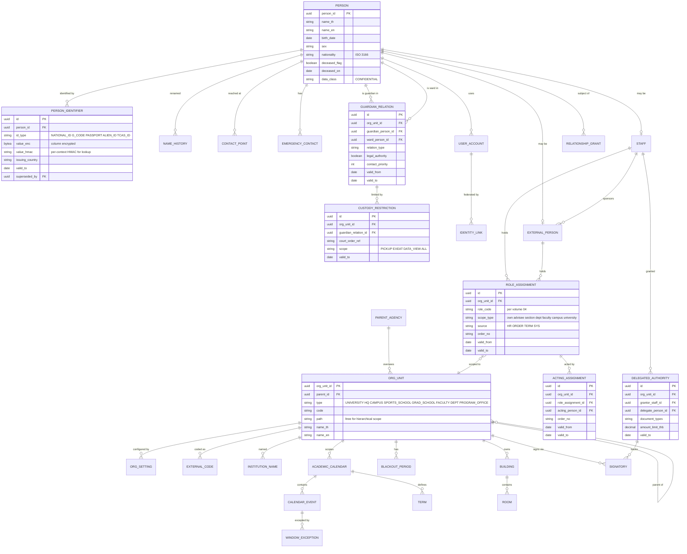

### 2.2 Admissions (ADM)

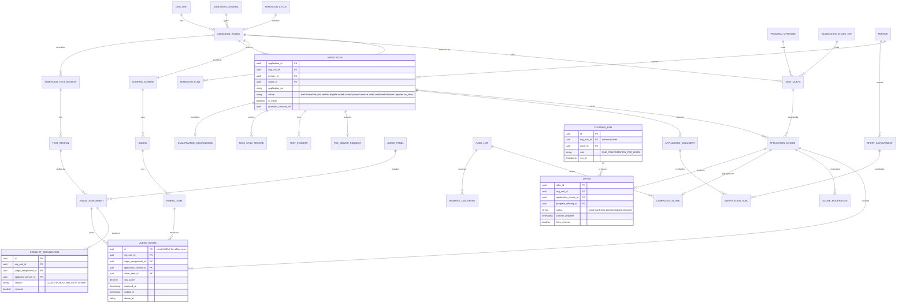

### 2.3 วิชาการ: หลักสูตร ลงทะเบียน เวลาเรียน สอบ และเกรด (CUR, REG, ATT, EXM, ASM)

### 2.4 ทะเบียนนักศึกษา สถานภาพ และการสำเร็จการศึกษา (REC, GRD)

```mermaid
erDiagram
  PERSON ||--o{ STUDENT : "enrolled as"
  STUDENT }o--|| PROGRAM_OFFERING : "studies"
  STUDENT ||--o| STUDENT : "readmitted from"
  POLICY_SET ||--o{ POLICY_SET_ASSIGNMENT : "applied by"
  STUDENT ||--o{ POLICY_SET_ASSIGNMENT : "governed by"
  STUDENT_NUMBER_SCHEME ||--o{ STUDENT : "numbers"
  STUDENT ||--o{ STUDENT_STATUS_HISTORY : "changes"
  STUDENT ||--o{ TERM_RECORD : "per term"
  STUDENT ||--o{ ACADEMIC_STANDING : "classified"
  STUDENT ||--o{ HOLD : "blocked by"
  STUDENT ||--o{ EXIT_CASE : "exits via"
  EXIT_CASE ||--o{ EXIT_CASE_TASK : "cascades"
  STUDENT ||--o{ ADVISOR_ASSIGNMENT : "advised"
  STUDENT ||--o{ ACADEMIC_ALERT : "flagged"
  STUDENT ||--o{ COURSE_SUBSTITUTION : "substitutes"
  STUDENT ||--o{ CURRICULUM_MIGRATION : "migrates"
  STUDENT ||--o{ DEGREE_AUDIT : "audited"
  STUDENT ||--o{ ACADEMIC_PLAN : "plans"
  ACADEMIC_PLAN ||--o{ PLANNED_COURSE : "contains"
  STUDENT ||--o{ GRADUATION_APPLICATION : "applies"
  GRADUATION_APPLICATION ||--o{ CLEARANCE_ITEM : "clears"
  CONFERRAL_BATCH ||--o{ GRADUATION_APPLICATION : "confers"
  COUNCIL_RESOLUTION ||--o{ CONFERRAL_BATCH : "approves"
  STUDENT ||--o{ CREDENTIAL : "issued"
  CREDENTIAL ||--o| PHYSICAL_DIPLOMA : "printed as"
  CREDENTIAL ||--o{ CREDENTIAL_REISSUE : "reissued"
  CREDENTIAL ||--o| CREDENTIAL_REVOCATION : "revoked by"
  BADGE_CLASS ||--o{ BADGE_ASSERTION : "awarded as"
  PERSON ||--o{ BADGE_ASSERTION : "earns"
  PERSON ||--o{ LEARNER_RECORD : "holds"
  CEREMONY ||--o{ CEREMONY_REGISTRATION : "registers"
  STUDENT ||--o{ CEREMONY_REGISTRATION : "attends"

  STUDENT {
    uuid student_id PK
    uuid org_unit_id FK "home campus or school"
    uuid person_id FK
    string student_no "unique university-wide"
    uuid program_offering_id FK
    string cohort_year_be
    string academic_profile "HIGHER_ED GRAD BASIC_ED"
    string status "ACTIVE ON_LEAVE MAINTAINING PROBATION SUSPENDED LAPSED WITHDRAWN TRANSFERRED_OUT DISMISSED DECEASED GRADUATED"
    uuid prior_student_id FK
  }
  STUDENT_STATUS_HISTORY {
    uuid id PK
    uuid org_unit_id FK
    uuid student_id FK
    string from_status
    string to_status
    date effective_from
    date recorded_at
    string order_ref
    uuid appeal_ref
  }
  EXIT_CASE {
    uuid id PK
    uuid org_unit_id FK
    uuid student_id FK
    string exit_reason "WITHDRAWN TRANSFERRED_OUT DISMISSED DECEASED LAPSED"
    boolean compassionate_mode
    string state
  }
  HOLD {
    uuid hold_id PK
    uuid org_unit_id FK
    uuid student_id FK
    string hold_type
    string source_module
    string blocks "REGISTRATION DOCUMENTS GRADUATION"
    timestamp released_at
  }
  POLICY_SET {
    uuid policy_set_id PK
    uuid org_unit_id FK "owning unit usually university"
    string code "HE-2572-v1"
    string profile
    date effective_from
    string dmn_bundle_hash
  }
  CREDENTIAL {
    uuid credential_id PK
    uuid org_unit_id FK
    uuid student_id FK
    string type "TRANSCRIPT DEGREE CERTIFICATE CLR"
    string serial_no
    string sha256
    string status "valid revoked superseded"
  }
```

### 2.5 บัณฑิตศึกษา ฝึกประสบการณ์ และโรงเรียนกีฬา (GRAD, PRA, SSC)

```mermaid
erDiagram
  STUDENT ||--o{ THESIS_PROJECT : "undertakes"
  THESIS_PROJECT ||--o{ COMMITTEE_MEMBER : "examined by"
  PERSON ||--o{ COMMITTEE_MEMBER : "serves"
  THESIS_PROJECT ||--o{ THESIS_MILESTONE : "progresses"
  THESIS_PROJECT ||--o{ PLAGIARISM_REPORT : "checked"
  THESIS_PROJECT ||--o{ PUBLICATION_EVIDENCE : "evidenced"
  PARTNER_SCHOOL ||--o{ PARTNER_AGREEMENT : "signs"
  PARTNER_SCHOOL ||--o{ PLACEMENT_QUOTA : "offers"
  PRACTICUM_ROUND ||--o{ PLACEMENT : "places"
  RATIO_RULE ||--o{ PRACTICUM_ROUND : "constrains"
  STUDENT ||--o{ PLACEMENT : "placed"
  PARTNER_SCHOOL ||--o{ PLACEMENT : "hosts"
  PLACEMENT ||--o{ MENTOR_ASSIGNMENT : "mentored"
  EXTERNAL_PERSON ||--o{ MENTOR_ASSIGNMENT : "mentors"
  EXTERNAL_PERSON ||--o{ MENTOR_QUALIFICATION : "qualified"
  PLACEMENT ||--o{ SUPERVISOR_ASSIGNMENT : "supervised"
  PLACEMENT ||--o{ TEACHING_LOG : "logs"
  PLACEMENT ||--o{ LESSON_PLAN_SUBMISSION : "submits"
  PLACEMENT ||--o{ SUPERVISION_VISIT : "visited"
  PLACEMENT ||--o{ PRACTICUM_EVALUATION : "evaluated"
  PLACEMENT ||--o{ PLACEMENT_CHANGE : "changed"
  PLACEMENT ||--o{ PRACTICUM_INCIDENT : "incidents"
  ORG_UNIT ||--o{ HOMEROOM : "has"
  GRADE_LEVEL ||--o{ HOMEROOM : "groups"
  HOMEROOM ||--o{ HOMEROOM_MEMBERSHIP : "includes"
  STUDENT ||--o{ HOMEROOM_MEMBERSHIP : "belongs"
  STUDENT ||--o{ CHARACTERISTIC_ASSESSMENT : "assessed"
  STUDENT ||--o{ REMEDIAL_ATTEMPT : "retakes"
  STUDENT ||--o{ PROMOTION_DECISION : "promoted"
  STUDENT ||--o| BASIC_ED_COMPLETION : "completes"
  STUDENT ||--o{ POR_POR_RECORD : "documented"
  STUDENT ||--o| TRANSFER_CERTIFICATE : "transferred"
  STUDENT ||--o{ HOME_VISIT : "visited"

  PLACEMENT {
    uuid placement_id PK
    uuid org_unit_id FK
    uuid student_id FK
    uuid partner_school_id FK
    uuid round_id FK
    string level "P1 P2 P3 COOP COACHING"
    int hours_logged
    string status
  }
  RATIO_RULE {
    uuid id PK
    uuid org_unit_id FK
    string role "MENTOR SUPERVISOR"
    int max_students "config e.g. 3 or 10"
    string source_ref "Khurusapha announcement"
  }
  MENTOR_QUALIFICATION {
    uuid id PK
    uuid org_unit_id FK
    uuid external_person_id FK
    string licence_no
    date licence_expiry
    int years_experience
    string subject
  }
  POR_POR_RECORD {
    uuid id PK
    uuid org_unit_id FK
    uuid student_id FK
    string form_type "PP1 PP2 PP3 PP5 PP6 PP7"
    uuid document_id FK
    date issued_on
  }
```

### 2.6 การเงิน ทุน และ กยศ. (FIN, SCH)

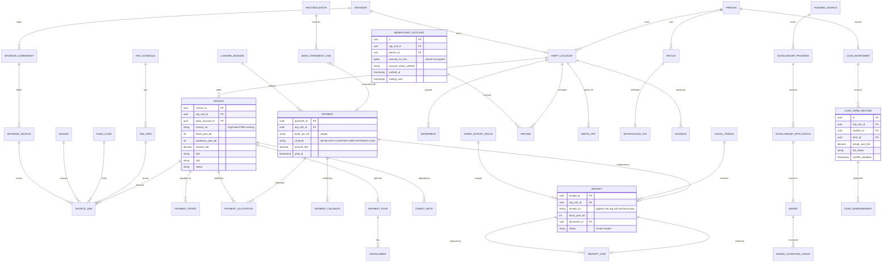

### 2.7 หอพักและกิจการนักศึกษา (HOU, AFF)

```mermaid
erDiagram
  ORG_UNIT ||--o{ DORMITORY : "operates"
  DORMITORY ||--o{ DORM_ROOM : "has"
  DORM_ROOM ||--o{ BED : "has"
  HOUSING_ROUND ||--o{ HOUSING_APPLICATION : "receives"
  PERSON ||--o{ HOUSING_APPLICATION : "applies"
  HOUSING_APPLICATION ||--o| ALLOCATION : "allocated"
  BED ||--o{ ALLOCATION : "occupied by"
  ALLOCATION ||--|| HOUSING_CONTRACT : "governed by"
  ALLOCATION ||--o{ ROOM_CHANGE : "moved"
  ALLOCATION ||--o{ TM30_NOTIFICATION : "reported"
  BED ||--o{ GUEST_STAY : "hosts"
  DORM_ROOM ||--o{ METER_READING : "metered"
  DORM_ROOM ||--o{ MAINTENANCE_TICKET : "repaired"
  PERSON ||--o{ STANDING_EXEAT_CONSENT : "consents"
  STANDING_EXEAT_CONSENT ||--o{ LEAVE_PASS : "authorises"
  PERSON ||--o{ LEAVE_PASS : "leaves"
  PERSON ||--o{ AUTHORISED_PICKUP : "is ward in"
  PERSON ||--o{ AUTHORISED_PICKUP : "may collect"
  DORMITORY ||--o{ VISITOR_LOG : "logs"
  DORMITORY ||--o{ ROLL_CALL : "checks"
  DORMITORY ||--o{ DORM_INCIDENT : "logs"
  ACTIVITY_CATEGORY ||--o{ ACTIVITY : "classifies"
  CLUB ||--o{ CLUB_MEMBERSHIP : "has"
  CLUB ||--o{ CLUB_PROJECT : "proposes"
  CLUB_PROJECT ||--o{ ACTIVITY : "runs"
  ACTIVITY ||--o{ ACTIVITY_HOUR_LEDGER_ENTRY : "credits"
  PERSON ||--o{ ACTIVITY_HOUR_LEDGER_ENTRY : "earns"
  PERSON ||--o{ EXTERNAL_ACTIVITY_CLAIM : "claims"
  PERSON ||--o{ DISCIPLINARY_CASE : "subject of"
  DISCIPLINARY_CASE ||--o{ SANCTION : "imposes"
  PERSON ||--o{ ACCOMMODATION_PLAN : "receives"
  ACCOMMODATION_PLAN ||--o{ ACCOMMODATION_ITEM : "lists"
  PERSON ||--o{ RISK_ASSESSMENT : "assessed"
  RISK_ASSESSMENT ||--o{ CRISIS_REFERRAL : "refers"
  RISK_ASSESSMENT ||--o{ EMERGENCY_DISCLOSURE : "discloses"
  DEFERMENT_BATCH ||--o{ MILITARY_DEFERMENT_RECORD : "lists"
  PERSON ||--o{ MILITARY_DEFERMENT_RECORD : "defers"
  STUDENT_JOB_POSITION ||--o{ STUDENT_JOB_CONTRACT : "fills"
  STUDENT_JOB_CONTRACT ||--o{ TIMESHEET : "records"

  ALLOCATION {
    uuid id PK
    uuid org_unit_id FK
    uuid person_id FK
    uuid bed_id FK
    date start_date
    date end_date
    string mode "UNIVERSITY BOARDING GUEST"
  }
  LEAVE_PASS {
    uuid id PK
    uuid org_unit_id FK
    uuid student_person_id FK
    uuid approved_by_guardian_id FK
    timestamp out_at
    timestamp due_back_at
    timestamp returned_at
    string state
  }
  AUTHORISED_PICKUP {
    uuid id PK
    uuid org_unit_id FK
    uuid ward_person_id FK
    uuid pickup_person_id FK
    string photo_ref
    boolean blocked "custody or safeguarding restriction"
    date valid_to
  }
  TM30_NOTIFICATION {
    uuid id PK
    uuid org_unit_id FK
    uuid allocation_id FK
    timestamp due_at "check-in plus 24h"
    timestamp submitted_at
    string evidence_ref
  }
  ACTIVITY_HOUR_LEDGER_ENTRY {
    uuid id PK
    uuid org_unit_id FK
    uuid person_id FK
    uuid activity_id FK
    string category "MANDATORY ELECTIVE VOLUNTEER"
    decimal hours
    string purpose_tags "GRAD_REQ LOAN_36H SCHOLARSHIP"
    string source "ENG_CHECKIN CLAIM CLUB"
  }
  ACCOMMODATION_ITEM {
    uuid id PK
    uuid org_unit_id FK
    uuid plan_id FK
    string item_type "EXTRA_TIME SEPARATE_ROOM ASSISTANT LARGE_PRINT ACCESSIBLE_ROOM"
    date valid_to
  }
```

### 2.8 นักกีฬาและห้องปฏิบัติการ (ATH, LAB) — core database

```mermaid
erDiagram
  PERSON ||--o| ATHLETE_PROFILE : "may be"
  SPORT_DISCIPLINE ||--o{ ATHLETE_PROFILE : "practised by"
  SQUAD ||--o{ SQUAD_MEMBERSHIP : "has"
  ATHLETE_PROFILE ||--o{ SQUAD_MEMBERSHIP : "joins"
  SQUAD ||--o{ COACH_ASSIGNMENT : "coached"
  STAFF ||--o{ COACH_ASSIGNMENT : "coaches"
  SQUAD ||--o{ TRAINING_PLAN : "plans"
  TRAINING_PLAN ||--o{ TRAINING_SESSION : "schedules"
  TRAINING_SESSION ||--o{ SESSION_LOAD : "loads"
  ATHLETE_PROFILE ||--o{ SESSION_LOAD : "records"
  ATHLETE_PROFILE ||--o{ WELLNESS_ENTRY : "reports"
  COMPETITION ||--o{ DELEGATION : "sends"
  COMPETITION ||--o{ COMPETITION_ENTRY : "has"
  ATHLETE_PROFILE ||--o{ COMPETITION_ENTRY : "enters"
  COMPETITION_ENTRY ||--o| COMPETITION_RESULT : "results"
  COMPETITION ||--o{ COMPETITION_LEAVE_BATCH : "requires"
  COMPETITION_LEAVE_BATCH ||--o{ COMPETITION_LEAVE_ITEM : "lists"
  ELIGIBILITY_RULE_SET ||--o{ ELIGIBILITY_CHECK : "applied"
  ATHLETE_PROFILE ||--o{ ELIGIBILITY_CHECK : "checked"
  COMPETITION ||--o{ TEAM_TRIP : "travelled"
  PER_DIEM_POLICY ||--o{ TEAM_TRIP : "rates"
  TEAM_TRIP ||--o{ TRIP_ROSTER : "carries"
  TEAM_TRIP ||--o| TRIP_ADVANCE : "funded by"
  TEAM_TRIP ||--o{ TRIP_EXPENSE_CLAIM : "settles"
  ATHLETE_PROFILE ||--o{ NUTRITION_PLAN : "follows"
  PERSON ||--o{ TALENT_POOL_ENTRY : "tracked"
  TALENT_POOL_ENTRY ||--o{ MATURATION_MEASURE : "measured"
  ATHLETE_PROFILE ||--o{ DC_TUTOR_ASSIGNMENT : "tutored"
  TEST_PROTOCOL ||--o{ LAB_TEST_RESULT : "defines"
  ATHLETE_PROFILE ||--o{ LAB_TEST_RESULT : "tested"
  INSTRUMENT ||--o{ CALIBRATION_RECORD : "calibrated"
  INSTRUMENT ||--o{ LAB_TEST_RESULT : "measures"

  ATHLETE_PROFILE {
    uuid athlete_id PK
    uuid org_unit_id FK
    uuid person_id FK
    string level "NATIONAL YOUTH_NATIONAL UNIVERSITY PROVINCE"
    string tier
    string availability "FULL MODIFIED UNAVAILABLE from HLT"
  }
  COACH_ASSIGNMENT {
    uuid id PK
    uuid org_unit_id FK
    uuid coach_staff_id FK
    uuid squad_id FK
    boolean minors_involved
    string clearance_status "from SAFE"
    date valid_to
  }
  TEAM_TRIP {
    uuid trip_id PK
    uuid org_unit_id FK
    uuid competition_id FK
    date depart_on
    date return_on
    decimal budget_thb
    string state
  }
  ELIGIBILITY_CHECK {
    uuid id PK
    uuid org_unit_id FK
    uuid athlete_id FK
    uuid rule_set_id FK
    string result "ELIGIBLE INELIGIBLE PENDING"
    string reasons
    timestamp checked_at
  }
```

### 2.9 Health vault (HLT) — database แยก `hlt_vault`

```mermaid
erDiagram
  HEALTH_SUBJECT ||--|| SUBJECT_KEY : "encrypted with"
  HEALTH_SUBJECT ||--o{ ENCOUNTER : "visits"
  ENCOUNTER ||--o{ DIAGNOSIS : "diagnosed"
  ENCOUNTER ||--o{ TREATMENT : "treated"
  ENCOUNTER ||--o{ REFERRAL : "referred"
  HEALTH_SUBJECT ||--o{ MEDICAL_CLEARANCE : "cleared"
  HEALTH_SUBJECT ||--o{ MEDICAL_ALERT : "alerts"
  HEALTH_SUBJECT ||--o{ TREATMENT_CONSENT : "consents"
  HEALTH_SUBJECT ||--o{ MEDICATION_ORDER : "prescribed"
  MEDICATION_ORDER ||--o{ MEDICATION_ADMINISTRATION : "administered"
  HEALTH_SUBJECT ||--o{ INJURY : "suffers"
  INJURY ||--o{ REHAB_PLAN : "rehabilitated"
  INJURY ||--o| RTP_CLEARANCE : "returns"
  HEALTH_SUBJECT ||--o{ AVAILABILITY_STATUS : "available"
  HEALTH_SUBJECT ||--o{ PSYCH_SESSION : "attends"
  HEALTH_SUBJECT ||--o{ COUNSELLING_NOTE : "noted"
  HEALTH_SUBJECT ||--o{ DISABILITY_EVIDENCE : "evidences"
  HEALTH_SUBJECT ||--o{ SCREENING_RESULT : "screened"
  HEALTH_SUBJECT ||--o{ BODY_COMPOSITION : "measured"
  HEALTH_SUBJECT ||--o{ VACCINATION : "vaccinated"
  INSURANCE_POLICY ||--o{ INSURANCE_ENROLMENT : "covers"
  HEALTH_SUBJECT ||--o{ INSURANCE_ENROLMENT : "insured"
  INSURANCE_ENROLMENT ||--o{ INSURANCE_CLAIM : "claims"
  HEALTH_SUBJECT ||--o{ TUE_REFERENCE : "references"
  HEALTH_SUBJECT ||--o{ DISCLOSURE_GRANT : "discloses"
  HEALTH_SUBJECT ||--o{ VAULT_ACCESS_LOG : "accessed"

  HEALTH_SUBJECT {
    uuid subject_id PK
    string person_token "HMAC of person_id with vault-only key"
    uuid org_unit_id FK "care unit"
    string key_ref "pointer to wrapped DEK in key store"
    timestamp shredded_at
    string retention_class
  }
  INJURY {
    uuid injury_id PK
    uuid org_unit_id FK
    uuid subject_id FK
    timestamp occurred_at
    string context "TRAINING COMPETITION CLASS DORM"
    bytea body_part_enc
    bytea diagnosis_enc
    string lawful_basis "VITAL_INTEREST LEGAL_DUTY CONSENT"
  }
  MEDICAL_ALERT {
    uuid id PK
    uuid org_unit_id FK
    uuid subject_id FK
    bytea alert_enc "minimum emergency dataset"
    string purpose "EMERGENCY"
    date reviewed_on
  }
  DISCLOSURE_GRANT {
    uuid id PK
    uuid org_unit_id FK
    uuid subject_id FK
    string grantee_role "COACH TRIP_LEADER DORM_DUTY"
    string scope "AVAILABILITY ALERT DETAIL"
    uuid consent_ref
    date valid_to
  }
  VAULT_ACCESS_LOG {
    uuid id PK
    uuid org_unit_id FK
    uuid subject_id FK
    uuid actor_id
    string purpose
    string basis "CARE EMERGENCY BREAK_GLASS CONSENT"
    timestamp at
  }
```

### 2.10 Case management และ safeguarding (CASE, SAFE)

```mermaid
erDiagram
  CASE_FILE ||--o{ CASE_PARTY : "involves"
  PERSON ||--o{ CASE_PARTY : "party to"
  CASE_FILE ||--o{ CASE_ASSIGNMENT : "assigned"
  CASE_FILE ||--o{ CASE_DEADLINE : "due"
  CASE_FILE ||--o{ CASE_EVIDENCE : "evidenced"
  CASE_FILE ||--o{ CASE_DECISION : "decided"
  CASE_FILE ||--o{ LEGAL_HOLD : "held"
  CASE_FILE ||--o| APPEAL : "is"
  ADMINISTRATIVE_ORDER ||--o{ APPEAL : "appealed by"
  CASE_FILE ||--o| OFFICIAL_INFO_REQUEST : "is"
  CASE_FILE ||--o| DSR_INTAKE : "is"
  CASE_FILE ||--o| SAFEGUARDING_CONCERN : "routed to"
  SAFEGUARDING_CONCERN ||--o{ CONCERN_PARTY : "involves"
  PERSON ||--o{ CONCERN_PARTY : "party to"
  SAFEGUARDING_CONCERN ||--o{ SAFEGUARDING_ASSESSMENT : "assessed"
  SAFEGUARDING_CONCERN ||--o{ CHRONOLOGY_ENTRY : "chronicled"
  SAFEGUARDING_CONCERN ||--o| SAFETY_PLAN : "planned"
  SAFEGUARDING_CONCERN ||--o{ CONTACT_RESTRICTION : "imposes"
  SAFEGUARDING_CONCERN ||--o{ AGENCY_REFERRAL : "referred"
  SAFEGUARDING_CONCERN ||--o{ SAFEGUARDING_EVIDENCE : "evidenced"
  CLEARANCE_REQUIREMENT ||--o{ STAFF_CLEARANCE : "required by"
  PERSON ||--o{ STAFF_CLEARANCE : "cleared"

  CASE_FILE {
    uuid case_id PK
    uuid org_unit_id FK
    string case_type "APPEAL COMPLAINT WHISTLEBLOW OIR DSR"
    string category
    string channel
    string anonymous_token_hash
    string receipt_no
    string data_class
    string secrecy_level "NORMAL LAB LAB_MAK"
  }
  APPEAL {
    uuid appeal_id PK
    uuid org_unit_id FK
    uuid case_id FK
    string subject_type "GRADE STANDING DISMISSAL DISCIPLINE SCHOLARSHIP ADMISSION EXAM"
    uuid subject_id
    timestamp deadline
    boolean stay_of_effect
  }
  SAFEGUARDING_CONCERN {
    uuid concern_id PK
    uuid org_unit_id FK
    string category
    string risk_level
    bytea narrative_enc
    uuid lead_person_id FK
    string secrecy_level
  }
  CONTACT_RESTRICTION {
    uuid restriction_id PK
    uuid org_unit_id FK
    uuid protected_person_id FK
    uuid restricted_person_id FK
    string scope "COACHING DORM MESSAGING PICKUP PRACTICUM ALL"
    date valid_to
  }
  STAFF_CLEARANCE {
    uuid id PK
    uuid org_unit_id FK
    uuid person_id FK
    string clearance_type "CRIMINAL_RECORD SAFEGUARDING_TRAINING"
    string result "CLEARED NOT_CLEARED PENDING"
    date expires_on
    bytea detail_enc
  }
```

### 2.11 เอกสาร ความเป็นส่วนตัว รายงาน และ audit (DOC, PRIV, RPT, AUD)

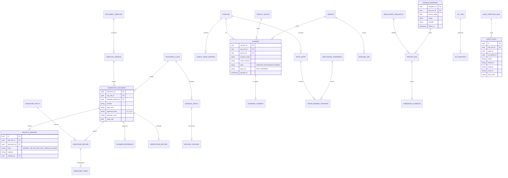

**ขนาดของ model:** แผนภาพทั้ง 11 ชุดมี **333 entity** (นับไม่ซ้ำ) ครอบคลุมทุกโมดูลในขอบเขตหลัก ส่วน entity ที่ไม่ได้แสดงในแผนภาพ (เช่น `NOTIFICATION_RULE`, `FORM_DEFINITION`, `DIGITAL_ID_CARD`, `ANNOUNCEMENT`, `EVENT_REGISTRATION`, `FACILITY`, `BOOKING`) มีรายชื่ออยู่ใน 06-modules และใช้กติกาเดียวกัน (`org_unit_id`, UUIDv7, ชั้นข้อมูล)

## 3. Master data และเจ้าของข้อมูล

| Master data | System of record (โมดูล) | Data owner (หน่วยงาน/บทบาท) | Data steward | การกระจาย |
|---|---|---|---|---|
| Person (ชื่อ, identifiers, ผู้ติดต่อ, ผู้ติดต่อฉุกเฉิน) | REC | สำนักทะเบียน (`registrar`) | `data_steward` ของงานทะเบียนแต่ละวิทยาเขต | API + `rec.PersonDataCorrected` |
| ความสัมพันธ์ผู้ปกครองและ custody restriction | REC (consent อยู่ PRIV) | สำนักทะเบียน / โรงเรียนกีฬา | งานทะเบียน, ครูประจำชั้น | `rec.GuardianRelationChanged` |
| บัญชีผู้ใช้, credential, role assignment | IAM | สำนักดิจิทัล/IT | `itadmin` | Keycloak + `iam.*` |
| OrgUnit, ExternalCode, ParentAgency, InstitutionName, อาคาร/ห้อง | ORG | สำนักงานอธิการบดี / กองแผน | กองแผน | config cache + `org.*` |
| **ปฏิทินการศึกษาและปีงบประมาณ** | **ORG** (เจ้าของเดียว) | สำนักทะเบียน (วิชาการ), กองคลัง (ปีงบ) | งานทะเบียนวิทยาเขต | `org.CalendarPublished`, window events |
| Program, CurriculumVersion, Course, PLO/CLO, ProgramOffering, cap คุรุสภา | CUR | สำนักวิชาการ + คณะ | ประธานหลักสูตร | `cur.*` |
| PolicySet | REC (หน้าจอใน ADMIN) | สภาวิชาการ/สำนักทะเบียน | นายทะเบียน | `rec.PolicySetPublished` |
| Fee schedule, fund code, fiscal period | FIN | กองคลัง | การเงินวิทยาเขต | API |
| บุคลากร | X-HR (ก่อนมีใช้หน้าจอขั้นต่ำใน ADMIN) → mirror ใน IAM | กองบริหารงานบุคคล | HR วิทยาเขต | `xhr.*` / nightly sync |
| ชนิดกีฬา, squad, รายการแข่งขัน | ATH | กองกีฬา/ศูนย์วิทยาศาสตร์การกีฬา | ผู้ประสานงานกีฬา | `ath.*` |
| สถานศึกษาเครือข่ายฝึกสอน | PRA | คณะศึกษาศาสตร์ | ศูนย์ฝึกประสบการณ์ | API |
| แม่แบบเอกสาร, retention class, signature policy | DOC | สำนักงานอธิการบดี (สารบรรณ) | นิติกร/สารบรรณ | API |
| Purpose, lawful basis, privacy notice | PRIV | DPO | DPO office | API |
| Regulatory obligations, OIT items | RPT | กองแผน/กองนโยบาย | ผู้รับผิดชอบรายงาน | `rpt.*` |
| Reference data (หัวข้อ 4) | ADMIN (versioned dataset) | สำนักดิจิทัล/IT | `data_steward` | versioned dataset |

## 4. Reference data

ข้อมูลอ้างอิงเก็บเป็น **versioned dataset** (มีเวอร์ชัน, วันที่มีผล, ตาราง mapping ของรหัสเก่า) และอัปเดตผ่าน ADMIN แบบ 4-eyes (DATA-06)

| ชุดข้อมูล | แหล่งที่มา (เสนอ) | ความถี่ | หมายเหตุ |
|---|---|---|---|
| จังหวัด/อำเภอ/ตำบล | กรมการปกครอง / data.go.th | รายปีหรือเมื่อมีประกาศเปลี่ยนแปลง | เก็บ mapping ตำบลที่ยุบ/ตั้งใหม่ |
| รหัสไปรษณีย์ | บริษัทไปรษณีย์ไทย | รายปี | |
| โรงเรียนเดิม (รหัสสถานศึกษา) | สพฐ./data.go.th และสังกัดอื่น | ก่อนเปิดรับสมัครแต่ละปี | ใช้ใน ADM, รายงาน สป.อว., TCAS adapter |
| คำนำหน้า ยศ ตำแหน่งทางวิชาการ | ระเบียบที่เกี่ยวข้อง | เมื่อเปลี่ยน | |
| ประเทศ/สัญชาติ | ISO 3166 | เมื่อเปลี่ยน | |
| ศาสนา | — | — | **เก็บเฉพาะเมื่อมีวัตถุประสงค์ที่ชอบด้วยกฎหมาย** (ข้อมูลอ่อนไหว ม.26) |
| ชนิดกีฬา/ประเภท/ตำแหน่ง | กกท./สหพันธ์กีฬา | รายปี | |
| ICD-10 | กระทรวงสาธารณสุข/WHO | ตามรุ่น | ใช้ใน HLT เท่านั้น |
| รหัสธนาคาร/สาขา | ธปท. | รายปี | FIN |
| รหัสหลักสูตร CHECO | สป.อว. | เมื่อหลักสูตรผ่านการพิจารณา | ความยาว/รูปแบบ **[ต้องตรวจสอบ]** |

## 5. Identifiers

| Identifier | รูปแบบ | การจัดเก็บ | กติกา |
|---|---|---|---|
| `person_id` และ PK ทุกตาราง | UUIDv7 | คอลัมน์ `uuid` | ไม่เปิดเผยเป็นเลขที่ใช้ภายนอก |
| **เลขประจำตัวประชาชน 13 หลัก** | 13 หลัก หลักสุดท้ายเป็น check digit (mod 11) | `PERSON_IDENTIFIER(id_type=NATIONAL_ID)`: `value_enc` (envelope encryption, หัวข้อ 11) + `value_hmac` (HMAC-SHA256 แยก key ตาม context: core, IAM/ThaID, migration) และแสดงแบบ mask `1-2345-xxxxx-xx-3` | ตรวจ check digit ตอนรับเข้า; ค้นหาด้วย HMAC เท่านั้น; ใช้กับ ThaID `pid`, กยศ., TCAS, สป.อว. |
| **รหัส G** | รหัสสำหรับเด็กที่ไม่มีหลักฐานทะเบียนราษฎร ([Dailynews](https://www.dailynews.co.th/articles/5922244/)) รูปแบบ **[ต้องตรวจสอบ]** | `id_type=G_CODE` (เข้ารหัสเหมือนเลขบัตร) | **ห้ามบังคับว่าทุกคนต้องมีเลข 13 หลัก**; เมื่อได้เลข 13 หลักภายหลัง เพิ่ม identifier ใหม่และตั้ง `superseded_by` โดยไม่สร้าง Person ใหม่ |
| **Passport** | เลข + ประเทศผู้ออก (ISO alpha-3) + วันหมดอายุ | `id_type=PASSPORT` (เข้ารหัส) | เก็บหลายเล่มตามเวลา; ใช้กับผู้สมัคร/นักศึกษาต่างชาติ, ตม.30 |
| เลขประจำตัวคนซึ่งไม่มีสัญชาติไทย/คนต่างด้าว 13 หลัก | 13 หลัก | `id_type=ALIEN_ID` | แยก type จากบัตรประชาชนเพื่อให้กติกาและรายงานถูกต้อง **[ต้องตรวจสอบประเภทที่ใช้จริง]** |
| **รหัสนักศึกษา (ตั้งค่าได้ต่อวิทยาเขต)** | `StudentNumberScheme` ต่อ OrgUnit × ระดับ ด้วย template token เช่น `{YY}{CC}{L}{PPP}{NNN}` (YY = 2 หลักท้ายปี พ.ศ. ที่เข้า, CC = รหัสวิทยาเขต, L = ระดับ, PPP = โปรแกรม, NNN = running) ค่าเริ่มต้น 11 หลักตามที่วิทยาเขตมหาสารคามใช้ ([tnsumk](https://www.tnsumk.ac.th/reg/index.php/enroll-guide)) **[สมมติฐาน]** | `STUDENT.student_no` unique ทั้งมหาวิทยาลัย; sequence ต่อ scope | ห้ามนำกลับมาใช้ซ้ำ; **คงรหัสเดิมของนักศึกษาที่ migrate มา**; ตรวจชนข้ามวิทยาเขตก่อน publish scheme; ออกได้ภายใน 24 ชม. หลังยืนยันสิทธิ์ |
| รหัสนักเรียนโรงเรียนกีฬา | ตาม scheme ของโรงเรียน (config) + เลขประจำตัวนักเรียนตามระบบการศึกษาขั้นพื้นฐาน (ถ้ามี **[ต้องตรวจสอบ]**) | `STUDENT.student_no` + `PERSON_IDENTIFIER` | ใช้ scheme เดียวกันกับมหาวิทยาลัยได้ |
| เลขผู้สมัคร/ใบสมัคร | `{cycle}{campus}{channel}{running}` | `APPLICATION.application_no` | Ref1 ของ Thai QR ค่าสมัคร |
| รหัสบุคลากร | `hr_employee_no` จาก HR | `STAFF` | บุคคลภายนอกใช้ `EXTERNAL_PERSON` |
| เลขใบแจ้งหนี้/ใบเสร็จ | `{OrgCode}-{ปีงบ พ.ศ.}-{running}` | gapless sequence ต่อ OrgUnit × ปีงบ × ประเภท | ใบเสร็จที่ยกเลิกคงเลขเดิมไว้ และฉบับใหม่ได้เลขใหม่ที่อ้างฉบับเดิม; ขึ้นชุดใหม่ 1 ต.ค. |
| Credential serial, เลขปริญญาบัตร (เลขควบคุม), verification code | serial ต่อประเภท/รอบพิมพ์; verification code สุ่ม 128 บิต (base32) | `CREDENTIAL`, `PHYSICAL_DIPLOMA`, `VERIFICATION_RECORD` | verification code ไม่เดาได้และไม่มีข้อมูลส่วนบุคคล |
| เลขรับเรื่อง/ใบรับ | `{type}-{OrgCode}-{ปี พ.ศ.}-{running}` | `CASE_FILE.receipt_no`, `REQUEST_RECEIPT` | ใบรับตาม พ.ร.บ.การปฏิบัติราชการทางอิเล็กทรอนิกส์ |
| เลขทะเบียนหนังสือสารบรรณ | prefix จาก `ExternalCode(SARABAN_PREFIX)` | `SARABAN_REFERENCE` | effective-dated ต่อวิทยาเขต |
| รหัสภายนอกของหน่วยงาน | `ExternalCode(scheme, code, valid_from/to)` | ORG | GFMIS, งบประมาณ, e-GP, สป.อว., คุรุสภา, สพฐ. |
| LINE userId, device token | ข้อความจากผู้ให้บริการ | `CHANNEL_BINDING` (NOTI) | ไม่ใช่ identifier ยืนยันตัวตน; ลบเมื่อยกเลิกผูก |

## 6. การกำหนดขอบเขตข้อมูลด้วย `org_unit_id`

**กติกา:** ทุกตารางธุรกรรมใน core database และ `hlt_vault` มีคอลัมน์ `org_unit_id uuid NOT NULL` (มี index และ RLS policy) โดยความหมายของคอลัมน์ต้องระบุใน data dictionary ว่าเป็นแบบใด:

| ความหมายของ `org_unit_id` | ตัวอย่างตาราง | หมายเหตุ |
|---|---|---|
| **Owning unit** (หน่วยที่เป็นเจ้าของ record) | APPLICATION (วิทยาเขตที่เปิดรอบ), STUDENT (วิทยาเขต/โรงเรียนต้นสังกัด), INVOICE/RECEIPT (หน่วยที่ออก), ALLOCATION (หน่วยเจ้าของหอ), CASE_FILE (หน่วยที่รับเรื่อง) | ค่าเริ่มต้น |
| **Home + host** (สองคอลัมน์) | ENROLLMENT (`org_unit_id` = วิทยาเขตต้นสังกัดของนักศึกษา, `host_org_unit_id` = วิทยาเขตที่สอน), SECTION (`org_unit_id` = เจ้าของรายวิชา, `host_org_unit_id` = ที่สอน) | ใช้กับการเรียนข้ามวิทยาเขต/ออนไลน์ (G-16) |
| **Care/serving unit** | ตารางใน `hlt_vault` (หน่วยที่ให้การดูแล), ATTENDANCE_MARK (ตาม enrollment) | |
| **University level** | POLICY_SET, CLEARING_RUN, BADGE_CLASS, ตาราง config ระดับมหาวิทยาลัย | ใช้ OrgUnit ราก (University) |

**ข้อยกเว้นที่ไม่มี `org_unit_id`:** (1) `PERSON` และตารางลูกของ Person (identifier, ชื่อ, ผู้ติดต่อ) เพราะเป็นข้อมูลร่วมข้ามหน่วย และมองเห็นได้ผ่าน relationship เท่านั้น (หัวข้อ 10.3) (2) reference data ระดับประเทศ (หัวข้อ 4) (3) ตาราง infrastructure ภายใน เช่น event publication registry ที่ไม่มีข้อมูลธุรกิจ ทั้งนี้ CI ตรวจทุก migration ว่าตารางใหม่ใน schema ธุรกรรมมี `org_unit_id` + `relrowsecurity = true` ไม่เช่นนั้น build ล้ม

## 7. การจัดชั้นข้อมูล (Data classification)

ใช้ **สองมิติแยกกัน** (C-03): (ก) ชั้นข้อมูลตามความเป็นส่วนตัว/การเปิดเผย 4 ระดับ ซึ่งอ้างอิงร่าง มรด. ว่าด้วยหลักเกณฑ์การจัดระดับชั้นข้อมูลภาครัฐ (CDV v0.3 ม.ค. 2569 ซึ่ง **ยังไม่ประกาศใช้** ([ร่าง มรด.](https://standard.dga.or.th/wp-content/uploads/2026/01/ร่าง-มรด.-X-256X-ว่าด้วยหลักเกณฑ์การจัดระดับชั้นข้อมูลภาครัฐ-ฉบับ-CDV-v0.3.pdf)); ต้อง map ชื่อชั้นใหม่เมื่อประกาศจริง) และ (ข) **ชั้นความลับของทางราชการ** ตามระเบียบว่าด้วยการรักษาความลับของทางราชการ พ.ศ. 2544 **[ต้องตรวจสอบ]** ซึ่ง DOC เป็นเจ้าของการกำหนด (`SECRECY_MARKING`)

### 7.1 ชั้นข้อมูลตามความเป็นส่วนตัว

| ชั้น | ตัวอย่างข้อมูล | Control ขั้นต่ำ |
|---|---|---|
| **Public** | หลักสูตร, ตารางเปิดสอน, ประกาศรับสมัคร, ประกาศรายชื่อแบบ mask, สถิติรวม (OIT/open data), ข่าว | เผยแพร่ได้, CDN cache, ตรวจ DLP ก่อนเผยแพร่ |
| **Internal** | ตารางสอนรายบุคคลของอาจารย์, การจองห้อง/สนาม, รายชื่อ section (ไม่มีผลการเรียน), แม่แบบเอกสาร, config ทั่วไป | ต้อง login, RBAC, ไม่เปิดสาธารณะ |
| **Confidential** (ข้อมูลส่วนบุคคล) | ประวัตินักศึกษา, เกรด, คะแนนสอบคัดเลือก, เวลาเรียน, การเงิน/บัญชีธนาคาร, ที่อยู่, ผู้ปกครองและ custody, กยศ., ผลวินัย, สถานะ StaffClearance (ไม่ใช่รายละเอียด), ผลทดสอบสมรรถภาพ, training load | RBAC + ABAC (scope, relationship), **RLS**, audit การอ่านข้อมูลของผู้อื่นและแบบรายการ, mask ใน non-prod (ใช้ synthetic เป็นหลัก), ส่งออกช่องทางภายนอกเฉพาะหัวข้อ + ลิงก์ |
| **Sensitive** (ข้อมูลอ่อนไหวตาม PDPA ม.26 **[ต้องตรวจสอบเลขมาตรา]**) | สุขภาพ/บาดเจ็บ/การรักษา/ยา, ความพิการ, บันทึกจิตวิทยา/การให้คำปรึกษา, SDQ, เนื้อหาเคสคุ้มครองเด็ก, **ประวัติอาชญากรรม** (ผลตรวจประวัติ), ศาสนา (ถ้าเก็บ), TUE | อยู่ใน `hlt_vault` หรือ schema ของ SAFE ที่เข้ารหัส column-level, per-person key (vault), purpose-bound access, audit ทุก read, ไม่ index ในการค้นหา, ไม่ส่งเข้า analytics แบบระบุตัวตน, DPIA บังคับ |

ไม่เก็บ biometric (ตัด face check-in ออกตาม R-11)

### 7.2 ชั้นความลับของทางราชการ

| ชั้น | ใช้กับ (ตัวอย่าง) | Control เพิ่มเติม |
|---|---|---|
| ปกติ | เอกสารราชการทั่วไป | ตามชั้นในข้อ 7.1 |
| **ลับ** | ข้อสอบก่อนสอบ (ซองข้อสอบ/คลังข้อสอบ), สำนวนสอบข้อเท็จจริงทางวินัยและทุจริต, ตัวตนผู้แจ้งเบาะแส, รายงานการส่งต่อเคสคุ้มครองเด็ก, รายงานช่องโหว่ความปลอดภัยของระบบ | need-to-know list ต่อเอกสาร, ห้าม export/พิมพ์ซ้ำโดยไม่บันทึก, watermark ชื่อผู้เปิด, เข้ารหัส, audit ทุกการเปิด, ทะเบียนเอกสารลับ |
| **ลับมาก** | เฉพาะกรณีที่ผู้มีอำนาจกำหนด เช่น เรื่องร้องเรียนทุจริตที่เกี่ยวกับผู้บริหารระดับสูง **[ต้องตรวจสอบ]** | เหมือน "ลับ" + ผู้เข้าถึงระบุชื่อรายคน + อนุมัติการเปิดทุกครั้ง |
| **ลับที่สุด** | **ไม่จัดเก็บในแพลตฟอร์มนี้** | ใช้ช่องทางนอกระบบตามระเบียบ; ระบบปฏิเสธการกำหนดชั้นนี้ |

กติกาการรวม: ข้อมูลหนึ่งรายการมีทั้งสองมิติ (เช่น สำนวนวินัยนักศึกษา = Confidential + ลับ; เคสคุ้มครองเด็ก = Sensitive + ลับ) และ control ที่ใช้คือ **ค่าที่เข้มกว่าของทั้งสองมิติ** ส่วนการเปิดเผยตาม พ.ร.บ.ข้อมูลข่าวสารฯ พิจารณาผ่าน CASE (`OfficialInfoRequest`) โดยอ้างชั้นความลับเป็นข้อมูลประกอบ ไม่ใช่เหตุปฏิเสธอัตโนมัติ

## 8. Retention

> ระยะเวลาด้านล่างเป็น **ค่าเริ่มต้นที่เสนอ** ซึ่ง มกช. ต้องอนุมัติเป็น retention schedule; ทุกแถวที่ไม่มีฐานยืนยันติด **[ต้องตรวจสอบ]** อ้างอิงระเบียบสำนักนายกรัฐมนตรีว่าด้วยงานสารบรรณ (แก้ไขถึงฉบับที่ 4 พ.ศ. 2564) และ พ.ร.บ.จดหมายเหตุแห่งชาติ 2556 ([KKU JISKKU](https://so03.tci-thaijo.org/index.php/jiskku/article/view/66933)) สำหรับการส่งมอบหอจดหมายเหตุ ส่วนระยะ "≥ 10 ปี" และ "ส่งมอบเมื่อครบ 25 ปี" มาจากความรู้เดิม **[ต้องตรวจสอบ ข้อ 57–58 ของระเบียบสารบรรณ]**; การลบจริงทำผ่าน `DisposalBatch` (เอกสาร) หรือ `ErasureJob` (ข้อมูลส่วนบุคคล) ที่ตรวจ legal hold และ DSR ก่อนเสมอ

| ประเภทข้อมูล | ระยะเก็บ (เสนอ) | เมื่อครบกำหนด | สถานะ |
|---|---|---|---|
| ทะเบียนประวัติ ผลการเรียน (รวม GradeSnapshot) การสำเร็จการศึกษา ทะเบียน credential | **ถาวร** | ส่งหอจดหมายเหตุตามระเบียบ (archival package) | [ต้องตรวจสอบ] |
| ไฟล์ credential ที่ลงนาม + verification record | ถาวร (ประทับเวลาซ้ำตาม LTV) | — | [ต้องตรวจสอบ] |
| ใบสมัครที่ไม่ได้รับเข้า + คะแนนกรรมการ + เอกสารแนบ | 2 ปีหลังปิดรอบ (ขยายถ้ามีอุทธรณ์/คดี) | ลบ/ทำให้ไม่ระบุตัวตน เก็บสถิติ | [ต้องตรวจสอบ] |
| ใบสมัครที่รับเข้าแล้ว | ส่วนที่จำเป็นรวมเข้าแฟ้มนักศึกษา; เอกสารประกอบ 5 ปีหลังพ้นสภาพ/จบ | ลบเอกสารประกอบ | [ต้องตรวจสอบ] |
| เวลาเรียนรายครั้ง (raw marks) | 2 ปีหลังปิดภาค (ร้อยละเวลาเรียนเก็บถาวรกับผลการเรียน) | ลบ raw | [ต้องตรวจสอบ] |
| กระดาษคำตอบ/ใบคะแนนสอบ | ≥ 1 ภาคหลังประกาศผล หรือจนกว่าอุทธรณ์/คำขอข้อมูลข่าวสารเสร็จสิ้น (C-02) | ทำลายตาม DisposalBatch | [ต้องตรวจสอบระเบียบ มกช.] |
| การเงิน (ใบแจ้งหนี้, ใบเสร็จ, ใบเสร็จที่ยกเลิก, คืนเงิน, payout, หลักฐานภาษี, statement) | 10 ปีหลังสิ้นปีงบประมาณ | ทำลายตามขั้นตอน | [ต้องตรวจสอบ ระเบียบการเงิน/สตง./ประมวลรัษฎากร] |
| กยศ. และทุน | 10 ปีหลังจบ/พ้นสภาพ | ลบ/ทำลาย | [ต้องตรวจสอบ] |
| สัญญาหอพัก, เงินประกัน | 5 ปีหลัง check-out | ลบ | [ต้องตรวจสอบ] |
| บันทึกออก-เข้าหอ, ผู้มาเยี่ยม, เช็คชื่อกลางคืน (ผู้เยาว์) | 2 ปี หรือ 1 ปีหลังพ้นสภาพ แล้วแต่อย่างใดยาวกว่า | ลบ | [ต้องตรวจสอบ] |
| หลักฐานการแจ้ง ตม.30 | 2 ปี | ลบ | [ต้องตรวจสอบ] |
| วินัย | ตามโทษ (เช่น 5 ปี) ยกเว้นโทษพ้นสภาพ (ถาวร) | ลบ/ปิดผนึก | [ต้องตรวจสอบ] |
| เคสคุ้มครองเด็ก (SAFE) | จนผู้ได้รับการคุ้มครองอายุ 25 ปี หรือ 10 ปีหลังปิดเคส แล้วแต่อย่างใดยาวกว่า (อ้างแนวปฏิบัติสากล ไม่ใช่กฎหมายไทย) | ทบทวนก่อนลบ | [ต้องตรวจสอบ] |
| StaffClearance | ระยะที่ปฏิบัติงาน + 5 ปี (รายละเอียดผลตรวจประวัติเก็บสั้นที่สุดที่จำเป็น) | ลบรายละเอียด เก็บสถานะ | [ต้องตรวจสอบ] |
| ร้องเรียน/แจ้งเบาะแส | 10 ปีหลังปิดเรื่อง | ลบ/ทำลาย | [ต้องตรวจสอบ] |
| คำขอข้อมูลข่าวสารราชการ, DSR | 5 ปีหลังปิดเรื่อง | ลบ | [ต้องตรวจสอบ] |
| เวชระเบียนห้องพยาบาล | ตามกฎหมายที่ใช้กับสถานะของห้องพยาบาล (C-42) | crypto-shred | [ต้องตรวจสอบใน P0] |
| ข้อมูลบาดเจ็บ/RTP ของนักกีฬา | ระยะศึกษา + 5 ปี | crypto-shred | [ต้องตรวจสอบ] |
| บันทึกจิตวิทยา/ให้คำปรึกษา | 5 ปีหลังพ้นสภาพ | crypto-shred | [ต้องตรวจสอบ] |
| บันทึกการให้ยา (ผู้เยาว์) | จนอายุ 25 ปี หรือ 5 ปีหลังพ้นสภาพ แล้วแต่อย่างใดยาวกว่า | crypto-shred | [ต้องตรวจสอบ] |
| Wellness/training raw | 3 ปี | เก็บเป็น aggregate + ลบ raw | [ต้องตรวจสอบ] |
| ชั่วโมงกิจกรรม | สรุปเก็บถาวรกับ activity transcript; check-in raw 2 ปี | ลบ raw | [ต้องตรวจสอบ] |
| Consent records | อายุ consent + 10 ปี | ลบ | [ต้องตรวจสอบอายุความ] |
| ประกาศทางการ | ถาวร | ส่งหอจดหมายเหตุ | [ต้องตรวจสอบ] |
| ข่าวทั่วไป, ข้อความแจ้งเตือน (เนื้อหา) | ข่าว 5 ปี; ข้อความ 1 ปี (metadata การส่ง 2 ปี) | ลบ | [ต้องตรวจสอบ] |
| Census snapshot และ submission evidence | 10 ปี (snapshot ที่เป็นสถิติทางการ: ถาวร) | — | [ต้องตรวจสอบ] |
| Audit log (ธุรกรรมวิชาการ/การเงิน) | 10 ปี (WORM) | ลบเมื่อหมด Object Lock | [ต้องตรวจสอบ] |
| Traffic/access log | ≥ 90 วัน online + 1 ปี archive (พ.ร.บ.คอมพิวเตอร์ ม.26) | ลบ | [ต้องตรวจสอบ] |
| Backup | 35 วัน + รายเดือน 12 เดือน + รายปี 7 ปี (รายละเอียดเล่ม 11) | หมดอายุอัตโนมัติ; ไม่ restore รายการที่อยู่ใน tombstone list | [ต้องตรวจสอบ] |
| Legacy archive | ตามประเภทข้อมูลต้นทางในตารางนี้ | ตามประเภท | [ต้องตรวจสอบ] |

**ปฏิสัมพันธ์กับ DSR** (C-11): คำขอลบ/คัดค้านจะถูกปฏิเสธพร้อมเหตุผลเมื่อข้อมูลอยู่ใน retention class ที่มีหน้าที่เก็บตามกฎหมายหรือเก็บถาวร และ **crypto-shredding ห้ามใช้กับข้อมูลที่อยู่ในประเภทเก็บถาวร** ส่วน `LEGAL_HOLD` (จาก CASE) ระงับการลบทุกประเภท

## 9. Health vault

### 9.1 โครงสร้าง

- **Database แยก `hlt_vault`** บน Patroni cluster เดียวกับ core (ไม่ใช่ cluster แยก ตาม blueprint ข้อ 9.9 และ ARCH-04) มี owner role, credential (dynamic secret จาก OpenBao), pgBackRest stanza และ backup encryption key แยกจาก core; NetworkPolicy อนุญาตเฉพาะ pod ของโมดูล HLT
- **ไม่มี TDE** ใน PostgreSQL community (IC-02) จึงใช้ volume encryption + column-level encryption ด้วย per-person key (หัวข้อ 11)
- **Pseudonymous subject**: `HEALTH_SUBJECT.person_token = HMAC(vault_key, person_id)` โดย vault_key อยู่ใน OpenBao และ resolve ได้เฉพาะใน HLT service; ตารางใน vault ไม่มีชื่อหรือเลขประจำตัวของบุคคล
- เอกสารแนบ (ใบรับรองแพทย์, ภาพ) เก็บใน object storage bucket แยก เข้ารหัสด้วย DEK ของ subject และอ้างด้วย key ที่สุ่ม
- Read replica ของ cluster มี `hlt_vault` อยู่ด้วยเพื่อ HA แต่ **role ของ analytics/ELT ไม่มีสิทธิ์ CONNECT** และ `pg_hba` ปฏิเสธการเชื่อมจาก analytics network; แม้จะเข้าถึงไฟล์ได้ก็พบแต่ ciphertext

### 9.2 Per-person key และ crypto-shredding

| ขั้น | รายละเอียด |
|---|---|
| สร้าง subject | สร้าง **DEK ต่อบุคคล** (AES-256-GCM) แล้วห่อด้วย KEK ของ vault ใน OpenBao Transit (KEK ไม่ export ได้) |
| เก็บ DEK | wrapped DEK เก็บใน **key store แยก** (OpenBao KV v2 หรือ database `hlt_keys` ที่มี backup retention สั้นกว่า vault) **ไม่อยู่ใน backup ของ `hlt_vault`** เพื่อให้ crypto-shredding มีผลกับ backup ด้วย (SEC-09) |
| เข้ารหัส | คอลัมน์ที่มีเนื้อหาทางการแพทย์ (`*_enc`) และไฟล์แนบเข้ารหัสด้วย DEK; คอลัมน์ที่ใช้ query (วันที่, ประเภท, สถานะ) ไม่เข้ารหัส |
| Crypto-shredding | เมื่อครบ retention และไม่มี legal hold/หน้าที่เก็บถาวร: ลบทุกเวอร์ชันของ DEK → ciphertext ใน DB และ backup อ่านไม่ได้; บันทึก `shredded_at` และเพิ่ม subject ใน **tombstone list** เพื่อไม่ให้ restore นำกลับมาใช้ |
| Rotation | KEK หมุนรายปีและ rewrap DEK; DEK หมุนเมื่อมีเหตุ (เช่น สงสัยรั่ว) |
| Escrow/กู้คืน | KEK ของ OpenBao ใช้ Shamir unseal + สำเนา offline + ซ้อมกู้รายไตรมาส (blueprint ข้อ 9.3) ถือโดยผู้บริหาร มกช. ไม่ใช่ผู้รับจ้าง; รายละเอียดเชิงปฏิบัติการอยู่ในเล่ม 07/11 |

### 9.3 การเข้าถึง

- ทุกคำขอต้องระบุ **purpose** (CARE, EMERGENCY, SPORTS_MEDICINE, COUNSELLING, INSURANCE, RESEARCH_PSEUDO) และผ่านการตรวจ **care relationship** (เช่น แพทย์/พยาบาลของหน่วย, นักกายภาพที่ดูแลนักกีฬา, นักจิตวิทยาที่รับเคส)
- **ฐานทางกฎหมาย**: การบันทึกบาดเจ็บ/ปฐมพยาบาลไม่รอ consent (ประโยชน์สำคัญต่อชีวิต/หน้าที่ตามกฎหมาย); การเปิดเผยรายละเอียดต่อโค้ช/ทีมใช้ `DISCLOSURE_GRANT` ที่ผูก consent (blueprint ข้อ 9.9)
- **Emergency path**: medical alert ชุดขั้นต่ำเปิดได้โดยหัวหน้าทริป/ครูหอเวรที่ได้รับอนุญาตล่วงหน้า
- **Break-glass (W-14)**: ต้องอนุมัติ 2 คน หรือเปิดใช้เองในเหตุฉุกเฉินแล้ว review โดย 2 คนภายใน 24 ชม.
- ทุก read/write บันทึกใน `VAULT_ACCESS_LOG` และ AUD; UEBA แจ้งเมื่ออ่านโดยไม่มี care relationship
- **Output ออกนอก vault** มีเพียง: event ที่ไม่มีการวินิจฉัย (`hlt.AvailabilityChanged`, `hlt.MedicalClearanceChanged`, `hlt.InjuryReported` แบบ severity band), API สถานะ, และ **pipeline pseudonymised** ไป athlete mart ที่ตรวจ k-anonymity (ค่า k ตั้งค่าได้ เช่น ≥ 5) และ suppress cell เล็ก
- ไม่ index เนื้อหา vault ในระบบค้นหาใด ๆ

## 10. Row-Level Security และการกำหนดขอบเขตข้อมูล

### 10.1 Implementation contract (core database)

1. ทุกตารางธุรกรรม `ENABLE` + **`FORCE ROW LEVEL SECURITY`**; application role **ไม่เป็น table owner และไม่มี `BYPASSRLS`**; migration role แยกจาก runtime role; DBA ใช้ JIT ที่เป็น read-only เป็นค่าเริ่มต้น และการเขียนใน schema `asm/rec/fin` ทำผ่าน `DataFixRequest` แบบ 4-eyes (SEC-01)
2. Context ต่อ transaction ตั้งด้วย **`SET LOCAL`** (หรือ `set_config(name, value, true)`) เพราะ PgBouncer ใช้ transaction pooling: `app.person_id`, `app.org_scope` (array ของ OrgUnit ที่ขยายตาม hierarchy แล้ว), `app.roles`, `app.purpose`; ถ้าไม่ได้ตั้งค่า policy จะคืน **0 แถว** (default deny)
3. Hierarchy ใช้ `ORG_UNIT.path` (ltree) ทำให้ scope ระดับวิทยาเขตครอบคลุมคณะ/ภาคภายใต้โดยอัตโนมัติ และ scope ระดับมหาวิทยาลัยครอบคลุมทั้งหมด
4. Policy มาตรฐาน: `org_unit_id = ANY(app_org_scope()) OR rel_visible(table, row_id)` โดย `rel_visible` เป็นฟังก์ชัน `SECURITY DEFINER` (security barrier) ที่อ่านตาราง relationship (advisor-of, instructor-of-section, coach-of, guardian-of, homeroom-of, supervisor-of, judge-of-session) พร้อม cache ต่อ transaction
5. การเข้าถึงของเจ้าของข้อมูลเอง (นักศึกษา/ผู้ปกครอง) ผ่าน API self-service ที่ใช้ policy `person_id = app.person_id` หรือ guardian-of ที่ไม่ขึ้นกับ org scope
6. **Test**: synthetic dataset สองวิทยาเขต + cross-tenant fuzz test ทุกตารางใน CI; query lint ตรวจ `pg_class.relrowsecurity` และ `relforcerowsecurity`; ทดสอบซ้ำทุก release

### 10.2 Tenancy rules สำหรับ edge cases (ARCH-10)

| กรณี | กติกา |
|---|---|
| ย้ายวิทยาเขต | แถวประวัติคง `org_unit_id` เดิม; สร้าง `STUDENT_VISIBILITY_GRANT(student_id, org_unit_id, reason=TRANSFER)` ให้นายทะเบียนวิทยาเขตใหม่เห็นประวัติเดิมแบบอ่านอย่างเดียว |
| ลงเรียนข้ามวิทยาเขต/section ออนไลน์ | ENROLLMENT มี `org_unit_id` (home) และ `host_org_unit_id`; ผู้สอนวิทยาเขต host เห็นเฉพาะ enrollment ของ section ที่ตนสอน (instructor-of-section) และเห็นข้อมูลนักศึกษาเท่าที่ต้องใช้ (ชื่อ, รหัส, สถานะการเข้าเรียน) |
| บุคลากรหลายวิทยาเขต | `ROLE_ASSIGNMENT` หลายแถว → `app.org_scope` เป็น union |
| โปรแกรมระดับมหาวิทยาลัย (บัณฑิตวิทยาลัย) | OrgUnit ประเภท GRAD_SCHOOL; เจ้าหน้าที่บัณฑิตวิทยาลัยมี scope นั้น และวิทยาเขตที่เป็นที่ตั้งเห็นผ่าน grant |
| Person ที่ใช้ร่วม | `PERSON` ไม่มี org_unit_id; เข้าถึงผ่าน view `person_in_scope` ที่เปิดเฉพาะบุคคลที่มี record ใน scope (student/applicant/staff/case party) หรือมี relationship |
| ผู้ปกครองที่มีบุตรหลายโรงเรียน/วิทยาเขต | เห็นผ่าน guardian-of (self-service) ไม่ใช่ staff scope; custody restriction ตัดสิทธิ์ทันที |
| นักเรียนโรงเรียนกีฬาที่มาเป็นนักศึกษา | Student สองแถวต่าง OrgUnit บน Person เดียว; ข้อมูล pathway ข้ามได้เมื่อมี consent (purpose TALENT_PATHWAY) |
| หน่วยงานกลาง (สำนักทะเบียนกลาง, ผู้ตรวจสอบ, DPO) | scope = OrgUnit ราก แต่ยังอยู่ภายใต้ purpose และ audit; ผู้ตรวจสอบเป็น read-only แบบมีกำหนดเวลา |
| SAFE/CASE | นอกจาก org scope ต้องเป็นผู้ได้รับมอบหมายในเคส และไม่อยู่ใน conflict list |

### 10.3 Analytics replica และ BI scoping

ตาม blueprint ข้อ 9.5 "CDC/replica/BI ต้องบังคับ scope ด้วย":

1. **แหล่งข้อมูล**: physical read replica ใช้เป็นต้นทาง ELT เท่านั้น โดย role `elt_reader` อ่านผ่าน **view ที่มี column allow-list** (ไม่มีชื่อ, เลขบัตร, ที่อยู่, ผู้ปกครอง, บัญชีธนาคาร) และ **ไม่มีสิทธิ์ CONNECT `hlt_vault`** (DATA-02)
2. **Analytics database** (PostgreSQL แยก) เก็บ staging/marts ที่ dbt สร้าง ทุก fact/dim ที่เป็นข้อมูลระดับบุคคลมี `org_unit_id` และ **RLS policy แบบเดียวกับ core**; `dim_student` ใช้ surrogate `student_key` ส่วนตาราง identity (student_key → ชื่อ/รหัส) แยกและให้เฉพาะ role ที่ได้รับอนุญาต
3. **Superset**: ผู้ใช้ทั่วไปเข้าถึงได้เฉพาะ dataset ที่เป็น curated view และ **ทุก dataset ต้องมี Superset RLS filter** ที่ผูก role ซึ่ง sync จาก Keycloak (CI ตรวจว่า dataset ใหม่มี filter); DB role ของ Superset อ่านได้เฉพาะ curated view ไม่ใช่ base table; ถ้าเวอร์ชันที่ใช้รองรับการ impersonate ผู้ใช้กับ PostgreSQL ให้ส่ง `app.org_scope` ลง DB ด้วย **[ต้องตรวจสอบตามเวอร์ชัน]**
4. **SQL Lab ปิด** สำหรับผู้ใช้ทั่วไป; data team ใช้ผ่าน JIT และทุก query ถูก audit (SEC-05)
5. **Export**: ข้อมูลระดับบุคคลเกิน N แถว (ค่าเริ่มต้น 100) ต้องระบุ purpose + อนุมัติ + watermark (ชื่อผู้ดึง/เวลา); dashboard ที่มี attribute อ่อนไหวเชิงสถิติ (ความพิการ, วินัย) suppress cell ที่ n < 5
6. **Athlete mart** รับจาก vault เฉพาะผ่าน pipeline pseudonymised (หัวข้อ 9.3)
7. **RPT exports** สร้างโดย service ที่มี scope ของรายงานนั้น ไฟล์ส่งออกเข้ารหัสและเก็บ hash เป็น submission evidence
8. **Access review** รายไตรมาสของ role BI และรายชื่อผู้ใช้ SQL Lab

## 11. การเข้ารหัส (Encryption)

PostgreSQL community **ไม่มี TDE** (blueprint หัวข้อ 10) จึงใช้หลายชั้นดังนี้

| ชั้น | กลไก | ขอบเขต |
|---|---|---|
| Disk/volume | LUKS หรือ disk encryption ของผู้ให้บริการ cloud สำหรับทุก node ของ PostgreSQL, object storage และ backup repository | ทุกข้อมูล at rest |
| Backup | pgBackRest repository encryption (key แยกต่อ stanza: core, vault) + Object Lock (compliance mode) | backup ทั้งหมด |
| Object storage | server-side encryption + bucket แยกตามชั้นข้อมูล; ไฟล์ใน vault เข้ารหัสด้วย DEK ของ subject ก่อนอัปโหลด | ไฟล์แนบ |
| **Column-level (application envelope encryption)** | AES-256-GCM ด้วย DEK ต่อโดเมน/ตาราง ห่อด้วย KEK ใน OpenBao Transit | เลขประจำตัวประชาชน/รหัส G/passport, เลขบัญชีธนาคาร, เลขผู้เสียภาษี, รายได้ครอบครัว, narrative ของวินัย/ร้องเรียน/safeguarding, ตัวตนผู้แจ้งเบาะแส, รายละเอียดผลตรวจประวัติ, secret ของ adapter (เช่น TCAS key), ข้อสอบในคลัง |
| Per-person key | DEK ต่อ subject + crypto-shredding | ทุกเนื้อหาใน `hlt_vault` |
| Deterministic lookup | HMAC-SHA256 ด้วย key แยกต่อ context (core, IAM/ThaID, migration) ที่อยู่ใน OpenBao Transit แบบ non-exportable และมีเวอร์ชันเพื่อ rotate (SEC-10) | ค้นหาเลขบัตร/passport โดยไม่ถอดรหัส |
| In transit | TLS 1.2+ ภายนอก; mTLS หรือ TLS ภายในระหว่าง service, PgBouncer, PostgreSQL | ทุกการเชื่อมต่อ |
| ลายมือชื่อ | key ใน HSM (แยกจาก OpenBao) | DOC/GRD |

**ลำดับชั้นของ key:** root (OpenBao unseal แบบ Shamir) → KEK ต่อโดเมน (core-PII, vault, safeguarding, finance-bank) → DEK (ต่อโดเมน/ตาราง หรือต่อบุคคลใน vault); non-production ใช้ key ชุดของตนเองเสมอ และไม่มีสำเนา key ของ production

## 12. Data quality และ data governance

**Governance** (C-18): คณะกรรมการธรรมาภิบาลข้อมูลของ มกช. อนุมัติ data owner/steward ตามหัวข้อ 3, มาตรฐาน metadata และ KPI คุณภาพ โดยอ้างกรอบธรรมาภิบาลข้อมูลภาครัฐ (ฉบับปรับปรุง **[ต้องตรวจสอบสถานะการประกาศ]**) ใช้ dbt docs เป็น data catalogue (OpenMetadata เลื่อนออกไป) และส่ง metadata ให้ Government Data Catalog เมื่อบังคับใช้

| มิติ | ตัวอย่างกฎ | ที่บังคับ |
|---|---|---|
| Validity | เลข 13 หลักผ่าน check digit; วันเกิดสมเหตุสมผลกับระดับการศึกษา; รหัสไปรษณีย์ตรงกับตำบล; เกรดอยู่ใน grading scheme ของ profile | ฟอร์ม + DB constraint + dbt test |
| Completeness | ผู้ติดต่อฉุกเฉินของผู้เยาว์; ผู้ปกครองที่มีอำนาจตามกฎหมายของนักเรียนประจำ; `org_unit_id` | onboarding checklist + DQ dashboard |
| Uniqueness | Person ซ้ำ (HMAC ตรงกัน หรือชื่อ+วันเกิดคล้ายกัน); รหัสนักศึกษา; เลขใบเสร็จ | unique index + งาน dedupe รายสัปดาห์ (merge ต้องผ่าน steward) |
| Consistency | GPAX ที่คำนวณ = ค่าที่แสดง; ยอดใบแจ้งหนี้ = ผลรวม line − allocation; สถานะ Student สอดคล้องกับ enrollment | nightly reconciliation job |
| Timeliness | เกรดส่งภายใน window; การแจ้ง ตม.30 ภายใน 24 ชม.; census snapshot ตรงวันตัดยอด | ORG window + RPT scheduler |
| Integrity | GradeSnapshot hash ตรงกับข้อมูลปัจจุบัน; hash chain ของ audit | AUD integrity job |

KPI ตั้งต้น (เสนอ): ความครบถ้วนของ identifier ≥ 99.5%, Person ซ้ำที่ยังไม่แก้ < 0.1%, reconciliation การเงินไม่ตรง = 0 รายการเกิน 3 วันทำการ; แสดงใน DQ dashboard ต่อวิทยาเขต และแก้ผ่าน **data-fix queue แบบ 4-eyes** (ไม่แก้ตรงใน DB)

## 13. Migration จากระบบเดิมรายวิทยาเขต

**ข้อเท็จจริง:** ระบบทะเบียนแยกรายวิทยาเขตและไม่ทราบผู้พัฒนา (เช่น วิทยาเขตมหาสารคามใช้ระบบรับสมัครของตนเอง ([tnsumk](https://www.tnsumk.ac.th/web/index.php/academics/admission))) และโรงเรียนกีฬาส่วนใหญ่น่าจะใช้ Excel **[ต้องตรวจสอบใน P0]** migration จึงเป็นความเสี่ยงอันดับต้น ด้านล่างคือการออกแบบด้านข้อมูล ส่วน cutover runbook, parallel run เชิงปฏิบัติการ และ rollback procedure อยู่ในเล่ม 11 และทีม/งบอยู่ในเล่ม 12

### 13.1 ลำดับตามแผนเฟส (blueprint หัวข้อ 7)

| ช่วง | ข้อมูลที่ย้าย | หมายเหตุ |
|---|---|---|
| P0 Discovery (เม.ย.–มิ.ย. 2570) | **Profiling ทุกวิทยาเขตและโรงเรียน** (ไม่ย้ายจริง) | inventory + profiling report + เลือก pilot |
| R1 (ก.ย. 2571) | reference data, OrgUnit, หลักสูตร/ProgramOffering ของ 2 วิทยาเขต pilot; **ผู้สมัครเป็นข้อมูลใหม่** | นักศึกษาปัจจุบันยังอยู่ระบบเดิม |
| R2 (พ.ค. 2572) | นักศึกษาปัจจุบันของ pilot ที่รอยต่อปีการศึกษา: Person, Student, ประวัติผลการเรียนทั้งหมด, สถานภาพ, ยอดคงค้าง, hold, กยศ., หอพักที่ active | parallel run 1 ภาค |
| Wave 1 (มิ.ย. 2573; โรงเรียน พ.ค. 2573) | +5 วิทยาเขต + โรงเรียนกีฬานำร่อง 1 แห่ง | ซ้อมอย่างน้อย 3 รอบต่อ wave |
| Wave 2 (มิ.ย. 2574; โรงเรียน พ.ค. 2574) | วิทยาเขตที่เหลือ 10 แห่ง + โรงเรียนที่เหลือ | |

### 13.2 Pipeline

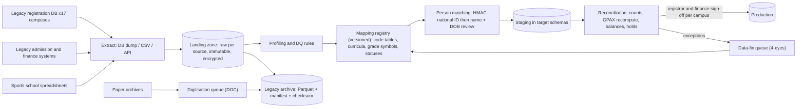

### 13.3 ขั้นตอนและเกณฑ์ผ่าน

| ขั้น | รายละเอียด | เกณฑ์ผ่าน |
|---|---|---|
| 1. Inventory & profiling (P0) | ระบบ/เวอร์ชัน/DB ต่อวิทยาเขต, ปีย้อนหลัง, จำนวนแถว, อัตรา null/ซ้ำ/ผิดรูปแบบ, รหัสที่ใช้, เจ้าของข้อมูล | Profiling report ครบทุกแห่ง (17 วิทยาเขต + โรงเรียนกีฬา) |
| 2. Canonical migration schema + mapping registry | Person, Student, Curriculum, Course, Enrollment, Grade, Status, Invoice/Balance, Hold, Loan, Dorm; mapping มีเวอร์ชันและผู้อนุมัติ | mapping spec อนุมัติต่อวิทยาเขต |
| 3. Curriculum first | ย้ายหลักสูตร/รายวิชาทุกเวอร์ชันที่มีเกรดอ้างถึง + `EquivalenceRule` ข้ามวิทยาเขต | 100% ของรายวิชาที่มีเกรดอ้างอิงถึง |
| 4. PolicySet ย้อนหลัง | สร้าง PolicySet ตามข้อบังคับแต่ละฉบับที่รุ่นเดิมใช้ | degree audit ตัวอย่าง 5% ตรงกับการตรวจด้วยมือ |
| 5. Person matching | deterministic ด้วย HMAC เลขบัตร; probabilistic (ชื่อ+วันเกิด+โรงเรียนเดิม) ส่งให้ steward ตัดสิน; ตรวจข้ามวิทยาเขต (ย้ายวิทยาเขต, เรียนต่อ ป.โท, เคยอยู่โรงเรียนกีฬา) | **false merge = 0** |
| 6. Staged loads | reference → OrgUnit → curriculum → Person → Student → ประวัติผลการเรียน → สถานภาพ → ยอดเงินคงค้าง (opening balance) → hold/กยศ./หอ ที่ active; ใช้ idempotent upsert ด้วย legacy key | ทุก load re-run ได้ |
| 7. ผลการเรียนเดิม | **คงเกรดตามที่บันทึก** (ไม่คำนวณใหม่) แต่คำนวณ GPAX ใหม่เพื่อเทียบ | GPAX ต่าง = 0 ราย หรือมีเหตุผลทุกราย |
| 8. การเงิน | ย้าย opening balance ณ วันตัด; ธุรกรรมย้อนหลังเข้า legacy archive (ค้นได้) | ยอดรวมตรงรายงานกองคลังต่อวิทยาเขต |
| 9. ข้อมูลพิเศษ | รหัสนักศึกษาเดิมคงไว้; consent เดิมไม่ใช้เป็นหลักฐาน → ส่ง notice ใหม่; ข้อมูลสุขภาพย้ายเฉพาะที่จำเป็นต่อการดูแลต่อเนื่อง (alert, การบาดเจ็บที่ยังรักษา) หลัง DPIA; แฟ้มคุ้มครองเด็กเดิมให้ DSL โอนด้วยมือ | DPIA ผ่าน |
| 10. Dress rehearsal | ≥ 3 รอบต่อ wave บน enclave ที่มี control เท่า production จับเวลา | cutover ≤ 48 ชม. |
| 11. Reconciliation & sign-off | นับต่อ entity ต่อวิทยาเขต, GPAX, หน่วยกิตสะสม, ยอดคงค้าง, hold, ผู้กู้, ผู้พักหอ; รายงานลงนามโดยนายทะเบียนและหัวหน้าการเงินวิทยาเขต | ลงนามครบ |
| 12. Cutover | นอกช่วงลงทะเบียน/ประกาศผล/ครบกำหนดชำระ; freeze ระบบเดิม; delta load; smoke test; go/no-go scorecard ที่มีเกณฑ์ตัวเลข | ผ่าน scorecard |
| 13. Parallel run 1 ภาค | ระบบใหม่เป็น system of record; ระบบเดิมเปิดแบบ read-only และรับ **reverse feed** รายคืนเพื่อ shadow-compute ค่าธรรมเนียม standing และสถานะสิ้นภาค แล้วเทียบผลรายสัปดาห์ | diff เกินเกณฑ์ = 0 ก่อนปิด parallel run |
| 14. Rollback | rollback window จนถึงวันครบกำหนดชำระแรกหลัง cutover; **reverse-delta tooling** ส่งธุรกรรมใหม่กลับในรูปแบบที่ระบบเดิม import ได้; เกณฑ์ตัดสินอยู่ใน scorecard | ซ้อม rollback อย่างน้อย 1 ครั้งต่อ wave |
| 15. Decommission | หลัง parallel run: ข้อมูลระบบเดิมทั้งหมดเข้า legacy archive แล้วออก decommission certificate ต่อระบบ | certificate ลงนาม |

**เครื่องมือ:** landing zone เข้ารหัสใน object storage, dbt + SQL tests สำหรับ profiling/DQ, mapping registry (ตาราง versioned ใน schema `mig`), DQ dashboard ต่อวิทยาเขต (Superset), data-fix UI แบบ 4-eyes, ข้อมูลระบุตัวตนใน migration ใช้ HMAC key ของ context migration ที่หมุนทิ้งหลังจบ wave

## 14. Archival และ legacy archive

- **Partitioning ตามปีการศึกษา/ปีงบประมาณ** สำหรับตารางขนาดใหญ่ (enrollment, attendance, payment, audit, notification) แล้วย้าย partition เก่าไป tablespace/instance ที่ถูกกว่า (warm) และ export เป็น Parquet ใน object storage (cold) โดยยังค้นได้ผ่าน viewer
- **Legacy archive service** (DATA-03): landing zone แบบ immutable (Parquet + manifest + checksum + Object Lock), read-only viewer, ค้นหาด้วย `person_id`/HMAC, **RLS ตาม OrgUnit**, ครอบคลุม DSR และคำขอ สตง., retention ตามประเภทข้อมูลต้นทาง
- **ส่งมอบหอจดหมายเหตุ** (C-23): `DisposalBatch` (คณะกรรมการ → บัญชีขอทำลาย/ส่งมอบ → อนุมัติ) และ `ArchivalPackage` = PDF/A + XML metadata + checksum (รูปแบบแบบ OAIS-SIP **[ต้องตรวจสอบกับกรมศิลปากร]**)
- **Digital preservation**: ประทับเวลาซ้ำของเอกสารที่ลงนาม (LTV), ทะเบียนรูปแบบไฟล์และแผนแปลงรูปแบบเมื่อรูปแบบเดิมเลิกใช้
- **เอกสารกระดาษเดิม**: digitisation queue ของ DOC (สแกน + metadata + รับรองสำเนา) โดยจัดลำดับตามความต้องการ (เช่น ศิษย์เก่าที่ขอ transcript)

## 15. ข้อมูลทดสอบ (non-production)

- ค่าเริ่มต้นใช้ **synthetic data generator** (ชื่อไทย, เลข 13 หลักที่ check digit ถูกแต่อยู่ในช่วงที่ไม่ออกจริง **[ต้องตรวจสอบช่วงที่ปลอดภัย]**, เกรดและการเงินที่สมจริง, สองวิทยาเขต + หนึ่งโรงเรียน) (DATA-07)
- masked copy ของข้อมูลจริงใช้เฉพาะ migration rehearsal ใน enclave ที่มี control เท่า production และลบหลังจบรอบ
- ห้ามนำข้อมูลจาก `hlt_vault` และ SAFE ไป non-production ในทุกรูปแบบ

## 16. ผลการปิด review

| ข้อจาก review | ประเด็น | การจัดการในเล่มนี้ |
|---|---|---|
| review_architecture Top-10 #10, IC-15 | RLS มีช่องโหว่ (SET LOCAL, BYPASSRLS, CDC/BI นอก RLS, ตารางไม่มี org_unit_id) | **แก้**: หัวข้อ 6 และ 10 (contract, FORCE RLS, `SET LOCAL`, CI lint, org_unit_id ทุกตารางธุรกรรม รวม ENROLLMENT/GRADE/INVOICE/PAYMENT/CONSENT/GUARDIAN_RELATION) |
| ARCH-10 | multi-tenancy edge cases | **แก้**: หัวข้อ 10.2 |
| ARCH-04, IC-02 | vault เป็น cluster แยก + "TDE" | **แก้**: database แยกบน cluster เดียวกัน, ไม่มี TDE, volume + column encryption (หัวข้อ 9, 11) |
| SEC-09 | crypto-shred ไม่มีผลกับ backup | **แก้**: wrapped DEK อยู่ใน key store แยกที่ไม่อยู่ใน backup ของ vault + tombstone list |
| SEC-10 | HMAC key รั่วแล้ว brute force ได้ | **แก้**: HMAC key ต่อ context ใน OpenBao Transit แบบ non-exportable + versioned |
| SEC-05, DATA-02 | SQL Lab/CDC ส่ง PII | **แก้**: column allow-list, ปิด SQL Lab, export มี purpose + watermark, vault ไม่เข้าถึงจาก analytics (หัวข้อ 10.3) |
| ARCH-02, ARCH-03 | ClickHouse/OpenSearch เกินจำเป็น | **แก้**: PostgreSQL replica + analytics DB + dbt + Superset; ไม่ index vault |
| DATA-01 | ระดับ audit ขัดกัน | **ส่งต่อ**: นิยามใน 06-modules (AUD); เล่มนี้ใช้ชั้นข้อมูลเป็นตัวกำหนด |
| DATA-03 | legacy archive ไม่ชัด | **แก้**: หัวข้อ 14 |
| DATA-04, Top-10 #7 | migration tooling, parallel run, rollback | **แก้**: หัวข้อ 13 (mapping registry, data-fix 4-eyes, rehearsal ≥ 3, parallel run + reverse feed, rollback window + reverse-delta, decommission certificate); runbook ปฏิบัติการอยู่เล่ม 11, FTE อยู่เล่ม 12 |
| DATA-05 | bitemporal กว้างเกิน | **แก้**: จำกัดตารางที่เป็น temporal (หัวข้อ 1 ข้อ 5) |
| DATA-06 | reference data ไม่มีแหล่ง | **แก้**: หัวข้อ 4 |
| DATA-07 | masked copy ใน non-prod | **แก้**: synthetic เป็นค่าเริ่มต้น (หัวข้อ 15) |
| Top-10 #2 | key escrow | **แก้ส่วนข้อมูล**: ลำดับชั้น key และ Shamir escrow (หัวข้อ 9.2, 11); ขั้นตอนปฏิบัติการอยู่เล่ม 07/11 |
| review_compliance C-03 | ไม่มีชั้นความลับราชการ | **แก้**: หัวข้อ 7.2 (สองมิติ, ลับที่สุดไม่เก็บในระบบ) |
| C-11 | DSR ชนกับหน้าที่เก็บถาวร | **แก้**: หัวข้อ 8 (ปฏิสัมพันธ์กับ DSR, ห้าม crypto-shred ข้อมูลเก็บถาวร, legal hold) |
| C-18, C-19 | data governance, open data | **แก้**: หัวข้อ 12; open data อยู่ใน ANA (06-modules) |
| C-23 | ทำลาย/หอจดหมายเหตุ | **แก้**: หัวข้อ 8 และ 14 |
| C-24 | prefix สารบรรณ | **แก้**: identifiers (หัวข้อ 5) + `ExternalCode` |
| C-26 | วันที่ใน XML | **แก้**: หลักการข้อ 8 (เก็บ ISO แสดง พ.ศ.) |
| C-42 | retention เวชระเบียน | **เลื่อนพร้อมเหตุผล**: ผูกกับสถานะห้องพยาบาลที่ต้องยืนยันใน P0 |
| review_functional R-07 | guardian หลายโมเดล | **แก้**: `GUARDIAN_RELATION` เดียวใน REC + `CUSTODY_RESTRICTION` |
| R-06 | สุขภาพหลายที่ | **แก้**: ทุก entity สุขภาพอยู่ใน `hlt_vault` (2.9) |
| I-21 | เจ้าของปฏิทิน | **แก้**: ORG (หัวข้อ 3) ตาม blueprint |
| G-05 | เสียชีวิต/ออกกลางคัน | **แก้**: `PERSON.deceased_flag`, `EXIT_CASE`, สถานะใน `STUDENT` |
| G-13 | ผู้ปกครองถูกจำกัดสิทธิ์โดยศาล | **แก้**: `CUSTODY_RESTRICTION` + `AUTHORISED_PICKUP.blocked` |
| G-16 | ข้ามวิทยาเขต | **แก้**: home/host org ใน ENROLLMENT/SECTION |
| G-17 | ชื่อสถาบันเดิม, เอกสารกระดาษ | **แก้**: `INSTITUTION_NAME`, digitisation queue |
| v0.9 6.3 | รหัสนักศึกษาตายตัว 11 หลัก | **แก้**: `StudentNumberScheme` ตั้งค่าได้ต่อวิทยาเขต/ระดับ, คงรหัสเดิม |
| v0.9 6.5 | retention เป็นค่าเดา | **แก้บางส่วน**: เพิ่มประเภทข้อมูลใหม่และติด [ต้องตรวจสอบ] ทุกแถวจนกว่า มกช. อนุมัติ |
| blueprint หัวข้อ 10 | PostgreSQL ไม่มี TDE | **แก้**: หัวข้อ 11 |
| blueprint ข้อ 9.5 | replica/BI ต้องบังคับ scope | **แก้**: หัวข้อ 10.3 |
