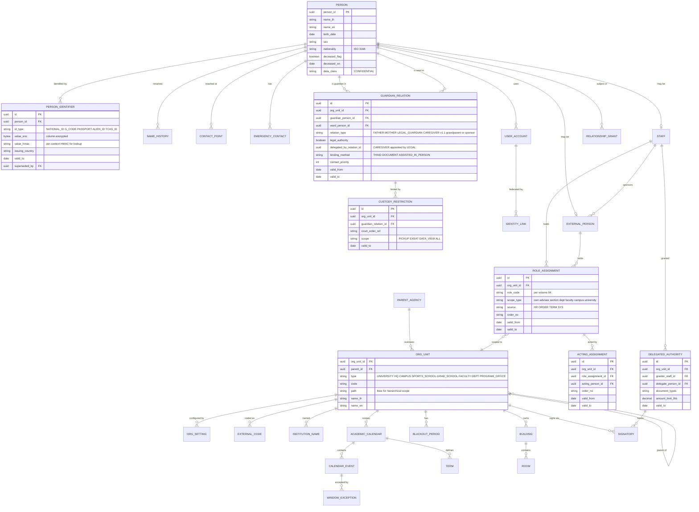
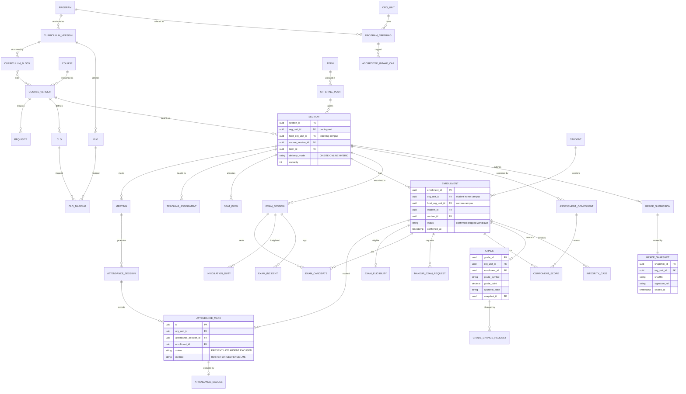
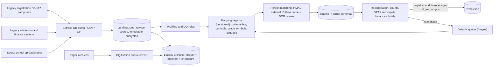

# 08 — Data Architecture (สถาปัตยกรรมข้อมูล)

> **สถานะ:** v1.1-draft · 28 ต.ค. 2569 (v1.0 → v1.1 ตาม [00-fix-decisions-v1.1](./00-fix-decisions-v1.1.md): D-04 `hlt_vault`/`hlt_keys`, DEK ต่อบุคคล × ประเภทระเบียน, wellness ย้ายเข้า HLT, restore-then-reapply-erasure; D-05 สถานะความพร้อมที่โค้ชเห็น; D-06 ลด entity ที่เกินจำเป็น; D-07 Wave 2a/2b + shadow comparison; D-09 RLS scope token + analytics แบบ physical replica/`security_invoker`; D-10 entity/fact สำหรับ KPI dictionary และ cohort history) · ผู้เขียน: D · ภาษา: ไทย (ศัพท์เทคนิค ชื่อผลิตภัณฑ์ และโค้ดเป็นภาษาอังกฤษ)
> **อ่านคู่กับ:** [00-blueprint](./00-blueprint.md) (ข้อ 9.3 Minimum Operable Stack, 9.5 OrgUnit + RLS, 9.9 health vault, หัวข้อ 10) · [06-modules](./06-modules.md) (เจ้าของข้อมูลต่อโมดูลและ event) · `07-architecture.md` (ADR, key management ระดับ platform, NFR) · `10-security-compliance.md` (PDPA lawful basis, ROPA/DPIA, ระดับ e-signature, งานสารบรรณ) · `11-operations.md` (backup/DR, cutover, parallel run, rollback ระดับปฏิบัติการ) · `12-roadmap-cost-risk.md` (ทีม migration)
> **ขอบเขต:** domain model, master data, identifiers, การกำหนดขอบเขตข้อมูลราย OrgUnit, การจัดชั้นข้อมูล (รวมชั้นความลับของทางราชการ), retention, health vault, การเข้ารหัส, RLS (รวม analytics/BI), data quality, migration จากระบบเดิมรายวิทยาเขต และ archival

---

## สารบัญ

1. [หลักการของ data model](#1-หลักการของ-data-model)
2. [Domain model (ER)](#2-domain-model-er)
3. [Master data และเจ้าของข้อมูล](#3-master-data-และเจ้าของข้อมูล)
4. [Reference data](#4-reference-data)
5. [Identifiers](#5-identifiers)
6. [การกำหนดขอบเขตข้อมูลด้วย org_unit_id](#6-การกำหนดขอบเขตข้อมูลด้วย-org_unit_id)
7. [การจัดชั้นข้อมูล (Data classification)](#7-การจัดชั้นข้อมูล-data-classification)
8. [Retention](#8-retention)
9. [Health vault](#9-health-vault)
10. [Row-Level Security และการกำหนดขอบเขตข้อมูล](#10-row-level-security-และการกำหนดขอบเขตข้อมูล)
11. [การเข้ารหัส (Encryption)](#11-การเข้ารหัส-encryption)
12. [Data quality และ data governance](#12-data-quality-และ-data-governance)
13. [Migration จากระบบเดิมรายวิทยาเขต](#13-migration-จากระบบเดิมรายวิทยาเขต)
14. [Archival และ legacy archive](#14-archival-และ-legacy-archive)
15. [ข้อมูลทดสอบ (non-production)](#15-ข้อมูลทดสอบ-non-production)
16. [ผลการปิด review](#16-ผลการปิด-review)

---

## 1. หลักการของ data model

1. **Person-centric**: บุคคลหนึ่งคนมี `PERSON` เดียวตลอดชีวิตในระบบ และเป็นได้หลายบทบาท (ผู้สมัคร → นักเรียนโรงเรียนกีฬา → นักศึกษา ป.ตรี → ป.โท → ศิษย์เก่า → ผู้ปกครอง → บุคลากร) จึงติดตาม talent pathway ได้โดยไม่ต้องทำ record linkage ภายหลัง
2. **Student ต่อ program career**: `STUDENT` 1 แถวต่อการเข้าศึกษา 1 ครั้งใน 1 โปรแกรม (ป.ตรี/ป.โท แยกกัน, ผู้ที่กลับเข้าศึกษาใหม่ได้แถวใหม่ที่ผูก `prior_student_id`) และแต่ละแถวผูก PolicySet ของตัวเอง
3. **Schema ต่อโมดูล** ตาม [06-modules หัวข้อ 1](./06-modules.md#1-หลักการของโมดูล-bounded-context-rules): ห้าม JOIN ข้าม schema; การอ้างข้ามโมดูลเป็น **logical reference** (UUID) ที่ตรวจความถูกต้องผ่าน API/event ไม่ใช่ foreign key ข้าม schema; ER diagram ด้านล่างจึงแสดงความสัมพันธ์เชิงตรรกะข้ามโมดูลด้วย
4. **ทุกตารางธุรกรรมมี `org_unit_id NOT NULL`** และอยู่ภายใต้ RLS (หัวข้อ 6 และ 10) รวมถึงตารางที่ v0.9 ขาด (ENROLLMENT, GRADE, INVOICE, PAYMENT, CONSENT, GUARDIAN_RELATION; IC-15)
5. **Temporal อย่างจำกัด** (DATA-05): ใช้ effective-dating/bitemporal เฉพาะ PolicySet, FeeSchedule, OrgSetting, ExternalCode, ParentAgency, InstitutionName, StudentStatusHistory และ GuardianRelation ส่วนตารางอื่นใช้ history table (trigger) และ audit
6. **Primary key เป็น UUIDv7** (เรียงตามเวลา เป็นมิตรกับ index) สร้างฝั่ง server หรือฝั่ง client สำหรับงาน offline (คะแนนสอบทักษะ, การนิเทศ) เพื่อให้ sync แบบ idempotent ได้
7. **ข้อมูลสุขภาพอยู่ใน database แยก** (`hlt_vault`) เท่านั้น (หัวข้อ 9) และโมดูลอื่นเก็บได้เพียง status ที่ไม่มีการวินิจฉัย — **v1.1:** รวมถึง wellness รายวัน (อารมณ์ การนอน ความปวด ความเมื่อยล้า) ซึ่งย้ายจาก ATH มาอยู่ใน `hlt_vault`; ATH เก็บเพียงสถานะความพร้อม + ข้อจำกัดการฝึก และ readiness band ที่ได้รับอนุญาต (D-04, D-05)
8. **วันที่เก็บเป็น ISO (ค.ศ.) ใน `date`/`timestamptz`** และแสดงผลเป็น พ.ศ. ที่ชั้น presentation; ปีการศึกษาและปีงบประมาณเก็บเป็นปี พ.ศ. แบบ integer พร้อมชื่อคอลัมน์ `_be` เพื่อไม่ให้สับสน
9. **ข้อความสองภาษา** ใช้คู่คอลัมน์ `_th`/`_en` สำหรับชื่อที่ต้องพิมพ์บนเอกสาร (ชื่อบุคคล หลักสูตร รายวิชา ปริญญา)
10. **ไม่ลบข้อมูลธุรกรรมแบบ hard delete** ยกเว้นผ่าน `ErasureJob`/`DisposalBatch` ที่ตรวจ retention แล้ว (หัวข้อ 8)

## 2. Domain model (ER)

แผนภาพแบ่งตามกลุ่มข้อมูล ชื่อ entity เป็นตัวพิมพ์ใหญ่ภาษาอังกฤษ (ตรงกับชื่อตาราง) และแสดง attribute เฉพาะ entity ที่สำคัญต่อการกำหนดขอบเขตข้อมูล การเข้ารหัส หรือ identifier ส่วนรายการ entity ต่อโมดูลอยู่ใน 06-modules entity ที่ปรากฏในหลายแผนภาพ (เช่น `PERSON`, `ORG_UNIT`, `STUDENT`) คือ entity เดียวกัน

### 2.1 Identity และองค์กร (IAM, ORG, REC-person)

### 2.2 Admissions (ADM)

### 2.3 วิชาการ: หลักสูตร ลงทะเบียน เวลาเรียน สอบ และเกรด (CUR, REG, ATT, EXM, ASM)

### 2.4 ทะเบียนนักศึกษา สถานภาพ และการสำเร็จการศึกษา (REC, GRD)

```mermaid
erDiagram
  PERSON ||--o{ STUDENT : "enrolled as"
  STUDENT }o--|| PROGRAM_OFFERING : "studies"
  STUDENT ||--o| STUDENT : "readmitted from"
  POLICY_SET ||--o{ POLICY_SET_ASSIGNMENT : "applied by"
  STUDENT ||--o{ POLICY_SET_ASSIGNMENT : "governed by"
  STUDENT_NUMBER_SCHEME ||--o{ STUDENT : "numbers"
  STUDENT ||--o{ STUDENT_STATUS_HISTORY : "changes"
  STUDENT ||--o{ TERM_RECORD : "per term"
  STUDENT ||--o{ ACADEMIC_STANDING : "classified"
  STUDENT ||--o{ HOLD : "blocked by"
  STUDENT ||--o{ EXIT_CASE : "exits via"
  EXIT_CASE ||--o{ EXIT_CASE_TASK : "cascades"
  STUDENT ||--o{ ADVISOR_ASSIGNMENT : "advised"
  STUDENT ||--o{ ACADEMIC_ALERT : "flagged"
  ACADEMIC_ALERT ||--o{ ALERT_INTERVENTION : "followed up by"
  STUDENT ||--o{ STANDING_EVALUATION : "evaluated before next term"
  STUDENT ||--o{ COURSE_SUBSTITUTION : "substitutes"
  STUDENT ||--o{ CURRICULUM_MIGRATION : "migrates"
  STUDENT ||--o{ DEGREE_AUDIT : "audited"
  STUDENT ||--o{ ACADEMIC_PLAN : "plans"
  ACADEMIC_PLAN ||--o{ PLANNED_COURSE : "contains"
  STUDENT ||--o{ GRADUATION_APPLICATION : "applies"
  GRADUATION_APPLICATION ||--o{ CLEARANCE_ITEM : "clears"
  CONFERRAL_BATCH ||--o{ GRADUATION_APPLICATION : "confers"
  COUNCIL_RESOLUTION ||--o{ CONFERRAL_BATCH : "approves"
  STUDENT ||--o{ CREDENTIAL : "issued"
  CREDENTIAL ||--o| PHYSICAL_DIPLOMA : "printed as"
  CREDENTIAL ||--o{ CREDENTIAL_REISSUE : "reissued"
  CREDENTIAL ||--o| CREDENTIAL_REVOCATION : "revoked by"
  BADGE_CLASS ||--o{ BADGE_ASSERTION : "awarded as"
  PERSON ||--o{ BADGE_ASSERTION : "earns"
  PERSON ||--o{ LEARNER_RECORD : "holds"
  CEREMONY ||--o{ CEREMONY_REGISTRATION : "registers"
  STUDENT ||--o{ CEREMONY_REGISTRATION : "attends"

  STUDENT {
    uuid student_id PK
    uuid org_unit_id FK "home campus or school"
    uuid person_id FK
    string student_no "unique university-wide"
    uuid program_offering_id FK
    string cohort_year_be
    string academic_profile "HIGHER_ED GRAD BASIC_ED"
    string status "ACTIVE ON_LEAVE MAINTAINING PROBATION SUSPENDED LAPSED WITHDRAWN TRANSFERRED_OUT DISMISSED DECEASED GRADUATED"
    uuid prior_student_id FK
  }
  STUDENT_STATUS_HISTORY {
    uuid id PK
    uuid org_unit_id FK
    uuid student_id FK
    string from_status
    string to_status
    date effective_from
    date recorded_at
    string order_ref
    uuid appeal_ref
  }
  EXIT_CASE {
    uuid id PK
    uuid org_unit_id FK
    uuid student_id FK
    string exit_reason "WITHDRAWN TRANSFERRED_OUT DISMISSED DECEASED LAPSED"
    boolean compassionate_mode
    string state
  }
  HOLD {
    uuid hold_id PK
    uuid org_unit_id FK
    uuid student_id FK
    string hold_type
    string source_module
    string blocks "REGISTRATION DOCUMENTS GRADUATION"
    timestamp released_at
  }
  POLICY_SET {
    uuid policy_set_id PK
    uuid org_unit_id FK "owning unit usually university"
    string code "HE-2572-v1"
    string profile
    date effective_from
    string dmn_bundle_hash
  }
  ACADEMIC_ALERT {
    uuid alert_id PK
    uuid org_unit_id FK
    uuid student_id FK
    string rule_code "GPA_DROP ATTENDANCE NO_REG FIN_HOLD"
    string severity
    timestamp raised_at
    uuid assigned_advisor_id
    timestamp acknowledged_at
    timestamp closed_at
    string outcome "RESOLVED REFERRED NO_ACTION WITHDRAWN"
  }
  ALERT_INTERVENTION {
    uuid id PK
    uuid org_unit_id FK
    uuid alert_id FK
    string action_type "ADVISING_MEETING REFERRAL_COUNSELLING REFERRAL_FIN STUDY_PLAN CONTACT_GUARDIAN"
    uuid advising_note_ref
    uuid referral_case_ref
    timestamp acted_at
    uuid actor_id
  }
  STANDING_EVALUATION {
    uuid id PK
    uuid org_unit_id FK
    uuid student_id FK
    uuid term_id FK
    string result "NORMAL PROBATION DISMISSAL_PENDING"
    boolean appeal_pending
    string registration_right "FULL CONDITIONAL BLOCKED"
    timestamp computed_at
  }
  CREDENTIAL {
    uuid credential_id PK
    uuid org_unit_id FK
    uuid student_id FK
    string type "TRANSCRIPT DEGREE CERTIFICATE CLR"
    string serial_no
    string sha256
    string status "valid revoked superseded"
  }
```

### 2.5 บัณฑิตศึกษา ฝึกประสบการณ์ และโรงเรียนกีฬา (GRAD, PRA, SSC)

### 2.6 การเงิน ทุน และ กยศ. (FIN, SCH)

### 2.7 หอพักและกิจการนักศึกษา (HOU, AFF)

### 2.8 นักกีฬาและห้องปฏิบัติการ (ATH, LAB) — core database

```mermaid
erDiagram
  PERSON ||--o| ATHLETE_PROFILE : "may be"
  SPORT_DISCIPLINE ||--o{ ATHLETE_PROFILE : "practised by"
  SQUAD ||--o{ SQUAD_MEMBERSHIP : "has"
  ATHLETE_PROFILE ||--o{ SQUAD_MEMBERSHIP : "joins"
  SQUAD ||--o{ COACH_ASSIGNMENT : "coached"
  STAFF ||--o{ COACH_ASSIGNMENT : "coaches"
  SQUAD ||--o{ TRAINING_SESSION : "holds"
  TRAINING_PLAN |o--o{ TRAINING_SESSION : "optionally plans"
  TRAINING_SESSION ||--o{ SESSION_ATTENDANCE : "attended"
  TRAINING_SESSION ||--o{ SESSION_LOAD : "loads"
  ATHLETE_PROFILE ||--o{ SESSION_LOAD : "records"
  ATHLETE_PROFILE ||--o{ READINESS_STATUS : "status from HLT"
  ATHLETE_PROFILE ||--o| PARA_CLASSIFICATION : "classified"
  SQUAD ||--o{ SELECTION_ROUND : "selects"
  SELECTION_ROUND ||--o{ SELECTION_DECISION : "decides"
  ATHLETE_PROFILE ||--o{ SELECTION_DECISION : "subject of"
  COMPETITION ||--o{ COMPETITION_DELEGATION : "sends"
  COMPETITION ||--o{ COMPETITION_ENTRY : "has"
  ATHLETE_PROFILE ||--o{ COMPETITION_ENTRY : "enters"
  COMPETITION_ENTRY ||--o| COMPETITION_RESULT : "results"
  COMPETITION ||--o{ COMPETITION_LEAVE_BATCH : "requires"
  COMPETITION_LEAVE_BATCH ||--o{ COMPETITION_LEAVE_ITEM : "lists"
  ELIGIBILITY_RULE_SET ||--o{ ELIGIBILITY_CHECK : "applied"
  ATHLETE_PROFILE ||--o{ ELIGIBILITY_CHECK : "checked"
  COMPETITION ||--o{ TEAM_TRIP : "travelled"
  PER_DIEM_POLICY ||--o{ TEAM_TRIP : "rates"
  TEAM_TRIP ||--o{ TRIP_ROSTER : "carries"
  TEAM_TRIP ||--o| TRIP_ADVANCE : "funded by"
  TEAM_TRIP ||--o{ TRIP_EXPENSE_CLAIM : "settles"
  ATHLETE_PROFILE ||--o{ NUTRITION_PLAN : "follows"
  PERSON ||--o{ TALENT_POOL_ENTRY : "tracked"
  TALENT_POOL_ENTRY ||--o{ MATURATION_MEASURE : "measured talent pathway only"
  ATHLETE_PROFILE ||--o{ DC_TUTOR_ASSIGNMENT : "tutored"
  TEST_PROTOCOL ||--o{ LAB_TEST_RESULT : "defines"
  ATHLETE_PROFILE ||--o{ LAB_TEST_RESULT : "tested"
  INSTRUMENT ||--o{ CALIBRATION_RECORD : "calibrated"
  INSTRUMENT ||--o{ LAB_TEST_RESULT : "measures"

  ATHLETE_PROFILE {
    uuid athlete_id PK
    uuid org_unit_id FK
    uuid person_id FK
    string level "NATIONAL YOUTH_NATIONAL UNIVERSITY PROVINCE"
    string tier
    string availability "FULL MODIFIED UNAVAILABLE from HLT"
  }
  READINESS_STATUS {
    uuid id PK
    uuid org_unit_id FK
    uuid athlete_id FK
    string status "FULL MODIFIED UNAVAILABLE"
    string restrictions "e.g. NO_CONTACT NO_JUMP"
    string readiness_band "GREEN AMBER RED if athlete permits"
    date valid_to
  }
  PARA_CLASSIFICATION {
    uuid id PK
    uuid org_unit_id FK
    uuid athlete_id FK
    string sport_class
    string status "CONFIRMED REVIEW NEW"
    date review_on
  }
  SELECTION_DECISION {
    uuid id PK
    uuid org_unit_id FK
    uuid selection_round_id FK
    uuid athlete_id FK
    string result "SELECTED RESERVE NOT_SELECTED DESELECTED"
    uuid appeal_ref
    uuid care_plan_ref
  }
  COACH_ASSIGNMENT {
    uuid id PK
    uuid org_unit_id FK
    uuid coach_staff_id FK
    uuid squad_id FK
    boolean minors_involved
    string clearance_status "from SAFE"
    date valid_to
  }
  TEAM_TRIP {
    uuid trip_id PK
    uuid org_unit_id FK
    uuid competition_id FK
    date depart_on
    date return_on
    decimal budget_thb
    string state
  }
  ELIGIBILITY_CHECK {
    uuid id PK
    uuid org_unit_id FK
    uuid athlete_id FK
    uuid rule_set_id FK
    string result "ELIGIBLE INELIGIBLE PENDING"
    string reasons
    timestamp checked_at
  }
```

**หมายเหตุ v1.1 (D-06, D-08, FS O-1..O-10):** `TRAINING_PLAN` เป็น optional (แนบไฟล์/template) และ**ไม่มีโมเดล periodization macro/meso/micro**; ข้อมูลขั้นต่ำคือ `TRAINING_SESSION` (สร้างจาก FAC recurring booking) + `SESSION_ATTENDANCE` (ใช้เป็น exposure และ safeguarding) + `SESSION_LOAD` (sRPE ที่นักกีฬากรอก) — ภาระฝึกแสดงเป็น**แนวโน้มเทียบ baseline ของบุคคล**เท่านั้น ไม่มี entity/alert "ACWR injury risk"; ไม่มี meal/fuelling log รายมื้อ (`NUTRITION_PLAN` เป็นแผนระดับบุคคล/ทีมที่นักโภชนาการทำ); ไม่มี vendor-specific wearable adapter (นำเข้า CSV ตาม mapping กลาง); `MATURATION_MEASURE` ใช้เฉพาะ talent pathway; ไม่มี `HOSTED_EVENT`/accreditation; entity ของ LAB (`TEST_PROTOCOL`, `INSTRUMENT`, `CALIBRATION_RECORD`, `LAB_TEST_RESULT`) อยู่ใน**สัญญาแยก** (เลื่อนจาก R3); `WELLNESS_ENTRY` ย้ายไป `hlt_vault` (หัวข้อ 2.9) และ ATH เห็นเพียง `READINESS_STATUS`; `COMPETITION_DELEGATION` (เดิม `DELEGATION`) เปลี่ยนชื่อเพื่อไม่ชนกับ "delegated authority" (CO TERM-03); เพิ่ม `PARA_CLASSIFICATION` และ `SELECTION_ROUND`/`SELECTION_DECISION` (การคัดเลือก/ตัดออกจากทีมพร้อมอุทธรณ์และแผนดูแล ตาม D-08)

### 2.9 Health vault (HLT) — database แยก `hlt_vault`

```mermaid
erDiagram
  HEALTH_SUBJECT ||--o{ SUBJECT_KEY : "keyed per record class in hlt_keys"
  HEALTH_SUBJECT ||--o{ WELLNESS_ENTRY : "reports"
  HEALTH_SUBJECT ||--o{ ENCOUNTER : "visits"
  ENCOUNTER ||--o{ DIAGNOSIS : "diagnosed"
  ENCOUNTER ||--o{ TREATMENT : "treated"
  ENCOUNTER ||--o{ REFERRAL : "referred"
  HEALTH_SUBJECT ||--o{ MEDICAL_CLEARANCE : "cleared"
  HEALTH_SUBJECT ||--o{ MEDICAL_ALERT : "alerts"
  HEALTH_SUBJECT ||--o{ TREATMENT_CONSENT : "consents"
  HEALTH_SUBJECT ||--o{ MEDICATION_ORDER : "prescribed"
  MEDICATION_ORDER ||--o{ MEDICATION_ADMINISTRATION : "administered"
  HEALTH_SUBJECT ||--o{ INJURY : "suffers"
  INJURY ||--o{ REHAB_PLAN : "rehabilitated"
  INJURY ||--o| RTP_CLEARANCE : "returns"
  HEALTH_SUBJECT ||--o{ AVAILABILITY_STATUS : "available"
  HEALTH_SUBJECT ||--o{ PSYCH_SESSION : "attends"
  HEALTH_SUBJECT ||--o{ COUNSELLING_NOTE : "noted"
  HEALTH_SUBJECT ||--o{ DISABILITY_EVIDENCE : "evidences"
  HEALTH_SUBJECT ||--o{ SCREENING_RESULT : "screened"
  HEALTH_SUBJECT ||--o{ BODY_COMPOSITION : "measured"
  HEALTH_SUBJECT ||--o{ VACCINATION : "vaccinated"
  INSURANCE_POLICY ||--o{ INSURANCE_ENROLMENT : "covers"
  HEALTH_SUBJECT ||--o{ INSURANCE_ENROLMENT : "insured"
  INSURANCE_ENROLMENT ||--o{ INSURANCE_CLAIM : "claims"
  HEALTH_SUBJECT ||--o{ TUE_REFERENCE : "references"
  HEALTH_SUBJECT ||--o{ DISCLOSURE_GRANT : "discloses"
  HEALTH_SUBJECT ||--o{ VAULT_ACCESS_LOG : "accessed"

  HEALTH_SUBJECT {
    uuid subject_id PK
    string person_token "HMAC of person_id with vault-only key"
    uuid org_unit_id FK "care unit"
    timestamp shredded_at
  }
  SUBJECT_KEY {
    uuid id PK
    uuid subject_id FK
    string record_class "CLINICAL MEDICATION_MINOR INJURY_RTP WELLNESS COUNSELLING DISABILITY SELECTION_MEDICAL INSURANCE TUE"
    int key_version
    bytea wrapped_dek "stored in database hlt_keys"
    string kek_version
    timestamp replicated_to_site_b_at
    timestamp shredded_at
  }
  WELLNESS_ENTRY {
    uuid id PK
    uuid org_unit_id FK
    uuid subject_id FK
    date entry_date
    bytea answers_enc "mood sleep soreness pain"
    string derived_band "GREEN AMBER RED"
    string record_class "WELLNESS"
  }
  INJURY {
    uuid injury_id PK
    uuid org_unit_id FK
    uuid subject_id FK
    timestamp occurred_at
    string context "TRAINING COMPETITION CLASS DORM"
    string protocol "NONE CONCUSSION HEAT WEIGHT_CUT"
    int time_loss_days
    string mechanism
    string osiics_code
    bytea body_part_enc
    bytea diagnosis_enc
    string lawful_basis "S26_5A_MEDICAL VITAL_INTEREST_EMERGENCY LEGAL_DUTY CONSENT"
  }
  MEDICAL_ALERT {
    uuid id PK
    uuid org_unit_id FK
    uuid subject_id FK
    bytea alert_enc "minimum emergency dataset"
    string purpose "EMERGENCY"
    date reviewed_on
  }
  DISCLOSURE_GRANT {
    uuid id PK
    uuid org_unit_id FK
    uuid subject_id FK
    string grantee_role "COACH TRIP_LEADER DORM_DUTY"
    string scope "ALERT DETAIL (AVAILABILITY needs no grant)"
    uuid consent_ref
    date valid_to
  }
  VAULT_ACCESS_LOG {
    uuid id PK
    uuid org_unit_id FK
    uuid subject_id FK
    uuid actor_id
    string purpose
    string basis "CARE EMERGENCY BREAK_GLASS CONSENT"
    timestamp at
  }
```

### 2.10 Case management และ safeguarding (CASE, SAFE)

```mermaid
erDiagram
  CASE_FILE ||--o{ CASE_PARTY : "involves"
  PERSON ||--o{ CASE_PARTY : "party to"
  CASE_FILE ||--o{ CASE_ASSIGNMENT : "assigned"
  CASE_FILE ||--o{ CASE_DEADLINE : "due"
  CASE_FILE ||--o{ CASE_EVIDENCE : "evidenced"
  CASE_FILE ||--o{ CASE_DECISION : "decided"
  CASE_FILE ||--o{ LEGAL_HOLD : "held"
  CASE_FILE ||--o| APPEAL : "is"
  ADMINISTRATIVE_ORDER ||--o{ APPEAL : "appealed by"
  CASE_FILE ||--o| OFFICIAL_INFO_REQUEST : "is"
  CASE_FILE ||--o| DSR_INTAKE : "is"
  CASE_FILE ||--o| SAFEGUARDING_CONCERN : "routed to"
  SAFEGUARDING_CONCERN ||--o{ CONCERN_PARTY : "involves"
  PERSON ||--o{ CONCERN_PARTY : "party to"
  SAFEGUARDING_CONCERN ||--o{ SAFEGUARDING_ASSESSMENT : "assessed"
  SAFEGUARDING_CONCERN ||--o{ CHRONOLOGY_ENTRY : "chronicled"
  SAFEGUARDING_CONCERN ||--o| SAFETY_PLAN : "planned"
  SAFEGUARDING_CONCERN ||--o{ CONTACT_RESTRICTION : "imposes"
  SAFEGUARDING_CONCERN ||--o{ AGENCY_REFERRAL : "referred"
  SAFEGUARDING_CONCERN ||--o{ SAFEGUARDING_EVIDENCE : "evidenced"
  CLEARANCE_REQUIREMENT ||--o{ STAFF_CLEARANCE : "required by"
  PERSON ||--o{ STAFF_CLEARANCE : "cleared"

  CASE_FILE {
    uuid case_id PK
    uuid org_unit_id FK
    string case_type "APPEAL COMPLAINT WHISTLEBLOW OIR DSR"
    string category
    string channel
    string anonymous_token_hash
    string receipt_no
    string data_class
    string secrecy_level "NORMAL LAB LAB_MAK"
  }
  APPEAL {
    uuid appeal_id PK
    uuid org_unit_id FK
    uuid case_id FK
    string subject_type "GRADE STANDING DISMISSAL DISCIPLINE SCHOLARSHIP ADMISSION EXAM"
    uuid subject_id
    timestamp deadline
    boolean stay_of_effect
  }
  SAFEGUARDING_CONCERN {
    uuid concern_id PK
    uuid org_unit_id FK
    string category
    string risk_level
    bytea narrative_enc
    uuid lead_person_id FK
    string secrecy_level
  }
  CONTACT_RESTRICTION {
    uuid restriction_id PK
    uuid org_unit_id FK
    uuid protected_person_id FK
    uuid restricted_person_id FK
    string scope "COACHING DORM MESSAGING PICKUP PRACTICUM ALL"
    date valid_to
  }
  STAFF_CLEARANCE {
    uuid id PK
    uuid org_unit_id FK
    uuid person_id FK
    string clearance_type "CRIMINAL_RECORD SAFEGUARDING_TRAINING"
    string result "CLEARED NOT_CLEARED PENDING"
    date expires_on
    bytea detail_enc
  }
```

### 2.11 เอกสาร ความเป็นส่วนตัว รายงาน และ audit (DOC, PRIV, RPT, AUD)

### 2.12 KPI facts, ความพึงพอใจ และประวัติรุ่นก่อนระบบ (ANA, SVC) — ใหม่ v1.1

> ตาม D-10: KPI dictionary แหล่งเดียวอยู่ใน**เล่ม 14** (รหัส `KPI-xx`); หัวข้อนี้เพิ่ม **entity และ fact ที่ขาด** เพื่อให้ทุก KPI คำนวณได้จาก warehouse (review UX หัวข้อ 4, UXR-08..UXR-13) — ตารางที่ขึ้นต้น `fct_`/`dim_`/`agg_` อยู่ใน analytics DB (มี `org_unit_id` + RLS ตามหัวข้อ 10.3) ส่วน `SERVICE_FEEDBACK` อยู่ใน core (schema `svc`)

```mermaid
erDiagram
  PERSON ||--o{ SERVICE_FEEDBACK : "responds"
  SERVICE_FEEDBACK }o--|| FEEDBACK_SURVEY : "answers"
  DIM_ORG_UNIT ||--o{ FCT_ALERT : "scopes"
  DIM_STUDENT ||--o{ FCT_ALERT : "flagged"
  DIM_STUDENT ||--o{ FCT_COHORT_STATUS : "tracked"
  DIM_COHORT ||--o{ FCT_COHORT_STATUS : "groups"
  DIM_COHORT ||--o{ LEGACY_COHORT_SUMMARY : "pre-system history"
  DIM_ADMISSION_PLAN ||--o{ FCT_APPLICATION : "measured against"
  DIM_ORG_UNIT ||--o{ FCT_PETITION : "scopes"
  DIM_ORG_UNIT ||--o{ FCT_CASE : "scopes"
  DIM_ORG_UNIT ||--o{ FCT_SERVICE_FEEDBACK : "scopes"
  DIM_ORG_UNIT ||--o{ FCT_LOAN_CONFIRMATION : "scopes"
  DIM_ORG_UNIT ||--o{ FCT_COMPETITION_RESULT : "scopes"
  DIM_ORG_UNIT ||--o{ FCT_ELIGIBILITY_CHECK : "scopes"
  DIM_ORG_UNIT ||--o{ AGG_SAFEGUARDING_MONTHLY : "scopes"
  DIM_ORG_UNIT ||--o{ DIM_STAFF_FTE_TERM : "staffed"
  DIM_ORG_UNIT ||--o{ FCT_SLO_DAILY : "served"
  DIM_ORG_UNIT ||--o{ LEGACY_FEED_TERM : "pre-go-live feed"

  SERVICE_FEEDBACK {
    uuid id PK
    uuid org_unit_id FK
    uuid person_id FK
    string transaction_type "PETITION CASE PAYMENT REGISTRATION HELPDESK"
    uuid transaction_ref
    int score_1_to_5
    string channel "PWA LIFF EMAIL"
    bytea comment_enc
    timestamp responded_at
  }
  FCT_COHORT_STATUS {
    uuid org_unit_id FK
    string student_key
    string cohort_key
    date census_date "10 Jun or 10 Nov snapshot"
    string status_at_census
    boolean transferred_within_tnsu
    boolean excluded "DECEASED etc"
    string source "SYSTEM LEGACY_MIGRATED"
  }
  LEGACY_COHORT_SUMMARY {
    uuid org_unit_id FK
    string program_code
    string cohort_year_be
    int entered
    int active_year2
    int graduated_on_time
    int graduated_late
    int withdrew
    int dismissed
    int transferred_out
    string source "LEGACY_STATUS_HISTORY REGISTRAR_CERTIFIED"
    string certified_by
    string label "pre-system data"
  }
  FCT_ALERT {
    uuid org_unit_id FK
    string alert_key
    string rule_code
    timestamp raised_at
    timestamp first_intervention_at
    boolean followed_up_within_7d "needs advising note or referral"
    string outcome
  }
  FCT_PETITION {
    uuid org_unit_id FK
    string form_code
    timestamp submitted_at
    timestamp closed_at
    numeric business_days_to_close
    boolean within_sla
  }
  FCT_CASE {
    uuid org_unit_id FK
    string case_type "metadata only no content"
    timestamp received_at
    timestamp closed_at
    boolean within_sla
  }
  DIM_STAFF_FTE_TERM {
    uuid org_unit_id FK
    string term_key
    numeric faculty_fte
    string source "HR file import S-21 until X-HR"
  }
  FCT_SLO_DAILY {
    uuid org_unit_id FK
    date day
    string journey
    numeric availability
    numeric p95_ms
    numeric queue_wait_p95_s
  }
  AGG_SAFEGUARDING_MONTHLY {
    uuid org_unit_id FK
    string month
    int concerns_count "suppressed if under 5"
    numeric pct_screened_24h
  }
  LEGACY_FEED_TERM {
    uuid org_unit_id FK
    string term_key
    string dataset "ROSTER STATUS ENROLMENT RECEIVABLE"
    int row_count
    numeric dq_score
    string sha256
  }
```

| Fact/entity ใหม่ | ใช้กับ KPI (หัวข้อของ KPI ใน v1.0 เล่ม 14; รหัส `KPI-xx` ตามเล่ม 14 v1.1) | ต้นทาง | หมายเหตุ |
|---|---|---|---|
| `ALERT_INTERVENTION` (REC) + `fct_alert` | นักศึกษาเสี่ยงได้รับการดูแล (v1.0 K-04) | `rec.AcademicAlert*` | "ติดตาม" = มี `AdvisingNote` หรือ referral ไม่ใช่แค่กดรับทราบ (UXR-09) |
| `fct_cohort_status` + `dim_cohort` | อัตราคงอยู่ปี 1, จบตามเวลา (v1.0 K-03/K-05) | `STUDENT_STATUS_HISTORY` + `CENSUS_SNAPSHOT` | census 10 มิ.ย./10 พ.ย.; cohort = first-time เต็มเวลา; 2 มุมมอง (วิทยาเขต/มหาวิทยาลัย: ย้ายภายใน มกช. ไม่นับเป็นการสูญเสียระดับมหาวิทยาลัย); exclude ผู้เสียชีวิต; "ตามเวลา" = ระยะหลักสูตร (UXR-07) |
| `LEGACY_COHORT_SUMMARY` | แนวโน้ม 5 ปีของ K-03/K-05 | migrate `StudentStatusHistory` ระดับรุ่น (รวมผู้ออก) 6–8 รุ่นเข้า **ANA เท่านั้น** หรือตัวเลขรวมที่นายทะเบียนรับรอง | ติดป้าย "ข้อมูลก่อนระบบ"; ถ้าไม่มีให้แสดงหมายเหตุว่าอัตราย้อนหลังคำนวณจากนักศึกษาที่ยังมีสถานะ ซึ่งสูงเกินจริงอย่างเป็นระบบ (UXR-08, D-10) |
| `dim_admission_plan` | เติมเต็มแผนรับ (v1.0 K-02) | ADM `AdmissionPlan`, `SeatQuota` | |
| `fct_application` (มีแล้ว) + คอลัมน์ `is_unique_applicant`, `lost_to` (`OTHER_TNSU_CAMPUS`/`OUTSIDE`) | funnel/yield (v1.0 K-01) | ADM | yield 2 ระดับ: unique applicant และ application/choice (UXR-06) |
| `dim_staff_fte_term` | FTES ต่ออาจารย์ (v1.0 K-07) | import ไฟล์อัตรากำลังรายภาคจาก HR เดิมผ่าน S-21 จนกว่ามี X-HR | เจ้าของข้อมูล = กองบริหารงานบุคคล (UXR-10) |
| `fct_payment` (มีแล้ว) + งวดตามใบแจ้งหนี้ที่ครบกำหนด, แยก deferment กยศ. | รายได้/ค้างชำระ (v1.0 K-08) | FIN | ตัด waiver (UXR-14) |
| `fct_loan_confirmation` | กยศ. ยืนยันทันกำหนด (v1.0 K-09) | SCH | ตัวหาร = ผู้กู้ที่มีสัญญาในภาคนั้น |
| `fct_competition_result`, `fct_eligibility_check` | ผลงานกีฬา, eligibility ก่อนแข่ง (v1.0 K-10/K-11) | ATH | |
| `agg_safeguarding_monthly` | โรงเรียนกีฬา + safeguarding (v1.0 K-12) | SAFE ส่ง **aggregate** รายเดือน (ไม่ replicate รายเคส), suppress n < 5 | UXR-13 |
| `fct_case`, `fct_petition` | ร้องเรียน/คำร้องปิดใน SLA (v1.0 K-13/K-14) | CASE, SVC (metadata เท่านั้น) | UXR-11 |
| `SERVICE_FEEDBACK` + `fct_service_feedback` | CSAT (v1.0 K-14) | แบบสอบถามสั้นหลังธุรกรรม (SVC survey engine) | ส่งแบบสุ่มไม่เกิน 1 ครั้ง/คน/เดือน (กัน fatigue) |
| `fct_slo_daily` | availability/p95/เวลารอคิว (v1.0 K-16) | export รายวันจาก Prometheus (07 ADR-017) | เจ้าของ = SRE (UXR-12) |
| `legacy_feed_term` | ตัวเลขทั้งมหาวิทยาลัยก่อน Wave 2 ครบ | ไฟล์มาตรฐานรายภาคจาก OrgUnit ที่ยังใช้ระบบเดิม (หัวข้อ 13.1) | DQ score ต่อไฟล์ (UXR-18) |
| `STANDING_EVALUATION` (REC) | — (รองรับ D-08: คำนวณสถานภาพก่อนเปิดลงทะเบียนภาคถัดไป + สิทธิ์ระหว่างอุทธรณ์) | REC DMN | |

**ขนาดของ model:** v1.0 มี 11 แผนภาพ **333 entity**; **v1.1 มี 12 แผนภาพ 360 entity** (นับไม่ซ้ำด้วยสคริปต์: +28 ได้แก่ entity ของ KPI/fact 18 ตัวในหัวข้อ 2.12, `ALERT_INTERVENTION`, `STANDING_EVALUATION`, `READINESS_STATUS`, `PARA_CLASSIFICATION`, `SELECTION_ROUND`, `SELECTION_DECISION`, `SESSION_ATTENDANCE`, `SERVICE_FEEDBACK`, `FEEDBACK_SURVEY`, `COMPETITION_DELEGATION`; −1 `DELEGATION` ที่เปลี่ยนชื่อ; `WELLNESS_ENTRY` ย้ายจาก ATH ไป HLT) ครอบคลุมทุกโมดูลในขอบเขตหลัก; entity ใหม่อื่นจาก workflow W-148+ ของ D-08 (เช่น concussion protocol, critical incident ผู้เยาว์) ให้เล่ม 06 เป็นเจ้าของรายชื่อและใช้กติกาเดียวกัน ส่วน entity ที่ไม่ได้แสดงในแผนภาพ (เช่น `NOTIFICATION_RULE`, `FORM_DEFINITION`, `DIGITAL_ID_CARD`, `ANNOUNCEMENT`, `EVENT_REGISTRATION`, `FACILITY`, `BOOKING`) มีรายชื่ออยู่ใน 06-modules และใช้กติกาเดียวกัน (`org_unit_id`, UUIDv7, ชั้นข้อมูล)

## 3. Master data และเจ้าของข้อมูล

| Master data | System of record (โมดูล) | Data owner (หน่วยงาน/บทบาท) | Data steward | การกระจาย |
|---|---|---|---|---|
| Person (ชื่อ, identifiers, ผู้ติดต่อ, ผู้ติดต่อฉุกเฉิน) | REC | สำนักทะเบียน (`registrar`) | `data_steward` ของงานทะเบียนแต่ละวิทยาเขต | API + `rec.PersonDataCorrected` |
| ความสัมพันธ์ผู้ปกครองและ custody restriction | REC (consent อยู่ PRIV) | สำนักทะเบียน / โรงเรียนกีฬา | งานทะเบียน, ครูประจำชั้น | `rec.GuardianRelationChanged` |
| บัญชีผู้ใช้, credential, role assignment | IAM | สำนักดิจิทัล/IT | `itadmin` | Keycloak + `iam.*` |
| OrgUnit, ExternalCode, ParentAgency, InstitutionName, อาคาร/ห้อง | ORG | สำนักงานอธิการบดี / กองแผน | กองแผน | config cache + `org.*` |
| **ปฏิทินการศึกษาและปีงบประมาณ** | **ORG** (เจ้าของเดียว) | สำนักทะเบียน (วิชาการ), กองคลัง (ปีงบ) | งานทะเบียนวิทยาเขต | `org.AcademicCalendarPublished`, window events |
| Program, CurriculumVersion, Course, PLO/CLO, ProgramOffering, cap คุรุสภา | CUR | สำนักวิชาการ + คณะ | ประธานหลักสูตร | `cur.*` |
| PolicySet | REC (หน้าจอใน ADMIN) | สภาวิชาการ/สำนักทะเบียน | นายทะเบียน | `rec.PolicySetPublished` |
| Fee schedule, fund code, fiscal period | FIN | กองคลัง | การเงินวิทยาเขต | API |
| บุคลากร | X-HR (ก่อนมีใช้หน้าจอขั้นต่ำใน ADMIN) → mirror ใน IAM | กองบริหารงานบุคคล | HR วิทยาเขต | `xhr.*` / nightly sync |
| ชนิดกีฬา, squad, รายการแข่งขัน | ATH | กองกีฬา/ศูนย์วิทยาศาสตร์การกีฬา | ผู้ประสานงานกีฬา | `ath.*` |
| สถานศึกษาเครือข่ายฝึกสอน | PRA | คณะศึกษาศาสตร์ | ศูนย์ฝึกประสบการณ์ | API |
| แม่แบบเอกสาร, retention class, signature policy | DOC | สำนักงานอธิการบดี (สารบรรณ) | นิติกร/สารบรรณ | API |
| Purpose, lawful basis, privacy notice | PRIV | DPO | DPO office | API |
| Regulatory obligations, OIT items | RPT | กองแผน/กองนโยบาย | ผู้รับผิดชอบรายงาน | `rpt.*` |
| Reference data (หัวข้อ 4) | ADMIN (versioned dataset) | สำนักดิจิทัล/IT | `data_steward` | versioned dataset |

**(v1.1) RACI ต่อ data domain × OrgUnit และการยุติข้อพิพาทเจ้าของข้อมูล (review UX UXR-53, D-10):** Data Owner (ระดับมหาวิทยาลัย) อนุมัตินิยามและกติกา, Data Steward ของ OrgUnit รับผิดชอบความถูกต้องของ record ที่ `org_unit_id` ของตน; กรณีคาบเกี่ยว (ย้ายวิทยาเขต, นักกีฬาที่ส่วนกลางดูแล, ผู้สมัครที่ผ่านหลายวิทยาเขต, ข้อมูล migrate ผิด) ใช้ **data dispute process:** ยื่นเรื่องใน X-HELP (หมวด data dispute) → steward ทั้งสองฝ่ายตอบภายใน 5 วันทำการ → ไม่ยุติส่ง Data Owner ตัดสินภายใน 10 วันทำการ → ไม่ยุติส่ง Design Authority/Steering ตามเส้นทาง escalation ในเล่ม 14; ระหว่างพิพาท record ไม่ถูกแก้นอก data-fix queue 4-eyes และผลการตัดสินบันทึกเป็นกติกาใน data dictionary

## 4. Reference data

ข้อมูลอ้างอิงเก็บเป็น **versioned dataset** (มีเวอร์ชัน, วันที่มีผล, ตาราง mapping ของรหัสเก่า) และอัปเดตผ่าน ADMIN แบบ 4-eyes (DATA-06)

| ชุดข้อมูล | แหล่งที่มา (เสนอ) | ความถี่ | หมายเหตุ |
|---|---|---|---|
| จังหวัด/อำเภอ/ตำบล | กรมการปกครอง / data.go.th | รายปีหรือเมื่อมีประกาศเปลี่ยนแปลง | เก็บ mapping ตำบลที่ยุบ/ตั้งใหม่ |
| รหัสไปรษณีย์ | บริษัทไปรษณีย์ไทย | รายปี | |
| โรงเรียนเดิม (รหัสสถานศึกษา) | สพฐ./data.go.th และสังกัดอื่น | ก่อนเปิดรับสมัครแต่ละปี | ใช้ใน ADM, รายงาน สป.อว., TCAS adapter |
| คำนำหน้า ยศ ตำแหน่งทางวิชาการ | ระเบียบที่เกี่ยวข้อง | เมื่อเปลี่ยน | |
| ประเทศ/สัญชาติ | ISO 3166 | เมื่อเปลี่ยน | |
| ศาสนา | — | — | **เก็บเฉพาะเมื่อมีวัตถุประสงค์ที่ชอบด้วยกฎหมาย** (ข้อมูลอ่อนไหว ม.26) |
| ชนิดกีฬา/ประเภท/ตำแหน่ง | กกท./สหพันธ์กีฬา | รายปี | |
| ICD-10 | กระทรวงสาธารณสุข/WHO | ตามรุ่น | ใช้ใน HLT เท่านั้น |
| รหัสธนาคาร/สาขา | ธปท. | รายปี | FIN |
| รหัสหลักสูตร CHECO | สป.อว. | เมื่อหลักสูตรผ่านการพิจารณา | ความยาว/รูปแบบ **[ต้องตรวจสอบ]** |

## 5. Identifiers

| Identifier | รูปแบบ | การจัดเก็บ | กติกา |
|---|---|---|---|
| `person_id` และ PK ทุกตาราง | UUIDv7 | คอลัมน์ `uuid` | ไม่เปิดเผยเป็นเลขที่ใช้ภายนอก |
| **เลขประจำตัวประชาชน 13 หลัก** | 13 หลัก หลักสุดท้ายเป็น check digit (mod 11) | `PERSON_IDENTIFIER(id_type=NATIONAL_ID)`: `value_enc` (envelope encryption, หัวข้อ 11) + `value_hmac` (HMAC-SHA256 แยก key ตาม context: **core และ IAM/ThaID** — v1.1 ตัด context migration; migration เรียก HMAC ของ core ผ่าน API ใน enclave) และแสดงแบบ mask `1-2345-xxxxx-xx-3` | ตรวจ check digit ตอนรับเข้า; ค้นหาด้วย HMAC เท่านั้น; ใช้กับ ThaID `pid`, กยศ., TCAS, สป.อว. |
| **รหัส G** | รหัสสำหรับเด็กที่ไม่มีหลักฐานทะเบียนราษฎร ([Dailynews](https://www.dailynews.co.th/articles/5922244/)) รูปแบบ **[ต้องตรวจสอบ]** | `id_type=G_CODE` (เข้ารหัสเหมือนเลขบัตร) | **ห้ามบังคับว่าทุกคนต้องมีเลข 13 หลัก**; เมื่อได้เลข 13 หลักภายหลัง เพิ่ม identifier ใหม่และตั้ง `superseded_by` โดยไม่สร้าง Person ใหม่ |
| **Passport** | เลข + ประเทศผู้ออก (ISO alpha-3) + วันหมดอายุ | `id_type=PASSPORT` (เข้ารหัส) | เก็บหลายเล่มตามเวลา; ใช้กับผู้สมัคร/นักศึกษาต่างชาติ, ตม.30 |
| เลขประจำตัวคนซึ่งไม่มีสัญชาติไทย/คนต่างด้าว 13 หลัก | 13 หลัก | `id_type=ALIEN_ID` | แยก type จากบัตรประชาชนเพื่อให้กติกาและรายงานถูกต้อง **[ต้องตรวจสอบประเภทที่ใช้จริง]** |
| **รหัสนักศึกษา (ตั้งค่าได้ต่อวิทยาเขต)** | `StudentNumberScheme` ต่อ OrgUnit × ระดับ ด้วย template token เช่น `{YY}{CC}{L}{PPP}{NNN}` (YY = 2 หลักท้ายปี พ.ศ. ที่เข้า, CC = รหัสวิทยาเขต, L = ระดับ, PPP = โปรแกรม, NNN = running) ค่าเริ่มต้น 11 หลักตามที่วิทยาเขตมหาสารคามใช้ ([tnsumk](https://www.tnsumk.ac.th/reg/index.php/enroll-guide)) **[สมมติฐาน]** | `STUDENT.student_no` unique ทั้งมหาวิทยาลัย; sequence ต่อ scope | ห้ามนำกลับมาใช้ซ้ำ; **คงรหัสเดิมของนักศึกษาที่ migrate มา**; ตรวจชนข้ามวิทยาเขตก่อน publish scheme; ออกได้ภายใน 24 ชม. หลังยืนยันสิทธิ์ |
| รหัสนักเรียนโรงเรียนกีฬา | ตาม scheme ของโรงเรียน (config) + เลขประจำตัวนักเรียนตามระบบการศึกษาขั้นพื้นฐาน (ถ้ามี **[ต้องตรวจสอบ]**) | `STUDENT.student_no` + `PERSON_IDENTIFIER` | ใช้ scheme เดียวกันกับมหาวิทยาลัยได้ |
| เลขผู้สมัคร/ใบสมัคร | `{cycle}{campus}{channel}{running}` | `APPLICATION.application_no` | Ref1 ของ Thai QR ค่าสมัคร |
| รหัสบุคลากร | `hr_employee_no` จาก HR | `STAFF` | บุคคลภายนอกใช้ `EXTERNAL_PERSON` |
| เลขใบแจ้งหนี้/ใบเสร็จ | `{OrgCode}-{ปีงบ พ.ศ.}-{running}` | gapless sequence ต่อ OrgUnit × ปีงบ × ประเภท | ใบเสร็จที่ยกเลิกคงเลขเดิมไว้ และฉบับใหม่ได้เลขใหม่ที่อ้างฉบับเดิม; ขึ้นชุดใหม่ 1 ต.ค. |
| Credential serial, เลขปริญญาบัตร (เลขควบคุม), verification code | serial ต่อประเภท/รอบพิมพ์; verification code สุ่ม 128 บิต (base32) | `CREDENTIAL`, `PHYSICAL_DIPLOMA`, `VERIFICATION_RECORD` | verification code ไม่เดาได้และไม่มีข้อมูลส่วนบุคคล |
| เลขรับเรื่อง/ใบรับ | `{type}-{OrgCode}-{ปี พ.ศ.}-{running}` | `CASE_FILE.receipt_no`, `REQUEST_RECEIPT` | ใบรับตาม พ.ร.บ.การปฏิบัติราชการทางอิเล็กทรอนิกส์ |
| เลขทะเบียนหนังสือสารบรรณ | prefix จาก `ExternalCode(SARABAN_PREFIX)` | `SARABAN_REFERENCE` | effective-dated ต่อวิทยาเขต |
| รหัสภายนอกของหน่วยงาน | `ExternalCode(scheme, code, valid_from/to)` | ORG | GFMIS, งบประมาณ, e-GP, สป.อว., คุรุสภา, สพฐ. |
| LINE userId, device token | ข้อความจากผู้ให้บริการ | `CHANNEL_BINDING` (NOTI) | ไม่ใช่ identifier ยืนยันตัวตน; ลบเมื่อยกเลิกผูก |

## 6. การกำหนดขอบเขตข้อมูลด้วย `org_unit_id`

**กติกา:** ทุกตารางธุรกรรมใน core database และ `hlt_vault` มีคอลัมน์ `org_unit_id uuid NOT NULL` (มี index และ RLS policy) โดยความหมายของคอลัมน์ต้องระบุใน data dictionary ว่าเป็นแบบใด:

| ความหมายของ `org_unit_id` | ตัวอย่างตาราง | หมายเหตุ |
|---|---|---|
| **Owning unit** (หน่วยที่เป็นเจ้าของ record) | APPLICATION (วิทยาเขตที่เปิดรอบ), STUDENT (วิทยาเขต/โรงเรียนต้นสังกัด), INVOICE/RECEIPT (หน่วยที่ออก), ALLOCATION (หน่วยเจ้าของหอ), CASE_FILE (หน่วยที่รับเรื่อง) | ค่าเริ่มต้น |
| **Home + host** (สองคอลัมน์) | ENROLLMENT (`org_unit_id` = วิทยาเขตต้นสังกัดของนักศึกษา, `host_org_unit_id` = วิทยาเขตที่สอน), SECTION (`org_unit_id` = เจ้าของรายวิชา, `host_org_unit_id` = ที่สอน) | ใช้กับการเรียนข้ามวิทยาเขต/ออนไลน์ (G-16) |
| **Care/serving unit** | ตารางใน `hlt_vault` (หน่วยที่ให้การดูแล), ATTENDANCE_MARK (ตาม enrollment) | |
| **University level** | POLICY_SET, CLEARING_RUN (v1.1: เลื่อนจนกว่าจะมีนโยบาย clearing ข้ามวิทยาเขต; R1 ใช้การตรวจ "ยืนยันสิทธิ์ได้ที่เดียว" ด้วย HMAC เลขบัตรตอนยืนยัน — D-06), BADGE_CLASS, ตาราง config ระดับมหาวิทยาลัย | ใช้ OrgUnit ราก (University) |

**ข้อยกเว้นที่ไม่มี `org_unit_id`:** (1) `PERSON` และตารางลูกของ Person (identifier, ชื่อ, ผู้ติดต่อ) เพราะเป็นข้อมูลร่วมข้ามหน่วย และมองเห็นได้ผ่าน relationship เท่านั้น (หัวข้อ 10.3) (2) reference data ระดับประเทศ (หัวข้อ 4) (3) ตาราง infrastructure ภายใน เช่น event publication registry ที่ไม่มีข้อมูลธุรกิจ ทั้งนี้ CI ตรวจทุก migration ว่าตารางใหม่ใน schema ธุรกรรมมี `org_unit_id` + `relrowsecurity = true` ไม่เช่นนั้น build ล้ม

## 7. การจัดชั้นข้อมูล (Data classification)

ใช้ **สองมิติแยกกัน** (C-03): (ก) ชั้นข้อมูลตามความเป็นส่วนตัว/การเปิดเผย 4 ระดับ ซึ่งอ้างอิงร่าง มรด. ว่าด้วยหลักเกณฑ์การจัดระดับชั้นข้อมูลภาครัฐ (CDV v0.3 ม.ค. 2569 ซึ่ง **ยังไม่ประกาศใช้** ([ร่าง มรด.](https://standard.dga.or.th/wp-content/uploads/2026/01/ร่าง-มรด.-X-256X-ว่าด้วยหลักเกณฑ์การจัดระดับชั้นข้อมูลภาครัฐ-ฉบับ-CDV-v0.3.pdf)); ต้อง map ชื่อชั้นใหม่เมื่อประกาศจริง) และ (ข) **ชั้นความลับของทางราชการ** ตามระเบียบว่าด้วยการรักษาความลับของทางราชการ พ.ศ. 2544 **[ต้องตรวจสอบ]** ซึ่ง DOC เป็นเจ้าของการกำหนด (`SECRECY_MARKING`)

### 7.1 ชั้นข้อมูลตามความเป็นส่วนตัว

| ชั้น | ตัวอย่างข้อมูล | Control ขั้นต่ำ |
|---|---|---|
| **Public** | หลักสูตร, ตารางเปิดสอน, ประกาศรับสมัคร, ประกาศรายชื่อแบบ mask, สถิติรวม (OIT/open data), ข่าว | เผยแพร่ได้, CDN cache, ตรวจ DLP ก่อนเผยแพร่ |
| **Internal** | ตารางสอนรายบุคคลของอาจารย์, การจองห้อง/สนาม, รายชื่อ section (ไม่มีผลการเรียน), แม่แบบเอกสาร, config ทั่วไป | ต้อง login, RBAC, ไม่เปิดสาธารณะ |
| **Confidential** (ข้อมูลส่วนบุคคล) | ประวัตินักศึกษา, เกรด, คะแนนสอบคัดเลือก, เวลาเรียน, การเงิน/บัญชีธนาคาร, ที่อยู่, ผู้ปกครองและ custody, กยศ., ผลวินัย, สถานะ StaffClearance (ไม่ใช่รายละเอียด), ผลทดสอบสมรรถภาพ, training load (sRPE), สถานะความพร้อม/ข้อจำกัดการฝึกที่ส่งจาก HLT | RBAC + ABAC (scope, relationship), **RLS**, audit การอ่านข้อมูลของผู้อื่นและแบบรายการ, mask ใน non-prod (ใช้ synthetic เป็นหลัก), ส่งออกช่องทางภายนอกเฉพาะหัวข้อ + ลิงก์ |
| **Sensitive** (ข้อมูลอ่อนไหวตาม PDPA ม.26 **[ต้องตรวจสอบเลขมาตรา]**) | สุขภาพ/บาดเจ็บ/การรักษา/ยา, wellness รายวัน (v1.1), ใบรับรองแพทย์/ผลตรวจร่างกายตอนคัดเลือก (v1.1), ความพิการ, บันทึกจิตวิทยา/การให้คำปรึกษา, SDQ, เนื้อหาเคสคุ้มครองเด็ก, **ประวัติอาชญากรรม** (ผลตรวจประวัติ), ศาสนา (ถ้าเก็บ), TUE | อยู่ใน `hlt_vault` หรือ schema ของ SAFE ที่เข้ารหัส column-level, per-person key (vault), purpose-bound access, audit ทุก read, ไม่ index ในการค้นหา, ไม่ส่งเข้า analytics แบบระบุตัวตน, DPIA บังคับ |

ไม่เก็บ biometric (ตัด face check-in ออกตาม R-11)

### 7.2 ชั้นความลับของทางราชการ

| ชั้น | ใช้กับ (ตัวอย่าง) | Control เพิ่มเติม |
|---|---|---|
| ปกติ | เอกสารราชการทั่วไป | ตามชั้นในข้อ 7.1 |
| **ลับ** | ข้อสอบก่อนสอบ (ซองข้อสอบ/คลังข้อสอบ), สำนวนสอบข้อเท็จจริงทางวินัยและทุจริต, ตัวตนผู้แจ้งเบาะแส, รายงานการส่งต่อเคสคุ้มครองเด็ก, รายงานช่องโหว่ความปลอดภัยของระบบ | need-to-know list ต่อเอกสาร, ห้าม export/พิมพ์ซ้ำโดยไม่บันทึก, watermark ชื่อผู้เปิด, เข้ารหัส, audit ทุกการเปิด, ทะเบียนเอกสารลับ |
| **ลับมาก** | เฉพาะกรณีที่ผู้มีอำนาจกำหนด เช่น เรื่องร้องเรียนทุจริตที่เกี่ยวกับผู้บริหารระดับสูง **[ต้องตรวจสอบ]** | เหมือน "ลับ" + ผู้เข้าถึงระบุชื่อรายคน + อนุมัติการเปิดทุกครั้ง |
| **ลับที่สุด** | **ไม่จัดเก็บในแพลตฟอร์มนี้** | ใช้ช่องทางนอกระบบตามระเบียบ; ระบบปฏิเสธการกำหนดชั้นนี้ |

กติกาการรวม: ข้อมูลหนึ่งรายการมีทั้งสองมิติ (เช่น สำนวนวินัยนักศึกษา = Confidential + ลับ; เคสคุ้มครองเด็ก = Sensitive + ลับ) และ control ที่ใช้คือ **ค่าที่เข้มกว่าของทั้งสองมิติ** ส่วนการเปิดเผยตาม พ.ร.บ.ข้อมูลข่าวสารฯ พิจารณาผ่าน CASE (`OfficialInfoRequest`) โดยอ้างชั้นความลับเป็นข้อมูลประกอบ ไม่ใช่เหตุปฏิเสธอัตโนมัติ

## 8. Retention

> ระยะเวลาด้านล่างเป็น **ค่าเริ่มต้นที่เสนอ** ซึ่ง มกช. ต้องอนุมัติเป็น retention schedule; ทุกแถวที่ไม่มีฐานยืนยันติด **[ต้องตรวจสอบ]** อ้างอิงระเบียบสำนักนายกรัฐมนตรีว่าด้วยงานสารบรรณ (แก้ไขถึงฉบับที่ 4 พ.ศ. 2564) และ พ.ร.บ.จดหมายเหตุแห่งชาติ 2556 ([KKU JISKKU](https://so03.tci-thaijo.org/index.php/jiskku/article/view/66933)) สำหรับการส่งมอบหอจดหมายเหตุ ส่วนระยะ "≥ 10 ปี" และ "ส่งมอบเมื่อครบ 25 ปี" มาจากความรู้เดิม **[ต้องตรวจสอบ ข้อ 57–58 ของระเบียบสารบรรณ]**; การลบจริงทำผ่าน `DisposalBatch` (เอกสาร) หรือ `ErasureJob` (ข้อมูลส่วนบุคคล) ที่ตรวจ legal hold และ DSR ก่อนเสมอ

| ประเภทข้อมูล | ระยะเก็บ (เสนอ) | เมื่อครบกำหนด | สถานะ |
|---|---|---|---|
| ทะเบียนประวัติ ผลการเรียน (รวม GradeSnapshot) การสำเร็จการศึกษา ทะเบียน credential | **ถาวร** | ส่งหอจดหมายเหตุตามระเบียบ (archival package) | [ต้องตรวจสอบ] |
| ไฟล์ credential ที่ลงนาม + verification record | ถาวร (ประทับเวลาซ้ำตาม LTV) | — | [ต้องตรวจสอบ] |
| ใบสมัครที่ไม่ได้รับเข้า + คะแนนกรรมการ + เอกสารแนบ | 2 ปีหลังปิดรอบ (ขยายถ้ามีอุทธรณ์/คดี) | ลบ/ทำให้ไม่ระบุตัวตน เก็บสถิติ | [ต้องตรวจสอบ] |
| ใบสมัครที่รับเข้าแล้ว | ส่วนที่จำเป็นรวมเข้าแฟ้มนักศึกษา; เอกสารประกอบ 5 ปีหลังพ้นสภาพ/จบ | ลบเอกสารประกอบ | [ต้องตรวจสอบ] |
| เวลาเรียนรายครั้ง (raw marks) | 2 ปีหลังปิดภาค (ร้อยละเวลาเรียนเก็บถาวรกับผลการเรียน) | ลบ raw | [ต้องตรวจสอบ] |
| กระดาษคำตอบ/ใบคะแนนสอบ | ≥ 1 ภาคหลังประกาศผล หรือจนกว่าอุทธรณ์/คำขอข้อมูลข่าวสารเสร็จสิ้น (C-02) | ทำลายตาม DisposalBatch | [ต้องตรวจสอบระเบียบ มกช.] |
| การเงิน (ใบแจ้งหนี้, ใบเสร็จ, ใบเสร็จที่ยกเลิก, คืนเงิน, payout, หลักฐานภาษี, statement) | 10 ปีหลังสิ้นปีงบประมาณ | ทำลายตามขั้นตอน | [ต้องตรวจสอบ ระเบียบการเงิน/สตง./ประมวลรัษฎากร] |
| กยศ. และทุน | 10 ปีหลังจบ/พ้นสภาพ | ลบ/ทำลาย | [ต้องตรวจสอบ] |
| สัญญาหอพัก, เงินประกัน | 5 ปีหลัง check-out | ลบ | [ต้องตรวจสอบ] |
| บันทึกออก-เข้าหอ, ผู้มาเยี่ยม, เช็คชื่อกลางคืน (ผู้เยาว์) | 2 ปี หรือ 1 ปีหลังพ้นสภาพ แล้วแต่อย่างใดยาวกว่า | ลบ | [ต้องตรวจสอบ] |
| หลักฐานการแจ้ง ตม.30 | 2 ปี | ลบ | [ต้องตรวจสอบ] |
| วินัย | ตามโทษ (เช่น 5 ปี) ยกเว้นโทษพ้นสภาพ (ถาวร) | ลบ/ปิดผนึก | [ต้องตรวจสอบ] |
| เคสคุ้มครองเด็ก (SAFE) | จนผู้ได้รับการคุ้มครองอายุ 25 ปี หรือ 10 ปีหลังปิดเคส แล้วแต่อย่างใดยาวกว่า (อ้างแนวปฏิบัติสากล ไม่ใช่กฎหมายไทย) | ทบทวนก่อนลบ | [ต้องตรวจสอบ] |
| StaffClearance | ระยะที่ปฏิบัติงาน + 5 ปี (รายละเอียดผลตรวจประวัติเก็บสั้นที่สุดที่จำเป็น) | ลบรายละเอียด เก็บสถานะ | [ต้องตรวจสอบ] |
| ร้องเรียน/แจ้งเบาะแส | 10 ปีหลังปิดเรื่อง | ลบ/ทำลาย | [ต้องตรวจสอบ] |
| คำขอข้อมูลข่าวสารราชการ, DSR | 5 ปีหลังปิดเรื่อง | ลบ | [ต้องตรวจสอบ] |
| เวชระเบียนห้องพยาบาล | ตามกฎหมายที่ใช้กับสถานะของห้องพยาบาล (C-42) | crypto-shred | [ต้องตรวจสอบใน P0] |
| ข้อมูลบาดเจ็บ/RTP ของนักกีฬา | ระยะศึกษา + 5 ปี | crypto-shred | [ต้องตรวจสอบ] |
| บันทึกจิตวิทยา/ให้คำปรึกษา | 5 ปีหลังพ้นสภาพ | crypto-shred | [ต้องตรวจสอบ] |
| บันทึกการให้ยา (ผู้เยาว์) | จนอายุ 25 ปี หรือ 5 ปีหลังพ้นสภาพ แล้วแต่อย่างใดยาวกว่า | crypto-shred | [ต้องตรวจสอบ] |
| Wellness รายวัน (v1.1 อยู่ใน `hlt_vault`, record class `WELLNESS`) | 3 ปี | crypto-shred ประเภท `WELLNESS` (ไม่กระทบประเภทอื่น) + เก็บ aggregate ที่ไม่ระบุตัวตน | [ต้องตรวจสอบ] |
| Training load/session (ATH) | 3 ปี | เก็บเป็น aggregate + ลบ raw | [ต้องตรวจสอบ] |
| ใบรับรองแพทย์/ผลตรวจร่างกายตอนคัดเลือก (v1.1, `SELECTION_MEDICAL`) | ผู้ไม่ได้รับเข้า: ลบเมื่อปิดรอบ + ระยะอุทธรณ์; ผู้ได้รับเข้า: ส่วนที่จำเป็นต่อการดูแลย้ายเป็น `CLINICAL` | crypto-shred | [ต้องตรวจสอบ] |
| ชั่วโมงกิจกรรม | สรุปเก็บถาวรกับ activity transcript; check-in raw 2 ปี | ลบ raw | [ต้องตรวจสอบ] |
| Consent records | อายุ consent + 10 ปี | ลบ | [ต้องตรวจสอบอายุความ] |
| ประกาศทางการ | ถาวร | ส่งหอจดหมายเหตุ | [ต้องตรวจสอบ] |
| ข่าวทั่วไป, ข้อความแจ้งเตือน (เนื้อหา) | ข่าว 5 ปี; ข้อความ 1 ปี (metadata การส่ง 2 ปี) | ลบ | [ต้องตรวจสอบ] |
| Census snapshot และ submission evidence | 10 ปี (snapshot ที่เป็นสถิติทางการ: ถาวร) | — | [ต้องตรวจสอบ] |
| Audit log (ธุรกรรมวิชาการ/การเงิน) | 10 ปี (WORM) | ลบเมื่อหมด Object Lock | [ต้องตรวจสอบ] |
| Traffic/access log | ≥ 90 วัน online + 1 ปี archive (พ.ร.บ.คอมพิวเตอร์ ม.26) | ลบ | [ต้องตรวจสอบ] |
| Backup ของ core (v1.1) | 35 วัน + รายเดือน 12 เดือน (**ตัดรายปี 7 ปี** เพราะ backup ไม่ใช่ archive — ข้อมูลที่ต้องเก็บยาวอยู่ใน records/archive; เสนอ Q-93) + **fiscal-close export** รายปีเข้า records archive (Parquet + checksum) | หมดอายุอัตโนมัติ; ข้อมูลที่ถูกขอลบยังอยู่ใน backup ในสถานะ "beyond use" จนหมดอายุ และ**ทุกการ restore ต้อง reapply erasure ledger ก่อนเปิดใช้** (หัวข้อ 9.2) — เขียนไว้ใน privacy notice/ROPA | [ต้องตรวจสอบ] |
| Backup ของ `hlt_vault` | 13 เดือน | ใช้ร่วมกับกุญแจใน `hlt_keys` เท่านั้น | [ต้องตรวจสอบ] |
| **`hlt_keys` (wrapped DEK) และ backup** (v1.1) | ตราบที่ประเภทระเบียนของ subject ยังไม่ครบ retention; **backup ≤ 35 วัน** และสำเนา offline ไม่เกิน 35 วัน | ลบ DEK = crypto-shred; ข้อมูลอ่านไม่ได้ทั้งใน DB และ backup เมื่อ backup ของ `hlt_keys` ที่มี DEK นั้นหมดอายุ (≤ 35 วัน) | ตาม D-04 |
| Erasure ledger (tombstone list) | ≥ อายุ backup ที่ยาวที่สุด + 1 ปี (WORM) | — | ตาม D-04 |
| `LEGACY_COHORT_SUMMARY` และ `legacy_feed_term` (ANA) | ถาวรสำหรับตัวเลขรวมรายรุ่น; ไฟล์ feed รายบุคคล 2 ปีหลัง OrgUnit go-live | ลบไฟล์รายบุคคล คงตัวเลขรวม | [ต้องตรวจสอบ] |
| Legacy archive | ตามประเภทข้อมูลต้นทางในตารางนี้ | ตามประเภท | [ต้องตรวจสอบ] |

**ปฏิสัมพันธ์กับ DSR** (C-11): คำขอลบ/คัดค้านจะถูกปฏิเสธพร้อมเหตุผลเมื่อข้อมูลอยู่ใน retention class ที่มีหน้าที่เก็บตามกฎหมายหรือเก็บถาวร และ **crypto-shredding ห้ามใช้กับข้อมูลที่อยู่ในประเภทเก็บถาวร** ส่วน `LEGAL_HOLD` (จาก CASE) ระงับการลบทุกประเภท

## 9. Health vault

### 9.1 โครงสร้าง

- **Database แยก `hlt_vault`** และ **key store `hlt_keys`** (v1.1) บน Patroni cluster เดียวกับ core (ไม่ใช่ cluster แยก ตาม blueprint ข้อ 9.9 และ ARCH-04) แต่ละ DB มี owner role, credential (dynamic secret จาก OpenBao), pgBackRest stanza และ backup encryption key แยกจาก core และแยกจากกัน; NetworkPolicy อนุญาตเฉพาะ pod ของโมดูล HLT
- **ไม่มี TDE** ใน PostgreSQL community (IC-02) จึงใช้ volume encryption + column-level encryption ด้วย per-person key (หัวข้อ 11)
- **Pseudonymous subject**: `HEALTH_SUBJECT.person_token = HMAC(vault_key, person_id)` โดย vault_key อยู่ใน OpenBao และ resolve ได้เฉพาะใน HLT service; ตารางใน vault ไม่มีชื่อหรือเลขประจำตัวของบุคคล
- เอกสารแนบ (ใบรับรองแพทย์, ภาพ) เก็บใน object storage bucket แยก เข้ารหัสด้วย DEK ของ subject และอ้างด้วย key ที่สุ่ม
- Physical replica ของ cluster (standby และ ELT replica) มี `hlt_vault`/`hlt_keys` อยู่ด้วยโดยธรรมชาติ แต่ **role ของ analytics/ELT ไม่มีสิทธิ์ CONNECT ทั้งสอง DB** และ `pg_hba` ปฏิเสธการเชื่อมจาก analytics network; แม้จะเข้าถึงไฟล์ได้ก็พบแต่ ciphertext และ wrapped DEK ที่ต้องใช้ KEK ใน OpenBao

### 9.2 DEK ต่อบุคคล × ประเภทระเบียน, key store `hlt_keys` และ crypto-shredding

> v1.1 ตาม D-04 และ review v1-review Top-2/Top-3, K-03/K-04/K-05, CO OWN-01 (เล่ม 07 ADR-011/012 และหัวข้อ 12 ใช้แบบเดียวกัน)

| ขั้น | รายละเอียด |
|---|---|
| ประเภทระเบียน (record class) | `CLINICAL` (เวชระเบียน), `MEDICATION_MINOR`, `INJURY_RTP`, `WELLNESS`, `COUNSELLING`, `DISABILITY`, `SELECTION_MEDICAL`, `INSURANCE`, `TUE` — ผูกกับแถว retention ในหัวข้อ 8; ทุกตารางใน `hlt_vault` มีคอลัมน์ `record_class` |
| สร้างกุญแจ | เมื่อบันทึกข้อมูลประเภทใดครั้งแรกของ subject: สร้าง **DEK ต่อ (subject × record class)** (AES-256-GCM) แล้วห่อด้วย KEK ของ vault ใน OpenBao Transit |
| เก็บ DEK | wrapped DEK เก็บใน **database `hlt_keys`** (ตาราง `SUBJECT_KEY`) ใน cluster core — **ไม่ใช่ใน `hlt_vault` และไม่ใช่ OpenBao KV** (KV มี RPO ข้ามไซต์ = รอบ snapshot ซึ่งยาวกว่า DB); **ไม่อยู่ใน backup ของ `hlt_vault`**; credential/role แยก; เฉพาะ HLT service อ่านได้ |
| Key-before-data | DEK ใหม่ต้อง commit และ**ยืนยันว่าถึง standby ไซต์ B** (`replay_lsn` ≥ LSN ของ commit, บันทึก `replicated_to_site_b_at`) ก่อนเข้ารหัสข้อมูลแถวแรก → ข้อมูลที่ถึงไซต์ B มีกุญแจของตนอยู่ที่ไซต์ B เสมอ (RPO ของกุญแจ ≈ 0 เทียบกับข้อมูล, D-04); บันทึกฉุกเฉินใช้ DEK ฉุกเฉินของหน่วยบริการที่สร้างล่วงหน้าแล้ว rewrap เข้ากุญแจของ subject ภายหลัง |
| เข้ารหัส | คอลัมน์ที่มีเนื้อหาทางการแพทย์ (`*_enc`) และไฟล์แนบเข้ารหัสด้วย DEK ของประเภทนั้น; คอลัมน์ที่ใช้ query (วันที่, ประเภท, สถานะ, `record_class`) ไม่เข้ารหัส |
| Backup ของกุญแจ | backup ของ `hlt_keys` เก็บ **≤ 35 วัน** (สั้นกว่า `hlt_vault` 13 เดือน) และสำเนา offline หมุนภายใน 35 วัน ([11-operations](./11-operations.md) หัวข้อ 6) |
| Crypto-shredding | เมื่อประเภทระเบียนนั้นครบ retention และไม่มี legal hold/หน้าที่เก็บ: ลบทุกเวอร์ชันของ DEK (subject × class) → บันทึก `shredded_at` และเพิ่มรายการใน **erasure ledger** ซึ่งเก็บ**นอก DB ที่ถูก restore** (bucket `audit-worm`, Object Lock) → ciphertext ของประเภทนั้นใน DB และ backup ทุกชุดอ่านไม่ได้เมื่อ backup ของ `hlt_keys` ที่ยังมี DEK หมดอายุ (**≤ 35 วัน** — กรอบที่ประกาศใน privacy notice); ประเภทอื่นของบุคคลเดียวกันไม่ได้รับผล |
| Restore-then-reapply-erasure | ทุกการ restore ของ `hlt_vault`, `hlt_keys` หรือ core: เปิดใน maintenance mode → ใช้ erasure ledger ลบ DEK/แถว/บุคคลที่อยู่ใน ledger ซ้ำ → ตรวจ (นับรายการที่ลบซ้ำ = จำนวนใน ledger ช่วงนั้น) → จึงเปิดใช้; ใช้กับ DSR ของ core ด้วย (ข้อมูลที่ลบตาม DSR ใน core ยังอยู่ใน backup ≤ 12 เดือนในสถานะ "beyond use") |
| Rotation | KEK หมุนรายปีและ rewrap DEK แบบ lazy; DEK หมุนเมื่อมีเหตุ (เช่น สงสัยรั่ว) |
| Escrow/กู้คืน | **แก้ v1.0 ที่เขียนว่า "KEK ใช้ Shamir unseal":** OpenBao ใช้ **auto-unseal ด้วย HSM ทั้ง 2 ไซต์**; Shamir 3-of-5 เป็น recovery key สำหรับ authorization เท่านั้น; ทางกู้เมื่อ HSM หายคือ **escrow ของ transit key** (export เฉพาะ key ceremony แบบ air-gapped, เข้ารหัสด้วย escrow key ที่แบ่ง Shamir ถือโดยผู้บริหาร มกช.) และซ้อมกรณี "HSM สูญหาย" รายปี (07 ADR-012, 11 หัวข้อ 8) |

### 9.3 การเข้าถึง

- ทุกคำขอต้องระบุ **purpose** (CARE, EMERGENCY, SPORTS_MEDICINE, COUNSELLING, INSURANCE, RESEARCH_PSEUDO) และผ่านการตรวจ **care relationship** (เช่น แพทย์/พยาบาลของหน่วย, นักกายภาพที่ดูแลนักกีฬา, นักจิตวิทยาที่รับเคส)
- **ฐานทางกฎหมาย (v1.1 ตาม D-05, D-09; matrix เป็นของเล่ม 10):** การบันทึกบาดเจ็บ/การรักษาตามปกติโดยผู้ประกอบวิชาชีพใช้ ม.26(5)(ก) 🟡 (`lawful_basis = S26_5A_MEDICAL`), ประโยชน์สำคัญต่อชีวิตใช้เฉพาะเหตุฉุกเฉินที่ขอ consent ไม่ได้ (`VITAL_INTEREST_EMERGENCY`); **โค้ชเห็นสถานะความพร้อม (พร้อม/จำกัด/ไม่พร้อม) และข้อจำกัดการฝึกเสมอโดยไม่ต้องมี consent** (ส่งเป็น `READINESS_STATUS` ใน ATH) ส่วนรายละเอียดการวินิจฉัย/การรักษาต้องมี `DISCLOSURE_GRANT` ที่ผูก consent; wellness ดิบไม่ออกนอก vault — ATH ได้เพียง readiness band เมื่อนักกีฬาอนุญาต
- **Emergency path**: medical alert ชุดขั้นต่ำเปิดได้โดยหัวหน้าทริป/ครูหอเวรที่ได้รับอนุญาตล่วงหน้า
- **Break-glass (W-14)**: ต้องอนุมัติ 2 คน หรือเปิดใช้เองในเหตุฉุกเฉินแล้ว review โดย 2 คนภายใน 24 ชม.
- ทุก read/write บันทึกใน `VAULT_ACCESS_LOG` และ AUD; UEBA แจ้งเมื่ออ่านโดยไม่มี care relationship
- **Output ออกนอก vault** มีเพียง: event ที่ไม่มีการวินิจฉัย (`hlt.AvailabilityChanged` พร้อมรายการข้อจำกัดเชิงกิจกรรม, `hlt.MedicalClearanceChanged`, `hlt.InjuryReported` แบบ severity band), API สถานะ, และ **pipeline pseudonymised** ไป athlete mart ที่ตรวจ k-anonymity (ค่า k ตั้งค่าได้ เช่น ≥ 5) และ suppress cell เล็ก
- ไม่ index เนื้อหา vault ในระบบค้นหาใด ๆ

## 10. Row-Level Security และการกำหนดขอบเขตข้อมูล

### 10.1 Implementation contract (core database)

1. ทุกตารางธุรกรรม `ENABLE` + **`FORCE ROW LEVEL SECURITY`**; application role **ไม่เป็น table owner และไม่มี `BYPASSRLS`**; migration role แยกจาก runtime role; DBA ใช้ JIT ที่เป็น read-only เป็นค่าเริ่มต้น และการเขียนใน schema `asm/rec/fin` ทำผ่าน `DataFixRequest` แบบ 4-eyes (SEC-01)
2. **(v1.1, D-09) Context ต่อ transaction ตั้งผ่าน `SECURITY DEFINER` function ไม่ใช่ `set_config` จาก app role:** core ส่ง **scope token** ที่ลงนาม (`person_id`, `org_scope` ที่ขยายตาม hierarchy แล้ว, `roles`, `purpose`, `txid`, `exp` + HMAC) ไปยัง `sec.begin_scope(token)` ที่ตรวจลายเซ็นด้วย key ที่ app role อ่านไม่ได้, ตรวจ `txid`/อายุ และตรวจซ้ำกับ `ROLE_ASSIGNMENT` ที่มีผล; policy อ่าน scope ผ่าน `(SELECT sec.org_scope())` ซึ่งตรวจลายเซ็นซ้ำ — ค่า GUC ที่ถูกตั้งด้วย `set_config` โดย SQL injection จึงไม่มีผล; ยังเป็นระดับ transaction จึงใช้กับ PgBouncer transaction pooling ได้; ถ้าไม่มี token ที่ถูกต้อง policy คืน **0 แถว** (default deny) — รายละเอียดใน [07 ADR-005](./07-architecture.md)
3. Hierarchy ใช้ `ORG_UNIT.path` (ltree) ทำให้ scope ระดับวิทยาเขตครอบคลุมคณะ/ภาคภายใต้โดยอัตโนมัติ และ scope ระดับมหาวิทยาลัยครอบคลุมทั้งหมด
4. Policy มาตรฐาน (v1.1, review v1-review A-08): **policy ที่ 1** `org_unit_id = ANY((SELECT sec.org_scope()))` (ประเมินครั้งเดียวต่อ statement, ใช้ index นำด้วย `org_unit_id` ได้) และ **policy ที่ 2 แบบ permissive** สำหรับความสัมพันธ์ `EXISTS (SELECT 1 FROM rel.<relationship> r WHERE r.person_id = (SELECT sec.person_id()) AND r.target_id = <table>.<key>)` บนตาราง relationship (advisor-of, instructor-of-section, coach-of, guardian-of, homeroom-of, supervisor-of, judge-of-session) ที่มี index `(person_id, target_id)` — แทน `rel_visible()` ต่อแถวของ v1.0 ที่ planner ประเมินยาก; วัด p95 ใน load test
5. การเข้าถึงของเจ้าของข้อมูลเอง (นักศึกษา/ผู้ปกครอง) ผ่าน API self-service ที่ใช้ policy `person_id = app.person_id` หรือ guardian-of ที่ไม่ขึ้นกับ org scope
6. **Test**: synthetic dataset สองวิทยาเขต + cross-tenant fuzz test ทุกตารางใน CI; query lint ตรวจ `pg_class.relrowsecurity` และ `relforcerowsecurity`; **(v1.1)** test ว่า `set_config` ที่ใส่ scope ปลอม/token ของ transaction อื่นได้ 0 แถว, ไม่มี role ใดมี `BYPASSRLS` (ยกเว้น superuser ผ่าน break-glass), view ใน `elt_api` ทุกตัวเป็น `security_invoker`; ทดสอบซ้ำทุก release

### 10.2 Tenancy rules สำหรับ edge cases (ARCH-10)

| กรณี | กติกา |
|---|---|
| ย้ายวิทยาเขต | แถวประวัติคง `org_unit_id` เดิม; สร้าง `STUDENT_VISIBILITY_GRANT(student_id, org_unit_id, reason=TRANSFER)` ให้นายทะเบียนวิทยาเขตใหม่เห็นประวัติเดิมแบบอ่านอย่างเดียว |
| ลงเรียนข้ามวิทยาเขต/section ออนไลน์ | ENROLLMENT มี `org_unit_id` (home) และ `host_org_unit_id`; ผู้สอนวิทยาเขต host เห็นเฉพาะ enrollment ของ section ที่ตนสอน (instructor-of-section) และเห็นข้อมูลนักศึกษาเท่าที่ต้องใช้ (ชื่อ, รหัส, สถานะการเข้าเรียน) |
| บุคลากรหลายวิทยาเขต | `ROLE_ASSIGNMENT` หลายแถว → `app.org_scope` เป็น union |
| โปรแกรมระดับมหาวิทยาลัย (บัณฑิตวิทยาลัย) | OrgUnit ประเภท GRAD_SCHOOL; เจ้าหน้าที่บัณฑิตวิทยาลัยมี scope นั้น และวิทยาเขตที่เป็นที่ตั้งเห็นผ่าน grant |
| Person ที่ใช้ร่วม | `PERSON` ไม่มี org_unit_id; เข้าถึงผ่าน view `person_in_scope` ที่เปิดเฉพาะบุคคลที่มี record ใน scope (student/applicant/staff/case party) หรือมี relationship |
| ผู้ปกครองที่มีบุตรหลายโรงเรียน/วิทยาเขต | เห็นผ่าน guardian-of (self-service) ไม่ใช่ staff scope; custody restriction ตัดสิทธิ์ทันที |
| นักเรียนโรงเรียนกีฬาที่มาเป็นนักศึกษา | Student สองแถวต่าง OrgUnit บน Person เดียว; ข้อมูล pathway ข้ามได้เมื่อมี consent (purpose TALENT_PATHWAY) |
| หน่วยงานกลาง (สำนักทะเบียนกลาง, ผู้ตรวจสอบ, DPO) | scope = OrgUnit ราก แต่ยังอยู่ภายใต้ purpose และ audit; ผู้ตรวจสอบเป็น read-only แบบมีกำหนดเวลา |
| SAFE/CASE | นอกจาก org scope ต้องเป็นผู้ได้รับมอบหมายในเคส และไม่อยู่ใน conflict list |

### 10.3 Analytics replica และ BI scoping

ตาม blueprint ข้อ 9.5 "CDC/replica/BI ต้องบังคับ scope ด้วย" — **v1.1 (D-09) ใช้แบบเดียวกับเล่ม 07 ADR-017** (v1.0 เล่มนี้ใช้ physical replica แต่เล่ม 07 ใช้ logical replication จึงขัดกัน; review v1-review Top-4):

1. **แหล่งข้อมูล**: **physical read replica** (สมาชิก `nofailover` ของ cluster core) ใช้เป็นต้นทาง ELT เท่านั้น — ไม่ใช้ logical replication เข้าตารางที่เปิด RLS เพราะ subscription owner ต้อง bypass RLS
2. role `elt_reader` อ่านผ่าน schema `elt_api` ซึ่งเป็น **view แบบ `security_invoker = true`** ที่มี **column allow-list** (ไม่มีชื่อ, เลขบัตร, ที่อยู่, ผู้ปกครอง, บัญชีธนาคาร) — RLS ของ base table จึงทำงานในนามผู้เรียก; `elt_reader` ได้ scope ระดับมหาวิทยาลัยผ่าน scope token ของ service identity (**ไม่มี `BYPASSRLS`**) และ **ไม่มีสิทธิ์ CONNECT `hlt_vault`/`hlt_keys`** (DATA-02)
3. **Analytics database** (cluster analytics+apps) ดึงข้อมูลด้วย `postgres_fdw` จาก `elt_api` แบบ incremental รายชั่วโมง; dbt สร้าง staging/marts โดยทุก fact/dim ที่เป็นข้อมูลระดับบุคคลมี `org_unit_id` และ **RLS policy แบบเดียวกับ core**; `dim_student` ใช้ surrogate `student_key` ส่วนตาราง identity (student_key → ชื่อ/รหัส) แยกและให้เฉพาะ role ที่ได้รับอนุญาต
4. **Superset**: ผู้ใช้ทั่วไปเข้าถึงได้เฉพาะ dataset ที่เป็น curated view และ **ทุก dataset ต้องมี Superset RLS filter** ที่ผูก role ซึ่ง sync จาก Keycloak (CI ตรวจว่า dataset ใหม่มี filter); DB role ของ Superset อ่านได้เฉพาะ curated view ไม่ใช่ base table; **ไม่พึ่ง DB impersonation** ของ Superset (ยังไม่ยืนยันว่ารองรับ PostgreSQL 🟡)
5. **SQL Lab ปิด** สำหรับผู้ใช้ทั่วไป; data team ใช้ผ่าน JIT และทุก query ถูก audit (SEC-05)
6. **Export (ค่าเดียวทั้งชุดเอกสาร, v1.1 แทนค่า 100 ของ v1.0):** (ก) **standard export ต่อบทบาท** ที่อนุมัติไว้ล่วงหน้า (catalogue ในเล่ม 14/06 เช่น รายชื่อในกลุ่มเรียน, รายชื่อสอบ, ลูกหนี้ของวิทยาเขต) ไม่ต้องขออนุมัติรายครั้งแต่มี audit + watermark (ข) **ad-hoc export ข้อมูลระดับบุคคล > 500 แถวต่อครั้ง หรือ > 2,000 แถวสะสมต่อผู้ใช้ต่อวัน** ต้องระบุ purpose + อนุมัติ + watermark (ชื่อผู้ดึง/เวลา) (ค) export ที่มี attribute อ่อนไหวเชิงสถิติ (ความพิการ, วินัย, สุขภาพ aggregate) ต้องอนุมัติทุกขนาด; dashboard ที่มี attribute อ่อนไหว suppress cell ที่ n < 5
7. **Athlete mart** รับจาก vault เฉพาะผ่าน pipeline pseudonymised (หัวข้อ 9.3)
8. **RPT exports** สร้างโดย service ที่มี scope ของรายงานนั้น ไฟล์ส่งออกเข้ารหัสและเก็บ hash เป็น submission evidence
9. **Access review** รายไตรมาสของ role BI และรายชื่อผู้ใช้ SQL Lab

## 11. การเข้ารหัส (Encryption)

PostgreSQL community **ไม่มี TDE** (blueprint หัวข้อ 10) จึงใช้หลายชั้นดังนี้

| ชั้น | กลไก | ขอบเขต |
|---|---|---|
| Disk/volume | LUKS หรือ disk encryption ของผู้ให้บริการ cloud สำหรับทุก node ของ PostgreSQL, object storage และ backup repository | ทุกข้อมูล at rest |
| Backup | pgBackRest repository encryption (key แยกต่อ stanza: core, vault) + Object Lock (compliance mode) | backup ทั้งหมด |
| Object storage | server-side encryption + bucket แยกตามชั้นข้อมูล; ไฟล์ใน vault เข้ารหัสด้วย DEK ของ subject ก่อนอัปโหลด | ไฟล์แนบ |
| **Column-level (application envelope encryption)** | AES-256-GCM ด้วย DEK ต่อโดเมน/ตาราง ห่อด้วย KEK ใน OpenBao Transit | เลขประจำตัวประชาชน/รหัส G/passport, เลขบัญชีธนาคาร, เลขผู้เสียภาษี, รายได้ครอบครัว, narrative ของวินัย/ร้องเรียน/safeguarding, ตัวตนผู้แจ้งเบาะแส, รายละเอียดผลตรวจประวัติ, secret ของ adapter (เช่น TCAS key), ข้อสอบในคลัง |
| Per-person × record-class key (v1.1) | DEK ต่อ (subject × ประเภทระเบียน) เก็บแบบห่อใน `hlt_keys` + crypto-shredding | ทุกเนื้อหาใน `hlt_vault` |
| Deterministic lookup | HMAC-SHA256 ด้วย key แยกต่อ context (**core, IAM/ThaID** — v1.1 ตัด migration) ที่อยู่ใน OpenBao Transit, ไม่ export ในงานปกติ (export เฉพาะ key ceremony เพื่อ escrow) และมีเวอร์ชันเพื่อ rotate (SEC-10) | ค้นหาเลขบัตร/passport โดยไม่ถอดรหัส |
| In transit | TLS 1.2+ ภายนอก; mTLS หรือ TLS ภายในระหว่าง service, PgBouncer, PostgreSQL | ทุกการเชื่อมต่อ |
| ลายมือชื่อ | e-seal ของหน่วยงานใน HSM ทั้ง 2 ไซต์ (แยกจาก OpenBao; core เรียก PKCS#11 โดยตรง); S3 รายบุคคลผ่าน remote signing ของ CA | DOC/GRD |

**ลำดับชั้นของ key (แก้ v1.1):** root = seal ของ OpenBao ที่ **auto-unseal ด้วย HSM ของแต่ละไซต์** (Shamir 3-of-5 เป็น recovery key สำหรับ authorization เท่านั้น ไม่ใช่ unseal) → KEK ต่อโดเมน (core-PII, vault, safeguarding, finance-bank) → DEK (ต่อโดเมน/ตาราง หรือต่อ subject × ประเภทระเบียนใน vault ซึ่งเก็บใน `hlt_keys`); ทางกู้เมื่อ HSM หาย = escrow ของ transit key (07 หัวข้อ 12); non-production ใช้ key ชุดของตนเองเสมอ และไม่มีสำเนา key ของ production

## 12. Data quality และ data governance

**Governance** (C-18): คณะกรรมการธรรมาภิบาลข้อมูลของ มกช. อนุมัติ data owner/steward ตามหัวข้อ 3, มาตรฐาน metadata และ KPI คุณภาพ โดยอ้างกรอบธรรมาภิบาลข้อมูลภาครัฐ (ฉบับปรับปรุง **[ต้องตรวจสอบสถานะการประกาศ]**) ใช้ dbt docs เป็น data catalogue (OpenMetadata เลื่อนออกไป) และส่ง metadata ให้ Government Data Catalog เมื่อบังคับใช้

| มิติ | ตัวอย่างกฎ | ที่บังคับ |
|---|---|---|
| Validity | เลข 13 หลักผ่าน check digit; วันเกิดสมเหตุสมผลกับระดับการศึกษา; รหัสไปรษณีย์ตรงกับตำบล; เกรดอยู่ใน grading scheme ของ profile | ฟอร์ม + DB constraint + dbt test |
| Completeness | ผู้ติดต่อฉุกเฉินของผู้เยาว์; ผู้ปกครองที่มีอำนาจตามกฎหมายของนักเรียนประจำ; `org_unit_id` | onboarding checklist + DQ dashboard |
| Uniqueness | Person ซ้ำ (HMAC ตรงกัน หรือชื่อ+วันเกิดคล้ายกัน); รหัสนักศึกษา; เลขใบเสร็จ | unique index + งาน dedupe รายสัปดาห์ (merge ต้องผ่าน steward) |
| Consistency | GPAX ที่คำนวณ = ค่าที่แสดง; ยอดใบแจ้งหนี้ = ผลรวม line − allocation; สถานะ Student สอดคล้องกับ enrollment | nightly reconciliation job |
| Timeliness | เกรดส่งภายใน window; การแจ้ง ตม.30 ภายใน 24 ชม.; census snapshot ตรงวันตัดยอด | ORG window + RPT scheduler |
| Integrity | GradeSnapshot hash ตรงกับข้อมูลปัจจุบัน; hash chain ของ audit | AUD integrity job |

KPI คุณภาพข้อมูลตั้งต้น (เสนอ; นิยามสุดท้ายอยู่ใน **KPI dictionary ของเล่ม 14** ตาม D-10 — เล่มนี้เป็นเจ้าของกฎ DQ ไม่ใช่นิยาม KPI): ความครบถ้วนของ identifier ≥ 99.5%, Person ซ้ำที่ยังไม่แก้ < 0.1%, reconciliation การเงินไม่ตรง = 0 รายการเกิน 3 วันทำการ; แสดงใน DQ dashboard ต่อวิทยาเขต และแก้ผ่าน **data-fix queue แบบ 4-eyes** (ไม่แก้ตรงใน DB); **(v1.1, UX UXR-54)** ช่วง P0 ถึง T−6 เดือนก่อน go-live ของแต่ละวิทยาเขต DQ dashboard แสดงเฉพาะแนวโน้มของวิทยาเขตตนเองเทียบเกณฑ์ **ไม่จัดอันดับข้ามวิทยาเขต** (กันการปกปิดข้อมูลจริงก่อน migration); การเปรียบเทียบข้ามวิทยาเขตใช้หลัง go-live เท่านั้น

## 13. Migration จากระบบเดิมรายวิทยาเขต

**ข้อเท็จจริง:** ระบบทะเบียนแยกรายวิทยาเขตและไม่ทราบผู้พัฒนา (เช่น วิทยาเขตมหาสารคามใช้ระบบรับสมัครของตนเอง ([tnsumk](https://www.tnsumk.ac.th/web/index.php/academics/admission))) และโรงเรียนกีฬาส่วนใหญ่น่าจะใช้ Excel **[ต้องตรวจสอบใน P0]** migration จึงเป็นความเสี่ยงอันดับต้น ด้านล่างคือการออกแบบด้านข้อมูล ส่วน cutover runbook, parallel run เชิงปฏิบัติการ และ rollback procedure อยู่ในเล่ม 11 และทีม/งบอยู่ในเล่ม 12

### 13.1 ลำดับตามแผนเฟส (blueprint หัวข้อ 7)

> เดือนสัมพัทธ์ M1 = เม.ย. 2570 (D-02); ถ้าเริ่มสัญญาหลัง ต.ค. 2570 ทุก release เลื่อน 12 เดือนตามรอบรับสมัคร (เล่ม 12 §1.3)

| ช่วง | ข้อมูลที่ย้าย | หมายเหตุ |
|---|---|---|
| P0 Discovery (เม.ย.–มิ.ย. 2570, M1–M3) | **Profiling ทุกวิทยาเขตและโรงเรียน** (ไม่ย้ายจริง) | inventory + profiling report + เลือก pilot |
| R1 (ก.ย. 2571, M18) | reference data, OrgUnit, หลักสูตร/ProgramOffering ของ 2 วิทยาเขต pilot; **ผู้สมัครเป็นข้อมูลใหม่** | นักศึกษาปัจจุบันยังอยู่ระบบเดิม |
| R2 (พ.ค. 2572, M26) | นักศึกษาปัจจุบันของ pilot ที่รอยต่อปีการศึกษา: Person, Student, ประวัติผลการเรียนทั้งหมด, สถานภาพ, ยอดคงค้าง, hold, กยศ., หอพักที่ active | parallel run 1 ภาค |
| R2 ขึ้นไป (พ.ค. 2572, M26) — **legacy analytics feed** (v1.1, UXR-18) | ไฟล์มาตรฐานรายภาค (รายชื่อ, สถานภาพ, ลงทะเบียน, ลูกหนี้) จาก OrgUnit ที่ยังใช้ระบบเดิมเข้า ANA staging (`legacy_feed_term`) พร้อม DQ score | ผู้บริหารเห็นภาพทั้งมหาวิทยาลัยก่อน Wave 2 ครบ; ใช้ template เดียวกับ BR-06 ของเล่ม 12 |
| R2 (M26) — **cohort history สรุป** (v1.1, UXR-08, D-10) | `StudentStatusHistory` ระดับรุ่นย้อนหลัง 6–8 รุ่น **รวมผู้ลาออก/พ้นสภาพ** ของวิทยาเขต pilot เข้า **ANA เท่านั้น** (`LEGACY_COHORT_SUMMARY`/`fct_cohort_status` source = LEGACY_MIGRATED) หรือ ตัวเลขรวมรายรุ่นที่นายทะเบียนรับรอง; ทำซ้ำในแต่ละ wave | ไม่เข้า REC; ติดป้าย "ข้อมูลก่อนระบบ"; ถ้าไม่มีให้ KPI ย้อนหลังแสดงหมายเหตุว่าสูงเกินจริง |
| Wave 1 (มิ.ย. 2573, M39; โรงเรียน พ.ค. 2573, M38) | +5 วิทยาเขต + โรงเรียนกีฬานำร่อง 1 แห่ง | ซ้อมอย่างน้อย 3 รอบต่อ wave |
| **Wave 2a** (มิ.ย. 2574, M51; v1.1 ตาม D-07) | วิทยาเขตชุดแรกของ Wave 2 + โรงเรียนกีฬาที่เหลือชุดแรก (พ.ค. 2574, M50) — รายชื่อเป็นของเล่ม 12 | rehearsal ≥ 3 รอบต่อ OrgUnit; data engineer ไม่ต้องทำ 22 OrgUnit พร้อมกัน |
| **Wave 2b** (พ.ย. 2574, M56; ต้นภาค 2) | วิทยาเขตที่เหลือ (+ โรงเรียนชุดสอง พ.ค. 2575 ถ้าจำเป็น ตามที่เล่ม 12 เสนอ) | migrate ณ รอยต่อภาค 1→2: ประวัติถึงภาค 1/2574 + ยอดคงค้างกลางปีการศึกษา + การลงทะเบียนภาค 2 ทำในระบบใหม่ |

### 13.2 Pipeline

### 13.3 ขั้นตอนและเกณฑ์ผ่าน

| ขั้น | รายละเอียด | เกณฑ์ผ่าน |
|---|---|---|
| 1. Inventory & profiling (P0) | ระบบ/เวอร์ชัน/DB ต่อวิทยาเขต, ปีย้อนหลัง, จำนวนแถว, อัตรา null/ซ้ำ/ผิดรูปแบบ, รหัสที่ใช้, เจ้าของข้อมูล | Profiling report ครบทุกแห่ง (17 วิทยาเขต + โรงเรียนกีฬา) |
| 2. Canonical migration schema + mapping registry | Person, Student, Curriculum, Course, Enrollment, Grade, Status, Invoice/Balance, Hold, Loan, Dorm; mapping มีเวอร์ชันและผู้อนุมัติ | mapping spec อนุมัติต่อวิทยาเขต |
| 3. Curriculum first | ย้ายหลักสูตร/รายวิชาทุกเวอร์ชันที่มีเกรดอ้างถึง + `EquivalenceRule` ข้ามวิทยาเขต | 100% ของรายวิชาที่มีเกรดอ้างอิงถึง |
| 4. PolicySet ย้อนหลัง | สร้าง PolicySet ตามข้อบังคับแต่ละฉบับที่รุ่นเดิมใช้ | degree audit ตัวอย่าง 5% ตรงกับการตรวจด้วยมือ |
| 5. Person matching | deterministic ด้วย HMAC เลขบัตร; probabilistic (ชื่อ+วันเกิด+โรงเรียนเดิม) ส่งให้ steward ตัดสิน; ตรวจข้ามวิทยาเขต (ย้ายวิทยาเขต, เรียนต่อ ป.โท, เคยอยู่โรงเรียนกีฬา) | **false merge = 0** |
| 6. Staged loads | reference → OrgUnit → curriculum → Person → Student → ประวัติผลการเรียน → สถานภาพ → ยอดเงินคงค้าง (opening balance) → hold/กยศ./หอ ที่ active; ใช้ idempotent upsert ด้วย legacy key | ทุก load re-run ได้ |
| 7. ผลการเรียนเดิม | **คงเกรดตามที่บันทึก** (ไม่คำนวณใหม่) แต่คำนวณ GPAX ใหม่เพื่อเทียบ | GPAX ต่าง = 0 ราย หรือมีเหตุผลทุกราย |
| 8. การเงิน | ย้าย opening balance ณ วันตัด; ธุรกรรมย้อนหลังเข้า legacy archive (ค้นได้) | ยอดรวมตรงรายงานกองคลังต่อวิทยาเขต |
| 9. ข้อมูลพิเศษ | รหัสนักศึกษาเดิมคงไว้; consent เดิมไม่ใช้เป็นหลักฐาน → ส่ง notice ใหม่; ข้อมูลสุขภาพย้ายเฉพาะที่จำเป็นต่อการดูแลต่อเนื่อง (alert, การบาดเจ็บที่ยังรักษา) หลัง DPIA; แฟ้มคุ้มครองเด็กเดิมให้ DSL โอนด้วยมือ | DPIA ผ่าน |
| 10. Dress rehearsal | ≥ 3 รอบต่อ wave บน enclave ที่มี control เท่า production จับเวลา | cutover ≤ 48 ชม. |
| 11. Reconciliation & sign-off | นับต่อ entity ต่อวิทยาเขต, GPAX, หน่วยกิตสะสม, ยอดคงค้าง, hold, ผู้กู้, ผู้พักหอ; รายงานลงนามโดยนายทะเบียนและหัวหน้าการเงินวิทยาเขต | ลงนามครบ |
| 12. Cutover | นอกช่วงลงทะเบียน/ประกาศผล/ครบกำหนดชำระ; freeze ระบบเดิม; delta load; smoke test; go/no-go scorecard ที่มีเกณฑ์ตัวเลข | ผ่าน scorecard |
| 13. Parallel run 1 ภาค (**แก้ v1.1 ตาม D-07: shadow comparison**) | ระบบใหม่เป็น system of record; ระบบเดิม **read-only และไม่ถูกเขียนกลับ** (เลิก reverse feed/write-back เว้นแต่วิทยาเขตนั้นมี API ที่รับได้ — ตรวจใน P0); ระบบใหม่คำนวณซ้ำด้วย **legacy-rule PolicySet** (กฎเดิมของวิทยาเขตนั้นแปลงเป็น DMN ในขั้นที่ 4) คู่กับ PolicySet ใหม่ แล้วออก **รายงานเทียบ** ค่าธรรมเนียม GPA/standing และสถานะสิ้นภาค กับ snapshot ของระบบเดิม ณ วัน cutover และกับตัวอย่างที่นายทะเบียนตรวจมือ รายสัปดาห์และสิ้นภาค | diff ที่อธิบายไม่ได้ = 0 ก่อนปิด parallel run |
| 14. Rollback (แก้ v1.1) | rollback window จนถึงวันลงทะเบียนวันแรกของภาค (เล่ม 11/12); ไม่มี reverse-delta อัตโนมัติ (ยกเว้นวิทยาเขตที่มี import API): ระบบใหม่ออก **delta report ต่อ entity** (CSV + checksum: ผู้สมัคร/นักศึกษาใหม่, การชำระ, การเปลี่ยนสถานะ) เพื่อคีย์กลับระบบเดิมแบบ 4-eyes — ปริมาณจำกัดเพราะ window สั้น; เกณฑ์ตัดสินอยู่ใน scorecard | ซ้อม rollback (คีย์ delta ตัวอย่าง) อย่างน้อย 1 ครั้งต่อ wave |
| 15. Decommission | หลัง parallel run: ข้อมูลระบบเดิมทั้งหมดเข้า legacy archive แล้วออก decommission certificate ต่อระบบ | certificate ลงนาม |

**เครื่องมือ:** landing zone เข้ารหัสใน object storage, dbt + SQL tests สำหรับ profiling/DQ, mapping registry (ตาราง versioned ใน schema `mig`), DQ dashboard ต่อวิทยาเขต (Superset), data-fix UI แบบ 4-eyes, ข้อมูลระบุตัวตนใน migration ใช้ HMAC key ของ context migration ที่หมุนทิ้งหลังจบ wave

## 14. Archival และ legacy archive

- **Partitioning ตามปีการศึกษา/ปีงบประมาณ** สำหรับตารางขนาดใหญ่ (enrollment, attendance, payment, audit, notification) แล้วย้าย partition เก่าไป tablespace/instance ที่ถูกกว่า (warm) และ export เป็น Parquet ใน object storage (cold) โดยยังค้นได้ผ่าน viewer
- **Legacy archive service** (DATA-03): landing zone แบบ immutable (Parquet + manifest + checksum + Object Lock), read-only viewer, ค้นหาด้วย `person_id`/HMAC, **RLS ตาม OrgUnit**, ครอบคลุม DSR และคำขอ สตง., retention ตามประเภทข้อมูลต้นทาง
- **ส่งมอบหอจดหมายเหตุ** (C-23): `DisposalBatch` (คณะกรรมการ → บัญชีขอทำลาย/ส่งมอบ → อนุมัติ) และ `ArchivalPackage` = PDF/A + XML metadata + checksum (รูปแบบแบบ OAIS-SIP **[ต้องตรวจสอบกับกรมศิลปากร]**)
- **Digital preservation**: ประทับเวลาซ้ำของเอกสารที่ลงนาม (LTV), ทะเบียนรูปแบบไฟล์และแผนแปลงรูปแบบเมื่อรูปแบบเดิมเลิกใช้
- **เอกสารกระดาษเดิม**: digitisation queue ของ DOC (สแกน + metadata + รับรองสำเนา) โดยจัดลำดับตามความต้องการ (เช่น ศิษย์เก่าที่ขอ transcript)

## 15. ข้อมูลทดสอบ (non-production)

- ค่าเริ่มต้นใช้ **synthetic data generator** (ชื่อไทย, เลข 13 หลักที่ check digit ถูกแต่อยู่ในช่วงที่ไม่ออกจริง **[ต้องตรวจสอบช่วงที่ปลอดภัย]**, เกรดและการเงินที่สมจริง, สองวิทยาเขต + หนึ่งโรงเรียน) (DATA-07)
- masked copy ของข้อมูลจริงใช้เฉพาะ migration rehearsal ใน enclave ที่มี control เท่า production และลบหลังจบรอบ
- ห้ามนำข้อมูลจาก `hlt_vault`, `hlt_keys` และ SAFE ไป non-production ในทุกรูปแบบ

## 16. ผลการปิด review

| ข้อจาก review | ประเด็น | การจัดการในเล่มนี้ |
|---|---|---|
| review_architecture Top-10 #10, IC-15 | RLS มีช่องโหว่ (SET LOCAL, BYPASSRLS, CDC/BI นอก RLS, ตารางไม่มี org_unit_id) | **แก้**: หัวข้อ 6 และ 10 (contract, FORCE RLS, `SET LOCAL`, CI lint, org_unit_id ทุกตารางธุรกรรม รวม ENROLLMENT/GRADE/INVOICE/PAYMENT/CONSENT/GUARDIAN_RELATION) |
| ARCH-10 | multi-tenancy edge cases | **แก้**: หัวข้อ 10.2 |
| ARCH-04, IC-02 | vault เป็น cluster แยก + "TDE" | **แก้**: database แยกบน cluster เดียวกัน, ไม่มี TDE, volume + column encryption (หัวข้อ 9, 11) |
| SEC-09 | crypto-shred ไม่มีผลกับ backup | **แก้**: wrapped DEK อยู่ใน key store แยกที่ไม่อยู่ใน backup ของ vault + tombstone list (v1.1 กำหนดเป็น `hlt_keys` + DEK ต่อประเภท + backup ≤ 35 วัน + ledger นอก DB; ดู 16.1) |
| SEC-10 | HMAC key รั่วแล้ว brute force ได้ | **แก้**: HMAC key ต่อ context ใน OpenBao Transit แบบ non-exportable + versioned |
| SEC-05, DATA-02 | SQL Lab/CDC ส่ง PII | **แก้**: column allow-list, ปิด SQL Lab, export มี purpose + watermark, vault ไม่เข้าถึงจาก analytics (หัวข้อ 10.3) |
| ARCH-02, ARCH-03 | ClickHouse/OpenSearch เกินจำเป็น | **แก้**: PostgreSQL replica + analytics DB + dbt + Superset; ไม่ index vault |
| DATA-01 | ระดับ audit ขัดกัน | **ส่งต่อ**: นิยามใน 06-modules (AUD); เล่มนี้ใช้ชั้นข้อมูลเป็นตัวกำหนด |
| DATA-03 | legacy archive ไม่ชัด | **แก้**: หัวข้อ 14 |
| DATA-04, Top-10 #7 | migration tooling, parallel run, rollback | **แก้**: หัวข้อ 13 (mapping registry, data-fix 4-eyes, rehearsal ≥ 3, parallel run + reverse feed, rollback window + reverse-delta, decommission certificate); runbook ปฏิบัติการอยู่เล่ม 11, FTE อยู่เล่ม 12 |
| DATA-05 | bitemporal กว้างเกิน | **แก้**: จำกัดตารางที่เป็น temporal (หัวข้อ 1 ข้อ 5) |
| DATA-06 | reference data ไม่มีแหล่ง | **แก้**: หัวข้อ 4 |
| DATA-07 | masked copy ใน non-prod | **แก้**: synthetic เป็นค่าเริ่มต้น (หัวข้อ 15) |
| Top-10 #2 | key escrow | **แก้ส่วนข้อมูล**: ลำดับชั้น key และ Shamir escrow (หัวข้อ 9.2, 11); ขั้นตอนปฏิบัติการอยู่เล่ม 07/11 |
| review_compliance C-03 | ไม่มีชั้นความลับราชการ | **แก้**: หัวข้อ 7.2 (สองมิติ, ลับที่สุดไม่เก็บในระบบ) |
| C-11 | DSR ชนกับหน้าที่เก็บถาวร | **แก้**: หัวข้อ 8 (ปฏิสัมพันธ์กับ DSR, ห้าม crypto-shred ข้อมูลเก็บถาวร, legal hold) |
| C-18, C-19 | data governance, open data | **แก้**: หัวข้อ 12; open data อยู่ใน ANA (06-modules) |
| C-23 | ทำลาย/หอจดหมายเหตุ | **แก้**: หัวข้อ 8 และ 14 |
| C-24 | prefix สารบรรณ | **แก้**: identifiers (หัวข้อ 5) + `ExternalCode` |
| C-26 | วันที่ใน XML | **แก้**: หลักการข้อ 8 (เก็บ ISO แสดง พ.ศ.) |
| C-42 | retention เวชระเบียน | **เลื่อนพร้อมเหตุผล**: ผูกกับสถานะห้องพยาบาลที่ต้องยืนยันใน P0 |
| review_functional R-07 | guardian หลายโมเดล | **แก้**: `GUARDIAN_RELATION` เดียวใน REC + `CUSTODY_RESTRICTION` |
| review_functional R-06 | สุขภาพหลายที่ | **แก้**: ทุก entity สุขภาพอยู่ใน `hlt_vault` (2.9) |
| review_functional I-21 | เจ้าของปฏิทิน | **แก้**: ORG (หัวข้อ 3) ตาม blueprint |
| review_functional G-05 | เสียชีวิต/ออกกลางคัน | **แก้**: `PERSON.deceased_flag`, `EXIT_CASE`, สถานะใน `STUDENT` |
| review_functional G-13 | ผู้ปกครองถูกจำกัดสิทธิ์โดยศาล | **แก้**: `CUSTODY_RESTRICTION` + `AUTHORISED_PICKUP.blocked` |
| review_functional G-16 | ข้ามวิทยาเขต | **แก้**: home/host org ใน ENROLLMENT/SECTION |
| review_functional G-17 | ชื่อสถาบันเดิม, เอกสารกระดาษ | **แก้**: `INSTITUTION_NAME`, digitisation queue |
| v0.9 6.3 | รหัสนักศึกษาตายตัว 11 หลัก | **แก้**: `StudentNumberScheme` ตั้งค่าได้ต่อวิทยาเขต/ระดับ, คงรหัสเดิม |
| v0.9 6.5 | retention เป็นค่าเดา | **แก้บางส่วน**: เพิ่มประเภทข้อมูลใหม่และติด [ต้องตรวจสอบ] ทุกแถวจนกว่า มกช. อนุมัติ |
| blueprint หัวข้อ 10 | PostgreSQL ไม่มี TDE | **แก้**: หัวข้อ 11 |
| blueprint ข้อ 9.5 | replica/BI ต้องบังคับ scope | **แก้**: หัวข้อ 10.3 |

### 16.1 ผลการปิด review v1-review (รอบ v1.1)

แหล่ง: `research_notes/ออกแบบระบบการศึกษา TNSU ระดับ production/v1-review/` — **AC** = architecture_compliance.md, **CO** = consistency.md, **UX** = ux_exec_change.md, **FS** = functional_sports.md · ตาม [00-fix-decisions-v1.1](./00-fix-decisions-v1.1.md)

| ข้อ | การจัดการในเล่มนี้ | หัวข้อ |
|---|---|---|
| AC Top-1 / K-01 "KEK ใช้ Shamir unseal" (08 §9.2, §11) | **แก้**: auto-unseal ด้วย HSM ทั้ง 2 ไซต์, Shamir = recovery key, escrow ของ transit key คือทางกู้ (D-04) | 9.2, 11 |
| AC Top-2 / K-03 / CO OWN-01 ที่เก็บ DEK, OpenBao KV มี RPO ไม่ตรง DB | **แก้**: เลือก `hlt_keys` (DB) เท่านั้น + key-before-data + backup ≤ 35 วัน + erasure ledger นอก DB | 9.2, 8 |
| AC Top-3 / K-04 DEK เดียวต่อคน | **แก้**: DEK ต่อ (subject × record class) + `SUBJECT_KEY` | 2.9, 9.2 |
| AC Top-3 / K-05 backup 7 ปีกับ DSR | **แก้**: ตัด backup รายปี 7 ปี (เสนอ Q-93), "beyond use" + restore-then-reapply-erasure ใน privacy notice | 8, 9.2 |
| AC Top-4 RLS นอก OLTP, 07 vs 08 ขัดกัน, export 100 vs 500 | **แก้**: physical replica + `security_invoker` + FDW, ไม่มี BYPASSRLS, Superset RLS filter; export ค่าเดียว 500/ครั้ง + 2,000/วัน + standard export ต่อบทบาท (D-09) | 10.3 |
| AC Top-5 / S-02 GUC + SQLi | **แก้**: scope token + `SECURITY DEFINER` (D-09) | 10.1 |
| AC A-08 `rel_visible()` ต่อแถว | **แก้**: policy แยก + EXISTS ที่ index ได้ | 10.1 |
| AC Top-8 / O-04 reverse-delta | **แก้**: shadow comparison ด้วย legacy-rule PolicySet; rollback ด้วย delta report + คีย์ 4-eyes (D-07) | 13.3 |
| AC K-06 เวชระเบียน | **เลื่อน** ไป P0 (สถานะห้องพยาบาล); แยกประเภท `CLINICAL` ไว้แล้ว | 9.2 |
| AC หัวข้อ 2.7 HMAC 3 context | **แก้**: เหลือ 2 (core, IAM) | 5, 11 |
| AC C-03 (สุขภาพในการคัดเลือก) | **แก้ส่วนข้อมูล**: ประเภท `SELECTION_MEDICAL` ใน vault + retention; ฐานกฎหมายเป็นของเล่ม 10 (L-36) | 7.1, 8, 9.2 |
| AC C-02 (VI กับบาดเจ็บทั่วไป) | **แก้ส่วนข้อมูล**: `lawful_basis` ของ `INJURY` = `S26_5A_MEDICAL` / `VITAL_INTEREST_EMERGENCY` (D-09) | 2.9, 9.3 |
| CO OWN-02 ชื่อ DB | **แก้**: ใช้ `hlt_vault`/`hlt_keys` | ทั้งเล่ม |
| CO TERM-03 `DELEGATION` | **แก้**: `COMPETITION_DELEGATION` | 2.8 |
| CO WF-04 ลาแข่ง ATH | ตรวจแล้วสอดคล้อง (`COMPETITION_LEAVE_*` อยู่ใน ATH) | 2.8 |
| CO REL-02 CUR ใน R1 | สอดคล้องอยู่แล้ว (ProgramOffering ของ pilot ใน R1) | 13.1 |
| CO ID-03 รหัส review_functional ชนกับ I/X/A | **แก้**: เติม "review_functional" ในตาราง closure | 16 |
| UX UXR-08 cohort ย้อนหลังขาดผู้ออก | **แก้**: `LEGACY_COHORT_SUMMARY` + migrate status history ระดับรุ่นเข้า ANA (D-10) | 2.12, 13.1 |
| UX UXR-09 ติดตาม alert | **แก้**: `ALERT_INTERVENTION`, `fct_alert` | 2.4, 2.12 |
| UX UXR-10 FTE อาจารย์ | **แก้**: `dim_staff_fte_term` (import ไฟล์ HR) | 2.12 |
| UX UXR-11 CSAT, SLA คำร้อง/เรื่องร้องเรียน | **แก้**: `SERVICE_FEEDBACK`, `fct_service_feedback`, `fct_petition`, `fct_case` | 2.12 |
| UX UXR-12 KPI จาก observability | **แก้**: `fct_slo_daily` | 2.12 |
| UX UXR-13 ผลแข่งขัน, safeguarding | **แก้**: `fct_competition_result`, `agg_safeguarding_monthly` (aggregate ไม่ replicate) | 2.12 |
| UX UXR-05/06/07/14 นิยาม KPI | **ส่งต่อ** เล่ม 14 (KPI dictionary, D-10); เล่มนี้เพิ่มคอลัมน์/fact ที่ต้องใช้ (unique applicant, lost_to, census, cohort, งวดใบแจ้งหนี้) | 2.12 |
| UX UXR-18 ตัวเลขทั้งมหาวิทยาลัยก่อน Wave 2 | **แก้**: legacy analytics feed ตั้งแต่ R2 | 13.1, 2.12 |
| UX UXR-37 export | **แก้**: ค่าเดียว + standard export | 10.3 |
| UX UXR-53 ข้อพิพาทเจ้าของข้อมูล | **แก้**: RACI + data dispute process | 3 |
| UX UXR-54 DQ scorecard ประจาน | **แก้**: ไม่จัดอันดับก่อน go-live | 12 |
| UX Top-5 ผู้ดูแลที่ไม่ใช่ผู้แทนโดยชอบธรรม | **แก้ส่วนข้อมูล**: `relation_type = CAREGIVER` + `delegated_by_relation_id` + `binding_method` (D-08) | 2.1 |
| FS X-27 wellness ใน ATH | **แก้**: `WELLNESS_ENTRY` ใน `hlt_vault`, ATH มี `READINESS_STATUS` (D-04) | 1, 2.8, 2.9 |
| FS S-01 / D-05 สถานะความพร้อมต้อง consent | **แก้**: สถานะ + ข้อจำกัดไม่ต้องมี grant; รายละเอียดต้องมี consent | 2.9, 9.3 |
| FS S-11 injury surveillance | **แก้**: `time_loss_days`, `mechanism`, `osiics_code` (ระบบ coding [ต้องตรวจสอบ]), `protocol` | 2.9 |
| FS F-11 ParaClassification | **แก้**: `PARA_CLASSIFICATION` | 2.8 |
| FS S-04 / D-08 คัดเลือก/ตัดออกจากทีม | **แก้ส่วนข้อมูล**: `SELECTION_ROUND`/`SELECTION_DECISION` + appeal/care plan | 2.8 |
| FS O-1..O-6, O-9, O-10 / D-06 over-engineering | **แก้**: periodization optional, ไม่มี ACWR alert/meal log/vendor adapter/HostedEvent, maturation เฉพาะ talent pathway, LAB สัญญาแยก, ClearingRun เลื่อน | 2.8, 6 |
| D-08 สถานภาพก่อนเปิดลงทะเบียนภาคถัดไป | **แก้ส่วนข้อมูล**: `STANDING_EVALUATION` | 2.4 |

### 16.2 สมมติฐาน/คำถามใหม่ที่เสนอ (ให้ผู้นำรวมเข้าทะเบียน A ในเล่ม 01 และ Q ในเล่ม 13)

> เลขชุดเดียวกับเล่ม 07 และ 11 (ไม่ซ้ำกัน); รายการที่เกี่ยวกับเล่มนี้:

| รหัสเสนอ | ประเภท | ข้อความ | ผลถ้าผิด / ผลของคำตอบ | ยืนยันด้วย |
|---|---|---|---|---|
| A-109 | สมมติฐาน | ระบบเดิมของวิทยาเขตส่วนใหญ่**ไม่มี API ที่รับการเขียนกลับ** จึงใช้ shadow comparison เป็นค่าเริ่มต้นของ parallel run | ถ้ามี API → เปิด write-back เฉพาะวิทยาเขตนั้น (rollback อัตโนมัติได้) | Q-92 |
| A-110 | สมมติฐาน | ดึง `StudentStatusHistory` ระดับรุ่นย้อนหลัง 6–8 รุ่น (รวมผู้ออก) จากระบบเดิมได้ หรือนายทะเบียนรับรองตัวเลขรวมรายรุ่นได้ | ไม่ได้ทั้งสองทาง → KPI คงอยู่/สำเร็จย้อนหลังแสดงพร้อมหมายเหตุว่าสูงเกินจริง | Q-96 |
| Q-92 | คำถาม | ผู้ขายระบบทะเบียนเดิมของแต่ละวิทยาเขตมี import/write API หรือไม่ (ใช้ตัดสิน write-back vs shadow comparison และวิธี rollback) | ตามคำตอบรายวิทยาเขต | P0 data profiling |
| Q-93 | คำถาม | อนุมัติให้ backup ของ core เก็บ 35 วัน + รายเดือน 12 เดือน (ตัดรายปี 7 ปี) และใช้ fiscal-close export เข้า records archive แทน | ไม่อนุมัติ → ข้อมูลที่ลบตาม DSR อยู่ใน backup ได้ถึง 7 ปี (ต้องเขียนใน privacy notice) | DPO + สำนักงานตรวจสอบภายใน |
| Q-96 | คำถาม | สำหรับ KPI ย้อนหลัง จะ migrate status history ระดับรุ่นหรือใช้ตัวเลขรวมที่นายทะเบียนรับรอง และย้อนหลังกี่รุ่น | กำหนดขอบเขตงาน migration ของ ANA | Design Authority + นายทะเบียน |
