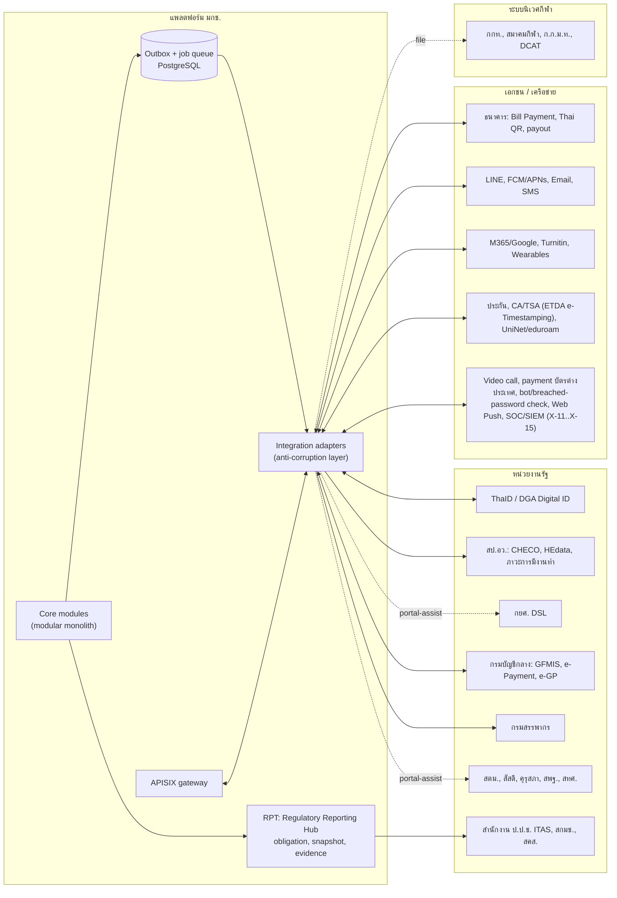
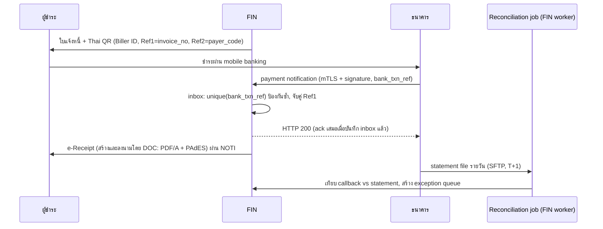
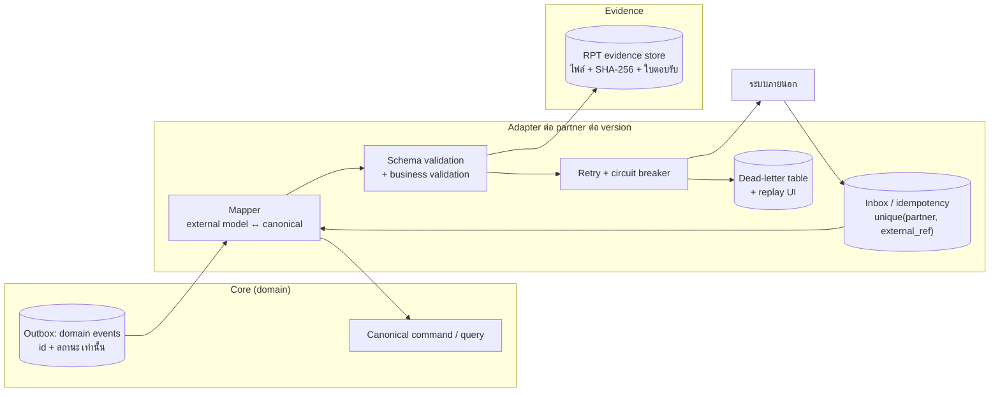

# 09 — Integrations: ระบบภายนอก รูปแบบการเชื่อมต่อ ปฏิทินรายงาน และการโอนข้อมูลข้ามประเทศ

> **สถานะ:** v1.1-draft · 28 ต.ค. 2569 (v1.0 → v1.1 ตาม [00-fix-decisions-v1.1](./00-fix-decisions-v1.1.md): D-02 เดือนสัมพัทธ์, D-03 ขอบเขต R1/R2, D-04 `hlt_vault`, D-06 wearable เหลือ CSV/มาตรฐานกลาง, D-07 Wave 2a/2b, D-09 cross-border X-11..X-16 + TSA) · ผู้เขียน: F · ภาษา: ไทย (ศัพท์เทคนิคเป็นภาษาอังกฤษ)
> **อ่านคู่กับ:** [00-blueprint](./00-blueprint.md) · [06-modules](./06-modules.md) (เจ้าของรายการ event และ module) · [07-architecture](./07-architecture.md) (gateway, outbox, OpenBao) · [08-data](./08-data.md) (identifiers, classification, retention) · [10-security-compliance](./10-security-compliance.md) (PDPA, ฐานทางกฎหมาย, DPIA) · [11-operations](./11-operations.md) (runbook, support) · [government-relations.md](./government-relations.md) (ภาคผนวก: บทบาทของหน่วยงาน, ภาระรายงาน และกฎหมาย)
>
> **ป้ายสถานะหลักฐาน**
> - ✅ = มีแหล่งอ้างอิง (ลิงก์อยู่ในตาราง) ส่วนใหญ่ยืนยันจาก **search snippet** เท่านั้น ไม่ได้อ่านเอกสารฉบับเต็ม เพราะเครือข่ายของ session บล็อกโดเมน .go.th/.or.th/.ac.th เกือบทั้งหมด
> - 🟡 = อนุมาน ความรู้ทั่วไป หรือสเปกที่ยังไม่ได้รับจากเจ้าของระบบ ต้องยืนยันใน P0 Discovery ก่อนใช้ใน TOR **[ต้องตรวจสอบ]**
>
> **หลักที่ใช้ทั้งเล่ม:** (1) ไม่มี schema ภายนอกรั่วเข้า domain ทุกระบบต้องผ่าน **anti-corruption adapter** (2) ระบบที่มีแต่เว็บพอร์ทัลใช้ **portal-assist** (ระบบเตรียมไฟล์และงานให้คน ห้ามทำ RPA/screen scraping ถ้าเจ้าของระบบไม่อนุญาตเป็นลายลักษณ์อักษร) (3) ทุก integration ต้องมี **ขั้นตอน manual fallback** ที่ซ้อมแล้ว (4) ทุกการส่งข้อมูลออกต้องมี **evidence** (ไฟล์, hash, ผู้ส่ง, เวลา, ใบตอบรับ) เก็บใน RPT (5) ทุกบริการต่างประเทศต้องอยู่ใน **cross-border transfer register** (หัวข้อ 7)

---

## สารบัญ

1. [ภาพรวมและการจัดกลุ่ม](#1-ภาพรวมและการจัดกลุ่ม)
2. [Integration catalogue (I-01..I-58)](#2-integration-catalogue)
3. [รายละเอียดเชิงออกแบบของ integration สำคัญ](#3-รายละเอียดเชิงออกแบบของ-integration-สำคัญ)
4. [Integration patterns](#4-integration-patterns)
5. [Manual fallback procedures](#5-manual-fallback-procedures)
6. [ปฏิทินการส่งรายงาน (สรุป)](#6-ปฏิทินการส่งรายงานต่อหน่วยงานกำกับ-สรุป)
7. [Cross-border data transfer register](#7-cross-border-data-transfer-register)
8. [ลำดับการส่งมอบตาม release](#8-ลำดับการส่งมอบตาม-release)
9. [คำถามที่ต้องยืนยัน](#9-คำถามที่ต้องยืนยันใน-p0-discovery)
10. [ผลการปิด review](#10-ผลการปิด-review) (v1.1: 10.6)
11. [สมมติฐาน/คำถามใหม่ของเล่มนี้ (ลงทะเบียนกลางแล้ว)](#สมมติฐานคำถามใหม่ของเล่มนี้-ลงทะเบียนกลางแล้ว)

---

## 1. ภาพรวมและการจัดกลุ่ม

**การจัดกลุ่ม interface (ใช้ในคอลัมน์ "Interface")**

| รหัส | ความหมาย | ตัวอย่าง |
|---|---|---|
| **API** | เชื่อมต่อแบบ machine-to-machine (REST/OIDC/SOAP/LTI) | ThaID, ธนาคาร, Moodle |
| **FILE** | แลกเปลี่ยนไฟล์ตาม template (SFTP, upload, e-mail ที่เข้ารหัส) | statement ธนาคาร, HEdata, ประกัน |
| **PORTAL** | เจ้าหน้าที่กรอกหรืออัปโหลดในเว็บของหน่วยงานภายนอก ระบบเตรียมข้อมูลให้ (portal-assist) | กยศ. DSL, CHECO, ITAS, TM30 |
| **MANUAL** | หนังสือราชการหรือเอกสาร ระบบสร้างเอกสารและติดตามสถานะ | สัสดี, ส่งหอจดหมายเหตุ |
| **REF** | ไม่เชื่อมระบบ เก็บเพียงข้อมูลอ้างอิง | DCAT/ADAMS |

---

## 2. Integration catalogue

> คอลัมน์ "Release" ใช้แผนในหัวข้อ 7 ของ blueprint (เดือนสัมพัทธ์ M1 = เม.ย. 2570 ตาม D-02): R1 = ก.ย. 2571 (M18), R2 = พ.ค. 2572 (M26), R3 = พ.ย. 2572 (M32), W1 = Wave 1 (มิ.ย. 2573 = M39, โรงเรียนกีฬานำร่อง พ.ค. 2573 = M38), W2 = Wave 2a มิ.ย. 2574 (M51) / Wave 2b พ.ย. 2574 (M56) ตาม D-07, X = สัญญาแยก; **ถ้าเริ่มสัญญาหลัง ต.ค. 2570 ทุก release เลื่อน 12 เดือนตามรอบรับสมัคร (เล่ม 12 §1.3)**
> ทิศทาง: **In** = เข้าระบบ มกช., **Out** = ออก, **In/Out** = สองทาง

### 2.1 ตัวตนและการรับเข้า

| # | ระบบ | หน่วยงานเจ้าของ | ทิศทาง | ข้อมูล | Interface | Auth | ความถี่ | โมดูล | Release | สถานะ + แหล่ง |
|---|---|---|---|---|---|---|---|---|---|---|
| I-01 | **ThaID** | กรมการปกครอง | In | `pid` (เลข 13 หลัก), ชื่อ TH/EN, วันเกิด, ที่อยู่, `ial` | API: OIDC Authorization Code + PKCE; discovery `imauth.bora.dopa.go.th/.well-known/openid-configuration`; introspect | client id/secret + API key; callback ลงทะเบียนผ่าน RP Admin | ต่อการยืนยันตัวตน (สมัคร, เปิดบัญชี, step-up, ศิษย์เก่าขอเอกสาร, เปลี่ยนบัญชีรับเงิน) | IAM | R1 | ✅ ตัวอย่าง RP ของ ETDA [Python](https://github.com/ETDA/ThaiD-Python-RP) · [PHP](https://github.com/ETDA/ThaiD-PHP-RP) · [C#](https://github.com/ETDA/ThaiD-CSharp-RP); 🟡 เงื่อนไข/ค่าธรรมเนียมการขึ้นทะเบียน RP |
| I-02 | DGA Digital ID (ทางเลือก) | สพร. (DGA) | In | ตัวตนผู้ใช้ภาครัฐ | API: OpenID (accounts.egov.go.th / connect.egov.go.th) | RP registration | ต่อ login | IAM | R2 (ทางเลือก) | ✅ [DGA Digital ID](https://www.dga.or.th/en/?p=119693) · [OpenID SSO manual](https://accounts.egov.go.th/Download/OpenID_SSO_AdminManual_1.0_17042019.pdf); 🟡 endpoint ปัจจุบัน |
| I-03 | **TCAS / myTCAS** (adapter ทางเลือก, feature flag ต่อวิทยาเขต/หลักสูตร) | ทปอ. | In/Out | ข้อมูลโครงการ, รายชื่อผู้ผ่าน, สถานะยืนยัน/สละสิทธิ์ | PORTAL + FILE (CSV/Excel) + API ตรวจสถานะด้วยเลข 13 หลัก (หลักฐาน TCAS63) | secret key ที่มหาวิทยาลัยสร้าง (ห้ามเปลี่ยนกลางรอบ) เก็บใน OpenBao | ตามรอบ TCAS + polling รายชั่วโมงช่วงยืนยันสิทธิ์ | ADM | R1 (ปิดไว้จนยืนยันการเข้าร่วม) | ✅ ระบบ [TCAS63 manual](https://www.admission.kmutnb.ac.th/sites/default/files/2020-02/TCAS63-University_Manual_V2_20-01.pdf) · ปฏิทิน TCAS70 [Trueplookpanya](https://www.trueplookpanya.com/tcas/article/detail/97424); 🟡 สเปก TCAS70/71 และ **การเข้าร่วมของ มกช.** (พบหลักฐานเพียงหน้าปี 2566 [tcas.in.th](https://tcas.in.th/department/%E0%B8%AA%E0%B8%B2%E0%B8%82%E0%B8%B2%E0%B8%9E%E0%B8%A5%E0%B8%A8%E0%B8%B6%E0%B8%81%E0%B8%A9%E0%B8%B2.1541/)) |
| I-04 | สทศ. (TGAT/TPAT/A-Level) | สทศ. ผ่าน ทปอ. | In | คะแนนสอบกลาง | FILE ผ่าน TCAS (ถ้าเข้าร่วม) | ตาม I-03 | รายปี | ADM | R1 (ทางเลือก) | 🟡 |
| I-05 | ทะเบียนราษฎร (linkage ตรวจสถานะบุคคล/ความสัมพันธ์ผู้ปกครอง) | กรมการปกครอง | In | สถานะบุคคล, บิดามารดา | API ผ่านศูนย์เชื่อมโยงข้อมูล (ต้องมี MOU) | ใบรับรองหน่วยงาน | ตามคำขอ | REC, PRIV | X (ทางเลือก) | 🟡 ต้องมี MOU และฐานทางกฎหมาย |

### 2.2 อุดมศึกษาและวิชาชีพ

| # | ระบบ | หน่วยงานเจ้าของ | ทิศทาง | ข้อมูล | Interface | Auth | ความถี่ | โมดูล | Release | สถานะ + แหล่ง |
|---|---|---|---|---|---|---|---|---|---|---|
| I-06 | **CHECO** (CHE Curriculum Online) | สป.อว. | Out | ข้อมูลหลักสูตรที่สภาอนุมัติ → รับ "รหัสหลักสูตร" กลับ | PORTAL (ระบบ export ข้อมูลที่จัดรูปแบบแล้ว + checklist) | บัญชีคณะ/มหาวิทยาลัย | ต่อหลักสูตร (ตัวอย่าง ม.อ. ภายใน 25 วันหลังสภาอนุมัติ) | CUR | R2 | ✅ [มหิดล](https://graduate.mahidol.ac.th/Assets-Center/ITA-MU/pdf/14/014-17.pdf) · [ม.อ. O10](https://ita.psu.ac.th/pdf/O10-Education.pdf); 🟡 URL/กำหนดเวลาปัจจุบัน |
| I-07 | **ฐานข้อมูลอุดมศึกษา (HEdata)** ตามกฎกระทรวงการเปิดเผยและการส่งข้อมูลการอุดมศึกษา พ.ศ. 2566 | สป.อว. | Out | นักศึกษา (เลข 13 หลัก), ผู้สำเร็จการศึกษา, หลักสูตร, บุคลากร | FILE ตาม template รายรอบ (snapshot ณ วันตัดยอด) | บัญชีหน่วยงาน | อย่างน้อยรายภาค; snapshot **10 มิ.ย.** และ **10 พ.ย.** 🟡 | RPT (เจ้าของ snapshot), REC, CUR | R2 | ✅ กฎกระทรวง 2566 [BU](https://eqs.bu.ac.th/announcement-ministerial-regulations/) · หมวด 3 ให้ส่งข้อมูลผู้เรียน/ผู้สำเร็จ [Thai Post](https://www.thaipost.net/news-update/621314/) · ตัวอย่างเอกสารปีการศึกษา 2566 ใช้ข้อมูล ณ 10 มิ.ย. ส่ง 1–31 ส.ค. [catalog.moe.go.th](https://catalog.moe.go.th/dataset/2b63e861-9900-40b4-a679-a6a8f9d965ff/resource/41ef9410-eb88-4a8f-93ec-427825e993ac/download/-.pdf); 🟡 ภาระผูกพันของ มกช. (ไม่สังกัด อว.), template และวันตัดยอดปัจจุบัน; มีร่างกฎกระทรวงฉบับปรับปรุงเข้า ครม. 15 ต.ค. 2567 [MOF](https://ofm.mof.go.th/index.php/view/attachment/file/3139373031/มติคณะรัฐมนตรีวันที่%2015%20ตุลาคม%202567.pdf) |
| I-08 | **ระบบภาวะการมีงานทำของบัณฑิต** | สป.อว. | Out | ผลสำรวจรายบุคคล (W-65) | FILE/PORTAL หรือ API ถ้ามี | บัญชีหน่วยงาน | ต่อรุ่น (ช่วงขอจบ/รับปริญญา) | ALU, RPT | R3 | ✅ มหาวิทยาลัยต้องเชื่อมกับระบบของ อว. [มข.](https://bucket.kku.ac.th/odt/cmmeig6x7288701pi3nvke9oc.pdf); 🟡 URL/รูปแบบไฟล์ |
| I-09 | **คุรุสภา** | สำนักงานเลขาธิการคุรุสภา | Out (และ In: ผลรับรองหลักสูตร) | รายชื่อผู้สำเร็จหลักสูตรครู, รหัสหลักสูตร, จำนวนรับ (เพดาน), ข้อมูลฝึกสอน | PORTAL/FILE | บัญชีสถาบัน | รายปี/ต่อรุ่น | PRA, GRD, ADM (เพดานรับ) | R3 | ✅ เกณฑ์ 1:3 / 1:10 [Matichon](https://www.matichon.co.th/education/news_4500728) · จำนวนรับไม่เกินที่อนุญาต [Bangkokbiznews](https://www.bangkokbiznews.com/news/news-update/1218935); 🟡 ช่องทางส่งข้อมูล |
| I-10 | ThaiLIS (ส่งวิทยานิพนธ์ฉบับเต็ม) | UniNet/สป.อว. | Out | metadata + PDF วิทยานิพนธ์ | FILE/PORTAL | บัญชีห้องสมุด | ต่อเล่ม | GRAD, X-LIB | R3 | 🟡 |
| I-11 | **Thai MOOC / คลังหน่วยกิตแห่งชาติ (NCBS)** | สป.อว./TCU | In (และ Out: รายวิชา) | certificate/ผลการเรียน เพื่อเทียบโอน | FILE (certificate) / API ถ้ามี | — | ตามคำร้องเทียบโอน | CUR, REC (credit bank) | X | ✅ NCBS นำร่อง [Prachachat](https://www.prachachat.net/education/news-1089494); 🟡 API/ช่องทาง |

### 2.3 การศึกษาขั้นพื้นฐาน (โรงเรียนกีฬา)

| # | ระบบ | หน่วยงานเจ้าของ | ทิศทาง | ข้อมูล | Interface | Auth | ความถี่ | โมดูล | Release | สถานะ + แหล่ง |
|---|---|---|---|---|---|---|---|---|---|---|
| I-12 | **สพฐ. DMC** / ข้อมูลนักเรียนรายบุคคล | สพฐ. (หรือหน่วยงานที่ต้นสังกัดกำหนด) | Out | นักเรียนรายบุคคล (เลข 13 หลัก/รหัส G), ชั้น, รอบนับนักเรียน | PORTAL/FILE | บัญชีโรงเรียน | รอบนับ 10 มิ.ย./10 พ.ย. 🟡 | SSC, RPT | W1 | 🟡 **ไม่ยืนยันว่าโรงเรียนกีฬาสังกัด มกช. ต้องส่ง DMC** (โรงเรียนกีฬาอยู่ในสังกัด มกช. ไม่ใช่ สพฐ. ✅ [TCI JRA](https://so06.tci-thaijo.org/index.php/jra/article/view/259531)); รหัส G ✅ [data.go.th](https://data.go.th/en/dataset/obec-student-030) |
| I-13 | **O-NET** | สทศ. | Out (รายชื่อผู้เข้าสอบ) / In (คะแนน) | รายชื่อ ม.3/ม.6, ผลคะแนน | PORTAL/FILE | บัญชีโรงเรียน | รายปี (ส่งรายชื่อราว ส.ค., สอบ ก.พ.–มี.ค.) | SSC | W1 | 🟡 **การเข้าร่วมของโรงเรียนกีฬาในปัจจุบันไม่ยืนยัน** (มีงานวิจัย O-NET นักเรียนโรงเรียนกีฬาปีการศึกษา 2554 [NU](https://nuir.lib.nu.ac.th/dspace/handle/123456789/1548), attribution ไม่แน่ชัด; O-NET เป็นแบบสมัครใจตั้งแต่ราวปี 2567 🟡) |
| I-14 | สมศ. (ประเมินคุณภาพภายนอก ขั้นพื้นฐาน รอบห้า / อุดมศึกษา) | สมศ. | Out | SAR, หลักฐาน | PORTAL + evidence package | บัญชีสถานศึกษา | ตามรอบประเมิน | ANA (QA evidence store), RPT | R3/W1 | ✅ รอบห้า 2567–2571 [TCI](https://so06.tci-thaijo.org/index.php/mcjou/article/download/267365/179089/1051136); 🟡 รูปแบบการส่ง |

### 2.4 การเงิน ภาษี พัสดุ

| # | ระบบ | หน่วยงานเจ้าของ | ทิศทาง | ข้อมูล | Interface | Auth | ความถี่ | โมดูล | Release | สถานะ + แหล่ง |
|---|---|---|---|---|---|---|---|---|---|---|
| I-15 | **Bank Cross-bank Bill Payment / Thai QR (tag 30)** | ธนาคารผู้ให้บริการ (ตามสัญญา) | Out (QR/barcode) / In (payment notification) | Biller ID 15 หลัก, Ref1 (เลขใบแจ้งหนี้), Ref2 (รหัสผู้ชำระ), จำนวนเงิน, `bank_txn_ref` | API: payment notification callback (HTTPS + mTLS + ลายเซ็น) | mTLS + HMAC/JWS ตามสัญญา; IP allow-list | real-time | FIN | R1 (ค่าสมัคร/ค่ายืนยันสิทธิ์) | ✅ โครงสร้าง [Krungsri](https://developers.krungsri.com/UseCases/Payment/Bill-Payment.html) · [Krungsri API](https://developers.krungsri.com/APIs/Payment/Bill-Payment-Initiation.html) · Biller ID/Ref (แหล่งบุคคลที่สาม) [thai-qr-payment.js](https://thai-qr-payment.js.org/guide/barcode/); 🟡 สเปกของธนาคารที่ มกช. ใช้ |
| I-16 | **Bank statement / reconciliation file** | ธนาคาร | In | รายการรับเงินรายวัน | FILE (SFTP, รายวัน) | SSH key + PGP | รายวัน (เช้า T+1) | FIN | R1 | 🟡 รูปแบบไฟล์ |
| I-17 | **Bank payout** (คืนเงิน W-09, จ่ายทุน, ค่าตอบแทน W-29, per diem) | ธนาคาร | Out | ผู้รับ, PromptPay/บัญชี, จำนวน, อ้างอิง | API หรือ FILE (bulk payment) | mTLS / ระบบ corporate banking + maker-checker | ต่อรอบจ่าย | FIN, SCH, ATH (travel) | R2 | 🟡 ต้องตรวจชื่อบัญชีตรงกับผู้มีสิทธิ์ (ดูหัวข้อ 3.3) |
| I-18 | **New GFMIS Thai** | กรมบัญชีกลาง | Out | รายการรับ/นำส่งเงิน, เบิกจ่าย, รหัสงบประมาณ | FILE ตาม template / web online | บัญชี GFMIS (token) | รายวัน/รายเดือน; ปิดปีงบ ก.ย.–ต.ค. | FIN (X-PLAN สำหรับงบประมาณ) | R2 | ✅ ระบบเริ่ม 4 เม.ย. 2565 [thaigov](https://media.thaigov.go.th/uploads/document/142/2022/10/doc/Doc_20221007104527000000.doc); 🟡 **มกช. ใช้ GFMIS กับเงินประเภทใด** (เงินงบประมาณ vs เงินรายได้) |
| I-19 | e-Payment ภาครัฐ / e-Receipt กรมบัญชีกลาง (ทางเลือก) | กรมบัญชีกลาง | In | การชำระ + e-Receipt + ลงบัญชีอัตโนมัติ | API/ระบบกลาง | ตามข้อตกลง | ต่อการชำระ | FIN | R2 (ทางเลือก) | ✅ บริการสำหรับส่วนราชการที่ไม่มี e-service ของตน [Thansettakij](https://www.thansettakij.com/business/economy/590663); 🟡 ใช้กับ มกช. ได้หรือไม่ |
| I-20 | **กรมสรรพากร: ภาษีหัก ณ ที่จ่าย** (ภ.ง.ด.1/1ก/3/53, หนังสือรับรอง 50 ทวิ) | กรมสรรพากร | Out | ผู้รับเงิน (เลขผู้เสียภาษี), เงินได้, ภาษีที่หัก | FILE (e-Filing upload) | บัญชี e-Filing ของหน่วยงาน | รายเดือน + รายปี (ภ.ง.ด.1ก ภายใน ก.พ.) | FIN (payout + WHT), X-PAY | R2 | 🟡 รูปแบบไฟล์และกำหนดเวลาต้องยืนยันกับงานคลัง |
| I-21 | กรมสรรพากร: **e-Tax Invoice & e-Receipt** (เฉพาะรายได้ที่ต้องเสีย VAT เช่น เช่าสนาม/ขายสินค้า ถ้ามี) และ **e-Donation** | กรมสรรพากร | Out | ใบกำกับ/ใบรับ XML, ข้อมูลผู้บริจาค | API/FILE ตามระบบสรรพากร | ใบรับรองดิจิทัล | ต่อเอกสาร | FIN, FAC, REV | R3/X | 🟡 ต้องยืนยันว่ารายได้ใดของ มกช. อยู่ในข่าย VAT; ใบเสร็จค่าธรรมเนียมการศึกษาทั่วไปออกตามระเบียบมหาวิทยาลัย/กรมบัญชีกลาง |
| I-22 | **e-GP** | กรมบัญชีกลาง | In (อ้างอิง) / Out (สถิติ OIT) | e-GP project ID, แบบ บก.01/บก.05, ผลจัดซื้อ | MANUAL/PORTAL (บันทึกเลขอ้างอิงใน X-PROC) | — | ต่อโครงการ + สรุปรายเดือน | X-PROC, RPT (OIT, สขร.1 🟡) | R1 (เก็บอ้างอิงขั้นต่ำสำหรับ OIT) | ✅ ใช้จริงในวิทยาเขต [tnsubkk](https://www.tnsubkk.ac.th/); 🟡 รูปแบบสถิติที่ OIT ต้องการ |
| I-23 | สำนักงบประมาณ (ระบบงบประมาณ) | สำนักงบประมาณ | Out | คำของบ, ผลการใช้จ่าย | PORTAL/FILE | บัญชีหน่วยงาน | รายไตรมาส/รายปี | X-PLAN, RPT | X | 🟡 |
| I-24 | กองทุนพัฒนาการกีฬาแห่งชาติ (ทุนนักกีฬา, รายงานผลโครงการ) | กกท. | Out (เกรดล่าสุด, รายงานผล) / In (ยอดทุน) | ผลการเรียน, สถานภาพ, output/outcome | FILE/MANUAL | — | รายภาค | SCH (`SponsorAccount`), ATH | R2 | ✅ ใช้เกรดล่าสุดเพื่อเบิกทุน [S58 ใน GR](./government-relations.md) (attribution ระหว่างข่าวไม่แน่ชัด) |

### 2.5 ทุนและสวัสดิการ

| # | ระบบ | หน่วยงานเจ้าของ | ทิศทาง | ข้อมูล | Interface | Auth | ความถี่ | โมดูล | Release | สถานะ + แหล่ง |
|---|---|---|---|---|---|---|---|---|---|---|
| I-25 | **กยศ. DSL (LOS)** | กองทุนเงินให้กู้ยืมเพื่อการศึกษา | In/Out | คุณสมบัติรายได้, **ค่าเล่าเรียนจริงรายคนรายภาค**, ยืนยันเบิก, ชั่วโมงจิตอาสา ≥ 36 ชม., ยอดโอนให้สถานศึกษา | PORTAL (บทบาท Super User/Admin/**Maker/Checker**) + FILE export จาก มกช. (ถ้า DSL รับ batch 🟡) + FILE import ยอดโอน | บัญชีตามบทบาทของ กยศ. (บุคคล ไม่ใช่ service account) | ตามวงรอบ (หัวข้อ 6) | SCH (เจ้าของ), FIN (ตัดหนี้/รอ กยศ.), AFF (ชั่วโมง) | R2 | ✅ DSL/LOS [กยศ.](https://www.studentloan.or.th/th/system/files/files/news/1._0.pdf) · บทบาท [Super User](https://www.studentloan.or.th/th/system/files/files/news/Super%20User%20v.1.64.pdf) · ต้องบันทึกค่าใช้จ่ายจริงก่อนผู้กู้ไปต่อได้ [FAQ](https://www.studentloan.or.th/th/system/files/files/news/FAQ%201-6-5-65.pdf) · จิตอาสา 36 ชม. [กยศ.](https://www.studentloan.or.th/th/highlight/1604025515); 🟡 batch upload |
| I-26 | **บริษัทประกันอุบัติเหตุ** (นักศึกษา, นักกีฬาแข่งขัน, ทัศนศึกษา) | ผู้รับประกันตามสัญญา | Out (รายชื่อผู้เอาประกัน, เคลม) / In (ผลเคลม) | รายชื่อ+วันเกิด+เลขบัตร (ขั้นต่ำ), เอกสารเคลม, ใบรับรองแพทย์ | FILE (SFTP/PGP) + PORTAL ของบริษัท | SSH key / บัญชีบริษัท | รายปี (ต้นปีการศึกษา), เพิ่ม-ลดรายเดือน, ต่อเคลม | HLT (insurance), FIN | R2 | ✅ แนวปฏิบัติมหาวิทยาลัยอื่น [CMU](https://web.sdd.oou.cmu.ac.th/service/accident) · [UTCC](https://www.utcc.ac.th/utcc-student-accident-insurance-claim-2026/); 🟡 ผู้รับประกันของ มกช.; ข้อมูลสุขภาพที่ส่งต้องเป็นข้อมูลเคลมเท่านั้น |
| I-27 | กสศ. / ทุนภายนอกอื่น | กสศ. ฯลฯ | In/Out | รายชื่อผู้รับทุน, ผลการเรียน | FILE/PORTAL | — | รายภาค | SCH | R2 | 🟡 |

### 2.6 ทหาร คนเข้าเมือง

| # | ระบบ | หน่วยงานเจ้าของ | ทิศทาง | ข้อมูล | Interface | Auth | ความถี่ | โมดูล | Release | สถานะ + แหล่ง |
|---|---|---|---|---|---|---|---|---|---|---|
| I-28 | **สัสดี / หน่วยสัสดี (ผ่อนผันการตรวจเลือกทหาร)** | กระทรวงกลาโหม (หน่วยสัสดี) | Out | บัญชีรายชื่อนักศึกษาชายที่ขอผ่อนผัน (สด.9, สด.35), การพ้นสภาพ/สำเร็จการศึกษา | MANUAL (หนังสือราชการผ่าน e-Saraban + ไฟล์บัญชีตามแบบ) | — | รายปี (ส่งบัญชีราว ต.ค.–ธ.ค.) + ต่อเหตุพ้นสภาพ | AFF (W-59), REC (event พ้นสภาพ), DOC | R2 | ✅ กฎกระทรวงผ่อนผัน 2549 / ช่วงยื่น [Chula](https://www.sa.chula.ac.th/wp-content/uploads/2016/07/ประกาศ-ผ่อนผันทหารปีการศึกษา-2568-ใหม่.pdf) · [มศว.](https://studentaffairs.op.swu.ac.th/Portals/25/งานสวัสดิการนิสิต/ผ่อนผันทหาร/69_ประกาศเรื่องการขอผ่อนผัน.pdf); 🟡 กรอบเวลาแจ้งเมื่อพ้นสภาพ |
| I-29 | นรด. / ศูนย์การฝึกนักศึกษาวิชาทหาร (รด.) | กรมการรักษาดินแดน | In/Out | รายชื่อ นศท., ผลการฝึก, วันฝึก (ชนตารางแข่ง/เรียน) | MANUAL/FILE | — | รายปี | AFF (`RotcEnrollment`), ATH, REG | R2 | 🟡 |
| I-30 | **สตม.: ตม.30 (แจ้งที่พักคนต่างด้าว)** | สำนักงานตรวจคนเข้าเมือง | Out | ผู้พัก (หนังสือเดินทาง, วีซ่า, วันเข้าพัก), ที่พัก (หอพัก มกช.) | PORTAL (ระบบแจ้งที่พักออนไลน์ของ สตม.) แบบ portal-assist: HOU check-in สร้าง task + ไฟล์ข้อมูล | บัญชีเจ้าบ้าน/ผู้จัดการหอ | **ภายใน 24 ชม.** หลังเข้าพัก (W-38) | HOU | R2 | ✅ ม.38 พ.ร.บ.คนเข้าเมือง 24 ชม. [legardy](https://legardy.com/free-qna/7454) · [Thai Post](https://www.thaipost.net/main/detail/45992); 🟡 API ของ สตม. |
| I-31 | **สตม.: ตม.47 (รายงานตัว 90 วัน)**, สถานภาพนักศึกษา Non-ED | สตม. | Out (หนังสือรับรองสถานภาพ) / แจ้งเตือนนักศึกษา | วันครบ 90 วัน, วีซ่าหมดอายุ, การพ้นสภาพ | MANUAL (นักศึกษารายงานเอง ระบบแจ้งเตือนช่วง −15/+7 วัน และออกหนังสือรับรอง) | — | ทุก 90 วัน + ต่อเหตุ | X-INTL (ขั้นต่ำอยู่ใน REC ตั้งแต่ R2) | R2 (ขั้นต่ำ) | ✅ 90 วัน / ช่วงรายงาน [มข.](https://iad.kku.ac.th/file/ir_form/90_days_and_48_hrs_report.pdf); 🟡 การรายงานสถานภาพ Non-ED ต่อ สตม. เมื่อพ้นสภาพ |

### 2.7 ความโปร่งใส ไซเบอร์ ข้อมูลส่วนบุคคล

| # | ระบบ | หน่วยงานเจ้าของ | ทิศทาง | ข้อมูล | Interface | Auth | ความถี่ | โมดูล | Release | สถานะ + แหล่ง |
|---|---|---|---|---|---|---|---|---|---|---|
| I-32 | **ITA: ITAS (OIT/IIT/EIT)** | สำนักงาน ป.ป.ช. | Out | คำตอบ OIT + URL หน้าเปิดเผยข้อมูล, รายชื่อผู้มีส่วนได้เสีย (EIT, ต้องมีฐาน PDPA) | PORTAL (ITAS) + หน้า OIT บนเว็บไซต์ (X-CMS ส่วน OIT) ที่ดึงข้อมูลจาก RPT | บัญชีผู้ดูแลของหน่วยงาน | รายปีงบ: **OIT 2 มี.ค.–30 มิ.ย.** (รอบ 2569), IIT ปิด 30 มิ.ย., EIT ถึง 30 ก.ย. | RPT, X-CMS, CASE (สถิติร้องเรียน) | R1 | ✅ [Mahidol LC timeline 2569](https://lc.mahidol.ac.th/documents/OIT/2026_Timeline.pdf) · [PSU Nursing](https://www.nur.psu.ac.th/nur/file_web/ita/ITA-5-calendar-2569.pdf) · [ป.ป.ช. OIT 2569](https://www.nacc.go.th/files/article/attachments/27716904748de661b64652480c799ab0699adc2.pdf); 🟡 ปฏิทินปีงบ 2570–2571 |
| I-33 | สกมช. / ThaiCERT (แจ้งเหตุภัยคุกคามไซเบอร์, ประเมินตนเองรายปี) | สกมช. | Out | รายงานเหตุ, ผลประเมิน | PORTAL/e-mail/โทรศัพท์ตามช่องทาง สกมช. | — | ต่อเหตุ + รายปี | ADMIN (incident), RPT (evidence) | R1 | ✅ ประกาศเรื่องการแจ้งเหตุ (RG 9 พ.ค. 2566) [MUIT](https://muit.mahidol.ac.th/downloads/act-policy/140D107S0000000003900.pdf) · ประมวลแนวทาง 2564 [MUIT](https://muit.mahidol.ac.th/downloads/act-policy/17176753.pdf); 🟡 กรอบเวลาเป็นชั่วโมง |
| I-34 | สคส. (PDPC) แจ้งเหตุละเมิดข้อมูลส่วนบุคคล | สคส. | Out | รายงานเหตุละเมิด | PORTAL/แบบฟอร์มของ สคส. | — | ต่อเหตุ (**ภายใน 72 ชม.**) | PRIV, CASE | R1 | ✅ [Multilaw](https://multilaw.com/Multilaw/Data_Protection_Laws_Guide/DataProtection_Guide_Thailand.aspx) |
| I-35 | **DGA: Government Data Catalog / data.go.th (open data)** | สพร. | Out | metadata ชุดข้อมูล, ชุดข้อมูลเปิดแบบ aggregate | API (CKAN) / PORTAL | API key | รายไตรมาส | ANA, RPT | R3 | ✅ ร่างมาตรฐาน [GD Catalog](https://standard.dga.or.th/wp-content/uploads/2023/07/Final_เอกสารนำเสนองานประชาพิจารณ์-GD-Catalog.pdf); 🟡 สถานะประกาศใช้ |
| I-36 | DGA: บริการแลกเปลี่ยนข้อมูลภาครัฐ (ตาม มสพร. ม 2/2566), แอป "ทางรัฐ" (แจ้งเตือน/บริการ) | สพร. | In/Out | ข้อมูลที่ได้รับอนุญาตตาม data exchange agreement | API ตามมาตรฐาน DGA | ใบรับรอง/คีย์ | ตามกรณี | IAM, NOTI | X (ทางเลือก) | ✅ มาตรฐานการเชื่อมโยง [standard.dga](https://standard.dga.or.th/wp-content/uploads/2023/06/มสพร10-4-2566.pdf); 🟡 API แจ้งเตือนผ่านทางรัฐ |

### 2.8 เอกสารและลายมือชื่ออิเล็กทรอนิกส์

| # | ระบบ | หน่วยงานเจ้าของ | ทิศทาง | ข้อมูล | Interface | Auth | ความถี่ | โมดูล | Release | สถานะ + แหล่ง |
|---|---|---|---|---|---|---|---|---|---|---|
| I-37 | **e-Saraban** (ระบบสารบรรณอิเล็กทรอนิกส์ของ มกช. และการรับส่งกับหน่วยงานภายนอก) | มกช. (ระบบเดิม/ระบบใหม่) + ระบบกลางของรัฐ (ถ้ามี) | In/Out | หนังสือราชการ, เลขทะเบียนรับ/ส่ง, ชั้นความลับ/ความเร็ว, prefix "ที่ ..." แบบ effective-dated ต่อ OrgUnit | API (ถ้าระบบเดิมมี) / e-mail-in / upload; ระบบกลางรับส่งหนังสือระหว่างหน่วยงาน 🟡 | SSO / service account | ต่อเอกสาร | DOC | R2 | ✅ ระเบียบสารบรรณ ฉบับที่ 4 2564 [Chula](https://www.arch.chula.ac.th/arch-cu/files/formcontentepost/ระเบียบงานสารบรรณ%20ฉบับที่%204%20พ.ศ.%202564.pdf); 🟡 ระบบ e-Saraban ปัจจุบันของแต่ละวิทยาเขตและมาตรฐานกลาง |
| I-38 | **Digital Transcript (ขมธอ. 25-2563)** + บริการตรวจสอบ ETDA | อว./DGA/ETDA/ก.พ.ร. | Out | XML ตาม ขมธอ. 25-2563 (UN/CEFACT + PESC) ฝังใน PDF/A-3 ลงลายมือชื่อ PAdES; ลงทะเบียนเพื่อให้ตรวจสอบได้ | FILE/API ตามช่องทางของโครงการ 🟡 | ใบรับรองนิติบุคคลจาก CA | ต่อการออกเอกสาร | GRD, DOC | R3 | ✅ 98 มหาวิทยาลัย ณ 31 ก.ค. 2567 [DGA](https://www.dga.or.th/en/our-services/digital-platform-services/dga-digital-transcript/) · มาตรฐาน [NU Journal](https://www.journal.nu.ac.th/NUJST/article/view/Vol-31-No-3-2023-113-128) · ตรวจผ่าน ETDA [KMUTT](https://regis.kmutt.ac.th/web/verify/); 🟡 ช่องทางส่ง/ลงทะเบียนปัจจุบัน |
| I-39 | **Public verification endpoint ของ มกช.** (W-67 นายจ้างตรวจสอบวุฒิ) | มกช. | Out (สาธารณะ) | doc id + hash → สถานะ (valid/revoked/expired) ไม่แสดงข้อมูลส่วนบุคคลเกินจำเป็น | API + หน้าเว็บ (QR บนเอกสาร) | ไม่มี (rate limit + CAPTCHA) | real-time | GRD, DOC | R2 (ใบรับรอง) / R3 (transcript) | ✅ แนวปฏิบัติ [RBRU](https://e-transcript.rbru.ac.th/) |
| I-40 | **CA / TSA** (ผู้ออกใบรับรองและประทับเวลา ภายใต้ Thailand NRCA) และ HSM — v1.1: **TSA หลัก = ETDA e-Timestamping (TEDA)**, TSA สำรอง = TSA เชิงพาณิชย์ที่ต่อสายถึง NRCA, trust anchor = NRCA ใน EU DSS; ใบรับรองหน่วยงานสำหรับ organisational e-seal (S2) + remote signing ของ CA สำหรับลายมือชื่อบุคคล (S3) | ETDA (TSA หลัก); ผู้ให้บริการ CA/TSA ที่ ETDA รับรอง | In | ใบรับรองนิติบุคคล/บุคคล, timestamp token, OCSP/CRL | API (RFC 3161 TSA 🟡 สำหรับ TEDA, OCSP); signing path: DOC → PKCS#11 → HSM (OpenBao ไม่อยู่ใน path) | ใบรับรอง/สัญญา | ต่อการลงนาม + job re-timestamp | DOC (signing service) | **R1** (e-Receipt ค่าสมัคร/ใบเสร็จ, D-03 DOC) / R2 (ครบ) | ✅ หลักการ T/LT/LTA [ETDA LTV](https://www.etda.or.th/getattachment/Useful-Resource/knowledge-sharing/articles/e-Standard/Long-Term-Digital-Signature/20241022_หลกการ-Long-term-digital-signature_V01-05.pdf.aspx?lang=th-TH) · บริการ [ETDA e-Timestamping](https://www.etda.or.th/en/Our-Service/Digital-Trusted-services-Infrastructure/TEDA/e-Timestamping.aspx); 🟡 RFC 3161/SLA ของ TEDA และ TSA สำรองที่เลือก (เล่ม 10 §7.4) |

### 2.9 การสื่อสาร และ productivity

| # | ระบบ | หน่วยงานเจ้าของ | ทิศทาง | ข้อมูล | Interface | Auth | ความถี่ | โมดูล | Release | สถานะ + แหล่ง |
|---|---|---|---|---|---|---|---|---|---|---|
| I-41 | **LINE Official Account (Messaging API) + LIFF** | LY Corporation | Out (ข้อความ) / In (ผูกบัญชีผ่าน LIFF) | LINE userId ↔ บัญชี มกช., **หัวข้อแจ้งเตือน + ลิงก์เท่านั้น** (ไม่ส่งเกรด/สุขภาพ/การเงิน/วินัยในเนื้อข้อความ) | API | channel access token (rotate) ใน OpenBao | real-time | NOTI (และ LIFF front-end) | R1 | 🟡 ที่ตั้งข้อมูล: แหล่งรองระบุ server หลักที่ญี่ปุ่น [RSF](https://resources.rsf.org/line-a-messaging-app-to-use-with-caution/); นโยบาย [LY Corp TH](https://www.lycorp.co.jp/th/company/privacypolicy/) ไม่ระบุประเทศใน snippet; ค่าบริการตามจำนวนข้อความ 🟡 |
| I-42 | **FCM / APNs** (push ของ PWA/แอป) | Google / Apple | Out | device token, หัวข้อ + ลิงก์ | API | service account key / APNs key | real-time | NOTI | R1 | 🟡 |
| I-43 | **E-mail (SMTP relay / transactional e-mail)** | ผู้ให้บริการที่จัดหา (แนะนำในประเทศ หรือ relay ของ M365/Google) | Out | อีเมล, หัวข้อ + ลิงก์ | SMTP (TLS) + DKIM/SPF/DMARC | credential ใน OpenBao | real-time | NOTI | R1 | 🟡 |
| I-44 | **SMS gateway** (OTP สำรอง, แจ้งเหตุฉุกเฉินผู้ปกครอง) | ผู้ให้บริการในประเทศ | Out | เบอร์โทร, ข้อความสั้น | API | API key | real-time | NOTI, IAM (OTP สำรอง; ไม่ใช่ MFA หลักของบุคลากร) | R1 | 🟡; **กัน SMS pumping (v1.1):** rate limit ต่อเบอร์/IP/prefix ประเทศ, ส่งเฉพาะเบอร์ไทยเป็นค่าเริ่มต้น, เพดานงบ + alert รายวัน (เล่ม 10 T-04) |
| I-45 | **Microsoft 365 / Google Workspace** (อีเมล/ปฏิทิน/ไดรฟ์ของนักศึกษาและบุคลากร) | Microsoft / Google | Out (provisioning) / In (สถานะบัญชี) | ชื่อ, อีเมล, OrgUnit, สถานะบัญชี | API: SCIM / Graph / Directory API; SSO ผ่าน Keycloak (SAML/OIDC) | OAuth2 client credentials | real-time + nightly | IAM | R1 | 🟡 ระบบที่แต่ละวิทยาเขตใช้อยู่; **โรงเรียนกีฬา (ผู้เยาว์) พิจารณาทางเลือกที่ host ในประเทศ** |
| I-46 | UniNet / **eduroam** | สำนักงาน UniNet (NRO) | In | RADIUS authentication | API: RADIUS (FreeRADIUS → Keycloak/LDAP) | RADIUS shared secret / RadSec | real-time | IAM | R2 | ✅ UniNet เป็น NRO ของ eduroam [UniNet](https://www.uni.net.th/wp-content/uploads/2023/05/nayobai-join-eduroam.pdf); 🟡 สถานะสมาชิกของ มกช. |

### 2.10 การเรียนการสอนและวิชาการ

| # | ระบบ | หน่วยงานเจ้าของ | ทิศทาง | ข้อมูล | Interface | Auth | ความถี่ | โมดูล | Release | สถานะ + แหล่ง |
|---|---|---|---|---|---|---|---|---|---|---|
| I-47 | **Moodle (LTI 1.3 Advantage + Web Services)** | มกช. (self-hosted) | In/Out | course/section, enrolment roster (NRPS), เกรด (AGS) กลับเข้า ASM เป็น draft | API: LTI 1.3 (OIDC launch, JWT), Moodle WS | JWKS / OAuth2 client credentials | real-time + reconcile nightly | LMS, REG, ASM | R3 | 🟡 LMS ปัจจุบันของแต่ละวิทยาเขต; มาตรฐาน LTI 1.3 เป็นมาตรฐานเปิด |
| I-48 | **Turnitin / อักขราวิสุทธิ์** (ตรวจการคัดลอก) | Turnitin LLC / ผู้พัฒนาไทย | Out | ไฟล์วิทยานิพนธ์/รายงาน, ชื่อผู้ส่ง (ขั้นต่ำ) | API/LTI | API key | ต่อการส่งเล่ม | GRAD, LMS | R3 | 🟡 ต้องเลือก **no-repository** ได้สำหรับงานที่มีข้อมูลส่วนบุคคลของผู้ร่วมวิจัย |
| I-49 | **Wearable / AMS imports** (Catapult, Polar, Garmin, force plate/lab devices) — v1.1 ตาม D-06: **ใน core เหลือเพียงนำเข้า CSV/รูปแบบมาตรฐานกลาง**; vendor-specific API adapter เลื่อนไปสัญญาแยก | ผู้ให้บริการ (vendor cloud) / อุปกรณ์ | In | training load, HR, GPS (ช่วงซ้อมเท่านั้น), ผลทดสอบ | FILE (CSV export จากซอฟต์แวร์อุปกรณ์ตาม template กลาง); API (OAuth2, บัญชีทีมของ มกช.) = สัญญาแยก | upload โดย `sci` | รายวัน/ต่อ session | ATH, HLT (เฉพาะข้อมูลสุขภาพที่จำแนกแล้ว เก็บใน `hlt_vault`) | R3 (CSV) / X (API) | ✅ Catapult มี API [Catapult](https://www.catapult.com/blog/ams-catapult-api-integration); 🟡 ประเทศที่เก็บข้อมูลของแต่ละ vendor; **ห้ามให้นักกีฬาผูกบัญชีส่วนตัวโดยไม่มี notice และ DPIA** |

### 2.11 ระบบนิเวศกีฬา

| # | ระบบ | หน่วยงานเจ้าของ | ทิศทาง | ข้อมูล | Interface | Auth | ความถี่ | โมดูล | Release | สถานะ + แหล่ง |
|---|---|---|---|---|---|---|---|---|---|---|
| I-50 | **กกท. / สมาคมกีฬาแห่งประเทศไทย** (ทะเบียนนักกีฬา, ตรวจหลักฐานผลงาน, ตัวแทนทีมชาติ) | กกท., สมาคมกีฬา | In/Out | หลักฐานผลงานกีฬา (ADM โควตานักกีฬา), หนังสือขอตัว, รายชื่อทีมชาติ | MANUAL/FILE (ยังไม่พบ API สาธารณะ) + `PartnerAgreement` (MOU/DSA) | — | ตามรายการแข่ง/รอบรับสมัคร | ADM (verification), ATH | R1 (ตรวจหลักฐาน) / R3 | ✅ MOU กับสมาคม [Khaosod](https://www.khaosod.co.th/sports/news_8114787); 🟡 ช่องทางตรวจหลักฐาน |
| I-51 | **กีฬามหาวิทยาลัยแห่งประเทศไทย (ก.ก.ม.ท./เจ้าภาพ)** และ **พลศึกษาเกมส์** (ภายใน มกช.) | ก.ก.ม.ท. / เจ้าภาพแต่ละปี; มกช. | Out | รายชื่อนักกีฬา + ใบรับรองสถานภาพ/ผลการเรียน (eligibility), delegation roster | FILE + PORTAL ของเจ้าภาพ / ภายใน: API | บัญชีเจ้าภาพ | รายปี (รอบคัดเลือก พ.ย., มหกรรม ม.ค.; พลศึกษาเกมส์ ก.ย.) | ATH (eligibility engine, roster), REC (หนังสือรับรอง), ATT/EXM (ลาแข่งแบบยกคณะ) | **R2** (v1.1 ตาม D-03: ATH eligibility + team travel ทันพลศึกษาเกมส์ ก.ย. 2572) | ✅ ระเบียบ 2559 [มทร.ล้านนา](https://webs.rmutl.ac.th/assets/upload/files/2024/03/20240321133409_80477.pdf) · ตุมปังเกมส์ 21–30 ม.ค. 2570 [WU](https://csp.wu.ac.th/?p=49343) · พลศึกษาเกมส์ครั้งที่ 49, 1–10 ก.ย. 2569 [TNSU MK](https://www.tnsumk.ac.th/web/index.php/component/content/article/19-news-campus/1128-49-17?Itemid=437); 🟡 เกณฑ์ eligibility ปัจจุบัน |
| I-52 | **DCAT / WADA ADAMS** | กกท./DCAT, WADA | REF | ไม่เก็บ whereabouts; เก็บเพียงหลักฐานการอบรม anti-doping และ flag (ถ้ามี TUE ต้องเก็บใน `hlt_vault`) | REF | — | — | ATH, HLT | R3 | ✅ DCAT ปฏิบัติตาม Code 2021 [Thansettakij](https://www.thansettakij.com/insights/507312) |

### 2.12 บริการสนับสนุนที่อาจอยู่ต่างประเทศ (v1.1 เพิ่มตาม D-09)

> บริการกลุ่มนี้ไม่ได้เป็น "หน่วยงาน" แต่ส่งข้อมูลส่วนบุคคลออกนอกระบบ จึงต้องอยู่ใน catalogue และทะเบียน cross-border (หัวข้อ 7, X-11..X-16) ค่าเริ่มต้นของทุกแถวคือ **เลือกทางเลือกในประเทศ/self-hosted ก่อน**

| # | ระบบ | หน่วยงานเจ้าของ | ทิศทาง | ข้อมูล | Interface | Auth | ความถี่ | โมดูล | Release | สถานะ + แหล่ง |
|---|---|---|---|---|---|---|---|---|---|---|
| I-53 | **Video conferencing** สำหรับสัมภาษณ์ออนไลน์ (ADM), identity proofing ของผู้ไม่มีเลข 13 หลัก (3.1), สอบป้องกันวิทยานิพนธ์ออนไลน์ (GRAD) | ผู้ให้บริการที่ มกช. มีสัญญา (M365 Teams / Google Meet / Zoom) หรือ self-hosted (Jitsi/BigBlueButton) | Out | ชื่อแสดง, อีเมล, ภาพ/เสียงระหว่างประชุม, ลิงก์นัด | MANUAL (ระบบสร้างนัด + ลิงก์ + บันทึกผล); API ของผู้ให้บริการถ้ามี | บัญชีหน่วยงาน | ต่อรอบสัมภาษณ์/ต่อนัด | ADM, IAM, GRAD | R1 | 🟡 ผู้ให้บริการที่แต่ละวิทยาเขตใช้; **ค่าเริ่มต้นห้ามบันทึกวิดีโอ** (ถ้าต้องบันทึกเพื่อหลักฐานการสัมภาษณ์ ให้แจ้งก่อนและเก็บในประเทศ) |
| I-54 | **Payment gateway บัตร/การโอนจากต่างประเทศ** (ผู้สมัครต่างชาติ, ค่าธรรมเนียมจากต่างประเทศ) | PSP/acquirer ที่ธนาคารผู้ให้บริการกำหนด | Out (redirect) / In (callback) | invoice no., จำนวนเงิน, อีเมล; **ข้อมูลบัตรไม่ผ่านระบบ มกช.** (hosted payment page + 3-D Secure) | API (hosted checkout + webhook ลงลายเซ็น) | API key + webhook secret ใน OpenBao | ต่อการชำระ | FIN | R1 (ค่าสมัครผู้สมัครต่างชาติ ถ้าเปิดรับ) / R2 | 🟡 ผู้ให้บริการ/ที่ตั้งข้อมูล; ใช้รูปแบบเดียวกับ 3.3 (callback + reconcile) |
| I-55 | **Bot challenge / CAPTCHA** | ค่าเริ่มต้น **self-hosted proof-of-work** (ไม่มีผู้ให้บริการภายนอก); ทางเลือก SaaS | Out (ถ้า SaaS) | IP, user agent, สัญญาณพฤติกรรมของ browser | JS widget + server verify | site/secret key | ต่อการ login/สมัคร/verification ที่เสี่ยง | IAM, ADM, GRD (I-39) | R1 | 🟡 (เล่ม 10 T-04; เล่ม 07 ไม่ใช้ CAPTCHA SaaS เป็นค่าเริ่มต้น) |
| I-56 | **Breached-password check** | ค่าเริ่มต้น: ชุดข้อมูล hash ที่ดาวน์โหลดมาเก็บในประเทศ; ทางเลือก: range API ภายนอก (k-anonymity) | Out (ถ้า API) | prefix 5 ตัวอักษรของ SHA-1 ของรหัสผ่าน (ไม่ส่งรหัสผ่าน/ชื่อผู้ใช้) | API / FILE (อัปเดตชุดข้อมูลรายไตรมาส) | — | ต่อการตั้ง/เปลี่ยนรหัสผ่าน | IAM (Keycloak) | R1 | 🟡 |
| I-57 | **Web Push services ของ browser** (สำหรับ PWA): Chrome → FCM, Firefox → Mozilla push service, Edge → Microsoft (WNS), Safari → Apple | Google / Mozilla / Microsoft / Apple | Out | push subscription endpoint, payload เข้ารหัส (VAPID + RFC 8291) ที่มีเพียงหัวข้อทั่วไป | Web Push protocol (RFC 8030) | VAPID key ใน OpenBao | real-time | NOTI | R1 | 🟡 ประเทศที่ประมวลผลขึ้นกับ browser ของผู้ใช้ — ไม่อยู่ในการควบคุมของ มกช. (แจ้งใน notice) |
| I-58 | **SOC / MSSP / SIEM ภายนอก** (ถ้า มกช. จ้าง) | ผู้ให้บริการ SOC | Out | security log, IP, user id, เหตุการณ์ (อาจมีข้อมูลส่วนบุคคล) | log forwarding (syslog/OTLP over TLS) | mTLS | ต่อเนื่อง | ADMIN, AUD | R1 (ถ้าจ้าง) | 🟡 **ค่าเริ่มต้น: SIEM/log pipeline อยู่ในประเทศ** (เล่ม 07); SOC ที่ใช้ SIEM บน cloud ต่างประเทศต้องลงทะเบียน X-15 ก่อนส่ง log |

**ระบบภายในที่เชื่อมด้วยรูปแบบเดียวกัน (ไม่นับเป็น I-xx ภายนอก):** HR (X-HR, nightly), payroll IF (X-PAY), พัสดุ (X-PROC), ห้องสมุด Koha (X-LIB, SIP2/REST), e-Meeting สภา (X-MEET: ระหว่างยังไม่มีให้บันทึกเลขที่/วันที่มติแบบ manual ใน W-06/W-08), CMS/OIT web (X-CMS), helpdesk (X-HELP), SIEM/log pipeline

---

## 3. รายละเอียดเชิงออกแบบของ integration สำคัญ

### 3.1 ThaID (I-01)

- ใช้ Authorization Code + PKCE ผ่าน Keycloak เป็น **identity brokering** (Keycloak เป็นผู้คุย OIDC กับ ThaID) แอปภายในไม่เชื่อม ThaID ตรง
- ขอ scope ขั้นต่ำต่อกรณี: สมัครเรียน = `openid pid name birthdate`; step-up = `openid pid` เท่านั้น ไม่ขอ `address` ถ้าไม่จำเป็น (data minimisation)
- `pid` เก็บแบบ encrypted column + blind index (HMAC) สำหรับค้นหา และ dedupe ผู้สมัครข้ามวิทยาเขต ไม่ใช้ `pid` เป็น primary key (ใช้ `person_id` ภายในตามเล่ม 08)
- กรณีไม่มีเลข 13 หลัก (ต่างชาติ, รหัส G) ใช้เส้นทางยืนยันตัวตนทางเลือก: ตรวจหนังสือเดินทาง/เอกสารโดยเจ้าหน้าที่ + video call (I-53, X-11) หรือมาแสดงตน (บันทึกเป็น `identity_proofing_method`)
- **การใช้เป็น step-up ที่บังคับ:** เปลี่ยนบัญชีรับเงิน, ขอ reset MFA ด้วยตนเอง, ศิษย์เก่าขอเอกสาร, ผู้ปกครองผูกสิทธิ์กับบุตร (ร่วมกับการตรวจเอกสารความสัมพันธ์)

### 3.2 TCAS adapter (I-03) — ทางเลือก

ข้อเท็จจริงจาก research v2: มกช. รับ ป.ตรี แยกรายวิทยาเขตด้วยรอบโควตา (ต.ค.–พ.ย.) และรอบทั่วไปหลายรอบ (ก.พ.–มิ.ย.) ไม่ได้ใช้ TCAS เป็นช่องทางหลัก ([v2/admissions §2](../../research_notes/ออกแบบระบบการศึกษา%20TNSU%20ระดับ%20production/v2/admissions.md)) ดังนั้น:

- ADM ใช้ **canonical model เดียว** (`AdmissionRound`, `Application`, `Offer`, `Acceptance`) ทั้งรอบของวิทยาเขตและ TCAS; adapter แปลง TCAS เป็น `ExternalChannel=TCAS` เท่านั้น
- เปิดด้วย feature flag ต่อ `OrgUnit × Program × Round`
- ถ้าเปิดใช้: (ก) นำเข้าไฟล์ผู้สมัคร/ผู้ยืนยันสิทธิ์ (ข) เรียก API สถานะรายคนช่วงยืนยัน/สละสิทธิ์ (ค) reconcile ทุกชั่วโมงในช่วงยืนยันสิทธิ์ และทุกวันนอกช่วง (ง) ผู้ที่ยืนยันสิทธิ์ที่อื่นผ่าน TCAS แล้ว จะถูก flag ในรอบของ มกช. ด้วย (ถ้าเงื่อนไขของ ทปอ. กำหนด 🟡)
- secret key ห้ามเปลี่ยนกลางรอบ (คู่มือ TCAS63) จึงกำหนด key rotation window เฉพาะช่วงนอกรอบ
- clearing ภายในข้ามวิทยาเขตเป็นงานของ ADM เอง ไม่ใช่ของ TCAS

### 3.3 การชำระเงิน (I-15..I-17)

- **ไม่เชื่อ callback อย่างเดียว:** สถานะ "ชำระแล้ว" ตั้งจาก callback แต่ปิดยอดบัญชีจาก statement; รายการที่มีใน statement แต่ไม่มี callback ให้ระบบสร้างรายการรับเงินอัตโนมัติพร้อม flag ตรวจ
- ชำระเกิน/ชำระซ้ำ/ชำระหลังใบแจ้งหนี้ถูกยกเลิก → เข้า exception queue ของ `finance` พร้อม SLA 2 วันทำการ และนำไปสู่ W-09 (คืนเงิน) หรือเครดิตยกไป
- **Payout (I-17):** ชื่อบัญชีปลายทางต้องตรงกับผู้มีสิทธิ์ (นักศึกษา หรือผู้ปกครองที่มีอำนาจกรณีผู้เยาว์) ตรวจผ่าน name-inquiry ของธนาคารถ้ามี 🟡; การเปลี่ยนบัญชีต้อง step-up ด้วย ThaID และมี cooling-off 24 ชม. ก่อนใช้จ่ายจริง; ไฟล์ bulk payment ต้องผ่าน maker-checker (คนละคน) และ hash ของไฟล์ที่อนุมัติต้องตรงกับไฟล์ที่ส่ง
- **บัตร/การโอนจากต่างประเทศ (I-54, v1.1):** ใช้ hosted payment page ของ PSP (ข้อมูลบัตรไม่ผ่านระบบ มกช.) + webhook ลงลายเซ็นเข้า inbox เดียวกัน และ reconcile กับรายงาน settlement ของ PSP; อยู่ในทะเบียน X-12
- ปีงบประมาณใหม่ (1 ต.ค.) เปลี่ยนชุดเลขใบเสร็จ; การยกเลิกใบเสร็จใช้ W-28 (ห้ามลบ ออกเลขใหม่ อ้างฉบับเดิม)

### 3.4 กยศ. DSL (I-25) — portal-assist เต็มรูปแบบ

| ขั้น | ระบบ มกช. ทำ | เจ้าหน้าที่ทำใน DSL | หลักฐานที่เก็บ |
|---|---|---|---|
| ตรวจคุณสมบัติ/ผู้กู้ต่อเนื่อง | รายงาน "ผู้กู้ต่อเนื่องชั่วโมงจิตอาสาไม่ครบ 36 ชม." และสถานภาพ/ผลการเรียน (จาก AFF, REC) | Maker ตรวจ, Checker อนุมัติ | snapshot รายชื่อ + เวลา |
| บันทึกค่าเล่าเรียนจริง | export ไฟล์ค่าเล่าเรียนรายคนรายภาค ตามโครงสร้าง FeeItem ที่ map กับประเภทค่าใช้จ่ายของ กยศ. | Maker กรอก/อัปโหลด (ถ้ามี batch 🟡), Checker ยืนยัน | ไฟล์ + hash + ผู้ทำ |
| ผู้กู้ยืนยันเบิก | NOTI เตือนนักศึกษาตามกำหนด (31 ต.ค. ภาค 1 / 28 ก.พ. ภาค 2 ✅ ปีการศึกษา 2569) | — | สถานะต่อคน (นำเข้าจากรายงาน DSL) |
| รับเงินโอน | import รายงานยอดโอนจาก กยศ./ธนาคาร → ตัดหนี้ใบแจ้งหนี้ (`SponsorAccount=กยศ.`) | — | reconciliation report |
| ส่วนต่าง | ใบแจ้งหนี้ส่วนที่ กยศ. ไม่ครอบคลุมออกให้นักศึกษา; ถ้า กยศ. โอนเกิน → คืน กยศ. ตามระเบียบ 🟡 | — | exception queue |

- สถานะ "รอ กยศ." (hold แบบ soft) ป้องกันการตัดสิทธิ์ลงทะเบียน/ค่าปรับชำระช้าในช่วงที่รอเงินโอน ซึ่งอาจยาวหลายเดือน
- บัญชี DSL เป็นของบุคคล ระบบห้ามเก็บรหัสผ่าน DSL และห้ามทำ RPA

### 3.5 HEdata และรายงาน อว. (I-07, I-08)

- RPT เป็นเจ้าของ **snapshot ณ วันตัดยอด** (`ReportingSnapshot(obligation_id, as_of_date, org_unit, data_hash)`) ที่สร้างอัตโนมัติ 00:00 ของวันตัดยอด (10 มิ.ย./10 พ.ย. 🟡 ค่าเป็น configuration ใน obligation registry)
- ไฟล์ส่งสร้างจาก snapshot เท่านั้น (ไม่ใช้ข้อมูล live) จึงส่งซ้ำได้ผลเหมือนเดิม และแก้ไขด้วย **correction snapshot** ที่อ้าง snapshot เดิม
- validation ก่อน export: เลข 13 หลัก/รหัส G ถูกรูปแบบ (check digit mod 11 สำหรับเลข 13 หลัก), รหัสหลักสูตรจาก CHECO มีครบ, จำนวนรวมต่อหลักสูตรตรงกับ dashboard
- มกช. ไม่สังกัด อว. การผูกพันตามกฎกระทรวง 2566 จึงเป็นสมมติฐาน (A-xx ในเล่ม 01) แต่ออกแบบให้ส่งได้ไม่ว่าคำตอบจะเป็นอย่างไร

### 3.6 NOTI: กติกาเนื้อหาข้อความผ่านช่องทางต่างประเทศ

| ระดับข้อมูล (เล่ม 08) | LINE/FCM/APNs/SMS | E-mail | In-app (PWA, ในประเทศ) |
|---|---|---|---|
| Public / Internal | ข้อความเต็มได้ | ได้ | ได้ |
| Confidential (เกรด, ยอดหนี้, สถานภาพ, วินัย) | **หัวข้อทั่วไป + ลิงก์** ("มีผลการเรียนใหม่") | หัวข้อ + ลิงก์ | เต็ม (หลัง login) |
| Sensitive (สุขภาพ, safeguarding, ความพิการ) | **ห้ามระบุประเภท** ("มีข้อความใหม่จาก มกช.") | ห้าม | เต็ม (หลัง login + purpose check) |
| ผู้เยาว์ | ส่งถึงผู้ปกครองตาม guardian model; ข้อความจากบุคลากรถึงผู้เยาว์แบบ 1:1 ต้อง cc ผู้ปกครองหรือครูหอ (two-adult rule ดูเล่ม 10 §4.2) | เหมือนกัน | เหมือนกัน |

> **ขอบเขตที่บังคับได้ (v1.1 ตาม D-08):** กติกาในตารางนี้บังคับได้เฉพาะช่องทางที่ระบบส่งเอง กลุ่ม LINE ที่โค้ช/อาจารย์ตั้งเองอยู่นอก LINE OA (I-41) ระบบมองไม่เห็นและไม่เก็บเนื้อหา ใช้นโยบายช่องทางสื่อสารและทะเบียนกลุ่มที่รับรองในเล่ม 10 §4.6 แทน; ช่องทางทีมในระบบ (team channel ใน PWA/LIFF) เป็นทางเลือกหลักที่ส่งผ่าน NOTI ตามกติกาเดียวกับตารางนี้

---

## 4. Integration patterns

### 4.1 โครงสร้าง adapter

### 4.2 ตาราง pattern

| Pattern | ใช้เมื่อ | การออกแบบ |
|---|---|---|
| **Anti-corruption adapter** | ทุกระบบภายนอก | แยก package ต่อ partner และต่อ version ของสเปก (`adapter.bank.ktb.v2`), แปลงเป็น canonical command; contract test กับ sandbox/ไฟล์ตัวอย่าง; ห้าม domain อ้างชื่อ field ภายนอก |
| **Transactional outbox + PostgreSQL job queue** | ทุก event ที่ทำให้ต้องส่งออก | เขียน event ใน transaction เดียวกับ state change; worker อ่าน queue (`SKIP LOCKED`) ส่งต่อ adapter; ไม่ใช้ Kafka/Debezium ในเฟสแรก (blueprint 9.2) ชื่อ event ใช้ตามรายการของเล่ม 06 |
| **API gateway (APISIX)** | partner ที่เรียกเข้า (ธนาคาร callback, verification endpoint) | mTLS กับ partner, IP allow-list, rate limit, ขนาด payload สูงสุด, OpenAPI 3.1, versioning `/api/v1`; WAF ตามเล่ม 07 |
| **File exchange** | GFMIS, HEdata, statement, ประกัน, สรรพากร | template versioned (`template_version` ใน obligation), ตรวจ schema ก่อนส่ง, manifest (จำนวนแถว, ยอดรวม, SHA-256), เข้ารหัส PGP เมื่อส่งนอก SFTP, ชื่อไฟล์ deterministic (`{agency}_{report}_{org}_{asof}_{seq}`), เก็บสำเนาทุกไฟล์ที่ส่ง |
| **Portal-assist** | กยศ. DSL, CHECO, คุรุสภา, ITAS, ตม.30, DMC/O-NET | ระบบสร้าง (1) ไฟล์/ข้อมูลพร้อมกรอก (2) task ในคิวเจ้าหน้าที่พร้อม checklist และกำหนดเวลา (3) ช่อง upload ใบตอบรับ/ภาพหน้าจอผลการส่ง (4) บันทึกสถานะกลับ; **ห้าม RPA/screen scraping** เว้นแต่เจ้าของระบบอนุญาตเป็นลายลักษณ์อักษร; ห้ามเก็บรหัสผ่านพอร์ทัลของบุคคล |
| **Idempotency** | callback ธนาคาร, สถานะ TCAS, LTI grade passback, import ไฟล์ซ้ำ | inbox table `unique(partner, external_ref)`; ไฟล์ import ใช้ `file_hash` ป้องกันนำเข้าซ้ำ; ขาออกส่ง `Idempotency-Key` เมื่อ partner รองรับ; ผลลัพธ์ซ้ำคืนผลเดิม |
| **Retry** | การเรียกขาออก | exponential backoff + jitter (1s, 5s, 30s, 2m, 10m, 1h; สูงสุด 24 ชม. หรือตามความสำคัญ), circuit breaker ต่อ partner, timeout ชัดเจน; หลังครบรอบ → DLQ + แจ้ง L2 |
| **Dead-letter + replay** | ทุก adapter | ตาราง DLQ พร้อม payload (เข้ารหัส), สาเหตุ, จำนวนครั้ง; หน้าจอ replay สำหรับ `itadmin` (การ replay ถูกบันทึกใน AUD) |
| **Reconciliation** | เงิน, กยศ., TCAS, LMS roster, ประกัน, HEdata | job ตามรอบ (ตาราง 4.3) เทียบสองฝั่ง → exception queue พร้อม owner และ SLA; สรุปรายเดือนส่งผู้ตรวจสอบภายใน (`auditor`) |
| **Secrets** | key/credential ของทุก partner | OpenBao (dynamic secret ถ้าทำได้), rotation ตามรอบ ยกเว้น TCAS ที่ห้ามเปลี่ยนกลางรอบ; ไม่มี secret ใน Git (secret scanning ใน CI) |
| **Data minimisation ขาออก** | ทุกการส่งออก โดยเฉพาะต่างประเทศ | adapter มี allow-list ของ field ต่อปลายทาง (ไม่ใช่ deny-list); ทดสอบด้วย contract test ว่าไม่มี field เกิน |
| **Evidence** | ทุกภาระรายงานใน RPT | เก็บไฟล์ที่ส่ง + hash + ผู้ส่ง + เวลา + ใบตอบรับ/เลขรับ แบบ WORM ตาม retention ของ obligation |
| **Effective-dated external codes** | รหัสหน่วยงาน (GFMIS, งบประมาณ, e-GP, MHESI, OBEC, คุรุสภา, prefix สารบรรณ) | `ExternalCode(org_unit, scheme, code, valid_from, valid_to)` (เล่ม 08) รองรับการแยกกระทรวง ทก. → กระทรวงการกีฬา โดยแก้ configuration ไม่แก้ code ("Ministry change runbook" เป็น acceptance test) |

### 4.3 รอบ reconciliation

| คู่เทียบ | รอบ | Owner (บทบาท) | SLA ปิด exception |
|---|---|---|---|
| Bank callback ↔ statement | รายวัน 07:00 | `finance` | 2 วันทำการ |
| ใบเสร็จ ↔ GFMIS (รายการนำส่ง) | รายเดือน + ปิดปีงบ | `finance` | ก่อนปิดงวด |
| ค่าเล่าเรียนที่บันทึกใน DSL ↔ ใบแจ้งหนี้ ↔ ยอดโอน กยศ. | รายสัปดาห์ในช่วงยืนยันเบิก, รายเดือนนอกช่วง | `loan` + `finance` | 5 วันทำการ |
| TCAS สถานะยืนยัน ↔ ADM | รายชั่วโมงในช่วงยืนยันสิทธิ์ | `admission` | ภายในวัน |
| Moodle roster ↔ REG enrolment | nightly + ทันทีหลัง add/drop | `registrar` (ผ่าน L1) | 1 วันทำการ |
| รายชื่อผู้เอาประกัน ↔ สถานภาพนักศึกษา | รายเดือน | `affairs` | ก่อนรอบเพิ่ม-ลดถัดไป |
| HEdata snapshot ↔ dashboard จำนวนนักศึกษา | ต่อ snapshot | `planner` | ก่อนส่ง |
| ผู้เข้าพักต่างชาติ (HOU) ↔ ตม.30 ที่แจ้งแล้ว | รายวัน | `dorm` | ภายใน 24 ชม. นับจากเข้าพัก |

---

## 5. Manual fallback procedures

ทุก integration มี fallback ที่ซ้อมอย่างน้อยปีละครั้ง (ก่อนช่วงพีคที่เกี่ยวข้อง) และ runbook อยู่ในเล่ม 11

| Integration | อาการ | Fallback | การกลับสู่ปกติ |
|---|---|---|---|
| ThaID (I-01) | IdP ล่ม/ช้า | สมัครต่อด้วยอีเมล+OTP ในสถานะ "ยังไม่ยืนยันตัวตน" แล้วยืนยันภายหลังก่อนรายงานตัว; step-up ที่เกี่ยวกับเงินเลื่อนไปจนกว่า ThaID กลับมา หรือมาแสดงตนที่ counter | job แจ้งผู้ใช้ให้ยืนยันตัวตนที่ค้าง |
| Bank callback (I-15) | callback ไม่มา | สถานะ "รอยืนยัน" + ผู้ชำระ upload slip ได้ (ไม่ใช่หลักฐานสุดท้าย); ปิดยอดจาก statement วันถัดไป; ขยายกำหนดชำระอัตโนมัติเมื่อมีเหตุ (configuration ของ ORG) | reconcile T+1 |
| Bank statement (I-16) | ไฟล์ไม่มา | ดาวน์โหลดจาก corporate banking แล้ว upload ด้วยมือ (ผ่าน validation เดียวกัน) | — |
| GFMIS (I-18) | ระบบกลางใช้ไม่ได้ช่วงปิดปีงบ | export ไฟล์ตาม template ไว้ล่วงหน้า + บันทึกด้วยมือในหน้าเว็บ GFMIS | reconcile รายเดือน |
| กยศ. DSL (I-25) | DSL ล่ม/ขยายกำหนด | ขยาย soft hold "รอ กยศ." ตามประกาศ กยศ.; แจ้งนักศึกษาผ่าน ENG | — |
| HEdata (I-07) | portal ไม่รับไฟล์ | ส่งไฟล์เดียวกันตามช่องทางที่ สป.อว. กำหนด (หนังสือ/อีเมล) พร้อม hash; หลักฐานใน RPT | — |
| ITAS (I-32) | ระบบช้าช่วงใกล้ปิด | กำหนดเป้าภายใน **15 มิ.ย.** (ก่อนปิด 30 มิ.ย.) และเตรียมคำตอบใน RPT ล่วงหน้า | — |
| ตม.30 (I-30) | ระบบ สตม. ใช้ไม่ได้ | แจ้งด้วยแบบกระดาษที่ ตม. ในพื้นที่ภายใน 24 ชม.; ระบบพิมพ์แบบฟอร์มที่กรอกข้อมูลแล้ว | บันทึกเลขรับย้อนหลัง |
| Digital Transcript/CA/TSA (I-38, I-40) | TSA หลัก (ETDA e-Timestamping) ล่ม | (1) สลับไป **TSA สำรอง** อัตโนมัติ (2) ถ้าล่มทั้งคู่: ใบเสร็จ/หนังสือรับรอง **ลงนาม B-B แล้วเข้าคิว timestamp** (ไม่ block การชำระเงิน) (3) transcript/ปริญญา (ถาวร) → **คิวรอลงนาม** และออกฉบับกระดาษลงนามจริงกรณีเร่งด่วน; CA/HSM ล่ม → คิวรอลงนามทุกประเภท | job ลงนาม/ประทับเวลาย้อน; alert ถ้าคิวค้าง > 4 ชม. (เล่ม 10 §7.4) |
| LINE/FCM (I-41, I-42) | ส่งไม่สำเร็จ | NOTI fallback chain: in-app → e-mail → SMS (เฉพาะเรื่องเร่งด่วน/ฉุกเฉิน) | — |
| Moodle (I-47) | LTI launch ล้มเหลว | ใช้ Moodle login ตรง (Keycloak SSO) ; เกรดกรอกใน ASM โดยตรง | reconcile roster |
| e-Saraban (I-37) | adapter ใช้ไม่ได้ | ออกเลขหนังสือจากทะเบียนสำรอง (ช่วงเลขที่จองไว้ต่อ OrgUnit) แล้วบันทึกย้อน | ตรวจเลขซ้ำ/ข้าม |
| ทุก FILE | template เปลี่ยนกะทันหัน | ปรับ mapper เป็น version ใหม่ผ่าน change ปกติ; ระหว่างนั้น export ข้อมูลดิบ (CSV ตาม data dictionary) ให้เจ้าหน้าที่จัดรูปแบบเอง | — |

---

## 6. ปฏิทินการส่งรายงานต่อหน่วยงานกำกับ (สรุป)

> รายละเอียดบทบาทหน่วยงานและกฎหมายอยู่ใน [government-relations.md §5](./government-relations.md#5-ปฏิทินการรายงานต่อหน่วยงานกำกับ-ร่าง) (ภาคผนวก ซึ่ง v1.0 แก้ข้อผิดพลาดไว้ในหัวข้อ "v1.0 alignment" ท้ายเอกสารนั้น) ปฏิทินงานทั้งปีของมหาวิทยาลัยอยู่ใน [03-academic-calendar](./03-academic-calendar.md) ทุกบรรทัดด้านล่างเป็น `RegulatoryObligation` ใน RPT ที่มี due rule, owner, campus scope และแจ้งเตือน T-30/T-7/T-1
> แหล่งของวันที่ ✅: [v2/academic_calendar_operations §3, §6, §7](../../research_notes/ออกแบบระบบการศึกษา%20TNSU%20ระดับ%20production/v2/academic_calendar_operations.md)

| เดือน | ภาระ (หน่วยงาน) | I-xx | สถานะ |
|---|---|---|---|
| ต.ค. | ขึ้นปีงบใหม่ 1 ต.ค. (เลขใบเสร็จชุดใหม่); **กยศ. ทำสัญญา + ยืนยันเบิกภาค 1 ภายใน 31 ต.ค.**; ส่งบัญชีผ่อนผันทหาร (ต.ค.–ธ.ค.); เริ่มรอบโควตารับสมัคร | I-18, I-25, I-28 | ✅ กยศ. (ปี 2569) / 🟡 ส่วนอื่น |
| พ.ย. | **snapshot 10 พ.ย.** (HEdata ภาค 2, รอบนับนักเรียน) 🟡; กยศ. ยืนยันเบิกภาค 2 เริ่ม 1 พ.ย.; กีฬามหาวิทยาลัยรอบคัดเลือก (ส่งรายชื่อ/สถานภาพ) | I-07, I-12, I-25, I-51 | ✅ กยศ./กีฬา; 🟡 snapshot |
| ธ.ค. | ส่งบัญชีผ่อนผันทหารให้สัสดี (ปิดรอบ) | I-28 | 🟡 |
| ม.ค. | กีฬามหาวิทยาลัยรอบมหกรรม (ปี 2570: 21–30 ม.ค.) | I-51 | ✅ |
| ก.พ. | **ปิดยืนยันเบิก กยศ. ภาค 2 วันที่ 28 ก.พ.**; ภ.ง.ด.1ก และ 50 ทวิ ประจำปี; O-NET (ถ้าโรงเรียนกีฬาเข้าร่วม) | I-25, I-20, I-13 | ✅ กยศ.; 🟡 ภาษี/O-NET |
| มี.ค. | **ITA: OIT/EIT เปิด 2 มี.ค.** | I-32 | ✅ (รอบ 2569) |
| เม.ย. | ตรวจเลือกทหาร 1–12 เม.ย. (แจ้งเตือนนักศึกษา) | I-28 | ✅ |
| พ.ค. | กยศ. Pre-Approve (ม.ปลาย 16 พ.ค.–13 มิ.ย.; อุดมศึกษา 1 มิ.ย.–13 ก.ค. ปี 2569); ผู้กู้เก่ายืนยัน 16 พ.ค.–31 ส.ค.; โรงเรียนกีฬาเปิดภาค 1 (~16 พ.ค.) | I-25 | ✅ |
| มิ.ย. | **snapshot 10 มิ.ย.** 🟡; **OIT ตอบ/อนุมัติข้อมูลถึง 30 มิ.ย. และ IIT ปิด 30 มิ.ย. 17.00 น.**; ภาวะการมีงานทำ (ช่วงรับปริญญา) | I-07, I-12, I-32, I-08 | ✅ ITA; 🟡 snapshot |
| ก.ค. | ยื่นกู้ DSL 1 ก.ค.–25 ก.ย.; ส่งรายชื่อผู้เอาประกันปีการศึกษาใหม่ | I-25, I-26 | ✅ กยศ.; 🟡 ประกัน |
| ส.ค. | ส่งข้อมูลหลักสูตร/ผลการเรียน (ตัวอย่างปี 2566: 1–31 ส.ค. ใช้ข้อมูล ณ 10 มิ.ย.); สทศ. รับข้อมูลนักเรียน O-NET | I-07, I-13 | ✅ (เอกสารเก่า) / 🟡 |
| ก.ย. | **EIT ปิด 30 ก.ย.**; ปิด DSL 25 ก.ย.; ปิดปีงบ (GFMIS, งบการเงิน) | I-32, I-25, I-18 | ✅ ITA/กยศ.; 🟡 ปิดปีงบ |
| ต่อเหตุ | **PDPC ภายใน 72 ชม.**; สกมช. (กรอบเวลาตามประกาศ 🟡); **ตม.30 ภายใน 24 ชม.**; CHECO หลังสภาอนุมัติหลักสูตร (ตัวอย่าง 25 วัน); สัสดีเมื่อพ้นสภาพ 🟡 | I-34, I-33, I-30, I-06, I-28 | ✅ / 🟡 |
| ทุก 90 วัน | แจ้งเตือนนักศึกษาต่างชาติรายงานตัว (ตม.47) | I-31 | ✅ |
| ตามรอบรุ่น | รายชื่อผู้สำเร็จหลักสูตรครูให้คุรุสภา; ภาวะการมีงานทำ; ThaiLIS | I-09, I-08, I-10 | 🟡 |

---

## 7. Cross-border data transfer register

> ฐาน: PDPA ม.28–29 และประกาศ สคส. เรื่องการส่ง/โอนข้อมูลไปต่างประเทศ (ประกาศ ธ.ค. 2566 มีผล มี.ค. 2567 ✅ [HSF Kramer](https://www.hsfkramer.com/notes/data/2025-posts/pdpa-fines-and-firsts-a-6-year-timeline-of-thailands-data-privacy-enforcement)) เลขมาตราและเงื่อนไขละเอียด 🟡 ให้นิติกร/DPO ยืนยัน
> **นโยบาย v1.0 (แทนถ้อยคำ v0.9 "ห้าม SaaS ต่างประเทศสำหรับ PII" ที่ขัดกับการออกแบบเอง):** ใช้บริการต่างประเทศได้เฉพาะเมื่อ (1) อยู่ในทะเบียนนี้ (2) มี DPA/ข้อสัญญามาตรฐานที่เข้ากับประกาศ สคส. (3) มี Transfer Impact Assessment (TIA) ที่ DPO อนุมัติ (4) ระบุประเทศปลายทางใน privacy notice (5) ส่งข้อมูลตาม allow-list ขั้นต่ำ ข้อมูล Sensitive และข้อมูลผู้เยาว์ระดับ Confidential ขึ้นไป **ห้าม** ส่งผ่านบริการในทะเบียนนี้ ยกเว้นแถวที่ระบุไว้ชัดและผ่าน DPIA
> ระบบหลัก (ฐานข้อมูล, backup, log, object storage, analytics) **อยู่ในประเทศไทย** (เล่ม 07)

| # | บริการ | ข้อมูลที่ส่ง | ประเทศปลายทาง | ฐานทางกฎหมาย (การประมวลผล / การโอน) | DPA / มาตรการ | การลดข้อมูล (minimisation) | สถานะ |
|---|---|---|---|---|---|---|---|
| X-01 | LINE OA / LIFF (I-41) | LINE userId, ชื่อแสดง (จาก LINE), เนื้อหาข้อความแจ้งเตือน | ญี่ปุ่น (และอาจมีประเทศอื่นตามนโยบาย LY) 🟡 | ประมวลผล: consent ในการผูกบัญชี (เลือกได้ มีช่องทางอื่นแทน); โอน: consent ที่แจ้งประเทศปลายทาง หรือมาตรการคุ้มครองตามประกาศ 🟡 | ข้อตกลงผู้ใช้ LINE OA (ต่อรอง DPA เฉพาะได้ยาก 🟡) → TIA | หัวข้อ + ลิงก์ (หัวข้อ 3.6); ไม่ส่งเลข 13 หลัก/เกรด/สุขภาพ; ผู้เยาว์ส่งผ่านบัญชีผู้ปกครองเป็นหลัก | 🟡 |
| X-02 | FCM (Google) / APNs (Apple) (I-42) | device token, payload แจ้งเตือน | สหรัฐฯ (และศูนย์ข้อมูลทั่วโลก) 🟡 | ประมวลผล: public task (แจ้งข่าวราชการ) / contract; โอน: มาตรการตามประกาศ | ข้อตกลงผู้พัฒนา + DPA ของผู้ให้บริการ | payload ไม่มีข้อมูลส่วนบุคคลนอกจากหัวข้อทั่วไป; เนื้อหาเต็มดึงหลัง login | 🟡 |
| X-03 | Microsoft 365 / Google Workspace (I-45) | ชื่อ, อีเมล, OrgUnit, เนื้อหาอีเมล/ไฟล์ที่ผู้ใช้สร้าง | ตาม data region ที่เลือก (อาจเป็นเอเชียแปซิฟิก/สหรัฐฯ) 🟡 | ประมวลผล: public task (การจัดการศึกษา); โอน: SCC/มาตรการตามประกาศ หรือ region ในประเทศถ้ามี | DPA ของผู้ให้บริการ (education agreement) | provisioning ส่งเฉพาะ field ที่จำเป็น; ห้ามใช้ไดรฟ์ส่วนตัวเก็บเอกสาร Sensitive ของระบบ; **โรงเรียนกีฬา: ทางเลือกในประเทศ** | 🟡 |
| X-04 | Turnitin (I-48) | ไฟล์งาน, ชื่อผู้ส่ง, อีเมล | สหรัฐฯ/EU 🟡 | public task (ตรวจความซื่อสัตย์ทางวิชาการ); โอน: SCC/มาตรการ | DPA + ตัวเลือก no-repository | ใช้รหัสแทนชื่อถ้าทำได้; ตัดภาคผนวกที่มีข้อมูลผู้ร่วมวิจัยออก | 🟡 |
| X-05 | Wearable vendor clouds (Catapult, Polar, Garmin) (I-49) | ข้อมูลการฝึก, HR, GPS ช่วงซ้อม (อาจเป็นข้อมูลสุขภาพ ม.26) | ออสเตรเลีย/ฟินแลนด์/สหรัฐฯ ฯลฯ ตาม vendor 🟡 | ประมวลผล: **explicit consent** สำหรับข้อมูลอ่อนไหว (หรือ ม.26 ข้อยกเว้นที่นิติกรรับรอง) ; โอน: consent ที่แจ้งประเทศ + มาตรการ | DPA บังคับ + **DPIA บังคับ** (เล่ม 10) | ใช้บัญชีทีมของ มกช. (ไม่ใช่บัญชีส่วนตัว); pseudonymous athlete code ใน vendor; ไม่ส่งข้อมูลระบุตัวตนอื่น; ผู้เยาว์ต้องผ่าน dual consent | 🟡 |
| X-06 | CDN / WAF / DDoS provider | IP, header, cookie, URL | ตาม POP ทั่วโลก 🟡 | legitimate interest/public task (ความปลอดภัย) | DPA ของผู้ให้บริการ | ไม่ cache หน้าที่มีข้อมูลส่วนบุคคล; log ที่ provider ตั้ง retention สั้น | 🟡 |
| X-07 | Virtual waiting room (ถ้าใช้ SaaS แทน Valkey ภายใน) | token, IP | ตามผู้ให้บริการ | public task | DPA | ค่าเริ่มต้นคือ **ทำเองบน Valkey ในประเทศ** (blueprint 9.4) จึงไม่โอน | ไม่ใช้ (ค่าเริ่มต้น) |
| X-08 | E-mail relay / SMS gateway (I-43, I-44) | อีเมล/เบอร์โทร, ข้อความ | เลือกผู้ให้บริการในประเทศเป็นค่าเริ่มต้น; ถ้าต่างประเทศต้องลงทะเบียน | public task | DPA | หัวข้อ + ลิงก์ | 🟡 |
| X-09 | ผู้ให้บริการ AI/LLM (เลื่อนไปสัญญาแยก) | — | — | ต้องตัดสินใจก่อนใช้ (blueprint 9.12) | — | ห้ามส่งข้อมูลส่วนบุคคลโดยไม่ผ่าน DPIA; โปรไฟล์โรงเรียนกีฬา (ผู้เยาว์) ไม่ใช้ใน ML จนกว่าแนวปฏิบัติข้อมูลเด็กยุค AI ของ สคส. จะออก | ไม่อยู่ในขอบเขต R1–W2 |
| X-10 | Developer tooling ของผู้รับจ้าง (repo hosting, CI, error tracking) | ห้ามมีข้อมูลจริง | — | — | สัญญาจ้าง | non-prod ใช้ข้อมูลสังเคราะห์/tokenised เท่านั้น; error tracking ต้อง scrub PII | บังคับในสัญญา |
| X-11 | **Video conferencing** (I-53) — สัมภาษณ์ออนไลน์, identity proofing, สอบวิทยานิพนธ์ (v1.1) | ชื่อแสดง, อีเมล, ภาพ/เสียงสด, metadata การประชุม; identity proofing: ภาพบัตร/หนังสือเดินทางที่แสดงต่อกล้อง | ตามผู้ให้บริการ (สหรัฐฯ/ภูมิภาคที่เลือก) 🟡; self-hosted = ไม่โอน | ประมวลผล: PT (การคัดเลือก/การยืนยันตัวตน); โอน: มาตรการตามประกาศ/SCC ของผู้ให้บริการ 🟡 | DPA ของผู้ให้บริการ (มักรวมใน education agreement ของ X-03) | ไม่บันทึกวิดีโอเป็นค่าเริ่มต้น; ไม่ส่งเลขบัตรในแชต; ผู้สมัครผู้เยาว์ให้ผู้ปกครองอยู่ร่วมได้ | 🟡 |
| X-12 | **Payment gateway บัตร/การโอนต่างประเทศ** (I-54) (v1.1) | invoice no., จำนวนเงิน, อีเมล, ประเทศของบัตร; ข้อมูลบัตรอยู่ที่ PSP (PCI DSS) | ตาม PSP/เครือข่ายบัตร 🟡 | ประมวลผล: CT (การชำระค่าธรรมเนียม); โอน: จำเป็นเพื่อปฏิบัติตามสัญญาตามคำขอของเจ้าของข้อมูล 🟡 | สัญญา PSP + PCI DSS attestation | hosted page; ไม่ส่งข้อมูลการศึกษา/เลข 13 หลัก | 🟡 |
| X-13 | **Bot challenge/CAPTCHA SaaS และ breached-password API** (I-55, I-56) (v1.1) | IP, user agent, สัญญาณ browser; hash prefix 5 ตัวอักษร | ตามผู้ให้บริการ 🟡 | PT/LI (ความมั่นคงปลอดภัย) | DPA/ToS ของผู้ให้บริการ | **ค่าเริ่มต้นไม่ใช้** (self-hosted PoW + ชุดข้อมูล hash ในประเทศ); ถ้าใช้ API ส่งเพียง k-anonymity prefix | ไม่ใช้ (ค่าเริ่มต้น) |
| X-14 | **Web Push services ของ browser** (I-57): Mozilla, Microsoft (WNS), Apple, Google (v1.1; แยกจาก X-02 ที่เป็น FCM/APNs ของแอป) | push endpoint, payload เข้ารหัส end-to-end (RFC 8291) ที่มีเพียงหัวข้อทั่วไป | ตามผู้ให้บริการ browser 🟡 | ประมวลผล: C (ผู้ใช้เปิด push เอง, L-26); โอน: consent ที่แจ้งประเทศ/มาตรการ 🟡 | ToS ของผู้ให้บริการ browser (ต่อรองไม่ได้) → TIA | payload เข้ารหัสและมีเพียง "มีข้อความใหม่จาก มกช."; เนื้อหาเต็มดึงหลัง login (3.6) | 🟡 |
| X-15 | **SOC/MSSP/SIEM บน cloud ต่างประเทศ** (I-58) — เฉพาะถ้า มกช. จ้าง (v1.1) | security log (IP, user id, การกระทำ) | ตามผู้ให้บริการ 🟡 | PT/LI (ความมั่นคงปลอดภัย) + LO (ข้อมูลจราจรฯ) | DPA + ข้อกำหนดแจ้งเหตุ ≤ 24 ชม. + สิทธิ audit | pseudonymise user id ก่อนส่ง ถ้าทำได้; ไม่ส่ง log ของ `hlt_vault`/SAFE ที่มีเนื้อหา; **ค่าเริ่มต้น SIEM อยู่ในประเทศ** | ไม่ใช้ (ค่าเริ่มต้น) |
| X-16 | **ผู้รับ credential/การตรวจสอบวุฒิในต่างประเทศ** (WES, มหาวิทยาลัย/นายจ้างต่างประเทศ ผ่าน I-38/I-39) (v1.1) | transcript/ปริญญาที่ลงนาม, ผลการตรวจสอบ | ตามผู้รับ | ตาม **คำขอของเจ้าของข้อมูล** (CT/C) | — (เจ้าของข้อมูลเป็นผู้สั่งส่ง) | ส่งเฉพาะเอกสารที่ขอ; verification endpoint แสดงเพียงสถานะ | 🟡 |

**การดูแลทะเบียน:** owner = `dpo`; (v1.1) ทุกแถวที่ค่าเริ่มต้นเป็น "ไม่ใช้" (X-07, X-13, X-15) ถ้าจะเปิดใช้ต้องผ่าน change request + TIA ก่อน; ทบทวนทุก 12 เดือนหรือเมื่อผู้ให้บริการเปลี่ยนเงื่อนไข/ประเทศ; การเพิ่มแถวต้องผ่าน change request ที่แนบ TIA; ทะเบียนนี้ส่งออกเป็นส่วนหนึ่งของ ROPA (เล่ม 10 §2.5)

---

## 8. ลำดับการส่งมอบตาม release

| Release | Integrations |
|---|---|
| R1 ก.ย. 2571 (M18) | I-01 ThaID, I-03 TCAS (ปิด flag), I-15/I-16 ธนาคาร (ค่าสมัคร/ค่ายืนยันสิทธิ์), I-22 e-GP ref (OIT), I-32 ITAS/OIT (RPT ส่วน OIT ตาม D-03), I-33/I-34 แจ้งเหตุ, **I-40 CA/TSA (e-Receipt/บัตรประจำตัวผู้สอบ, DOC ตาม D-03)**, I-41..I-45 การสื่อสาร/M365-Google, I-50 ตรวจหลักฐานผลงานกีฬา, **I-53 video call, I-54 บัตรต่างประเทศ (ถ้าเปิดรับผู้สมัครต่างชาติ), I-55/I-56 bot/breached-password (self-hosted), I-57 Web Push, I-58 SOC (ถ้าจ้าง)** |
| R2 พ.ค. 2572 (M26) | I-02 (ทางเลือก), I-06 CHECO, I-07 HEdata, I-17 payout (รวม per diem team travel ตาม D-03), I-18 GFMIS, I-19 (ทางเลือก), I-20 WHT, I-24 กองทุนกีฬา, I-25 กยศ., I-26 ประกัน, I-27 ทุนภายนอก, I-28/I-29 ทหาร, I-30/I-31 สตม., I-37 e-Saraban, I-39 verification (ใบรับรอง), I-40 CA/TSA (ครบ), I-46 eduroam, **I-51 กีฬามหาวิทยาลัย/พลศึกษาเกมส์ (ย้ายจาก R3 ตาม D-03)** |
| R3 พ.ย. 2572 (M32) | I-08 ภาวะการมีงานทำ, I-09 คุรุสภา, I-10 ThaiLIS, I-14 สมศ. (อุดมศึกษา), I-21 e-Tax (ถ้าจำเป็น), I-35 open data, I-38 Digital Transcript, I-47 Moodle, I-48 Turnitin, I-49 wearables (CSV เท่านั้น ตาม D-06), I-52 DCAT ref |
| Wave 1 (มิ.ย. 2573 = M39; โรงเรียนนำร่อง พ.ค. 2573 = M38) | I-12 DMC (ถ้าต้องส่ง), I-13 O-NET, I-14 สมศ. (ขั้นพื้นฐาน) |
| Wave 2a (มิ.ย. 2574 = M51) / 2b (พ.ย. 2574 = M56) ตาม D-07 | ไม่มี integration ใหม่; เปิด adapter เดิมให้ OrgUnit ที่ go-live (บัญชีธนาคาร/Biller ID, บัญชี portal, prefix สารบรรณต่อ OrgUnit) |
| สัญญาแยก | I-05 ทะเบียนราษฎร, I-11 Thai MOOC/NCBS, I-23 สำนักงบประมาณ, I-36 DGA exchange/ทางรัฐ, I-49 vendor API adapters (D-06), X-INTL เต็ม |

---

## 9. คำถามที่ต้องยืนยันใน P0 Discovery

(รวมเข้าเล่ม 13 แล้ว ผลกระทบถ้าคำตอบต่างระบุในวงเล็บ)

1. มกช./วิทยาเขตใดเข้าร่วม TCAS รอบใด ปีการศึกษา 2572 (ถ้าเข้าร่วม: เปิด flag + ขอคู่มือมหาวิทยาลัยและ secret key จาก ทปอ.)
2. มกช. มีหน้าที่ส่ง HEdata ตามกฎกระทรวง 2566 หรือไม่ และวันตัดยอด/รูปแบบไฟล์ปัจจุบัน (ถ้าไม่: เก็บเป็นรายงานโดยสมัครใจ)
3. โรงเรียนกีฬาต้องส่ง DMC และเข้าสอบ O-NET หรือไม่ ส่งผ่านหน่วยงานใด (ถ้าไม่: ตัด I-12/I-13 ออก)
4. มกช. ใช้ GFMIS กับเงินประเภทใด และใช้ e-Payment/e-Receipt ของกรมบัญชีกลางหรือไม่ (เปลี่ยนขอบเขต I-18/I-19)
5. ธนาคารที่ให้บริการ bill payment/ payout ของแต่ละวิทยาเขต และสเปก API/ไฟล์
6. รายได้ใดอยู่ในข่าย VAT (กำหนดว่าต้องทำ I-21 หรือไม่)
7. ระบบ e-Saraban และ e-mail/productivity ที่แต่ละวิทยาเขตใช้อยู่
8. ผู้รับประกันอุบัติเหตุ และรูปแบบไฟล์รายชื่อ/เคลม
9. สถานะสมาชิก UniNet/eduroam และ ThaiLIS
10. เงื่อนไขการขึ้นทะเบียน RP ของ ThaID (หนังสือราชการ/ค่าธรรมเนียม/ระยะเวลา) เพราะต้องพร้อมก่อน R1

---

## 10. ผลการปิด review

> แหล่ง: `research_notes/.../review_compliance.md` ตารางนี้ระบุ **ทุกข้อ** ของ review นั้น ข้อที่เกี่ยวกับ integration ปิดในเล่มนี้; ข้ออื่นอ้างไปยังหัวข้อในเล่ม 10 (ซึ่งมีตารางปิด review ฉบับเต็ม) หรือเล่มที่เป็นเจ้าของ

### 10.1 ประเด็นสำคัญ 10 อันดับ (หัวข้อ 1 ของ review)

| ข้อ | ประเด็น | การจัดการ |
|---|---|---|
| #1 | ไม่มี พ.ร.บ.ข้อมูลข่าวสารฯ 2540 | **แก้** ในเล่ม 10 §3 (CASE รับคำขอ W-20, ชั้นความลับราชการ); integration ที่เกี่ยวข้อง: หน้า OIT/ศูนย์ข้อมูลข่าวสารออนไลน์ดึงข้อมูลจาก RPT (I-32) |
| #2 | ไม่มี Regulatory Reporting Hub | **แก้**: RPT เป็นเจ้าของ obligation registry, snapshot, evidence (หัวข้อ 3.5, 4.2, 6) |
| #3 | Cross-border ขัดกับนโยบายของ design เอง | **แก้**: นโยบายใหม่ + ทะเบียน X-01..X-10 (หัวข้อ 7; v1.1 ขยายเป็น X-16) + กติกาเนื้อหาข้อความ (3.6) |
| #4 | License OSS ไม่ถูกต้อง | **แก้** ในเล่ม 07 (OpenBao/Valkey/OpenTofu/S3-compatible ตาม blueprint 9.3) และเล่ม 10 §11 (licence policy + SBOM); adapter ในเล่มนี้ใช้ OpenBao |
| #5 | ผู้เสนอราคาร่าง design ระบุยี่ห้อ | **แก้** ในเล่ม 10 §11 (brand-neutral capability spec, COI) |
| #6 | ฐานทางกฎหมายข้อมูลสุขภาพพึ่ง consent | **แก้** ในเล่ม 10 §2.2; integration: wearable (X-05) ใช้ consent เฉพาะการใช้งานเสริม ส่วนการบาดเจ็บ (W-39) ไม่ส่งออกนอก `hlt_vault` |
| #7 | ไม่มี safeguarding | **แก้** ในเล่ม 10 §4 + กติกา two-adult rule ใน NOTI (หัวข้อ 3.6) |
| #8 | e-signature ไม่แยกระดับ/ไม่มี LTV | **แก้** ในเล่ม 10 §7; integration CA/TSA (I-40) + fallback (หัวข้อ 5) |
| #9 | TM30 มาช้า | **แก้**: I-30/I-31 อยู่ใน R2 พร้อม HOU check-in → task ภายใน 24 ชม. + reconcile รายวัน |
| #10 | ภาระความโปร่งใสมาช้ากว่ารอบ ITA | **แก้**: I-32 ITAS/OIT และ I-22 e-GP ref อยู่ใน R1; complaint (CASE) อยู่ใน R1 ตาม blueprint; มติสภาบันทึก manual ก่อนมี X-MEET (หัวข้อ 2 ท้ายตาราง) |

### 10.2 ตาราง mapping ข้ามเอกสาร (หัวข้อ 2 ของ review)

| รายการจาก review | การจัดการ |
|---|---|
| 2.1 REG-HUB-01/02 | **แก้**: RPT (หัวข้อ 3.5, 6) |
| 2.1 `ExternalCode` effective-dated | **แก้**: หัวข้อ 4.2 (entity อยู่ในเล่ม 08) |
| 2.1 Ministry change runbook เป็น acceptance test | **แก้**: หัวข้อ 4.2; test case อยู่ในเล่ม 11 |
| 2.1 Policy & regulation register | **แก้** ในเล่ม 10 §3.2 (`RegulationRegister`) |
| 2.1 Council e-Meeting มาช้า | **แก้**: บันทึกมติแบบ manual ใน W-06/W-08 จนกว่า X-MEET (หัวข้อ 2) |
| 2.1 คุรุสภา cap/ratio | **แก้**: I-09 + PRA/ADM (DMN rule ในเล่ม 06) |
| 2.1 ใบอนุญาตครูโรงเรียนกีฬา/โค้ช | **เลื่อน** ไป X-HR พร้อมเหตุผล: ข้อมูลบุคลากรอยู่นอก core; ขั้นต่ำ `ProfessionalLicence` ต้องพร้อมก่อน Wave 1 (เล่ม 06) |
| 2.1 สมศ. evidence | **แก้**: I-14 |
| 2.1 ก.พ.ร. KPI hub | **แก้บางส่วน**: KPI model ใน ANA/RPT (เล่ม 06); รายงานต่อ ก.พ.ร. เป็น PORTAL นอก catalogue นี้ |
| 2.1 Complaint & integrity module | **แก้**: CASE (R1) สถิติส่ง OIT ผ่าน RPT |
| 2.1 OIT snapshot | **แก้**: I-32 + evidence WORM |
| 2.1 e-GP ID/สถิติ | **แก้**: I-22 (R1 ขั้นต่ำ) |
| 2.1 ภาษี WHT/VAT | **แก้**: I-20, I-21 |
| 2.1 ประกันสังคม/กบข. | **ปฏิเสธในขอบเขตนี้** (เป็นของ X-HR/X-PAY); StudentJob ดูเล่ม 10 §12 |
| 2.1 ราชพัสดุ | **เลื่อน** ไป X-PROC (attribute ใน `Facility` เล่ม 08) |
| 2.1 Sponsor billing | **แก้**: `SponsorAccount` ใน I-24, I-25, I-27 |
| 2.1 กสศ. | **แก้**: I-27 |
| 2.1 กองทุนพัฒนาการกีฬาแห่งชาติ | **แก้**: I-24 |
| 2.1 กรมการจัดหางาน work permit | **เลื่อน** ไป X-HR (เหตุผล: ข้อมูลบุคลากร) |
| 2.1 DG Readiness/NCSA evidence | **แก้**: RPT evidence store |
| 2.1 สสช./สกศ. | **แก้**: ใช้ report catalogue ของ RPT (ไม่ทำ adapter เฉพาะ) |
| 2.1 ทะเบียนราษฎร | **เลื่อน**: I-05 สัญญาแยก ต้องมี MOU |
| 2.1 TM30/visa/90 วัน | **แก้**: I-30, I-31 |
| 2.1 กระทรวงการต่างประเทศ (legalisation) | **แก้บางส่วน**: สถานะคำขอใน GRD (เล่ม 06); ไม่มี integration (MANUAL) |
| 2.1 รด. | **แก้**: I-29 |
| 2.1 MOU registry/ตรวจผลงานกีฬา | **แก้**: I-50 + `PartnerAgreement` |
| 2.1 Data-sharing กับสถาบันวิทยาศาสตร์การกีฬา | **แก้**: DSA template ใน PRIV (เล่ม 10 §2.5) |
| 2.1 แผนพัฒนาการกีฬาแห่งชาติ → KPI | **แก้**: KPI model ใน ANA (เล่ม 06) |
| 2.1 NRIIS/EC | **เลื่อน** ไป X-RES; ethics gate ดูเล่ม 10 §12 |
| 2.1 DisposalBatch | **แก้** ในเล่ม 10 §8 (W-40) |
| 2.1 ThaiLIS | **แก้**: I-10 |
| 2.1 EIT stakeholder list | **แก้**: I-32 (export ต้องมีฐาน PDPA) |
| 2.1 ปฏิทินรายงาน T-30/T-7/T-1 | **แก้**: หัวข้อ 6 |
| 2.1 "สคช./ป.ป.ช." | **แก้**: ใช้ "สำนักงาน ป.ป.ช." ทุกแห่ง |
| 2.2 Google/M365 | **แก้**: I-45 + X-03 |
| 2.2 LINE | **แก้**: I-41 + X-01 |
| 2.2 FCM/APNs/SMS/SMTP | **แก้**: I-42..I-44 + X-02, X-08 |
| 2.2 Wearables | **แก้**: I-49 + X-05 + DPIA |
| 2.2 Turnitin | **แก้**: I-48 + X-04 (no-repository) |
| 2.2 CA/TSA/HSM | **แก้**: I-40 |
| 2.2 CDN/WAF, Queue-it | **แก้**: X-06, X-07 (ค่าเริ่มต้นไม่ใช้ Queue-it) |
| 2.2 ผู้ให้สิทธิ์ซอฟต์แวร์ | **แก้** ในเล่ม 07/10 §11 (licence register) |
| 2.2 LLM/chatbot | **เลื่อน** (blueprint 9.12): X-09 |
| 2.2 ILS/Moodle/HR ภายใน | **รับทราบ**: ระบบภายใน ไม่ต้องอยู่ใน GR (หัวข้อ 2 ท้ายตาราง) |

### 10.3 ช่องว่าง C-01..C-43 (หัวข้อ 3 ของ review)

| ข้อ | การจัดการ (ในเล่มนี้ / อ้างอิง) |
|---|---|
| C-01, C-02, C-03, C-05 | เล่ม 10 §3 |
| C-04 | **แก้**: I-32 R1 + CASE R1 + snapshot WORM |
| C-06, C-07, C-08, C-11, C-13, C-14 | เล่ม 10 §2 |
| C-09 | **แก้ร่วม**: DSA ต่อ partner ใน catalogue (กยศ., TCAS, สป.อว., กกท./สมาคม, คุรุสภา, สัสดี, ประกัน) เป็นเงื่อนไขก่อนเปิด adapter; รายละเอียดเล่ม 10 §2.5 |
| C-10 | **แก้**: หัวข้อ 7 |
| C-12 | **แก้ร่วม**: I-33/I-34 + runbook ในเล่ม 10 §2.8 |
| C-15, C-16, C-17 | เล่ม 10 §5–6 |
| C-18, C-19 | เล่ม 10 §6; open data adapter I-35 |
| C-20 | เล่ม 10 §7; I-38, I-40 |
| C-21 | เล่ม 10 §6.4 (ใบรับคำร้องอิเล็กทรอนิกส์) |
| C-22 | เล่ม 10 §12 (ethics gate ก่อน export ATH) |
| C-23, C-24 | เล่ม 10 §8; prefix สารบรรณใช้ `ExternalCode(SARABAN_PREFIX)` ใน I-37 |
| C-25 | เล่ม 10 §10 |
| C-26 | **แก้**: XML ตาม ขมธอ. 25 ใช้วันที่ ISO 8601 (ค.ศ.) ส่วน PDF แสดง พ.ศ. (I-38); รายละเอียด field 🟡 |
| C-27..C-33 | เล่ม 10 §11 (C-33 Cloud First เป็นสมมติฐานตาม blueprint §10) |
| C-34 | เล่ม 10 §9 (STRIDE: refund/waiver fraud) + W-28 |
| C-35 | เล่ม 10 §9 + เล่ม 06 (ADM score lock) |
| C-36 | **แก้**: audit export package (CSV + SHA-256 + data dictionary) ใช้ file-exchange pattern (หัวข้อ 4.2) owner ADMIN/AUD |
| C-37 | **แก้**: หัวข้อ 3.3 (ชื่อบัญชีตรงผู้มีสิทธิ์ + ThaID step-up + cooling-off) |
| C-38 | เล่ม 10 §12 (StudentJob) + I-20 WHT |
| C-39 | **แก้**: I-28 event พ้นสภาพ → task แจ้งสัสดี; ตรวจสัญชาติ/รหัส G ก่อนเข้ารายชื่อ |
| C-40 | **แก้**: I-30, I-31 (R2) |
| C-41 | เล่ม 10 §4 |
| C-42 | เล่ม 10 §12 |
| C-43 | **แก้**: I-52 (ไม่เก็บ whereabouts; TUE ใน `hlt_vault`) |

### 10.4 ข้อสังเกตความสอดคล้องภายใน (หัวข้อ 4 ของ review)

| ข้อ | การจัดการ |
|---|---|
| 4.1 นโยบาย cross-border ขัดกัน | **แก้**: หัวข้อ 7 |
| 4.2 Cloud First เขียนเป็นข้อบังคับ | **แก้**: เป็นสมมติฐาน (blueprint §10) ไม่มีถ้อยคำบังคับในเล่มนี้ |
| 4.3 มาตรฐาน license ไม่เท่ากัน | **แก้** ในเล่ม 07/10 §11 |
| 4.4 e-GP "ไม่เชื่อมต่อ" | **แก้**: I-22 |
| 4.5 dual consent ไม่แยกประเภทกิจกรรม | เล่ม 10 §2.4 |
| 4.6 GR ไม่มีหมวด processor | **แก้**: ทะเบียนหัวข้อ 7 + ภาคผนวก v1.0 alignment ใน government-relations.md |
| 4.7 ไม่มี สขร./คณะกรรมการวินิจฉัยฯ | เล่ม 10 §3 + ภาคผนวก v1.0 alignment ใน government-relations.md |
| 4.8 ภาระตามกฎหมายอยู่ Phase 5–6 | **แก้**: หัวข้อ 8 (ITA/complaint R1, TM30 R2) |

### 10.5 ข้อผิดพลาด v0.9 ที่แก้ในเล่มนี้ (นอกเหนือ review_compliance)

- v0.9 §7.2 ใช้ Debezium/Kafka และ HashiCorp Vault → v1.0 ใช้ outbox + PostgreSQL job queue และ OpenBao (blueprint 9.2–9.3)
- v0.9 I-03 ถือว่า TCAS เป็นช่องทางหลัก → v1.0 เป็น adapter ทางเลือก (blueprint §2.1)
- v0.9 I-31 สตม. อยู่ Phase 6 → v1.0 R2
- government-relations.md ระบุ OIT "ภายใน เม.ย./ตรวจ พ.ค." → v1.0 ใช้ 2 มี.ค.–30 มิ.ย. (แก้ในภาคผนวกของเอกสารนั้น)

### 10.6 ผลการปิด review v1.0 (รอบแก้ v1.1)

> แหล่ง: `research_notes/.../v1-review/` — **AC** = architecture_compliance.md, **CS** = consistency.md, **FS** = functional_sports.md, **UX** = ux_exec_change.md; `D-xx` = [00-fix-decisions-v1.1](./00-fix-decisions-v1.1.md)

| ข้อ review | ประเด็น | การจัดการ | ที่ |
|---|---|---|---|
| AC Top-10 / C-04 | cross-border register ขาด video call, payment ต่างประเทศ, CAPTCHA/breached-password, Web Push Mozilla/Microsoft, SOC/SIEM ต่างประเทศ, ผู้รับ credential ต่างประเทศ | **แก้** (D-09): I-53..I-58 (หัวข้อ 2.12) + X-11..X-16 | §2.12, §7 |
| AC S-03 | SMS pumping | **แก้**: control ใน I-44 | §2.9 |
| AC S-09 | CAPTCHA SaaS ขัดกับเล่ม 07 | **แก้**: I-55 ค่าเริ่มต้น self-hosted; SaaS ต้องผ่าน X-13 | §2.12 |
| AC Top-9 / C-06 | TSA/trust anchor/fallback และ signing path | **แก้** (D-09): I-40 ระบุ ETDA e-Timestamping เป็นหลัก + TSA สำรอง + NRCA; fallback ไม่ block ใบเสร็จ; path DOC → PKCS#11 → HSM | §2.8 I-40, §5; เล่ม 10 §7.4 |
| CS OWN-03 | participant `REC` ชนกับรหัสโมดูล | **แก้**: `RCN` (Reconciliation job, FIN worker) | §3.3 |
| CS OWN-04 | e-Receipt ไม่แสดงว่า DOC เป็นผู้สร้าง/ลงนาม | **แก้** | §3.3 |
| CS TERM-02 | "ป.ป.ช." ใน diagram | **แก้**: "สำนักงาน ป.ป.ช." | §1 |
| CS OWN-02 | ชื่อ health vault | **แก้** (D-04): `hlt_vault` | I-49, I-52, §10 |
| CS (REL, ตาม D-03) | ATH eligibility/travel ต้องทันพลศึกษาเกมส์ | **แก้**: I-51 → R2; I-40 เริ่ม R1 สำหรับ DOC ขั้นต่ำ | §2.11, §8 |
| AC O-05 / D-07 | Wave 2 แยก 2a/2b | **แก้**: §8 และคำอธิบายคอลัมน์ Release พร้อมเดือนสัมพัทธ์ (D-02) | §2, §8 |
| D-06 (over-engineering) | vendor-specific wearable adapters | **แก้**: I-49 เหลือ CSV/template กลางใน core; API adapter → สัญญาแยก | §2.10, §8 |
| FS S-06 / UX Top-7 / UXR-07 | กลุ่ม LINE ของโค้ช/อาจารย์อยู่นอกการควบคุมของ NOTI | **แก้** (D-08): หมายเหตุขอบเขตที่บังคับได้ใน 3.6 → นโยบายในเล่ม 10 §4.6 | §3.6 |
| UX UXR-04 | LINE OA กลาง/route ตามวิทยาเขต | **ไม่แก้ในเล่มนี้** (เป็น operating model ของ helpdesk/NOTI; เล่ม 11/14 ตาม D-07) — I-41 คงเป็น channel เดียว | — |
| UX UXR-24 | นิยาม "เปิดอ่าน" ของ LINE/SMS | **ไม่แก้ในเล่มนี้** (นิยามอยู่ใน 06 NOTI/14); integration ไม่มี read receipt ต่อข้อความตามที่ review ระบุ 🟡 | — |

---

## สมมติฐาน/คำถามใหม่ของเล่มนี้ (ลงทะเบียนกลางแล้ว)

นิยามอยู่ใน [01-overview](01-overview.md) หัวข้อ 7.11 และ [13-open-questions](13-open-questions.md) หัวข้อ 9.2 เท่านั้น: **A-119** video call ของ มกช. ไม่บันทึกวิดีโอ · **A-120** ไม่ใช้ SOC/SIEM ต่างประเทศ (X-15) · **A-106** ETDA e-Timestamping (I-40) · **Q-108** บัตรต่างประเทศ (I-54/X-12) · **Q-109** เงื่อนไข ETDA e-Timestamping และ TSA สำรอง

---

## แหล่งอ้างอิงเพิ่มเติมที่ค้นในรอบ v1.0

- LINE ที่ตั้ง server (แหล่งรอง): [RSF](https://resources.rsf.org/line-a-messaging-app-to-use-with-caution/) · [LY Corporation privacy policy (TH)](https://www.lycorp.co.jp/th/company/privacypolicy/)
- ETDA หลักการ Long-term digital signature (22 ต.ค. 2567): [ETDA](https://www.etda.or.th/getattachment/Useful-Resource/knowledge-sharing/articles/e-Standard/Long-Term-Digital-Signature/20241022_หลกการ-Long-term-digital-signature_V01-05.pdf.aspx?lang=th-TH)
- กฎกระทรวงการเปิดเผยและการส่งข้อมูลการอุดมศึกษา 2566 (หมวด 3): [Thai Post](https://www.thaipost.net/news-update/621314/) · [ICCS](https://www.iccs.ac.th/wp-content/uploads/2026/01/การเปิดเผยและการส่งข้อมูลการอุดมศึกษา-พ.ศ-2568-1.pdf)
- ประกาศการแจ้งเหตุภัยคุกคามไซเบอร์ (2566): [MUIT](https://muit.mahidol.ac.th/downloads/act-policy/140D107S0000000003900.pdf)

## แหล่งอ้างอิงที่ค้นเพิ่มในรอบ v1.1

- ETDA e-Timestamping (TEDA): [ETDA](https://www.etda.or.th/en/Our-Service/Digital-Trusted-services-Infrastructure/TEDA/e-Timestamping.aspx) · [คู่มือบริการ](https://etda.or.th/getattachment/2ed37fe4-fa72-4126-8f57-221f3a25c6f6/คมอบรการ-TEDA-e-Timestamping.aspx) (ไม่ระบุ RFC 3161 ใน snippet 🟡) · [RFC 3161](https://rfc-editor.org/rfc/rfc3161)
- Web Push (RFC 8030/8291) และ push service ต่อ browser: ความรู้ผู้เขียน 🟡
