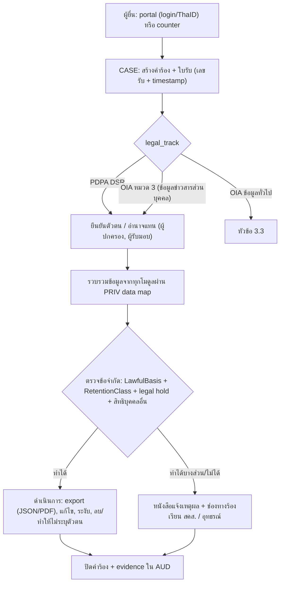

# 10 — Security & Compliance: PDPA, ข้อมูลข่าวสารราชการ, คุ้มครองเด็ก, ไซเบอร์, มาตรฐานรัฐบาลดิจิทัล, ลายมือชื่ออิเล็กทรอนิกส์, งานสารบรรณ, Threat model และการจัดซื้อ

> **สถานะ:** v1.1-draft · 28 ต.ค. 2569 (v1.0 → v1.1 ตาม [00-fix-decisions-v1.1](./00-fix-decisions-v1.1.md): D-04 ชื่อ `hlt_vault`/`hlt_keys` + backup, D-05 สิ่งที่โค้ชเห็น, D-08 safe sport/ทริปค้างคืน/กลุ่ม LINE, D-09 PDPA/ลายมือชื่อ/TSA/RLS) · ผู้เขียน: F · ภาษา: ไทย (ศัพท์เทคนิคเป็นภาษาอังกฤษ)
> **วันที่และ release:** R1 = ก.ย. 2571 (M18), R2 = พ.ค. 2572 (M26), R3 = พ.ย. 2572 (M32), Wave 1 = มิ.ย. 2573 (M39; โรงเรียนนำร่อง พ.ค. 2573 = M38), Wave 2a = มิ.ย. 2574 (M51), Wave 2b = พ.ย. 2574 (M56) โดย M1 = เม.ย. 2570; ถ้าเริ่มสัญญาหลัง ต.ค. 2570 ทุก release เลื่อน 12 เดือนตามรอบรับสมัคร (เล่ม 12 §1.3)
> **อ่านคู่กับ:** [00-blueprint](./00-blueprint.md) · [04-roles-permissions](./04-roles-permissions.md) (SoD, break-glass, การรักษาราชการแทน/การมอบอำนาจลงนาม) · [06-modules](./06-modules.md) (PRIV, CASE, SAFE, HLT, DOC, AUD, RPT) · [07-architecture](./07-architecture.md) (key management, licence policy, ADR) · [08-data](./08-data.md) (classification, retention, identifiers) · [09-integrations](./09-integrations.md) (cross-border register, แจ้งเหตุ) · [11-operations](./11-operations.md) (DR, ransomware, incident runbook) · [12-roadmap-cost-risk](./12-roadmap-cost-risk.md) · [government-relations.md](./government-relations.md)
>
> **ป้ายสถานะหลักฐาน**
> - ✅ = มีแหล่งอ้างอิง (ลิงก์ในบรรทัด) ส่วนใหญ่ยืนยันจาก **search snippet** ไม่ได้อ่านตัวบทฉบับเต็ม เพราะ session บล็อกโดเมน ratchakitcha/pdpc/oic/etda/dga เกือบทั้งหมด
> - 🟡 = ความรู้ของผู้เขียน/อนุมาน หรือเลขมาตราที่ยังไม่ได้ตรวจกับราชกิจจานุเบกษา **[ต้องตรวจสอบ]** โดยนิติกรของ มกช. ก่อนใช้ใน TOR หรือ privacy notice
> - เลขมาตรา PDPA ทั้งหมดในเล่มนี้เป็น 🟡 เว้นแต่ระบุ ✅ (ตาม review_compliance หมายเหตุท้ายเอกสาร)
>
> **ข้อสมมติฐานฐานะทางกฎหมาย:** มกช. เป็น **หน่วยงานของรัฐ** ที่ตั้งตาม พ.ร.บ.มหาวิทยาลัยการกีฬาแห่งชาติ พ.ศ. 2562 ✅ ([Matichon](https://www.matichon.co.th/sport/news_395168)) ส่วนฐานะว่าเป็น "ส่วนราชการ" หรือไม่ และผลต่อกฎหมายแต่ละฉบับ เป็น 🟡 (ตัวบทเต็มยังไม่ได้อ่าน) การออกแบบในเล่มนี้จึง **ทำให้ปฏิบัติตามได้ในกรณีที่เข้มที่สุด** และเก็บค่าที่ขึ้นกับคำตอบเป็น configuration

---

## สารบัญ

1. [หลักการและโครงสร้างความรับผิดชอบ](#1-หลักการและโครงสร้างความรับผิดชอบ)
2. [PDPA](#2-pdpa)
3. [พ.ร.บ.ข้อมูลข่าวสารของราชการ 2540 และชั้นความลับของทางราชการ](#3-พรบข้อมูลข่าวสารของราชการ-2540-และชั้นความลับของทางราชการ)
4. [การคุ้มครองเด็กและ safeguarding](#4-การคุ้มครองเด็กและ-safeguarding)
5. [พ.ร.บ.ไซเบอร์ 2562 และประมวลแนวทางของ สกมช.](#5-พรบไซเบอร์-2562-และประมวลแนวทางของ-สกมช)
6. [มาตรฐานรัฐบาลดิจิทัล (DGA) และ e-Service](#6-มาตรฐานรัฐบาลดิจิทัล-dga-และ-e-service)
7. [ลายมือชื่ออิเล็กทรอนิกส์ระดับต่อประเภทเอกสาร และ LTV](#7-ลายมือชื่ออิเล็กทรอนิกส์ระดับต่อประเภทเอกสาร-และ-ltv)
8. [งานสารบรรณ การเก็บรักษา การทำลาย และหอจดหมายเหตุ](#8-งานสารบรรณ-การเก็บรักษา-การทำลาย-และหอจดหมายเหตุ)
9. [Threat model (STRIDE)](#9-threat-model-stride)
10. [Accessibility](#10-accessibility)
11. [การจัดซื้อจัดจ้างและ licence](#11-การจัดซื้อจัดจ้างและ-licence)
12. [ภาระทางกฎหมายอื่นที่กระทบการออกแบบ](#12-ภาระทางกฎหมายอื่นที่กระทบการออกแบบ)
13. [Compliance mapping: requirement → control → module → evidence](#13-compliance-mapping)
14. [ผลการปิด review](#14-ผลการปิด-review) (v1.1: 14.7)
15. [สมมติฐาน/คำถามใหม่ที่เสนอ](#สมมติฐานคำถามใหม่ที่เสนอ)

---

## 1. หลักการและโครงสร้างความรับผิดชอบ

1. **กฎหมายเป็น configuration ที่มีเวอร์ชัน:** ฐานทางกฎหมาย (`LawfulBasis`), นโยบาย consent ผู้เยาว์, retention class, ระดับลายมือชื่อ, ภาระรายงาน เก็บเป็นตาราง/PolicySet ที่ effective-dated เพื่อรองรับร่างแก้ไข PDPA 2569, ร่าง พ.ร.บ.คุ้มครองเด็กฉบับใหม่ และการแยกกระทรวง โดยไม่แก้ code
2. **ประตูเดียวสำหรับคำขอสิทธิ:** CASE รับคำขอ PDPA (DSR), คำขอข้อมูลข่าวสารราชการ (OIA), ร้องเรียน/แจ้งเบาะแส และอุทธรณ์ แล้วแยกตาม `legal_track` (blueprint §4)
3. **หลักฐานก่อนคำกล่าวอ้าง:** ทุก control ในตารางหัวข้อ 13 ต้องมี evidence ที่ระบบสร้างเอง (log, รายงาน, snapshot) เก็บใน RPT/AUD
4. **ไม่ block การดูแลชีวิตและความปลอดภัยด้วย consent** (blueprint 9.9)

| บทบาท (รหัสเล่ม 04) | ความรับผิดชอบด้าน compliance |
|---|---|
| `council`, `rector` | อนุมัตินโยบายคุ้มครองข้อมูล, ไซเบอร์, data governance charter; รับรายงาน DPO และ CISO ตรง |
| `dpo` | DPO ตาม PDPA (หน่วยงานรัฐต้องแต่งตั้ง ✅ [PriceSanond](https://www.pricesanond.com/blog/law-update-new-personal-data-protection-regulation-data-protection-officer-dpo.php)) **รายงานตรงต่ออธิการบดี** ไม่อยู่ใต้สายงาน IT; อนุมัติ lawful-basis matrix, DPIA, TIA, ทะเบียน cross-border |
| `security_admin` (CISO/ผู้รับผิดชอบความมั่นคงปลอดภัย) | นโยบายและแผนไซเบอร์ตามประมวลแนวทาง สกมช., incident response, ประเมินตนเองรายปี |
| `records` | งานสารบรรณ, retention, การทำลาย, ส่งหอจดหมายเหตุ, ชั้นความลับราชการ |
| `safeguard` | ผู้รับผิดชอบการคุ้มครองเด็กที่แต่งตั้ง (Designated Safeguarding Lead) ต่อโรงเรียน/วิทยาเขต |
| `complaint` | รับเรื่องร้องเรียน/แจ้งเบาะแส และคำขอข้อมูลข่าวสาร (ศูนย์ข้อมูลข่าวสาร) |
| `data_steward` | เจ้าของคุณภาพข้อมูลและ metadata ต่อ domain |
| `auditor` | ผู้ตรวจสอบภายใน (อ่านอย่างเดียว + audit export) |
| ผู้รับจ้าง | **ผู้ประมวลผลข้อมูล** ต้องลง DPA, มี DPO/ผู้ติดต่อของตน, ส่ง ROPA ฝั่ง processor เป็น deliverable |

---

## 2. PDPA

### 2.1 สถานะกฎหมายและแนวปฏิบัติที่ต้องติดตาม (ณ ต.ค. 2569)

| รายการ | สถานะ | ผลต่อการออกแบบ |
|---|---|---|
| PDPA 2562 มีผลเต็ม; ประกาศแจ้งเหตุละเมิด (ธ.ค. 2565), DPO (2566), cross-border (ธ.ค. 2566 มีผล มี.ค. 2567), การลบ/ทำลาย/ทำให้ไม่ระบุตัวตน (2567) | ✅ [HSF Kramer](https://www.hsfkramer.com/notes/data/2025-posts/pdpa-fines-and-firsts-a-6-year-timeline-of-thailands-data-privacy-enforcement) · [Nishimura](https://www.nishimura.com/en/knowledge/publications/personal-data-protection-update-recent-developments-sub-regulations-guidelines-and-official-plan-under-the-thai-pdpa) | baseline ทั้งเล่ม |
| แนวปฏิบัติ consent และการแจ้ง (7 ก.ย. 2565): ผู้เยาว์ 2 กลุ่ม (<10 ปี ผู้ใช้อำนาจปกครองให้ความยินยอมแทน; 10–20 ปี ไม่จำเป็นต้องได้ความยินยอมผู้ปกครองทุกกรณี) | ✅ [Tilleke](https://www.tilleke.com/insights/thailand-issues-guidelines-on-pdpa-consent-and-notification-requirements) | ตาราง consent ผู้เยาว์ (2.4) |
| **ร่างแก้ไข PDPA** (เข้าสภา; รับฟัง 16 ก.ค.–15 ส.ค. 2569): นิยาม "หน่วยงานของรัฐ", ขยายข้อยกเว้นภาครัฐไปถึงงานปราบปรามการทุจริต, จัดโครงสร้างฐานทางกฎหมายใหม่ (consent เป็นหนึ่งใน 7 ฐาน) — **ไม่พบประเด็นเปลี่ยนอายุผู้เยาว์** | ✅ [Tilleke](https://www.tilleke.com/insights/thailand-proposes-significant-amendments-to-the-personal-data-protection-act/) · [Mondaq](https://www.mondaq.com/data-protection/1826470/thailand-proposes-significant-amendments-to-the-personal-data-protection-act); เนื้อหาร่างเรื่องผู้เยาว์ 🟡 (ค้นแล้วไม่พบ) | `LawfulBasis` เป็นตาราง config; ทบทวน matrix เมื่อกฎหมายมีผล |
| ร่างแนวปฏิบัติ สคส. เรื่องฐานทางกฎหมาย/การตลาด/ROPA/DPO (7 ก.ค. 2569) | ✅ [Tilleke](https://www.tilleke.com/insights/thailand-releases-new-draft-pdpa-guidance-on-lawful-bases-and-marketing/) | ใช้กระบวนการเลือกฐาน 5 ขั้นของร่างเป็นแบบฟอร์มใน PRIV |
| ร่างแนวปฏิบัติ AI กับข้อมูลส่วนบุคคล (17 ก.พ. 2569, ปิดรับ 25 ก.พ. 2569); สคส. + UNICEF กำลังทำแนวปฏิบัติข้อมูลเด็กยุค AI (พ.ค. 2569, ยังไม่มีร่างเผยแพร่) | ✅ [Tilleke](https://www.tilleke.com/insights/thailand-seeks-feedback-on-draft-data-protection-guidelines-for-ai) · [Thairath EN](https://en.thairath.co.th/news/governmentpolicy/2931149) · [Thai Post](https://www.thaipost.net/economy-news/992076/) | AI เลื่อน (blueprint 9.12); ห้ามใช้ข้อมูลโรงเรียนกีฬาใน ML จนกว่าแนวปฏิบัติเด็กออก |

### 2.2 Lawful-basis matrix ต่อกิจกรรมการประมวลผล

> คอลัมน์ฐาน: **PT** = ภารกิจเพื่อประโยชน์สาธารณะ/การใช้อำนาจรัฐ, **LO** = หน้าที่ตามกฎหมาย, **VI** = ป้องกันอันตรายต่อชีวิต ร่างกาย สุขภาพ, **CT** = สัญญา, **LI** = ประโยชน์โดยชอบด้วยกฎหมาย (หน่วยงานรัฐใช้อย่างจำกัด), **C** = ความยินยอม, **EC** = ความยินยอมโดยชัดแจ้งสำหรับข้อมูลอ่อนไหว; เลขมาตรา 🟡 (ม.24 ฐานทั่วไป, ม.26 ข้อมูลอ่อนไหว)
> ตารางนี้เป็นค่าตั้งต้น **ต้องผ่านการอนุมัติของ DPO + นิติกร** และบันทึกใน PRIV เป็น `ProcessingActivity × Purpose × LawfulBasis` ที่มีเวอร์ชัน

| # | กิจกรรม | ข้อมูลหลัก | ฐาน (ทั่วไป) | ข้อมูลอ่อนไหว: เงื่อนไข ม.26 | หมายเหตุการออกแบบ | โมดูล |
|---|---|---|---|---|---|---|
| L-01 | รับสมัคร คัดเลือก สอบทักษะ | ตัวตน, การศึกษา, ผลงานกีฬา, คะแนน | PT | ความพิการ (เพื่อจัด accommodation): EC หรือ LO ตามกฎหมายส่งเสริมการศึกษาคนพิการ 🟡; **ใบรับรองแพทย์ ข้อมูลร่างกาย ผลทดสอบสมรรถภาพ → ดู L-36** | ไม่ใช้ consent เป็นฐานของการคัดเลือก; ผู้สมัครที่ไม่ได้รับคัดเลือก: ลบ/ทำให้ไม่ระบุตัวตนตาม retention | ADM |
| L-02 | ยืนยันตัวตนด้วย ThaID | pid, ชื่อ, วันเกิด | PT | — | ขอ scope ขั้นต่ำ | IAM |
| L-03 | ทะเบียนประวัติ ผลการเรียน สถานภาพ | ข้อมูลนักศึกษา | PT + LO (ส่งข้อมูลการอุดมศึกษา 🟡) | — | ข้อมูลหลักไม่ขึ้นกับ consent; สิทธิคัดค้าน/ลบมีข้อจำกัด (2.7) | REC, ASM, GRD |
| L-04 | ค่าธรรมเนียม ใบเสร็จ คืนเงิน | การเงิน, บัญชีธนาคาร | CT/PT + LO (บัญชีและการตรวจสอบ) | — | บัญชีรับเงินต้องตรงผู้มีสิทธิ์ | FIN |
| L-05 | กยศ. DSL | รายได้ครอบครัว, ค่าเล่าเรียน | LO/PT (ภาระสถานศึกษาตามกฎหมาย กยศ. 🟡) | — | DSA กับ กยศ.; ไม่เก็บรหัสผ่าน DSL | SCH |
| L-06 | ทุนการศึกษาภายนอก/กองทุนกีฬา | ผลการเรียน, รายได้ | CT (ผู้รับทุน) / PT | — | ส่งให้ผู้ให้ทุนเฉพาะที่สัญญากำหนด | SCH |
| L-07 | หอพัก, exeat, visitor log | ที่พัก, ผู้รับแทน | CT (นักศึกษา) / PT (โรงเรียนประจำ) | — | ซ่อนเลขห้อง/ตารางรายบุคคลของเด็กจากบทบาทที่ไม่จำเป็น | HOU |
| L-08 | ตม.30 / ตม.47 | หนังสือเดินทาง, วีซ่า | LO (พ.ร.บ.คนเข้าเมือง ✅ 24 ชม.) | — | | HOU, X-INTL |
| L-09 | ผ่อนผันทหาร / รด. | เพศ, วันเกิด, สด.9/สด.35 | LO/PT (ตามคำขอของนักศึกษา) | — | | AFF |
| L-10 | **บันทึกการบาดเจ็บ ปฐมพยาบาล RTP แบบปกติ (W-39)** (v1.1 แก้ตาม D-09) | ข้อมูลสุขภาพ | PT | **ม.26(5)(ก)** — เวชศาสตร์ป้องกัน/การวินิจฉัย/การรักษา/การจัดการด้านสุขภาพ โดยผู้ประกอบวิชาชีพที่มีหน้าที่รักษาความลับตามกฎหมาย **[ต้องตรวจสอบถ้อยคำและเลขอนุมาตรา]** 🟡 (snippet: ข้อยกเว้นด้านเวชศาสตร์ป้องกัน/อาชีวเวชศาสตร์/การวินิจฉัย/การให้บริการสุขภาพ [Global Legal Post](https://www.globallegalpost.com/lawoverborders/data-protection-1072382791/thailand-2024007059)); **VI ใช้เฉพาะเมื่อเจ้าของข้อมูลให้ความยินยอมไม่ได้** (หมดสติ ภาวะฉุกเฉิน) | ผู้บันทึกการวินิจฉัย/การรักษา = `physician`/`nurse`/`physio` (แยกจาก `medical` ตาม D-08, เล่ม 04); ผู้กำกับกิจกรรม (coach/lecturer/dorm) บันทึกได้เพียง **incident ที่ไม่มีการวินิจฉัย** (เวลา สถานที่ กลไก การปฐมพยาบาลที่ทำ) และกด "ถอดออกจากกิจกรรม"; **ไม่ block การบันทึก** ไม่รอ consent; แจ้ง privacy notice; เก็บใน `hlt_vault` (D-04) | HLT, ATH |
| L-11 | **สถานะความพร้อม + ข้อจำกัดการฝึก** ต่อโค้ช/ผู้กำกับกิจกรรมของ squad/รายวิชาปฏิบัติ (v1.1 แทนแถวเดิมตาม D-05) | สถานะ **พร้อม / จำกัด / ไม่พร้อม** + รายการข้อจำกัดเชิงกิจกรรม (เช่น "ห้ามปะทะ", "ห้ามกระโดด", "ห้ามลงน้ำ") + วันทบทวนถัดไป — **ไม่มี** การวินิจฉัย/ยา/การรักษา | PT (หน้าที่ดูแลความปลอดภัยของผู้เรียนในกิจกรรมที่ มกช. จัด) + CT (สัญญาทุน/การเป็นสมาชิก squad) | ข้อมูลที่อนุมานสุขภาพได้: **ม.26(5)(ก)** (การจัดการด้านสุขภาพ/ประเมินความสามารถในการเข้าร่วมกิจกรรม ที่ผู้ประกอบวิชาชีพเป็นผู้ออกสถานะ) **[ต้องตรวจสอบกับนิติกร]**; ไม่ใช้ consent | **แสดงต่อโค้ชเสมอ โดยไม่ต้องขอ consent** และนักกีฬา **ถอน/ซ่อนไม่ได้** (เพื่อไม่ให้โค้ชสั่งซ้อมคนที่ห้ามซ้อม); สถานะออกโดย `physician`/`physio` เท่านั้น; แสดงเฉพาะโค้ชที่มี `CoachAssignment` กับนักกีฬานั้นและผู้กำกับรายวิชาปฏิบัติที่ลงทะเบียน; ถ้านิติกรเห็นว่าฐาน ม.26 ไม่พอ ให้ทำเป็น **เงื่อนไขการเข้าร่วมกิจกรรมที่มีความเสี่ยงทางกาย** (แจ้งตอนเข้า squad) ไม่ใช่ consent ที่ถอนแล้วซ่อนสถานะได้ — ผู้ไม่ยอมรับยังคงทุนและเรียนต่อได้แต่ไม่ลงกิจกรรมเสี่ยง (ดู F2-Q1) | HLT (ผู้ออก), ATH (แสดง) |
| L-11A | การเปิดเผย **รายละเอียด** การบาดเจ็บ/การวินิจฉัย/การรักษา/แผน RTP ต่อโค้ช/ทีม/`sci` | การวินิจฉัย, ระยะ RTP, ยา | — | **EC** (ผู้เยาว์ตาม 2.4) | ค่าเริ่มต้น **ปิด**; นักกีฬาเลือกเปิดรายผู้รับ/รายเรื่อง ถอนได้ทุกเมื่อโดยไม่กระทบสิทธิทุนและ **ไม่กระทบการแสดงสถานะ L-11** | HLT, ATH |
| L-12 | Wellness รายวัน (opt-in หรือตามทีม) | อารมณ์ การนอน ความเมื่อยล้า ความปวด | — | **EC** | **เก็บใน HLT `hlt_vault`** (D-04); ATH รับเพียงค่า readiness ที่นักกีฬาอนุญาต; flag ไปที่ `sci`/S&C ก่อน (โค้ชเห็นเป็นข้อมูล); **KPI "ตอบ wellness flag ใน 48 ชม." เป็นเป้าหมายการดูแลระดับทีม/ระบบ ไม่ใช่ตัวชี้วัดความรับผิดรายบุคคลของโค้ช** (D-05; KPI dictionary เล่ม 14); ความสัมพันธ์เชิงอำนาจ (นักกีฬาทุน) ทำให้ consent อาจไม่อิสระ → ต้องมีทางเลือกที่ไม่เสียประโยชน์ และ DPIA | HLT (เก็บ), ATH (ค่าที่อนุญาต) |
| L-13 | Wearables / lab testing | HR, GPS ช่วงซ้อม, ผลทดสอบ | PT (การฝึกตามหลักสูตร) สำหรับข้อมูลไม่อ่อนไหว | **EC** สำหรับข้อมูลที่เป็นสุขภาพ | cross-border X-05; บัญชีทีม | ATH, LAB |
| L-14 | วิจัยด้วยข้อมูลนักกีฬา/นักศึกษา | ตามโครงการ | ข้อยกเว้นวิจัย/สถิติพร้อมมาตรการ 🟡 หรือ C | EC หรือข้อยกเว้นวิจัยพร้อมมาตรการ 🟡 | **ต้องมีเลขอนุมัติ EC ก่อน export** (12.6) | ANA, X-RES |
| L-15 | ภาพ/ข่าวผลงานนักกีฬา, สื่อประชาสัมพันธ์ | ภาพ ชื่อ ผลงาน | PT (การรายงานกิจกรรมสาธารณะของมหาวิทยาลัย) สำหรับผู้ใหญ่ ในขอบเขตจำกัด; **C** สำหรับผู้เยาว์และการใช้เชิงพาณิชย์ | — | ผู้เยาว์: media consent ของผู้ปกครอง + ข้อห้ามตามกฎหมายคุ้มครองเด็ก (4.1) | ENG |
| L-16 | Face/biometric check-in | ข้อมูลชีวภาพ | — | **EC** + ทางเลือกอื่นที่เท่าเทียม | ค่าเริ่มต้น **ไม่ใช้**; ถ้าจะใช้ต้องผ่าน DPIA | ATT |
| L-17 | CCTV หอพัก/สนาม | ภาพ | PT/LI (ความปลอดภัย) | — | ป้ายแจ้ง, retention สั้น, การเรียกดูมี log | HOU, FAC |
| L-18 | Safeguarding case (W-22) — ผู้เยาว์/เด็ก (นักกีฬาผู้ใหญ่ดู L-37) | ข้อกล่าวหา, ข้อมูลเด็ก | LO (กฎหมายคุ้มครองเด็ก 🟡) + VI | ข้อมูลสุขภาพ/พฤติกรรมทางเพศ: VI / LO 🟡 | ไม่ใช้ consent; ปิดลับสูงสุด (หัวข้อ 4) | SAFE |
| L-19 | ตรวจประวัติบุคลากรที่ทำงานกับเด็ก (W-23) | ประวัติอาชญากรรม | LO/PT ถ้ามีกฎหมาย/ระเบียบรองรับ 🟡; มิฉะนั้น EC ของบุคลากร | ประวัติอาชญากรรม (ข้อมูลอ่อนไหว) | เก็บเฉพาะผล (ผ่าน/ไม่ผ่าน + วันที่ + อ้างอิง) ไม่เก็บสำเนาเอกสาร | SAFE, X-HR |
| L-20 | วินัยนักศึกษา, ทุจริตสอบ | ข้อเท็จจริง | PT | — | | AFF, EXM |
| L-21 | ร้องเรียน/แจ้งเบาะแส (W-19) | ผู้ร้อง, ผู้ถูกร้อง | PT/LO | ตามเนื้อหา | ช่องทางไม่ระบุตัวตน; คุ้มครองผู้แจ้ง | CASE |
| L-22 | คำขอข้อมูลข่าวสาร (W-20), DSR (W-21) | ผู้ขอ | LO | — | | CASE |
| L-23 | ITA: รายชื่อผู้มีส่วนได้เสียภายนอก (EIT) | ชื่อ ช่องทางติดต่อ | PT (ภาระประเมินตามมติ ครม. ✅) 🟡 | — | ส่งเฉพาะช่องทางติดต่อที่ผู้นั้นให้ไว้กับ มกช. + แจ้งใน notice | RPT |
| L-24 | ภาวะการมีงานทำ | อาชีพ รายได้ | PT/LO (รายงาน อว. 🟡) | — | | ALU |
| L-25 | ศิษย์เก่าสัมพันธ์ ระดมทุน จดหมายข่าว | ติดต่อ | **C** | — | แยกจาก L-24 | ALU |
| L-26 | ผูก LINE / push | LINE userId, device token | **C** (ช่องทางเลือกได้) | — | ไม่ผูกก็ได้รับข่าวผ่านช่องทางอื่น | NOTI |
| L-27 | ผู้ปกครองดูข้อมูลนักศึกษาที่บรรลุนิติภาวะ (parent observer) | ผลการเรียน การเงิน | **C** ของนักศึกษา (ถอนได้) | — | แยกจาก guardian ของผู้เยาว์ (2.4) | PRIV, REC |
| L-28 | Medication log ผู้เยาว์ (หอพักโรงเรียน) | ยา, อาการ | PT (การดูแลเด็กในความดูแล) | VI + ความยินยอมของผู้ปกครอง (EC) สำหรับการให้ยาตามปกติ | | HLT |
| L-29 | ประกันอุบัติเหตุ | รายชื่อ, เคลม | CT (ประกันกลุ่ม) | ข้อมูลการรักษาในเคลม: EC ณ เวลาเคลม 🟡 | ส่งให้ผู้รับประกันเฉพาะเอกสารเคลม | HLT, FIN |
| L-30 | Anti-doping (TUE ถ้าเก็บ) | ยา/โรค | — | EC | เก็บใน `hlt_vault`, retention ตาม WADA 🟡 | HLT |
| L-31 | Security logs, audit, traffic data | IP, การกระทำ | LO (ข้อมูลจราจรคอมพิวเตอร์ ≥ 90 วัน 🟡) + PT/LI (ความมั่นคงปลอดภัย) | — | | AUD, ADMIN |
| L-32 | Analytics/รายงานผู้บริหาร | ข้อมูลรวม | PT | — | ใช้ข้อมูลทำให้ไม่ระบุตัวตน/aggregate ใน mart; RLS ต่อ OrgUnit | ANA |
| L-33 | Early warning/AI (เลื่อน) | ผลการเรียน การเข้าเรียน | PT + DPIA | — | human-in-the-loop, fairness review; ห้ามใช้วิทยาเขต/ภูมิภาค/สถานะนักกีฬาเป็นตัวทำนายโดยไม่ทบทวน | ANA |
| L-34 | **ข้อมูลบุคลากร (~2,700 คน)** ที่ core ใช้: ตัวตน, บทบาท/สังกัด, ภาระสอน, อาจารย์ที่ปรึกษา, การมอบอำนาจลงนาม/รักษาราชการแทน, ใบอนุญาตวิชาชีพ, ผลอบรม safeguarding (v1.1 เพิ่มตาม D-09) | ชื่อ ตำแหน่ง OrgUnit อีเมล ใบอนุญาต (เลข/วันหมดอายุ) | CT (สัญญาจ้าง) + PT (การจัดการศึกษา) + LO (กฎหมายวิชาชีพ/การเงินการคลัง) | ใบอนุญาตที่อนุมานสุขภาพไม่ได้ = ไม่ใช่ข้อมูลอ่อนไหว; ประวัติอาชญากรรม → L-19 | ข้อมูลหลักมาจาก X-HR (เล่ม 09 หัวข้อ 2 ท้ายตาราง); core เก็บเฉพาะที่จำเป็น; privacy notice ฉบับบุคลากร (CM-03) | IAM, ORG, X-HR |
| L-35 | **การเฝ้าระวังการใช้งานของบุคลากร** (UEBA, audit log ระดับบุคคล, session recording ของบัญชีสิทธิ์สูง, watermark export) (v1.1 เพิ่มตาม D-09) | user id, เวลา, การกระทำ, IP, อุปกรณ์, ผลการให้คะแนนความผิดปกติ | PT (ความมั่นคงปลอดภัยของระบบราชการ) + LO (ข้อมูลจราจรฯ ≥ 90 วัน 🟡); LI ใช้อย่างจำกัด | — | **ต้องแจ้งบุคลากรล่วงหน้า** (notice + นโยบายการใช้ระบบ) ว่ามีการเฝ้าระวังอะไร เพื่ออะไร เก็บนานเท่าใด; **DPIA D-10**; ผล UEBA เป็นเพียงสัญญาณให้ `security_admin` ตรวจ ห้ามใช้ลงโทษอัตโนมัติหรือประเมินผลงาน; ผู้ตรวจ log ของผู้ดูแลระบบต้องเป็นคนละคน (SoD) | AUD, ADMIN |
| L-36 | **ข้อมูลสุขภาพ/สมรรถภาพในการคัดเลือก** (ใบรับรองแพทย์ก่อนสอบทักษะ, ส่วนสูง/น้ำหนัก/รุ่นน้ำหนัก, ผลทดสอบสมรรถภาพ, ความพิการที่มีผลต่อการทดสอบ) ทั้งรับเข้า ADM (รวมโรงเรียนกีฬา ม.1/ม.4) และการคัดตัว/ทบทวนสถานะนักกีฬาใน ATH (v1.1 เพิ่มตาม D-09) | ข้อมูลสุขภาพ + ข้อมูลร่างกาย | PT (การคัดเลือกเข้าศึกษาและการจัดทีม) | ใบรับรองแพทย์/ผลตรวจร่างกาย: **EC ของผู้สมัคร** (ผู้เยาว์: dual consent ตาม 2.4) ณ เวลายื่นสมัคร เป็นค่าตั้งต้น — การไม่ให้ = ไม่เข้าทดสอบทักษะที่มีความเสี่ยง (ความปลอดภัย) ไม่ใช่การตัดสิทธิ์สมัครช่องทางอื่น; ทางเลือก: ข้อยกเว้น ม.26(5)(ก) ถ้านิติกรรับรอง **[ต้องตรวจสอบ]**; ผลทดสอบสมรรถภาพที่ไม่อนุมานสุขภาพ (เวลาวิ่ง, คะแนนทักษะ) = PT ไม่ใช่ข้อมูลอ่อนไหว | `MedicalClearance(PRE_TEST)` เก็บใน `hlt_vault` (D-03/D-04, R1); ADM/กรรมการ (`judge`) เห็นเพียง **ผ่าน/ไม่ผ่าน clearance + accommodation** ไม่เห็นรายละเอียด; ผู้ไม่ได้รับคัดเลือก: ลบเมื่อปิดรอบอุทธรณ์; ผู้ได้รับคัดเลือก: ใช้เป็น provisional clearance ได้ตามอายุที่กำหนด; **ห้ามใช้ข้อมูล HLT/จิตวิทยาเป็นเหตุผลคัดออกจากทีม** (14 AM-6) นอกจากสถานะ L-11 | ADM, ATH, HLT |
| L-37 | **Safe sport สำหรับนักกีฬาทุกวัย** (เรื่องร้องเรียนการคุกคาม/ล่วงละเมิด/ใช้อำนาจโดยมิชอบระหว่างโค้ช/บุคลากรกับนักกีฬา ≥ 18 ปี) (v1.1 เพิ่มตาม D-08) | ผู้ร้อง ผู้ถูกร้อง ข้อเท็จจริง | PT (การคุ้มครองผู้เรียน, วินัยบุคลากร) + LO ตามระเบียบวินัย/กฎหมายที่เกี่ยวข้อง 🟡 | ข้อมูลพฤติกรรมทางเพศ/สุขภาพ: ม.26 ข้อยกเว้นเพื่อการก่อตั้ง/ใช้/ป้องกันสิทธิเรียกร้องตามกฎหมาย หรือ VI **[ต้องตรวจสอบ]** | ไม่ใช้ consent เป็นฐานของการสอบสวน; ปิดลับระดับเดียวกับ SAFE; ดูหัวข้อ 4.4 | SAFE, CASE |
| L-38 | **ช่องทางทีมในระบบ (team channel) และทะเบียนกลุ่ม LINE ทีมที่รับรอง** (v1.1 เพิ่มตาม D-08) | ข้อความ รูป ผู้อยู่ในกลุ่ม ผู้ดูแลกลุ่ม | PT (การจัดการศึกษา/การฝึก) + การคุ้มครองเด็ก | ห้ามส่งข้อมูลสุขภาพ/safeguarding ในช่องทางทีม | เก็บข้อความในระบบตาม retention สั้น (🟡 ค่าตั้งต้น 1 ปีการศึกษา) เพื่อการตรวจย้อนด้าน safeguarding; ทะเบียนกลุ่ม LINE เก็บเพียงชื่อกลุ่ม ผู้ใหญ่ 2 คนที่รับผิดชอบ และวันทบทวน **ไม่เก็บเนื้อหาแชต LINE** (หัวข้อ 4.6) | NOTI, SAFE, ATH |

### 2.3 ข้อมูลอ่อนไหวและการแยกเก็บ

- ข้อมูลสุขภาพ ความพิการ ข้อมูลชีวภาพ ประวัติอาชญากรรม และ safeguarding เก็บใน **health vault (`hlt_vault`) / safeguarding store** ที่เป็นฐานข้อมูลแยก (ไม่ใช่ cluster แยก) (blueprint 9.9; ชื่อตาม D-04 และเล่ม 08) รวมถึง **wellness** (L-12) ซึ่งย้ายจาก ATH มาอยู่ใน vault (ATH เก็บเพียงสถานะ/ค่าที่ได้รับอนุญาต)
- **กุญแจ (D-04):** DEK แยก **ต่อบุคคล × ประเภทระเบียน (record class)** เช่น ยา/ผู้เยาว์, wellness, injury, clinical record เพื่อให้ลบตาม retention แต่ละประเภทได้โดยไม่กระทบประเภทอื่น; wrapped DEK เก็บใน **key store แยก `hlt_keys`** (ไม่อยู่ใน backup ของ `hlt_vault`) ซึ่ง replicate ไปไซต์ B แบบ synchronous (RPO ≈ 0) และ backup ของ `hlt_keys` มีอายุ **≤ 35 วัน**; KEK อยู่ใน OpenBao transit ที่ auto-unseal ด้วย HSM ของแต่ละไซต์ (รายละเอียดเล่ม 07/08)
- PostgreSQL community ไม่มี TDE: ใช้ volume/disk encryption + **column-level encryption** สำหรับ pid, ข้อมูลสุขภาพ, บัญชีธนาคาร (blueprint §10)
- การเข้าถึงทุกครั้งต้องระบุ **purpose of use** และบันทึกใน AUD; การอ่านแบบ bulk ส่งสัญญาณ UEBA

### 2.4 กติกา consent ผู้เยาว์

> **สองเกณฑ์อายุที่ต้องแยก:** "ผู้เยาว์" ตาม ป.พ.พ./PDPA = อายุต่ำกว่า **20 ปี** (บรรลุนิติภาวะเมื่ออายุยี่สิบปีบริบูรณ์ ป.พ.พ. ม.19 ✅ [legardy](https://www.legardy.com/articles/civil-commercial/civil-and-commercial-section19); เว้นแต่สมรสตาม ม.20) ส่วน "เด็ก" ตาม พ.ร.บ.คุ้มครองเด็ก 2546 = อายุต่ำกว่า **18 ปี** ✅ ([Tilleke](https://www.tilleke.com/insights/thailands-draft-child-protection-act-complete-overhaul-of-existing-framework/)) นักศึกษาปี 1–2 อายุ 18–19 ปีจึงยังเป็น **ผู้เยาว์ตาม PDPA** แต่ไม่ใช่ "เด็ก" ตามกฎหมายคุ้มครองเด็ก ระบบคำนวณทั้งสองสถานะจากวันเกิด ณ วันที่ทำธุรกรรม
> ฐาน: แนวปฏิบัติ consent ของ สคส. 2565 ✅ ([Tilleke](https://www.tilleke.com/insights/thailand-issues-guidelines-on-pdpa-consent-and-notification-requirements)); ป.พ.พ. ม.21–24 (การที่ผู้เยาว์ทำได้เอง) 🟡; ร่างแก้ไข PDPA 2569 ไม่พบการเปลี่ยนเกณฑ์อายุ ✅/🟡

| ประเภทการประมวลผลที่ต้องใช้ consent | อายุ < 10 ปี | 10 ถึง < 20 ปี | ≥ 20 ปี |
|---|---|---|---|
| ข้อมูลทะเบียนหลัก, ผลการเรียน, การเงิน (L-01..L-09) | **ไม่ใช้ consent** (ฐาน PT/LO) | ไม่ใช้ consent | ไม่ใช้ consent |
| กิจกรรมทั่วไปที่ผู้เยาว์ทำเองได้ตามสมควรแก่ฐานานุรูป (เช่น ผูก LINE กับบัญชีของตน, สมัครชมรม) | ผู้ปกครอง | **ผู้เยาว์ให้เอง** (แจ้งผู้ปกครองในโรงเรียนกีฬา) | ตนเอง |
| ข้อมูลอ่อนไหว EC (L-11A, L-12, L-13 สุขภาพ, L-16, L-30, L-36 ใบรับรองแพทย์) — **สถานะความพร้อม L-11 ไม่ใช้ consent** (D-05) | ผู้ปกครอง | **Dual consent: ผู้เยาว์ + ผู้ปกครอง** | ตนเอง |
| การเผยแพร่ภาพ/ข้อมูลผู้เยาว์ต่อสาธารณะ (L-15) | ผู้ปกครอง | **Dual consent** + editorial review ตามกฎหมายคุ้มครองเด็ก (เฉพาะ < 18) | ตนเอง |
| การค้างคืน/เดินทางแข่งขัน/ทัศนศึกษา (consent ทางปกครอง ไม่ใช่ PDPA) | ผู้ปกครอง | ผู้ปกครอง (โรงเรียนกีฬา); นักศึกษามหาวิทยาลัย < 20 ปี: ผู้ปกครองลงนามสัญญาหอ/ทุน | ตนเอง |
| วิจัย (L-14) | ผู้ปกครอง + assent เด็ก | Dual consent ตามที่ EC กำหนด | ตนเอง |
| parent observer (L-27) | ไม่ใช้ (เป็น guardian โดยกฎหมาย) | **นักศึกษามหาวิทยาลัย**: guardian ตามกฎหมายยังมีสิทธิตามอำนาจปกครอง 🟡 แต่ระบบแสดงเฉพาะที่จำเป็น; โรงเรียนกีฬา: guardian เต็ม | consent ของนักศึกษา ถอนได้ |

กติกาเพิ่มเติม:
- **Re-consent อัตโนมัติเมื่ออายุครบ 20 ปี:** consent ที่ผู้ปกครองให้แทนจะถูก flag ให้เจ้าของข้อมูลยืนยันเองภายใน 30 วัน มิฉะนั้นหยุดใช้เฉพาะ purpose ที่อาศัย consent
- **ผู้ปกครองต้องพิสูจน์ความสัมพันธ์** (ThaID + เอกสาร/ทะเบียนราษฎรเมื่อมี I-05) ก่อนได้สิทธิ guardian; รองรับผู้ปกครองหลายคนและคำสั่งศาลจำกัดสิทธิ (flag "ห้ามเปิดเผยต่อบุคคลนี้")
- **ถอน consent ได้ทุกเมื่อ** ผ่าน PRIV โดยไม่เสียสิทธิทุน/การคัดเลือก

### 2.5 ROPA outline และข้อตกลงการแบ่งปันข้อมูล

ROPA สร้างจาก PRIV (ไม่ใช่เอกสาร Excel แยก) ฟิลด์ขั้นต่ำต่อ `ProcessingActivity`:

| กลุ่ม | ฟิลด์ |
|---|---|
| ระบุ | id, ชื่อ, controller (มกช. / joint / independent), OrgUnit, owner (`data_steward`), โมดูล |
| วัตถุประสงค์ | purpose, lawful basis (ม.24/ม.26 + เวอร์ชัน matrix), เหตุผลการเลือกฐาน (แบบฟอร์ม 5 ขั้นตามร่างแนวปฏิบัติ 2569) |
| ข้อมูล | ประเภทเจ้าของข้อมูล (นักศึกษา, ผู้เยาว์, ผู้ปกครอง, บุคลากร, ผู้สมัคร, ประชาชน), หมวดข้อมูล, ข้อมูลอ่อนไหว (Y/N), classification (เล่ม 08) |
| การเปิดเผย | ผู้รับภายใน, ผู้รับภายนอก (อ้าง I-xx), processor (อ้าง `ProcessorAgreement`), cross-border (อ้าง X-xx ในเล่ม 09) |
| การเก็บ | retention class, วิธีลบ/ทำลาย/ทำให้ไม่ระบุตัวตน, legal hold |
| มาตรการ | security controls (อ้างหัวข้อ 13), DPIA id (ถ้ามี), วันที่ทบทวนล่าสุด |
| สิทธิ | สิทธิที่ใช้ได้/ข้อจำกัด (2.7), ช่องทาง |

ข้อตกลงที่ระบบเก็บเป็น entity (`PartnerAgreement` ประเภท MOU/DSA/DPA): **DataSharingAgreement** (controller-to-controller) กับ กยศ., ทปอ., สป.อว., กกท./สมาคมกีฬา, คุรุสภา, หน่วยสัสดี, ผู้รับประกัน, สถาบันวิทยาศาสตร์การกีฬา; **ProcessorAgreement** กับผู้รับจ้างพัฒนา/MA, ผู้ให้บริการ cloud, SaaS ในทะเบียน cross-border ผู้รับจ้างต้องส่ง **ROPA ฝั่ง processor** เป็น deliverable ของทุก release

### 2.6 DPIA บังคับ (phase gate)

DPIA เป็น **exit criterion** ของ release ที่เปิดใช้กิจกรรมนั้น (ไม่ผ่าน = ไม่ go-live กิจกรรมนั้น) แม่แบบ DPIA อยู่ใน PRIV; DPO อนุมัติ; ทบทวนเมื่อเปลี่ยนสาระสำคัญหรือทุก 24 เดือน

| DPIA | ขอบเขต | ต้องเสร็จก่อน | ประเด็นหลักที่ต้องประเมิน |
|---|---|---|---|
| D-01 **ผู้เยาว์ (โรงเรียนกีฬา + นักศึกษา < 20 ปี)** | guardian portal, หอพักประจำ, exeat, visitor log, การสื่อสารกับผู้เยาว์ | R1 (ผู้สมัครผู้เยาว์) / Wave 1 (โรงเรียน) | ความถูกต้องของความสัมพันธ์ผู้ปกครอง, ตำแหน่งเด็ก, การสื่อสาร 1:1 |
| D-02 **ข้อมูลสุขภาพนักกีฬา** | `hlt_vault`, medical clearance ก่อนสอบทักษะ (L-36), injury/RTP, สถานะความพร้อมที่โค้ชเห็น (L-11), wellness (L-12), medication log | **R1** (ส่วน medical clearance ก่อนสอบทักษะ ตาม D-03) / R2 (injury, RTP, wellness) | ฐาน ม.26(5)(ก)/VI/EC แยกตามแถว, purpose-bound access, ความสัมพันธ์เชิงอำนาจ, ความพอเพียงของข้อมูลที่โค้ชเห็น (สถานะ + ข้อจำกัดเท่านั้น) |
| D-03 **Systematic monitoring นักกีฬา** | wellness รายวัน, wearables, GPS, training load | R3 | ความถี่, ความจำเป็น, cross-border (X-05), สิทธิปฏิเสธ |
| D-04 **Safeguarding** | SAFE case store, การส่งต่อพนักงานเจ้าหน้าที่, ตรวจประวัติบุคลากร | R2 (โครงสร้าง) / Wave 1 (เต็ม) | การรั่วไหลต่อผู้ถูกกล่าวหา, ข้อมูลผู้แจ้ง |
| D-05 **AI / early warning / chatbot** | ทุกโมเดลที่ใช้ข้อมูลส่วนบุคคล | ก่อนเริ่มสัญญาแยก AI | bias, explainability, human-in-the-loop, ข้อมูลเด็ก |
| D-06 LINE binding + push ข้ามประเทศ | NOTI | R1 | ข้อมูลในข้อความ, ประเทศปลายทาง |
| D-07 Biometric/face check-in, GPS/geofence (นิเทศ/กิจกรรม) | ATT, PRA, AFF | ก่อนเปิดใช้ (ค่าเริ่มต้นไม่ใช้) | ทางเลือกอื่น |
| D-08 CCTV/QR หอพัก | HOU | Wave 1 | retention, ผู้เรียกดู |
| D-09 การย้ายข้อมูลจากระบบเดิม (migration) | ทุกวิทยาเขต | ก่อน R2 cutover | ข้อมูลเกินจำเป็นที่ติดมา, คุณภาพ |
| D-10 **การเฝ้าระวังบุคลากร (UEBA/session recording)** (v1.1) | AUD, ADMIN, privileged access gateway | R1 | ความได้สัดส่วน, การแจ้งล่วงหน้า, ห้ามใช้ประเมินผลงาน, retention |
| D-11 **Safe sport ผู้ใหญ่ + ช่องทางทีม** (v1.1) | SAFE (หมวด `athlete_welfare`), team channel, ทะเบียนกลุ่ม LINE ที่รับรอง | R2 (ATH core) | การรั่วไหลต่อผู้ถูกร้อง, ข้อมูลในข้อความ, ขอบเขตที่ระบบบังคับได้จริง (4.6) |

### 2.7 การจัดการคำขอใช้สิทธิของเจ้าของข้อมูล (DSR) ผ่าน CASE

| สิทธิ | ข้อจำกัดสำหรับหน่วยงานรัฐ (ต้องให้นิติกรยืนยัน 🟡) | การออกแบบ |
|---|---|---|
| เข้าถึง/ขอสำเนา | ตัดข้อมูลของบุคคลอื่น (เช่น ความเห็นกรรมการ, ผู้แจ้ง safeguarding) | redaction workflow; กระดาษคำตอบ/ใบคะแนนเก็บตาม retention เพื่อตอบคำขอได้ (คำวินิจฉัยเคยถือเป็นข้อมูลราชการและข้อมูลส่วนบุคคล ✅ [Chula CUIR](https://cuir.car.chula.ac.th/bitstream/123456789/72262/6/Ek-it_th_ch5_p.pdf)) |
| แก้ไข | ผลการเรียนแก้ได้เฉพาะผ่าน W-02/W-16 (ไม่ใช่ DSR) | DSR แก้ได้เฉพาะข้อมูลติดต่อ/ข้อมูลประวัติที่ผิด พร้อมหลักฐาน |
| ลบ/ระงับ/คัดค้าน | ข้อมูลที่ใช้ฐาน PT/LO และข้อมูลที่ต้องเก็บถาวรตามงานสารบรรณ ลบไม่ได้ | DSR engine ตรวจ `RetentionClass` ก่อน; **ห้าม crypto-shredding กับข้อมูลประเภทเก็บถาวร**; consent-based purposes หยุดทันที; การลบมีผลกับ backup ตามกติกา "ลบกับ backup" ใน 2.9 |
| โอนย้าย | ใช้กับฐาน consent/สัญญา 🟡 | export JSON + PDF |
| ถอน consent | — | ผ่าน PRIV ทันที |

SLA: ตอบภายใน **30 วัน** นับแต่ได้รับคำขอ 🟡 (เป้าภายใน 15 วันทำการสำหรับคำขอสำเนาทั่วไป) แจ้งเตือน `dpo` ที่ D-7

### 2.8 Breach runbook (72 ชั่วโมง)

ฐาน: แจ้ง สคส. ภายใน 72 ชม. นับแต่ทราบเหตุ เว้นแต่ไม่มีความเสี่ยง; แจ้งเจ้าของข้อมูลเมื่อมีความเสี่ยงสูง ✅ ([Multilaw](https://multilaw.com/Multilaw/Data_Protection_Laws_Guide/DataProtection_Guide_Thailand.aspx)); การรั่วไหลจากมาตรการไม่เพียงพอถือเป็นการฝ่าฝืนหน้าที่รักษาความปลอดภัย ✅ ([Thansettakij](https://www.thansettakij.com/general-news/512640)); การแจ้ง สกมช. ตามประกาศเรื่องการแจ้งเหตุ (2566) ✅ ([MUIT](https://muit.mahidol.ac.th/downloads/act-policy/140D107S0000000003900.pdf)) แต่กรอบเวลาเป็นชั่วโมง 🟡

| เวลา (นับจาก T0 = ทราบเหตุ) | การกระทำ | ผู้รับผิดชอบ | หลักฐาน |
|---|---|---|---|
| T0 | เปิด `BreachIncident` ใน PRIV (บันทึกเวลาที่ทราบอัตโนมัติ) + แจ้ง `dpo`, `security_admin` | ผู้พบเหตุ / L1 | incident record |
| ≤ T+4 ชม. | containment (revoke token, ปิดบัญชี, isolate), เก็บหลักฐาน (snapshot log แบบ WORM) | `security_admin`, `dba_sre` | chain of custody |
| ≤ T+24 ชม. | ประเมินขอบเขต: จำนวนคน, ประเภทข้อมูล (อ่อนไหว? ผู้เยาว์?), ความเสี่ยง | `dpo` + เจ้าของโมดูล | risk assessment form |
| ≤ T+48 ชม. | ตัดสินตาม decision table ด้านล่าง; ร่างหนังสือแจ้ง; ผู้บริหารอนุมัติ | `dpo` → `rector` (หรือผู้รักษาราชการแทน) | อนุมัติใน DOC |
| **≤ T+72 ชม.** | **แจ้ง สคส.** (ถ้าเข้าเกณฑ์) — ถ้ายังไม่ครบข้อมูลให้แจ้งเบื้องต้นแล้วแจ้งเพิ่ม | `dpo` | ใบตอบรับ (I-34) |
| โดยไม่ชักช้า | แจ้งเจ้าของข้อมูล/ผู้ปกครอง (ผ่านช่องทางที่ไม่ใช่ช่องทางที่ถูกโจมตี) พร้อมคำแนะนำ | `dpo`, `pr` | NOTI log |
| T+30 วัน | post-incident review, แก้ root cause, ปรับ DPIA | `security_admin`, `dpo` | รายงาน |

**Decision table การแจ้ง**

| เงื่อนไข | สคส. | เจ้าของข้อมูล | ผู้ปกครอง | สกมช. | ต้นสังกัด/สภาฯ | ตำรวจ |
|---|---|---|---|---|---|---|
| ไม่น่ามีความเสี่ยง (เช่น ข้อมูลเข้ารหัส key ไม่รั่ว) | ไม่ต้อง (บันทึกเหตุผล) | ไม่ต้อง | ไม่ต้อง | ถ้าเป็นภัยไซเบอร์ | รายงานรายไตรมาส | — |
| มีความเสี่ยง | ✔ ≤ 72 ชม. | ตามระดับ | — | ✔ ถ้าเป็นภัยไซเบอร์ | ✔ | ถ้ามีความผิด |
| ความเสี่ยงสูง หรือข้อมูลอ่อนไหว/ผู้เยาว์ | ✔ | ✔ โดยไม่ชักช้า | ✔ (ผู้เยาว์) | ✔ | ✔ ทันที | ✔ |
| เกิดจาก processor | ✔ (มกช. เป็น controller ยังรับผิด ✅ แนวโน้ม 2569 [Nishimura](https://www.nishimura.com/en/knowledge/publications/personal-data-protection-update-recent-developments-sub-regulations-guidelines-and-official-plan-under-the-thai-pdpa)) | ตามระดับ | ตามระดับ | ✔ | ✔ | ตามกรณี |

สัญญากับผู้รับจ้างต้องกำหนดให้แจ้ง มกช. **ภายใน 24 ชม.** เพื่อให้ มกช. ทันกรอบ 72 ชม.

### 2.9 Cross-border, retention และการลบ

- ทะเบียนการโอนข้อมูลข้ามประเทศ: [09-integrations §7](./09-integrations.md#7-cross-border-data-transfer-register)
- ลบ/ทำลาย/ทำให้ไม่ระบุตัวตนตามประกาศ 2567 ✅ ผ่าน retention scheduler; ทุกการลบมี `DisposalRecord`; ข้อมูลที่อยู่ใต้งานสารบรรณใช้กระบวนการหัวข้อ 8 (ไม่ลบเอง)
- **การลบกับ backup (v1.1 ตาม D-04)** — ถ้อยคำที่ใช้ใน ROPA และ privacy notice:
  1. **ข้อมูลใน `hlt_vault`:** ลบโดยทำลาย wrapped DEK ของ (บุคคล × ประเภทระเบียน) ใน `hlt_keys` ทันที; ciphertext ที่ยังอยู่ใน backup ของ vault ถอดรหัสไม่ได้อีก เมื่อ backup ของ `hlt_keys` (อายุ ≤ 35 วัน) หมดอายุ → **ลบมีผลจริงภายใน 35 วัน** แม้ backup ของ vault ยังอยู่
  2. **ข้อมูลอื่น (core, object storage) ที่อยู่ใน backup แบบ Object Lock ระยะยาว:** ระบุว่าข้อมูลที่ถูกขอลบ "ถูกลบจากระบบที่ใช้งาน และจะถูกลบจาก backup เมื่อ backup นั้นหมดอายุตามรอบ (สูงสุดตามตาราง retention ของ backup ในเล่ม 11)" ระหว่างนั้นอยู่ในสถานะ **beyond use** (ไม่มีผู้ใช้เข้าถึง ใช้ได้เฉพาะการกู้ระบบ)
  3. **Tombstone:** ทุกการลบบันทึก tombstone (id + record class + เวลา ไม่มีข้อมูลส่วนบุคคล) ใน **ที่เก็บแบบ WORM นอกฐานข้อมูลที่ถูก restore**; หลัง restore ใด ๆ ต้องรัน **restore-then-reapply-erasure** ก่อนเปิดให้ผู้ใช้เข้าระบบ และบันทึกผลใน AUD
  4. ข้อมูลประเภทเก็บถาวรและข้อมูลที่มี legal hold ไม่ลบ (2.7) และไม่ crypto-shred

---

## 3. พ.ร.บ.ข้อมูลข่าวสารของราชการ 2540 และชั้นความลับของทางราชการ

### 3.1 การใช้บังคับกับ มกช.

- พ.ร.บ. ใช้กับ "หน่วยงานของรัฐ" (ม.4) ✅ หลักการ (เจตนารมณ์ให้ประชาชนรับรู้ข้อมูลการดำเนินงานของรัฐ ✅ [STOU](https://law.stou.ac.th/wp-content/uploads/2023/12/น.13-กฎหมายเกี่ยวกับข้อมูลข่าวสารของราชการ.pdf)); มีคำวินิจฉัยของคณะกรรมการวินิจฉัยฯ ต่อมหาวิทยาลัยของรัฐ (กรณีมหาวิทยาลัยเกษตรศาสตร์) ✅ ([Chula CUIR ch1](https://cuir.car.chula.ac.th/bitstream/123456789/72262/2/Ek-it_th_ch1_p.pdf)) แต่ **ยังไม่ได้ยืนยันถ้อยคำ ม.4 กับฐานะของ มกช. โดยตรง 🟡** → การออกแบบถือว่าใช้บังคับ (กรณีเข้มที่สุด) และให้นิติกรยืนยันใน P0
- หน่วยงานกำกับ: สำนักงานคณะกรรมการข้อมูลข่าวสารของราชการ (สขร.) และคณะกรรมการวินิจฉัยการเปิดเผยข้อมูลข่าวสาร (เพิ่มเป็น stakeholder ใน government-relations.md ภาคผนวก v1.0)

### 3.2 ภาระและการออกแบบ

| ภาระ | ฐาน | การออกแบบ | โมดูล |
|---|---|---|---|
| ส่งข้อมูลลงราชกิจจานุเบกษา (โครงสร้าง อำนาจหน้าที่ กฎ ข้อบังคับ ประกาศที่มีผลต่อประชาชน) | ม.7 ✅ ([royalrain](https://royalrain.go.th/UploadFile/04412825640510.pdf)) | **`RegulationRegister`**: ข้อบังคับ/ประกาศของ มกช. พร้อมเล่ม/ตอน/หน้า/วันที่ลงราชกิจจาฯ, เชื่อมกับ PolicySet ที่มีผล (เช่น ข้อบังคับการศึกษาต่อรุ่น) และหน้า OIT | DOC, RPT, X-CMS |
| จัดให้ประชาชนตรวจดู (ศูนย์ข้อมูลข่าวสาร): ผลพิจารณา, นโยบาย, แผน/งบ, คู่มือ, สัญญาสัมปทาน ฯลฯ | ม.9 ✅ | **ศูนย์ข้อมูลข่าวสารออนไลน์** ที่ใช้ข้อมูลชุดเดียวกับ OIT (ไม่ทำสองระบบ) + จุดบริการ ณ วิทยาเขต | X-CMS, RPT |
| คำขอข้อมูลข่าวสารอื่น | ม.11 ✅ (หลักการ) | **W-20** ใน CASE: ใบรับ, ตรวจข้อยกเว้น, คำสั่งเปิด/ไม่เปิดพร้อมเหตุผล, ค่าธรรมเนียมสำเนา, ช่องทางอุทธรณ์ต่อคณะกรรมการวินิจฉัยฯ; เป้าตอบ **15 วัน** 🟡 (แนวปฏิบัติทั่วไป ต้องยืนยัน) | CASE |
| ข้อมูลที่ไม่ต้องเปิดเผย | ม.14–15 ✅ | checklist ข้อยกเว้นในคำสั่ง (เช่น ข้อมูลส่วนบุคคล, การสอบ/ข้อสอบ, ความเห็นภายใน) + redaction; ผู้มีอำนาจสั่งตามการมอบอำนาจลงนาม (เล่ม 04) | CASE, DOC |
| ข้อมูลข่าวสารส่วนบุคคล (หมวด 3) | ม.23–25 🟡 (v1.1: เดิมติด ✅ โดยอ้าง review ซึ่งเป็นการอ้างวน ต้องตรวจตัวบท) | รวมกับ DSR (2.7) ใน **Information Rights Desk** เดียว แต่ `legal_track` ระบุกฎหมายที่ใช้ เพราะเงื่อนไข/การอุทธรณ์ต่างกัน | CASE, PRIV |
| ส่งข้อมูลที่มีคุณค่าทางประวัติศาสตร์ให้หอจดหมายเหตุ | ม.26 🟡 + พ.ร.บ.จดหมายเหตุแห่งชาติ 2556 ✅ | หัวข้อ 8 | DOC |
| สถิติคำขอ | ITA/รายงาน สขร. 🟡 | สถิติจาก CASE ส่ง OIT | RPT |

### 3.3 ชั้นความลับของทางราชการ (official secrecy)

- ฐาน: ระเบียบว่าด้วยการรักษาความลับของทางราชการ พ.ศ. 2544 🟡 และชั้นความลับ/ความเร็วตามระเบียบสารบรรณ ✅ (GR §4.13)
- เพิ่ม attribute **`official_secrecy` = ปกติ / ลับ / ลับมาก / ลับที่สุด** แยกจาก privacy classification ของเล่ม 08 (เอกสารหนึ่งมีทั้งสองมิติ เช่น "ลับ + Confidential")
- เจ้าของ: DOC/e-Saraban; การกำหนดและลดชั้นต้องทำโดยผู้มีอำนาจและบันทึกใน AUD
- ตัวอย่างค่าตั้งต้น (มกช. ยืนยัน): ข้อสอบก่อนสอบ = ลับ; รายงานสอบสวนวินัย/safeguarding = ลับ; รายงานการประชุมกรรมการพิจารณาทุน = ปกติ + Confidential
- เอกสารชั้นลับขึ้นไป: ไม่ส่งผ่าน NOTI ต่างประเทศ, ไม่แสดงตัวอย่างใน search, ดาวน์โหลดได้เฉพาะพร้อม watermark ผู้ดาวน์โหลด, พิมพ์มี log; ลับที่สุดไม่เก็บในระบบนี้ (ใช้ช่องทางกระดาษตามระเบียบ) 🟡

---

## 4. การคุ้มครองเด็กและ safeguarding

### 4.1 ฐานทางกฎหมาย

| รายการ | สถานะ | ผล |
|---|---|---|
| พ.ร.บ.คุ้มครองเด็ก 2546: "เด็ก" = อายุต่ำกว่า 18 ปี | ✅ [Tilleke](https://www.tilleke.com/insights/thailands-draft-child-protection-act-complete-overhaul-of-existing-framework/) | ใช้กับนักเรียนโรงเรียนกีฬาเกือบทั้งหมด และผู้สมัครบางส่วน |
| ครูมีหน้าที่รายงานต่อพนักงานคุ้มครองเด็กเมื่อพบนักเรียนในความดูแลถูกทารุณกรรม/เลี้ยงดูโดยมิชอบ (ม.29); ผู้พบเห็นทั่วไปต้องรีบแจ้งพนักงานเจ้าหน้าที่/ตำรวจ/ผู้มีหน้าที่คุ้มครองสวัสดิภาพเด็ก | ✅ snippet [Trueplookpanya](https://www.trueplookpanya.com/education/content/79313-teaartedu-teaart-) · [ศธ. สรุปสาระสำคัญ](https://ops.moe.go.th/wp-content/uploads/2023/03/3.-คำอธิบายสรุปสาระสำคัญของ-พรบ.คุ้มครองเด็ก.pdf) · [Matichon](https://www.matichon.co.th/local/news_383383); ตัวบท/บทลงโทษ 🟡 | หน้าที่แจ้งเป็น **ภาระทางกฎหมายของบุคลากร** ระบบต้องทำให้แจ้งได้ง่ายและมีหลักฐาน |
| ห้ามเผยแพร่ข้อมูลที่ทำให้เสียหายแก่เด็ก (ม.27) | 🟡 (ตาม thai_gov_compliance [TK]) | editorial review + media consent (L-15) |
| **ร่าง พ.ร.บ.คุ้มครองเด็กฉบับใหม่** (พม. เผยแพร่ 11 พ.ค. 2569 รับฟังถึง 9 มิ.ย. 2569): ยกเลิกฉบับ 2546 ทั้งฉบับ, ขยายความผิดการเผยแพร่ข้อมูลเด็ก (ที่ก่อความเสียหายหรือเพื่อประโยชน์ส่วนตัวโดยมิชอบ, จำคุก ≤ 6 เดือน/ปรับ ≤ 60,000 บาท), **เพิ่มความรับผิดทางอาญาของนิติบุคคล**, ตัดข้อยกเว้นการสมรสออกจากนิยามเด็ก; มีข่าว ครม. เห็นชอบในหลักการ (ไม่ทราบวันที่) | ✅ [Tilleke](https://www.tilleke.com/insights/thailands-draft-child-protection-act-complete-overhaul-of-existing-framework/) · [Pattaya Mail](https://www.pattayamail.com/thailandnews/thai-cabinet-approves-draft-child-protection-act-overhaul-to-strengthen-rights-and-safeguards-for-children-505045); เนื้อหาสุดท้าย 🟡 | ความรับผิดของ มกช. ในฐานะนิติบุคคลเพิ่มขึ้น → control การเผยแพร่และ safeguarding ต้องเข้มตั้งแต่ Wave 1 |
| ร่างกฎหมายเรื่อง online grooming / sexual extortion ต่อผู้เยาว์ (ผ่านการรับฟังรอบแรก) | ✅ [Tilleke (สรุปจากผลค้น)](https://www.tilleke.com/insights/thailands-tech-industry-outlook-for-2026/) 🟡 | two-adult rule ในการสื่อสาร |
| สายด่วน 1300 (ศูนย์ช่วยเหลือสังคม) เป็นช่องทางส่งต่อ | 🟡 | ใส่ในแบบส่งต่อเป็น configuration |

### 4.2 การออกแบบ SAFE (Safeguarding & Child Protection)

| Control | รายละเอียด |
|---|---|
| ผู้รับผิดชอบที่แต่งตั้ง | `safeguard` ต่อโรงเรียน/วิทยาเขต + ผู้แทน; รายชื่อเผยแพร่ให้นักเรียน/ผู้ปกครอง |
| ช่องทางแจ้ง (W-22) | ทุกบุคลากร/นักเรียน/ผู้ปกครองแจ้งได้ (รวม anonymous) จากแอป เว็บ และฟอร์มกระดาษ; ปุ่ม "แจ้งเรื่องความปลอดภัย" อยู่ทุกหน้าของ portal นักเรียน |
| SLA | รับเรื่อง → ประเมินเบื้องต้นภายใน **24 ชม.** (กรณีมีอันตรายทันที: ทันทีและแจ้งตำรวจ/พนักงานเจ้าหน้าที่); ส่งต่อพนักงานเจ้าหน้าที่ตามกฎหมายตาม decision tree ที่นิติกรอนุมัติ 🟡 |
| ปิดลับ | case store แยก (เข้ารหัส per-case key), เห็นเฉพาะ `safeguard` ที่ได้รับมอบหมาย; **ผู้ถูกกล่าวหาถูกตัดสิทธิ์เห็นข้อมูลของเด็กผู้เกี่ยวข้องอัตโนมัติ** (ABAC conflict flag) และถูกพักการเข้าถึงหอพัก/ทีมตามคำสั่ง; ไม่มีการแจ้งเตือนผ่านช่องทางที่ผู้ถูกกล่าวหาเห็น |
| หน้าที่แจ้งของครู | เมื่อครูบันทึกเรื่อง ระบบออก "หลักฐานการแจ้ง" (เวลา, ผู้รับ) ให้ครูเก็บได้ เพื่อแสดงว่าทำหน้าที่ตามกฎหมายแล้ว |
| **Two-adult rule** | NOTI/แชตห้ามบุคลากร (`coach`, `homeroom`, `dorm`, `lecturer`) ส่งข้อความส่วนตัว 1:1 ถึงผู้ที่อายุ < 18 ปี โดยไม่ cc ผู้ปกครองหรือครูหออีกคน; ข้อความทั้งหมดเก็บและตรวจย้อนได้; ช่องทางนอกระบบ (กลุ่ม LINE ฯลฯ) ใช้ **นโยบายช่องทางสื่อสาร** ในหัวข้อ 4.6 — ระบบบังคับได้เฉพาะในแพลตฟอร์ม ไม่สัญญาว่า "ห้าม" ช่องทางภายนอกได้ทางเทคนิค |
| ช่องทางแจ้งที่ไม่ใช้ดิจิทัล (v1.1) | ผู้ใหญ่ที่ไว้วางใจ (ครูหอ/homeroom/พยาบาล), กล่องรับเรื่อง, สายด่วน 1300 🟡 → เจ้าหน้าที่บันทึกเข้า SAFE แทนผู้แจ้ง (ใช้ได้แม้นักเรียนไม่ได้ถือมือถือ, Q-80) |
| ทริปค้างคืนของผู้เยาว์ (v1.1) | gate `TripSupervisionRule` ก่อนอนุมัติเดินทาง (หัวข้อ 4.5) |
| ตรวจประวัติบุคลากร (W-23) | ทะเบียนผลตรวจประวัติของบุคลากร/อาสาสมัครที่ทำงานกับเด็ก (โค้ช, ครูหอ, คนขับรถ, ผู้รับเหมาในหอ) พร้อมวันหมดอายุ (ต่ออายุทุก 3 ปี 🟡); ระบบไม่ให้กำหนดบทบาทที่เข้าถึงเด็กถ้าไม่มีผลที่ยังไม่หมดอายุ |
| ความปลอดภัยของตำแหน่ง | เลขห้อง/ตารางรายบุคคล/สถานที่เก็บตัวของเด็กเห็นได้เฉพาะบทบาทที่จำเป็น; โปรไฟล์นักกีฬาผู้เยาว์ไม่เผยแพร่สาธารณะโดยไม่มี media consent |
| exeat / pickup | ผู้รับแทนต้องอยู่ในรายชื่อที่ผู้ปกครองอนุญาต + ยืนยันตัวตน ณ จุดรับ; log ทุกครั้ง |
| ฝึกอบรม | บุคลากรต้องผ่าน safeguarding training ก่อนได้บทบาทที่เข้าถึงเด็ก (ตรวจใน IAM) |
| รายงาน | สถิติแบบไม่ระบุตัวตนต่อผู้บริหาร/สภาฯ รายไตรมาส; ไม่ส่ง ANA ระดับรายบุคคล — SAFE ส่ง **aggregate รายเดือน** (จำนวนเรื่อง, % คัดกรองใน 24 ชม.) ที่ปิดช่องที่น้อยกว่า k (k ≥ 5 🟡) แทนการ replicate ตาราง (ใช้กับ KPI ด้าน safeguarding ในเล่ม 14) |
| DPIA | D-01, D-04, D-11 |

### 4.3 แรงงานเด็ก

`StudentJob` สำหรับผู้มีอายุ < 18 ปี: ห้ามสร้างตำแหน่งที่เวลาทำงานอยู่ในช่วง 22:00–06:00 และชั่วโมงเกินเกณฑ์ (ค่าเป็น configuration ตาม พ.ร.บ.คุ้มครองแรงงาน 🟡) และต้องมีความยินยอมผู้ปกครอง; ดูหัวข้อ 12.1

### 4.4 Safe sport สำหรับนักกีฬาผู้ใหญ่ (v1.1 ตาม D-08)

SAFE ขยายวัตถุประสงค์เป็น **"safe sport สำหรับนักกีฬาทุกวัย"** เพราะนักศึกษานักกีฬาอายุ 18–25 ปีที่ถูกโค้ช/บุคลากรคุกคามหรือใช้อำนาจโดยมิชอบ ไม่อยู่ในขอบเขตกฎหมายคุ้มครองเด็ก แต่มีความสัมพันธ์เชิงอำนาจเดียวกัน (ทุน การคัดตัว การส่งแข่ง)

| Control | รายละเอียด |
|---|---|
| ช่องทางและการ route | CASE หมวด `athlete_welfare` (ร้องเรียนได้ทั้งระบุตัวตนและไม่ระบุตัวตน) route เข้า SAFE แทนช่องร้องเรียนทั่วไป (W-19); ผู้รับเรื่อง = `safeguard` ที่มี qualifier `athlete_welfare_officer` (เล่ม 04) ซึ่ง **ไม่อยู่ในสายบังคับบัญชาของโค้ช/`sportshead` ของนักกีฬาผู้ร้อง** |
| มาตรการคุ้มครองระหว่างสอบสวน | `ContactRestriction` ใช้กับนักกีฬาผู้ใหญ่ได้: ถอด `CoachAssignment` ชั่วคราว, ห้ามส่งข้อความในระบบ, ย้ายผู้ควบคุมทริป; การตัดสินคัดตัว/ทุนของผู้ร้องระหว่างสอบสวนต้องมีผู้ทบทวนอิสระ (กันการแก้แค้น) |
| ความสัมพันธ์โค้ช–นักกีฬา | นโยบาย (ประกาศโดยมหาวิทยาลัย ไม่ใช่ระบบ) ว่าด้วยความสัมพันธ์ส่วนตัว/ทางชู้สาวระหว่างผู้มีอำนาจเหนือกับนักกีฬา: ต้อง **declare conflict** และย้ายอำนาจตัดสินใจ; ทะเบียน declaration อยู่ใน X-HR (ขั้นต่ำใน core: flag บน `CoachAssignment`) 🟡 |
| ฐานทางกฎหมาย | L-37 (ไม่ใช้ consent) |
| ความลับ | ระดับเดียวกับ SAFE ผู้เยาว์ (case store แยก, per-case key, ABAC conflict flag) |
| ข้อจำกัด | ผลทางวินัยของบุคลากรเป็นอำนาจของผู้บังคับบัญชาตามระเบียบบุคคล (X-HR) ระบบบันทึกและติดตาม ไม่ตัดสินแทน |

### 4.5 ทริปค้างคืน/เดินทางแข่งขันที่มีผู้เยาว์ (v1.1 ตาม D-08)

`TripSupervisionRule` (DMN ต่อ OrgUnit, ค่าตั้งต้น 🟡 ให้ `safeguard` + `sschool_dir` อนุมัติ) เป็น **gate ก่อน `sportshead` อนุมัติ** team travel (W-31) และทัศนศึกษาที่มีผู้ที่อายุ < 18 ปี:

| กติกา | ค่าตั้งต้นที่เสนอ (config) |
|---|---|
| อัตราผู้ดูแล : เด็ก | ไม่ต่ำกว่า **1 : 10** สำหรับทริปค้างคืน (1 : 8 ถ้าอายุ < 15 ปี หรือกิจกรรมทางน้ำ/ต่อสู้) และ **ผู้ใหญ่อย่างน้อย 2 คนเสมอ** ไม่ว่าเด็กกี่คน 🟡 [ต้องตรวจสอบกับระเบียบ ศธ./พม. หรือระเบียบภายใน มกช.] |
| เพศของผู้ดูแล | ทริปค้างคืนที่มีเด็กหญิงต้องมีผู้ดูแลหญิง ≥ 1 คน และเด็กชายต้องมีผู้ดูแลชาย ≥ 1 คน (same-sex supervision) |
| คุณสมบัติผู้ดูแล | ทุกคนต้องมี `StaffClearance` ที่ยังไม่หมดอายุ + ผ่าน safeguarding training (W-23, 4.2) รวมคนขับรถ/อาสาสมัคร |
| ห้องพัก | room plan: ผู้ใหญ่ไม่พักห้องเดียวกับเด็กตามลำพัง (ยกเว้นผู้ปกครองของเด็กคนนั้น); แยกเพศ; room plan เห็นเฉพาะผู้ดูแลในทริปและ `safeguard` |
| two-adult rule ในทริป | การพบเด็กตามลำพังในห้อง/รถ ห้ามตามนโยบาย; การรักษาพยาบาลให้มีผู้ใหญ่คนที่สองอยู่ด้วย |
| ผู้ปกครอง | consent ทางปกครองต่อทริป (2.4) + รายชื่อ/เบอร์ผู้ดูแลส่งให้ผู้ปกครองก่อนออกเดินทาง |
| เหตุผิดปกติ | ระหว่างทริปใช้ปุ่มแจ้ง SAFE และโปรโตคอล critical incident ผู้เยาว์ (workflow ใหม่ตาม D-08, เลขโดยเล่ม 05) |

ระบบตรวจได้เฉพาะข้อมูลที่บันทึก (จำนวน เพศ clearance) ส่วนการปฏิบัติจริงในทริปเป็นหน้าที่ของผู้ดูแลและการตรวจสุ่มโดย `safeguard`

### 4.6 นโยบายช่องทางสื่อสาร: กลุ่ม LINE ส่วนตัวของโค้ช/อาจารย์กับผู้เยาว์ และขอบเขตที่ระบบบังคับได้ (v1.1 ตาม D-08)

ข้อเท็จจริง: โค้ชและอาจารย์ใช้กลุ่ม LINE ทีม/รายวิชาอยู่แล้ว ระบบ **บังคับนอกแพลตฟอร์มไม่ได้** ถ้าห้ามแบบเด็ดขาดโดยไม่มีทางเลือกที่สะดวกเท่ากัน การสื่อสารจะย้ายไปอยู่ในที่ที่ไม่มีใครเห็น จึงใช้ **policy + tooling** แทน technical guarantee:

| ประเภทช่องทาง | กติกา |
|---|---|
| ช่องทางทีม/รายวิชาในระบบ (team channel, PWA/LIFF) | ช่องทาง **หลัก** ที่แนะนำ: ส่งรูป/ไฟล์, ประกาศตารางซ้อม, read-ack, ผู้ปกครองและ homeroom/ครูหอถูกเพิ่มอัตโนมัติสำหรับสมาชิกที่อายุ < 18 ปี; ข้อความเก็บตาม L-38 |
| กลุ่ม LINE ทีม/รายวิชาที่ **ลงทะเบียนรับรอง** | อนุญาตถ้า (1) ลงทะเบียนในระบบ (ชื่อกลุ่ม, วัตถุประสงค์, ผู้ใหญ่รับผิดชอบ **≥ 2 คน** อยู่ในกลุ่ม) (2) ผู้ดูแลกลุ่มรับทราบ code of conduct (3) ทบทวนทุกภาค; ระบบ **ไม่เก็บเนื้อหาแชต** เก็บเพียงทะเบียน |
| แชต 1:1 ส่วนตัวระหว่างบุคลากรกับผู้ที่อายุ < 18 ปี (นอกระบบ) | **ห้ามตามนโยบาย** ยกเว้นเหตุฉุกเฉิน (ต้องบันทึกในระบบภายหลังภายใน 24 ชม.) |
| ห้ามส่งในทุกช่องทางนอกระบบ | ข้อมูลสุขภาพ/การบาดเจ็บ, ผลการเรียนรายบุคคล, เรื่อง safeguarding, รูปเด็กในห้องพัก/ห้องแต่งตัว |
| การบังคับใช้ | วัดการใช้ช่องทางในระบบต่อทีม (adoption metric), รายงานจากนักเรียน/ผู้ปกครองผ่าน SAFE, การฝ่าฝืนเป็นเรื่องวินัยบุคลากร (ไม่ใช่ technical block) |
| ข้อจำกัดที่ต้องประกาศชัด | มกช. ไม่มีอำนาจทางเทคนิคเข้าถึง/ตรวจกลุ่ม LINE ส่วนตัว; ความรับผิดชอบอยู่ที่ผู้ดูแลกลุ่มตามนโยบาย; นโยบายนี้ไม่ได้ทำให้ช่องทางภายนอกเป็นส่วนหนึ่งของระบบที่มี audit |

นักศึกษามหาวิทยาลัย (≥ 18 ปี) ใช้กติกาเดียวกันยกเว้นเรื่องการเพิ่มผู้ปกครองอัตโนมัติ; กลุ่ม LINE ของโค้ชกับนักกีฬาผู้ใหญ่ควรมีผู้ใหญ่ 2 คนเช่นกัน (แนะนำ ไม่บังคับ) ตามหลัก safe sport (4.4)

---

## 5. พ.ร.บ.ไซเบอร์ 2562 และประมวลแนวทางของ สกมช.

| ประเด็น | สถานะ | การออกแบบ / deliverable |
|---|---|---|
| หน่วยงานของรัฐต้องปฏิบัติตามประมวลแนวทางปฏิบัติและกรอบมาตรฐาน (2564) | ✅ [MUIT](https://muit.mahidol.ac.th/downloads/act-policy/17176753.pdf) | ISMS ตามกรอบ NIST CSF (Identify/Protect/Detect/Respond/Recover) |
| มกช. เป็น CII หรือไม่ | ประกาศลักษณะ CII 2564 ✅ ([MUIT](https://muit.mahidol.ac.th/downloads/act-policy/17175488.pdf)); การที่มหาวิทยาลัยไม่ใช่ CII = อนุมาน 🟡 | ออกแบบให้ยกระดับเป็นมาตรฐาน CII ได้ (มาตรฐานลักษณะระบบ/CII 2566 มีผล 18 ม.ค. 2568 ✅ secondary [Digital Policy Alert](https://digitalpolicyalert.org/change/11176-standards-for-defining-characteristics-and-cybersecurity-for-information-systems-or-critical-infrastructures-be-2566-2023)) |
| **นโยบายและแผนไซเบอร์ของ มกช.** (ทั้งองค์กร ไม่ใช่เฉพาะระบบนี้) | ภาระของหน่วยงานรัฐ ✅ (หลักการ) | **P0 deliverable** (ร่างโดยที่ปรึกษาที่ไม่ใช่ผู้พัฒนา หรือทีม มกช.); ระบบนี้ต้องสอดคล้อง |
| หน่วยงานควบคุมหรือกำกับดูแลของ มกช. | 🟡 (ทก. ปัจจุบัน → อาจเป็นกระทรวงการกีฬา) | contact registry ต่อ obligation ใน RPT ไม่ hard-code |
| แจ้งเหตุภัยคุกคามที่มีนัยสำคัญต่อ สกมช./หน่วยงานกำกับ | ✅ ประกาศ 2566 ([MUIT](https://muit.mahidol.ac.th/downloads/act-policy/140D107S0000000003900.pdf)); กรอบเวลา 🟡 | incident runbook (เล่ม 11) + decision table 2.8; ค่า SLA เป็น configuration |
| ประเมินตนเองรายปี (ผลภาครัฐ 2568 เฉลี่ย 59%) | ✅ [mitihoon](https://www.mitihoon.com/2025/12/09/601757/) (attribution ไม่แน่ชัด) · [NCSA annual 2025](https://www.ncsa.or.th/media/uploads/2026/03/27/e-book-ncsa-annual-2025_compressed_uid_69c656e7da599.pdf) | evidence ใน RPT |
| ข้อมูลจราจรทางคอมพิวเตอร์ ≥ 90 วัน | พ.ร.บ.คอมพิวเตอร์ ม.26 🟡 | log hot 90 วัน + archive 1 ปี (เล่ม 11) แบบ WORM |
| พ.ร.ฎ.วิธีการแบบปลอดภัยในการทำธุรกรรมทางอิเล็กทรอนิกส์ 2553 (ระดับเคร่งครัด/กลาง/พื้นฐาน) | 🟡 | ประเมินระดับต่อธุรกรรม: การเงิน, ใบรับรอง/transcript, IAM = **กลางขึ้นไป**; ทั่วไป = พื้นฐาน; map กับ control ในหัวข้อ 9 |
| มาตรฐานอุตสาหกรรมที่ใช้ใน TOR | ISO/IEC 27001:2022, OWASP ASVS L2 (L3 สำหรับ IAM/FIN/`hlt_vault`), pen test รายปี + ก่อน go-live แต่ละ wave | — |

---

## 6. มาตรฐานรัฐบาลดิจิทัล (DGA) และ e-Service

### 6.1 ธรรมาภิบาลข้อมูล

- พ.ร.บ.การบริหารงานและการให้บริการภาครัฐผ่านระบบดิจิทัล 2562 ม.7(2) ✅ ([DGA](https://www.dga.or.th/wp-content/uploads/2024/03/4.pdf)); กรอบธรรมาภิบาลข้อมูลภาครัฐฉบับปรับปรุง (DGF v2, ร่าง v0.17) ✅ ([standard.dga](https://standard.dga.or.th/wp-content/uploads/2023/10/Final_DGF-Review-v0.17_NoTrack-Change.pdf))
- **Data Governance charter** ของ มกช.: คณะกรรมการธรรมาภิบาลข้อมูล, data owner (ผู้บริหารโดเมน), `data_steward` ต่อโดเมน, data quality KPI (ความครบ/ถูกต้องของเลข 13 หลัก, รหัสหลักสูตร, วันเกิด), กระบวนการขอใช้ข้อมูล, ประเมินระดับธรรมาภิบาลข้อมูลรายปี
- **Data classification:** 4 ระดับของเล่ม 08 map ได้กับร่าง มรด. การจัดระดับชั้นข้อมูลภาครัฐ (CDV v0.3, ม.ค. 2569) ✅ ([standard.dga](https://standard.dga.or.th/wp-content/uploads/2026/01/ร่าง-มรด.-X-256X-ว่าด้วยหลักเกณฑ์การจัดระดับชั้นข้อมูลภาครัฐ-ฉบับ-CDV-v0.3.pdf)) เมื่อประกาศใช้จริงแก้ mapping ใน config

### 6.2 Data catalogue และ open data

- Data catalogue ภายในสร้างจาก dbt docs + PRIV data map (OpenMetadata เลื่อน ตาม blueprint 9.3); export metadata ตามร่างมาตรฐาน Government Data Catalog ✅ (I-35)
- ชุดข้อมูลเปิดขั้นต่ำ: หลักสูตรและจำนวนรับ, สถิติผู้สมัคร/รับเข้า/สำเร็จการศึกษาแบบ aggregate ต่อวิทยาเขต, สถิติ ITA/คำขอข้อมูล/ข้อร้องเรียน, ปฏิทินการศึกษา; ใช้ k-anonymity (k ≥ 10, ปิดช่องที่น้อยกว่า) และ licence เปิด (เช่น Open Data Common 🟡)

### 6.3 API และการแลกเปลี่ยนข้อมูล

- มสพร. ม 2/2566 มาตรฐานการเชื่อมโยงและแลกเปลี่ยนข้อมูลภาครัฐ ✅ ([standard.dga](https://standard.dga.or.th/wp-content/uploads/2023/06/มสพร10-4-2566.pdf)) → API gateway + OpenAPI 3.1 + data exchange agreement (09 §4)

### 6.4 e-Service และเว็บไซต์

| มาตรฐาน | สถานะ | การออกแบบ |
|---|---|---|
| พ.ร.บ.การปฏิบัติราชการทางอิเล็กทรอนิกส์ 2565 | ✅ (อ้างผ่านร่างแนวปฏิบัติ DGA [standard.dga](https://standard.dga.or.th/wp-content/uploads/2022/10/ร่างแนวปฏิบัติการดำเนินงานทั่วไป_v.02.pdf)) | คำร้อง/คำขอข้อมูล/ร้องเรียนทุกช่องทางออก **ใบรับอิเล็กทรอนิกส์** (เลขรับ + timestamp + สรุปเอกสารที่ยื่น); ประกาศช่องทางอิเล็กทรอนิกส์ใน OIT; e-Form catalogue ใน SVC |
| มาตรฐานเว็บไซต์ภาครัฐ (DGA) เวอร์ชัน 3.0 (ครอบคลุม PDPA, พ.ร.บ.ไซเบอร์, พ.ร.บ.ปฏิบัติราชการทางอิเล็กทรอนิกส์) | ✅ ร่างปี 2566 [standard.dga PH-GovWebsite3](https://standard.dga.or.th/wp-content/uploads/2023/07/PH-GovWebsite3_v.01.pdf); สถานะประกาศใช้ 🟡 | checklist ใน definition of done ของทุกหน้าสาธารณะ |
| **Website Security Standard 2568** | สกมช. ผลักดันในปี 2569 ✅ ([mitihoon](https://www.mitihoon.com/2025/12/09/601757/), attribution ไม่แน่ชัด); ตัวเอกสาร/ผู้ออก 🟡 | ใช้เป็น **gate ของทุกหน้าที่เปิดสาธารณะตั้งแต่ R1** (portal รับสมัคร, verification, OIT): TLS 1.2+/HSTS, security headers, WAF, CMS hardening, vulnerability scan ก่อนเผยแพร่ |
| Digital ID ภาครัฐ (ThaID/DGA Digital ID) | ✅ (09 I-01/I-02) | IAM |
| Cloud First / GDCC | นโยบาย ✅ ([Bangkok Post](https://bangkokpost.com/business/general/2986926/cloud-first-policy-gets-underway-on-oct-1)); **การผูกพัน มกช. = สมมติฐาน** (blueprint §10) | เล่ม 07 |

---

## 7. ลายมือชื่ออิเล็กทรอนิกส์ระดับต่อประเภทเอกสาร และ LTV

### 7.1 ฐาน

- พ.ร.บ.ว่าด้วยธุรกรรมทางอิเล็กทรอนิกส์ 2544 (แก้ไข 2562): ลายมือชื่ออิเล็กทรอนิกส์ทั่วไป (ม.9), ลายมือชื่อที่เชื่อถือได้ (ม.26), ผู้ให้บริการออกใบรับรอง (ม.28) — **เลขมาตรา 🟡**
- ขมธอ. 23-2563 แนวทางการลงลายมือชื่ออิเล็กทรอนิกส์ ✅ ([ETDA open data](https://opendata.etda.or.th/en/dataset/dataset_16_23/resource/ebb987be-cd7c-4600-8ed1-cda9c2e6fb47)); ขมธอ. 11-2560 หนังสือรับรองอิเล็กทรอนิกส์ (PDF/A-3 + PAdES) ✅ ([ETDA](https://etda.or.th/getattachment/22a6682d-f1b0-4182-87a1-1021a5d8460f/ขมธอ-11-2560.aspx)); ขมธอ. 25-2563 Digital Transcript ✅; ขมธอ. 24-2563 Verifiable Credential ✅
- ETDA หลักการ **Long-term digital signature** (22 ต.ค. 2567): ระดับ T → LT → LTA โดย LTA เพิ่ม archive timestamp เพื่อรักษาความสมบูรณ์ของข้อมูลยืนยันตลอดอายุการเก็บ ✅ ([ETDA](https://www.etda.or.th/getattachment/Useful-Resource/knowledge-sharing/articles/e-Standard/Long-Term-Digital-Signature/20241022_หลกการ-Long-term-digital-signature_V01-05.pdf.aspx?lang=th-TH)); profile สากล ETSI EN 319 142-1 (PAdES B-B/B-T/B-LT/B-LTA) ✅ ([Cryptomathic](https://www.cryptomathic.com/blog/pades-and-long-term-archival-lta))

### 7.2 Signature policy matrix

> ระดับ: **S1** = ลายมือชื่ออิเล็กทรอนิกส์ทั่วไป (ม.9) ผูกกับการยืนยันตัวตนใน IAM + audit trail; **S2** = **ตราประทับอิเล็กทรอนิกส์ของหน่วยงาน (organisational e-seal)** ด้วยใบรับรองนิติบุคคล/หน่วยงานของ มกช. จาก CA ภายใต้ NRCA — ใช้ลงนาม **แบบ batch อัตโนมัติ** ได้เพราะผู้ควบคุมกุญแจคือหน่วยงาน ไม่ใช่บุคคล; **S3** = ลายมือชื่อดิจิทัลของ**ผู้มีอำนาจลงนามรายบุคคล** ด้วยใบรับรองบุคคลจาก CA ภายใต้ NRCA (ระดับ ม.26 🟡) — **ใช้เฉพาะเอกสารที่กฎหมาย/ข้อบังคับกำหนดให้บุคคลลงลายมือชื่อ** และต้องให้ผู้ลงนามควบคุมการลงนามเอง (sole control): ลงนามรายฉบับ หรืออนุมัติ batch ด้วย remote signing + 2FA ของผู้ลงนามต่อ batch (เห็นรายการและ hash ก่อนอนุมัติ) ห้ามระบบใช้กุญแจบุคคลโดยอัตโนมัติ (v1.1 ตาม D-09)
> สถานะทางกฎหมายของ e-seal: ETDA ไม่มี ขมธอ. เฉพาะเรื่อง e-seal ที่ค้นพบ (ขมธอ. 23-2563 ครอบคลุมลายมือชื่อ) การใช้ใบรับรองนิติบุคคลลงนามเอกสารราชการแทนลายมือชื่อบุคคลต้อง **ให้นิติกรและ ETDA ยืนยันใน P0 [ต้องตรวจสอบ]** (ดู F2-Q2)
> Profile: PAdES (PDF) / XAdES (XML) ตาม ETSI; TSA ตาม RFC 3161 (ความเข้ากันได้ของ ETDA e-Timestamping กับ RFC 3161 🟡 — 7.4)
> **เส้นทางการลงนามเดียว:** DOC signing service (core) → PKCS#11 → HSM (หรือ remote signing ของ CA สำหรับ S3) — **OpenBao ไม่อยู่ใน path การลงนาม** (OpenBao ใช้ HSM สำหรับ auto-unseal เท่านั้น)

| ประเภทเอกสาร | ระดับ | ผู้ลงนาม | Profile | อายุใช้งาน/การเก็บ | หมายเหตุ |
|---|---|---|---|---|---|
| การอนุมัติภายใน workflow (W-xx ทั่วไป) | S1 | ผู้อนุมัติตามสายอำนาจ (รวม acting/delegated ตามเล่ม 04) | — (บันทึกใน AUD + hash chain) | ตาม retention ของเรื่อง | step-up MFA สำหรับการอนุมัติด้านการเงิน |
| คำร้อง e-Petition ของนักศึกษา, ใบรับ | S1 (+ ThaID สำหรับคำร้องเสี่ยงสูง) | ผู้ยื่น / ระบบ | ใบรับ: PAdES-B-T (ตราประทับระบบ) | ตามเรื่อง | |
| **e-Receipt** ใบเสร็จรับเงิน | S2 | ตราประทับนิติบุคคลของวิทยาเขต (ผู้รับเงินตามระเบียบ) | PAdES-**B-LT** | ≥ 10 ปี 🟡 (การเงิน) → ทำ archive timestamp เมื่อใกล้หมดอายุใบรับรอง TSA | ยกเลิกผ่าน W-28 (ไม่ลบ ออกใบใหม่อ้างฉบับเดิม) |
| หนังสือรับรอง (สถานภาพ, คาดว่าจะจบ, ค่าใช้จ่าย, ความประพฤติ) | S2 | ใบรับรองหน่วยงาน (ผู้มีอำนาจตามการมอบอำนาจลงนาม) | PAdES-B-LT + `valid_until` (60 วัน ✅ [TNSU MK](https://tnsumk.ac.th/reg/index.php/services/registrar-services/certificate-thai)) | อายุสั้น; สำเนาเก็บตาม retention | verify page แสดงหมดอายุ |
| **Transcript (ฉบับสมบูรณ์/ไม่สมบูรณ์)** (v1.1: S3 → S2) | **S2** (batch ได้) | **ตราประทับอิเล็กทรอนิกส์ของ มกช.** (ใบรับรองหน่วยงาน); ชื่อ/ตำแหน่งนายทะเบียนผู้รับรองระบุในเนื้อเอกสารและใน XML | XML ขมธอ. 25 ลง **XAdES** + PDF/A-3 ฝัง XML ลง **PAdES-B-LTA** | **ถาวร** → re-timestamp | ฉบับไม่สมบูรณ์ระบุสถานะในเนื้อหา; ถ้านิติกร/ETDA หรือโครงการ Digital Transcript (I-38) กำหนดให้ต้องเป็นลายมือชื่อบุคคล → S3 แบบ remote signing ที่นายทะเบียนอนุมัติ batch ด้วย 2FA (ไม่ใช่กุญแจบุคคลใน HSM ที่ระบบใช้เอง) |
| **ปริญญาบัตรดิจิทัล / หนังสือรับรองคุณวุฒิ** | **S3** (ถ้าข้อบังคับกำหนดผู้ลงนามรายบุคคล 🟡) มิฉะนั้น S2 | อธิการบดี (หรือผู้ได้รับมอบอำนาจลงนาม) + นายกสภาฯ ตามแบบ 🟡 | PAdES-B-LTA (+ VC ตาม ขมธอ. 24 / Open Badges 3.0 เป็นทางเลือก) | ถาวร | ออกหลังสภาฯ อนุมัติ ✅; ปริมาณราว 3,000 ฉบับ/ปี → remote signing อนุมัติ batch ด้วย 2FA ต่อรุ่น |
| **คำสั่ง/ประกาศมหาวิทยาลัย** (พ้นสภาพ, ผลคัดเลือก, ทุน, แต่งตั้ง) | **S3** (คำสั่งทางปกครองเป็นหนังสือต้องมีลายมือชื่อผู้ทำคำสั่ง 🟡) | ผู้มีอำนาจตามคำสั่งมอบอำนาจ | PAdES-B-LTA สำหรับเอกสารถาวร; B-LT สำหรับเอกสารที่ไม่ถาวร | ตาม retention (หลายรายการถาวร) | ประกาศผลคัดเลือกเผยแพร่ฉบับไม่มีเลขบัตร; เป็นเอกสารฉบับเดียวต่อเรื่อง (ไม่ใช่ batch รายบุคคล) |
| หนังสือราชการภายนอก (e-Saraban) | S3 | ผู้ลงนามตามระเบียบสารบรรณ | PAdES-B-LT/LTA ตามชั้นการเก็บ | ตามระเบียบสารบรรณ | |
| สัญญา (หอพัก, ทุน, จ้างงานนักศึกษา) | S1 (+ ThaID) สำหรับคู่สัญญา; S2/S3 สำหรับ มกช. | คู่สัญญา + ผู้มีอำนาจ | PAdES-B-LT | อายุสัญญา + 10 ปี 🟡 | ผู้เยาว์ต้องมีผู้ปกครองลงนามร่วม |
| ปพ. ของโรงเรียนกีฬา | ตามแบบที่ ศธ./ต้นสังกัดกำหนด 🟡 | ผอ.โรงเรียน (`sschool_dir`) / นายทะเบียนโรงเรียน | PAdES-B-LTA ถ้าออกดิจิทัล | ถาวร | ยืนยันว่าออก ปพ. ดิจิทัลได้หรือไม่ใน P0 |
| ใบตอบรับการส่งรายงาน (evidence) | — | หน่วยงานภายนอก | เก็บต้นฉบับ + hash + timestamp ของ มกช. | ตาม obligation | |

### 7.3 Long-term validation และ re-timestamping

1. ลงนามพร้อมฝัง **validation material** (สายใบรับรองถึง root, OCSP/CRL) ใน DSS ทันที (B-LT)
2. เอกสารถาวรเพิ่ม **document timestamp (B-LTA)**
3. **Job re-timestamp:** ทุกวันตรวจเอกสารที่ (ก) ใบรับรอง TSA ของ archive timestamp ล่าสุดจะหมดอายุภายใน 12 เดือน หรือ (ข) อัลกอริทึม hash/ลายเซ็นอยู่ในรายการ "sunset" → เพิ่ม archive timestamp ใหม่แบบ incremental
4. **Algorithm sunset registry** (config): บันทึกอัลกอริทึมที่ใช้และวันที่ต้องเปลี่ยน (เช่น SHA-256/RSA-3072 หรือ ECDSA P-256 ในปัจจุบัน) ทบทวนรายปีกับคำแนะนำของ ETDA
5. เอกสารเดิมที่ migrate จากระบบเก่า (transcript กระดาษ/สแกน): workflow **digitisation** — สแกนเป็น PDF/A, ผู้ตรวจรับรองความถูกต้อง, ลงนาม S2 ว่า "สำเนาที่แปลงจากต้นฉบับกระดาษ" ตามประกาศ ETDA เรื่องการแปลงเอกสาร 🟡; ต้นฉบับกระดาษยังเก็บตามงานสารบรรณ
6. key ลงนามบุคคล (S3) อยู่ใน remote signing ของ CA (ผู้ลงนามอนุมัติเอง); key ตราประทับหน่วยงาน (S2) อยู่ใน HSM ที่ DOC signing service เรียกผ่าน PKCS#11 โดยตรง (v1.1: OpenBao ไม่อยู่ใน path); การใช้ key ทุกครั้งบันทึกใน AUD (เอกสาร, hash, batch id, ผู้อนุมัติ)

### 7.4 TSA และ trust anchor (v1.1 ตาม D-09)

| รายการ | การเลือก | สถานะ |
|---|---|---|
| **TSA หลัก** | **ETDA e-Timestamping (TEDA)** — TSA ของ สพธอ. ที่เทียบเวลากับ NTP 3 แหล่ง (สถาบันมาตรวิทยาแห่งชาติ, กรมอุทกศาสตร์, สพธอ.) | ✅ บริการมีจริง [ETDA e-Timestamping](https://www.etda.or.th/en/Our-Service/Digital-Trusted-services-Infrastructure/TEDA/e-Timestamping.aspx) · [คู่มือ TEDA](https://etda.or.th/getattachment/2ed37fe4-fa72-4126-8f57-221f3a25c6f6/คมอบรการ-TEDA-e-Timestamping.aspx); 🟡 รูปแบบ RFC 3161, SLA, ค่าบริการ และเงื่อนไขการใช้กับหน่วยงานรัฐ — ทดสอบใน P0 |
| **TSA สำรอง** | TSA เชิงพาณิชย์ของ CA ที่ใบรับรองต่อสายถึง NRCA (เลือกใน P0 จากผู้ให้บริการที่ได้รับอนุญาต) | 🟡 |
| **Fallback เมื่อ TSA ทั้งสองล่ม** | **ไม่ block การออกใบเสร็จ/หนังสือรับรอง:** ลงนาม PAdES-B-B แล้วเข้า **คิว timestamp** ที่ retry จนได้ B-T/B-LT; transcript/ปริญญา (ถาวร) รอคิวลงนามครบก่อนปล่อย (09 หัวข้อ 5); แจ้งเตือน `itadmin` ถ้าคิวค้าง > 4 ชม. | — |
| **Trust anchor** | **NRCA** (Thailand National Root CA) — ตั้งเป็น trusted certificate source ใน EU DSS (ไม่มี EU Trusted List สำหรับไทย) และ pin เวอร์ชัน root ที่ใช้; NRCA อยู่ใน Adobe AATL ✅ (ตาม review architecture_compliance C-06 อ้าง [ETDA PKI D-Day](https://www.etda.or.th/th/Thailand-PKI-D-Day-EN.aspx) · [Adobe AATL](https://helpx.adobe.com/acrobat/kb/approved-trust-list1.html)) | sub-CA ปัจจุบัน 🟡 |
| **ทดสอบรับ** | green check ใน Acrobat และ Foxit + DSS validation report สำหรับ e-Receipt, หนังสือรับรอง, transcript ก่อน R2 | — |

---

## 8. งานสารบรรณ การเก็บรักษา การทำลาย และหอจดหมายเหตุ

| รายการ | ฐาน | การออกแบบ |
|---|---|---|
| งานสารบรรณอิเล็กทรอนิกส์ | ระเบียบสำนักนายกฯ ว่าด้วยงานสารบรรณ ฉบับที่ 4 พ.ศ. 2564 ✅ ([Chula](https://www.arch.chula.ac.th/arch-cu/files/formcontentepost/ระเบียบงานสารบรรณ%20ฉบับที่%204%20พ.ศ.%202564.pdf)) | DOC + e-Saraban (09 I-37): ทะเบียนรับ/ส่ง, ชั้นความลับ/ความเร็ว, prefix แบบ effective-dated ต่อ OrgUnit |
| ระยะเก็บทั่วไป ≥ 10 ปี; เอกสารที่ต้องเก็บตลอดไป; บัญชีขอทำลาย; คณะกรรมการทำลาย | ระเบียบสารบรรณ ข้อ 57–58, 66–67 🟡 | `RetentionClass` (เล่ม 08) + **W-40** `DisposalBatch`: ระบบเสนอรายการที่ครบกำหนด → คณะกรรมการทำลายพิจารณา → บัญชีขอทำลาย → ส่งกรมศิลปากร/หอจดหมายเหตุพิจารณา (ถ้ากำหนด) → อนุมัติ → ทำลาย (ลบ/crypto-shred เฉพาะที่ไม่ใช่ถาวร) → `DisposalRecord` |
| ส่งมอบเอกสารที่มีคุณค่าแก่หอจดหมายเหตุแห่งชาติ (เอกสารอายุ ~25 ปี 🟡) | พ.ร.บ.จดหมายเหตุแห่งชาติ 2556 ใช้กับหน่วยงานรัฐทุกแห่ง ✅ ([iLaw](https://www.ilaw.or.th/?p=16685)) + พ.ร.บ.ข้อมูลข่าวสารฯ ม.26 🟡 | **archival package** แบบ OAIS-style SIP: PDF/A + XML metadata (Dublin Core/ตามที่หอจดหมายเหตุกำหนด 🟡) + checksum SHA-256 + manifest + ลายมือชื่อ B-LTA |
| ข้อมูลทะเบียนนักศึกษา | — | ทะเบียนประวัติ, ผลการเรียน, การสำเร็จการศึกษา, มติสภาอนุมัติปริญญา = **ถาวร**; ใบสมัครผู้ไม่ได้รับคัดเลือก = สั้น (เช่น 1 ปีหลังปิดรอบอุทธรณ์ 🟡); log = 90 วัน hot + 1 ปี |
| ความขัดกับ PDPA | PDPA การลบ vs หน้าที่เก็บ | กฎ: หน้าที่ตามกฎหมายชนะคำขอลบ; ระบบออกหนังสือปฏิเสธพร้อมเหตุผล (2.7) |
| เวชระเบียน | 🟡 ขึ้นกับสถานะห้องพยาบาล (พ.ร.บ.สถานพยาบาล) | ยืนยันใน P0 แล้วตั้ง retention class "clinical record" ใน `hlt_vault` (ห้าม crypto-shred ก่อนครบระยะที่กฎหมายกำหนด) |

---

## 9. Threat model (STRIDE)

### 9.1 สินทรัพย์หลัก

| รหัส | สินทรัพย์ | เหตุผล |
|---|---|---|
| AS-1 | ผลการเรียน/เกรด/สถานภาพ/การสำเร็จการศึกษา | ความถูกต้องเป็นหัวใจของมหาวิทยาลัย; ปลอมแปลงแล้วออกเอกสารถาวร |
| AS-2 | การเงิน: ใบแจ้งหนี้, การรับเงิน, คืนเงิน, ยกเว้น/ลดค่าธรรมเนียม, payout | ทุจริตโดยตรง (มีกรณีร้องเรียน สตง. เรื่องงบ มกช. ✅ [Thai Post](https://www.thaipost.net/main/detail/68098)) |
| AS-3 | ตัวตนและสิทธิ์ (IAM, MFA, บทบาท admin) | ทางเข้าของทุกการโจมตี |
| AS-4 | Health vault (`hlt_vault` + key store `hlt_keys`) และ safeguarding store | ข้อมูลอ่อนไหว + ผู้เยาว์ |
| AS-5 | คะแนนคัดเลือก/สอบทักษะ/ทุนนักกีฬา | จุดเสี่ยงทุจริตและความไม่เป็นธรรม |
| AS-6 | Signing keys, credentials ของ partner (ธนาคาร, ThaID, TCAS) | ปลอมเอกสาร/ธุรกรรม |
| AS-7 | Platform, backup, KEK | ransomware |

### 9.2 STRIDE ต่อสินทรัพย์ (ย่อ)

| | S Spoofing | T Tampering | R Repudiation | I Information disclosure | D Denial of service | E Elevation of privilege |
|---|---|---|---|---|---|---|
| AS-1 | ยึดบัญชีอาจารย์เพื่อส่งเกรด | แก้เกรดใน DB/ผ่าน admin | อาจารย์ปฏิเสธว่าไม่ได้ส่ง | เกรดรั่วผ่าน BI/replica ที่ข้าม RLS | ปิดระบบช่วงส่งเกรด | ผู้ช่วยงานทะเบียนให้สิทธิ์ตนเอง; **SQL injection ขยาย RLS scope ข้ามวิทยาเขต (T-08)** |
| AS-2 | ปลอม callback ธนาคาร | แก้บัญชีปลายทาง/ยอดคืนเงิน | ผู้อนุมัติปฏิเสธ | ข้อมูลบัญชีรั่ว | ช่วงวันครบกำหนดชำระ | self-approval waiver |
| AS-3 | MFA reset social engineering, phishing | แก้ role mapping; merge env repo เพื่อ deploy prod (T-09) | admin ปฏิเสธการให้สิทธิ์ | — | credential stuffing ล็อกบัญชี; SMS pumping | break-glass ใช้ผิด; **ปลอม scope/claim เพื่อให้ RLS เปิดแถวเกินสิทธิ์ (T-08)**; vendor insider ที่มี JIT ใน prod |
| AS-4 | ผู้ปกครองปลอม | แก้บันทึกการบาดเจ็บ | — | โค้ชเห็นข้อมูลเกินสถานะ+ข้อจำกัด (L-11), insider อ่าน | OpenBao/HSM ล่ม → ถอดรหัสไม่ได้ | ผู้ถูกกล่าวหาเข้าถึง case; RLS scope injection |
| AS-5 | กรรมการลงคะแนนแทนกัน | แก้คะแนนหลังยืนยัน | กรรมการปฏิเสธ | คะแนนรั่วก่อนประกาศ | — | override โดยไม่มีอำนาจ |
| AS-6 | — | เปลี่ยนเอกสารหลังลงนาม | — | key รั่ว | CA/TSA ล่ม (fallback 7.4) | ใช้ key โดยไม่มีอำนาจ; ระบบใช้กุญแจบุคคล (S3) แทนผู้ลงนาม |
| AS-7 | — | เข้ารหัสข้อมูล/ลบ backup | — | exfiltration ก่อนเข้ารหัส | ระบบล่มทั้งหมด | ยึด admin plane |

### 9.3 สถานการณ์เสี่ยงสูงและ control

**T-01 การแก้ไขเกรดโดยมิชอบ (รวมผู้ดูแลฐานข้อมูล)**
- เกรดเปลี่ยนได้ทางเดียว: workflow W-01 (ส่งเกรด) และ W-02 (แก้ไขเกรดหลังประกาศ) ที่ต้องมีเหตุผล ผู้อนุมัติ 2 ระดับ และแจ้งนักศึกษาอัตโนมัติ
- ตารางเกรดเป็น **append-only** (ทุกการเปลี่ยนเป็น row ใหม่ที่มี `prev_hash`) → **hash chain** ต่อ section; ค่า root hash รายวันประทับเวลาด้วย TSA และเก็บนอกฐานข้อมูล (object storage แบบ object-lock)
- ผู้ส่งเกรดยืนยันด้วย step-up MFA และระบบสร้าง **ใบส่งเกรดลงนาม (S1 + hash)**; job nightly เทียบเกรดปัจจุบันกับใบส่งเกรด + W-02 ที่อนุมัติ; ต่างกัน = alert ถึง `registrar` และ `auditor`
- **DBA/SRE:** บัญชี `dba_sre` ใน production **ไม่มีสิทธิ์ DML** บน schema วิชาการ/การเงิน (owner role แยก ใช้เฉพาะ migration ที่ผ่าน CI); การแก้ข้อมูลตรงต้องใช้ **break-glass ที่อนุมัติ 2 คน** (blueprint §10) มีเวลาจำกัด, session ถูกบันทึกเต็ม (pgaudit + session recording ผ่าน privileged access gateway), และสร้าง incident อัตโนมัติ; trigger ระดับ DB บันทึกการเปลี่ยนแปลงลง audit table ที่ owner อื่นเป็นเจ้าของ และส่งต่อออกนอก DB แบบ near-real-time
- Transcript/ปริญญาลงนาม S3 → เปลี่ยนเกรดหลังออกเอกสารต้องเพิกถอน (revoke) และออกใหม่ ซึ่งมองเห็นได้ใน verification endpoint

**T-02 ทุจริตการคืนเงินและการยกเว้น/ลดค่าธรรมเนียม**
- SoD: ผู้สร้างคำขอ ≠ ผู้อนุมัติ ≠ ผู้จ่าย; ห้ามอนุมัติรายการของตนเองหรือญาติ (conflict flag)
- วงเงินตามอำนาจ (DMN ต่อ OrgUnit) และการมอบอำนาจลงนามที่มีวันหมดอายุ
- คืนเงินได้เฉพาะไปยังบัญชีที่ชื่อตรงผู้ชำระ/ผู้มีสิทธิ์; เปลี่ยนบัญชีต้อง ThaID step-up + cooling-off 24 ชม. (09 §3.3)
- waiver ต้องอ้างเกณฑ์ (ทุน, ประกาศ, มติ) ที่เป็น master data ไม่ใช่ข้อความอิสระ
- รายงาน exception รายเดือนให้ `auditor`: waiver ตามผู้อนุมัติ, คืนเงินซ้ำบัญชีเดียวกันหลายคน, รายการใกล้เพดานอำนาจ, ยกเลิกใบเสร็จ (W-28) ตามผู้ทำ
- ใบเสร็จห้ามลบ ยกเลิกแล้วออกเลขใหม่อ้างฉบับเดิม

**T-03 Social engineering เพื่อ reset MFA**
- นักศึกษา: reset ด้วยตนเองผ่าน **ThaID** เป็นช่องทางหลัก; ไม่มี ThaID → มาแสดงตน ณ counter พร้อมบัตร
- บุคลากร/บทบาทสิทธิ์สูง: helpdesk (`helpdesk`) **reset เองไม่ได้**; ต้องมาแสดงตนกับ `security_admin` หรือ ThaID + การอนุมัติของหัวหน้า (2 คน) และ callback ไปยังหมายเลขที่ลงทะเบียนไว้ก่อน
- หลัง reset: แจ้งทุกช่องทางที่ลงทะเบียน, ระงับการกระทำเสี่ยงสูง (เปลี่ยนบัญชีรับเงิน, export, ส่งเกรด) **24 ชม.**, revoke ทุก session
- script ของ helpdesk ห้ามเปิดเผยว่าบัญชีมีอยู่หรือไม่; ทุกคำขอ reset บันทึกใน AUD และ UEBA ตรวจความถี่ผิดปกติ

**T-04 Account takeover**
- บุคลากร: MFA บังคับ; บทบาทสิทธิ์สูง (admin, การเงิน, ทะเบียน, `medical`, `safeguard`) ใช้ **phishing-resistant MFA (WebAuthn/passkey)**
- นักศึกษา/ผู้ปกครอง: passkey หรือ TOTP; SMS OTP เป็นเพียงทางสำรอง
- ป้องกัน credential stuffing: rate limit ต่อ IP/บัญชี, breached-password check, bot challenge แบบปรับตามความเสี่ยง; ตรวจ impossible travel/อุปกรณ์ใหม่
- **(v1.1) บริการภายนอกที่ใช้:** bot challenge ค่าเริ่มต้นเป็น **self-hosted proof-of-work** (ไม่ส่งข้อมูลออกนอกประเทศ) หรือ step-up OTP; ถ้าใช้ CAPTCHA SaaS ต่างประเทศต้องอยู่ในทะเบียน X-13 (09 I-55); breached-password check ค่าเริ่มต้นใช้ **ชุดข้อมูล hash ที่ดาวน์โหลดมาเก็บในประเทศ** ถ้าใช้ range API ภายนอก ส่งเพียง prefix 5 ตัวอักษรของ SHA-1 (k-anonymity) และลงทะเบียน X-13 (09 I-56)
- **SMS pumping/OTP toll fraud:** rate limit ต่อเบอร์/IP/prefix ประเทศ, ส่ง SMS เฉพาะเบอร์ไทยเป็นค่าเริ่มต้น, เพดานและ alert งบรายวัน (09 I-44)
- session ผูกอุปกรณ์, อายุสั้นสำหรับ admin, re-auth ก่อนการกระทำเสี่ยงสูง

**T-05 Insider (ผู้มีสิทธิ์โดยชอบใช้เกินหน้าที่)**
- least privilege + ABAC (OrgUnit, ความสัมพันธ์, purpose, data class) + PostgreSQL RLS; field masking (เลขบัตร, บัญชี)
- purpose of use บังคับสำหรับ `hlt_vault`/safeguarding; "break-the-glass" ทางคลินิกฉุกเฉินแจ้ง DPO ทันที
- UEBA บน audit: bulk read/export, การค้นหาคนดัง/นักกีฬาทีมชาติ, การอ่านนอกเวลา — การเฝ้าระวังบุคลากรต้องเป็นไปตาม L-35 (แจ้งล่วงหน้า, DPIA D-10, ไม่ใช้ประเมินผลงาน)
- **Vendor insider:** ทีมผู้รับจ้างที่เข้าถึง prod/migration enclave ต้องผ่าน background check, JIT ≤ 8 ชม. ที่ผู้อนุมัติฝั่ง มกช. อนุมัติ, session recording ตรวจสุ่มรายเดือน
- export มี watermark ผู้ส่งออก + จำกัดจำนวนแถว; SQL Lab ใน Superset ปิดสำหรับผู้ใช้ทั่วไป (blueprint 9.5)
- recertify สิทธิ์รายไตรมาส (หัวหน้ายืนยัน); ปิดสิทธิ์อัตโนมัติเมื่อพ้นตำแหน่ง (จาก X-HR) และเมื่อหมดวาระรักษาราชการแทน

**T-06 Ransomware**
- immutable backup (object lock) + สำเนา offline; OpenBao **auto-unseal ด้วย HSM ของแต่ละไซต์** (ไซต์ B มี HSM ของตนพร้อม seal key); Shamir shares เป็น **recovery keys (ใช้ authorize ไม่ใช่ unseal)**; ทางกู้จริงเมื่อ HSM สูญหายคือ **escrow ของ transit KEK** (export ใน key ceremony บนเครื่อง air-gapped) — ซ้อมกู้รายไตรมาส **รวมกรณี "HSM สูญหาย"** (D-04; blueprint 9.3 ปรับตาม D-04, รายละเอียดเล่ม 07/11)
- แยก admin plane (บัญชี admin แยก, เครือข่ายแยก, privileged access gateway), EDR บน server/endpoint ของผู้ดูแล
- ซ้อม restore ทั้ง platform ปีละครั้ง: เป้า **RTO 48–72 ชม.** จาก immutable backup (blueprint §8)
- ตรวจจับ exfiltration (egress anomaly) เพราะ ransomware สมัยใหม่ขโมยก่อนเข้ารหัส → เข้า breach runbook 2.8

**T-08 RLS scope injection — ขยาย scope ข้าม OrgUnit ผ่าน SQL injection หรือ app role (v1.1 ตาม D-09)**
- ภัย: ถ้า RLS อ่าน scope จาก GUC (`app.org_scope`) ที่ app role ตั้งเองด้วย `set_config` ผู้โจมตีที่ฉีด SQL ได้จะเรียก `set_config('app.org_scope', …)` ขยาย scope ทั้งมหาวิทยาลัยได้ → RLS ไม่เป็นชั้นป้องกันอิสระ (E, I ต่อ AS-1/AS-2/AS-4)
- Control: (1) scope ตั้งได้ **เฉพาะผ่านฟังก์ชัน `SECURITY DEFINER`** ที่ตรวจลายเซ็น/ความสมบูรณ์ของ JWT/claim (หรือ scope token ที่ core ลงนาม HMAC) และอายุ token ก่อนตั้งค่าแบบ `SET LOCAL` ภายใน transaction (2) app role **ไม่มีสิทธิ์ตั้ง GUC namespace `app.*` โดยตรง** (policy อ่านค่าผ่านฟังก์ชันที่ตรวจว่าค่าถูกตั้งโดยฟังก์ชันข้อ 1) (3) ห้าม dynamic SQL ใน repository; parameterised query + ArchUnit rule (4) **test บังคับใน CI:** `set_config('app.org_scope', …)` จาก app role ต้องไม่ทำให้เห็นแถวเพิ่ม (5) analytics ใช้ **physical replica + view แบบ `security_invoker = true`** (เลิก logical replication เข้าตารางที่เปิด RLS) และ Superset dataset ทุกตัวมี RLS filter ตรวจใน CI (รายละเอียดเล่ม 07 ADR-005/ADR-017, เล่ม 08 §10)
- Evidence: CM-50

**T-09 CI/CD และ GitOps**
- ภัย: ผู้ที่ merge env repo ได้ deploy prod ได้; runner secret ถาวร; Argo CD admin ใช้ร่วมกัน
- Control: branch protection + ผู้ review ≥ 2 คนสำหรับ env repo prod, signed commits, Argo CD ผ่าน SSO + RBAC แยก prod, runner prod แยกและใช้ OIDC → OpenBao (ไม่มี secret ถาวร), การเปลี่ยน env repo prod ระหว่าง freeze ต้องมีผู้อนุมัติฝั่ง มกช.

**T-07 อื่น ๆ (สรุป)**

| ภัย | Control |
|---|---|
| ปลอม callback ธนาคาร | mTLS + signature + IP allow-list + reconcile กับ statement (09 §3.3) |
| แก้คะแนนคัดเลือก/สอบทักษะ | เผยแพร่ rubric ก่อนเปิดรอบ; คะแนนต่อกรรมการ (`judge`) แยกกัน, **score lock** หลังกรรมการยืนยัน, moderation บันทึกเหตุผล, override ต้องมีผู้อนุมัติ; COI declaration ของกรรมการต่อผู้สมัคร; สถิติแบบ aggregate ใน OIT |
| รั่วคะแนนก่อนประกาศ | ผลอยู่ในสถานะ embargo จนถึงเวลาประกาศที่ตั้งไว้ |
| แก้เอกสารหลังลงนาม | ลายมือชื่อดิจิทัล + verification endpoint |
| signing key รั่ว | HSM/remote signing, ไม่มีการ export key, การใช้ key มี log, แผนเพิกถอนใบรับรอง |
| TSA ล่ม | TSA สำรอง + คิว timestamp (7.4) |
| Judge tablet ออฟไลน์หาย/ถูกขโมยก่อน sync | WebCrypto non-extractable key + PIN ของกรรมการ, MDM/kiosk, remote revoke ผ่าน device list |
| Scrape ผลรับสมัครจาก static shard | key ของ shard = HMAC(เลขผู้สมัคร + วันเกิด), ไม่มีชื่อเต็ม/เลขบัตร |
| DoS ช่วงพีค | virtual waiting room + rate limit + CDN/WAF (เล่ม 07) |
| Supply chain | SBOM + license/vulnerability scan เป็น gate, signed images, pinned dependencies |

---

## 10. Accessibility

- **ขั้นต่ำ WCAG 2.1 AA** สำหรับทุกหน้าของนักศึกษา ผู้สมัคร ผู้ปกครอง และหน้าสาธารณะ; **เป้า WCAG 2.2 AA** สำหรับงานใหม่ 🟡 (ยังไม่ยืนยันว่าเป็นข้อบังคับ); สอดคล้องมาตรฐานเว็บไซต์ภาครัฐของ DGA (6.4); เว็บหน่วยงานรัฐไทยไม่ผ่านเกณฑ์การเข้าถึง 52% ✅ ([NSTDA](https://www.nstda.or.th/nac/2024/wp-content/uploads/2024/04/เสวนาการขับเคลื่อนให้เว็บไซต์ไทยเข้าถึงโดยสะดวกถ้วนหน้า-โดย-ดร.อุรัชฎา-เกตุพรหม.pdf)); เลข มอก. ด้านการเข้าถึง 🟡
- ทดสอบด้วย screen reader ภาษาไทย (NVDA + เสียงไทย, VoiceOver iOS, TalkBack) และผู้ใช้พิการจริงก่อน R1/R2
- **Accessibility statement** + ช่องทางแจ้งปัญหา (เข้า CASE) บนทุก portal
- PDF ที่ระบบสร้าง: tagged PDF (ใกล้เคียง PDF/UA เท่าที่ engine รองรับร่วมกับ PDF/A) และมีเวอร์ชัน HTML สำหรับเอกสารสำคัญ
- LINE LIFF/PWA: ขนาดตัวอักษรปรับได้, contrast, ไม่พึ่งสีอย่างเดียว
- บริการนักศึกษาพิการ (AFF disability services): accommodation flag ส่งไป EXM/ADM อัตโนมัติ โดยไม่เปิดเผยประเภทความพิการต่อผู้ที่ไม่จำเป็น

---

## 11. การจัดซื้อจัดจ้างและ licence

### 11.1 ความเสี่ยงที่เอกสารนี้เขียนโดยผู้เสนองาน

- เอกสารชุดนี้เป็น **design ของผู้เสนองาน** ระบุชื่อผลิตภัณฑ์ (Keycloak, Flowable, PostgreSQL ฯลฯ) ถ้า มกช. นำไปทำ TOR ต้อง:
  1. แปลงเป็น **brand-neutral capability/standards spec**: ระบุความสามารถและมาตรฐานเปิด (OIDC/SAML, SCIM, LTI 1.3, OpenAPI 3.1, BPMN 2.0/DMN 1.3, S3 API, PDF/A + PAdES/XAdES, ขมธอ. 25-2563, WCAG 2.1 AA, ISO/IEC 27001) แทนยี่ห้อ ตามหลักระเบียบ กค. ว่าด้วยรายละเอียดคุณลักษณะ (ข้อ 21) 🟡
  2. **แยกผู้ร่าง TOR** (คณะกรรมการ มกช. หรือที่ปรึกษาที่ไม่ยื่นข้อเสนองานพัฒนา) และให้ผู้ร่าง/กรรมการลงนาม **หนังสือแสดงความไม่มีส่วนได้เสีย** (พ.ร.บ.จัดซื้อฯ 2560 ม.13 🟡)
  3. เปิดรับฟังความเห็นร่าง TOR (ประชาพิจารณ์) ตามเกณฑ์วงเงิน 🟡 และใช้ **ข้อตกลงคุณธรรม (Integrity Pact)** ถ้าเข้าเกณฑ์ 🟡 (ข้อวิจารณ์ TOR/ข้อตกลงคุณธรรมปี 2569 ✅ [Naewna](https://www.naewna.com/local/943675))
  4. design ละเอียดของผู้ชนะเป็น deliverable หลังได้สัญญา

### 11.2 Licence policy และ SBOM

| กติกา | รายละเอียด |
|---|---|
| Allow-list (core) | Apache-2.0, MIT, BSD-2/3, MPL-2.0, EPL-2.0, LGPL, PostgreSQL License, ISC |
| ใช้ได้มีเงื่อนไข | GPL (ไม่ link เข้ากับโค้ดที่ส่งมอบแบบที่ทำให้ติด obligation), **AGPL** (ใช้ภายในโดยไม่แก้ไข เช่น Grafana/Loki ต้องผ่าน legal review ตาม blueprint 9.3; ถ้าแก้ไขต้องเปิด source ส่วนที่แก้เมื่อให้บริการผ่านเครือข่าย) |
| ห้ามใน core | BSL, SSPL, RSAL, "community edition" ที่มีเงื่อนไขเชิงพาณิชย์จำกัดขนาดองค์กร (เช่น Teleport CE ตั้งแต่ v16 จำกัด < 100 คน ✅ [Teleport](https://goteleport.com/blog/teleport-community-license)), Vault BSL ✅ ([The Register](https://www.theregister.com/2023/12/08/hashicorp_openbao_fork/)), Redis 7.4+ 🟡, MinIO (AGPL + upstream หยุดแจก binary/ถูก archive ✅ [dev.to](https://dev.to/rosgluk/minio-ce-in-2026-retired-upstream-source-only-and-what-to-use-1k02)) → ใช้ OpenBao, Valkey, OpenTofu, S3-compatible ของ cloud หรือ Ceph RGW/SeaweedFS (blueprint 9.3) |
| SBOM | CycloneDX หรือ SPDX ต่อ release + license scan + vulnerability scan เป็น **acceptance gate** ของการตรวจรับทุกงวด |
| ทะเบียน obligation | สำหรับทุก component ที่มี obligation (attribution, AGPL, LGPL) และผู้ให้สิทธิ์ |

### 11.3 กรรมสิทธิ์ source code และการส่งมอบ

- ลิขสิทธิ์ใน source code, schema, IaC (OpenTofu), pipeline, test, เอกสาร ที่พัฒนาตามสัญญา **เป็นของ มกช.**; ส่วนประกอบเดิมของผู้รับจ้าง (pre-existing IP) ต้องให้ **licence ถาวร ไม่จำกัดผู้ใช้/วิทยาเขต แก้ไขได้ และโอนให้ผู้รับจ้างรายใหม่ใช้ได้**
- ส่งมอบเข้า repository ที่ มกช. เป็นเจ้าของ **อย่างน้อยรายเดือน** (build ได้จาก repo นั้นโดยอิสระ ทดสอบโดยทีม มกช. ทุกไตรมาส); ไม่ต้องใช้ escrow ถ้าทำได้ครบ
- แบบสัญญากลาง/escrow ของภาครัฐ 🟡 (ไม่พบแหล่งยืนยัน); handover/exit plan อยู่ในเล่ม 11

### 11.4 สิทธิพิเศษผู้ประกอบการไทย และบัญชีนวัตกรรมไทย

| รายการ | สถานะ | ผล |
|---|---|---|
| กฎกระทรวง 2563: พัสดุผลิตในไทย (MiT) ≥ 60%, จัดซื้อจาก SME ≥ 30% ของงบ, แต้มต่อราคา SME ≤ 10% | ✅ [thaigov](https://media.thaigov.go.th/uploads/document/142/2020/12/doc/Doc_20201223095136000000.doc) | ระบุสัดส่วนทีมพัฒนาในประเทศ; ผู้เสนองานที่เป็น SME ต้องขึ้นทะเบียนตามระบบที่กำหนด 🟡 |
| **บัญชีนวัตกรรมไทย:** ครม. 26 พ.ค. 2569 โอนการตรวจคุณสมบัติให้ **สนช. (NIA) แทน สวทช. มีผล 1 ต.ค. 2569**; ครม. ปรับหลักเกณฑ์ใหม่ (ข่าว 14 ต.ค. 2569) เพื่อสกัดสินค้าสวมสิทธิ์; รายงานว่าระยะเวลาขึ้นทะเบียนเปลี่ยนเป็น "5+3 ปี" จากเดิม 8 ปี | ✅ [Thairath](https://www.thairath.co.th/news/politic/2935432) · [InfoQuest](https://www.infoquest.co.th/?p=596094) · [Thai Post](https://www.thaipost.net/general-news/1088467/) · [Bangkokbiznews](https://www.bangkokbiznews.com/tech/innovation/1255389); เกณฑ์เฉพาะซอฟต์แวร์ 🟡 | ประเมินใน P0 ว่าโมดูลใด (ถ้ามี) จัดหาจากบัญชีนวัตกรรม (วิธีเฉพาะเจาะจง) ได้ภายใต้เกณฑ์ใหม่ และผลต่อการแข่งขัน/การ integrate กับ core; ห้ามผูก core กับผลิตภัณฑ์ในบัญชีจนทำให้เปลี่ยนผู้รับจ้างไม่ได้ |
| ราคากลาง | เกณฑ์ราคากลาง ICT ธ.ค. 2568 ✅ ([yotathai](https://yotathai.com/yotanews/rakaklang-computer68)) ไม่ครอบคลุมงานพัฒนา (อนุมาน) | ราคากลางงานพัฒนาใช้หลักเกณฑ์ค่าจ้างที่ปรึกษา/อัตราตลาดอย่างน้อย 3 แหล่ง (สูตรในเล่ม 12) |
| โครงการดิจิทัลวงเงินสูง | ต้องผ่านการพิจารณาของต้นสังกัด/หน่วยงานกลาง 🟡 (ตัวอย่าง ศธ. แบบฟอร์มโครงการ > 100 ล้านบาท ✅ snippet) | เตรียมแบบเสนอโครงการตามต้นสังกัด (ซึ่งอาจเปลี่ยนเป็นกระทรวงการกีฬา) |
| รับประกันและ MA | ระเบียบ กค. ค่าปรับ/หลักประกัน 🟡 | รับประกันความชำรุดบกพร่อง ≥ 1–2 ปีต่อ release ที่ตรวจรับ; SLA/ค่าปรับแยกจาก MA; MA เป็นสัญญารายปีหรือมีงบผูกพันข้ามปีที่อนุมัติแล้ว 🟡; ตรวจรับรายงวดผูกกับ deliverable ที่ทดสอบได้ (เล่ม 12) |

---

## 12. ภาระทางกฎหมายอื่นที่กระทบการออกแบบ

| # | เรื่อง | ฐาน | การออกแบบ |
|---|---|---|---|
| 12.1 | **StudentJob** (จ้างงานนักศึกษา/ทุนแลกงาน) | กฎหมายแรงงานใช้กับนักศึกษาที่ทำงาน ✅ ([TCI](https://li01.tci-thaijo.org/index.php/crujournal/article/view/60010)); ข้อยกเว้นประกันสังคม ✅ แหล่ง ([กฤษฎีกา](https://comment.ocs.go.th/main/download/dlf/pdf/0367_2554)) แต่การใช้กับกรณีนี้ 🟡; ลูกจ้างเด็ก 🟡 | ประเภท (จ้างงาน/ทุนแลกงาน), timesheet, ค่าตอบแทน → WHT/50 ทวิ (09 I-20) → X-PAY; rule ผู้เยาว์ (4.3); ห้ามนักศึกษาวีซ่า Non-ED ทำงานโดยไม่มีใบอนุญาต ✅ ([The Standard](https://thestandard.co/thailand-visa-rules-for-students-prevent-illegal-work)) |
| 12.2 | ผ่อนผันทหาร | กฎกระทรวง 2549 ✅ | event พ้นสภาพ → task แจ้งสัสดี (09 I-28); ตรวจสัญชาติ/รหัส G |
| 12.3 | คนต่างด้าว | ม.38 พ.ร.บ.คนเข้าเมือง ✅; 90 วัน ✅ | ตม.30 จาก HOU (R2), visa expiry/90-day alert ใน REC (R2) |
| 12.4 | ข้อมูลสุขภาพ/ห้องพยาบาล | พ.ร.บ.สุขภาพแห่งชาติ 2550 ม.7 (ความลับข้อมูลสุขภาพ) 🟡; พ.ร.บ.สถานพยาบาล 🟡 | ยืนยันสถานะห้องพยาบาลใน P0; retention ตามกฎหมายที่ใช้ |
| 12.5 | Anti-doping | WADA ISPPPI 🟡; DCAT ✅ | ไม่เก็บ whereabouts; TUE (ถ้าเก็บ) ใน `hlt_vault` |
| 12.6 | จริยธรรมการวิจัยในมนุษย์ | มาตรฐานจริยธรรมการวิจัย ✅ (GR §3.12) | **ห้าม export ข้อมูล ATH/HLT เพื่อวิจัยจนกว่าจะบันทึกเลขอนุมัติ EC** (ช่องกรอก manual ตั้งแต่ R3 จนกว่า X-RES) |
| 12.7 | ITA / ความโปร่งใส | ITA IIT/EIT/OIT; มติ ครม. ✅ | OIT ใน R1 (09 I-32); การคัดเลือก/ทุนเผยแพร่เกณฑ์ก่อนเปิดรอบ |
| 12.8 | การตรวจสอบของ สตง. | 🟡 | **Audit export package**: CSV + SHA-256 + data dictionary + ช่วงเวลา จาก ADMIN/AUD โดย `auditor` |

---

## 13. Compliance mapping

| # | Requirement | Control | Module | Evidence |
|---|---|---|---|---|
| CM-01 | PDPA: แต่งตั้ง DPO ที่เป็นอิสระ | บทบาท `dpo` รายงานตรงอธิการบดี; DPO console | PRIV | คำสั่งแต่งตั้ง, RACI |
| CM-02 | PDPA: ฐานทางกฎหมายต่อ purpose | Lawful-basis matrix (2.2) แบบมีเวอร์ชัน + อนุมัติ DPO/นิติกร | PRIV | matrix version + approval log |
| CM-03 | PDPA: privacy notice | notice versioned ต่อกลุ่ม (ผู้สมัคร, นักศึกษา, ผู้เยาว์/ผู้ปกครอง, บุคลากร) + บันทึกการรับทราบ | PRIV, ADM, REC | acknowledgment records |
| CM-04 | PDPA: consent + ผู้เยาว์ | consent ledger granular, dual consent, re-consent อายุ 20 | PRIV | consent records |
| CM-05 | PDPA: ข้อมูลอ่อนไหว | `hlt_vault` แยก, DEK ต่อบุคคล × ประเภทระเบียนใน `hlt_keys`, purpose of use, สถานะความพร้อมที่โค้ชเห็นจำกัดเฉพาะสถานะ + ข้อจำกัด (L-11) | HLT, SAFE | access log + purpose |
| CM-06 | PDPA: ROPA | สร้างจาก PRIV (2.5) | PRIV | ROPA export รายไตรมาส |
| CM-07 | PDPA: DPIA | D-01..D-11 เป็น phase gate | PRIV | DPIA อนุมัติก่อน go-live |
| CM-08 | PDPA: DSR | CASE + DSR engine ตรวจ retention/basis | CASE, PRIV | DSR register + SLA report |
| CM-09 | PDPA: แจ้งเหตุ 72 ชม. | BreachIncident + decision table + runbook | PRIV, ADMIN | timeline, ใบตอบรับ สคส. |
| CM-10 | PDPA: processor | DPA ในสัญญา, ROPA ฝั่ง processor, แจ้งเหตุ ≤ 24 ชม. | PRIV (`ProcessorAgreement`) | สัญญา, ROPA processor |
| CM-11 | PDPA: cross-border | ทะเบียน X-01..X-16 (09 §7) + TIA + allow-list payload | PRIV, NOTI | ทะเบียน + TIA + contract test |
| CM-12 | PDPA: การลบ/ทำให้ไม่ระบุตัวตน (2567) | retention scheduler + DisposalRecord | DOC, PRIV | disposal log |
| CM-13 | OIA ม.7 | RegulationRegister | DOC, RPT | ทะเบียน + อ้างอิงราชกิจจาฯ |
| CM-14 | OIA ม.9 | ศูนย์ข้อมูลข่าวสารออนไลน์ร่วมกับ OIT | X-CMS, RPT | snapshot หน้าเว็บรายปี |
| CM-15 | OIA ม.11, 14–15, หมวด 3 | W-20 ใน CASE + redaction + อุทธรณ์ | CASE | คำสั่งพร้อมเหตุผล, สถิติ |
| CM-16 | ชั้นความลับราชการ | attribute `official_secrecy` + watermark + log | DOC | รายงานเอกสารชั้นลับ |
| CM-17 | คุ้มครองเด็ก: หน้าที่แจ้ง | W-22 + หลักฐานการแจ้งของครู + decision tree ส่งต่อ | SAFE | case log, หลักฐานส่งต่อ |
| CM-18 | คุ้มครองเด็ก: ห้ามเผยแพร่ข้อมูลเด็กในทางเสียหาย | media consent + editorial review + ซ่อนโปรไฟล์ผู้เยาว์ | ENG, PRIV | consent + review record |
| CM-19 | Safeguarding: บุคลากรที่ทำงานกับเด็ก | ทะเบียนตรวจประวัติ (W-23) + training gate ใน IAM | SAFE, IAM, X-HR | รายงานผู้ที่หมดอายุ = 0 |
| CM-20 | Safeguarding: การสื่อสาร | two-adult rule ใน NOTI/แชต + นโยบายช่องทางสื่อสาร/ทะเบียนกลุ่ม LINE (4.6) | NOTI, SAFE | policy test + log + ทะเบียนกลุ่มที่ทบทวนแล้ว |
| CM-21 | พ.ร.บ.ไซเบอร์: นโยบาย/แผน | ISMS + นโยบายระดับองค์กร (P0) | ADMIN | เอกสารอนุมัติ |
| CM-22 | พ.ร.บ.ไซเบอร์: แจ้งเหตุ | incident runbook + contact registry | ADMIN, RPT | incident record + ใบตอบรับ |
| CM-23 | ประเมินตนเองรายปี (สกมช.) | evidence store | RPT | ผลประเมิน |
| CM-24 | ข้อมูลจราจรคอมพิวเตอร์ ≥ 90 วัน | log pipeline WORM | ADMIN, AUD | retention config + ตัวอย่าง restore |
| CM-25 | Website Security Standard 2568 | gate ก่อนเผยแพร่หน้าสาธารณะ | ADMIN, X-CMS | scan report ต่อ release |
| CM-26 | ธรรมาภิบาลข้อมูล (DGA) | charter, steward, DQ KPI | ANA | DQ dashboard, มติคณะกรรมการ |
| CM-27 | Open data / GD Catalog | dataset list + k-anonymity | ANA, RPT | catalog export |
| CM-28 | e-Service Act: ใบรับ | ใบรับอิเล็กทรอนิกส์ทุกคำร้อง | SVC, CASE | ใบรับ (PAdES-B-T) |
| CM-29 | ETA: ระดับลายมือชื่อ | signature policy matrix (7.2) | DOC | signing log ต่อประเภท |
| CM-30 | LTV | B-LTA + re-timestamp job + algorithm registry | DOC | job report, validation test รายปี |
| CM-31 | ขมธอ. 25-2563 | XML transcript + XAdES + PDF/A-3 | GRD, DOC | conformance test |
| CM-32 | งานสารบรรณ | e-Saraban + ทะเบียนรับ/ส่ง | DOC | ทะเบียน |
| CM-33 | การทำลาย/หอจดหมายเหตุ | W-40 DisposalBatch + archival package | DOC | บัญชีขอทำลาย, ใบส่งมอบ |
| CM-34 | ITA/OIT | RPT + X-CMS (R1) | RPT | snapshot WORM ต่อปี |
| CM-35 | ความถูกต้องของเกรด | append-only + hash chain + DBA no-DML + 2-person break-glass | ASM, AUD | hash verification report |
| CM-36 | ควบคุมการเงิน (คืนเงิน/waiver/ใบเสร็จ) | SoD, วงเงิน, payee match, exception report, W-28 | FIN | exception report รายเดือน |
| CM-37 | IAM: MFA และ reset | WebAuthn สิทธิ์สูง, ThaID reset, 24h hold | IAM | MFA coverage, reset log |
| CM-38 | Ransomware resilience | immutable backup, KEK escrow, restore drill | ADMIN (เล่ม 11) | drill report |
| CM-39 | Accessibility | WCAG 2.1 AA + statement | ทุก front-end | audit report ต่อ release |
| CM-40 | Procurement: brand-neutral, COI | capability spec + COI declaration | — (กระบวนการ) | TOR, หนังสือ COI |
| CM-41 | Licence/SBOM | allow-list + SBOM gate | CI/CD | SBOM + scan ต่อ release |
| CM-42 | Source ownership | repo ของ มกช. + build อิสระรายไตรมาส | — | build log ของทีม มกช. |
| CM-43 | MiT/SME/บัญชีนวัตกรรม | ประเมินใน P0 | — | บันทึกการประเมิน |
| CM-44 | ตม.30 24 ชม. | HOU task + reconcile | HOU | รายงานแจ้งตรงเวลา 100% |
| CM-45 | วิจัย: ethics gate | EC ref ก่อน export | ANA, ATH | export log พร้อม EC ref |
| CM-46 | Anti-corruption ในการคัดเลือก | rubric ก่อนรอบ, score lock, COI กรรมการ | ADM, SCH | lock log, COI register |
| CM-47 | Safe sport นักกีฬาผู้ใหญ่ (v1.1) | CASE `athlete_welfare` → SAFE, ContactRestriction, conflict declaration | SAFE, CASE, ATH | case log, ทะเบียน declaration |
| CM-48 | ทริปค้างคืนผู้เยาว์ (v1.1) | `TripSupervisionRule` gate (ratio, same-sex, two-adult, StaffClearance) | ATH, SAFE | ผล gate ต่อทริป |
| CM-49 | PDPA: บุคลากรและการเฝ้าระวัง (v1.1) | L-34/L-35 + notice บุคลากร + DPIA D-10 | AUD, IAM | notice version + DPIA |
| CM-50 | ความสมบูรณ์ของ RLS scope (v1.1) | security-definer scope function + CI test `set_config` + `security_invoker` views | ทุกโมดูล, ANA | CI test report |
| CM-51 | LTV: TSA/trust anchor (v1.1) | ETDA e-Timestamping + TSA สำรอง + คิว + NRCA ใน DSS | DOC | validation report, TSA uptime |
| CM-52 | สถานะความพร้อมต่อโค้ช (v1.1) | L-11 แสดงเสมอ, L-11A ต้อง EC, ออกสถานะโดย `physician`/`physio` | HLT, ATH | access log ต่อโค้ช |

---

## 14. ผลการปิด review

> แหล่ง: `research_notes/.../review_compliance.md` (ทุกข้อ) · การจัดการ: **แก้** / **เลื่อน** (พร้อมเหตุผล) / **ปฏิเสธ** (พร้อมเหตุผล)

### 14.1 ประเด็นสำคัญ 10 อันดับ

| ข้อ | การจัดการ | ที่ |
|---|---|---|
| #1 ไม่มี OIA 2540 | **แก้**: ภาระ ม.7/9/11/14–15/หมวด 3/ม.26, W-20 ใน CASE (แทนโมดูล OIR แยก ตาม blueprint "ประตูเดียว"), สขร./คณะกรรมการวินิจฉัยฯ เป็น stakeholder, ชั้นความลับราชการ | §3; GR ภาคผนวก v1.0 |
| #2 ไม่มี Regulatory Reporting Hub | **แก้**: RPT (blueprint §4) + obligation/snapshot/evidence | 09 §3.5, §6 |
| #3 Cross-border ขัดนโยบาย | **แก้**: นโยบายใหม่ + ทะเบียน + TIA + allow-list | 09 §7; §2.9 |
| #4 License OSS | **แก้**: licence policy, SBOM gate, เปลี่ยน stack ตาม blueprint 9.3 | §11.2; เล่ม 07 |
| #5 ผู้เสนองานร่าง design/ระบุยี่ห้อ | **แก้**: brand-neutral spec, แยกผู้ร่าง TOR, COI, ประชาพิจารณ์, ข้อตกลงคุณธรรม | §11.1 |
| #6 ข้อมูลสุขภาพพึ่ง consent | **แก้**: L-10 ไม่ block; consent เฉพาะการใช้เสริม; config รองรับร่างแก้ไข PDPA (v1.1: ฐานของ L-10 เปลี่ยนเป็น ม.26(5)(ก), VI เฉพาะเมื่อขอ consent ไม่ได้ — 14.7) | §2.2 |
| #7 ไม่มี safeguarding | **แก้**: SAFE (W-22, W-23, two-adult rule, DPIA) | §4 |
| #8 e-signature ไม่แยกระดับ/ไม่มี LTV | **แก้**: matrix + B-LTA + re-timestamp + algorithm registry + digitisation | §7 |
| #9 TM30 มาช้า | **แก้**: R2 จาก HOU | 09 I-30; §12.3 |
| #10 ภาระความโปร่งใสมาช้า | **แก้**: OIT/CASE ใน R1, e-GP ref R1, มติสภา manual | 09 §8; §12.7 |

### 14.2 Cross-document mapping (หัวข้อ 2 ของ review)

รายการทั้งหมดในหัวข้อ 2.1 และ 2.2 ปิดรายข้อใน [09-integrations §10.2](./09-integrations.md#102-ตาราง-mapping-ข้ามเอกสาร-หัวข้อ-2-ของ-review) รายการที่เป็นของเล่มนี้: Policy & regulation register → **แก้** (§3.2 RegulationRegister); DisposalBatch → **แก้** (§8); DSA กับสถาบันวิทยาศาสตร์การกีฬา → **แก้** (§2.5); NRIIS/EC → **เลื่อน** X-RES แต่มี ethics gate (§12.6); ประกันสังคม/กบข. → **ปฏิเสธในขอบเขต core** (เป็นของ X-HR/X-PAY) ยกเว้น StudentJob (§12.1); ผู้ให้สิทธิ์ซอฟต์แวร์ → **แก้** (§11.2); LLM → **เลื่อน** (blueprint 9.12, D-05)

### 14.3 C-01..C-43

| ข้อ | การจัดการ | ที่ |
|---|---|---|
| C-01 คำขอข้อมูลข่าวสาร/ศูนย์ข้อมูลข่าวสาร | **แก้** (W-20, ศูนย์ข้อมูลข่าวสารออนไลน์ร่วม OIT); การใช้บังคับกับ มกช. ตาม ม.4 ยัง 🟡 จึงออกแบบแบบกรณีเข้มสุด | §3.1–3.2 |
| C-02 หมวด 3 ซ้อน PDPA | **แก้**: Information Rights Desk + `legal_track`; ASM เก็บกระดาษคำตอบตาม retention | §2.7, §3.2 |
| C-03 ชั้นความลับราชการ | **แก้**: `official_secrecy` แยกจาก privacy class | §3.3 |
| C-04 OIT/complaint มาช้า | **แก้**: R1 | 09 I-32; §12.7 |
| C-05 RegulationRegister | **แก้** | §3.2 |
| C-06 lawful basis สุขภาพ | **แก้** | §2.2 (L-10..L-13) |
| C-07 dual consent เข้มเกิน | **แก้**: ตารางอายุ × ประเภทกิจกรรม; ไม่ใช้ consent กับข้อมูลทะเบียนหลัก | §2.4 |
| C-08 DPIA บังคับ | **แก้**: D-01..D-09 เป็น phase gate | §2.6 |
| C-09 joint/independent controller, DSA | **แก้**: `PartnerAgreement` DSA/DPA + ROPA processor | §2.5 |
| C-10 cross-border | **แก้** | 09 §7 |
| C-11 ข้อจำกัด DSR ของหน่วยงานรัฐ | **แก้**: ตรวจ RetentionClass + LawfulBasis, ห้าม crypto-shred ข้อมูลถาวร | §2.7 |
| C-12 decision table การแจ้งเหตุ | **แก้** | §2.8 |
| C-13 ความเป็นอิสระ DPO / DPO ผู้รับจ้าง | **แก้** | §1 |
| C-14 AI กับข้อมูลเด็ก | **แก้**: ตัดข้อมูลโรงเรียนกีฬาออกจาก ML จนกว่าแนวปฏิบัติเด็กยุค AI ออก + D-05 (สถานะร่าง ✅ ยืนยันแล้วว่ายังไม่มีร่างเฉพาะเด็กเผยแพร่) | §2.1, §2.6 |
| C-15 หน่วยงานกำกับ/นโยบายไซเบอร์องค์กร | **แก้**: P0 deliverable + contact registry | §5 |
| C-16 Website Security Standard | **แก้**: gate ตั้งแต่ R1 (ผู้ออกมาตรฐาน 🟡) | §6.4 |
| C-17 พ.ร.ฎ.วิธีการแบบปลอดภัย 2553 | **แก้**: ประเมินระดับต่อธุรกรรม (🟡 ตัวบท) | §5 |
| C-18 Data governance | **แก้** | §6.1 |
| C-19 Open data | **แก้** | §6.2; 09 I-35 |
| C-20 ลายมือชื่อ/LTV/digitisation | **แก้** | §7 |
| C-21 ใบรับตาม e-Service Act | **แก้** | §6.4 |
| C-22 ใช้ ATH เพื่อวิจัยก่อนมี ethics | **แก้**: ethics gate | §12.6 |
| C-23 การทำลาย/หอจดหมายเหตุ | **แก้**: W-40 + archival package | §8 |
| C-24 prefix สารบรรณ effective-dated | **แก้** | 09 I-37; §8 |
| C-25 Accessibility statement/WCAG 2.2 | **แก้** | §10 |
| C-26 ปี ค.ศ./พ.ศ. ใน XML/PDF | **แก้** | 09 §10.3 |
| C-27 COI/ยี่ห้อ | **แก้** | §11.1 |
| C-28 License | **แก้** | §11.2 |
| C-29 IP/source code | **แก้** (แบบสัญญากลาง 🟡) | §11.3 |
| C-30 บัญชีนวัตกรรมไทย | **แก้**: ข้อเท็จจริงปี 2569 ✅ + ประเมินใน P0 | §11.4 |
| C-31 ราคากลาง/อนุมัติโครงการ | **แก้บางส่วน**: หลักการที่นี่; สูตรและตัวเลขในเล่ม 12 | §11.4 |
| C-32 Warranty/MA/งบผูกพัน | **แก้บางส่วน**: หลักการที่นี่; งวดและตัวเลขในเล่ม 12 | §11.4 |
| C-33 Cloud First | **แก้**: เป็นสมมติฐาน | §6.4; blueprint §10 |
| C-34 void ใบเสร็จ / waiver | **แก้**: W-28 + T-02 | §9.3 |
| C-35 ความเสี่ยงการคัดเลือกโควตา/ทุน | **แก้**: rubric, score lock, override, COI, สถิติ OIT | §9.3 T-07; CM-46 |
| C-36 Auditor export | **แก้** | §12.8 |
| C-37 บัญชีปลายทาง | **แก้** | §9.3 T-02; 09 §3.3 |
| C-38 StudentJob | **แก้** | §12.1, §4.3 |
| C-39 แจ้งสัสดีเมื่อพ้นสภาพ | **แก้** | §12.2; 09 I-28 |
| C-40 TM30/TM47/Non-ED | **แก้** (การรายงานสถานภาพ Non-ED 🟡) | §12.3; 09 I-30/I-31 |
| C-41 Safeguarding | **แก้**; หน้าที่แจ้งของครู (ม.29) ✅ snippet; ร่าง พ.ร.บ. ใหม่ ✅ | §4 |
| C-42 เวชระเบียน | **เลื่อน** การกำหนด retention ไป P0 (เหตุผล: ขึ้นกับสถานะห้องพยาบาลที่ยังไม่รู้) | §12.4 |
| C-43 Anti-doping | **แก้** | §12.5; 09 I-52 |

### 14.4 ข้อสังเกตความสอดคล้องภายใน (หัวข้อ 4 ของ review)

| ข้อ | การจัดการ |
|---|---|
| 4.1 cross-border ขัดกัน | **แก้** (09 §7) |
| 4.2 Cloud First เขียนเป็นข้อบังคับ | **แก้** (§6.4 เป็นสมมติฐาน) |
| 4.3 มาตรฐาน license ไม่เท่ากัน | **แก้** (§11.2 ใช้เกณฑ์เดียวกับทุก component) |
| 4.4 e-GP "ไม่เชื่อมต่อ" | **แก้** (09 I-22) |
| 4.5 dual consent ไม่แยกกิจกรรม | **แก้** (§2.4) |
| 4.6 GR ไม่มีหมวด processor | **แก้** (09 §7 + GR ภาคผนวก v1.0) |
| 4.7 ไม่มี สขร./คณะกรรมการวินิจฉัยฯ | **แก้** (§3.1 + GR ภาคผนวก v1.0) |
| 4.8 ภาระตามกฎหมายอยู่ Phase 5–6 | **แก้** (09 §8) |

### 14.5 รายการ 🟡 ที่ยังค้าง (ส่งเข้าเล่ม 13)

นิยาม ม.4 พ.ร.บ.ข้อมูลข่าวสารฯ กับฐานะ มกช.; เลขมาตรา PDPA ทั้งหมดและเนื้อหาร่างแก้ไขเรื่องผู้เยาว์; ระเบียบรักษาความลับของทางราชการ 2544; พ.ร.ฎ.วิธีการแบบปลอดภัย 2553; ตัวบทและบทลงโทษ ม.29/ม.41 พ.ร.บ.คุ้มครองเด็ก และสถานะร่างฉบับใหม่; กรอบเวลาแจ้ง สกมช.; ผู้ออก/เนื้อหา Website Security Standard 2568; ข้อยกเว้นประกันสังคมกับนักศึกษา; เกณฑ์วงเงินข้อตกลงคุณธรรม; ระยะ 25 ปีส่งหอจดหมายเหตุ; เลขมาตรา ETA; เกณฑ์บัญชีนวัตกรรมไทยสำหรับซอฟต์แวร์; เกณฑ์ ITA ปีงบ 2570–2571; สถานะห้องพยาบาล; เวลาตอบคำขอข้อมูลข่าวสาร (15 วัน)

### 14.6 ข้อผิดพลาด v0.9 ที่แก้ในเล่มนี้

- v0.9 §10.1 "ห้าม SaaS ต่างประเทศสำหรับ PII" → นโยบายทะเบียน + TIA (09 §7)
- v0.9 §10.1 PDPA ม.20 ใช้ dual consent กับทุกคนอายุ 10–20 → ตาราง §2.4
- v0.9 §10.3 "Vault + HSM", Teleport, Falco, service mesh → OpenBao/HSM, privileged access gateway ที่ผ่าน licence policy, เลื่อน Falco/mesh (blueprint 9.3)
- v0.9 encryption at rest ที่สื่อเป็น TDE → volume + column-level encryption (blueprint §10)
- break-glass อนุมัติ 1 คน → **2 คน** (§9.3 T-01)
- v0.9 sequence 5.8 block การบันทึกการบาดเจ็บถ้าไม่มี consent → ไม่ block (L-10)
- "สคช./ป.ป.ช." → "สำนักงาน ป.ป.ช."

### 14.7 ผลการปิด review v1.0 (รอบแก้ v1.1)

> แหล่ง: `research_notes/.../v1-review/` — **AC** = architecture_compliance.md, **FS** = functional_sports.md, **CS** = consistency.md, **UX** = ux_exec_change.md; การตัดสินใจกลางอ้าง `D-xx` ใน [00-fix-decisions-v1.1](./00-fix-decisions-v1.1.md) (คนละชุดกับรหัส DPIA D-01..D-11 ในหัวข้อ 2.6)

| ข้อ review | ประเด็น | การจัดการ | ที่ |
|---|---|---|---|
| AC Top-10 / C-01 | lawful-basis matrix ไม่มีบุคลากรและ UEBA | **แก้** (D-09): L-34, L-35, DPIA D-10, CM-49 | §2.2, §2.6 |
| AC Top-10 / C-02 | L-10 ใช้ VI กับการบาดเจ็บทั่วไป | **แก้** (D-09): ม.26(5)(ก) [ต้องตรวจสอบถ้อยคำ]; VI เฉพาะเมื่อขอ consent ไม่ได้; ผู้กำกับกิจกรรมบันทึกเพียง incident ไม่มีการวินิจฉัย | §2.2 L-10 |
| AC Top-10 / C-03 | ไม่มีฐานสำหรับข้อมูลสุขภาพ/สมรรถภาพในการคัดเลือก | **แก้** (D-09): L-36 + medical clearance ใน `hlt_vault` ตั้งแต่ R1 (D-03) | §2.2 L-36, §2.6 D-02 |
| AC Top-10 / C-04 | cross-border register ขาดหลายบริการ | **แก้** (D-09): X-11..X-16 + I-53..I-58 | 09 §2.12, §7 |
| AC Top-9 / C-05 | batch S3 ขัด sole control; signing path ไม่ตรงกัน | **แก้** (D-09): transcript/ใบรับรองจำนวนมาก = S2 organisational e-seal; S3 เฉพาะที่กฎหมายกำหนด + remote signing อนุมัติ batch ด้วย 2FA; path เดียว core → PKCS#11 → HSM (OpenBao ไม่อยู่ใน path); สถานะ e-seal ตามกฎหมาย 🟡 → F2-Q2 | §7.2, §7.3 |
| AC C-06 | TSA/trust anchor/fallback ไม่ระบุ | **แก้** (D-09): ETDA e-Timestamping เป็นหลัก ✅ (RFC 3161 🟡), TSA สำรอง, คิว B-B → B-T, NRCA ใน DSS | §7.4, CM-51 |
| AC C-07 | ม.23–25 ✅ อ้างวน | **แก้**: เปลี่ยนเป็น 🟡 | §3.2 |
| AC C-08 | อายุบรรลุนิติภาวะติด 🟡 | **แก้**: ✅ ป.พ.พ. ม.19 พร้อมลิงก์ | §2.4 |
| AC C-09, C-10, C-11 | (Info: ติดป้ายถูกต้อง) | รับทราบ | — |
| AC Top-5 / S-02 | RLS ที่อิง GUC ไม่กัน SQLi; ไม่อยู่ใน threat model | **แก้** (D-09): T-08 + CM-50 (security-definer function ตรวจ JWT/claim, CI test) | §9.2, §9.3 T-08 |
| AC Top-4 (ส่วน compliance) | replica/view ข้าม RLS | **แก้ในเล่มนี้เฉพาะ control**: physical replica + `security_invoker` views (D-09) ใน T-08; รายละเอียดสถาปัตยกรรมเป็นของเล่ม 07/08 | §9.3 T-08 |
| AC S-01 | ไม่มี STRIDE ของ CI/CD/GitOps | **แก้**: T-09 | §9.3 |
| AC S-03 | SMS pumping | **แก้**: T-04 + 09 I-44 | §9.3 T-04 |
| AC S-05, S-06 | judge tablet, scrape static shard | **แก้**: ใน T-07 (รายละเอียด UI/สถาปัตยกรรมเล่ม 07) | §9.3 T-07 |
| AC S-07 | vendor insider | **แก้**: T-05 | §9.3 |
| AC S-09 | CAPTCHA SaaS ต่างประเทศขัดกับ 07 | **แก้**: ค่าเริ่มต้น self-hosted proof-of-work/step-up OTP; SaaS ต้องอยู่ใน X-13 | §9.3 T-04 |
| AC Top-1 / K-01, K-08 (ส่วนที่อยู่ในเล่มนี้) | T-06 เขียนว่า Shamir เป็นทางกู้ | **แก้** (D-04): HSM auto-unseal ทั้งสองไซต์, Shamir = recovery keys, escrow transit KEK, drill "HSM สูญหาย" | §9.3 T-06 |
| AC Top-2/Top-3 / K-03, K-04 | ที่เก็บ DEK, DEK ต่อคนแต่ retention ต่างกัน | **แก้** (D-04): `hlt_keys`, DEK ต่อบุคคล × ประเภทระเบียน, backup ของ key store ≤ 35 วัน | §2.3 |
| AC K-05 | backup ระยะยาวลบตาม DSR ไม่ได้ | **แก้** (D-04): ถ้อยคำ "ลบกับ backup" (beyond use + หมดอายุ + tombstone WORM + restore-then-reapply-erasure) | §2.9, §2.7 |
| AC K-06 | เวชระเบียนตาม พ.ร.บ.สถานพยาบาล | **เลื่อน** ไป P0 (เหตุผลเดิม C-42) แต่เพิ่ม retention class "clinical record" ที่ห้าม crypto-shred ก่อนครบ | §8 |
| FS Top-2 / S-01 / X-28 (CS) | สถานะความพร้อมอาจถูกซ่อนจากโค้ช (L-11 ใช้ EC) | **แก้** (D-05): L-11 = สถานะ + ข้อจำกัด แสดงเสมอไม่ต้อง consent (ฐาน PT/CT + ม.26(5)(ก) [ต้องตรวจสอบ]); L-11A รายละเอียด = EC; CM-52 | §2.2, §2.4 |
| FS S-05 | KPI wellness 48 ชม. เป็นความรับผิดของโค้ช | **แก้ในส่วนกฎหมาย** (D-05): ระบุใน L-12 ว่าเป็นเป้าหมายการดูแลระดับทีม/ระบบ; นิยาม KPI เป็นของเล่ม 14 | §2.2 L-12 |
| FS X-27 | wellness อยู่ใน ATH | **แก้** (D-04): wellness เก็บใน `hlt_vault` | §2.2 L-12, §2.3 |
| FS Top-9 / F-26 | safeguarding เฉพาะผู้เยาว์ | **แก้** (D-08): §4.4 safe sport ผู้ใหญ่ + L-37 + DPIA D-11 + CM-47 | §4.4 |
| FS F-27 | ไม่มี ratio/เพศผู้ดูแลทริปค้างคืน | **แก้** (D-08): §4.5 `TripSupervisionRule` + CM-48 (ค่าตั้งต้น 🟡) | §4.5 |
| FS S-06 / UX Top-7 / UXR-07 | กติกา 1:1 บังคับได้เฉพาะในระบบ; ไม่มีนโยบายกลุ่ม LINE | **แก้** (D-08): §4.6 policy + tooling + ข้อจำกัดการบังคับใช้นอกระบบ + L-38 | §4.2, §4.6 |
| FS S-10 | role `medical` รวมวิชาชีพ | **แก้ในเล่มนี้เฉพาะการอ้างอิง** (D-08): L-10/L-11 ใช้ `physician`/`nurse`/`physio`; รายการบทบาทเป็นของเล่ม 04 | §2.2 |
| FS F-06 (ส่วนกฎหมาย) | ห้ามใช้ข้อมูล HLT เป็นเหตุผลคัดออก | **แก้**: ระบุใน L-36 | §2.2 |
| UX UXR-13 | KPI safeguarding ไม่ควร replicate | **แก้**: SAFE ส่ง aggregate k-anonymity | §4.2 |
| UX UXR-49 | ช่องทางแจ้งต้องมีอุปกรณ์ | **แก้**: ช่องทางที่ไม่ใช้ดิจิทัล | §4.2 |
| CS OWN-02 | ชื่อ `health_vault` vs `hlt_vault` | **แก้** (D-04): ใช้ `hlt_vault`/`hlt_keys` ทั้งเล่ม | ทั้งเล่ม |
| CS X14-03 | namespace ID ซ้ำ (CM-, L-) | **รับทราบ**: ไม่เปลี่ยนรหัส (คงความเสถียร); อ้างข้ามเล่มให้เติมเลขเล่ม เช่น `10/L-11` | — |

---

## สมมติฐาน/คำถามใหม่ที่เสนอ

> เลข `F2-` เป็น placeholder ให้ผู้รวบรวมเล่ม 01/13 ออกเลขจริง (A-103+ / Q-90+ ตาม D-11)

| รหัสชั่วคราว | ประเภท | ข้อความ | ผลกระทบถ้าคำตอบต่าง |
|---|---|---|---|
| F2-A1 | สมมติฐาน | การแจ้งสถานะความพร้อม + ข้อจำกัดการฝึก (L-11) ต่อโค้ชโดยไม่ขอ consent มีฐาน ม.26(5)(ก) ร่วมกับ PT/CT | ถ้าไม่ได้: ทำเป็นเงื่อนไขการเข้าร่วมกิจกรรมเสี่ยงทางกาย (ไม่ใช่ consent ที่ถอนแล้วซ่อนได้) ระบบไม่เปลี่ยน แต่ privacy notice/สัญญาทุนต้องปรับ |
| F2-A2 | สมมติฐาน | ใบรับรองนิติบุคคล (organisational e-seal) ใช้ลงนาม transcript/หนังสือรับรองจำนวนมากได้ โดยระบุชื่อนายทะเบียนในเนื้อหา | ถ้าไม่ได้: transcript ใช้ S3 ผ่าน remote signing อนุมัติ batch ด้วย 2FA (เพิ่มค่าใบรับรองบุคคลและขั้นตอนอนุมัติต่อรุ่น) |
| F2-A3 | สมมติฐาน | ETDA e-Timestamping รองรับ RFC 3161 และหน่วยงานรัฐใช้ได้ในปริมาณระดับหมื่นครั้ง/ปี | ถ้าไม่ได้: TSA เชิงพาณิชย์ภายใต้ NRCA เป็นหลัก (ค่าบริการต่อ timestamp) |
| F2-A4 | สมมติฐาน | ค่าตั้งต้น `TripSupervisionRule` (1:10, 1:8 สำหรับ < 15 ปี/กิจกรรมเสี่ยง, ผู้ใหญ่ ≥ 2, same-sex) สอดคล้องกับระเบียบที่ใช้กับโรงเรียนกีฬา | ถ้าระเบียบกำหนดต่างกัน: เปลี่ยนค่า config เท่านั้น |
| F2-A5 | สมมติฐาน | backup ของ `hlt_keys` อายุ ≤ 35 วันเพียงพอต่อการกู้ระบบและสอดคล้องกับกรอบ "ลบมีผลภายใน 35 วัน" ที่ประกาศใน privacy notice | ถ้าต้องเก็บนานกว่า: ระยะที่ประกาศต้องยาวตาม |
| F2-Q1 | คำถาม (นิติกร/DPO) | ฐานกฎหมายของ L-11 (สถานะความพร้อมต่อโค้ช) และ L-36 (ใบรับรองแพทย์ในการคัดเลือก) ถ้อยคำ ม.26(5)(ก) ใช้ได้หรือไม่ | กำหนดถ้อยคำ privacy notice และเงื่อนไขการเข้าร่วม squad |
| F2-Q2 | คำถาม (นิติกร/ETDA) | เอกสารใดของ มกช. ที่กฎหมาย/ข้อบังคับกำหนดให้ต้องเป็นลายมือชื่อบุคคล (ปริญญาบัตร, transcript, คำสั่งทางปกครอง) และ e-seal ของหน่วยงานใช้แทนได้ในกรณีใด | กำหนดระดับ S2/S3 ใน signature policy matrix |
| F2-Q3 | คำถาม (มกช./`safeguard`) | มีระเบียบ/คำสั่งเรื่องอัตราผู้ดูแลและเพศของผู้ควบคุมนักเรียนในการเดินทางค้างคืนอยู่แล้วหรือไม่ | ค่าตั้งต้นของ `TripSupervisionRule` |
| F2-Q4 | คำถาม (มกช./HR) | มหาวิทยาลัยมีนโยบายความสัมพันธ์ส่วนตัวระหว่างโค้ช/อาจารย์กับนักศึกษาและกลไก conflict declaration หรือไม่ | ต้องออกนโยบายใหม่ก่อนเปิด SAFE หมวด `athlete_welfare` (R2) |
| F2-Q5 | คำถาม (DPO/HR) | การแจ้งบุคลากรเรื่อง UEBA/session recording ต้องผ่านคณะกรรมการบริหารงานบุคคลหรือออกเป็นประกาศมหาวิทยาลัยหรือไม่ | กำหนดเวลาเตรียมก่อน R1 |

---

## แหล่งอ้างอิงที่ค้นเพิ่มในรอบ v1.0 (search snippet)

- ร่างแก้ไข PDPA 2569 และเกณฑ์ consent ผู้เยาว์: [Tilleke – amendment](https://www.tilleke.com/insights/thailand-proposes-significant-amendments-to-the-personal-data-protection-act/) · [Tilleke – consent guideline](https://www.tilleke.com/insights/thailand-issues-guidelines-on-pdpa-consent-and-notification-requirements)
- แนวปฏิบัติ AI และข้อมูลเด็ก: [Tilleke – AI draft](https://www.tilleke.com/insights/thailand-seeks-feedback-on-draft-data-protection-guidelines-for-ai) · [Thai Post](https://www.thaipost.net/economy-news/992076/)
- ร่าง พ.ร.บ.คุ้มครองเด็ก 2569: [Tilleke](https://www.tilleke.com/insights/thailands-draft-child-protection-act-complete-overhaul-of-existing-framework/) · [Mondaq](https://www.mondaq.com/employment/1799232/thailands-draft-child-protection-act-complete-overhaul-of-existing-framework) · [Pattaya Mail](https://www.pattayamail.com/thailandnews/thai-cabinet-approves-draft-child-protection-act-overhaul-to-strengthen-rights-and-safeguards-for-children-505045)
- หน้าที่แจ้งของครู (ม.29) / ผู้พบเห็น (ม.41): [Trueplookpanya](https://www.trueplookpanya.com/education/content/79313-teaartedu-teaart-) · [ศธ.](https://ops.moe.go.th/wp-content/uploads/2023/03/3.-คำอธิบายสรุปสาระสำคัญของ-พรบ.คุ้มครองเด็ก.pdf) · [Matichon](https://www.matichon.co.th/local/news_383383)
- พ.ร.บ.ข้อมูลข่าวสารฯ และมหาวิทยาลัย: [Chula CUIR ch1](https://cuir.car.chula.ac.th/bitstream/123456789/72262/2/Ek-it_th_ch1_p.pdf) · [STOU](https://law.stou.ac.th/wp-content/uploads/2023/12/น.13-กฎหมายเกี่ยวกับข้อมูลข่าวสารของราชการ.pdf)
- ETDA long-term signature: [ETDA](https://www.etda.or.th/getattachment/Useful-Resource/knowledge-sharing/articles/e-Standard/Long-Term-Digital-Signature/20241022_หลกการ-Long-term-digital-signature_V01-05.pdf.aspx?lang=th-TH)
- มาตรฐานเว็บไซต์ภาครัฐ 3.0 / สกมช. 2568: [standard.dga](https://standard.dga.or.th/wp-content/uploads/2023/07/PH-GovWebsite3_v.01.pdf) · [mitihoon](https://www.mitihoon.com/2025/12/09/601757/) · [NCSA annual 2025](https://www.ncsa.or.th/media/uploads/2026/03/27/e-book-ncsa-annual-2025_compressed_uid_69c656e7da599.pdf)
- ประกาศแจ้งเหตุไซเบอร์ 2566: [MUIT](https://muit.mahidol.ac.th/downloads/act-policy/140D107S0000000003900.pdf)
- บัญชีนวัตกรรมไทย (สนช. 1 ต.ค. 2569, เกณฑ์ใหม่): [Thairath](https://www.thairath.co.th/news/politic/2935432) · [InfoQuest](https://www.infoquest.co.th/?p=596094) · [Thai Post](https://www.thaipost.net/general-news/1088467/) · [Bangkokbiznews](https://www.bangkokbiznews.com/tech/innovation/1255389)

## แหล่งอ้างอิงที่ค้นเพิ่มในรอบ v1.1 (search snippet)

- ข้อยกเว้น ม.26 ด้านเวชศาสตร์ป้องกัน/การวินิจฉัย/การรักษา (ไม่ยืนยันเลขอนุมาตรา): [Global Legal Post](https://www.globallegalpost.com/lawoverborders/data-protection-1072382791/thailand-2024007059) · ตัวอย่าง privacy notice โรงพยาบาลที่ใช้ฐานสัญญากับผู้ประกอบวิชาชีพ: [Praram 9](https://praram9.com/en/?p=215744)
- ETDA e-Timestamping (TEDA): [ETDA](https://www.etda.or.th/en/Our-Service/Digital-Trusted-services-Infrastructure/TEDA/e-Timestamping.aspx) · [คู่มือบริการ](https://etda.or.th/getattachment/2ed37fe4-fa72-4126-8f57-221f3a25c6f6/คมอบรการ-TEDA-e-Timestamping.aspx) · [RFC 3161](https://rfc-editor.org/rfc/rfc3161)
- ขมธอ. 23-2563 แนวทางการลงลายมือชื่ออิเล็กทรอนิกส์ (ไม่พบ ขมธอ. เฉพาะ e-seal): [KMUTT mirror](https://cc.kmutt.ac.th/Files/Rule_KDDI/7.ข้อเสนอแนะมาตรฐานฯ%20ว่าด้วยแนวทางการลงลายมือชื่ออิเล็กทรอนิกส์(Electronic%20Signature%20Guideline)%20โดย%20ETDA.pdf)
- ป.พ.พ. ม.19 บรรลุนิติภาวะ 20 ปี: [legardy](https://www.legardy.com/articles/civil-commercial/civil-and-commercial-section19)
