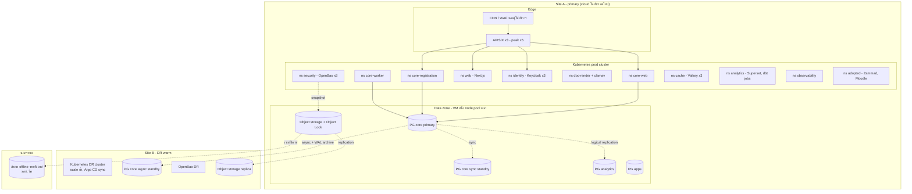
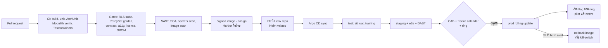
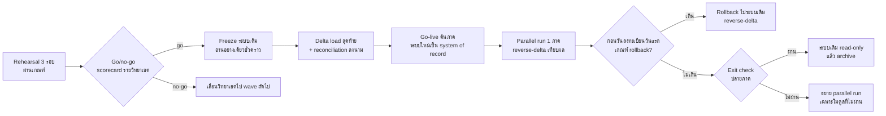

# 11 — การปฏิบัติการ (Environments, Deployment, DR, Testing, Release, Migration, Support, Exit)

> **สถานะ:** v1.0-draft · 28 ต.ค. 2569 · ผู้เขียน: E · ภาษา: ไทย (ศัพท์เทคนิคเป็นภาษาอังกฤษ)
>
> **อ่านคู่กับ:** [00-blueprint](00-blueprint.md) · [07-architecture](07-architecture.md) (MOS, ADR, NFR/SLO/RPO/RTO — เล่มนี้ไม่ซ้ำตัวเลขเหล่านั้น อ้างอิงไป) · [03-academic-calendar](03-academic-calendar.md) (ปฏิทินที่ขับ freeze) · [04-roles-permissions](04-roles-permissions.md) (role ของผู้ดูแลระบบ, break-glass) · [08-data](08-data.md) (migration mapping, retention) · [10-security-compliance](10-security-compliance.md) (PDPA, NCSA, DPA) · [12-roadmap-cost-risk](12-roadmap-cost-risk.md) (วัน go-live, milestones MS-*, freeze FZ-*, bridges BR-*, FTE และต้นทุน)
>
> **ตัวเลขจากเล่ม 12 ที่เล่มนี้ใช้:** ทีมผู้รับจ้าง 28–39 FTE (สูงสุด 39); ทีม IT มกช. 5 → 10 คน (+3 ก่อน R2, +2 ก่อน Wave 1); champion 2 คนต่อวิทยาเขต/โรงเรียน; R2 go-live 1 พ.ค. 2572 พร้อม parallel run ตลอดภาค 1/2572 และระบบเดิมเป็น read-only หลังผ่านเกณฑ์ MS-2b วันที่ 15 ธ.ค. 2572; migration rehearsal 3 รอบ + mock registration day ก่อน R2; rollback window ถึงวันลงทะเบียนวันแรก; ส่งมอบสิ้นสุด มี.ค. 2575 พร้อม independent rebuild test

---

## สารบัญ

1. [Environments (5 ชุด)](#1-environments-5-ชุด)
2. [Kubernetes topology และ sizing](#2-kubernetes-topology-และ-sizing)
3. [CI/CD และ GitOps](#3-cicd-และ-gitops)
4. [Quality gates และ testing strategy](#4-quality-gates-และ-testing-strategy)
5. [Release cadence และ change-freeze calendar](#5-release-cadence-และ-change-freeze-calendar)
6. [Backup (immutable, 3-2-1-1-0)](#6-backup-immutable-3-2-1-1-0)
7. [DR drills และ ransomware recovery](#7-dr-drills-และ-ransomware-recovery)
8. [Key-escrow restore drills](#8-key-escrow-restore-drills)
9. [Incident response](#9-incident-response)
10. [Monitoring และ SLO dashboards](#10-monitoring-และ-slo-dashboards)
11. [Capacity management](#11-capacity-management)
12. [FinOps และตัวขับต้นทุนการดำเนินการ](#12-finops-และตัวขับต้นทุนการดำเนินการ)
13. [Migration cutover รายวิทยาเขต](#13-migration-cutover-รายวิทยาเขต)
14. [Training และ change management](#14-training-และ-change-management)
15. [Support model L0–L3 และ SLA](#15-support-model-l0l3-และ-sla)
16. [Documentation และ handover](#16-documentation-และ-handover)
17. [กรรมสิทธิ์ source code และ escrow](#17-กรรมสิทธิ์-source-code-และ-escrow)
18. [Exit plan และ data portability](#18-exit-plan-และ-data-portability)
19. [ผลการปิด review](#19-ผลการปิด-review)

---

## 1. Environments (5 ชุด)

ลดจาก 8 ชุดใน v0.9 (dev, sit, uat, perf, training, staging, prod, dr) เป็น 5 ชุด (review OPS-01)

| Env | ใช้ทำอะไร | ข้อมูล | ที่ตั้ง | ขนาด |
|---|---|---|---|---|
| **dev** | namespace ชั่วคราวต่อ PR (preview), นักพัฒนา | synthetic | cluster non-prod, site A | เล็ก, ลบอัตโนมัติเมื่อปิด PR |
| **test** | namespace `sit` (เชื่อม sandbox ภายนอก: ThaID test, ธนาคาร), `uat` (ผู้ใช้รายวิทยาเขต), `training` (อบรมและ sandbox ของ champion) | synthetic ที่สมจริง (ไม่ใช่ข้อมูลจริง) | cluster non-prod | กลาง |
| **staging** | pre-prod config เหมือน prod; **ใช้ทำ performance test โดย scale ขึ้นชั่วคราว** ก่อนทุกช่วงพีคและ mock registration day | synthetic ขนาดเท่า prod | site A แยก cluster/namespace ที่ isolate จาก prod | ปกติเล็ก, scale เท่า peak ของ prod ได้ 2–3 ครั้ง/ปี |
| **prod** | ใช้งานจริง | จริง | site A | ตามหัวข้อ 2 |
| **dr** | warm standby | replica | site B | ราว 1/3 ของ prod, scale ขึ้นก่อนช่วงวิกฤต |

**นโยบายข้อมูลใน non-prod (ปิด DATA-07):**
- ค่าเริ่มต้นคือ **synthetic data generator** (ชื่อไทยที่สมจริง, เลขประจำตัว 13 หลักที่ check digit ถูกแต่ไม่ใช่ของจริง, เกรด/การชำระที่กระจายตัวสมจริง, ผู้เยาว์และผู้ปกครองสมมติ)
- **ห้ามนำข้อมูลจริงหรือ masked copy เข้า dev/test/staging**
- Migration rehearsal ใช้ข้อมูลจริงได้เฉพาะใน **migration enclave** ซึ่งเป็น namespace ใน zone ของ prod ที่มี control เท่า prod (RLS, audit, PAM, ไม่มี vendor standing access) และลบหลังจบแต่ละรอบ
- ไม่มีข้อมูล health_vault/safeguarding ในการ rehearsal ยกเว้นตรวจจำนวนและ checksum

---

## 2. Kubernetes topology และ sizing

**หลักการ topology:** NetworkPolicy default-deny ทุก namespace; namespace `core-worker` เป็นที่เดียวที่ออก internet ได้ (egress allow-list ไป ThaID, ธนาคาร, LINE, FCM, SMS, หน่วยงานรัฐ); `security` และ `doc-render` แยก node pool; admin access ผ่าน PAM เท่านั้น; PostgreSQL อยู่บน VM/node pool แยกที่มี NVMe และไม่ถูก autoscaler ลบ

### 2.1 Sizing (ตารางเดียวที่ใช้ทั้งชุดเอกสาร — ปิด IC-20)

ค่าออกแบบมาจาก [07-architecture](07-architecture.md) หัวข้อ 10.3 (origin 2,100 RPS, 120 cmd/s, ยืนยัน 300 cmd/s) **ความสามารถต่อ pod เป็นสมมติฐานที่ต้องยืนยันด้วย load test** (S11-01: core-web 2 vCPU รับ ~250 RPS ผสมอ่าน/เขียน; core-registration 2 vCPU รับ ~60 cmd/s)

| Workload | สเปกต่อ pod | ปกติ | Peak (scale ล่วงหน้า T-2 ชม. จากปฏิทิน) | ที่มา |
|---|---|---|---|---|
| core-web | 2 vCPU / 4 GB | 3 | **10** | 2,100 ÷ 250 = 8.4 → 9 + 1 สำรอง |
| core-registration | 2 vCPU / 4 GB | 2 | **6** | 300 ÷ 60 = 5 + 1 |
| core-worker | 2 vCPU / 4 GB | 2 | 4 | P0 1,000 delivery/s + statement import |
| Next.js portal / back-office | 1 vCPU / 2 GB | 3 / 2 | 8 / 2 | SSR เฉพาะ first load |
| Keycloak | 2 vCPU / 4 GB | 3 | 4 | 50 login/s ทดสอบ |
| APISIX | 2 vCPU / 2 GB | 3 | 6 | 2,100 RPS origin + 1,950 RPS queue poll |
| doc-render | 2 vCPU / 4 GB | 2 | 4 (batch transcript) | 3,000 ฉบับ ≤ 1 ชม. |
| clamd | 2 vCPU / 4 GB | 2 | 2 | — |
| Valkey | 2 vCPU / 8 GB | 3 | 3 | — |
| OpenBao | 1 vCPU / 2 GB | 3 | 3 | — |
| Superset / dbt | 2 vCPU / 4 GB | 2 / job | 2 | — |
| PostgreSQL core | 16 vCPU / 128 GB / NVMe 1 TB | primary + sync standby (site A) + async (site B) | เท่าเดิม | 4,500 row/s ที่ 300 cmd/s; ข้อมูล OLTP 150–300 GB ใน 5 ปี |
| PostgreSQL analytics | 8 vCPU / 64 GB | 1 | 1 | — |
| PostgreSQL apps (Moodle, Zammad, Superset meta) | 4 vCPU / 16 GB | 2 | 2 | — |

| สรุป vCPU (เต็มระบบ หลัง Wave 2) | ปกติ | ช่วง peak |
|---|---|---|
| Site A: app nodes 16 vCPU × 6 (peak × 10) | 96 | 160 |
| Site A: system/edge nodes 8 vCPU × 3 | 24 | 24 |
| Site A: PG core 2 × 16 + analytics 8 + apps 2 × 4 | 48 | 48 |
| Site A: observability 8 vCPU × 3 | 24 | 24 |
| **Site A รวม** | **192** | **256** |
| Site B (DR warm): K8s 3 × 16 + system 2 × 8 + PG 16 + อื่น 8 | 88 | 88–150 (pre-scale ก่อนช่วงวิกฤต) |
| Non-prod: dev+test 32 + staging 24 (staging scale ชั่วคราวได้ถึง ~130 ช่วง perf test) | 56 | ชั่วคราว |
| **รวมใช้งานจริง** | **≈ 336** | — |
| **ความจุที่ทำสัญญา (รวม headroom และการ scale ช่วง peak/perf test)** | **≈ 400 vCPU** — ตรงกับสมมติฐานต้นทุน CA-06 ในเล่ม 12 | v0.9 ≈ 650 vCPU |

**Storage:** object storage ปีแรก ≈ 8–10 TB (ไฟล์ผู้สมัคร ≈ 1 TB/ปี รวมวิดีโอ, เอกสารนักศึกษา ≈ 0.3 TB, PDF ที่ระบบสร้าง ≈ 0.5 TB/ปี, backup PG + WAL 35 วัน ≈ 3–4 TB, log/trace) โตราว 3–4 TB/ปี ×2 sites + สำเนา offline (S11-02)

**Ramp ตาม roadmap:** R1 (2 วิทยาเขต, เฉพาะรับสมัคร) ใช้ราว 30% ของขนาดเต็ม, R2–R3 ราว 45%, Wave 1 ราว 70%, Wave 2 เต็ม (สอดคล้องแถว infra ในเล่ม 12)

---

## 3. CI/CD และ GitOps

- **Trunk-based** + short-lived branch; ทุก merge ต้องผ่าน review 1 คน (2 คนสำหรับโมดูล FIN/ASM/IAM และ migration ของ DB)
- **DB migration (Flyway) แบบ expand/contract:** ทุก release เข้ากันได้ย้อนหลัง 1 release เพื่อ rollback image ได้โดยไม่ต้อง restore DB; การลบคอลัมน์ทำหลังจาก release ที่ไม่ใช้แล้วอย่างน้อย 1 รอบ
- **Infrastructure:** OpenTofu ผ่าน PR + `plan` แนบใน review; state เข้ารหัสใน object storage ในไทย
- **Kyverno** ปฏิเสธ image ที่ไม่ได้ลงนามหรือมี CVE critical ที่ยังไม่ได้รับข้อยกเว้น
- **Release ไม่เท่ากับเปิดฟีเจอร์:** deploy โค้ดทั้งระบบ แต่เปิดฟีเจอร์ตาม ring ราย OrgUnit (ADR-025) และมี kill-switch ราย module × OrgUnit
- **PolicySet, BPMN/DMN, template เอกสาร** เป็น artefact ที่มีเวอร์ชันและ pipeline ของตนเอง (test golden cases + 4-eyes publish) แยกจาก release ของโค้ด เพื่อให้ปรับข้อบังคับได้โดยไม่ต้อง deploy

---

## 4. Quality gates และ testing strategy

### 4.1 Test pyramid และ gate (ปิด DEL-03, DEL-04)

| ชั้น | สิ่งที่ทดสอบ | เครื่องมือ | Gate |
|---|---|---|---|
| Unit | domain logic (GPA, ค่าธรรมเนียม, ค่าปรับลงทะเบียนช้า 2 แบบ, สถานภาพ, eligibility) | JUnit 5 | coverage ≥ 80% ในโมดูล domain + **mutation score ≥ 70%** (PIT) ในโมดูล ASM/REC/FIN/REG |
| Module/integration | repository, RLS, outbox, job queue บน PostgreSQL จริง | Testcontainers (PG + PgBouncer) | ผ่าน 100% |
| **RLS cross-tenant suite** | ทุก repository ถูกเรียกด้วย scope ผิด/ว่าง/สุ่ม ต้องได้ 0 แถว; scope ไม่รั่วข้าม transaction ผ่าน PgBouncer; 6 กรณี tenancy ของ [07](07-architecture.md) หัวข้อ 11.9 | Testcontainers + fuzz | ผ่าน 100% ทุก PR |
| Architecture | boundary ของโมดูล, ไม่มี query ข้าม schema | Spring Modulith verify + ArchUnit | 0 violation |
| **PolicySet golden cases** | กรณีตัวอย่างต่อข้อบังคับแต่ละรุ่น (มหาวิทยาลัย + โรงเรียนกีฬา) ที่นายทะเบียนรับรอง | DMN test runner | 100% ก่อน publish |
| Contract | web ↔ core (Pact); event (AsyncAPI compat); **file contract กับหน่วยงานรัฐที่ไม่มี sandbox** (กยศ., GFMIS, สป.อว., TCAS, ธนาคาร) ด้วย **golden files** | Pact, schema diff, golden file diff | ผ่าน 100% |
| **เอกสารไทย** | visual diff ของ PDF (ชื่อสระซ้อน, เลขไทย, จำนวนเงินตัวอักษร), PDF/A + PDF/UA validation | renderer + pixel diff + veraPDF | 0 diff ที่ไม่ได้อนุมัติ |
| E2E | journey หลักต่อ persona (ผู้สมัคร, นักศึกษา, ผู้ปกครอง, อาจารย์, นายทะเบียน, การเงิน) ภาษาไทย/อังกฤษ | Playwright | journey สำคัญผ่าน 100% |
| Accessibility | axe-core ทุกหน้า + manual screen reader ภาษาไทยก่อน release หลัก | axe-core, NVDA/TalkBack/VoiceOver | 0 critical |
| Device/network | Android ระดับล่าง + โปรไฟล์ 3G, งาน offline ของ judge/นิเทศ | device lab + Lighthouse CI | LCP ≤ 2.5 s, JS ≤ 200 KB/route |
| Migration | mapping ต่อระบบเดิม, reconciliation, เวลา cutover | dbt tests / Great Expectations, rehearsal | ตามหัวข้อ 13 |
| Performance | scenario ในหัวข้อ 4.2 | k6 (AGPL ใช้ภายใน) หรือ Gatling | ตามเกณฑ์ผ่าน |
| Security | SAST, SCA, secrets, DAST, pen test | Semgrep CE, Dependency-Track + Trivy, gitleaks, OWASP ZAP, ผู้ทดสอบอิสระ | ไม่มี High/Critical ค้าง; ASVS L2 (L3 สำหรับ FIN/IAM/ADMIN) |
| Resilience | game day: ฆ่า PG primary, Keycloak node, Valkey, core pod ระหว่าง load test | chaos script | invariant ไม่เสีย, SLO ระหว่างทดสอบตามเป้า |
| DR/restore | restore PITR, OpenBao escrow | หัวข้อ 7–8 | เป็น release gate รายไตรมาส |

**ตัวชี้วัดคุณภาพหลัง release:** defect escape rate (defect ที่พบใน prod ÷ ทั้งหมด) ≤ 10% ต่อ release และแนวโน้มลดลง; ทุก Sev-1/2 ต้องมี test ที่จับได้เพิ่มเข้า suite

### 4.2 Performance scenario: วันลงทะเบียน (registration day)

| ขั้น | รายละเอียด |
|---|---|
| ข้อมูล | synthetic 15,000 นักศึกษา, 30 OrgUnit, catalogue จริงขนาดเท่าภาค, กลุ่มเรียนยอดนิยม 20 กลุ่มที่ที่นั่งน้อยกว่าผู้ต้องการ 3 เท่า |
| T-30 นาที | 19,500 session เข้าคิว (รวมหลายแท็บ), poll ลำดับทุก 20 s (≈ 975 RPS ที่ APISIX) |
| T0 | เปิด window; pre-queue randomisation; ปล่อย 400 คน/นาที |
| T0 → T+15 | ramp ถึง 3,200 active, origin ≈ 1,050 RPS (ตามสัดส่วน 800 page + 160 seat refresh + 64 payment status), command 10/s เฉลี่ย burst 60/s |
| ระดับทดสอบ | (1) **คาด** 1× (2) **ออกแบบ** 2×: 2,100 RPS, 120 cmd/s นาน 30 นาที (3) **ยืนยัน** 300 cmd/s (4) **stress** 3,150 RPS หาจุดแตก |
| Fault injection (ระดับ 2) | นาทีที่ 10: ฆ่า PG primary (Patroni failover); นาทีที่ 15: ฆ่า Valkey primary; นาทีที่ 20: ฆ่า core-registration 2 pod; นาทีที่ 25: ปิด Keycloak ทั้งหมด 2 นาที |
| เกณฑ์ผ่าน | registration command p95 ≤ 1 s, p99 ≤ 2.5 s; API อ่าน p95 ≤ 300 ms; error rate (5xx) ≤ 0.1% ไม่นับช่วง failover ≤ 60 s; **invariant: ไม่มีกลุ่มเรียนใดที่ enrollment > capacity, ไม่มี enrollment ซ้ำ, ไม่มี command ที่ตอบ 201 แต่ไม่มีแถว**; ผู้ที่ login ไว้แล้วลงทะเบียนต่อได้ระหว่าง Keycloak ล่ม; Valkey ล่มแล้วระบบ fail-open ได้ |
| Scenario อื่น | "grade release" (37.5 session/s, login burst), "admission result" (CDN shard 120/s + origin ปิด), "P0 broadcast" (48,195 delivery, push+LINE 95% ≤ 2 นาที), "deadline ส่งเกรด", "fiscal rollover 1 ต.ค." |
| เมื่อไร | ก่อน R2 (mock registration day บน staging ก่อน 1 พ.ค. 2572 ตามเล่ม 12 MS-2), ก่อนทุกช่วงลงทะเบียน (T-4 สัปดาห์), ก่อนแต่ละ wave |

### 4.3 Security testing

- SAST + secrets scan ทุก PR; SCA และ licence ทุก build; DAST (ZAP baseline) ทุก release บน staging; full DAST รายเดือน
- **Pen test อิสระ** ก่อน R1, R2, R3, Wave 1, Wave 2 (5 ครั้งตามเล่ม 12) และรายปีหลังจากนั้น ขอบเขตจาก STRIDE ([07](07-architecture.md) หัวข้อ 13): payment callback, waiting room/bot, RLS bypass, IDOR ข้ามวิทยาเขต, guardian linking, admin/PAM, เอกสารลงนาม
- หน้าเว็บสาธารณะต้องผ่านมาตรฐานความปลอดภัยเว็บไซต์ภาครัฐตั้งแต่ R1 (review_compliance C-16; รายละเอียดเล่ม 10)

### 4.4 UAT ต่อวิทยาเขต

- UAT ทำแยกต่อ OrgUnit ใน namespace `uat` ด้วย configuration ของวิทยาเขตนั้น (ค่าธรรมเนียม ผู้ลงนาม ปฏิทิน รอบรับสมัคร template)
- ผู้ทดสอบ: champion 2 คน + key user ของงานทะเบียน การเงิน กิจการ (และโรงเรียนกีฬา: ครูประจำชั้น หอพัก)
- **เกณฑ์ออก (UAT exit):** 0 Sev-1/Sev-2 ค้าง; ผ่าน ≥ 95% ของ business scenario; ทุก template เอกสารของ OrgUnit ได้รับอนุมัติ golden file; reconciliation ของข้อมูล rehearsal ตรงตามเกณฑ์หัวข้อ 13; **นายทะเบียนและหัวหน้าการเงินของวิทยาเขตลงนาม**

---

## 5. Release cadence และ change-freeze calendar

### 5.1 จังหวะ release

| ประเภท | ความถี่ | หน้าต่าง | ผู้อนุมัติ |
|---|---|---|---|
| Release train (feature + fix) | ทุก 2 สัปดาห์ ไป test/staging; ไป prod สัปดาห์ละไม่เกิน 1 ครั้ง นอก freeze | อังคาร–พุธ 18.00–21.00 น. (rolling, ไม่หยุดระบบ) | CAB รายสัปดาห์ (vendor + IT มกช. + ตัวแทนเจ้าของกระบวนงาน) |
| Configuration ราย OrgUnit (ค่าธรรมเนียม, ปฏิทิน, รอบรับสมัคร) | ตามต้องการ | ทุกเวลา ยกเว้น freeze ของ ring นั้น | maker-checker ของเจ้าของข้อมูล |
| PolicySet / BPMN / template | ตามรอบข้อบังคับ | นอก freeze | 4-eyes + golden tests |
| Hotfix | ≤ 24 ชม. สำหรับ Sev-1/2 | ทุกเวลา | 2 approvals (vendor lead + IT มกช.) |
| Platform upgrade ใหญ่ (PG major, K8s, Keycloak major) | ปีละ 1–2 ครั้ง | หน้าต่างว่าง: **ปลาย ก.ค.–ส.ค., ธ.ค.–ต้น ม.ค., เม.ย.** | CAB + ทดสอบใน staging ≥ 2 สัปดาห์ |
| Security patch critical | ≤ 7 วัน (high ≤ 30 วัน) | อนุญาตแม้ในช่วง freeze | 2 approvals |

### 5.2 Freeze แบบ ring (ปิด OPS-04)

ใช้รหัส freeze ของเล่ม 12 หัวข้อ 2.4 (FZ-GL, FZ-ADM, FZ-REG1, FZ-REG2, FZ-GRADE, FZ-FY, FZ-LOAN, FZ-RPT, FZ-SS) โดยกลไกในเล่มนี้คือ:

1. **วันที่ freeze ดึงจากปฏิทินใน ORG อัตโนมัติ** (calendar-as-configuration) และแสดงใน pipeline; Argo CD ปฏิเสธ sync ไป ring ที่อยู่ใน freeze ถ้าไม่มี emergency approval
2. **Freeze ราย ring:** ช่วงลงทะเบียนของวิทยาเขต X freeze เฉพาะ ring ที่ X อยู่ และเฉพาะโมดูลที่เกี่ยว (REG, FIN-payment, IAM) ส่วน ring อื่นยัง release ได้
3. **Freeze ทั้งระบบ** เฉพาะช่วงที่ทุก ring วิกฤตพร้อมกัน (FZ-GL, FZ-FY สำหรับ FIN, และวันลงทะเบียนถ้าทุกวิทยาเขตเปิดวันเดียวกัน) เป้า: freeze ทั้งระบบ ≤ 6 สัปดาห์/ปี และ freeze รวมต่อ ring ≤ 30% ของปี
4. ในช่วง freeze อนุญาตเฉพาะ security patch และ emergency fix ที่มี 2 approvals และต้องมี postmortem

### 5.3 ปฏิทินรายเดือน (ช่วงพีค 4 ช่วงตาม blueprint ข้อ 8)

| เดือน | ภาระ/เหตุการณ์ | Freeze (ring/โมดูล) | เหมาะกับงาน |
|---|---|---|---|
| ม.ค. | ทดสอบทักษะ/สัมภาษณ์รอบโควตา, รับสมัครโรงเรียนกีฬา ม.1/ม.4 | FZ-ADM ±2 วันรอบประกาศผล | upgrade platform (ต้นเดือน), DR drill เต็มรูปแบบ (ครั้งที่ 1) |
| ก.พ. | **พีค:** สอบปลายภาค 2, กยศ. 28 ก.พ., รับสมัครรอบทั่วไปเริ่ม | FZ-LOAN, FZ-ADM | release ปกตินอกโมดูลที่ freeze |
| มี.ค. | **พีค:** ส่ง/ประกาศเกรดภาค 2, โรงเรียนกีฬาปิดภาค ออก ปพ., OIT เปิด 2 มี.ค. | FZ-GRADE, FZ-SS (ช่วง ปพ.) | — |
| เม.ย. | ภาคฤดูร้อน, สภาอนุมัติผู้จบ | น้อย | **หน้าต่าง upgrade ใหญ่**, pen test, ซ้อม key escrow ไตรมาส 2 |
| พ.ค. | **พีค:** โรงเรียนกีฬาเปิด 16 พ.ค., รายงานตัว, ลงทะเบียนภาค 1, กยศ. | FZ-SS, FZ-REG1 (เริ่ม), FZ-GL ปีที่มี go-live (R2 1 พ.ค. 2572) | load test/mock registration ต้นเดือน |
| มิ.ย. | **พีค:** เปิดภาค 1, late reg, รับปริญญา, snapshot 10 มิ.ย., OIT ปิด 30 มิ.ย. | FZ-REG1, FZ-RPT | — |
| ก.ค. | สัปดาห์เรียน, ยื่นกู้ DSL | น้อย | release ปกติ, ซ้อม key escrow ไตรมาส 3 |
| ส.ค. | สอบกลางภาค | น้อย | **หน้าต่าง upgrade**, DR drill เต็มรูปแบบ (ครั้งที่ 2) |
| ก.ย. | พลศึกษาเกมส์, สอบปลายภาค 1, ปิดยื่นกู้ | FZ-FY เริ่ม 25 ก.ย. | เตรียม fiscal rollover |
| ต.ค. | **พีค:** เกรดภาค 1, ขึ้นปีงบ 1 ต.ค., กยศ. 31 ต.ค., ลงทะเบียนภาค 2, เปิดรับโควตา | FZ-FY (ถึง 7 ต.ค.), FZ-GRADE, FZ-LOAN, FZ-ADM, FZ-REG2 | — |
| พ.ย. | **พีค:** เปิดภาค 2, โรงเรียนกีฬาเปิด 1 พ.ย., snapshot 10 พ.ย. | FZ-REG2, FZ-SS, FZ-RPT, FZ-ADM | — |
| ธ.ค. | สอบกลางภาค 2, ทดสอบทักษะรอบโควตา | FZ-ADM รอบประกาศ | **หน้าต่าง upgrade**, ซ้อม key escrow ไตรมาส 4, tabletop |

วันที่จริงต้องแทนด้วยปฏิทินรายวิทยาเขตที่ยืนยันใน P0 ([03-academic-calendar](03-academic-calendar.md))

---

## 6. Backup (immutable, 3-2-1-1-0)

หลัก **3-2-1-1-0**: 3 สำเนา, 2 สื่อ/ระบบจัดเก็บ, 1 นอก site, **1 immutable/offline**, **0 error** จากการ restore verification อัตโนมัติ (ปิด SEC-08)

| ข้อมูล | วิธี | ความถี่ | เก็บ | ปลายทาง |
|---|---|---|---|---|
| PostgreSQL core (db core, keycloak) | pgBackRest full + diff + WAL archive (`archive_timeout` ≤ 60 s), เข้ารหัส | full รายสัปดาห์, diff รายวัน, WAL ต่อเนื่อง | 35 วัน + รายเดือน 12 เดือน + รายปี 7 ปี | `backup-pg` site A + replicate site B (**Object Lock compliance mode, tenant แยก**) |
| PostgreSQL health_vault | เหมือน core | เหมือน core | **13 เดือน** (crypto-shredding, ADR-011) | เหมือน core |
| PostgreSQL analytics/apps | pgBackRest | รายวัน | 35 วัน | `backup-pg` |
| OpenBao | Raft snapshot เข้ารหัส | รายชั่วโมง | 35 วัน | `backup-openbao` (Object Lock) + escrow package แยก (หัวข้อ 8) |
| Object storage (documents, clean, audit-worm) | versioning + replication ข้าม site; audit เป็น WORM ตาม retention | ต่อเนื่อง | ตาม retention ในเล่ม 08 | site B |
| Git forge (source, IaC, env repo, PolicySet, BPMN, template) | backup ของ forge + **mirror แบบ read-only** ไปที่ object storage | รายวัน + mirror ทุก push | 1 ปี | Object Lock + สำเนา offline |
| Container registry (Harbor) | replication ไป site B + export image ที่ใช้ใน prod | ทุก release | release ที่ใช้งาน + 12 เดือน | site B + offline |
| OpenTofu state | versioning + Object Lock | ทุก apply | 1 ปี | — |
| Keycloak realm export (ไม่มี secret) | export | รายวัน | 35 วัน | — |
| Superset/Zammad/Moodle | DB + ไฟล์ | รายวัน | 35 วัน | — |
| **สำเนา offline** | ชุดล่าสุดของทั้งหมดข้างต้น (DB full + WAL ช่วงสัปดาห์, OpenBao snapshot, Git mirror, image prod) ลงสื่อที่ตัดการเชื่อมต่อ (disk/tape) ที่ **มกช. ถือ** | **รายสัปดาห์** | 8 สัปดาห์หมุนเวียน + รายไตรมาส 1 ปี | ห้องนิรภัยของ มกช. (คนละที่กับ site A/B) |

**การแยก credential:** บัญชีที่ prod ใช้เขียน backup เขียนได้แต่ลบ/ย่อ retention ไม่ได้; บัญชีผู้ดูแล backup tenant ถือโดย `security_admin` ของ มกช. + MFA; compliance mode ทำให้แม้ผู้ดูแลก็ลบก่อนหมดอายุไม่ได้

**Restore verification (เลข 0 ใน 3-2-1-1-0):** job รายวันสุ่ม restore backup ล่าสุดใน environment แยก แล้วรัน integrity checks (จำนวนแถว, checksum ตารางสำคัญ, hash ของ GradeSubmission snapshot, ลำดับเลขใบเสร็จ) ผลต้อง 0 error; PITR ไปเวลาสุ่มรายเดือน

**Backup ไม่ใช่ archive:** เอกสารที่ต้องเก็บตามกฎหมายระยะยาว (ทะเบียนถาวร, การเงิน 10 ปี) เก็บใน records/archive ตามเล่ม 08 ไม่พึ่ง backup รายปี

---

## 7. DR drills และ ransomware recovery

### 7.1 ตารางการซ้อม

| การซ้อม | ความถี่ | เวลา | ขอบเขต | ผ่านเมื่อ |
|---|---|---|---|---|
| Tabletop DR | รายไตรมาส | ม.ค., เม.ย., ก.ค., ธ.ค. | ทีม vendor + IT มกช. + ผู้บริหาร | ทุกคนรู้บทบาท, runbook ปรับปรุง |
| **Full failover ไป site B** | ปีละ 2 ครั้ง | ม.ค. และ ส.ค. (นอกพีค) ใน maintenance window ที่ประกาศ ≥ 7 วัน | promote DB, scale apps, switch DNS/GSLB, ตรวจ integrity, failback | RTO ≤ 4 ชม., RPO ≤ 5 นาที วัดจริง |
| Pre-peak readiness | T-2 สัปดาห์ก่อนทุกช่วงลงทะเบียน | พ.ค., ต.ค. | pre-scale DR, ทดสอบ failover บน staging, ยืนยันขั้นตอน | runbook พร้อม, DR scaled |
| PITR restore | รายเดือน | — | กู้ DB ไปเวลาสุ่มใน environment แยก | ≤ 4 ชม., integrity ผ่าน |
| Game day | ก่อนทุกช่วงลงทะเบียน | ระหว่าง load test บน staging | หัวข้อ 4.2 | invariant ไม่เสีย |
| **Clean-room rebuild (ransomware)** | ปีละ 1 ครั้ง | ส.ค. หรือ ธ.ค. | สร้าง platform ใหม่จาก Git mirror offline + backup immutable ในบัญชี/tenant ใหม่ โดยไม่ใช้ credential เดิม | สร้างได้ภายใน 72 ชม. |
| Breach tabletop | ปีละ 2 ครั้ง (1 ครั้งเป็นข้อมูลผู้เยาว์) | — | หัวข้อ 9 | แจ้งภายในกรอบ 72 ชม. ได้ |

### 7.2 Runbook หลัง DR failover (ปิด NFR-06)

1. Incident Commander (IC) + CIO ตัดสินใจ failover (ไม่ทำอัตโนมัติข้าม site)
2. Promote async standby ที่ site B, บันทึก LSN สุดท้ายที่ได้รับ; Argo CD sync workload; switch DNS/GSLB
3. **ข้อมูลที่อาจหายในช่วง RPO (≤ 5 นาที):**
   - **เลขใบเสร็จ:** เปิด **ชุดเลขใหม่** (prefix/epoch ใหม่ราย OrgUnit + ปีงบ) ห้ามใช้เลขต่อจากเลขสุดท้ายที่ DR เห็น เพราะเลขช่วง RPO อาจถูกออกให้ผู้ใช้แล้ว; บันทึกช่วงเลขที่อาจว่างเป็นรายงานต่อ สตง./ผู้ตรวจสอบภายใน
   - **การชำระเงิน:** reconcile จาก statement ธนาคาร + callback log ของ APISIX/adapter ที่ส่งไป site B; สร้าง payment ที่หายย้อนหลัง
   - **ลงทะเบียน/เอกสาร:** ตรวจ log ของ NOTI/อีเมลที่ส่งไปในช่วง RPO เพื่อหารายการที่ผู้ใช้ได้รับยืนยันแต่ไม่มีในฐานข้อมูล แล้วสร้างคืนหรือติดต่อผู้ใช้
4. ประกาศสถานะทุก 30 นาทีผ่านหน้า status static และ LINE OA
5. Failback เมื่อ site A พร้อม ในหน้าต่างที่ประกาศ

### 7.3 Ransomware: platform compromise (RTO 48–72 ชม.)

| ช่วงเวลา | งาน |
|---|---|
| 0–4 ชม. | ตั้ง incident (SEV-1), แยกเครือข่าย, หยุด credential ที่สงสัยทั้งหมด, เก็บ forensic snapshot, แจ้ง SOC/MSSP, DPO เริ่มนาฬิกา PDPA 72 ชม., เปิดหน้า status static ที่โฮสต์แยก, ผู้บริหารประกาศขยายกำหนดเวลาตามปฏิทิน |
| 4–24 ชม. | ยืนยันว่า backup tenant (compliance mode) และสำเนา offline ไม่ถูกแตะ; สร้าง **clean room** (บัญชี/tenant ใหม่ หรือ site B ที่ล้างแล้ว) จาก Git mirror offline + OpenTofu + Argo CD; ติดตั้ง OpenBao ใหม่แล้วกู้จาก snapshot + escrow (หัวข้อ 8) |
| 24–48 ชม. | Restore PostgreSQL ไปจุดก่อนเหตุ (PITR), ตรวจ integrity (hash ของ GradeSubmission snapshot, ลำดับเลขใบเสร็จ, จำนวนแถว), **หมุนทุก credential/secret/certificate** และ re-issue token ทั้งหมด, สแกน image ใหม่ทั้งหมด |
| 48–72 ชม. | เปิดใช้แบบขั้นบันได: read-only (ดูเกรด/ประกาศ) → ชำระเงินและ reconcile statement ช่วงหยุด → คำร้อง/ลงทะเบียน; เฝ้าระวังเข้ม 30 วัน; postmortem |

บริการขั้นต่ำระหว่างเหตุ: หน้า status/ประกาศ static, ธนาคารยังรับชำระได้, แบบฟอร์มกระดาษมาตรฐานที่นำเข้าภายหลังด้วย 4-eyes

---

## 8. Key-escrow restore drills

ตาม ADR-012 และหัวข้อ 12 ของ [07-architecture](07-architecture.md) (ปิด Top-2)

| รายการ | รายละเอียด |
|---|---|
| ผู้ถือ share | recovery key ของ OpenBao: Shamir 3-of-5; escrow private key ของ KEK: Shamir 3-of-5 — ผู้ถือเป็น **ตำแหน่ง** ของ มกช. (เสนอ: รองอธิการบดีที่กำกับ IT, ผอ.สำนักคอมพิวเตอร์, DPO, ผอ.กองคลัง, ผู้ตรวจสอบภายใน) ไม่มี vendor ถือ share **[รายชื่อต้องยืนยันใน P0]** |
| ที่เก็บ | สื่อ offline (smartcard หรือกระดาษใน sealed envelope ที่มีลายมือชื่อปิดผนึก) ในตู้นิรภัย 2 สถานที่ (ส่วนกลาง + วิทยาเขตอื่น) แต่ละที่มี share ไม่ถึง quorum |
| พิธีกุญแจ (key ceremony) | ครั้งแรกก่อน R1; ทุกครั้งที่ rotate escrow key หรือเปลี่ยนผู้ถือ; มีผู้สังเกตการณ์ (ผู้ตรวจสอบภายใน), บันทึกวิดีโอ, checklist ลงนาม |
| **ซ้อมรายไตรมาส** | ใน environment แยกที่ไม่มีเครือข่ายออก: (1) ผู้ถือ 3 คนประกอบ escrow key (2) ถอดรหัส escrow package (3) import transit KEK เข้า OpenBao ใหม่ (4) **ถอดรหัส canary ciphertext ที่รู้คำตอบ** (ตัวอย่าง DEK ของ health_vault ทดสอบ, HMAC ของเลขบัตรทดสอบที่ต้องได้ค่าตรง) (5) ทำลาย environment และบันทึกผล |
| **ซ้อม restore from zero** | ปีละ 2 ครั้ง: ไม่มี OpenBao เดิมเลย → กู้จาก Raft snapshot + recovery shares + escrow → แอป staging เชื่อมต่อและอ่านข้อมูลเข้ารหัสได้ — เป็น **เงื่อนไข go-live** ของ R1, R2, R3, Wave 1, Wave 2 (สอดคล้อง MS-1 ในเล่ม 12) |
| ผ่านเมื่อ | canary ถอดรหัสได้ 100%, เวลาในการประกอบ quorum ≤ 4 ชม. นับจากเรียกตัว, ไม่มี share ใดสูญหาย |
| เมื่อผู้ถือเปลี่ยนตำแหน่ง | re-split ภายใน 30 วัน และทำลาย share เดิมพร้อมบันทึก |
| ล้มเหลว | ถือเป็น SEV-2; ล้มเหลว 2 ไตรมาสติดต้องทบทวน ADR-012 |

---

## 9. Incident response

### 9.1 ระดับความรุนแรง

| SEV | ตัวอย่าง | Response | อัปเดตสถานะ | การแจ้งภายนอก |
|---|---|---|---|---|
| SEV-1 | ลงทะเบียนล่มในวันพีค, ข้อมูลส่วนบุคคลรั่วไหล, ransomware, ข้อมูลเกรดถูกแก้โดยไม่ได้รับอนุญาต (hash ไม่ตรง) | ≤ 15 นาที 24×7 | ทุก 30 นาที (status page + LINE OA) | PDPA/สกมช. ตามหัวข้อ 9.2 |
| SEV-2 | ชำระเงินไม่เข้า, ThaID login ไม่ได้, วิทยาเขตหนึ่งใช้ฟีเจอร์หลักไม่ได้, ซ้อมกุญแจล้มเหลว | ≤ 30 นาที (24×7 ในช่วงวิกฤต) | ทุก 1 ชม. | ตามความจำเป็น |
| SEV-3 | ฟีเจอร์รองใช้ไม่ได้แต่มี workaround | ≤ 4 ชม. เวลาทำการ | รายวัน | — |
| SEV-4 | คำถาม/ข้อบกพร่องเล็กน้อย | ≤ 1 วันทำการ | — | — |

**บทบาท (RACI):** Incident Commander (vendor L3 lead หรือ IT มกช. ตามเวร), Communications lead (ประชาสัมพันธ์ `pr`), DPO (`dpo`) สำหรับเหตุที่เกี่ยวกับข้อมูลส่วนบุคคล, `security_admin` + SOC/MSSP สำหรับเหตุความมั่นคงปลอดภัย, ผู้บริหารผู้ตัดสินใจ (CIO/รองอธิการบดี) สำหรับ failover และการขยายกำหนดเวลา, `safeguard` เมื่อเกี่ยวกับผู้เยาว์

### 9.2 Personal data breach และ NCSA (ปิด SEC-07)

| เวลา | การดำเนินการ |
|---|---|
| T0 | ตรวจพบ (SOC, ผู้ใช้แจ้ง, vendor แจ้ง) — **ข้อผูกพันใน DPA: vendor/ผู้ให้บริการ cloud/MSSP ในฐานะ processor ต้องแจ้ง มกช. ≤ 24 ชม. หลังทราบ พร้อมข้อมูลขั้นต่ำ** (ประเภทข้อมูล, จำนวนโดยประมาณ, ช่วงเวลา, การควบคุมที่ทำแล้ว) — clause อยู่ในเล่ม 10 |
| T+1 ชม. | ตั้ง incident SEV-1, IC + DPO + security_admin; contain (revoke token/credential, isolate) |
| T+24 ชม. | ประเมินความเสี่ยง (ประเภทข้อมูล, จำนวน, มีผู้เยาว์/ข้อมูลสุขภาพหรือไม่), เก็บหลักฐาน (forensic snapshot, audit hash chain) |
| **≤ T+72 ชม.** | **แจ้งสำนักงานคณะกรรมการคุ้มครองข้อมูลส่วนบุคคล (สคส.)** เมื่อมีความเสี่ยงต่อสิทธิเสรีภาพ (นับจากเวลาที่ มกช. ในฐานะ controller ทราบ) ด้วย template ที่เตรียมไว้ |
| ตามความเสี่ยง | แจ้งเจ้าของข้อมูลเมื่อความเสี่ยงสูง; **ผู้เยาว์: แจ้งผู้ปกครองด้วย** ผ่านช่องทางและข้อความที่เตรียมไว้ล่วงหน้า (ภาษาง่าย, ไม่ส่งรายละเอียดข้อมูลผ่าน LINE) |
| เหตุภัยคุกคามไซเบอร์ | รายงาน สกมช./ThaiCERT และหน่วยงานควบคุมหรือกำกับดูแลตามประมวลแนวทางปฏิบัติ สกมช. — **กรอบเวลาและหน่วยงานกำกับของ มกช. [ต้องตรวจสอบ]** (เล่ม 10, คำถามเล่ม 13) |
| ≤ 10 วันทำการ | postmortem แบบ blameless, action items มีเจ้าของและกำหนดเวลา |

### 9.3 SOC/MSSP (ปิด SEC-06)

- เฝ้าระวัง 24×7 โดย MSSP/SOC (ของ GDCC หรือผู้ให้บริการไทย; ต้นทุนในเล่ม 12 CA-07) เริ่มตั้งแต่ R1
- เป้า: MTTD ≤ 15 นาที และส่งต่อ IC ≤ 15 นาทีสำหรับ alert critical
- Log sources ขั้นต่ำ: WAF/CDN, APISIX, Keycloak (login, admin events), Kubernetes audit, PostgreSQL (pgaudit), OpenBao audit, PAM session, app audit (AUD), object storage access log ของ bucket สำคัญ, Git forge/CI
- Detection-as-code ใน Git พร้อม test (ดูรายการ UEBA ในหัวข้อ 10.3)

---

## 10. Monitoring และ SLO dashboards

### 10.1 Dashboards

| Dashboard | ผู้ใช้ | เนื้อหา |
|---|---|---|
| **SLO ราย journey** | on-call, CIO | availability/latency ของ ลงทะเบียน, login, ดูเกรด, ชำระเงิน, ประกาศ (SLO และ error budget ที่เหลือ ตาม [07](07-architecture.md) หัวข้อ 10.7) |
| Registration day | war room | ขนาดคิว, อัตราปล่อย, active users, cmd/s, 409 rate, lock wait, p95, outbox lag, Valkey hit rate |
| Payment | การเงิน + on-call | callback/นาที, ยอดรอ reconcile, exception, เวลาตั้งแต่ชำระถึงออกใบเสร็จ |
| NOTI | on-call | delivery/s ต่อช่องทาง, P0 progress (% ถึงผู้รับ), bounce/fail ต่อผู้ให้บริการ |
| Platform | dba_sre | PG (CPU, connections, replication lag, WAL rate, bloat), PgBouncer wait, K8s, OpenBao seal status, backup success, restore verification |
| **RUM ราย OrgUnit/ISP** | IT วิทยาเขต | LCP, error rate, เวลาโหลดแยกวิทยาเขตและเครือข่าย (ปิด OBS-01) |
| Integration | L2 | job ที่ล้มเหลว, dead-letter, ไฟล์ที่ส่งหน่วยงานรัฐตามกำหนด (เชื่อมกับ RPT) |
| Security | security_admin | login ผิดปกติ, step-up, export ขนาดใหญ่, break-glass, alert จาก SOC |
| Deadline compliance (ธุรกิจ) | ผู้บริหาร | % ส่งเกรดทัน, % ยืนยัน กยศ., % OIT ครบ ต่อวิทยาเขต |

### 10.2 Alerting

- **Burn-rate แบบ multi-window:** page เมื่อ 1 ชม./5 นาทีเผา budget ≥ 14.4× หรือ 6 ชม./30 นาที ≥ 6×; ticket เมื่อ 3 วัน/6 ชม. ≥ 1×
- Synthetic checks ทุก 1 นาทีจาก **นอกศูนย์ข้อมูล** อย่างน้อย 2 เครือข่าย และจากจุดในวิทยาเขต pilot
- ทุก alert มี runbook link; alert ที่ไม่มี action ถูกลบ
- Alert ส่งเข้า on-call ของ vendor/MSP 24×7 (หัวข้อ 15) และ copy ไป IT มกช. ในเวลาทำการ

### 10.3 UEBA rules ขั้นต่ำ (ปิด SEC-05 ส่วนการตรวจจับ)

1. อ่านข้อมูลบุคคลจำนวนมากผิดปกติต่อผู้ใช้ (bulk read เกิน baseline × 5)
2. เข้าถึงนอกเวลาทำการโดยบัญชีเจ้าหน้าที่ที่ปกติไม่ทำ
3. เข้าถึงข้อมูลข้ามวิทยาเขตนอก scope ปกติ (แม้ RLS อนุญาตผ่าน role ระดับมหาวิทยาลัย)
4. อ่าน health_vault โดยไม่มี care relationship (ถูกปฏิเสธซ้ำ)
5. Export > 500 แถว หรือ export ถี่
6. เปลี่ยนบัญชีรับเงินคืนแล้วขอคืนเงินภายใน cooling period
7. Waiver/คืนเงินมูลค่าสูงหรือถี่จากผู้อนุมัติคนเดียวกัน
8. Login จาก ASN ต่างประเทศของบัญชีเจ้าหน้าที่/admin
9. Break-glass หรือ JIT เขียน schema `asm`/`rec`/`fin`
10. Hash ของ GradeSubmission snapshot ไม่ตรงกับข้อมูลปัจจุบัน (job รายคืน)
11. MFA reset หลายรายการจาก helpdesk คนเดียวในเวลาสั้น
12. ส่งข้อความ 1:1 จากผู้ใหญ่ถึงผู้เยาว์ที่ถูกบล็อกโดย two-adult rule ซ้ำ

---

## 11. Capacity management

| กิจกรรม | ความถี่ | รายละเอียด |
|---|---|---|
| Forecast ต่อภาค | ก่อนทุกภาค | ดึงจำนวนนักศึกษา/กลุ่มเรียน/วันเปิด window จาก ORG + REG คำนวณตามสูตรในเล่ม 07 หัวข้อ 10 (แทน worst case ด้วย log จริงเมื่อมี) |
| Pre-scale ตามปฏิทิน | อัตโนมัติ T-2 ชม. ก่อน window ลงทะเบียน/ประกาศผล/ประกาศเกรด | scale core-web, core-registration, APISIX, Next.js ไปค่า peak (หัวข้อ 2.1); scale กลับ T+6 ชม. |
| Load test ก่อนพีค | T-4 สัปดาห์ | scenario หัวข้อ 4.2 บน staging |
| Capacity review | รายไตรมาส | เทียบการใช้จริงกับเกณฑ์: PG CPU peak < 60%, connection < 70%, disk < 70%, replication lag < 1 s, object storage โตตามคาด; แผนเพิ่ม/ลด |
| Data growth | รายไตรมาส | partition ตาราง time-series (ATH, audit) รายเดือน, purge event publication ที่เสร็จแล้ว, retention ของ log |
| Headroom policy | — | ความจุที่ทำสัญญา ≥ 1.2× peak ที่ออกแบบ; non-prod scale ขึ้นได้ชั่วคราวโดยไม่ต้องจัดซื้อใหม่ (ต้องอยู่ในสัญญา cloud) |
| Trigger ทบทวนสถาปัตยกรรม | เมื่อถึงเกณฑ์ใน [07](07-architecture.md) หัวข้อ 5.4 | เช่น outbox lag p95 > 30 s, dashboard p95 > 3 s |

---

## 12. FinOps และตัวขับต้นทุนการดำเนินการ

จำนวนเงินและ TCO ปีที่ 6–10 อยู่ใน [12-roadmap-cost-risk](12-roadmap-cost-risk.md) หัวข้อ 6.3–6.5 (ปิด OPS-02 ร่วมกัน) เล่มนี้ระบุ **ตัวขับต้นทุน** และ KPI

| ตัวขับต้นทุน | หน่วย | ปริมาณตั้งต้น | วิธีควบคุม |
|---|---|---|---|
| Compute | vCPU-เดือน | ≈ 400 vCPU ที่ทำสัญญา (หัวข้อ 2.1) | MOS, 5 env, scale ตามปฏิทิน, ลด non-prod นอกเวลาทำการ |
| Storage + backup | TB-เดือน (×2 sites + offline) | 8–10 TB ปีแรก, +3–4 TB/ปี | retention ตามเล่ม 08, ลบไฟล์ผู้สมัครที่ไม่ได้รับเลือกตามกำหนด, วิดีโอ ≤ 200 MB |
| Egress/CDN/WAF | GB, request | ขึ้นกับวันประกาศผล | static shard + cache |
| SMS | ข้อความ | P0 ≈ 9,000/ครั้ง + OTP | ใช้ push/LINE ก่อน, SMS เฉพาะผู้ปกครองผู้เยาว์/P0/OTP |
| LINE OA | ข้อความต่อเดือนตามแพ็กเกจ | multicast ตามประกาศ | ส่งเฉพาะเรื่องสำคัญ, ทยอย non-P0 **[ราคาแพ็กเกจต้องตรวจสอบ]** |
| อีเมล | ข้อความ | — | ใช้ระบบอีเมลเดิมของ มกช. ถ้ามี |
| HSM / CA / TSA | อุปกรณ์หรือบริการ, ใบรับรอง, timestamp | HSM 2 sites, ใบรับรององค์กร, timestamp ต่อเอกสาร B-LTA | batch signing, re-timestamp เป็นรอบ |
| SOC/MSSP | บริการรายปี | 24×7 ตั้งแต่ R1 | ขอบเขตตาม log sources หัวข้อ 9.3 |
| ค่าธรรมเนียมธนาคาร | ต่อรายการ | ตามสัญญา biller | เจรจาในสัญญา |
| MA/MSP + on-call | FTE | 8–12 FTE หลังส่งมอบ (เล่ม 12) | automation, runbook, KT ให้ทีม มกช. |
| Pen test / DR exercise | ครั้ง | ตามหัวข้อ 4.3, 7 | — |

**FinOps KPI:** THB/ผู้เรียน/ปี (ผู้เรียน = นักศึกษา + นักเรียนโรงเรียนกีฬา); ค่า non-prod ≤ 30% ของ prod; DR ขณะ idle ≤ 35% ของ prod; % ทรัพยากรที่ติด tag OrgUnit/โมดูล ≥ 95%; รายงานรายเดือนต่อ CIO และทบทวนรายไตรมาส

---

## 13. Migration cutover รายวิทยาเขต

วันที่, milestone (MS-2, MS-2b, MS-W1, MS-W2) และ bridges BR-01..BR-09 อยู่ในเล่ม 12 หัวข้อ 2–3; mapping ข้อมูลอยู่ในเล่ม 08 หัวข้อนี้คือ **กลไก** (ปิด Top-7, DATA-03, DATA-04)

### 13.1 Migration factory

| ส่วน | รายละเอียด |
|---|---|
| Canonical schema + mapping registry | mapping ต่อ product ระบบเดิม (ซึ่งต่างกันรายวิทยาเขต) เก็บใน Git มีเวอร์ชัน; รวม curriculum equivalence mapping (รายวิชาเดิม → CUR) ที่นายทะเบียนอนุมัติ |
| Extract | จากระบบเดิมเป็นไฟล์เปิด (CSV/Parquet + manifest + checksum) เข้า landing zone ใน migration enclave |
| Data quality | DQ dashboard ต่อวิทยาเขต (ครบถ้วน, ซ้ำ, รูปแบบเลขบัตร, รหัสรายวิชา, ยอดเงิน); readiness gate T−6 เดือนต่อ wave ตามเล่ม 12 |
| **Data-fix UI** | คิวรายการผิดพลาดให้งานทะเบียน/การเงินของวิทยาเขตแก้ แบบ 4-eyes และย้อนรอยได้ ไม่แก้ด้วย SQL |
| Load | idempotent, เก็บ `LegacyRecordLink` (id เดิม) ทุก record |
| Reconciliation report | จำนวน record, GPAX ที่คำนวณใหม่เทียบของเดิม, หน่วยกิตสะสม, ยอดค้างชำระ, สถานภาพ — **นายทะเบียนและ ผอ.กองคลัง/หัวหน้าการเงินวิทยาเขตลงนาม** |
| Rehearsal | **3 รอบ** ต่อ cutover (R2: ก.พ.–เม.ย. 2572) จับเวลา end-to-end; รอบสุดท้ายต้องผ่านเกณฑ์ MS-2 ของเล่ม 12 (record ตรง 100%, GPAX ต่าง 0 รายการหรือมีคำอธิบายที่ลงนาม, ยอดค้างชำระตรง 100%) และ **เวลาตัดระบบ ≤ 48 ชม.** |
| Mock registration day | บน staging ก่อน R2 (1 พ.ค. 2572) ด้วยข้อมูล synthetic ขนาดจริง (หัวข้อ 4.2) |

### 13.2 ลำดับ cutover ต่อวิทยาเขต

### 13.3 Bridge กับระบบเดิม

ใช้ bridges ตามเล่ม 12 หัวข้อ 3.2: BR-01 dedupe ผู้สมัครกับวิทยาเขตที่ยังใช้ระบบเดิม, BR-02 initial load + delta รายคืน, **BR-03 reverse-delta (เกรดและการชำระจากระบบใหม่กลับระบบเดิม) เพื่อ parallel run และเป็นทางถอยกลับ**, BR-04 legacy archive, BR-05 งานที่ยังไม่มีโมดูล, BR-06 รายงานระดับมหาวิทยาลัยที่รวมสองระบบ, BR-07 roster ไป LMS เดิม, BR-08 ไฟล์ไป GFMIS/บัญชีกลาง (ถาวร), BR-09 รายชื่อผู้จบจากระบบเดิมสำหรับพิธีรับปริญญารวม ทุก bridge เป็น job ใน core worker (ไม่มี ETL tool แยก) มี dashboard และวันยกเลิก

### 13.4 Parallel run 1 ภาค

- **ระบบใหม่เป็น system of record ตั้งแต่ go-live** (ผู้ใช้ทำธุรกรรมในระบบใหม่เท่านั้น ไม่ให้กรอกซ้ำสองระบบ)
- ระบบเดิมได้รับข้อมูลผ่าน BR-03 (reverse-delta) แล้วคำนวณ GPA/สถานภาพ/ใบแจ้งหนี้ด้วยกฎเดิม → **shadow comparison** รายสัปดาห์และสิ้นภาค
- R2: parallel run ตลอด **ภาค 1/2572**; **exit check MS-2b วันที่ 15 ธ.ค. 2572** (ผล GPA/สถานภาพ/ใบแจ้งหนี้ตรงกัน 100% หรือมีคำอธิบายที่ลงนาม, snapshot 10 พ.ย. ออกจากระบบใหม่ได้, ไม่มี Sev-1 ใน 30 วันล่าสุด) จากนั้นระบบเดิมเป็น **read-only** แล้วเข้าสู่ legacy archive; Wave 1/Wave 2 ทำแบบเดียวกันในภาค 1/2573 และ 1/2574
- ไม่ผ่าน → ขยาย parallel run อีก 1 ภาคเฉพาะโมดูลที่ไม่ผ่าน (ไม่ rollback ทั้งระบบ)

### 13.5 Rollback

| หัวข้อ | กติกา |
|---|---|
| Rollback window | **ตั้งแต่ go-live ถึงวันลงทะเบียนวันแรกของภาค** (ตามเล่ม 12 หัวข้อ 1.2) หลังจากนั้นใช้ fix-forward + kill-switch ราย module × OrgUnit |
| เกณฑ์ rollback (อย่างใดอย่างหนึ่ง) | Sev-1 ที่แก้ไม่ได้ภายใน 24 ชม.; reconciliation ยอดเงินคลาดเคลื่อนเกิน 0.1% ของยอดรวมหรือ > 50 รายการที่อธิบายไม่ได้; ข้อมูลนักศึกษาผิดที่กระทบสิทธิ์ > 1% ของนักศึกษาในวิทยาเขต; ไม่สามารถออกใบเสร็จ/ใบรับรองที่ถูกต้องได้ > 2 วันทำการ |
| ผู้ตัดสิน | steering committee ตามเล่ม 12 หัวข้อ 2.3 |
| กลไก | หยุดธุรกรรมในระบบใหม่ของวิทยาเขตนั้น (kill-switch) → BR-03 ส่ง delta สุดท้ายกลับระบบเดิม → เปิดระบบเดิมให้เขียนได้ → reconciliation ลงนาม → แจ้งผู้ใช้ |
| ทดสอบ | rollback ซ้อมอย่างน้อย 1 ครั้งในรอบ rehearsal |

### 13.6 Legacy archive และ decommission

- ระบบเดิมส่งออกเป็น **Parquet + manifest + checksum** เข้า object storage แบบ immutable พร้อม **viewer อ่านอย่างเดียว** ที่ค้นด้วย person_id/HMAC เลขบัตร, ใช้ RLS ตาม OrgUnit, audit ทุกการเข้าถึง, รองรับคำขอ DSR/สตง./คำขอข้อมูลข่าวสาร (ผ่าน CASE) และการออกเอกสารย้อนหลังที่ไม่ได้ migrate
- ธุรกรรมการเงินย้อนหลังที่ไม่ migrate เก็บใน archive ตาม retention การเงินในเล่ม 08
- **Decommission certificate** ต่อระบบเดิม: ยืนยันการส่งออกครบ (checksum), retention, การลบข้อมูลในระบบเดิม/ฮาร์ดแวร์, ผู้ลงนาม (CIO + นายทะเบียน + DPO)

---

## 14. Training และ change management

ปิด OPS-06 ตัวเลขทีมและงบอยู่ในเล่ม 12 หัวข้อ 5.4 และ 6.3

| องค์ประกอบ | รายละเอียด |
|---|---|
| **Champion** | **2 คนต่อวิทยาเขต/โรงเรียน** (30 OrgUnit → 60 คน) แต่งตั้งเป็นลายลักษณ์อักษร + key user 4 คนต่อวิทยาเขต; บทบาท: ให้ข้อมูล, UAT, อบรมต่อ, ช่วยหน้างาน, รับเรื่อง L0/L1 ในวิทยาเขต |
| Train-the-trainer | vendor อบรม champion ก่อน wave ≥ 3 เดือน; champion อบรมผู้ใช้ในวิทยาเขต |
| หลักสูตรตาม persona | นายทะเบียน, การเงิน, อาจารย์/ที่ปรึกษา, โค้ช, กรรมการสอบทักษะ, เจ้าหน้าที่หอพัก, ครูประจำชั้น, `campus_itadmin`, helpdesk; ผู้ใช้ภายนอก (ผู้สมัคร นักศึกษา ผู้ปกครอง) ใช้ micro-learning + คู่มือภาพ |
| Sandbox | namespace `training` ที่มี synthetic data ของวิทยาเขตนั้น รีเซ็ตได้ |
| สื่อ | micro-learning ภาษาไทย (วิดีโอสั้น ≤ 3 นาที), คู่มือ PDF/UA, คอร์สใน Moodle พร้อมแบบทดสอบ, FAQ ใน knowledge base |
| Communication plan | ต่อ wave: T−6 เดือน (ประกาศ, ผู้บริหารวิทยาเขต), T−3 (อบรม champion), T−1 (อบรมผู้ใช้ ≥ 95% ก่อน go-live ตาม MS-2/MS-W1), T0 (ประกาศถึงนักศึกษา/ผู้ปกครอง ผ่าน ENG + LINE), T+1 สัปดาห์ (คลินิกหน้างาน) |
| Hypercare | 4–6 สัปดาห์หลัง go-live ต่อ wave: floor-walker ในวิทยาเขต (vendor + champion), war room ช่วงลงทะเบียนวันแรก, SLA ตอบสนองเร่งขึ้น |
| วัด adoption | % คำร้องออนไลน์ vs กระดาษ, % ผู้ใช้ active รายสัปดาห์, เวลาปิดคำร้อง, ticket ต่อผู้ใช้ 100 คน, คะแนนความพึงพอใจ, % อาจารย์ส่งเกรดในระบบทันเวลา — ต่อวิทยาเขต |
| การต่อต้านการเปลี่ยนแปลง | สนับสนุนจากรองอธิการบดีประจำวิทยาเขต (MoU ใน P0), เก็บ feedback รายสัปดาห์ช่วง hypercare, ตอบกลับสิ่งที่เปลี่ยนให้เห็น |

---

## 15. Support model L0–L3 และ SLA

| ระดับ | ผู้รับผิดชอบ | หน้าที่ | ช่องทาง / เวลา |
|---|---|---|---|
| L0 Self-service | — | knowledge base ไทย/อังกฤษ, FAQ, สถานะคำร้อง, หน้า status; **ไม่มี chatbot** จนกว่าจะผ่านเงื่อนไข ADR-024 | web, PWA, LINE (ลิงก์) 24×7 |
| L1 | Helpdesk ของ มกช. (ส่วนกลาง + champion/เจ้าหน้าที่วิทยาเขต) บน Zammad | รับเรื่อง, แนะนำการใช้งาน, reset รหัสผ่าน, triage, แจ้งเหตุ | เวลาราชการ; **ขยาย 07.00–22.00 น. ในช่วงวิกฤต** |
| L2 | ทีม application ของ มกช. (2 คนตามเล่ม 12) + vendor application support | ปัญหา config/ข้อมูล, rerun job/dead-letter, data-fix (4-eyes), วิเคราะห์ log/trace | ticket; vendor **on-call 24×7** |
| L3 | Vendor engineering / MSP + SOC | bug fix, performance, infra, security incident, DR | ticket + on-call **24×7** |

**On-call (ปิด OPS-03):** vendor/MSP ถือ rotation L2/L3 24×7 ตลอดสัญญาและ MA (rotation ≥ 6 คนต่อ tier ฝั่ง vendor); ทีม IT มกช. (5 → 10 คน) ถือ L1 + การตัดสินใจทางธุรกิจ และเข้าร่วม rotation แบบ shadow เพื่อ KT; escalation matrix มีชื่อและเบอร์ ทบทวนรายไตรมาส

**ขั้นตอนที่มีความเสี่ยงสูงที่ helpdesk (ปิด SEC-03 ส่วนปฏิบัติการ):**
- **Reset MFA/passkey:** ต้องยืนยันตัวตนด้วย ThaID หรือมาแสดงตัวพร้อมบัตร + บันทึกเหตุผล + **ผู้อนุมัติคนที่สอง**; แจ้งเตือนเจ้าของบัญชีทุกช่องทาง; ห้ามทำผ่านโทรศัพท์อย่างเดียว
- เปลี่ยนอีเมล/เบอร์/บัญชีรับเงินคืนแทนผู้ใช้: ไม่ทำที่ L1
- ผูก guardian: ตามขั้นตอน 2 ช่องทางในเล่ม 04

**SLA (เสนอสำหรับสัญญา MA):**

| SEV | Response | Workaround | Resolution | ช่วงเวลา |
|---|---|---|---|---|
| SEV-1 | 15 นาที | 2 ชม. | 8 ชม. | 24×7 |
| SEV-2 | 30 นาที | 4 ชม. | 2 วันทำการ | 24×7 ในช่วงวิกฤต, นอกนั้น 07.00–22.00 น. |
| SEV-3 | 4 ชม. | 2 วันทำการ | 10 วันทำการ | เวลาทำการ |
| SEV-4 | 1 วันทำการ | — | release ถัดไป | เวลาทำการ |
| Availability | 99.9% รายเดือน (journey นักศึกษา) และ 99.9% ในช่วงวิกฤต วัดด้วย synthetic ภายนอก; SLO ภายใน 99.95% สำหรับ journey ลงทะเบียน ([07](07-architecture.md) หัวข้อ 10.7) | | | service credit ตามสัญญา (ค่าปรับตามระเบียบพัสดุ **[ต้องตรวจสอบ]**) |

---

## 16. Documentation และ handover

| เอกสาร/สิ่งส่งมอบ | รูปแบบ | เมื่อไร |
|---|---|---|
| Architecture (C4, ADR) | Markdown + Mermaid ใน repo | ทุก release (อัปเดต) |
| OpenAPI 3.1 / AsyncAPI | ใน repo, generate อัตโนมัติ | ทุก release |
| Spring Modulith module docs | generate อัตโนมัติ | ทุก build |
| Data dictionary + lineage | dbt docs + เล่ม 08 | ทุก release |
| **Runbook ต่อ alert** และขั้นตอนปฏิบัติการ (backup, restore, failover, key ceremony, rollback, fiscal rollover, เปิดภาค) | Markdown ใน repo | ก่อน go-live ที่เกี่ยวข้อง |
| คู่มือผู้ใช้ตาม persona (ไทย) | เว็บ + PDF/UA | ก่อนอบรม |
| คู่มือผู้ดูแลระบบ + configuration ราย OrgUnit | Markdown + หน้า ADMIN | ทุก release |
| SBOM + ทะเบียน licence + obligation | CycloneDX + ตาราง | ทุก release (เงื่อนไขตรวจรับ) |
| Test evidence (ผล load test, pen test, DR drill, ซ้อมกุญแจ) | รายงาน | ตามรอบ |

**Knowledge transfer (KT) metrics:** จำนวนคนของ มกช. ที่ทำ runbook แต่ละข้อได้เอง (เป้า ≥ 80% ของ runbook หลักทำได้โดยทีม มกช. ภายใน MS-H ตามเล่ม 12), shadow → reverse-shadow ใน on-call, ทีม มกช. ทำ release ได้เองอย่างน้อย 2 ครั้งก่อนส่งมอบ

**Independent rebuild test (ปิด OPS-05):** ก่อนรับมอบแต่ละ release และครั้งสุดท้ายก่อน **ส่งมอบ มี.ค. 2575 (MS-H)** บุคคลที่สามหรือทีม มกช. สร้าง environment ใหม่ทั้งหมดจาก repo ของ มกช. (OpenTofu + Argo CD + backup ตัวอย่าง) **โดย vendor ไม่ช่วย** ภายใน 1 วันทำการสำหรับ platform และ 3 วันรวมการ restore ข้อมูลทดสอบ; สิ่งที่ติดขัดถือเป็นข้อบกพร่องที่ vendor ต้องแก้ก่อนรับมอบ

---

## 17. กรรมสิทธิ์ source code และ escrow

- **ลิขสิทธิ์โอนเป็นของ มกช.:** source code, schema, migration, IaC, pipeline, PolicySet/BPMN/DMN, template, test, เอกสาร (รายละเอียดสัญญาในเล่ม 10/12; review_compliance C-29)
- **ส่งมอบต่อเนื่อง:** ทุก commit อยู่ใน Git forge ของ มกช. ตั้งแต่วันแรก (ไม่ใช่ส่งมอบตอนจบ); vendor ทำงานใน repo ของ มกช.
- **Pre-existing IP** ของผู้รับจ้าง (library/framework ที่มีอยู่ก่อน) ต้องได้ licence ถาวร ไม่จำกัดผู้ใช้ โอนต่อได้ และแก้ไขได้ หรือเป็น OSI licence
- **Build reproducibility:** build ได้จาก repo ด้วยคำสั่งเดียว; dependency ทั้งหมดอยู่ใน registry ที่ มกช. ควบคุม (Harbor + proxy ของ Maven/npm); ไม่มีขั้นตอนลับบนเครื่อง vendor
- **Escrow:** เมื่อ source อยู่ที่ มกช. ตั้งแต่ต้น จึงไม่ต้องใช้ escrow agent สำหรับโค้ด; สิ่งที่ต้อง escrow คือ **ความรู้และ credential**: กุญแจและ recovery share อยู่กับ มกช. ตามหัวข้อ 8 (vendor ไม่ถือ), บัญชี admin ของทุกบริการ (cloud, registry, DNS, CA) เป็นชื่อ มกช. และ vendor ใช้ผ่าน JIT
- บัญชีกับผู้ให้บริการภายนอก (ThaID RP, ธนาคาร biller, LINE OA, SMS, CA/TSA) จดทะเบียนในนาม มกช.

---

## 18. Exit plan และ data portability

| องค์ประกอบ | รายละเอียด |
|---|---|
| **Transition assistance** | ≥ 6 เดือนในสัญญา (ตามเล่ม 12 MS-H) เมื่อสิ้นสุดหรือเปลี่ยนผู้ดูแล: ส่งต่อ on-call, ทำ KT ให้ผู้รับช่วง, ร่วม incident ตามที่ร้องขอ |
| **Data export ทั้งระบบ** | PostgreSQL dump (custom format + plain SQL), Parquet ต่อตาราง + data dictionary, JSON Schema ของ API/event, ไฟล์ใน object storage ตามโครงสร้างเดิม + manifest/checksum, เอกสารลงนามเป็น PDF/A + XML ขมธอ. 25-2563, BPMN/DMN XML, template HTML/CSS, audit log เป็น JSON Lines — ทั้งหมดเป็น open format |
| ทดสอบ export | ปีละ 1 ครั้ง: export ทั้งระบบแล้วนำเข้า PostgreSQL ใหม่ + ตรวจ checksum; ผลเป็นหลักฐานใน MA |
| ไม่ผูกผู้ให้บริการ cloud | Kubernetes มาตรฐาน, S3 API, PostgreSQL ที่ดูแลเอง, OpenTofu module แยก provider layer → ย้าย GDCC ↔ CSP ได้ (ADR-020) |
| ผู้รับช่วงที่เป็นไปได้ | ทีม มกช. (10 คน) + MSP รายใหม่ ผ่าน TOR MA ที่ใช้ runbook และ SLA ชุดนี้ |
| ข้อมูลผู้ใช้ภายนอก | DSR export ต่อบุคคล (PDPA) จาก PRIV ในรูป JSON/PDF |
| สิทธิ์ที่ต้องโอนเมื่อ exit | domain, certificate, บัญชีผู้ให้บริการ, repo, registry (เป็นของ มกช. อยู่แล้วตามหัวข้อ 17) |
| สิ่งที่ vendor ต้องลบ | สำเนาข้อมูลใดๆ ที่อยู่ในความครอบครองหลังส่งมอบ พร้อมหนังสือรับรองการลบ (DPA) |

---

## 19. ผลการปิด review

แหล่ง: [review_architecture.md](<../../research_notes/ออกแบบระบบการศึกษา TNSU ระดับ production/review_architecture.md>) — ปิดครบทุกข้อ ตารางเต็มพร้อมเหตุผลอยู่ใน [07-architecture](07-architecture.md) หัวข้อ 15 ตารางนี้ระบุตำแหน่งในเล่ม 11 สำหรับข้อที่เล่มนี้เป็นเจ้าของ และสถานะของข้ออื่นเพื่อความครบถ้วน · **แก้** / **เลื่อน** / **ปฏิเสธ** / **ส่งต่อ**

### 19.1 ข้อที่เล่ม 11 เป็นเจ้าของหลัก

| ข้อ | การจัดการ | หัวข้อ |
|---|---|---|
| Top-2 Key backup/escrow | **แก้** ขั้นตอนซ้อมกู้รายไตรมาส + restore from zero เป็นเงื่อนไข go-live | 8 |
| Top-7 Parallel run/rollback | **แก้** parallel run 1 ภาค + reverse-delta + rollback window ถึงวันลงทะเบียนวันแรก + เกณฑ์เชิงตัวเลข | 13.4–13.5 |
| NFR-05 Ransomware RTO | **แก้** ขั้นตอน 0–72 ชม. + clean-room rebuild drill รายปี | 7.3, 7.1 |
| NFR-06 RPO กับเลขใบเสร็จ | **แก้** runbook ชุดเลขใหม่ + reconcile; sync replication ข้าม site สำหรับ `fin` **เลื่อน** ไปผล GDCC spike (ต้องรู้ latency) | 7.2 |
| SEC-03 (ส่วนปฏิบัติการ) | **แก้** ขั้นตอน reset MFA ที่ helpdesk | 15 |
| SEC-05 (ส่วนตรวจจับ) | **แก้** UEBA rules 12 ข้อ | 10.3 |
| SEC-06 SIEM/SOC | **แก้** MSSP/SOC 24×7, MTTD ≤ 15 นาที, log sources | 9.3 |
| SEC-07 IR vs PDPA/NCSA | **แก้** timeline, processor ≤ 24 ชม., แจ้งผู้ปกครอง, breach tabletop 2 ครั้ง/ปี; กรอบเวลา NCSA **[ต้องตรวจสอบ]** ส่งต่อเล่ม 10 | 9.2, 7.1 |
| SEC-08 Backup immutability | **แก้** 3-2-1-1-0, compliance mode, tenant แยก, offline รายสัปดาห์, ครอบคลุม Git/registry/OpenBao/state | 6 |
| DATA-03 Legacy archive | **แก้** Parquet + viewer + RLS + DSR + decommission certificate | 13.6 |
| DATA-04 Migration tooling | **แก้** migration factory, data-fix UI 4-eyes, rehearsal 3 รอบ ≤ 48 ชม.; FTE ส่งต่อเล่ม 12 | 13.1 |
| DATA-07 Test data | **แก้** synthetic เป็นค่าเริ่มต้น, migration enclave | 1 |
| OPS-01 8 environments | **แก้** 5 ชุด | 1 |
| OPS-02 TCO | **แก้บางส่วน** ตัวขับต้นทุน + KPI; ตัวเลขส่งต่อเล่ม 12 | 12 |
| OPS-03 On-call | **แก้** vendor/MSP 24×7, ทีม มกช. shadow | 15 |
| OPS-04 Release/freeze | **แก้** freeze ราย ring จากปฏิทิน, เพดาน freeze ทั้งระบบ | 5 |
| OPS-05 Exit plan | **แก้** transition ≥ 6 เดือน, export open format, independent rebuild test, KT metrics | 16–18 |
| OPS-06 Training | **แก้** champion 2 คน/OrgUnit, train-the-trainer, adoption KPI | 14 |
| OPS-07 Moodle | **แก้** อยู่ใน namespace `adopted` เฉพาะเมื่อ มกช. ไม่มี instance เดิม (คำถามเล่ม 13) | 2 |
| DEL-03 Testing strategy | **แก้** pyramid + gate 14 ชั้น | 4.1 |
| DEL-04 Coverage | **แก้** mutation testing + defect escape rate | 4.1 |
| DEL-05 Game day/chaos | **แก้** fault injection ใน registration scenario + game day ก่อนทุกช่วงลงทะเบียน | 4.2, 7.1 |
| OBS-01 RUM | **แก้** dashboard RUM ราย OrgUnit/ISP + synthetic จากวิทยาเขต | 10 |
| IC-20 ค่า HPA ไม่ตรงกัน | **แก้** ตาราง sizing เดียว | 2.1 |
| IC-21 RTO DR 1 vs 2 ชม. | **แก้** อ้างตารางเดียวในเล่ม 07 หัวข้อ 10.8; drill วัด ≤ 4 ชม. | 7 |
| ความเห็นหัวข้อ 3 (infra 650 vCPU) | **แก้** ≈ 400 vCPU ที่ทำสัญญา (ตรงกับเล่ม 12 CA-06) | 2.1 |

### 19.2 ข้ออื่น (เจ้าของคือเล่ม 07 หรือเล่มอื่น)

| ข้อ | สถานะ | เจ้าของ |
|---|---|---|
| Top-1, Top-3, Top-4, Top-8, Top-9, Top-10 | **แก้** | 07 (หัวข้อ 5, 13, ADR-004, ADR-010, ADR-019, ADR-005) |
| Top-5, Top-6 | **แก้** ใน blueprint ข้อ 7 | 12; freeze ในเล่มนี้หัวข้อ 5 |
| ARCH-01..ARCH-11 | **แก้** ทั้งหมด | 07 หัวข้อ 15.2 (ARCH-08 ring ใช้ในเล่มนี้หัวข้อ 3, 5) |
| NFR-01..NFR-04 | **แก้** | 07 หัวข้อ 10 (load test ใช้ตัวเลขในหัวข้อ 4.2) |
| NFR-07 GDCC | **แก้บางส่วน / เลื่อน** การยืนยันไป P0 spike | 07 ADR-020 |
| SEC-01, SEC-02, SEC-04, SEC-09..SEC-13 | **แก้** (SEC-13 device posture **เลื่อน**) | 07 หัวข้อ 15.4; รายละเอียดเล่ม 04/06/10 |
| SEC-14 Teleport | **ปฏิเสธ** Teleport CE (licence) | 07 ADR-023 |
| DATA-01, DATA-02 | **แก้** | 07 |
| DATA-05, DATA-06 | **ส่งต่อ** | 08 |
| DEL-01, DEL-02 | **แก้** ใน blueprint | 12 |
| DEL-06 | **แก้** | 07 AP-11; 10 |
| AI-01 | **เลื่อน** (blueprint ข้อ 9.12) | 07 ADR-024; L0 ไม่มี chatbot (หัวข้อ 15) |
| AI-02 | **ส่งต่อ** | 06 |
| A11Y-01 | **แก้** | 07 หัวข้อ 11.7; test ในเล่มนี้หัวข้อ 4.1 |
| IC-01..IC-05, IC-12, IC-14, IC-15, IC-17..IC-19, IC-22, IC-23, IC-25 | **แก้** | 07 หัวข้อ 15.7 |
| IC-06, IC-07 | **แก้** ใน blueprint | 12 |
| IC-08, IC-09 | **ส่งต่อ / แก้** ด้วยตัวเลขเล่ม 12 (28–39 FTE) | 12 |
| IC-10, IC-11 | **ส่งต่อ** | 04 |
| IC-13 | **ส่งต่อ** | 06 |
| IC-16 | **ส่งต่อ** | 05 |
| IC-24 | **ส่งต่อ** | 01 |
| คำถาม Phase 0 ข้อ 1–7 | **ส่งต่อ** | 13 |

### 19.3 สมมติฐานของเล่มนี้

| รหัส | สมมติฐาน | ผลถ้าผิด |
|---|---|---|
| S11-01 | core-web 2 vCPU รับ ~250 RPS, core-registration ~60 cmd/s | จำนวน pod ช่วง peak เปลี่ยน (ยืนยันใน load test ก่อน R2) |
| S11-02 | object storage ปีแรก 8–10 TB, โต 3–4 TB/ปี | ต้นทุน storage ในเล่ม 12 เปลี่ยน |
| S11-03 | ผู้ให้บริการ cloud ให้ scale ชั่วคราว (staging, DR pre-scale) โดยไม่ต้องจัดซื้อใหม่ | ต้องจองความจุถาวรเพิ่ม |
| S11-04 | มกช. มีสถานที่เก็บสื่อ offline 2 แห่งที่ปลอดภัย | ต้องใช้บริการ vault ภายนอกในไทย |
