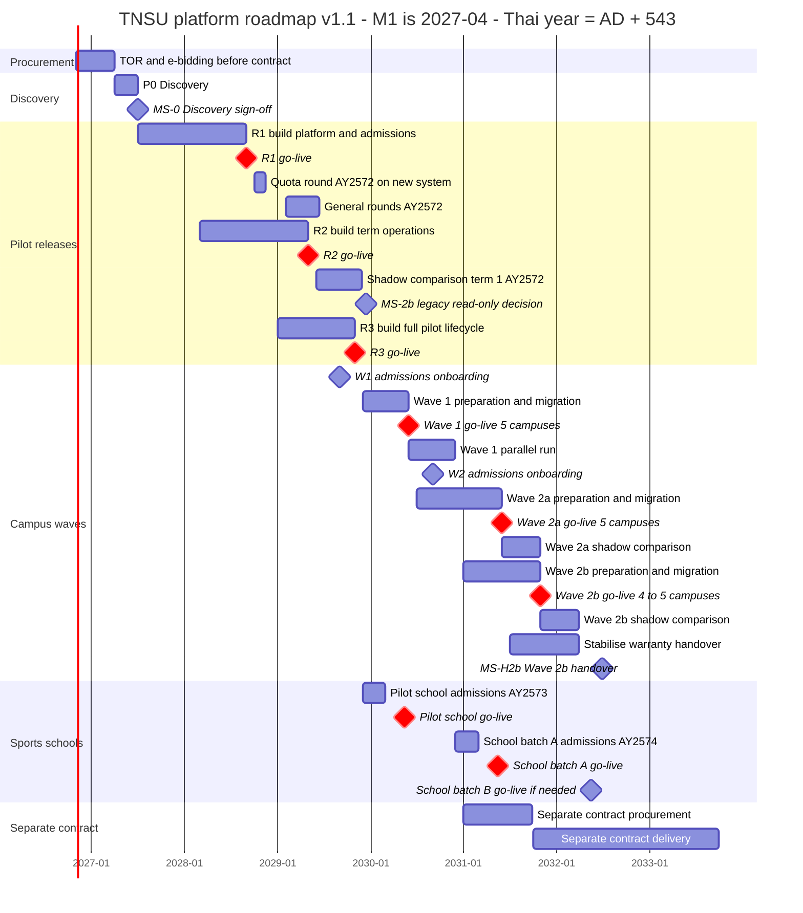

# 12 — Roadmap, ทีมงาน, ต้นทุน และความเสี่ยง

> **สถานะ:** v1.1-draft · 28 ต.ค. 2569 (แก้ตาม review v1.0 และ [00-fix-decisions-v1.1](00-fix-decisions-v1.1.md) D-01, D-02, D-03, D-07, D-10, D-11) · ผู้เขียน: G · ภาษา: ไทย (ศัพท์เทคนิคเป็นภาษาอังกฤษ)
> **อ่านคู่กับ:** [00-blueprint](00-blueprint.md) (anchor หัวข้อ 7–9) · [01-overview](01-overview.md) (Assumptions register) · [03-academic-calendar](03-academic-calendar.md) · [06-modules](06-modules.md) · [07-architecture](07-architecture.md) · [08-data](08-data.md) (migration) · [10-security-compliance](10-security-compliance.md) (procurement, PDPA) · [11-operations](11-operations.md) (cutover, parallel run, change freeze, exit plan) · [13-open-questions](13-open-questions.md)
> **ปีที่ใช้:** ข้อความใช้ พ.ศ. ส่วน Mermaid gantt ใช้ ค.ศ. (พ.ศ. − 543): 2570 = 2027 · 2571 = 2028 · 2572 = 2029 · 2573 = 2030 · 2574 = 2031 · 2575 = 2032 · 2576 = 2033
> **เดือนสัญญา:** M1 = เม.ย. 2570 (สมมติฐานตาม blueprint หัวข้อ 7) ดังนั้น M12 = มี.ค. 2571, M60 = มี.ค. 2575 · "ปีสัญญา" Y1 = เม.ย. 2570–มี.ค. 2571 … Y5 = เม.ย. 2574–มี.ค. 2575 · ทุกวันที่ของ release แสดงเลขเดือนสัมพัทธ์ (M) คู่กันเสมอ · **ถ้าเริ่มสัญญาหลัง ต.ค. 2570 ทุก release เลื่อน 12 เดือนตามรอบรับสมัคร (หัวข้อ 1.3 scenario S3)** (D-02)
> **ขอบเขตการแก้ v1.1 (D-01):** ส่วนต้นทุน (หัวข้อ 6) คงตัวเลข v1.0 ทุกบรรทัด การเปลี่ยนที่มาจากการแก้ระบบ (HSM ไซต์ที่ 2, helpdesk L1, backfill champion, Wave 2a/2b, on-call) แสดงเป็น **หมายเหตุผลกระทบ** ในหัวข้อ 6.8 โดยไม่คำนวณราคาใหม่ · KPI ทุกตัวอ้างรหัส `KPI-xx` จาก KPI dictionary ใน [14-ux-adoption](14-ux-adoption.md) หัวข้อ 12.1 (D-10)

**กติกาความน่าเชื่อถือ:** ตัวเลขต้นทุนทุกตัวในเล่มนี้เป็น **สมมติฐานเพื่อวางแผน** อ้างด้วยรหัส **CA-xx** (Cost/roadmap Assumption) ซึ่งต้องนำไปลงทะเบียนใน Assumptions register ของเล่ม 01 ส่วนราคากลางจริงต้องให้คณะกรรมการกำหนดราคากลางของ มกช. จัดทำ วันที่ในปฏิทินที่ติด 🟡 คือค่าที่อนุมาน ต้องยืนยันใน P0

---

## 0. สรุปสำหรับผู้บริหาร

| ประเด็น | สาระ |
|---|---|
| วันสำคัญ | P0 Discovery **เม.ย.–มิ.ย. 2570 (M1–M3)** → R1 "รับสมัคร" **1 ก.ย. 2571 (M18)** (ทันรอบโควตา ต.ค. 2571 ของปีการศึกษา 2572) → R2 "เปิดภาค" **1 พ.ค. 2572 (M26)** (+ shadow comparison ภาค 1/2572) → R3 "ครบวงจร pilot" **1 พ.ย. 2572 (M32)** → โรงเรียนกีฬานำร่อง **16 พ.ค. 2573 (M38)** → Wave 1 (+5 วิทยาเขต) **1 มิ.ย. 2573 (M39)** → โรงเรียนกีฬาชุด A **16 พ.ค. 2574 (M50)** → **Wave 2a (+5 วิทยาเขต) 1 มิ.ย. 2574 (M51)** → **Wave 2b (+4–5 วิทยาเขต) 1 พ.ย. 2574 (M56)** → ส่งมอบและรับประกัน ถึง **มี.ค. 2575 (M60)** → โรงเรียนกีฬาชุด B **16 พ.ค. 2575 (M62) ถ้าจำเป็น** → สัญญาแยก ตั้งแต่ **ต.ค. 2574 (M55)** · ถ้าเริ่มสัญญาหลัง ต.ค. 2570 ทุกวันเลื่อน 12 เดือน |
| Pilot | วิทยาเขต **ชลบุรี + มหาสารคาม** (คงตาม blueprint หลักฐานไม่ขัด) · โรงเรียนกีฬานำร่องที่เสนอ: **โรงเรียนกีฬาจังหวัดสุพรรณบุรี** (สมมติฐาน CA-11) |
| ทีมผู้รับจ้าง | สูงสุด **39 FTE** (ต.ค. 2571–พ.ค. 2572) · รวม **1,687 คน-เดือน** ใน 60 เดือน (คำนวณใหม่ แสดงสูตรในหัวข้อ 5) |
| ทีม มกช. | รวม **≈ 1,174 คน-เดือน** (product owner, เจ้าของกระบวนงาน, IT, champion 2 คน/OrgUnit) · ทีม IT ขยายจาก **5 → 10 คน** |
| ต้นทุน 5 ปี (เม.ย. 2570–มี.ค. 2575) | **≈ 248–403 ล้านบาท** (ไม่รวม VAT, รวม contingency 10–15%) · ในจำนวนนี้เป็นค่าจ้างผู้รับจ้างหลัก 182.6–267.7 ล้านบาท |
| เทียบงบ มกช. | เฉลี่ย 49.6–80.7 ล้านบาท/ปี ≈ **2.7–4.4%** ของงบปี 2569 (1,853.9 ล้าน) หรือ **2.9–4.7%** ของร่างงบปี 2570 (1,716.84 ล้าน) · ปีสูงสุด (Y3) ≈ 3.4–5.6% ของร่างงบ 2570 |
| **ค่าดำเนินการหลังปีที่ 5** | **≈ 20.9–43.7 ล้านบาท/ปี** ≈ 1.2–2.5% ของร่างงบปี 2570 (≈ 1,250–2,600 บาท/ผู้เรียน/ปี) |
| สัญญาแยก (2574+) | X-HR, X-PAY, X-PLAN, X-PROC, X-RES, X-LIB, X-MEET, X-CMS (ส่วนที่เหลือ), X-INTL, REV, LAB ขั้นสูง, Flutter, AI ≈ **50–118 ล้านบาท** (395–620 คน-เดือน) |
| ความเสี่ยงสูงสุด | (1) สัญญาเริ่มช้า/ R1 พลาดรอบโควตา ซึ่งทำให้ทุก release เลื่อน **12 เดือน** ไม่ใช่ไม่กี่สัปดาห์ (2) คุณภาพข้อมูลระบบเดิม 17+13 แห่ง (3) ขีดความสามารถทีม IT มกช. (4) การแยกกระทรวงและงบที่ลดลง |

---

## 1. หลักการวางแผนตามปฏิทินจริง

### 1.1 จุดยึดในปฏิทิน (calendar anchors)

แต่ละ release ผูกกับเหตุการณ์ในปฏิทินที่ "เลื่อนไม่ได้" ถ้าพลาด จะต้องรอรอบถัดไป ซึ่งมักห่างกัน 6 หรือ 12 เดือน

| Anchor | วันที่ (หลักฐาน) | Release ที่ต้องพร้อมก่อน | ผลถ้าพลาด |
|---|---|---|---|
| ประกาศรับสมัครประเภทโควตาของวิทยาเขต | ปลาย ก.ย. (กรุงเทพ 22 ก.ย. 2569 [tnsubkk](https://www.tnsubkk.ac.th/%E0%B8%9B%E0%B8%A3%E0%B8%B0%E0%B8%81%E0%B8%B2%E0%B8%A8%E0%B8%A1%E0%B8%AB%E0%B8%B2%E0%B8%A7%E0%B8%B4%E0%B8%97%E0%B8%A2%E0%B8%B2%E0%B8%A5%E0%B8%B1%E0%B8%A2%E0%B8%81%E0%B8%B2%E0%B8%A3%E0%B8%81-97/), ชลบุรี 30 ก.ย. 2569 [tnsucbi](https://www.tnsucbi.ac.th/)) | R1 (ตั้งค่ารอบ/ที่นั่ง/ประกาศ ต้องเริ่มต้น ก.ย.) | รอบโควตาปีนั้นใช้ระบบเดิม |
| เปิดรับสมัครโควตา (เรียนดี/นักกีฬา) | ราว 1 ต.ค.–7 พ.ย. (รอบ 2569 [LINE Today](https://today.line.me/th/v3/article/wJMap0G)) | R1 | ช่องทางที่มีผู้สมัครมากที่สุดของปีเลื่อนไป 12 เดือน |
| รอบทั่วไป 1–6 | ราว ก.พ.–มิ.ย. (ชลบุรีรอบ 5 ประกาศ 8 มิ.ย. 2569 รายงานตัว 9 มิ.ย. [tnsucbi](https://www.tnsucbi.ac.th/%E0%B8%9B%E0%B8%A3%E0%B8%B0%E0%B8%81%E0%B8%B2%E0%B8%A8%E0%B8%A3%E0%B8%B2%E0%B8%A2%E0%B8%8A%E0%B8%B7%E0%B9%88%E0%B8%AD%E0%B8%9C%E0%B8%B9%E0%B9%89%E0%B8%A1%E0%B8%B5%E0%B8%AA%E0%B8%B4%E0%B8%97%E0%B8%98-9/)) | R1 (ถ้า R1 พลาดโควตา ยังเข้ารอบทั่วไปได้) | ใช้ระบบเดิมทั้งปี |
| ภาค 1 ของมหาวิทยาลัย | 🟡 ราว มิ.ย.–ต.ค. (CA-02) | R2 ต้อง live ≥ 4 สัปดาห์ก่อนวันลงทะเบียน | เลื่อนไปภาค 2 (เป็นทางเลือกสำรองเท่านั้น ดู 1.3) |
| ภาค 2 ของมหาวิทยาลัย | 🟡 ราว พ.ย.–มี.ค. | R3 | เลื่อน 6 เดือน |
| ภาค 1 โรงเรียนกีฬา | 16 พ.ค.–30 ก.ย. ([kruchiangrai](https://www.kruchiangrai.net/2026/04/26/%E0%B8%9B%E0%B8%8F%E0%B8%B4%E0%B8%97%E0%B8%B4%E0%B8%99%E0%B8%9B%E0%B8%B5%E0%B8%81%E0%B8%B2%E0%B8%A3%E0%B8%A8%E0%B8%B6%E0%B8%81%E0%B8%A9%E0%B8%B2-2569/)) มีแหล่งที่ระบุ 14 พ.ค. | โรงเรียนกีฬาแต่ละ wave | เลื่อน 12 เดือน (ไม่ควรเปลี่ยนระบบกลางปีของเด็กหอพัก) |
| รับนักเรียน ม.1/ม.4 | ประกาศ ธ.ค. สมัคร ม.ค. ทดสอบ ก.พ. ([ยะลา](https://yalasportsschool.ac.th/), [สุพรรณบุรี](https://www.spbss.ac.th/index.php?option=com_content&view=article&id=681&catid=82&Itemid=639)) | ADM channel โรงเรียนกีฬา (ทางเลือก ดู 2.1) | ใช้วิธีเดิม 1 ปี |
| ขึ้นปีงบประมาณ | 1 ต.ค. (กลางภาค 1) | FIN ต้องผ่านการซ้อม fiscal rollover | — (เป็น freeze window) |
| กยศ. ยืนยันเบิก | ภาค 1 ภายใน 31 ต.ค., ภาค 2 ภายใน 28 ก.พ. (blueprint หัวข้อ 2) | SCH (R2) | — (freeze window) |
| ตัดยอดข้อมูลนักศึกษา | 🟡 10 มิ.ย. และ 10 พ.ย. | RPT core (R2) | ต้องรวมไฟล์จาก 2 ระบบด้วยมือ |
| พลศึกษาเกมส์ (17 วิทยาเขต) | ราว 1–10 ก.ย. ([TNSU มหาสารคาม](https://www.tnsumk.ac.th/web/index.php/component/content/article/19-news-campus/1128-49-17?Itemid=437)) | ATH (ลาแข่งแบบยกคณะ) | ไม่ใช่ anchor ของ go-live แต่ห้ามมี go-live ทับ |
| พิธีพระราชทานปริญญาบัตรรวม | ราว มิ.ย. (22 มิ.ย. 2569) | GRD (R3) | ใช้รายชื่อจากระบบเดิม |
| OIT ปิดรับ | 30 มิ.ย. (blueprint หัวข้อ 2) | RPT OIT registry (W-136) + X-CMS ส่วน ITA แสดงผล (R1) | — |

### 1.2 ทำไม go-live ทำได้เฉพาะรอยต่อภาค

1. **ธุรกรรมทุกอย่างในภาคผูกกันเป็นชุดเดียว:** การลงทะเบียน → ใบแจ้งหนี้ → การชำระ → เวลาเรียน (ATT) → สิทธิ์สอบ → เกรด → สถานภาพ ถ้าเปลี่ยนระบบกลางภาค ข้อมูลครึ่งภาคจะอยู่คนละระบบ การคำนวณ มส. 80%, ค่าปรับ และ GPA ปลายภาคจะต้องรวมจากสองแหล่ง ซึ่งเป็นจุดที่เกิดข้อผิดพลาดมากที่สุด
2. **กฎวิชาการเป็น PolicySet ต่อรุ่น** (blueprint ข้อ 9.6) และค่าธรรมเนียมกำหนดต่อภาค การเริ่มต้นที่ต้นภาคทำให้ทุก cohort เริ่มด้วยชุดกฎและ fee schedule ที่สมบูรณ์
3. **เอกสารราชการมีเลขควบคุม:** ใบเสร็จ (gapless) คำร้อง และคำสั่ง ถ้าเปลี่ยนกลางภาคจะเกิดเลขสองชุดในงวดเดียวกัน ซึ่ง สตง. ตรวจยาก
4. **ผู้ใช้ไม่ต้องเรียนรู้ระบบใหม่ในช่วงพีค:** ต้นภาคมีช่วงว่างให้ฝึกอบรมและ hypercare ก่อนถึงสอบกลางภาค
5. **มีจุด rollback ที่ชัด:** ก่อนวันลงทะเบียนวันแรก ยังย้อนกลับไปใช้ระบบเดิมได้ทั้งภาค (ดู 2.3)
6. **R1 ยกเว้นเพียงข้อเดียว:** R1 (ก.ย. 2571) อยู่กลางภาค 1 แต่ไม่แตะนักศึกษาปัจจุบันเลย จึงยึดรอยต่อของ **รอบรับสมัคร** แทนรอยต่อภาค ส่วน R3 (พ.ย.) และ wave ทุก wave (มิ.ย. / 16 พ.ค.) อยู่ที่ต้นภาคพอดี และ **ไม่มี wave ใด go-live กลางภาค** (แก้ IC-06/RF I-16 ของ v0.9); Wave 2b (1 พ.ย.) เป็นต้นภาค 2

### 1.3 กติกาการเลื่อน (slip rule) และ scenario ตามวันเริ่มสัญญา

เพราะ anchor เกิดปีละครั้ง การล่าช้าจึง **ไม่ต่อเนื่อง** เช่น R1 ช้า 1 เดือนอาจทำให้พลาดรอบโควตาทั้งปี กติกาที่เสนอ:

- **Buffer ต่อ release:** R1 มี feature-freeze 1 มิ.ย. 2571 และ go/no-go 15 ส.ค. 2571 (buffer ≈ 10 สัปดาห์) · R2 feature-freeze 1 ก.พ. 2572, go/no-go 15 เม.ย. 2572 · Wave มี readiness gate ที่ T−6 เดือน และ go/no-go ที่ T−3 สัปดาห์
- **ลด scope ก่อนเลื่อนวัน:** แต่ละ release มี "scope cut list" ที่ steering อนุมัติไว้ล่วงหน้า (เช่น R1 ตัด TCAS adapter, clearing ข้ามวิทยาเขต, FAQ chatbot ก่อนตัดสิ่งอื่น)
- **ถ้าต้องเลื่อน ให้เลื่อนไป anchor ถัดไปที่ทำได้จริง** และประกาศให้วิทยาเขตทราบล่วงหน้า ≥ 3 เดือน

| Scenario | วันเริ่มสัญญา (M1) | ผลต่อแผน |
|---|---|---|
| S0 ฐาน | 1 เม.ย. 2570 | ตามแผนในเล่มนี้ |
| S1 ช้าเล็กน้อย | ≤ 1 ก.ค. 2570 | ย่อ P0 เหลือ 2 เดือน และใช้ buffer ของ R1; R1 ยัง 1 ก.ย. 2571 แต่ต้องตัด scope ตาม cut list (TCAS adapter, clearing ภายใน) |
| S2 ช้าปานกลาง | ก.ค.–ต.ค. 2570 (เช่น งบเริ่มปีงบ 2571) | R1 พลาดรอบโควตา 2571 → **R1 go-live ก.พ. 2572 สำหรับรอบทั่วไป** (pilot ใช้ระบบเดิมสำหรับรอบโควตา); R2/R3/Wave คงวันเดิมได้ถ้าทีม R2 เริ่มตามแผน |
| S3 ช้ามาก | หลัง ต.ค. 2570 | ทุก release เลื่อน **12 เดือน** ตามรอบรับสมัคร (เลข M คงเดิมนับจากวันเริ่มสัญญาจริงไม่ได้ เพราะ anchor เป็นปฏิทิน): R1 ก.ย. 2572, R2 พ.ค. 2573, R3 พ.ย. 2573, Wave 1 มิ.ย. 2574, Wave 2a มิ.ย. 2575, Wave 2b พ.ย. 2575 ซึ่งเกินกรอบ 5 ปี และต้องประเมินต้นทุนใหม่ (ทีมต้องรอ anchor นานขึ้น) |

---

## 2. Roadmap

### 2.1 ตาราง release (ขยายจาก blueprint หัวข้อ 7 โดยไม่เปลี่ยน anchor)

| Release | Go-live | ขอบเขต (รหัสโมดูลตาม blueprint หัวข้อ 4) | ใช้ที่ไหน | งานเตรียมที่ซ่อนอยู่ |
|---|---|---|---|---|
| **P0 Discovery** | เม.ย.–มิ.ย. 2570 (M1–M3) | ยืนยันสมมติฐาน (ปฏิทินจริงรายวิทยาเขต ปีการศึกษา 2571–2573, รอบรับสมัคร, สถานะ TCAS), data profiling ระบบเดิมทุกวิทยาเขต + โรงเรียน, threat model v1, licence register, ตัดสินใจ hosting (GDCC/CSP), ยืนยัน pilot และ wave, ร่าง PolicySet, เริ่มยื่น ThaID RP/ธนาคาร | — | ตั้งทีม มกช. (PO, champion pilot), ลงนาม MoU ของรองอธิการบดีประจำวิทยาเขต pilot |
| **R1 "รับสมัคร"** | **1 ก.ย. 2571** (M18) | IAM (รวมผู้ปกครองผู้สมัครผู้เยาว์), ORG + ปฏิทิน, NOTI, ENG, SVC (บางส่วน), CASE (ร้องเรียน/อุทธรณ์ผลคัดเลือก), ADM, **REC ขั้นต่ำ** (Person master + GuardianRelation; ADM สร้าง Person ผ่าน API ของ REC; ยังไม่ออกรหัสนักศึกษา), **CUR ขั้นต่ำ** (ProgramOffering + AccreditedIntakeCap ของ pilot), FIN (ค่าสมัคร/ค่ายืนยันสิทธิ์), **DOC ขั้นต่ำ** (e-Receipt ค่าสมัคร, บัตรประจำตัวผู้สอบ, PDF ประกาศผล; template + PAdES ตราหน่วยงาน), PRIV, AUD, ADMIN ขั้นต่ำ (4-eyes config, job monitor, break-glass), **HLT ขั้นต่ำ** (`hlt_vault` + medical clearance ก่อนสอบทักษะ + บันทึกบาดเจ็บวันสอบ; ADM เห็นเฉพาะสถานะ), **FAC ขั้นต่ำ** (ทะเบียน facility + จองสนามสอบทักษะ), **RPT ขั้นต่ำ** (OIT registry W-136 ทั้งมหาวิทยาลัย), X-HELP, X-CMS ส่วน OIT (แสดงผล) — ทุกส่วนอยู่ในโมดูลเจ้าของ ไม่ฝังใน ADM/FIN (D-03) | 2 วิทยาเขต pilot รับสมัคร ป.ตรี ปีการศึกษา 2572 ทุกช่องทาง (โควตา ต.ค. 2571, ทั่วไป ก.พ.–มิ.ย. 2572); ช่องทางบัณฑิตศึกษาของชลบุรี (เปิดราว 1 ต.ค.–พ.ย.) เข้าได้ถ้าผ่าน go/no-go ไม่เช่นนั้นใช้ระบบเดิม 1 ปี; หน้า OIT ใช้ได้ทั้งมหาวิทยาลัย | สร้าง platform ทั้งชุด (Minimum Operable Stack ในเล่ม 07), KEK escrow ceremony + ซ้อมกู้, DR test, DPIA สำหรับผู้สมัครผู้เยาว์ |
| **R2 "เปิดภาค"** | **1 พ.ค. 2572** (M26) | onboarding นักศึกษาใหม่, REC เต็ม, CUR เต็ม, REG (+ waiting room), ATT, EXM, ASM, FIN เต็ม, SCH/กยศ., HOU (+ ตม.30), AFF, HLT (พื้นฐาน), **ATH core + eligibility engine + team travel/per diem/เงินยืม (W-30/W-31)** ทันพลศึกษาเกมส์ ก.ย. 2572, **GRD ขั้นต่ำ** (ยื่นขอสำเร็จการศึกษา, holistic pre-audit, clearance) เพื่อรับคำร้องจบช่วง มิ.ย.–ต.ค. 2572, **FAC เต็ม** (ห้องเรียน/ห้องสอบสำหรับ REG/EXM, ตารางซ้อม), RPT core, ANA พื้นฐาน + legacy analytics feed (BR-10), DOC (เอกสารมาตรฐาน: ใบรับรอง, transcript ฉบับกระดาษ/PDF, ใบเสร็จ), CASE เต็ม, SAFE (โครงสร้าง + `StaffClearance` สำหรับนักศึกษาฝึกสอน) (D-03) | pilot: นักศึกษาใหม่ 2572 + ย้ายนักศึกษาปัจจุบันที่รอยต่อปีการศึกษา + **parallel run แบบ shadow comparison ตลอดภาค 1/2572** (ระบบใหม่เป็นหลัก ระบบเดิม read-only + รายงานเทียบ, D-07) | migration rehearsal ≥ 3 รอบ, mock registration day บน staging, ซ้อม fiscal rollover |
| **R3 "ครบวงจร pilot"** | **1 พ.ย. 2572** (M32, ภาค 2/2572; เปิดด้วย flag ตามกติกาหัวข้อ 2.4) | GRD เต็ม (degree audit, อนุมัติจบ, e-Transcript ขมธอ.25-2563, e-Degree), PRA, GRAD, ALU, ATH ส่วนที่เหลือ (nutrition provision ระดับทีม/หอ, psychology, talent pathway), HLT sports medicine เต็ม, LMS, ANA dashboard ผู้บริหาร | pilot ครบวงจร; ระบบเดิมของ pilot เป็น read-only สำหรับโมดูลที่ถูกแทน (หลังผ่าน MS-2b) | ทดสอบ e-Transcript กับ DGA/ETDA, degree audit golden cases ทุกหลักสูตรของ pilot |
| W1-ADM | 1 ก.ย. 2572 | ตั้งค่า ADM ให้ 5 วิทยาเขต Wave 1 (ไม่มีโค้ดใหม่) | รับสมัครปีการศึกษา 2573 ของ Wave 1 บนระบบใหม่ | อบรมงานรับเข้าของ Wave 1 |
| SS1-ADM (ทางเลือก) | 1 ธ.ค. 2572 | ADM channel โรงเรียนกีฬา + guardian account/consent | โรงเรียนกีฬานำร่องรับ ม.1/ม.4 ปีการศึกษา 2573 | ถ้าไม่พร้อม ใช้วิธีเดิม 1 ปีและนำเข้าผลด้วยไฟล์ |
| **โรงเรียนกีฬานำร่อง** | **16 พ.ค. 2573** (M38) | SSC + SAFE เต็ม + HOU เต็ม (หอประจำ, leave pass, ให้ยา) + HLT (medical alert/medication log) | 1 โรงเรียน (CA-11) | DPIA ผู้เยาว์บังคับก่อน go-live, แต่งตั้ง safeguarding lead |
| **Wave 1** | **1 มิ.ย. 2573** (M39, ภาค 1/2573) | ทุกโมดูลของ R1–R3 | +5 วิทยาเขต (รวม 7) + 1 โรงเรียน | migration 5 วิทยาเขต, parallel run ภาค 1/2573 |
| W2-ADM | 1 ก.ย. 2573 (M42) | ตั้งค่า ADM ให้ 10 วิทยาเขต Wave 2a + 2b | รับสมัครปีการศึกษา 2574 | — |
| **โรงเรียนกีฬาชุด A** | **16 พ.ค. 2574** (M50) | เหมือนโรงเรียนนำร่อง | ≈ 6 โรงเรียนที่เปิดดำเนินการ (เลือกตาม readiness และใกล้ hub) จากทั้งหมดที่เหลือ 12 แห่ง (10 ที่เปิดดำเนินการ + 2 โครงการจัดตั้ง ถ้าเปิดแล้ว) | รับ ม.1/ม.4 ปีการศึกษา 2574 ผ่าน ADM ตั้งแต่ ธ.ค. 2573 |
| **Wave 2a** | **1 มิ.ย. 2574** (M51, ภาค 1/2574) | ทุกโมดูล | +5 วิทยาเขต (รวม 12) | shadow comparison ภาค 1/2574 |
| **Wave 2b** | **1 พ.ย. 2574** (M56, ภาค 2/2574; เปิดด้วย flag ตามหัวข้อ 2.4) | ทุกโมดูล | +5 วิทยาเขต (รวม 17; เป็น 4 แห่ง/รวม 16 ถ้ากระบี่ไม่ใช่วิทยาเขต — CA-12) | shadow comparison ภาค 2/2574 (ถึง มี.ค. 2575) |
| **โรงเรียนกีฬาชุด B** | **16 พ.ค. 2575** (M62) เฉพาะถ้าจำเป็น | เหมือนโรงเรียนนำร่อง | โรงเรียนที่เหลือ ≈ 6 แห่ง (รวม 2 แห่งที่เพิ่งเปิด) ถ้า readiness gate ของชุด A ไม่ครอบคลุมหรือกำลังคนไม่พอ; ถ้าพร้อมให้รวมในชุด A | หลัง MS-H — ดูหมายเหตุ handover ใต้ตาราง |
| ส่งมอบ/รับประกัน | ก.ค. 2574–มี.ค. 2575 (M52–M60) | stabilisation, knowledge transfer, **independent rebuild test**, transition assistance | ทั้งหมด | ดูเล่ม 11 (exit plan) |
| **สัญญาแยก** | จัดหา ม.ค.–ก.ย. 2574 (M46–M54), เริ่ม ต.ค. 2574 (M55) | X-* (ยกเว้น X-HELP และส่วน ITA ของ X-CMS ซึ่งอยู่ใน R1), REV, LAB (พื้นฐาน + ขั้นสูง รวม W-110), Flutter app, AI, และรายการที่ตัด/เลื่อนตาม D-06 (หัวข้อ 7) | — | หัวข้อ 7 |

**เหตุผลของ Wave 2a/2b (D-07):** v1.0 ให้ OrgUnit ราว 22 แห่ง (10 วิทยาเขต + 12 โรงเรียน) go-live ใน 2 สัปดาห์ (16 พ.ค.–1 มิ.ย. 2574) ด้วย trainer 4 FTE และ L2 3 FTE ซึ่ง floor-walker ต่อ OrgUnit ทำไม่ได้ และ rehearsal ≥ 30 รอบใน ~12 สัปดาห์เกินทีม data 4 FTE (ux_exec_change UXR-01, architecture_compliance Top-8/O-05) การแบ่งเป็น 2a (มิ.ย.) และ 2b (พ.ย. ซึ่งเป็นรอยต่อภาค) ลดจำนวน OrgUnit ต่อช่วงเหลือ ≤ 11 และใช้ FTE ตาราง 5.2 เดิมโดยกระจายภาระ T5–T6

**หมายเหตุผลต่อ handover (D-07):** (1) Wave 2b parallel run (shadow) จบ มี.ค. 2575 ชนกับ MS-H 31 มี.ค. 2575 (M60) → MS-H แยกเป็น MS-H (platform + pilot + Wave 1 + 2a ตามเดิม) และ **MS-H2b ไม่เกิน 30 มิ.ย. 2575** สำหรับขอบเขต Wave 2b โดยใช้ warranty/transition assistance (≥ 6 เดือน) ที่มีอยู่แล้ว (2) โรงเรียนชุด B (M62) อยู่นอกกรอบ 60 เดือน ทำได้ 2 ทาง: เป็น **option ในสัญญา 2** (ขยาย 3 เดือนเฉพาะทีม rollout) หรือทีม มกช. + MA ทำเองด้วย template ของชุด A ภายใต้ transition assistance — เลือกใน P0 (Q-113) (3) ไม่คำนวณต้นทุนใหม่ในรอบนี้ (หัวข้อ 6.8)

**Workflow ตาม release (แก้ RF I-14 ของ v0.9):** workflow ใดที่ต้องใช้โมดูลหลายตัว ให้ live ใน release ที่โมดูลสุดท้ายพร้อม เช่น W-01 ส่งเกรด และ W-10 ลาพัก/ลาออก, W-11 พ้นสภาพ อยู่ R2 · W-07 ขอทุน อยู่ R2 (พร้อม SCH) · W-06 ยื่นขอสำเร็จการศึกษา **ขั้นยื่นและ pre-audit อยู่ R2 (GRD ขั้นต่ำ), ขั้นอนุมัติจบอยู่ R3** · W-04 ลาไปแข่งขัน อยู่ R2 (ATH core + ATT) · W-30/W-31 (eligibility, ทริป) อยู่ R2 (D-03) รายการเต็มอยู่ใน `data/workflows.json` (เล่ม 05)

### 2.2 Gantt

### 2.3 Milestones และเกณฑ์ go/no-go

การตัดสิน go/no-go ทำโดย steering committee (อธิการบดีหรือผู้ได้รับมอบหมาย + รองอธิการบดีประจำวิทยาเขตที่เกี่ยวข้อง + CIO + นายทะเบียน + ผอ.กองคลัง + DPO) ตาม **scorecard เชิงตัวเลข** ข้อใดเป็น "ต้องผ่าน" (must) ถ้าไม่ผ่านคือ no-go โดยอัตโนมัติ รายละเอียดกลไก cutover/rollback อยู่ในเล่ม 11

| Milestone | วันที่ | วันตัดสิน | เกณฑ์ต้องผ่าน (must) | ถ้า no-go |
|---|---|---|---|---|
| **MS-0** Discovery sign-off | 30 มิ.ย. 2570 | 23 มิ.ย. 2570 | ปฏิทินจริงปีการศึกษา 2571–2573 ของ pilot ยืนยันเป็นลายลักษณ์อักษร; data profiling ครบ 30 OrgUnit พร้อม DQ score; ยืนยันว่าดึงข้อมูลจากระบบเดิมแต่ละ product ได้ (หรือมีแผนสำรอง); pilot + wave ได้รับความเห็นชอบ; PO และ champion pilot ได้รับแต่งตั้ง; licence register + threat model v1; ตัดสินใจ hosting แล้ว | ขยาย P0 ได้ไม่เกิน 4 สัปดาห์ (ใช้ buffer R1) |
| MS-1a R1 integration-ready | 31 มี.ค. 2571 | — | ThaID RP อนุมัติ **หรือ** ใช้ OTP fallback; Biller ID + Thai QR ผ่าน UAT ของธนาคาร; ADM end-to-end บน staging | เปิดใช้ cut list ของ R1 |
| **MS-1** R1 go-live | 1 ก.ย. 2571 (M18) | 15 ส.ค. 2571 | UAT ผ่าน ≥ 95% ของ business scenario และไม่มี Sev-1/Sev-2 ค้าง; load test: ผู้สมัครพร้อมกัน ≥ 2,000 ราย และหน้าประกาศผล 25,000 ครั้งใน 30 นาที (×3 ของคาดการณ์ pilot); pen test ไม่มี High/Critical ค้าง; DPIA (ผู้สมัครผู้เยาว์) อนุมัติ; reconciliation ค่าสมัครใน rehearsal ตรง 100%; **ซ้อมกู้ key ผ่านทั้งกรณี "OpenBao สูญหาย" และ "HSM สูญหาย" (HSM ไซต์ B มี seal key ของตน; Shamir shares เป็น recovery keys ไม่ใช่ unseal — D-04)**; DR failover test ผ่าน; รอบรับสมัครของ 2 วิทยาเขตตั้งค่าและอนุมัติแล้ว; helpdesk L1 พร้อมตาม staffing model หัวข้อ 5.6 (agent และ routing LINE OA ระบุชื่อ); medical clearance ใน HLT vault และจองสนามสอบทักษะผ่าน FAC พร้อม; หน้า OIT (RPT registry) พร้อม | pilot ใช้ระบบเดิมสำหรับรอบโควตา และ R1 go-live 1 ก.พ. 2572 สำหรับรอบทั่วไป (S2) |
| **MS-2** R2 go-live | 1 พ.ค. 2572 (M26) | 15 เม.ย. 2572 | migration rehearsal ≥ 3 รอบ โดยรอบสุดท้าย: จำนวน record ตรง 100%, GPAX ที่คำนวณใหม่ต่างจากเดิม 0 รายการ หรือทุกรายการมีคำอธิบายที่นายทะเบียนลงนาม, ยอดค้างชำระตรง 100%; load test ลงทะเบียน 300 cmd/s และผู้ใช้พร้อมกัน 6,000 (ตาม NFR เล่ม 07); game day (ฆ่า primary DB/Keycloak ระหว่าง load test) ผ่าน; FIN reconciliation + ซ้อม fiscal rollover ผ่าน; ไฟล์ส่ง กยศ. ผ่านการตรวจ; golden files ของใบรับรอง/transcript อนุมัติ; ผู้ใช้ pilot ผ่านการอบรม ≥ 95%; นายทะเบียนและ ผอ.กองคลังของ pilot ลงนาม; eligibility rule set ของพลศึกษาเกมส์ 2572 และแบบฟอร์มการเงินทริปผ่าน UAT; GRD ขั้นต่ำรับคำร้องจบได้ | **ใช้ระบบเดิมทั้งภาค 1/2572** (นักศึกษาใหม่ 2572 ถูกนำเข้าระบบเดิมด้วยไฟล์จาก ADM) และ R2 go-live ต.ค. 2572 สำหรับภาค 2 ซึ่งทำให้ R3 ไป พ.ค. 2573 |
| Rollback window ของ R2 | 1 พ.ค. → วันลงทะเบียนวันแรก | — | ระหว่างนี้ระบบเดิมยังอยู่ในสถานะพร้อมใช้ (read-only) และมี snapshot รายคืนของข้อมูลที่เกิดบนระบบใหม่เป็นไฟล์นำเข้ากลับได้ **ไม่มีการเขียนกลับอัตโนมัติ (reverse-delta) เว้นแต่ระบบเดิมของวิทยาเขตนั้นมี API ที่ผู้ขายรับรอง** (D-07) | ย้อนกลับได้โดยนำเข้า snapshot กลับด้วยไฟล์ หลังวันลงทะเบียนวันแรกแก้ไปข้างหน้า (fix-forward) เท่านั้น |
| **MS-2b** จบ parallel run (shadow comparison) | 15 ธ.ค. 2572 (M33) | 1 ธ.ค. 2572 | ผล GPA/สถานภาพ/ใบแจ้งหนี้ของภาค 1/2572 ที่ระบบใหม่คำนวณ เทียบกับ **shadow calculation** (กฎเดิมที่ทำเป็น PolicySet) และ snapshot ของระบบเดิม ตรงกัน 100% หรือมีคำอธิบายที่ลงนาม; snapshot 10 พ.ย. ออกจากระบบใหม่ได้; ไม่มี Sev-1 ใน 30 วันล่าสุด | ขยาย parallel run อีก 1 ภาค (เฉพาะโมดูลที่ยังไม่ผ่าน) |
| **MS-3** R3 go-live | 1 พ.ย. 2572 (M32) | 15 ต.ค. 2572 (code deploy แบบ flag ปิด ภายใน 24 ก.ย. 2572 ก่อน FZ-FY) | degree audit golden cases ผ่านทุกหลักสูตรของ pilot; e-Transcript ผ่านการตรวจ schema ขมธอ.25-2563 + ลายมือชื่อ PAdES; กฎอัตราส่วน PRA 1:3/1:10 ตั้งค่าแล้ว; PolicySet `GRAD` ผ่าน golden cases; LTI roster sync กับ LMS ผ่าน | โมดูลที่ไม่ผ่านคงอยู่บน bridge (หัวข้อ 3.2) อีก 1 ภาค |
| MS-W1a | 1 ก.ย. 2572 | 15 ส.ค. 2572 | รอบรับสมัครของ Wave 1 ตั้งค่าและอนุมัติ; เจ้าหน้าที่รับเข้าอบรมครบ | Wave 1 รับสมัครปี 2573 ด้วยระบบเดิม (academic go-live ยังทำได้) |
| **MS-SS1** โรงเรียนนำร่อง | 16 พ.ค. 2573 | 25 เม.ย. 2573 | DPIA ผู้เยาว์ + guardian consent flow ผ่าน; safeguarding lead แต่งตั้งและอบรมแล้ว; ทะเบียน `StaffClearance` ของครู/โค้ช/ครูหอพักครบ ≥ 95%; ปพ. templates อนุมัติ; ซ้อมเหตุฉุกเฉินกลางคืน (medical alert) ผ่าน | ใช้วิธีเดิมอีก 1 ปีการศึกษา |
| **MS-W1** Wave 1 | 1 มิ.ย. 2573 | 10 พ.ค. 2573 | readiness gate T−6 เดือน (DQ score ≥ เกณฑ์, champion ครบ) ผ่าน; migration rehearsal 3 รอบ (เกณฑ์เดียวกับ MS-2) ต่อวิทยาเขต; อบรม ≥ 95%; **go/no-go แยกรายวิทยาเขต** | วิทยาเขตที่ไม่ผ่านย้ายไป Wave 2 (ไม่เลื่อนทั้ง wave) |
| MS-W2a | 1 ก.ย. 2573 | 15 ส.ค. 2573 | เช่นเดียวกับ MS-W1a | — |
| **MS-SS2a** / **MS-W2a** | 16 พ.ค. 2574 (M50) / 1 มิ.ย. 2574 (M51) | 25 เม.ย. / 10 พ.ค. 2574 | เช่นเดียวกับ MS-SS1 / MS-W1 + backfill ของ champion ได้รับอนุมัติ (หัวข้อ 5.4) | วิทยาเขตที่ไม่ผ่านย้ายไป Wave 2b; โรงเรียนที่ไม่ผ่านย้ายไปชุด B |
| **MS-W2b** | 1 พ.ย. 2574 (M56) | 10 ต.ค. 2574 (code พร้อมก่อน FZ-FY) | เช่นเดียวกับ MS-W1 | เลื่อนไปภาค 1/2575 (มิ.ย. 2575) เป็นงานหลังส่งมอบ ต้องใช้ contingency |
| **MS-SS2b** (ถ้าใช้) | 16 พ.ค. 2575 (M62) | 25 เม.ย. 2575 | เช่นเดียวกับ MS-SS1 | ใช้วิธีเดิมอีก 1 ปีการศึกษา |
| **MS-H** ส่งมอบ | 31 มี.ค. 2575 (M60) (ขอบเขต Wave 2b: MS-H2b ≤ 30 มิ.ย. 2575) | — | independent rebuild test ผ่าน (บุคคลที่สามหรือทีม มกช. สร้าง environment จาก repo โดยผู้รับจ้างไม่ช่วย); ทีม มกช. ทำ runbook หลักได้เอง ≥ 80%; SBOM + licence report ส่งมอบ | ใช้ transition assistance ตามสัญญา (≥ 6 เดือน) |

Hypercare หลังทุก go-live: 6 สัปดาห์ โดยให้บริการ 24×7 ในวันลงทะเบียน วันครบกำหนดชำระ และวันประกาศผล

### 2.4 Change-freeze windows

กลไกและระบบอัตโนมัติของ freeze อยู่ในเล่ม 11 ตารางนี้บอกเพียงว่า roadmap ต้องหลบช่วงใด หลักคือ **freeze ราย OrgUnit ring** (pilot ring, wave rings) และ freeze ทั้งระบบเฉพาะช่วงที่ทุก ring วิกฤตพร้อมกัน เพื่อไม่ให้ช่วง freeze รวมกันเกิน ~30% ของปีต่อ ring วันที่จริงดึงจากปฏิทินใน ORG (calendar-as-configuration)

| รหัส | ช่วง (ประมาณ ปรับตามปฏิทินจริง) | ขอบเขต | อนุญาต |
|---|---|---|---|
| FZ-GL | ตั้งแต่วัน go/no-go ถึงสิ้น hypercare ของแต่ละ release/wave | ราย module ใน ring ที่ go-live (v1.1: ไม่ใช่ทั้งระบบ — ดูกติกาใต้ตาราง) | เฉพาะ fix ของ release นั้น และการเปิด flag ที่ CAB อนุมัติ |
| FZ-ADM | ช่วงเปิดรับโควตา (≈ 1 ต.ค.–กลาง พ.ย.) และ ±2 วันทำการรอบวันประกาศผลทุกรอบ (ธ.ค.–มิ.ย.) | โมดูล ADM/FIN-payment ของ ring ที่ใช้ ADM | security patch, emergency fix |
| FZ-REG1 | T0−14 วัน ถึง T0+14 วัน ของภาค 1 (≈ ปลาย พ.ค.–ปลาย มิ.ย.) | ring ของ OrgUnit นั้น (ทั้งระบบถ้าทุกวิทยาเขตเปิดพร้อมกัน) | security patch, emergency fix |
| FZ-REG2 | T0−14 ถึง T0+14 ของภาค 2 (≈ ปลาย ต.ค.–กลาง พ.ย.) | ring | เหมือน FZ-REG1 |
| FZ-GRADE | ±3 วันรอบวันครบกำหนดส่งเกรดและวันประกาศผล (≈ ต.ค., มี.ค.) | ASM/REC/NOTI | เหมือนข้างบน |
| FZ-FY | 25 ก.ย.–7 ต.ค. (ขึ้นปีงบ) | FIN ทั้งระบบ | เฉพาะงาน fiscal rollover |
| FZ-LOAN | 5 วันก่อน 31 ต.ค. และ 28 ก.พ. | SCH | emergency fix |
| FZ-RPT | ±2 วันรอบ 10 มิ.ย. และ 10 พ.ย.; สัปดาห์สุดท้ายก่อน OIT ปิด 30 มิ.ย. | RPT, REC, X-CMS (ITA) | emergency fix |
| FZ-SS | ±7 วันรอบวันเปิดภาคโรงเรียนกีฬา (16 พ.ค., 1 พ.ย.) และช่วงออก ปพ. (มี.ค.) | ring โรงเรียนกีฬา | emergency fix |

**ข้อขัดแย้ง R3/Wave 2b กับ freeze (แก้ใน v1.1, D-07):** v1.0 กำหนด "ไม่มี go-live ใน ต.ค.–กลาง พ.ย." แต่ R3 (1 พ.ย. 2572) และ Wave 2b (1 พ.ย. 2574) ตกใน FZ-ADM/FZ-REG2/FZ-GRADE/FZ-LOAN (architecture_compliance O-02) การเลื่อนไปสัปดาห์ที่ 2 ของ พ.ย. **ไม่แก้ปัญหา** เพราะยังอยู่ใน FZ-REG2 (T0+14) และทำให้ GRD/PRA เริ่มหลังเปิดภาค จึงเลือก **ปรับกติกา freeze** ดังนี้:
1. **แยก "deploy code" ออกจาก "เปิดใช้":** code ของ R3/Wave 2b deploy ขึ้น production แบบ **feature/configuration flag ปิด** (flag ใน ADMIN ไม่ใช้ Unleash) ภายใน **24 ก.ย.** (ก่อน FZ-FY) และผ่าน go/no-go **15 ต.ค.**; วันที่ 1 พ.ย. เป็นเพียง **การเปิด flag ของโมดูลที่ไม่อยู่ใน scope ของ freeze ที่ active** (R3: GRD, PRA, GRAD, ALU, LMS, ATH ส่วนที่เหลือ; Wave 2b: เปิด OrgUnit ใหม่ใน ring ของตน) โดย CAB อนุมัติ
2. **FZ-REG2 และ FZ-GL เป็นราย module ใน ring** ไม่ใช่ทั้ง ring/ทั้งระบบ — การเปิด flag ข้างต้นไม่แตะ REG/FIN-payment/SCH ของ ring ที่อยู่ใน freeze
3. **เป้า freeze ปีที่มี go-live ≤ 40%** ของปีต่อ ring (ปีปกติ ≤ 30%) เพราะ union ของ freeze ปี 2572 ประมาณ 43–45% (architecture_compliance หัวข้อ 3.5) ถ้าเกินให้ลด FZ-GL เป็นราย ring
4. กลไกและระบบอัตโนมัติของ freeze อยู่ในเล่ม 11 (ส่งข้อเสนอให้ผู้ดูแลเล่ม 11 ปรับตามข้อ 1–3)

ผลต่อ roadmap: (1) ไม่มี **code deploy** ใดอยู่ในช่วง ต.ค.–กลาง พ.ย.; R3 และ Wave 2b เปิดใช้ด้วย flag ตามข้อ 1 (2) wave go-live 1 มิ.ย. ชนกับ FZ-RPT (10 มิ.ย.) และพิธีรับปริญญา (มิ.ย.) ดังนั้น snapshot 10 มิ.ย. ของปีที่ go-live จะออกจากทั้งสองระบบแล้วรวมผ่าน bridge BR-06 (3) release train ปกติทุก 2 สัปดาห์นอกช่วง freeze

---

## 3. Pilot coverage: อะไรอยู่บนระบบใหม่ อะไรยังอยู่บนระบบเดิม

### 3.1 ตาราง coverage ที่วิทยาเขต pilot (ชลบุรี + มหาสารคาม)

สัญลักษณ์: **ใหม่** = ระบบใหม่เป็น system of record · **เดิม** = ระบบเดิมหรือวิธีเดิม (กระดาษ/Excel) · **บางส่วน** = ระบบใหม่ทำบางกระบวนงาน · BR-xx = bridge ในข้อ 3.2

| โมดูล | ถึง ส.ค. 2571 (≤ M17) | R1 (ก.ย. 2571, M18) | R2 (พ.ค. 2572, M26) | R3 (พ.ย. 2572, M32) | หมายเหตุ / bridge |
|---|---|---|---|---|---|
| IAM | เดิม | ใหม่: ผู้สมัคร, เจ้าหน้าที่รับเข้า, ผู้ปกครองผู้สมัครผู้เยาว์ | ใหม่: นักศึกษา บุคลากร ผู้ปกครองทั้งหมดของ pilot | ใหม่ (+ศิษย์เก่า, บุคคลภายนอกในการนิเทศ) | บุคลากรวิทยาเขตอื่นยังไม่มีบัญชี ยกเว้นส่วนกลางที่ต้องใช้ |
| ORG (+ปฏิทิน) | เดิม | ใหม่: ปฏิทินรับสมัคร | ใหม่: ปฏิทินการศึกษาเต็ม | ใหม่ | ปฏิทินวิทยาเขตอื่นยังอยู่ในประกาศเดิม |
| NOTI / ENG | เดิม (เว็บ/Facebook) | ใหม่: ประกาศรับสมัคร ผลคัดเลือก แจ้งเตือน | ใหม่: ประกาศทั้งหมด + emergency broadcast | ใหม่ | เว็บวิทยาเขตยังเป็นของเดิม ลิงก์มาที่ portal |
| SVC | เดิม | บางส่วน: e-Form สำหรับงานรับเข้า | ใหม่: e-Petition catalogue, digital ID card, คิวบริการ | ใหม่ | — |
| CASE | ไม่มี | ใหม่: ร้องเรียน, อุทธรณ์ผลคัดเลือก | ใหม่เต็ม (อุทธรณ์เกรด/สถานภาพ, ข้อมูลข่าวสาร, DSR) | ใหม่ | ร้องเรียนจากวิทยาเขตอื่นรับได้ผ่าน CASE ตั้งแต่ R1 |
| DOC | เดิม | บางส่วน: DOC ขั้นต่ำ — e-Receipt ค่าสมัคร, ประกาศผล, บัตรประจำตัวสอบ (template + PAdES ตราหน่วยงาน) | ใหม่: ใบรับรอง, transcript (PDF/A + ลายมือชื่อ), ใบเสร็จ, คำสั่ง | ใหม่ (+ e-Transcript/e-Degree ผ่าน GRD) | BR-04 สำหรับเอกสารที่อ้างข้อมูลก่อน migrate |
| PRIV / AUD / ADMIN | ไม่มี | ใหม่ | ใหม่ | ใหม่ | — |
| ANA / RPT | เดิม (Excel) | RPT บางส่วน: OIT registry/checklist (W-136) ทั้งมหาวิทยาลัย; X-CMS แสดงผล | ใหม่: RPT core (HEdata, snapshot), ANA พื้นฐาน + legacy analytics feed (BR-10) | ใหม่ + dashboard ผู้บริหาร | BR-06 รวมรายงานระดับมหาวิทยาลัย |
| ADM | เดิม | **ใหม่: รับสมัคร ป.ตรี ปี 2572 ทุกรอบ** (บัณฑิตศึกษาถ้าผ่าน go/no-go) | ใหม่ | ใหม่ | BR-01 dedupe/clearing กับวิทยาเขตที่ยังใช้ระบบเดิม |
| CUR | เดิม | บางส่วน: ProgramOffering + AccreditedIntakeCap ของ pilot (นำเข้าตาม 08 §13.1) | ใหม่ (หลักสูตรที่ pilot เปิดสอน + รุ่นที่ยังมีนักศึกษาค้าง) | ใหม่ | — |
| REG / ATT / EXM / ASM | เดิม | เดิม | **ใหม่ (ภาค 1/2572 เป็นต้นไป)** | ใหม่ | ภาคฤดูร้อน 2571 (เม.ย.–พ.ค. 2572) จบบนระบบเดิม แล้ว migrate เกรดเป็น delta สุดท้าย |
| REC | เดิม | บางส่วน: Person master + GuardianRelation ของผู้สมัคร (ADM สร้าง Person ผ่าน API ของ REC; ยังไม่ออกรหัสนักศึกษา) | **ใหม่** (migrate นักศึกษาปัจจุบันทั้งหมด + ประวัติ) | ใหม่ | BR-02, BR-03 |
| GRD | เดิม | เดิม | **บางส่วน (GRD ขั้นต่ำ):** ยื่นขอสำเร็จการศึกษา (W-06 ขั้นยื่น), holistic pre-audit แบบรายงาน, clearance; transcript ออกจาก DOC ได้ | **ใหม่** (อนุมัติจบ, degree audit เต็ม, e-Transcript/e-Degree) | ผู้ที่จบภาคฤดูร้อน 2571 อนุมัติจบบนระบบเดิม; ผู้ยื่นจบภาค 1/2572 (window ≈ 7 มิ.ย.–7 ก.ค. 2572) ยื่นบน GRD ขั้นต่ำและอนุมัติจบบน GRD เต็ม (สภาประชุม พ.ย.–ธ.ค. 2572) — ปิดช่องว่าง F-10 (D-03) |
| GRAD | เดิม | เดิม | บางส่วน: ลงทะเบียนหน่วยกิตวิทยานิพนธ์ (IP/S/U) ใน REG/ASM; milestone วิทยานิพนธ์บันทึกนอกระบบ | ใหม่ | BR-05 ระหว่าง พ.ค.–ต.ค. 2572 |
| PRA | เดิม | เดิม | เดิม (จับคู่ที่ฝึก/นิเทศด้วยวิธีเดิม เกรดวิชาฝึกสอนบันทึกใน ASM) | ใหม่ (ภาค 2/2572) | BR-05; `StaffClearance` ของนักศึกษาฝึกสอนอยู่ใน SAFE ตั้งแต่ R2 |
| SSC | — | — | — | — | ไม่มีโรงเรียนกีฬาใน pilot วิทยาเขต (เริ่มโรงเรียนนำร่อง พ.ค. 2573) |
| LMS | เดิม | เดิม | เดิม (ส่งรายชื่อผู้เรียนเป็น CSV รายวัน) | ใหม่ (LTI 1.3 roster/grade sync) | BR-07 |
| FIN | เดิม | บางส่วน: ค่าสมัคร, ค่ายืนยันสิทธิ์ | **ใหม่เต็ม** (ใบแจ้งหนี้, ผ่อนชำระ, sponsor, counter, payout, fund code) | ใหม่ | BR-08 ส่งยอดเข้าบัญชีกลาง/GFMIS |
| SCH (กยศ.) | เดิม | เดิม | ใหม่ (ภาค 1/2572 ยืนยันเบิกภายใน 31 ต.ค. 2572) | ใหม่ | ผู้กู้ต่อเนื่อง: ประวัติชั่วโมงจิตอาสาย้ายเข้า AFF |
| HOU | เดิม | เดิม | ใหม่ (+ ตม.30) | ใหม่ | จองหอภาค 1/2572 (เม.ย.–พ.ค.) อาจยังใช้วิธีเดิม แล้ว import ก่อนเข้าหอ |
| AFF | เดิม | เดิม | ใหม่ (ledger ชั่วโมงกิจกรรม, ผ่อนผันทหาร, disability services) | ใหม่ | ชั่วโมงกิจกรรมสะสมก่อน พ.ค. 2572 migrate เป็นยอดยกมา |
| SAFE | ไม่มี | ไม่มี | ใหม่ (โครงสร้าง, รับแจ้งเรื่อง, StaffClearance) | ใหม่ | เต็มรูปแบบพร้อมโรงเรียนกีฬา |
| HLT | เดิม | บางส่วน: `hlt_vault` + medical clearance ก่อนสอบทักษะ และบันทึกบาดเจ็บวันสอบ (W-39 ผ่าน W-85); ADM เห็นเฉพาะสถานะ | ใหม่ (พื้นฐาน: medical alert, emergency contact, ประกัน) | ใหม่ | — |
| ALU | เดิม | เดิม | เดิม | ใหม่ | ศิษย์เก่าเก่าใช้ BR-04 |
| ATH | เดิม/ไม่มี | เดิม | ใหม่: core (profile, ลาแข่งแบบยกคณะ) **+ eligibility (W-30) + team travel/per diem/เงินยืม–ล้างเงินยืม (W-31, W-115 ขั้นการเงิน)** | ใหม่ส่วนที่เหลือ (nutrition provision, psychology, talent pathway) | พลศึกษาเกมส์ ก.ย. 2572 และการล้างเงินยืมก่อนปิดปีงบ 30 ก.ย. 2572 ทำบนระบบใหม่ทั้งหมด — ปิด F-30 (D-03) |
| FAC | เดิม | บางส่วน: ทะเบียน facility + จองสนามสอบทักษะของ ADM | **ใหม่เต็ม** (ห้องเรียน/ห้องสอบสำหรับ REG/EXM, ตารางซ้อม, อุปกรณ์) | ใหม่ | สนาม/ห้องวิทยาเขตอื่นยังจองวิธีเดิม |
| LAB / REV | เดิม | เดิม | เดิม | เดิม | สัญญาแยกทั้งหมด (LAB พื้นฐาน + ขั้นสูง รวม W-110; D-06) |
| X-HELP | — | ใหม่ (ผู้สมัคร + เจ้าหน้าที่ pilot) | ใหม่ | ใหม่ | — |
| X-CMS ส่วน ITA/OIT | เดิม | ใหม่: แสดงผลจาก RPT registry (ทั้งมหาวิทยาลัย) | ใหม่ | ใหม่ | ข้อมูลของวิทยาเขตที่ยังไม่ย้ายกรอกผ่านแบบฟอร์มของ RPT |

### 3.2 Bridge และ interface กับระบบเดิม

| ID | ทิศทาง | กลไก | ใช้ระหว่าง | ยกเลิกเมื่อ |
|---|---|---|---|---|
| BR-01 | ADM ↔ ระบบรับสมัครเดิมของวิทยาเขตอื่น | แลกเปลี่ยนไฟล์รายชื่อผู้ยืนยันสิทธิ์ (เลขบัตร hash) รายวันในช่วงประกาศผล เพื่อ dedupe; clearing ข้ามวิทยาเขตใน R1 เป็นแบบ **"ยืนยันสิทธิ์ได้ที่เดียวทั้ง มกช." ตรวจซ้ำตอนยืนยัน** และทำได้เฉพาะระหว่างวิทยาเขตที่อยู่บน ADM; `ClearingRun` อัตโนมัติเลื่อนจนกว่านโยบายยืนยัน (D-06) — ผู้บริหารควรทราบว่าผลลด no-show ทั้งมหาวิทยาลัยเกิดหลัง W2-ADM | ก.ย. 2571–มิ.ย. 2574 | ทุกวิทยาเขตอยู่บน ADM (W2-ADM ก.ย. 2573 → รอบปีการศึกษา 2574) |
| BR-02 | ระบบเดิม → REC/ASM/FIN | initial load + delta รายคืน (`LegacyRecordLink` เก็บ id เดิม) | rehearsal ก.พ.–เม.ย. 2572; delta สุดท้ายหลังเกรดภาคฤดูร้อน 2571 | MS-2b (ธ.ค. 2572) |
| BR-03 | **Shadow comparison** (แทน reverse-delta ของ v1.0, D-07) | ระบบใหม่เป็น system of record; ระบบเดิม **read-only** ไม่มีการเขียนกลับ; กฎเดิมทำเป็น PolicySet แบบ shadow แล้วคำนวณ GPA/สถานภาพ/ใบแจ้งหนี้เทียบกับ snapshot ของระบบเดิม ออก **รายงานเทียบ** รายสัปดาห์ให้นายทะเบียน/ผอ.กองคลัง; ใช้ reverse-delta ได้เฉพาะวิทยาเขตที่ระบบเดิมมี API ที่ผู้ขายรับรอง (ตรวจใน P0) | พ.ค.–ธ.ค. 2572 (และทุก wave) | MS-2b ของแต่ละ OrgUnit |
| BR-04 | legacy archive (read-only) | ส่งออกระบบเดิมเป็นไฟล์เปิด (เช่น Parquet) + หน้าค้นหาอ่านอย่างเดียว พร้อม audit; ใช้ออกเอกสารย้อนหลังที่ไม่ได้ migrate | ตั้งแต่ MS-2b ของแต่ละ OrgUnit | ตาม retention ในเล่ม 08 |
| BR-05 | งานที่ยังไม่มีโมดูล (PRA, milestone วิทยานิพนธ์) | ทำตามวิธีเดิม แล้วบันทึกผลสุดท้ายเข้า ASM ผ่านหน้าจอ/ไฟล์ที่มี 4-eyes | พ.ค.–ต.ค. 2572 | R3 |
| BR-06 | รายงานระดับมหาวิทยาลัย (HEdata, snapshot 10 มิ.ย./10 พ.ย., ITA) | RPT ออกไฟล์ตาม template กลาง ส่วนวิทยาเขตที่ยังใช้ระบบเดิมส่งไฟล์รูปแบบเดียวกันมาให้ RPT ตรวจและรวม | มิ.ย. 2572–พ.ย. 2574 | Wave 2b |
| BR-07 | REG → LMS เดิม | CSV roster รายวัน | ภาค 1/2572 | R3 (LTI 1.3) |
| BR-08 | FIN → ระบบบัญชีกลาง/GFMIS | ไฟล์สรุปรายวันตาม fund code ต่อ OrgUnit | ตั้งแต่ R1 (ค่าสมัคร) | ไม่ยกเลิก (เป็น interface ถาวร เล่ม 09) |
| BR-10 | **Legacy analytics feed** (ทุก OrgUnit ที่ยังใช้ระบบเดิม → ANA) | ไฟล์มาตรฐานรายภาค (รายชื่อ, สถานภาพ, ลงทะเบียน, ลูกหนี้) พร้อม DQ score เข้า ANA เพื่อให้ผู้บริหารเห็นภาพรวมทั้งมหาวิทยาลัยตั้งแต่ R2 และทุกวิทยาเขตได้ campus cockpit (ux_exec_change UXR-18) — แยกจาก BR-06 ซึ่งเป็นรายงานตามกฎหมาย | มิ.ย. 2572–พ.ย. 2574 | Wave 2b |
| BR-09 | GRD ← ระบบเดิม (พิธีรับปริญญา) | นำเข้ารายชื่อผู้สำเร็จการศึกษาของวิทยาเขตที่ยังใช้ระบบเดิม เพื่อลงทะเบียนพิธีรวมครั้งเดียว | พิธีปี 2573–2575 | เมื่อผู้จบทุกคนมาจากระบบใหม่ |

### 3.3 นักศึกษาที่เริ่มเรียนบนระบบเดิม: transcript และการสำเร็จการศึกษา

| ข้อ | กติกา |
|---|---|
| TR-1 ย้ายประวัติเต็ม | migrate ทุกภาค ทุกรายวิชา เกรด หน่วยกิต การเทียบโอน และสถานภาพของนักศึกษาที่ยังมีสถานะ (active, ลาพัก, รักษาสภาพ) แบบ **as-is** พร้อม `source = legacy` และ `LegacyRecordLink`; ไม่คำนวณเกรดเก่าใหม่ แต่คำนวณ GPAX ใหม่เพื่อเทียบ (เกณฑ์ใน MS-2) |
| TR-2 กฎตามรุ่น | PolicySet ของรุ่นที่เข้าเรียนก่อนระบบใหม่ (เช่น รุ่น 2568–2571) สร้างจากข้อบังคับฉบับที่ใช้กับรุ่นนั้นใน P0/R2 และมี golden case จากนักศึกษาจริงอย่างน้อย 20 รายต่อรุ่นต่อหลักสูตร |
| TR-3 จบภาคไหน อนุมัติจบในระบบนั้น | ผู้ที่ภาคสุดท้ายเรียนบนระบบเดิม (จนถึงภาคฤดูร้อน 2571 ของ pilot) อนุมัติจบและออก transcript ฉบับจบจากระบบเดิม แล้วนำผลเข้าระบบใหม่เป็นศิษย์เก่า ส่วนผู้ที่ภาคสุดท้ายเรียนบนระบบใหม่ อนุมัติจบผ่าน GRD |
| TR-4 ช่วงก่อน GRD (พ.ค.–ต.ค. 2572) | transcript ระหว่างเรียนออกจาก DOC บนระบบใหม่ได้ทันทีหลัง R2 โดยรวมประวัติ migrate เป็นเอกสารฉบับเดียว ถ้ามีรายการที่ยังอยู่ใน data-fix queue ระบบจะไม่ออกเอกสารฉบับทางการให้นักศึกษารายนั้นจนกว่าจะแก้เสร็จ (SLA 5 วันทำการ) |
| TR-5 degree audit ของรุ่นเก่า | ใช้ตาราง course mapping (รหัสวิชาเดิม → ใหม่) และ `CourseSubstitution` ที่นายทะเบียนอนุมัติ; นักศึกษาปีสุดท้ายของ pilot ทุกคนต้องผ่าน degree audit แบบ dry-run ใน ต.ค. 2572 ก่อน R3 |
| TR-6 การเทียบโอนที่ไม่เป็นดิจิทัล | นายทะเบียนวิทยาเขตตรวจและบันทึกให้ครบภายในภาคแรกบนระบบใหม่ เริ่มจากนักศึกษาที่คาดว่าจะจบใน 2 ภาค |
| TR-7 ชื่อสถาบันในเอกสาร | ประวัติก่อน พ.ร.บ. 2562 แสดงชื่อ "สถาบันการพลศึกษา" ตาม `InstitutionName` แบบ effective-dated (เล่ม 08) |
| TR-8 ศิษย์เก่าที่จบก่อน migrate | ขอเอกสารผ่าน ALU (R3) ระบบดึงจาก legacy archive (BR-04) หรือ queue แปลงข้อมูลกระดาษ (นอกขอบเขตงบนี้ ถ้าเป็นข้อมูลก่อนยุคดิจิทัล) |
| TR-9 wave ถัดไป | ใช้กติกา TR-1..TR-8 และ TR-10 เดียวกัน โดยเลื่อนวันตาม wave |
| TR-10 ประวัติสถานภาพระดับรุ่นเพื่อ KPI ย้อนหลัง | TR-1 ย้ายเฉพาะผู้ที่ยังมีสถานะ ทำให้ KPI-03/KPI-05 ย้อนหลังสูงเกินจริง จึง migrate **`StudentStatusHistory` แบบสรุประดับรุ่น ย้อนหลัง 6–8 รุ่น (รวมผู้ออก)** เข้า ANA เท่านั้น (ไม่เข้า REC) หรือใช้ตัวเลขรวมรายรุ่นที่นายทะเบียนรับรอง; ถ้าไม่มีให้ไม่แสดงค่าย้อนหลัง (เล่ม 14 หัวข้อ 12.3; D-10) |

---

## 4. การ rollout รายวิทยาเขตและโรงเรียนกีฬา

### 4.1 เกณฑ์จัด wave

1. **ความพร้อมของข้อมูล:** DQ score จาก P0 (ความครบของประวัติเกรด, รหัสวิชา, การเทียบโอน, ยอดค้างชำระ)
2. **กลุ่มผลิตภัณฑ์ระบบเดิม:** วิทยาเขตที่ใช้ระบบทะเบียนแบบเดียวกันควรอยู่ wave เดียวกัน เพื่อใช้ migration script ร่วมกัน (ยังไม่ทราบผู้ขาย ต้องยืนยันใน P0)
3. **ศูนย์สนับสนุนรายภูมิภาค:** ให้แต่ละภูมิภาคมีวิทยาเขต "hub" ที่ใช้ระบบก่อน เพื่อเป็นพี่เลี้ยงของวิทยาเขตใกล้เคียงใน wave ถัดไป
4. **ความหลากหลายของหลักสูตร:** วิทยาเขตที่มีบัณฑิตศึกษาควรเข้าเร็ว เพื่อทดสอบ PolicySet `GRAD` หลายแบบ
5. **ผู้นำและ champion:** รองอธิการบดีประจำวิทยาเขตสนับสนุน และมี champion 2 คนที่ได้รับการแต่งตั้ง
6. **ขนาด:** วิทยาเขตใหญ่ควรอยู่ Wave 1 เพื่อให้ Wave 2 (2a + 2b) ซึ่งมี 10 แห่งประกอบด้วยวิทยาเขตขนาดเล็กเป็นส่วนใหญ่
7. **บริบทพื้นที่:** วิทยาเขตที่การเดินทางหรือเครือข่ายยาก ควรเข้าเมื่อรูปแบบ remote support พร้อมแล้ว
8. **โรงเรียนกีฬาในจังหวัดเดียวกัน:** ใช้ทีมสนับสนุนร่วมกันได้

กติกาการสลับ: ย้ายวิทยาเขตข้าม wave ได้ถึง readiness gate T−6 เดือน โดยไม่เปลี่ยนวัน go-live ของ wave

### 4.2 ข้อเสนอ wave (สมมติฐาน CA-10 ต้องยืนยันด้วยผล P0)

| Wave | วิทยาเขต | เหตุผลหลัก |
|---|---|---|
| **Pilot** (R1–R3) | **ชลบุรี** | วิทยาเขตหลัก/ที่ตั้งส่วนกลางที่น่าจะเป็น ([TNSU Chonburi](https://www.tnsucbi.ac.th/en/)), ขนาดใหญ่, มี ป.โท และ ป.เอก ([Eduzones](https://www.eduzones.com/2025/11/07/tnsu-8/)), ประกาศรับสมัครออนไลน์สม่ำเสมอ → ทดสอบ GRAD และเป็น hub ภาคตะวันออก/กลาง |
| | **มหาสารคาม** | มีระบบรับสมัครออนไลน์ของตนเอง ([tnsumk admission](https://www.tnsumk.ac.th/web/index.php/academics/admission)) และระบบ E-education ที่ใช้รหัส 11 หลัก ([tnsumk enroll guide](https://www.tnsumk.ac.th/reg/index.php/enroll-guide)) แสดงว่าผู้ใช้คุ้นกับงานออนไลน์, อยู่คนละภูมิภาคและขนาดต่างจากชลบุรี → ทดสอบ multi-campus configuration ตั้งแต่วันแรก, เป็น hub ภาคตะวันออกเฉียงเหนือ |
| **Wave 1** (มิ.ย. 2573) | กรุงเทพ | ขนาดใหญ่ รับสมัครออนไลน์หลายรอบ ([tnsubkk](https://www.tnsubkk.ac.th/)) ใกล้ทีมส่วนกลาง |
| | สุพรรณบุรี | อยู่จังหวัดเดียวกับโรงเรียนกีฬานำร่องที่เสนอ (ใช้ทีมร่วมกันในช่วง พ.ค.–มิ.ย. 2573) และเป็นเจ้าภาพพลศึกษาเกมส์ครั้งที่ 49 |
| | อ่างทอง | ภาคกลาง ใกล้สุพรรณบุรี (ทีมเดินทางชุดเดียว) มีประกาศปฏิทินและรับสมัครออนไลน์ |
| | อุดรธานี | มี ศษ.ม. ([gotouni](https://gotouni.mhesi.go.th/universitygetcurr/MjIwMTc=)) และอยู่ใกล้มหาสารคาม → เป็น hub ที่สองของภาคตะวันออกเฉียงเหนือ |
| | เชียงใหม่ | 3 คณะ และมีบัณฑิตศึกษาภาคพิเศษหลายรอบ → ทดสอบรูปแบบรอบที่ซับซ้อน และเป็น hub ภาคเหนือก่อนลำปาง/สุโขทัย/เพชรบูรณ์ |
| **Wave 2a** (1 มิ.ย. 2574, M51) | ลำปาง, สุโขทัย, เพชรบูรณ์, ชัยภูมิ, ศรีสะเกษ | วิทยาเขตขนาดกลาง/เล็กในภาคเหนือ/อีสานที่มี hub (เชียงใหม่, มหาสารคาม/อุดรธานี) แล้ว |
| **Wave 2b** (1 พ.ย. 2574, M56) | สมุทรสาคร, ชุมพร, ตรัง, ยะลา, กระบี่ | ภาคใต้เข้าเมื่อ remote support และบทเรียนจาก 2a พร้อม; อบรม ก.ค.–ส.ค. นอกพีค; **กระบี่ยังไม่ยืนยันว่าเป็นวิทยาเขต** (CA-12) ถ้าไม่ใช่ Wave 2b จะเหลือ 4 แห่ง |

### 4.3 โรงเรียนกีฬา

| รอบ | โรงเรียน | เหตุผล |
|---|---|---|
| **นำร่อง** (16 พ.ค. 2573) | **โรงเรียนกีฬาจังหวัดสุพรรณบุรี** (CA-11) | ยืนยันได้ว่าสังกัด มกช. และเผยแพร่ "สารสนเทศ ปีการศึกษา 2568" ประจำปี (บ่งชี้ว่าข้อมูลถูกจัดเก็บเป็นระบบ) ([spbss](https://www.spbss.ac.th/)); มีประกาศรับสมัครออนไลน์ ม.ค.; อยู่จังหวัดเดียวกับวิทยาเขต Wave 1 จึงใช้ทีมร่วมกัน · **ทางเลือก:** โรงเรียนกีฬาจังหวัดชลบุรี (ถ้ายืนยันว่าสังกัด มกช.) เพราะใกล้ hub pilot ที่มีประสบการณ์ 2.5 ปี |
| **ชุด A** (16 พ.ค. 2574, M50) | ≈ 6 โรงเรียนจากที่เปิดดำเนินการ 10 แห่ง (เลือกตาม readiness/ใกล้ hub) | ใช้ template จากโรงเรียนนำร่อง; รายชื่อจังหวัดยังเป็นการอนุมาน (เล่ม 01) |
| **ชุด B** (16 พ.ค. 2575, M62 — ถ้าจำเป็น) | โรงเรียนที่เปิดดำเนินการที่เหลือ ≈ 4 แห่ง + 2 โครงการจัดตั้ง (ถ้าเปิดแล้ว) | ใช้เมื่อชุด A รวมทั้งหมดไม่ได้ด้วยกำลังคน/readiness; ไม่เปลี่ยนระบบกลางปีการศึกษาของเด็กหอพัก จึงใช้รอบ พ.ค. ถัดไปแทน พ.ย.; ผลต่อ handover ดูหมายเหตุใต้ตาราง 2.1 (D-07) |

รวมโรงเรียนที่เหลือ = 13 (A-02) − 1 นำร่อง = **12 = 10 ที่เปิดดำเนินการ + 2 โครงการจัดตั้ง** (แก้ NUM-01)

โรงเรียนนำร่องต้องมี: SSC (ผลการเรียน 8 ระดับ, ร/มส/ผ/มผ, ปพ.), SAFE เต็ม (เรื่องที่ต้องปิดลับ, `ContactRestriction`, `StaffClearance`), HOU เต็ม (หอประจำ, leave pass, เช็คชื่อกลางคืน), HLT (medical alert, medication log), guardian consent แบบคู่ และ DPIA ผู้เยาว์ที่อนุมัติแล้ว

---

## 5. ทีมงานและ FTE

### 5.1 ช่วงเวลาที่ใช้คำนวณ (ไม่ซ้อนกัน)

v0.9 คำนวณคน-เดือนต่อ "phase" ที่ซ้อนเวลากัน แล้วหักส่วนที่ซ้อนออก ซึ่งไม่ถูกต้อง เพราะทีมของสอง phase เป็นคนละชุด (review_architecture หัวข้อ 3) เล่มนี้จึงแบ่ง 60 เดือนเป็น **ช่วงเวลาที่ไม่ซ้อนกัน 7 ช่วง** แล้วระบุ FTE รวมของทุกงานที่เกิดขึ้นในช่วงนั้น

| ช่วง | เดือนสัญญา | ปฏิทิน | งานหลักในช่วง | จำนวนเดือน |
|---|---|---|---|---|
| T0 | M1–M3 | เม.ย.–มิ.ย. 2570 | P0 Discovery | 3 |
| T1 | M4–M18 | ก.ค. 2570–ก.ย. 2571 | สร้าง platform + R1, เริ่ม R2 (มี.ค. 2571), go-live R1 + hypercare | 15 |
| T2 | M19–M26 | ต.ค. 2571–พ.ค. 2572 | R1 ใช้งานจริง (รอบโควตา/ทั่วไป), สร้าง R2, migration rehearsal, go-live R2 | 8 |
| T3 | M27–M32 | มิ.ย.–พ.ย. 2572 | parallel run ภาค 1/2572, สร้าง R3, W1-ADM, go-live R3 | 6 |
| T4 | M33–M39 | ธ.ค. 2572–มิ.ย. 2573 | เตรียม Wave 1 + โรงเรียนนำร่อง, go-live | 7 |
| T5 | M40–M51 | ก.ค. 2573–มิ.ย. 2574 | parallel run Wave 1, W2-ADM, เตรียมและ go-live Wave 2a + โรงเรียนชุด A, เตรียม Wave 2b (go-live พ.ย. 2574 อยู่ใน T6) + โรงเรียนที่เหลือ | 12 |
| T6 | M52–M60 | ก.ค. 2574–มี.ค. 2575 | shadow comparison Wave 2a, go-live + hypercare Wave 2b (พ.ย. 2574), stabilisation, warranty, ส่งมอบ | 9 |
| | | | **รวม** | **60** |

### 5.2 FTE ของผู้รับจ้างต่อช่วง

| บทบาท | T0 | T1 | T2 | T3 | T4 | T5 | T6 |
|---|---|---|---|---|---|---|---|
| Program/Project manager + PMO | 1.5 | 2 | 2 | 2 | 2 | 2 | 1 |
| Solution architect | 1.5 | 2 | 1.5 | 1.5 | 1 | 1 | 0.5 |
| Business analyst (ทะเบียน/การเงิน/รับเข้า/กีฬา/โรงเรียน) | 4 | 4 | 4 | 3 | 3 | 2 | 1 |
| UX researcher/designer | 1.5 | 2 | 1.5 | 1 | 1 | 0.5 | 0 |
| Backend developer (Java/Spring) | 0 | 10 | 12 | 10 | 6 | 4 | 2 |
| Frontend developer (React/Next.js PWA, LIFF) | 0 | 4 | 5 | 4 | 3 | 2 | 1 |
| QA / test automation | 0.5 | 3 | 4 | 4 | 3 | 3 | 1 |
| DevOps / SRE | 0.5 | 2 | 2 | 2 | 2 | 2 | 1.5 |
| Data / migration engineer | 1 | 1 | 3 | 2 | 3 | 4 | 1 |
| Security / privacy engineer | 0.5 | 1 | 1 | 1 | 0.5 | 0.5 | 0.5 |
| Trainer / change management | 0 | 0.5 | 2 | 2 | 3 | 4 | 1 |
| Application support L2 (hypercare/service desk) | 0 | 0.5 | 1 | 2 | 2 | 3 | 2 |
| **รวม FTE** | **11.0** | **32.0** | **39.0** | **34.5** | **29.5** | **28.0** | **12.5** |

หมายเหตุ: ไม่มี Flutter developer (เลื่อนไปสัญญาแยกตาม blueprint ข้อ 9.7) · ทีม backend ลดลงหลัง R3 เพราะ wave เป็นงาน configuration + migration เป็นหลัก ขณะที่ทีม data/migration และ trainer เพิ่มขึ้น · ช่วงสูงสุด 39 FTE (ADR ในเล่ม 07 ควรระบุขนาดทีม 28–39 คน แทน "25–40" ของ v0.9 ที่ขัดกับตาราง 41 FTE)

### 5.3 คน-เดือนของผู้รับจ้าง (สูตร: คน-เดือน = FTE × จำนวนเดือนของช่วง)

| ช่วง | สูตร | คน-เดือน |
|---|---|---|
| T0 | 11.0 × 3 | 33.0 |
| T1 | 32.0 × 15 | 480.0 |
| T2 | 39.0 × 8 | 312.0 |
| T3 | 34.5 × 6 | 207.0 |
| T4 | 29.5 × 7 | 206.5 |
| T5 | 28.0 × 12 | 336.0 |
| T6 | 12.5 × 9 | 112.5 |
| **รวม** | 33.0 + 480.0 + 312.0 + 207.0 + 206.5 + 336.0 + 112.5 | **1,687.0** |

ตรวจซ้ำด้วยผลรวมรายบทบาท (Σ FTEบทบาท,ช่วง × เดือนช่วง): PM 109.5 + Architect 79.0 + BA 176.0 + UX 65.5 + Backend 414.0 + Frontend 178.0 + QA 168.5 + DevOps 111.0 + Data 132.0 + Security 44.5 + Trainer 113.5 + Support 95.5 = **1,687.0** ✓ (ตัวอย่างแถว Backend: 10×15 + 12×8 + 10×6 + 6×7 + 4×12 + 2×9 = 150 + 96 + 60 + 42 + 48 + 18 = 414)

คน-เดือนรายปีสัญญา (ใช้ทำแผนงบ): Y1 = 11.0×3 + 32.0×9 = **321.0** · Y2 = 32.0×6 + 39.0×6 = **426.0** · Y3 = 39.0×2 + 34.5×6 + 29.5×4 = **403.0** · Y4 = 29.5×3 + 28.0×9 = **340.5** · Y5 = 28.0×3 + 12.5×9 = **196.5** · รวม 321.0 + 426.0 + 403.0 + 340.5 + 196.5 = **1,687.0** ✓

### 5.4 ทีมฝั่ง มกช.

| บทบาท | หน้าที่ | T0 | T1 | T2 | T3 | T4 | T5 | T6 | คน-เดือน |
|---|---|---|---|---|---|---|---|---|---|
| Product owner ส่วนกลาง | ตัดสิน backlog, รับมอบงาน | 1 | 1 | 1 | 1 | 1 | 1 | 1 | 60.0 |
| เจ้าของกระบวนงาน (ทะเบียน การเงิน รับเข้า กิจการ กีฬา โรงเรียนกีฬา บัณฑิต) | กฎ/ข้อบังคับ, UAT, ลงนาม go/no-go | 2 | 2 | 2.5 | 2.5 | 2.5 | 2.5 | 1 | 127.5 |
| PMO/พัสดุ/บริหารสัญญา | ตรวจรับงวดงาน, change control | 0.5 | 1 | 1 | 1 | 1 | 1 | 0.5 | 54.0 |
| DPO / นิติการ / safeguarding lead | DPIA, ROPA, เกณฑ์ SAFE | 0.3 | 0.3 | 0.5 | 0.5 | 0.8 | 0.8 | 0.3 | 30.3 |
| ทีม IT มกช. (สัดส่วนที่ทำงานนี้) | รับ knowledge transfer, L1/L2, ops ร่วม | 2 | 3 | 4 | 5 | 6 | 8 | 10 | 341.0 |
| Campus/school champion + key user | ข้อมูล, UAT, อบรมต่อ, ช่วยหน้างาน | 2.5 | 2.0 | 4.4 | 6.9 | 13.5 | 26.0 | 4.5 | 561.1 |
| **รวม FTE** | | **8.3** | **9.3** | **13.4** | **16.9** | **24.8** | **39.3** | **17.3** | |
| **คน-เดือน** (FTE × เดือน) | | 24.9 | 139.5 | 107.2 | 101.4 | 173.6 | 471.6 | 155.7 | **1,173.9** |

ที่มาของแถว champion: วิทยาเขตในช่วง wave ใช้ 2 champion × 0.5 + 4 key user × 0.3 = **2.2 FTE/วิทยาเขต** และโรงเรียน **1.5 FTE/โรงเรียน** · T0 = 30 OrgUnit × 0.05 (ให้ข้อมูล/สัมภาษณ์) + pilot 1.0 = 2.5 · T2 = pilot 2 × 2.2 = 4.4 · T3 = 4.4 + Wave 1 ADM 5 × 0.5 = 6.9 · T4 = 5 × 2.2 + 1 × 1.5 + pilot 1.0 = 13.5 · T5 = (10 × 2.2 + 12 × 1.5) × 0.6 (ความเข้มเฉลี่ยตลอด 12 เดือน) + 8 OrgUnit เดิม × 0.25 = 24.0 + 2.0 = 26.0 · T6 = 30 × 0.15 = 4.5

**ทีม IT มกช.:** ปัจจุบันสมมติ 5 คน (A-76) เพิ่ม **+3 อัตราก่อน R2 (เม.ย. 2572)** และ **+2 อัตราก่อน Wave 1 (เม.ย. 2573)** รวมเป็น 10 คน (CA-08) ทักษะที่ต้องมี: PostgreSQL/Patroni (2), Kubernetes/Argo CD/OpenTofu (2), Keycloak/IAM (1), observability/on-call (1), application L2 (2), data/BI (dbt/Superset) (1), security/licence/SBOM (1)

**หมายเหตุ v1.1 (ไม่เปลี่ยนตัวเลขตาราง):** (1) **สรรหาอัตรา +3 ภายใน Y2 (≥ 9 เดือนก่อน MS-2)** ไม่ใช่ เม.ย. 2572 ซึ่งเหลือ 1 เดือนก่อน go-live จึงไม่มีเวลา KT (architecture_compliance A-05) (2) ทุก component วิกฤตต้องมี **ผู้ดูแลหลัก/สำรอง (primary/secondary)** และ KT metric "≥ 2 คนต่อ runbook วิกฤต" (OpenBao/HSM unseal/restore, Patroni failover/PITR, Keycloak upgrade) เป็นเงื่อนไข MS-W1 (A-04; KPI-37) (3) **backfill ของ champion/key user:** 2.2 FTE ต่อวิทยาเขตช่วง wave ดึงจากงานทะเบียน/การเงินช่วงงานหนัก จึงต้องมีคำสั่งลดภาระงานประจำ + จ้างชั่วคราว/outsource งานคีย์แทน 🟡 ~0.3 ล้านบาท/วิทยาเขต/wave (≈ 6–10 ล้านบาทรวมทุก wave) เป็นเงื่อนไข readiness gate — ผลต่องบเป็นหมายเหตุหัวข้อ 6.8 (D-07, UXR-08) (4) แถว champion ของ T5–T6 กระจายตาม Wave 2a/2b (ผลรวมคน-เดือนเท่าเดิมโดยประมาณ)

### 5.5 รูปแบบดูแลหลังส่งมอบ (ใช้คำนวณค่า run ในหัวข้อ 6.5)

| ฝ่าย | ขนาด | หน้าที่ |
|---|---|---|
| ทีม IT มกช. | 10 คน | L1 (ร่วมกับ helpdesk), L2 ในเวลาราชการ, ops ประจำวัน, ตัดสินใจทางธุรกิจ, ถือ KEK escrow ร่วมกับผู้บริหาร |
| ผู้รับจ้าง MA / MSP | 8–12 FTE (CA-13) | L2/L3 **on-call 24×7** (ทีม มกช. 10 คนรับ rotation 24×7 เองไม่พอ, review OPS-03), patch/CVE, upgrade รายปี, งานเปลี่ยนตามกฎระเบียบ (เช่น ชื่อกระทรวง, แบบรายงานใหม่), enhancement เล็ก |
| SOC/MSSP | บริการ | เฝ้าระวัง 24×7, incident response ร่วม (CA-07) |

**หมายเหตุปฏิบัติการ (D-07):** (1) **Kubernetes minor upgrade ≥ 3 ครั้ง/ปี** (ตาม release cadence ~3 minor/ปี และ patch support ~1 ปี) ใช้หน้าต่าง เม.ย./ส.ค./ธ.ค. หรือใช้ managed Kubernetes ที่ผู้ให้บริการ upgrade ให้ — งานนี้อยู่ในขอบเขต MA (architecture_compliance O-01; กลไกเล่ม 11) (2) **on-call ขั้นต่ำ** ≥ 6 คนต่อ tier สำหรับ L2/L3 24×7: MA 8 FTE (กรณีต่ำ) พอได้เฉพาะเมื่อ MSP ใช้ pool ร่วมกับลูกค้าอื่นและมี **named engineer ≥ 3 คนที่รู้ระบบ**; ถ้าไม่ใช่ MA ต่ำสุดต้องเป็น 10–12 FTE (≈ +2.4–4.3 ล้านบาท/ปี) — เป็นหมายเหตุใน 6.8 (O-03)

### 5.6 Helpdesk L1 staffing model (service desk)

v1.0 ให้ L1 เป็น "helpdesk มกช. + champion" และให้ทีม IT 10 คนรับ L1 ซึ่งไม่มีคนทำจริง (ux_exec_change UXR-03) โมเดล v1.1 (ค่าประมาณ 🟡 ปรับจาก log จริงหลัง pilot; สมมติฐาน A-121):

| ช่วง | ผู้ใช้ที่อยู่บนระบบ | อัตราติดต่อ (ticket + แชต LINE OA + โทร) | ปริมาณ | agent L1 (ส่วนกลาง) |
|---|---|---|---|---|
| ปกติ (เต็มขนาด) | นักศึกษา 12,300 + นักเรียน 4,450 + ผู้ปกครอง ~12,500 บัญชี + บุคลากร 2,700 ≈ 32,000 | ~10 ต่อ 1,000 ผู้ใช้ต่อเดือน (เป้า KPI-44) | ≈ 320/เดือน ≈ 15/วันทำการ | 3–4 คน (เวลาราชการ + LINE OA) |
| พีครับสมัคร (ต.ค.–พ.ย., ก.พ.–มิ.ย.) | + ผู้สมัคร ~30,000 ใบสมัคร/ปี | ~0.15–0.25 การติดต่อต่อใบสมัคร (ใบสมัครกระจุก ~8,000–10,000 ใบในเดือนโควตา) | ≈ 1,500–2,500/เดือนพีค ≈ 80–120/วัน | 6–8 คน |
| วันลงทะเบียน/ครบกำหนดชำระ/ประกาศผล | ผู้ใช้ทั้ง ring | 3–5% ของผู้ใช้ที่เข้าระบบในวันนั้น | ≈ 400–800/วัน | 8–12 คน (ขยายเวลา 07:00–22:00) |
| สัปดาห์ go-live (hypercare 6 สัปดาห์) | OrgUnit ที่ขึ้นระบบ | ×2–3 ของปกติ | ตาม wave | L1 ข้างต้น + floor-walker 1 คน/OrgUnit ใน 2 สัปดาห์แรก (ผู้รับจ้าง) + L2 ผู้รับจ้าง |

- **ผู้รับผิดชอบ:** service desk ส่วนกลางของ มกช. (หัวหน้า service desk 1 คน) — **insource หรือ outsource** ตัดสินใน P0 (Q-110); champion **ไม่ใช่** L1 (เป็นผู้ช่วยหน้างานและ escalation ของกลุ่มบทบาท)
- **LINE OA กลาง:** inbox ของ OA กลางมีเจ้าของคือหัวหน้า service desk; แชต route ตาม segment วิทยาเขต/โรงเรียนไปยัง agent ที่ดูแล; auto-reply แบบ keyword เป็น L0 (เล่ม 14 หัวข้อ 8.5)
- **ชั่วโมงบริการ:** จันทร์–ศุกร์ 08:30–16:30 ปกติ; ช่วงพีคและวันลงทะเบียน/ประกาศผล **07:00–22:00 ทุกวัน**; นอกเวลาเหตุวิกฤตไป on-call L2 ของ MSP (A-77)
- **ช่องทาง:** โทรศัพท์, LINE OA chat, walk-in/เคาน์เตอร์ (assisted digital), ticket ใน X-HELP (ทุกช่องทางต้องเปิด ticket)
- **งบ:** agent L1 3–4 คนประจำ + เสริมช่วงพีค เป็นต้นทุนฝั่ง มกช. (หรือค่า outsource) ที่ v1.0 ไม่ได้รวม — หมายเหตุหัวข้อ 6.8

---

## 6. แบบจำลองต้นทุน (THB, ไม่รวม VAT)

### 6.1 อัตราค่าจ้างต่อบทบาท (CA-05: ต้องตรวจกับคณะกรรมการกำหนดราคากลาง)

**ข้อสังเกตด้านเกณฑ์:** "เกณฑ์ราคากลางและคุณลักษณะพื้นฐานการจัดหาอุปกรณ์และระบบคอมพิวเตอร์" ของกระทรวงดิจิทัลฯ (ฉบับ ธ.ค. 2568 [yotathai](https://yotathai.com/yotanews/rakaklang-computer68)) ครอบคลุม **อุปกรณ์และซอฟต์แวร์สำเร็จรูป** ไม่ครอบคลุมค่าจ้างพัฒนาระบบ [ต้องตรวจสอบฉบับเต็ม] ดังนั้นใช้เกณฑ์ DE เฉพาะแถวอุปกรณ์ปลายทาง (6.3) ส่วนค่าพัฒนาระบบ คณะกรรมการกำหนดราคากลางจัดทำจาก คน-เดือน × อัตรา แล้วเปิดเผยด้วยแบบ บก.05 แยก Hardware / Software / ค่าพัฒนาระบบ (ตัวอย่าง [SWU doc-13](https://pcmc.swu.ac.th/epro/uploadfiles/doc-13.pdf)) ถ้ามีงานลักษณะที่ปรึกษา อาจอ้างหลักเกณฑ์ราคากลางงานจ้างที่ปรึกษาของกระทรวงการคลัง [ต้องตรวจสอบ]

| บทบาท | อัตราต่ำ (บาท/คน-เดือน) | อัตราสูง | หมายเหตุ |
|---|---|---|---|
| Program/Project manager + PMO | 180,000 | 250,000 | loaded rate (เงินเดือน + สวัสดิการ + overhead + กำไร) |
| Solution architect | 200,000 | 280,000 | |
| Business analyst | 110,000 | 160,000 | |
| UX researcher/designer | 100,000 | 150,000 | |
| Backend developer | 100,000 | 150,000 | |
| Frontend developer | 90,000 | 140,000 | |
| QA / test automation | 80,000 | 120,000 | |
| DevOps / SRE | 120,000 | 170,000 | |
| Data / migration engineer | 110,000 | 160,000 | |
| Security / privacy engineer | 150,000 | 220,000 | |
| Trainer / change management | 80,000 | 120,000 | |
| Application support L2 | 70,000 | 100,000 | |

อัตราเฉลี่ยถ่วงน้ำหนักที่ได้ = 182.60 ล้าน ÷ 1,687 = **≈ 108,200 บาท** (ต่ำ) และ 267.67 ล้าน ÷ 1,687 = **≈ 158,700 บาท** (สูง) ซึ่งใกล้กับช่วง 120,000–170,000 ของ v0.9 (v0.9 A-30 = A-86 ซึ่งแทนด้วย CA-05)

### 6.2 ค่าจ้างผู้รับจ้างหลัก (สูตร: คน-เดือนรายบทบาท × อัตรา)

| บทบาท | คน-เดือน | × อัตราต่ำ = ล้านบาท | × อัตราสูง = ล้านบาท |
|---|---|---|---|
| PM/PMO | 109.5 | × 0.18 = 19.710 | × 0.25 = 27.375 |
| Architect | 79.0 | × 0.20 = 15.800 | × 0.28 = 22.120 |
| BA | 176.0 | × 0.11 = 19.360 | × 0.16 = 28.160 |
| UX | 65.5 | × 0.10 = 6.550 | × 0.15 = 9.825 |
| Backend | 414.0 | × 0.10 = 41.400 | × 0.15 = 62.100 |
| Frontend | 178.0 | × 0.09 = 16.020 | × 0.14 = 24.920 |
| QA | 168.5 | × 0.08 = 13.480 | × 0.12 = 20.220 |
| DevOps/SRE | 111.0 | × 0.12 = 13.320 | × 0.17 = 18.870 |
| Data/migration | 132.0 | × 0.11 = 14.520 | × 0.16 = 21.120 |
| Security/privacy | 44.5 | × 0.15 = 6.675 | × 0.22 = 9.790 |
| Trainer/change | 113.5 | × 0.08 = 9.080 | × 0.12 = 13.620 |
| Support L2 | 95.5 | × 0.07 = 6.685 | × 0.10 = 9.550 |
| **รวม** | **1,687.0** | **182.60** | **267.67** |

(อัตราในคอลัมน์เขียนเป็นล้านบาท/คน-เดือน เช่น 0.18 = 180,000 บาท)

**ค่าบำรุงรักษาระหว่างสัญญา:** ทีมในตาราง 5.2 รวมงานดูแลและแก้ไขโมดูลที่ go-live แล้วจนถึง M60 (แถว Support L2 และส่วนหนึ่งของ backend/DevOps) จึง **ไม่มีแถว MA แยกในปีที่ 1–5** ซึ่งต่างจาก v0.9 ที่คิด MA 15–20% ซ้อนกับทีมพัฒนา MA แยกเริ่มหลัง M60 (หัวข้อ 6.5)

### 6.3 ต้นทุนอื่น (รายปีสัญญา, ล้านบาท ต่ำ–สูง)

| รายการ | สมมติฐาน | Y1 | Y2 | Y3 | Y4 | Y5 | รวม 5 ปี |
|---|---|---|---|---|---|---|---|
| Infrastructure/cloud (prod + DR + non-prod 5 env) | CA-06: full scale ≈ 400 vCPU (Minimum Operable Stack) × 1,000–1,500 บาท/vCPU-เดือน × 12 = 4.8–7.2 + storage/backup/WAF/CDN 0.2–0.8 = **5.0–8.0/ปี**; ปีก่อนหน้า ramp ตามจำนวนผู้ใช้ | 1.0–1.5 | 3.0–4.5 | 4.0–6.0 | 4.5–7.0 | 5.0–8.0 | **17.5–27.0** |
| Licence ซอฟต์แวร์ | OSS ตาม allow-list → **0** | 0 | 0 | 0 | 0 | 0 | **0** |
| OSS support subscription (ทางเลือก) | เช่น PostgreSQL/Keycloak/Flowable support; ต่ำ = ไม่ซื้อ | 0 | 0 | 0–2.0 | 0–2.0 | 0–2.0 | **0–6.0** |
| Messaging (SMS OTP, LINE OA, e-mail) | CA-14 ตามปริมาณ | 0 | 0.3–0.8 | 0.6–1.5 | 0.8–2.0 | 1.0–2.5 | **2.7–6.8** |
| ใบรับรอง/CA, ลายมือชื่ออิเล็กทรอนิกส์, HSM service | 0.3–0.8/ปี ตั้งแต่ R1 | 0 | 0.3–0.8 | 0.3–0.8 | 0.3–0.8 | 0.3–0.8 | **1.2–3.2** |
| SOC/MSSP 24×7 | CA-07: 1.5–3.0/ปี ตั้งแต่ R1 (Y2 คิดครึ่งปี) | 0 | 0.75–1.5 | 1.5–3.0 | 1.5–3.0 | 1.5–3.0 | **5.25–10.5** |
| Security assurance อิสระ | pen test 5 ครั้ง (R1, R2, R3, W1, W2) × 0.4–0.8 = 2.0–4.0; threat model review Y1 0.3–0.6; DR/ransomware exercise + independent rebuild test (Y3, Y5) 2 × 0.3–0.6 = 0.6–1.2 | 0.3–0.6 | 0.4–0.8 | 1.1–2.2 | 0.4–0.8 | 0.7–1.4 | **2.9–5.8** |
| Training & change (นอกทีมผู้รับจ้าง) | สถานที่ เดินทาง เอกสาร คู่มือ LMS course ค่าตอบแทน champion: 30 OrgUnit × 0.10–0.20 = 3.0–6.0 + ส่วนกลาง 0.5–1.0 | 0.1–0.2 | 0.3–0.6 | 0.6–1.2 | 1.3–2.6 | 1.2–2.4 | **3.5–7.0** |
| Migration เพิ่มเติม | ค่าบริการดึงข้อมูลจากผู้ขายระบบเดิม 3 product × 0.3–1.0 = 0.9–3.0; พนักงานชั่วคราวล้างข้อมูล 30 OrgUnit × 3 คน-เดือน × 20,000–25,000 = 1.8–2.25 | 0.3–0.6 | 0.6–1.2 | 0.5–1.0 | 0.7–1.35 | 0.6–1.1 | **2.7–5.25** |
| อุปกรณ์ปลายทาง (ตามเกณฑ์ราคากลาง DE) | tablet กรรมการสอบทักษะ/นิเทศ, เครื่องพิมพ์ใบเสร็จ/บัตร, QR scanner: 17 วิทยาเขต × 0.10–0.20 + 13 โรงเรียน × 0.05–0.10 | 0 | 0.3–0.6 | 0.45–0.9 | 0.8–1.6 | 0.8–1.6 | **2.35–4.7** |
| **รวมต้นทุนอื่น** | | | | | | | **38.10–76.25** |

ค่าใช้จ่ายที่ **ไม่รวม**: งานจัดทำ TOR/ราคากลางก่อน M1 (ถ้าจ้างที่ปรึกษา ที่ปรึกษานั้นห้ามเสนอราคางานพัฒนา), การแปลงข้อมูลกระดาษของศิษย์เก่าก่อนยุคดิจิทัล, เครือข่าย/WiFi ของวิทยาเขต, Turnitin/อักขราวิสุทธิ์ (สมมติว่ามีอยู่แล้ว), ค่าธรรมเนียมธนาคารต่อรายการ (มักเรียกเก็บจากผู้ชำระหรือหักจากยอด) และ VAT 7%

### 6.4 สรุปต้นทุน 5 ปี

**สูตร:** รวมปี = (ค่าจ้างผู้รับจ้าง + ต้นทุนอื่น) × (1 + contingency) + เงินเดือนอัตรา IT ที่ มกช. เพิ่ม · contingency (CA-09) = **10%** ในกรณีต่ำ และ **15%** ในกรณีสูง และไม่คิด contingency กับเงินเดือน

ค่าจ้างผู้รับจ้างรายปี คำนวณจากคน-เดือนรายบทบาทในแต่ละปีสัญญา × อัตรา (วิธีเดียวกับ 6.2)

| ล้านบาท | Y1 (เม.ย. 70–มี.ค. 71) | Y2 (เม.ย. 71–มี.ค. 72) | Y3 (เม.ย. 72–มี.ค. 73) | Y4 (เม.ย. 73–มี.ค. 74) | Y5 (เม.ย. 74–มี.ค. 75) | รวม |
|---|---|---|---|---|---|---|
| (a) ค่าจ้างผู้รับจ้าง | 36.51–53.47 | 46.47–68.37 | 42.92–63.07 | 35.79–52.31 | 20.91–30.45 | **182.60–267.67** |
| (b) ต้นทุนอื่น (6.3) | 1.70–2.90 | 5.95–10.80 | 9.05–18.60 | 10.30–21.15 | 11.10–22.80 | **38.10–76.25** |
| (c) = (a)+(b) | 38.21–56.37 | 52.42–79.17 | 51.97–81.67 | 46.09–73.46 | 32.01–53.25 | **220.70–343.92** |
| (d) contingency = (c) × 10% / 15% | 3.82–8.46 | 5.24–11.88 | 5.20–12.25 | 4.61–11.02 | 3.20–7.99 | **22.07–51.59** |
| (e) อัตรา IT ที่ มกช. เพิ่ม (CA-08): +3 คนจาก Y3, +2 คนจาก Y4, 35,000–50,000 บาท/เดือน | 0 | 0 | 1.26–1.80 (3×12×) | 2.10–3.00 (5×12×) | 2.10–3.00 | **5.46–7.80** |
| **รวม = (c)+(d)+(e)** | **42.03–64.83** | **57.66–91.05** | **58.43–95.72** | **52.80–87.48** | **37.31–64.24** | **248.23–403.31** |

**ผลรวม 5 ปี ≈ 248–403 ล้านบาท** (ค่ากลางประมาณ 326 ล้านบาท)

ตรวจซ้ำ: กรณีต่ำ 220.70 × 1.10 = 242.77 + 5.46 = 248.23 ✓ · กรณีสูง 343.92 × 1.15 = 395.51 + 7.80 = 403.31 ✓

**การแปลงเป็นปีงบประมาณ:** ปีงบ (ต.ค.–ก.ย.) คร่อมปีสัญญาสองปี เช่น ปีงบ 2571 (ต.ค. 2570–ก.ย. 2571) ≈ ครึ่งหลังของ Y1 + ครึ่งแรกของ Y2 ≈ 50–78 ล้านบาท ส่วนปีงบ 2570 ใช้เพียง เม.ย.–ก.ย. 2570 ≈ 15–25 ล้านบาท (ต้องตรวจว่ามีงบในร่าง พ.ร.บ.งบฯ 2570 หรือไม่ ดู RK-06) งวดงานจริงต้องผูกกับการตรวจรับ release ไม่ใช่ตามเวลา

**การแบ่งสัญญา (ข้อเสนอสำหรับการจัดหา):**

| สัญญา | ขอบเขต | คน-เดือนผู้รับจ้าง | ค่าจ้าง (ก่อนต้นทุนอื่น/contingency) |
|---|---|---|---|
| สัญญา 1 | P0 + R1 + R2 + R3 (M1–M32) + warranty ของ pilot | 33.0 + 480.0 + 312.0 + 207.0 = 1,032.0 | 113.4–166.6 ล้าน |
| สัญญา 2 | Wave 1 + โรงเรียน + Wave 2 + ส่งมอบ (M33–M60) | 206.5 + 336.0 + 112.5 = 655.0 | 69.2–101.1 ล้าน |

สัญญา 1 เกิน 100 ล้านบาททุกกรณี และสัญญา 2 อาจเกินในกรณีสูง จึงต้องตรวจเกณฑ์ขออนุมัติโครงการวงเงินเกิน 100 ล้านบาทของต้นสังกัด/คณะกรรมการดิจิทัล ([MOE doc 4](https://bict.moe.go.th/wp-content/uploads/2024/11/เอกสารหมายเลข-4-แบบฟอร์มโครงการที่มีวงเงินเกินกว่า100M-2567v2.pdf) เป็นตัวอย่างของ ศธ. ซึ่ง มกช. ไม่ได้สังกัด) [ต้องตรวจสอบ] สัญญา 2 ควรมีเงื่อนไขว่าเริ่มได้เมื่อผ่าน MS-3 และ MS-2b แล้ว (option to proceed) เพื่อให้ มกช. หยุดหลัง pilot ได้ถ้าผลไม่เป็นไปตามเป้า

### 6.5 ค่าดำเนินการต่อปีหลังปีที่ 5 (steady-state run cost)

| รายการ | สูตร/สมมติฐาน | ล้านบาท/ปี |
|---|---|---|
| Infrastructure/cloud | full scale (6.3) | 5.0–8.0 |
| MA/application support ผู้รับจ้างหรือ MSP | 8–12 FTE × 12 เดือน × 100,000–150,000 บาท (CA-13) = 8×12×0.10 ถึง 12×12×0.15 | 9.6–21.6 |
| Subscription + messaging + ใบรับรอง | OSS support 0–2.0 + messaging 1.0–2.5 + ใบรับรอง/HSM 0.3–0.8 | 1.3–5.3 |
| SOC/MSSP | CA-07 | 1.5–3.0 |
| Security assurance รายปี | pen test + DR drill + ซ้อมกู้ KEK | 0.6–1.2 |
| อบรมทบทวน/ผู้ใช้ใหม่ | | 0.3–0.6 |
| ทดแทนอุปกรณ์ปลายทาง | | 0.5–1.0 |
| เงินเดือนอัตรา IT ที่เพิ่ม 5 อัตรา | 5 × 12 × 35,000–50,000 | 2.1–3.0 |
| **รวม** | ต่ำ: 5.0+9.6+1.3+1.5+0.6+0.3+0.5+2.1 · สูง: 8.0+21.6+5.3+3.0+1.2+0.6+1.0+3.0 | **20.9–43.7** |

- คิดเป็น **1.13–2.36%** ของงบปี 2569 หรือ **1.22–2.55%** ของร่างงบปี 2570 และ **≈ 1,248–2,609 บาท/ผู้เรียน/ปี** (ผู้เรียน 16,750 = 12,300 + 4,450)
- ไม่รวมเงินเดือนของทีม IT 5 คนเดิม ซึ่งเป็นต้นทุนที่มีอยู่แล้ว
- เทียบกับ v0.9 (review OPS-02 ประเมิน 28–55 ล้าน/ปี): ลดลงเพราะ (1) Minimum Operable Stack + 5 environments ลด infra ~35% (2) MA คิดจากทีมจริง (8–12 FTE ≈ 5–8% ของค่าพัฒนาสะสม) ไม่ใช่สูตร 15–20% ของค่าพัฒนา ถ้าคณะกรรมการใช้สูตร 15–20% จะได้ 27–54 ล้าน/ปีเฉพาะค่า MA ซึ่งควรใช้เป็นเพดานในการเจรจา ไม่ใช่ค่าคาดการณ์
- ถ้า GDCC ไม่คิดค่าบริการหรือให้ส่วนลด (CA-15) แถว infra จะลดลง; ถ้าใช้สัญญาแยก (หัวข้อ 7) ค่า run จะเพิ่มประมาณ 3–6 ล้านบาท/ปี

### 6.6 เทียบกับขนาดงบประมาณ มกช. (สัดส่วนเท่านั้น)

ฐาน: งบปี 2569 = 1,853.9 ล้านบาท; ร่างงบปี 2570 = 1,716.84 ล้านบาท (−7.39%) ([Bangkok Today](https://bangkok-today.com/%E0%B8%81%E0%B8%A1%E0%B8%98-%E0%B8%A7%E0%B8%B4%E0%B8%AA%E0%B8%B2%E0%B8%A1%E0%B8%B1%E0%B8%8D%E0%B8%87%E0%B8%9A%E0%B8%AF%E0%B8%9B%E0%B8%B5-70-%E0%B8%AA%E0%B8%A7-%E0%B8%8A%E0%B8%B5%E0%B9%89%E0%B8%97/))

| ตัวชี้วัด | สูตร | เทียบงบ 2569 | เทียบร่างงบ 2570 |
|---|---|---|---|
| เฉลี่ยต่อปีช่วง 5 ปี | 248.23 ÷ 5 = 49.65; 403.31 ÷ 5 = 80.66 | 2.68–4.35% | 2.89–4.70% |
| ปีสูงสุด (Y3) | 58.43–95.72 | 3.15–5.16% | 3.40–5.58% |
| ค่า run หลังปีที่ 5 | 20.9–43.7 | 1.13–2.36% | 1.22–2.55% |
| ต่อผู้เรียนต่อปี (5 ปี) | 49.65–80.66 ล้าน ÷ 16,750 | ≈ 2,964–4,816 บาท | — |

ถ้างบลดลงต่อเนื่องในอัตราใกล้ −7% ต่อปี สัดส่วนจะสูงขึ้นตาม จึงต้องมีแผนลด scope ไว้ล่วงหน้า (RK-08)

### 6.7 ทำไมตัวเลขต่างจาก v0.9

| | v0.9 | review แก้ตัวเลข | v1.0 (เล่มนี้) |
|---|---|---|---|
| คน-เดือนพัฒนา | "~1,150" (ผลรวมที่แสดงจริง 1,191 และหัก 120 ที่ซ้อนผิด) | 1,191–1,311 | **1,687** (รวม rollout 17 วิทยาเขต + 13 โรงเรียน ครบ 60 เดือน ไม่หักส่วนซ้อน) |
| ต้นทุน 5 ปี | 207–343 ล้าน | ≈ 226–370 ล้าน | **248–403 ล้าน** |
| ส่วนที่ **เพิ่ม** | — | — | ทีม migration/อบรมของ wave ที่ v0.9 ไม่นับ, โมดูลใหม่ (SAFE, CASE, ATT, EXM, RPT), SOC/MSSP, อุปกรณ์ปลายทาง, contingency 10–15% (v0.9 ไม่มี), อัตรา IT ที่ มกช. ต้องเพิ่ม |
| ส่วนที่ **ลด** | — | — | infra จาก 27–54 เหลือ 17.5–27.0 ล้าน (Minimum Operable Stack, 5 env); ไม่มี MA ซ้อนกับทีมพัฒนา (v0.9: 30–60 ล้าน); ไม่มี Flutter/Kafka/ClickHouse; Phase 5–6 ออกไปเป็นสัญญาแยก |

### 6.8 หมายเหตุผลกระทบต่อต้นทุนจากการแก้ระบบ v1.1 (ไม่คำนวณใหม่ — D-01)

ตัวเลขในหัวข้อ 6.1–6.7 คงตาม v1.0 รายการต่อไปนี้เป็นผลจากการแก้ **ตัวระบบ** ที่ต้องนำไปปรับเมื่อทำราคากลาง/ข้อเสนอในรอบถัดไป:

| รายการ | ที่มา | ทิศทางผลกระทบ (🟡 ประมาณการ) |
|---|---|---|
| **HSM ชุดที่สอง** (ไซต์ B พร้อม seal key และกุญแจลงนามของตน) + key store `hlt_keys` replicate synchronous | D-04, A-104, Q-91, architecture_compliance Top-1, K-07, O-08 | แถว "ใบรับรอง/HSM" 0.3–0.8 ล้าน/ปีต่ำไป; HSM 2 sites + TSA + ใบรับรอง อาจ +1–3 ล้าน/ปีใน run cost (ค่า run ≈ 22–47 ล้าน/ปี) |
| Helpdesk L1 staffing (หัวข้อ 5.6) | D-07, UXR-03 | ฝั่ง มกช. agent 3–4 คนประจำ + เสริมพีค หรือค่า outsource — ยังไม่อยู่ในตาราง 5.4/6.3 |
| Backfill champion/key user | D-07, UXR-08 | ~6–10 ล้านบาทรวมทุก wave (ฝั่ง มกช.) |
| Wave 2a/2b และโรงเรียนชุด B | D-07 | ภาระ T5 กระจายไป T6; ถ้าใช้ชุด B เป็น option ของสัญญา 2 ต้องเพิ่มทีม rollout ~3 เดือน; MS-H2b ใช้ warranty เดิม |
| On-call ขั้นต่ำ | O-03 | ถ้า MSP ไม่มี pool on-call ร่วม: **MA ต่ำสุด 10–12 FTE** (แทน 8–12 ของ CA-13; +2.4–4.3 ล้าน/ปี) |
| **TSA สำรอง** (TSA เชิงพาณิชย์ภายใต้ NRCA) + ค่าบริการ ETDA e-Timestamping | D-09, ADR-029, A-106, Q-109 | ค่าบริการต่อ timestamp (≈ 100,000/ปี + re-timestamp) และสัญญา TSA สำรอง — ยังไม่อยู่ในตาราง 6.3 |
| **ใบรับรอง e-seal ของหน่วยงาน** (organisational seal สำหรับ transcript/ใบรับรองจำนวนมาก) | D-09, ADR-029, A-117, Q-104 | ค่าใบรับรองนิติบุคคลรายปี (ถ้า A-117 ไม่เป็นจริง: เพิ่มใบรับรองบุคคล S3 + remote signing) — รวมในแถว "ใบรับรอง/HSM" ที่ต่ำไป |
| **Compute ≈ +8 vCPU** (ELT physical replica +4, etcd VM ไซต์ B +4; ใช้งานจริง 336 → 344 vCPU) | D-06, D-09, เล่ม 11 หัวข้อ 2.1, A-107 | ยังอยู่ใน ≈ 400 vCPU ของ CA-06 (headroom 19% → 16%); ถ้าต้องคง headroom เดิม ≈ 410 vCPU; ถ้าต้องแยก etcd ไซต์ A อีก +6 vCPU |
| Parallel run แบบ shadow comparison | D-07, O-04 | ลดค่าบริการผู้ขายระบบเดิมสำหรับ reverse-delta แต่เพิ่มงานสร้าง shadow PolicySet (อยู่ในทีม data/BA เดิม) |
| ตัด/เลื่อนความซับซ้อน (D-06) | functional_sports O-1..O-10 | ลด effort ATH/LAB/ADM ใน R2–R3 (LAB ทั้งโมดูลไปสัญญาแยก) ชดเชยงานที่เพิ่มใน R1/R2 ตาม D-03 และ workflow ใหม่ของ D-08 |
| Component เพิ่มตามการนับใหม่ (etcd ของ Patroni, Valkey Sentinel, FreeRADIUS ฯลฯ) | D-06 | infra/ops เพิ่มเล็กน้อย — ตัวเลขจริงอยู่เล่ม 07 |

---

## 7. สัญญาแยก (2574+)

เงื่อนไขเริ่ม: core เสถียรอย่างน้อย 1 ภาคหลัง Wave 2a (Wave 2b go-live พ.ย. 2574 ใกล้วันเริ่มสัญญาแยก จึงให้สัญญาแยกเริ่มงานที่ไม่แตะ core ก่อน) (review_architecture หัวข้อ 4) จึงเสนอจัดหา ม.ค.–ก.ย. 2574 และเริ่มสัญญา ต.ค. 2574 (ปีงบ 2575) ทั้งนี้ **X-HELP และส่วน ITA/OIT ของ X-CMS ไม่อยู่ในสัญญาแยก** เพราะต้องพร้อมตั้งแต่ R1 (blueprint หัวข้อ 4 และ 7)

| รหัส | ขอบเขต | แนวทาง | คน-เดือน (ต่ำ–สูง) |
|---|---|---|---|
| X-HR | ข้อมูลบุคลากรเชิงวิชาการ ภาระงาน ใบอนุญาตครู/โค้ช (ถ้า HR เดิมไม่มี) | Integrate กับ HR เดิม + Build ส่วนที่ขาด | 60–90 |
| X-PAY | interface เงินเดือน/ค่าตอบแทนชั่วคราว | Integrate | 15–25 |
| X-PLAN | แผน/งบประมาณ, KPI hub (ก.พ.ร.) | Integrate/Build เบา | 30–50 |
| X-PROC | interface พัสดุ/ครุภัณฑ์, e-GP ref, สขร.1 | Integrate | 15–25 |
| X-RES | วิจัย + จริยธรรม (เชื่อม NRIIS) | Integrate เป็นหลัก | 40–60 |
| X-LIB | ห้องสมุด Koha + migration | Adopt | 20–35 |
| X-MEET | e-Meeting สภา/กรรมการ เชื่อมมติกับ workflow | Adopt/Integrate | 20–30 |
| X-CMS (ส่วนที่เหลือ) | CMS ของเว็บไซต์ 31 หน่วย | Adopt | 40–60 |
| X-INTL | นักศึกษาต่างชาติ (visa, 90 วัน) เพิ่มจาก ตม.30 ที่อยู่ใน HOU แล้ว | Build | 20–35 |
| REV | คอร์สระยะสั้น ค่ายกีฬา อบรมโค้ช ticketing sponsorship | Build | 40–60 |
| LAB (พื้นฐาน + ขั้นสูง) | protocol, calibration, field test, เชื่อมเครื่องมือ, บริการภายนอก (LIMS-lite เลื่อนจาก R3 ตาม D-06; รวม W-110) | Build/Integrate | 25–40 |
| รายการที่ตัดจาก core ตาม D-06 (เลือกทำ) | periodization model เต็มรูป, ACWR แบบแจ้งเตือนความเสี่ยงบาดเจ็บ (ถ้ามีหลักฐานรองรับ), meal/fuelling log รายมื้อ, adapter อุปกรณ์สวมใส่เฉพาะยี่ห้อ, hosted-event accreditation, maturation tracking นอก talent pathway, `ClearingRun` อัตโนมัติข้ามวิทยาเขต (เมื่อมีนโยบาย) | Build ตามความต้องการจริง | ประเมินเมื่อมีผู้ใช้จริง |
| Flutter app | แอป native สำหรับ wellness/offline หนัก (ถ้าวัดแล้วว่า PWA ไม่พอ) | Build | 40–60 |
| AI | early warning + chatbot (human-in-the-loop, fairness review, DPIA ตาม blueprint ข้อ 9.12) | Build | 30–50 |
| **รวม** | | | **395–620** |

**ต้นทุนเบื้องต้น:** ค่าจ้าง 395 × 110,000 = 43.45 ล้าน ถึง 620 × 160,000 = 99.20 ล้าน · บวก contingency 10–15% → 47.8–114.1 ล้าน · บวก infra เพิ่ม 1–2 ล้าน/ปี × 2 ปี → **≈ 50–118 ล้านบาท** (ระยะ ต.ค. 2574–ก.ย. 2576) และค่า run เพิ่ม 3–6 ล้านบาท/ปีหลังจากนั้น แต่ละรายการแยกจัดหาได้ และควรเรียงตามความจำเป็นจริงหลัง core ใช้งานครบ (เช่น X-MEET และ X-PLAN ก่อน, AI หลังมีข้อมูล ≥ 3 ปี)

---

## 8. ทะเบียนความเสี่ยง

โอกาส/ผลกระทบ: สูง / กลาง / ต่ำ · ผู้รับผิดชอบระบุเป็นตำแหน่ง

| ID | ความเสี่ยง | โอกาส | ผลกระทบ | การบรรเทา | ผู้รับผิดชอบ | Trigger (สัญญาณที่ต้องลงมือ) |
|---|---|---|---|---|---|---|
| RK-01 | **การแยกกระทรวง** (ครม. อนุมัติร่าง 14 ก.ค. 2569 ให้ตั้งกระทรวงการกีฬา [Thai Post](https://www.thaipost.net/general-news/1032294/)) ทำให้ชื่อ ตรา รหัสหน่วยงานใน GFMIS/e-GP สายรายงาน และกระบวนการงบประมาณเปลี่ยนกลางโครงการ | สูง | กลาง | `ParentAgency` แบบ effective-dated, template ไม่ hard-code ชื่อกระทรวง, **ministry change runbook เป็น acceptance test ของ R1 และ R2**, ทบทวนผู้อนุมัติงบ/สัญญาหลังประกาศ | Solution architect + PMO มกช. | พ.ร.บ. ประกาศในราชกิจจาฯ หรือหนังสือแจ้งรหัสหน่วยงานใหม่ |
| RK-02 | **ความเป็นอิสระของวิทยาเขตและ change management**: วิทยาเขตไม่ยอมเลิกวิธีเดิมหรือขอปรับแต่งเฉพาะแห่ง | สูง | สูง | ตั้งค่าราย OrgUnit (configuration-first) แทนการแก้โค้ด, **Design Authority ตามคำสั่งมหาวิทยาลัย + escalation DA → Steering ใน 10 วันทำการ + data dispute process + workstream ปรับระเบียบวิทยาเขต (เล่ม 14 หัวข้อ 13.3)**, champion 2 คน/OrgUnit, sandbox ฝึก, วัด adoption KPI รายวิทยาเขต, readiness gate T−6 เดือน, wave รายวิทยาเขต (ไม่ผ่านก็ย้าย wave) | PMO มกช. + รองอธิการบดีประจำวิทยาเขต | champion ยังไม่แต่งตั้งที่ T−6 เดือน; ผู้เข้าร่วม UAT < 70%; CR เฉพาะวิทยาเขต > 10 รายการต่อ wave |
| RK-03 | **คุณภาพข้อมูลระบบเดิม** (17 วิทยาเขต + 13 โรงเรียน, รหัสวิชา/หลักสูตร/การเทียบโอนไม่สม่ำเสมอ) | สูง | สูง | profiling ใน P0, DQ rules, data-fix queue ราย OrgUnit, rehearsal ≥ 3 รอบ, เกณฑ์ MS-2/MS-W, พนักงานชั่วคราวล้างข้อมูล (6.3), นายทะเบียนลงนามรายวิทยาเขต | Data lead ผู้รับจ้าง + นายทะเบียนวิทยาเขต | DQ score < เกณฑ์ที่ T−6 เดือน; rehearsal ตรงกัน < 99.5% |
| RK-04 | **ระบบล่มในวันพีค** (ลงทะเบียน, ครบกำหนดชำระ, ประกาศผล) | กลาง | สูงมาก | registration แบบ synchronous บน PostgreSQL หลัง waiting room (blueprint ข้อ 9.4), load test ×3 ของพีค, game day ก่อนทุกพีค, pre-scale, staggered windows ราย OrgUnit, hypercare 24×7, แผนสำรอง (ขยายเวลาลงทะเบียน/ยกเว้นค่าปรับอัตโนมัติ) | SRE lead | load test ไม่ผ่าน; error budget ของเดือนใช้ไป > 50% ก่อนพีค; p95 > 2 วินาทีใน rehearsal |
| RK-05 | **ปฏิทินรับสมัครเลื่อนหรือ R1 ไม่ทัน** ทำให้เลื่อน 12 เดือน (หัวข้อ 1.3) | กลาง | สูง | buffer 10 สัปดาห์, scope cut list ที่อนุมัติล่วงหน้า, fallback S2 (เข้าที่รอบทั่วไป), ยืนยันวันประกาศรับสมัครของ pilot ใน P0, เริ่มขอ ThaID RP และ Biller ID ตั้งแต่ M1 | Vendor PM + หัวหน้างานรับเข้าวิทยาเขต pilot | MS-1a ช้า > 4 สัปดาห์; ThaID/ธนาคารยังไม่อนุมัติ ณ เม.ย. 2571; วิทยาเขตเลื่อนวันประกาศโควตาเร็วขึ้น |
| RK-06 | **จัดหาล่าช้า/สัญญาเริ่มช้ากว่า เม.ย. 2570** (เหลือเวลาทำ TOR + e-bidding ~5 เดือน และไม่แน่ใจว่ามีงบในปี 2570) | สูง | สูง | ตัดสินใจทาง S0/S1/S2/S3 ภายใน ม.ค. 2570; เตรียม TOR แบบ capability spec ทันที; พิจารณาแยกสัญญา 1/2 | PMO มกช. + กองแผน + พัสดุ | ไม่ได้ประกาศร่าง TOR ภายใน ม.ค. 2570; ไม่มีรายการในงบปี 2570 |
| RK-07 | **ขีดความสามารถทีม IT มกช.** (5–10 คน) ไม่พอรับช่วง | สูง | สูง | Minimum Operable Stack, เพิ่ม 5 อัตรา (CA-08, สรรหาภายใน Y2), primary/secondary ต่อ component, knowledge transfer วัดผลได้ (runbook ที่ทีมทำเองได้), MSP ถือ on-call 24×7, independent rebuild test ก่อนส่งมอบ | CIO มกช. | อัตราไม่ได้รับอนุมัติก่อน R2; KT metric < 50% ที่ MS-W1; on-call rotation < 6 คน |
| RK-08 | **งบถูกตัด** (ร่างงบ 2570 −7.39%, กองทุนพัฒนาการกีฬารายได้ลด) | กลาง | สูง | แบ่งสัญญาเป็นช่วง (สัญญา 2 เป็น option), ลำดับการตัด: สัญญาแยก → ชะลอ Wave 2 ไปปีการศึกษาถัดไป (ไม่ตัดโมดูลที่มีหน้าที่ตามกฎหมาย เช่น SAFE, PRIV, RPT), เก็บ contingency แยกบัญชี | กองแผน + steering | งบปีถัดไปต่ำกว่าแผน > 10% |
| RK-09 | **ข้อจำกัดการจัดซื้อ: COI และ TOR ล็อกสเปก** (เอกสารนี้เขียนโดยผู้เสนองานและระบุชื่อผลิตภัณฑ์) อาจถูกร้องเรียน/อุทธรณ์ ทำให้การทำสัญญาล่าช้า | กลาง | สูง | แปลงเป็น brand-neutral capability spec (blueprint ข้อ 9.11), แยกผู้ร่าง TOR และให้ผู้ร่างไม่เสนอราคา, หนังสือแสดงความไม่มีส่วนได้เสีย, รับฟังร่าง TOR สาธารณะ, ข้อตกลงคุณธรรมถ้าเข้าเกณฑ์ [ต้องตรวจสอบ] | ฝ่ายพัสดุ + นิติการ มกช. | มีข้อร้องเรียน/อุทธรณ์ผลการจัดซื้อ; ความเห็นนิติการว่าเอกสารมีลักษณะล็อกสเปก |
| RK-10 | **ผู้พัฒนา OSS เปลี่ยน licence** (เช่น ไปเป็น BSL/SSPL หรือย้าย feature ไป commercial) | กลาง | กลาง | licence allow-list + SBOM gate ใน CI (blueprint ข้อ 9.1), เลือกโปรเจกต์ที่มี foundation ดูแล, ระบุตัวทดแทนต่อ component, ตรึงเวอร์ชันที่ licence ยังเป็น OSI และเผื่อ subscription (6.3) | Solution architect + นิติการ | upstream ประกาศเปลี่ยน licence; SBOM gate ล้มเหลว |
| RK-11 | **สูญเสีย key การเข้ารหัส** (KEK/OpenBao, HSM seal key, signing certificate) ทำให้ข้อมูลอ่อนไหวกู้ไม่ได้ถาวร | ต่ำ | สูงมาก | OpenBao auto-unseal ด้วย HSM และ **ไซต์ B มี HSM ของตนพร้อม seal key**; Shamir shares เป็น **recovery keys** (ไม่ใช่ unseal) + escrow ของ transit KEK แบบ offline; wrapped DEK อยู่ใน key store `hlt_keys` ที่ replicate synchronous; ซ้อมกู้ทุกไตรมาสรวมกรณี **"HSM สูญหาย"**, ผู้แทนสำรองต่อ share; เป็น must ของ MS-1 (D-04) | CIO มกช. + Security lead | ซ้อมกู้ไม่ผ่าน; ผู้ถือ share พ้นตำแหน่ง/ลาออก |
| RK-12 | **สูญเสียบุคคลสำคัญ** (architect/lead ผู้รับจ้าง, PO หรือนายทะเบียน มกช.) | กลาง | กลาง | เอกสาร ADR/runbook, pairing, ผู้แทนสำรองที่ระบุชื่อในสัญญา, กำหนดการเปลี่ยนตัวต้องได้รับอนุมัติ | Vendor PM + PMO มกช. | แจ้งลาออก/ย้าย; bus factor < 2 ใน component สำคัญ |
| RK-13 | **เหตุละเมิดข้อมูลส่วนบุคคล (PDPA)** โดยเฉพาะผู้เยาว์และข้อมูลสุขภาพ | ต่ำ–กลาง | สูงมาก | DPIA เป็น gate ของ release, health vault + column encryption, pen test, breach drill (แจ้งภายใน 72 ชม.), DPA กับทุก processor, cross-border register | DPO + Security lead | ตรวจพบเหตุผิดปกติ; DSR เกินกำหนด; ผล pen test High |
| RK-14 | **เหตุ safeguarding ที่ระบบจัดการผิด** (เช่น ผู้ถูกกล่าวหาเห็นเรื่อง หรือส่งต่อไม่ทันกำหนด) | ต่ำ–กลาง | สูงมาก | SAFE แยกสิทธิ์และ audit ทุกการอ่าน, `ContactRestriction` ส่งผลไป ATH/HOU โดยไม่เปิดรายละเอียด, SLA ส่งต่อเป็นชั่วโมง, อบรม safeguarding lead ก่อน MS-SS1 | Safeguarding lead + DPO | มีการเข้าถึงเรื่องโดยผู้ไม่มีหน้าที่; เรื่องเกิน SLA |
| RK-15 | **ผูกติดผู้ขาย / ส่งมอบไม่ครบ** | กลาง | สูง | source code + IaC ใน repo ของ มกช. ตั้งแต่วันแรก, ไม่ใช้ PaaS เฉพาะผู้ขาย, independent rebuild test (MS-H), transition assistance ≥ 6 เดือน, data export เป็นรูปแบบเปิด (exit plan เล่ม 11) | CIO มกช. | rebuild test ไม่ผ่าน; เอกสาร runbook ครอบคลุม < 80% |
| RK-16 | **Scope creep** จากคำขอเฉพาะวิทยาเขตหรือหน่วยงาน | สูง | กลาง | change control board, configuration-first, ส่งคำขอที่ไม่ใช่ core ไปสัญญาแยก | PMO มกช. | backlog โต > 15% ต่อ release |
| RK-17 | **Integration ภายนอกล่าช้า** (ThaID RP, ธนาคาร, กยศ., TCAS ถ้าใช้, DGA e-Transcript) | กลาง | กลาง | เริ่มติดต่อตั้งแต่ M1, fallback (OTP, ไฟล์), adapter แยก (เล่ม 09) | Integration lead ผู้รับจ้าง | ไม่มีการตอบรับภายใน M9 |
| RK-18 | **Hosting ไม่มีบริการที่ต้องการ** (GDCC: managed K8s, object lock, HSM, 2 site) | กลาง | กลาง | ประเมินใน P0, ออกแบบ cloud-portable, ใช้ Thai CSP เป็นทางเลือก | SRE lead | ผลประเมิน P0 ไม่ผ่าน |
| RK-19 | **กฎวิชาการจริงต่างจากสมมติฐาน** หรือหาข้อบังคับของรุ่นเก่าไม่ครบ | สูง | กลาง | PolicySet + golden cases, นายทะเบียนตรวจใน P0/R2, TR-2 | นายทะเบียนมหาวิทยาลัย | golden case ไม่ผ่าน > 5% |
| RK-20 | **ภาระงานซ้อนของเจ้าหน้าที่ช่วง parallel run** (ทำสองระบบ) จนเกิดข้อผิดพลาดหรือหมดแรง | สูง | กลาง | ระบบใหม่เป็น SoR เพียงหนึ่งเดียว; ระบบเดิม read-only + **shadow comparison** อัตโนมัติ (BR-03, ไม่คีย์ซ้ำ ไม่เขียนกลับ), จำกัด parallel run 1 ภาค, backfill/พนักงานชั่วคราว (5.4) | นายทะเบียน + ผอ.กองคลัง วิทยาเขต | งานค้างของงานทะเบียน > 5 วันทำการ |
| RK-21 | **ผู้ขายระบบเดิมไม่ให้ความร่วมมือ** ในการดึงข้อมูล (สัญญา/licence ห้ามเข้าถึง DB) | กลาง | สูง | ตรวจสัญญาเดิมใน P0, งบค่าบริการดึงข้อมูล (6.3), ใช้ export/รายงานที่มีอยู่เป็นทางสำรอง | PMO มกช. + นิติการ | ผู้ขายปฏิเสธหรือเสนอราคาสูงเกินงบ |
| RK-22 | **พีคซ้อนกับ go-live** (wave 1 มิ.ย. ชนกับ snapshot 10 มิ.ย., พิธีรับปริญญา, OIT 30 มิ.ย.; R3/Wave 2b 1 พ.ย. อยู่ในช่วง freeze) | กลาง | กลาง | BR-06 และ BR-09, hypercare เพิ่มคน, freeze ราย module, deploy แบบ flag ปิดก่อน FZ-FY แล้วเปิด flag (หัวข้อ 2.4) | Vendor PM | ปฏิทินจริงยืนยันว่าวันชนกัน |
| RK-23 | **เปลี่ยนผู้บริหาร/ผู้สนับสนุนโครงการ** (โครงการ 2570–2575 ข้ามวาระอธิการบดี, การย้ายกระทรวง A-11) ทำให้ลำดับความสำคัญ/งบเปลี่ยน | กลาง | สูง | มติสภารับรอง project charter ที่ไม่ผูกตัวบุคคล, กรรมการสภาใน Steering, onboarding pack ผู้บริหารใหม่, tile ประโยชน์ที่เกิดแล้ว (เล่ม 14 หัวข้อ 12.2, 13.3) | PMO มกช. + เลขานุการสภา | ประกาศสรรหาอธิการบดี/รองฯ; พ.ร.บ. กระทรวงใหม่มีผล |
| RK-24 | **Service desk L1 รับไม่ไหว** ช่วงพีค/go-live ทำให้ผู้ใช้กลับไปเคาน์เตอร์และกลุ่ม LINE ส่วนตัว | สูง | สูง | staffing model หัวข้อ 5.6, ขยายเวลา 07–22 ช่วงพีค, OA routing ตามวิทยาเขต, floor-walker ต่อ OrgUnit 2 สัปดาห์แรก, Wave 2a/2b | หัวหน้า service desk มกช. | ticket ค้าง > 2 วันทำการ; KPI-44 เกินเป้า 2 เดือนติด |
| RK-25 | **Champion/key user ทำงานล้น** (ไม่มี backfill) | สูง | กลาง | คำสั่งลดภาระ + backfill เป็นเงื่อนไข readiness gate (5.4), ≥ 2 คนต่องาน | รองอธิการบดีประจำวิทยาเขต | champion ไม่ร่วม UAT/อบรม; งานประจำค้าง > 5 วันทำการ |

---

## 9. ประโยชน์ที่คาดหวังและ KPI วัดความสำเร็จ

**นิยาม สูตร แหล่งข้อมูล และเป้า (pilot / ทั้งมหาวิทยาลัย) ของทุก KPI อยู่ใน KPI dictionary แหล่งเดียว** — [14-ux-adoption](14-ux-adoption.md) หัวข้อ 12.1 (D-10) เล่มนี้อ้างรหัสเท่านั้น ค่า baseline วัดใน P0 (ระบบเดิม) และเป้าตกลงใน MS-0 · เป้า pilot วัดหลัง R3; เป้าทั้งมหาวิทยาลัยวัดหลัง **Wave 2b ครบ 1 ภาค**

| ด้าน | ประโยชน์ที่คาด | KPI |
|---|---|---|
| รับเข้า | สมัครครบวงจรออนไลน์ ประกาศผลเร็วขึ้น ไม่มีที่นั่งค้างจากการสมัครซ้ำ กระทบยอดอัตโนมัติ | KPI-18, KPI-19, KPI-20, KPI-21, KPI-01, KPI-02 |
| ลงทะเบียน | ลงทะเบียนเร็วและเป็นธรรมในวันพีค | KPI-23, KPI-17, KPI-38 |
| การเงิน | จับคู่การชำระอัตโนมัติ แก้รายการไม่ตรงเร็ว ติดตามหนี้ตามอายุ | KPI-21, KPI-22, KPI-08, KPI-09 |
| คำร้อง | ยื่นออนไลน์ ปิดเร็ว ทัน SLA ลดการแตะของคน | KPI-24, KPI-14, KPI-25, KPI-47 |
| วิชาการ/เอกสาร | ส่งเกรดตรงเวลา ออกเอกสารภายในวัน เอกสารดิจิทัลตรวจสอบได้ | KPI-26, KPI-27, KPI-28 |
| กีฬา | ลาแข่งยกคณะอนุมัติเร็ว ไม่ส่งรายชื่อผิดเกณฑ์ | KPI-29, KPI-11, KPI-10 |
| กำกับดูแล | รายงานตรงเวลา snapshot ภายใน 1 วัน OIT พร้อม | KPI-30, KPI-31, KPI-13 |
| คุ้มครองและความเป็นส่วนตัว | คัดกรองเรื่อง safeguarding ทัน (aggregate เท่านั้น) ตอบ DSR ทัน | KPI-32, KPI-33 |
| ความพร้อมใช้ | ไม่ล่มวันสำคัญ | KPI-17 |
| การใช้งาน | ใช้จริง พึงพอใจ ลดการมาเคาน์เตอร์ | KPI-34, KPI-15, KPI-35, KPI-44 |
| ต้นทุนและความยั่งยืน | ค่า run ต่อผู้เรียนอยู่ในกรอบ ทีม มกช. ดูแลเองได้ | KPI-36, KPI-37 |

**ข้อจำกัด:** KPI ตามรุ่น (KPI-03, KPI-05) ย้อนหลังก่อนระบบใหม่ใช้ได้เฉพาะเมื่อมีข้อมูลตาม TR-10 (เล่ม 14 หัวข้อ 12.3) และภาพรวมทั้งมหาวิทยาลัยก่อน Wave 2b มาจาก legacy analytics feed (BR-10)

---

## 10. สมมติฐานของเล่มนี้ (ส่งลงทะเบียนในเล่ม 01) และคำถามส่งต่อเล่ม 13

| ID | สมมติฐาน | ผลถ้าผิด |
|---|---|---|
| CA-01 | สัญญาเริ่ม 1 เม.ย. 2570 (blueprint) | ใช้ scenario S1–S3 (หัวข้อ 1.3) |
| CA-02 | ภาคการศึกษามหาวิทยาลัย: ภาค 1 มิ.ย.–ต.ค., ภาค 2 พ.ย.–มี.ค., ฤดูร้อน เม.ย.–พ.ค. 🟡 | เลื่อนวัน R2/R3/wave ตามจริง (ไม่เปลี่ยนหลักการ) |
| CA-03 | วิทยาเขต pilot ประกาศโควตาปลาย ก.ย. และเปิดรับ ~1 ต.ค. เช่นเดิม | ถ้าเร็วขึ้น ต้องเลื่อน R1 เร็วขึ้นหรือใช้ S2 |
| CA-04 | ปีการศึกษาโรงเรียนกีฬาเริ่ม 16 พ.ค. | ปรับวัน SS1/SS2 |
| CA-05 | อัตราค่าจ้างตาม 6.1 | ต้นทุนเปลี่ยนตามสัดส่วน (±10% ของอัตรา ≈ ±18–27 ล้าน) |
| CA-06 | infra full scale ≈ 400 vCPU × 1,000–1,500 บาท/vCPU-เดือน | ปรับแถว infra |
| CA-07 | SOC/MSSP 1.5–3.0 ล้าน/ปี (ถ้า มกช. มีสัญญา SOC อยู่แล้วอาจเป็น 0) | ปรับแถว SOC |
| CA-08 | มกช. ได้อัตรา IT เพิ่ม 5 อัตรา (35,000–50,000 บาท/เดือน loaded) | ต้องซื้อ managed service เพิ่ม (≈ +3–6 ล้าน/ปี) |
| CA-09 | contingency 10–15% | — |
| CA-10 | องค์ประกอบ wave ตาม 4.2 (v1.1: Wave 2a 5 แห่ง มิ.ย. 2574 / Wave 2b 4–5 แห่ง พ.ย. 2574; โรงเรียนชุด A พ.ค. 2574 / ชุด B พ.ค. 2575 ถ้าจำเป็น) | สลับได้จนถึง T−6 เดือน |
| CA-11 | โรงเรียนกีฬานำร่อง = สุพรรณบุรี | ใช้ทางเลือกชลบุรี |
| CA-12 | กระบี่เป็นวิทยาเขตที่ 17 (ยังไม่ยืนยัน) | Wave 2b เหลือ 4 แห่ง (Wave 2 รวม 9 แห่ง) ต้นทุนลดเล็กน้อย |
| CA-13 | ทีม MA/MSP หลังปีที่ 5 = 8–12 FTE | ค่า run เปลี่ยน ≈ 1.2–1.8 ล้าน/FTE/ปี |
| CA-14 | ค่า messaging ตามปริมาณ (LINE/SMS) | ปรับแถว messaging |
| CA-15 | ค่าบริการ GDCC/CSP ตามราคาตลาด | ถ้า GDCC ไม่คิดค่าบริการ แถว infra ลดลงมาก |

**สมมติฐาน/คำถามใหม่ v1.1:** helpdesk L1 demand model (A-121), backfill champion (A-122), องค์ประกอบ Wave 2a/2b และโรงเรียนชุด A/B (A-123, Q-113), ผู้ทำ service desk L1 (Q-110), โมเดลแบ่งค่าใช้จ่าย (Q-112) — นิยามในเล่ม 01 หัวข้อ 7.11 และเล่ม 13 หัวข้อ 9.2

**คำถามส่งต่อเล่ม 13:** (1) วันประกาศรับสมัคร/เปิดภาค/ลงทะเบียน/ส่งเกรดจริงราย OrgUnit ปีการศึกษา 2571–2573 (2) มีงบสำหรับโครงการในปีงบ 2570 หรือไม่ และ มกช. ใช้ระเบียบพัสดุของกระทรวงการคลังหรือของมหาวิทยาลัย (3) เกณฑ์อนุมัติโครงการวงเงินเกิน 100 ล้านบาทของต้นสังกัด (4) ผู้ขายและสัญญาของระบบทะเบียนเดิมแต่ละวิทยาเขต (5) ขนาดและทักษะทีม IT ปัจจุบัน และโอกาสได้อัตราเพิ่ม (6) GDCC คิดค่าบริการหรือไม่ (7) โรงเรียนกีฬาชลบุรีสังกัด มกช. หรือไม่ และสถานะวิทยาเขตกระบี่ (8) มกช. มีสัญญา SOC/MSSP อยู่แล้วหรือไม่

---

## 11. ผลการปิด review

| ข้อจาก review | ประเด็น | การจัดการ |
|---|---|---|
| review_functional Top-1 / **G-01** | roadmap ไม่ตรงปฏิทิน, pilot ไม่ครบวงจร, ไม่มี bridge | **แก้:** release ผูก anchor (1.1), R1 ก.ย. 2571 ก่อนรอบโควตา, pilot coverage matrix (3.1), bridge BR-01..BR-09 (3.2), ระบบเดิม read-only เฉพาะโมดูลที่ถูกแทนหลัง MS-2b |
| review_functional **G-08** / I-05 | บัณฑิตศึกษาใน pilot ไม่มีที่รองรับ | **แก้:** GRAD ใน R3; ระหว่าง พ.ค.–ต.ค. 2572 ลงทะเบียนหน่วยกิตวิทยานิพนธ์ใน REG/ASM และ milestone ใช้ BR-05; ช่องทางรับสมัครบัณฑิตใน R1 ถ้าผ่าน go/no-go |
| review_functional **I-14** | W-06/W-07 อยู่ release ที่โมดูลยังไม่มี | **แก้:** workflow live พร้อมโมดูลสุดท้าย (2.1) W-06 → R3, W-07 → R2 |
| review_functional **I-15** | migration step 10 ทำระบบเดิม read-only ทั้งที่โมดูลยังไม่ครบ | **แก้:** read-only เฉพาะโมดูลที่ถูกแทน + legacy archive BR-04 (3.2) รายละเอียดใน เล่ม 08/11 |
| review_functional **I-16** / review_architecture **IC-06, IC-07** / Top-5 | MS-1 หลังรอบรับสมัคร, wave go-live กลางภาค, โรงเรียนกีฬาเริ่มกลางปี | **แก้:** R1 1 ก.ย. 2571; ทุก wave go-live 1 มิ.ย. (ต้นภาค 1); โรงเรียนกีฬา 16 พ.ค. 2573/2574 · **แก้บางส่วน:** review แนะนำให้ academic go-live ก่อนลงทะเบียน 6–8 สัปดาห์ แต่ blueprint กำหนด R2 = พ.ค. 2572 จึงได้ buffer ราว 4–6 สัปดาห์ ชดเชยด้วย migration rehearsal 3 รอบ, mock registration day และ rollback window ถึงวันลงทะเบียนวันแรก |
| review_functional **I-17** / review_architecture **IC-08** และหัวข้อ 3 | ผลรวมคน-เดือนผิด (1,150 vs 1,191) และหักส่วนซ้อนผิดหลัก FTE | **แก้:** ใช้ช่วงเวลาไม่ซ้อนกัน 7 ช่วง, แสดงสูตรทุกบรรทัด, ตรวจซ้ำสองทาง (รายช่วง/รายบทบาท) = 1,687 คน-เดือน (5.3) |
| review_architecture หัวข้อ 3 (ต้นทุน 5 ปี ≈ 226–370 ล้าน) | ยอดรวมต้องแก้ | **แก้:** คำนวณใหม่เป็น 248–403 ล้าน พร้อมคำอธิบายส่วนเพิ่ม/ลด (6.7) |
| review_architecture **IC-09** | ขนาดทีมใน ADR (25–40) ไม่ตรงตาราง (41) | **แก้:** peak 39 FTE ผู้รับจ้าง; แจ้งเล่ม 07 ใช้ช่วง 28–39 |
| review_architecture **Top-6** | Phase 1 scope ใหญ่เกินไป | **แก้:** แยก R1 (platform + รับสมัคร) / R2 (งานรายภาค) / R3 (ครบวงจร), ATH เต็ม/analytics ผู้บริหารไป R3, Flutter/AI ไปสัญญาแยก |
| review_architecture **Top-7** | ไม่มี parallel run/rollback | **แก้ในส่วน roadmap:** parallel run 1 ภาคทุก wave, rollback window, เกณฑ์ MS-2b; กลไกละเอียดอยู่ในเล่ม 11 |
| review_architecture **OPS-02** | ไม่มี TCO หลังปีที่ 5 | **แก้:** ค่า run 20.9–43.7 ล้าน/ปี แยกรายการ + FinOps KPI (6.5, 9) |
| review_architecture **OPS-03** | on-call 24×7 กับทีมจริง | **แก้:** MSP ถือ L2/L3 24×7 และมีงบในค่า run (5.5, 6.5) |
| review_architecture **OPS-04** | union ของ freeze อาจกิน 30–40% ของปี | **แก้:** freeze ราย OrgUnit ring (2.4) กลไกอยู่ในเล่ม 11 |
| review_architecture **OPS-05** | exit plan ไม่ปฏิบัติได้ | **แก้บางส่วน:** independent rebuild test เป็นเกณฑ์ MS-H และมีงบ (6.3), transition assistance ≥ 6 เดือน; รายละเอียด exit plan อยู่ในเล่ม 11 |
| review_architecture **OPS-06** | ไม่มีแผน training/champion | **แก้:** champion 2 คน/OrgUnit, FTE และคน-เดือนฝั่ง มกช. (5.4), งบอบรม (6.3), KPI adoption (9) |
| review_architecture **DEL-01** | Phase โรงเรียนกีฬาไม่ตรงปีการศึกษา | **แก้:** โรงเรียนนำร่อง 16 พ.ค. 2573, ที่เหลือ 16 พ.ค. 2574 (4.3) |
| review_architecture **DEL-02** / IC-17 | ENG และ helpdesk ไม่อยู่ใน pilot | **แก้:** ENG, NOTI, X-HELP อยู่ใน R1 |
| review_architecture **DEL-06** / review_compliance #5 | COI และ TOR ล็อกยี่ห้อ | **แก้ในส่วนแผน:** RK-09, งาน TOR ก่อน M1 แยกผู้ร่างและไม่อยู่ในงบนี้ (6.3); รายละเอียดกฎหมายอยู่ในเล่ม 10 |
| review_architecture **Top-1** (stack ใหญ่เกินทีม) | ผลต่อต้นทุน | **แก้:** infra คิดจาก Minimum Operable Stack + 5 environments (≈ 400 vCPU) |
| review_functional **R-10** | Phase 5–6 ใช้งบก่อนปิด gap สำคัญ | **แก้:** X-*/REV/LAB ขั้นสูง/Flutter/AI เป็นสัญญาแยกหลัง Wave 2; SAFE, CASE, FIN exceptions, ATT, RPT อยู่ใน core |
| review_functional **R-09** / review_benchmark T14, G12 | ML/chatbot เกินความพร้อมข้อมูล | **แก้:** AI อยู่ในสัญญาแยก หลังมีข้อมูล ≥ 3 ปี; FAQ chatbot ที่ไม่ใช้ข้อมูลส่วนบุคคลอยู่ใน scope cut list ของ R1 (ทำได้ถ้ามีเวลา) |
| review_functional **G-19** / review_compliance #10, C-04 | OIT/complaint มาช้ากว่ารอบ ITA | **แก้:** X-CMS ส่วน ITA/OIT และ CASE อยู่ใน R1 |
| review_compliance ข้อ §6 (ministry change runbook) | ต้องเป็น acceptance criterion | **แก้:** acceptance test ของ R1 และ R2 (RK-01) |
| review_compliance #9 (ตม.30) | หอพัก live ก่อน X-INTL | **แก้:** HOU (+ตม.30) ใน R2; X-INTL ในสัญญาแยกเหลือเฉพาะ visa/90 วัน |
| v0.9 A-30..A-33 (อัตรา, infra, MA, subscription) | สมมติฐานต้นทุน | **แทนที่** ด้วย CA-05..CA-15 ที่แยกต่อบทบาท/รายการ; MA 15–20% ใช้เป็นเพดานเจรจาเท่านั้น (6.5) |
| **v1.1 — consistency REL-01..REL-06, REL-09** | R1/R2 scope ไม่ตรงกันระหว่าง 01/06/12, ขัด single-owner | **แก้ตาม D-03:** R1 ขั้นต่ำของ REC/CUR/DOC/HLT/FAC/RPT ในโมดูลเจ้าของ (2.1, 3.1); R2 เพิ่ม GRD ขั้นต่ำ, ATH eligibility + travel, FAC เต็ม; LAB ทั้งหมดไปสัญญาแยก (7) — FAC ใน R1 ใช้ตาม D-03 (จองสนามสอบทักษะ) แทนข้อเสนอ REL-06 ที่ให้ R1 ไม่มี FAC |
| consistency NUM-01 | 11 + 2 โรงเรียน | **แก้:** 10 + 2 (2.1, 4.3) |
| consistency ID-01, ID-02, ID-03 (12:57, 12:96) | อ้างรหัส v0.9 / review ที่ชนกัน | **แก้:** A-76; "v0.9 A-30 = A-86 → CA-05"; "RF I-14/RF I-16" |
| D-02 | วันที่ไม่มีเลขเดือนสัมพัทธ์ | **แก้:** M-number คู่วันที่ทุก release + slip note (หัวเล่ม, 0, 1.3, 2.1, 2.3) |
| ux_exec_change UXR-01 / architecture_compliance Top-8, O-05 | Wave 2 แน่นเกินกำลัง | **แก้ (D-07):** Wave 2a M51 / 2b M56, โรงเรียนชุด A/B, หมายเหตุ handover MS-H2b (2.1, 2.2, 2.3, 4.2, 4.3) |
| architecture_compliance O-02 | R3 go-live อยู่ใน freeze, union > 30% | **แก้:** deploy flag ปิดก่อน FZ-FY + เปิด flag 1 พ.ย., freeze ราย module, เป้า ≤ 40% ปีที่มี go-live (2.4) — กลไกส่งเล่ม 11 |
| architecture_compliance O-04, Top-8 / D-07 | reverse-delta ไปหลาย product ไม่สมจริง | **แก้:** shadow comparison (BR-03, MS-2b, RK-20, rollback window) |
| UXR-03, UXR-04 | ไม่มี L1 | **แก้:** 5.6 staffing model + RK-24 |
| UXR-08 (backfill), UXR-55 (sponsor) | champion ล้น, ผู้สนับสนุนเปลี่ยน | **แก้:** 5.4 หมายเหตุ, RK-23, RK-25 |
| UXR-08/UXR-18 | KPI ย้อนหลังเอียง, ผู้บริหารเห็นช้า | **แก้:** TR-10, BR-10 |
| UXR-05 / D-10 | KPI กระจายหลายเล่ม | **แก้:** หัวข้อ 9 อ้าง `KPI-xx` ของเล่ม 14 เท่านั้น |
| architecture_compliance O-01, O-03, A-04, A-05 | K8s upgrade cadence, on-call, bus factor, สรรหาช้า | **แก้:** หมายเหตุ 5.4/5.5 + ผลต่องบใน 6.8 |
| architecture_compliance K-07, O-08 / D-04 | HSM 2 sites, run cost ต่ำ | **หมายเหตุ (D-01):** 6.8; RK-11 ปรับ seal model |
| functional_sports F-10, F-30 | GRD/ATH travel ไม่ทันใน pilot | **แก้ (D-03):** 2.1, 3.1 |
| functional_sports O-1..O-10 / D-06 | over-engineering | **แก้:** รายการที่ตัด/เลื่อนอยู่ในตารางสัญญาแยก (7); BR-01 clearing แบบยืนยันที่เดียว |
