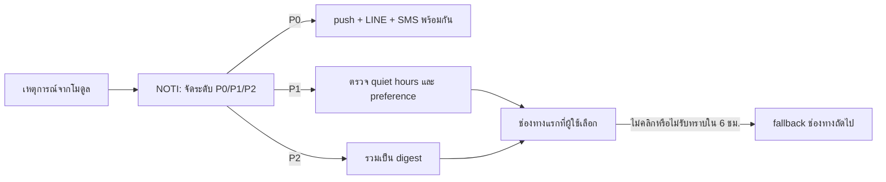
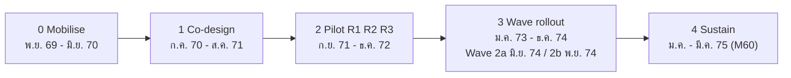

# 14 — UX, การยอมรับระบบ และการบริหารการเปลี่ยนแปลง (UX & Adoption)

> **สถานะ:** v1.1-draft · 28 ต.ค. 2569 (แก้ตาม review v1.0 และ [00-fix-decisions-v1.1](00-fix-decisions-v1.1.md) D-02, D-05, D-07, D-08, D-10, D-11) · ผู้เขียน: H · ภาษา: ไทย (ศัพท์เทคนิคเป็นภาษาอังกฤษ)
> **อ่านคู่กับ:** [00-blueprint](00-blueprint.md) (รหัสโมดูล/บทบาท/เฟส) · [01-overview](01-overview.md) (A-xx) · [02-student-journey](02-student-journey.md) · [04-roles-permissions](04-roles-permissions.md) · [06-modules](06-modules.md) · [07-architecture](07-architecture.md) (ADR-008 PWA+LIFF, หัวข้อ 11.6–11.8 i18n/accessibility/offline) · [08-data](08-data.md) (entity ต้นทางของ KPI) · [09-integrations](09-integrations.md) (I-41 LINE OA) · [10-security-compliance](10-security-compliance.md) (หัวข้อ 2.4 consent ผู้เยาว์, 10 accessibility) · [11-operations](11-operations.md) (support L0–L3, cutover) · [12-roadmap-cost-risk](12-roadmap-cost-risk.md) (release, champion FTE, helpdesk L1) · [13-open-questions](13-open-questions.md)
> **เล่มนี้เป็นเจ้าของ:** **KPI dictionary แหล่งเดียว (รหัส `KPI-01..KPI-47`, หัวข้อ 12.1)** — เล่มอื่นอ้างรหัสเท่านั้น ห้ามนิยามสูตรซ้ำ (D-10) · กติกา UX/การแจ้งเตือน/การยอมรับระบบ · ทะเบียน bypass (หัวข้อ 13.8)
> **วันที่:** วันที่ทุกค่าตาม anchor ของเล่ม 12 (M1 = เม.ย. 2570) และแสดงเลขเดือนสัญญาคู่กัน เช่น R1 1 ก.ย. 2571 (M18) · ถ้าเริ่มสัญญาหลัง ต.ค. 2570 ทุก release เลื่อน 12 เดือนตามรอบรับสมัคร (เล่ม 12 §1.3)
> **แหล่งหลัก:** [v2/ux_change_management.md](<../../research_notes/ออกแบบระบบการศึกษา TNSU ระดับ production/v2/ux_change_management.md>) · [review_benchmark.md](<../../research_notes/ออกแบบระบบการศึกษา TNSU ระดับ production/review_benchmark.md>)
> **ป้าย:** ✅ = มีแหล่งอ้างอิง (ส่วนใหญ่เป็น search snippet) · 🟡 = อนุมาน/ความรู้ทั่วไป ต้องตรวจสอบ · **[A-xx]** = สมมติฐานในเล่ม 01 · **[ต้องตรวจสอบ]** = ห้ามถือเป็นข้อเท็จจริง

**ข้อสรุปของเล่มนี้ใน 3 บรรทัด:** ระบบจะสำเร็จหรือล้มเหลวจาก 3 เรื่อง (1) วันลงทะเบียนและวันประกาศผลต้องไม่ล่มและต้องโปร่งใส (2) เจ้าหน้าที่ทะเบียน/การเงิน 17 วิทยาเขตต้องทำงาน **เร็วกว่า Excel ตั้งแต่วันแรก** (3) โค้ชและนักกีฬาต้อง **ได้ประโยชน์คืน** จากข้อมูลที่กรอก การออกแบบจึงยึด mobile-first + LINE เป็นประตู, back-office แบบ power-user และแผนเปลี่ยนแปลงแบบ Kotter × ADKAR ที่ผูกกับ release จริงของเล่ม 12

---

## สารบัญ

1. [Personas และกฎการออกแบบต่อกลุ่ม](#1-personas-และกฎการออกแบบต่อกลุ่ม)
2. [หลักการ UX (P1–P16)](#2-หลักการ-ux-p1p16)
3. [Screen inventory ต่อ persona และช่องทาง](#3-screen-inventory-ต่อ-persona-และช่องทาง)
4. [Flow สำคัญ](#4-flow-สำคัญ)
5. [Thai typography และ i18n](#5-thai-typography-และ-i18n)
6. [Accessibility](#6-accessibility)
7. [Low-bandwidth และ offline](#7-low-bandwidth-และ-offline)
8. [กลยุทธ์การแจ้งเตือน](#8-กลยุทธ์การแจ้งเตือน)
9. [Back-office สำหรับ power user](#9-back-office-สำหรับ-power-user)
10. [Athlete monitoring: กติกาเพื่อให้ถูกใช้จริง](#10-athlete-monitoring-กติกาเพื่อให้ถูกใช้จริง)
11. [Dual-career support](#11-dual-career-support)
12. [KPI dictionary (แหล่งเดียว) และ dashboard รายระดับ](#12-kpi-dictionary-แหล่งเดียว-และ-dashboard-รายระดับ)
13. [แผนบริหารการเปลี่ยนแปลง](#13-แผนบริหารการเปลี่ยนแปลง)
14. [แผน usability testing ต่อ release](#14-แผน-usability-testing-ต่อ-release)
15. [สมมติฐานและคำถามของเล่มนี้ (ย้ายเข้าทะเบียนกลางแล้ว) และข้อเสนอ F4](#15-สมมติฐานและคำถามของเล่มนี้-ย้ายเข้าทะเบียนกลางแล้ว-และข้อเสนอ-f4)
16. [ผลการปิด review](#16-ผลการปิด-review)

---

## 1. Personas และกฎการออกแบบต่อกลุ่ม

บริบทร่วม: ผู้ใช้ไทยเป็น mobile-first และ LINE-first — LINE รายงานผู้ใช้ราว 56 ล้าน MAU ในไทย (ตัวเลขที่ LINE เปิดเผยเอง) ✅ [Relevant Audience](https://www.relevantaudience.com/digital-marketing-en/line-thailand-business-solutions-2026/) และผู้ใช้ไทยใช้อินเทอร์เน็ตผ่านมือถือเกือบ 5 ชม./วัน ✅ [Telenor x GWI 2024](https://www.telenorasia.com/wp-content/uploads/2025/01/Telenor-x-GWI-Thailand-Report.pdf) สัดส่วนอุปกรณ์ที่ใช้ออกแบบ: มือถือ 75% / desktop 25%, Android ระดับล่าง–กลางเป็นส่วนใหญ่ [A-33] ตัวเลขชั่วโมงออนไลน์จากแหล่งรองขัดกันเอง จึงไม่ใช้เป็น requirement (ใช้ข้อสรุปเชิงคุณภาพเท่านั้น)

| # | Persona (รหัสบทบาท) | จำนวนโดยประมาณ | บริบท/ทักษะดิจิทัล | เป้าหมายหลัก | Pain point ที่คาด | ช่องทางหลัก | กฎการออกแบบเฉพาะกลุ่ม |
|---|---|---|---|---|---|---|---|
| U1 | **ผู้สมัคร** (`candidate`) ทั้ง ม.6, นักกีฬาโควตา, ป.โท/เอก, ผู้สมัครพิการ, ต่างชาติ | 30,000 ใบสมัคร/ปี [A-23] | ม.6 ทั่วประเทศ ใช้มือถือ; หลายคนสมัครหลายวิทยาเขตหลายรอบ [A-49] | สมัครครั้งเดียว รู้สถานะ รู้ผล ชำระได้ | หลายรอบหลายวิทยาเขตสับสน, ประกาศผลแล้วต้องรายงานตัวใน ≤ 24 ชม. [A-53] | PWA (เว็บมือถือ) + LINE OA | applicant profile เดียวเลือกหลายรอบ/วิทยาเขต, status tracker แบบ timeline, waiting room ช่วงประกาศผล, ไม่บังคับติดตั้งแอป, ช่องขอ accommodation ตอนสอบ (ผู้พิการ [A-31]) |
| U2 | **นักศึกษา ป.ตรี/บัณฑิตศึกษา** (`student`) | 12,300 (รองรับ 15,000) [A-19] | Gen Z, LINE ทุกคน, data plan จำกัดบางส่วน | ลงทะเบียนได้ จบตามแผน คำร้องเร็ว | ระบบล่มวันลงทะเบียน, ไม่รู้สถานะคำร้อง, ต้องเดินไปเคาน์เตอร์ | PWA + LINE OA/LIFF | cart + validate-before-commit, degree audit, petition timeline, digital ID, ไม่ต้องมาเคาน์เตอร์ |
| U3 | **นักศึกษา-นักกีฬา** (`student` + athlete flag) | ~5,000 [A-28] | ตารางแน่น เดินทางบ่อย สัญญาณไม่ดีตอนแข่ง | เรียนจบควบคู่การแข่ง | ตารางชน, ลาแข่งต้องขอทุกวิชา, สอบชดเชย | PWA (offline) + LINE | ปฏิทินรวม (เรียน+สอบ+ฝึก+แข่ง) บอก conflict ล่วงหน้า, ลาแข่งครั้งเดียว, สถานะ eligibility, แผนภาคเบา (หัวข้อ 11) |
| U4 | **นักเรียนโรงเรียนกีฬา ม.1–ม.6** (`student`, profile sschool) | 4,450 [A-21] | ผู้เยาว์ พักประจำ อาจถูกจำกัดการใช้มือถือ (Q-80) | ตาราง/ผลการเรียน/ฝึก | อุปกรณ์จำกัด | PWA โหมดผู้เยาว์ (มือถือ/ห้องคอมพิวเตอร์) | UI ลดฟีเจอร์, **ไม่มีแชตส่วนตัวกับผู้ใหญ่**, ช่องแจ้งเหตุ safeguarding ที่เข้าถึงใน 2 แตะ, ภาษาง่าย, consent ตาม [A-17] |
| U5 | **ผู้ปกครอง/ผู้อุปการะ** (`guardian`) | ผู้เยาว์ที่ต้องมีผู้แทน ~8,000 คน → **บัญชีผู้ปกครอง ~12,000–13,000** (เฉลี่ย 1.3–1.5 บัญชีต่อผู้เรียน; รวมปู่ย่าตายาย/ผู้อุปการะ) [A-26] 🟡 | อายุหลากหลาย ชนบท ใช้ LINE แต่ไม่ติดตั้งแอปใหม่ 🟡 | รู้ว่าลูกปลอดภัย ค่าใช้จ่าย ผลการเรียน | ข้อมูลกระจาย ภาษาราชการยาก | **LINE OA + LIFF** + SMS fallback + โทร | ไม่บังคับแอป, ตัวอักษรใหญ่ (โหมด 18 px), ภาษาง่าย, เห็นเฉพาะบุตรในความดูแล (โมเดลผู้ปกครองเดียวใน REC/PRIV), ผูกบัญชี 2 ระดับตามเล่ม 04 G2 (หัวข้อ 4.4), ทางเลือกสำหรับผู้ไม่มีสมาร์ตโฟน (assisted approval) |
| U6 | **อาจารย์/ที่ปรึกษา/หัวหน้าภาค** (`lecturer`, `advisor`, `head`) | ~550 อาจารย์ [A-22] | ทักษะหลากหลาย ภาระงานสูง ใช้ระบบไม่บ่อย | ส่งเกรด อนุมัติคำร้อง ดูแลนักศึกษาเสี่ยง | ต้องเข้าหลายระบบ | เว็บ (back-office เบา) + digest | อนุมัติบนมือถือได้ 1–2 แตะ, digest รายวันแทนแจ้งเตือนรายรายการ, escalation อัตโนมัติไปหัวหน้าภาค |
| U7 | **เจ้าหน้าที่ back-office** (`registrar`, `finance`, `loan`, `scholar`, `dorm`, `admission`, `affairs`, `records`) | หลายร้อยคนใน 30 OrgUnit | Excel เก่ง ต่อต้านถ้าระบบช้ากว่า 🟡 | ทำงานพีคให้ทัน ไม่ผิด | งานคู่ขนานกระดาษ ไม่มีคนช่วย กลัวรับผิด | back-office web (desktop) | work queue, bulk, keyboard-first, Excel import/export, audit ที่ปกป้องเจ้าหน้าที่ (หัวข้อ 9) |
| U8 | **โค้ช/หัวหน้างานกีฬา** (`coach`, `sportshead`) | โค้ช + นักวิทยาศาสตร์การกีฬา ~300 [A-22] แยกเป็นโค้ชที่เป็นบุคลากร/ลูกจ้าง, โค้ชอาสา และโค้ชภายนอก (สิทธิ์และการอบรมต่างกัน; จำนวนจริงยืนยันใน Q-49) | ภาคสนาม ใช้มือถือ/LINE กลุ่มทีม | นักกีฬาพร้อมแข่ง | กรอกซ้ำ, ข้อมูลไม่ได้ใช้ | PWA (offline) | roster พร้อม **สถานะความพร้อม (พร้อม/จำกัด/ไม่พร้อม) + ข้อจำกัดการฝึกที่เห็นเสมอ** (D-05), ยื่นลาแข่งยกคณะ, ช่องทีมในระบบ + นโยบายกลุ่ม LINE (หัวข้อ 4.5, 10) |
| U9 | **นักวิทยาศาสตร์การกีฬา/แพทย์/พยาบาล/นักกายภาพ** (`sci`, `physician`, `nurse`, `physio` — แยกจาก `medical` เดิมตาม D-08) | รวมใน ~300 [A-22] | ใช้ wearable/ไฟล์ทดสอบ | ข้อมูลครบ ถูกต้อง ปลอดภัย | import ยาก, privacy | back-office web + PWA | import CSV/มาตรฐานกลาง (ไม่มี adapter เฉพาะยี่ห้อ, D-06), health vault `hlt_vault` (HLT) รวม wellness, consent สำหรับเปิดเผย **รายละเอียด** ต่อโค้ช (สถานะความพร้อมไม่ต้องขอ consent — D-05) |
| U10 | **ผู้บริหาร** (`rector`, `campusvp`, `dean`, `council`, `sschool_dir`) | ~100 | เวลาน้อย ใช้มือถือ/แท็บเล็ต | ตัดสินใจจากตัวเลขชุดเดียวกัน | ตัวเลขแต่ละวิทยาเขตไม่ตรงกัน | dashboard (ANA) + LINE digest | แถวบนเป็น **รายการที่ต้องสั่งการ** (exception-first) แล้วจึง KPI tile 5–7 ตัว, drill-down, export รายงานสภา (หัวข้อ 12) |
| U11 | **IT วิทยาเขต/helpdesk** (`itadmin`, `campus_itadmin`, `helpdesk`) | ส่วนกลาง 5–10 + วิทยาเขตละ 1–2 [A-76] | คนน้อย ทักษะต่างกัน | ระบบเสถียร ticket น้อย | ถูกโยนปัญหา | ADMIN console + X-HELP | runbook, status page, self-service reset รหัสผ่าน/ผูก LINE ใหม่, ดูสถานะ sync ของ offline queue |

**ผู้ใช้หลายบทบาท** (อาจารย์ + ที่ปรึกษา + โค้ช, คณบดี + ผู้สอน, ผู้บริหารหลายวิทยาเขต) ใช้ shell เดียวที่มี role switcher (หัวข้อ 9.3) — ไม่มีบัญชีแยกต่อบทบาท

กลุ่มรอง (ใช้ pattern ของกลุ่มหลัก): ศิษย์เก่า (`alumni`) ใช้ pattern U2 แบบลดฟีเจอร์; ผู้จ้างงาน (`employer`) และประชาชน (`applicant`) ใช้หน้าสาธารณะ + verify เอกสาร; กรรมการสอบทักษะ (`judge`) และอาจารย์นิเทศ (`supervisor`) ใช้ PWA offline แบบ U8

---

## 2. หลักการ UX (P1–P16)

| # | หลักการ | Pattern บังคับ | หลักฐาน/เหตุผล |
|---|---|---|---|
| P1 | **Mobile-first, thumb-first** | ออกแบบที่ 360×640 ก่อน, bottom nav ≤ 5 ปุ่ม, target ≥ 44×44 px (เกิน WCAG 2.2 ข้อ 2.5.8 ที่ 24 px 🟡) | [A-33]; Telenor ✅ |
| P2 | **LINE เป็นประตู ไม่ใช่ห้อง** | LINE OA ส่งหัวข้อ + deep link/LIFF เข้าระบบ; ธุรกรรม (ชำระ, ยื่นคำร้อง) ทำในระบบหลักเพื่อมี audit; ห้ามส่งเกรด/สุขภาพ/การเงิน/วินัยในเนื้อข้อความ (เล่ม 09 I-41) | LINE Notify ยุติ 31 มี.ค. 2025 ✅ [LINE Developers](https://developers.line.biz/en/news/tags/end-of-life) |
| P3 | **Validate-before-commit** | ตรวจ conflict/prereq/credit/hold/สิทธิ์นักกีฬาก่อนกดยืนยัน พร้อมเหตุผลภาษาไทยและปุ่ม "ยื่นคำร้องขอยกเว้น" ในจุดเดียวกัน | pattern SIS สากล 🟡 |
| P4 | **วันพีคต้องเป็นธรรมและโปร่งใส** | virtual waiting room แสดงลำดับคิว/เวลาคาดการณ์ (ADR-004), staggered windows [A-32], pre-load cart, status page | ระบบลงทะเบียนต่างประเทศล่ม ✅ [Daily Free Press](https://dailyfreepress.com/04/17/23/204029/bu-rising-seniors-voice-concerns-about-mybu-after-registration-system-crashes/); REG ไทยมีปัญหาช่วงผู้ใช้พร้อมกัน ✅ [MSU abstract](https://msu2c.msu.ac.th/assets/pdf/Researchs/abstract3.pdf) |
| P5 | **ความคืบหน้าที่เห็นภาพ** | degree audit แบบ progress ring ต่อหมวด + "ยังขาด" + what-if; onboarding เป็น checklist | Stellic/Workday ✅ (review_benchmark G5–G7) |
| P6 | **คำร้องแบบติดตามพัสดุ** | timeline ระบุ "ตำแหน่ง" ผู้ถือเรื่อง + SLA ที่เหลือ; แจ้งเฉพาะเมื่อสถานะเปลี่ยน | v2/student_services ✅ |
| P7 | **แจ้งเตือนน้อยแต่ตรง** | 3 ระดับ, send-once ข้ามช่องทาง, quiet hours, เพดานต่อสัปดาห์ (หัวข้อ 8) | fatigue ✅ (แหล่ง vendor) [Appbot](https://appbot.co/blog/app-push-notifications-2026-best-practices/) |
| P8 | **Accessible by default** | WCAG 2.2 AA เป็นเป้าออกแบบ + TWCAG 2025 (หัวข้อ 6) | เว็บรัฐไทยไม่ผ่านเกณฑ์ ✅ |
| P9 | **Thai typography tokens** | หัวข้อ 5 | ✅/🟡 |
| P10 | **ตัดคำและค้นหาภาษาไทย** | ICU/`Intl.Segmenter`, ค้นชื่อไทย/อังกฤษ/สะกดผิดเล็กน้อย | 🟡 |
| P11 | **วันที่ พ.ศ. แสดง / ISO เก็บ** | หัวข้อ 5.3 [A-81] | เล่ม 07 หัวข้อ 11.6 |
| P12 | **Bilingual แยก UI กับ content** | i18n key + `name_th`/`name_en`; ไม่ใช้ machine translation กับเอกสารทางการ | 🟡 |
| P13 | **Low-bandwidth/offline** | หัวข้อ 7 | ADR-008 |
| P14 | **ผู้เยาว์ปลอดภัยก่อน** | โหมดผู้เยาว์, guardian เห็นเฉพาะบุตร, ไม่มีช่องสื่อสารส่วนตัวผู้ใหญ่–เด็ก | เล่ม 10 หัวข้อ 4 |
| P15 | **ภาษาที่ไม่ตำหนิ (non-blaming)** | ข้อความค้างชำระ/พ้นสภาพ/ไม่ผ่าน eligibility บอก "ทำอะไรต่อได้" และช่องทางขอความช่วยเหลือ/อุทธรณ์ก่อนบอกบทลงโทษ (สอดคล้อง P9 human-in-the-loop ของเล่ม 01) | 🟡 แนวปฏิบัติ content design |
| P16 | **Telemetry เพื่อ adoption** | ทุก flow หลักวัด task success, เวลา, drop-off แยก OrgUnit (RUM ตามเล่ม 07 หัวข้อ 11.8) โดยไม่เก็บเนื้อหาข้อมูลส่วนบุคคล | review OBS-01 |

**Design system กลาง (ไม่ต่อรอง)**: component library เดียว (React) ใช้ทั้ง PWA, LIFF และ back-office; token สี/ตัวอักษร/ระยะ; วิทยาเขตเปลี่ยนได้เฉพาะโลโก้ ชื่อ ข่าว ข้อความแนะนำ (governance หัวข้อ 13.2)

---

## 3. Screen inventory ต่อ persona และช่องทาง

ช่องทาง: **PWA** = portal Next.js (ADR-008) · **LIFF** = หน้าเดียวกันเปิดผ่าน LINE (ไม่ใช่แอปแยก) · **BO** = back-office web (desktop-first) · ★ = flow ที่ต้องทดสอบ usability ก่อน go-live (หัวข้อ 14) · release ตามเล่ม 12 หัวข้อ 2.1

| ID | หน้าจอ/flow | Persona | ช่องทาง | โมดูล | Release |
|---|---|---|---|---|---|
| S-01 | หน้าแรกผู้สมัคร: เลือกวิทยาเขต/รอบ/ประเภท (โควตาเรียนดี/นักกีฬา/ทั่วไป/บัณฑิต) | U1 | PWA, LIFF | ADM, ORG | R1 ★ |
| S-02 | ใบสมัครหลายขั้น (save & resume, อัปโหลดเอกสารแบบ resumable, ไม่กรอกซ้ำ — WCAG 3.3.7) | U1 | PWA | ADM, DOC | R1 ★ |
| S-03 | ชำระค่าสมัคร Thai QR + สถานะการชำระ (รองรับการชำระบนมือถือเครื่องเดียวกับแอปธนาคาร หัวข้อ 4.7) | U1 | PWA, LIFF | FIN | R1 ★ |
| S-04 | Application tracker (timeline ทุกใบสมัครทุกวิทยาเขต + วันสอบ/บัตรเข้าสอบ) | U1, U5 | PWA, LIFF | ADM | R1 ★ |
| S-05 | ประกาศผล (หลัง waiting room) → ยืนยันสิทธิ์/สละสิทธิ์ (clearing 1 ที่ [A-51]) → ชำระค่ายืนยันสิทธิ์ | U1 | PWA, LIFF | ADM, FIN | R1 ★ |
| S-06 | ยื่นอุทธรณ์ผลคัดเลือก/ร้องเรียน | U1 | PWA | CASE | R1 |
| S-07 | หน้ากรรมการสอบทักษะ (offline, rubric, score lock) | `judge` | PWA บนแท็บเล็ต | ADM | R1 ★ |
| S-08 | BO รับเข้า: ตั้งค่ารอบ/ที่นั่ง, คิวตรวจเอกสาร, moderation คะแนน, ประกาศผล | U7 (`admission`) | BO | ADM, ORG, ENG | R1 ★ |
| S-09 | Onboarding checklist นักศึกษาใหม่ (รายงานตัว, ประวัติ, สุขภาพ, ผูก LINE, ผู้ปกครอง, บัตร) | U2, U5 | PWA, LIFF | REC, SVC, PRIV | R2 ★ |
| S-10 | **ตะกร้าลงทะเบียน** (plan → cart → validate → submit, waitlist, swap) + หน้า **"ผลการลงทะเบียนล่าสุด"** หลังสัญญาณหลุด — หัวข้อ 4.1 | U2, U3 | PWA | REG | R2 ★ |
| S-11 | ตารางเรียน/ตารางสอบ/ที่นั่งสอบ (offline cache) | U2–U4 | PWA, LIFF | REG, EXM | R2 |
| S-12 | Digital ID card (signed QR ตรวจ offline ได้) | U2–U4, U7 | PWA, LIFF | SVC | R2 |
| S-13 | ใบแจ้งหนี้/ผ่อนชำระ/ใบเสร็จอิเล็กทรอนิกส์ (Thai QR แบบบันทึกรูป/คัดลอกเลขอ้างอิง หัวข้อ 4.7) | U2, U5 | PWA, LIFF | FIN | R2 ★ |
| S-14 | e-Petition catalogue + **petition tracker** (หัวข้อ 4.3) | U2, U6, U7 | PWA, BO | SVC, REC | R2 ★ |
| S-15 | กยศ.: สถานะยืนยันเบิก, ชั่วโมงจิตอาสา (จาก AFF) | U2 | PWA | SCH, AFF | R2 |
| S-16 | หอพัก: จองห้อง, ตม.30 (ต่างชาติ), แจ้งซ่อม | U2 | PWA | HOU | R2 |
| S-17 | ยื่นลาแข่งแบบยกคณะ (coach ส่ง roster ต่อชนิดกีฬา → `sportshead` รวมและยื่น → อนุมัติครั้งเดียวที่ระดับคณะ → อาจารย์ทุกวิชาได้รับแจ้ง → ATT ยกเว้น → EXM สร้างสอบชดเชยอัตโนมัติ ไม่ต้องอนุมัติซ้ำ; เจ้าของ = ATH ตาม D-08) | U8, U3, U6 | PWA, BO | ATH, ATT, EXM | R2 ★ |
| S-18 | ส่งเกรด (grid แบบ Excel, import, ตรวจครบก่อนส่ง) | U6 | BO | ASM | R2 ★ |
| S-19 | Advisor inbox: คำร้องรออนุมัติ + นักศึกษาเสี่ยง + digest | U6 | BO, PWA | REC, SVC, ANA | R2 |
| S-20 | Work queue เจ้าหน้าที่ (ทุกงาน) — หัวข้อ 9 | U7 | BO | SVC, REC, FIN, SCH, HOU | R2 ★ |
| S-21 | Excel import/export wizard (dry-run, รายงานข้อผิดพลาดรายแถว) | U7 | BO | ทุกโมดูล BO | R2 ★ |
| S-22 | **Degree audit + what-if + แผนการเรียน** (หัวข้อ 4.2) | U2, U3, U6 | PWA, BO | GRD | R3 ★ |
| S-23 | ยื่นขอสำเร็จการศึกษา, ลงทะเบียนพิธีรับปริญญา | U2 | PWA | GRD | R3 |
| S-24 | e-Transcript/e-Degree: ขอ, ดาวน์โหลด, หน้า verify สาธารณะ | U2, `alumni`, `employer` | PWA | GRD, DOC | R3 |
| S-25 | **Coach view**: roster + สถานะความพร้อม, ปฏิทินทีม, ช่องทีม, eligibility, team travel/per diem (หัวข้อ 4.5) | U8 | PWA | ATH | R2 (รวม eligibility + team travel ตาม D-03) / R3 ส่วนที่เหลือ ★ |
| S-26 | Athlete self view: wellness ≤ 60 วินาที (บันทึกลง HLT vault) + แนวโน้มของตนเอง + ใครดูข้อมูลฉัน | U3, U4 | PWA, LIFF | HLT, ATH, PRIV | R2 core / R3 เต็ม ★ |
| S-27 | Sci/medical workbench: import ผลทดสอบ/อุปกรณ์ผ่าน CSV มาตรฐานกลาง, injury & RTP, health vault | U9 | BO | ATH, HLT | R3 |
| S-28 | ฝึกสอน: จับคู่ที่ฝึก, นิเทศ offline, ประเมิน 3 ฝ่าย | U2, `supervisor`, `mentor` | PWA, BO | PRA | R3 |
| S-29 | **Guardian view** (หัวข้อ 4.4) | U5 | LIFF (หลัก), PWA | REC, HOU, HLT, FIN, ENG | R2 (ผู้ปกครองนักศึกษา < 20 ปี) / SS1 (โรงเรียน) ★ |
| S-30 | โหมดนักเรียนโรงเรียนกีฬา: ตาราง, ผลการเรียน ปพ., ขอออกนอกหอ (leave pass), ปุ่มขอความช่วยเหลือ/แจ้งเรื่อง | U4 | PWA (โหมดผู้เยาว์) | SSC, HOU, SAFE | SS1 ★ |
| S-31 | หอพักโรงเรียน: เช็คชื่อกลางคืน offline, leave pass อนุมัติผู้ปกครอง, visitor log, ให้ยา | `dorm`, `homeroom` | PWA (แท็บเล็ต) | HOU, HLT | SS1 ★ |
| S-32 | Safeguarding intake (ช่องลับ, แยกสิทธิ์, ไม่แจ้งผู้ถูกกล่าวหา) | U4, U5, ทุกคน | PWA, LIFF | SAFE | R2 โครงสร้าง / SS1 เต็ม |
| S-33 | **Executive dashboard** ตามระดับ (หัวข้อ 12.2) | U10 | PWA (tile), BO (drill-down) | ANA, RPT | R2 พื้นฐาน / R3 ★ |
| S-34 | Regulatory calendar & submission tracker (HEdata, snapshot 10 มิ.ย./10 พ.ย., OIT) | `planner`, `records`, `auditor` | BO | RPT | R2 |
| S-35 | Campus configuration console (รอบ ค่าธรรมเนียม ผู้ลงนาม ปฏิทินรอง) พร้อม preview/effective date | `registrar`, `campusvp` | BO | ORG, ADMIN | R1–R2 |
| S-36 | Notification preferences + ประวัติข้อความ | ทุกคน | PWA, LIFF | NOTI | R1 |
| S-37 | Status page + waiting room | ทุกคน | สาธารณะ | ADMIN, gateway | R1 ★ |
| S-38 | Helpdesk/FAQ + ติดตาม ticket | ทุกคน | PWA, LIFF | X-HELP | R1 |
| S-39 | Adoption & data-quality dashboard ราย OrgUnit | PMO, `data_steward`, U10 | BO | ANA | R2 |
| S-40 | **Role switcher + inbox รวมทุกบทบาท** (ตัวกรองบทบาท/OrgUnit, แสดงบทบาทที่ใช้อยู่ทุกครั้งที่อนุมัติ) — หัวข้อ 9.3 | U6, U7, U8, U10 | PWA, BO | IAM, SVC | R1 (บุคลากร) / R2 ★ |
| S-41 | **Standard export catalogue ต่อบทบาท** (รายชื่อในชั้น, รายชื่อสอบ, ลูกหนี้ ฯลฯ ที่อนุมัติล่วงหน้า) — หัวข้อ 9.4 | U6, U7 | BO | ANA, DOC | R2 |
| S-42 | **Print view และ batch print** (รายชื่อในชั้น, ผังที่นั่งสอบ, ใบเซ็นชื่อ, จดหมายผู้ปกครอง) — หัวข้อ 9.5 | U6, U7, `proctor` | BO | DOC, EXM, REG | R2 |
| S-43 | **ช่องทีม (team channel)** ส่งรูป ประกาศตารางซ้อม read-ack มีบันทึก (หัวข้อ 4.5) | U8, U3, U4, U6 | PWA, LIFF | NOTI, ATH | R2 ★ |

---

## 4. Flow สำคัญ

### 4.1 ตะกร้าลงทะเบียน, waitlist และ conflict (S-10, REG)

1. **ก่อนเปิดระบบ (plan):** นักศึกษาใส่วิชาลงตะกร้าได้ล่วงหน้า (ดึงจากแผนการเรียน S-22 ถ้ามี) ระบบตรวจล่วงหน้าแบบ "เตือน" ไม่จอง
2. **วันเปิด (window ราย OrgUnit/ชั้นปี [A-32]):** เข้าผ่าน waiting room ซึ่งแสดงลำดับคิวและเวลาประมาณ (ไม่ใช่ spinner) ถ้าหลุดจากคิวกลับมาได้ภายในเวลาที่ token ยังใช้ได้
3. **Validate:** ตรวจครั้งเดียวทั้งตะกร้า แสดงผลต่อวิชาเป็น 3 สถานะ — ผ่าน / ติดเงื่อนไขที่แก้ได้เอง (เช่น เวลาชน → เสนอ section อื่นที่ไม่ชน) / ติดเงื่อนไขที่ต้องขออนุมัติ (prerequisite, เกินหน่วยกิต, hold การเงิน) พร้อมปุ่ม "ยื่นคำร้องขอยกเว้น" ที่เติมข้อมูลให้แล้ว (P3)
4. **Submit:** transaction เดียว (ADR-004) ผลลัพธ์รายวิชาชัดเจน; วิชาที่เต็ม → เสนอ **waitlist** (แสดงลำดับ) หรือ **swap** ("ถอน A เมื่อได้ B เท่านั้น")
4a. **สัญญาณหลุดระหว่าง submit (สถานะ "ไม่แน่ใจว่าสำเร็จ"):** ทุก submit มี idempotency key ที่สร้างฝั่ง client; เมื่อเชื่อมต่อได้อีกครั้ง หน้าจอพาไปหน้า **"ผลการลงทะเบียนล่าสุด"** (โหลดซ้ำได้ อ่านจากผลจริงในฐานข้อมูล ไม่ใช่จาก cache) ซึ่งแสดง สำเร็จ / ไม่สำเร็จ / ยังประมวลผล พร้อมเวลา server; ระหว่างที่ยังไม่รู้ผล **ไม่แสดงปุ่ม submit ซ้ำ** (ถ้ากดซ้ำด้วย key เดิม ระบบคืนผลเดิม); ใบยืนยันส่งทาง in-app และ LINE (หัวข้อ 8) ทันทีที่ commit — นักศึกษาจึงตรวจได้แม้หน้าเดิมค้าง (UXR-27)
5. **Waitlist:** เมื่อมีที่ว่าง ระบบ offer ตามลำดับ แจ้งเตือนระดับ action-required และให้เวลาตอบรับจำกัด (ค่าตั้งราย OrgUnit เช่น 24 ชม.) ถ้าไม่ตอบ offer ไปคนถัดไป; นักศึกษาเห็นเวลานับถอยหลัง; **เวลาใน quiet hours 21:00–07:00 ไม่นับรวม** เพื่อให้ offer ที่ออกตอนกลางคืนได้เวลาจริงเท่ากัน (UXR-25)
6. **Conflict กับกีฬา:** ถ้าวิชาชนกับตารางฝึก/แข่งที่ทีมประกาศ ระบบเตือน (ไม่บล็อก) และแสดง section ทางเลือก
7. **หลังยืนยัน:** ใบแจ้งหนี้ (FIN) สร้างทันที แสดงยอดและวันครบกำหนด; ตารางเรียนเข้า offline cache
8. **Accessibility:** timeout ของ waiting room ขยายได้สำหรับผู้ที่มี accommodation (เล่ม 07 หัวข้อ 11.7), ทำทุกขั้นด้วยคีย์บอร์ด/screen reader ได้
9. **มือถือหาย/เปลี่ยนเบอร์ในวันลงทะเบียน:** จุดบริการ "ด่วนวันลงทะเบียน" ตรวจตัวตนต่อหน้าแล้วปลดล็อก MFA (เล่ม 11 support) และขยาย window ให้อัตโนมัติเท่ากับเวลาที่เสียไป พร้อมบันทึก audit (UXR-31)
10. **ปี 1 ภาคแรก:** ข้อเสนอให้ใช้ block enrolment ตามแผนหลักสูตร (นักศึกษาตรวจและยืนยันเท่านั้น) และใช้ตะกร้าตั้งแต่ภาค 2 — กติกาลำดับการลงทะเบียนเป็นของเล่ม 02 (RG-1) จึงส่งเป็นข้อเสนอ F4-P01 ในหัวข้อ 15 (UXR-28)

### 4.2 Degree audit และแผนการเรียน (S-22, GRD)

- หน้าหลัก: progress ring ต่อหมวด (ศึกษาทั่วไป, แกน, เอก, เลือกเสรี, กิจกรรม/ชั่วโมงที่ไม่ใช่รายวิชาจาก AFF) + GPAX + รายการ "ยังขาด" ที่กดแล้วเห็นวิชาที่เปิดภาคหน้า
- **What-if:** เปลี่ยนวิชาเอก/โท หรือดูผลถ้าสอบตก/ถอนวิชา
- **แผนรายภาค (degree planner):** ลากวิชาใส่ภาคอนาคต, ใส่ placeholder, ส่งอาจารย์ที่ปรึกษาอนุมัติ, แผนที่อนุมัติแล้วส่งเข้าตะกร้า S-10 ได้ (review_benchmark Top-15 #8)
- **สำหรับนักกีฬา:** แผน "ภาคเบา" ในปีแข่ง พร้อมวันจบที่คาดการณ์และผลต่อ eligibility (หัวข้อ 11)
- กฎมาจาก PolicySet ต่อรุ่น (blueprint 9.6) ข้อความทุกบรรทัดบอก "กฎข้อใด ฉบับใด" เพื่อให้นักศึกษาและนายทะเบียนอ้างอิงตรงกัน
- นักศึกษารุ่นที่ migrate ใช้ course mapping ตามเล่ม 12 TR-5; รายการที่ยังอยู่ใน data-fix queue แสดงสถานะ "อยู่ระหว่างตรวจสอบ" แทนการแสดงผลผิด

### 4.3 Petition tracking (S-14, SVC/REC)

- Catalogue คำร้องค้นได้ด้วยภาษาพูด ("ขอลาพัก", "ขอใบรับรอง") แสดงค่าธรรมเนียม เอกสาร SLA และผู้อนุมัติของวิทยาเขตนั้นก่อนยื่น
- Timeline แบบติดตามพัสดุ: ยื่น → ที่ปรึกษา → หัวหน้าภาค → คณบดี → ทะเบียน แต่ละขั้นแสดงตำแหน่ง (ไม่แสดงชื่อบุคคลถ้านโยบายไม่ให้) เวลาที่อยู่ในขั้น และ SLA ที่เหลือ; ถ้าเกิน SLA แสดงว่าระบบส่งเรื่องเตือน/escalate แล้ว
- คำร้องที่มี payment gate (ลาพัก/รักษาสภาพ [A-61]) แสดงชัดว่า "คำร้องสมบูรณ์เมื่อชำระแล้ว" พร้อมปุ่มชำระ
- ถูกส่งกลับ: แสดงเหตุผลและช่องแก้เฉพาะส่วนที่ต้องแก้ (ไม่ต้องกรอกใหม่ทั้งหมด)
- ผลสุดท้ายเป็นเอกสารลงนามอิเล็กทรอนิกส์ (DOC) ดาวน์โหลดได้ และแจ้งผลแบบ send-once

### 4.4 Guardian view (S-29)

- **เข้าทาง LINE OA เป็นหลัก** ไม่บังคับติดตั้งแอป; การผูกบัญชีใช้แบบเดียวกับเล่ม 04 G2 (UXR-19):
  - **ระดับ 1 — ผูกแบบช่วยเหลือ (assisted binding):** ในวันมอบตัว/ประชุมผู้ปกครอง เจ้าหน้าที่ตรวจบัตรและเอกสารอำนาจปกครองต่อหน้า แล้วผู้ปกครองสแกน QR ผูก LINE ทันที (ค่าเริ่มต้นของโรงเรียนกีฬา)
  - **ระดับ 2 — ด้วยตนเอง:** ThaID + อัปโหลดเอกสารอำนาจปกครองให้เจ้าหน้าที่ตรวจออนไลน์ (SLA 3 วันทำการ) ระหว่างรอตรวจ เห็นเฉพาะประกาศทั่วไป
  - **ผู้อุปการะ (caregiver)** เช่น ปู่ย่าตายายที่ไม่มีเอกสารอำนาจปกครอง: ผู้แทนโดยชอบธรรมมอบหมายผ่านแบบฟอร์ม หรือโรงเรียนรับรองจากการเยี่ยมบ้าน ได้สิทธิ์เฉพาะที่กำหนด (leave pass, รับแจ้งเหตุ) — โมเดลความสัมพันธ์เป็นของเล่ม 04/08 (D-08)
- หน้าเดียวต่อบุตร 1 คน (ถ้ามีหลายคนเลือกจากด้านบน): **ความปลอดภัย** (อยู่หอ/ออกนอกหอ, leave pass ที่รออนุมัติ, เหตุเจ็บป่วยที่แจ้งแล้ว) → **ค่าใช้จ่าย** (ยอดค้าง, ชำระผ่าน QR) → **การเรียน** (ผลการเรียนเมื่อประกาศ, เวลาเรียนต่ำกว่าเกณฑ์) → **ประกาศ/ใบอนุญาตกิจกรรม** (e-permission slip)
- สิ่งที่ผู้ปกครอง **ไม่เห็น**: บันทึกจิตวิทยา, รายละเอียดเรื่อง safeguarding ที่อยู่ระหว่างดำเนินการ, ข้อมูลที่บุตรอายุ ≥ 20 ปีไม่ยินยอม (นโยบายรอ Q-81), ข้อมูลของนักเรียนคนอื่น
- ภาษาไทยง่าย ตัวอักษร 18 px, ปุ่มโทรหาครูหอ/เจ้าหน้าที่ตามเวลาทำการ และเบอร์ฉุกเฉิน 24 ชม.; ครอบครัวที่ใช้ภาษาถิ่น (เช่น มลายูถิ่นในโรงเรียนภาคใต้ตอนล่าง 🟡) ใช้สายโทรศัพท์/เจ้าหน้าที่ที่พูดภาษาถิ่นของ OrgUnit นั้น ไม่แปล UI (UXR-48)
- **ผู้ปกครองที่ไม่มีสมาร์ตโฟน (assisted approval):** ครูหอโทรออกจากเบอร์โรงเรียนไปยังเบอร์ที่ลงทะเบียน (ไม่รับคำยืนยันจากสายเข้า) แล้วบันทึกผลในระบบพร้อมเหตุผลและผู้บันทึก; การรับตัวโดยบุคคลอื่นต้อง 4-eyes; หรือผู้ปกครองรับ OTP ทาง SMS แล้วแจ้งครู (UXR-21) · ประกาศสำคัญส่งจดหมายต้นปีการศึกษา (batch print หัวข้อ 9.5)
- **เหตุบาดเจ็บ/เจ็บป่วยรายบุคคล:** เจ้าหน้าที่ **โทรแจ้งผู้ปกครองก่อน** ตาม script แล้วระบบส่งข้อความยืนยันพร้อมเบอร์ติดต่อและสิ่งที่ต้องทำต่อ; ถ้าโทรไม่ติดใน 15 นาที ระบบส่งข้อความ P1 อัตโนมัติ (ไม่ใช่ P0) — P0 สงวนไว้สำหรับเหตุฉุกเฉินรวมที่กระทบความปลอดภัยของชีวิต (หัวข้อ 8.2, UXR-22)
- benchmark ฝั่งโรงเรียนประจำ (exeat + parent e-approval, weekly digest, health incident) อยู่ใน review_benchmark หัวข้อ 2.4 P1–P7 — ใช้ **weekly digest** วันอาทิตย์เป็นช่องทาง info และแจ้งแบบ **exception-based** ("ยังไม่กลับหอเมื่อถึงเวลา", "leave pass รออนุมัติ") แทนการแจ้ง check-in/out ทุกครั้ง เพื่อคุมปริมาณข้อความ (หัวข้อ 8.5, UXR-23)

### 4.5 Coach view (S-25) และช่องทางสื่อสารของทีม

- หน้าแรก: "วันนี้ต้องทำอะไร" — นักกีฬาที่สถานะความพร้อมเปลี่ยน, นักกีฬาที่ eligibility เสี่ยง, ลาแข่งที่รออนุมัติ, การเดินทางที่ต้องเคลียร์เงินยืม; flag wellness ส่งถึง `sci`/S&C ก่อน โค้ชเห็นเป็นข้อมูลประกอบ (หัวข้อ 10 AM-4)
- **Roster ต่อทีม (D-05):** โค้ช **เห็นสถานะความพร้อม พร้อม / จำกัด / ไม่พร้อม และข้อจำกัดการฝึกเชิงกิจกรรม** (เช่น "ห้ามปะทะ", "ห้ามกระโดด", "ซ้อมเบาได้") **เสมอ โดยไม่ต้องขอ consent** — ฐานคือหน้าที่ดูแลความปลอดภัยของผู้เรียนในกิจกรรมที่ มกช. จัด (ระบุใน lawful-basis matrix เล่ม 10) แสดงด้วยสี + ข้อความ ไม่ใช้สีอย่างเดียว; **รายละเอียดการวินิจฉัย/การรักษา/จิตวิทยา** เห็นได้เฉพาะเมื่อนักกีฬา (หรือผู้ปกครองของผู้เยาว์) ให้ consent ต่อโค้ชรายนั้น
- ยื่นลาแข่งยกคณะ (S-17) จากรายชื่อทีมในไม่กี่แตะ; สร้าง team travel + per diem ได้ตั้งแต่ R2 (D-03 ย้าย eligibility + team travel เข้า R2 ทันพลศึกษาเกมส์ ก.ย. 2572) เพื่อให้โค้ช "ได้ประโยชน์คืน" ตั้งแต่ release แรกที่ต้องกรอกข้อมูล (UXR-42)
- **ช่องทีมในระบบ (S-43):** ต้องสะดวกพอจะแข่งกับกลุ่ม LINE — ส่งรูป/ไฟล์, ประกาศตารางซ้อม (ดึงจาก FAC booking), read-ack ในแอป, แจ้งเตือนผ่าน LINE OA เป็นหัวข้อ + deep link; ข้อความถึงนักกีฬาผู้เยาว์อยู่ในช่องทีมที่มีผู้ใหญ่ ≥ 2 คนและมีบันทึกเท่านั้น (ไม่มี direct message 1:1 ผู้ใหญ่–ผู้เยาว์) และ `ContactRestriction` จาก SAFE ซ่อนนักกีฬาบางรายจากโค้ชบางคนโดยไม่เปิดเหตุผล (เล่ม 12 RK-14)
- **นโยบายกลุ่ม LINE ส่วนตัวของโค้ช/อาจารย์ (policy + tooling ไม่ใช่ technical guarantee):** ระบบบังคับนอกแพลตฟอร์มไม่ได้ จึงกำหนด (1) กลุ่ม LINE ที่มีนักเรียน/นักศึกษาต้อง **ลงทะเบียนกับ OrgUnit** และมีผู้ใหญ่ ≥ 2 คน (two-adult) เช่น ผู้ช่วยโค้ช/ครูประจำชั้น (2) ห้ามแชต 1:1 ส่วนตัวกับผู้เยาว์ (3) ห้ามส่งข้อมูลสุขภาพ ผลการเรียน การเงิน หรือรูปเอกสารในกลุ่ม (4) code of conduct ที่โค้ชลงนามรับทราบในการอบรม (5) ข้อมูลทางการ (ตารางแข่ง รายชื่อเดินทาง) ต้องประกาศในช่องทีมของระบบก่อนเสมอ แล้วกลุ่ม LINE ใช้แจ้งต่อ — วัดผลด้วยจำนวนข้อความในช่องทีมต่อทีมต่อสัปดาห์และรายงานจากนักเรียน (bypass register B1 หัวข้อ 13.8); นโยบายอยู่ใน SAFE/เล่ม 10 หัวข้อ 4 (UXR-07, S-06)

### 4.6 Executive dashboard (S-33) — ดูหัวข้อ 12

### 4.7 ชำระ Thai QR บนมือถือเครื่องเดียวกับแอปธนาคาร (S-03, S-13)

ผู้ใช้มือถืออย่างเดียวสแกน QR ที่แสดงบนจอของตนเองไม่ได้ (UXR-30) หน้าชำระเงินจึงต้องมี:
1. ปุ่ม **"บันทึกรูป QR"** (ไฟล์ PNG ที่มียอดเงิน เลขอ้างอิง และวันหมดอายุในรูป) + คำแนะนำสั้นให้ใช้เมนู "สแกนจากรูป/อัลบั้ม" ในแอปธนาคาร
2. **เลขอ้างอิง (Ref1/Ref2), Biller ID และจำนวนเงินที่กดคัดลอกได้** สำหรับผู้ที่ชำระผ่านเมนูจ่ายบิล
3. deep link เปิดแอปธนาคาร **เฉพาะเมื่อธนาคารคู่สัญญารองรับ** [ต้องตรวจสอบกับธนาคารใน P0] — ไม่ใช่ช่องทางหลัก
4. เมื่อกลับมาจากแอปธนาคาร หน้าสถานะการชำระ **poll ซ้ำได้** (ปุ่ม "ตรวจสถานะอีกครั้ง") และแสดง "รอยืนยันจากธนาคาร" แทน "ยังไม่ชำระ" ระหว่างรอ callback; ห้ามสร้างใบแจ้งหนี้ใหม่ซ้ำจากการกดหลายครั้ง
5. ใบเสร็จอิเล็กทรอนิกส์ (DOC) ส่งเข้า inbox และ LINE เป็นลิงก์ทันทีที่ FIN ยืนยัน

---

## 5. Thai typography และ i18n

### 5.1 ตัวอักษรและการจัดบรรทัด

| กติกา | ค่า | เหตุผล |
|---|---|---|
| ฟอนต์ UI | **Noto Sans Thai** หรือ **IBM Plex Sans Thai** (มีชุด Latin เข้ากัน) ผ่าน self-host (ไม่โหลดจาก CDN ต่างประเทศเพื่อลด cross-border/latency); หน้าผู้ใช้ภายนอกเริ่มด้วย `system-ui` (Android มี Noto Sans Thai เป็นฟอนต์ระบบ) แล้วโหลด web font เพียง 2 น้ำหนักแบบ woff2 + `font-display: swap` เพื่อไม่กินงบ 200 KB (UXR-45); ตัวเลือก Looped (มีหัว) สำหรับโหมดผู้ปกครอง/ผู้เยาว์ 🟡 | ฟอนต์ไทยต้องมี vertical metrics รองรับสระ/วรรณยุกต์ซ้อน ✅ [RightFont](https://rightfontapp.com/family/pattaya); Noto Sans Thai ใช้ได้ฟรี ✅ |
| ฟอนต์เอกสารราชการ (PDF) | **TH SarabunPSK หรือ TH Sarabun New** ตามที่งานสารบรรณ มกช. ใช้ (engine HarfBuzz ตาม ADR-010) และตรวจ licence การฝังฟอนต์ใน PDF/A | มติ ครม. 2553 อ้างชุดฟอนต์แห่งชาติ ซึ่ง TH SarabunPSK เป็นฟอนต์หนังสือราชการ ส่วน TH Sarabun New เป็นรุ่นปรับปรุงภายหลัง [ต้องตรวจสอบ] (UXR-46) |
| ขนาด body | ≥ 16 px (โหมดผู้ปกครอง 18 px); ถ้าใช้ TH Sarabun บนจอ ต้องใหญ่กว่า Latin ~1.3–1.4 เท่า | x-height ไทยเล็ก 🟡 |
| `line-height` | **≥ 1.6 สำหรับข้อความไทย**, หัวข้อ ≥ 1.4; ห้ามตั้ง ≤ 1.2 ในทุก component ที่มีไทย (ปุ่ม, chip, ตาราง) | ที่ 1.1 อักษรถูกตัดทุกสคริปต์ ส่วน 1.6 แก้ได้ ✅ [SuttaCentral](https://discourse.suttacentral.net/t/testing-for-line-height-with-tall-scripts/6196) (การทดสอบไม่เป็นทางการ) |
| การจัดชิด | **ห้าม `text-align: justify`** กับข้อความไทย; ห้าม italic (ใช้ bold/สี) | 🟡 |
| ตัดคำ/ตัดบรรทัด | ใช้ line breaking ของ browser (ICU dictionary); ใน JS ใช้ `Intl.Segmenter('th', {granularity: 'word'})` สำหรับ truncate/ellipsis/highlight; ห้ามแทรก zero-width space ลงในข้อมูลที่เก็บ; รหัสยาว (อีเมล, เลขอ้างอิง) ใช้ `overflow-wrap: anywhere` | 🟡 W3C Thai Layout Requirements อ่านฉบับเต็มไม่ได้ [ต้องตรวจสอบ] |
| เรียงลำดับ | collation ภาษาไทย (ICU `th`) ทั้ง UI และ export | 🟡 |
| ค้นหา | ค้นชื่อไทย/อังกฤษ/บางส่วนของชื่อ/สะกดผิดเล็กน้อย ด้วยกลไกตามเล่ม 07 (PostgreSQL) | P10 |

### 5.2 ทดสอบ typography (เป็นเกณฑ์ตรวจรับ)

**Thai typography test corpus** มีเวอร์ชัน (เก็บใน repo ร่วมกับ visual regression) และใช้ทั้งใน component library, LIFF และ PDF ทุก template (UXR-44)

| กลุ่ม | ตัวอย่าง golden string | สิ่งที่ตรวจ |
|---|---|---|
| T1 สระบน + วรรณยุกต์ซ้อน | กี่ ปั๊ม ญู่ ฐุ้ | ไม่ทับกัน ไม่ถูกตัดขอบบน |
| T2 พยัญชนะหางยาวบน + สระบน + วรรณยุกต์ | ปี่ ฝั่ง ฟื้น ฬ้ำ | วรรณยุกต์เลี่ยงหาง (mark positioning) |
| T3 ฎ/ฏ/ญ/ฐ + สระล่าง | ฎุ ฏู ญู ฐุ | ตัดเชิงพยัญชนะ/วางสระล่างถูก |
| T4 สระอำ + วรรณยุกต์ | ทั้ง น้ำ ค่ำ | นิคหิตกับวรรณยุกต์ไม่ทับ |
| T5 ฤ ฦ ไม้ยมก ไปยาลน้อย | ฤดู ฦๅ ต่าง ๆ กรุงเทพฯ | แสดงและตัดคำถูก |
| T6 เลขไทย | ๑๒๓ ๒๕๖๙ | แสดงใน template ราชการที่กำหนด |
| T7 ข้อความยาวไม่มีวรรค | มหาวิทยาลัยการกีฬาแห่งชาติวิทยาเขตชลบุรี | ตัดบรรทัดตาม dictionary ไม่ล้นกล่อง/ไม่ตัดกลางพยางค์ |
| T8 ไทยปนอังกฤษ/ตัวเลข/รหัส | วิชา PE101 ภาค 1/2572 อีเมล somchai.k@tnsu.ac.th | baseline ตรงกัน, รหัสยาวขึ้นบรรทัดด้วย `overflow-wrap: anywhere` |
| T9 การเรียงและค้นหา | เก, กา, ขา, เข (collation ICU `th`: "เก" เรียงใต้ ก) | ลำดับใน UI/export ตรงกับ ICU และค้นด้วยบางส่วนของชื่อได้ |

**Matrix ที่ต้องผ่าน:** Chrome Android, Samsung Internet, Safari iOS, **LINE in-app browser ทั้ง Android/iOS**, Chrome/Edge desktop × 3 ขนาด (14/16/18 px) + ขยาย 200% × ฟอนต์หลัก **และฟอนต์ fallback ของระบบ** (กรณี web font โหลดไม่ทัน) × PDF ทุก template

**เกณฑ์ผ่าน:** (1) visual regression pixel-diff ≤ 0.1% ต่อ snapshot เทียบ baseline ที่ผู้ตรวจอนุมัติ (2) ไม่มี clipping/ทับกันใน manual review ของ T1–T5 ทุกเบราว์เซอร์ (3) line-height จริง ≥ 1.6 ในทุก component ที่มีไทย (4) ข้อความที่ extract จาก PDF ตรงกับต้นฉบับ 100% (text extraction test ของ Thai PDF) (5) collation ของ T9 ตรงทุกจอและไฟล์ export — ไม่ผ่านข้อใดถือเป็น severity 2 (ต้องแก้ก่อน go-live)

### 5.3 วันที่ ปี และตัวเลข

- เก็บ ISO-8601 (ค.ศ., timestamp UTC) แสดง **พ.ศ.** ด้วย locale `th-TH-u-ca-buddhist` เช่น "28 ต.ค. 2569"; หน้าอังกฤษแสดง ค.ศ. (เล่ม 07 หัวข้อ 11.6, [A-81])
- ปีการศึกษาเป็น type แยก แสดง "ภาค 1/2572"; ปีงบประมาณแสดง "ปีงบ 2572" (ต.ค.–ก.ย.)
- date picker แสดง พ.ศ. แต่รับพิมพ์ได้ทั้ง พ.ศ./ค.ศ. และแสดงผลยืนยันก่อนบันทึก (กันป้อน ค.ศ. ในช่อง พ.ศ.)
- export Excel: คอลัมน์วันที่เป็นชนิดวันที่จริง + คอลัมน์ข้อความ พ.ศ. คู่กัน (เพื่อไม่ให้ Excel แปลงผิด); CSV export เป็น **UTF-8 with BOM**
- import: ตรวจ encoding อัตโนมัติ (UTF-8 / TIS-620 / Windows-874), รับปีในเซลล์วันที่ที่ > 2400 เป็น พ.ศ. แล้วแปลงพร้อมเตือนใน dry-run — เป็น test case ตรวจรับของ S-21 (UXR-38)
- ตัวเลขอารบิกเป็นค่าเริ่มต้น; เลขไทยเฉพาะ template เอกสารราชการที่กำหนด

### 5.4 สองภาษา

- ภาษาเริ่มต้น: ไทยทุกบทบาท; อังกฤษสำหรับนักศึกษาต่างชาติ [A-30] และหน้า verify เอกสารสาธารณะ
- UI ใช้ message catalogue; ข้อมูลหลักมี `name_th`/`name_en` (วิชา หลักสูตร บุคคล หน่วยงาน); ถ้าไม่มีคำแปล แสดงภาษาไทยพร้อมป้าย ไม่ใช้ machine translation กับเอกสารทางการ
- ความยาวข้อความ: ออกแบบเผื่อภาษาอังกฤษยาวกว่าไทย ~30% ในปุ่ม/เมนู 🟡

---

## 6. Accessibility

| ระดับ | เกณฑ์ |
|---|---|
| เกณฑ์ตรวจรับขั้นต่ำ | **WCAG 2.1 AA** ทุกหน้าผู้ใช้ภายนอกและ back-office หลัก (เล่ม 07 หัวข้อ 11.7, เล่ม 10 หัวข้อ 10) |
| เป้าการออกแบบ | **WCAG 2.2 AA** ทั้งหมด โดยเฉพาะ 2.5.8 Target Size, 2.4.11 Focus Not Obscured, 3.3.7 Redundant Entry, 3.3.8 Accessible Authentication (ไม่ใช้ CAPTCHA รูปภาพ/ไม่บังคับจำรหัส — รองรับ passkey/ThaID), 3.2.6 Consistent Help 🟡 (อ่านต้นฉบับ w3.org ไม่ได้ในรอบวิจัย [ต้องตรวจสอบ]) |
| แนวทางไทย | **TWCAG 2025** ที่ สสส. และภาคีผลักดัน ✅ [Accesstive](https://accesstive.com/compliance-hub/thailand-ict-policy/), [thailand.go.th](https://thailand.go.th/event-detail/digital-access-drive-for-disabled-people-2-2); มอก. 2565-2555 (WCAG 2.0 ฉบับไทย) ✅ [Mahidol repository](https://repository.li.mahidol.ac.th/handle/123456789/92474); เนื้อหา TWCAG ฉบับเต็มยังไม่ได้อ่าน [ต้องตรวจสอบ] |
| บริบท | เว็บไซต์กระทรวงที่ทดสอบไม่ผ่าน WCAG 2.0 ทั้งหมด และเว็บรัฐผ่านเกณฑ์ราวครึ่งเดียว ✅ — ระบบ มกช. จึงตั้ง accessibility เป็นเกณฑ์ตรวจรับจริง ไม่ใช่เพียงเป้าหมาย |
| ผู้ทดสอบและตัวอย่าง | **ผู้ตรวจอิสระ** (ไม่ใช่ทีมพัฒนา) ตรวจทุกหน้าจอ ★ + สุ่ม 20% ของหน้าจอที่เหลือ + PDF ทุก template ที่ออกให้ผู้ใช้ (ปพ., transcript, ใบรับรอง); matrix รวม LIFF ใน LINE in-app browser (UXR-47) |

กติกาปฏิบัติ: contrast ≥ 4.5:1 (ข้อความ) / 3:1 (component), focus ring เห็นชัด, ไม่ใช้สีเป็นสื่อเดียว (สถานะมีข้อความ/ไอคอน), label ไทยที่ screen reader อ่านได้, ขยาย 200% ไม่ตกขอบ, ใช้คีย์บอร์ดได้ทั้งหมด, accessibility statement + ช่องแจ้งปัญหาเข้า CASE, PDF สาธารณะเป็น tagged PDF/PDF/UA (เล่ม 07), วิดีโอ job aid มีคำบรรยายไทย

ทดสอบ: axe-core ใน CI (fail เมื่อ critical) + screen reader ภาษาไทย **NVDA (Windows), TalkBack (Android), VoiceOver (iOS)** ก่อนทุก release หลัก 🟡 + ผู้ใช้พิการจริงอย่างน้อย 3 คนต่อ release ที่มีหน้าจอผู้สมัคร/นักศึกษาใหม่ (หัวข้อ 14); accommodation flag จาก AFF ส่งไป ADM/EXM โดยไม่เปิดประเภทความพิการ (เล่ม 10)

---

## 7. Low-bandwidth และ offline

| กติกา | ค่า/รายละเอียด |
|---|---|
| งบ performance | JS ≤ 200 KB gzip ต่อ route, LCP ≤ 2.5 s บน Android ระดับล่าง + 3G/4G profile (ADR-008); หน้าแรกนักศึกษา/ผู้ปกครองรวม ≤ 200 KB หลัง cache ครั้งแรก 🟡 |
| รูป/สื่อ | WebP/AVIF ปรับขนาดอัตโนมัติ, ไม่เล่นวิดีโออัตโนมัติ, job aid วิดีโอมีความละเอียดต่ำให้เลือก |
| อ่านได้เมื่อ offline | ตารางเรียน/สอบ/ที่นั่ง, digital ID (signed QR), ตารางฝึก, ประกาศล่าสุด, ใบเสร็จล่าสุด |
| ทำงาน offline-first | ให้คะแนนสอบทักษะ, นิเทศ PRA, เช็คชื่อ ATT ภาคสนาม, เช็คชื่อหอกลางคืน, wellness — IndexedDB เข้ารหัส + UUIDv7 ฝั่ง client + sync idempotent (เล่ม 07 หัวข้อ 11.8) |
| UX ของ sync | แสดงจำนวนรายการรอส่ง + เวลา sync ล่าสุด; ความขัดแย้งให้ผู้ใช้เลือก ไม่เขียนทับเงียบ ๆ; เตือนก่อน logout ถ้ามีรายการค้าง |
| Save & resume | ทุกฟอร์มยาว (ใบสมัคร, คำร้อง) บันทึกร่างอัตโนมัติ และอัปโหลดไฟล์แบบ resumable |
| สิ่งที่ห้าม offline | ชำระเงิน, ยืนยันลงทะเบียน, ยืนยันสิทธิ์ — แสดงข้อความชัดว่าต้องออนไลน์ |
| วัดผล | RUM แยก OrgUnit/ISP (เล่ม 07) ใช้ตัดสินว่าวิทยาเขตใดต้องการ support เพิ่มใน wave |
| LIFF/in-app browser | ขั้นที่ต้องอัปโหลดหลายไฟล์หรือใช้กล้อง (onboarding OB-x, เอกสารคำร้อง) มีปุ่ม **"เปิดในเบราว์เซอร์"** เพราะ LINE in-app browser จำกัดการเลือกไฟล์/กล้องและไม่มี Web Push; บีบอัดรูปฝั่ง client ก่อนส่ง; วันรายงานตัวมีจุด Wi-Fi + เจ้าหน้าที่ช่วย (UXR-29) |

### 7.1 Paper fallback SOP และ business continuity kit (เคาน์เตอร์ check-in คะแนนสอบ หอพัก)

เล่ม 07 หัวข้อ 11.8 กำหนด manual fallback เชิงเทคนิค (แบบฟอร์มกระดาษ + import CSV แบบ 4-eyes) หัวข้อนี้กำหนดส่วนที่คนต้องทำ (UXR-40):

| องค์ประกอบ | รายละเอียด |
|---|---|
| ชุดอุปกรณ์ต่อ OrgUnit | เล่มใบรับเงินชั่วคราวที่มีเลขกำกับออกจากส่วนกลาง (ทะเบียนคุมเลข), แบบฟอร์มพิมพ์ล่วงหน้า (check-in วันสอบ, ใบให้คะแนนสอบทักษะ, เช็คชื่อหอกลางคืน, leave pass), 4G router สำรอง 1 ชุด, รายชื่อสำรอง (PDF ล่าสุดที่ระบบสร้างทุกคืนและเก็บแบบเข้ารหัสบนเครื่องของหัวหน้างาน) |
| เกณฑ์ประกาศใช้ | ระบบหรือเครือข่ายใช้ไม่ได้ > 15 นาทีในงานที่มีคิวหน้างาน หรือ status page ประกาศ incident — หัวหน้างานประกาศใช้และบันทึกเวลาเริ่ม/สิ้นสุด |
| คีย์ย้อนหลัง | ภายใน **T+1 วันทำการ** ผ่าน S-21 (dry-run + 4-eyes) โดยอ้างเลขใบรับชั่วคราว; ใบเสร็จจริงออกจาก FIN/DOC หลังคีย์ และทะเบียนคุมเลขต้องกระทบยอดครบ |
| ผู้รับผิดชอบ | หัวหน้างานทะเบียน/การเงิน/หอพักของ OrgUnit (เป็นเจ้าของชุด) + technical champion (เครือข่าย) |
| อบรมและซ้อม | อยู่ในหลักสูตรตามบทบาท (หัวข้อ 13.4) และ **ซ้อมปีละครั้งพร้อม DR drill** (เล่ม 11) ต่อ OrgUnit; ผลซ้อม (เวลาเริ่มใช้กระดาษ, ความครบของการคีย์ย้อนหลัง) รายงานเข้า Steering |

---

## 8. กลยุทธ์การแจ้งเตือน

### 8.1 ข้อเท็จจริงที่บังคับการออกแบบ

- **LINE Notify ยุติบริการ 31 มี.ค. 2025 (พ.ศ. 2568)** API หยุดทำงาน 1 เม.ย. 2025 และ LINE แนะนำ Messaging API ✅ [LINE Developers](https://developers.line.biz/en/news/tags/end-of-life), [Soracom](https://changelog.soracom.io/soracom-lagoon-3-and-soracom-flux-changes-due-to-line-notify-discontinuation-48L0He) → ทุกการแจ้งเตือนผ่าน **LINE Official Account + Messaging API** (เล่ม 09 I-41) ซึ่ง **คิดเงินตามจำนวนข้อความ**
- แพ็กเกจ LINE OA ไทย (ตรวจโดยแหล่งรองเมื่อ 9 ก.ย. 2026): Free 0 บาท 300 ข้อความ, Basic 1,280 บาท/เดือน 15,000 ข้อความ, Pro 1,780 บาท/เดือน 35,000 ข้อความ (ไม่รวม VAT) ✅ [Yes Press](https://yespress.io/line-company-thailand); หลักการ "มีโควตาฟรีรายเดือนและคิดค่าข้อความส่วนเกิน" ✅ [LINE Developers pricing](https://developers.line.biz/en/docs/messaging-api/pricing/); **อัตราส่วนเกิน ~0.06 บาท/ข้อความ (Pro), นับต่อผู้รับ, ข้อความตอบกลับ (reply) ไม่คิดเงิน** มาจากเอกสารอบรมที่ไม่ทราบวันที่ 🟡 [ต้องตรวจสอบ] → [A-91]

### 8.2 ระดับความสำคัญและช่องทาง

| ระดับ | ตัวอย่าง | ปิดได้? | Quiet hours | ช่องทาง (ลำดับ) | รูปแบบ |
|---|---|---|---|---|---|
| **P0 Critical/Safety** | **เฉพาะเหตุที่กระทบความปลอดภัยของชีวิต** เช่น เหตุฉุกเฉินรวมในวิทยาเขต/หอ, อพยพ, ภัยพิบัติ (เหตุบาดเจ็บรายบุคคลใช้ "โทรก่อน" ตามหัวข้อ 4.4; ระบบล่มวันลงทะเบียนใช้ status page + P1 — UXR-22, UXR-26) | ไม่ได้ | ไม่ใช้ | push + LINE + SMS **พร้อมกัน** (ข้อยกเว้นเดียวของ send-once) | ข้อความสั้น + ลิงก์ + เบอร์โทร |
| **P1 Action-required (มีกำหนด)** | ประกาศผล/ต้องรายงานตัวใน 24 ชม., waitlist offer, ครบกำหนดชำระ T-3/T-1, คำร้องถูกส่งกลับ, flag wellness ถึง `sci`/S&C, งานรออนุมัติเกิน SLA, ระบบปิดฉุกเฉินวันลงทะเบียน (คู่กับ status page), แจ้งเหตุบาดเจ็บรายบุคคลเมื่อโทรไม่ติดใน 15 นาที | ปิดช่องทางได้ แต่ปิดทั้งหมดไม่ได้ | ใช้ (ยกเว้นเหลือเวลา < 12 ชม.) | ช่องทางที่ผู้ใช้เลือก → fallback ถ้า **ไม่ได้คลิกลิงก์หรือกด "รับทราบ"** ใน X ชม. (นิยามในหัวข้อ 8.3 ข้อ 1) | รายรายการ + ปุ่ม "รับทราบ" ใน LIFF |
| **P2 Info** | ประกาศทั่วไป, ข่าววิทยาเขต, สถานะคำร้องที่ไม่ต้องทำอะไร, สรุปสัปดาห์ผู้ปกครอง | ได้ | ใช้ | in-app/inbox + **digest** รายวัน/รายสัปดาห์ (LINE 1 ข้อความรวม) | digest |

ลำดับช่องทางเริ่มต้นต่อกลุ่ม (ผู้ใช้เปลี่ยนได้ใน S-36 ยกเว้น P0): นักศึกษา/ผู้สมัคร = in-app/Web Push → LINE → e-mail; ผู้ปกครอง = LINE → SMS; อาจารย์/เจ้าหน้าที่ = in-app + e-mail digest → LINE (OA บุคลากร) เฉพาะ P1; ผู้บริหาร = LINE digest รายสัปดาห์ (ตัวเลขรวม ไม่มีข้อมูลรายบุคคล) ให้สอดคล้อง [A-80] และ ADR-008 (Web Push บน iOS ต้องติดตั้ง PWA ก่อน จึงใช้ LINE สำรอง)

### 8.3 กติกาควบคุม fatigue

1. **Send-once ข้ามช่องทาง:** เรื่องเดียวส่งช่องทางเดียว; fallback ไปช่องทางถัดไปเฉพาะเมื่อส่งไม่สำเร็จ หรือ **ไม่มีการตอบสนองที่วัดได้** ภายในเวลาที่กำหนด (P1 ค่าเริ่มต้น 6 ชม.) · **ข้อจำกัด:** LINE Messaging API ไม่มี read receipt รายข้อความของ push (มีแต่สถิติรวม) และ SMS ไม่มีเช่นกัน 🟡 [ต้องตรวจสอบ] ดังนั้น "เปิดอ่าน" ในระบบนี้ **นิยามว่า คลิก deep link หรือกด "รับทราบ" ใน app/LIFF** เท่านั้น; ข้อความ P1 ทุกฉบับมีปุ่ม "รับทราบ" และ in-app inbox บันทึกเวลาเปิดจริง (UXR-24; กลไกใน NOTI เล่ม 06)
2. **Quiet hours 21:00–07:00** (เวลา Asia/Bangkok) สำหรับ P1/P2 — ข้อความที่เกิดช่วงนั้นรอส่ง 07:00 [A-93]
3. **เพดาน:** P2 ไม่เกิน 1 digest/วัน ต่อคน; ข้อความ LINE แบบ push (P1+P2) ไม่เกิน ~10 ข้อความ/สัปดาห์/คน นอกช่วงพีค (ค่าตั้งได้) ถ้าเกินระบบรวมเป็น digest อัตโนมัติ
4. **Owner เดียว:** ประกาศเป็นของ ENG, การส่งเป็นของ NOTI (blueprint) — โมดูลอื่นส่งผ่าน NOTI เท่านั้น ห้ามมีช่องทางส่งเอง
5. **ทุกข้อความมี:** หัวข้อ + เหตุผลที่ได้รับ + ลิงก์ deep link + วิธีปรับการตั้งค่า; ไม่มีข้อมูลอ่อนไหวในเนื้อความ (เล่ม 09)
6. **วัดผล:** อัตราคลิก/รับทราบ (ไม่ใช่ read receipt), การ unfollow/block LINE OA, การปิดแจ้งเตือน และคำว่า "spam/เยอะเกิน" ใน feedback เป็นสัญญาณเตือนล่วงหน้า ✅ [Appbot](https://appbot.co/blog/app-push-notifications-2026-best-practices/) — ถ้า block rate รายเดือน > 3% 🟡 ให้ทบทวนเนื้อหา/ความถี่

### 8.4 ผู้เยาว์

- ข้อความถึงนักเรียนโรงเรียนกีฬา: เฉพาะ in-app (โหมดผู้เยาว์) และช่องทีม/ชั้นเรียนที่มีบันทึก (S-43); ไม่ส่ง LINE ถึงผู้เยาว์ < 15 ปี 🟡 โดยตรงจากบัญชีบุคลากร (ส่งผ่าน OA ของ มกช. เท่านั้น)
- ผู้ปกครองได้รับสำเนาข้อความ P0 และ P1 ที่เกี่ยวกับความปลอดภัย/การเงินของบุตรเสมอ; ข้อมูลผลการเรียน/สุขภาพตาม consent matrix [A-17] (เล่ม 10 หัวข้อ 2.4)
- quiet hours ของผู้เยาว์เริ่ม 20:30 🟡 (ค่าตั้ง SSC) เพื่อไม่รบกวนเวลานอนหอพัก

### 8.5 ค่าข้อความ (ประมาณการเพื่อวางงบ; แทนค่าจริงใน P0)

สูตร: **ค่า LINE/เดือน = ค่าแพ็กเกจ + max(0, ข้อความรวม − โควตา) × อัตราส่วนเกิน**; ข้อความรวม = Σ (จำนวนผู้รับ × ข้อความ push ต่อคนต่อเดือน)

| กลุ่ม | ผู้รับ | ข้อความ/คน/เดือน (หลัง digest) [A-92] | ข้อความ/เดือน |
|---|---|---|---|
| นักศึกษา | 12,300 | 6 | 73,800 |
| ผู้ปกครองนักเรียนประจำโรงเรียนกีฬา | ≈ 6,700 (4,450 × ~1.5 บัญชี) | 6 (แบบ exception-based; ถ้าแจ้งทุก check-in/out จะเป็น 10–14) | 40,200 |
| ผู้ปกครองนักศึกษาอายุ < 20 ปี | ≈ 5,800 (~4,500 × ~1.3 บัญชี) | 3 | 17,400 |
| บุคลากร (OA บุคลากร เฉพาะ P1) | 2,700 | 4 | 10,800 |
| **รวมเดือนปกติ (เต็มขนาด)** | บัญชีผู้ปกครองรวม ≈ 12,500 [A-26] | | **142,200** |
| เพิ่มเดือนพีครับสมัคร (30,000 ใบสมัคร × ~5 ข้อความ กระจาย ~6 เดือน) | | | +25,000 |

v1.0 ใช้ผู้ปกครอง 8,000 บัญชี × 4 ข้อความ ซึ่งต่ำไปทั้งจำนวนบัญชี (ผู้เยาว์ ~8,000 คน แต่บัญชีผู้ปกครองต่อคน > 1) และปริมาณของผู้ปกครองนักเรียนประจำ (UXR-23) จึงคำนวณใหม่ตามตารางนี้ และต้องปรับ **IAM sizing** (บัญชีภายนอก) และเพดานข้อความต่อสัปดาห์ของ NOTI ตาม

- **OA กลางบัญชีเดียว (แนะนำ, Q-78):** 1,780 + (142,200 − 35,000) × 0.06 = 1,780 + 6,432 = **8,212 บาท/เดือน** ปกติ; เดือนพีค 1,780 + (167,200 − 35,000) × 0.06 = 1,780 + 7,932 = 9,712 บาท → ปีละ ≈ 8,212 × 6 + 9,712 × 6 ≈ **0.11 ล้านบาท** (ก่อน VAT); ถ้าผู้ปกครองนักเรียนประจำได้ 12 ข้อความ/เดือน (ไม่ใช้ exception-based) จะเพิ่ม ≈ 6,700 × 6 × 0.06 × 12 ≈ 0.03 ล้าน/ปี → ยัง < 0.2 ล้าน/ปี ปัญหาจริงคือ fatigue และความเชื่อถือของ P0 ไม่ใช่เงิน
- **OA แยก 17 วิทยาเขต + 13 โรงเรียน (30 บัญชี Pro):** ค่าแพ็กเกจอย่างเดียว 30 × 1,780 × 12 = **0.64 ล้านบาท/ปี** และแยกข้อมูล/การตั้งค่า → ไม่แนะนำ ใช้ OA กลางที่แยก segment/rich menu ตามวิทยาเขตแทน
- **SMS fallback:** ผู้ปกครองไม่มี LINE สมมติ 20% × 12,500 × 4 = 10,000 ข้อความ/เดือน × 0.25–0.50 บาท [A-100] = 2,500–5,000 บาท/เดือน + SMS OTP (ADR-009) ตามปริมาณ
- **OA operating model (UXR-04):** แชตเข้า OA กลางถูก route ตาม segment วิทยาเขต/โรงเรียนไปยังผู้ตอบของ OrgUnit นั้น (helpdesk L1 ตามเล่ม 12 หัวข้อ 5.6), auto-reply แบบ keyword (ไม่ใช่ AI) เป็น L0, ช่วงเปลี่ยนผ่าน OA เดิมของวิทยาเขตประกาศย้ายและแปะ QR ของ OA กลาง (follower ย้ายข้ามบัญชีไม่ได้ [ต้องตรวจสอบ]) และเพิ่ม follower ผ่าน QR ในใบสมัคร ใบเสร็จ และวันมอบตัว
- ทั้งหมดอยู่ในกรอบ messaging ของเล่ม 12 (CA-14: 1.0–2.5 ล้าน/ปีที่เต็มขนาด รวม SMS OTP/e-mail) จึงไม่ต้องเพิ่มงบ แต่ต้อง **ตั้ง quota และ dashboard ค่าข้อความราย OrgUnit** ใน NOTI เพื่อกันการส่ง broadcast ที่ไม่จำเป็น
- ราคา LINE เปลี่ยนได้ตามข้อตกลงบริการ (เล่ม 07 หัวข้อ licence: "ข้อตกลง/ราคาเปลี่ยน") — NOTI ต้องเปลี่ยนช่องทางหลักไป push/e-mail ได้ด้วย configuration

---

## 9. Back-office สำหรับ power user

เป้าหมาย: เจ้าหน้าที่ต้องทำงานได้ **เร็วเท่าหรือเร็วกว่าวิธีเดิม** ใน time-on-task baseline ที่วัดใน P0 (ความเสี่ยง R2 ของบันทึกวิจัย) งานภาครัฐไทยยังใช้ดิจิทัลแค่ระดับธุรการ และอุปสรรคหลักคือวัฒนธรรมลำดับชั้นและการขาดทักษะ ✅ [ThaiJO JSSK](https://so17.tci-thaijo.org/index.php/JSSK/article/view/1713)

### 9.1 ความสามารถหลัก

| ความสามารถ | รายละเอียด |
|---|---|
| **Work queue/inbox** | ต่อบทบาท × OrgUnit; filter/sort/saved view; SLA countdown; assign/claim; แสดงคิวทีม (ใครถือเรื่องอะไร) |
| **Bulk operations** | เลือกหลายรายการ → อนุมัติ/ส่งกลับ/มอบหมาย/ออกเอกสาร พร้อม **preview ผลก่อนยืนยัน**; undo ใช้ได้ตามกติกา hold window ในหัวข้อ 9.2 เท่านั้น |
| **Keyboard-first** | command palette (Ctrl/⌘+K) ค้นด้วยรหัสนักศึกษา/ชื่อ/เลขบัตรบางส่วน; ปุ่มนำทาง J/K และ / ทำงาน **เฉพาะเมื่อ focus อยู่ในรายการ** และปิด/เปลี่ยนปุ่มได้ใน preference; **action ที่ตัดสินเรื่อง (อนุมัติ/ส่งกลับ) ต้องใช้ modifier** เช่น Alt/⌥+A, Alt/⌥+R ไม่ใช้ปุ่มตัวอักษรเดียว (WCAG 2.1 SC 2.1.4 Character Key Shortcuts และกันอนุมัติพลาด, UXR-32); ตารางที่ปรับคอลัมน์และจำ view |
| **Excel ไป-กลับ** | export ตามกติกาหัวข้อ 9.4 (standard export ต่อบทบาทไม่ต้องขออนุมัติ; ad-hoc export ข้อมูลบุคคลเกิน N แถวต้องระบุ purpose + อนุมัติ) — xlsx หัวคอลัมน์ไทย, วันที่ พ.ศ. ตามหัวข้อ 5.3, เคารพ RLS/สิทธิ์, watermark และบันทึก audit ทุกครั้ง; import ด้วย template ที่มีเวอร์ชัน → **dry-run** → รายงานข้อผิดพลาดรายแถว (ภาษาไทย) → commit บางส่วน/ทั้งหมด; ใช้กับ ผลการเรียน, ค่าธรรมเนียมรายวิทยาเขต, รายชื่อนักกีฬา, รายชื่อผู้กู้ กยศ., ห้องสอบ |
| **ลดงานคู่ขนาน** | เอกสารลงนามอิเล็กทรอนิกส์ + ส่งเข้า e-Saraban (DOC) แทนการพิมพ์ซ้ำ; ประกาศ sunset date ของแบบฟอร์มกระดาษ (หัวข้อ 13) |
| **Audit ที่ปกป้องเจ้าหน้าที่** | ทุกการตัดสินใจแสดง "อนุมัติตามกฎข้อใด (PolicySet/DMN ฉบับใด) โดยอำนาจใด (acting/delegated authority)" เพื่อลดความกลัวรับผิด |
| **Delegation ในหน้าเดียว** | ตั้งการรักษาราชการแทน (acting) และมอบอำนาจลงนาม (delegated authority) แยกกัน (เล่ม 04) |
| **Counter mode** | หน้าจอเคาน์เตอร์: สแกน digital ID → เห็นทุกเรื่องค้างของนักศึกษาในจอเดียว; คิวบริการ (SVC); **ยื่นแทนนักศึกษา (assisted digital)** โดยเจ้าหน้าที่บันทึกแทนแล้วนักศึกษายืนยันด้วย OTP หรือลงนามบนแท็บเล็ต (UXR-34) |
| **คำร้องที่ไหลเร็ว** | reason code มาตรฐานต่อแบบฟอร์ม + canned response ตอนส่งกลับ, ตัวดูเอกสารแนบแบบ split-view ข้างแบบฟอร์ม, กติกา straight-through (DMN auto-approve) สำหรับคำร้องความเสี่ยงต่ำที่ Design Authority อนุมัติ; วัด KPI-47 จำนวนครั้งที่มนุษย์แตะต่อคำร้อง (UXR-34); แบบฟอร์มใหม่ใช้ catalogue กลาง + variant ต่อ OrgUnit (หัวข้อ 13.3, UXR-35) |
| **Data quality** | งานแก้ข้อมูลรายวิทยาเขต (data-fix queue) แสดงคะแนน DQ ของตน (หัวข้อ 13.3) |
| **Performance** | ตาราง ≥ 1,000 แถวโหลด < 2 s, ค้นหา < 1 s ที่ p95 🟡 (ยืนยันใน NFR เล่ม 07) |

### 9.2 Undo กับ send-once และ event ปลายน้ำ

undo 10 นาทีของ v1.0 ขัดกับ send-once notification และ event ที่ออกนอกโมดูล (เช่น ใบแจ้งหนี้ สถานภาพ) (UXR-33) กติกา v1.1:
1. **Hold window:** bulk action ที่ย้อนได้ (อนุมัติ/ส่งกลับ/มอบหมาย) บันทึกผลทันทีในโมดูลเจ้าของ แต่ **ระงับการส่ง notification และการ publish event ออกนอกโมดูลไว้ 10 นาที** (outbox ตั้ง `release_at`); ภายในช่วงนี้ undo ได้โดยไม่มีผลปลายน้ำ หลังพ้นช่วงต้องแก้ด้วย action ใหม่ (เช่น ยกเลิกคำสั่ง) ที่มีเหตุผล
2. **ไม่มี undo** สำหรับ action ที่สร้างเอกสารมีเลขควบคุมหรือเงิน (ออกใบเสร็จ, ลงนาม, ออกใบแจ้งหนี้, เปลี่ยนสถานภาพที่มีคำสั่ง) — ต้องยืนยันซ้ำพร้อมแสดงผลกระทบ และแก้ด้วยกระบวนการยกเลิก/ออกใหม่ตามเล่ม 05
3. ผู้ใช้เห็นแถบ "จะส่งแจ้งเตือนใน mm:ss — ยกเลิกได้" ระหว่าง hold window

### 9.3 Role switcher และอุปกรณ์ร่วม

- **Shell เดียว (S-40):** inbox รวมงานทุกบทบาท ตัวกรองบทบาท × OrgUnit และป้ายบทบาท/OrgUnit ที่ใช้อยู่แสดงบนหัวจอ **และในกล่องยืนยันทุกครั้งที่อนุมัติ** (กัน SoD error เช่น อนุมัติในฐานะหัวหน้าภาคเรื่องที่ตนยื่นในฐานะอาจารย์ — ระบบบล็อกตามกฎ SoD ของเล่ม 04); สลับบทบาทไม่ต้อง login ใหม่ แต่ action ที่ต้อง step-up ยังต้องยืนยันตัวตน (UXR-36)
- **อุปกรณ์ร่วม (เคาน์เตอร์, ห้องพักครู):** fast user switching ด้วย passkey บนมือถือหรือแตะบัตร, session สั้น + auto-lock เมื่อไม่ใช้งาน, ห้ามบัญชีใช้ร่วม และ UEBA ตรวจหลาย session จากเครื่องเดียว (bypass register B8; UXR-41)

### 9.4 Standard export catalogue ต่อบทบาท (S-41)

v1.0 เขียนว่า "export ได้ทุกตาราง" แต่ 06 ANA กำหนดให้ export ข้อมูลบุคคลเกิน N แถวต้องขออนุมัติ ซึ่งจะผลักเจ้าหน้าที่ไปใช้ copy-paste/screenshot (UXR-37) กติกา v1.1:
- **Standard export (อนุมัติล่วงหน้า):** Design Authority + DPO อนุมัติชุด export ต่อบทบาทไว้ล่วงหน้า (คอลัมน์คงที่, ขอบเขต RLS ของผู้ใช้, watermark ชื่อผู้ export + เวลา, audit) **ไม่ต้องขออนุมัติรายครั้งและไม่นับเพดาน N**
- **Ad-hoc export:** ข้อมูลบุคคลเกิน **N แถว** (ค่าเดียวทั้งชุดเอกสาร กำหนดในเล่ม 08 หัวข้อ 10) ต้องระบุ purpose + ผู้อนุมัติ + watermark; ต่ำกว่า N ระบุ purpose อย่างเดียว

| บทบาท | Standard export ตัวอย่าง (ชุดเริ่มต้น ปรับใน Co-design) |
|---|---|
| `lecturer`/`advisor` | รายชื่อในชั้น + เวลาเรียน, รายชื่อนักศึกษาในที่ปรึกษา + สถานะ/GPAX, ใบกรอกเกรด |
| `registrar` | รายชื่อสอบ/ผังที่นั่ง, รายชื่อผู้ลงทะเบียนต่อ section, รายชื่อผู้มีสิทธิ์จบ, รายชื่อพ้นสภาพ/รอพินิจ |
| `finance` | ลูกหนี้ตามอายุหนี้, รายการรับชำระรายวัน (reconcile), ใบเสร็จที่ยกเลิก |
| `loan`/`scholar` | ผู้กู้ที่ต้องยืนยันเบิก + ชั่วโมงจิตอาสา, ผู้รับทุน + เงื่อนไข |
| `dorm`/`homeroom` | รายชื่อผู้พักต่ออาคาร, leave pass ค้าง, รายชื่อเช็คชื่อกลางคืน |
| `coach`/`sportshead` | roster + สถานะความพร้อม (ไม่มีรายละเอียดสุขภาพ), รายชื่อเดินทาง/เบิกจ่าย, ผล eligibility |
| `admission` | รายชื่อผู้มีสิทธิ์สอบ (mask), ผลคะแนนรวมต่อรอบ, รายชื่อรายงานตัว |

### 9.5 Print และ paper interfaces (S-42)

ช่วงเปลี่ยนผ่านยังต้องพิมพ์ (UXR-39):
- **ทุกตาราง BO มี `@media print`** (หัวกระดาษชื่อหน่วยงาน, วันที่ พ.ศ., เลขหน้า "หน้า x/y", แถวไม่ตัดข้ามหน้า, ซ่อนปุ่ม/เมนู)
- **Template A4 ภาษาไทยจาก DOC** (ฟอนต์ตามหัวข้อ 5.1): รายชื่อในชั้น/ใบเซ็นชื่อ, ผังที่นั่งสอบติดหน้าห้อง, ใบเซ็นชื่อกรรมการคุมสอบ, ใบเสร็จเคาน์เตอร์ (เครื่องพิมพ์ใบเสร็จตามงบอุปกรณ์เล่ม 12 หัวข้อ 6.3), จดหมายถึงผู้ปกครองที่ไม่มี LINE (batch print + label/ซอง), แฟ้มที่ผู้ตรวจสอบภายในยังขอ
- **ทะเบียนเอกสารที่ยังต้องพิมพ์** ต่อ OrgUnit พร้อมผู้อนุมัติ sunset (เชื่อม AR-1 หัวข้อ 13.7) — เอกสารใดเลิกพิมพ์ได้เมื่อผู้ตรวจสอบภายใน/สตง. ยืนยันเป็นลายลักษณ์อักษร

---

## 10. Athlete monitoring: กติกาเพื่อให้ถูกใช้จริง

หลักฐาน: ปัจจัยการใช้ self-report คือ ความง่าย/เวลาที่ใช้ และ buy-in/การตอกย้ำ ✅ [Saw et al. JSSM 2015](https://pmc.ncbi.nlm.nih.gov/articles/PMC4306765); นักกีฬา 156 คนที่ Stellenbosch: **50%** เห็นว่าได้ feedback เพียงพอ, **46%** เห็นว่า staff ลงมือเมื่อคะแนนเปลี่ยน แต่ **97%** ตอบตามจริง ✅ [LIDA](https://lida.sport-iat.de/ta/Record/4074336?lng=en) → ปัญหาไม่ใช่ความซื่อตรง แต่คือ "กรอกแล้วไม่มีอะไรเกิดขึ้น"

| # | กติกา | การออกแบบ |
|---|---|---|
| AM-1 | **สั้นมาก** | wellness 5–7 ข้อ (slider/emoji) จบใน **≤ 60 วินาที** [A-96]; ใช้ offline ได้; เตือนครั้งเดียว/วันตามเวลาที่ทีมตั้ง (ไม่เตือนซ้ำ); ข้อมูลเก็บใน **HLT vault (`hlt_vault`)** เพราะความปวด/อารมณ์/การนอนเป็นข้อมูลสุขภาพ ATH เก็บเพียงสถานะ/คะแนนสรุปที่ได้รับอนุญาต (D-04) |
| AM-2 | **เฉพาะทีมที่มีคนดูแล** | wellness รายวันแบบ opt-in/ตามทีม ≤ 2,000 คนที่มีนักวิทยาศาสตร์การกีฬา [A-28]; ทีมที่ไม่มีผู้ตอบสนอง flag ไม่เปิดใช้ |
| AM-3 | **นักกีฬาเห็นแนวโน้มของตนเองทันที** | หลังกด "ส่ง" แสดงกราฟ 7/28 วันของตน + ข้อความสั้น (เช่น "การนอนของคุณต่ำกว่าค่าปกติ 3 วันติด") — ไม่เทียบกับเพื่อนร่วมทีม |
| AM-4 | **ต้องมีคนตอบ (เป้าหมายการดูแล ไม่ใช่ความรับผิดรายบุคคล)** | ค่าต่างจากค่าปกติของบุคคล (individual baseline) → flag ไป **`sci`/S&C ก่อน** (โค้ชเห็นเป็นข้อมูล) พร้อมปุ่ม "รับทราบ/ปรับโปรแกรม/ส่งต่อแพทย์"; เป้าตอบภายใน **48 ชม.** 🟡 เป็น **เป้าหมายการดูแลระดับทีม/ระบบ** (KPI-41) ใช้ปรับกำลังคนและกระบวนการ **ห้ามใช้เป็นตัวชี้วัดความรับผิดหรือประเมินผลรายบุคคลของโค้ช** (D-05); ข้อความใช้คำว่า "ภาระฝึกสูงกว่าปกติ/ค่าต่างจากปกติ" ไม่ใช้ "เสี่ยงบาดเจ็บ" และไม่มี ACWR injury-risk alert (D-06) |
| AM-5 | **ไม่กรอกซ้ำ** | import ผลทดสอบ/อุปกรณ์ผ่าน **CSV มาตรฐานกลาง** (ไม่มี adapter เฉพาะยี่ห้อใน core, D-06); session ซ้อมสร้างจาก FAC recurring booking ในแตะเดียว (ไม่บังคับกรอกแผน periodization); attendance ฝึก + `CompetitionLeave` ชุดเดียวใช้ยกเว้นขาดเรียน/ขอสอบชดเชยอัตโนมัติ (ATH → ATT/EXM) |
| AM-6 | **ความไว้วางใจ** | ชั้นข้อมูล: performance + **สถานะความพร้อมและข้อจำกัดการฝึก** (โค้ชเห็นเสมอ, D-05) / รายละเอียดสุขภาพ (แพทย์-นักกายภาพ ใน HLT health vault; โค้ชเห็นเมื่อได้ consent) / จิตวิทยา (นักจิตวิทยาเท่านั้น); **นักกีฬาเห็น access log ของตนเอง** (ใครดูอะไรเมื่อไร); ข้อมูลสุขภาพ/จิตใจห้ามใช้ตัดตัวโดยไม่มีกระบวนการ (blueprint 9.9, 9.12) |
| AM-7 | **ผู้เยาว์** | consent ผู้ปกครองสำหรับการเปิดเผย **รายละเอียดสุขภาพ** ต่อโค้ช [A-17] (สถานะความพร้อมไม่ต้องขอ — D-05); ข้อความโค้ช–นักกีฬาผู้เยาว์ผ่านช่องทีมที่มีผู้ใหญ่ ≥ 2 คนและมีบันทึกเท่านั้น (หัวข้อ 4.5, benchmark Top-15 #4) |
| AM-8 | **ทบทวน** | ถ้าอัตรากรอก < 60% หลัง 4 สัปดาห์ 🟡 → ลดข้อคำถาม/ตรวจว่าโค้ชตอบ flag หรือไม่ ก่อนพิจารณาแรงจูงใจอื่น; ไม่ผูกการกรอกกับเบี้ยเลี้ยง (เลี่ยงข้อมูลไม่จริง) แต่ผูก **ความครบของ roster/eligibility** กับการส่งรายชื่อแข่งได้ |

---

## 11. Dual-career support

หลักฐาน: อุปสรรคที่นักศึกษา-นักกีฬาพบซ้ำคือขาดหลักสูตรยืดหยุ่น ความช่วยเหลือทางการเงินไม่พอ และเข้าถึงที่ฝึกใกล้ที่เรียนยาก ✅ [PMC12170630](https://www.ncbi.nlm.nih.gov/pmc/articles/PMC12170630/); EU Guidelines on Dual Careers แนะนำตารางสอบยืดหยุ่น, blended learning, tutorship ✅; ตัวอย่างนโยบาย pacing ของ SETU ✅ [SETU v2.0](https://www.setu.ie/Craft/assets/policies/Student-Athlete-Support-Policy-V2.0-16-June-2026.pdf); บริบท มกช.: พลศึกษาเกมส์ ~ก.ย. ทับสอบ [A-38]

| ฟีเจอร์ | โมดูล | Release |
|---|---|---|
| ปฏิทินรวม เรียน + สอบ + ฝึก + แข่ง พร้อมเตือน conflict ล่วงหน้า 2–4 สัปดาห์ | ORG, REG, EXM, ATH | R2 (M26) |
| ลาแข่งครั้งเดียว (ยกคณะ) → แจ้งอาจารย์ทุกวิชา → ยกเว้นขาดเรียน → สร้างคำขอสอบชดเชย | ATH, ATT, EXM | R2 |
| Blackout ปฏิทิน/สอบชดเชยแบบยกคณะช่วงพลศึกษาเกมส์ | ORG, EXM | R2 |
| แผนการเรียน "ภาคเบา" ในปีแข่ง + วันจบที่คาดการณ์ + ผลต่อทุน/กยศ./eligibility | GRD, SCH, ATH | R3 |
| สถานะ eligibility (เกณฑ์หน่วยกิต/GPA/progress) เห็นล่วงหน้าก่อนรายการแข่ง | ATH (eligibility engine) | **R2** (ย้ายจาก R3 ตาม D-03 ให้ทันพลศึกษาเกมส์ ก.ย. 2572) |
| Team travel, per diem, เงินยืม/ล้างเงินยืม (W-30/W-31) | ATH, FIN | **R2** (D-03) |
| นัด tutor/ที่ปรึกษาวิชาการ/นักจิตวิทยา (booking & queue) | SVC, AFF | R2–R3 |
| เนื้อหาเรียนย้อนหลังผ่าน LMS (LTI) สำหรับช่วงเดินทาง | LMS | R3 |
| เทียบโอน/หน่วยกิตจากประสบการณ์กีฬา (ถ้าข้อบังคับอนุญาต Q-27) | CUR, REC | R3+ |
| Activity transcript รวมผลงานกีฬา | AFF, GRD | R3 |

---

## 12. KPI dictionary (แหล่งเดียว) และ dashboard รายระดับ

### 12.1 KPI dictionary — `KPI-01..KPI-47` (ต้องเทียบกับแผนยุทธศาสตร์ มกช. และตัวชี้วัด อว./ก.พ.ร. ก่อนใช้: Q-88)

**กติกา (D-10):** ตารางนี้เป็น **นิยาม KPI เพียงแหล่งเดียว** ของชุดเอกสาร เล่มอื่น (12 หัวข้อ 9, 04 หัวข้อ 13, 06 RPT `KpiIndicator`, 08 DQ) อ้างรหัส `KPI-xx` เท่านั้น ห้ามเขียนสูตรหรือเป้าซ้ำ · รหัส `K-1..K-18` ของเล่ม 03 (ความขัดแย้งปฏิทิน) เป็นคนละ namespace · ตัวชี้วัดทางการของ มกช. ค้นไม่พบในรอบวิจัย ✅ (ผลค้นว่าไม่พบ) จึงเป็นข้อเสนอที่ตั้งเป้าจริงใน MS-0 จาก baseline P0 [A-95]

**นิยามร่วม (ใช้กับทุก KPI):**
- **วันตัด (census):** snapshot ของ RPT ณ **10 มิ.ย.** (ปีการศึกษา) และ **10 พ.ย.** (ภาค 2) ตาม A-46 — KPI ตามรุ่น/ปีใช้ snapshot นี้ ไม่ใช้ข้อมูล live
- **Cohort:** นักศึกษาใหม่ที่เข้าศึกษาครั้งแรก (first-time) ในระดับนั้น ณ census 10 มิ.ย. ของปีที่เข้า แยก ภาคปกติ/พิเศษ; ผู้เข้าโดยเทียบโอน/โอนย้าย/กลับเข้าใหม่ **ไม่อยู่ใน cohort หลัก** (รายงานเป็น cohort แยก)
- **สองมุมมอง:** *ระดับวิทยาเขต* — ย้ายวิทยาเขตออก = สูญเสียของวิทยาเขตต้นทาง; *ระดับมหาวิทยาลัย* — ย้ายวิทยาเขต/สาขาภายใน มกช. = ยังอยู่ · **ไม่รวม** ผู้เสียชีวิตทั้งตัวตั้งและตัวหาร · ลาพัก/รักษาสภาพนับเป็น "ยังมีสถานภาพ"
- **"ตามเวลา"** = ระยะเวลาปกติของหลักสูตรนั้น (4 หรือ 5 ปี ตาม `Program.normal_duration`) ไม่ใช่ 4 ปีตายตัว
- **Clearing:** ผู้สมัครคนเดียวมีหลาย `ApplicationChoice` ได้ จึงรายงาน yield 2 ระดับ (ดู KPI-01) และแยก "เสียให้วิทยาเขตอื่นใน มกช." ออกจาก "เสียออกนอก มกช."
- **Suppression:** ค่าที่ n < 10 แสดง "<10"; ข้อมูล SAFE ไม่ replicate เข้า ANA (ใช้ aggregate รายเดือนแบบ k-anonymity)
- **ที่มาข้อมูล:** fact ใน ANA (06 หัวข้อ 5.10) ที่ดึงจาก entity ของ 08; รายการที่ติด † เป็น fact/entity **ที่ v1.0 ยังไม่มี** — v1.1 เพิ่มใน 06 ANA แล้ว ส่วน entity ใน 08 ส่งเป็นงานของผู้ดูแลเล่ม 08 (หัวข้อ 12.4)

**ก. ผลลัพธ์ระดับมหาวิทยาลัย (ผู้บริหาร)**

| รหัส | KPI | นิยาม / สูตร | Grain · ความถี่ | Entity → fact | เจ้าของ | เป้า | ข้อจำกัด |
|---|---|---|---|---|---|---|---|
| KPI-01 | Admissions funnel และ yield | ผู้สมัคร → มีสิทธิ์สอบ → ผ่าน → ยืนยันสิทธิ์ → รายงานตัว; **yield (ผู้สมัคร)** = ผู้รายงานตัว (unique person) ÷ ผู้ผ่านอย่างน้อย 1 choice (unique person); **yield (choice)** = choice ที่รายงานตัว ÷ choice ที่ผ่าน; แยก "ไปวิทยาเขตอื่นใน มกช." / "ไม่มารายงานตัวที่ใดใน มกช." | รอบ × วิทยาเขต × หลักสูตร × ช่องทาง · รายวันช่วงรับสมัคร | `Application`, `ApplicationChoice`, `Offer` → `fct_application` | ผอ.งานรับเข้า | MS-0 | clearing ข้ามวิทยาเขตได้เฉพาะวิทยาเขตบน ADM (BR-01) — ก่อน Wave 2b ค่า "ไปวิทยาเขตอื่น" ไม่ครบ |
| KPI-02 | อัตราเติมเต็มแผนรับ | ผู้รายงานตัว ณ census 10 มิ.ย. ÷ `AdmissionPlan` ที่อนุมัติ | หลักสูตร × วิทยาเขต · ต่อรอบ/ปี | `AdmissionPlan`, `SeatQuota` → `dim_admission_plan`† + `fct_application` | รองอธิการบดีฝ่ายวิชาการ | MS-0 | หลักสูตรครูมีเพดาน `AccreditedIntakeCap` (เกินไม่ได้) |
| KPI-03 | First-year retention | cohort ปี t ที่ยังมีสถานภาพ ณ census 10 มิ.ย. ปี t+1 ÷ cohort ปี t (สองมุมมอง) | คณะ × หลักสูตร × วิทยาเขต × นักกีฬา/ไม่ใช่ · รายปี | `StudentStatusHistory`, census snapshot → `fct_enrollment` + `fct_census_snapshot`† | นายทะเบียนมหาวิทยาลัย | MS-0 | ย้อนหลังก่อนระบบใหม่ดูหัวข้อ 12.3 |
| KPI-04 | นักศึกษาเสี่ยงที่ได้รับการดูแล | alert ที่มี **การติดตามจริง** (`AdvisingNote` หรือ referral ที่ผูกกับ alert — การกดรับทราบอย่างเดียวไม่นับ) ภายใน 7 วัน ÷ alert ทั้งหมด; + median วันถึงการติดตาม | หลักสูตร × ที่ปรึกษา (เห็นเฉพาะตามสิทธิ์) · รายสัปดาห์ | `AcademicAlert`, `AlertIntervention`† → `fct_alert`† | คณบดี | ≥ 80% 🟡 | ต้องเพิ่ม entity ใน 08 |
| KPI-05 | สำเร็จการศึกษาตามเวลา | cohort ที่ได้รับอนุมัติปริญญาภายในระยะเวลาปกติของหลักสูตร (และภายใน 1.5 เท่า) ÷ cohort (มุมมองมหาวิทยาลัย) | คณะ × หลักสูตร × นักกีฬา/ไม่ใช่ · รายปี | REC + GRD (`DegreeConferral`) → `fct_graduation`† | อธิการบดี/สภา | MS-0 | ข้อมูลรุ่นแรกที่ครบวงจรบนระบบใหม่ ≥ 2576; ย้อนหลังดู 12.3 |
| KPI-06 | ภาวะการมีงานทำ/ศึกษาต่อใน 1 ปี | ตามแบบสำรวจ สป.อว. [ต้องตรวจสอบนิยาม] รวมงานครู/โค้ช/กีฬา; ตัวหาร = ผู้ตอบแบบสำรวจ (แสดงอัตราตอบคู่กัน) | หลักสูตร × วิทยาเขต · รายปี | `EmploymentSurvey` → mart ALU | ผอ.แผน | MS-0 | ข้อมูลแรก ≥ 2574 |
| KPI-07 | FTES ต่ออาจารย์ FTE | FTES ตามสูตร สป.อว. [ต้องตรวจสอบ] ÷ อาจารย์ประจำ FTE | คณะ × หลักสูตร · รายภาค | `FtesComputation` (RPT) + `StaffFteImport`† (ไฟล์อัตรากำลังรายภาคจาก HR เดิมผ่าน S-21 จนกว่าจะมี X-HR) | ผอ.แผน (ตัวหาร: งานบุคคล) | MS-0 | ตัวหารเป็นข้อมูลนำเข้า (interim) |
| KPI-08 | การเก็บค่าธรรมเนียมและอายุหนี้ | ยอดชำระของใบแจ้งหนี้ที่ **ครบกำหนดในงวดนั้น** ภายในวันครบกำหนด + 30 วัน ÷ ยอดเรียกเก็บของใบแจ้งหนี้ที่ครบกำหนด (ตัด `Waiver`/ทุนออกจากตัวหาร); `Deferment(LOAN_PENDING)` และผ่อนชำระที่ยังไม่ถึงงวดแสดงแถบแยก; อายุหนี้ 0–30/31–90/91–180/>180 วัน | วิทยาเขต × ภาค (และปีงบ) · รายเดือน (รายวันช่วงครบกำหนด) | `Invoice`, `Payment`, `Waiver`, `Deferment` → `fct_invoice`† + `fct_payment` | ผอ.กองคลัง | MS-0 | — |
| KPI-09 | กยศ. ยืนยันเบิกทันกำหนด | ผู้กู้ **ที่มีสัญญากู้ในภาคนั้น** ที่ยืนยันเบิกแล้วก่อน 31 ต.ค./28 ก.พ. ÷ ผู้กู้ที่มีสัญญาในภาคนั้น | วิทยาเขต · รายวันช่วง deadline | SCH (`LoanContract`, `LoanConfirmation`) → `fct_loan_confirmation`† | งาน กยศ. | 100% | — |
| KPI-10 | ผลงานกีฬา + นักกีฬาเสี่ยงทางวิชาการ | เหรียญ/อันดับในรายการระดับชาติขึ้นไปตาม competition master; % นักกีฬาที่ GPA/หน่วยกิตต่ำกว่าเกณฑ์ eligibility | ชนิดกีฬา × วิทยาเขต · ต่อรายการ/รายภาค | `CompetitionResult`, `EligibilityCheck` → `fct_competition_result`† | ผอ.ศูนย์กีฬา | MS-0 | ระดับรายการตาม master เท่านั้น |
| KPI-11 | Eligibility ก่อนแข่ง | รายชื่อที่ผ่าน eligibility check ก่อนส่ง ÷ รายชื่อที่ส่ง | รายการแข่งขัน · ก่อนแต่ละรายการ | `EligibilityCheck` → `fct_eligibility_check`† | `sportshead` | 100% | เริ่ม R2 (D-03) |
| KPI-12 | โรงเรียนกีฬา: คงอยู่และผลสัมฤทธิ์ | คงอยู่ = นักเรียน ณ 10 มิ.ย. ปี t ที่ยังเรียนอยู่ ณ 10 มิ.ย. ปี t+1 (ไม่นับจบ ม.3/ม.6) ÷ นักเรียน ณ 10 มิ.ย. ปี t; ผลสัมฤทธิ์รายวิชา; การเลื่อนเข้า มกช. | โรงเรียน × ชั้น · รายภาค | SSC, REC → `fct_enrollment` (profile BASIC_ED) | ผอ.โรงเรียนกีฬา | MS-0 | ออกจากโรงเรียนหลัง retention review (D-08) แสดงแยกเหตุผล |
| KPI-13 | ความพร้อม ITA/OIT และเรื่องร้องเรียน | ข้อ OIT ที่มีข้อมูลพร้อม ÷ ทั้งหมด; เรื่องร้องเรียนที่ปิดภายใน SLA ÷ ที่ครบกำหนดในเดือน | มหาวิทยาลัย/วิทยาเขต · รายเดือน (มี.ค.–มิ.ย. รายสัปดาห์) | `OitItem`; CASE metadata (ไม่มีเนื้อหา) → `fct_case`† | ผอ.สำนักงานอธิการบดี | OIT 100% ก่อน 30 มิ.ย.; ร้องเรียน ≥ 90% | — |
| KPI-14 | คำร้องทัน SLA | คำร้องที่ปิดภายใน SLA ของแบบฟอร์ม ÷ คำร้องที่ปิดในเดือน (ไม่นับเวลารอผู้ยื่นแก้) | แบบฟอร์ม × OrgUnit · รายเดือน | `ServiceRequest` → `fct_petition`† | รองอธิการบดีประจำวิทยาเขต | ≥ 90% | เทียบข้าม OrgUnit ได้เฉพาะแบบฟอร์มใน catalogue กลาง (หัวข้อ 13.3) |
| KPI-15 | ความพึงพอใจหลังธุรกรรม (CSAT) | ค่าเฉลี่ย 1–5 ของแบบสอบถามสั้นหลังธุรกรรม (คำร้อง ชำระเงิน ลงทะเบียน) และหลังปิด ticket | ช่องทาง × OrgUnit · รายเดือน | `ServiceFeedback`† (engine ของ ENG) + ticket X-HELP → `fct_service_feedback`† | PMO / หัวหน้า service desk | ≥ 4.0 (pilot) / ≥ 4.2 (ทั้งมหาวิทยาลัย) | อัตราตอบต่ำ → แสดงจำนวนผู้ตอบคู่กัน |
| KPI-16 | Data quality score | ความครบ/ถูกต้อง/ทันเวลาของชุดข้อมูลหลักตามกฎ DQ ของเล่ม 08 | OrgUnit × ชุดข้อมูล · รายเดือน | DQ rules → `fct_dq_result` | `data_steward` | ≥ เกณฑ์ readiness gate | ก่อน go-live ไม่จัดอันดับข้าม OrgUnit (หัวข้อ 13.3) |
| KPI-17 | ความพร้อมใช้ช่วงวิกฤต | availability รายเดือน และช่วงวิกฤต, p95 latency, เวลารอ waiting room p95 | เหตุการณ์/วัน · ต่อเหตุการณ์ | Prometheus/gateway → export รายวัน `fct_slo_daily`† (ไม่ใช่ replica) | SRE lead | 99.9% / 99.95% ช่วงวิกฤต; p95 ≤ 2 s; waiting room p95 ≤ 30 นาที | แหล่งเป็น observability ไม่ใช่ฐานข้อมูลธุรกรรม |

**ข. ประโยชน์เชิงปฏิบัติการ (benefit realisation — ย้ายจากเล่ม 12 หัวข้อ 9)**

| รหัส | KPI | นิยาม / สูตร | Grain · ความถี่ | Entity → fact | เจ้าของ | เป้า pilot (หลัง R3) / ทั้งมหาวิทยาลัย (หลัง Wave 2b + 1 ภาค) |
|---|---|---|---|---|---|---|
| KPI-18 | ใบสมัครออนไลน์ครบวงจร | ใบสมัครที่สมัคร ชำระ อัปโหลดครบโดยไม่ต้องมาวิทยาเขต ÷ ใบสมัครที่ชำระแล้ว | รอบ × วิทยาเขต · ต่อรอบ | `Application` → `fct_application` | งานรับเข้า | ≥ 95% / ≥ 95% |
| KPI-19 | เวลาปิดรับสมัคร → ประกาศผู้มีสิทธิ์สอบ | median วันทำการ เทียบ baseline P0 | รอบ · ต่อรอบ | `AdmissionRound` milestones → `fct_application` | งานรับเข้า | ลด ≥ 50% / ลด ≥ 50% |
| KPI-20 | ผู้สมัครซ้ำที่ตรวจพบก่อนยืนยันสิทธิ์ | คู่ซ้ำที่ตรวจพบก่อนยืนยัน ÷ คู่ซ้ำทั้งหมด (ตรวจย้อนหลังหลังปิดรอบ) | cycle · ต่อรอบ | applicant master → `fct_application` | งานรับเข้า | 100% ในวิทยาเขตบน ADM / 100% |
| KPI-21 | รับชำระจับคู่อัตโนมัติ T+1 | รายการรับชำระที่จับคู่กับใบแจ้งหนี้อัตโนมัติภายใน T+1 ÷ รายการรับชำระ | OrgUnit · รายวัน | `Payment`, `BankStatementLine` → `fct_reconciliation`† | กองคลัง | ค่าสมัคร ≥ 99%, ทั้งหมด ≥ 99.5% |
| KPI-22 | รายการไม่ตรงแก้ภายใน 3 วันทำการ | รายการ unmatched ที่ปิดภายใน 3 วันทำการ ÷ unmatched | OrgUnit · รายสัปดาห์ | → `fct_reconciliation`† | กองคลัง | ≥ 95% / ≥ 95% |
| KPI-23 | เวลาลงทะเบียนต่อคน | median จากเข้าระบบถึงยืนยัน (ไม่รวมเวลารอคิว) | ชั้นปี × OrgUnit · ต่อ window | REG session + RUM → `fct_registration_session`† | นายทะเบียน | ≤ 10 นาที / ≤ 10 นาที |
| KPI-24 | เวลาดำเนินการคำร้อง | median วันทำการจากยื่นสมบูรณ์ถึงปิด ต่อประเภทคำร้อง (ไม่นับเวลารอผู้ยื่น) | แบบฟอร์ม × OrgUnit · รายเดือน | → `fct_petition`† | รองอธิการบดีประจำวิทยาเขต | ≤ 3 วันทำการ สำหรับคำร้องทั่วไป และลด ≥ 50% จาก baseline สำหรับแบบที่มี baseline |
| KPI-25 | คำร้องที่ยื่นออนไลน์ | คำร้องที่ผู้ยื่นทำเองออนไลน์ ÷ คำร้องทั้งหมด (assisted digital ที่เคาน์เตอร์นับแยก) | แบบฟอร์ม × OrgUnit · รายเดือน | → `fct_petition`† | PMO | ≥ 80% / ≥ 85% |
| KPI-26 | ส่งเกรดตรงเวลา | section ที่ส่งเกรดภายในกำหนด ÷ section ทั้งหมด | คณะ · รายภาค | `GradeSubmission` → `fct_grade` | คณบดี | ≥ 95% / ≥ 95% |
| KPI-27 | เวลาออก transcript/ใบรับรอง | median ชั่วโมงทำการจากคำขอสมบูรณ์ถึงออกเอกสาร | ประเภทเอกสาร · รายเดือน | DOC/GRD → `fct_document_issue`† | นายทะเบียน | ≤ 1 วันทำการ / ≤ 1 วันทำการ |
| KPI-28 | เอกสารดิจิทัลที่ตรวจสอบได้ | e-Transcript/e-Certificate ที่ออก ÷ เอกสารประเภทเดียวกันที่ออกทั้งหมด | ประเภทเอกสาร · รายภาค | → `fct_document_issue`† | นายทะเบียน | ≥ 70% / ≥ 80% |
| KPI-29 | เวลาอนุมัติลาแข่งยกคณะ | median วันทำการจากยื่น batch ถึงอนุมัติครบ | รายการแข่งขัน · ต่อ batch | `CompetitionLeaveBatch` → `fct_leave_batch`† | `sportshead` | ≤ 3 วันทำการ / ≤ 3 วันทำการ |
| KPI-30 | รายงานตามกฎหมายส่งตรงเวลา | รายงานใน obligation registry ที่ส่งภายในกำหนด ÷ ที่ครบกำหนด | หน่วยงานรับ · รายเดือน | RPT obligation registry → `fct_report_submission`† | ผอ.แผน | 100% / 100% |
| KPI-31 | เวลาจัดทำ snapshot 10 มิ.ย./10 พ.ย. | วันทำการจากวันตัดถึงไฟล์ผ่านการตรวจ | ต่อรอบ | RPT → `fct_report_submission`† | ผอ.แผน | ≤ 1 วันทำการ |
| KPI-32 | เรื่อง safeguarding คัดกรองภายใน 24 ชม. | เรื่องที่คัดกรองภายใน 24 ชม. ÷ เรื่องที่รับ (aggregate รายเดือนจาก SAFE แบบ k-anonymity ไม่ replicate รายเรื่อง) | OrgUnit · รายเดือน | SAFE → `agg_safeguarding_monthly`† | safeguarding lead | — (ยังไม่มีโรงเรียนใน pilot) / ≥ 95% |
| KPI-33 | DSR ตอบภายใน 30 วัน | DSR ที่ปิดภายใน 30 วัน ÷ DSR ที่ครบกำหนด | มหาวิทยาลัย · รายเดือน | CASE/PRIV → `fct_case`† | DPO | 100% / 100% |
| KPI-34 | นักศึกษา active รายเดือน | นักศึกษาที่มีสถานภาพและ login ≥ 1 ครั้งในเดือน ÷ นักศึกษาที่มีสถานภาพ | OrgUnit · รายเดือน | IAM login log (ไม่มีเนื้อหา) → `fct_active_user`† | PMO | ≥ 90% / ≥ 90% |
| KPI-35 | การมาติดต่อเคาน์เตอร์ทะเบียน/การเงิน | จำนวนคิวเคาน์เตอร์ต่อผู้เรียน 100 คนต่อภาค เทียบ baseline | OrgUnit · รายภาค | SVC queue → `fct_counter_visit`† | รองอธิการบดีประจำวิทยาเขต | ลด ≥ 40% / ลด ≥ 50% |
| KPI-36 | ค่า run ต่อผู้เรียนต่อปี | ค่า run จริง (infra + MA + messaging + SOC + อื่นตามเล่ม 12 หัวข้อ 6.5) ÷ ผู้เรียน (นักศึกษา + นักเรียน) ณ 10 มิ.ย. | มหาวิทยาลัย · รายปี | FinOps → `fct_finops_monthly`† | CIO | — / ≤ 2,600 บาท |
| KPI-37 | runbook ที่ทีม IT มกช. ทำได้เอง | runbook วิกฤตที่บุคลากร มกช. ≥ 2 คนทำได้เองโดยไม่ต้องพึ่งผู้รับจ้าง ÷ runbook วิกฤตทั้งหมด | component · รายไตรมาส | KT checklist → `fct_kt_checklist`† | CIO | ≥ 50% / ≥ 80% |

**ค. การยอมรับระบบ (adoption — ย้ายจากหัวข้อ 13.6 เดิม)**

| รหัส | KPI | นิยาม / สูตร | Grain · ความถี่ | แหล่ง | เจ้าของ | เป้า pilot / ทั้งมหาวิทยาลัย |
|---|---|---|---|---|---|---|
| KPI-38 | ลงทะเบียนสำเร็จครั้งแรกโดยไม่ต้องมีคนช่วย | นักศึกษาที่ยืนยันลงทะเบียนได้ใน session แรกโดยไม่เปิด ticket/ไม่ใช้เคาน์เตอร์ ÷ ผู้ลงทะเบียน; รายงานคู่กับ % assisted (แทน "ลงทะเบียนด้วยตนเอง ≥ 95%" ที่ผ่านแน่นอนเมื่อไม่มีทางอื่น — UXR-58) | ชั้นปี × OrgUnit · ต่อ window | `fct_registration_session`† + ticket | นายทะเบียน | ≥ 85% / ≥ 90% 🟡 |
| KPI-39 | ผู้ปกครองโรงเรียนกีฬาที่ผูกบัญชีแล้ว | ผู้เยาว์ที่มีผู้ปกครอง/ผู้อุปการะผูกบัญชีอย่างน้อย 1 คน ÷ ผู้เยาว์; แยกระดับ 1 (assisted) / ระดับ 2 (ThaID) | โรงเรียน · รายเดือน | IAM/REC → `fct_guardian_binding`† | ผอ.โรงเรียนกีฬา | — / ≥ 80% ภายใน 1 ภาคหลังเปิด |
| KPI-40 | Wellness completion (ทีมที่ opt-in) | วันที่มีการกรอก ÷ วันที่ทีมกำหนดให้กรอก | ทีม · รายสัปดาห์ | HLT vault (aggregate) → `fct_training_load_pseudo` | `sci` | ≥ 70% / ≥ 70% |
| KPI-41 | Flag wellness ที่ได้รับการตอบใน 48 ชม. | flag ที่มีการตอบ (รับทราบ/ปรับโปรแกรม/ส่งต่อ) ภายใน 48 ชม. ÷ flag ทั้งหมด — **เป้าหมายการดูแลระดับทีม/ระบบ ไม่ใช่ตัวชี้วัดความรับผิดรายบุคคลของโค้ช และไม่ใช้ประเมินผลบุคคล** (D-05) | ทีม/ศูนย์กีฬา · รายเดือน | HLT/ATH (aggregate) → `fct_wellness_flag`† | ผอ.ศูนย์กีฬา | ≥ 90% / ≥ 90% |
| KPI-42 | time-on-task เจ้าหน้าที่ | เวลาเฉลี่ยของงานหลัก 10 งานเทียบ baseline P0 | งาน × OrgUnit · 4 สัปดาห์หลัง go-live แล้วรายภาค | usability/telemetry | PMO | ≤ baseline ภายใน 4 สัปดาห์ |
| KPI-43 | SUS ต่อบทบาท | คะแนน SUS (0–100) | บทบาท · ต่อ release | แบบสอบถาม | UX lead | ≥ 70 / ≥ 70 (นักศึกษา ≥ 75) |
| KPI-44 | ticket ต่อ 1,000 ผู้ใช้ต่อเดือน | ticket ใหม่ ÷ ผู้ใช้ active × 1,000 (หลัง hypercare) | OrgUnit · รายเดือน | X-HELP → `fct_ticket`† | หัวหน้า service desk | ≤ 15 🟡 / ≤ 10 🟡 |
| KPI-45 | เลิกระบบเก่า | login ระบบเดิม **เพื่อทำธุรกรรม** (ไม่รวม legacy archive แบบอ่านอย่างเดียว BR-04) และจำนวนแบบฟอร์มกระดาษของโมดูลที่ถูกแทน | OrgUnit · รายเดือน | log/สำรวจ | รองอธิการบดีประจำวิทยาเขต | 0 หลัง MS-2b / 0 ภายในวัน sunset ราย OrgUnit |
| KPI-46 | ADKAR pulse | คะแนนต่ำสุดในองค์ประกอบ ADKAR (1–5) ต่อกลุ่ม | กลุ่มผู้ใช้ × OrgUnit · ก่อน pilot, ก่อน go-live, 3 เดือนหลัง | แบบสอบถาม | change lead | ≥ 3.5 ก่อน go-live; ≥ 4.0 ที่ 3 เดือนหลัง |
| KPI-47 | จำนวนครั้งที่มนุษย์แตะต่อคำร้อง | จำนวนขั้นที่ต้องมีคนตัดสิน ÷ คำร้องที่ปิด (straight-through = 0) | แบบฟอร์ม · รายเดือน | → `fct_petition`† | Design Authority | ลดลงทุกภาคเทียบภาคก่อน |

### 12.2 Dashboard รายระดับ (exception-first)

เล่มนี้เป็นเจ้าของรายการ dashboard ต่อระดับ (เล่ม 04 หัวข้อ 13 อ้างหัวข้อนี้ — UXR-16) **แถวบนสุดของทุก dashboard ผู้บริหารคือ "รายการที่ต้องสั่งการ"** (คำร้องเกิน SLA, ผู้กู้ กยศ. ที่ยังไม่ยืนยันก่อน deadline, หลักสูตรที่ต่ำกว่าแผนรับ, รายงานใกล้ครบกำหนด) พร้อมลิงก์ไปคิวงาน แล้วจึงเป็น KPI tile ซึ่ง **แยก KPI รายวัน/รายเดือนออกจาก KPI รายปี** (รายปีอยู่หน้า "ภาพรวมปี") (UXR-15); target กรอกใน RPT `KpiIndicator` ได้โดยไม่รอ X-PLAN

| ระดับ | แถวบน: ต้องสั่งการ | KPI tile (มือถือ 5–7) | หน้า "ภาพรวมปี" / drill-down | ส่งออก/ช่องทาง |
|---|---|---|---|---|
| **อธิการบดี/สภา** (`rector`, `council`) | รายงานตามกฎหมายเสี่ยงไม่ทัน (KPI-30), เหตุวิกฤต (KPI-17), OrgUnit ที่ go/no-go ไม่ผ่าน | KPI-01 รวม, KPI-08, KPI-13, KPI-17 + **tile "ประโยชน์ที่เกิดขึ้นแล้ว vs เป้า MS-0"** (KPI-18..KPI-37 ที่เลือก) และสถานะโครงการ/adoption ราย wave (UXR-17) | KPI-03, KPI-05, KPI-06, KPI-10 แนวโน้ม 5 ปี (ติดป้ายข้อจำกัดหัวข้อ 12.3), เทียบวิทยาเขตแบบมีบริบท, what-if แผนรับ | PDF/PowerPoint ภาษาไทย ปี พ.ศ. สำหรับวาระสภา; LINE digest รายสัปดาห์ (ตัวเลขรวม) |
| **รองอธิการบดีประจำวิทยาเขต** (`campusvp`) | คำร้องเกิน SLA ของหน่วยงานในวิทยาเขต, ผู้กู้ที่ยังไม่ยืนยัน (ช่วง deadline), หลักสูตรต่ำกว่าแผนรับ | KPI-01/02 ของวิทยาเขต, KPI-08, KPI-09, KPI-14, KPI-16 | KPI-03, KPI-24, KPI-35 ราย คณะ/หลักสูตร | รายงานประจำเดือน, LINE digest |
| **รองอธิการบดีฝ่าย** (วิชาการ/กิจการนักศึกษา/กีฬา) | ตามโดเมน: นักศึกษาเสี่ยงไม่ได้ติดตาม (KPI-04), นักกีฬาไม่ผ่าน eligibility (KPI-11) | KPI ของโดเมน | ข้ามวิทยาเขตตามโดเมน | รายงานประจำเดือน |
| **คณบดี** (`dean`) | section ที่ยังไม่ส่งเกรด, alert ที่ยังไม่ติดตาม | KPI-02, KPI-03, KPI-04, KPI-07, KPI-26 ของคณะ | รายหลักสูตร/รายวิชา (อัตราตก, ถอน W) | export สำหรับ SAR/QA |
| **หัวหน้าภาค/ประธานหลักสูตร** (`head`) | คำร้องรออนุมัติ, waitlist ยาว | รายวิชาที่เปิด/ที่นั่ง/waitlist, KPI-04 ของหลักสูตร, degree audit ปีสุดท้าย | รายบุคคล (ตามสิทธิ์), ภาระสอนรายอาจารย์ | standard export (หัวข้อ 9.4) |
| **ผอ.โรงเรียนกีฬา** (`sschool_dir`) | leave pass ค้าง/เกินเวลา, เรื่อง safeguarding รอคัดกรอง (จำนวนเท่านั้น) | KPI-12, KPI-32, KPI-39 | รายชั้น | รายงานประจำเดือน |
| **ผอ.ศูนย์กีฬา** (`sportshead` ระดับมหาวิทยาลัย) | นักกีฬาไม่ผ่าน eligibility ก่อนปิดรายชื่อ, ทริปที่เงินยืมค้าง | KPI-10, KPI-11, KPI-29, KPI-41 | รายชนิดกีฬา | รายงานต่อรายการแข่งขัน |

ข้อกำหนด: ทุก tile แสดง "ข้อมูล ณ วันที่" รหัส `KPI-xx` และนิยาม (คลิกดู) จากตาราง 12.1 เพื่อให้ทุกระดับใช้ตัวเลขชุดเดียวกัน; ไม่มี SQL Lab สำหรับผู้ใช้ทั่วไป (blueprint 9.5); การเปรียบเทียบข้ามวิทยาเขตต้องแสดงบริบท (ขนาด, ที่ตั้ง, สัดส่วนนักกีฬา) และไม่จัดอันดับแบบ "ตารางประจาน"

### 12.3 ข้อจำกัดของ KPI ย้อนหลัง (historical KPI limitation)

migration (เล่ม 12 TR-1) ย้ายเฉพาะนักศึกษาที่ **ยังมีสถานภาพ** ทำให้ cohort ในอดีตขาดผู้ที่ลาออก/พ้นสภาพไปแล้ว ถ้าคำนวณ KPI-03/KPI-05 ย้อนหลังจากข้อมูลที่ migrate จะ **สูงเกินจริงอย่างเป็นระบบ** (UXR-08) กติกา:
1. **ค่าเริ่มต้น:** migrate **`StudentStatusHistory` ระดับรุ่นแบบสรุป** ย้อนหลัง 6–8 รุ่น (รวมผู้ออก) เข้า ANA เท่านั้น (ไม่เข้า REC) ตามเล่ม 12 TR-10 หรือถ้าข้อมูลรายคนไม่มี ใช้ตัวเลขรวมรายรุ่นที่นายทะเบียนวิทยาเขตรับรอง
2. ทุกค่าที่คำนวณจากข้อมูลก่อนระบบใหม่ติดป้าย **"ข้อมูลก่อนระบบ (legacy) — นิยามอาจต่าง"** และแสดงเส้นแบ่งปีที่เริ่มใช้ระบบใหม่บนกราฟแนวโน้ม
3. ถ้าไม่ได้ข้อมูลตามข้อ 1 ของ OrgUnit ใด ให้ **ไม่แสดง** KPI-03/KPI-05 ย้อนหลังของ OrgUnit นั้น (ดีกว่าแสดงค่าที่เอียง)
4. ระหว่าง pilot–Wave 2b ภาพรวมทั้งมหาวิทยาลัยมาจาก **legacy analytics feed** (ไฟล์มาตรฐานรายภาคจากทุก OrgUnit ที่ยังใช้ระบบเดิม เข้า ANA ตั้งแต่ R2 พร้อม DQ score — เล่ม 12 BR-10) จึงต้องติดป้ายแหล่งข้อมูลต่อ OrgUnit (UXR-18)

### 12.4 การดูแล KPI dictionary

- **เจ้าของรายการ:** Design Authority (หัวข้อ 13.3) อนุมัติการเพิ่ม/แก้นิยาม; ผู้ดูแลทางเทคนิค = data steward ของ ANA; ทุกการเปลี่ยนนิยามมีเวอร์ชันและวันมีผล และ dashboard แสดงเวอร์ชันนิยามที่ใช้
- **fact/entity ที่ต้องเพิ่ม (†):** 06 ANA v1.1 เพิ่ม `dim_admission_plan`, `fct_census_snapshot`, `fct_alert`, `fct_graduation`, `fct_invoice`, `fct_loan_confirmation`, `fct_competition_result`, `fct_eligibility_check`, `agg_safeguarding_monthly`, `fct_case`, `fct_petition`, `fct_service_feedback`, `fct_slo_daily`, `fct_reconciliation`, `fct_registration_session`, `fct_document_issue`, `fct_leave_batch`, `fct_report_submission`, `fct_active_user`, `fct_counter_visit`, `fct_finops_monthly`, `fct_kt_checklist`, `fct_guardian_binding`, `fct_wellness_flag`, `fct_ticket` แล้ว · **entity ที่ส่งให้ผู้ดูแลเล่ม 08 เพิ่มใน domain model:** `AlertIntervention` (หรือ field `acknowledged_at`/`action`/`closed_at` ใน `AcademicAlert`), `ServiceFeedback`, `StaffFteImport` (ข้อเสนอ F4-P05 หัวข้อ 15)

## 13. แผนบริหารการเปลี่ยนแปลง

### 13.1 กรอบ: Kotter (ระดับองค์กร) × ADKAR (ระดับบุคคล/กลุ่ม)

Kotter 8 ขั้นใช้วางลำดับระดับองค์กร และ ADKAR (Awareness, Desire, Knowledge, Ability, Reinforcement) ใช้วัดความพร้อมรายกลุ่ม 🟡 (ความรู้ทั่วไป; ไม่พบงานวิจัยที่ใช้ทั้งสองกับข้าราชการไทยโดยตรง) หลักฐานไทยที่มี: ปัจจัยสำเร็จ = การสนับสนุนจากผู้บริหาร เป้าหมายดิจิทัลชัด และการบริหารการเปลี่ยนแปลง ✅ [STOU/ThaiJO](https://so04.tci-thaijo.org/index.php/stou-sms-pr/article/view/240133); บทเรียนจาก ม.อ.: e-doc 5 วิทยาเขตพบ "ใช้งานไม่ตรงวัตถุประสงค์" ✅ [PSU](https://hr.psu.ac.th/file%202568/pdf/7.วาระ%20การเสนอเอกสารทางระบบ%20Edoc.pdf); การรวมระบบหลายวิทยาเขตต้องมี process workshop ร่วมและ facilitator กลาง ✅ [SIGCorp](https://www.sigcorp.com/case-studies/consolidated-banner-erp-systems-into-a-single-shared-application/), [CampusWorks](https://www.campusworksinc.com/assets/uploads/Case_Study___Green_Mountain_Higher_Education_Consortium_FINAL.pdf)

### 13.2 5 เฟสที่ผูกกับ release (วันที่ตามเล่ม 12 หัวข้อ 2.1)

| เฟส | ช่วง | Release/milestone ที่ผูก | กิจกรรมหลัก | Kotter | ADKAR (กลุ่มเป้า) | ผลลัพธ์/เกณฑ์ผ่าน |
|---|---|---|---|---|---|---|
| **0. Mobilise** | พ.ย. 2569–มิ.ย. 2570 (ก่อนสัญญา + P0, ถึง M3) | MS-0 (30 มิ.ย. 2570, M3) | ช่วงก่อนสัญญาเป็นงานของ มกช. เอง (หรือที่ปรึกษาอิสระที่ไม่เสนอราคา) ผู้เสนองานให้ได้เพียง toolkit สาธารณะ (COI ตาม blueprint 9.11, UXR-56); ออก **คำสั่งมหาวิทยาลัย/มติสภา** ตั้ง Steering (อธิการบดี/รองฯ + กรรมการสภา) และ **Design Authority** (หัวข้อ 13.3), แต่งตั้ง change lead และ PO, สำรวจ baseline ทุก OrgUnit (ทักษะดิจิทัล, time-on-task งานหลัก, ความพึงพอใจ, ช่องทางที่ผู้ปกครองใช้), stakeholder map, แต่งตั้ง champion pilot | 1 urgency, 2 coalition | Awareness (ผู้บริหาร, pilot) | "case for change" ด้วยตัวเลขจริงของ มกช.; champion pilot แต่งตั้งครบ (เกณฑ์ MS-0) |
| **1. Co-design** | ก.ค. 2570–ส.ค. 2571 (T1, M4–M17) | สร้าง R1 + เริ่ม R2 | process workshop ร่วม 17 วิทยาเขต + โรงเรียนกีฬา (ทะเบียน, การเงิน, รับเข้า, กีฬา), แยก "มาตรฐานกลาง" กับ "configuration วิทยาเขต", เริ่ม workstream **regulation harmonisation** (หัวข้อ 13.3), usability test รอบ prototype, เลือก key user ทุก OrgUnit, เริ่ม LINE OpenChat ต่อบทบาท | 3 vision, 4 communicate | Awareness, Desire (key user ทุกวิทยาเขต) | process มาตรฐาน + configuration list ที่ Design Authority อนุมัติ; key user ≥ 4 คน/OrgUnit ระบุชื่อ |
| **2. Pilot** | ก.ย. 2571–ธ.ค. 2572 (M18–M33) | R1 (1 ก.ย. 2571, M18), R2 (1 พ.ค. 2572, M26), R3 (1 พ.ย. 2572, M32), MS-2b (15 ธ.ค. 2572, M33) | train-the-trainer รอบแรก, sandbox, hypercare 6 สัปดาห์ต่อ release, war room วันประกาศผล/ลงทะเบียน, เก็บ quick wins (คำร้องออนไลน์, digital ID, ชำระ QR), วัด ADKAR pulse | 5 empower, 6 short-term wins | Knowledge, Ability (pilot) | adoption ตาม 13.6 ผ่านเป้า pilot; เรื่องเล่าความสำเร็จจากเจ้าหน้าที่ pilot ใช้ในเฟส 3 |
| **3. Wave rollout** | ม.ค. 2573–ธ.ค. 2574 (M34–M57) | W1-ADM (ก.ย. 2572, M30), โรงเรียนนำร่อง (16 พ.ค. 2573, M38), Wave 1 (1 มิ.ย. 2573, M39), W2-ADM (ก.ย. 2573, M42), โรงเรียนชุด A (16 พ.ค. 2574, M50), **Wave 2a (1 มิ.ย. 2574, M51)**, **Wave 2b (1 พ.ย. 2574, M56)** (D-07; เล่ม 12 หัวข้อ 2.1) | readiness gate T−6 เดือน, champion ของ pilot เป็นพี่เลี้ยง hub ภูมิภาค, **อบรมหลักช่วง ก.พ.–มี.ค. (หลังส่งเกรดภาค 2) ไม่ใช่ พ.ค.** + refresher ใน sandbox 1 วันก่อน go-live + คลินิกหน้างานสัปดาห์แรก (D-07, UXR-02), ประกาศ sunset ระบบเก่า/แบบฟอร์มกระดาษราย OrgUnit, hypercare ต่อ wave | 7 consolidate | Ability → Reinforcement (wave ที่เข้า) | ทุก OrgUnit ผ่าน go/no-go ราย OrgUnit; legacy login = 0 หลัง sunset |
| **4. Sustain & handover** | ม.ค.–มี.ค. 2575 (M58–M60) และต่อเนื่อง (โรงเรียนชุด B 16 พ.ค. 2575 ถ้าใช้ — เล่ม 12 หัวข้อ 4.3) | MS-H (31 มี.ค. 2575, M60) | ผูก KPI การใช้งานกับคำรับรองการปฏิบัติราชการ/ITA (Q-82), ยกย่อง champion, feedback loop รายภาค, e-learning สำหรับพนักงานใหม่, ส่งมอบชุดอบรมให้ทีม มกช. | 8 anchor | Reinforcement (ทุกกลุ่ม) | ทีม มกช. จัดอบรมเองได้; ADKAR Reinforcement ≥ 4/5 |

ข้อควรระวังด้านเวลา: ไม่จัดอบรมใหญ่ในช่วง freeze/พีคของเล่ม 12 หัวข้อ 2.4 (เช่น FZ-ADM ต.ค.–กลาง พ.ย., FZ-REG1 ปลาย พ.ค.–ปลาย มิ.ย., FZ-SS กลาง พ.ค.) และหลีกเลี่ยงพลศึกษาเกมส์ (~1–10 ก.ย.) — **การอบรมเจ้าหน้าที่ของ wave มิ.ย./พ.ค. จึงย้ายไป ก.พ.–มี.ค.** และของ Wave 2b (พ.ย.) จัด ส.ค. (หลังพีค มิ.ย. ก่อนพลศึกษาเกมส์); go-live R3 และ Wave 2b ที่ตรง 1 พ.ย. ใช้กติกาเปิดด้วย flag ตามเล่ม 12 หัวข้อ 2.4 · ทุกวันที่ในหัวข้อนี้แสดงเลขเดือนสัญญา (M) ตามเล่ม 12; ถ้าเริ่มสัญญาหลัง ต.ค. 2570 ทุก release เลื่อน 12 เดือนตามรอบรับสมัคร (เล่ม 12 หัวข้อ 1.3)

### 13.3 Governance: "มาตรฐานกลาง + configuration วิทยาเขต"

| ระดับ | ส่วนกลางกำหนด (ไม่ต่อรอง) | วิทยาเขต/โรงเรียนตั้งค่าเอง |
|---|---|---|
| ข้อมูล | master data (รหัสนักศึกษา, หลักสูตร, รายวิชา, รหัสกีฬา), data dictionary, classification, PDPA | — (เป็น data steward ของข้อมูลตน) |
| กระบวนการ | workflow แม่แบบ, SoD, audit, PolicySet ต่อรุ่น | ผู้อนุมัติ ลำดับขั้น SLA ผู้ลงนาม ค่าธรรมเนียม/ค่าปรับ ปฏิทินรอง รอบรับสมัคร [A-06] |
| UX | design system, ภาษา, accessibility, กติกาแจ้งเตือน | โลโก้/ชื่อ ข่าว/ประกาศ ข้อความแนะนำ, segment LINE OA ของวิทยาเขต |
| รายงาน | KPI นิยามเดียว (หัวข้อ 12) | dashboard เพิ่มเติมของวิทยาเขต (ใช้นิยามกลาง) |

- **Design Authority:** ส่วนกลาง + ตัวแทนวิทยาเขตหมุนเวียน 4–5 แห่ง + โรงเรียนกีฬา 1–2 แห่ง ประชุมรายเดือน (รายสองสัปดาห์ช่วง T1) ตัดสินว่าคำขอเป็น "configuration" (วิทยาเขตทำเอง) หรือ "customisation" (ต้องอนุมัติและเข้า change control — เล่ม 12 RK-16); เกณฑ์เตือน: CR เฉพาะวิทยาเขต > 10 รายการต่อ wave (RK-02)
- **Data roles:** Data Owner = รองอธิการบดีต่อโดเมน (วิชาการ/ทะเบียน, การเงิน, กีฬา, กิจการนักศึกษา, สุขภาพ); Data Steward = หัวหน้างานทะเบียน/การเงิน/หอพักรายวิทยาเขต (`data_steward`, `registrar`, `finance`); Technical Steward = ทีม IT กลาง; DPO ตาม PDPA (`dpo`) — ตามแนวทางธรรมาภิบาลข้อมูลภาครัฐ 🟡 (เล่ม 10 หัวข้อ 6.1); **data quality scorecard ราย OrgUnit (K-15) ให้ผู้บริหารเห็นทุกเดือน** เพื่อให้บทบาท steward มีผลจริง
- **ความเสี่ยงเรื่อง autonomy:** วิทยาเขตที่มีระบบหรือผู้รับจ้างท้องถิ่นอาจมองว่าเสียอำนาจ → pilot campus เป็นผู้นำเสนอในเวที, co-design, configuration ที่เห็นได้ใน S-35 และย้ายข้อมูลย้อนหลังครบเพื่อไม่ต้องเปิดระบบเก่าคู่กัน

### 13.4 Champions, key users และ train-the-trainer

| บทบาท | จำนวน | เวลาที่กันไว้ | หน้าที่ |
|---|---|---|---|
| Campus/school champion | **2 คน ต่อ OrgUnit** (30 OrgUnit = 60 คน) | 0.5 FTE ช่วง wave ของตน, 0.2 FTE ช่วง sustain [A-94] (สอดคล้องการคำนวณ FTE เล่ม 12 หัวข้อ 5.4) | ประสาน UAT, อบรมต่อ, ตอบ LINE support group, เก็บ feedback, รายงาน adoption รายสัปดาห์ |
| Key user ต่องาน | 4 คน/วิทยาเขต (ทะเบียน, การเงิน/กยศ., กิจการ/หอ, กีฬา) + 1.5 FTE รวมต่อโรงเรียน | 0.3 FTE ช่วง wave | ผู้เชี่ยวชาญงาน, ทดสอบ configuration, สอนเพื่อนร่วมงาน |
| Technical champion | IT วิทยาเขต 1 คน/วิทยาเขต | ตามภาระ | L1 ในพื้นที่, เครือข่าย/อุปกรณ์ (เล่ม 11) |

**ลำดับการอบรม (ต่อ release/wave):** หลักสูตรตามบทบาท (role-based curriculum) → ฝึก key user/champion **6–8 สัปดาห์ก่อน go-live** (โดย trainer ผู้รับจ้าง) → key user สอนต่อในวิทยาเขต **2–4 สัปดาห์ก่อน** → อบรมทบทวนก่อนพีคทุกภาค (ทะเบียน 2–4 สัปดาห์ก่อนเปิดลงทะเบียน, กยศ. ก่อนรอบยืนยัน ต.ค./ก.พ.) → e-learning ใน Moodle สำหรับคนใหม่ (นับเป็นชั่วโมงพัฒนาบุคลากร) — เกณฑ์ MS-2/MS-W ของเล่ม 12: ผู้ใช้ผ่านการอบรม ≥ 95%

จำนวนผู้ฝึกรุ่นแรก (train-the-trainer): 30 OrgUnit × (2 champion + 4 key user) = **180 คน** (โรงเรียนอาจใช้ key user น้อยกว่า) ซึ่งอยู่ในกรอบ 150–250 ของบันทึกวิจัย

**Job aids:** คู่มือ 1 หน้าต่องาน (ไทย, ภาพหน้าจอ), วิดีโอ ≤ 2 นาที (มีคำบรรยาย), in-app guided tour/tooltip, **sandbox ถาวร** ที่มีข้อมูลสังเคราะห์ (ไม่ใช้ข้อมูลจริง), FAQ ใน X-HELP

**LINE support groups:** LINE OpenChat/กลุ่มต่อบทบาท (เช่น "ทะเบียน 17 วิทยาเขต", "การเงิน", "กยศ.", "โค้ช") มี champion ตอบในเวลาราชการ; **กติกา:** ห้ามส่งข้อมูลส่วนบุคคลนักศึกษา/ภาพหน้าจอที่มีข้อมูลบุคคลในกลุ่ม; เรื่องที่ตอบไม่ได้ใน 4 ชม. ทำการ ต้องเปิด ticket ใน X-HELP (ลิงก์ในกลุ่ม) เพื่อไม่ให้ปัญหาหายในแชต; ประสิทธิผลของกลุ่ม LINE ต่อ adoption ไม่มีหลักฐาน 🟡 จึงวัดจาก ticket ที่มาจากกลุ่มและเวลาแก้

### 13.5 Communications calendar

| ช่วง | ผู้รับ | สาร | ช่องทาง | ผู้ส่ง |
|---|---|---|---|---|
| พ.ย. 2569–มี.ค. 2570 | ผู้บริหารทุกวิทยาเขต | ทำไมต้องเปลี่ยน, หลักการ "มาตรฐานกลาง + ค่าตั้งของวิทยาเขต", ขอแต่งตั้ง champion | ประชุมผู้บริหาร + หนังสือเวียน | อธิการบดี |
| เม.ย.–มิ.ย. 2570 (P0) | บุคลากรทั้งหมด | เปิดโครงการ, timeline, แบบสำรวจ baseline | วิดีโออธิการบดี + LINE OA บุคลากร + หนังสือเวียน | อธิการบดี/change lead |
| ก.ค. 2570–ส.ค. 2571 | key user/champion | ผล workshop, configuration list, prototype | LINE OpenChat + ประชุมออนไลน์รายสองสัปดาห์ | change lead |
| ก.ค.–ส.ค. 2571 | ผู้สมัครปีการศึกษา 2572 (pilot), ครูแนะแนว | ช่องทางสมัครใหม่, วิธีใช้, ผูก LINE | เว็บวิทยาเขต, LINE OA, โรงเรียนเครือข่าย | งานรับเข้า pilot |
| ก.ย.–พ.ย. 2571 (รอบโควตา) | ผู้สมัคร/ทุกคน | สถานะระบบ คิว ประกาศผล | status page + LINE OA (real-time) | war room |
| มี.ค.–เม.ย. 2572 | นักศึกษา pilot, ผู้ปกครองนักศึกษา < 20 ปี | ระบบใหม่เปิด พ.ค., วิธีลงทะเบียน, ช่วยเหลือที่ไหน | แอป/LINE OA/IG-TikTok สโมสรนักศึกษา, ปฐมนิเทศ | งานทะเบียน pilot |
| ก่อนลงทะเบียนทุกภาค (T−2 สัปดาห์) | นักศึกษา | วันเปิด window ตามชั้นปี, เตรียมตะกร้า | in-app + LINE OA | งานทะเบียน |
| ต.ค. 2572 | นักศึกษาปีสุดท้าย pilot | degree audit dry-run (เล่ม 12 TR-5) | in-app + อาจารย์ที่ปรึกษา | ทะเบียน |
| ก.พ.–เม.ย. 2573 | ผู้ปกครองโรงเรียนนำร่อง | วิธีผูก LINE, ข้อมูลที่จะได้รับ, ความเป็นส่วนตัว/consent | ประชุมผู้ปกครอง + จดหมาย + LINE OA | ผอ.โรงเรียนกีฬา |
| T−6 เดือน ถึง T0 ของแต่ละ wave | บุคลากร wave นั้น | readiness, ตารางอบรม, วัน sunset ระบบเก่า | หนังสือเวียน + LINE OA + ประชุม | รองอธิการบดีประจำวิทยาเขต |
| รายเดือนตลอดโครงการ | Steering/ผู้บริหาร | adoption dashboard (S-39), ความเสี่ยง | รายงาน steering | PMO |
| รายไตรมาส | สภามหาวิทยาลัย | ความคืบหน้า ต้นทุน ประโยชน์ | วาระสภา | อธิการบดี |
| ล่วงหน้าก่อน R2 และทุก wave | สตง./ผู้ตรวจสอบภายใน, กยศ., กรมบัญชีกลาง | เอกสารอิเล็กทรอนิกส์ที่ใช้แทนกระดาษ, ใบเสร็จอิเล็กทรอนิกส์ | หนังสือราชการ + ประชุม | ผอ.กองคลัง/PMO |

### 13.6 Adoption metrics และเป้าหมาย (ข้อเสนอ — ตั้งค่าจริงจาก baseline [A-95])

| ด้าน | ตัวชี้วัด | เป้า pilot (หลัง R3) | เป้าทั้งมหาวิทยาลัย (หลัง Wave 2 + 1 ภาค) | แหล่ง |
|---|---|---|---|---|
| การใช้งาน | นักศึกษาลงทะเบียนด้วยตนเองผ่านระบบ | ≥ 95% | ≥ 95% | REG |
| | คำร้องที่ยื่นออนไลน์ | ≥ 80% | ≥ 85% (ตามเล่ม 12 หัวข้อ 9) | SVC |
| | ผู้ปกครองโรงเรียนกีฬาที่ผูก LINE/บัญชี | — | ≥ 80% ภายใน 1 ภาคหลังเปิด | IAM |
| | นักศึกษา active อย่างน้อยเดือนละครั้ง | ≥ 90% | ≥ 90% | ANA |
| | Wellness completion (เฉพาะทีมที่ opt-in) | ≥ 70% | ≥ 70% | ATH |
| | **% flag wellness ที่โค้ชตอบใน 48 ชม.** | ≥ 90% | ≥ 90% | ATH |
| ประสิทธิภาพ | เวลาเฉลี่ยต่อคำร้อง | ลด ≥ 50% จาก baseline | ลด ≥ 50% | SVC |
| | คำร้องทัน SLA | ≥ 90% | ≥ 90% | SVC |
| | time-on-task เจ้าหน้าที่ (งานหลัก 10 งาน) | ≤ baseline ภายใน 4 สัปดาห์หลัง go-live | ≤ baseline | usability/telemetry |
| คุณภาพ/ความพึงพอใจ | **SUS ต่อบทบาท** | ≥ 70 | ≥ 70 (≥ 75 สำหรับนักศึกษา) | แบบสอบถาม |
| | CSAT helpdesk | ≥ 4.0/5 | ≥ 4.2/5 (เล่ม 12) | X-HELP |
| | ticket ต่อ 1,000 ผู้ใช้ต่อเดือน (หลัง hypercare) | ≤ 15 🟡 | ≤ 10 🟡 | X-HELP |
| เลิกระบบเก่า | login ระบบเก่า/แบบฟอร์มกระดาษของโมดูลที่ถูกแทน | 0 หลัง MS-2b | 0 ภายในวัน sunset ราย OrgUnit | log/สำรวจ |
| ความพร้อม (ADKAR pulse 1–5) | คะแนนต่ำสุดในองค์ประกอบ ADKAR ต่อกลุ่ม | ≥ 3.5 ก่อน go-live | ≥ 3.5 ก่อน go-live; ≥ 4.0 ที่ 3 เดือนหลัง | แบบสอบถาม (ก่อน pilot, ก่อน go-live, 3 เดือนหลัง) |
| ความเสถียรวันพีค | p95 latency / waiting room p95 | ≤ 2 s / ≤ 30 นาที | เท่าเดิม | ADMIN (เล่ม 12) |

ADKAR องค์ประกอบใดต่ำสุดเป็นตัวกำหนดมาตรการ: Awareness ต่ำ → สื่อสารเพิ่ม; Desire ต่ำ → ให้ผู้บริหาร/champion อธิบายประโยชน์ต่อตัวบุคคล; Knowledge ต่ำ → อบรม; Ability ต่ำ → coaching หน้างาน/ปรับ UX; Reinforcement ต่ำ → ยกย่อง/ผูก KPI

### 13.7 ความเสี่ยงการยอมรับ (เชื่อมทะเบียนความเสี่ยงเล่ม 12)

| ID | ความเสี่ยง | สัญญาณเตือน | มาตรการ | เชื่อม RK |
|---|---|---|---|---|
| AR-1 | ทำงานคู่ขนานกระดาษ + ระบบ | ยังมีแบบฟอร์มกระดาษหลังเปิด 3 เดือน | sunset date ประกาศโดยผู้บริหาร, เอกสารลงนามอิเล็กทรอนิกส์, ยืนยันกับผู้ตรวจสอบภายในล่วงหน้า | RK-20 |
| AR-2 | ระบบช้ากว่า Excel | time-on-task > baseline | bulk + import, co-design กับ key user, แก้ hotspot ใน hypercare | RK-02 |
| AR-3 | กลัวรับผิด | ส่งเรื่องขึ้นไปตัดสินหมด | DMN ที่ผู้บริหารอนุมัติ, audit แสดงเหตุผล, หนังสือมอบอำนาจในระบบ | — |
| AR-4 | วิทยาเขตรู้สึกเสีย autonomy | CR เฉพาะวิทยาเขตจำนวนมาก, ไม่ร่วมประชุม | Design Authority, configuration ราย OrgUnit, pilot นำเสนอ | RK-02, RK-16 |
| AR-5 | key user ลาออก/หมุนเวียน | key user ลาออก | ≥ 2 คนต่องานต่อวิทยาเขต, e-learning | RK-12 |
| AR-6 | ไม่มีคนช่วยเมื่อติดปัญหา | ticket ค้าง, ข้อความกลุ่ม LINE ไม่มีคนตอบ | hypercare 6 สัปดาห์, LINE กลุ่มเชื่อม ticket | — |
| AR-7 | โค้ชไม่ใช้ ATH | wellness < 60% หลัง 4 สัปดาห์ | AM-1..AM-8 | — |
| AR-8 | อาจารย์ไม่อนุมัติตามเวลา | SLA breach | digest + อนุมัติบนมือถือ + escalation | — |
| AR-9 | notification fatigue | block rate LINE OA > 3%/เดือน 🟡 | กติกา 8.3 | — |

---

## 14. แผน usability testing ต่อ release

**วิธีการ:** ทดสอบแบบมีผู้ดำเนินการ (moderated) ในพื้นที่จริงที่วิทยาเขต pilot (ชลบุรี, มหาสารคาม) และโรงเรียนนำร่อง (สุพรรณบุรี [A-85]) ด้วยอุปกรณ์ของผู้ใช้เองหรือ Android ระดับล่าง + เครือข่ายจริง; 5–8 คนต่อ persona ต่อรอบ 🟡 (ขนาดที่พบปัญหาหลักได้ส่วนใหญ่ ตามแนวปฏิบัติทั่วไป); 2 รอบต่อ release (prototype ระหว่างสร้าง + release candidate บน staging ก่อน go/no-go); วัด **task success, เวลา, ข้อผิดพลาด, SUS** และบันทึกปัญหาเป็น severity 1–4 (severity 1–2 ต้องแก้ก่อน go-live)

**จริยธรรมและ PDPA:** ใช้ข้อมูลสังเคราะห์, ใบยินยอมผู้เข้าร่วม, ผู้เยาว์ต้องมี consent ผู้ปกครอง + ครูอยู่ด้วย (เล่ม 10 หัวข้อ 2.4) และไม่บันทึกใบหน้าถ้าไม่จำเป็น; ค่าตอบแทนผู้เข้าร่วมอยู่ในงบ training & change ของเล่ม 12 (6.3)

| Release | ช่วงทดสอบ | ผู้เข้าร่วม (จริง) | งานที่ทดสอบ (screen ID) | เกณฑ์ผ่าน |
|---|---|---|---|---|
| **R1** (go-live 1 ก.ย. 2571) | รอบ 1: ม.ค.–ก.พ. 2571 (prototype); รอบ 2: มิ.ย.–ก.ค. 2571 (RC) | นักเรียน ม.6 จากโรงเรียนใกล้วิทยาเขต pilot (รวมผู้สมัครนักกีฬา), ผู้สมัครพิการ ≥ 3, ผู้ปกครองผู้สมัครผู้เยาว์, เจ้าหน้าที่รับเข้า pilot, กรรมการสอบทักษะ | S-01..S-08, S-36, S-37 (waiting room), ผูก LINE | task success ≥ 90% สำหรับสมัคร+ชำระ+ดูผล; SUS ≥ 70; ไม่มี severity 1–2 ค้าง; ผ่าน NVDA/TalkBack/VoiceOver |
| **R2** (1 พ.ค. 2572) | รอบ 1: ก.ย.–ต.ค. 2571; รอบ 2: ก.พ.–มี.ค. 2572 (พร้อม mock registration day) | นักศึกษาปัจจุบัน pilot ทุกชั้นปี (รวมนักกีฬา), อาจารย์/ที่ปรึกษา, เจ้าหน้าที่ทะเบียน/การเงิน/กยศ./หอ, โค้ช | S-09..S-21, S-17, S-25/S-26 (core), S-29 (ผู้ปกครองนักศึกษา < 20 ปี) | ลงทะเบียน median ≤ 10 นาที (เล่ม 12); time-on-task เจ้าหน้าที่ ≤ baseline สำหรับ 10 งานหลัก; import Excel ผ่าน dry-run โดยไม่ต้องช่วย |
| **R3** (1 พ.ย. 2572) | รอบ 1: เม.ย.–พ.ค. 2572; รอบ 2: ส.ค.–ก.ย. 2572 | นักศึกษาปีสุดท้ายและนักกีฬา, หัวหน้าภาค/คณบดี, อาจารย์นิเทศ/ครูพี่เลี้ยง, sci/medical, ผู้บริหาร (rector/campusvp/dean) | S-22..S-28, S-33 | degree audit ตีความถูก ≥ 90% (ผู้ใช้ตอบได้ว่า "ยังขาดอะไร"); ผู้บริหารหา KPI ที่ถามได้ใน ≤ 3 แตะ |
| **โรงเรียนนำร่อง** (16 พ.ค. 2573) | ต.ค. 2572 และ ก.พ. 2573 | นักเรียน ม.1–ม.6 (consent ผู้ปกครอง), ผู้ปกครองชนบท (ทาง LINE + โทร), ครูหอ/ครูประจำชั้น, safeguarding lead | S-29..S-32, leave pass, เช็คชื่อหอ offline | ผู้ปกครอง ≥ 80% ผูก LINE ได้เองใน ≤ 5 นาที; เช็คชื่อหอ 40 คน ≤ 5 นาทีแบบ offline |
| **Wave 1/Wave 2** | T−4 เดือนของแต่ละ wave | ผู้ใช้จากวิทยาเขตต่างภูมิภาค (เหนือ/ใต้/อีสาน) ที่เครือข่ายช้า | flow หลักที่มีปัญหาใน pilot + configuration ของวิทยาเขต | ไม่มีปัญหาเฉพาะวิทยาเขตระดับ severity 1–2; RUM LCP ≤ 2.5 s ราย OrgUnit |

หลัง go-live ทุก release: วิเคราะห์ telemetry 4 สัปดาห์ (drop-off ต่อขั้น), CSAT หลังธุรกรรม และ panel นักศึกษา (สโมสรนักศึกษา "ทูตดิจิทัล" 10–20 คนต่อวิทยาเขต pilot) ประชุมรายภาค

---

## 15. สมมติฐานใหม่ที่เสนอ

> ให้ผู้รวมเล่ม (lead) ย้ายเข้าทะเบียนในเล่ม 01 หัวข้อ 7 (A-97..A-102 อยู่ในเล่ม 15 — รวม A-100 ค่า SMS ที่อ้างในหัวข้อ 8.5)

| ID | สมมติฐาน | ค่าที่ใช้ | วิธีตรวจสอบ | ผลกระทบถ้าผิด | เล่มหลัก |
|---|---|---|---|---|---|
| A-91 | LINE OA และค่าข้อความ | **OA กลางบัญชีเดียว** (segment ตามวิทยาเขต) แพ็กเกจ Pro 1,780 บาท/เดือน รวม 35,000 ข้อความ, ส่วนเกิน ~0.06 บาท/ข้อความ นับต่อผู้รับ, reply ไม่คิดเงิน 🟡 | หน้าราคา LINE OA ไทย, Q-78 | ถ้าแยก OA รายวิทยาเขต: ค่าแพ็กเกจ ≈ 0.64 ล้าน/ปี; ถ้าอัตราเปลี่ยน: ปรับ CA-14 | 14, 09, 12 |
| A-92 | ปริมาณข้อความ push ต่อคน | นักศึกษา 6, ผู้ปกครอง 4, บุคลากร 4 ข้อความ/เดือน หลัง digest; เดือนพีครับสมัคร +25,000 | log NOTI ช่วง pilot | ปรับ quota/งบ messaging | 14, 12 |
| A-93 | Quiet hours และเพดานแจ้งเตือน | 21:00–07:00 (ผู้เยาว์เริ่ม 20:30); P2 ≤ 1 digest/วัน; push LINE ≤ ~10/สัปดาห์นอกพีค | usability/feedback pilot | ปรับค่า configuration ใน NOTI | 14, 06 |
| A-94 | เวลาของ champion | 2 คน/OrgUnit × 0.5 FTE ช่วง wave, 0.2 FTE ช่วง sustain; key user 4 คน × 0.3 FTE | คำสั่งแต่งตั้ง, Q-82 | ถ้าน้อยกว่า: hypercare ของผู้รับจ้างต้องเพิ่ม (กระทบ T4–T5 ในเล่ม 12) | 14, 12 |
| A-95 | เป้า adoption และ usability | ตามหัวข้อ 13.6 (SUS ≥ 70, คำร้องออนไลน์ ≥ 80–85%, ผูก LINE ผู้ปกครอง ≥ 80%, flag ตอบใน 48 ชม. ≥ 90%) เป็นข้อเสนอ | baseline survey ใน P0, Q-79 | ปรับเป้าใน MS-0 | 14, 12 |
| A-96 | แบบ wellness | 5–7 ข้อ จบ ≤ 60 วินาที, เตือน 1 ครั้ง/วัน, เฉพาะทีมที่มีผู้ตอบ flag | co-design กับโค้ช/นักวิทยาศาสตร์การกีฬา (Q-49) | ถ้ายาวกว่า: อัตรากรอกต่ำ (AR-7) | 14, 06 |

---

## 16. คำถามใหม่ที่เสนอ

> ให้ lead ย้ายเข้าเล่ม 13 (Q-83..Q-89 อยู่ในเล่ม 15)

| ID | คำถาม | ผูกกับ | ผลถ้าคำตอบต่าง | ต้องได้ก่อน |
|---|---|---|---|---|
| Q-78 | มกช. มี LINE OA อยู่แล้วกี่บัญชี (ส่วนกลาง/วิทยาเขต/โรงเรียน) ใครเป็นเจ้าของและจ่ายค่าบริการ? ยอมรับการรวมเป็น OA กลางที่แยก segment ได้หรือไม่? | A-91, A-80 | ถ้าต้องคงหลาย OA: NOTI ต้องรองรับหลาย channel token และงบเพิ่ม | สิ้น P0 |
| Q-79 | อนุญาตให้สำรวจ baseline (ทักษะดิจิทัล, time-on-task, ความพึงพอใจ) ทุก OrgUnit ใน P0 หรือไม่? มีข้อมูลการใช้ระบบเดิม (log, analytics) ที่ให้ได้หรือไม่? | A-95, A-33 | ถ้าไม่มี baseline: เป้า adoption ตั้งเป็นค่าสัมบูรณ์แทนการเทียบ | P0-ต้น |
| Q-80 | นโยบายการใช้มือถือของนักเรียนโรงเรียนกีฬาในหอพัก/เวลาเรียน (เก็บมือถือ? ห้องคอมพิวเตอร์?) | U4, S-30 | ถ้าห้ามมือถือ: ใช้ kiosk/แท็บเล็ตของโรงเรียน และแจ้งเตือนผ่านผู้ปกครอง/ครูหอเป็นหลัก | ก่อน Wave 1 |
| Q-81 | นโยบายการให้ผู้ปกครองเห็นข้อมูลของนักศึกษาที่อายุ ≥ 20 ปี (เช่น ยอดค้างชำระ ผลการเรียน) — ต้องได้ความยินยอมของนักศึกษาหรือไม่? | A-17, A-26, S-29 | กำหนดขอบเขต guardian view สำหรับนักศึกษามหาวิทยาลัย | ก่อน R2 |
| Q-82 | ผูกตัวชี้วัดการใช้งาน/บทบาท champion เข้ากับคำรับรองการปฏิบัติราชการ ภาระงาน หรือการประเมินผลบุคลากรได้หรือไม่? มีค่าตอบแทน/การยกย่องได้ในรูปแบบใด? | A-94, หัวข้อ 13.4 | ถ้าไม่ได้: ความเสี่ยง AR-5 สูงขึ้น ต้องใช้ hypercare ผู้รับจ้างมากขึ้น | สิ้น P0 |

---

## 17. ผลการปิด review

| ข้อจาก review | ประเด็น | การจัดการ |
|---|---|---|
| review_architecture **OPS-06** | มี FTE trainer แต่ไม่มีแผน train-the-trainer, champion, เนื้อหาตาม persona, วัด adoption | **แก้:** หัวข้อ 13 (5 เฟสผูก release, champion 2 คน/OrgUnit, train-the-trainer 180 คน, job aids, LINE support group เชื่อม ticket, communications calendar, adoption metrics + ADKAR pulse) |
| review_architecture **A11Y-01** | WCAG 2.1 AA ไม่ครอบคลุม Flutter, PDF/UA, WCAG 2.2 | **แก้:** WCAG 2.1 AA เป็นเกณฑ์ตรวจรับ, 2.2 AA เป็นเป้าออกแบบ + TWCAG 2025 (หัวข้อ 6); PDF/UA ตามเล่ม 07; Flutter เลื่อนไปสัญญาแยก (ADR-008) จึงทดสอบ PWA/LIFF ด้วย screen reader ไทย |
| review_architecture **OBS-01** | ขาด RUM แยกวิทยาเขต | **แก้ในส่วน UX:** P16 + หัวข้อ 7 ใช้ RUM ราย OrgUnit/ISP ตัดสิน support ของ wave (กลไกในเล่ม 07) |
| review_architecture **ARCH-05** | 3 client surfaces 2 ภาษา | **รับตาม ADR-008:** design system เดียวสำหรับ PWA + LIFF + back-office (หัวข้อ 2–3) |
| review_compliance **C-25** | accessibility ไม่ผูกมาตรฐานเว็บภาครัฐ ไม่มี accessibility statement | **แก้:** accessibility statement + ช่องแจ้งเข้า CASE, อ้าง มอก./TWCAG (หัวข้อ 6) |
| review_functional **G-06** | disability inclusion | **แก้ในส่วน UX:** ผู้สมัครพิการใน persona U1, accommodation flag, ผู้ใช้พิการร่วม usability test ทุก release ที่มีหน้าผู้สมัคร/นักศึกษาใหม่ (หัวข้อ 6, 14) |
| review_functional **R-09** | wellness รายวันเกินความพร้อม | **แก้:** AM-2 จำกัดทีมที่มีผู้ดูแล ≤ 2,000 คน [A-28], AM-1 ≤ 60 วินาที |
| review_functional (ตาราง persona คณบดี/อธิการบดี) | dashboard/KPI ไม่มีนิยามร่วม | **แก้:** KPI catalogue 16 ตัว + dashboard รายระดับ (หัวข้อ 12) |
| review_benchmark Top-15 **#1** Digital ID | — | **แก้:** S-12 (R2) signed QR ตรวจ offline ได้; Wallet/NFC เลื่อน (benchmark phase 5–6) |
| review_benchmark Top-15 **#2** e-Petition catalogue | — | **แก้:** S-14 + petition tracker (หัวข้อ 4.3) |
| review_benchmark Top-15 **#5/#6** early alert/case management, booking & queue | — | **แก้บางส่วน:** advisor inbox S-19, K-04, booking สำหรับ tutor (หัวข้อ 11); progress-report campaign และ AI early warning **เลื่อน** (AI เป็นสัญญาแยก blueprint 9.12) |
| review_benchmark Top-15 **#8** degree planner | — | **แก้:** S-22 แผนรายภาค + อนุมัติที่ปรึกษา + ส่งเข้าตะกร้า (หัวข้อ 4.2) R3 |
| review_benchmark Top-15 **#9/#11** eligibility, team travel | — | **แก้ในส่วน UX:** S-25, หัวข้อ 11 (R3 ตามเล่ม 12) |
| review_benchmark Top-15 **#10** nutrition/psych | — | **แก้บางส่วน:** ชั้นข้อมูลจิตวิทยาแยกสิทธิ์ (AM-6); หน้าจอ nutrition ละเอียด **เลื่อน** ตามขอบเขต ATH ในเล่ม 06 |
| review_benchmark Top-15 **#12** short courses/camps | — | **เลื่อน:** REV เป็นสัญญาแยก (blueprint) ไม่มีหน้าจอในเล่มนี้ |
| review_benchmark หัวข้อ 2.4 **P1–P7** (exeat, parent timeline/digest, health incident, visitor log, e-permission) | — | **แก้:** S-29..S-31, weekly digest ผู้ปกครอง (หัวข้อ 4.4); pocket-money wallet (P2) **เลื่อน** ไปพิจารณาหลัง Wave 2 |
| review_benchmark หัวข้อ 3 ข้อ 1 (ไม่มี horizontal service layer) | — | **รับ:** UX ใช้ SVC (digital ID, catalogue, booking & queue) และ CASE เป็นจุดเดียว (หัวข้อ 3) |
| v2/ux_change_management **LINE Notify** | ห้ามออกแบบด้วย LINE Notify | **แก้:** หัวข้อ 8 ใช้ Messaging API + ประมาณค่าข้อความ |
