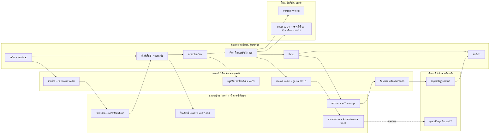
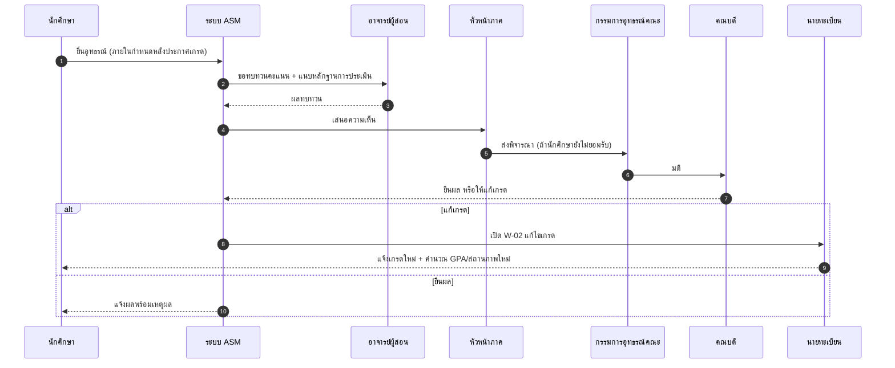
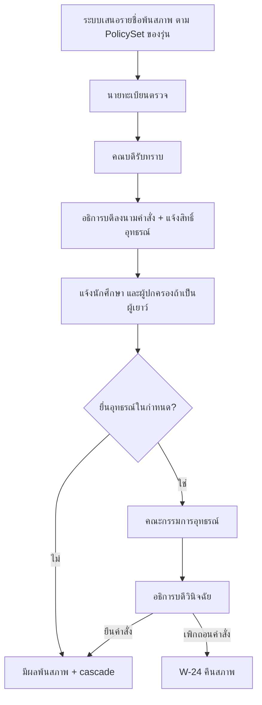
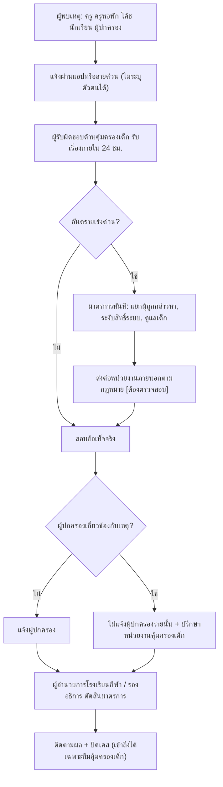
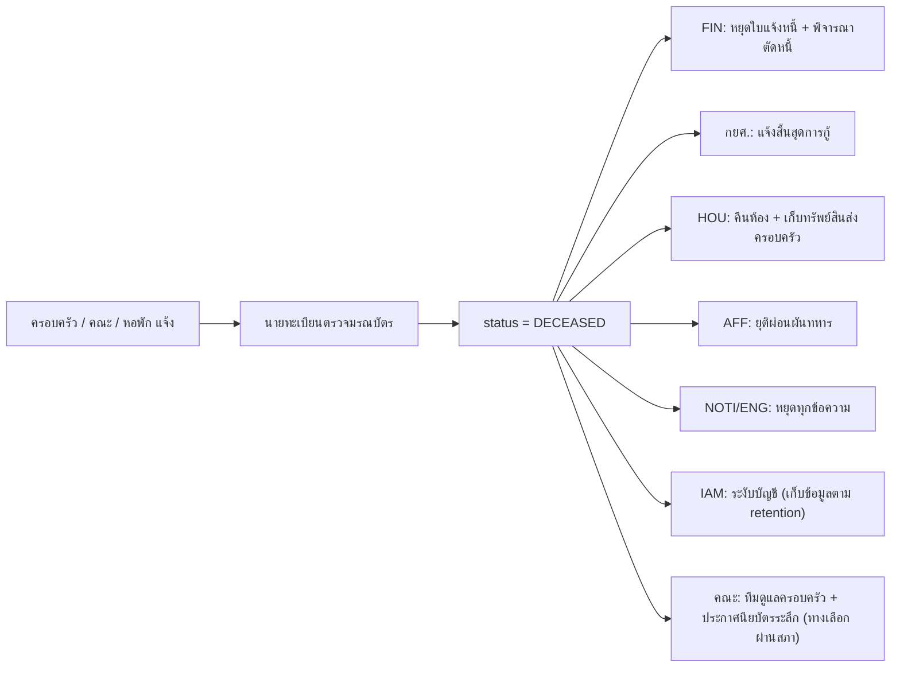
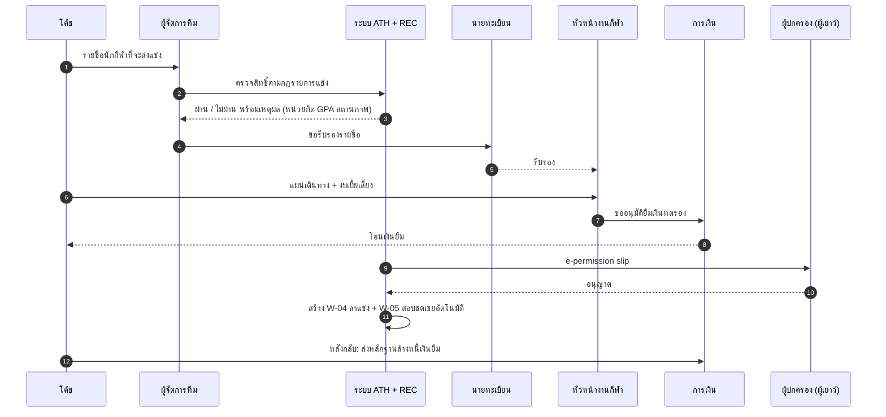
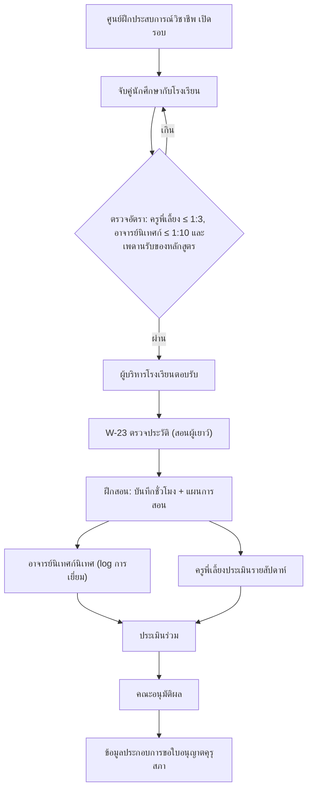
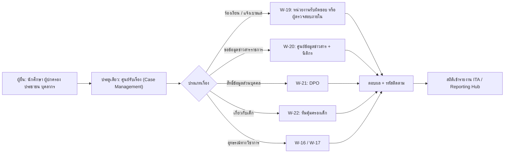

# Workflow ตามบทบาท — ระบบสารสนเทศ มหาวิทยาลัยการกีฬาแห่งชาติ (มกช./TNSU)

> เอกสารคู่กับ [system-design.md](./system-design.md) หัวข้อ 3A และ [gap-analysis.md](./gap-analysis.md)
> รวม workflow เดิม **W-01..W-15** (v0.9) และ workflow ใหม่ **W-16..W-40** ที่เพิ่มจากการทบทวน 4 ด้าน (functional, architecture, compliance, benchmark) — แหล่งที่มาของแต่ละข้อดูใน `research_notes/ออกแบบระบบการศึกษา TNSU ระดับ production/review_*.md`
> ทุก workflow รันบน Flowable (BPMN) และ resolve ผู้อนุมัติจาก `RoleAssignment` ตาม OrgUnit/วาระ ระยะเวลาและเลขมาตราที่ติด **[ต้องตรวจสอบ]** ยังไม่ได้ยืนยันกับต้นฉบับ

สถานะ: ร่าง v1.0-draft (28 ต.ค. 2569)

---

## 1. ภาพรวม: บทบาทกับวงจรชีวิตนักศึกษา

---

## 2. ทะเบียน workflow ทั้งหมด (W-01..W-40)

คอลัมน์: **ผู้เริ่ม** → **สายอนุมัติ** → **ผลลัพธ์/event** · SLA · หมวด · สถานะ (เดิม = v0.9, **ใหม่** = เพิ่มจากการทบทวน, **แก้** = ปรับจาก v0.9)

### 2.1 วิชาการ

| ID | Workflow | ผู้เริ่ม | สายอนุมัติ | ผลลัพธ์ | SLA | สถานะ |
|---|---|---|---|---|---|---|
| W-01 | ส่งเกรด | อาจารย์ผู้สอน | หัวหน้าภาค/ประธานหลักสูตร (ทวนสอบ) → คณบดี/กรรมการวิชาการคณะ | นายทะเบียนวิทยาเขตเผยแพร่ `GradesPublished` | 3 วันทำการ | เดิม |
| W-02 | แก้ไขเกรดหลังเผยแพร่ | อาจารย์ผู้สอน | หัวหน้าภาค → คณบดี → นายทะเบียน (แนบเหตุผล) | บันทึก + แจ้งนักศึกษา | 5 วันทำการ | เดิม |
| W-03 | ถอนรายวิชา / ลงทะเบียนเกินหรือต่ำกว่าเกณฑ์ | นักศึกษา | อาจารย์ที่ปรึกษา → อาจารย์ผู้สอน → (เกินเกณฑ์) คณบดี | ทะเบียนบันทึก | 2 วันทำการ | เดิม |
| W-05 | สอบชดเชย / เลื่อนสอบ | นักศึกษา หรืออัตโนมัติจาก W-04 | อาจารย์ผู้สอน → หัวหน้าภาค → งานวัดผล (ห้อง/ผู้คุม) | `MakeupExamScheduled` | 3 วันทำการ | เดิม |
| W-06 | สำเร็จการศึกษา | นักศึกษา | degree audit + clearance → ประธานหลักสูตร → กรรมการประจำคณะ → นายทะเบียน → สภาวิชาการ → สภามหาวิทยาลัย | `DegreeConferred` → e-Transcript/e-Degree | ตามรอบประชุมสภา | เดิม |
| W-08 | ปรับปรุงหลักสูตร / หลักสูตรใหม่ | ประธานหลักสูตร | กรรมการคณะ → สภาวิชาการ → สภามหาวิทยาลัย → ส่ง CHECO (ภายใน 25 วัน ตามแนวปฏิบัติที่พบ [ต้องตรวจสอบ]) | CurriculumVersion approved | ตามรอบประชุม | เดิม |
| W-15 | เปลี่ยน PolicySet (กฎวิชาการต่อรุ่น) | ผู้อำนวยการงานวิชาการ | รองอธิการบดีฝ่ายวิชาการ → สภาวิชาการ (ถ้าเปลี่ยนสาระ) → publish | PolicySet vN+1 | ตามรอบประชุม | เดิม |
| **W-16** | **อุทธรณ์ผลการเรียน** | นักศึกษา (ภายใน N วันหลังประกาศเกรด) | อาจารย์ผู้สอนทบทวน → หัวหน้าภาค → คณะกรรมการพิจารณาอุทธรณ์ประจำคณะ → คณบดี | ยืนผล หรือเปลี่ยนเกรดผ่าน W-02 + แจ้งผลพร้อมเหตุผล | 15 วันทำการ | **ใหม่** |
| **W-17** | **อุทธรณ์คำสั่งพ้นสภาพ** | นักศึกษา (ผู้ปกครองร่วมถ้าเป็นผู้เยาว์) | นายทะเบียนรับเรื่อง (คำสั่งเดิมต้องแจ้งสิทธิ์อุทธรณ์) → คณะกรรมการอุทธรณ์ → อธิการบดี (ผลสุดท้าย) | ยืนคำสั่ง หรือคืนสภาพ (W-24); ระหว่างพิจารณาคง account แบบจำกัด | ตาม พ.ร.บ.วิธีปฏิบัติราชการทางปกครอง [ต้องตรวจสอบ] | **ใหม่** |
| **W-24** | **คืนสภาพ / กลับเข้าศึกษาใหม่** | นักศึกษา | คณะ (พิจารณาแผนการเรียน) → นายทะเบียน → การเงิน (ค่าธรรมเนียม) | StudentStatus = ACTIVE, PolicySet ตามรุ่นเดิมหรือรุ่นใหม่ตามระเบียบ | 5 วันทำการ | **ใหม่** |
| **W-25** | **ย้ายเข้า / ย้ายออก / ย้ายสาขา / เทียบโอนหน่วยกิต** | นักศึกษา | หลักสูตรปลายทาง (เทียบโอน, ไม่เกิน 3/4 ของหลักสูตร) → คณบดี → นายทะเบียน; ย้ายออก: ทุกฝ่าย clearance | TransferRecord + CreditTransfer | 10 วันทำการ | **ใหม่** |
| **W-32** | **ฝึกประสบการณ์วิชาชีพครู** | ศูนย์ฝึกประสบการณ์วิชาชีพ | จับคู่โรงเรียน (ตรวจอัตรา ครูพี่เลี้ยง ≤1:3, อาจารย์นิเทศก์ ≤1:10 ตามเกณฑ์คุรุสภาที่พบ) → ผู้บริหารโรงเรียนตอบรับ → นิเทศ (log) → ประเมินร่วม → คณะ | PracticumCompleted → ข้อมูลประกอบใบอนุญาตคุรุสภา | ตลอดภาค | **แก้** (เพิ่มการตรวจอัตรา + เพดานรับ) |
| **W-33** | **ขอปรับวิธีเรียน/สอบ สำหรับผู้พิการ** | นักศึกษา | หน่วยบริการนักศึกษาพิการ (ตรวจหลักฐาน) → อาจารย์ผู้สอน (รับทราบ) → งานวัดผล (จัดสอบ) | AccommodationPlan ต่อภาค | 5 วันทำการ | **ใหม่** |

### 2.2 สถานภาพนักศึกษาและกรณีพิเศษ

| ID | Workflow | ผู้เริ่ม | สายอนุมัติ | ผลลัพธ์ | SLA | สถานะ |
|---|---|---|---|---|---|---|
| W-10 | ลาพัก / รักษาสภาพ / ลาออก | นักศึกษา (ผู้ปกครองร่วมถ้าผู้เยาว์) | อาจารย์ที่ปรึกษา → คณบดี → นายทะเบียน | `StudentStatusChanged` + **cascade** (ดู W-26) | 3 วันทำการ | **แก้** (เพิ่ม cascade) |
| W-11 | จำแนกสถานภาพ (พ้นสภาพ) | ระบบ (proposal) | นายทะเบียนตรวจ → คณบดีรับทราบ → อธิการบดีลงนามคำสั่ง **พร้อมแจ้งสิทธิ์อุทธรณ์** | คำสั่ง + e-Saraban → เปิดสิทธิ์ W-17 | 5 วันทำการ | **แก้** |
| W-12 | วินัยนักศึกษา | ผู้แจ้ง | กิจการนักศึกษา → กรรมการสอบข้อเท็จจริง → คณบดี/รองอธิการ → อุทธรณ์ | Sanction | ตามระเบียบ | เดิม |
| **W-26** | **นักศึกษาเสียชีวิต** | ครอบครัว / คณะ / หอพัก | นายทะเบียนตรวจหลักฐาน (มรณบัตร) → คณบดีรับทราบ → (ทางเลือก) สภามหาวิทยาลัยพิจารณาประกาศนียบัตรระลึก | status = DECEASED → หยุดแจ้งเตือน/ใบแจ้งหนี้ทั้งหมด, แจ้ง กยศ., คืนหอ, ปิดบัญชี, ยุติการผ่อนผันทหาร, ตัดออกจาก segment ประกาศ, ทีมดูแลช่วยเหลือครอบครัว | 1 วันทำการ | **ใหม่** |

> **Cascade มาตรฐาน** เมื่อสถานภาพเปลี่ยน (ลาออก/พ้นสภาพ/ย้ายออก/เสียชีวิต/จบ): FIN (ปิดยอด คืนเงิน/ตัดหนี้สูญตามระเบียบ), SCH/กยศ. (แจ้งสิ้นสุดการกู้), HOU (คืนห้อง + ตม.30 ถ้าเป็นชาวต่างชาติ), AFF (ยุติผ่อนผันทหาร), IAM (ลดสิทธิ์ → ปิดบัญชีตาม retention), ATH (ปิดสถานะนักกีฬา), ENG (ออกจาก segment), PRIV (ผู้ปกครองสิ้นสิทธิ์ถ้าไม่ใช่ผู้เยาว์แล้ว)

### 2.3 การเงิน ทุน และหอพัก

| ID | Workflow | ผู้เริ่ม | สายอนุมัติ | ผลลัพธ์ | SLA | สถานะ |
|---|---|---|---|---|---|---|
| W-07 | ทุนการศึกษา | นักศึกษา | ตรวจคุณสมบัติ (DMN) → อาจารย์ที่ปรึกษา → กรรมการทุน → ผู้อำนวยการกองพัฒนานักศึกษา/รองอธิการวิทยาเขต | ScholarshipAwarded → **วางบิลผู้ให้ทุน** | ตามรอบทุน | **แก้** |
| W-09 | คืนเงิน | นักศึกษา / การเงิน | เจ้าหน้าที่การเงิน → หัวหน้างาน → ผู้อนุมัติตามวงเงิน (เกินวงเงิน: รองอธิการวิทยาเขต) | โอนคืน + บันทึก | 5 วันทำการ | เดิม |
| **W-18** | **ทบทวนผลคัดเลือก (สอบทักษะ/ทุน)** | ผู้สมัคร / ผู้ขอทุน | งานรับสมัครหรืองานทุน → คณะกรรมการคัดเลือก → ประธานกรรมการ | ยืนผล หรือแก้ผล + บันทึกเหตุผล | 7 วันทำการ | **ใหม่** |
| **W-27** | **ผ่อนชำระ / ผ่อนผันค่าธรรมเนียม** | นักศึกษา หรืออัตโนมัติเมื่อรอเงิน กยศ. | การเงิน → หัวหน้างานการเงิน → (เกินวงเงิน) รองอธิการวิทยาเขต | PaymentPlan; ไม่ hold การลงทะเบียนระหว่างรอ กยศ. | 3 วันทำการ | **ใหม่** |
| **W-28** | **ยกเลิกใบเสร็จ** | เจ้าหน้าที่การเงิน (maker) | หัวหน้างาน (checker) | ใบเดิมสถานะ VOID + เหตุผล, **ห้ามลบหรือใช้เลขซ้ำ**, เข้า report ตรวจสอบ | วันเดียวกัน | **ใหม่** |
| **W-29** | **จ่ายเงิน (ค่าตอบแทน / เบี้ยเลี้ยง / นักศึกษาทำงาน)** | หน่วยงานต้นเรื่อง | หัวหน้าหน่วยงาน → การเงิน (คำนวณภาษีหัก ณ ที่จ่าย) → ผู้มีอำนาจอนุมัติจ่าย | Payout + หนังสือรับรองการหักภาษี | 7 วันทำการ | **ใหม่** |
| W-13 | ขอออกนอกหอ (โรงเรียนกีฬา) | นักเรียน | ผู้ปกครอง (ผู้มีสิทธิ์รับตัว ตรวจคำสั่งห้ามรับตัว) → ครูหอพัก | LeavePass | ≤ 4 ชม. | **แก้** |
| **W-38** | **แจ้งที่พักชาวต่างชาติ (ตม.30) ภายใน 24 ชม.** | เจ้าหน้าที่หอพัก | ระบบสร้างรายการ → เจ้าหน้าที่ยื่นผ่านช่องทาง ตม. → แนบหลักฐาน | TM30Filed; แจ้งเตือนถ้าใกล้ครบ 24 ชม. | 24 ชม. | **ใหม่** (ย้ายมาเฟสเดียวกับหอพัก) |

### 2.4 กีฬา

| ID | Workflow | ผู้เริ่ม | สายอนุมัติ | ผลลัพธ์ | SLA | สถานะ |
|---|---|---|---|---|---|---|
| W-04 | ลาไปแข่งขัน / เก็บตัว | นักศึกษานักกีฬา | โค้ช → อาจารย์ที่ปรึกษา → อาจารย์ผู้สอน (กำหนดงานชดเชย) → รองคณบดี/คณบดี | ไม่นับขาดเรียน (attendance) + สร้าง W-05 | 2 วันทำการ | **แก้** (ผูก Attendance) |
| **W-30** | **ตรวจสิทธิ์ลงแข่ง (academic eligibility)** | ผู้จัดการทีม | ระบบตรวจกฎ (สถานะ/หน่วยกิต/GPA/ความก้าวหน้า ตามกฎของรายการแข่ง) → นายทะเบียนรับรอง → หัวหน้างานกีฬา | รายชื่อที่มีสิทธิ์ → ส่งผู้จัดการแข่งขัน (เช่น กีฬามหาวิทยาลัย) | 3 วันทำการ | **ใหม่** |
| **W-31** | **เดินทางไปแข่งขันและเบี้ยเลี้ยง** | โค้ช | ผู้จัดการทีม → หัวหน้างานกีฬา → การเงิน (ยืมเงินทดรองราชการ) → (ผู้เยาว์) e-permission slip ผู้ปกครอง | TripPlan + Advance; หลังกลับ: ล้างหนี้เงินยืม + รายงานผล | 5 วันทำการก่อนเดินทาง | **ใหม่** |
| W-14 | เข้าถึงข้อมูลสุขภาพนอกความสัมพันธ์ดูแล (break-glass) | บุคลากร | ระบุเหตุผล → **อนุมัติ 2 คน** (แพทย์หัวหน้า + DPO); ฉุกเฉินเข้าได้ก่อน ตรวจภายหลัง ≤ 24 ชม. | access log + review | ทันที | **แก้** (แก้ข้อขัดกัน 1 vs 2 คน) |
| **W-39** | **บันทึกการบาดเจ็บกรณีฉุกเฉิน** | แพทย์ / นักกายภาพ / โค้ชที่อยู่หน้างาน | บันทึกได้ทันทีด้วยฐาน **ประโยชน์สำคัญต่อชีวิต / หน้าที่ตามกฎหมาย** ไม่รอ consent → แจ้งนักกีฬา/ผู้ปกครอง → consent ใช้เฉพาะการเปิดเผยต่อโค้ช/ทีม | InjuryRecorded + RTP plan | ทันที | **แก้** (เดิมรอ consent) |

### 2.5 คุ้มครองเด็ก ร้องเรียน และสิทธิ์ตามกฎหมาย

| ID | Workflow | ผู้เริ่ม | สายอนุมัติ | ผลลัพธ์ | SLA | สถานะ |
|---|---|---|---|---|---|---|
| **W-22** | **แจ้งเหตุคุ้มครองเด็ก (Safeguarding)** | ผู้พบเหตุ: ครู ครูหอพัก โค้ช นักเรียน ผู้ปกครอง | ผู้รับผิดชอบด้านคุ้มครองเด็ก (Designated Safeguarding Lead) ภายใน 24 ชม. → ประเมินความเสี่ยง → มาตรการเร่งด่วน (แยกผู้ถูกกล่าวหา, จำกัดสิทธิ์ในระบบ) → ส่งต่อหน่วยงานภายนอกตามกฎหมายคุ้มครองเด็ก [ต้องตรวจสอบ] → ผู้อำนวยการโรงเรียนกีฬา/รองอธิการ | SafeguardingCase (สิทธิ์เข้าถึงจำกัดสูงสุด) + ติดตามผล | 24 ชม. | **ใหม่** |
| **W-23** | **ตรวจประวัติผู้ทำงานกับผู้เยาว์** | HR / ผู้ว่าจ้าง (รวมโค้ชภายนอก นักศึกษาฝึกสอน) | ตรวจประวัติอาชญากรรม → ผู้รับผิดชอบด้านคุ้มครองเด็กอนุมัติ | ได้รับ role ที่เข้าถึงผู้เยาว์ได้เมื่อผ่านเท่านั้น (ผูก `RoleAssignment`), ต่ออายุตามรอบ | 15 วันทำการ | **ใหม่** |
| **W-19** | **ร้องเรียน / แจ้งเบาะแส (ไม่ระบุตัวตนได้)** | ใครก็ได้ (ภายในและภายนอก) | ศูนย์รับเรื่องร้องเรียน (คัดแยก) → หน่วยงานรับผิดชอบ หรือกรณีทุจริต: ผู้ตรวจสอบภายใน → คณะกรรมการสอบข้อเท็จจริง → อธิการบดี | ตอบผู้ร้อง (ผ่านรหัสติดตามถ้าไม่ระบุตัวตน) + สถิติเข้า ITA | 15–30 วัน | **ใหม่** |
| **W-20** | **คำขอข้อมูลข่าวสารราชการ (พ.ร.บ.ข้อมูลข่าวสารฯ 2540)** | ประชาชน | ศูนย์ข้อมูลข่าวสาร → หน่วยงานเจ้าของข้อมูล → (มีข้อมูลส่วนบุคคล/ลับ) นิติกร + DPO → ผู้มีอำนาจ | เปิดเผย / ปฏิเสธพร้อมแจ้งสิทธิ์อุทธรณ์ | ตามกฎหมาย [ต้องตรวจสอบ] | **ใหม่** |
| **W-21** | **คำขอใช้สิทธิ์ตาม PDPA** | เจ้าของข้อมูล / ผู้ปกครองของผู้เยาว์ | ยืนยันตัวตน (ThaID) → DPO → เจ้าของระบบดำเนินการ → DPO ตรวจ | ตอบผล (เข้าถึง/แก้ไข/ลบ/คัดค้าน) | ≤ 30 วัน [ต้องตรวจสอบ] | **ใหม่** |

### 2.6 การสื่อสาร รายงาน และบริการ

| ID | Workflow | ผู้เริ่ม | สายอนุมัติ | ผลลัพธ์ | SLA | สถานะ |
|---|---|---|---|---|---|---|
| **W-34** | **คำร้องทั่วไป (e-Form catalogue)** | นักศึกษา / บุคลากร | ตามแบบฟอร์มที่ admin ตั้งค่า (form builder + สายอนุมัติ + SLA ต่อบริการ) | ผลคำร้อง + ติดตามสถานะได้ | ตามบริการ | **ใหม่** |
| **W-35** | **ส่งรายงานต่อหน่วยงานกำกับ (Reporting Hub)** | data steward | ดึงข้อมูล ณ วันตัดยอด → ตรวจคุณภาพ → ผู้อำนวยการกองแผน → ผู้บริหารอนุมัติ → ส่ง | Snapshot เก็บถาวร + หลักฐานการส่ง | ตามปฏิทินรายงาน | **ใหม่** |
| **W-36** | **เผยแพร่ประกาศ / ประกาศฉุกเฉิน P0** | ผู้เขียนตามสิทธิ์ (ENG 4.27) | ผู้อนุมัติตามระดับ OrgUnit; P0 ต้องอนุมัติ 2 คน | `AnnouncementPublished` + ติดตามการรับทราบ | P0 ≤ 60 วินาที | **ใหม่** |
| **W-37** | **สมัครคอร์สระยะสั้น / ค่ายกีฬา / อบรมโค้ช (บุคคลภายนอก)** | ผู้สมัครภายนอก | ชำระเงิน → ผู้รับผิดชอบโครงการ → ประเมินผล | ใบประกาศ / digital badge + รายได้เข้า fund code โครงการ | ตามโครงการ | **ใหม่** (เฟสหลัง) |
| **W-40** | **ทำลายเอกสาร / ส่งมอบหอจดหมายเหตุ** | เจ้าหน้าที่สารบรรณ | คณะกรรมการทำลายเอกสาร → ผู้มีอำนาจ → (เอกสารเก็บถาวร) ส่งมอบหอจดหมายเหตุแห่งชาติ | Disposal record + ลบข้อมูลตาม retention | ปีละครั้ง | **ใหม่** |

---

## 3. Diagram ของ workflow ใหม่ที่สำคัญ

### 3.1 W-16 อุทธรณ์ผลการเรียน

### 3.2 W-11 → W-17 พ้นสภาพและอุทธรณ์

### 3.3 W-22 แจ้งเหตุคุ้มครองเด็ก

### 3.4 W-26 นักศึกษาเสียชีวิต (cascade)

### 3.5 W-30 + W-31 ตรวจสิทธิ์ลงแข่งและเดินทาง

### 3.6 W-32 ฝึกประสบการณ์วิชาชีพครู

### 3.7 W-19 / W-20 / W-21 ช่องทางร้องเรียนและสิทธิ์ตามกฎหมาย (ประตูเดียว)

---

## 4. มุมมองตามบทบาท: แต่ละบทบาทเกี่ยวกับ workflow ไหน

สัญลักษณ์: **เริ่ม** = เป็นผู้ยื่น/ผู้เริ่ม · **อนุมัติ** = อยู่ในสายอนุมัติ · **ดำเนินการ** = ปฏิบัติงานหรือบันทึก · **รับทราบ** = ได้รับแจ้ง

| บทบาท | เริ่ม | อนุมัติ | ดำเนินการ / รับทราบ |
|---|---|---|---|
| ผู้สมัคร | W-18 | – | รับทราบผลคัดเลือก |
| นักศึกษา | W-03, W-04, W-05, W-06, W-07, W-10, W-16, W-17, W-21, W-24, W-25, W-27, W-33, W-34 | – | รับทราบ W-01, W-11, W-36 |
| ผู้ปกครองของผู้เยาว์ | W-21, W-22 | W-13, W-31 (permission slip), ร่วมใน W-10/W-17 | รับทราบ W-36, W-39 |
| ผู้ปกครองของนักศึกษาผู้ใหญ่ | – | – | รับทราบเฉพาะเรื่องที่นักศึกษาให้ consent |
| อาจารย์ผู้สอน | W-01, W-02 | W-03, W-04, W-05 | ดำเนินการ W-16 (ทบทวน), รับทราบ W-33 |
| อาจารย์ที่ปรึกษา | – | W-03, W-04, W-07, W-10 | รับทราบ early warning, W-36 |
| หัวหน้าภาค / ประธานหลักสูตร | W-08 | W-01, W-02, W-05, W-06, W-16 | – |
| คณบดี / รองคณบดี | – | W-01, W-02, W-03, W-04, W-06, W-10, W-12, W-16, W-24, W-25 | รับทราบ W-11, W-26 |
| รองอธิการบดีประจำวิทยาเขต | – | W-07, W-09, W-12, W-22, W-27 (เกินวงเงิน) | รับทราบ dashboard วิทยาเขต |
| อธิการบดี | – | W-11 (ลงนาม), W-17 (วินิจฉัย), W-19, W-35 | – |
| สภาวิชาการ / สภามหาวิทยาลัย | – | W-06, W-08, W-15, W-26 (ประกาศนียบัตรระลึก) | – |
| นายทะเบียน | W-11 (ตรวจ) | W-02, W-06, W-24, W-25, W-30 | ดำเนินการ W-01 (เผยแพร่), W-10, W-17 (รับเรื่อง), W-26 |
| เจ้าหน้าที่การเงิน / หัวหน้างานการเงิน | W-28 | W-09, W-27, W-28, W-29, W-31 | ดำเนินการ cascade การเงิน |
| เจ้าหน้าที่ กยศ. (Maker/Checker) | – | – | ดำเนินการ W-27 (รอเงินกู้), W-26 |
| งานทุน / กรรมการทุน | – | W-07, W-18 | – |
| เจ้าหน้าที่หอพัก / ครูหอพัก | W-38 | W-13 | ดำเนินการ W-22 (แจ้งเหตุ), W-26 |
| กิจการนักศึกษา | W-12 | – | ดำเนินการ W-12, W-33 (หน่วยบริการผู้พิการ) |
| โค้ช / ผู้จัดการทีม | W-30, W-31 | W-04 | ดำเนินการ W-39 (หน้างาน), แจ้ง W-22 |
| แพทย์ / นักกายภาพ | W-39 | W-14 | – |
| ผู้รับผิดชอบด้านคุ้มครองเด็ก | – | W-22, W-23 | – |
| ศูนย์ฝึกประสบการณ์วิชาชีพ / อาจารย์นิเทศก์ / ครูพี่เลี้ยง / ผู้บริหารโรงเรียนฝึก | W-32 | W-32 | ดำเนินการนิเทศและประเมิน |
| ศูนย์รับเรื่องร้องเรียน / ศูนย์ข้อมูลข่าวสาร / นิติกร | – | W-19, W-20 | – |
| DPO | – | W-14, W-20, W-21 | ตรวจ DPIA |
| HR | W-23 | – | ซิงก์ RoleAssignment |
| ผู้ตรวจสอบภายใน / สตง. (อ่านอย่างเดียว) | – | – | ตรวจ W-09, W-28, W-29, audit log |
| data steward / กองแผน | W-35 | W-35 | – |
| เจ้าหน้าที่สารบรรณ | W-40 | – | – |
| ผู้ดูแลระบบ (admin) | – | – | **ไม่อยู่ในสายอนุมัติทางธุรกิจใด** ตั้งค่า form/สายอนุมัติได้ผ่าน 4-eyes เท่านั้น |

---

## 5. กฎร่วมของทุก workflow

1. **ผู้อนุมัติ resolve จาก RoleAssignment ณ เวลาที่ขั้นตอนเริ่ม** ถ้าตำแหน่งว่างหรือผู้อนุมัติลา ระบบส่งให้ผู้รักษาราชการแทน (acting) อัตโนมัติ
2. **แยกหน้าที่ (SoD):** ผู้เริ่มอนุมัติเรื่องของตัวเองไม่ได้ เช่น อาจารย์ที่เป็นหัวหน้าภาคด้วยห้ามอนุมัติเกรดวิชาที่ตนสอน ระบบส่งข้ามไปยังระดับถัดไป
3. **SLA และการเร่งรัด:** เกิน SLA → เตือนผู้อนุมัติ → เกิน 2 เท่า → แจ้งผู้บังคับบัญชาถัดไป
4. **ทุกขั้นตอนบันทึก audit log แบบแก้ไขไม่ได้** พร้อมเหตุผลเมื่อปฏิเสธ
5. **คำสั่งที่กระทบสิทธิ์** (พ้นสภาพ ลงโทษ ปฏิเสธทุน ปฏิเสธข้อมูลข่าวสาร) ต้องแสดงเหตุผลและแจ้งสิทธิ์อุทธรณ์ทุกครั้ง
6. **ผู้เยาว์:** ทุก workflow ที่มีผลต่อนักเรียนผู้เยาว์ต้องแจ้งหรือขอความเห็นผู้ปกครองที่มีสิทธิ์ และตรวจคำสั่งจำกัดสิทธิ์ผู้ปกครองก่อน
7. **ช่องทาง:** ทุก workflow ทำได้ทั้ง web, PWA/LINE และแอป ยกเว้นขั้นตอนลงนามที่ต้องใช้ e-signature ตามระดับที่กำหนดต่อประเภทเอกสาร
