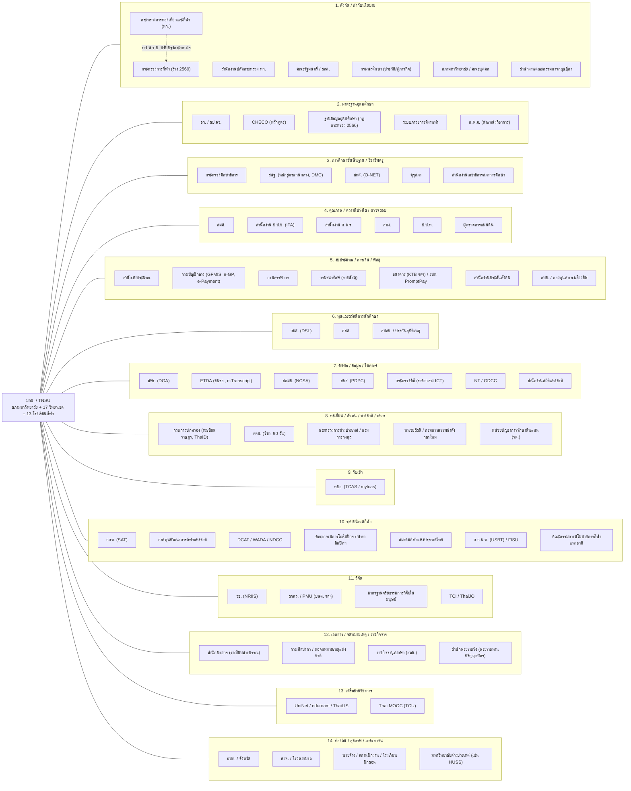

# แผนที่ความสัมพันธ์กับหน่วยงานภาครัฐและองค์กรภายนอก (Government & External Relations Map) — มหาวิทยาลัยการกีฬาแห่งชาติ (มกช./TNSU)

> **ประเภทเอกสาร:** Companion design document สำหรับการออกแบบระบบสารสนเทศ TNSU ระดับ production
> **สถานะ:** Draft v0.1 + ภาคผนวก v1.0 alignment + **แก้ในเนื้อความ v1.1** (28 ต.ค. 2569) — ภาคผนวกของชุดเอกสาร v1.1 | **ข้อมูล ณ:** 28 ต.ค. 2569 (2026-10-28)
> **อ่านคู่กับ:** [00-blueprint](./00-blueprint.md) · [00-fix-decisions-v1.1](./00-fix-decisions-v1.1.md) · [01-overview](./01-overview.md) · [03-academic-calendar](./03-academic-calendar.md) · [09-integrations](./09-integrations.md) (catalogue I-xx, ปฏิทินรายงาน §6, cross-border §7) · [10-security-compliance](./10-security-compliance.md) · ภาคผนวก v1.0 alignment ท้ายเอกสาร (ถ้าเนื้อความขัดกับภาคผนวกหรือเล่มหลัก ให้ยึดภาคผนวกและเล่มหลัก)
> **Raw notes:** `/home/user/Ai/research_notes/ออกแบบระบบการศึกษา TNSU ระดับ production/government_relations_notes.md` (และ notes เดิม tnsu_profile.md, thai_gov_compliance.md, external_integrations.md, process_requirements.md)
>
> **ป้ายสถานะ**
> - ✅ = มีแหล่งอ้างอิง (ดูรหัส `[Sxx]` ในหัวข้อ "แหล่งอ้างอิง") โดยส่วนใหญ่ยืนยันจาก **search snippet** ไม่ได้อ่านเอกสารฉบับเต็ม
> - 🟡 = อนุมาน / ความรู้ทั่วไปของผู้เขียน / ยืนยันกับ TNSU หรือหน่วยงานเจ้าของก่อนใช้ใน TOR
>
> **ข้อจำกัดของการวิจัย:** เครือข่ายของ session บล็อกโดเมน .go.th / .or.th / .ac.th ไทยจำนวนมาก (เช่น tnsu.ac.th, ratchakitcha, dga.or.th, mytcas, tci-thaijo) จึงไม่ได้อ่านตัวบท พ.ร.บ.มหาวิทยาลัยการกีฬาแห่งชาติ พ.ศ. 2562 ฉบับเต็ม ประเด็นที่ขึ้นกับตัวบท (ฐานะส่วนราชการ, ผู้รักษาการ, การผูกกับมาตรฐานอุดมศึกษา) จึงเป็น 🟡 ทั้งหมด

---

## 1. Executive summary

1. **มกช. อยู่ในจุดตัดของ "สามระบบกำกับ"** คือ (ก) สายบังคับบัญชาตามสังกัด: กระทรวงการท่องเที่ยวและกีฬา (ทก.) ซึ่งกำลังจะแยกเป็น **กระทรวงการกีฬา** ตามร่างกฎหมายที่ ครม. เห็นชอบเมื่อ 14 ก.ค. 2569 ✅[S7][S8] (ข) สายมาตรฐานวิชาการ: อว./สป.อว. (หลักสูตร, CHECO, ข้อมูลอุดมศึกษา, ภาวะการมีงานทำ) แม้ มกช. ไม่ได้สังกัด อว. และ กระทรวงศึกษาธิการ/คุรุสภา สำหรับโรงเรียนกีฬาและบัณฑิตครูพลศึกษา (ค) สายระบบราชการกลาง: งบประมาณ, กรมบัญชีกลาง, สำนักงาน ป.ป.ช. (ITA), สตง., ก.พ.ร., DGA, สกมช., สคส.
2. เราระบุ **หน่วยงาน/ระบบภายนอกได้ราว 85 รายการ** ใน 15 หมวด (ตาราง 3.1–3.15) แต่ละแห่งต้องมีอย่างน้อยหนึ่งอย่างต่อไปนี้: รายงาน, การส่งข้อมูล, การเชื่อมต่อ หรือ compliance control ในระบบ ช่องทางส่วนใหญ่ยังเป็น **web portal ที่ต้องมีคนทำงาน + อัปโหลดไฟล์** (CHECO, กยศ. DSL, e-GP, GFMIS, ITAS, คุรุสภา) มีส่วนน้อยที่เป็น API มาตรฐาน (ThaID OIDC, Bank bill-payment API, Digital Transcript XML ขมธอ. 25-2563)
3. **ข้อกำหนดเชิงสถาปัตยกรรมที่สำคัญที่สุด** ที่ได้จากแผนที่นี้
   - **Regulatory Reporting Hub:** data mart + report catalogue ที่ map "รายงาน → หน่วยงาน → template version → รอบส่ง → ผู้รับผิดชอบ → หลักฐานการส่ง" และมี audit trail
   - **Configurable organisation hierarchy แบบ effective-dated** (กระทรวง → มหาวิทยาลัย → วิทยาเขต/โรงเรียนกีฬา → คณะ/หน่วย) พร้อมรหัสหน่วยงานภายนอกหลายชุด (GFMIS, e-GP, งบประมาณ, อว., สพฐ./ศธ., คุรุสภา) เพื่อรับการย้ายกระทรวงโดยไม่ต้องแก้โค้ด
   - **Dual education model:** อุดมศึกษา (หน่วยกิต/CHECO/HEdata) และขั้นพื้นฐาน (โรงเรียนกีฬา ม.1–6, ผู้เยาว์, O-NET, ปพ.) แยก rule engine แต่ใช้ identity/people master ร่วมกัน
   - **Athlete & sport-ecosystem data** (กกท., สมาคมกีฬา, DCAT, ก.ก.ม.ท.) เป็นข้อมูลอ่อนไหว (สุขภาพ, whereabouts) ต้องมี consent/PDPA ม.26 controls
4. **ความเสี่ยงหลัก:** (ก) ไม่รู้ฐานะทางกฎหมายที่แน่นอนของ มกช. (ส่วนราชการหรือไม่) ซึ่งกำหนดว่าต้องใช้ GFMIS/e-Payment/ระเบียบกระทรวงการคลังโดยตรงหรือไม่ (ข) การย้ายกระทรวงช่วงปลาย 2569–2570 (ค) ภาระรายงานของโรงเรียนกีฬาต่อ ศธ./สพฐ./สทศ./สมศ. ยังไม่ชัด (ง) เกณฑ์ ก.พ.อ./คุรุสภาที่ใช้กับ มกช. ยังไม่ยืนยัน ทั้งหมดอยู่ในหัวข้อ 9 "คำถามที่ต้องยืนยันกับ TNSU"

---

## 2. Stakeholder map (Mermaid)

---

## 3. Master table

**คำอธิบายคอลัมน์ "ช่องทาง":** API = machine interface, File = อัปโหลด/ดาวน์โหลดไฟล์ตาม template, Portal = เว็บที่เจ้าหน้าที่ใช้งาน, Paper = หนังสือราชการ/เอกสาร (ส่วนใหญ่ผ่าน e-Saraban)
**ความถี่:** ส่วนใหญ่เป็น 🟡 เว้นแต่ระบุแหล่ง

### 3.1 สังกัดและการกำกับดูแล

| หน่วยงาน | ความสัมพันธ์กับ TNSU | ข้อมูล/รายงานที่แลกเปลี่ยน | ช่องทาง | ความถี่ | ผลต่อระบบ (โมดูล) | สถานะ + source |
|---|---|---|---|---|---|---|
| กระทรวงการท่องเที่ยวและกีฬา (ทก./MOTS) | หน่วยงานต้นสังกัดปัจจุบัน มกช. อยู่ในโครงสร้างกระทรวง | แผนปฏิบัติราชการ, ผลการดำเนินงาน/KPI, งบประมาณผ่านกระทรวง, หนังสือสั่งการ, ข้อมูลสถิติ | Paper (e-Saraban), File, Portal ของกระทรวง | รายไตรมาส/รายปี 🟡 | Planning & Budget, KPI dashboard, e-Saraban, Org master | ✅ สังกัด [S6][S32]; ช่องทาง 🟡 |
| กระทรวงการกีฬา (ร่าง) | น่าจะเป็นต้นสังกัดใหม่หลังกฎหมายผ่าน (คาดเสร็จปลาย 2569–ต้น 2570) | เหมือน ทก. แต่เปลี่ยนชื่อ/รหัส/สายรายงาน | เหมือนข้างบน | เหตุการณ์ครั้งเดียว + ต่อเนื่อง | Effective-dated org hierarchy, template engine | ✅ ร่างผ่าน ครม. 14 ก.ค. 2569 [S7][S8][S9][S10]; 🟡 ว่า มกช. ย้ายไปด้วย (ยังไม่พบรายชื่อหน่วยงานที่โอน) |
| สำนักงานปลัดกระทรวง ทก. | หน่วยประสานกลางของกระทรวง (แผน งบ ตรวจราชการ) ปลัด ทก. เดิมจะเป็นปลัดกระทรวงกีฬา | ข้อมูลแผน/งบ/ผลตรวจราชการ, คำรับรองการปฏิบัติราชการ | Paper, File | รายไตรมาส 🟡 | Planning, Performance mgmt | ✅ เรื่องปลัด [S9][S10]; บทบาทต่อ มกช. 🟡 |
| คณะรัฐมนตรี / สลค. | อนุมัติกฎหมาย นโยบาย งบ และมติที่ผูกพันหน่วยงาน (เช่น การแยกกระทรวง) | มติ ครม. ที่มหาวิทยาลัยต้องปฏิบัติ, การเสนอเรื่องผ่านกระทรวง | Paper | ตามเหตุการณ์ | Policy/Regulation register (ทะเบียนมติ/กฎหมาย) | ✅ [S2][S7] |
| สภามหาวิทยาลัย (หรือคณะบุคคลที่ทำหน้าที่แทน) | องค์กรกำกับสูงสุดภายใน อนุมัติหลักสูตร ปริญญา ข้อบังคับ งบ | วาระ/มติ, อนุมัติหลักสูตร (ก่อนส่ง CHECO/คุรุสภา), อนุมัติผู้สำเร็จการศึกษา | Internal (e-Meeting) | รายเดือน 🟡 | Council e-Meeting, Curriculum workflow, Graduation approval | ✅ ม.80/82 บทเฉพาะกาล [S3]; 🟡 สถานะ "คณะบุคคล" (Wikipedia ใน tnsu_profile) |
| สำนักงานคณะกรรมการกฤษฎีกา | ให้ความเห็นทางกฎหมายเมื่อ มกช. หารือ | หนังสือหารือ/ความเห็น | Paper | ตามเหตุการณ์ | Legal register | ✅ เรื่องเสร็จ 33/2563 [S3]; 1/2546 [S4] |
| กรมพลศึกษา | หน่วยงานเดิมของวิทยาลัยพลศึกษาและโรงเรียนกีฬา (สมัยอยู่ ศธ.) ปัจจุบันเป็นหน่วยร่วมกระทรวงด้านกีฬาพื้นฐาน/มวลชน | ข้อมูลประวัติบุคลากร/ทะเบียนเดิม (legacy), โครงการร่วม | Paper | ตามเหตุการณ์ | Legacy data migration, HR history | ✅ ประวัติ [S4][S5]; 🟡 ความร่วมมือปัจจุบัน |

### 3.2 มาตรฐานอุดมศึกษา (อว.)

| หน่วยงาน | ความสัมพันธ์ | ข้อมูล/รายงาน | ช่องทาง | ความถี่ | ผลต่อระบบ | สถานะ |
|---|---|---|---|---|---|---|
| สป.อว. – มาตรฐานหลักสูตร | หลักสูตรต้องเป็นไปตามกฎกระทรวงมาตรฐานหลักสูตร 2565 และเกณฑ์ ป.ตรี/บัณฑิตศึกษา 2565 | โครงสร้างหลักสูตร, ผลลัพธ์การเรียนรู้ (OBE), อาจารย์ประจำหลักสูตร | — | ทุกครั้งที่เปิด/ปรับปรุงหลักสูตร | Curriculum master (versioned), PLO/CLO mapping | ✅ เกณฑ์ 2565 [S15]; 🟡 ข้อผูกพันทางกฎหมายต่อ มกช. |
| CHECO | ส่งหลักสูตรที่สภาอนุมัติเพื่อพิจารณาความสอดคล้อง และรับ **รหัสหลักสูตร** | มคอ.2/ข้อมูลหลักสูตร, อาจารย์, สถานะ "S" | Portal | ต่อหลักสูตร (ม.อ.: ภายใน 25 วันหลังสภาอนุมัติ) | Curriculum workflow, export มคอ.2, เก็บ CHECO code เป็น external key | ✅ [S16][S17]; 🟡 มกช. ใช้ CHECO |
| ฐานข้อมูลอุดมศึกษา (ตามกฎกระทรวงการเปิดเผยและส่งข้อมูลการอุดมศึกษา 2566) | สถาบันอุดมศึกษาต้องส่ง/เปิดเผยข้อมูลตามหลักเกณฑ์และระยะเวลา | นักศึกษา (รับเข้า/คงอยู่/สำเร็จ), บุคลากร, หลักสูตร | File/Portal (info.mhesi) | รายภาค/รายปี 🟡 | Regulatory Reporting Hub, data quality rules, data dictionary mapping | ✅ กฎกระทรวง 2566 [S18]; สป.อว. ประชุมปีการศึกษา 2568 [S19]; [S20]; 🟡 ใช้กับ มกช. |
| ระบบภาวะการมีงานทำบัณฑิต | ส่งผลสำรวจบัณฑิตเข้าระบบกลาง | แบบสำรวจรายบุคคล (นิยามมีงานทำภายใน 1 ปี) | Portal/File | รายรุ่น (ช่วงรับปริญญา) 🟡 | Graduate survey module (ผูกกับขอจบ/ซ้อมรับ), export | ✅ [S21]; 🟡 ใช้กับ มกช. |
| คลังหน่วยกิต/เทียบโอน (ประกาศ 2565) | กรอบการสะสมหน่วยกิตและเทียบโอน | ผลการเรียน non-degree, short course | Internal + อนาคต NCBS | ตามคำร้อง | Credit bank module | ✅ [S24]; NCBS นำร่อง [S80] |
| ก.พ.อ. / มาตรฐานตำแหน่งทางวิชาการ | เกณฑ์ ผศ./รศ./ศ. (ประกาศ ก.พ.อ. 2564; กฎกระทรวงมาตรฐานการขอตำแหน่งทางวิชาการ 2565) | แฟ้มผลงานวิชาการ, ผลประเมิน, คำสั่งแต่งตั้ง | Paper + internal | ตามรอบยื่น | HR Academic rank workflow, publication registry (TCI/Scopus) | ✅ ประกาศ ก.พ.อ. [S23]; 🟡 มกช. ใช้เกณฑ์ ก.พ.อ. หรือข้อบังคับตนเอง |

### 3.3 การศึกษาขั้นพื้นฐานและวิชาชีพครู

| หน่วยงาน | ความสัมพันธ์ | ข้อมูล/รายงาน | ช่องทาง | ความถี่ | ผลต่อระบบ | สถานะ |
|---|---|---|---|---|---|---|
| กระทรวงศึกษาธิการ (ศธ.) | กำกับมาตรฐานการศึกษาขั้นพื้นฐานที่โรงเรียนกีฬาใช้ (หลักสูตร, เอกสารหลักฐาน ปพ.) | ข้อมูลนักเรียน, เอกสารวุฒิ ม.3/ม.6 | Portal/File 🟡 | รายภาค/รายปี 🟡 | Basic-ed SIS (โรงเรียนกีฬา), ปพ.1/ปพ.2 generator | 🟡 (โรงเรียนกีฬาสังกัด มกช. ไม่ใช่ สพฐ. ✅[S32]) |
| สพฐ. (OBEC) | เจ้าของหลักสูตรแกนกลางฯ 2551 (และฉบับปรับปรุง), ระบบ DMC/รหัส G | หลักสูตร, จำนวนนักเรียน, รหัส G | Portal (DMC) 🟡 | 10 มิ.ย./10 พ.ย. (รอบนับนักเรียน) 🟡 | Curriculum (ขั้นพื้นฐาน), alternate ID (G-code) | ✅ รหัส G/dataset [S73][S75]; 🟡 การส่ง DMC ของโรงเรียนกีฬา |
| สทศ. (NIETS) | จัดสอบ O-NET ม.3/ม.6 | รายชื่อผู้เข้าสอบ, ผลคะแนน | Portal | รายปี (ก.พ.–มี.ค.) | Exam registration export, score import | ✅ โรงเรียนกีฬาเคยสอบ O-NET (2554) [S33]; ปฏิทิน 2568 [S81-ref]; 🟡 เงื่อนไขปัจจุบัน |
| คุรุสภา (ใบอนุญาต) | บัณฑิตสายครู (ศษ.บ. พลศึกษา) ขอใบอนุญาต; ครูโรงเรียนกีฬาต้องมีใบอนุญาต | รายชื่อผู้สำเร็จ, หลักสูตรที่รับรอง, ผลปฏิบัติการสอน | Portal (KSP e-Service) + Paper | รายรุ่น | Graduation export, practicum module, HR license tracking ของครูโรงเรียนกีฬา | ✅ ข้อบังคับใบอนุญาต 2565 [S25]; 🟡 ช่องทาง |
| คุรุสภา (รับรองปริญญา) | รับรองหลักสูตรผลิตครู กำหนดจำนวนรับ, ครูพี่เลี้ยง 1:3, อาจารย์นิเทศ 1:10, ฝึกสอนตั้งแต่ปี 1 | ข้อมูลหลักสูตร, จำนวนรับ, สถานศึกษาฝึกประสบการณ์, ครูพี่เลี้ยง | Portal + Paper | ต่อหลักสูตร + ติดตามรายปี | Practicum placement (ratio checks), enrolment cap control | ✅ [S26][S27][S28]; มกช. มีหลักสูตรฝึกสอน 4 ปี [S29][S30]; 🟡 สถานะรับรองของ มกช. |
| สำนักงานเลขาธิการสภาการศึกษา (สกศ.) | นโยบาย/แผนการศึกษาแห่งชาติ, ข้อมูลสถิติการศึกษาระดับชาติ | ข้อมูลสถิติ (ถ้าร้องขอ) | File | รายปี 🟡 | Statistical export | 🟡 |
| สมศ. (โรงเรียนกีฬา) | ประเมินคุณภาพภายนอกระดับขั้นพื้นฐาน รอบห้า 2567–2571 | SAR, หลักฐาน | Portal (แพลตฟอร์ม สมศ.) | ตามรอบ | QA evidence repository (ขั้นพื้นฐาน) | ✅ รอบห้า [S34]; [S35]; 🟡 ใช้กับโรงเรียนกีฬา |

### 3.4 คุณภาพ ความโปร่งใส การตรวจสอบ

| หน่วยงาน | ความสัมพันธ์ | ข้อมูล/รายงาน | ช่องทาง | ความถี่ | ผลต่อระบบ | สถานะ |
|---|---|---|---|---|---|---|
| สมศ. (อุดมศึกษา) | ประเมินภายนอกตาม พ.ร.บ.การศึกษาแห่งชาติ | SAR สถาบัน/หลักสูตร, KPI | Portal/File | ตามรอบ 🟡 | QA data mart, evidence store | 🟡 (ไม่พบรายงานของ มกช.) |
| QA ภายใน (CUPT QA/AUN-QA/EdPEx) | กรอบ QA ภายในที่มหาวิทยาลัยเลือก | SAR หลักสูตร, ELO, retention | Internal | รายปีการศึกษา | QA (CUR + ANA `mart_qa_*` + RPT) | ✅ กรอบทั่วไป (process_requirements) ; 🟡 กรอบที่ มกช. ใช้ |
| สำนักงาน ป.ป.ช. – ITA | ประเมินคุณธรรมและความโปร่งใส 3 เครื่องมือ IIT/EIT/OIT (30/30/40) | OIT: ข้อมูลเปิดเผยบนเว็บไซต์ (แผน งบ จัดซื้อ HR สถิติบริการ ข้อร้องเรียน), รายชื่อผู้มีส่วนได้เสีย (EIT) | Portal (ITAS) + เว็บไซต์ | รายปีงบ: **OIT ตอบ/อนุมัติข้อมูล 2 มี.ค.–30 มิ.ย.; IIT ปิด 30 มิ.ย.; EIT ถึง 30 ก.ย.** (รอบปีงบ 2569 ✅ [Mahidol LC](https://lc.mahidol.ac.th/documents/OIT/2026_Timeline.pdf); ⚠️ แก้ v1.1 จากเดิม "OIT ภายใน เม.ย., ตรวจ พ.ค.") | OIT publishing CMS, procurement & complaint statistics, e-Service stats | ✅ [S36][S37][S38]; 🟡 คะแนน มกช. |
| สำนักงาน ก.พ.ร. | ประเมินผลการปฏิบัติราชการ (PMQA 4.0, DG Readiness, ความพึงพอใจ) และเป็นผู้เสนอโครงสร้างกระทรวงใหม่ | คำรับรอง/KPI, รายงานผล, PMQA | Portal/File | รอบ 6/12 เดือน 🟡 | KPI management, survey module, digital-readiness evidence | ✅ KPI template 2569 [S39]; ก.พ.ร. เสนอร่างแยกกระทรวง [S8]; 🟡 มกช. อยู่ในกรอบ ก.พ.ร. |
| สตง. | ตรวจสอบการเงิน/งบการเงิน/ผลสัมฤทธิ์ และรับเรื่องร้องเรียน | งบการเงิน, เอกสารเบิกจ่าย, สัญญา | Paper + เข้าตรวจระบบ | รายปี + ตามเหตุการณ์ | Finance audit trail, read-only auditor role, document retention | ✅ มีการร้องเรียน สตง. เรื่อง มกช. [S14]; 🟡 รอบตรวจ |
| ป.ป.ท. | รับเรื่องทุจริตในภาครัฐ | ข้อมูลตามคำร้อง | Paper | ตามเหตุการณ์ | Case/complaint management, legal hold | 🟡 |
| ผู้ตรวจการแผ่นดิน | รับเรื่องร้องเรียนการปฏิบัติไม่ชอบ | ข้อมูลชี้แจง | Paper | ตามเหตุการณ์ | Complaint module (แจ้งเตือนกำหนดตอบ) | 🟡 |

### 3.5 งบประมาณ การเงิน พัสดุ ภาษี

| หน่วยงาน | ความสัมพันธ์ | ข้อมูล/รายงาน | ช่องทาง | ความถี่ | ผลต่อระบบ | สถานะ |
|---|---|---|---|---|---|---|
| สำนักงบประมาณ | จัดสรรงบประมาณแผ่นดิน (2569 ฿1,853.9M; ร่าง 2570 ฿1,716.84M) | คำของบ, แผนการใช้จ่าย, รายงานผล (BB EvMIS 🟡) | Portal | รายปี + รายไตรมาส | Budget planning (multi-campus), รหัสงบประมาณ, performance indicators | ✅ ตัวเลขงบ [S12][S13]; 🟡 ระบบ |
| กรมบัญชีกลาง – New GFMIS Thai | ระบบการเงินการคลังภาครัฐ (เบิกจ่าย รับ นำส่ง) | ใบขอเบิก, รับ/นำส่งเงิน, สินทรัพย์ | Portal (token) + File | รายวัน/รายเดือน | ERP ↔ GFMIS reconciliation, รหัสหน่วยเบิกจ่าย | ✅ ระบบ [S47]; 🟡 มกช. ใช้ (ขึ้นกับฐานะส่วนราชการ) |
| กรมบัญชีกลาง – e-GP | ประกาศแผน TOR ราคากลาง ผลจัดซื้อ สัญญา | แผนจัดซื้อ, บก.01/บก.05, ประกาศผู้ชนะ | Portal | ต่อโครงการ | Procurement module (sync สถานะ, export สถิติให้ OIT) | ✅ กฎหมาย/แนวปฏิบัติ (thai_gov_compliance) ; มีประกาศ e-bidding ของวิทยาเขต [S79] |
| กรมบัญชีกลาง – e-Payment ภาครัฐ / KTB Corporate | รับชำระค่าธรรมเนียม, e-Receipt | รายการชำระ, ใบเสร็จ | API/File | รายวัน | Payment gateway, receipt, reconciliation | ✅ e-Payment [S48]; 🟡 มกช. ใช้ e-Payment หรือบัญชีธนาคารเงินรายได้ |
| ธนาคาร / PromptPay (ธปท.) | รับค่าเทอมผ่าน Bill Payment/Thai QR | ใบแจ้งหนี้ Ref1/Ref2, callback, statement | API + File | Real-time + รายวัน | Billing, auto-reconcile | ✅ รูปแบบทั่วไป (external_integrations) |
| กระทรวงดีอี – เกณฑ์ราคากลาง ICT | อ้างอิงราคากลางครุภัณฑ์/ระบบคอมพิวเตอร์ (ฉบับ ธ.ค. 2568) | สเปก/ราคากลาง | Paper | รายปี | Procurement spec library | ✅ [S49] |
| กฎกระทรวง MiT/SME (2563) | สัดส่วนพัสดุผลิตในไทย/SME | รายงานสัดส่วน | e-GP | รายปี 🟡 | Procurement analytics | ✅ [S50] |
| กรมสรรพากร | ภาษีหัก ณ ที่จ่าย (ภ.ง.ด.1/3/53), หนังสือรับรอง 50 ทวิ; e-Tax Invoice/e-Receipt หากจด VAT สำหรับรายได้เชิงพาณิชย์ (เช่น ให้เช่าสนาม) | ภ.ง.ด., 50 ทวิ, ใบลดหย่อน e-Donation (ถ้ารับบริจาค) | Portal (e-Filing) + File | รายเดือน + รายปี | Payroll tax, vendor WHT, donation receipts | 🟡 (ไม่พบแหล่งเฉพาะภาครัฐ) |
| กรมธนารักษ์ | ที่ราชพัสดุที่วิทยาเขต/โรงเรียนกีฬาใช้ (อาจเป็นที่ดินเดิมของกรมพลศึกษา) | ทะเบียนที่ราชพัสดุ, การขอใช้ | Paper/Portal | รายปี | Asset & land registry (ทร.) | 🟡 (ไม่พบข้อมูล) |
| สำนักงานประกันสังคม | ผู้ประกันตน ม.33 สำหรับพนักงานมหาวิทยาลัย/ลูกจ้าง (ตัวอย่าง มข.: นายจ้างสมทบ 5%) | สปส.1-10 รายเดือน, แจ้งเข้า/ออก | Portal (e-Service) + File | รายเดือน | Payroll, HR employment-type rules | ✅ ตัวอย่าง [S57]; 🟡 มกช. |
| กบข. / กองทุนสำรองเลี้ยงชีพ | ข้าราชการ (กบข.), พนักงาน (PVD ถ้ามี) | เงินสะสม/สมทบ | File | รายเดือน | Payroll deductions | 🟡 |

### 3.6 ทุนและสวัสดิการนักศึกษา

| หน่วยงาน | ความสัมพันธ์ | ข้อมูล/รายงาน | ช่องทาง | ความถี่ | ผลต่อระบบ | สถานะ |
|---|---|---|---|---|---|---|
| กยศ. (DSL/LOS) | สถานศึกษาเป็น "ส่วนงานหลัก" ตรวจคุณสมบัติ ยืนยันค่าเล่าเรียน | ค่าเล่าเรียนจริงรายคน, ผู้กู้, ยืนยันเบิก, ยอดโอน | Portal (Super User/Admin/Maker/Checker) | รายภาค (ผู้กู้รายเก่ายืนยัน 16 พ.ค.–31 ส.ค. 2569) | Fee ↔ loan reconciliation, export template, role mapping | ✅ [S51][S52][S83]; 🟡 วิทยาเขตยะลามี กยศ. [ref notes] |
| กยศ. (ระดับ ม.ปลาย) | นักเรียนโรงเรียนกีฬา ม.4–6 อาจกู้ลักษณะที่ 1 | เหมือนข้างบน | Portal | รายภาค | Basic-ed fee module | 🟡 |
| กสศ. (EEF) | ทุน/โครงการเด็กยากจน (เช่น ทุนนวัตกรรมสายอาชีพ, ทุนเสมอภาค) | ข้อมูลผู้รับทุน, ผลการเรียน | Portal | รายภาค | Scholarship module | 🟡 |
| สปสช. / บริษัทประกัน | สิทธิบัตรทอง (หน่วยบริการ), ประกันอุบัติเหตุนักศึกษา/นักกีฬา | รายชื่อผู้เอาประกัน, เคลม | File | รายปี + ตามเหตุการณ์ | Health & insurance registry, injury-to-claim link | 🟡 |
| กรมการจัดหางาน | ไม่เกี่ยวข้องโดยตรงกับนักศึกษาไทยทำงานพิเศษ; เกี่ยวกับ work permit อาจารย์/โค้ชต่างชาติ | Work permit | Portal | ตามเหตุการณ์ | HR foreign staff | 🟡 |

### 3.7 ทรัพยากรบุคคล

| หน่วยงาน | ความสัมพันธ์ | ข้อมูล/รายงาน | ช่องทาง | ความถี่ | ผลต่อระบบ | สถานะ |
|---|---|---|---|---|---|---|
| คณะกรรมการบริหารงานบุคคลของมหาวิทยาลัย (ตาม พ.ร.บ. มกช.) | กำหนดข้อบังคับบุคคล พนักงานมหาวิทยาลัย | ข้อบังคับ, การประเมิน | Internal | — | HR rule engine (หลายประเภทบุคลากร) | 🟡 (ไม่พบข้อบังคับ) |
| ก.พ.อ. / สำนักงาน ก.พ. | อาจใช้เป็นมาตรฐานอ้างอิง (ตำแหน่งวิชาการ, ข้าราชการพลเรือนในสถาบันอุดมศึกษา) | ทะเบียนประวัติ, ตำแหน่ง | Portal/Paper | ตามเหตุการณ์ | HR master, position classification | ✅ เกณฑ์ ก.พ.อ. [S23]; 🟡 ใช้กับ มกช. |
| ก.ค.ศ./คุรุสภา (ครูโรงเรียนกีฬา) | ครูโรงเรียนกีฬาเคยเป็นข้าราชการครูกรมพลศึกษา ถูกโอนไป ทก. (2545) ปัจจุบันสถานะต้องยืนยัน | ใบอนุญาตประกอบวิชาชีพ, วิทยฐานะ | Portal | ต่ออายุ 5 ปี (B License) | Teacher licence expiry alerts | ✅ ประวัติการโอน [S4]; ใบอนุญาต [S25]; 🟡 สถานะปัจจุบัน |

### 3.8 ดิจิทัล ข้อมูล ไซเบอร์

| หน่วยงาน | ความสัมพันธ์ | ข้อมูล/รายงาน | ช่องทาง | ความถี่ | ผลต่อระบบ | สถานะ |
|---|---|---|---|---|---|---|
| สพร. (DGA) | มาตรฐาน มสพร./มรด. (เชื่อมโยงข้อมูล ม 2/2566, Data Catalog, Data classification (ร่าง 2569)), Digital ID, ทางรัฐ, DG Readiness | Data catalog metadata, open data, ผลประเมิน | API/Portal | รายปี + ต่อเนื่อง | Data governance, catalog export (CKAN/GD Catalog), API gateway ตามมาตรฐาน | ✅ [S45][S43]; 🟡 ทางรัฐ notification |
| ETDA | มาตรฐาน ขมธอ. 25-2563 (Digital Transcript), ขมธอ. 24-2563 (VC), e-signature/timestamp | XML transcript + ลายมือชื่อดิจิทัล | File (XML/PDF-A3) + verify portal | ต่อเอกสาร | Document service (sign, timestamp, verify) | ✅ [S43] (external_integrations) |
| สกมช. (NCSA) | ประมวลแนวทางปฏิบัติไซเบอร์สำหรับหน่วยงานรัฐ 2564, รายงานเหตุ, ประเมินรายปี (ค่าเฉลี่ยภาครัฐ 2568 = 59%), Website Security Standard 2568 | รายงานเหตุการณ์, ผลประเมินตนเอง | Portal + อีเมล/โทร | ต่อเหตุ + รายปี | SIEM/SOC, incident runbook, vuln mgmt, web hardening | ✅ [S40][S41] |
| สคส. (PDPC) | PDPA: DPO (หน่วยงานรัฐต้องมี), แจ้งเหตุละเมิด 72 ชม., cross-border | แจ้งเหตุละเมิด, ข้อมูล DPO | Portal/อีเมล | ต่อเหตุ | ROPA, consent (รวมผู้เยาว์), breach workflow, DSR portal | ✅ [S42][S85] |
| กระทรวงดีอี | ราคากลาง ICT, นโยบาย Cloud First | — | Paper | รายปี | Procurement | ✅ [S46][S49] |
| NT / GDCC | Government cloud (Cloud First) | Cloud resources | Portal/Contract | ต่อสัญญา | Hosting option, data residency | ✅ [S46]; 🟡 ข้อบังคับต่อ มกช. |
| สำนักงานสถิติแห่งชาติ (สสช.) | ข้อมูลสถิติทางการ/ระบบสถิติ, การขอข้อมูลสำมะโน/สำรวจ | ข้อมูลสถิติด้านการศึกษา/กีฬา (ถ้าร้องขอ) | File | รายปี 🟡 | Statistical export | 🟡 |
| สำนักงาน กสทช. | ไม่เกี่ยวข้องโดยตรง (เว้นแต่ใช้คลื่นความถี่/สถานีวิทยุของมหาวิทยาลัย หรือ live-streaming) | ใบอนุญาต (ถ้ามี) | Paper | — | ไม่มีผลต่อ SIS | 🟡 |

### 3.9 ทะเบียนราษฎร ตัวตน ต่างชาติ ทหาร

| หน่วยงาน | ความสัมพันธ์ | ข้อมูล/รายงาน | ช่องทาง | ความถี่ | ผลต่อระบบ | สถานะ |
|---|---|---|---|---|---|---|
| กรมการปกครอง – ThaID | IdP แบบ OIDC สำหรับยืนยันตัวตนระดับสูง (pid, ชื่อ, ที่อยู่, ial) | ID token | API (OIDC) | Real-time | IAM (identity proofing ตอนสมัคร/เปิดบัญชี) | ✅ (external_integrations, ETDA GitHub) [S44] |
| กรมการปกครอง – ทะเบียนราษฎร (linkage) | ตรวจสอบสถานะบุคคล/ที่อยู่ ผ่านศูนย์บริการเชื่อมโยงข้อมูล (ต้องขออนุญาต) | ข้อมูลทะเบียนบุคคล | API (ต้องมี MOU) 🟡 | ตามคำขอ | Identity verification, ข้อมูลผู้ปกครอง | 🟡 |
| รหัส G (ผ่าน สพฐ./ปค.) | นักเรียนไม่มีสถานะทะเบียน | รหัส G | — | — | People master รองรับ alternate ID | ✅ [S73][S74] |
| สตม. | วีซ่า Non-ED, รายงาน 90 วัน (TM47), TM30 (เจ้าบ้าน/หอพัก), หนังสือรับรองสถานภาพ | รายชื่อนักศึกษาต่างชาติ, ที่พัก | Portal + Paper | 90 วัน + ต่อเหตุ | Intl student module (visa expiry, 90-day alerts, TM30 จากหอพัก) | ✅ ข้อกำหนดทั่วไป [S55][S56]; 🟡 จำนวนนักศึกษาต่างชาติของ มกช. |
| กระทรวงการต่างประเทศ / กรมการกงสุล | รับรองเอกสาร (legalisation) ทุน/ความร่วมมือต่างประเทศ | เอกสารวุฒิที่ต้องรับรอง | Paper | ตามคำขอ | Transcript/degree issuance (ฉบับอังกฤษ) | 🟡 |
| หน่วยสัสดี / กรมการสรรพกำลังกลาโหม | ผ่อนผันการตรวจเลือก (กฎกระทรวง 2549, ม.29(3)) สำหรับชายอายุ 20–26 ปี | บัญชีรายชื่อผู้ขอผ่อนผัน, สด.9/สด.35, สถานภาพ | Paper (+ ระบบของสัสดี 🟡) | รายปี (ยื่น ~ต.ค.–ธ.ค., ตรวจเลือก 1–12 เม.ย. 2569) | Military deferment register, eligibility by birth-year, แจ้งเมื่อพ้นสภาพ | ✅ [S53][S54] |
| หน่วยบัญชาการรักษาดินแดน (นศท./รด.) | นักศึกษา/นักเรียนเรียนวิชาทหาร (นักเรียนโรงเรียนกีฬาก็อาจเรียน) | รายชื่อ, ผลการเรียน, การผ่อนผันเวลาฝึกกับการแข่งขันกีฬา | Paper | รายปี | Student activity/attendance conflict check | 🟡 |

### 3.10 รับเข้าศึกษา

| หน่วยงาน | ความสัมพันธ์ | ข้อมูล/รายงาน | ช่องทาง | ความถี่ | ผลต่อระบบ | สถานะ |
|---|---|---|---|---|---|---|
| ทปอ. – TCAS/mytcas | หากเข้าร่วม: ประกาศโครงการ, ส่งผลคัดเลือก, รับรายชื่อยืนยัน/สละสิทธิ์ | ผู้สมัคร, ผลคัดเลือก, สถานะยืนยัน | Portal + File + API สถานะ (TCAS63) | ตามรอบ TCAS (รอบ 3: 7–11 พ.ค. 2570) | Admissions (multi-round, multi-campus), TCAS adapter | ✅ ระบบ [S76][S77]; 🟡 มกช. เข้าร่วม (พบเฉพาะประกาศโควตาของวิทยาเขต [S79]) |
| สทศ. (TGAT/TPAT/A-Level) | คะแนนที่อาจใช้คัดเลือก | คะแนน | ผ่าน TCAS | รายปี | Score import | 🟡 |

### 3.11 ระบบนิเวศกีฬา

| หน่วยงาน | ความสัมพันธ์ | ข้อมูล/รายงาน | ช่องทาง | ความถี่ | ผลต่อระบบ | สถานะ |
|---|---|---|---|---|---|---|
| การกีฬาแห่งประเทศไทย (กกท./SAT) | หน่วยงานกีฬาเป็นเลิศ/อาชีพ, ทีมชาติ, ทะเบียนนักกีฬา/สมาคม | การเรียกตัวทีมชาติ, ผลงานนักกีฬา, หนังสือขอตัว | Paper + Portal 🟡 | ตามเหตุการณ์ | Athlete profile, leave-for-competition workflow | ✅ หน่วยงานในกระทรวง [S6]; 🟡 ระบบข้อมูล/API |
| กองทุนพัฒนาการกีฬาแห่งชาติ | ทุนการศึกษานักกีฬา (2548–2568: 3,886 คน ฿448M+), เงินสนับสนุนโครงการ (ม.42 พ.ร.บ.กกท. 2558); แผนปี 2569 ฿4,130M | ใบสมัครทุน, ผลการเรียน (ใช้เกรดล่าสุด), รายงานผลโครงการ | Portal/Paper | รายภาค/รายโครงการ | Scholarship (external sponsor), GPA certificate export, grant reporting | ✅ [S58] |
| DCAT / WADA / NDCC | ควบคุมสารต้องห้าม (พ.ร.ก. แก้ไข พ.ร.บ.ควบคุมการใช้สารต้องห้ามทางการกีฬา 2555; WADA ยืนยัน 2 ก.พ. 2565); ADAMS whereabouts สำหรับนักกีฬาใน testing pool | TUE, whereabouts (นักกีฬาทำเองใน ADAMS), ผลตรวจ | ADAMS (ของนักกีฬา/สมาคม) | ต่อเนื่อง | ไม่ควรเก็บ whereabouts ซ้ำ; เก็บ flag "อยู่ใน RTP", TUE reminder, education records (anti-doping education) | ✅ [S59][S60][S61] |
| คณะกรรมการโอลิมปิกฯ / พาราลิมปิกฯ | การคัดเลือกนักกีฬาเข้าร่วมมหกรรม (SEA/Asian/Olympic) | รายชื่อนักกีฬา/บุคลากร | Paper | ตามมหกรรม | Leave & academic accommodation | 🟡 |
| สมาคมกีฬาแห่งประเทศไทย | MOU ความร่วมมือ (เช่น 7 สมาคม, บาสเกตบอล, ฟุตบอล), ใบรับรองผลงาน, ใบอนุญาตโค้ช/ผู้ตัดสิน | หนังสือรับรองผลงาน (ใช้ในโควตา), ใบอนุญาตโค้ช | Paper | ตามเหตุการณ์ | Admission evidence verification, coach licence registry, MOU registry | ✅ MOU [S65]; 🟡 อื่น ๆ |
| ก.ก.ม.ท. / USBT, FISU | กีฬามหาวิทยาลัยแห่งประเทศไทย (ครั้งที่ 51 เชียงใหม่ 9–20 ม.ค. 2569, 109 สถาบัน); USBT เป็นสมาชิก FISU | รายชื่อนักกีฬา + หลักฐานสถานภาพ/ผลการเรียน ตามระเบียบ 2559 | Portal ของเจ้าภาพ/File | รายปี (รอบคัดเลือก พ.ย.–ธ.ค., รอบสุดท้าย ม.ค.) | Eligibility certificate generator, team registration export | ✅ [S62][S63][S64] |
| คณะกรรมการนโยบายการกีฬาแห่งชาติ / แผนพัฒนาการกีฬาแห่งชาติ ฉบับที่ 7 (2566–2570) | กรอบนโยบายที่แผน มกช. ต้องสอดคล้อง (ครม. เห็นชอบ 3 ม.ค. 2566) | ตัวชี้วัดตามแผน | Paper/File | รายปี | Strategy-KPI alignment (แผน มกช. 2566–2570) | ✅ [S66][S84] |
| สถาบันวิทยาศาสตร์การกีฬา / ศูนย์วิทยาศาสตร์การกีฬา (กกท.) | ความร่วมมือทดสอบสมรรถภาพ/วิจัย | ข้อมูลทดสอบ (ข้อมูลสุขภาพ) | File | ตามโครงการ | Sport-science lab data, data-sharing agreements | 🟡 |

### 3.12 วิจัย

| หน่วยงาน | ความสัมพันธ์ | ข้อมูล/รายงาน | ช่องทาง | ความถี่ | ผลต่อระบบ | สถานะ |
|---|---|---|---|---|---|---|
| วช. (NRCT) – NRIIS | เสนอขอทุน, รายงานความก้าวหน้า, มาตรฐานจริยธรรมการวิจัยในมนุษย์ | ข้อเสนอ, รายงาน, ผลผลิต | Portal (NRIIS) | ตามรอบทุน | Research management, ERP budget link | 🟡 |
| สกสว. / PMU (บพค., บพข., บพท. ฯลฯ) | กรอบงบ ววน. (FF/SF) | ข้อเสนอ, KPI ผลผลิต/ผลลัพธ์ | Portal | รายปี | Research KPI | 🟡 |
| คณะกรรมการจริยธรรมการวิจัยในมนุษย์ (ภายใน) ตามมาตรฐาน | งานวิจัยวิทยาศาสตร์การกีฬาใช้อาสาสมัคร (รวมผู้เยาว์) | Protocol, consent, approval | Internal | ต่อโครงการ | X-RES (วิจัย+จริยธรรม, สัญญาแยก), consent ใน PRIV | 🟡 (ไม่พบข้อมูล EC ของ มกช.) |
| TCI / ThaiJO | มกช. มีวารสาร TNSU Journal บน ThaiJO | บทความ, ข้อมูลผลงาน | Portal | ต่อฉบับ | Publication registry (ใช้ในตำแหน่งวิชาการ/QA) | ✅ [S78] |

### 3.13 เอกสาร จดหมายเหตุ ราชกิจจาฯ พิธีการ

| หน่วยงาน | ความสัมพันธ์ | ข้อมูล/รายงาน | ช่องทาง | ความถี่ | ผลต่อระบบ | สถานะ |
|---|---|---|---|---|---|---|
| สำนักนายกรัฐมนตรี – ระเบียบงานสารบรรณ (ฉบับที่ 4 2564) | รูปแบบหนังสือราชการ, ทะเบียนรับส่ง, การเก็บ/ทำลาย, หนังสืออิเล็กทรอนิกส์ | หนังสือราชการ | e-Saraban | ต่อเนื่อง | e-Saraban, document numbering, retention schedule | ✅ [S71]; วิทยาเขตกรุงเทพมี "ระบบสารบรรณกลาง" [S79] |
| กรมศิลปากร / หอจดหมายเหตุแห่งชาติ | ส่งมอบเอกสารครบ 25 ปี/บัญชีขอทำลาย (พ.ร.บ.จดหมายเหตุแห่งชาติ 2556) | บัญชีเอกสาร, เอกสารประวัติศาสตร์ | Paper | รายปี | Records management, disposal approval | 🟡 (thai_gov_compliance [TK]) |
| ราชกิจจานุเบกษา (สลค.) | ประกาศข้อบังคับ/ระเบียบมหาวิทยาลัย, แต่งตั้งกรรมการสภา/ตำแหน่งวิชาการ (ศ.) | ประกาศ | Portal ของ สลค. | ตามเหตุการณ์ | Regulation register (ref เล่ม/ตอน/หน้า) | 🟡 (รูปแบบการประกาศแต่งตั้งกรรมการสภามหาวิทยาลัยอื่น ✅ ใน notes) |
| สำนักพระราชวัง | พิธีพระราชทานปริญญาบัตร (ถ้า มกช. ได้รับพระราชทาน) | รายชื่อบัณฑิต ลำดับ | Paper | รายปี | Graduation ceremony module | 🟡 (ไม่พบข้อมูล มกช.) |

### 3.14 เครือข่ายและโครงสร้างพื้นฐานทางวิชาการ

| หน่วยงาน | ความสัมพันธ์ | ข้อมูล/รายงาน | ช่องทาง | ความถี่ | ผลต่อระบบ | สถานะ |
|---|---|---|---|---|---|---|
| UniNet (ThaiREN) / eduroam | เครือข่ายการศึกษา; สำนักงาน UniNet เป็น National Roaming Operator ของ eduroam | RADIUS federation, IP | Network | ต่อเนื่อง | IAM ต้องรองรับ RADIUS/eduroam realm | ✅ [S68][S69]; 🟡 มกช. เป็นสมาชิก |
| ThaiLIS (TDC) | ฐานข้อมูลห้องสมุด/วิทยานิพนธ์ | ส่งวิทยานิพนธ์ฉบับเต็ม | Portal | ต่อเล่ม | Thesis repository export | ✅ เข้าถึงผ่าน UniNet [S70]; 🟡 มกช. |
| Thai MOOC (TCU) | เผยแพร่รายวิชาออนไลน์, เทียบโอน | รายวิชา, ผลการเรียน/certificate | Portal | ต่อรายวิชา | LMS export, credit bank | 🟡 (ไม่พบรายวิชา มกช.) |

### 3.15 ท้องถิ่น สุขภาพ ต่างประเทศ ภาคเอกชน

| หน่วยงาน | ความสัมพันธ์ | ข้อมูล/รายงาน | ช่องทาง | ความถี่ | ผลต่อระบบ | สถานะ |
|---|---|---|---|---|---|---|
| อปท. / จังหวัด (17 วิทยาเขต + 13 โรงเรียน) | ภาษีที่ดิน/ป้าย (ถ้ามี), ความร่วมมือกีฬา/บริการวิชาการ, ศูนย์ความปลอดภัย, ใช้สนามเป็นสถานที่สาธารณะ (เช่น รพ.สนามช่วงโควิด) | หนังสือขอใช้สถานที่, รายงานโครงการบริการวิชาการ | Paper | ตามเหตุการณ์ | Facility booking (external), academic service reporting | 🟡 (การใช้สถานที่ช่วงโควิด ✅ ใน notes) |
| สสจ. / โรงพยาบาล | ส่งต่อการบาดเจ็บนักกีฬา, ใบรับรองแพทย์, สิทธิการรักษา | ใบรับรองแพทย์, ประวัติการบาดเจ็บ (sensitive) | Paper/File | ตามเหตุการณ์ | Injury & return-to-play, consent, emergency contacts | 🟡 |
| กระทรวงการต่างประเทศ / สถานทูต / มหาวิทยาลัยต่างประเทศ | MOU ต่างประเทศ (เช่น HUSS หารือหลักสูตรมวยไทย/แลกเปลี่ยนอาจารย์) | MOU, รายชื่อผู้แลกเปลี่ยน | Paper | ตามเหตุการณ์ | International office module, mobility records | ✅ HUSS [S67]; 🟡 อื่น ๆ |
| นายจ้าง / สถานฝึกงาน / โรงเรียนฝึกสอน | ฝึกงาน, ฝึกประสบการณ์วิชาชีพครู, ความพึงพอใจผู้ใช้บัณฑิต | ข้อตกลง, ผลประเมิน, แบบสำรวจผู้ใช้บัณฑิต | Portal/Form | รายภาค/รายปี | Internship/practicum, employer survey, alumni | ✅ คุรุสภาเรื่องครูพี่เลี้ยง [S27]; 🟡 อื่น ๆ |
| ผู้ปกครอง (โรงเรียนกีฬา, ผู้เยาว์) | ผู้ใช้อำนาจปกครองตาม PDPA ม.20 | ความยินยอม, การแจ้งเตือน | Portal/App | ต่อเนื่อง | Guardian portal, dual consent | 🟡 (thai_gov_compliance [TK]) |

---

## 4. รายละเอียดรายหมวดและผลต่อการออกแบบระบบ

### 4.1 สังกัดและการกำกับ (ทก. → กระทรวงการกีฬา, ครม., สภามหาวิทยาลัย, กรมพลศึกษา)

**สิ่งที่รู้**
- ✅ มกช. ตั้งโดย พ.ร.บ.มหาวิทยาลัยการกีฬาแห่งชาติ พ.ศ. 2562 (สนช. ผ่าน 7 พ.ค. 2562) โดยยกระดับสถาบันการพลศึกษา 17 วิทยาเขต [S1][S2] มีบทเฉพาะกาล ม.80/ม.82 เรื่องกรรมการสภาและอธิการบดีเดิม [S3]
- ✅ ลำดับประวัติ: วิทยาลัยพลศึกษาและโรงเรียนกีฬาอยู่ใต้ **กรมพลศึกษา กระทรวงศึกษาธิการ** → ปฏิรูประบบราชการ 2545 ข้าราชการครูถูกแต่งตั้งไปสังกัด **สำนักงานพัฒนาการกีฬาและนันทนาการ ทก.** [S4] → 2548 เป็นสถาบันการพลศึกษา [S5] → 2562 เป็น มกช.
- ✅ ครม. 14 ก.ค. 2569 เห็นชอบร่าง พ.ร.บ.ปรับปรุงกระทรวง ทบวง กรม ตามที่ ก.พ.ร. เสนอ ให้แยก "กระทรวงการกีฬา" และรวมท่องเที่ยวกับวัฒนธรรม [S7][S8][S10][S11] ยังไม่พบข่าววาระแรกในสภา (ณ ต.ค. 2569)

**ผลต่อระบบ**
- **Org master แบบ effective-dated:** `org_unit(id, type, parent_id, valid_from, valid_to)` และ `external_code(org_unit_id, scheme, code, valid_from, valid_to)` โดย scheme เช่น `MINISTRY`, `GFMIS_AGENCY`, `BUDGET_CODE`, `EGP_DEPT`, `MHESI_INST`, `OBEC_SCHOOL`, `KSP_INST`, `SARABAN_PREFIX`
- **Policy & regulation register:** ทะเบียนกฎหมาย มติ ครม. ข้อบังคับ (ref ราชกิจจาฯ) เชื่อมกับ rule configuration ที่อ้างอิง (เช่น "ข้อบังคับการศึกษา ป.ตรี ฉบับ 25xx ใช้กับรุ่น 25xx")
- **Council e-Meeting:** วาระ มติ และการเชื่อมผลมติกับ workflow ปลายทาง (อนุมัติหลักสูตร → CHECO/คุรุสภา; อนุมัติผู้สำเร็จ → transcript/ภาวะการมีงานทำ)
- **Legacy migration:** ข้อมูลบุคลากร/นักศึกษาเก่าตั้งแต่ยุคกรมพลศึกษาและสถาบันการพลศึกษา อาจต้องคงรหัสเดิม (legacy ID) เพื่อออกเอกสารย้อนหลัง 🟡

### 4.2 มาตรฐานอุดมศึกษา (อว.) — ต้องปฏิบัติตามหรือไม่ แม้ไม่ได้สังกัด อว.

**สิ่งที่รู้**
- ✅ มีกฎกระทรวงกำหนดหลักเกณฑ์ วิธีการ และระยะเวลาการเปิดเผยและการส่งข้อมูลการอุดมศึกษา พ.ศ. 2566 [S18] และ สป.อว. จัดชี้แจงการจัดทำข้อมูลปีการศึกษา 2568 เพื่อให้ข้อมูลเป็นมาตรฐานเดียวกัน [S19]
- ✅ เกณฑ์มาตรฐานหลักสูตรระดับปริญญาตรี 2565 [S15], CHECO ออกรหัสหลักสูตร [S16][S17], เกณฑ์ ก.พ.อ. ตำแหน่งวิชาการ [S23]
- 🟡 **การผูกพันทางกฎหมาย:** notes เดิมระบุว่าการแก้ ม.19(2), 21(3), 93 ของร่าง พ.ร.บ. มกช. ทำเพื่อให้สอดคล้องกับการตั้ง อว. [S1] ซึ่งแสดงว่าตัวบทอ้างถึงหน่วยงานด้านอุดมศึกษา แต่ไม่ได้อ่านเนื้อหามาตราเหล่านั้น ในทางปฏิบัติ มกช. ปรากฏในระบบ gotouni ของ อว. (tnsu_profile) ซึ่งบ่งว่าข้อมูลหลักสูตรอยู่ในฐานข้อมูล อว. **สมมติฐานการออกแบบ: ระบบต้องรองรับการรายงานแบบอุดมศึกษาเต็มรูปแบบ** และถ้าภายหลังพบว่าไม่บังคับ ก็ยังใช้เป็น benchmark ได้

**ผลต่อระบบ**
- **Data dictionary mapping:** map ฟิลด์ภายในกับ template ของ อว. (เลข 13 หลัก/G-code/passport, รหัสหลักสูตร CHECO, สถานภาพ, ระดับการศึกษา, สัญชาติ, ความพิการ, ประเภททุน) และมี validation rules ก่อน export
- **Curriculum versioning:** เก็บ `curriculum_version` + `checo_code` + `ksp_accreditation_ref` + วันอนุมัติสภา + วันที่ สป.อว. รับทราบ
- **Graduate survey:** ผูกการตอบแบบสำรวจกับขั้นตอนขอจบ/รับเอกสาร (ทำตามแนวทางที่หลายมหาวิทยาลัยใช้ 🟡) และ export ตาม template
- **Academic rank workflow:** รองรับทั้งเกณฑ์ ก.พ.อ. และข้อบังคับเฉพาะของ มกช. (เลือก rule set ได้)

### 4.3 การศึกษาขั้นพื้นฐาน (โรงเรียนกีฬา) และคุรุสภา

**สิ่งที่รู้**
- ✅ โรงเรียนกีฬาสังกัด มกช. ทก. [S32] จำนวน 13 โรงเรียน [S31] เคยสอบ O-NET (ข้อมูลปี 2554) [S33]
- ✅ คุรุสภา: ข้อบังคับใบอนุญาต 2565 (P/B License) [S25]; ประกาศรับรองปริญญา (ฉบับที่ 2 2564) [S26]; ข่าวกฎใหม่ ครูพี่เลี้ยง ≤ 1:3, อาจารย์นิเทศ 1:10, ฝึกสอนตั้งแต่ปี 1 [S27]; คุรุสภารับรองเพิ่ม 32 หลักสูตรในการประชุม 1/2569 และจำนวนรับต้องไม่เกินที่อนุญาต [S28]; มกช. มีหลักสูตรพลศึกษา 4 ปีที่ฝึกปฏิบัติการสอนในสถานศึกษา [S29] และหลักสูตร 5 ปีเดิม (2556) [S30]

**ผลต่อระบบ**
- **Basic-ed SIS แยก rule engine:** ผลการเรียนแบบหลักสูตรแกนกลาง (ตัวชี้วัด, เกรด 0–4, กิจกรรมพัฒนาผู้เรียน, คุณลักษณะอันพึงประสงค์, อ่านคิดวิเคราะห์) และเอกสาร ปพ.1/ปพ.2/ปพ.3 🟡; รอบนับนักเรียน (DMC) 🟡; export O-NET
- **ผู้เยาว์:** guardian account, consent ผู้เยาว์ตามตารางอายุ × ประเภทกิจกรรม (⚠️ แก้ v1.1: ไม่ใช่ dual consent ทุกกรณีตาม "PDPA ม.20" ที่เขียนเดิม — ดู [10 §2.4](./10-security-compliance.md#24-กติกา-consent-ผู้เยาว์)), ข้อจำกัดการเผยแพร่ภาพ/ข้อมูลเด็ก (พ.ร.บ.คุ้มครองเด็ก 2546 🟡), หอพักประจำ (ข้อมูลเวลาเข้าออก)
- **Teacher-education controls:** enrolment cap ต่อหลักสูตรตามที่คุรุสภาอนุญาต (hard stop ในการรับเข้า), practicum placement ที่ตรวจอัตราส่วน 1:3 / 1:10 อัตโนมัติ, ทะเบียนโรงเรียนฝึกและครูพี่เลี้ยง (คุณสมบัติ/ใบอนุญาต), log ชั่วโมงปฏิบัติการสอน, export รายชื่อผู้สำเร็จให้คุรุสภา
- **HR ครูโรงเรียนกีฬา:** ติดตามวันหมดอายุใบอนุญาต (แจ้งเตือนล่วงหน้า 6 เดือน), วิทยฐานะ (ถ้ามี) 🟡

### 4.4 คุณภาพ ความโปร่งใส การตรวจสอบ

**สิ่งที่รู้**
- ✅ ITA ใช้ IIT/EIT/OIT น้ำหนัก 30/30/40 [S36]; **OIT ตอบ/อนุมัติข้อมูล 2 มี.ค.–30 มิ.ย., IIT ปิด 30 มิ.ย. 17.00 น., EIT ถึง 30 ก.ย. 17.00 น. (รอบปีงบ 2569)** ✅ [Mahidol LC timeline 2569](https://lc.mahidol.ac.th/documents/OIT/2026_Timeline.pdf) · [PSU Nursing](https://www.nur.psu.ac.th/nur/file_web/ita/ITA-5-calendar-2569.pdf); สำนักงาน ป.ป.ช. ชี้แจง OIT 2569 [S38] (⚠️ แก้ v1.1: ข้อความเดิม "OIT เก็บข้อมูลภายในเมษายน ตรวจพฤษภาคม" อ้าง [S37] ซึ่งไม่ตรงกับปฏิทินรอบ 2569)
- ✅ ก.พ.ร. KPI 2569 ใช้ PMQA 4.0, DG Readiness Survey, ความพึงพอใจ (อย่างละ 10% ในตัวอย่าง) [S39]
- ✅ มีกรณีร้องเรียน สตง. เกี่ยวกับการใช้งบของ มกช. [S14]

**ผลต่อระบบ**
- **OIT publishing:** CMS ที่สร้างหน้า OIT ต่อปีงบ (O1…O-n) จากข้อมูลระบบจริง (แผน งบ ผลจัดซื้อ HR สถิติบริการ e-Service ข้อร้องเรียน) พร้อม URL ถาวรต่อปี และเก็บ snapshot ไว้เป็นหลักฐาน
- **Complaint & integrity module:** รับเรื่องร้องเรียน (รวมช่องทางไม่ระบุตัวตน), SLA, สถิติรายไตรมาส (ใช้ทั้ง ITA, ป.ป.ท., ผู้ตรวจการแผ่นดิน)
- **Audit readiness:** read-only auditor role (สตง./ตรวจสอบภายใน), immutable audit log, เอกสารประกอบการเบิกจ่ายแนบกับรายการ (เก็บ ≥ 10 ปี 🟡)
- **KPI hub:** ตัวชี้วัดของ ทก./ก.พ.ร./แผน มกช. 2566–2570 [S84]/แผนกีฬาชาติ ฉบับที่ 7 [S66] ใน model เดียว (indicator → owner → data source → target → actual)

### 4.5 การเงิน งบประมาณ พัสดุ

**สิ่งที่รู้:** ✅ งบ 2569/2570 [S12][S13]; ✅ New GFMIS Thai [S47]; ✅ e-Payment ภาครัฐ [S48]; ✅ ราคากลาง ICT [S49]; ✅ MiT/SME [S50]; 🟡 ฐานะของ มกช. ต่อ GFMIS และเงินรายได้

**ผลต่อระบบ**
- **Dual-ledger design:** งบประมาณแผ่นดิน (ต้องกระทบยอดกับ GFMIS) และเงินรายได้มหาวิทยาลัย (บัญชีธนาคาร/ระบบภายใน) แยก fund code ตั้งแต่ต้น
- **Billing → payment → receipt → GL:** Thai QR/Bill payment, ใบเสร็จอิเล็กทรอนิกส์ (ตามระเบียบที่ใช้ 🟡), reconcile รายวัน, export ไป GFMIS (ถ้าเป็นเงินงบประมาณ/เงินนอกที่ต้องบันทึก)
- **Procurement:** ทะเบียนโครงการที่มี e-GP project ID, แบบ บก.01/บก.05, สถิติจัดซื้อรายเดือน (สำหรับ OIT และ สขร.1 🟡)
- **Tax & payroll:** ภ.ง.ด.1/1ก, 50 ทวิ, ประกันสังคม (พนักงาน) [S57], กบข. (ข้าราชการ) 🟡; ฟิลด์ `employment_scheme` (ข้าราชการ/พนักงานมหาวิทยาลัย/ลูกจ้างประจำ/ลูกจ้างชั่วคราว/ครูโรงเรียนกีฬา) กำหนดกฎหักเงิน
- **ราชพัสดุ:** asset registry ที่มีเลขทะเบียนที่ราชพัสดุ (ทร.) ต่อแปลงที่ดินของวิทยาเขต/โรงเรียน 🟡

### 4.6 ทุนและสวัสดิการนักศึกษา

**สิ่งที่รู้:** ✅ กยศ. DSL บทบาทสถานศึกษา [S51][S52], ช่วงยืนยันผู้กู้รายเก่า 16 พ.ค.–31 ส.ค. 2569 [S83]; ✅ ทุนกองทุนพัฒนาการกีฬาแห่งชาติใช้เกรดล่าสุด [S58]

**ผลต่อระบบ:** fee assessment ที่ export ค่าเล่าเรียนจริงตามรูปแบบ กยศ., role mapping Maker/Checker ให้ตรงกับ DSL (เจ้าหน้าที่ผู้ใช้ DSL ควรเป็นคนเดียวกับผู้อนุมัติในระบบ), sponsor billing (กยศ./กองทุนกีฬา/กสศ./ทุนภายใน) แยกจากนักศึกษา, auto-generate ใบรับรองผลการเรียนสำหรับทุน, ทะเบียนประกันอุบัติเหตุผูกกับ injury record 🟡

### 4.7 ทรัพยากรบุคคล

ผลต่อระบบ: HR master รองรับประเภทบุคลากรหลายแบบ (🟡 ยังไม่ทราบสัดส่วนข้าราชการ/พนักงาน), ตำแหน่งวิชาการที่ map เกณฑ์ ก.พ.อ. [S23], ใบอนุญาตวิชาชีพครู [S25], ใบอนุญาตโค้ช/ผู้ตัดสินจากสมาคม (ใช้ในการมอบหมายงานฝึกสอนกีฬา), work permit อาจารย์/โค้ชต่างชาติ 🟡, การรายงานกรอบอัตรากำลังต่อกระทรวง 🟡

### 4.8 ดิจิทัล ข้อมูล ไซเบอร์

**สิ่งที่รู้:** ✅ ประมวลแนวทาง NCSA 2564 [S40], ผลประเมินภาครัฐ 2568 ค่าเฉลี่ย 59% และมาตรฐานความปลอดภัยเว็บไซต์ภาครัฐ 2568 [S41]; ✅ PDPA breach 72 ชม. [S85][S42]; ✅ มาตรฐาน DGA [S45]; ✅ Digital Transcript [S43]

**ผลต่อระบบ:** security baseline ตาม NCSA (risk assessment รายปี, incident response, log retention ≥ 90 วันตาม พ.ร.บ.คอมพิวเตอร์ 🟡), web hardening ตาม Website Security Standard 2568, ROPA/consent/DSR/breach workflow, data catalog export (มาตรฐาน GD Catalog), data classification (ร่าง มรด. 2569), digital document service (XML ขมธอ. 25-2563 + ลายมือชื่อ + timestamp), ThaID/Digital ID login, DG Readiness evidence

### 4.9 ทะเบียน ตัวตน ต่างชาติ ทหาร

ผลต่อระบบ:
- People master: `national_id` (ตรวจ mod-11), `g_code`, `passport_no`, `nationality`, `birth_date` (ใช้คำนวณอายุสำหรับผ่อนผันทหารและ PDPA ผู้เยาว์)
- **Military deferment register:** คัดกรองชายอายุ 20–26 ปีอัตโนมัติจากปีเกิด, เก็บสำเนา สด.9/สด.35, ส่งรายชื่อตามรอบ (~ต.ค.–ธ.ค.) และแจ้งสัสดีเมื่อพ้นสภาพ/สำเร็จ ✅[S53][S54]
- **Intl students:** วันหมดวีซ่า, แจ้งเตือน 90 วัน (ช่วง −15/+7 วัน), TM30 จากหอพักมหาวิทยาลัย, ใบรับรองสถานภาพสำหรับต่อวีซ่า ✅[S55][S56]
- **นศท.:** บันทึกสถานะ รด. เพื่อคำนวณสิทธิผ่อนผัน และตรวจความขัดแย้งกับตารางแข่งขัน 🟡

### 4.10 รับเข้า

ผลต่อระบบ: admission engine ที่รองรับทั้งรอบตรงของวิทยาเขต (โควตา, ทดสอบทักษะกีฬา) ✅[S79] และ TCAS adapter (import/export + API สถานะ) แบบ feature-flag เพราะยังไม่ยืนยันการเข้าร่วม 🟡; ตรวจหลักฐานผลงานกีฬากับสมาคม/กกท.; dedupe ผู้สมัครข้ามวิทยาเขตด้วยเลข 13 หลัก

### 4.11 ระบบนิเวศกีฬา

ผลต่อระบบ:
- **Athlete registry ภายใน** (ชนิดกีฬา, ระดับ: ทีมชาติ/เยาวชน/จังหวัด/มหาวิทยาลัย, สังกัดสมาคม, สโมสร) พร้อม external refs (เลขทะเบียนนักกีฬาของสมาคม/กกท. 🟡)
- **Leave-for-competition workflow:** แนบหนังสือ กกท./สมาคม/คณะกรรมการโอลิมปิก → อนุมัติ → ยกเว้นเวลาเรียน → สอบชดเชย
- **University Games export:** ตรวจคุณสมบัติตามระเบียบ ก.ก.ม.ท. 2559 (สถานภาพ, หน่วยกิตขั้นต่ำ 🟡) ✅[S63]; ปฏิทินรอบคัดเลือก พ.ย.–ธ.ค. และรอบสุดท้าย ม.ค. [S62]
- **Anti-doping:** ไม่เก็บ whereabouts ซ้ำกับ ADAMS (ลดความเสี่ยง PDPA) เก็บเพียง flag RTP, TUE expiry reminder, บันทึกการอบรม anti-doping education ✅[S59][S60]
- **Sponsor/grant reporting:** โครงการที่รับเงินกองทุนพัฒนาการกีฬาแห่งชาติต้องรายงานผล (output/outcome) ✅[S58]
- **MOU registry:** คู่สัญญา (สมาคม มหาวิทยาลัยต่างประเทศ) วันหมดอายุ KPI ✅[S65][S67]

### 4.12 วิจัย

ผลต่อระบบ: research project registry ที่ผูก NRIIS project ID 🟡, X-RES: EC/IRB (protocol, consent ของผู้เยาว์, อนุมัติ, รายงานความก้าวหน้า) 🟡, publication registry (ThaiJO/TCI) ✅[S78] ใช้ร่วมกับตำแหน่งวิชาการและ QA

### 4.13 เอกสาร จดหมายเหตุ

ผลต่อระบบ: e-Saraban ตามระเบียบฉบับที่ 4 2564 ✅[S71] (ทะเบียนรับ-ส่ง, เลขที่หนังสือตาม prefix ของหน่วยงาน, ชั้นความลับ, ชั้นความเร็ว), retention schedule ต่อประเภทเอกสาร (ทะเบียนนักศึกษา/ผลการเรียน = เก็บถาวร 🟡), บัญชีขอทำลายส่งกรมศิลปากร 🟡, regulation register อ้างอิงราชกิจจาฯ

### 4.14 เครือข่าย / 4.15 ท้องถิ่น สุขภาพ เอกชน

ผลต่อระบบ: RADIUS/eduroam federation (IdP ของมหาวิทยาลัย) ✅[S68], thesis export ไป ThaiLIS 🟡, LMS ↔ Thai MOOC 🟡; facility booking สำหรับหน่วยงานภายนอก (อปท./จังหวัด/สมาคม) พร้อมค่าบริการ → เงินรายได้; injury → referral → return-to-play (sensitive data, explicit consent); employer/practicum partner portal และแบบสำรวจผู้ใช้บัณฑิต

---

## 5. ปฏิทินการรายงานต่อหน่วยงานกำกับ (ร่าง)

> ปีงบประมาณ = 1 ต.ค.–30 ก.ย. ปีการศึกษาอุดมศึกษาของ มกช. **ยังไม่ยืนยัน** (สมมติ ภาค 1 มิ.ย.–ต.ค., ภาค 2 พ.ย.–มี.ค., ฤดูร้อน เม.ย.–พ.ค. 🟡) ปีการศึกษาโรงเรียนกีฬาสมมติตาม สพฐ. (16 พ.ค.–มี.ค. 🟡)
> ✅ = มีแหล่ง; 🟡 = สมมติฐาน ต้องยืนยันกับหน่วยงานเจ้าของ

| เดือน | รายการ (หน่วยงาน) | สถานะ |
|---|---|---|
| ต.ค. | เริ่มปีงบ: แผนปฏิบัติราชการ/แผนการใช้จ่าย (ทก./สำนักงบประมาณ), คำรับรอง KPI (ก.พ.ร./กระทรวง), แผนจัดซื้อประกาศใน e-GP | 🟡 |
| ต.ค.–ธ.ค. | รับคำร้องผ่อนผันทหารและส่งบัญชีรายชื่อ (ตัวอย่าง มศว. 1 ต.ค.–19 ธ.ค.) | ✅[S54] (ช่วงเวลาของ มกช. 🟡) |
| ต.ค.–ธ.ค. | เตรียม OIT รอบใหม่, ตั้งค่าข้อมูล ITA | 🟡 |
| พ.ย. | รอบนับนักเรียน 10 พ.ย. (โรงเรียนกีฬา, ถ้าใช้ DMC) | 🟡 |
| พ.ย.–ธ.ค. | กีฬามหาวิทยาลัยรอบคัดเลือก: ส่งรายชื่อ/หลักฐานสถานภาพ (2568: ภาคใต้ 8–13 พ.ย.) | ✅[S62] |
| ม.ค. | กีฬามหาวิทยาลัยรอบมหกรรม (2569: 9–20 ม.ค.); รายงานผลครึ่งปีแรก (ไตรมาส 1) | ✅[S62] / 🟡 |
| ม.ค.–มี.ค. | ส่งข้อมูลนักศึกษาภาค 2 เข้าฐานข้อมูล อว. (ตามกฎกระทรวง 2566) | 🟡 (กฎกระทรวง ✅[S18]; รอบเวลา 🟡) |
| ก.พ.–มี.ค. | O-NET ม.3/ม.6 (โรงเรียนกีฬา) | ✅ ปฏิทิน 2568 [S81-ref]; การเข้าร่วม 🟡 |
| มี.ค. | **ITA: OIT/EIT เปิด 2 มี.ค.** (สำนักงาน ป.ป.ช., ITAS) — ⚠️ เพิ่ม v1.1 | ✅ [Mahidol LC](https://lc.mahidol.ac.th/documents/OIT/2026_Timeline.pdf) (รอบ 2569) |
| เม.ย. | ตรวจเลือกทหาร (2569: 1–12 เม.ย.); OIT อยู่ระหว่างตอบ/อนุมัติข้อมูล (เปิดถึง 30 มิ.ย.) — ⚠️ แก้ v1.1 จากเดิม "OIT ต้องเสร็จภายในเมษายน" | ✅[S53]; OIT ✅ [Mahidol LC](https://lc.mahidol.ac.th/documents/OIT/2026_Timeline.pdf) |
| เม.ย. | ภาษี ภ.ง.ด.1ก / 50 ทวิ (ก.พ.) และรายงานรายเดือนต่อเนื่อง | 🟡 |
| พ.ค. | OIT ยังเปิดตอบ/อนุมัติข้อมูล (ถึง 30 มิ.ย.; ⚠️ แก้ v1.1 จากเดิม "ป.ป.ช. ตรวจ OIT"); TCAS รอบ 3 Admission (2570: 7–11 พ.ค.) — **มกช. ไม่ได้ใช้ TCAS เป็นช่องทางหลัก** (ภาคผนวกข้อ 2); กยศ. เปิดยืนยันผู้กู้รายเก่า (16 พ.ค.) | ✅[S83]; TCAS ✅ (tnsu_profile) |
| มิ.ย. | รอบนับนักเรียน 10 มิ.ย. (โรงเรียนกีฬา); เปิดภาค 1; ส่งข้อมูลนักศึกษาใหม่เข้าฐาน อว.; **OIT ตอบ/อนุมัติข้อมูลถึง 30 มิ.ย. และ IIT ปิด 30 มิ.ย. 17.00 น.** (สำนักงาน ป.ป.ช.) — ⚠️ เพิ่ม v1.1 | 🟡; ITA ✅ [Mahidol LC](https://lc.mahidol.ac.th/documents/OIT/2026_Timeline.pdf) |
| มิ.ย.–ส.ค. | กยศ.: บันทึกค่าเล่าเรียนจริง, ยืนยันเบิก (ผู้กู้รายเก่าถึง 31 ส.ค.) | ✅[S83] |
| ก.ค.–ก.ย. | คำของบประมาณปีถัดไป/ชี้แจง กมธ.; รายงาน PMQA/DG Readiness (ก.พ.ร./DGA); ผลประเมินไซเบอร์ (NCSA) | 🟡 |
| ส.ค.–ก.ย. | ทุนกองทุนพัฒนาการกีฬาแห่งชาติ (ปฐมนิเทศทุน 2568: 15 ส.ค.) | ✅[S58] |
| ก.ย. | ปิดปีงบ: รายงานผลการดำเนินงาน, ปิดบัญชี GFMIS, งบการเงินส่ง สตง. (ภายในกำหนด 🟡); **EIT ปิด 30 ก.ย.** — ⚠️ เพิ่ม v1.1 | 🟡; EIT ✅ (ภาคผนวกข้อ 1) |
| ตามรอบรุ่น | ภาวะการมีงานทำบัณฑิต (ช่วงขอจบ/รับปริญญา), รายชื่อผู้สำเร็จให้คุรุสภา | 🟡 |
| ต่อเหตุ | แจ้งเหตุละเมิดข้อมูลส่วนบุคคลต่อ สคส. ภายใน 72 ชม.; รายงานเหตุไซเบอร์ต่อ สกมช.; CHECO ภายในกำหนดหลังสภาอนุมัติหลักสูตร (ตัวอย่าง ม.อ. 25 วัน) | ✅[S85][S40][S17] |
| ทุก 90 วัน | รายงานตัวนักศึกษาต่างชาติ (นักศึกษาทำเอง มหาวิทยาลัยแจ้งเตือน) | ✅[S55] |

**ผลต่อระบบ:** สร้าง `regulatory_obligation(id, agency, report_name, legal_basis, template_version, frequency, due_rule, owner_unit, campus_scope, evidence_required)` + scheduler ที่แจ้งเตือน T-30/T-7/T-1 + dashboard สถานะต่อวิทยาเขต

---

## 6. ผลกระทบจากการแยกกระทรวง (ทก. → กระทรวงการกีฬา)

**สถานะ (✅):** ครม. เห็นชอบร่างเมื่อ 14 ก.ค. 2569 ต้องผ่านสภาฯ 3 วาระและวุฒิสภา คาดเสร็จปลาย 2569–ต้น 2570 [S7][S9]; ปลัด ทก. เดิมเป็นปลัดกระทรวงกีฬา [S9][S10]; รัฐบาลระบุว่าไม่เพิ่มตำแหน่ง/งบ [S7]. **ยังไม่ยืนยัน (🟡):** ว่า มกช. อยู่ในรายชื่อหน่วยงานที่โอนไปกระทรวงการกีฬา (น่าจะเป็นเช่นนั้นเพราะภารกิจกีฬา แต่ต้องดูตัวร่าง)

| ด้าน | สิ่งที่เปลี่ยน | การออกแบบที่รองรับ |
|---|---|---|
| ชื่อ/ตราหน่วยงานต้นสังกัด | หัวกระดาษ, ใบรับรอง, transcript (ถ้าระบุกระทรวง), เว็บไซต์ | Template engine ใช้ตัวแปร `{{parent_ministry.name_th}}` ที่ resolve ตาม **วันที่ของเอกสาร** (เอกสารย้อนหลังต้องแสดงชื่อเดิม) |
| รหัสหนังสือราชการ (prefix "ที่ ...") | prefix ของกระทรวงจะเปลี่ยน (prefix ปัจจุบันของ ทก. ต้องยืนยัน 🟡) | `external_code(scheme='SARABAN_PREFIX')` แบบ effective-dated; e-Saraban เลขทะเบียนไม่ reset กลางปีโดยไม่ตั้งใจ |
| รหัสงบประมาณ / GFMIS / e-GP | รหัสกระทรวง/กรมในโครงสร้างงบอาจเปลี่ยนตั้งแต่ปีงบถัดไป | เก็บ mapping ต่อปีงบ; รายงานเปรียบเทียบข้ามปีใช้ internal ID |
| สายรายงาน KPI/แผน | แผนปฏิบัติราชการกระทรวงใหม่, ผู้ตรวจราชการใหม่ | KPI hub รองรับ indicator set ต่อ "หน่วยงานรับรายงาน" และ versioned |
| หน่วยงานกำกับตาม พ.ร.บ.ไซเบอร์/ITA | หน่วยงานควบคุมหรือกำกับดูแล (REG) และกลุ่มประเมิน ITA อาจเปลี่ยน | Contact registry ต่อ obligation (ไม่ hard-code) |
| ความสัมพันธ์กับ กกท./กรมพลศึกษา | ถ้าอยู่กระทรวงเดียวกัน อาจมีการบูรณาการข้อมูลกีฬาในระดับกระทรวง (เช่น ฐานข้อมูลนักกีฬา) | API-first athlete data, data-sharing agreement template |
| เอกสารนักศึกษา | ชื่อกระทรวงในเอกสาร (ถ้ามี) | กำหนด policy: ใบรับรอง/transcript แสดงชื่อมหาวิทยาลัยเป็นหลัก ลดการพึ่งชื่อกระทรวง 🟡 |
| ช่วงเปลี่ยนผ่าน | มีวันมีผลบังคับ (วันถัดจากประกาศ + บทเฉพาะกาล) | Feature flag + migration script; ทดสอบ cut-over บน staging; "dual display" ระยะสั้นถ้าต้องการ |

**ข้อเสนอ:** ทำ **"Ministry change runbook"** เป็น acceptance criterion ของ TOR: ผู้ดูแลระบบต้องเปลี่ยนต้นสังกัดได้โดยแก้ configuration ไม่ต้องแก้ code และต้องสร้างเอกสารย้อนหลังได้ถูกต้อง

---

## 7. ข้อกำหนดระบบที่ได้จากแผนที่นี้ (สรุปสำหรับ backlog)

1. **REG-HUB-01** Regulatory obligation registry + scheduler + evidence store (ทุกหน่วยงานในตาราง 3)
2. **REG-HUB-02** Report catalogue พร้อม template versioning และ validation rules ก่อน export (อว., กยศ., คุรุสภา, ก.ก.ม.ท., O-NET, สัสดี)
3. **ORG-01** Effective-dated org hierarchy + external code schemes (หัวข้อ 4.1, 6)
4. **PPL-01** People master ที่รองรับ national ID/G-code/passport, guardian links, employment scheme
5. **EDU-01/02** Rule engine แยก higher-ed vs basic-ed
6. **TCH-01** Teacher-education controls (enrolment cap, ratio 1:3/1:10, practicum log, คุรุสภา export)
7. **SPT-01** Athlete registry + leave-for-competition + university-games eligibility export + anti-doping flags
8. **FIN-01** Dual-ledger, sponsor billing (กยศ./กองทุนกีฬา/กสศ.), GFMIS/e-GP references
9. **INT-01** Connectors: ThaID (OIDC), bank bill-payment API, Digital Transcript (XML+sign), TCAS (feature flag), eduroam RADIUS
10. **GOV-01** OIT publishing + complaint module + auditor role
11. **SEC-01** NCSA baseline + PDPA (ROPA, consent รวมผู้เยาว์, breach 72 ชม.)
12. **REC-01** e-Saraban + retention schedule + archives disposal

---

## 8. Assumptions (สรุป)

- A1 🟡 มกช. ต้องส่งข้อมูลแบบสถาบันอุดมศึกษาให้ อว. (CHECO, ฐานข้อมูลอุดมศึกษา, ภาวะการมีงานทำ) แม้ไม่สังกัด อว.
- A2 🟡 มกช. เป็นหน่วยงานของรัฐที่ใช้ New GFMIS Thai สำหรับเงินงบประมาณ และมีเงินรายได้แยก
- A3 🟡 โรงเรียนกีฬาใช้หลักสูตรแกนกลางการศึกษาขั้นพื้นฐานและออกเอกสาร ปพ. ตามแบบ ศธ.
- A4 🟡 มกช. จะย้ายไปกระทรวงการกีฬาเมื่อกฎหมายมีผล
- A5 🟡 ปฏิทินในหัวข้อ 5 ที่ไม่มี ✅ อิงแนวปฏิบัติของมหาวิทยาลัย/หน่วยงานอื่น

---

## 9. คำถามที่ต้องยืนยันกับ TNSU (Open questions)

**กฎหมายและการกำกับ**
1. ขอตัวบท พ.ร.บ.มหาวิทยาลัยการกีฬาแห่งชาติ 2562 ฉบับราชกิจจาฯ: ฐานะ (ส่วนราชการ/นิติบุคคล), ผู้รักษาการ, มาตราที่อ้างมาตรฐานการอุดมศึกษา (ม.19(2), 21(3), 93), บทบัญญัติเรื่องโรงเรียนกีฬา
2. ปัจจุบันมีสภามหาวิทยาลัยเต็มรูปแบบแล้ว หรือยังใช้คณะบุคคล?
3. ทก./ก.พ.ร. ยืนยันหรือไม่ว่า มกช. อยู่ในรายชื่อหน่วยงานที่โอนไปกระทรวงการกีฬา? กำหนดวันมีผล?
4. prefix เลขหนังสือราชการปัจจุบัน และรหัสหน่วยงานใน GFMIS / e-GP / งบประมาณ (ต่อวิทยาเขต)?

**อว. / คุรุสภา / ศธ.**
5. มกช. ส่งหลักสูตรผ่าน CHECO และส่งข้อมูลตามกฎกระทรวงการส่งข้อมูลการอุดมศึกษา 2566 หรือไม่? ใครเป็นผู้ส่ง (ส่วนกลาง/วิทยาเขต)?
6. ใช้ระบบภาวะการมีงานทำของ อว. หรือระบบภายใน?
7. หลักสูตร ศษ.บ. (พลศึกษา/สุขศึกษา) ใดได้รับรองจากคุรุสภา และจำนวนรับที่อนุญาตต่อวิทยาเขต?
8. โรงเรียนกีฬา: ใช้ DMC ของ สพฐ. หรือไม่? เข้าสอบ O-NET ทุกปีหรือไม่? ใครประเมิน QA ภายนอก (สมศ.)? ครูเป็นข้าราชการประเภทใดและใช้ ก.ค.ศ. หรือไม่?
9. ตำแหน่งทางวิชาการใช้เกณฑ์ ก.พ.อ. หรือข้อบังคับ มกช.? มีกี่ประเภทบุคลากร (ข้าราชการ/พนักงาน/ลูกจ้าง) และสัดส่วนเท่าไร?

**รับเข้า / นักศึกษา**
10. มกช. เข้าร่วม TCAS รอบใด หรือรับตรงทั้งหมด?
11. มีนักศึกษาต่างชาติกี่คน? หอพักแจ้ง TM30 อย่างไร?
12. การผ่อนผันทหาร/รด. ดำเนินการที่วิทยาเขตหรือส่วนกลาง ส่งสัสดีจังหวัดใด?
13. มีนักเรียนโรงเรียนกีฬาหรือนักศึกษากู้ กยศ. กี่คน? ใครเป็น Super User ของ DSL?

**การเงิน**
14. เงินค่าบำรุงการศึกษาเป็นเงินรายได้ที่ไม่ต้องนำส่งคลังหรือไม่? ใช้ e-Payment ของกรมบัญชีกลางหรือบัญชีธนาคารของตนเอง (ธนาคารใด)?
15. ที่ดินของวิทยาเขต/โรงเรียนกีฬาเป็นที่ราชพัสดุหรือไม่?
16. มีกิจกรรมที่ต้องจด VAT/ออก e-Tax Invoice หรือไม่ (เช่น ให้เช่าสนาม, ศูนย์ฟิตเนส)?

**คุณภาพ / ดิจิทัล**
17. ผล ITA ล่าสุด และผู้รับผิดชอบ OIT? ระบบ QA ภายในที่ใช้ (CUPT QA/AUN-QA/EdPEx)?
18. มกช. อยู่ในการประเมิน ก.พ.ร. (PMQA 4.0, DG Readiness) หรือไม่ ผ่านกระทรวงใด?
19. มี DPO และ ROPA แล้วหรือยัง? เคยแจ้งเหตุละเมิดหรือไม่? มีแผนไซเบอร์ตาม NCSA หรือไม่?
20. เป็นสมาชิก UniNet/eduroam, ThaiLIS, Thai MOOC หรือไม่? ใช้ e-Saraban ระบบใด?

**กีฬา / วิจัย**
21. ข้อตกลงแลกเปลี่ยนข้อมูลกับ กกท./สมาคมกีฬา/DCAT มีหรือไม่? นักศึกษาที่อยู่ใน Registered Testing Pool มีกี่คน?
22. ทุนกองทุนพัฒนาการกีฬาแห่งชาติที่นักศึกษา มกช. ได้รับ ต้องรายงานอะไร ทุกเมื่อไร?
23. มีคณะกรรมการจริยธรรมการวิจัยในมนุษย์ของ มกช. หรือไม่ (ได้รับรองมาตรฐานจากหน่วยงานใด)? ใช้ NRIIS หรือไม่?
24. พิธีพระราชทานปริญญาบัตรจัดอย่างไร (ส่วนกลาง/รายภาค) และใช้ข้อมูลอะไรจากระบบ?

---

## 10. แหล่งอ้างอิง (Sources)

> ส่วนใหญ่ยืนยันจาก search snippet; รายการที่ระบุ "(attribution ไม่แน่ชัด)" คือรายการที่เครื่องมือค้นหาจับคู่ข้อความกับ URL ไม่ชัด

- [S1] Naewna — สนช. ผ่านร่าง พ.ร.บ. มกช. 7 พ.ค. 2562: https://www.naewna.com/politic/412187
- [S2] Matichon — ฝันเป็นจริง มหา'ลัยการกีฬาแห่งชาติ: https://www.matichon.co.th/sport/news_395168
- [S3] กฤษฎีกา เรื่องเสร็จที่ 33/2563 (บทเฉพาะกาล พ.ร.บ. มกช.): https://comment.ocs.go.th/main/download/dlf/pdf/0033_2563_%E0%B8%84%E0%B8%A7%E0%B8%B2%E0%B8%A1%E0%B9%80%E0%B8%AB%E0%B9%87%E0%B8%99%E0%B8%89%E0%B8%9A%E0%B8%B1%E0%B8%9A%E0%B9%80%E0%B8%95%E0%B9%87%E0%B8%A1
- [S4] กฤษฎีกา เรื่องเสร็จที่ 1/2546 (ข้าราชการครูโรงเรียนกีฬา/วิทยาลัยพลศึกษา กรมพลศึกษา → ทก.): https://comment.ocs.go.th/main/download/dlf/pdf/%E0%B9%80%E0%B8%A3%E0%B8%B7%E0%B9%88%E0%B8%AD%E0%B8%87%E0%B9%80%E0%B8%AA%E0%B8%A3%E0%B9%87%E0%B8%88%E0%B8%97%E0%B8%B5%E0%B9%88%201-2546
- [S5] วารสารครุศาสตร์ จุฬาฯ — บทบาทสถาบันการพลศึกษา ก่อน/หลัง 2548: https://so02.tci-thaijo.org/index.php/EDUCU/article/view/71840
- [S6] MOTS — โครงสร้างหน่วยงานในสังกัด: https://www.mots.go.th/News-view.php?nid=5617
- [S7] Thai Post — ครม. แยกกีฬาออกจากท่องเที่ยว: https://www.thaipost.net/general-news/1032294/
- [S8] Bangkokbiznews 14 ก.ค. 2569 (ก.พ.ร. เสนอ): https://www.bangkokbiznews.com/politics/1243029 ; https://www.bangkokbiznews.com/business/1243091
- [S9] Naewna — กรอบเวลา/ปลัดกระทรวง: https://www.naewna.com/politic/977121
- [S10] Prachachat — ชื่อกระทรวงใหม่/ปลัด: https://www.prachachat.net/politics/news-2037029/23832
- [S11] Kaohoon: https://www.kaohoon.com/news/general/846264 ; Thairath: https://www.thairath.co.th/news/politic/2946195
- [S12] Bangkok Today — งบ มกช. 2570: https://bangkok-today.com/%E0%B8%81%E0%B8%A1%E0%B8%98-%E0%B8%A7%E0%B8%B4%E0%B8%AA%E0%B8%B2%E0%B8%A1%E0%B8%B1%E0%B8%8D%E0%B8%87%E0%B8%9A%E0%B8%AF%E0%B8%9B%E0%B8%B5-70-%E0%B8%AA%E0%B8%A7-%E0%B8%8A%E0%B8%B5%E0%B9%89%E0%B8%97/
- [S13] Spacebar — งบ ทก./กองทุนกีฬา: https://spacebar.th/business/unveiling-treasures-two-new-ministries-separating-tourism-sports-pushing-culture-who-get-biggest-budget
- [S14] Thai Post — ร้อง สตง. กรณีงบ มกช.: https://www.thaipost.net/main/detail/68098
- [S15] เกณฑ์มาตรฐานหลักสูตรระดับปริญญาตรี 2565 (สำเนา มสธ.): https://www.stou.ac.th/Offices/Oaa/Dept/Dept04/Rule_MUA/Details_Rule2565.pdf
- [S16] มหิดล — CHECO: https://graduate.mahidol.ac.th/Assets-Center/ITA-MU/pdf/14/014-17.pdf
- [S17] ม.อ. — กระบวนการ CHECO (25 วัน): https://ita.psu.ac.th/pdf/O10-Education.pdf
- [S18] กฎกระทรวงการเปิดเผยและการส่งข้อมูลการอุดมศึกษา 2566 (รายการกฎหมาย): https://eqs.bu.ac.th/announcement-ministerial-regulations/ ; https://www.iccs.ac.th/iccs-lawsr/
- [S19] สป.อว. — การจัดทำข้อมูลตามกฎกระทรวง 2566 ปีการศึกษา 2568: https://ops.go.th/en/all-news/news-executive/item/12685-2566-2568
- [S20] ระบบเผยแพร่สารสนเทศอุดมศึกษา: https://www.info.mhesi.go.th/index.php ; BHES: http://www.dqe.mhesi.go.th/
- [S21] มข. — ระบบภาวะการมีงานทำ: https://bucket.kku.ac.th/odt/cmmeig6x7288701pi3nvke9oc.pdf ; https://rilj.rsu.ac.th/journal/75/article/403
- [S22] ม.อ. privacy notice (หน้าที่ส่งข้อมูลให้ อว.): https://job.psu.ac.th/privacy_notice.pdf
- [S23] ประกาศ ก.พ.อ. หลักเกณฑ์ตำแหน่งทางวิชาการ (สำเนา มจธ.): https://eds.kmutt.ac.th/wp-content/uploads/เกณฑ์ระเบียบประกาศ/1.ก.พ.อ.%20เรื่อง%20หลักเกณฑ์และวิธีการพิจารณาแต่(7%20มกราคม%202565).PDF ; https://race.nstru.ac.th/nstru_portal/personnel_section/resources/100668.pdf
- [S24] ประกาศคลังหน่วยกิต 2565 (สำเนา มจธ.): https://eds.kmutt.ac.th/wp-content/uploads/docs/rules-regulations-announcements/1/3.ประกาศ%20สป.อว.แนวทางการดาเนินงานระบบคลังหน่วยกิตระดับอุดมศึกษา%20ฉบับที่%201.pdf
- [S25] Matichon — ข้อบังคับคุรุสภาใบอนุญาต 2565: https://www.matichon.co.th/local/education/news_3950236 ; สรุปสาระ: https://ccopeo.moe.go.th/wp-content/uploads/2023/03/สรุปสาระสำคัญ-ข้อบังคับคุรุสภาว่าด้วยใบอ.pdf
- [S26] ประกาศคุรุสภา การรับรองปริญญาฯ (ฉบับที่ 2) 2564: https://ccopeo.moe.go.th/wp-content/uploads/2022/11/การรับรองปริญญาและประกาศนียบัตรทางการศึกษาเพื่อการประกอบวิชาชีพ-ฉ-2.pdf
- [S27] Matichon — ประกาศรับรองปริญญาฉบับใหม่ (1:3, 1:10): https://www.matichon.co.th/education/news_4500728
- [S28] Bangkokbiznews — คุรุสภารับรองเพิ่ม 32 หลักสูตร (1/2569): https://www.bangkokbiznews.com/news/news-update/1218935
- [S29] RMUJ — ปฏิบัติการสอน 1 (4 ปี) มกช. กรุงเทพ: https://so05.tci-thaijo.org/index.php/rmuj/article/view/260992
- [S30] TNSU Journal — ประเมินหลักสูตร ศษ.บ. พลศึกษา 2556: https://he02.tci-thaijo.org/index.php/TNSUJournal/article/download/259618/180637/1053916
- [S31] JRA — โรงเรียนกีฬาสังกัด มกช. 13 โรงเรียน: https://so06.tci-thaijo.org/index.php/jra/article/view/244781
- [S32] JRA — โรงเรียนกีฬาสังกัด มกช. ทก.: https://so06.tci-thaijo.org/index.php/jra/article/view/259531
- [S33] งานวิจัย O-NET โรงเรียนกีฬา สถาบันการพลศึกษา 2554 (attribution ไม่แน่ชัด): https://nuir.lib.nu.ac.th/dspace/handle/123456789/1548
- [S34] สมศ. รอบห้า 2567–2571: https://so06.tci-thaijo.org/index.php/mcjou/article/download/267365/179089/1051136
- [S35] Thai Post — สมศ. ปรับบทบาทผู้ประเมิน/แพลตฟอร์ม: https://www.thaipost.net/public-relations-news/838740/
- [S36] ม.พะเยา — ITA 3 เครื่องมือ น้ำหนัก: https://connect.spss.up.ac.th:443/storage/uploads/content_doc/files/th/d039c4a8ea7c93c7ad8a176b77961f75.pdf
- [S37] Thai PBS Policy Watch — ITA timeline: https://policywatch.thaipbs.or.th/article/government-193
- [S38] สำนักงาน ป.ป.ช. — เอกสาร OIT 2569: https://www.nacc.go.th/files/article/attachments/27716904748de661b64652480c799ab0699adc2.pdf
- [S39] กรมอุตุนิยมวิทยา — KPI template 2569 (ก.พ.ร.): https://tmd.go.th/media/secretary/พร/kpi-template-2569_เสนอ-กพร_23-12-68.pdf ; สผ. PMQA: https://www.onep.go.th/?p=111913
- [S40] ประมวลแนวทางปฏิบัติไซเบอร์ 2564 (สำเนา มหิดล): https://muit.mahidol.ac.th/downloads/act-policy/17176753.pdf
- [S41] ผลประเมินไซเบอร์ สกมช. 2568 (attribution ไม่แน่ชัด): https://www.mitihoon.com/2025/12/09/601757/
- [S42] HSF Kramer — PDPA timeline: https://www.hsfkramer.com/notes/data/2025-posts/pdpa-fines-and-firsts-a-6-year-timeline-of-thailands-data-privacy-enforcement
- [S43] DGA Digital Transcript: https://www.dga.or.th/en/our-services/digital-platform-services/dga-digital-transcript/
- [S44] ETDA ThaiD RP sample: https://github.com/ETDA/ThaiD-Python-RP
- [S45] มสพร. ม 2/2566: https://standard.dga.or.th/wp-content/uploads/2023/06/มสพร10-4-2566.pdf
- [S46] Bangkok Post — Cloud First: https://bangkokpost.com/business/general/2986926/cloud-first-policy-gets-underway-on-oct-1
- [S47] New GFMIS Thai (เอกสารรัฐบาล 2565): https://media.thaigov.go.th/uploads/document/142/2022/10/doc/Doc_20221007104527000000.doc
- [S48] Thansettakij — e-Payment ภาครัฐ: https://www.thansettakij.com/business/economy/590663
- [S49] ราคากลาง ICT ธ.ค. 2568: https://yotathai.com/yotanews/rakaklang-computer68
- [S50] กฎกระทรวง MiT/SME 2563: https://media.thaigov.go.th/uploads/document/142/2020/12/doc/Doc_20201223095136000000.doc
- [S51] กยศ. DSL/LOS: https://www.studentloan.or.th/th/system/files/files/news/1._0.pdf
- [S52] กยศ. Super User: https://www.studentloan.or.th/th/system/files/files/news/Super%20User%20v.1.64.pdf
- [S53] จุฬาฯ — ประกาศผ่อนผันทหาร 2568: https://www.sa.chula.ac.th/wp-content/uploads/2016/07/ประกาศ-ผ่อนผันทหารปีการศึกษา-2568-ใหม่.pdf
- [S54] มศว. — ประกาศผ่อนผัน 2569: https://studentaffairs.op.swu.ac.th/Portals/25/งานสวัสดิการนิสิต/ผ่อนผันทหาร/69_ประกาศเรื่องการขอผ่อนผัน.pdf
- [S55] มข. — 90 days report: https://iad.kku.ac.th/file/ir_form/90_days_and_48_hrs_report.pdf ; https://iad.kku.ac.th/file/ir_form/KKU_visa_info_brochure.pdf
- [S56] The Standard — student visa rules: https://thestandard.co/thailand-visa-rules-for-students-prevent-illegal-work
- [S57] มข. — สวัสดิการพนักงานมหาวิทยาลัย (ประกันสังคม): https://hr.kku.ac.th/hrdkku2014/app/media/files/ระเบียบบุคลากร/พนักงานมหาวิทยาลัย/คู่มือพนักงานมหาวิทยาลัย/บทที่%203%20สวัสดิการและประโยชน์เกื้อกูล.pdf
- [S58] กองทุนพัฒนาการกีฬาแห่งชาติ (attribution ระหว่างข่าวไม่แน่ชัด): https://www.dailynews.co.th/news/5828286/ ; https://www.thansettakij.com/business/tourism/663771 ; https://www.matichon.co.th/sport/news_5521314 ; https://www.thansettakij.com/business/tourism/663942
- [S59] InfoQuest — ครม. เห็นชอบกฎหมายควบคุมสารต้องห้าม: https://www.infoquest.co.th/?p=159819 ; https://mgronline.com/politics/detail/9650000006157
- [S60] Thansettakij — DCAT/WADA: https://www.thansettakij.com/insights/507312
- [S61] Mahidol ANDI/NDCC: https://andi.mahidol.ac.th/2024-report
- [S62] กีฬามหาวิทยาลัยครั้งที่ 51: https://www.naewna.com/local/925511 ; https://www.matichon.co.th/sport-slide/news_5539320
- [S63] ระเบียบกีฬามหาวิทยาลัย 2559 (สำเนา มทร.ล้านนา): https://webs.rmutl.ac.th/assets/upload/files/2024/03/20240321133409_80477.pdf
- [S64] FISU — USBT: https://www.fisu.net/2010/01/24/meetings-with-usbt-in-bangkok/
- [S65] Khaosod — มกช. MOU 7 สมาคม: https://www.khaosod.co.th/sports/news_8114787 ; https://www.dailynews.co.th/news/1302235/
- [S66] แผนพัฒนาการกีฬาแห่งชาติ ฉบับที่ 7: https://sports-almanac.go.th/แผนพัฒนาการกีฬาแห่งชาติ%20ฉบับที่%207%20(พ.ศ.%202665-2570)%20ฉ.pdf
- [S67] HUSS visit: https://tf.hu/en/news/news/14176-rector-s-delegation-from-the-hungarian-university-of-sports-science-pays-a-visit-to-bangkok
- [S68] UniNet — นโยบาย eduroam (NRO): https://www.uni.net.th/wp-content/uploads/2023/05/nayobai-join-eduroam.pdf
- [S69] Wikipedia — ThaiREN/UniNet: https://en.wikipedia.org/wiki/Thailand_Education_and_Research_Network
- [S70] Huawei case — UniNet/ThaiLIS: https://e.huawei.com/th/case-studies/industries/education/202512-uninet-chooses-dwdm-technology
- [S71] ระเบียบงานสารบรรณ ฉบับที่ 4 2564 (สำเนา จุฬาฯ): https://www.arch.chula.ac.th/arch-cu/files/formcontentepost/ระเบียบงานสารบรรณ%20ฉบับที่%204%20พ.ศ.%202564.pdf
- [S73] Dailynews — รหัส G: https://www.dailynews.co.th/articles/5922244/
- [S74] Thai PBS — ปค.+สพฐ. ทะเบียนนักเรียนรหัส G: https://www.thaipbs.or.th/news/content/336684
- [S75] data.go.th — นักเรียนไม่มีเลขประจำตัว: https://data.go.th/en/dataset/obec-student-030
- [S76] Trueplookpanya — TCAS: https://www.trueplookpanya.com/tcas/article/detail/77150
- [S77] คู่มือมหาวิทยาลัย TCAS63: https://www.admission.kmutnb.ac.th/sites/default/files/2020-02/TCAS63-University_Manual_V2_20-01.pdf
- [S78] TNSU Journal (ThaiJO): https://he02.tci-thaijo.org/index.php/TNSUJournal/announcement/view/1926
- [S79] มกช. วิทยาเขตกรุงเทพ (สารบรรณกลาง, e-bidding, ประกาศโควตา 2570): https://www.tnsubkk.ac.th/
- [S80] Prachachat — NCBS นำร่อง: https://www.prachachat.net/education/news-1089494
- [S81-ref] Bangkokbiznews — ปฏิทิน O-NET (attribution ไม่แน่ชัด): https://www.bangkokbiznews.com/news/news-update/1170386
- [S83] Thairath — กยศ. ยืนยันเบิก 16 พ.ค.–31 ส.ค. 2569: https://www.thairath.co.th/news/society/2932312
- [S84] มกช. ศรีสะเกษ — แผนพัฒนา มกช. 2566–2570: https://tnsussk.ac.th/
- [S85] Multilaw — PDPA breach 72 ชม.: https://multilaw.com/Multilaw/Data_Protection_Laws_Guide/DataProtection_Guide_Thailand.aspx

---

## ภาคผนวก: v1.0 alignment (แก้ข้อผิดพลาดที่ทราบ, 28 ต.ค. 2569)

> เอกสารนี้คงเป็นภาคผนวก (annex) ของชุด v1.0 เนื้อหาข้างบนไม่ได้เขียนใหม่ **ยกเว้นรอบ v1.1 ที่แก้ข้อ 1 และข้อ 13 ในเนื้อความโดยตรงแล้ว** (§1, §2 diagram, §3.4, §4.3, §4.4, §5 — ติดป้าย ⚠️ แก้ v1.1) หากข้อความข้างบนขัดกับรายการด้านล่าง **ให้ยึดรายการด้านล่างและเล่มหลักของชุด v1.0** ([00-blueprint](./00-blueprint.md), [09-integrations](./09-integrations.md), [10-security-compliance](./10-security-compliance.md))

| # | ตำแหน่งในเอกสารนี้ | ข้อความเดิม | แก้เป็น (v1.0) | หลักฐาน |
|---|---|---|---|---|
| 1 | §3.4 ตาราง สำนักงาน ป.ป.ช.–ITA (v1.1 แก้ในเนื้อความแล้ว), §4.4, §5 (เม.ย./พ.ค.) | OIT เก็บข้อมูล "ภายในเมษายน" และ ป.ป.ช. ตรวจ พ.ค. | **OIT ตอบ/อนุมัติข้อมูล 2 มี.ค.–30 มิ.ย.** (รอบปีงบ 2569); ITAS ปิด IIT 30 มิ.ย. 17.00 น.; EIT เก็บข้อมูลถึง 30 ก.ย. 17.00 น. ปฏิทินปีถัดไปต้องตรวจกับประกาศสำนักงาน ป.ป.ช. ทุกปี | ✅ [Mahidol LC timeline 2569](https://lc.mahidol.ac.th/documents/OIT/2026_Timeline.pdf) · [PSU Nursing](https://www.nur.psu.ac.th/nur/file_web/ita/ITA-5-calendar-2569.pdf) |
| 2 | §3.10, §4.10, §5 (พ.ค.), §7 INT-01 | TCAS เป็นช่องทางที่คาดว่าใช้ (รอบ 3 พ.ค. 2570) | **มกช. รับ ป.ตรี แยกรายวิทยาเขต (โควตา ต.ค.–พ.ย., ทั่วไปหลายรอบ ก.พ.–มิ.ย.) ไม่ได้ใช้ TCAS เป็นช่องทางหลัก**; TCAS เป็น adapter ทางเลือก (feature flag) | blueprint §2.1; [v2/admissions §2](../../research_notes/ออกแบบระบบการศึกษา%20TNSU%20ระดับ%20production/v2/admissions.md) |
| 3 | §5 (พ.ค., มิ.ย.–ส.ค.) | กยศ. ระบุเฉพาะการยืนยันผู้กู้รายเก่า | วงรอบ กยศ. ปีการศึกษา 2569: Pre-Approve พ.ค.–ก.ค.; ยื่นกู้ DSL 1 ก.ค.–25 ก.ย.; ทำสัญญา+ยืนยันเบิกภาค 1 ภายใน **31 ต.ค.**; ยืนยันเบิกภาค 2 วันที่ 1 พ.ย.–**28 ก.พ.**; ผู้กู้ต่อเนื่องต้องมีจิตอาสา ≥ 36 ชม./ปี | blueprint §2.5; ✅ [studentloan.or.th](https://www.studentloan.or.th/th/news/1773729176) |
| 4 | §5 หมายเหตุปีการศึกษา | ปีการศึกษาโรงเรียนกีฬา "16 พ.ค.–มี.ค. 🟡" | ภาค 1 ประมาณ 16 พ.ค.–30 ก.ย., ภาค 2 ประมาณ 1 พ.ย.–31 มี.ค. | blueprint §2.7 |
| 5 | §5 (ส.ค.–ก.ย.) | ไม่ได้ระบุกีฬาภายใน มกช. | **พลศึกษาเกมส์ราว ก.ย.** (ครั้งที่ 49: 1–10 ก.ย. 2569) อาจชนช่วงสอบภาค 1 → blackout ปฏิทิน + ลาแข่งแบบยกคณะ | blueprint §2.4 |
| 6 | §5 (มิ.ย., ม.ค.–มี.ค.) | ส่งข้อมูล อว. "ภาค 2 ม.ค.–มี.ค." / "มิ.ย." | snapshot ณ วันตัดยอด **10 มิ.ย. และ 10 พ.ย.** (🟡 ต้องยืนยันกับ สป.อว.); ตัวอย่างปีการศึกษา 2566 ส่งข้อมูลหลักสูตร/ผลการเรียน 1–31 ส.ค. โดยใช้ข้อมูล ณ 10 มิ.ย.; RPT เป็นเจ้าของ snapshot | [09 §6](./09-integrations.md#6-ปฏิทินการส่งรายงานต่อหน่วยงานกำกับ-สรุป) |
| 7 | §1, §3 (ไม่มี) | ไม่มี พ.ร.บ.ข้อมูลข่าวสารของราชการ 2540 และ stakeholder | เพิ่ม stakeholder **สำนักงานคณะกรรมการข้อมูลข่าวสารของราชการ (สขร.)** และ **คณะกรรมการวินิจฉัยการเปิดเผยข้อมูลข่าวสาร** (ภาระ ม.7, 9, 11, 14–15, หมวด 3, ม.26); การใช้บังคับกับ มกช. ตาม ม.4 ยัง 🟡 | [10 §3](./10-security-compliance.md#3-พรบข้อมูลข่าวสารของราชการ-2540-และชั้นความลับของทางราชการ) |
| 8 | ทั้งเอกสาร (ไม่มีหมวด) | ไม่มีผู้ให้บริการภาคเอกชนที่เป็นผู้ประมวลผล/ปลายทางการโอนข้ามประเทศ | เพิ่มหมวด "ผู้ให้บริการดิจิทัลภาคเอกชน/ผู้ประมวลผล": LINE (LY Corp), Google/Apple (FCM/APNs), Microsoft/Google (M365/Workspace), Turnitin, wearable vendors (Catapult/Polar/Garmin), CDN/WAF, SMS/e-mail, CA/TSA ภายใต้ NRCA, ผู้รับประกัน, ผู้รับจ้างพัฒนา/MA | [09 §7 cross-border register](./09-integrations.md#7-cross-border-data-transfer-register) |
| 9 | §3.8, §4.8 | Cloud First/GDCC อาจถูกอ่านเป็นข้อบังคับ | นโยบาย ✅ แต่ **การผูกพัน มกช. เป็นสมมติฐาน** | blueprint §10 |
| 10 | §3.9, §4.9 | TM30 ผูกกับ intl module | TM30 สร้างจาก **HOU check-in ภายใน 24 ชม. ตั้งแต่ R2**; visa/90-day alert ขั้นต่ำใน REC ตั้งแต่ R2 | [09 I-30/I-31](./09-integrations.md#26-ทหาร-คนเข้าเมือง) |
| 11 | §4.3 (ผู้เยาว์) | อ้าง พ.ร.บ.คุ้มครองเด็ก 2546 🟡 เฉพาะการเผยแพร่ภาพ/ข้อมูล ไม่มีหน้าที่แจ้งเหตุ | ครูมีหน้าที่รายงานพนักงานคุ้มครองเด็ก (ม.29) ✅ snippet; มีร่าง พ.ร.บ.คุ้มครองเด็กฉบับใหม่ (พม. เผยแพร่ 11 พ.ค. 2569) ที่เพิ่มความรับผิดของนิติบุคคล ✅ | [10 §4](./10-security-compliance.md#4-การคุ้มครองเด็กและ-safeguarding) |
| 12 | §3.5 (ไม่ได้กล่าวถึง) | ไม่มีข้อมูลบัญชีนวัตกรรมไทย | **สนช. (NIA) แทน สวทช. มีผล 1 ต.ค. 2569** และหลักเกณฑ์ใหม่ (ข่าว 14 ต.ค. 2569) | ✅ [Thairath](https://www.thairath.co.th/news/politic/2935432) · [Thai Post](https://www.thaipost.net/general-news/1088467/) |
| 13 | ทั้งเอกสาร | ชื่อหน่วยงาน ITA | ใช้ "สำนักงาน ป.ป.ช." (ไม่ใช่ "สคช.") — v1.1 แก้ในเนื้อความแล้ว (§1, §2, §3.4, §4.4, §5) | blueprint §10 |
| 14 | §4.3 ผู้เยาว์ | "dual consent (PDPA ม.20)" | consent ผู้เยาว์ตามตารางอายุ × ประเภทกิจกรรม (แก้ในเนื้อความ v1.1) | [10 §2.4](./10-security-compliance.md#24-กติกา-consent-ผู้เยาว์) |
| 15 | ทั้งเอกสาร (ไม่มี) | ไม่มีบริการสนับสนุนต่างประเทศ (video call, payment บัตรต่างประเทศ, CAPTCHA/breached-password, Web Push, SOC/SIEM) และ TSA ที่เลือก | เพิ่มในหมวดผู้ให้บริการเอกชน (ข้อ 8): I-53..I-58 / X-11..X-16; TSA หลัก = **ETDA e-Timestamping** + NRCA เป็น trust anchor (ETDA เป็นทั้งผู้กำกับมาตรฐานและผู้ให้บริการ TSA) | [09 §2.12, §7](./09-integrations.md#7-cross-border-data-transfer-register) · [10 §7.4](./10-security-compliance.md) |

### ผลการปิด review v1.0 (รอบแก้ v1.1)

| ข้อ review | ประเด็น | การจัดการ |
|---|---|---|
| CS TERM-06 | เนื้อความ §3.4, §4.4, §5 ยังมี "OIT ภายใน เม.ย., ตรวจ พ.ค." และ "ป.ป.ช." แก้ผ่านภาคผนวกเท่านั้น | **แก้ในเนื้อความ** ทุกตำแหน่ง (รวม §1 และ diagram §2) พร้อมป้าย ⚠️ แก้ v1.1; เพิ่มแถว มี.ค./มิ.ย./ก.ย. ในปฏิทิน §5 |
| CS STR-01 | สถานะ "Draft v0.1" ไม่มี "อ่านคู่กับ" | **แก้**: สถานะ + บรรทัด "อ่านคู่กับ" |
| AC C-04 (ส่วน GR) | ผู้ให้บริการเอกชนที่โอนข้อมูลข้ามประเทศไม่ครบ | **แก้**: ภาคผนวกข้อ 15 อ้าง 09 X-11..X-16 |
| AC C-06 (ส่วน GR) | TSA ไม่ระบุ | **แก้**: ภาคผนวกข้อ 15 (ETDA e-Timestamping) |
| (v0.9 leftover ที่พบระหว่างแก้) | §4.3 "dual consent (PDPA ม.20)" | **แก้ในเนื้อความ** + ภาคผนวกข้อ 14 |
