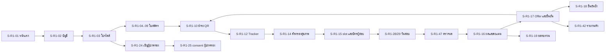

# R1 "รับสมัคร" — Screen inventory (S-R1-xx)

> **สถานะ:** v1.0-draft · 28 ต.ค. 2569 · Release R1 "รับสมัคร" (go-live 1 ก.ย. 2571 = M18; ถ้าเริ่มสัญญาหลัง ต.ค. 2570 ทุก release เลื่อน 12 เดือน — เล่ม 12 §1.3) · ภาษา: ไทย (ศัพท์เทคนิค/โค้ดเป็นภาษาอังกฤษ)
> **ขอบเขต:** หน้าจอทั้งหมดของ R1 เป็น input สำหรับ UI mockup
> **อ่านคู่กับ:** [README](README.md) · [00-blueprint](../00-blueprint.md) · [00-fix-decisions-v1.1](../00-fix-decisions-v1.1.md) (D-03, D-06, D-08) · [02 §2](../02-student-journey.md) · [05](../05-workflows.md) · [06](../06-modules.md) · [08](../08-data.md) · [10](../10-security-compliance.md) · [14](../14-ux-adoption.md) · [r1-requirements](r1-requirements.md) · [r1-api.yaml](r1-api.yaml)

## 0. กติกากลางของทุกหน้าจอ (จากเล่ม 14)

| เรื่อง | กติกา | อ้าง |
|---|---|---|
| Mobile-first | ออกแบบที่ 360×640 ก่อน; target ≥ 44×44 px; bottom nav ≤ 5 ปุ่ม; back-office desktop-first แต่ไม่พังที่ 1280 px | 14 P1, §3 |
| Typography ไทย | Noto Sans Thai / IBM Plex Sans Thai (self-host, 2 น้ำหนัก, `font-display: swap`); body ≥ 16 px (ผู้ปกครอง 18 px); `line-height` ≥ 1.6; ห้าม justify/italic; `Intl.Segmenter('th')` สำหรับ truncate; รหัสยาวใช้ `overflow-wrap: anywhere` | 14 §5.1 |
| วันที่/ตัวเลข | แสดง พ.ศ. (`th-TH-u-ca-buddhist`) เช่น "1 ต.ค. 2571 08:30 น."; date picker รับ พ.ศ./ค.ศ. แล้วแสดงยืนยัน; ตัวเลขอารบิก; เงินแสดง "400.00 บาท" | 14 §5.3 |
| สถานะ 4 แบบ | ทุกหน้าจอระบุ ว่าง / กำลังโหลด (skeleton ไม่ใช่ spinner เต็มจอ) / ผิดพลาด (บอกสิ่งที่ทำต่อได้ + ลิงก์ status page/ช่วยเหลือ) / สำเร็จ | 14 P15 |
| ภาษาไม่ตำหนิ | ข้อความไม่ผ่านเกณฑ์/ค้างชำระ/หมดเวลา บอก "ทำอะไรต่อได้" ก่อนบทลงโทษ | 14 P15 |
| สถานะไม่ใช้สีอย่างเดียว | ทุก badge มีข้อความ + ไอคอน; contrast ≥ 4.5:1 | 14 §6 |
| Validate-before-commit | ตรวจเกณฑ์/ความครบก่อนกดยืนยัน พร้อมเหตุผลภาษาไทยและทางเลือก | 14 P3 |
| Offline | ห้าม offline: ชำระ, ยืนยันสิทธิ์, ยื่นใบสมัคร (แสดง "ต้องเชื่อมต่ออินเทอร์เน็ต"); offline-first: judge/nurse; save & resume ทุกฟอร์มยาว | 14 §7 |
| LIFF | หน้าเดียวกับ PWA; ขั้นอัปโหลดหลายไฟล์มีปุ่ม "เปิดในเบราว์เซอร์" | 14 §7 |
| การแจ้งเตือน | LINE/SMS/push มีเพียงหัวข้อ + deep link; P1 มีปุ่ม "รับทราบ" | 14 §8 |
| ผลไม่แน่ใจเมื่อเน็ตหลุด | ทุก command ส่ง `Idempotency-Key`; หน้า "กำลังตรวจสอบสถานะล่าสุด" แทนการกดซ้ำ | 07 ADR-004 ข้อ 9 |
| ★ | หน้าจอที่ต้องทดสอบ usability ก่อน go-live (14 §14) และ a11y โดยผู้ตรวจอิสระ | 14 §3, §6 |

## 1. แผนผังการเดินทางของผู้สมัคร

## 2. รายการหน้าจอ

| ID | หน้าจอ | กลุ่มผู้ใช้ | ช่องทาง | อ้าง 14 | ★ | FR |
|---|---|---|---|---|---|---|
| S-R1-01 | หน้าแรกผู้สมัคร: ค้นหารอบที่เปิด | applicant, candidate | PWA, LIFF | S-01 | ★ | FR-R1-019, FR-R1-092 |
| S-R1-02 | สร้างบัญชี / เข้าสู่ระบบ | candidate, guardian | PWA, LIFF | S-01 (IAM) | ★ | FR-R1-011, FR-R1-012, FR-R1-013, FR-R1-015 |
| S-R1-03 | โปรไฟล์ผู้สมัคร | candidate | PWA | S-02 |  | FR-R1-012, FR-R1-014, FR-R1-107 |
| S-R1-04 | ใบสมัคร ขั้น 1: เลือกช่องทาง รอบ และอันดับ | candidate | PWA | S-02 | ★ | FR-R1-020, FR-R1-023, FR-R1-026, FR-R1-027, FR-R1-029, FR-R1-030, FR-R1-031, FR-R1-092 |
| S-R1-05 | ใบสมัคร ขั้น 2: การศึกษา GPAX และตรวจคุณสมบัติ | candidate | PWA | S-02 | ★ | FR-R1-020, FR-R1-021, FR-R1-022, FR-R1-023 |
| S-R1-06 | ใบสมัคร ขั้น 3: ประวัติและผลงานกีฬา | candidate | PWA | S-02 |  | FR-R1-020, FR-R1-024 |
| S-R1-07 | ใบสมัคร ขั้น 4: อัปโหลดเอกสาร | candidate | PWA (ปุ่มเปิดในเบราว์เซอร์เมื่ออยู่ใน LIFF) | S-02 | ★ | FR-R1-020, FR-R1-030, FR-R1-036, FR-R1-037 |
| S-R1-08 | ขอความช่วยเหลือในการสอบ (accommodation) | candidate | PWA | S-02 |  | FR-R1-028 |
| S-R1-09 | ใบสมัคร ขั้นสุดท้าย: ตรวจทานและยื่น | candidate | PWA | S-02 | ★ | FR-R1-020, FR-R1-029, FR-R1-033 |
| S-R1-10 | ชำระเงิน Thai QR และสถานะ | candidate, guardian, ผู้ชำระแทน | PWA, LIFF, ลิงก์ชำระแทน | S-03 | ★ | FR-R1-044, FR-R1-045, FR-R1-048, FR-R1-051, FR-R1-052, FR-R1-089 |
| S-R1-11 | ขอยกเว้นค่าสมัคร | candidate | PWA | — (SVC e-Form) |  | FR-R1-049 |
| S-R1-12 | Application tracker | candidate (ผู้ปกครองเห็นแบบย่อใน S-R1-26) | PWA, LIFF | S-04 | ★ | FR-R1-034, FR-R1-048 |
| S-R1-13 | ส่งเอกสารเพิ่ม | candidate | PWA | S-02 |  | FR-R1-036, FR-R1-039 |
| S-R1-14 | แบบคัดกรองสุขภาพและใบรับรองแพทย์ | candidate, guardian (consent) | PWA | — (HLT) | ★ | FR-R1-064, FR-R1-065, FR-R1-109 |
| S-R1-15 | เลือก/ยืนยัน slot และบัตรประจำตัวผู้สอบ | candidate | PWA, LIFF | S-04 | ★ | FR-R1-058, FR-R1-059, FR-R1-062, FR-R1-065 |
| S-R1-16 | ผลคัดเลือกและคะแนนรายสถานี | candidate | PWA (หลัง waiting room) | S-05 | ★ | FR-R1-084 |
| S-R1-17 | Offer และยืนยัน/สละสิทธิ์ | candidate | PWA, LIFF | S-05 | ★ | FR-R1-026, FR-R1-051, FR-R1-086, FR-R1-087, FR-R1-088, FR-R1-089, FR-R1-090, FR-R1-096, FR-R1-116 |
| S-R1-18 | ยืนยันสิทธิ์ซ้ำก่อนเปิดภาค | candidate | PWA, LIFF | — |  | FR-R1-095 |
| S-R1-19 | ขอทบทวนผลคัดเลือก | candidate | PWA | S-06 |  | FR-R1-099, FR-R1-103, FR-R1-106 |
| S-R1-20 | ร้องเรียน/แจ้งเบาะแส และติดตาม | applicant, candidate (ไม่ต้อง login ได้) | PWA สาธารณะ | S-06 |  | FR-R1-104 |
| S-R1-21 | แจ้งเหตุวันสอบ/ขอสอบใหม่ | candidate | PWA | — |  | FR-R1-105 |
| S-R1-22 | แจ้งเตือน inbox ตั้งค่า และผูก LINE | candidate, guardian | PWA, LIFF | S-36 |  | FR-R1-111, FR-R1-133, FR-R1-134, FR-R1-135, FR-R1-136, FR-R1-137 |
| S-R1-23 | ความเป็นส่วนตัวและความยินยอมของฉัน | candidate | PWA | — (PRIV) |  | FR-R1-109, FR-R1-113 |
| S-R1-24 | รับคำเชิญและผูกบัญชีผู้ปกครอง | guardian | LIFF (หลัก), PWA | S-29 (รูปแบบ) | ★ | FR-R1-107, FR-R1-108 |
| S-R1-25 | ให้ความยินยอม (dual consent) | guardian, candidate | LIFF, PWA | — | ★ | FR-R1-027, FR-R1-109, FR-R1-112 |
| S-R1-26 | ภาพรวมผู้สมัครในความดูแล | guardian | LIFF, PWA | S-29 | ★ | FR-R1-044, FR-R1-051, FR-R1-108, FR-R1-110, FR-R1-111 |
| S-R1-27 | Judge: เข้าสู่ระบบ ดาวน์โหลด session และประกาศ COI | judge | PWA บน tablet (MDM) | S-07 | ★ | FR-R1-057, FR-R1-069 |
| S-R1-28 | Judge: เช็คอินผู้สอบด้วย QR | judge, admission | PWA tablet | S-07 | ★ | FR-R1-035, FR-R1-065, FR-R1-067, FR-R1-070 |
| S-R1-29 | Judge: ให้คะแนน station | judge | PWA tablet | S-07 | ★ | FR-R1-071, FR-R1-072 |
| S-R1-30 | Judge: สถานะ sync และความขัดแย้ง | judge, head | PWA tablet | S-07 | ★ | FR-R1-073 |
| S-R1-31 | ประธาน station: moderation และยืนยันผล | head (selection_chair), judge chair | PWA tablet / BO | S-07, S-08 | ★ | FR-R1-072, FR-R1-074, FR-R1-075, FR-R1-076 |
| S-R1-32 | พยาบาล: คัดกรองหน้าสนาม WBGT และเหตุการณ์ | nurse, physician | PWA tablet | — |  | FR-R1-061, FR-R1-066, FR-R1-067 |
| S-R1-33 | BO: Round wizard | admission, module_admin | BO | S-08, S-35 | ★ | FR-R1-001, FR-R1-003, FR-R1-004, FR-R1-005, FR-R1-006, FR-R1-007, FR-R1-010, FR-R1-031 |
| S-R1-34 | BO: Seat matrix และยกที่นั่ง | admission, planner, campusvp | BO | S-08 |  | FR-R1-002, FR-R1-009 |
| S-R1-35 | BO: คิวตรวจเอกสาร | admission | BO | S-08 | ★ | FR-R1-022, FR-R1-035, FR-R1-038, FR-R1-039, FR-R1-040, FR-R1-043, FR-R1-093 |
| S-R1-36 | BO: ตรวจผลงานกีฬา | admission, sportshead | BO | S-08 |  | FR-R1-025, FR-R1-041 |
| S-R1-37 | BO: ตารางสอบ จองสนาม และแต่งตั้งกรรมการ | admission, facility, head | BO | S-08 | ★ | FR-R1-054, FR-R1-055, FR-R1-056, FR-R1-057, FR-R1-058, FR-R1-060, FR-R1-062, FR-R1-063, FR-R1-078, FR-R1-105, FR-R1-132 |
| S-R1-38 | BO: จัดอันดับ อนุมัติ และประกาศผล | admission, head, dean, campusvp | BO | S-08 | ★ | FR-R1-075, FR-R1-079, FR-R1-080, FR-R1-081, FR-R1-082, FR-R1-139 |
| S-R1-39 | BO: Clearing dashboard | admission, registrar (ส่วนกลาง), campusvp | BO | S-08 | ★ | FR-R1-091, FR-R1-093, FR-R1-094, FR-R1-095, FR-R1-096, FR-R1-097, FR-R1-098, FR-R1-100 |
| S-R1-40 | BO: คำขอทบทวนผล (appeals) | admission, judge, head, campusvp | BO | — |  | FR-R1-100, FR-R1-101, FR-R1-102 |
| S-R1-41 | BO: accommodation (dss) | dss, head, admission | BO | — |  | FR-R1-028, FR-R1-106 |
| S-R1-42 | BO: รายงานตัวและ handoff | registrar, admission | BO | — |  | FR-R1-013, FR-R1-042, FR-R1-114, FR-R1-115, FR-R1-116, FR-R1-117, FR-R1-118, FR-R1-132 |
| S-R1-43 | การเงิน: reconcile และ exception | finance | BO | — |  | FR-R1-046, FR-R1-047, FR-R1-053 |
| S-R1-44 | การเงิน: อนุมัติยกเว้น/คืนเงิน | finance (head/refund_approver), auditor (อ่าน) | BO | — |  | FR-R1-049, FR-R1-050 |
| S-R1-45 | Inbox ผู้อนุมัติและ role switcher | head, dean, campusvp, rector, finance, admission | PWA, BO | S-40 | ★ | FR-R1-007, FR-R1-009, FR-R1-017, FR-R1-081, FR-R1-094, FR-R1-101 |
| S-R1-46 | หน้าประกาศรับสมัคร เกณฑ์ rubric และรายชื่อ | applicant | เว็บสาธารณะ (CDN), X-CMS | S-01 |  | FR-R1-004, FR-R1-008, FR-R1-019, FR-R1-043, FR-R1-082, FR-R1-085 |
| S-R1-47 | ตรวจผลรายบุคคลและ waiting room | candidate, applicant | CDN static + PWA | S-05, S-37 | ★ | FR-R1-083, FR-R1-130 |
| S-R1-48 | หน้า ITA/OIT | applicant | X-CMS (แสดงผลจาก RPT) | — |  | FR-R1-120, FR-R1-121 |
| S-R1-49 | Status page | ทุกคน | สาธารณะ | S-37 |  | FR-R1-130 |
| S-R1-50 | ADMIN: คำขอเปลี่ยน config (4-eyes) | module_admin, itadmin, finance, dpo | BO | S-35 |  | FR-R1-123, FR-R1-124, FR-R1-128, FR-R1-129 |
| S-R1-51 | ADMIN: job และ integration monitor | itadmin, dba_sre | BO | — |  | FR-R1-032, FR-R1-125, FR-R1-131 |
| S-R1-52 | ADMIN: break-glass และ JIT | itadmin, security_admin, vp, dpo | BO | — |  | FR-R1-126, FR-R1-127 |
| S-R1-53 | RPT: OIT checklist | planner, data_owner, rector, pr | BO | S-34 |  | FR-R1-119, FR-R1-120, FR-R1-121, FR-R1-122 |
| S-R1-54 | สมาคมกีฬา: ยืนยันผลงาน (magic link) | federation | เว็บ (magic link อายุจำกัด) | — |  | FR-R1-041 |
| S-R1-55 | โหมดเจ้าหน้าที่ช่วยกรอก (assisted) | admission, helpdesk | BO + PWA | — |  | FR-R1-016, FR-R1-112 |
| S-R1-56 | ENG: สร้างและอนุมัติประกาศ | pr, campusvp, dean | BO | — |  | FR-R1-008, FR-R1-010, FR-R1-085, FR-R1-138, FR-R1-139 |
| S-R1-57 | IAM: เปิดบัญชีกรรมการภายนอก | head (sponsor), campus_itadmin | BO | — |  | FR-R1-018 |
| S-R1-58 | นำเข้าคะแนนจากกระดาษ (4-eyes) | admission, head | BO | — |  | FR-R1-077 |

## 3. ผู้สมัคร (PWA mobile-first, เปิดผ่าน LIFF ได้)

_ออกแบบที่ 360×640 ก่อน, bottom nav ≤ 5 ปุ่ม (หน้าแรก · ใบสมัคร · ชำระ · แจ้งเตือน · ฉัน), target ≥ 44×44 px, body ≥ 16 px, line-height ≥ 1.6 (14 §2, §5)_

### S-R1-01 หน้าแรกผู้สมัคร: ค้นหารอบที่เปิด ★

| หัวข้อ | รายละเอียด |
|---|---|
| วัตถุประสงค์ | ให้ผู้สนใจเห็นรอบที่เปิด/กำลังจะเปิดของวิทยาเขต pilot และเริ่มสมัคร |
| บทบาท | applicant, candidate |
| ช่องทาง | PWA, LIFF (อ้างเล่ม 14: S-01) |
| ทางเข้า | เว็บวิทยาเขต, LINE OA rich menu, ลิงก์ในประกาศ, QR บนโปสเตอร์ |
| องค์ประกอบ/ฟิลด์หลัก | • ตัวกรอง: ช่องทาง (โควตาเรียนดี/โควตานักกีฬา/ทั่วไป/โควตาภายใน), วิทยาเขต, หลักสูตร, ชนิดกีฬา • การ์ดรอบ: ชื่อรอบ วิทยาเขต ช่วงรับสมัคร (พ.ศ.) ค่าสมัคร ที่นั่ง สถานะ (เปิด/ใกล้เปิด/ปิด) • แถบเตือน C-4 เมื่อยืนยันสิทธิ์ที่อื่นแล้ว • ปุ่ม "สมัคร" / "ดูประกาศและเกณฑ์" |
| สถานะ: ว่าง | "ยังไม่มีรอบที่เปิดรับในขณะนี้ — รอบถัดไปของวิทยาเขต{X}เปิด {วันที่}" + ปุ่มรับแจ้งเตือน |
| สถานะ: กำลังโหลด | skeleton การ์ด 3 ใบ (ไม่ใช้ spinner เต็มจอ) |
| สถานะ: ผิดพลาด | "โหลดรายการรอบไม่สำเร็จ ลองใหม่อีกครั้ง" + ปุ่มลองใหม่ + ลิงก์ status page |
| สถานะ: สำเร็จ | รายการรอบเรียงตามวันปิดรับที่ใกล้ที่สุด |
| Validation | • ตัวกรองไม่มีผลลัพธ์ → แนะนำล้างตัวกรอง |
| ข้อความไทยหลัก | หัวข้อ: "สมัครเรียน มหาวิทยาลัยการกีฬาแห่งชาติ" ป้าย: "เปิดรับถึง {วัน เดือน ปี พ.ศ.} {เวลา} น." เตือน: "คุณยืนยันสิทธิ์แล้ว 1 ที่ หากต้องการสมัครรอบนี้ต้องสละสิทธิ์เดิมก่อน (เหลือสิทธิ์สละ {n} ครั้ง)" |
| FR | FR-R1-019, FR-R1-092 |

### S-R1-02 สร้างบัญชี / เข้าสู่ระบบ ★

| หัวข้อ | รายละเอียด |
|---|---|
| วัตถุประสงค์ | สร้างบัญชีเดียวทั้ง มกช. ด้วย ThaID หรือ OTP และกู้บัญชีเมื่อพบตัวตนซ้ำ |
| บทบาท | candidate, guardian |
| ช่องทาง | PWA, LIFF (อ้างเล่ม 14: S-01 (IAM)) |
| ทางเข้า | ปุ่มสมัครจาก S-R1-01, ลิงก์ในแจ้งเตือน |
| องค์ประกอบ/ฟิลด์หลัก | • ปุ่มหลัก "เข้าสู่ระบบด้วย ThaID" • ทางเลือก: อีเมล/เบอร์มือถือ + OTP, passport (ผู้สมัครต่างชาติ) • ช่องเลขประจำตัว 13 หลัก/รหัส G/passport + วันเกิด (date picker พ.ศ.) • bot challenge แบบ proof-of-work (ไม่มีรูปภาพ) • ตัวเลือก passkey หลังสร้างบัญชี |
| สถานะ: ว่าง | — |
| สถานะ: กำลังโหลด | "กำลังเชื่อมต่อ ThaID…" (ไม่บล็อกปุ่มยกเลิก) |
| สถานะ: ผิดพลาด | ThaID ไม่พร้อม: "ขณะนี้เชื่อมต่อ ThaID ไม่ได้ คุณสมัครด้วยอีเมลหรือเบอร์มือถือได้ และยืนยันตัวตนภายหลัง" |
| สถานะ: สำเร็จ | ไปหน้าโปรไฟล์/ทำใบสมัครต่อ |
| Validation | • check digit เลข 13 หลัก • OTP 6 หลัก อายุ 5 นาที ขอใหม่ได้หลัง 60 วินาที • พบตัวตนซ้ำ → ขั้นกู้บัญชีด้วยช่องทางที่ลงทะเบียน (mask) |
| ข้อความไทยหลัก | "เลขประจำตัวประชาชนไม่ถูกต้อง กรุณาตรวจหลักสุดท้าย" "พบบัญชีเดิมของคุณแล้ว เราส่งรหัสยืนยันไปที่ 08x-xxx-x123" "ระบบจะขอเฉพาะ เลขประจำตัว ชื่อ และวันเกิด จาก ThaID" |
| FR | FR-R1-011, FR-R1-012, FR-R1-013, FR-R1-015 |
| KPI ที่วัดจากหน้าจอนี้ | KPI-20 (นิยามในเล่ม 14 §12.1) |

### S-R1-03 โปรไฟล์ผู้สมัคร

| หัวข้อ | รายละเอียด |
|---|---|
| วัตถุประสงค์ | บันทึกข้อมูลส่วนตัว ติดต่อ ผู้ติดต่อฉุกเฉิน โรงเรียนเดิม และเชิญผู้ปกครองเมื่อเป็นผู้เยาว์ |
| บทบาท | candidate |
| ช่องทาง | PWA (อ้างเล่ม 14: S-02) |
| ทางเข้า | หลังสร้างบัญชี, เมนู "ฉัน" |
| องค์ประกอบ/ฟิลด์หลัก | • ข้อมูลจาก ThaID (อ่านอย่างเดียว + ป้าย "ยืนยันแล้ว") • ชื่อ-สกุลอังกฤษ, เพศ, สัญชาติ, ที่อยู่ (reference dataset) • ผู้ติดต่อฉุกเฉิน • โรงเรียนเดิม (ค้นหา typeahead ภาษาไทย) • กล่องผู้เยาว์: "เชิญผู้ปกครอง" |
| สถานะ: ว่าง | ฟอร์มว่างพร้อมคำอธิบายว่าข้อมูลใช้ทำอะไร (privacy notice ย่อ + ลิงก์ฉบับเต็ม) |
| สถานะ: กำลังโหลด | skeleton ฟอร์ม |
| สถานะ: ผิดพลาด | error ต่อช่อง + สรุปด้านบน (WCAG 3.3.1) |
| สถานะ: สำเร็จ | toast "บันทึกแล้ว" |
| Validation | • อีเมลรูปแบบถูกต้อง • เบอร์มือถือไทย 10 หลัก • บันทึกร่างอัตโนมัติทุก 10 วินาที |
| ข้อความไทยหลัก | "คุณอายุต่ำกว่า 20 ปี บางขั้นตอน (เช่น การทดสอบร่างกาย) ต้องมีผู้ปกครองให้ความยินยอม" ปุ่ม: "ส่งคำเชิญผู้ปกครอง" |
| FR | FR-R1-012, FR-R1-014, FR-R1-107 |

### S-R1-04 ใบสมัคร ขั้น 1: เลือกช่องทาง รอบ และอันดับ ★

| หัวข้อ | รายละเอียด |
|---|---|
| วัตถุประสงค์ | เลือกรอบและอันดับ (วิทยาเขต × หลักสูตร × ชนิดกีฬา/ตำแหน่ง/รุ่น) ภายใต้กติกา C-2 |
| บทบาท | candidate |
| ช่องทาง | PWA (อ้างเล่ม 14: S-02) |
| ทางเข้า | ปุ่มสมัครในการ์ดรอบ, tracker "ทำต่อ" |
| องค์ประกอบ/ฟิลด์หลัก | • stepper 1–6 แสดงความคืบหน้า • รายการอันดับลากเรียงได้ (มีปุ่มขึ้น/ลงสำหรับคีย์บอร์ด/screen reader) • ตัวเลือกชนิดกีฬา/ตำแหน่ง/รุ่นน้ำหนัก (โควตานักกีฬา) • ช่องทางพิเศษ: โควตาภายใน, ต่างชาติ (ภาษาอังกฤษ), รับโอน (ถ้าเปิด) |
| สถานะ: ว่าง | "ยังไม่ได้เลือกหลักสูตร" |
| สถานะ: กำลังโหลด | skeleton |
| สถานะ: ผิดพลาด | "บันทึกไม่สำเร็จ ข้อมูลของคุณยังอยู่ในเครื่อง ลองใหม่" |
| สถานะ: สำเร็จ | ไปขั้น 2 พร้อมบันทึกร่าง |
| Validation | • ไม่เกิน N อันดับต่อรอบต่อวิทยาเขต • รุ่นน้ำหนักล็อกหลังยื่น • ผู้ confirmed ที่อื่น → บล็อกพร้อมทางเลือกสละ |
| ข้อความไทยหลัก | "เลือกได้สูงสุด {N} หลักสูตรต่อรอบต่อวิทยาเขต" "รุ่นน้ำหนักเปลี่ยนไม่ได้หลังยื่นใบสมัคร" |
| FR | FR-R1-020, FR-R1-023, FR-R1-026, FR-R1-027, FR-R1-029, FR-R1-030, FR-R1-031, FR-R1-092 |

### S-R1-05 ใบสมัคร ขั้น 2: การศึกษา GPAX และตรวจคุณสมบัติ ★

| หัวข้อ | รายละเอียด |
|---|---|
| วัตถุประสงค์ | กรอกผลการเรียน (ช่วยอ่านจาก ปพ.1) และเห็นผลตรวจคุณสมบัติทันทีก่อนชำระ |
| บทบาท | candidate |
| ช่องทาง | PWA (อ้างเล่ม 14: S-02) |
| ทางเข้า | stepper ขั้น 2 |
| องค์ประกอบ/ฟิลด์หลัก | • โรงเรียน/แผนการเรียน • GPAX + จำนวนภาคเรียน, GPA กลุ่มสาระ (ถ้ารอบกำหนด) • ปุ่ม "อ่านจาก ปพ.1" (OCR) + ให้ยืนยันค่า • แผงผลตรวจคุณสมบัติรายอันดับ: ผ่าน/ไม่ผ่าน + เหตุผล + สิ่งที่ทำต่อได้ |
| สถานะ: ว่าง | — |
| สถานะ: กำลังโหลด | "กำลังตรวจคุณสมบัติ…" |
| สถานะ: ผิดพลาด | "ตรวจคุณสมบัติไม่สำเร็จ คุณยังบันทึกต่อได้ และเราจะตรวจอีกครั้งก่อนยื่น" |
| สถานะ: สำเร็จ | ป้ายสถานะต่ออันดับ (ข้อความ + ไอคอน ไม่ใช้สีอย่างเดียว) |
| Validation | • GPAX 0.00–4.00 ทศนิยม 2 ตำแหน่ง • ค่าที่กรอกต่างจาก OCR → ให้ยืนยัน |
| ข้อความไทยหลัก | "GPAX {x} ต่ำกว่าเกณฑ์ {y} ของรอบนี้ — ดูรอบทั่วไปที่เปิดอยู่" "ระบบอ่าน GPAX จากเอกสารได้ {x} ตรงกับที่คุณกรอกหรือไม่" |
| FR | FR-R1-020, FR-R1-021, FR-R1-022, FR-R1-023 |

### S-R1-06 ใบสมัคร ขั้น 3: ประวัติและผลงานกีฬา

| หัวข้อ | รายละเอียด |
|---|---|
| วัตถุประสงค์ | บันทึก sport profile และผลงานพร้อมหลักฐาน (โควตานักกีฬา/โควตาภายใน) |
| บทบาท | candidate |
| ช่องทาง | PWA (อ้างเล่ม 14: S-02) |
| ทางเข้า | stepper ขั้น 3 (แสดงเฉพาะช่องทางที่มีกีฬา) |
| องค์ประกอบ/ฟิลด์หลัก | • ประวัติ: สโมสร สมาคม โค้ช ปีที่เล่น (คำอธิบายว่าใช้ตรวจ COI กรรมการ) • รายการผลงาน: ชื่อรายการ (ค้นจาก competition master), ระดับ, อันดับ/เหรียญ, วันที่, ไฟล์หลักฐาน • ป้ายระดับที่ระบบคำนวณ + "นับคะแนน/ไม่นับ (นอกช่วงวันที่)" • อัปโหลดวิดีโอผลงาน (ถ้ารอบกำหนด) |
| สถานะ: ว่าง | "ยังไม่มีผลงาน — เพิ่มผลงานอย่างน้อย 1 รายการตามเกณฑ์ของรอบ" |
| สถานะ: กำลังโหลด | skeleton รายการ |
| สถานะ: ผิดพลาด | error ต่อรายการ |
| สถานะ: สำเร็จ | รายการพร้อมป้ายระดับ |
| Validation | • วันที่อยู่ในช่วงที่ประกาศ (นอกช่วง = ไม่นับ แต่บันทึกได้) • ต้องมีไฟล์หลักฐานต่อผลงาน |
| ข้อความไทยหลัก | "ผลงานนี้อยู่นอกช่วงวันที่ที่ประกาศ จึงไม่นับคะแนน" "ข้อมูลสโมสรและโค้ชใช้เพื่อไม่ให้กรรมการที่เกี่ยวข้องกับคุณเป็นผู้ให้คะแนน" |
| FR | FR-R1-020, FR-R1-024 |

### S-R1-07 ใบสมัคร ขั้น 4: อัปโหลดเอกสาร ★

| หัวข้อ | รายละเอียด |
|---|---|
| วัตถุประสงค์ | อัปโหลดเอกสารตาม checklist แบบ resumable |
| บทบาท | candidate |
| ช่องทาง | PWA (ปุ่มเปิดในเบราว์เซอร์เมื่ออยู่ใน LIFF) (อ้างเล่ม 14: S-02) |
| ทางเข้า | stepper ขั้น 4, ลิงก์ "ส่งเอกสารเพิ่ม" |
| องค์ประกอบ/ฟิลด์หลัก | • checklist ตามช่องทาง (✓/ขาด/กำลังตรวจไฟล์/ใช้ไม่ได้) • ตัวอัปโหลด Uppy + progress + resume • พรีวิว (หลังสแกนผ่าน) • บีบอัดรูปฝั่ง client |
| สถานะ: ว่าง | checklist ว่าง + คำอธิบายเอกสารแต่ละรายการ |
| สถานะ: กำลังโหลด | progress รายไฟล์ "กำลังอัปโหลด 60% — ปิดหน้าได้ เราจะทำต่อเมื่อคุณกลับมา" |
| สถานะ: ผิดพลาด | "ไฟล์นี้ใช้ไม่ได้ กรุณาอัปโหลดใหม่" (ไม่เปิดเผยรายละเอียดการสแกน) |
| สถานะ: สำเร็จ | ✓ "ตรวจไฟล์แล้ว" |
| Validation | • ชนิดไฟล์ PDF/JPG/PNG (วิดีโอ MP4) • เอกสาร ≤ 10 MB, วิดีโอ ≤ 200 MB |
| ข้อความไทยหลัก | "ไฟล์ใหญ่เกิน 10 MB — ระบบจะบีบอัดรูปให้อัตโนมัติ หรือสแกนเป็น PDF ขาวดำ" |
| FR | FR-R1-020, FR-R1-030, FR-R1-036, FR-R1-037 |

### S-R1-08 ขอความช่วยเหลือในการสอบ (accommodation)

| หัวข้อ | รายละเอียด |
|---|---|
| วัตถุประสงค์ | ขอ accommodation โดยสมัครใจผ่านฟอร์มแยกจากใบสมัครหลัก |
| บทบาท | candidate |
| ช่องทาง | PWA (อ้างเล่ม 14: S-02) |
| ทางเข้า | ลิงก์ในขั้น 4 และใน tracker, ประกาศรับสมัคร |
| องค์ประกอบ/ฟิลด์หลัก | • ประเภทความช่วยเหลือ (หลายตัวเลือก) • อัปโหลดหลักฐาน (เก็บใน health vault) • สถานะคำขอ + กำหนดเวลา (≥ 10 วันทำการก่อนสอบ) • ข้อความยืนยันว่ากรรมการคัดเลือกไม่เห็นข้อมูลนี้ |
| สถานะ: ว่าง | คำอธิบายสิทธิ์และตัวอย่างความช่วยเหลือ |
| สถานะ: กำลังโหลด | — |
| สถานะ: ผิดพลาด | "ส่งคำขอไม่สำเร็จ ลองใหม่ หรือโทร {เบอร์}" |
| สถานะ: สำเร็จ | "ส่งคำขอแล้ว หน่วยบริการนักศึกษาพิการจะแจ้งผลภายใน 3 วันทำการ" |
| Validation | • ยื่นช้ากว่า 10 วันทำการ → แจ้งว่าเป็น provisional |
| ข้อความไทยหลัก | "ข้อมูลความพิการของคุณจะไม่ถูกส่งให้กรรมการคัดเลือก กรรมการจะเห็นเฉพาะรายการปรับ เช่น เวลาเพิ่ม" |
| FR | FR-R1-028 |

### S-R1-09 ใบสมัคร ขั้นสุดท้าย: ตรวจทานและยื่น ★

| หัวข้อ | รายละเอียด |
|---|---|
| วัตถุประสงค์ | ตรวจทานข้อมูลทั้งหมด ยอมรับคำรับรอง และยื่น พร้อมได้ใบรับอิเล็กทรอนิกส์ |
| บทบาท | candidate |
| ช่องทาง | PWA (อ้างเล่ม 14: S-02) |
| ทางเข้า | stepper ขั้นสุดท้าย |
| องค์ประกอบ/ฟิลด์หลัก | • สรุปทุกขั้นพร้อมลิงก์แก้ • รายการที่ขาด (ถ้ามี) • คำรับรองความถูกต้อง • ปุ่ม "ยื่นใบสมัคร" (ส่ง Idempotency-Key) • ใบรับ PDF + เลขใบสมัคร |
| สถานะ: ว่าง | — |
| สถานะ: กำลังโหลด | "กำลังยื่น… อย่าปิดหน้านี้" (ถ้าเน็ตหลุดจะตรวจผลล่าสุดให้อัตโนมัติ) |
| สถานะ: ผิดพลาด | "ยังยื่นไม่ได้: ขาด {รายการ}" / "ไม่แน่ใจว่ายื่นสำเร็จหรือไม่ — กำลังตรวจสอบ" |
| สถานะ: สำเร็จ | "ยื่นใบสมัครแล้ว เลขที่ {application_no}" + ปุ่มชำระเงิน |
| Validation | • ครบ checklist • ยอมรับคำรับรอง |
| ข้อความไทยหลัก | "ยื่นใบสมัครเรียบร้อย เลขที่ใบสมัคร {no} — ใบรับเลขที่ {receipt_no} เวลา {time}" |
| FR | FR-R1-020, FR-R1-029, FR-R1-033 |
| KPI ที่วัดจากหน้าจอนี้ | KPI-18 (นิยามในเล่ม 14 §12.1) |

### S-R1-10 ชำระเงิน Thai QR และสถานะ ★

| หัวข้อ | รายละเอียด |
|---|---|
| วัตถุประสงค์ | ชำระค่าสมัคร/ค่ายืนยันสิทธิ์ รองรับมือถือเครื่องเดียวกับแอปธนาคาร |
| บทบาท | candidate, guardian, ผู้ชำระแทน |
| ช่องทาง | PWA, LIFF, ลิงก์ชำระแทน (อ้างเล่ม 14: S-03) |
| ทางเข้า | หลังยื่น, tracker, แจ้งเตือนครบกำหนด, ลิงก์ที่ส่งต่อ |
| องค์ประกอบ/ฟิลด์หลัก | • ยอดเงิน, วันหมดอายุ, QR • ปุ่ม "บันทึกรูป QR" • Ref1/Ref2/Biller ID/ยอด กดคัดลอก • ปุ่มเปิดแอปธนาคาร (เฉพาะธนาคารที่รองรับ) • ปุ่ม "ตรวจสถานะอีกครั้ง" • ลิงก์ "ส่งลิงก์ให้ผู้ปกครองชำระ" • ลิงก์ขอยกเว้นค่าสมัคร (ถ้ารอบอนุญาต) |
| สถานะ: ว่าง | — |
| สถานะ: กำลังโหลด | "รอยืนยันจากธนาคาร" (ไม่ใช่ "ยังไม่ชำระ") |
| สถานะ: ผิดพลาด | "ไม่พบการชำระ หากหักเงินแล้วโปรดรอ 15 นาทีหรือแจ้งเจ้าหน้าที่พร้อมสลิป" |
| สถานะ: สำเร็จ | "ชำระแล้ว" + ลิงก์ใบเสร็จอิเล็กทรอนิกส์ |
| Validation | • ไม่สร้างใบแจ้งหนี้ใหม่เมื่อกดซ้ำ • QR หมดอายุ → แสดงวิธีขอใหม่ (ค่าสมัคร) หรือแจ้งว่า offer หมดเวลา |
| ข้อความไทยหลัก | "เปิดแอปธนาคาร > สแกน > เลือกรูปจากอัลบั้ม" "คัดลอกเลขอ้างอิงแล้ว" "อย่าชำระผ่าน QR ที่ได้จากแหล่งอื่นนอกระบบนี้" |
| FR | FR-R1-044, FR-R1-045, FR-R1-048, FR-R1-051, FR-R1-052, FR-R1-089 |
| KPI ที่วัดจากหน้าจอนี้ | KPI-15 (CSAT หลังธุรกรรม), KPI-21 (นิยามในเล่ม 14 §12.1) |

### S-R1-11 ขอยกเว้นค่าสมัคร

| หัวข้อ | รายละเอียด |
|---|---|
| วัตถุประสงค์ | ยื่นคำขอยกเว้นค่าสมัครพร้อมหลักฐาน และติดตามผล |
| บทบาท | candidate |
| ช่องทาง | PWA (อ้างเล่ม 14: — (SVC e-Form)) |
| ทางเข้า | ลิงก์ในหน้าชำระ |
| องค์ประกอบ/ฟิลด์หลัก | • เหตุผล (ตามประกาศ) • หลักฐาน • ใบรับคำขอ • สถานะ + SLA 5 วันทำการ |
| สถานะ: ว่าง | คำอธิบายคุณสมบัติตามประกาศ |
| สถานะ: กำลังโหลด | — |
| สถานะ: ผิดพลาด | error ต่อช่อง |
| สถานะ: สำเร็จ | "ส่งคำขอแล้ว เลขรับ {no}" |
| Validation | • ต้องแนบหลักฐานอย่างน้อย 1 ไฟล์ |
| ข้อความไทยหลัก | "ระหว่างพิจารณา ใบสมัครของคุณยังไม่หมดเวลาชำระจนกว่าจะแจ้งผล" |
| FR | FR-R1-049 |

### S-R1-12 Application tracker ★

| หัวข้อ | รายละเอียด |
|---|---|
| วัตถุประสงค์ | เห็นทุกใบสมัครทุกวิทยาเขตเป็น timeline พร้อมสิ่งที่ต้องทำถัดไป |
| บทบาท | candidate (ผู้ปกครองเห็นแบบย่อใน S-R1-26) |
| ช่องทาง | PWA, LIFF (อ้างเล่ม 14: S-04) |
| ทางเข้า | หน้า "ใบสมัคร" ใน bottom nav, deep link จากแจ้งเตือน |
| องค์ประกอบ/ฟิลด์หลัก | • การ์ดต่อใบสมัคร: สถานะ (draft→…→reported) เป็นข้อความ • สิ่งที่ต้องทำ + กำหนดเวลา (นับถอยหลัง) • ลิงก์บัตรผู้สอบ, ใบรับ, ใบเสร็จ • ปุ่มถอนอันดับ |
| สถานะ: ว่าง | "ยังไม่มีใบสมัคร" + ปุ่มดูรอบที่เปิด |
| สถานะ: กำลังโหลด | skeleton |
| สถานะ: ผิดพลาด | แสดงข้อมูลล่าสุดที่ cache + ป้าย "ข้อมูล ณ {เวลา}" |
| สถานะ: สำเร็จ | timeline |
| Validation | • — |
| ข้อความไทยหลัก | "สิ่งที่ต้องทำ: ส่งเอกสารเพิ่มภายใน {วันที่}" "มีสิทธิ์สอบแบบมีเงื่อนไข — รอยืนยันผลงาน" |
| FR | FR-R1-034, FR-R1-048 |
| KPI ที่วัดจากหน้าจอนี้ | KPI-18 (นิยามในเล่ม 14 §12.1) |

### S-R1-13 ส่งเอกสารเพิ่ม

| หัวข้อ | รายละเอียด |
|---|---|
| วัตถุประสงค์ | ส่งเอกสารที่เจ้าหน้าที่ขอเพิ่มภายในกำหนด |
| บทบาท | candidate |
| ช่องทาง | PWA (อ้างเล่ม 14: S-02) |
| ทางเข้า | แจ้งเตือน P1, tracker |
| องค์ประกอบ/ฟิลด์หลัก | • รายการที่ขอพร้อมเหตุผลของเจ้าหน้าที่ • ตัวอัปโหลด • deadline |
| สถานะ: ว่าง | — |
| สถานะ: กำลังโหลด | progress |
| สถานะ: ผิดพลาด | "ส่งไม่สำเร็จ ลองใหม่" |
| สถานะ: สำเร็จ | "ส่งแล้ว เจ้าหน้าที่จะตรวจภายใน 3 วันทำการ" |
| Validation | • ส่งได้ก่อน deadline เท่านั้น |
| ข้อความไทยหลัก | "เจ้าหน้าที่ขอ: {รายการ} — เหตุผล: {เหตุผล} — ส่งภายใน {วันที่}" |
| FR | FR-R1-036, FR-R1-039 |

### S-R1-14 แบบคัดกรองสุขภาพและใบรับรองแพทย์ ★

| หัวข้อ | รายละเอียด |
|---|---|
| วัตถุประสงค์ | ส่งแบบคัดกรองก่อนออกกำลังกายและใบรับรองแพทย์เพื่อรับ medical clearance ก่อนจอง slot สอบทักษะ |
| บทบาท | candidate, guardian (consent) |
| ช่องทาง | PWA (อ้างเล่ม 14: — (HLT)) |
| ทางเข้า | tracker "สิ่งที่ต้องทำ", ขั้นจอง slot |
| องค์ประกอบ/ฟิลด์หลัก | • สถานะ consent (ผู้เยาว์ + ผู้ปกครอง) • แบบคัดกรองผู้ใหญ่/เด็กตามอายุ • อัปโหลดใบรับรองแพทย์ (วันที่ออก, เลขใบอนุญาตแพทย์) • สถานะ clearance + วันหมดอายุ |
| สถานะ: ว่าง | คำอธิบายเหตุผลด้านความปลอดภัยและการเก็บข้อมูลใน health vault |
| สถานะ: กำลังโหลด | — |
| สถานะ: ผิดพลาด | "ส่งไม่สำเร็จ ข้อมูลยังไม่ถูกบันทึก" |
| สถานะ: สำเร็จ | "ผ่านการคัดกรอง ใช้ได้ถึง {วันที่}" หรือ "รอเจ้าหน้าที่พยาบาลตรวจ" |
| Validation | • ใบรับรองไม่เกิน 30 วัน ณ วันทดสอบ [ต้องตรวจสอบ] • ตอบ "ใช่" ข้อเสี่ยง → ต้องแนบใบรับรองเฉพาะทาง • ไม่มี consent ที่จำเป็น → ส่งไม่ได้ |
| ข้อความไทยหลัก | "ข้อมูลสุขภาพเก็บแยกในระบบข้อมูลสุขภาพ เจ้าหน้าที่รับสมัครเห็นเพียงว่า 'ผ่าน/ยังไม่ผ่าน'" "รอผู้ปกครองยินยอม" |
| FR | FR-R1-064, FR-R1-065, FR-R1-109 |

### S-R1-15 เลือก/ยืนยัน slot และบัตรประจำตัวผู้สอบ ★

| หัวข้อ | รายละเอียด |
|---|---|
| วัตถุประสงค์ | ยืนยันหรือเปลี่ยน slot สอบ และเปิดบัตรผู้สอบ QR (ใช้ได้ offline) |
| บทบาท | candidate |
| ช่องทาง | PWA, LIFF (อ้างเล่ม 14: S-04) |
| ทางเข้า | แจ้งเตือนประกาศผู้มีสิทธิ์สอบ, tracker |
| องค์ประกอบ/ฟิลด์หลัก | • slot ที่ระบบจัด + ทางเลือกที่ว่าง • บัตรผู้สอบ: QR, วันเวลา, สนาม/ห้อง, แผนที่, การแต่งกาย, สิ่งที่ต้องนำมา • ปุ่ม "เพิ่มลงปฏิทิน" • ลิงก์ video call (สัมภาษณ์ออนไลน์) |
| สถานะ: ว่าง | "ยังไม่ประกาศตารางสอบ" |
| สถานะ: กำลังโหลด | skeleton |
| สถานะ: ผิดพลาด | "ยืนยัน slot ไม่สำเร็จ slot อาจเต็มแล้ว เลือกใหม่" |
| สถานะ: สำเร็จ | บัตรผู้สอบพร้อมใช้ (cache offline) |
| Validation | • ยืนยันได้เมื่อ clearance และ consent ครบ (สอบทักษะ) • เปลี่ยน slot ได้ภายในกำหนด |
| ข้อความไทยหลัก | "ยังไม่มีใบรับรองสุขภาพที่ใช้ได้ — ทำแบบคัดกรองก่อนเลือกเวลา" "แสดง QR นี้และบัตรประชาชนที่จุดลงทะเบียน" |
| FR | FR-R1-058, FR-R1-059, FR-R1-062, FR-R1-065 |

### S-R1-16 ผลคัดเลือกและคะแนนรายสถานี ★

| หัวข้อ | รายละเอียด |
|---|---|
| วัตถุประสงค์ | ดูผลรายบุคคล อันดับ คะแนนรายสถานี และเริ่มยืนยันสิทธิ์หรือขอทบทวน |
| บทบาท | candidate |
| ช่องทาง | PWA (หลัง waiting room) (อ้างเล่ม 14: S-05) |
| ทางเข้า | แจ้งเตือนประกาศผล, S-R1-47 |
| องค์ประกอบ/ฟิลด์หลัก | • ผล: ผ่าน/สำรองอันดับ n/ไม่ผ่าน (ข้อความ + ไอคอน) • คะแนนรวม + คะแนนรายสถานี/องค์ประกอบ + วิธีคำนวณ • ปุ่ม "ยืนยันสิทธิ์" / "ขอทบทวนผล (ถึง {วันที่})" |
| สถานะ: ว่าง | "ยังไม่ประกาศผล" |
| สถานะ: กำลังโหลด | ตำแหน่งในคิว (waiting room) |
| สถานะ: ผิดพลาด | "ระบบกำลังมีผู้ใช้จำนวนมาก ผลของคุณดูได้ที่ {ลิงก์ CDN}" |
| สถานะ: สำเร็จ | ผลพร้อมขั้นต่อไป |
| Validation | • — |
| ข้อความไทยหลัก | "คุณเป็นสำรองอันดับ {n} — หากมีผู้สละสิทธิ์ เราจะแจ้งทันทีพร้อมเวลายืนยัน" |
| FR | FR-R1-084 |

### S-R1-17 Offer และยืนยัน/สละสิทธิ์ ★

| หัวข้อ | รายละเอียด |
|---|---|
| วัตถุประสงค์ | เปรียบเทียบ offer ทุกวิทยาเขตและยืนยันได้ 1 ที่ ชำระค่ายืนยันสิทธิ์ เลือกรายงานตัว หรือสละสิทธิ์ |
| บทบาท | candidate |
| ช่องทาง | PWA, LIFF (อ้างเล่ม 14: S-05) |
| ทางเข้า | S-R1-16, แจ้งเตือน offer/cascade |
| องค์ประกอบ/ฟิลด์หลัก | • การ์ด offer: วิทยาเขต หลักสูตร deadline (นับถอยหลัง) ค่ายืนยันสิทธิ์ • กล่องสรุปผลก่อนยืนยัน • ปุ่มยืนยัน (step-up ถ้าบัญชียังไม่ยืนยันตัวตน) • หลังยืนยัน: ชำระ (S-R1-10), เลือกรายงานตัวออนไลน์/ที่จุดบริการ, ปุ่มสละสิทธิ์ (นับ C-5) |
| สถานะ: ว่าง | "ยังไม่มีข้อเสนอที่นั่ง" |
| สถานะ: กำลังโหลด | "กำลังยืนยัน…" (ห้ามกดซ้ำ, idempotent) |
| สถานะ: ผิดพลาด | "คุณยืนยันสิทธิ์ที่อื่นแล้ว" / "หมดเวลายืนยันแล้ว" / "ไม่แน่ใจผล — กำลังตรวจสอบสถานะล่าสุด" |
| สถานะ: สำเร็จ | "ยืนยันสิทธิ์แล้ว — ชำระภายใน {deadline}" |
| Validation | • ต้องออนไลน์ • ยืนยันได้ครั้งละ 1 ที่ • สละหลังยืนยันต้องยืนยันด้วย OTP |
| ข้อความไทยหลัก | "เมื่อยืนยันที่นี่ ข้อเสนออื่นของคุณจะถูกสละโดยอัตโนมัติ — ไม่นับเป็นสิทธิ์สละของคุณ" "การสละสิทธิ์ครั้งนี้นับเป็น 1 ครั้ง (ทำได้ 1 ครั้งต่อปีการศึกษา)" |
| FR | FR-R1-026, FR-R1-051, FR-R1-086, FR-R1-087, FR-R1-088, FR-R1-089, FR-R1-090, FR-R1-096, FR-R1-116 |
| KPI ที่วัดจากหน้าจอนี้ | KPI-01 (นิยามในเล่ม 14 §12.1) |

### S-R1-18 ยืนยันสิทธิ์ซ้ำก่อนเปิดภาค

| หัวข้อ | รายละเอียด |
|---|---|
| วัตถุประสงค์ | ยืนยันซ้ำ 1 แตะในช่วง ADM_RECONFIRM_WINDOW หรือสละสิทธิ์ |
| บทบาท | candidate |
| ช่องทาง | PWA, LIFF (อ้างเล่ม 14: —) |
| ทางเข้า | แจ้งเตือน 2 ครั้ง, SMS ลิงก์, เจ้าหน้าที่โทร |
| องค์ประกอบ/ฟิลด์หลัก | • สรุปที่นั่งที่ยืนยัน • ปุ่ม "ยืนยันว่าจะเข้าศึกษา" • ปุ่มสละสิทธิ์ • วันสุดท้ายของ window |
| สถานะ: ว่าง | — |
| สถานะ: กำลังโหลด | — |
| สถานะ: ผิดพลาด | "พ้นช่วงยืนยันซ้ำแล้ว ติดต่อ {เบอร์}" |
| สถานะ: สำเร็จ | "ยืนยันซ้ำแล้ว แล้วพบกันวันรายงานตัว" |
| Validation | • ใช้ได้เฉพาะใน window |
| ข้อความไทยหลัก | "หากไม่ยืนยันซ้ำภายใน {วันที่} ที่นั่งจะถูกส่งให้ผู้สำรอง (ไม่นับเป็นสิทธิ์สละ)" |
| FR | FR-R1-095 |

### S-R1-19 ขอทบทวนผลคัดเลือก

| หัวข้อ | รายละเอียด |
|---|---|
| วัตถุประสงค์ | ยื่นและติดตามคำขอทบทวนผลแบบเร่งด่วน |
| บทบาท | candidate |
| ช่องทาง | PWA (อ้างเล่ม 14: S-06) |
| ทางเข้า | S-R1-16, tracker, ผลการปฏิเสธ accommodation |
| องค์ประกอบ/ฟิลด์หลัก | • เลือกเรื่อง (คะแนนสถานี/การคำนวณ/คุณสมบัติ/accommodation) • เหตุผล + หลักฐาน • ใบรับ + เลขรับ • timeline SLA + ผลพร้อมเหตุผล |
| สถานะ: ว่าง | คำอธิบายกรอบเวลาและสิ่งที่ทบทวนได้ |
| สถานะ: กำลังโหลด | — |
| สถานะ: ผิดพลาด | "พ้นกำหนดยื่นแล้ว — คุณยังร้องเรียนได้ที่ …" |
| สถานะ: สำเร็จ | "รับเรื่องแล้ว เลขที่ {no} ตัดสินภายใน {วันที่}" |
| Validation | • ภายใน window • เหตุผล ≥ 20 ตัวอักษร |
| ข้อความไทยหลัก | "ระหว่างพิจารณา กำหนดยืนยันสิทธิ์ของคุณขยายถึงวันตัดสิน + 24 ชม. (ถ้ามีข้อเสนอที่นั่ง)" |
| FR | FR-R1-099, FR-R1-103, FR-R1-106 |

### S-R1-20 ร้องเรียน/แจ้งเบาะแส และติดตาม

| หัวข้อ | รายละเอียด |
|---|---|
| วัตถุประสงค์ | รับเรื่องร้องเรียนแบบระบุ/ไม่ระบุตัวตน และติดตามด้วยรหัส |
| บทบาท | applicant, candidate (ไม่ต้อง login ได้) |
| ช่องทาง | PWA สาธารณะ (อ้างเล่ม 14: S-06) |
| ทางเข้า | ลิงก์ footer ทุกหน้า, หน้า OIT |
| องค์ประกอบ/ฟิลด์หลัก | • หมวดเรื่อง • รายละเอียด + ไฟล์แนบ • ตัวเลือกไม่ระบุตัวตน • รหัสติดตาม (แสดงครั้งเดียว + ปุ่มคัดลอก/ดาวน์โหลด) • ช่องค้นด้วยรหัสติดตาม |
| สถานะ: ว่าง | — |
| สถานะ: กำลังโหลด | — |
| สถานะ: ผิดพลาด | "ไม่พบเรื่องจากรหัสนี้" |
| สถานะ: สำเร็จ | "รับเรื่องแล้ว รหัสติดตาม {code} — เก็บรหัสนี้ไว้ เราไม่สามารถกู้คืนให้ได้" |
| Validation | • bot challenge • ไฟล์ ≤ 10 MB |
| ข้อความไทยหลัก | "การแจ้งเรื่องแบบไม่ระบุตัวตน เราจะไม่เก็บข้อมูลที่ระบุตัวคุณ" |
| FR | FR-R1-104 |
| KPI ที่วัดจากหน้าจอนี้ | KPI-13 (นิยามในเล่ม 14 §12.1) |

### S-R1-21 แจ้งเหตุวันสอบ/ขอสอบใหม่

| หัวข้อ | รายละเอียด |
|---|---|
| วัตถุประสงค์ | ขอเลื่อน/สอบใหม่พร้อมหลักฐาน และดูผลพิจารณา |
| บทบาท | candidate |
| ช่องทาง | PWA (อ้างเล่ม 14: —) |
| ทางเข้า | tracker, บัตรผู้สอบ |
| องค์ประกอบ/ฟิลด์หลัก | • เหตุ (ป่วย/บาดเจ็บ/ติดแข่งขัน/อื่น) • หลักฐาน • slot สำรองที่เสนอ (ถ้าอนุมัติ) |
| สถานะ: ว่าง | — |
| สถานะ: กำลังโหลด | — |
| สถานะ: ผิดพลาด | "เกินกรอบ 48 ชม." |
| สถานะ: สำเร็จ | "ส่งคำขอแล้ว" / "อนุมัติ — slot ใหม่ {วันเวลา}" |
| Validation | • ภายใน 48 ชม. หลังวันสอบหรือก่อนวันสอบ |
| ข้อความไทยหลัก | "ผลพิจารณาจะแจ้งก่อนประกาศผลของรอบ" |
| FR | FR-R1-105 |

### S-R1-22 แจ้งเตือน inbox ตั้งค่า และผูก LINE

| หัวข้อ | รายละเอียด |
|---|---|
| วัตถุประสงค์ | ดูข้อความทั้งหมด กดรับทราบ ตั้งค่าช่องทาง และผูก/ยกเลิก LINE |
| บทบาท | candidate, guardian |
| ช่องทาง | PWA, LIFF (อ้างเล่ม 14: S-36) |
| ทางเข้า | ไอคอนกระดิ่ง, เมนูฉัน |
| องค์ประกอบ/ฟิลด์หลัก | • รายการข้อความ + ป้าย P1 + ปุ่มรับทราบ • ตั้งค่าช่องทางต่อหมวด (หมวดบังคับปิดทั้งหมดไม่ได้) • ผูก/ยกเลิก LINE (consent L-26) |
| สถานะ: ว่าง | "ยังไม่มีข้อความ" |
| สถานะ: กำลังโหลด | skeleton |
| สถานะ: ผิดพลาด | "โหลดไม่สำเร็จ" |
| สถานะ: สำเร็จ | รายการ |
| Validation | • หมวดบังคับต้องเหลือ ≥ 1 ช่องทาง |
| ข้อความไทยหลัก | "เราจะส่งเฉพาะหัวข้อและลิงก์ทาง LINE ไม่ส่งคะแนนหรือข้อมูลส่วนตัว" |
| FR | FR-R1-111, FR-R1-133, FR-R1-134, FR-R1-135, FR-R1-136, FR-R1-137 |

### S-R1-23 ความเป็นส่วนตัวและความยินยอมของฉัน

| หัวข้อ | รายละเอียด |
|---|---|
| วัตถุประสงค์ | ดู notice, consent ที่ให้/รอ, ผู้ปกครองที่ผูก และถอนความยินยอม |
| บทบาท | candidate |
| ช่องทาง | PWA (อ้างเล่ม 14: — (PRIV)) |
| ทางเข้า | เมนูฉัน, ลิงก์ในแบบคัดกรอง |
| องค์ประกอบ/ฟิลด์หลัก | • รายการ consent ตาม purpose + ผู้ให้ (ตนเอง/ผู้ปกครอง) + เวอร์ชัน notice • ปุ่มถอน • รายการผู้ปกครองที่ผูก • ลิงก์ privacy notice |
| สถานะ: ว่าง | — |
| สถานะ: กำลังโหลด | — |
| สถานะ: ผิดพลาด | "ถอนไม่สำเร็จ ลองใหม่" |
| สถานะ: สำเร็จ | "ถอนความยินยอมแล้ว — ผลที่จะเกิด: …" |
| Validation | • ถอนต้องยืนยัน + แสดงผลกระทบ |
| ข้อความไทยหลัก | "การถอนความยินยอมไม่กระทบสิทธิในการคัดเลือกส่วนที่ไม่ต้องใช้ความยินยอม" |
| FR | FR-R1-109, FR-R1-113 |

## 4. ผู้ปกครอง (LINE LIFF เป็นหลัก)

_โหมดตัวอักษร 18 px, ภาษาง่าย, ปุ่มโทรหาเจ้าหน้าที่, ไม่บังคับติดตั้งแอป (14 U5, §4.4)_

### S-R1-24 รับคำเชิญและผูกบัญชีผู้ปกครอง ★

| หัวข้อ | รายละเอียด |
|---|---|
| วัตถุประสงค์ | ผูกบัญชีกับผู้สมัครด้วย provisional หรือ ThaID + เอกสาร |
| บทบาท | guardian |
| ช่องทาง | LIFF (หลัก), PWA (อ้างเล่ม 14: S-29 (รูปแบบ)) |
| ทางเข้า | ลิงก์คำเชิญ SMS/LINE/อีเมล, QR ที่จุดบริการ |
| องค์ประกอบ/ฟิลด์หลัก | • ข้อมูลผู้สมัครแบบ mask • ความสัมพันธ์ (บิดา/มารดา/ผู้ปกครองตามกฎหมาย/ผู้อุปการะ) • เลขบัตร + OTP (provisional) • ปุ่ม ThaID + อัปโหลดเอกสาร (ระดับ 2) • สถานะการตรวจ |
| สถานะ: ว่าง | — |
| สถานะ: กำลังโหลด | — |
| สถานะ: ผิดพลาด | "ข้อมูลไม่ตรงกับที่ผู้สมัครระบุ กรุณาติดต่อผู้สมัครหรือเจ้าหน้าที่" / "ลิงก์หมดอายุ" |
| สถานะ: สำเร็จ | "ผูกบัญชีแล้ว (รอเจ้าหน้าที่ตรวจเอกสาร) — ระหว่างนี้รับแจ้งเตือนและชำระเงินได้" |
| Validation | • ลิงก์อายุ 7 วัน • จำกัดความพยายาม 5 ครั้ง |
| ข้อความไทยหลัก | "ท่านกำลังผูกบัญชีเป็นผู้ปกครองของ {ชื่อ mask}" |
| FR | FR-R1-107, FR-R1-108 |

### S-R1-25 ให้ความยินยอม (dual consent) ★

| หัวข้อ | รายละเอียด |
|---|---|
| วัตถุประสงค์ | ให้/ไม่ให้ความยินยอมรายวัตถุประสงค์ที่ consent policy กำหนด |
| บทบาท | guardian, candidate |
| ช่องทาง | LIFF, PWA (อ้างเล่ม 14: —) |
| ทางเข้า | แจ้งเตือน "รอท่านยินยอม", S-R1-26 |
| องค์ประกอบ/ฟิลด์หลัก | • notice ภาษาง่าย (ย่อ + ฉบับเต็ม) • รายการ purpose แยกปุ่ม (ไม่ติ๊กไว้ล่วงหน้า) • สถานะของอีกฝ่าย (ผู้เยาว์/ผู้ปกครอง) • ตัวเลือก assisted (เจ้าหน้าที่ช่วยบันทึก) |
| สถานะ: ว่าง | "ไม่มีเรื่องรอความยินยอม" |
| สถานะ: กำลังโหลด | — |
| สถานะ: ผิดพลาด | "บันทึกไม่สำเร็จ ลองใหม่" |
| สถานะ: สำเร็จ | "บันทึกความยินยอมแล้ว ถอนได้ทุกเมื่อที่เมนูความเป็นส่วนตัว" |
| Validation | • ต้องเลือกแต่ละ purpose อย่างชัดแจ้ง |
| ข้อความไทยหลัก | "ยินยอมให้บุตรเข้ารับการทดสอบสมรรถภาพและให้เก็บข้อมูลสุขภาพเพื่อความปลอดภัยในการทดสอบ" |
| FR | FR-R1-027, FR-R1-109, FR-R1-112 |

### S-R1-26 ภาพรวมผู้สมัครในความดูแล ★

| หัวข้อ | รายละเอียด |
|---|---|
| วัตถุประสงค์ | ดูสถานะใบสมัคร ค่าใช้จ่าย วันสอบ ผลและ offer ของบุตร พร้อมลิงก์ชำระ |
| บทบาท | guardian |
| ช่องทาง | LIFF, PWA (อ้างเล่ม 14: S-29) |
| ทางเข้า | LINE rich menu, แจ้งเตือน |
| องค์ประกอบ/ฟิลด์หลัก | • ตัวเลือกบุตร (ถ้ามีหลายคน) • การ์ด: ความคืบหน้า, สิ่งที่ต้องทำ, ยอดค้าง + ชำระ, วันสอบ, ผล/offer, consent ที่รอ • ปุ่มโทรหาเจ้าหน้าที่ (เวลาทำการ) |
| สถานะ: ว่าง | "ยังไม่ได้ผูกกับผู้สมัคร" |
| สถานะ: กำลังโหลด | skeleton |
| สถานะ: ผิดพลาด | "ไม่สามารถแสดงข้อมูลได้" (รวมกรณี custody restriction โดยไม่บอกเหตุผลเชิงกฎหมาย) |
| สถานะ: สำเร็จ | ภาพรวม |
| Validation | • ไม่แสดงข้อมูลสุขภาพ/ความพิการ |
| ข้อความไทยหลัก | "บุตรของท่านยืนยันสิทธิ์ที่ {วิทยาเขต} แล้ว ค่ายืนยันสิทธิ์ครบกำหนด {วันที่}" |
| FR | FR-R1-044, FR-R1-051, FR-R1-108, FR-R1-110, FR-R1-111 |

## 5. กรรมการสอบทักษะ / พยาบาลหน้าสนาม (PWA บน tablet, offline-first)

_แนวนอน 10", ใช้มือเดียว, ตัวเลขใหญ่, แสดงสถานะ sync ตลอด, PIN unlock (07 §11.8)_

### S-R1-27 Judge: เข้าสู่ระบบ ดาวน์โหลด session และประกาศ COI ★

| หัวข้อ | รายละเอียด |
|---|---|
| วัตถุประสงค์ | ปลดล็อกด้วย PIN ดาวน์โหลด offline pack และประกาศความสัมพันธ์ก่อนเริ่ม |
| บทบาท | judge |
| ช่องทาง | PWA บน tablet (MDM) (อ้างเล่ม 14: S-07) |
| ทางเข้า | แอปบน tablet ของ มกช. |
| องค์ประกอบ/ฟิลด์หลัก | • รายการ session ที่ได้รับมอบหมาย • ปุ่ม "ดาวน์โหลดสำหรับใช้ offline" + ขนาด/เวลา • รายชื่อผู้สอบให้ติ๊ก COI (COACH/SCHOOL/RELATIVE/OTHER) • ข้อตกลงรักษาความลับ |
| สถานะ: ว่าง | "ยังไม่มี session ที่ได้รับมอบหมาย" |
| สถานะ: กำลังโหลด | progress ดาวน์โหลด |
| สถานะ: ผิดพลาด | "ดาวน์โหลดไม่สำเร็จ — ต่ออินเทอร์เน็ตแล้วลองใหม่ก่อนออกจากสำนักงาน" |
| สถานะ: สำเร็จ | "พร้อมใช้ offline ({n} ผู้สอบ)" |
| Validation | • PIN 6 หลัก ผิด 5 ครั้งล็อก • ต้องยอมรับข้อตกลงก่อนดาวน์โหลด |
| ข้อความไทยหลัก | "ระบบพบความสัมพันธ์กับผู้สอบ {n} คน คุณจะไม่ได้ให้คะแนนผู้สอบเหล่านี้" |
| FR | FR-R1-057, FR-R1-069 |

### S-R1-28 Judge: เช็คอินผู้สอบด้วย QR ★

| หัวข้อ | รายละเอียด |
|---|---|
| วัตถุประสงค์ | สแกน QR ยืนยันตัวผู้สอบ (รูป + ชื่อ) และตรวจ gate สุขภาพ |
| บทบาท | judge, admission |
| ช่องทาง | PWA tablet (อ้างเล่ม 14: S-07) |
| ทางเข้า | หน้าหลักของ session |
| องค์ประกอบ/ฟิลด์หลัก | • กล้องสแกน QR • การ์ดผู้สอบ: รูป ชื่อ เลขผู้สอบ สถานะ clearance (✓/✗) ธง accommodation • ค้นด้วยเลขผู้สอบ (QR ใช้ไม่ได้) • ปุ่ม "ขาดสอบ" • ปุ่ม "บันทึกเหตุการณ์" (บาดเจ็บ/ทุจริต) |
| สถานะ: ว่าง | "ยังไม่มีผู้เช็คอิน" |
| สถานะ: กำลังโหลด | — |
| สถานะ: ผิดพลาด | "QR ไม่ถูกต้อง — ตรวจบัตรประชาชนและค้นเลขผู้สอบ" |
| สถานะ: สำเร็จ | "เช็คอินแล้ว 09:12" |
| Validation | • สแกนซ้ำ → เตือนเวลาเดิม • clearance ไม่ผ่าน → ห้ามเริ่ม |
| ข้อความไทยหลัก | "ยังไม่มีใบรับรองสุขภาพที่ใช้ได้ — ส่งไปจุดพยาบาล" |
| FR | FR-R1-035, FR-R1-065, FR-R1-067, FR-R1-070 |

### S-R1-29 Judge: ให้คะแนน station ★

| หัวข้อ | รายละเอียด |
|---|---|
| วัตถุประสงค์ | บันทึกผลวัด (OBJECTIVE) หรือคะแนน rubric (SUBJECTIVE) อย่างอิสระและส่ง |
| บทบาท | judge |
| ช่องทาง | PWA tablet (อ้างเล่ม 14: S-07) |
| ทางเข้า | หลังเช็คอิน, คิวผู้สอบของ station |
| องค์ประกอบ/ฟิลด์หลัก | • OBJECTIVE: ช่อง trial 1..n + หน่วย + best-of อัตโนมัติ + นำเข้าจากเครื่องจับเวลา • SUBJECTIVE: rubric item พร้อมคำอธิบายระดับ ปุ่มคะแนนขนาดใหญ่ • ปุ่ม "ส่งคะแนน" (ล็อก) • ปุ่ม "สงสัยกระทบกระเทือนสมอง" (หยุดทันที) • ตัวนับ "รอส่ง {n}" |
| สถานะ: ว่าง | "เลือกผู้สอบจากคิว" |
| สถานะ: กำลังโหลด | — |
| สถานะ: ผิดพลาด | "ค่าอยู่นอกช่วงที่เป็นไปได้" |
| สถานะ: สำเร็จ | "ส่งแล้ว (ล็อก)" |
| Validation | • ค่าอยู่ในช่วงที่ตั้งค่า • ครบทุก rubric item ก่อนส่ง • ไม่เห็นคะแนนกรรมการอื่น |
| ข้อความไทยหลัก | "ส่งแล้วแก้ไม่ได้ หากผิดให้ขอประธานเปิดแก้พร้อมเหตุผล" |
| FR | FR-R1-071, FR-R1-072 |

### S-R1-30 Judge: สถานะ sync และความขัดแย้ง ★

| หัวข้อ | รายละเอียด |
|---|---|
| วัตถุประสงค์ | ดูรายการรอส่ง เวลา sync ล่าสุด และ conflict queue (ประธาน) |
| บทบาท | judge, head |
| ช่องทาง | PWA tablet (อ้างเล่ม 14: S-07) |
| ทางเข้า | แถบสถานะด้านบนทุกหน้า |
| องค์ประกอบ/ฟิลด์หลัก | • จำนวนรอส่ง/ส่งแล้ว • ปุ่ม sync ตอนนี้ • conflict queue (ประธาน): ค่าทั้งสองฝั่ง + เลือก + เหตุผล • เตือนก่อน logout ถ้ามีค้าง |
| สถานะ: ว่าง | "ส่งครบแล้ว" |
| สถานะ: กำลังโหลด | "กำลังส่ง 120/200" |
| สถานะ: ผิดพลาด | "อุปกรณ์นี้ถูกระงับ — ติดต่อประธาน" / "ส่งไม่สำเร็จ จะลองใหม่อัตโนมัติ" |
| สถานะ: สำเร็จ | "ส่งครบแล้ว — sync ล่าสุด 15:42" |
| Validation | • ห้าม logout ถ้ามีรายการค้าง (ยกเว้นประธานยืนยัน) |
| ข้อความไทยหลัก | "มี {n} รายการที่บันทึกต่างกันจากสองเครื่อง กรุณาตัดสิน" |
| FR | FR-R1-073 |

### S-R1-31 ประธาน station: moderation และยืนยันผล ★

| หัวข้อ | รายละเอียด |
|---|---|
| วัตถุประสงค์ | ทบทวนรายการ flag เปิดแก้คะแนน และยืนยันผลรวมของ session |
| บทบาท | head (selection_chair), judge chair |
| ช่องทาง | PWA tablet / BO (อ้างเล่ม 14: S-07, S-08) |
| ทางเข้า | แจ้งเตือน flag, เมนูประธาน |
| องค์ประกอบ/ฟิลด์หลัก | • รายการ flag + พิสัยคะแนน + SLA ที่เหลือ • ตัวเลือก: ให้คะแนนใหม่ / คงคะแนนพร้อมเหตุผล • เปิดแก้คะแนนรายการเดียวพร้อมเหตุผล • ปุ่ม "ยืนยันผล session" (step-up) แสดง hash |
| สถานะ: ว่าง | "ไม่มีรายการที่ต้องทบทวน" |
| สถานะ: กำลังโหลด | — |
| สถานะ: ผิดพลาด | "ยังมี flag/conflict ค้าง {n} รายการ" |
| สถานะ: สำเร็จ | "ล็อกผลแล้ว hash {8 ตัวแรก}" |
| Validation | • moderation ≤ 1 วันทำการ • ยืนยันได้เมื่อไม่มี flag/conflict ค้าง |
| ข้อความไทยหลัก | "คะแนนต่างกันเกิน {x}% ของคะแนนเต็ม" |
| FR | FR-R1-072, FR-R1-074, FR-R1-075, FR-R1-076 |

### S-R1-32 พยาบาล: คัดกรองหน้าสนาม WBGT และเหตุการณ์

| หัวข้อ | รายละเอียด |
|---|---|
| วัตถุประสงค์ | คัดกรองผู้สอบก่อนทดสอบ บันทึก WBGT และเหตุบาดเจ็บลง health vault |
| บทบาท | nurse, physician |
| ช่องทาง | PWA tablet (อ้างเล่ม 14: —) |
| ทางเข้า | เมนู nurse ของ session |
| องค์ประกอบ/ฟิลด์หลัก | • roster ของ session (care relationship) • ฟอร์มชีพจร/ความดัน/อาการ → ผ่าน/เลื่อน • บันทึก WBGT + ระดับ + คำสั่งปรับ/หยุด station • บันทึกบาดเจ็บ + ปุ่มโทรผู้ปกครอง (ผู้เยาว์) + ตัวจับเวลา 15 นาที |
| สถานะ: ว่าง | "ยังไม่มีผู้สอบมาถึง" |
| สถานะ: กำลังโหลด | — |
| สถานะ: ผิดพลาด | "บันทึกไม่สำเร็จ — เก็บไว้ในเครื่องแล้ว จะส่งเมื่อมีสัญญาณ" |
| สถานะ: สำเร็จ | "บันทึกแล้ว" |
| Validation | • ค่าชีพจร/ความดันอยู่ในช่วงที่เป็นไปได้ • WBGT ต้องบันทึกก่อนเริ่มและทุกชั่วโมง (station กลางแจ้ง) |
| ข้อความไทยหลัก | "ระดับความร้อนสูงสุด — หยุด station กลางแจ้งและเลื่อน slot (ไม่ตัดสิทธิ์ผู้สอบ)" |
| FR | FR-R1-061, FR-R1-066, FR-R1-067 |

## 6. เจ้าหน้าที่รับสมัคร / ทะเบียน / dss (back-office desktop-first)

_work queue, keyboard-first, bulk, ตัวกรองบันทึกได้, role switcher (14 §9)_

### S-R1-33 BO: Round wizard ★

| หัวข้อ | รายละเอียด |
|---|---|
| วัตถุประสงค์ | ตั้งรอบ: ช่องทาง เกณฑ์ (DMN) scoring rubric กำหนดการ ค่าธรรมเนียม เอกสาร แล้วส่งอนุมัติ |
| บทบาท | admission, module_admin |
| ช่องทาง | BO (อ้างเล่ม 14: S-08, S-35) |
| ทางเข้า | เมนูรอบรับสมัคร > สร้าง/clone |
| องค์ประกอบ/ฟิลด์หลัก | • ขั้น: ข้อมูลรอบ → ที่นั่ง (S-R1-34) → เกณฑ์ + ทดสอบกฎ → scoring/rubric → กำหนดการ (ผล linter) → ค่าธรรมเนียม/เอกสาร/ข้อความประกาศ → ส่งอนุมัติ • พรีวิวประกาศ PDF • แผงผล linter (error/warning + เหตุผล) • ประวัติเวอร์ชันและ diff |
| สถานะ: ว่าง | "ยังไม่มีรอบ — สร้างใหม่หรือ clone จากปีก่อน" |
| สถานะ: กำลังโหลด | skeleton |
| สถานะ: ผิดพลาด | ผล linter/validation ต่อขั้น |
| สถานะ: สำเร็จ | "ส่งอนุมัติแล้ว" |
| Validation | • น้ำหนักรวม 100 • trim ใช้ได้เมื่อกรรมการ ≥ 5 • L-13/L-15 = error • หัวข้อบังคับในประกาศ |
| ข้อความไทยหลัก | "เกินเพดานรับที่คุรุสภาอนุญาต เหลือ {n} ที่" "อนุมัติก่อนเปิดรับ ≥ 30 วัน (เหลือ {n} วัน)" |
| FR | FR-R1-001, FR-R1-003, FR-R1-004, FR-R1-005, FR-R1-006, FR-R1-007, FR-R1-010, FR-R1-031 |

### S-R1-34 BO: Seat matrix และยกที่นั่ง

| หัวข้อ | รายละเอียด |
|---|---|
| วัตถุประสงค์ | กำหนดที่นั่งต่อหลักสูตร/ชนิดกีฬา/เพศ/sub-bucket และพิจารณาข้อเสนอยกที่นั่งรอบถัดไป |
| บทบาท | admission, planner, campusvp |
| ช่องทาง | BO (อ้างเล่ม 14: S-08) |
| ทางเข้า | Round wizard, งานจาก J-06 |
| องค์ประกอบ/ฟิลด์หลัก | • ตาราง matrix แก้ไขได้แบบ spreadsheet • คอลัมน์: แผนรับ, cap คุรุสภา, ใช้แล้ว (confirmed + hold), คงเหลือ • กติกา spill-over • ข้อเสนอรอบ n+1 + ปรับ ± |
| สถานะ: ว่าง | "ยังไม่มีหลักสูตรใน cycle นี้ — ตรวจ ProgramOffering ใน CUR" |
| สถานะ: กำลังโหลด | — |
| สถานะ: ผิดพลาด | เซลล์ที่เกินแผน/เพดาน |
| สถานะ: สำเร็จ | "บันทึกแล้ว" |
| Validation | • ผลรวม ≤ แผนรับ ≤ cap • ผลรวม sub-bucket = bucket |
| ข้อความไทยหลัก | "ที่นั่งคงเหลือหลังรอบ 2: {n} (ไม่รวม appeal hold {m})" |
| FR | FR-R1-002, FR-R1-009 |

### S-R1-35 BO: คิวตรวจเอกสาร ★

| หัวข้อ | รายละเอียด |
|---|---|
| วัตถุประสงค์ | ตรวจเอกสารและคุณสมบัติที่ระบบตรวจไม่ได้ verify/reject/ขอเพิ่ม ตาม SLA |
| บทบาท | admission |
| ช่องทาง | BO (อ้างเล่ม 14: S-08) |
| ทางเข้า | เมนูคิวงาน, ตัวนับบนหน้าหลัก |
| องค์ประกอบ/ฟิลด์หลัก | • ตัวกรอง (รอบ/ช่องทาง/ธง/SLA) • แผงเอกสาร (พรีวิว) + ข้อมูลที่กรอก + ธง (GPAX ไม่ตรง, hash ซ้ำ, ยืนยันที่อื่นแล้ว) • ปุ่ม verify/reject/ขอเพิ่ม + เหตุผลที่ผู้สมัครเห็น • คีย์ลัด (J/K ถัดไป, V verify) • กระจายงาน (หัวหน้า) • ประกาศผู้มีสิทธิ์สอบ |
| สถานะ: ว่าง | "ไม่มีงานค้าง" |
| สถานะ: กำลังโหลด | skeleton |
| สถานะ: ผิดพลาด | "บันทึกไม่สำเร็จ งานยังอยู่ในคิว" |
| สถานะ: สำเร็จ | ไปงานถัดไปอัตโนมัติ |
| Validation | • reject/ขอเพิ่มต้องมีเหตุผล • ผู้ตรวจคนที่ 2 ≠ ผู้ตรวจแรก |
| ข้อความไทยหลัก | "ยืนยันสิทธิ์ที่อื่นใน มกช. แล้ว" "SLA เหลือ {n} ชม." |
| FR | FR-R1-022, FR-R1-035, FR-R1-038, FR-R1-039, FR-R1-040, FR-R1-043, FR-R1-093 |
| KPI ที่วัดจากหน้าจอนี้ | KPI-19 (นิยามในเล่ม 14 §12.1) |

### S-R1-36 BO: ตรวจผลงานกีฬา

| หัวข้อ | รายละเอียด |
|---|---|
| วัตถุประสงค์ | ตรวจหลักฐานผลงาน ออกหนังสือถึงสมาคม และบันทึกผลยืนยัน |
| บทบาท | admission, sportshead |
| ช่องทาง | BO (อ้างเล่ม 14: S-08) |
| ทางเข้า | คิวงาน VerificationTask |
| องค์ประกอบ/ฟิลด์หลัก | • รายการผลงาน + ระดับ + หลักฐาน + ธง hash ซ้ำ • เลือกหลายรายการ → สร้างหนังสือขอยืนยัน • บันทึกผลตอบกลับ/แนบหนังสือ • deadline + สถานะ provisionally_eligible |
| สถานะ: ว่าง | "ไม่มีงานค้าง" |
| สถานะ: กำลังโหลด | — |
| สถานะ: ผิดพลาด | "สร้างหนังสือไม่สำเร็จ" |
| สถานะ: สำเร็จ | "บันทึกผลแล้ว" |
| Validation | • บันทึกผลต้องอ้างหลักฐาน |
| ข้อความไทยหลัก | "รอสมาคมยืนยัน — เหลือ {n} วันถึง deadline" |
| FR | FR-R1-025, FR-R1-041 |

### S-R1-37 BO: ตารางสอบ จองสนาม และแต่งตั้งกรรมการ ★

| หัวข้อ | รายละเอียด |
|---|---|
| วัตถุประสงค์ | สร้าง session/station/slot จองสนามผ่าน FAC แต่งตั้งกรรมการ และประกาศตาราง |
| บทบาท | admission, facility, head |
| ช่องทาง | BO (อ้างเล่ม 14: S-08) |
| ทางเข้า | เมนูรอบ > การสอบ |
| องค์ประกอบ/ฟิลด์หลัก | • ปฏิทิน session + สนาม (สถานะจอง FAC) • station: ชนิด trial ความจุ เวลาเปลี่ยน • กรรมการต่อ station + ประธาน + ภายนอก (ลิงก์ S-R1-57) + warning L-14 • จัด slot อัตโนมัติ + ปรับมือ • VenueEmergencyPlan + จำนวน nurse/physician • ส่งออกรายชื่อ/ผังที่นั่ง (standard export) |
| สถานะ: ว่าง | "ยังไม่มี session" |
| สถานะ: กำลังโหลด | — |
| สถานะ: ผิดพลาด | "สนามชนกับ {การจอง} — เลือกเวลา/สนามอื่น" |
| สถานะ: สำเร็จ | "ประกาศตารางแล้ว ผู้สอบได้รับแจ้ง" |
| Validation | • ประกาศ ≥ 7 วันก่อนสอบ • กรรมการครบตามค่าตั้ง • กีฬาต่อสู้ต้องมี physician |
| ข้อความไทยหลัก | "ความจุไม่พอ: ต้องการ {n} slot มี {m}" |
| FR | FR-R1-054, FR-R1-055, FR-R1-056, FR-R1-057, FR-R1-058, FR-R1-060, FR-R1-062, FR-R1-063, FR-R1-078, FR-R1-105, FR-R1-132 |

### S-R1-38 BO: จัดอันดับ อนุมัติ และประกาศผล ★

| หัวข้อ | รายละเอียด |
|---|---|
| วัตถุประสงค์ | คำนวณคะแนนรวม/อันดับ ตรวจ ส่งอนุมัติ และประกาศผล |
| บทบาท | admission, head, dean, campusvp |
| ช่องทาง | BO (อ้างเล่ม 14: S-08) |
| ทางเข้า | เมนูรอบ > ผล |
| องค์ประกอบ/ฟิลด์หลัก | • ตารางอันดับต่อ bucket/sub-bucket + tie-break ที่ใช้ • การกระจายคะแนนต่อชนิดกีฬา • override (เสนอ + เหตุผล) → ผู้อนุมัติคนที่ 2 • ปุ่มประกาศผล + พรีวิว PDF mask + DLP + hold window 10 นาที |
| สถานะ: ว่าง | "ยังไม่มีคะแนนที่ล็อก" |
| สถานะ: กำลังโหลด | "กำลังคำนวณ…" |
| สถานะ: ผิดพลาด | "session {x} ยังไม่ล็อก" / DLP |
| สถานะ: สำเร็จ | "ประกาศแล้ว — ยกเลิกได้ภายใน 10 นาที" |
| Validation | • ทุก session ล็อกแล้ว • rank list อนุมัติแล้ว • DLP ผ่าน |
| ข้อความไทยหลัก | "คำนวณซ้ำได้ผลเดิม (hash {x})" |
| FR | FR-R1-075, FR-R1-079, FR-R1-080, FR-R1-081, FR-R1-082, FR-R1-139 |

### S-R1-39 BO: Clearing dashboard ★

| หัวข้อ | รายละเอียด |
|---|---|
| วัตถุประสงค์ | ติดตามที่นั่ง offer cascade appeal hold ยืนยันซ้ำ no-show และ unfilled จัดการข้อยกเว้น |
| บทบาท | admission, registrar (ส่วนกลาง), campusvp |
| ช่องทาง | BO (อ้างเล่ม 14: S-08) |
| ทางเข้า | เมนู clearing |
| องค์ประกอบ/ฟิลด์หลัก | • ตัวเลขต่อรอบ/หลักสูตร/วิทยาเขต (aggregate สำหรับส่วนกลาง) • รายการเหตุการณ์ cascade ล่าสุด • งานโทรติดตามยืนยันซ้ำ • ขยายเวลา/grace (ขออนุมัติ) • นำเข้าไฟล์ BR-01 • บันทึกการแจ้งเหตุ no-show |
| สถานะ: ว่าง | "ยังไม่เปิด clearing" |
| สถานะ: กำลังโหลด | ข้อมูล ณ {เวลา} (refresh 1 นาที) |
| สถานะ: ผิดพลาด | "J-04 ล่าช้า — ดู job monitor" |
| สถานะ: สำเร็จ | dashboard |
| Validation | • ขยายเวลาต้องมีเหตุผลและผู้อนุมัติ |
| ข้อความไทยหลัก | "ยืนยันสิทธิ์ที่อื่นใน มกช. แล้ว" "หลัง cascade_cutoff: ที่นั่งว่างจะไม่ถูกเรียกสำรอง" |
| FR | FR-R1-091, FR-R1-093, FR-R1-094, FR-R1-095, FR-R1-096, FR-R1-097, FR-R1-098, FR-R1-100 |
| KPI ที่วัดจากหน้าจอนี้ | KPI-01, KPI-02 (นิยามในเล่ม 14 §12.1) |

### S-R1-40 BO: คำขอทบทวนผล (appeals)

| หัวข้อ | รายละเอียด |
|---|---|
| วัตถุประสงค์ | รับเรื่อง ตรวจซ้ำโดยกรรมการชุดเดิม ตัดสิน อนุมัติ และติดตาม SLA/appeal hold |
| บทบาท | admission, judge, head, campusvp |
| ช่องทาง | BO (อ้างเล่ม 14: —) |
| ทางเข้า | inbox, แจ้งเตือน |
| องค์ประกอบ/ฟิลด์หลัก | • รายการพร้อม SLA และวันปิดยืนยันสิทธิ์ • รายละเอียด: เหตุผล หลักฐาน คะแนนรายสถานี (อ่านอย่างเดียว) • บันทึกผลตรวจซ้ำ (กรรมการ) • ร่างคำตัดสิน + preview อันดับใหม่ + ผลต่อที่นั่ง/cap • อนุมัติ (campusvp) |
| สถานะ: ว่าง | "ไม่มีคำขอค้าง" |
| สถานะ: กำลังโหลด | — |
| สถานะ: ผิดพลาด | "เกินเพดานคุรุสภา — เสนอรอบถัดไป" |
| สถานะ: สำเร็จ | "ตัดสินแล้ว แจ้งผู้ยื่นแล้ว" |
| Validation | • ห้ามแก้คะแนนที่ล็อกโดยตรง • เหตุผลบังคับ |
| ข้อความไทยหลัก | "ต้องตัดสินก่อน {วันที่} (ก่อนปิดยืนยันสิทธิ์ 1 วันทำการ)" |
| FR | FR-R1-100, FR-R1-101, FR-R1-102 |

### S-R1-41 BO: accommodation (dss)

| หัวข้อ | รายละเอียด |
|---|---|
| วัตถุประสงค์ | พิจารณาคำขอ accommodation อนุมัติแผน และส่งรายการปรับให้ ADM |
| บทบาท | dss, head, admission |
| ช่องทาง | BO (อ้างเล่ม 14: —) |
| ทางเข้า | คิวงาน dss |
| องค์ประกอบ/ฟิลด์หลัก | • หลักฐาน (จาก vault, เฉพาะ dss) • รายการปรับที่เสนอ • ความเห็น head ว่ายังวัดสมรรถนะหลัก • อนุมัติ/ปฏิเสธพร้อมเหตุผล • SLA ≤ 3 วันทำการ และ ≥ 5 วันทำการก่อนสอบ |
| สถานะ: ว่าง | "ไม่มีคำขอ" |
| สถานะ: กำลังโหลด | — |
| สถานะ: ผิดพลาด | — |
| สถานะ: สำเร็จ | "อนุมัติแล้ว slot/ห้องถูกปรับ" |
| Validation | • ปฏิเสธต้องมีเหตุผล |
| ข้อความไทยหลัก | "ข้อมูลนี้เป็นข้อมูลอ่อนไหว ทุกการเปิดถูกบันทึก" |
| FR | FR-R1-028, FR-R1-106 |

### S-R1-42 BO: รายงานตัวและ handoff

| หัวข้อ | รายละเอียด |
|---|---|
| วัตถุประสงค์ | ดูผู้ยืนยัน/ชำระแล้ว ตรวจตัวตนและเอกสารตัวจริง บันทึก reported และส่งออก handoff |
| บทบาท | registrar, admission |
| ช่องทาง | BO (อ้างเล่ม 14: —) |
| ทางเข้า | เมนูรายงานตัว, คิวนัดหมาย |
| องค์ประกอบ/ฟิลด์หลัก | • รายการ handoff (READY/REPORTED/EXPORTED/NO_SHOW) + ธง late-admit • ตรวจเอกสารเทียบ hash • ยืนยันตัวตน IN_PERSON • ส่งออกไฟล์ให้ระบบเดิม (watermark) |
| สถานะ: ว่าง | "ยังไม่มีผู้ยืนยันสิทธิ์" |
| สถานะ: กำลังโหลด | — |
| สถานะ: ผิดพลาด | "ส่งออกไม่สำเร็จ" |
| สถานะ: สำเร็จ | "บันทึกรายงานตัวแล้ว" |
| Validation | • ส่งออกเฉพาะ scope วิทยาเขต |
| ข้อความไทยหลัก | "รหัสนักศึกษาจะออกเมื่อระบบทะเบียนใหม่เปิดใช้ (R2)" |
| FR | FR-R1-013, FR-R1-042, FR-R1-114, FR-R1-115, FR-R1-116, FR-R1-117, FR-R1-118, FR-R1-132 |

### S-R1-54 สมาคมกีฬา: ยืนยันผลงาน (magic link)

| หัวข้อ | รายละเอียด |
|---|---|
| วัตถุประสงค์ | ให้สมาคม/กกท. ยืนยันผลงานรายการที่ส่งไปทางลิงก์แทนหนังสือตอบ (ทางเลือกคู่กับหนังสือ) |
| บทบาท | federation |
| ช่องทาง | เว็บ (magic link อายุจำกัด) (อ้างเล่ม 14: —) |
| ทางเข้า | ลิงก์ในหนังสือขอยืนยัน |
| องค์ประกอบ/ฟิลด์หลัก | • รายการผลงาน (ชื่อ mask + รายการ + อันดับ) • ยืนยัน/ไม่ยืนยัน/ไม่มีข้อมูล ต่อรายการ • ชื่อผู้ยืนยัน/ตำแหน่ง |
| สถานะ: ว่าง | — |
| สถานะ: กำลังโหลด | — |
| สถานะ: ผิดพลาด | "ลิงก์หมดอายุ" |
| สถานะ: สำเร็จ | "ขอบคุณ บันทึกแล้ว" |
| Validation | • ลิงก์ใช้ได้ครั้งเดียว/อายุ 14 วัน |
| ข้อความไทยหลัก | "โปรดยืนยันว่าผู้มีชื่อด้านล่างได้รับผลการแข่งขันตามที่ระบุ" |
| FR | FR-R1-041 |

### S-R1-55 โหมดเจ้าหน้าที่ช่วยกรอก (assisted)

| หัวข้อ | รายละเอียด |
|---|---|
| วัตถุประสงค์ | ช่วยผู้สมัคร walk-in/ผู้ปกครองไม่มีสมาร์ตโฟนสร้างบัญชี กรอกใบสมัคร และบันทึก consent แบบ assisted |
| บทบาท | admission, helpdesk |
| ช่องทาง | BO + PWA (อ้างเล่ม 14: —) |
| ทางเข้า | จุดบริการวิทยาเขต |
| องค์ประกอบ/ฟิลด์หลัก | • เริ่ม assisted session (อายุ 30 นาที) • ฟอร์มเดียวกับผู้สมัคร + แถบ "กำลังทำแทน {ชื่อ}" • ยืนยัน OTP โดยผู้สมัคร/ผู้ปกครอง • ปิด session |
| สถานะ: ว่าง | — |
| สถานะ: กำลังโหลด | — |
| สถานะ: ผิดพลาด | "session หมดอายุ" |
| สถานะ: สำเร็จ | "ยื่นแทนสำเร็จ — ผู้สมัครได้รับข้อความยืนยัน" |
| Validation | • ต้องมี OTP ก่อนยื่น |
| ข้อความไทยหลัก | "กำลังทำรายการแทน {ชื่อ} — ทุกขั้นตอนถูกบันทึก" |
| FR | FR-R1-016, FR-R1-112 |

### S-R1-56 ENG: สร้างและอนุมัติประกาศ

| หัวข้อ | รายละเอียด |
|---|---|
| วัตถุประสงค์ | ร่างประกาศ เลือกกลุ่มผู้รับ ตรวจ DLP ส่งอนุมัติ และเผยแพร่ (รวม P0) |
| บทบาท | pr, campusvp, dean |
| ช่องทาง | BO (อ้างเล่ม 14: —) |
| ทางเข้า | เมนูประกาศ |
| องค์ประกอบ/ฟิลด์หลัก | • editor + แม่แบบ • กลุ่มผู้รับ (segment) + จำนวนโดยประมาณ • ผล DLP • ระดับ P0/P1/P2 • ผู้อนุมัติ (P0 2 คน) |
| สถานะ: ว่าง | "ยังไม่มีร่าง" |
| สถานะ: กำลังโหลด | — |
| สถานะ: ผิดพลาด | "พบข้อมูลส่วนบุคคลในเนื้อหา" |
| สถานะ: สำเร็จ | "เผยแพร่แล้ว" |
| Validation | • ผู้ร่าง ≠ ผู้อนุมัติ • alt text บังคับ |
| ข้อความไทยหลัก | "ข้อความ P0 จะข้าม quiet hours และส่ง SMS" |
| FR | FR-R1-008, FR-R1-010, FR-R1-085, FR-R1-138, FR-R1-139 |

### S-R1-57 IAM: เปิดบัญชีกรรมการภายนอก

| หัวข้อ | รายละเอียด |
|---|---|
| วัตถุประสงค์ | ขอเปิดบัญชี ExternalPerson สำหรับกรรมการสอบทักษะพร้อมวันหมดอายุ |
| บทบาท | head (sponsor), campus_itadmin |
| ช่องทาง | BO (อ้างเล่ม 14: —) |
| ทางเข้า | S-R1-37 > เพิ่มกรรมการภายนอก |
| องค์ประกอบ/ฟิลด์หลัก | • ข้อมูลบุคคล + ช่องทางติดต่อ • บทบาท judge + session + valid_to • สถานะยืนยันตัวตน/ข้อตกลง • StaffClearance (ถ้าทำงานกับผู้เยาว์ในโรงเรียนกีฬา) |
| สถานะ: ว่าง | — |
| สถานะ: กำลังโหลด | — |
| สถานะ: ผิดพลาด | "valid_to เกินนโยบาย" |
| สถานะ: สำเร็จ | "ส่งคำเชิญแล้ว" |
| Validation | • valid_to ≤ วันสิ้นรอบ + 30 วัน [ต้องตรวจสอบ] |
| ข้อความไทยหลัก | "บัญชีนี้จะหมดอายุอัตโนมัติวันที่ {date}" |
| FR | FR-R1-018 |

### S-R1-58 นำเข้าคะแนนจากกระดาษ (4-eyes)

| หัวข้อ | รายละเอียด |
|---|---|
| วัตถุประสงค์ | นำเข้าคะแนนจากใบให้คะแนนสำรองแบบ dry-run และอนุมัติคนที่ 2 |
| บทบาท | admission, head |
| ช่องทาง | BO (อ้างเล่ม 14: —) |
| ทางเข้า | S-R1-31 / S-R1-38 เมื่อมี paper fallback |
| องค์ประกอบ/ฟิลด์หลัก | • อัปโหลด CSV/Excel (TIS-620/UTF-8) • รายงาน dry-run รายแถว • แนบสแกนใบให้คะแนน • อนุมัติ (คนละคน) |
| สถานะ: ว่าง | — |
| สถานะ: กำลังโหลด | "กำลังตรวจไฟล์…" |
| สถานะ: ผิดพลาด | "แถว {n}: คะแนนเกินช่วง" |
| สถานะ: สำเร็จ | "นำเข้าแล้ว {n} รายการ" |
| Validation | • ผู้นำเข้า ≠ ผู้อนุมัติ • ภายใน T+1 วันทำการ |
| ข้อความไทยหลัก | "ปี พ.ศ. ในช่องวันที่ถูกแปลงเป็น ค.ศ. แล้ว — ตรวจก่อนยืนยัน" |
| FR | FR-R1-077 |

## 7. การเงิน (back-office)

_คิว exception และการอนุมัติตามวงเงิน (SoD-10/11)_

### S-R1-43 การเงิน: reconcile และ exception

| หัวข้อ | รายละเอียด |
|---|---|
| วัตถุประสงค์ | ติดตามการจับคู่ callback–statement–ใบแจ้งหนี้ และแก้รายการไม่ตรง |
| บทบาท | finance |
| ช่องทาง | BO (อ้างเล่ม 14: —) |
| ทางเข้า | เมนูการเงิน |
| องค์ประกอบ/ฟิลด์หลัก | • สรุปรายวัน: จับคู่อัตโนมัติ %, รายการค้าง • คิว exception (ขาด/เกิน/ซ้ำ/หลังยกเลิก/statement-only) + SLA 2 วันทำการ • การแก้: จับคู่มือ, สร้างคำขอคืน, เครดิตยกไป • นำเข้าใบรับเงินชั่วคราว (paper fallback) |
| สถานะ: ว่าง | "ไม่มีรายการค้าง" |
| สถานะ: กำลังโหลด | — |
| สถานะ: ผิดพลาด | "นำเข้า statement ไม่สำเร็จ — ดู job monitor" |
| สถานะ: สำเร็จ | "แก้แล้ว" |
| Validation | • การแก้ต้องมีเหตุผล |
| ข้อความไทยหลัก | "จับคู่อัตโนมัติ {x}% (เป้า ≥ 99%)" |
| FR | FR-R1-046, FR-R1-047, FR-R1-053 |
| KPI ที่วัดจากหน้าจอนี้ | KPI-21, KPI-22 (นิยามในเล่ม 14 §12.1) |

### S-R1-44 การเงิน: อนุมัติยกเว้น/คืนเงิน

| หัวข้อ | รายละเอียด |
|---|---|
| วัตถุประสงค์ | อนุมัติคำขอยกเว้นค่าสมัครและคืนเงินตามวงเงิน |
| บทบาท | finance (head/refund_approver), auditor (อ่าน) |
| ช่องทาง | BO (อ้างเล่ม 14: —) |
| ทางเข้า | inbox การเงิน |
| องค์ประกอบ/ฟิลด์หลัก | • รายการคำขอ + ผู้ตรวจ + วงเงิน • หลักฐาน • อนุมัติ/ปฏิเสธ (step-up) • รายงาน exception รายเดือน (auditor) |
| สถานะ: ว่าง | "ไม่มีคำขอ" |
| สถานะ: กำลังโหลด | — |
| สถานะ: ผิดพลาด | "เกินวงเงินอนุมัติของท่าน — ส่งต่อ {ผู้มีอำนาจ}" |
| สถานะ: สำเร็จ | "อนุมัติแล้ว" |
| Validation | • ผู้ตรวจ ≠ ผู้อนุมัติ • วงเงินตามบทบาท |
| ข้อความไทยหลัก | "ท่านเป็นผู้ตรวจคำขอนี้ จึงอนุมัติไม่ได้" |
| FR | FR-R1-049, FR-R1-050 |

## 8. คณะกรรมการ/ผู้อนุมัติ

_inbox รวมทุกบทบาท อนุมัติบนมือถือได้ 1–2 แตะ พร้อม step-up (14 U6, U10, S-40)_

### S-R1-45 Inbox ผู้อนุมัติและ role switcher ★

| หัวข้อ | รายละเอียด |
|---|---|
| วัตถุประสงค์ | อนุมัติรอบ ผลคัดเลือก override ขยายเวลา อุทธรณ์ และประกาศ จากที่เดียว |
| บทบาท | head, dean, campusvp, rector, finance, admission |
| ช่องทาง | PWA, BO (อ้างเล่ม 14: S-40) |
| ทางเข้า | แจ้งเตือน, digest รายวัน |
| องค์ประกอบ/ฟิลด์หลัก | • ตัวสลับบทบาท × OrgUnit • รายการรออนุมัติ + SLA + ป้ายด่วน • หน้ารายละเอียด + diff + ผลกระทบ • ปุ่มอนุมัติ/ส่งกลับ (step-up) แสดง "อนุมัติในฐานะ …" |
| สถานะ: ว่าง | "ไม่มีงานรออนุมัติ" |
| สถานะ: กำลังโหลด | — |
| สถานะ: ผิดพลาด | "ท่านเป็นผู้เสนอเรื่องนี้ จึงอนุมัติไม่ได้" |
| สถานะ: สำเร็จ | "อนุมัติแล้ว" |
| Validation | • SoD ทุกเรื่อง |
| ข้อความไทยหลัก | "กำลังอนุมัติในฐานะ {บทบาท} {OrgUnit}" |
| FR | FR-R1-007, FR-R1-009, FR-R1-017, FR-R1-081, FR-R1-094, FR-R1-101 |

## 9. หน้าสาธารณะ

_ไม่ต้อง login, CDN/static, ผ่านมาตรฐานความปลอดภัยเว็บไซต์ภาครัฐ_

### S-R1-46 หน้าประกาศรับสมัคร เกณฑ์ rubric และรายชื่อ

| หัวข้อ | รายละเอียด |
|---|---|
| วัตถุประสงค์ | เผยแพร่ประกาศรับสมัคร เกณฑ์ rubric รายชื่อผู้มีสิทธิ์สอบ/ผู้ผ่านแบบ mask และฉบับแก้ไข |
| บทบาท | applicant |
| ช่องทาง | เว็บสาธารณะ (CDN), X-CMS (อ้างเล่ม 14: S-01) |
| ทางเข้า | เว็บวิทยาเขต, LINE OA, ค้นหา |
| องค์ประกอบ/ฟิลด์หลัก | • รายการประกาศต่อวิทยาเขต/รอบ (เลขที่/ปี พ.ศ.) • PDF ลงนาม (PDF/UA) + HTML ที่อ่านได้ • ป้าย "ฉบับแก้ไข — แทนฉบับลงวันที่ …" • rubric/น้ำหนัก/tie-break |
| สถานะ: ว่าง | "ยังไม่มีประกาศ" |
| สถานะ: กำลังโหลด | — |
| สถานะ: ผิดพลาด | "ไม่พบประกาศ" |
| สถานะ: สำเร็จ | ประกาศ |
| Validation | • — |
| ข้อความไทยหลัก | "ประกาศฉบับนี้แก้ไขประกาศเลขที่ {no} ลงวันที่ {date}" |
| FR | FR-R1-004, FR-R1-008, FR-R1-019, FR-R1-043, FR-R1-082, FR-R1-085 |

### S-R1-47 ตรวจผลรายบุคคลและ waiting room ★

| หัวข้อ | รายละเอียด |
|---|---|
| วัตถุประสงค์ | ตรวจผลด้วยเลขผู้สมัคร + วันเกิดจาก shard บน CDN และเข้าคิวเมื่อมีผู้ใช้มาก |
| บทบาท | candidate, applicant |
| ช่องทาง | CDN static + PWA (อ้างเล่ม 14: S-05, S-37) |
| ทางเข้า | แจ้งเตือนประกาศผล, หน้าประกาศ |
| องค์ประกอบ/ฟิลด์หลัก | • ฟอร์มเลขผู้สมัคร + วันเกิด • ผลแบบย่อ + ลิงก์ login ไปยืนยันสิทธิ์ • หน้าคิว: ลำดับ เวลาคาดการณ์ |
| สถานะ: ว่าง | — |
| สถานะ: กำลังโหลด | หน้าคิว |
| สถานะ: ผิดพลาด | "ไม่พบผล ตรวจเลขผู้สมัครและวันเกิด" |
| สถานะ: สำเร็จ | ผลย่อ |
| Validation | • bot challenge เมื่อพยายามหลายครั้ง |
| ข้อความไทยหลัก | "ขณะนี้มีผู้ใช้จำนวนมาก คุณอยู่ลำดับที่ {n} ประมาณ {m} นาที" |
| FR | FR-R1-083, FR-R1-130 |
| KPI ที่วัดจากหน้าจอนี้ | KPI-17 (นิยามในเล่ม 14 §12.1) |

### S-R1-48 หน้า ITA/OIT

| หัวข้อ | รายละเอียด |
|---|---|
| วัตถุประสงค์ | แสดงข้อมูลเปิดเผยตาม OIT รวมสถิติรับสมัคร/ร้องเรียนแบบ aggregate |
| บทบาท | applicant |
| ช่องทาง | X-CMS (แสดงผลจาก RPT) (อ้างเล่ม 14: —) |
| ทางเข้า | เว็บมหาวิทยาลัย |
| องค์ประกอบ/ฟิลด์หลัก | • รายการข้อ OIT + วันที่ snapshot + hash • ตารางสถิติ (cell < 5 ซ่อน) • ลิงก์ช่องทาง e-Service |
| สถานะ: ว่าง | — |
| สถานะ: กำลังโหลด | — |
| สถานะ: ผิดพลาด | — |
| สถานะ: สำเร็จ | ข้อมูล OIT |
| Validation | • — |
| ข้อความไทยหลัก | "ข้อมูล ณ วันที่ {date} (snapshot)" |
| FR | FR-R1-120, FR-R1-121 |
| KPI ที่วัดจากหน้าจอนี้ | KPI-13 (นิยามในเล่ม 14 §12.1) |

### S-R1-49 Status page

| หัวข้อ | รายละเอียด |
|---|---|
| วัตถุประสงค์ | แจ้งสถานะบริการและเหตุขัดข้องระหว่างฤดูรับสมัคร |
| บทบาท | ทุกคน |
| ช่องทาง | สาธารณะ (อ้างเล่ม 14: S-37) |
| ทางเข้า | ลิงก์จากข้อความ error ทุกหน้า |
| องค์ประกอบ/ฟิลด์หลัก | • สถานะต่อบริการ (สมัคร, ชำระเงิน, ประกาศผล, LINE) • เหตุที่กำลังแก้ + เวลาอัปเดต • นโยบายขยายเวลา (ถ้ามี) |
| สถานะ: ว่าง | "ทุกบริการทำงานปกติ" |
| สถานะ: กำลังโหลด | — |
| สถานะ: ผิดพลาด | — |
| สถานะ: สำเร็จ | สถานะ |
| Validation | • — |
| ข้อความไทยหลัก | "ระบบชำระเงินขัดข้อง {เวลา} — กำหนดเวลาที่ได้รับผลกระทบจะประกาศที่นี่" |
| FR | FR-R1-130 |
| KPI ที่วัดจากหน้าจอนี้ | KPI-17 (นิยามในเล่ม 14 §12.1) |

## 10. ผู้ดูแลระบบและงานกำกับ

_ADMIN ขั้นต่ำของ R1 และ RPT OIT_

### S-R1-50 ADMIN: คำขอเปลี่ยน config (4-eyes)

| หัวข้อ | รายละเอียด |
|---|---|
| วัตถุประสงค์ | เสนอ/ตรวจ/อนุมัติการเปลี่ยน config สำคัญพร้อม diff และวันที่มีผล |
| บทบาท | module_admin, itadmin, finance, dpo |
| ช่องทาง | BO (อ้างเล่ม 14: S-35) |
| ทางเข้า | เมนู ADMIN |
| องค์ประกอบ/ฟิลด์หลัก | • รายการคำขอ + สถานะ • diff ก่อน/หลัง • วันที่มีผล • maker/checker • golden-file report (แม่แบบเอกสาร) |
| สถานะ: ว่าง | "ไม่มีคำขอ" |
| สถานะ: กำลังโหลด | — |
| สถานะ: ผิดพลาด | "ผู้เสนออนุมัติเองไม่ได้" |
| สถานะ: สำเร็จ | "อนุมัติแล้ว มีผล {date}" |
| Validation | • maker ≠ checker |
| ข้อความไทยหลัก | "การเปลี่ยนนี้กระทบใบแจ้งหนี้ที่สร้างตั้งแต่ {date}" |
| FR | FR-R1-123, FR-R1-124, FR-R1-128, FR-R1-129 |

### S-R1-51 ADMIN: job และ integration monitor

| หัวข้อ | รายละเอียด |
|---|---|
| วัตถุประสงค์ | ติดตาม job (J-03/J-04/J-06/J-16/J-48/J-49) integration และ DLQ |
| บทบาท | itadmin, dba_sre |
| ช่องทาง | BO (อ้างเล่ม 14: —) |
| ทางเข้า | เมนู ADMIN, alert |
| องค์ประกอบ/ฟิลด์หลัก | • สถานะ job ล่าสุด/ถัดไป • integration health (ธนาคาร, ThaID, LINE, SMS, TCAS) • DLQ + replay • feature flag (TCAS) อ่านอย่างเดียว (เปลี่ยนผ่าน 4-eyes) |
| สถานะ: ว่าง | — |
| สถานะ: กำลังโหลด | — |
| สถานะ: ผิดพลาด | แถบแดง + เวลาเหตุ |
| สถานะ: สำเร็จ | ทุก job เขียว |
| Validation | • replay ต้องระบุเหตุผล |
| ข้อความไทยหลัก | "J-04 ล้มเหลว 2 รอบ — offer ที่รอประมวลผล {n}" |
| FR | FR-R1-032, FR-R1-125, FR-R1-131 |

### S-R1-52 ADMIN: break-glass และ JIT

| หัวข้อ | รายละเอียด |
|---|---|
| วัตถุประสงค์ | ขอ/อนุมัติ break-glass และ JIT พร้อมบันทึกและทบทวน |
| บทบาท | itadmin, security_admin, vp, dpo |
| ช่องทาง | BO (อ้างเล่ม 14: —) |
| ทางเข้า | เมนู ADMIN (เฉพาะบทบาท) |
| องค์ประกอบ/ฟิลด์หลัก | • แบบขอพร้อมเหตุผล/ticket • ผู้อนุมัติ 1 และ 2 • ตัวจับเวลา • งานทบทวน 24 ชม. |
| สถานะ: ว่าง | — |
| สถานะ: กำลังโหลด | — |
| สถานะ: ผิดพลาด | "รอผู้อนุมัติคนที่ 2" |
| สถานะ: สำเร็จ | "เปิดใช้แล้ว — SOC ได้รับแจ้ง" |
| Validation | • ผู้ขอ ≠ ผู้อนุมัติ |
| ข้อความไทยหลัก | "ทุกคำสั่งในเซสชันนี้ถูกบันทึกแบบแก้ไขไม่ได้" |
| FR | FR-R1-126, FR-R1-127 |

### S-R1-53 RPT: OIT checklist

| หัวข้อ | รายละเอียด |
|---|---|
| วัตถุประสงค์ | ทะเบียนข้อ OIT มอบหมายเจ้าของ ติดตามความครบ อนุมัติ และเผยแพร่ snapshot |
| บทบาท | planner, data_owner, rector, pr |
| ช่องทาง | BO (อ้างเล่ม 14: S-34) |
| ทางเข้า | เมนู RPT |
| องค์ประกอบ/ฟิลด์หลัก | • รายการข้อ OIT ต่อปีงบ + เจ้าของ + deadline + สถานะ • แนบ/ลิงก์ข้อมูล (สถิติจากระบบอัตโนมัติ) • อนุมัติ (rector) • เผยแพร่ + snapshot hash |
| สถานะ: ว่าง | "ยังไม่สร้างทะเบียนปีงบนี้" |
| สถานะ: กำลังโหลด | — |
| สถานะ: ผิดพลาด | "ขาดข้อมูล {n} ข้อ" |
| สถานะ: สำเร็จ | "เผยแพร่แล้ว" |
| Validation | • เผยแพร่ได้เมื่ออนุมัติแล้ว |
| ข้อความไทยหลัก | "เหลือ {n} วันถึงปิด OIT (30 มิ.ย.)" |
| FR | FR-R1-119, FR-R1-120, FR-R1-121, FR-R1-122 |
| KPI ที่วัดจากหน้าจอนี้ | KPI-13 (นิยามในเล่ม 14 §12.1) |

