# เอกสารออกแบบระบบ (System Design Document)
# ระบบสารสนเทศเพื่อการบริหารวงจรชีวิตนักศึกษาและนักกีฬา มหาวิทยาลัยการกีฬาแห่งชาติ (TNSU Student & Athlete Lifecycle Platform)

| รายการ | รายละเอียด |
|---|---|
| เวอร์ชันเอกสาร | 0.9 (Draft for discovery / pre-bid) |
| วันที่ | 28 ต.ค. 2569 (2026-10-28) |
| สถานะ | ร่างการออกแบบเชิงสถาปัตยกรรม ยังไม่ผ่าน Phase 0 Discovery กับ มกช. |
| ผู้จัดทำ | ทีมสถาปัตยกรรมของผู้เสนอราคา (vendor) |
| ขอบเขตเอกสาร | การออกแบบ (design) เท่านั้น ไม่มี source code |
| แหล่งข้อมูล | บันทึกการวิจัยใน [`research_notes/ออกแบบระบบการศึกษา TNSU ระดับ production/`](../../research_notes/) (5 ไฟล์) |

> **ข้อควรอ่านก่อน (Evidence policy):** ผู้จัดทำไม่มีข้อมูลภายในของ มกช. ข้อเท็จจริงทั้งหมดมาจากบันทึกวิจัย ซึ่งส่วนใหญ่ได้จาก search-engine snippet เพราะ fetch เอกสารฉบับเต็มของโดเมนไทยไม่ได้ ในเอกสารนี้จึงใช้สัญลักษณ์ดังนี้
> - ข้อความที่มีลิงก์อ้างอิง = ข้อมูลที่บันทึกวิจัยระบุว่าพบในแหล่งนั้น (ควรเปิดอ่านฉบับเต็มอีกครั้งก่อนใส่ใน TOR)
> - **[สมมติฐาน A-xx]** = ค่าที่สมมติขึ้นเพื่อใช้ออกแบบ ดูตารางในหัวข้อ 2
> - **[ต้องตรวจสอบ]** = ข้อมูลจากความรู้เดิมของนักวิจัย (เช่น เลขมาตรากฎหมาย) หรือข้อมูลที่แหล่งยังขัดแย้งกัน ห้ามถือเป็นข้อเท็จจริง
> - การออกแบบทั้งหมดถูก **parameterise** ไว้ ถ้าสมมติฐานเปลี่ยน ให้เปลี่ยนค่า configuration ได้โดยไม่ต้องออกแบบใหม่

---

## สารบัญ

0. [บทสรุปผู้บริหาร และหลักการออกแบบ](#0-บทสรุปผู้บริหาร-executive-summary)
1. [บริบทและขอบเขต](#1-บริบทและขอบเขต)
2. [สมมติฐาน (Assumptions Register)](#2-สมมติฐาน-assumptions-register)
3. [Personas และ Key Journeys](#3-personas-และ-key-journeys)
3A. [บทบาท ลำดับชั้นองค์กร และสิทธิ์](#3a-บทบาท-ลำดับชั้นองค์กร-และสิทธิ์-roles-organisation-hierarchy--permissions)
4. [Functional Architecture: Module Catalogue](#4-functional-architecture-module-catalogue-bounded-contexts)
5. [Logical / C4 Architecture และ Sequence Diagrams](#5-logical--c4-architecture)
6. [Data Architecture](#6-data-architecture)
7. [Integration Architecture](#7-integration-architecture)
8. [Technology Stack และ ADRs](#8-technology-stack-และ-architecture-decision-records)
9. [Non-functional Requirements](#9-non-functional-requirements-nfr)
10. [Security & Compliance Mapping](#10-security--compliance-mapping)
11. [Deployment & Operations](#11-deployment--operations)
12. [Roadmap และความเสี่ยง](#12-roadmap-และความเสี่ยง)
13. [ทีมงาน ประมาณการ effort และต้นทุน](#13-ทีมงาน-ประมาณการ-effort-และต้นทุน)
14. [คำถามเปิดสำหรับ มกช.](#14-คำถามเปิดสำหรับ-มกช-open-questions-for-discovery)
- [ภาคผนวก ก: อภิธานศัพท์](#ภาคผนวก-ก-อภิธานศัพท์-glossary)
- [ภาคผนวก ข: รายการแหล่งอ้างอิง](#ภาคผนวก-ข-รายการแหล่งอ้างอิง-source-list)

---

## 0. บทสรุปผู้บริหาร (Executive Summary)

**ปัญหา:** มหาวิทยาลัยการกีฬาแห่งชาติ (มกช./TNSU) ยกระดับมาจากสถาบันการพลศึกษา 17 วิทยาเขตตาม พ.ร.บ.มหาวิทยาลัยการกีฬาแห่งชาติ พ.ศ. 2562 ([Matichon](https://www.matichon.co.th/sport/news_395168), [Naewna](https://www.naewna.com/politic/412187)) ปัจจุบันแต่ละวิทยาเขตยังมีเว็บไซต์ ระบบรับสมัคร งานทะเบียน และรายงานการเงินของตนเอง ([TNSU Bangkok](https://www.tnsubkk.ac.th/), [TNSU Mahasarakham reg](https://www.tnsumk.ac.th/reg/index.php/enroll-guide)) นอกจากนี้ยังมีโรงเรียนกีฬาในสังกัด 13 แห่ง (เปิดดำเนินการ 11 แห่ง และอยู่ระหว่างจัดตั้ง 2 แห่ง) ([Eduzones](https://www.eduzones.com/2025/11/25/sports-school/)) ซึ่งนักเรียนส่วนใหญ่เป็นผู้เยาว์ มกช. มีนักศึกษาประมาณ 11,520 คน และบุคลากร 2,693 คน (ปี 2566) ([th.wikipedia](https://th.wikipedia.org/wiki/%E0%B8%A1%E0%B8%AB%E0%B8%B2%E0%B8%A7%E0%B8%B4%E0%B8%97%E0%B8%A2%E0%B8%B2%E0%B8%A5%E0%B8%B1%E0%B8%A2%E0%B8%81%E0%B8%B2%E0%B8%A3%E0%B8%81%E0%B8%B5%E0%B8%AC%E0%B8%B2%E0%B9%81%E0%B8%AB%E0%B9%88%E0%B8%87%E0%B8%8A%E0%B8%B2%E0%B8%95%E0%B8%B4)) งบประมาณปี 2569 อยู่ที่ประมาณ 1,853.9 ล้านบาท และร่างงบปี 2570 ลดลง 7.39% ([Bangkok Today](https://bangkok-today.com/%E0%B8%81%E0%B8%A1%E0%B8%98-%E0%B8%A7%E0%B8%B4%E0%B8%AA%E0%B8%B2%E0%B8%A1%E0%B8%B1%E0%B8%8D%E0%B8%87%E0%B8%9A%E0%B8%AF%E0%B8%9B%E0%B8%B5-70-%E0%B8%AA%E0%B8%A7-%E0%B8%8A%E0%B8%B5%E0%B9%89%E0%B8%97/)) และกำลังจะมีการแยกกระทรวงการกีฬาออกจากการท่องเที่ยว ([Thai Post](https://www.thaipost.net/general-news/1032294/))

**ข้อเสนอ:** สร้างแพลตฟอร์มเดียว ติดตั้งครั้งเดียว (single platform, single deployment) ครอบคลุมทั้งวงจรชีวิต ตั้งแต่ผู้สมัคร → นักศึกษา/นักศึกษานักกีฬา → บัณฑิต → ศิษย์เก่า รวมถึงนักเรียนโรงเรียนกีฬา โดยถือวิทยาเขตและโรงเรียนกีฬาเป็น "หน่วยองค์กร" (OrgUnit) แบบ tenant-like แยกข้อมูลด้วย row-level security แต่ใช้ข้อมูลหลักและรายงานระดับมหาวิทยาลัยร่วมกัน

| การตัดสินใจหลัก | สาระ | ADR |
|---|---|---|
| Build core + Adopt OSS | สร้างแกน student lifecycle เอง (กฎไทย, หลายวิทยาเขต, เฉพาะด้านกีฬา) และใช้ open source กับส่วนที่เป็น commodity ได้แก่ Keycloak, Moodle (LTI 1.3), Flowable, OpenSearch, Superset | ADR-001 |
| Modular monolith | Java 21 + Spring Boot 3 + Spring Modulith มี bounded context ชัดเจน, transactional outbox → Kafka และแยก service เฉพาะจุดร้อน (registration engine, notification) | ADR-002 |
| Multi-campus RLS | Campus/Sports School = OrgUnit, PostgreSQL RLS, ตั้งค่าแยกรายวิทยาเขต, ชื่อและรหัสกระทรวงต้นสังกัดเป็น configuration | ADR-003 |
| Versioned academic policy | กฎวิชาการผูกกับรุ่นที่เข้าศึกษา (cohort) ด้วย DMN decision table และมี academic profile 2 แบบ: อุดมศึกษา (หน่วยกิต, เกณฑ์ อว. 2565) กับการศึกษาขั้นพื้นฐาน (โรงเรียนกีฬา) | ADR-004 |
| Data platform | PostgreSQL 16 + Patroni, Redis, S3-compatible, OpenSearch, Debezium CDC → ClickHouse + dbt | ADR-005, 007 |
| Peak registration | Virtual waiting room + queue-based registration engine + pre-computed eligibility ออกแบบรองรับ 3–5 เท่าของ peak ที่คาด | ADR-011 |
| Hosting | Kubernetes บน GDCC หรือ private cloud ที่ตั้งในไทย, 2 site, IaC + GitOps, cloud-portable | ADR-010 |
| Roles & approvals | ลำดับชั้นองค์กร + RoleAssignment ตาม scope (ตนเอง/advisee/section/ภาค/คณะ/วิทยาเขต/มหาวิทยาลัย), approval chains 15 แบบบน Flowable, SoD, รักษาราชการแทน, admin แบบ JIT ที่ไม่เห็นข้อมูลอ่อนไหว | 3A, ADR-018 |
| Privacy by design | Consent center (รวมความยินยอมของผู้ปกครอง), health vault แยกเก็บและเข้ารหัส, immutable audit, breach runbook 72 ชม. | ADR-013 |
| AI แบบมีคนกำกับ | Early-warning เริ่มจาก rule-based และห้ามใช้ วิทยาเขต/ภูมิภาค/สถานะนักกีฬา เป็นตัวทำนาย ถ้ายังไม่ผ่าน fairness review | ADR-015 |

**ขนาดระบบที่ใช้ออกแบบ:** นักศึกษาอุดมศึกษา 12,300 คน, นักเรียนโรงเรียนกีฬา 4,450 คน, บุคลากร 2,700 คน, ผู้สมัครต่อปี 25,000 คน ([สมมติฐาน A-01–A-06]) ตั้งเป้ารองรับ peak วันลงทะเบียนที่ผู้ใช้รอคิว 20,000 คนพร้อมกัน, ผู้ใช้ active ใน portal 6,000 คน และ registration command 300 รายการ/วินาที ซึ่งเผื่อ headroom ประมาณ 4–5 เท่า (การคำนวณอยู่ในหัวข้อ 9.3)

**Roadmap:** Phase 0 Discovery (3 เดือน) → Phase 1 MVP core ใช้นำร่อง 2 วิทยาเขต (เดือน 4–15) → Phase 2 rollout เป็น 3 waves ให้ครบ 17 วิทยาเขต (เดือน 16–27) → Phase 3 โรงเรียนกีฬา 13 แห่ง และ athlete management เต็มรูปแบบ (เดือน 22–33) → Phase 4 analytics ขั้นสูง, AI, บัณฑิตศึกษา และการจัดสอบ (เดือน 28–36) → Phase 5–6 ส่วนขยายระดับมหาวิทยาลัย (HR วิชาการ, ห้องสมุด, e-Meeting, CMS, วิจัย, นักศึกษาต่างชาติ ฯลฯ; เดือน 28–48) ต้นทุนพัฒนาและดำเนินงาน 5 ปีของ core (Phase 0–4) ประมาณ **207–343 ล้านบาท** และส่วนขยาย Phase 5–6 อีก 50–71 ล้านบาท [สมมติฐาน A-30 ถึง A-33; ต้องตรวจสอบกับเกณฑ์ราคากลาง]

**ความเสี่ยงสูงสุด 5 อันดับ:** (1) คุณภาพข้อมูลระบบทะเบียนเดิมรายวิทยาเขต (2) การเปลี่ยนแปลงกระบวนงานข้ามวิทยาเขต (change management) (3) ระบบล่มในวันลงทะเบียน (4) การแยกกระทรวงที่กระทบรหัสและแม่แบบเอกสาร (5) การผูกขาดผู้ขาย (vendor lock-in) และการส่งมอบ source code

### 0.1 หลักการออกแบบ (Design Principles)

| # | หลักการ | ผลต่อการออกแบบ |
|---|---|---|
| P1 | **Configuration over customisation** | กฎวิชาการ ค่าธรรมเนียม ปฏิทิน รหัสนักศึกษา ชื่อกระทรวง และแม่แบบเอกสาร เป็นข้อมูลที่ version ได้ ไม่ hard-code |
| P2 | **One platform, many campuses** | 1 deployment, 1 codebase, 1 master data แยกข้อมูลระดับแถวด้วย OrgUnit |
| P3 | **Thai-first, standards-based** | ขมธอ. 25-2563, ThaID OIDC, Thai QR, ปีพุทธศักราช, ภาษาไทย/อังกฤษ, WCAG 2.1 AA |
| P4 | **Privacy & security by design** | ข้อมูลตามระดับชั้นความลับ, least privilege, ข้อมูลอ่อนไหวแยกเก็บ, audit ทุกการเข้าถึง |
| P5 | **Boring technology, open standards** | ใช้ open source ที่มีผู้ใช้มากและไม่มี proprietary PaaS เพื่อลด lock-in และเปลี่ยน hosting ได้ |
| P6 | **Modular first, distribute only when proven** | แยก service เมื่อมีหลักฐานด้าน scale หรือ release cadence เท่านั้น |
| P7 | **Event-driven integration, file-tolerant adapters** | ใช้ event/outbox ภายใน และใช้ adapter + ACL กับระบบภายนอก ซึ่งหลายระบบยังเป็น web portal/ไฟล์ |
| P8 | **Design for the peak, pay for the average** | autoscale + waiting room ไม่ต้องจัดเตรียม hardware สำหรับวันเดียวของปี |
| P9 | **Human-in-the-loop** | การตัดสินใจที่มีผลต่อสถานภาพนักศึกษา (พ้นสภาพ, ทุน, early warning) ต้องมีคนอนุมัติ และมีเหตุผลที่อธิบายได้ |
| P10 | **Exit-ready** | ส่งมอบ source code, IaC, schema, runbook ให้ มกช. เป็นเจ้าของ และมีแผนส่งต่อให้ผู้รับจ้างรายอื่นได้ |

---

## 1. บริบทและขอบเขต

### 1.1 ข้อเท็จจริงของ มกช. ที่ใช้ในการออกแบบ

| หัวข้อ | ข้อเท็จจริง (ตามแหล่ง) | สถานะ | ผลต่อการออกแบบ |
|---|---|---|---|
| สถานะทางกฎหมาย | ตั้งตาม พ.ร.บ.มหาวิทยาลัยการกีฬาแห่งชาติ พ.ศ. 2562 ยกระดับจากสถาบันการพลศึกษา 17 วิทยาเขต ([Matichon](https://www.matichon.co.th/sport/news_395168)) | พบใน snippet | ยังไม่ยืนยันว่าเป็นส่วนราชการหรือมหาวิทยาลัยในกำกับ ซึ่งกระทบ GFMIS และระเบียบการเงิน [ต้องตรวจสอบ] |
| กระทรวงต้นสังกัด | กระทรวงการท่องเที่ยวและกีฬา (MOTS) และ ครม. 14 ก.ค. 2569 อนุมัติร่าง พ.ร.บ.ปรับปรุงกระทรวงฯ ให้แยก "กระทรวงการกีฬา" ([Thai Post](https://www.thaipost.net/general-news/1032294/), [Bangkokbiznews](https://www.bangkokbiznews.com/business/1243091)) | ร่างกฎหมาย ยังไม่ผ่านสภา | ชื่อ รหัส และตราของกระทรวงต้องเป็น configuration ที่มีวันมีผล (effective-dated) |
| วิทยาเขต | ยืนยันจากเมนูเว็บชลบุรี 16 แห่ง ได้แก่ กรุงเทพ ชลบุรี ชัยภูมิ ชุมพร เชียงใหม่ ตรัง เพชรบูรณ์ มหาสารคาม ยะลา ลำปาง ศรีสะเกษ สมุทรสาคร สุโขทัย สุพรรณบุรี อ่างทอง อุดรธานี ([TNSU Chonburi](https://www.tnsucbi.ac.th/en/)) ส่วนกระบี่เป็นแห่งที่ 17 ซึ่งมีเพียงแหล่งเก่า ([ipearts](http://www.ipearts.com/index.php/2015-12-09-15-59-47/9-uncategorised/121-17)) | 16 ยืนยัน, กระบี่ยังไม่ยืนยัน | จำนวน OrgUnit เป็นข้อมูล ไม่ใช่โครงสร้าง |
| วิทยาเขตหลัก | ชลบุรี (111 หมู่ 1 ถ.สุขุมวิท) ([TNSU Chonburi](https://www.tnsucbi.ac.th/en/)) และ Thai Post เรียกว่า "ส่วนกลางที่ชลบุรี" ([Thai Post](https://www.thaipost.net/main/detail/89013)) | ยังกำกวม | ที่ตั้งสำนักงานอธิการบดีมีผลต่อ OrgUnit ระดับ HQ [ต้องตรวจสอบ] |
| โรงเรียนกีฬา | 13 แห่ง (เปิดดำเนินการ 11 + จัดตั้ง 2) ([Eduzones](https://www.eduzones.com/2025/11/25/sports-school/)) ที่ยืนยันรายแห่งแล้ว ได้แก่ ยะลา นครศรีธรรมราช สุพรรณบุรี ([yalasportsschool](https://yalasportsschool.ac.th/), [nrtss](https://www.nrtss.ac.th/content/history), [spbss](https://www.spbss.ac.th/)) แต่เว็บหลักแสดงตัวเลข "28" ซึ่งขัดแย้ง ([TNSU home](https://www.tnsu.ac.th/th/)) | รายชื่อครบยังไม่ยืนยัน | OrgUnit type = SPORTS_SCHOOL ใช้ academic profile แบบการศึกษาขั้นพื้นฐาน |
| คณะ | คณะศึกษาศาสตร์ คณะศิลปศาสตร์ คณะวิทยาศาสตร์การกีฬาและสุขภาพ เปิดซ้ำในหลายวิทยาเขต ([Eduzones](https://www.eduzones.com/2025/11/06/new-2s/)) และบางวิทยาเขตเปิดปริญญาโท/เอก ([Eduzones](https://www.eduzones.com/2025/11/07/tnsu-8/)) | พบใน snippet | Curriculum master ระดับมหาวิทยาลัย + การเปิดสอนรายวิทยาเขต (ProgramOffering) |
| นักศึกษา/บุคลากร | นักศึกษา 11,520 คน และบุคลากร 2,693 คน (2566) ([th.wikipedia](https://th.wikipedia.org/wiki/%E0%B8%A1%E0%B8%AB%E0%B8%B2%E0%B8%A7%E0%B8%B4%E0%B8%97%E0%B8%A2%E0%B8%B2%E0%B8%A5%E0%B8%B1%E0%B8%A2%E0%B8%81%E0%B8%B2%E0%B8%A3%E0%B8%81%E0%B8%B5%E0%B8%AC%E0%B8%B2%E0%B9%81%E0%B8%AB%E0%B9%88%E0%B8%87%E0%B8%8A%E0%B8%B2%E0%B8%95%E0%B8%B4)) อาจารย์ 554 คน ([JRKSA](https://so02.tci-thaijo.org/index.php/JRKSA/article/view/275552)) เว็บหลักมีตัวเลข 12,264 และ 4,447 ที่ไม่มีคำอธิบาย ([TNSU home](https://www.tnsu.ac.th/th/)) | ปี 2566 / ตัวเลขเว็บไม่มี label | ใช้ sizing ตามสมมติฐาน A-01..A-04 |
| ระบบเดิม | ทะเบียนแยกรายวิทยาเขต เช่น มหาสารคามใช้ "E-education" และรหัสนักศึกษา 11 หลัก ([tnsumk](https://www.tnsumk.ac.th/reg/index.php/enroll-guide)) ไม่ทราบผู้พัฒนา | ยืนยันเฉพาะบางวิทยาเขต | ต้องย้ายข้อมูลจากหลายแหล่ง (A-20) |
| การรับเข้า | รับสมัครรายวิทยาเขต มีรอบโควตา เช่น ประกาศวิทยาเขตกรุงเทพ ปีการศึกษา 2570 ลงวันที่ 22 ก.ย. 2569 ([tnsubkk](https://www.tnsubkk.ac.th/%E0%B8%9B%E0%B8%A3%E0%B8%B0%E0%B8%81%E0%B8%B2%E0%B8%A8%E0%B8%A1%E0%B8%AB%E0%B8%B2%E0%B8%A7%E0%B8%B4%E0%B8%97%E0%B8%A2%E0%B8%B2%E0%B8%A5%E0%B8%B1%E0%B8%A2%E0%B8%81%E0%B8%B2%E0%B8%A3%E0%B8%81-97/)) ยังไม่ยืนยันว่าเข้าร่วม TCAS | บางส่วน | Admissions รองรับทั้งรอบของวิทยาเขตเองและ TCAS adapter |
| งบประมาณ | ปี 2569 ประมาณ 1,853.9 ล้านบาท ([th.wikipedia](https://th.wikipedia.org/wiki/%E0%B8%AA%E0%B8%96%E0%B8%B2%E0%B8%9A%E0%B8%B1%E0%B8%99%E0%B8%81%E0%B8%B2%E0%B8%A3%E0%B8%9E%E0%B8%A5%E0%B8%A8%E0%B8%B6%E0%B8%81%E0%B8%A9%E0%B8%B2)) ร่างปี 2570 1,716.84 ล้านบาท (−7.39%) ([Bangkok Today](https://bangkok-today.com/%E0%B8%81%E0%B8%A1%E0%B8%98-%E0%B8%A7%E0%B8%B4%E0%B8%AA%E0%B8%B2%E0%B8%A1%E0%B8%B1%E0%B8%8D%E0%B8%87%E0%B8%9A%E0%B8%AF%E0%B8%9B%E0%B8%B5-70-%E0%B8%AA%E0%B8%A7-%E0%B8%8A%E0%B8%B5%E0%B9%89%E0%B8%97/)) | ร่าง | งบลด จึงควรจัดหาเป็นระยะ (phased procurement) |
| แผน | แผนพัฒนา มกช. พ.ศ. 2566–2570 (ฉบับปรับปรุง ปีงบประมาณ 2570) ([tnsussk](https://tnsussk.ac.th/)) | ยังไม่ได้อ่านเนื้อหา | ต้องจับคู่ KPI ในหัวข้อ Analytics |

### 1.2 ผู้มีส่วนได้ส่วนเสีย (Stakeholders)

| กลุ่ม | ตัวอย่าง | ความสนใจหลัก | ระดับอิทธิพล |
|---|---|---|---|
| ผู้บริหารมหาวิทยาลัย | สภามหาวิทยาลัย/คณะบุคคล, อธิการบดี, รองอธิการฯ ฝ่ายวิชาการ/ดิจิทัล | ภาพรวมข้ามวิทยาเขต, ITA/QA, ความคุ้มค่า | สูง |
| ผู้บริหารวิทยาเขต | รองอธิการบดีประจำวิทยาเขต, คณบดี | ความยืดหยุ่นในการตั้งค่ารายวิทยาเขต และไม่เสียอำนาจการบริหาร | สูง |
| หน่วยงานกลาง | สำนักส่งเสริมวิชาการและงานทะเบียน, กองคลัง, กองพัฒนานักศึกษา, หน่วย IT กลาง | กระบวนงานมาตรฐานเดียว และข้อมูลถูกต้อง | สูง |
| ผู้ใช้ปลายทาง | ผู้สมัคร, นักศึกษา, นักศึกษานักกีฬา, นักเรียนโรงเรียนกีฬา, ผู้ปกครอง, ศิษย์เก่า | ใช้งานง่าย มือถือก่อน ไม่ล่ม | กลาง (จำนวนมาก) |
| บุคลากรสายวิชาการ/กีฬา | อาจารย์, อาจารย์ที่ปรึกษา, โค้ช, นักวิทยาศาสตร์การกีฬา, นักกายภาพ/แพทย์ | ลดงานเอกสาร, ข้อมูลนักกีฬาครบ | กลาง |
| หน่วยงานภายนอก | สป.อว., ทปอ. (TCAS), กยศ., กรมการปกครอง (ThaID), DGA/ETDA, กรมบัญชีกลาง, ธนาคาร, คุรุสภา, กกท./DCAT, สทศ., กระทรวงต้นสังกัด, สคช./ป.ป.ช. (ITA), สกมช. (NCSA), สคส. (PDPC) | การส่งข้อมูลตามมาตรฐานและตามกำหนดเวลา | สูง (กำกับ) |
| ผู้ตรวจสอบ | สตง., ผู้ตรวจสอบภายใน, DPO | หลักฐาน audit, การปฏิบัติตาม PDPA | สูง |

### 1.3 ขอบเขต (In scope)

ครอบคลุมวงจรชีวิตเต็มรูปแบบ **Applicant → Student / Student-athlete → Graduate → Alumni** ทั้งระดับปริญญาตรี โท และเอก และระดับมัธยม (ม.1–ม.6) ในโรงเรียนกีฬา

| กลุ่มความสามารถ | โมดูล (ดูหัวข้อ 4) |
|---|---|
| Platform | Identity & Access, Organisation & Campus, Communication & Notification, Document/e-Saraban integration, Privacy & Consent Center, Audit, Analytics/QA/ITA |
| Academic core | Admissions, Curriculum & Course Catalogue, Timetable & Course Registration, Assessment & Grading, Student Records & Academic Standing, Graduation & Credentials, LMS integration, Teaching Practicum & Licence |
| Student services | Finance & Billing, Scholarships & Student Loans, Housing/Dormitory, Student Affairs, Alumni & Career |
| Sports | Athlete Management, Sports Facilities Booking, Sports School (basic-ed profile) |

### 1.4 นอกขอบเขต (Out of scope: เชื่อมต่ออย่างเดียว)

| รายการ | เหตุผล | แนวทาง |
|---|---|---|
| ระบบบริหารงานบุคคลเต็มรูปแบบ (HR/Payroll) | เป็นระบบ ERP คนละโดเมน มีระเบียบเฉพาะของภาครัฐ | ดึงข้อมูลบุคลากร (ตำแหน่ง/สังกัด/คุณวุฒิ) ผ่าน HR adapter (A-22) |
| ระบบบัญชีภาครัฐ / New GFMIS Thai | เป็นระบบของกรมบัญชีกลาง | ส่งออกรายการรับเงิน/นำส่งเงินตาม template (หัวข้อ 7) |
| ระบบจัดซื้อจัดจ้าง / e-GP | ระบบกลาง | ไม่เชื่อมต่อ |
| ระบบห้องสมุด (ILS) | มี product เฉพาะทาง | เชื่อมผ่าน SIP2/REST เพื่อ clearance และ sync ผู้ใช้ |
| ระบบ LMS เต็มรูปแบบ | ใช้ Moodle | LTI 1.3 + grade passback |
| ระบบงานวิจัย, ระบบงบประมาณ/แผน (MIS วิทยาเขต) | อยู่นอกวงจรชีวิตนักศึกษา | เปิด API ให้ดึงข้อมูลนักศึกษาได้ |
| ระบบ e-Saraban ทั้งระบบ | มีระบบสารบรรณกลางอยู่แล้ว ([tnsubkk](https://www.tnsubkk.ac.th/)) | เชื่อมเพื่อส่งหนังสือ/คำสั่ง (หัวข้อ 4.24) |
| อุปกรณ์ wearable / ห้องแล็บ | Hardware ของผู้ขายอื่น | Import adapter (CSV, Catapult Connect API ฯลฯ) |
| เว็บไซต์ประชาสัมพันธ์ของวิทยาเขต | CMS | ฝัง widget/API ประกาศรับสมัครได้ |

---

## 2. สมมติฐาน (Assumptions Register)

> ทุกสมมติฐานมีค่า configuration หรือพารามิเตอร์ sizing ที่ผูกไว้ ให้ปรับใน Phase 0 ได้โดยไม่ต้องออกแบบใหม่ คอลัมน์ "ผลหากผิด" บอกว่าต้องเปลี่ยนอะไร

| ID | สมมติฐาน | ค่าที่ใช้ | วิธีตรวจสอบ | ผลหากผิด |
|---|---|---|---|---|
| A-01 | จำนวนนักศึกษาอุดมศึกษาทั้งหมด | **12,300** (จากตัวเลข 11,520 ปี 2566 และตัวเลขบนเว็บ 12,264 ที่ไม่มี label) ใช้ออกแบบ capacity ที่ **15,000** | ข้อมูลทะเบียนรายวิทยาเขต ปี 2569 / สป.อว. | น้อย: ปรับ HPA/replica เท่านั้น ถ้ามากกว่า 30,000 ต้องทบทวน registration engine sharding |
| A-02 | การกระจายนักศึกษารายวิทยาเขต | เฉลี่ย 720 คน/วิทยาเขต แห่งใหญ่ (ชลบุรี, กรุงเทพ) ประมาณ 1,500 คน แห่งเล็กประมาณ 400 คน | ข้อมูลทะเบียน | กระทบลำดับ pilot และ wave การ rollout |
| A-03 | นักเรียนโรงเรียนกีฬา | **4,450** (ตัวเลขบนเว็บ 4,447 ที่ไม่มี label) เฉลี่ยประมาณ 340 คน/โรงเรียน ส่วนใหญ่พักประจำ | สารสนเทศโรงเรียนรายแห่ง เช่น [spbss 2568](https://www.spbss.ac.th/wp-content/uploads/2026/05/%E0%B8%AA%E0%B8%B2%E0%B8%A3%E0%B8%AA%E0%B8%99%E0%B9%80%E0%B8%97%E0%B8%A8-%E0%B8%9B%E0%B8%B5%E0%B8%81%E0%B8%B2%E0%B8%A3%E0%B8%A8%E0%B8%B6%E0%B8%81%E0%B8%A9%E0%B8%B2-2568.pdf) | กระทบขนาด Sports School/Housing |
| A-04 | บุคลากร | 2,700 คน (อาจารย์ประมาณ 550 คน) และโค้ช/นักวิทย์กีฬาประมาณ 300 คน | HR | กระทบ license-free ทั้งหมด จึงมีผลน้อย |
| A-05 | ผู้สมัครต่อปี (ทุกระดับ, ทุกรอบ) | 25,000 ใบสมัคร (ป.ตรี 20,000 + โรงเรียนกีฬา 5,000) ผู้ใช้พร้อมกันช่วงปิดรับสมัครประมาณ 2,000 คน | สถิติรับสมัครย้อนหลัง | ปรับ scale ของ Admissions portal |
| A-06 | รับเข้าใหม่ต่อปี | ป.ตรีประมาณ 3,000 คน (ประมาณ 1/4 ของนักศึกษาทั้งหมด) ม.1/ม.4 ประมาณ 900 คน | สถิติรับเข้า | กระทบ migration และ cohort |
| A-07 | จำนวนหลักสูตร | ป.ตรีประมาณ 15 หลักสูตร × เปิดเฉลี่ย 6 วิทยาเขต = ประมาณ 90 program offerings บัณฑิตประมาณ 10 หลักสูตร รายวิชาประมาณ 2,500 วิชา sections ต่อภาคประมาณ 4,000 | รายการหลักสูตรใน CHECO / gotouni ([gotouni](https://gotouni.mhesi.go.th/universitygetcurr/MjIwMTc=)) | ผลน้อย (ข้อมูล) |
| A-08 | ปฏิทินการศึกษา | ระบบทวิภาค (2 ภาค + ภาคฤดูร้อน) สำหรับ ป.ตรี และ 2 ภาคเรียนสำหรับโรงเรียนกีฬา | ข้อบังคับ มกช. | เป็น config: Term model รองรับไตรภาคได้ |
| A-09 | กฎวิชาการ ป.ตรี (ค่าเริ่มต้น) | ภาคปกติ 9–22 หน่วยกิต ภาคฤดูร้อน ≤ 9; รอพินิจเมื่อ GPAX < 2.00; พ้นสภาพเมื่อ GPAX < 1.50 หรือรอพินิจ 2 ภาคติดกันแล้ว GPAX < 1.75; ระยะเวลาสูงสุด 2 เท่าของแผน; เกียรตินิยมอันดับ 1 = 3.60 อันดับ 2 = 3.25 พร้อมเงื่อนไข | ข้อบังคับ มกช. ว่าด้วยการศึกษาระดับปริญญาตรี (ยังหาไม่พบ) เทียบตัวอย่าง [SUT](https://sutgateway.sut.ac.th/ces/FAQ/grade_2.pdf), [SWU](https://ai.swu.ac.th/sites/default/files/2024-08/25.%20%E0%B8%95%E0%B8%B1%E0%B8%A7%E0%B8%AD%E0%B8%A2%E0%B9%88%E0%B8%B2%E0%B8%87%E0%B8%81%E0%B8%B2%E0%B8%A3%E0%B8%9E%E0%B9%89%E0%B8%99%E0%B8%AA%E0%B8%A0%E0%B8%B2%E0%B8%9E%E0%B8%99%E0%B8%B4%E0%B8%AA%E0%B8%B4%E0%B8%95.pdf), [NU](https://math.sci.nu.ac.th/th/file/datasci/finish.pdf) | เป็น policy version จึงแก้ค่าได้ทันที |
| A-10 | Academic profile ของโรงเรียนกีฬา | หลักสูตรแกนกลางการศึกษาขั้นพื้นฐาน 2551 (ฉบับปรับปรุง) ใช้ผลการเรียน 8 ระดับ (4, 3.5, ..., 1, 0) และ ร/มส/ผ/มผ, เอกสาร ปพ. [ต้องตรวจสอบ] | ระเบียบวัดผลของโรงเรียนกีฬา / สพฐ. | Profile เป็น plug-in ปรับ grading scale ได้ |
| A-11 | ผู้ใช้ peak วันลงทะเบียน | เปิดลงทะเบียนพร้อมกันทั้ง 17 วิทยาเขต (worst case) ผู้ที่ต้องลงทะเบียน 100% ใน 2 ชม.แรกเข้าระบบ 70% และ 15 นาทีแรก 40% | log ระบบเดิม | ถ้าแบ่งช่วงเวลารายวิทยาเขต peak จะลดลงราว 3–5 เท่า |
| A-12 | ช่องทางการใช้งาน | มือถือ 75% / desktop 25% | analytics เว็บเดิม | ลำดับความสำคัญ UX |
| A-13 | Hosting | ใช้ GDCC ได้ (TNSU เป็นหน่วยงานรัฐภายใต้ Cloud First) ([Bangkok Post](https://bangkokpost.com/business/general/2986926/cloud-first-policy-gets-underway-on-oct-1)) มี 2 site/zone | สอบถาม BDE/NT และ มกช. | ถ้าไม่ได้ ให้ใช้ Thai commercial cloud หรือ on-prem โดย design เหมือนเดิม (cloud-portable) |
| A-14 | สถานะทางการเงิน | ค่าบำรุงการศึกษาเป็นเงินรายได้มหาวิทยาลัย รับผ่าน Bill Payment ของธนาคาร และส่งสรุปรายการเข้า New GFMIS Thai เป็นไฟล์/บันทึกมือ | กองคลัง มกช. | ถ้าต้องใช้ e-Payment ภาครัฐ ให้เปลี่ยน payment adapter |
| A-15 | ผู้ให้บริการธนาคาร | 1 ธนาคารหลัก (สมมติ KTB) + Thai QR ข้ามธนาคาร Biller ID 15 หลัก | สัญญาธนาคาร | adapter ต่อธนาคาร |
| A-16 | TCAS | มกช. รับผ่าน TCAS อย่างน้อยรอบ 1 (Portfolio/โควตา) และรอบ 3 และใช้ไฟล์ + API ตรวจสถานะ | ทปอ. / มกช. | ถ้าไม่ร่วม ให้ปิด adapter |
| A-17 | ThaID RP | มกช. ลงทะเบียนเป็น Relying Party กับกรมการปกครองได้ ([ETDA ThaiD RP](https://github.com/ETDA/ThaiD-Python-RP)) | หนังสือราชการถึง ปค. | fallback เป็น e-mail/OTP + ตรวจบัตรตอนรายงานตัว |
| A-18 | Directory ของบุคลากร | มี AD/LDAP รายวิทยาเขต หรือ Google Workspace/M365 | สำรวจ IT วิทยาเขต | ถ้าไม่มี Keycloak จะเป็น directory หลัก |
| A-19 | LMS | มีหรือจะใช้ Moodle (หรือมี LMS หลายตัว) ([SWU dissertation](https://ir.swu.ac.th/entities/publication/60deeaa7-8600-4f1a-a054-3947ca7acd99/full)) | สำรวจ | LTI 1.3 รองรับ LMS อื่นได้ |
| A-20 | ระบบเดิมที่ต้อง migrate | ระบบทะเบียน 17 instance (อาจมีอย่างน้อย 3 product) + ระบบรับสมัคร + Excel ของโรงเรียนกีฬา 13 แห่ง ข้อมูลย้อนหลัง ≥ 10 ปี | Data inventory Phase 0 | effort migration ±40% |
| A-21 | ศิษย์เก่า | ประมาณ 60,000 รายการ (รวมศิษย์เก่าสถาบันการพลศึกษา) ที่มีข้อมูลดิจิทัล | ทะเบียนย้อนหลัง | ขนาด Alumni CRM |
| A-22 | HR system | มีระบบ HR ที่ export ได้ (ไฟล์/DB view) | สำรวจ | ถ้าไม่มีจะต้องมีหน้าจอบันทึกบุคลากรขั้นต่ำ |
| A-23 | นักศึกษานักกีฬา | 40% ของนักศึกษา ป.ตรี (ประมาณ 5,000 คน) และ 100% ของนักเรียนโรงเรียนกีฬา บันทึก wellness รายวัน | กองกีฬา | ขนาด athlete data (time-series) |
| A-24 | ภาษา | ไทย (หลัก) + อังกฤษ | — | — |
| A-25 | ทีม IT ของ มกช. | ส่วนกลาง 5–10 คน วิทยาเขตละ 1–2 คน | สำรวจ | กำหนดรูปแบบ L1/L2 และ knowledge transfer |
| A-26 | แหล่งทุน | จัดหาเป็นระยะตามปีงบประมาณ (multi-year) | กองแผน | ถ้าได้งบปีเดียว ต้องตัด scope Phase 3–4 |
| A-27 | กระทรวงใหม่ | กระทรวงการกีฬามีผลต้นปี 2570 ([Prachachat](https://www.prachachat.net/politics/news-2024282)) | ติดตามราชกิจจาฯ | config effective-dated |
| A-28 | การลงนามดิจิทัล | ใช้ใบรับรองจาก CA ที่ ETDA/DGA รับรอง และใช้ HSM/Cloud HSM | DGA Digital Transcript | e-Transcript ล่าช้า |
| A-29 | เวลาทำการ helpdesk | L1 จันทร์–ศุกร์ 08:30–16:30 และขยายเป็น 24×7 ในช่วงลงทะเบียน/ประกาศผล | SLA | ต้นทุน support |
| A-30 | อัตราค่าจ้างเฉลี่ยของผู้รับจ้าง | 120,000–170,000 บาท/คน-เดือน (loaded) | เกณฑ์ราคากลาง/คณะกรรมการ | ต้นทุนโครงการ |
| A-31 | ค่า infrastructure GDCC/Thai cloud | 6–12 ล้านบาท/ปี (prod + DR + non-prod) | ใบเสนอราคา GDCC/CSP | ต้นทุน |
| A-32 | ค่าบำรุงรักษา (MA) | 15–20% ของค่าพัฒนาสะสมต่อปี | TOR | ต้นทุน |
| A-33 | Subscription ของ OSS | ไม่บังคับ แต่เผื่อ 1–3 ล้านบาท/ปี สำหรับ support (เช่น Keycloak/Kafka/PostgreSQL enterprise support) | ใบเสนอราคา | ต้นทุน |
| A-34 | อุปกรณ์ปลายทาง | นักศึกษามีสมาร์ทโฟน Android ระดับล่างถึงกลางเป็นส่วนใหญ่ | สำรวจ | ขนาด app/PWA |
| A-36 | ผังองค์กรและตำแหน่ง | โครงสร้างแบบมหาวิทยาลัยรัฐทั่วไป (สภา/คณะบุคคล → อธิการบดี → รองอธิการฯ รวมรองอธิการประจำวิทยาเขต → คณบดี → หัวหน้าภาค → ประธานหลักสูตร) และสายทะเบียน (ผอ.สำนักส่งเสริมวิชาการและงานทะเบียน → นายทะเบียน) | ผังองค์กรและคำสั่งมอบอำนาจของ มกช. | เป็นข้อมูล (OrgUnit/RoleAssignment) จึงแก้ไขได้โดยไม่ต้องเปลี่ยนโค้ด |
| A-35 | LINE OA | มกช. ยอมรับค่าบริการ LINE Messaging API (ตามจำนวนข้อความ) | งบประมาณ | ใช้ push/email เป็นหลัก |

---

## 3. Personas และ Key Journeys

> Persona ด้านล่างสังเคราะห์จากกระบวนการใน [process_requirements.md](../../research_notes/) (เป็น inference) ต้องยืนยันด้วยการสัมภาษณ์ผู้ใช้จริงใน Phase 0

### 3.1 Personas

| Persona | ตัวอย่าง | ช่องทางหลัก | งานหลัก (Top tasks) | ความกังวล / ข้อจำกัด | โมดูลหลัก |
|---|---|---|---|---|---|
| ผู้สมัคร (Applicant) | นักกีฬาเยาวชนจังหวัด อายุ 17 ปี | มือถือ (web), LINE | สมัคร, อัปโหลดผลงานกีฬา, จองรอบทดสอบทักษะ, ชำระค่าสมัคร, ดูผล, ยืนยันสิทธิ์ใน TCAS, รายงานตัว | ไม่รู้ว่ารอบไหนเหมาะ, อินเทอร์เน็ตต่างจังหวัด, เป็นผู้เยาว์ | Admissions, Identity, Finance, Notification |
| นักศึกษา (Student) | ศษ.บ. พลศึกษา ปี 2 วิทยาเขตลำปาง | Flutter app, web portal | ลงทะเบียน/เพิ่ม-ถอน/W, ดูเกรด/GPAX/degree audit, ชำระเงิน/กยศ., คำร้อง, กิจกรรม, หอพัก, ผ่อนผันทหาร | วันลงทะเบียนระบบล่ม, คำร้องเป็นกระดาษ | Registration, Records, Finance, Student Affairs |
| นักศึกษานักกีฬา (Student-athlete) | นักกีฬาทีมชาติ กรีฑา วท.บ. วิทยาศาสตร์การกีฬา | app | + ลาไปแข่ง/เก็บตัว, ขอสอบชดเชย, ดูแผนซ้อม, wellness รายวัน, ผลแข่ง | ตารางเรียนชนกับการแข่ง, ข้อมูลบาดเจ็บรั่วไหล | Athlete Mgmt, Assessment, Registration |
| นักเรียนโรงเรียนกีฬา | ม.3 ฟุตบอล โรงเรียนกีฬาจังหวัดสุพรรณบุรี | app (บัญชีที่ผู้ปกครองดูแลร่วม) | ดูตารางเรียน/ซ้อม, ผลการเรียน, ขออนุญาตออกนอกหอ | ผู้เยาว์, PDPA เด็ก | Sports School, Housing, Athlete |
| ผู้ปกครอง (Guardian) | ผู้ปกครองนักเรียน ม.3 | app / LINE | ดูผลการเรียน การเงิน ความประพฤติ, อนุญาตออกนอกหอ, รับแจ้งเตือนสุขภาพ, ให้ความยินยอม PDPA | ไม่ถนัดเทคโนโลยี | Consent, Sports School, Notification |
| อาจารย์ / อาจารย์ที่ปรึกษา | อาจารย์คณะศึกษาศาสตร์ | web | อนุมัติลงทะเบียน/W/ลา, ส่งเกรด, รายละเอียดรายวิชา (มคอ.3/5), ประเมิน CLO, ติดตามนักศึกษาเสี่ยง | ภาระงานเอกสาร | Assessment, Curriculum, Advising |
| โค้ช / นักวิทยาศาสตร์การกีฬา / นักกายภาพ | โค้ชว่ายน้ำ, นักกายภาพประจำทีม | tablet/web | แผนฝึก, บันทึกการซ้อม, ทดสอบสมรรถภาพ, บันทึกบาดเจ็บ/RTP, รับรองการลาแข่ง | ข้อมูลกระจายใน Excel/อุปกรณ์ | Athlete Mgmt, Facilities |
| เจ้าหน้าที่ทะเบียน | งานทะเบียนวิทยาเขตชลบุรี | web | ตั้งค่าหลักสูตร/ตาราง/ปฏิทิน, จำแนกสถานภาพ, เทียบโอน, ตรวจจบ, transcript, รายงาน สป.อว. | กฎต่างกันตามรุ่น, งานซ้ำซ้อน | Curriculum, Records, Graduation, Analytics |
| เจ้าหน้าที่การเงิน | กองคลังวิทยาเขต | web | ตั้งค่าค่าธรรมเนียม, ออกใบแจ้งหนี้, กระทบยอด, กยศ., ทุน, คืนเงิน, ส่งข้อมูล GFMIS | reconcile ด้วยมือ | Finance, Scholarships |
| เจ้าหน้าที่หอพัก | หอพักนักกีฬา | web/tablet | จัดสรรห้อง, บิลค่าน้ำไฟ, แจ้งซ่อม, วินัยหอ, เช็คเอาท์ | ผู้เยาว์ต้องดูแล 24 ชม. | Housing |
| ผู้บริหาร | รองอธิการบดีฝ่ายวิชาการ | dashboard | รับเข้า/คงอยู่/สำเร็จ/การเงิน/ผลงานกีฬา/QA/ITA ข้ามวิทยาเขต | ตัวเลขไม่ตรงกัน | Analytics |
| ศิษย์เก่า | ครูพลศึกษา จบ 10 ปี | app/web | อัปเดตข้อมูลงาน, ขอเอกสาร/ตรวจสอบ, บริจาค, กิจกรรม | ข้อมูลเก่าไม่ครบ | Alumni, Credentials |
| ผู้บริหารระดับมหาวิทยาลัย (อธิการบดี/รองอธิการบดีฝ่าย) | อธิการบดี | dashboard, app | ดู KPI ข้ามวิทยาเขต, อนุมัติ/ลงนามขั้นสุดท้าย (คำสั่ง, credentials) | ตัวเลขไม่ตรงกันระหว่างวิทยาเขต | Analytics, Workflow, DOC |
| รองอธิการบดีประจำวิทยาเขต | รองอธิการฯ วิทยาเขตตรัง | dashboard, web | ดู KPI ของวิทยาเขต, อนุมัติทุน/คืนเงินเกินวงเงิน, ติดตาม SLA คำร้อง | ต้องการความเป็นอิสระในการตั้งค่า | Analytics, ORG, FIN |
| คณบดี / หัวหน้าภาค / ประธานหลักสูตร | ประธานหลักสูตร วท.บ. วิทยาศาสตร์การกีฬา | web | ทวนสอบและอนุมัติเกรด, ปรับปรุงหลักสูตร → CHECO, PLO/CLO, ข้อมูล QA | ทำเอกสาร มคอ./QA ซ้ำซ้อน | ASM, CUR, ANA |
| นายทะเบียน (มหาวิทยาลัย/วิทยาเขต) | นายทะเบียนวิทยาเขตยะลา | web | เผยแพร่เกรด, ยืนยันสถานภาพ, ลงนาม transcript, รายงาน สป.อว. | ความรับผิดทางกฎหมาย | REC, GRD |
| เจ้าหน้าที่ กยศ. (Maker/Checker) | งานทุนวิทยาเขต | web + พอร์ทัล DSL | เตรียมค่าเล่าเรียนจริง, ตรวจ, กระทบยอด | กรอกข้อมูลซ้ำ 2 ระบบ | SCH, FIN |
| ผู้อำนวยการ/ครู/ครูประจำชั้น/ครูหอพัก โรงเรียนกีฬา | ครูประจำชั้น ม.2 | web/tablet | เช็คชื่อ, คะแนน, ติดต่อผู้ปกครอง, leave pass, incident | ดูแลผู้เยาว์ 24 ชม. | SSC, HOU, NOTI |
| นักกายภาพ / แพทย์ / พยาบาล | นักกายภาพศูนย์วิทยาศาสตร์การกีฬา | tablet/web | บันทึกบาดเจ็บ/การรักษา, RTP, ห้องพยาบาล | ข้อมูลอ่อนไหว ต้องจำกัดการเข้าถึง | ATH (vault), X-12 |
| นักศึกษาฝึกสอน / อาจารย์นิเทศก์ / ครูพี่เลี้ยง / ผู้บริหารสถานศึกษา | นักศึกษา ศษ.บ. ปี 4 ฝึกสอนที่โรงเรียนในจังหวัด | app (offline ได้) / web | log ชั่วโมงสอน, นัดนิเทศ, ประเมิน 3 ฝ่าย, ตอบรับ placement | ทำงานในพื้นที่ห่างไกล, ผู้ใช้ภายนอก | PRA (3A.4) |
| นายจ้าง / ผู้ใช้บัณฑิต | ผู้อำนวยการโรงเรียนที่รับบัณฑิต | web (OTP) | ตอบแบบประเมินผู้ใช้บัณฑิต, ตรวจ credential | ไม่อยากสมัครบัญชี | ALU, GRD |
| ผู้ดูแลระบบ (Super/Campus IT/Module admin, Helpdesk) | IT วิทยาเขตสุโขทัย | Admin Console | onboarding, role, config, ติดตาม integration jobs | ไม่ต้องการ/ไม่ควรเห็นข้อมูลอ่อนไหว | ADMIN (4.25) |
| ผู้ตรวจสอบภายใน / สตง. | ผู้ตรวจสอบภายใน | web (read-only) | ตรวจธุรกรรม/การเงิน/config history/audit | ต้องได้หลักฐานที่เชื่อถือได้ | Audit |
| DPO / Security officer | เจ้าหน้าที่คุ้มครองข้อมูลส่วนบุคคล | web | ROPA, คำขอใช้สิทธิ, ตรวจ breach, ทบทวน consent | ข้อมูลอ่อนไหว | Privacy Center, Audit |

> รายละเอียดบทบาท ลำดับชั้น และสิทธิ์ทั้งหมดอยู่ในหัวข้อ [3A](#3a-บทบาท-ลำดับชั้นองค์กร-และสิทธิ์-roles-organisation-hierarchy--permissions)

### 3.2 Journey หลัก: นักศึกษาหนึ่งคน ตั้งแต่สมัครจนเป็นศิษย์เก่า

```mermaid
flowchart LR
  A["1 สมัครเรียน<br/>ThaID / OTP"] --> B["2 คัดเลือก<br/>ทดสอบทักษะกีฬา"]
  B --> C["3 ยืนยันสิทธิ์<br/>TCAS"]
  C --> D["4 รายงานตัว<br/>สร้าง Student + Policy Set"]
  D --> E["5 ชำระค่าธรรมเนียม<br/>Thai QR / กยศ."]
  E --> F["6 ลงทะเบียนเรียน<br/>Waiting room + Queue"]
  F --> G["7 เรียน / LMS<br/>ฝึกซ้อม / แข่งขัน"]
  G --> H["8 วัดผล / เกรด<br/>สถานภาพทางวิชาการ"]
  H -->|"ภาคถัดไป"| E
  H --> I["9 ฝึกสอน / ใบอนุญาต<br/>คุรุสภา"]
  I --> J["10 ตรวจจบ / อนุมัติปริญญา"]
  J --> K["11 e-Transcript / e-Degree<br/>ขมธอ.25-2563"]
  K --> L["12 ภาวะการมีงานทำ"]
  L --> M["13 ศิษย์เก่า<br/>Career / Donation"]
```

| ขั้น | เหตุการณ์ | Persona | โมดูล | Event หลัก | ระบบภายนอก |
|---|---|---|---|---|---|
| 1 | สร้างบัญชีและยืนยันตัวตน | Applicant | Identity, Consent | `identity.AccountVerified` | ThaID |
| 2 | ยื่นใบสมัคร (โควตานักกีฬา) แนบผลงาน และชำระค่าสมัคร | Applicant | Admissions, Finance | `admissions.ApplicationSubmitted`, `finance.PaymentReceived` | Bank/Thai QR |
| 3 | ทดสอบทักษะกีฬาตามชนิดกีฬา สัมภาษณ์ และประกาศผล | กรรมการ | Admissions, Facilities | `admissions.SkillTestScored`, `admissions.ApplicantAdmitted` | — |
| 4 | ยืนยันหรือสละสิทธิ์ | Applicant | Admissions (TCAS adapter) | `admissions.OfferConfirmed` | TCAS |
| 5 | รายงานตัว ออกรหัสนักศึกษา และผูก Academic Policy Set ของรุ่น | Registrar | Student Records, Org | `records.StudentMatriculated` | — |
| 6 | สร้างบัญชี LMS/อีเมล/LINE | System | Identity, LMS, Notification | `identity.AccountProvisioned` | Moodle, Google/M365 |
| 7 | สร้างโปรไฟล์นักกีฬา และขอความยินยอมเรื่องข้อมูลสุขภาพ | Athlete, Sports officer | Athlete Mgmt, Consent | `athlete.ProfileCreated`, `consent.Granted` | — |
| 8 | ออกใบแจ้งหนี้และชำระเงิน (หรือ กยศ.) | Student, Finance | Finance, Scholarships | `finance.InvoiceIssued`, `loan.DisbursementConfirmed` | Bank, กยศ. DSL |
| 9 | ลงทะเบียนเรียน | Student, Advisor | Registration | `registration.EnrollmentConfirmed` | — |
| 10 | เรียน ฝึกซ้อม ลาแข่งขัน และสอบชดเชย | Student-athlete, Lecturer | LMS, Athlete, Assessment | `athlete.CompetitionLeaveApproved`, `assessment.MakeupExamScheduled` | Moodle |
| 11 | ส่งเกรด อนุมัติ และคำนวณ GPA/สถานภาพ | Lecturer, Registrar | Assessment, Records | `assessment.GradesPublished`, `records.AcademicStandingChanged` | — |
| 12 | กิจกรรม ผ่อนผันทหาร และวินัย | Student, Affairs | Student Affairs | `affairs.ActivityHoursRecorded` | (หนังสือถึงสัสดี) |
| 13 | ฝึกประสบการณ์วิชาชีพครู | Student, Supervisor | Practicum | `practicum.PlacementCompleted` | คุรุสภา (ไฟล์) |
| 14 | ยื่นขอจบ, degree audit, clearance และอนุมัติสภา | Student, Registrar | Graduation | `graduation.DegreeConferred` | — |
| 15 | ออก e-Transcript/e-Degree และลงทะเบียนตรวจสอบ | Registrar | Credentials | `credentials.TranscriptIssued` | ETDA/DGA Digital Transcript |
| 16 | สำรวจภาวะการมีงานทำ | Graduate | Alumni & Career | `alumni.EmploymentSurveyCompleted` | สป.อว. |
| 17 | เป็นศิษย์เก่า ขอเอกสาร และบริจาค | Alumni | Alumni, Finance | `alumni.DonationReceived` | Bank |

### 3.3 Journey เฉพาะ (สรุป)

| Journey | ขั้นตอนหลัก | จุดเจ็บปวดที่ต้องแก้ |
|---|---|---|
| ลาไปแข่งขัน → สอบชดเชย | นักกีฬายื่นคำร้องแนบหนังสือจากสมาคม/กกท. → โค้ชรับรอง → อาจารย์ผู้สอนแต่ละวิชา + คณบดีอนุมัติ (Flowable) → ไม่นับขาดเรียน → ระบบเสนอช่วงสอบชดเชย → จัดห้องและผู้คุมสอบ | ทำตามแนวทาง dual career (ยืดหยุ่นเวลาเรียน/สอบ, DC tutor) ([EU DC Guidelines](https://www.unifg.it/sites/default/files/2021-06/eu_dual_career_guidelines_2012.pdf), [Frontiers 2025](https://www.frontiersin.org/journals/sports-and-active-living/articles/10.3389/fspor.2025.1507951/pdf)) |
| บาดเจ็บ → return-to-play | โค้ชแจ้ง incident → นักกายภาพประเมิน (ข้อมูลเก็บใน health vault) → แผนฟื้นฟู → แจ้งอาจารย์เฉพาะ "ข้อจำกัดการเรียนภาคปฏิบัติ" โดยไม่ระบุการวินิจฉัย → RTP clearance | ข้อมูลสุขภาพเป็นข้อมูลอ่อนไหว (PDPA ม.26 [ต้องตรวจสอบ]) |
| นักเรียนโรงเรียนกีฬาขอออกนอกหอ | นักเรียนขอใน app → ผู้ปกครองอนุมัติ (push/LINE) → ครูหอพักอนุมัติ → บันทึกเวลาออก/กลับ (QR) → ถ้าเลยเวลาแจ้งเตือน | ผู้เยาว์ต้องได้รับการดูแลและบันทึกตรวจสอบได้ |
| กยศ. รายภาค | นำเข้ารายชื่อผู้กู้ → ยืนยันค่าเล่าเรียนจริงตาม invoice (ส่งออกไฟล์ / Maker-Checker ใน DSL) → ผู้กู้ยืนยันการเบิก → นำเข้ายอดโอน → ตัดหนี้ → เรียกเก็บหรือคืนส่วนต่าง | DSL ไม่มี API สาธารณะ ([กยศ.](https://www.studentloan.or.th/th/system/files/files/news/1._0.pdf)) |

---

## 3A. บทบาท ลำดับชั้นองค์กร และสิทธิ์ (Roles, Organisation Hierarchy & Permissions)

> **ข้อควรระวัง:** บันทึกวิจัยยังไม่พบผังองค์กรทางการของ มกช. ([tnsu_profile](../../research_notes/) — Gaps) ชื่อหน่วยงานและตำแหน่งด้านล่างจึงเป็น **[สมมติฐาน A-36]** ตามโครงสร้างมหาวิทยาลัยรัฐไทยทั่วไป ระบบเก็บลำดับชั้นเป็นข้อมูล (`OrgUnit` + `Position` + `RoleAssignment`) ไม่ hard-code ดังนั้นเปลี่ยนชื่อหรือเพิ่มระดับได้โดยไม่ต้องแก้โค้ด นอกจากนี้ Thai Wikipedia ระบุ "ประธานคณะบุคคลฯ" ซึ่งบ่งว่าอาจยังบริหารโดยคณะบุคคลแทนสภามหาวิทยาลัย [ต้องตรวจสอบ] ([th.wikipedia](https://th.wikipedia.org/wiki/%E0%B8%A1%E0%B8%AB%E0%B8%B2%E0%B8%A7%E0%B8%B4%E0%B8%97%E0%B8%A2%E0%B8%B2%E0%B8%A5%E0%B8%B1%E0%B8%A2%E0%B8%81%E0%B8%B2%E0%B8%A3%E0%B8%81%E0%B8%B5%E0%B8%AC%E0%B8%B2%E0%B9%81%E0%B8%AB%E0%B9%88%E0%B8%87%E0%B8%8A%E0%B8%B2%E0%B8%95%E0%B8%B4)) จึงเก็บ governing body แบบ `GoverningBody(type = COUNCIL | INTERIM_BOARD)`

### 3A.1 ลำดับชั้นองค์กรและบทบาท (Organisation & role hierarchy)

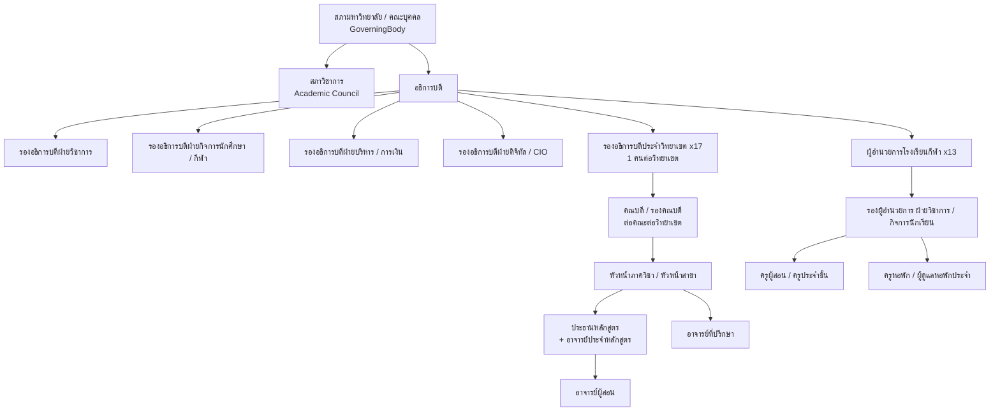

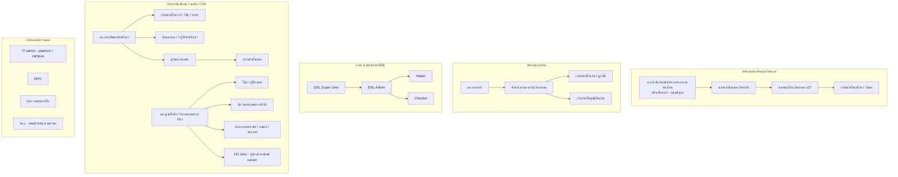

### 3A.2 Role catalogue (บทบาทภายใน)

> **Scope** = ขอบเขตข้อมูลที่บทบาทเห็นได้ (ABAC): `own` (ตนเอง), `advisee` (นักศึกษาในความดูแล), `section` (กลุ่มเรียนที่สอน), `program`, `dept`, `faculty`, `campus`, `school` (โรงเรียนกีฬา), `university` · **ที่มา** = HR (ตำแหน่งจาก HR sync), ORDER (คำสั่งแต่งตั้ง มีวันเริ่ม-สิ้นสุด), TERM (มอบหมายรายภาค), SYS (ผู้ดูแลกำหนด)

| Role code | ตำแหน่ง/บทบาท | ระดับ OrgUnit | Scope เริ่มต้น | ที่มา | MFA | ความสามารถหลัก |
|---|---|---|---|---|---|---|
| `council_member` | กรรมการสภามหาวิทยาลัย/คณะบุคคล | University | university (สรุป) | ORDER | ✓ | ดูวาระ/รายชื่อผู้สำเร็จ, บันทึกมติ (ผ่านเลขานุการ) |
| `academic_council` | กรรมการสภาวิชาการ | University | university | ORDER | ✓ | พิจารณาหลักสูตร, รายชื่อผู้สำเร็จ |
| `president` | อธิการบดี | University | university | ORDER | ✓ | dashboard ทุกระดับ, อนุมัติขั้นสุดท้ายตามอำนาจ, ลงนามดิจิทัลเอกสาร |
| `vp_university` | รองอธิการบดีฝ่าย (วิชาการ/กิจการ/การเงิน/ดิจิทัล) | University | university ในสายงาน | ORDER | ✓ | อนุมัติในสายงาน, policy owner (เช่น วิชาการ = PolicySet) |
| `vp_campus` | รองอธิการบดีประจำวิทยาเขต | Campus | campus | ORDER | ✓ | dashboard วิทยาเขต, อนุมัติระดับวิทยาเขต (ทุน, คืนเงินเกินวงเงิน) |
| `dean` / `associate_dean` | คณบดี / รองคณบดี | Faculty@Campus | faculty | ORDER | ✓ | อนุมัติเกรด (ระดับคณะ), คำร้อง, ลาแข่ง (ระดับคณะ), เสนอผู้สำเร็จ |
| `head_of_dept` | หัวหน้าภาควิชา/สาขา | Dept | dept | ORDER | ✓ | ทวนสอบเกรด, จัดผู้สอน, มอบหมายอาจารย์ที่ปรึกษา |
| `program_chair` | ประธานหลักสูตร | Program@Campus | program | ORDER | ✓ | แก้ไขหลักสูตร (draft), PLO/CLO, มคอ., degree audit override (เสนอ) |
| `program_faculty` | อาจารย์ประจำหลักสูตร | Program | program | ORDER | ✓ | ข้อมูล QA หลักสูตร, รายงาน OBE |
| `lecturer` | อาจารย์ผู้สอน | Section | section | TERM | ✓ | บันทึกคะแนน/เกรด, เช็คชื่อ, อนุมัติ W/ลาเฉพาะวิชา |
| `advisor` | อาจารย์ที่ปรึกษา | Student | advisee | TERM/ORDER | ✓ | อนุมัติแผนลงทะเบียน, บันทึกให้คำปรึกษา, เห็น early warning |
| `practicum_supervisor` | อาจารย์นิเทศก์ | Placement | assigned placements | TERM | ✓ | บันทึกการนิเทศ, ประเมิน (ดู 3A.4) |
| `practicum_coordinator` | ผู้ประสานงาน/ศูนย์ฝึกประสบการณ์วิชาชีพ | Faculty/Campus | faculty | ORDER | ✓ | จัด placement, MOU, รวมผลประเมิน |
| `academic_director` | ผอ.สำนักส่งเสริมวิชาการและงานทะเบียน (สมมติฐาน) | University | university | ORDER | ✓ | เจ้าของกระบวนงานทะเบียน, อนุมัติ PolicySet (ร่วม `vp_university`) |
| `registrar_university` | นายทะเบียนมหาวิทยาลัย | University | university | ORDER | ✓ | เผยแพร่เกรด, ยืนยันสถานภาพ, ออก credential, รายงาน สป.อว. |
| `registrar_campus` | นายทะเบียนวิทยาเขต | Campus | campus | ORDER | ✓ | เหมือนข้างบนในขอบเขตวิทยาเขต |
| `registrar_officer` | เจ้าหน้าที่ทะเบียน/วัดผล | Campus | campus | HR | ✓ | ตั้งค่าตาราง/ห้อง, บันทึกคำร้อง (ไม่ใช่ผู้อนุมัติ) |
| `admissions_officer` / `skilltest_judge` | เจ้าหน้าที่รับเข้า / กรรมการทดสอบทักษะ | Campus | campus / assigned sessions | ORDER (ต่อรอบ) | ✓ | ตั้งค่ารอบ, บันทึกคะแนนทดสอบ (เฉพาะ session ที่ได้รับมอบหมาย) |
| `finance_director` | ผอ.กองคลัง | University | university | ORDER | ✓ | fee schedule, นโยบายยกเว้น, GFMIS export |
| `finance_officer` | เจ้าหน้าที่การเงิน (รับเงิน/ลูกหนี้) | Campus | campus | HR | ✓ | invoice, reconcile exception (ห้ามอนุมัติคืนเงินของตนเอง) |
| `refund_approver` | ผู้อนุมัติคืนเงิน | Campus | campus | ORDER | ✓ | อนุมัติคืนเงินตามวงเงิน |
| `loan_superuser` / `loan_admin` / `loan_maker` / `loan_checker` | เจ้าหน้าที่ กยศ. (สอดคล้องบทบาท DSL ([กยศ. Super User](https://www.studentloan.or.th/th/system/files/files/news/Super%20User%20v.1.64.pdf))) | Campus | campus | ORDER | ✓ | Maker เตรียม/ส่งออกค่าเล่าเรียนจริง, Checker ตรวจ, Admin จัดผู้ใช้ — maker ≠ checker |
| `scholarship_committee` | กรรมการทุน | Campus/University | ตามประกาศทุน | ORDER (ต่อรอบ) | ✓ | ให้คะแนน/คัดเลือก |
| `affairs_director` / `affairs_officer` | ผอ.กองพัฒนานักศึกษา / เจ้าหน้าที่กิจการ | University/Campus | campus | HR | ✓ | กิจกรรม, วินัย, ผ่อนผันทหาร |
| `discipline_committee` | กรรมการสอบวินัย | Campus | assigned cases | ORDER (ต่อคดี) | ✓ | เห็นเฉพาะคดีที่ได้รับมอบหมาย |
| `counsellor` | นักแนะแนว/ผู้ให้คำปรึกษา | Campus | own cases | HR | ✓ | บันทึกลับ (sensitive) |
| `dorm_manager` / `dorm_officer` | ผู้จัดการหอพัก / เจ้าหน้าที่หอพัก | Dorm@Campus/School | dorm | HR | ✓ | จัดสรร, บิล, leave pass, incident |
| `sports_director` | ผอ.ศูนย์กีฬา/วิทยาศาสตร์การกีฬา | Campus/University | campus | ORDER | ✓ | squad, facility policy, รายงานผลงานกีฬา |
| `coach` | โค้ช/ผู้ฝึกสอน | Squad | squad (coach-of) | TERM/ORDER | ✓ | แผนฝึก, session, ผลแข่ง, รับรองลาแข่ง, เห็น **สถานะความพร้อม** (ไม่เห็นการวินิจฉัย ยกเว้นนักกีฬายินยอม) |
| `sport_scientist` | นักวิทยาศาสตร์การกีฬา | Squad/Lab | assigned athletes | TERM | ✓ | ทดสอบสมรรถภาพ, load/wellness |
| `physio` / `medical_officer` | นักกายภาพ / แพทย์ / พยาบาล | Campus/School | assigned athletes (care relationship) | HR + ORDER | ✓ (WebAuthn) | บันทึก/อ่านข้อมูลการบาดเจ็บและการรักษา (vault) |
| `dc_tutor` | DC tutor / ผู้ประสาน dual career | Campus | assigned athletes | TERM | ✓ | เห็นผลการเรียน + ตารางแข่ง ของนักกีฬาในความดูแล |
| `ss_director` / `ss_deputy` | ผอ./รอง ผอ.โรงเรียนกีฬา | School | school | ORDER | ✓ | อนุมัติผลการเรียน, เลื่อนชั้น, ปพ. |
| `ss_teacher` / `homeroom_teacher` | ครูผู้สอน / ครูประจำชั้น | Class/Homeroom | section / homeroom | TERM | ✓ | คะแนน, เช็คชื่อ, ติดต่อผู้ปกครอง |
| `boarding_staff` | ครูหอพัก/ผู้ดูแลหอพักประจำ | Dorm@School | dorm | TERM | ✓ | เช็คชื่อกลางคืน, leave pass, incident |
| `campus_it_admin` / `platform_admin` | IT วิทยาเขต / ผู้ดูแลแพลตฟอร์ม | Campus / University | technical | ORDER | ✓ (hardware key) | จัดการผู้ใช้/config — **ไม่เห็นข้อมูลนักศึกษาโดยอัตโนมัติ** (ต้อง break-glass) |
| `dpo` | เจ้าหน้าที่คุ้มครองข้อมูลส่วนบุคคล | University | university (metadata + DSR) | ORDER | ✓ | ROPA, DSR, breach, consent review |
| `internal_auditor` | ผู้ตรวจสอบภายใน | University | university read-only | ORDER | ✓ | อ่านธุรกรรม + audit log (ไม่เห็น vault ยกเว้นได้รับอนุมัติ) |
| `external_auditor` | สตง. (เข้าตามคำขอ) | — | ขอบเขตตามหนังสือขอ, มีวันหมดอายุ | ORDER (time-boxed) | ✓ | read-only, export เฉพาะชุดที่อนุมัติ |
| `executive_viewer` | ผู้บริหารที่ดู dashboard อย่างเดียว | ตามตำแหน่ง | aggregate เท่านั้น | ORDER | ✓ | ดู KPI แบบ aggregate (ไม่ drill ถึงรายบุคคล) |

### 3A.3 บทบาทภายนอก และกฎ PDPA ของผู้ปกครอง

| Role code | บทบาท | การยืนยันตัวตน | สิทธิ์หลัก | กฎ PDPA / เงื่อนไข |
|---|---|---|---|---|
| `applicant` | ผู้สมัคร | ThaID หรือ e-mail + OTP | ใบสมัครของตนเอง | ผู้สมัครอายุต่ำกว่า 20 ปี: consent สำหรับข้อมูลเพิ่มเติม/ข้อมูลอ่อนไหวต้องมีผู้ปกครองร่วม [ต้องตรวจสอบ ม.20] |
| `guardian_minor` | ผู้ปกครองของผู้เยาว์ (โรงเรียนกีฬา/ผู้สมัครผู้เยาว์/นักศึกษาอายุต่ำกว่า 20 ปี) | ThaID (แนะนำ) + ผูกความสัมพันธ์โดยโรงเรียน/ทะเบียน (ตรวจเอกสาร) | ดูผลการเรียน การเงิน การมาเรียน ความประพฤติ, อนุมัติ leave pass, ให้ consent แทน/ร่วม | สิทธิ์ผูกกับ `GuardianRelation.legal_authority`; **สิ้นสุดอัตโนมัติเมื่อบุตรบรรลุนิติภาวะ** (อายุ 20 ปีหรือสมรส) แล้วเปลี่ยนเป็นแบบด้านล่าง |
| `parent_adult_student` | ผู้ปกครองของนักศึกษาที่บรรลุนิติภาวะ | ThaID / OTP | **เฉพาะหมวดที่นักศึกษาให้ความยินยอม** (เช่น ใบแจ้งหนี้, เกรด) และถอนได้ทุกเมื่อ | ไม่มีสิทธิ์โดยปริยาย; ติดต่อฉุกเฉินใช้ฐาน "ประโยชน์สำคัญต่อชีวิต" ได้เฉพาะกรณีจำเป็น [ต้องตรวจสอบ ม.24(2)] |
| `alumnus` | ศิษย์เก่า | บัญชีเดิม (คงไว้) + ThaID | ข้อมูลของตน, ขอเอกสาร, บริจาค | ต่อ consent ใหม่สำหรับการตลาด/ระดมทุน |
| `employer` | ผู้ใช้บัณฑิต/นายจ้าง | e-mail + OTP (บัญชีองค์กร) | ตอบแบบประเมินผู้ใช้บัณฑิต, ประกาศงาน, **ตรวจสอบ credential** (ต้องได้ลิงก์/รหัสจากบัณฑิต) | ไม่เห็นข้อมูลอื่น |
| `verifier_public` | ผู้ตรวจสอบเอกสาร | ไม่ต้อง login (ใช้ QR + hash) | ผลตรวจ valid/revoked + ข้อมูลขั้นต่ำบนเอกสาร | rate limit, ไม่เปิดให้ค้นหารายชื่อ |
| `mentor_teacher` | ครูพี่เลี้ยง (โรงเรียนที่รับฝึก) | บัญชีภายนอก (e-mail + OTP, หรือ ThaID) | บันทึก/ประเมินนักศึกษาฝึกสอนที่ได้รับมอบหมาย | เห็นเฉพาะข้อมูลที่จำเป็นต่อการฝึก (ชื่อ, รหัส, ตารางสอน) |
| `school_principal` | ผู้บริหารสถานศึกษาที่รับฝึก | เหมือนข้างบน | ตอบรับ placement, ประเมินภาพรวม, ลงนามรับรอง | ภายใต้ MOU/ข้อตกลงประมวลผลข้อมูล |
| `internship_host` | สถานประกอบการ/สโมสร (สหกิจ/ฝึกงานโค้ช) | e-mail + OTP | ตอบรับ, บันทึก/ประเมินนักศึกษาฝึกงาน | ภายใต้ข้อตกลง |
| `federation_officer` | เจ้าหน้าที่สมาคมกีฬา/กกท. (ถ้าเปิดใช้) | บัญชีภายนอก | ส่งหนังสือเรียกตัว/ยืนยันรายการแข่ง | ไม่เห็นข้อมูลการเรียน/สุขภาพ |

### 3A.4 การฝึกประสบการณ์วิชาชีพครู (Teaching Practicum) — workflow เต็ม

> ข้อบังคับคุรุสภาว่าด้วยใบอนุญาตประกอบวิชาชีพ พ.ศ. 2565 (มีผล 15 มี.ค. 2566) ใช้ระบบ P License (2 ปี) และ B License (5 ปี) หลังผ่านการทดสอบสมรรถนะ ([Matichon](https://www.matichon.co.th/local/education/news_3950236), [SDU](https://regis.dusit.ac.th/main/wp-content/uploads/2024/12/ใหม่-2566-ขั้นตอนการขอใบอนุญาตฯ-รหัส-63-ณ-26.01.67.pdf)) แต่ **ระยะเวลาและระดับการฝึกของหลักสูตร 4 ปีที่ มกช. ใช้ยังไม่ยืนยัน** ([process_requirements](../../research_notes/)) ดังนั้นระดับ ชั่วโมง และแบบประเมินทั้งหมดเป็น `PracticumScheme` ที่ตั้งค่าต่อ CurriculumVersion

**ผู้เกี่ยวข้อง:** นักศึกษาฝึกสอน · อาจารย์นิเทศก์ (university supervisor) · ครูพี่เลี้ยง (mentor teacher) · ผู้บริหารสถานศึกษา · ผู้ประสานงานหรือศูนย์ฝึกประสบการณ์วิชาชีพของคณะ/วิทยาเขต · ประธานหลักสูตร · นายทะเบียน

| ระดับ (ค่าเริ่มต้นที่เสนอ) | ชั้นปี | รูปแบบ | ชั่วโมง/ระยะเวลา | หลักฐาน/ผลลัพธ์ |
|---|---|---|---|---|
| P1 สังเกตการสอน (pre-practicum) | ปี 1–2 | สังเกตในโรงเรียนเครือข่าย/โรงเรียนกีฬา | ประมาณ 30–60 ชม./ปี **[ต้องตรวจสอบ]** | log การสังเกต + reflection |
| P2 ทดลองสอน/ช่วยสอน | ปี 3 | สอนบางคาบภายใต้ครูพี่เลี้ยง | ประมาณ 1 ภาค (บางส่วน) **[ต้องตรวจสอบ]** | แผนการสอน, ประเมินโดยครูพี่เลี้ยง |
| P3 ปฏิบัติการสอนในสถานศึกษา (internship) | ปี 4 | สอนเต็มเวลา | 1 ภาคการศึกษา หรือ 1 ปี **[ต้องตรวจสอบ ตามมาตรฐานคุรุสภาของหลักสูตร 4 ปี]** | ชั่วโมงสอน, นิเทศ ≥ N ครั้ง (config), ประเมิน 3 ฝ่าย, portfolio |
| ฝึกงานโค้ช/สหกิจศึกษา (หลักสูตรที่ไม่ใช่ครู) | ปี 3–4 | สโมสร, สมาคม, ฟิตเนส, ธุรกิจกีฬา, ท่องเที่ยว/นันทนาการ | 1 ภาค (สหกิจ) หรือ 8–16 สัปดาห์ (ฝึกงาน) **[ต้องตรวจสอบ]** | log รายสัปดาห์, ประเมินจากพี่เลี้ยงสถานประกอบการ + อาจารย์ |

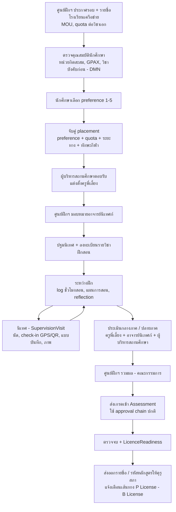

ข้อมูลหลัก: `PartnerSchool`, `PracticumScheme(levels, hours, min_visits, forms)`, `PracticumRound`, `PracticumPreference`, `PracticumPlacement`, `MentorAssignment`, `SupervisorAssignment`, `TeachingLog(hours)`, `SupervisionVisit`, `Evaluation(form_version, evaluator_role, scores)`, `LicenceReadiness` · การทำงานแบบ offline บนมือถือสำหรับนิเทศในพื้นที่ห่างไกล และ sync ภายหลัง · ข้อมูลนักเรียนในโรงเรียนที่รับฝึก (เช่น ภาพถ่ายชั้นเรียน) ต้องเบลอหน้า/ไม่เก็บ ถ้าไม่มี consent ของโรงเรียนต้นทาง

### 3A.5 Approval chains

> ทุก chain ทำงานบน Flowable (BPMN) และ resolve ผู้อนุมัติจาก `RoleAssignment` ตาม OrgUnit ของเรื่อง (เช่น คณบดีของคณะที่เปิด section) ไม่ระบุชื่อบุคคลใน process · มี SLA, escalation, การมอบหมายแทน (3A.7) และ audit ทุกขั้น · ลำดับขั้นเป็น **ค่าเริ่มต้นที่เสนอ** ต้องเทียบกับข้อบังคับ มกช.

| # | เรื่อง | ผู้เริ่ม | ลำดับการอนุมัติ (default) | ผลสุดท้าย / ผู้เผยแพร่ | SLA ต่อขั้น (เสนอ) |
|---|---|---|---|---|---|
| W-01 | ส่งเกรด | อาจารย์ผู้สอน | หัวหน้าภาค/ประธานหลักสูตร (ทวนสอบ) → คณบดี/กรรมการวิชาการประจำคณะ | นายทะเบียนวิทยาเขต **เผยแพร่** (`GradesPublished`) | 3 วันทำการ |
| W-02 | แก้ไขเกรดหลังเผยแพร่ | อาจารย์ผู้สอน | หัวหน้าภาค → คณบดี → นายทะเบียน (ต้องแนบเหตุผล/หลักฐาน) | นายทะเบียนบันทึก + แจ้งนักศึกษา | 5 วันทำการ |
| W-03 | ถอนรายวิชา (W) / ลงทะเบียนเกินหรือต่ำกว่าเกณฑ์ | นักศึกษา | อาจารย์ที่ปรึกษา → อาจารย์ผู้สอน → (เกินเกณฑ์) คณบดี | ทะเบียนบันทึก | 2 วันทำการ |
| W-04 | ลาไปแข่งขัน/เก็บตัว | นักศึกษานักกีฬา | โค้ช (รับรอง) → อาจารย์ที่ปรึกษา → อาจารย์ผู้สอนแต่ละวิชา (รับทราบ/กำหนดงานชดเชย) → รองคณบดี/คณบดี | ไม่นับขาด + สร้าง MakeupExam request | 2 วันทำการ (เร่งด่วน 1 วัน) |
| W-05 | สอบชดเชย/เลื่อนสอบ | นักศึกษา (หรืออัตโนมัติจาก W-04) | อาจารย์ผู้สอน → หัวหน้าภาค → งานวัดผล (จัดห้อง/ผู้คุม) | MakeupExam scheduled | 3 วันทำการ |
| W-06 | สำเร็จการศึกษา | นักศึกษา | ระบบ audit + clearance → ประธานหลักสูตร → คณะกรรมการประจำคณะ → นายทะเบียน (ตรวจ) → สภาวิชาการ → สภามหาวิทยาลัย/คณะบุคคล (มติ) | `DegreeConferred` + credentials | ตามรอบประชุม |
| W-07 | ทุนการศึกษา | นักศึกษา | ตรวจคุณสมบัติ (DMN) → อาจารย์ที่ปรึกษา (ความเห็น) → กรรมการทุน (คะแนน) → ผอ.กองพัฒนานักศึกษา/รองอธิการวิทยาเขต (อนุมัติ) → การเงิน (เบิกจ่าย) | `AwardGranted` → `AwardDisbursed` | ตามประกาศทุน |
| W-08 | ปรับปรุงหลักสูตร / หลักสูตรใหม่ | ประธานหลักสูตร | กรรมการประจำคณะ → สภาวิชาการ → สภามหาวิทยาลัย → บันทึก CHECO (ภายใน 25 วัน ตามตัวอย่าง [ม.อ.](https://ita.psu.ac.th/pdf/O10-Education.pdf)) → สป.อว. รับทราบ (สถานะ S, ออกรหัส) | `CurriculumVersionApproved` + checo_code | ตามรอบประชุม |
| W-09 | คืนเงิน | นักศึกษา/การเงิน | เจ้าหน้าที่การเงิน (ตรวจ) → หัวหน้างานการเงิน → `refund_approver` ตามวงเงิน (เกินวงเงิน: รองอธิการวิทยาเขต) | โอนคืน + บันทึก | 5 วันทำการ |
| W-10 | ลาพัก/รักษาสภาพ/คืนสภาพ/ลาออก | นักศึกษา (ผู้ปกครองร่วมถ้าเป็นผู้เยาว์) | อาจารย์ที่ปรึกษา → คณบดี → นายทะเบียน | StudentStatusChanged | 3 วันทำการ |
| W-11 | จำแนกสถานภาพ (พ้นสภาพ) | ระบบ (proposal) | นายทะเบียนวิทยาเขต ตรวจ → คณบดีรับทราบ → อธิการบดี/ผู้ได้รับมอบอำนาจลงนามคำสั่ง | คำสั่ง + e-Saraban | 5 วันทำการ |
| W-12 | วินัย | ผู้แจ้ง | กิจการนักศึกษา → กรรมการสอบข้อเท็จจริง → คณบดี/รองอธิการ (ลงโทษ) → อุทธรณ์ | Sanction | ตามระเบียบ |
| W-13 | ขอออกนอกหอ (โรงเรียนกีฬา) | นักเรียน | ผู้ปกครอง (`guardian_minor`) → ครูหอพัก | LeavePass | ทันที/≤ 4 ชม. |
| W-14 | เข้าถึงข้อมูลสุขภาพนอกความสัมพันธ์ดูแล / break-glass | บุคลากร | ระบุเหตุผล → `medical_officer` lead หรือ DPO อนุมัติ (กรณีฉุกเฉินเข้าได้ก่อนแล้วตรวจภายหลัง ≤ 24 ชม.) | access grant มีวันหมดอายุ | ทันที |
| W-15 | เปลี่ยน PolicySet / กฎวิชาการ | `academic_director` | รองอธิการบดีฝ่ายวิชาการ → สภาวิชาการ (ถ้าเปลี่ยนสาระ) → publish version | PolicySet vN+1 | ตามรอบประชุม |

**ตัวอย่าง flow 1: ส่งเกรด (W-01)**

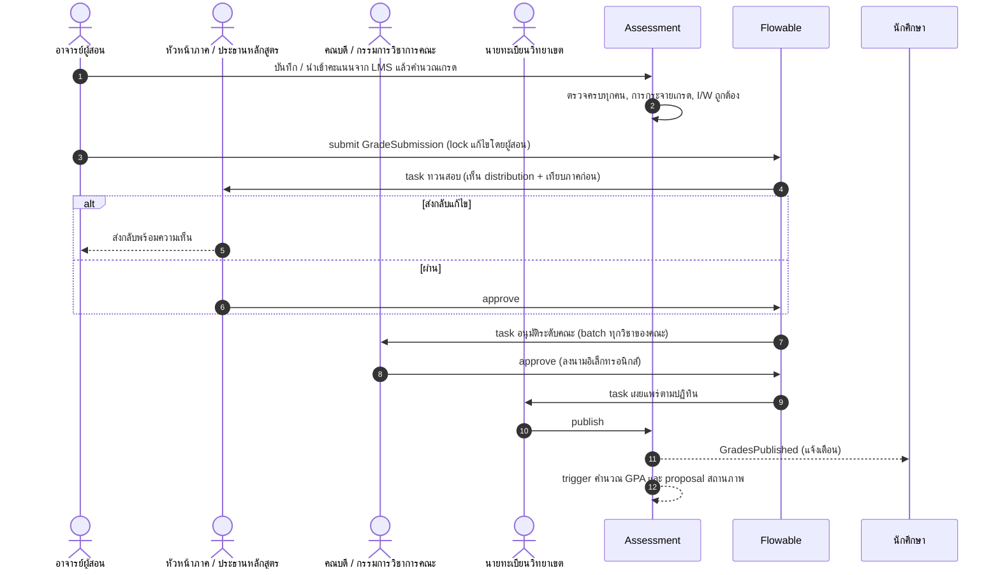

**ตัวอย่าง flow 2: ลาไปแข่งขัน (W-04) → สอบชดเชย (W-05)**

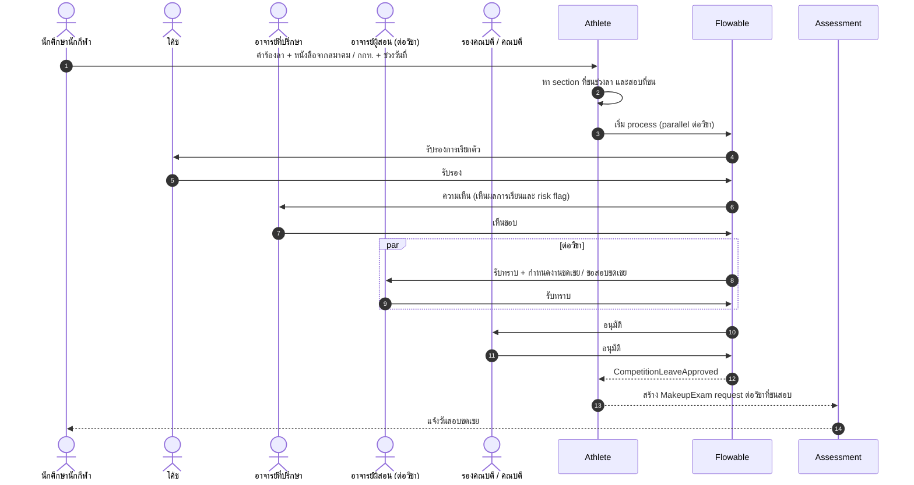

**ตัวอย่าง flow 3: อนุมัติสำเร็จการศึกษา (W-06) และหลักสูตร → CHECO (W-08)**

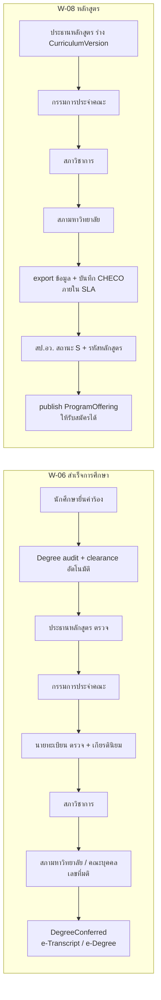

### 3A.6 Permission matrix (RBAC + ABAC)

> สัญลักษณ์: **V** = ดู, **E** = สร้าง/แก้ไข, **A** = อนุมัติ, **P** = เผยแพร่/ลงนาม, **–** = ไม่มีสิทธิ์ · ตัวห้อยในวงเล็บ = scope · ทุกสิทธิ์ถูกจำกัดเพิ่มด้วย `org_scope` (RLS) และ `data_class_max`

| ความสามารถ \ บทบาท | นักศึกษา | ผู้ปกครอง (ผู้เยาว์) | อาจารย์ผู้สอน | อาจารย์ที่ปรึกษา | หัวหน้าภาค | คณบดี | นายทะเบียน | จนท.ทะเบียน | จนท.การเงิน | โค้ช | นักกายภาพ/แพทย์ | รองอธิการวิทยาเขต | อธิการบดี | DPO | ผู้ตรวจสอบ |
|---|---|---|---|---|---|---|---|---|---|---|---|---|---|---|---|
| ข้อมูลส่วนตัว/ติดต่อ | V/E (own) | V (child) | V (section, จำกัด) | V (advisee) | V (dept) | V (faculty) | V/E (campus) | V/E (campus) | V (campus, จำกัด) | V (squad, จำกัด) | V (care) | V (campus) | V (univ) | V (DSR) | V (ro) |
| ลงทะเบียนเรียน | E (own) | V (child) | V (section) | A (advisee) | V (dept) | A (เกินเกณฑ์) | E/A (campus) | E (campus, แทน) | – | – | – | – | – | – | V (ro) |
| คะแนน/เกรด | V (own, หลังเผยแพร่) | V (child) | E (section) | V (advisee) | A (dept) | A (faculty) | P (campus) | V (campus) | – | – | – | V aggregate | V aggregate | – | V (ro) |
| แก้เกรดหลังเผยแพร่ | – | – | E (request) | – | A | A | P | – | – | – | – | – | – | – | V (ro) |
| สถานภาพ/พ้นสภาพ | V (own) | V (child) | – | V (advisee) | V (dept) | V/A (faculty) | A/P (campus) | E (campus) | – | – | – | V | P (คำสั่ง) | – | V (ro) |
| ใบแจ้งหนี้/การชำระ | V/pay (own) | V/pay (child) | – | V สถานะค้าง (advisee) | – | – | V (campus) | – | E (campus) | – | – | V aggregate | V aggregate | – | V (ro) |
| คืนเงิน | E (request) | E (request) | – | – | – | – | – | – | E (prepare) — A ไม่ได้ | – | – | A (เกินวงเงิน) | – | – | V (ro) |
| ข้อมูล กยศ. | V (own) | V (child) | – | – | – | – | – | – | E (Maker/Checker แยกคน) | – | – | V aggregate | – | – | V (ro) |
| Training/wellness | E (own) | V (child) | – | – | – | – | – | – | – | V/E (squad) | V (care) | V aggregate | V aggregate | – | – |
| **การบาดเจ็บ/การรักษา (sensitive)** | V (own) | V (child) | – | – | – | – | – | – | – | **V เฉพาะเมื่อนักกีฬายินยอม** (อื่นๆ เห็นเพียงสถานะความพร้อม) | V/E (care relationship) | – | – | V metadata | ผ่าน W-14 เท่านั้น |
| ข้อจำกัดการเรียนภาคปฏิบัติ (ไม่มีการวินิจฉัย) | V (own) | V (child) | V (section) | V (advisee) | – | – | – | – | – | V (squad) | E | – | – | – | – |
| บันทึกการให้คำปรึกษา | – | – | – | – | – | – | – | – | – | – | – | – | – | V metadata | – |
| วินัย | V (own) | V (child) | – | V (advisee) | – | A (faculty) | V | – | – | – | – | A | – | – | V (ro) |
| Credential (transcript/degree) | V/request (own) | – | – | – | – | – | P (campus/univ) | E (prepare) | – | – | – | – | P (ลงนาม) | – | V (ro) |
| Consent | E (own) | E (child) | – | – | – | – | – | – | – | – | – | – | – | V/A (DSR) | V (ro) |
| Audit log | V (own access log) | – | – | – | – | – | V (campus, การกระทำวิชาการ) | – | – | – | – | – | – | V (univ) | V (univ) |
| Dashboard | own | child | section | advisee | dept | faculty | campus | campus | campus | squad | caseload | campus | university | privacy KPIs | ro |

หมายเหตุ: ผู้ปกครองของนักศึกษาที่บรรลุนิติภาวะ (`parent_adult_student`) มีสิทธิ์เฉพาะคอลัมน์ "ผู้ปกครอง" ในแถวที่นักศึกษาให้ consent ไว้, `counsellor` เห็นบันทึกการให้คำปรึกษาเฉพาะเคสของตน, `platform_admin` ไม่มีสิทธิ์ข้อมูลธุรกิจ (ต้อง break-glass W-14 ที่มี 2-person approval)

### 3A.7 Delegation, term-based assignment และ Segregation of Duties

| กลไก | การออกแบบ |
|---|---|
| **รักษาราชการแทน / ปฏิบัติหน้าที่แทน** | `Delegation(from_assignment, to_person, scope, reason, order_no, valid_from, valid_to)` ผู้รับมอบได้สิทธิ์ของตำแหน่งชั่วคราว; audit บันทึก `actor` = ผู้รับมอบ และ `on_behalf_of` = ตำแหน่ง; เอกสารที่ลงนามแสดง "รักษาราชการแทน"/"ปฏิบัติหน้าที่แทน"; หมดอายุอัตโนมัติ; ห้ามมอบต่อ (no re-delegation) ยกเว้นตั้งค่าไว้ |
| **Out-of-office delegation (ระดับ task)** | ผู้อนุมัติตั้งผู้รับแทนสำหรับ task ใน Flowable ช่วงลา (ต้องมีบทบาทเทียบเท่าใน scope เดียวกัน) |
| **Term-based role assignment** | `lecturer`/`advisor`/`coach`/`dc_tutor`/`practicum_supervisor` สร้างจากข้อมูลตารางสอน/การมอบหมายต่อ Term และ **หมดอายุอัตโนมัติ** เมื่อพ้นช่วงส่งเกรด + grace period (เช่น 60 วัน) |
| **Order-based assignment** | ตำแหน่งบริหาร (คณบดี, นายทะเบียน, รองอธิการวิทยาเขต) บันทึกตามคำสั่งแต่งตั้ง (เลขที่/วันที่ เชื่อม e-Saraban) พร้อมวาระ |
| **HR-driven lifecycle** | ย้าย/ลาออก/เกษียณ (จาก HR adapter) → ระงับ role ภายใน 24 ชม. และโอน task ที่ค้าง |
| **Access recertification** | หัวหน้าหน่วยรับรองสิทธิ์ลูกทีมทุกไตรมาส (บทบาท sensitive ทุกเดือน) |

| Segregation of Duties (SoD) rule | ความขัดแย้ง | การบังคับใช้ |
|---|---|---|
| SoD-01 | ผู้บันทึกเกรด ≠ ผู้อนุมัติเกรดขั้นเดียวกัน (แม้มี 2 บทบาท เช่น อาจารย์ที่เป็นหัวหน้าภาค) | Flowable ข้ามไปยังผู้อนุมัติลำดับถัดไป/ผู้แทน |
| SoD-02 | ผู้ขอแก้เกรด ≠ ผู้อนุมัติแก้เกรด | ตรวจใน process |
| SoD-03 | ผู้รับเงิน/บันทึกชำระ ≠ ผู้อนุมัติคืนเงิน; ผู้เตรียมคืนเงิน ≠ ผู้อนุมัติ | role conflict check ตอนมอบหมาย + runtime |
| SoD-04 | กยศ. Maker ≠ Checker ในรายการเดียวกัน | ตรวจตอนมอบหมาย |
| SoD-05 | ผู้ตั้งค่า fee schedule ≠ ผู้อนุมัติ fee schedule | 4-eyes publish |
| SoD-06 | ผู้แก้ PolicySet ≠ ผู้ publish PolicySet | 4-eyes publish |
| SoD-07 | ผู้ดูแลระบบ (platform_admin) ไม่มีสิทธิ์ข้อมูลธุรกิจ และไม่สามารถแก้ audit log ได้ | แยก role + WORM |
| SoD-08 | กรรมการทดสอบทักษะ ต้องไม่ประเมินผู้สมัครที่มีความสัมพันธ์ (conflict-of-interest declaration) | ประกาศ COI ต่อรอบ |
| SoD-09 | กรรมการทุน ≠ อาจารย์ที่ปรึกษาที่ให้ความเห็นในใบสมัครเดียวกัน | ตรวจใน process |

### 3A.8 Executive dashboards ต่อระดับ

| ระดับ | Dashboard | KPI หลัก (ตัวอย่าง) | ระดับรายละเอียด |
|---|---|---|---|
| อธิการบดี / สภามหาวิทยาลัย | University cockpit | ผู้สมัคร/รับเข้า เทียบแผนรายวิทยาเขต, คงอยู่ปี 1→2, จบตามเวลา, ภาวะการมีงานทำ, ลูกหนี้ค้าง, ผลงานกีฬา (เหรียญระดับชาติ/นานาชาติ), ความพร้อม QA/ITA, สถานะ incident/PDPA | aggregate + เทียบวิทยาเขต (ไม่เห็นรายบุคคล) |
| รองอธิการบดีฝ่าย | Functional cockpit | วิชาการ: GPA distribution, การเปิด section, อัตราพ้นสภาพ; กิจการ: กิจกรรม, วินัย, หอพัก; การเงิน: รายรับ/reconcile/กยศ. | aggregate ข้ามวิทยาเขต |
| รองอธิการบดีประจำวิทยาเขต | Campus cockpit | เหมือนระดับมหาวิทยาลัยแต่จำกัดวิทยาเขต + การใช้สนาม/หอพัก + backlog คำร้อง/SLA | drill ถึงระดับคณะ/หลักสูตร |
| คณบดี | Faculty dashboard | นักศึกษารายหลักสูตร, เกรดค้างส่ง, คำร้องค้าง, PLO achievement, ภาระงานอาจารย์, นักศึกษาเสี่ยง (จำนวน) | drill ถึงหลักสูตร/section |
| หัวหน้าภาค / ประธานหลักสูตร | Program dashboard | ผล CLO/PLO, การกระจายเกรดราย section, อาจารย์ประจำหลักสูตรตามเกณฑ์, retention ของรุ่น, ข้อมูลสำหรับ CUPT QA | ระดับ section; รายชื่อนักศึกษาเฉพาะที่มีสิทธิ์ |
| อาจารย์ที่ปรึกษา / DC tutor | Advisee view | สถานะลงทะเบียน, GPA trend, early-warning flags พร้อมเหตุผล, ตารางแข่ง | รายบุคคล (advisee) |
| ผอ.โรงเรียนกีฬา | School dashboard | การมาเรียน, ผลการเรียนรายชั้น, หอพัก/incident, ผลงานกีฬา, ผู้ปกครองที่ยังไม่ยืนยัน consent | รายชั้น/ห้อง |
| ผอ.ศูนย์กีฬา / โค้ช | Performance dashboard | training load/ACWR, readiness, จำนวนนักกีฬาที่ไม่พร้อม (ไม่มีการวินิจฉัย), ผลแข่ง | squad |
| DPO | Privacy dashboard | DSR ค้าง/SLA, consent coverage ผู้เยาว์, การเข้าถึง sensitive ผิดปกติ, break-glass, retention jobs | metadata |

### 3A.9 บทบาทผู้ดูแลระบบ (System administration roles)

> หลักการ: **ผู้ดูแลระบบจัดการ "ระบบ" ได้ แต่ไม่ได้ "ข้อมูลธุรกิจ" มาโดยอัตโนมัติ** ทุกสิทธิ์ระดับ privileged ได้มาแบบ Just-in-Time (JIT) ผ่าน PAM มีเวลาหมดอายุ และทุกการกระทำถูกบันทึกลง audit แบบ immutable (WORM) หัวข้อนี้ขยายจาก `platform_admin` / `campus_it_admin` ใน 3A.2

| Role code | บทบาท | Scope | วิธีได้สิทธิ์ | สิทธิ์หลัก | ห้าม (SoD) |
|---|---|---|---|---|---|
| `super_admin` | Super Admin (IT กลางมหาวิทยาลัย) | university (technical) | JIT ผ่าน PAM, 4-eyes, hardware key | onboard OrgUnit, feature flags ระดับมหาวิทยาลัย, อนุมัติ config สำคัญ, จัดการ module admin | อ่านข้อมูล sensitive/แก้เกรด/แก้ audit; ใช้บัญชีเดียวกับงานประจำวัน |
| `campus_it_admin` | Campus/School IT Admin | campus หรือ sports school | standing (ต่ำ) + JIT สำหรับงานเสี่ยง | reset รหัส/MFA, ผูก device, จัด role ในวิทยาเขต (ภายใต้ catalogue ที่อนุญาต), ประกาศของวิทยาเขต | มอบ role ที่สูงกว่าตนเอง; ข้าม campus |
| `module_admin_registrar` | Registrar config admin | campus/university | ORDER | ปฏิทิน (พ.ศ.), RegistrationWindow, ID scheme, document templates ทะเบียน, ร่าง PolicySet | publish PolicySet ของตนเอง (ต้องมีผู้อนุมัติอีกคน SoD-06) |
| `module_admin_finance` | Finance config admin | campus/university | ORDER | fee schedule (ร่าง), Biller ID/บัญชีธนาคาร, รูปแบบเลขที่ใบเสร็จ, GFMIS mapping | อนุมัติ fee schedule ของตนเอง (SoD-05); บันทึกชำระ |
| `module_admin_housing` / `module_admin_athlete` / `module_admin_admissions` | Dorm / Athlete / Admissions config admin | campus/school | ORDER | ห้อง/อัตรา/รอบจอง; ชนิดกีฬา/แบบทดสอบ/แบบสอบถาม wellness; รอบรับสมัคร/แบบฟอร์ม/rubric | ดูข้อมูลการบาดเจ็บ |
| `iam_admin` | IAM admin | university | JIT | Keycloak clients/IdP (ThaID, LDAP), role catalogue, ABAC attribute, JML rules | มอบสิทธิ์ให้ตนเอง; แก้ policy ที่ตนอนุมัติ |
| `security_admin` | Security admin / SOC | university | JIT | WAF rules, SIEM, ตรวจ break-glass, ระงับบัญชีฉุกเฉิน, key rotation (ผ่าน Vault policy) | อ่านข้อมูลธุรกิจ |
| `dba` | Database administrator | infra | JIT ผ่าน PAM (session recording) | schema migration (ผ่าน pipeline), tuning, backup/restore | query ตาราง sensitive (ข้อมูลใน vault เข้ารหัสระดับ field; DBA ไม่มี key) |
| `sre_devops` | SRE/DevOps | infra | GitOps เป็นหลัก; JIT kubectl แบบ read-only/exec | deploy ผ่าน Argo CD, scale, incident, ดู telemetry | แก้ prod นอก Git (ยกเว้น break-glass); เข้าถึง secret ธุรกิจ |
| `helpdesk_l1` | Helpdesk L1 | campus/university | standing | ดูสถานะบัญชี/ticket, ส่งลิงก์ reset, impersonation **แบบดูอย่างเดียว** โดยต้องได้ consent ของผู้ใช้ในเซสชัน (มีแถบเตือนให้ผู้ใช้เห็น) | แก้ข้อมูลวิชาการ/การเงิน |
| `helpdesk_l2` | Helpdesk L2 / functional support | module | JIT ต่อ ticket | replay DLQ, rerun job, แก้ข้อมูลผ่าน "data-fix request" ที่มี 4-eyes | แก้ข้อมูลโดยตรงใน DB |
| `data_owner` | Data owner (หัวหน้าหน่วยเจ้าของข้อมูล เช่น นายทะเบียน) | domain | ORDER | อนุมัติการเข้าถึง/การแชร์ข้อมูลชุด, retention, classification | — |
| `data_steward` | Data steward | domain | ORDER | catalogue/คำอธิบาย, DQ rules, แก้ master data ตามคำขอ | อนุมัติการเข้าถึงด้วยตนเอง |
| `dpo` (console) | DPO | university | ORDER | consent configuration (purpose/notice version), DSR, ROPA, DPIA, breach workflow, ดู access report | แก้ audit; อ่านเนื้อหา sensitive (เห็น metadata) |
| `auditor_ro` | Auditor (ภายใน / สตง.) | ตามหนังสือ | time-boxed | read-only ธุรกรรม + audit log + config history | write ทุกชนิด |
| `vendor_support` | Vendor support engineer | ตาม ticket | **JIT ≤ 8 ชม.** อนุมัติโดย มกช. (super_admin + data owner ถ้าแตะข้อมูล) | ดู log/trace ที่ทำ PII masking แล้ว, staging; prod เฉพาะเมื่อได้อนุมัติ | ส่งออกข้อมูล, เข้าถึงจากนอกประเทศ (ข้อตกลงประมวลผลข้อมูล), standing access |
| `breakglass` | บัญชีฉุกเฉิน (2 บัญชี เก็บ credential แบบแบ่งครึ่งในซอง/ตู้เซฟ) | ทั้งหมด | ใช้เมื่อ IdP ล่ม/เหตุฉุกเฉิน | ทุกอย่าง | ใช้แล้วต้อง **review ภายใน 24 ชม.** โดย security_admin + DPO และหมุน credential |

**Admin permission matrix (สรุป)** — A = อนุมัติ (4-eyes), E = ทำได้, J = ทำได้เฉพาะ JIT, – = ไม่ได้

| ความสามารถ | super | campus IT | module admin | IAM | security | DBA | SRE | HD L1 | HD L2 | data owner | DPO | auditor | vendor |
|---|---|---|---|---|---|---|---|---|---|---|---|---|---|
| Onboard OrgUnit/วิทยาเขต | E+A | – | – | – | – | – | – | – | – | A | – | V | – |
| PolicySet (กฎวิชาการต่อรุ่น) | A (เทคนิค) | – | E (ร่าง) | – | – | – | – | – | – | A (นายทะเบียน/วิชาการ) | – | V | – |
| Master data (หลักสูตร/รายวิชา/ปฏิทิน พ.ศ./fee) | – | – | E | – | – | – | – | – | – | A | – | V | – |
| Feature flags | E+A | E (campus) | E (module) | – | – | – | E (ops flags) | – | – | – | – | V | – |
| JML / role assignment | A | E (campus) | – | E | – | – | – | V | – | A (sensitive role) | – | V | – |
| PAM / JIT grant | A | – | – | E | E | – | – | – | – | – | – | V | – |
| Break-glass review | – | – | – | – | E | – | – | – | – | – | E | V | – |
| Audit log review | V | V (campus) | – | V (IAM) | V | – | – | – | – | V (domain) | V | V | – |
| DSR (PDPA) / consent config | – | – | – | – | – | – | – | – | – | V | E | V | – |
| Backup/restore | A | – | – | – | – | J | J | – | – | A (restore ข้อมูล) | – | V | – |
| Job scheduler / integration monitor (กยศ./TCAS/ธนาคาร) | V | V | V | – | – | – | E | V | E (rerun/replay) | – | – | V | J |
| Notification templates / ประกาศ | – | E (campus) | E | – | – | – | – | – | – | – | V (privacy text) | V | – |
| System health / cost dashboards | V | V | V | – | V | V | E | V | V | – | – | V | J |
| อ่านข้อมูลสุขภาพ/แก้เกรด | – | – | – | – | – | – | – | – | – | – | – | – | – |

> แถวสุดท้ายเน้นว่า **ไม่มีบทบาท admin ใดอ่านข้อมูลสุขภาพหรือแก้เกรดได้** ต้องใช้ W-14 (break-glass) หรือ approval chain ทางธุรกิจ (W-02) เท่านั้น

---

## 4. Functional Architecture: Module Catalogue (Bounded Contexts)

### 4.0 ภาพรวมโมดูลและการจัดกลุ่ม

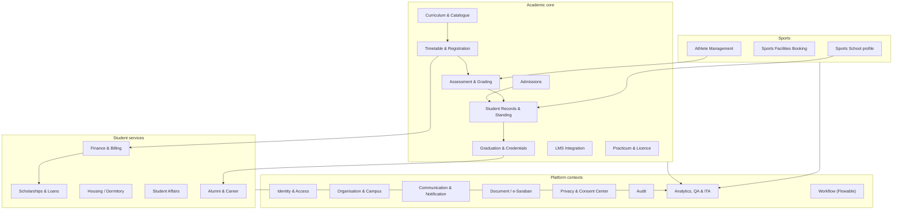

**กติกาของ bounded context (บังคับด้วย Spring Modulith + ArchUnit):**
1. แต่ละโมดูลเป็นเจ้าของ schema PostgreSQL ของตัวเอง (`adm`, `cur`, `reg` ...) โมดูลอื่นห้าม JOIN ข้าม schema
2. การเรียกข้ามโมดูลแบบ synchronous ทำผ่าน **published Java API** (`*.api` package) เท่านั้น ส่วนแบบ async ผ่าน domain event (in-process) → outbox → Kafka
3. Event มี schema (Avro/JSON Schema) เก็บใน registry และใช้ชื่อแบบ `<context>.<EventName>.v<n>`
4. ทุก aggregate ที่ผูกกับวิทยาเขตต้องมี `org_unit_id` (RLS)
5. Shared kernel มีเพียง: `PersonId`, `OrgUnitId`, `AcademicTerm`, `Money(THB)`, `ThaiDate` (แสดง พ.ศ.), `LocalizedText(th,en)`

> ในตารางด้านล่าง: **Pub** = event ที่โมดูลเผยแพร่, **Sub** = event ที่โมดูล consume

### 4.1 Identity & Access (IAM)

| หัวข้อ | รายละเอียด |
|---|---|
| วัตถุประสงค์ | SSO, การยืนยันตัวตน, การจัดการบัญชีตลอดวงจรชีวิต, RBAC + ABAC |
| ความสามารถหลัก | Keycloak realm เดียว `tnsu` (organization/group ต่อวิทยาเขต); ThaID OIDC federation สำหรับผู้สมัคร/นักศึกษา/ผู้ปกครอง ([ETDA ThaiD RP](https://github.com/ETDA/ThaiD-Python-RP)); LDAP/AD federation สำหรับบุคลากร; MFA (TOTP/WebAuthn) บังคับสำหรับบุคลากร; account provisioning/deprovisioning ตาม lifecycle event; delegated access ระหว่างผู้ปกครองกับนักเรียน; service account/client credentials; break-glass account |
| Entities | `UserAccount`, `IdentityLink(provider, subject, ial)`, `RoleAssignment(role, org_scope, valid_from/to)`, `Delegation(guardian→student, scope)`, `AccessPolicy` |
| Pub | `identity.AccountProvisioned`, `identity.AccountVerified(ial)`, `identity.RoleAssigned`, `identity.AccountSuspended` |
| Sub | `records.StudentMatriculated`, `records.StudentStatusChanged`, `hr.StaffJoined/Left` (adapter), `sportsschool.GuardianLinked` |
| Integrations | ThaID (OIDC), DGA Digital ID (optional), AD/LDAP, Google Workspace/M365 (provision mailbox), eduroam RADIUS ผ่าน UniNet ([UniNet eduroam](https://www.uni.net.th/wp-content/uploads/2023/05/nayobai-join-eduroam.pdf)) |

ตัวอย่าง role ได้แก่ `student`, `applicant`, `guardian`, `lecturer`, `advisor`, `coach`, `sport_scientist`, `physio`, `medical_officer`, `registrar_officer`, `finance_officer`, `dorm_officer`, `affairs_officer`, `campus_admin`, `university_admin`, `executive`, `dpo`, `auditor` ส่วน ABAC attribute ได้แก่ `org_scope[]` (วิทยาเขต/คณะ/โรงเรียน), `data_class_max` (public/internal/confidential/sensitive), `relationship` (advisor-of, coach-of, guardian-of), `purpose` (สำหรับข้อมูล health)

### 4.2 Organisation & Campus (ORG)

| หัวข้อ | รายละเอียด |
|---|---|
| วัตถุประสงค์ | โครงสร้างองค์กรแบบลำดับชั้นและการตั้งค่าราย OrgUnit |
| ความสามารถ | โครงสร้าง University → Campus / Sports School → Faculty/Department → Program Office; การตั้งค่าแบบสืบทอด (inheritance) และ override ราย OrgUnit (ปฏิทิน ค่าธรรมเนียม แม่แบบเอกสาร โลโก้ ลายเซ็นผู้มีอำนาจ บัญชีธนาคาร); ข้อมูลหน่วยงานต้นสังกัดแบบ effective-dated (ชื่อกระทรวง รหัสหน่วยงาน GFMIS ตรา) รองรับการแยกกระทรวง; รหัสวิทยาเขตสำหรับ student ID; อาคาร/ห้อง |
| Entities | `OrgUnit(type: UNIVERSITY/HQ/CAMPUS/SPORTS_SCHOOL/FACULTY/DEPT)`, `OrgSetting(key, value, valid_from)`, `ParentAgency(name_th, name_en, codes, valid_from/to)`, `Building`, `Room`, `Signatory` |
| Pub | `org.OrgUnitCreated`, `org.SettingChanged`, `org.ParentAgencyChanged` |
| Sub | — |
| Integrations | HR (ผังตำแหน่ง), GFMIS codes (config) |

### 4.3 Admissions (ADM)

| หัวข้อ | รายละเอียด |
|---|---|
| วัตถุประสงค์ | รับสมัครและคัดเลือกทุกระดับ ทั้งรอบที่วิทยาเขตจัดเองและรอบ TCAS รวมถึงโควตานักกีฬาและโรงเรียนกีฬา |
| ความสามารถ | ตั้งค่า Admission Round ราย OrgUnit/โปรแกรม (โควตา, รับตรง, TCAS รอบ 1–4, ป.โท/เอก, ม.1/ม.4); แบบฟอร์มสมัครแบบ dynamic (form schema); ตรวจคุณสมบัติตามกฎ DMN (เช่น ผลงานย้อนหลังไม่เกิน 5 ปี แบบตัวอย่าง [Mahidol](https://ss.mahidol.ac.th/th/images/SS-Project/TCAS/2568/2.%20ba.pdf)); portfolio ผลงานกีฬา (ระดับ/ปี/เหรียญ/หลักฐาน); จองรอบ **ทดสอบทักษะกีฬา** ตามชนิดกีฬา (สนาม, กรรมการ, rubric คะแนน ต่อชนิดกีฬา) และรองรับการบันทึกคะแนนแบบ offline บน tablet; สัมภาษณ์; ranking/ที่นั่ง; ประกาศผล; ค่าสมัคร; ยืนยันสิทธิ์/สละสิทธิ์; รายงานตัวออนไลน์; ส่งต่อไป Student Records |
| Entities | `AdmissionRound`, `ProgramSeat`, `Application`, `ApplicantProfile`, `SportAchievement`, `SkillTestSession`, `SkillTestRubric`, `SkillTestScore`, `Offer`, `TcasRecord` |
| Pub | `admissions.ApplicationSubmitted`, `admissions.SkillTestScored`, `admissions.ApplicantAdmitted`, `admissions.OfferConfirmed`, `admissions.OfferDeclined` |
| Sub | `finance.PaymentReceived` (ค่าสมัคร), `identity.AccountVerified` |
| Integrations | TCAS (ไฟล์ + API ตรวจสถานะด้วยเลข 13 หลัก + secret key ใน Vault, [TCAS63 manual](https://www.admission.kmutnb.ac.th/sites/default/files/2020-02/TCAS63-University_Manual_V2_20-01.pdf); สเปกปัจจุบัน [ต้องตรวจสอบ]), ThaID, Bank (ค่าสมัคร) |

### 4.4 Curriculum & Course Catalogue (CUR)

| หัวข้อ | รายละเอียด |
|---|---|
| วัตถุประสงค์ | Curriculum master ระดับมหาวิทยาลัยที่มี version และการเปิดสอนรายวิทยาเขต |
| ความสามารถ | Program → CurriculumVersion (ปี พ.ศ. ที่ปรับปรุง, สถานะอนุมัติสภา, รหัส CHECO) → โครงสร้างหมวด (GE ≥ 24 หน่วยกิต, เฉพาะ, เลือกเสรี; หลักสูตร 4 ปี ≥ 120 หน่วยกิต ตามเกณฑ์ 2565 [ต้องตรวจสอบกับต้นฉบับ]) ([STOU copy](https://www.stou.ac.th/Offices/Oaa/Dept/Dept04/Rule_MUA/Details_Rule2565.pdf)); รายวิชา (หน่วยกิต ท-ป-ศ, prerequisite/co-requisite แบบ expression, equivalence); **OBE**: PLO ↔ CLO ↔ รายวิชา (curriculum mapping matrix) และวิธีประเมิน; สร้างเอกสาร มคอ.2/3/4/5/6/7 (หรือ "รายละเอียดรายวิชา" ตามแนวปฏิบัติปัจจุบัน) จากข้อมูล ([KMUTT มคอ.2 via CHECO](https://me.kmutt.ac.th/wp-content/uploads/2025/09/มคอ.2-วศ.ด.วิศวกรรมเครื่องกล-นานาชาติ-ปรับปรุงปี-63.pdf)); export ข้อมูลหลักสูตรสำหรับกรอก CHECO ([มหิดล ITA](https://graduate.mahidol.ac.th/Assets-Center/ITA-MU/pdf/14/014-17.pdf)); อาจารย์ประจำหลักสูตร; ProgramOffering ราย campus; ผูกหลักสูตรกับการรับรองคุรุสภา; การเทียบโอน/คลังหน่วยกิต (ประกาศ 2565) ([KMUTT EDS](https://eds.kmutt.ac.th/wp-content/uploads/docs/rules-regulations-announcements/1/3.ประกาศ%20สป.อว.แนวทางการดาเนินงานระบบคลังหน่วยกิตระดับอุดมศึกษา%20ฉบับที่%201.pdf)) |
| Entities | `Program`, `CurriculumVersion`, `CurriculumBlock`, `Course`, `CourseVersion`, `Requisite`, `PLO`, `CLO`, `CloMapping`, `ProgramOffering(campus)`, `ProgramFaculty`, `TransferRule`, `CreditBankEntry` |
| Pub | `curriculum.CurriculumVersionApproved`, `curriculum.CourseVersionPublished`, `curriculum.ProgramOfferingOpened` |
| Sub | `assessment.CloResultsComputed` (สำหรับรายงาน OBE) |
| Integrations | CHECO (export/กรอกผ่าน web portal), Thai MOOC/NCBS (เทียบโอน, ยังไม่ยืนยัน) |

### 4.5 Timetable & Course Registration (REG)

| หัวข้อ | รายละเอียด |
|---|---|
| วัตถุประสงค์ | จัดตารางสอน/สอบ เปิด section และลงทะเบียนเรียนที่ทนต่อ peak |
| ความสามารถ | Term/ปฏิทินราย OrgUnit; Section (ผู้สอน ห้อง/สนาม จำนวนรับ ที่นั่งสงวนตามโปรแกรม/ชั้นปี/นักกีฬา); ตรวจตารางชน (รวมตารางซ้อม/แข่งขันของนักกีฬาเป็น soft constraint); **Pre-computed eligibility** (prerequisite, credit load, สถานภาพ, ค้างชำระ, hold) คำนวณไว้ก่อนวันเปิด; ตะกร้า (plan/cart) ล่วงหน้า; **Registration engine** แยก deploy ได้ (ADR-011) ใช้ command queue + seat ledger; add/drop/W ผ่าน workflow อาจารย์ที่ปรึกษา; waitlist อัตโนมัติ; ค่าปรับลงทะเบียนช้า; ลงทะเบียนแทนโดยเจ้าหน้าที่; ตารางสอบและสอบชดเชย |
| Entities | `Term`, `RegistrationWindow(org, year_level, start/end)`, `Section`, `Meeting`, `SeatPool`, `EligibilitySnapshot`, `RegistrationCart`, `RegistrationCommand`, `Enrollment`, `Waitlist`, `Hold` |
| Pub | `registration.EnrollmentConfirmed`, `registration.EnrollmentDropped`, `registration.WithdrawalApproved`, `registration.WaitlistPromoted`, `registration.TermRegistrationClosed` |
| Sub | `records.AcademicStandingChanged`, `finance.HoldPlaced/Released`, `curriculum.CourseVersionPublished`, `athlete.CompetitionScheduled` |
| Integrations | LMS (สร้าง course/enrol ผ่าน event), Facilities (ห้อง/สนาม) |

### 4.6 Assessment & Grading (ASM)

| หัวข้อ | รายละเอียด |
|---|---|
| วัตถุประสงค์ | บันทึก คำนวณ อนุมัติ และเผยแพร่ผลการเรียน |
| ความสามารถ | Grading scheme ตาม profile (อุดมศึกษา A–F พร้อม S/U/I/W; การศึกษาขั้นพื้นฐาน 8 ระดับและ ร/มส [ต้องตรวจสอบ]); ส่วนประกอบคะแนน (component weights) และนำเข้าจาก LMS (grade passback); workflow อนุมัติเกรด (อาจารย์ → ประธานหลักสูตร → คณะกรรมการประจำคณะ) และล็อกหลังอนุมัติ; การแก้เกรดต้องมีเหตุผล + อนุมัติ + audit; job แปลง I → F/U อัตโนมัติตาม policy; สอบชดเชย/เลื่อนสอบ (เชื่อมกับการลาแข่ง); ผล CLO ราย assessment; ประเมินการสอนโดยนักศึกษา |
| Entities | `GradingScheme`, `AssessmentComponent`, `Score`, `GradeSubmission`, `Grade`, `GradeChangeRequest`, `MakeupExam`, `CloResult`, `TeachingEvaluation` |
| Pub | `assessment.GradesSubmitted`, `assessment.GradesPublished`, `assessment.GradeChanged`, `assessment.MakeupExamScheduled`, `assessment.CloResultsComputed` |
| Sub | `registration.EnrollmentConfirmed`, `athlete.CompetitionLeaveApproved`, `lms.GradebookSynced` |
| Integrations | Moodle (LTI AGS) |

### 4.7 Student Records & Academic Standing (REC)

| หัวข้อ | รายละเอียด |
|---|---|
| วัตถุประสงค์ | ทะเบียนประวัตินักศึกษา (system of record) สถานภาพ และ GPA/GPAX |
| ความสามารถ | Matriculation (ออกรหัสตาม ID scheme หัวข้อ 6.3); ผูก **Academic Policy Set** ตาม cohort/program/profile (ADR-004); คำนวณ GPA/GPAX แบบ deterministic (ไม่นับ S/U/W/I ตาม policy); จำแนกสถานภาพทุกสิ้นภาค (ปกติ/รอพินิจ/พ้นสภาพ) เป็น proposal → นายทะเบียนยืนยัน (human-in-the-loop); คำร้อง (ลาพัก, รักษาสภาพ, คืนสภาพ, ย้ายโปรแกรม/วิทยาเขต, เปลี่ยนชื่อ, ลาออก) ผ่าน Flowable; อาจารย์ที่ปรึกษาและบันทึกการให้คำปรึกษา; hold; ใบรับรองสถานภาพนักศึกษา (สำหรับกีฬามหาวิทยาลัย/ทหาร/ทุน); ประวัติการเปลี่ยนแปลงเต็มรูปแบบ (temporal tables) |
| Entities | `Student`, `StudentProgram(policy_set_id, cohort)`, `StudentStatusHistory`, `TermRecord(gpa, credits)`, `AcademicStanding`, `Petition`, `AdvisorAssignment`, `AdvisingNote` |
| Pub | `records.StudentMatriculated`, `records.StudentStatusChanged`, `records.AcademicStandingChanged`, `records.ProgramTransferred` |
| Sub | `admissions.OfferConfirmed`, `assessment.GradesPublished`, `affairs.DisciplinarySanctionIssued`, `finance.DebtCleared` |
| Integrations | สป.อว. ฐานข้อมูลอุดมศึกษา (ส่งออกไฟล์ราย term [ต้องตรวจสอบ template]), กรมการปกครอง (ไม่มี) |

### 4.8 Graduation & Credentials (GRD)

| หัวข้อ | รายละเอียด |
|---|---|
| วัตถุประสงค์ | ตรวจจบ อนุมัติปริญญา และออกเอกสารดิจิทัลที่ตรวจสอบได้ |
| ความสามารถ | **Degree audit engine** ตามโครงสร้างหลักสูตรของรุ่น (what-if สำหรับนักศึกษา); คำร้องขอสำเร็จการศึกษา; clearance checklist (ห้องสมุด/หอพัก/การเงิน/กยศ./กิจกรรม/วินัย) แบบ event-driven; คำนวณเกียรตินิยมตาม policy (ค่าเริ่มต้น 3.60/3.25 + เงื่อนไข: ไม่เคยได้ F/U, ไม่เคยเรียนซ้ำ, จบภายในเวลาปกติ, โอนหน่วยกิตไม่เกินสัดส่วน — เป็น parameter เพราะบางแห่งใช้ 3.51 เช่น [NU](https://math.sci.nu.ac.th/th/file/datasci/finish.pdf)); เสนอรายชื่อ → สภาวิชาการ → สภามหาวิทยาลัย (บันทึกเลขที่/วันที่มติ); **e-Transcript** ตาม ขมธอ. 25-2563 (XML UN/CEFACT + PESC) ([DGA Digital Transcript](https://www.dga.or.th/en/our-services/digital-platform-services/dga-digital-transcript/), [NUJST](https://www.journal.nu.ac.th/NUJST/article/view/Vol-31-No-3-2023-113-128)) ลงนามดิจิทัล (XAdES/PAdES + timestamp [ต้องตรวจสอบ signature profile]) แนบใน PDF/A-3; e-Degree/หนังสือรับรอง (ขมธอ. 11-2560) ([ETDA](https://etda.or.th/getattachment/22a6682d-f1b0-4182-87a1-1021a5d8460f/ขมธอ-11-2560.aspx)); Verifiable Credential ในอนาคต (ขมธอ. 24-2563) ([ETDA open data](https://opendata.etda.or.th/en/dataset/dataset_16_24/resource/e69176a8-805f-4112-820e-6b3ea818e3d2)); หน้า verification (QR + hash) และส่งให้บริการตรวจสอบของ ETDA ([KMUTT verify](https://regis.kmutt.ac.th/web/verify/)); ลงทะเบียนพิธีพระราชทานปริญญาบัตร (ยืนยันสิทธิ์ ซ้อม ชุดครุย ลำดับที่นั่ง) |
| Entities | `GraduationApplication`, `DegreeAudit`, `ClearanceItem`, `HonorsDetermination`, `ConferralBatch(council_resolution_no, date)`, `Credential(type, xml_hash, signature, status)`, `VerificationRecord`, `CeremonyRegistration` |
| Pub | `graduation.ApplicationSubmitted`, `graduation.DegreeConferred`, `credentials.TranscriptIssued`, `credentials.CredentialRevoked` |
| Sub | `records.*`, `finance.DebtCleared`, `housing.CheckedOut`, `affairs.ActivityRequirementMet`, `loan.ClearanceStatus` |
| Integrations | DGA/ETDA Digital Transcript, CA/HSM, คุรุสภา (รายชื่อผู้สำเร็จ, ไฟล์) |

### 4.9 Finance & Billing (FIN)

| หัวข้อ | รายละเอียด |
|---|---|
| วัตถุประสงค์ | ลูกหนี้นักศึกษา (student accounts receivable) การรับชำระ และใบเสร็จอิเล็กทรอนิกส์ |
| ความสามารถ | Fee master แบบ effective-dated ราย OrgUnit/program/cohort รองรับ **เหมาจ่ายรายภาค และต่อหน่วยกิต** (ภาคฤดูร้อน, ลงเกิน, รักษาสภาพ, คืนสภาพ) — รูปแบบจริงของ มกช. [ต้องตรวจสอบ]; การยกเว้น/ลดหย่อน (นักกีฬาทีมชาติ, ทุน, บุตรบุคลากร); ใบแจ้งหนี้ + **Thai QR (EMVCo tag 30 bill payment) / barcode** ที่มี Biller ID 15 หลัก, Ref1 = invoice no., Ref2 = student ID ([thai-qr-payment.js](https://thai-qr-payment.js.org/guide/barcode/), [Krungsri bill payment](https://developers.krungsri.com/APIs/Payment/Bill-Payment-Initiation.html)); รับ callback การชำระ (idempotent) + นำเข้า statement รายวันเพื่อ **reconcile 3 ทาง** (invoice–callback–statement); ใบเสร็จอิเล็กทรอนิกส์ (PDF ลงนาม + เลขที่ต่อเนื่องราย OrgUnit/ปีงบประมาณ); การคืนเงิน (workflow); ค่าปรับ; hold เมื่อค้างชำระ; ส่งออกรายการรับเงินและนำส่งเงินสำหรับ New GFMIS Thai ([thaigov doc](https://media.thaigov.go.th/uploads/document/142/2022/10/doc/Doc_20221007104527000000.doc)); ทางเลือก e-Payment ภาครัฐที่ออก e-Receipt ([Thansettakij](https://www.thansettakij.com/business/economy/590663)) ถ้าสถานะทางการเงินของ มกช. กำหนด (A-14); ค่าบริการอื่น (หอพัก สนาม เอกสาร) ใช้ ledger เดียวกัน |
| Entities | `FeeSchedule`, `FeeItem`, `Waiver`, `StudentAccount`, `Invoice`, `InvoiceLine`, `Payment`, `PaymentCallback`, `BankStatementLine`, `Reconciliation`, `Receipt`, `Refund`, `GfmisExportBatch` |
| Pub | `finance.InvoiceIssued`, `finance.PaymentReceived`, `finance.ReceiptIssued`, `finance.HoldPlaced`, `finance.HoldReleased`, `finance.DebtCleared`, `finance.RefundPaid` |
| Sub | `registration.EnrollmentConfirmed/Dropped`, `housing.ChargePosted`, `facilities.BookingCharged`, `loan.DisbursementReceived`, `scholarship.AwardDisbursed` |
| Integrations | ธนาคาร (callback API + SFTP statement), Thai QR, New GFMIS Thai (ไฟล์/บันทึก), e-Payment ภาครัฐ (optional), e-Donation (กรมสรรพากร, สำหรับการบริจาค [ต้องตรวจสอบ]) |

### 4.10 Scholarships & Student Loans (SCH)

| หัวข้อ | รายละเอียด |
|---|---|
| วัตถุประสงค์ | ทุนการศึกษา (รวมทุนนักกีฬา) และ กยศ. |
| ความสามารถ | ทุน: ประกาศ → สมัคร → คัดกรองตามเกณฑ์ (DMN) → กรรมการ → ประกาศผล → เบิกจ่าย → ติดตามผลการเรียน/ผลงานกีฬาของผู้รับทุน (เงื่อนไขต่อทุน); **กยศ. (DSL/LOS)**: นำเข้ารายชื่อผู้กู้, คำนวณ "ค่าใช้จ่ายตามจริง" ต่อคนต่อภาคจาก invoice, ส่งออกไฟล์/รายงานสำหรับ Maker–Checker ในพอร์ทัล DSL ([กยศ. Super User](https://www.studentloan.or.th/th/system/files/files/news/Super%20User%20v.1.64.pdf), [FAQ](https://www.studentloan.or.th/th/system/files/files/news/FAQ%201-6-5-65.pdf)), ติดตามสถานะการยืนยันเบิกของผู้กู้ ([SWU คู่มือ](https://studentaffairs.op.swu.ac.th/Portals/25/งานสวัสดิการนิสิต/2_2567คู่มือการใช้งานระบบ%20DSL%20นิสิตยืนยันการเบิ.pdf)), นำเข้ายอดโอนจาก กยศ./ธนาคาร → ตัดหนี้ → ส่วนต่าง; ชั่วโมงจิตอาสา (ถ้ายังเป็นเงื่อนไข [ต้องตรวจสอบ]) ([Dailynews](https://www.dailynews.co.th/news/6008160/)); กยศ. ระดับ ม.ปลาย สำหรับโรงเรียนกีฬา [ต้องตรวจสอบ] |
| Entities | `ScholarshipProgram`, `ScholarshipApplication`, `Award`, `AwardCondition`, `LoanBorrower`, `LoanTermRequest`, `LoanDisbursement`, `VolunteerHours` |
| Pub | `scholarship.AwardGranted`, `scholarship.AwardDisbursed`, `loan.TuitionConfirmed`, `loan.DisbursementReceived`, `loan.ClearanceStatus` |
| Sub | `finance.InvoiceIssued`, `assessment.GradesPublished`, `records.StudentStatusChanged` |
| Integrations | กยศ. DSL (web portal + ไฟล์), ธนาคาร (statement) |

### 4.11 Housing / Dormitory (HOU)

| หัวข้อ | รายละเอียด |
|---|---|
| วัตถุประสงค์ | หอพักนักศึกษาและหอพักประจำของโรงเรียนกีฬา |
| ความสามารถ | รอบจอง → สมัคร → จัดสรรตามลำดับความสำคัญ (นักกีฬา/ปี 1/ระยะทาง/รายได้ เป็น DMN) → สัญญา/มัดจำ → check-in (สภาพห้อง/ครุภัณฑ์ มีภาพถ่าย) → บิลรายเดือน (ค่าห้อง + มิเตอร์น้ำ/ไฟ ส่ง charge ไป FIN) → แจ้งซ่อม → บันทึกเข้า-ออก/ลา/ผู้มาเยี่ยม (QR) → วินัยหอ → check-out/คืนมัดจำ → clearance; โหมดโรงเรียนกีฬา: ขออนุญาตออกนอกหอที่ต้องให้ผู้ปกครองอนุมัติ, รายชื่อผู้มีสิทธิรับ-ส่ง, เช็คชื่อกลางคืน, แจ้งเตือนผู้ปกครอง (เป็น inference จาก [process_requirements](../../research_notes/)) |
| Entities | `Dormitory`, `DormRoom`, `Bed`, `HousingRound`, `HousingApplication`, `Allocation`, `Contract`, `MeterReading`, `MaintenanceRequest`, `LeavePass`, `VisitorLog`, `Incident` |
| Pub | `housing.Allocated`, `housing.CheckedIn`, `housing.ChargePosted`, `housing.LeavePassApproved`, `housing.CheckedOut` |
| Sub | `records.StudentMatriculated`, `athlete.SquadAssigned`, `consent.GuardianApproved` |
| Integrations | ระบบ access control หอ (optional, ผ่าน adapter) |

### 4.12 Student Affairs (AFF)

| หัวข้อ | รายละเอียด |
|---|---|
| วัตถุประสงค์ | กิจกรรม วินัย สุขภาพทั่วไป การให้คำปรึกษา ผ่อนผันทหาร และงานนักศึกษา |
| ความสามารถ | **Activity transcript** (หมวดกิจกรรม, check-in ด้วย QR/geofence, ชั่วโมงขั้นต่ำก่อนจบเป็น policy) ซึ่งงานวิจัยที่ มกช. ลำปางชี้ว่ากิจกรรมสัมพันธ์กับสุขภาพกาย ([ThaiJO assr](https://so03.tci-thaijo.org/index.php/assr/article/download/303251/195187/1422719)); **วินัย**: รับเรื่อง → สอบข้อเท็จจริง → คณะกรรมการ → โทษ (ว่ากล่าว/ทัณฑ์บน/ตัดคะแนน/พักการเรียน/พ้นสภาพ) → อุทธรณ์; ทะเบียนสุขภาพทั่วไปและประกันอุบัติเหตุ (ข้อมูล health ส่วนนี้เก็บใน health vault); **นัดหมายให้คำปรึกษา** (บันทึกลับ เข้าถึงได้เฉพาะผู้ให้คำปรึกษา); **ผ่อนผันการตรวจเลือกทหาร**: คัดกรองชายอายุ 20–26 ปีที่ไม่ได้เรียน รด. (ปี 2569 คือผู้ที่เกิด พ.ศ. 2542–2548) ([SWU 2569](https://studentaffairs.op.swu.ac.th/Portals/25/งานสวัสดิการนิสิต/ผ่อนผันทหาร/69_ประกาศเรื่องการขอผ่อนผัน.pdf)), รวบรวมเอกสาร สด.9/สด.35 สร้างบัญชีรายชื่อส่งสัสดี และสิ้นสิทธิเมื่อพ้นสภาพ/จบ/อายุเกิน ([Mahidol flow](https://op.mahidol.ac.th/sa/wp-content/uploads/2023/Documents/soldier/20230829_flow.pdf)); นักศึกษาวิชาทหาร (รด.); งานระหว่างเรียน (student job) ซึ่งที่วิทยาเขตเชียงใหม่ร้อยละ 48.70 ของนักศึกษาทำงานระหว่างเรียน ([ThaiJO](https://so03.tci-thaijo.org/index.php/hsjournalnmc/article/view/266711)) |
| Entities | `Activity`, `ActivityParticipation`, `DisciplinaryCase`, `Sanction`, `ConductScore`, `CounsellingAppointment`, `ConfidentialNote`, `MilitaryDeferment(year, status, docs)`, `StudentJob`, `InsurancePolicy` |
| Pub | `affairs.ActivityHoursRecorded`, `affairs.ActivityRequirementMet`, `affairs.DisciplinarySanctionIssued`, `affairs.MilitaryDefermentSubmitted` |
| Sub | `records.StudentStatusChanged` (ยกเลิกการผ่อนผัน), `graduation.DegreeConferred` |
| Integrations | สัสดี (หนังสือราชการผ่าน e-Saraban + ไฟล์รายชื่อ), บริษัทประกัน (ไฟล์) |

### 4.13 Athlete Management (ATH) — สร้างเอง (ADR-014)

| หัวข้อ | รายละเอียด |
|---|---|
| วัตถุประสงค์ | ข้อมูลนักกีฬาครบวงจรที่เชื่อมกับการเรียน (dual career) ในระดับเดียวกับ AMS เชิงพาณิชย์ เช่น Smartabase ([Smartabase Northwestern](https://smartabase.com/?p=98628)) แต่เก็บข้อมูลในไทยและอยู่ภายใต้ PDPA |
| ความสามารถ | **Athlete profile**: ชนิดกีฬา/ประเภท/ตำแหน่ง, ระดับ (ทีมชาติ/เยาวชนทีมชาติ/มหาวิทยาลัย/จังหวัด), สมาคมต้นสังกัด, โค้ช, squad; **Training**: แผนฝึก/periodization (macro/meso/micro), session, sRPE, training load, ACWR (คำนวณใน ClickHouse); **Wellness**: แบบสอบถามรายวันในแอป (sleep, fatigue, soreness, stress, mood) แล้วสร้างรายงาน readiness; **Performance testing**: แบตเตอรี่ทดสอบมาตรฐานต่อชนิดกีฬา (VO2max, sprint, CMJ ฯลฯ) และนำเข้าจากเครื่องในห้องปฏิบัติการ; **Injury & medical** (ใน health vault): incident, การวินิจฉัย, การรักษา, rehab plan, RTP clearance; มี "สถานะความพร้อม" แบบไม่เปิดเผยรายละเอียดให้โค้ช/อาจารย์; **Competitions**: ปฏิทิน, การคัดตัว/เรียกตัวทีมชาติ, ผลแข่ง/สถิติ/เหรียญ; **Competition leave**: คำร้อง → อนุมัติ → ส่งต่อไป ASM เพื่อจัดสอบชดเชย; **Dual-career tutor**: มอบหมาย DC tutor และ academic risk view ของนักกีฬา; **Anti-doping awareness**: หลักสูตรอบรม (ผ่าน LMS), ใบรับรองการอบรม, การแจ้ง TUE/whereabouts โดยอ้างอิง ADAMS ของ WADA (ระบบไม่เก็บ whereabouts เอง [ต้องตรวจสอบกับ DCAT]) ([Thansettakij DCAT](https://www.thansettakij.com/insights/507312)); **Import adapters**: CSV/Excel template, Catapult Connect API ([Catapult](https://www.catapult.com/blog/connect-api-integration-ams)), Polar/Garmin (OAuth) และ batch upload จากห้องแล็บ |
| Entities | `AthleteProfile`, `SportDiscipline`, `Squad`, `CoachAssignment`, `TrainingPlan`, `TrainingSession`, `SessionLoad`, `WellnessEntry`, `PerformanceTest`, `TestResult`, `Injury`*, `MedicalEncounter`*, `RehabPlan`*, `RtpClearance`*, `Competition`, `CompetitionEntry`, `Result`, `CompetitionLeave`, `AntiDopingEducation`, `DeviceImportBatch` (* = health vault) |
| Pub | `athlete.ProfileCreated`, `athlete.SquadAssigned`, `athlete.CompetitionScheduled`, `athlete.CompetitionLeaveApproved`, `athlete.AvailabilityChanged` (ไม่มีรายละเอียดการวินิจฉัย), `athlete.ResultRecorded` |
| Sub | `records.StudentMatriculated`, `consent.Granted/Withdrawn`, `registration.EnrollmentConfirmed` (สร้างตารางรวม) |
| Integrations | Wearables/แล็บ (adapters), กกท./สมาคมกีฬา (ไฟล์รายชื่อ), กีฬามหาวิทยาลัยแห่งประเทศไทย (ใบรับรองสถานภาพ, [ระเบียบ 2559](https://webs.rmutl.ac.th/assets/upload/files/2024/03/20240321133409_80477.pdf)), DCAT (ไม่มี API) |

### 4.14 Sports Facilities Booking (FAC)

| หัวข้อ | รายละเอียด |
|---|---|
| วัตถุประสงค์ | จองสนาม สระว่ายน้ำ ยิม ห้องปฏิบัติการวิทยาศาสตร์การกีฬา และครุภัณฑ์ |
| ความสามารถ | ทะเบียนสิ่งอำนวยความสะดวกราย OrgUnit (ช่วงเวลา, ความจุ, ค่าบริการ); ลำดับความสำคัญ **การเรียนการสอน > ทีมมหาวิทยาลัย > ภายในอื่น > บริการภายนอกที่มีค่าบริการ** (configurable); บล็อกเวลาเรียนจาก REG อัตโนมัติ; การจองซ้ำ (recurring) สำหรับ squad; ใช้ในการสอบทักษะของ ADM; คิดค่าบริการบุคคลภายนอก → FIN; check-in ด้วย QR; รายงานอัตราการใช้งาน |
| Entities | `Facility`, `FacilitySlot`, `Booking`, `BookingPolicy`, `Equipment`, `EquipmentLoan` |
| Pub | `facilities.BookingConfirmed`, `facilities.BookingCharged` |
| Sub | `registration.SectionScheduled`, `admissions.SkillTestSessionPlanned`, `athlete.TrainingPlanPublished` |
| Integrations | — |

### 4.15 Sports School (SSC) — academic profile การศึกษาขั้นพื้นฐาน

| หัวข้อ | รายละเอียด |
|---|---|
| วัตถุประสงค์ | ทำให้โรงเรียนกีฬา 13 แห่งใช้แพลตฟอร์มเดียวกันโดยไม่บิดกฎอุดมศึกษา |
| ความสามารถ | Profile `BASIC_ED`: ชั้นเรียน (ม.1–ม.6)/ห้อง/ครูประจำชั้น, สาระการเรียนรู้และตัวชี้วัด, เวลาเรียน (ชั่วโมง) แทนหน่วยกิตสำหรับรายวิชาพื้นฐาน [ต้องตรวจสอบ], เกรด 8 ระดับ + ร/มส, กิจกรรมพัฒนาผู้เรียน, คุณลักษณะอันพึงประสงค์/อ่านคิดวิเคราะห์เขียน, เลื่อนชั้น/ซ้ำชั้น, เอกสาร ปพ. (ปพ.1 ระเบียนแสดงผลการเรียน ฯลฯ — รูปแบบ [ต้องตรวจสอบ]); **ผู้ปกครอง** (หลายคน, ความสัมพันธ์, สิทธิ์ดูข้อมูล, ผู้มีอำนาจปกครองตามกฎหมาย); บันทึกการมาเรียน/เช็คชื่อ; การดูแลช่วยเหลือนักเรียน; เส้นทางต่อเข้า มกช. (pre-admission pathway: ส่งข้อมูลผลงาน/ผลการเรียนเข้า ADM เมื่อได้รับความยินยอม); รองรับรหัส G สำหรับผู้ไม่มีเลข 13 หลัก ([Dailynews](https://www.dailynews.co.th/articles/5922244/)); ส่งออกข้อมูลรายบุคคลให้ต้นสังกัด/ข้อมูลกลาง (DMC/O-NET [ต้องตรวจสอบภาระ]) |
| Entities | `GradeLevel`, `Homeroom`, `LearningArea`, `Indicator`, `BasicEdCourse`, `AttendanceRecord`, `GuardianRelation`, `PromotionDecision`, `PorPorDocument` |
| Pub | `sportsschool.StudentPromoted`, `sportsschool.GuardianLinked`, `sportsschool.AttendanceAlert` |
| Sub | `assessment.GradesPublished`, `housing.LeavePassApproved` |
| Integrations | สทศ. (O-NET, ไฟล์), สพฐ./ข้อมูลกลาง (ไฟล์, ยังไม่ยืนยัน) |

> การออกแบบเชิงเทคนิค: REG, ASM และ REC ใช้ร่วมกันทั้งสองระดับ ส่วนต่างอยู่ที่ **AcademicProfile strategy** (credit vs. hours, grading scheme, standing rules, document templates) ซึ่งเลือกตาม `OrgUnit.type` และ `Program.profile`

### 4.16 Teaching Practicum & Licence support (PRA)

| หัวข้อ | รายละเอียด |
|---|---|
| วัตถุประสงค์ | ฝึกประสบการณ์วิชาชีพครูของบัณฑิตสายศึกษาศาสตร์ ฝึกงานโค้ช/สหกิจของหลักสูตรอื่น และการเตรียมขอใบอนุญาตประกอบวิชาชีพ (workflow เต็ม ผู้เกี่ยวข้อง และระดับการฝึกอยู่ใน [3A.4](#3a4-การฝึกประสบการณ์วิชาชีพครู-teaching-practicum--workflow-เต็ม)) |
| ความสามารถ | ทะเบียนสถานศึกษาเครือข่าย/MOU; จับคู่นักศึกษากับโรงเรียน (preference + quota); ครูพี่เลี้ยงและอาจารย์นิเทศ; log การสอน/การนิเทศ (มีภาพ/ไฟล์); แบบประเมินหลายฝ่าย; ผลการฝึก → ASM; ส่งออกข้อมูลผู้สำเร็จการศึกษาและรหัสหลักสูตรที่คุรุสภารับรอง; แจ้งเตือนขั้นตอน P License (2 ปี)/B License (5 ปี) และการทดสอบสมรรถนะ (เกณฑ์ผ่าน 60%) ตามข้อบังคับคุรุสภา 2565 ([Matichon](https://www.matichon.co.th/local/education/news_3950236), [SDU](https://regis.dusit.ac.th/main/wp-content/uploads/2024/12/ใหม่-2566-ขั้นตอนการขอใบอนุญาตฯ-รหัส-63-ณ-26.01.67.pdf), [Naewna](https://www.naewna.com/local/781562)); ระยะเวลาฝึกของหลักสูตร 4 ปี [ต้องตรวจสอบ] |
| Entities | `PartnerSchool`, `PracticumScheme`, `PracticumRound`, `PracticumPreference`, `PracticumPlacement`, `MentorAssignment`, `SupervisorAssignment`, `TeachingLog`, `SupervisionVisit`, `Evaluation`, `InternshipHost`, `LicenceReadiness` |
| Pub | `practicum.PlacementAssigned`, `practicum.PlacementCompleted` |
| Sub | `registration.EnrollmentConfirmed` (วิชาฝึกสอน), `graduation.DegreeConferred` |
| Integrations | คุรุสภา (ไฟล์/พอร์ทัล) |

### 4.17 Alumni & Career (ALU)

| หัวข้อ | รายละเอียด |
|---|---|
| วัตถุประสงค์ | ความสัมพันธ์กับศิษย์เก่า ภาวะการมีงานทำ บริการอาชีพ และการบริจาค |
| ความสามารถ | ทะเบียนศิษย์เก่าที่สืบทอดจากข้อมูลบัณฑิต (รวมข้อมูลย้อนหลังของสถาบันการพลศึกษา); **แบบสำรวจภาวะการมีงานทำ** ก่อนรับปริญญา ตามนิยาม "มีงานทำภายใน 1 ปี" ([วารสาร มรภ.นครสวรรค์](https://so06.tci-thaijo.org/index.php/vrurdistjournal/article/download/121131/92428/314418)) แล้วส่งออกให้ สป.อว. (รูปแบบ [ต้องตรวจสอบ]); แบบสอบถามความพึงพอใจของผู้ใช้บัณฑิต (QA); career services (ประกาศงาน, career fair, นัดที่ปรึกษา); ขอเอกสาร/ตรวจสอบ; บริจาค + ใบเสร็จ (e-Donation [ต้องตรวจสอบ]); ติดตามศิษย์เก่านักกีฬาทีมชาติ/โค้ช/ครู; ทางเลือก: ใช้ CiviCRM สำหรับงาน CRM/campaign แทนการสร้างเอง ([BK, ต้องตรวจสอบ]) |
| Entities | `Alumnus`, `EmploymentRecord`, `EmploymentSurveyResponse`, `EmployerSurvey`, `JobPosting`, `Donation`, `AlumniEvent` |
| Pub | `alumni.EmploymentSurveyCompleted`, `alumni.DonationReceived` |
| Sub | `graduation.DegreeConferred` |
| Integrations | สป.อว. ระบบภาวะการมีงานทำ ([มข.](https://bucket.kku.ac.th/odt/cmmeig6x7288701pi3nvke9oc.pdf)), Bank |

### 4.18 LMS Integration (LMS)

| หัวข้อ | รายละเอียด |
|---|---|
| วัตถุประสงค์ | เชื่อม Moodle (หรือ LMS อื่น) แบบมาตรฐาน |
| ความสามารถ | **LTI 1.3 / LTI Advantage**: launch แบบ SSO (Keycloak), Names & Roles Provisioning, Assignment & Grade Services (grade passback → ASM); สร้าง course shell และ enrolment จาก event ของ REG; Moodle Web Services สำหรับงาน bulk; ข้อมูลการเข้าเรียน/กิจกรรม LMS → Analytics (สัญญาณ early warning); รองรับ Open edX/Thai MOOC สำหรับคอร์สสาธารณะ ([Open edX/Thai MOOC](https://openedx.org/events/the-open-edx-platform-increasing-access-to-underserved-learners/)) |
| Entities | `LmsCourseLink`, `LmsSyncJob`, `LtiDeployment` |
| Pub | `lms.GradebookSynced`, `lms.EngagementSnapshot` |
| Sub | `registration.EnrollmentConfirmed/Dropped`, `curriculum.CourseVersionPublished` |
| Integrations | Moodle, Thai MOOC (ยังไม่ยืนยัน) |

### 4.19 Communication & Notification (NOTI) — candidate สำหรับแยก service

| หัวข้อ | รายละเอียด |
|---|---|
| วัตถุประสงค์ | ส่งข้อความหลายช่องทางด้วย template ที่ version ได้ |
| ความสามารถ | ช่องทาง: in-app, push (FCM/APNs), LINE OA (Messaging API, ค่าบริการตามข้อความ [ต้องตรวจสอบ]), e-mail (SMTP relay), SMS (เฉพาะ OTP/ฉุกเฉิน); template ไทย/อังกฤษราย OrgUnit; preference ของผู้รับ และ quiet hours (ยกเว้นเรื่องเร่งด่วน); ข้อความถึงผู้ปกครองของผู้เยาว์; campaign/ประกาศ; rate limiting ต่อช่องทาง; delivery receipt; ไม่ส่งข้อมูล sensitive ออกช่องทางภายนอก (ส่งเพียง "มีข้อความใหม่ กรุณาเปิดแอป") |
| Entities | `Template`, `Message`, `Delivery`, `ChannelPreference`, `LineBinding` |
| Pub | `notification.Delivered/Failed` |
| Sub | event ที่ระบุว่า notifiable จากทุกโมดูล |
| Integrations | LINE, FCM/APNs, SMTP, SMS gateway |

### 4.20 Document / e-Saraban integration (DOC)

| หัวข้อ | รายละเอียด |
|---|---|
| วัตถุประสงค์ | สร้างเอกสารราชการ (คำสั่ง ประกาศ หนังสือรับรอง) และส่งเข้าระบบสารบรรณ |
| ความสามารถ | Document generation (template ราย OrgUnit + ParentAgency แบบ effective-dated, ฟอนต์ TH Sarabun, เลข/วันที่ไทย); ลายมือชื่อดิจิทัลผ่าน signing service (HSM); ส่งคำสั่ง (เช่น คำสั่งพ้นสภาพ, ประกาศผล) เข้า e-Saraban ผ่าน adapter (API หรือ e-mail-in หรือ manual upload); เก็บเลขที่หนังสือ; จัดเก็บและกำหนดระยะเก็บตามงานสารบรรณ ฉบับที่ 4 พ.ศ. 2564 ([Chula Arch copy](https://www.arch.chula.ac.th/arch-cu/files/formcontentepost/ระเบียบงานสารบรรณ%20ฉบับที่%204%20พ.ศ.%202564.pdf)) |
| Entities | `DocumentTemplate`, `GeneratedDocument`, `SignatureRequest`, `SarabanReference`, `RetentionClass` |
| Pub | `document.Signed`, `document.SentToSaraban` |
| Sub | `records.StudentStatusChanged`, `graduation.DegreeConferred` ฯลฯ |
| Integrations | e-Saraban ของ มกช. (interface [ต้องตรวจสอบ]), CA/HSM |

### 4.21 Analytics, QA & ITA (ANA)

| หัวข้อ | รายละเอียด |
|---|---|
| วัตถุประสงค์ | ข้อมูลเดียวกันทั้งมหาวิทยาลัยสำหรับบริหาร, QA, ITA และรายงานภาครัฐ |
| ความสามารถ | CDC → ClickHouse → dbt (semantic layer); dashboard ใน Superset (ผู้บริหาร/วิทยาเขต/หลักสูตร); **QA data mart**: รับเข้า/คงอยู่/จบตามเวลา, ภาวะการมีงานทำ, ความพึงพอใจผู้ใช้บัณฑิต, ผลประเมินการสอน, PLO achievement ต่อรุ่น, สัดส่วนอาจารย์ต่อนักศึกษา, คุณวุฒิอาจารย์ประจำหลักสูตร (สำหรับ CUPT QA/AUN-QA ([PSU IQA](https://natres.psu.ac.th/qa/doc/QA2566report/2.%20วท.บ.วาริช66IQA.pdf)), EdPEx); **ITA/OIT**: สถิติการให้บริการ, ข้อร้องเรียน, e-Service ที่เผยแพร่สาธารณะ ([Mahidol AIHD ITA](https://aihd.mahidol.ac.th/AIHD_TH/pdf/oit2026/O25_2568_การนำผลการประเมิน%20ITA%20ไปสู่การพัฒนาองค์กร%20%20.pdf)); public open data/catalogue (data.go.th/GD Catalog, ร่างมาตรฐาน [ต้องตรวจสอบ]) ([GD Catalog hearing](https://standard.dga.or.th/wp-content/uploads/2023/07/Final_เอกสารนำเสนองานประชาพิจารณ์-GD-Catalog.pdf)); รายงานส่ง สป.อว./ต้นสังกัด; **Early-warning** (rule-based ใน Phase 1–3 และ ML ใน Phase 4 เมื่อมีข้อมูลสะอาด ≥ 3 ปี) แบบ human-in-the-loop (ADR-015); athlete analytics (ACWR, readiness) อ่านจาก vault mart ที่ pseudonymised |
| Entities (warehouse) | `fct_enrollment`, `fct_grade`, `fct_payment`, `fct_training_load`, `dim_student` (pseudonymised), `dim_program`, `dim_org_unit`, `dim_term`, `mart_qa_*`, `mart_ita_*` |
| Pub | `analytics.RiskFlagRaised` (ส่งให้ advisor เท่านั้น) |
| Sub | CDC ทุก schema (ยกเว้น vault ซึ่งใช้ pipeline แยกพร้อม pseudonymisation) |
| Integrations | สป.อว., ITA, data.go.th |

### 4.22 Privacy & Consent Center (PRIV)

| หัวข้อ | รายละเอียด |
|---|---|
| วัตถุประสงค์ | ทำให้การปฏิบัติตาม PDPA เป็นความสามารถของระบบ ไม่ใช่เอกสาร |
| ความสามารถ | **Purpose registry** + ฐานทางกฎหมายต่อวัตถุประสงค์ (สัญญา/ภารกิจรัฐ/หน้าที่ตามกฎหมาย/ความยินยอม — ข้อมูลทะเบียนหลักใช้ฐานภารกิจรัฐหรือหน้าที่ตามกฎหมาย ส่วน consent ใช้เฉพาะการใช้งานเพิ่มเติมหรือข้อมูลอ่อนไหว [ต้องตรวจสอบ ม.24/26]); **Consent ledger** (versioned notice, granular, ถอนได้, หลักฐาน); **Guardian consent สำหรับผู้เยาว์**: คำนวณอายุจากวันเกิด ใช้นโยบายตามช่วงอายุ (≤ 10 ปี: ผู้ใช้อำนาจปกครองเท่านั้น; > 10 ปีและผู้เยาว์ < 20 ปี: dual consent ผู้เยาว์ + ผู้ปกครอง ตาม ม.20 [ต้องตรวจสอบ]) และเมื่อบรรลุนิติภาวะระบบขอ consent ใหม่อัตโนมัติ; **Data subject requests** (เข้าถึง/แก้ไข/ลบ/คัดค้าน/โอนย้าย) พร้อม SLA และ workflow; **ROPA** (ม.39 [ต้องตรวจสอบ]) สร้างจาก purpose registry + data catalogue; DPIA register สำหรับฟีเจอร์ที่ใช้ข้อมูลอ่อนไหว/AI; **Breach management** (บันทึกเหตุ → ประเมินความเสี่ยง → แจ้ง สคส. ภายใน 72 ชม. → แจ้งเจ้าของข้อมูลถ้าเสี่ยงสูง) ([Multilaw](https://multilaw.com/Multilaw/Data_Protection_Laws_Guide/DataProtection_Guide_Thailand.aspx)); **Retention & erasure** scheduler (เกณฑ์ลบ/ทำลาย/ทำให้ไม่ระบุตัวตน 2567) ([Nishimura](https://www.nishimura.com/en/knowledge/publications/personal-data-protection-update-recent-developments-sub-regulations-guidelines-and-official-plan-under-the-thai-pdpa)); ทะเบียนผู้ประมวลผล (processor) และ DPA |
| Entities | `Purpose`, `LawfulBasis`, `PrivacyNotice(version)`, `Consent`, `GuardianConsent`, `DataSubjectRequest`, `RopaEntry`, `Dpia`, `BreachIncident`, `RetentionPolicy`, `ErasureJob`, `Processor` |
| Pub | `consent.Granted`, `consent.Withdrawn`, `consent.GuardianApproved`, `privacy.ErasureRequested`, `privacy.BreachDeclared` |
| Sub | `records.StudentMatriculated` (ส่ง notice), วันเกิดครบ 20 ปี (scheduler) |
| Integrations | สคส. (แจ้งเหตุผ่านช่องทางที่กำหนด [ต้องตรวจสอบ]) |

### 4.23 Audit (AUD)

| หัวข้อ | รายละเอียด |
|---|---|
| วัตถุประสงค์ | หลักฐานที่แก้ไขไม่ได้ว่าใครทำอะไร เมื่อไร กับข้อมูลใด และเพราะเหตุใด |
| ความสามารถ | บันทึก audit event ทุก write และทุก **read ของข้อมูล confidential/sensitive**; hash chain ต่อ partition รายวัน + เก็บใน object storage แบบ **WORM (Object Lock)**; เก็บ traffic log ≥ 90 วันตาม พ.ร.บ.คอมพิวเตอร์ ม.26 [ต้องตรวจสอบ] และ audit ของธุรกรรมวิชาการ ≥ 10 ปี; ค้นหาผ่าน OpenSearch (สิทธิ์ auditor/DPO); รายงาน access review รายไตรมาส; break-glass alert |
| Entities | `AuditEvent(actor, on_behalf_of, action, resource, org_unit, purpose, ip, trace_id, prev_hash)`, `AccessReview` |
| Pub | `audit.AnomalyDetected` |
| Sub | audit stream จากทุกโมดูล (ไม่ใช่ domain event) |
| Integrations | SIEM ของ มกช./GDCC (syslog/OTLP) |

### 4.24 โมดูลสนับสนุนที่ใช้ร่วมกัน

| โมดูล | หน้าที่ |
|---|---|
| Workflow (Flowable BPMN/DMN) | คำร้องทุกประเภท, การอนุมัติหลายขั้น, SLA/escalation, DMN สำหรับ eligibility และ policy (ADR-012) |
| Search (OpenSearch) | ค้นหานักศึกษา/รายวิชา/เอกสาร (index เฉพาะฟิลด์ที่ไม่ใช่ sensitive), ค้น audit |
| File service (S3) | ไฟล์แนบ, ผลงานกีฬา, ภาพถ่าย, เอกสาร; virus scan (ClamAV) ก่อนรับเข้า; signed URL แบบหมดอายุ |
| Reference data | จังหวัด/อำเภอ/ตำบล, คำนำหน้า, สัญชาติ, ศาสนา (เก็บเฉพาะเมื่อจำเป็น), ชนิดกีฬา, โรงเรียนเดิม |

### 4.25 Admin Console / Platform Operations (ADMIN)

| หัวข้อ | รายละเอียด |
|---|---|
| วัตถุประสงค์ | ศูนย์กลางการบริหารแพลตฟอร์มสำหรับบทบาทใน 3A.9 ที่ปลอดภัย ตรวจสอบได้ และไม่ต้องเข้าถึง DB โดยตรง |
| ความสามารถ | **Org onboarding wizard** (สร้างวิทยาเขต/โรงเรียนกีฬาใหม่ → คัดลอก template ของ settings, fee, ปฏิทิน, templates → checklist ความพร้อม → go-live flag); **Policy management** (ร่าง/เปรียบเทียบ diff/ทดสอบด้วย test cases ของนักศึกษาตัวอย่าง/อนุมัติ 4-eyes/publish/rollback ของ PolicySet และ DMN); **Master data** (หลักสูตร, รายวิชา, fee schedule, ปฏิทินการศึกษาที่แสดงเป็น พ.ศ., reference data) พร้อม effective dating; **Feature flags** (OpenFeature + Unleash/Flagd self-hosted) ราย OrgUnit/role/percentage; **User lifecycle (JML)**: กฎ joiner/mover/leaver จาก HR, term-based assignment, access recertification campaigns; **PAM/JIT** (คำขอสิทธิ์ → อนุมัติ → สิทธิ์ชั่วคราวใน Keycloak/K8s/DB ผ่าน Teleport หรือเทียบเท่า + session recording); **Break-glass** (เปิดใช้ → แจ้งเตือนทันที → review บังคับ ≤ 24 ชม.); **4-eyes** สำหรับ config สำคัญ (fee, PolicySet, Biller ID, role catalogue, retention, consent notice); **Audit review** (ค้นหา/รายงาน/ส่งออกพร้อม hash); **DSR console** และ **consent configuration** (ฝั่ง DPO); **Backup/restore** (ดูสถานะ pgBackRest/Velero, ขอ restore แบบ point-in-time ไปยัง sandbox เพื่อกู้ข้อมูลรายแถวโดยไม่ทับ prod); **Job scheduler & integration monitor** (สถานะ batch ของ กยศ./TCAS/ธนาคาร/GFMIS/สป.อว., ไฟล์ที่ล้มเหลว, DLQ replay, SLA ของ reconciliation); **Notification templates & announcements** (version, preview ไทย/อังกฤษ, กลุ่มเป้าหมาย, ตั้งเวลา); **System health** (ฝัง Grafana: SLO, error budget, คิว waiting room); **License/cost dashboard** (ค่า cloud ต่อ namespace/OrgUnit, LINE/SMS ต่อเดือน, storage, subscription OSS) |
| Entities | `AdminChangeRequest(type, diff, maker, checker, state)`, `FeatureFlag`, `JitGrant`, `BreakGlassSession`, `RecertCampaign`, `JobRun`, `IntegrationRun`, `Announcement`, `CostRecord` |
| Pub | `admin.ConfigChanged`, `admin.JitGranted`, `admin.BreakGlassActivated`, `admin.JobFailed` |
| Sub | `hr.*`, `integration.*Failed`, telemetry alerts |
| Integrations | Keycloak Admin API, Argo CD, Vault, Teleport (PAM), Grafana, Kubecost/OpenCost |
| หลักเพิ่มเติม | Admin Console เป็นแอปแยก (subdomain + IP allow-list/VPN + WebAuthn บังคับ) และ action ทุกอย่างผ่าน API เดียวกับระบบ (ไม่มี backdoor) |

### 4.26 โมดูลส่วนขยายสู่แพลตฟอร์มมหาวิทยาลัยเต็มรูปแบบ (Extended University Platform)

> โมดูลในหัวข้อนี้ **อยู่นอก core student lifecycle** (หัวข้อ 4.1–4.25) และเพิ่มเข้ามาเพื่อให้ครอบคลุมทั้งมหาวิทยาลัยระดับ production โดยจัดเป็น Phase 5–6 ในหัวข้อ 12 และอาจจัดหาเป็นสัญญาแยก แนวทางมี 3 แบบ: **Build** (สร้างเป็นโมดูลใน modular monolith), **Adopt** (ใช้ open source + integrate), **Integrate** (ใช้ระบบเดิมหรือระบบกลางของรัฐ และเชื่อมผ่าน adapter) ทั้งนี้ หัวข้อ 1.4 เดิมที่กำหนด HR/payroll และ GFMIS เป็น out-of-scope ยังคงเดิมสำหรับ **Phase 1–4** และตารางนี้กำหนดว่าส่วนใดจะเข้ามาภายหลัง

| # | โมดูล | แนวทาง | Phase | ความสามารถหลัก | เชื่อมกับ core |
|---|---|---|---|---|---|
| X-01 | HR & Staff management | **Integrate** ระบบ HR เดิม (ถ้ามี) + **Build** ส่วนวิชาการ (Academic staff profile) | 5 | ตำแหน่ง/สังกัด/วาระ (เป็นแหล่ง RoleAssignment), **ภาระงานอาจารย์** (สอน/วิจัย/บริการ/ทำนุบำรุงฯ คำนวณจากตารางสอนอัตโนมัติ), ตำแหน่งทางวิชาการ (ผศ./รศ./ศ.) + ผลงานวิชาการ, การประเมินผลการปฏิบัติงาน, คุณวุฒิ (อาจารย์ประจำหลักสูตรตามเกณฑ์ CHECO), ใบอนุญาตโค้ช | REG (ตารางสอน), CUR, IAM (JML), ANA |
| X-02 | Payroll interface | **Integrate** (ระบบเงินเดือนเดิม/กรมบัญชีกลาง) | 5 | ส่งค่าสอนพิเศษ/ค่าตอบแทนกรรมการคุมสอบ/ค่านิเทศจากข้อมูลจริง (ไฟล์) | X-01, X-08, PRA |
| X-03 | Planning & Budget | **Build** แบบเบา หรือ **Integrate** MIS ที่วิทยาเขตมีอยู่ (เช่น MIS แผนและงบประมาณที่เพชรบูรณ์ ([JMSR](https://so02.tci-thaijo.org/index.php/jmsr/article/view/254853))) | 6 | แผนพัฒนามหาวิทยาลัย 2566–2570 → แผนปฏิบัติราชการ → โครงการ → KPI, ติดตามการใช้จ่าย, เชื่อม KPI จาก ANA; ส่งออกข้อมูลตามรูปแบบสำนักงบประมาณ (ไฟล์/ระบบ BB ของสำนักงบประมาณ [ต้องตรวจสอบ]) | ANA, ORG |
| X-04 | Procurement & Assets interface | **Integrate** (e-GP เป็นระบบกลาง, ทะเบียนครุภัณฑ์เดิม/New GFMIS สินทรัพย์ถาวร) | 6 | อ้างอิงเลขครุภัณฑ์ใน Facilities/Equipment (FAC), แจ้งซ่อม → ประวัติครุภัณฑ์, ไม่สร้างระบบจัดซื้อ | FAC, HOU |
| X-05 | Research management | **Build** (หรือประเมิน DSpace-CRIS/ระบบ NRIIS ร่วม) | 6 | โครงการวิจัย, ทุน (วช./สกสว./บพค. — ชื่อและช่องทางเชื่อมระบบกลางเช่น NRIIS [ต้องตรวจสอบ]), สัญญาทุน, รายงานความก้าวหน้า, ผลงานตีพิมพ์ (เชื่อม ThaiJO/วารสาร มกช. ([TNSU Journal](https://he02.tci-thaijo.org/index.php/TNSUJournal/announcement/view/1926))), **คณะกรรมการจริยธรรมการวิจัยในมนุษย์** (ยื่นโครงการ → พิจารณา → อนุมัติ/ต่ออายุ → รายงานเหตุไม่พึงประสงค์) สำคัญมากสำหรับงานวิทยาศาสตร์การกีฬาที่ใช้ข้อมูลนักกีฬา; การใช้ข้อมูลจาก ATH เพื่อวิจัยต้องผ่าน ethics + consent เฉพาะ + pseudonymisation | ATH, X-01, PRIV |
| X-06 | Library | **Adopt Koha** (ILS open source) หรือ **Integrate** ระบบเดิม | 5 | catalogue, ยืม-คืน, e-resources (EZproxy/OpenAthens ผ่าน Keycloak SAML), clearance ก่อนจบผ่าน SIP2/REST, ฝากวิทยานิพนธ์ (DSpace repository) | GRD (clearance), IAM, X-09 |
| X-07 | Examination management | **Build** (ต่อยอด ASM/REG) | 4–5 | ตารางสอบกลาง/ปลายภาคที่ไม่ชน (รวมการลาแข่ง), จัดห้อง/ที่นั่ง, **กรรมการคุมสอบ** (มอบหมาย, สลับ, ค่าตอบแทน → X-02), บัญชีรายชื่อผู้เข้าสอบ + check-in, สอบชดเชย, **คลังข้อสอบ** (question bank แบบเข้ารหัส, การเข้าถึงตามรายวิชา, ประวัติการใช้), เชื่อม Moodle Quiz/Safe Exam Browser สำหรับสอบออนไลน์ | ASM, REG, FAC, ATH |
| X-08 | Graduate school | **Build** (profile `GRAD` ใน core) | 4 | การรับเข้า ป.โท/เอก (ใช้ ADM), อาจารย์ที่ปรึกษาหลัก/ร่วม และกรรมการ (คุณสมบัติตามเกณฑ์), สอบวัดคุณสมบัติ, **เสนอโครงร่าง → สอบโครงร่าง → ethics → ความก้าวหน้า → สอบป้องกัน**, ตรวจการคัดลอก (integrate อักขราวิสุทธิ์/Turnitin [ต้องตรวจสอบ license]), ข้อกำหนดการตีพิมพ์ก่อนจบ (ตรวจหลักฐาน), ส่งเล่ม + ฝาก repository, การขยายเวลา | ADM, ASM, GRD, X-05, X-06 |
| X-09 | e-Office / e-Saraban & e-Meeting | **Integrate** e-Saraban เดิม ([tnsubkk](https://www.tnsubkk.ac.th/)) + **Adopt/Build** e-Meeting | 5 | e-Meeting สำหรับสภามหาวิทยาลัย/สภาวิชาการ/กรรมการคณะ: วาระ, เอกสารประกอบ (ดึงจากระบบ เช่น รายชื่อผู้สำเร็จ, หลักสูตร), การลงมติ, รายงานการประชุม → **มติที่ส่งกลับเข้า workflow อัตโนมัติ** (W-06, W-08), ลายมือชื่ออิเล็กทรอนิกส์ (Signing service), รองรับระเบียบงานสารบรรณ ฉบับที่ 4 และ พ.ร.บ.การปฏิบัติราชการทางอิเล็กทรอนิกส์ 2565 ([DGA draft](https://standard.dga.or.th/wp-content/uploads/2022/10/ร่างแนวปฏิบัติการดำเนินงานทั่วไป_v.02.pdf)) | DOC, GRD, CUR |
| X-10 | Campus CMS / websites | **Adopt** headless CMS open source (เช่น Strapi/Payload หรือ WordPress multisite) | 5 | เว็บไซต์มหาวิทยาลัย + 17 วิทยาเขต + 13 โรงเรียนในแพลตฟอร์มเดียว (theme ร่วม, ข้อมูลของตนเอง), **หน้าเปิดเผยข้อมูล ITA/OIT** ที่ดึงข้อมูลจาก ANA, ประกาศรับสมัคร/หลักสูตรดึงจาก ADM/CUR (single source), WCAG 2.1 AA, มาตรฐานเว็บไซต์ภาครัฐ/NCSA website security [ต้องตรวจสอบ] | ADM, CUR, ANA |
| X-11 | Helpdesk / ticketing | **Adopt** (Zammad หรือ GLPI) | 2 (ต้องมีตั้งแต่ rollout) | ticket ราย OrgUnit, SLA L1–L3, knowledge base (ไทย), ลิงก์ ticket ↔ trace id, แบบสอบถามความพึงพอใจ (ใช้กับ ITA) | ADMIN, NOTI |
| X-12 | Health / clinic & insurance | **Build** (ใช้ health vault ร่วมกับ ATH) | 5 | เวชระเบียนห้องพยาบาลมหาวิทยาลัย/โรงเรียนกีฬา, การจ่ายยา, ส่งต่อโรงพยาบาล, บัตรประกันอุบัติเหตุ + การเคลม (ไฟล์กับบริษัทประกัน), การตรวจสุขภาพประจำปี, วัคซีน; มาตรฐานรหัสโรค ICD-10 | ATH, AFF, PRIV |
| X-13 | International students | **Build** | 6 | การรับสมัครผู้สมัครต่างชาติ (passport เป็น alt_id), วีซ่านักเรียน (non-ED) และหนังสือรับรอง, **การแจ้งที่พัก/รายงานตัว 90 วันกับ สตม.** (เตือนล่วงหน้า + ช่วยเตรียมเอกสาร; ระบบของ สตม. ใช้แบบ portal [ต้องตรวจสอบ]), ประกันสุขภาพ, ภาษาอังกฤษเต็มรูปแบบ; การโอนข้อมูลข้ามประเทศ (มหาวิทยาลัยต้นทาง) ตามเกณฑ์ cross-border ([HSF Kramer](https://www.hsfkramer.com/notes/data/2025-posts/pdpa-fines-and-firsts-a-6-year-timeline-of-thailands-data-privacy-enforcement)) | ADM, REC, PRIV |

**หลักการของส่วนขยาย:** (1) ใช้ IAM, ORG, NOTI, DOC, Audit, Analytics ของแพลตฟอร์มเดียวกัน (2) โมดูลที่เป็น Adopt ต้องรองรับ OIDC/SAML กับ Keycloak, ส่ง audit/log ผ่าน OpenTelemetry และ deploy บน Kubernetes เดียวกัน (3) ทุกโมดูลที่ Build ใช้กติกา bounded context ใน 4.0 (4) ส่วน Integrate ใช้ ACL ในหัวข้อ 7

---

## 5. Logical / C4 Architecture

> Diagram ทั้งหมดใช้ Mermaid `flowchart` และ `sequenceDiagram` (ไม่ใช้ C4 syntax ที่ยังเป็น experimental) เพื่อให้ render ได้บน GitHub/GitLab

### 5.1 C4 Level 1: System Context

```mermaid
flowchart TB
  subgraph USERS["ผู้ใช้"]
    U1["ผู้สมัคร / นักศึกษา / นักกีฬา"]
    U2["ผู้ปกครอง"]
    U3["อาจารย์ / โค้ช / นักวิทย์กีฬา"]
    U4["เจ้าหน้าที่ทะเบียน การเงิน หอพัก กิจการ"]
    U5["ผู้บริหาร / QA / DPO"]
    U6["ศิษย์เก่า / ผู้ตรวจสอบเอกสาร"]
  end

  TSLP["TNSU Student & Athlete<br/>Lifecycle Platform"]

  subgraph GOV["หน่วยงานรัฐ / ระบบกลาง"]
    X1["ThaID - กรมการปกครอง"]
    X2["TCAS - ทปอ."]
    X3["กยศ. DSL"]
    X4["สป.อว. CHECO / ฐานข้อมูลอุดมศึกษา / ภาวะการมีงานทำ"]
    X5["ETDA / DGA Digital Transcript"]
    X6["New GFMIS Thai / e-Payment - กรมบัญชีกลาง"]
    X7["คุรุสภา"]
    X8["กกท. / DCAT / กีฬามหาวิทยาลัย"]
    X9["สทศ. / ข้อมูลกลางการศึกษาขั้นพื้นฐาน"]
  end

  subgraph ORGSYS["ระบบภายใน มกช. / บุคคลที่สาม"]
    Y1["Bank - Bill Payment / Thai QR"]
    Y2["Moodle LMS"]
    Y3["AD / LDAP / Google / M365"]
    Y4["e-Saraban"]
    Y5["HR / Library"]
    Y6["Wearables / Lab devices"]
    Y7["LINE OA / Push / Email / SMS"]
  end

  U1 --> TSLP
  U2 --> TSLP
  U3 --> TSLP
  U4 --> TSLP
  U5 --> TSLP
  U6 --> TSLP
  TSLP <--> X1
  TSLP <--> X2
  TSLP <--> X3
  TSLP --> X4
  TSLP --> X5
  TSLP --> X6
  TSLP --> X7
  TSLP --> X8
  TSLP --> X9
  TSLP <--> Y1
  TSLP <--> Y2
  TSLP <--> Y3
  TSLP --> Y4
  TSLP <--> Y5
  Y6 --> TSLP
  TSLP --> Y7
```

### 5.2 C4 Level 2: Container Diagram

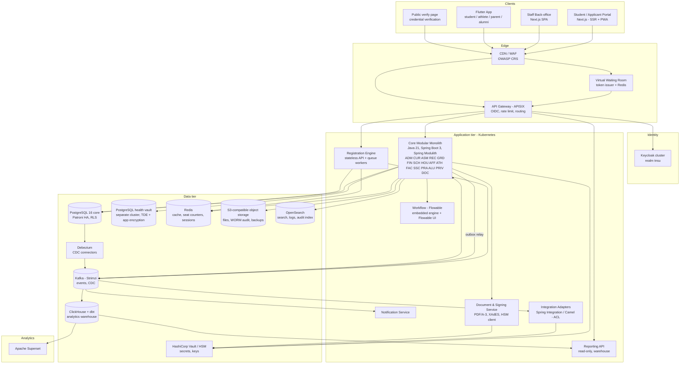

**หมายเหตุ container:**

| Container | Deploy unit | Scale | หมายเหตุ |
|---|---|---|---|
| Core Modular Monolith | 1 image, หลาย deployment profile (`web`, `worker`, `scheduler`) | HPA 3–12 pods (web), 2–6 (worker) | ทุกโมดูลอยู่ใน JVM เดียว และแยก thread pool/bulkhead ต่อโมดูล |
| Registration Engine | image แยก (ADR-011) | HPA 4–40 pods ช่วง peak | ใช้ schema `reg` ร่วม และเขียนผ่าน seat ledger |
| Notification Service | image แยก | 2–10 pods | burst ช่วงประกาศผลต้องไม่กระทบ core |
| Integration Adapters | image แยก (Camel) | 2–4 pods | อยู่ใน network zone ที่ออก internet ได้ (egress allow-list) |
| Document & Signing | image แยก | 2–6 pods | เชื่อม HSM ผ่าน PKCS#11 และอยู่ใน zone ที่จำกัด |
| Flowable | embedded ใน core + Flowable Design/Admin UI แยก | — | ใช้ฐานข้อมูล schema `wf` |
| Keycloak | StatefulSet 3 nodes (Infinispan) | 3–6 | DB แยก (PostgreSQL) |

### 5.3 C4 Level 3: โครงสร้างภายในของ Core (ตัวอย่างโมดูล Registration/Records)

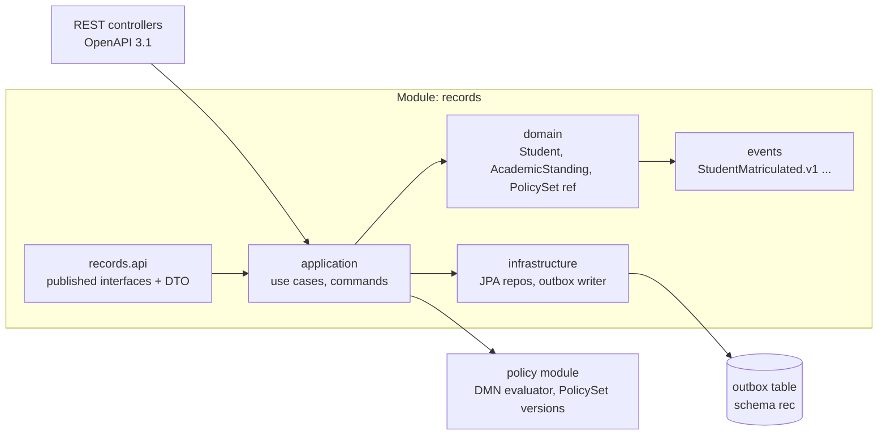

### 5.4 Sequence: สมัครออนไลน์ → คัดเลือก → รายงานตัว (enrolment)

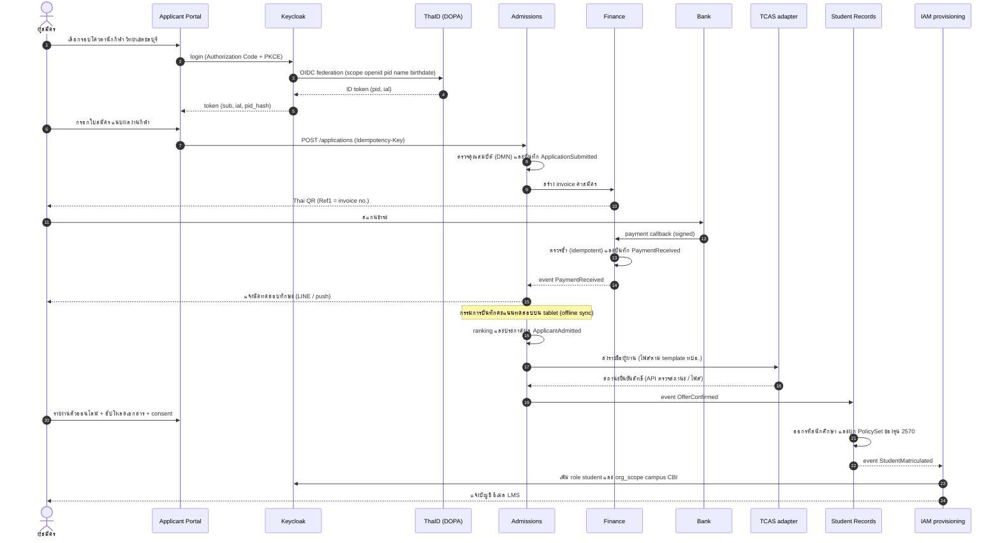

### 5.5 Sequence: ลงทะเบียนเรียนในวัน peak

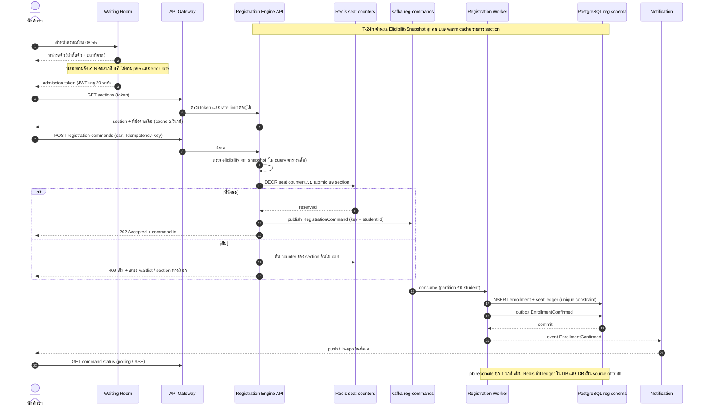

### 5.6 Sequence: ชำระค่าเทอม → ใบเสร็จอิเล็กทรอนิกส์ → GFMIS

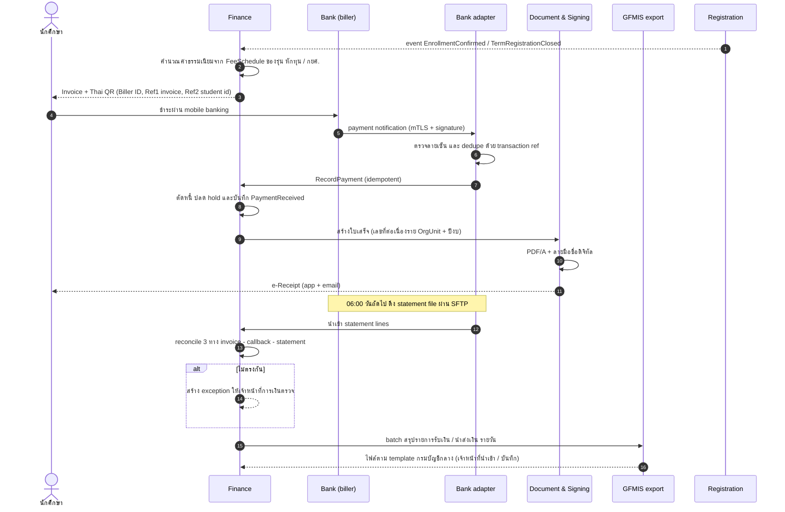

### 5.7 Sequence: สำเร็จการศึกษา → e-Transcript

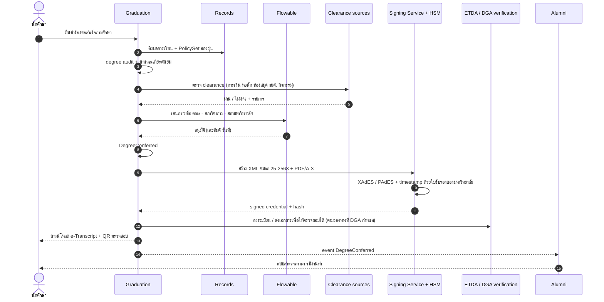

### 5.8 Sequence: บันทึกการบาดเจ็บของนักกีฬาพร้อม consent

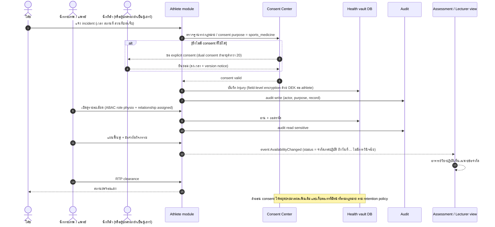

---

## 6. Data Architecture

### 6.1 Core domain model (ER)

```mermaid
erDiagram
  PERSON ||--o| APPLICANT : "may be"
  PERSON ||--o{ STUDENT : "may be (per program)"
  PERSON ||--o{ GUARDIAN_RELATION : "is guardian in"
  STUDENT ||--o{ GUARDIAN_RELATION : "has guardian"
  PERSON ||--o| ALUMNUS : "becomes"
  PERSON ||--o{ CONSENT : "grants"
  ORG_UNIT ||--o{ ORG_UNIT : "parent of"
  ORG_UNIT ||--o{ PROGRAM_OFFERING : "offers"
  PROGRAM ||--o{ CURRICULUM_VERSION : "versioned as"
  PROGRAM ||--o{ PROGRAM_OFFERING : "offered at"
  CURRICULUM_VERSION ||--o{ CURRICULUM_BLOCK : "structured by"
  CURRICULUM_BLOCK }o--o{ COURSE : "contains"
  COURSE ||--o{ SECTION : "opened as"
  ORG_UNIT ||--o{ SECTION : "hosts"
  TERM ||--o{ SECTION : "in"
  APPLICANT ||--o{ APPLICATION : "submits"
  APPLICATION }o--|| PROGRAM_OFFERING : "targets"
  STUDENT }o--|| PROGRAM_OFFERING : "enrolled in"
  STUDENT }o--|| POLICY_SET : "governed by"
  STUDENT ||--o{ ENROLLMENT : "registers"
  SECTION ||--o{ ENROLLMENT : "has"
  ENROLLMENT ||--o| GRADE : "results in"
  STUDENT ||--o{ ACADEMIC_STANDING : "per term"
  STUDENT ||--o{ INVOICE : "billed"
  INVOICE ||--o{ PAYMENT : "settled by"
  STUDENT ||--o{ SCHOLARSHIP_AWARD : "receives"
  STUDENT ||--o{ LOAN_TERM : "borrows"
  DORM_ROOM ||--o{ ALLOCATION : "allocated"
  STUDENT ||--o{ ALLOCATION : "occupies"
  STUDENT ||--o| ATHLETE_PROFILE : "may be"
  ATHLETE_PROFILE ||--o{ TRAINING_SESSION : "performs"
  ATHLETE_PROFILE ||--o{ INJURY : "suffers"
  ATHLETE_PROFILE ||--o{ COMPETITION_ENTRY : "enters"
  COMPETITION ||--o{ COMPETITION_ENTRY : "has"
  STUDENT ||--o{ CREDENTIAL : "issued"
  PERSON ||--o| STAFF : "may be"
  STAFF ||--o{ ROLE_ASSIGNMENT : "holds"
  ROLE_ASSIGNMENT }o--|| ORG_UNIT : "scoped to"
  ROLE_ASSIGNMENT ||--o{ DELEGATION : "delegated via"
  APPROVAL_REQUEST ||--o{ APPROVAL_STEP : "has"
  APPROVAL_STEP }o--o| ROLE_ASSIGNMENT : "acted by"
  ORG_UNIT ||--o{ APPROVAL_REQUEST : "owns"
  STUDENT ||--o{ PRACTICUM_PLACEMENT : "placed in"
  PARTNER_SCHOOL ||--o{ PRACTICUM_PLACEMENT : "hosts"
  STAFF ||--o{ PRACTICUM_PLACEMENT : "supervises"
  PRACTICUM_PLACEMENT ||--o{ SUPERVISION_VISIT : "visited"
  PRACTICUM_PLACEMENT ||--o{ EVALUATION : "evaluated by"
  STAFF ||--o{ SECTION : "teaches"

  PERSON {
    uuid person_id PK
    string national_id_enc "13-digit, encrypted"
    string national_id_hash "HMAC for lookup"
    string alt_id "G-code or passport"
    string alt_id_type
    string name_th
    string name_en
    date birth_date
    string sex
    string nationality
  }
  APPLICANT {
    uuid applicant_id PK
    uuid person_id FK
    string prior_school
    string sports_summary
  }
  STUDENT {
    uuid student_id PK
    uuid person_id FK
    string student_no "11-digit scheme"
    uuid org_unit_id FK
    uuid program_offering_id FK
    uuid policy_set_id FK
    string cohort_year_be
    string status
    string academic_profile "HIGHER_ED or BASIC_ED"
  }
  GUARDIAN_RELATION {
    uuid id PK
    uuid guardian_person_id FK
    uuid student_id FK
    string relation
    boolean legal_authority
    string view_scope
  }
  ORG_UNIT {
    uuid org_unit_id PK
    uuid parent_id FK
    string type "CAMPUS SPORTS_SCHOOL FACULTY"
    string code
    string name_th
  }
  PROGRAM {
    uuid program_id PK
    string degree_code
    string name_th
    string profile
  }
  PROGRAM_OFFERING {
    uuid id PK
    uuid program_id FK
    uuid org_unit_id FK
    string checo_code
  }
  CURRICULUM_VERSION {
    uuid id PK
    uuid program_id FK
    string revision_year_be
    int total_credits
    string approval_status
  }
  CURRICULUM_BLOCK {
    uuid id PK
    uuid curriculum_version_id FK
    string block_type "GE CORE MAJOR FREE"
    int min_credits
  }
  COURSE {
    uuid course_id PK
    string code
    string name_th
    string credit_pattern "3(2-2-5)"
  }
  TERM {
    uuid term_id PK
    string academic_year_be
    string term_no
    uuid org_unit_id FK
  }
  SECTION {
    uuid section_id PK
    uuid course_id FK
    uuid term_id FK
    uuid org_unit_id FK
    int capacity
  }
  APPLICATION {
    uuid application_id PK
    uuid applicant_id FK
    uuid round_id FK
    string status
  }
  POLICY_SET {
    uuid policy_set_id PK
    string code "HE-2570-v1"
    string profile
    date effective_from
    string dmn_bundle_hash
  }
  ENROLLMENT {
    uuid enrollment_id PK
    uuid student_id FK
    uuid section_id FK
    string status
    timestamp confirmed_at
  }
  GRADE {
    uuid grade_id PK
    uuid enrollment_id FK
    string grade_symbol
    decimal grade_point
    string approval_state
  }
  ACADEMIC_STANDING {
    uuid id PK
    uuid student_id FK
    uuid term_id FK
    decimal gpa
    decimal gpax
    string standing
    string decided_by
  }
  INVOICE {
    uuid invoice_id PK
    uuid student_id FK
    string invoice_no
    decimal amount_thb
    string ref1
    string status
  }
  PAYMENT {
    uuid payment_id PK
    uuid invoice_id FK
    string bank_txn_ref "unique"
    decimal amount_thb
    timestamp paid_at
  }
  SCHOLARSHIP_AWARD {
    uuid id PK
    uuid student_id FK
    string program_code
    decimal amount_thb
  }
  LOAN_TERM {
    uuid id PK
    uuid student_id FK
    uuid term_id FK
    decimal tuition_confirmed
    string dsl_status
  }
  DORM_ROOM {
    uuid room_id PK
    uuid org_unit_id FK
    string building
    int beds
  }
  ALLOCATION {
    uuid id PK
    uuid room_id FK
    uuid student_id FK
    date start_date
    date end_date
  }
  ATHLETE_PROFILE {
    uuid athlete_id PK
    uuid student_id FK
    string sport
    string level "NATIONAL YOUTH UNIVERSITY"
  }
  TRAINING_SESSION {
    uuid id PK
    uuid athlete_id FK
    timestamp start_at
    int duration_min
    int srpe
  }
  INJURY {
    uuid injury_id PK
    uuid athlete_id FK
    string body_part_enc
    string diagnosis_enc
    string availability_status
  }
  COMPETITION {
    uuid competition_id PK
    string name
    string level
    date start_date
  }
  COMPETITION_ENTRY {
    uuid id PK
    uuid competition_id FK
    uuid athlete_id FK
    string result
  }
  ALUMNUS {
    uuid alumnus_id PK
    uuid person_id FK
    string employment_status
  }
  CONSENT {
    uuid consent_id PK
    uuid person_id FK
    string purpose_code
    string notice_version
    string state
    uuid guardian_person_id
    timestamp granted_at
  }
  STAFF {
    uuid staff_id PK
    uuid person_id FK
    string hr_employee_no
    uuid home_org_unit_id FK
    string staff_type "ACADEMIC SUPPORT COACH MEDICAL TEACHER"
    string academic_rank
  }
  ROLE_ASSIGNMENT {
    uuid id PK
    uuid staff_id FK
    string role_code
    uuid org_unit_id FK
    string scope_type "own advisee section dept faculty campus university"
    string source "HR ORDER TERM SYS"
    string order_no
    date valid_from
    date valid_to
  }
  DELEGATION {
    uuid id PK
    uuid role_assignment_id FK
    uuid delegate_person_id
    string kind "ACTING ON_BEHALF OUT_OF_OFFICE"
    date valid_from
    date valid_to
  }
  APPROVAL_REQUEST {
    uuid id PK
    string chain_code "W-01 .. W-15"
    uuid org_unit_id FK
    string subject_type
    uuid subject_id
    string state
    string bpmn_instance_id
  }
  APPROVAL_STEP {
    uuid id PK
    uuid approval_request_id FK
    int seq
    string required_role
    uuid acted_by_assignment_id FK
    string decision
    timestamp decided_at
  }
  PARTNER_SCHOOL {
    uuid id PK
    string name_th
    string province
    string mou_no
  }
  PRACTICUM_PLACEMENT {
    uuid id PK
    uuid student_id FK
    uuid partner_school_id FK
    uuid supervisor_staff_id FK
    string mentor_teacher_ref
    string level "P1 P2 P3 COOP"
    uuid term_id FK
    int hours_logged
  }
  SUPERVISION_VISIT {
    uuid id PK
    uuid placement_id FK
    timestamp visited_at
    string mode "ONSITE ONLINE"
    string notes_ref
  }
  EVALUATION {
    uuid id PK
    uuid placement_id FK
    string evaluator_role "MENTOR SUPERVISOR PRINCIPAL HOST"
    string form_version
    decimal total_score
  }
  CREDENTIAL {
    uuid credential_id PK
    uuid student_id FK
    string type "TRANSCRIPT DEGREE CERT"
    string sha256
    string status
  }
```

**หลักการ model:**
- **Person-centric**: บุคคลหนึ่งคนมี `Person` เดียว และเป็นได้หลายบทบาท (ผู้สมัคร → นักเรียนโรงเรียนกีฬา → นักศึกษา ป.ตรี → ป.โท → ศิษย์เก่า/ผู้ปกครอง) ทำให้ติดตาม pathway จากโรงเรียนกีฬาเข้า มกช. ได้
- **Student per program career**: `Student` 1 แถวต่อ 1 การเข้าศึกษาในโปรแกรม (ป.ตรี/ป.โท แยกกัน) และแต่ละแถวผูก `PolicySet` ของตัวเอง
- **Temporal**: ตารางสำคัญ (status, standing, fee schedule, org settings, parent agency) เป็น effective-dated/bitemporal เพื่อย้อนดูได้ว่า "ณ วันนั้นกฎคืออะไร"
- **Staff & roles**: `Staff` 1 แถวต่อบุคลากร (mirror จาก HR) ส่วนสิทธิ์อยู่ใน `RoleAssignment` ที่มี scope, ที่มา และวาระ (3A.2) และมี `Delegation` สำหรับการรักษาราชการแทน (3A.7) โดย `OrgUnit` เป็นลำดับชั้นแบบ self-reference (University → Campus/School → Faculty → Dept → Program office)
- **Approvals**: `ApprovalRequest`/`ApprovalStep` เป็น projection ของ Flowable instance เพื่อใช้รายงาน SLA และ audit ทางธุรกิจ (3A.5)
- **Org scoping**: ตาราง tenant-scoped ทุกตารางมี `org_unit_id` ที่ไม่เป็น null (ใช้กับ RLS ใน ADR-003)

### 6.2 Master data และเจ้าของข้อมูล (Data ownership)

| Master data | System of record | Data owner (บทบาท) | การกระจาย |
|---|---|---|---|
| Person / identity | IAM + REC | สำนักทะเบียน | event `records.*`, read API |
| OrgUnit, ParentAgency | ORG | กองแผน / สำนักงานอธิการบดี | config cache |
| Program / Curriculum / Course | CUR | สำนักวิชาการ + คณะ | event `curriculum.*` |
| Term / Calendar | REG | สำนักทะเบียน (ราย OrgUnit) | event |
| Fee schedule | FIN | กองคลัง | — |
| Staff | HR (ภายนอก) → IAM mirror | กองบริหารงานบุคคล | nightly sync + event |
| Sport discipline / squad | ATH | กองกีฬา/ศูนย์วิทยาศาสตร์การกีฬา | event |
| Reference (จังหวัด/โรงเรียนเดิม) | Reference data | IT | versioned dataset |

### 6.3 Identifiers

| Identifier | รูปแบบ | การจัดเก็บ | หมายเหตุ |
|---|---|---|---|
| เลขประจำตัวประชาชน 13 หลัก | 13 หลัก มี check digit mod 11 ([external_integrations](../../research_notes/)) | เข้ารหัสระดับ field (AES-256-GCM, key ใน Vault) + `HMAC-SHA256` สำหรับค้นหา และแสดงแบบ mask `1-2345-xxxxx-xx-3` | ใช้กับ TCAS, กยศ., ThaID `pid`, สป.อว. |
| รหัส G / passport | รหัส G สำหรับเด็กที่ไม่มีสถานะทางทะเบียน ([Dailynews](https://www.dailynews.co.th/articles/5922244/), [ThaiPublica](https://thaipublica.org/2023/07/srinaka-8-07-2566/)) รูปแบบ [ต้องตรวจสอบ] | `alt_id` + `alt_id_type` | ห้ามบังคับว่าต้องมีเลข 13 หลักเท่านั้น และรองรับการเปลี่ยนเป็นเลข 13 หลักในภายหลัง (link history) |
| รหัสนักศึกษา | **11 หลัก** (ตามที่มหาสารคามใช้ [tnsumk](https://www.tnsumk.ac.th/reg/index.php/enroll-guide)) ค่าเริ่มต้นที่เสนอ: `YY`(2 หลักท้าย พ.ศ. ที่เข้า) + `CC`(รหัสวิทยาเขต 2) + `L`(ระดับ 1) + `PPP`(โปรแกรม 3) + `NNN`(running 3) [สมมติฐาน] | `student_no` unique ทั้งมหาวิทยาลัย | รูปแบบเป็น config (ID scheme template) ต่อ OrgUnit/ระดับ และ **คงรหัสเดิมของนักศึกษาที่ migrate มา** |
| รหัสนักเรียนโรงเรียนกีฬา | ตาม scheme ของโรงเรียน (config) | `student_no` | — |
| รหัสหลักสูตร | รหัส CHECO 14 หลัก [ต้องตรวจสอบ] | `program_offering.checo_code` | ใช้ในรายงาน สป.อว. และคุรุสภา |
| Internal ID | UUIDv7 | PK ทุกตาราง | เรียงตามเวลา จึงเป็นมิตรกับ index |
| เลขที่ใบเสร็จ/ใบแจ้งหนี้ | `{OrgCode}-{ปีงบ พ.ศ.}-{running}` | gapless sequence ต่อ OrgUnit/ปีงบ | ตามข้อกำหนดการเงินภาครัฐ [ต้องตรวจสอบ] |

### 6.4 การจัดระดับชั้นข้อมูล (Data classification)

> อ้างอิงร่าง มรด. ว่าด้วยหลักเกณฑ์การจัดระดับชั้นข้อมูลภาครัฐ (CDV v0.3, ม.ค. 2569 — **ยังไม่เป็นมาตรฐานฉบับจริง**) ([ร่าง มรด.](https://standard.dga.or.th/wp-content/uploads/2026/01/ร่าง-มรด.-X-256X-ว่าด้วยหลักเกณฑ์การจัดระดับชั้นข้อมูลภาครัฐ-ฉบับ-CDV-v0.3.pdf)) ต้อง map ชื่อชั้นใหม่เมื่อประกาศใช้จริง

| ชั้น | ตัวอย่างข้อมูล | Control |
|---|---|---|
| **Public** (เปิดเผย) | รายชื่อหลักสูตร, ตารางเปิดสอน, ประกาศรับสมัคร, สถิติรวม (ITA/open data) | CDN cache, ไม่ต้อง login |
| **Internal** (ใช้ภายใน) | ตารางสอนรายบุคคลของอาจารย์, ห้อง, การจองสนาม | ต้อง login, RBAC |
| **Confidential** (ลับ/ข้อมูลส่วนบุคคล) | ประวัตินักศึกษา, เกรด, การเงิน, ที่อยู่, ข้อมูลผู้ปกครอง, กยศ., ข้อมูลวินัย | RBAC + ABAC (org_scope, relationship), RLS, audit การอ่านแบบรายการ (bulk), mask ใน non-prod |
| **Sensitive** (ข้อมูลอ่อนไหวตาม PDPA ม.26 [ต้องตรวจสอบ]) | สุขภาพ/การบาดเจ็บ/การรักษา, ความพิการ, biometric (face check-in), ศาสนา, บันทึกการให้คำปรึกษา, ผลตรวจสารต้องห้าม (ถ้ามี) | **health vault** แยก cluster, field-level encryption ด้วย DEK ต่อบุคคล (crypto-shredding), explicit consent/ฐานทางกฎหมาย, purpose-bound access, audit ทุกการอ่าน, ไม่ index ใน OpenSearch, ไม่ส่งออกไป warehouse แบบระบุตัวตน |

Data catalogue: ใช้ **OpenMetadata** (หรือ DataHub) เก็บ dataset, owner, classification tag, lineage (dbt) และ purpose → ใช้สร้าง ROPA และส่ง metadata ไป Government Data Catalog ([GD Catalog](https://standard.dga.or.th/wp-content/uploads/2023/07/Final_เอกสารนำเสนองานประชาพิจารณ์-GD-Catalog.pdf)) ตามแนวธรรมาภิบาลข้อมูลภาครัฐ ม.7(2) ของ พ.ร.บ.การบริหารงานและการให้บริการภาครัฐผ่านระบบดิจิทัล 2562 ([DGA PDF](https://www.dga.or.th/wp-content/uploads/2024/03/4.pdf))

### 6.5 Retention (ระยะเวลาเก็บรักษา)

> ระยะเวลาด้านล่างเป็น **ค่าเริ่มต้นที่เสนอ** อ้างอิงงานสารบรรณ (ระเบียบสำนักนายกฯ 2526 และฉบับแก้ไขถึงฉบับที่ 4 พ.ศ. 2564 ([MOE manual](https://psdg.moe.go.th/wp-content/uploads/2023/06/คู่มืองานสารบรรณ-กพร.สป.pdf))) โดยเกณฑ์ ≥ 10 ปี และเอกสารที่ต้องเก็บถาวรมาจากความรู้เดิม [ต้องตรวจสอบ ข้อ 57–58] ต้องให้ มกช. อนุมัติ retention schedule

| ประเภทข้อมูล | ระยะเก็บ (เสนอ) | เมื่อครบกำหนด |
|---|---|---|
| ทะเบียนประวัติ ผลการเรียน การสำเร็จการศึกษา credentials | **ถาวร** | ส่งหอจดหมายเหตุตามระเบียบ (≥ 25 ปี [ต้องตรวจสอบ]) |
| ใบสมัครที่ไม่ได้รับเข้า | 2 ปีหลังปิดรอบ | ลบ / ทำให้ไม่ระบุตัวตน (เก็บสถิติ) |
| ใบสมัครที่รับเข้าแล้ว | รวมในแฟ้มนักศึกษา | — |
| การเงิน (invoice, receipt, refund) | 10 ปีหลังปีงบประมาณ [ต้องตรวจสอบ ระเบียบการเงิน/สตง.] | ทำลายตามขั้นตอน |
| ข้อมูลสุขภาพ/บาดเจ็บของนักกีฬา | ระยะศึกษา + 5 ปี (หรือตามระเบียบเวชระเบียน [ต้องตรวจสอบ]) | crypto-shred DEK |
| Wellness/training raw | 3 ปี (raw) แล้วเก็บเป็น aggregate | aggregate + ลบ raw |
| บันทึกการให้คำปรึกษา | 5 ปีหลังพ้นสภาพ | crypto-shred |
| วินัย | ตามโทษ (เช่น 5 ปี) ยกเว้นโทษพ้นสภาพ (ถาวร) | ลบ / ปิดผนึก |
| Consent records | อายุ consent + 10 ปี | ลบ |
| Audit log (ธุรกรรมวิชาการ/การเงิน) | 10 ปี | — |
| Traffic / access log | ≥ 90 วัน (พ.ร.บ.คอมพิวเตอร์ [ต้องตรวจสอบ]) online และ 1 ปีใน archive | ลบ |
| Backup | ตาม 11.4 (35 วัน + รายเดือน 12 เดือน + รายปี 7 ปี) | หมดอายุอัตโนมัติ |

### 6.6 Analytics data flow

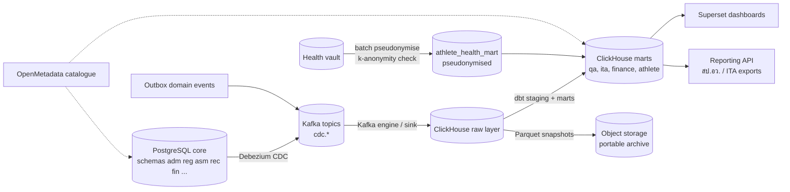

- RLS ใน warehouse: ใช้ ClickHouse row policies ด้วย `org_unit_id` ตาม role ของผู้ใช้ Superset (sync จาก Keycloak)
- `dim_student` เก็บ `student_key` (surrogate) ส่วนชื่อ/เลขบัตรอยู่ในตาราง restricted ที่ join ได้เฉพาะ role ที่ได้รับอนุญาต
- ความสดของข้อมูล: CDC < 5 นาที และ dbt marts รอบละ 1 ชม. (ผู้บริหาร) หรือรายวัน (QA)

### 6.7 กลยุทธ์ย้ายข้อมูลจากระบบเดิมรายวิทยาเขต (Migration)

**ข้อเท็จจริง:** ระบบทะเบียนแยกรายวิทยาเขตและไม่ทราบผู้พัฒนา ([products_architecture](../../research_notes/), [tnsumk](https://www.tnsumk.ac.th/reg/index.php/enroll-guide)) ดังนั้น migration เป็นความเสี่ยงอันดับ 1

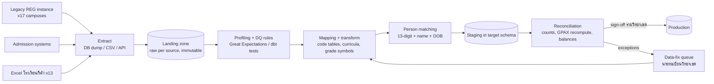

| ขั้น | รายละเอียด | เกณฑ์ผ่าน |
|---|---|---|
| 1 Inventory (Phase 0) | สำรวจ product/เวอร์ชัน/DB ของทุกวิทยาเขต ขนาด ปีย้อนหลัง และเจ้าของข้อมูล | Data inventory ครบ 17 + 13 แห่ง |
| 2 Canonical model | แปลงทุกแหล่งเป็น canonical migration schema (Person, Student, Course, Enrollment, Grade, Invoice) | Mapping spec ผ่านการอนุมัติ |
| 3 Curriculum first | ย้ายหลักสูตรและรายวิชาทุก version ก่อน แล้วสร้าง course equivalence ข้ามวิทยาเขต | 100% ของรายวิชาที่มีเกรดอ้างอิงถึง |
| 4 Person matching | dedupe ด้วยเลข 13 หลัก (HMAC) + ชื่อ + วันเกิด และตรวจข้ามวิทยาเขต (ย้ายวิทยาเขต/เรียนต่อ ป.โท) | false-merge = 0 (ตรวจด้วยมือในกรณีความเชื่อมั่นต่ำ) |
| 5 Academic history | ย้ายเกรดทั้งหมด **คงเกรดเดิมตามที่บันทึก** (ไม่คำนวณใหม่) แต่คำนวณ GPAX ใหม่เพื่อเทียบ | GPAX ต่างจากเดิม 0 ราย (หรือมีเหตุผลอธิบายทุกราย) |
| 6 Finance balances | ย้ายยอดค้าง/เครดิต ณ วันตัด (opening balance) ไม่ย้ายธุรกรรมย้อนหลังทั้งหมด (เก็บเป็น archive อ่านอย่างเดียว) | ยอดรวมตรงกับรายงานกองคลัง |
| 7 Policy assignment | ผูก PolicySet ตามรุ่นของนักศึกษาที่ migrate (สร้าง PolicySet ย้อนหลังตามข้อบังคับแต่ละฉบับ) | degree audit ของนักศึกษาตัวอย่าง 5% ตรงกับการตรวจด้วยมือ |
| 8 Dress rehearsal | ซ้อม migration เต็ม ≥ 3 รอบต่อ wave และจับเวลา cutover | cutover ≤ 48 ชม. |
| 9 Cutover | ทำนอกช่วงลงทะเบียน/ประกาศเกรด, freeze ระบบเดิม, delta load, smoke test, go/no-go | ผ่าน checklist |
| 10 Parallel read | ระบบเดิมเปิดแบบ read-only 1 ภาคการศึกษา แล้ว archive | — |

---

## 7. Integration Architecture

### 7.1 Integration Catalogue

> **เอกสารคู่กัน:** ความสัมพันธ์ของ มกช. กับหน่วยงานรัฐและหน่วยงานภายนอกทั้งหมด (บทบาทหน้าที่ ภาระการรายงาน ช่องทางติดต่อ และกฎหมายที่เกี่ยวข้อง) อยู่ใน [government-relations.md](./government-relations.md) ตารางด้านล่างครอบคลุมเฉพาะมุมมองเชิงเทคนิคของ interface ที่แพลตฟอร์มต้องสร้าง เพื่อไม่ให้ข้อมูลซ้ำกัน

> สถานะ: **V** = verified บางส่วนจากแหล่งในบันทึกวิจัย, **U** = unverified / ต้องขอเอกสารจากเจ้าของระบบ

| # | ระบบ | เจ้าของ | ทิศทาง | Interface | Auth | ความถี่ | สถานะ | แหล่ง |
|---|---|---|---|---|---|---|---|---|
| I-01 | ThaID | กรมการปกครอง | In (identity) | OIDC Authorization Code; discovery `imauth.bora.dopa.go.th/.well-known/openid-configuration`; introspect | client id/secret + API key; callback ลงทะเบียนผ่าน RP Admin | ต่อการ login | **V** (ตัวอย่าง RP ของ ETDA) / เงื่อนไขการขึ้นทะเบียน U | [ETDA ThaiD-Python-RP](https://github.com/ETDA/ThaiD-Python-RP), [PHP-RP](https://github.com/ETDA/ThaiD-PHP-RP) |
| I-02 | DGA Digital ID | สพร. | In | OpenID (accounts.egov.go.th / connect.egov.go.th) | RP registration | ต่อการ login | U (optional) | [DGA Digital ID](https://www.dga.or.th/en/?p=119693), [OpenID SSO manual](https://accounts.egov.go.th/Download/OpenID_SSO_AdminManual_1.0_17042019.pdf) |
| I-03 | TCAS / mytcas | ทปอ. | In/Out | Web portal + ไฟล์ (Excel/CSV) + API ตรวจสถานะด้วยเลข 13 หลัก (TCAS63) | secret key ของมหาวิทยาลัย | ตามรอบ TCAS + polling ช่วงยืนยันสิทธิ์ | V (TCAS63) / สเปก 69–70 U | [TCAS63 manual](https://www.admission.kmutnb.ac.th/sites/default/files/2020-02/TCAS63-University_Manual_V2_20-01.pdf) |
| I-04 | กยศ. DSL / LOS | กยศ. | In/Out | Web portal (Maker/Checker) + ไฟล์ export/import | บัญชีตามบทบาท | รายภาค | V (portal) / batch upload U | [กยศ.](https://www.studentloan.or.th/th/system/files/files/news/1._0.pdf) |
| I-05 | CHECO | สป.อว. | Out | Web portal (กรอกข้อมูลหลักสูตร) — ระบบช่วย export ข้อมูลที่จัดรูปแบบแล้ว | บัญชีคณะ/มหาวิทยาลัย | เมื่ออนุมัติหลักสูตร | V | [มหิดล](https://graduate.mahidol.ac.th/Assets-Center/ITA-MU/pdf/14/014-17.pdf), [ม.อ.](https://ita.psu.ac.th/pdf/O10-Education.pdf) |
| I-06 | ฐานข้อมูลอุดมศึกษา | สป.อว. | Out | อัปโหลดไฟล์ตาม template | บัญชีหน่วยงาน | รายภาค | U | [external_integrations](../../research_notes/) |
| I-07 | ระบบภาวะการมีงานทำ | สป.อว. | Out | Web/ไฟล์/การเชื่อมโยงข้อมูล | บัญชีหน่วยงาน | รายปี | U | [มข.](https://bucket.kku.ac.th/odt/cmmeig6x7288701pi3nvke9oc.pdf) |
| I-08 | Digital Transcript | อว./DGA/ETDA/ก.พ.ร. | Out | XML ขมธอ. 25-2563 + ลายเซ็นดิจิทัล + บริการตรวจสอบ | ใบรับรอง CA | ต่อการออกเอกสาร | V (มาตรฐาน) / ช่องทางส่ง U | [DGA](https://www.dga.or.th/en/our-services/digital-platform-services/dga-digital-transcript/) |
| I-09 | Bank Bill Payment / Thai QR | ธนาคาร | In/Out | QR/barcode + payment notification API + statement file (SFTP) | mTLS + signature ตามสัญญา | real-time + รายวัน | V (โครงสร้าง) / สเปกธนาคาร U | [Krungsri](https://developers.krungsri.com/UseCases/Payment/Bill-Payment.html) |
| I-10 | New GFMIS Thai | กรมบัญชีกลาง | Out | Web online / ไฟล์ตาม template | บัญชี GFMIS (token) | รายวัน/รายเดือน | U (สถานะ มกช.) | [thaigov](https://media.thaigov.go.th/uploads/document/142/2022/10/doc/Doc_20221007104527000000.doc) |
| I-11 | e-Payment ภาครัฐ | กรมบัญชีกลาง | In | ระบบกลาง (e-Receipt) | — | ต่อการชำระ | U (optional, A-14) | [Thansettakij](https://www.thansettakij.com/business/economy/590663) |
| I-12 | คุรุสภา | คุรุสภา | Out | Portal/ไฟล์ (รายชื่อผู้สำเร็จ, รหัสหลักสูตร) | บัญชีสถาบัน | รายปี | U | [SDU](https://regis.dusit.ac.th/main/wp-content/uploads/2024/12/ใหม่-2566-ขั้นตอนการขอใบอนุญาตฯ-รหัส-63-ณ-26.01.67.pdf) |
| I-13 | กกท. / สมาคมกีฬา | กกท. | In/Out | ไฟล์/หนังสือ (ยังไม่พบ API) | — | ตามรายการแข่ง | U | [external_integrations](../../research_notes/) |
| I-14 | DCAT / ADAMS | กกท./WADA | ref | ไม่เชื่อมระบบ (เก็บเพียงหลักฐานการอบรม/อ้างอิง) | — | — | U | [Dailynews](https://www.dailynews.co.th/news/2566915/) |
| I-15 | กีฬามหาวิทยาลัยแห่งประเทศไทย | ก.ก.ม.ท./เจ้าภาพ | Out | ไฟล์รายชื่อ + ใบรับรองสถานภาพ | — | รายปี | U | [ระเบียบ 2559](https://webs.rmutl.ac.th/assets/upload/files/2024/03/20240321133409_80477.pdf) |
| I-16 | O-NET (สทศ.) / ข้อมูลกลาง สพฐ. | สทศ./สพฐ. | Out | Web portal/ไฟล์ | บัญชีโรงเรียน | รายปี | U | [data.go.th](https://data.go.th/en/dataset/obec-student-030) |
| I-17 | Moodle | มกช. | In/Out | LTI 1.3 Advantage + Web Services | OAuth2 client credentials / JWT | real-time + nightly | V (มาตรฐาน) / LMS ปัจจุบัน U | — |
| I-18 | Thai MOOC / NCBS | สป.อว./TCU | In | ไม่ทราบ (ไฟล์ certificate) | — | ตามคำร้อง | U | [Prachachat](https://www.prachachat.net/education/news-1089494) |
| I-19 | AD/LDAP, Google/M365 | มกช. | In/Out | LDAP federation, SCIM / Directory API | bind / OAuth2 | real-time + nightly | U (A-18) | — |
| I-20 | HR system | มกช. | In | DB view / ไฟล์ / API | service account | nightly | U (A-22) | — |
| I-21 | Library (ILS) | มกช. | In/Out | SIP2 / REST | service account | real-time | U | — |
| I-22 | e-Saraban | มกช. | Out | API / e-mail-in / upload | SSO | ต่อเอกสาร | U | [tnsubkk](https://www.tnsubkk.ac.th/) |
| I-23 | Wearables / Lab | Catapult, Polar, Garmin, ห้องแล็บ | In | Vendor API (OAuth) / CSV | OAuth2 / upload | รายวัน/ต่อ session | V (Catapult API) | [Catapult](https://www.catapult.com/blog/ams-catapult-api-integration) |
| I-24 | LINE OA | LINE | Out | Messaging API + LIFF (ผูกบัญชี) | channel token | real-time | U (ค่าบริการ) | — |
| I-25 | FCM / APNs / SMTP / SMS | ผู้ให้บริการ | Out | API | key | real-time | — | — |
| I-26 | eduroam | UniNet | In | RADIUS (FreeRADIUS → LDAP/Keycloak) | RADIUS secret | real-time | V | [UniNet](https://www.uni.net.th/wp-content/uploads/2023/05/nayobai-join-eduroam.pdf) |
| I-27 | Open data / GD Catalog | DGA | Out | CKAN API / metadata | API key | รายไตรมาส | U (ร่างมาตรฐาน) | [GD Catalog](https://standard.dga.or.th/wp-content/uploads/2023/07/Final_เอกสารนำเสนองานประชาพิจารณ์-GD-Catalog.pdf) |
| I-28 | SIEM / ThaiCERT reporting | มกช./สกมช. | Out | syslog/OTLP; แจ้งเหตุตามช่องทาง สกมช. | — | real-time / ต่อเหตุ | U | [NCSA code 2564](https://muit.mahidol.ac.th/downloads/act-policy/17176753.pdf) |
| I-29 | สำนักงบประมาณ (ระบบงบประมาณ) | สำนักงบประมาณ | Out | ไฟล์/ระบบกลาง (X-03) | บัญชีหน่วยงาน | รายไตรมาส | U (Phase 6) | — |
| I-30 | ระบบบริหารงานวิจัยกลาง (เช่น NRIIS) / แหล่งทุน วช. สกสว. บพค. | หน่วยงานให้ทุน | In/Out | Portal/ไฟล์ (X-05) | บัญชีนักวิจัย/หน่วยงาน | ตามรอบทุน | U (Phase 6) | — |
| I-31 | สตม. (รายงานตัว 90 วัน / แจ้งที่พัก) | สำนักงานตรวจคนเข้าเมือง | Out | Portal (portal-assist) (X-13) | บัญชีสถาบัน | ต่อนักศึกษาต่างชาติ | U (Phase 6) | — |
| I-32 | ระบบตรวจการคัดลอกผลงาน (อักขราวิสุทธิ์ / Turnitin) | ผู้ให้บริการ | Out | API/LTI (X-08) | key | ต่อการส่งเล่ม | U | — |
| I-33 | บริษัทประกันอุบัติเหตุ | ผู้รับประกัน | Out | ไฟล์ (X-12) | SFTP | รายเดือน/ต่อเคลม | U | — |

### 7.2 Integration patterns

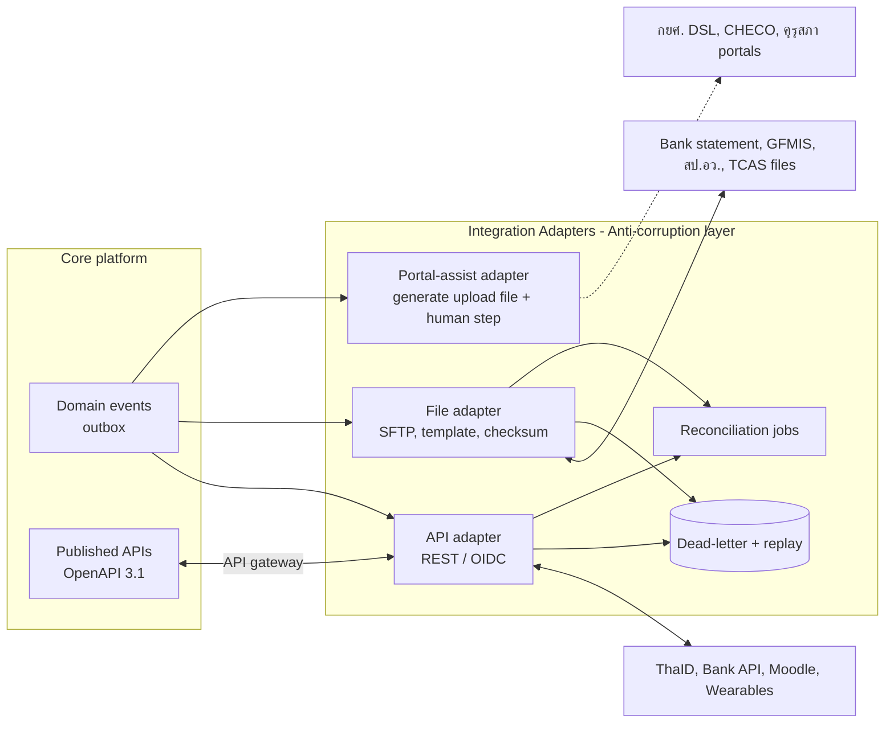

| Pattern | ใช้เมื่อ | รายละเอียดการออกแบบ |
|---|---|---|
| **API Gateway (APISIX)** | API ภายนอกและภายในที่เปิดให้ client | OIDC/JWT validation, rate limit ต่อ client/user, request size limit, mTLS กับ partner (ธนาคาร), versioning `/api/v1`, OpenAPI เผยแพร่ใน developer portal ตามแนว API ภาครัฐ (มาตรฐาน DGA [ต้องตรวจสอบ]) |
| **Anti-corruption layer (ACL)** | ทุกระบบภายนอก | แปลง model ภายนอก (เช่น format ของ TCAS/ธนาคาร) เป็น canonical command ก่อนเข้าระบบหลัก เพื่อไม่ให้ schema ภายนอกรั่วเข้า domain; แยก adapter ต่อ partner และต่อ version |
| **File-based exchange** | ระบบที่ไม่มี API (GFMIS, สป.อว., statement, TCAS) | template versioned, ตรวจ schema ก่อนส่ง, checksum SHA-256, เข้ารหัสไฟล์ (PGP/AES) ถ้าส่งผ่าน e-mail/portal, เก็บสำเนาไฟล์ที่ส่งทุกครั้ง (evidence), manifest + จำนวนแถว + ยอดรวม |
| **Portal-assist (human-in-the-loop)** | กยศ. DSL, CHECO, คุรุสภา (ต้องกรอกในเว็บของหน่วยงาน) | ระบบสร้างไฟล์/ข้อมูลที่พร้อมกรอก + checklist งาน (task) ให้เจ้าหน้าที่ และนำผลลัพธ์กลับมา (upload ผล/บันทึกสถานะ) — ห้ามใช้ RPA/screen scraping โดยไม่ได้รับอนุญาตจากเจ้าของระบบ |
| **Idempotency** | ทุก command จากภายนอก (payment callback, TCAS status, registration) | `Idempotency-Key` header / natural key (bank_txn_ref) + unique constraint; ผลลัพธ์ซ้ำคืนค่าเดิม; inbox table สำหรับ consumer (exactly-once effect) |
| **Transactional outbox** | ทุก domain event | เขียน event ใน transaction เดียวกับ state change แล้ว relay (Debezium outbox router) → Kafka; consumer เป็น idempotent |
| **Retry + DLQ** | การเรียกภายนอก | exponential backoff + jitter, circuit breaker (Resilience4j), DLQ topic + หน้าจอ replay สำหรับ L2 |
| **Reconciliation** | เงิน, กยศ., TCAS, LMS enrolment | job รายวัน/รายชั่วโมง เทียบยอดทั้งสองฝั่ง แล้วสร้าง exception queue พร้อม SLA |
| **Secrets** | key ของ TCAS, ThaID, ธนาคาร, LINE | HashiCorp Vault (dynamic secret, rotation) ห้ามเก็บใน config/repo; secret key ของ TCAS ห้ามเปลี่ยนกลางรอบ (ตามคู่มือ TCAS63) |
| **Event contracts** | ภายใน | AsyncAPI + schema registry (Apicurio) แบบ backward-compatible; event ไม่บรรจุข้อมูล sensitive (ส่งเพียง id + สถานะ) |

---

## 8. Technology Stack และ Architecture Decision Records

### 8.1 Technology stack

| Layer | เลือกใช้ | เหตุผล | ทางเลือกที่พิจารณา |
|---|---|---|---|
| Language/runtime | **Java 21 LTS** (virtual threads) | ตลาดแรงงานในไทยใหญ่, ecosystem ด้าน enterprise/การเงิน, LTS ยาว, ประสิทธิภาพดี | Kotlin (ใช้ได้ภายใน JVM เดียวกัน), C#/.NET 8, Node.js/TypeScript, Go |
| Framework | **Spring Boot 3.x + Spring Modulith** | บังคับ module boundary + event publication registry (outbox) ในตัว, เอกสาร module อัตโนมัติ | Quarkus, Micronaut, ASP.NET Core |
| Rules/workflow | **Flowable 7** (BPMN + DMN + CMMN) embedded | open source (Apache 2.0), BPMN/DMN มาตรฐาน, ทำงานใน JVM เดียวกัน | Camunda 8 (license ของ component บางตัวเปลี่ยนเป็น source-available [ต้องตรวจสอบ]), Drools, เขียน rule เอง |
| API | REST + **OpenAPI 3.1**, AsyncAPI สำหรับ event | เป็นมาตรฐาน และหน่วยงานรัฐคุ้นเคย | GraphQL (ใช้เฉพาะ BFF ถ้าจำเป็น), gRPC (ภายในเท่านั้น) |
| Web frontend | **React 19 + Next.js** (App Router, SSR สำหรับหน้า public/portal, SPA สำหรับ back-office) + TypeScript | ตลาดนักพัฒนาใหญ่ที่สุด, SSR ช่วย SEO และ performance บนมือถือ, ecosystem a11y (React Aria) | Vue 3 + Nuxt (ดีเช่นกัน แต่ talent pool ในไทยเล็กกว่า), Angular |
| Design system | **"TNSU DS"**: tokens + React Aria Components + Tailwind; ฟอนต์ไทย (IBM Plex Sans Thai / Sarabun) | WCAG 2.1 AA ตั้งแต่ระดับ component, theme ราย OrgUnit | MUI, Ant Design |
| Mobile | **Flutter 3** (student / athlete / parent / alumni ใน app เดียว แยก persona ด้วย role) + **PWA** fallback | codebase เดียวสำหรับ iOS/Android, เหมาะกับ offline (บันทึก wellness/ทดสอบทักษะ/นิเทศ), ได้รับความนิยมในไทย ([products_architecture](../../research_notes/), [BK]) | React Native (แชร์โค้ดกับเว็บได้), native |
| Identity | **Keycloak 26** | OIDC/SAML, federation (ThaID, LDAP), MFA/WebAuthn, organization, เป็น CNCF project | Authentik, Gluu, WSO2 IS, Entra ID (SaaS ต่างประเทศ) |
| API gateway | **Apache APISIX** | open source (Apache 2.0), plugin OIDC/limit, รองรับ Kubernetes ingress | Kong OSS, Envoy Gateway, NGINX |
| Event bus | **Apache Kafka (KRaft) on Strimzi** | Apache 2.0, Debezium native, operator มีผู้ใช้มาก | Redpanda (ประสิทธิภาพดี แต่ license BSL ทำให้ต้องตรวจเงื่อนไขในงานจัดซื้อภาครัฐ), RabbitMQ, NATS |
| OLTP DB | **PostgreSQL 16/17 + Patroni**, pgBackRest, PgBouncer | RLS, JSONB, temporal patterns, ICU collation ภาษาไทย, ไม่มีค่า license | Oracle/SQL Server (มีค่า license), MySQL (RLS ไม่มี) |
| Cache/counters | **Redis 7 / Valkey** (Sentinel or Cluster) | atomic counter สำหรับที่นั่ง, session, rate limit | Hazelcast |
| Object storage | **S3-compatible** (MinIO หรือ object storage ของ GDCC/CSP) + Object Lock | ไฟล์, WORM audit, backup | NFS (ไม่แนะนำ) |
| Search | **OpenSearch 2** (ICU/Thai analyzer) | ค้นหาภาษาไทย, log/audit index, Apache 2.0 | Elasticsearch (license), Meilisearch |
| CDC | **Debezium** | outbox router + CDC → warehouse | Kafka Connect JDBC (polling) |
| Warehouse | **ClickHouse + dbt Core** (ADR-007) | เร็วสำหรับ dashboard + time-series ของนักกีฬา, operate ง่าย | PostgreSQL warehouse, Iceberg + Trino |
| BI | **Apache Superset** (Metabase สำหรับ self-service แบบง่าย) | open source, row-level security, SQL Lab | Power BI/Tableau (license + cloud ต่างประเทศ) |
| Data catalogue | **OpenMetadata** | lineage + classification + glossary | DataHub, Amundsen |
| Secrets/keys | **HashiCorp Vault** (หรือ OpenBao) + **HSM** (network HSM / Cloud HSM ในไทย) สำหรับ signing key | key hierarchy, dynamic DB creds, PKCS#11 | K8s secrets อย่างเดียว (ไม่พอ) |
| PAM | **Teleport** (Community) หรือเทียบเท่า | JIT access, session recording สำหรับ SSH/K8s/DB | JumpServer, CyberArk (license) |
| Container platform | **Kubernetes** (RKE2 / OpenShift / managed K8s ของ GDCC) | portable ข้าม GDCC, Thai cloud, on-prem | VM + Docker Compose (ไม่พอสำหรับ HA) |
| IaC / GitOps | **Terraform/OpenTofu + Argo CD + Helm/Kustomize** | reproducible, audit ผ่าน Git | Ansible-only, Flux |
| CI | GitLab CI (self-hosted) หรือ GitHub Actions + self-hosted runner ในไทย | source code อยู่ในประเทศ | Jenkins |
| Observability | **OpenTelemetry + Prometheus + Grafana + Loki + Tempo**, Alertmanager | open standard, ราคาต่ำ | Datadog/New Relic (SaaS ต่างประเทศ) |
| Security tooling | OWASP ZAP, Semgrep, Trivy, Dependency-Track (SBOM CycloneDX), Falco, Kyverno | shift-left + runtime | commercial SAST |
| Waiting room | **self-hosted** (APISIX plugin + Redis token bucket + static queue page บน CDN) | ข้อมูลอยู่ในไทย, ไม่มีค่าใช้จ่ายรายปี | Queue-it (SaaS ที่มี case ในมหาวิทยาลัย ([Queue-it KCL](https://queue-it.com/success-stories/kings-college-london/))) |
| Feature flags | OpenFeature + Unleash (self-hosted) | rollout ราย OrgUnit | Flagsmith |
| Testing | JUnit 5, Testcontainers, ArchUnit, Pact (contract), Playwright, k6 (load), axe-core (a11y) | — | Gatling |
| LMS | **Moodle 4.x** (LTI 1.3) | open source ที่มหาวิทยาลัยไทยใช้กันแพร่หลาย ([BK]) | Canvas OSS, Open edX (MOOC) |
| Helpdesk | Zammad / GLPI | open source, ภาษาไทย | Jira SM |

### 8.2 Architecture Decision Records

> รูปแบบ: Context → Decision → Alternatives → Consequences · สถานะทั้งหมดคือ **Accepted (pending Phase 0 validation)**

#### ADR-001: Build core student lifecycle + Adopt open source สำหรับ commodity

- **Context:** Tier-1 SIS มีต้นทุนและความล้มเหลวสูงมาก เช่น Workday ที่ WashU ประมาณ USD 266M (ประมาณ USD 16,000/นักศึกษา) ([The Register](https://www.theregister.com/2025/12/12/washington_university_workday_costs_revealed/)), PeopleSoft ที่ Minnesota ทำให้ทุนนักศึกษา 37,000 คนล่าช้า และ Cleveland State จ่าย USD 11M เทียบกับประมาณการ 4.2M ([Computerworld](https://www.computerworld.com/article/1648637/peoplesoft-apps-vex-n-d-colleges.html), [Minnesota Daily](https://mndaily.com/187685/uncategorized/peoplesoft-glitches-create-headaches)) และไม่พบการติดตั้งในมหาวิทยาลัยไทย ([products_architecture](../../research_notes/)) ส่วน open source SIS ยังไม่พร้อม (Kuali Student ใช้ไป USD 40M แล้ว sunset ([e-Literate](https://eliterate.us/kuali-student-sunsetting-40-million-project-moving-kualico/))) ตลาดไทยนิยมระบบ REG ที่พัฒนาในประเทศ ([MSU app/Vision Net](https://apps.apple.com/app/id1541990616), [NU reg2](https://www.reg2.nu.ac.th/publish/studentmanual2025_b.pdf)) และ AMS เชิงพาณิชย์ใช้ proprietary API ไม่มีการติดตั้งในไทย ข้อมูลอยู่ต่างประเทศ ([Catapult](https://www.catapult.com/blog/connect-api-integration-ams))
- **Decision:** สร้างแกน (ADM, CUR, REG, ASM, REC, GRD, FIN, SCH, HOU, AFF, ATH, FAC, SSC, PRA, ALU, PRIV) เอง และ Adopt: Keycloak (identity), Moodle (LMS ผ่าน LTI 1.3), Flowable (workflow/DMN), OpenSearch, Superset/Metabase, Koha/Zammad/CMS (ส่วนขยาย)
- **Alternatives:** (a) ซื้อ Tier-1 SaaS: ไม่ fit กฎไทย, data residency, ต้นทุน (b) ซื้อ REG package ไทยแล้ว customise: เร็วกว่าในช่วงต้น แต่ไม่รองรับ athlete/sports school/multi-campus และ IP เป็นของผู้ขาย (c) OSS ERP (OpenEduCat/Frappe): feature ไม่ถึงระดับมหาวิทยาลัยหลายวิทยาเขต
- **Consequences:** + fit 100% กับกฎไทย, มกช. เป็นเจ้าของ IP, ไม่มี license รายหัว − ต้องมีทีมพัฒนาที่มีวินัยและ governance (ADR-002) และต้อง guard ไม่ให้ customisation บานปลาย (P1) ส่วนบทเรียน "ประมาณการต่ำ/ทีมภายในน้อย/customise หนัก/สัญญา boilerplate" ([products_architecture](../../research_notes/)) นำไปใส่ใน TOR และ governance

#### ADR-002: Modular monolith (Spring Modulith) + outbox + Kafka; แยก service เฉพาะจุดร้อน

- **Context:** ผู้ใช้ประมาณ 20,000 คน (A-01..A-04), domain ประมาณ 20 โมดูล, ทีมผู้รับจ้าง 25–40 คน และทีม IT ของ มกช. เล็ก (A-25) peak เกิดเฉพาะ registration และ notification มีหลักฐานว่า modular monolith ทำงานได้ที่ scale ใหญ่ (Shopify) และ Prime Video ลดต้นทุนประมาณ 90% เมื่อย้าย component หนึ่งจาก microservices กลับเป็น monolith ([Educative](https://www.educative.io/newsletter/system-design/shopify), [SoftwareSeni](https://www.softwareseni.com/understanding-modern-software-architecture-from-microservices-consolidation-to-modular-monoliths/))
- **Decision:** 1 codebase/1 deployable หลัก แบ่ง bounded context ด้วย Spring Modulith (verify ใน CI ด้วย ArchUnit), schema ต่อโมดูล, event ภายในผ่าน Modulith event publication registry → Kafka แยก **Registration Engine** และ **Notification** เป็น deployable แยก (ใช้ library โมดูลเดียวกัน); เกณฑ์ extract service เพิ่มคือ ต้องการ scale แยก ≥ 5 เท่า, release cadence ต่างกัน หรือทีมเจ้าของแยกกัน
- **Alternatives:** Microservices 20+ services: overhead ด้าน distributed transaction, observability, DevOps และค่า infra สูงเกินทีมและงบ; Classic monolith ไม่มี boundary: กลายเป็น big ball of mud
- **Consequences:** + transaction ภายใน (เช่น ลงทะเบียน + ใบแจ้งหนี้) ง่าย, deploy ง่าย, ต้นทุนต่ำ − ต้องมีวินัย boundary; build/test ใหญ่ขึ้น (แก้ด้วย Gradle module + test ต่อโมดูล)

#### ADR-003: Multi-campus = single deployment + OrgUnit + PostgreSQL RLS

- **Context:** 17 วิทยาเขต + 13 โรงเรียนกีฬาที่บริหารแยกกันมาตลอด ([tnsu_profile](../../research_notes/)) แต่ต้องรายงานระดับมหาวิทยาลัย และหลักสูตรเดียวกันเปิดหลายวิทยาเขต
- **Decision:** ทุก tenant-scoped row มี `org_unit_id`; ตั้ง session variable `app.org_scope` (array) และ `app.data_class_max` ต่อ transaction จาก JWT claims; RLS policy `USING (org_unit_id = ANY(current_setting('app.org_scope')::uuid[]))`; role ระดับมหาวิทยาลัยได้ scope = ทุก OrgUnit; ตาราง shared (Program, Course master) ไม่มี RLS แต่ ProgramOffering มี; การตั้งค่าแบบสืบทอด (University → Campus → Faculty); ParentAgency แบบ effective-dated (รองรับกระทรวงการกีฬา)
- **Alternatives:** DB ต่อวิทยาเขต (30 DB): รายงานรวมยาก, ย้ายวิทยาเขตยาก, ops ×30; schema ต่อวิทยาเขต: migration ซับซ้อน; กรองในแอปอย่างเดียว: เสี่ยงข้อมูลรั่วจาก bug
- **Consequences:** + defence-in-depth, ย้ายนักศึกษาข้ามวิทยาเขตได้, รายงานรวมง่าย − ต้องทดสอบ RLS อัตโนมัติ (test ทุก repository กับ scope ผิด) และระวัง performance (index ที่นำด้วย `org_unit_id`) งาน batch ข้าม OrgUnit ใช้ role เฉพาะที่ audit

#### ADR-004: Academic rules as versioned PolicySet ต่อ cohort + 2 academic profiles

- **Context:** ข้อบังคับแต่ละฉบับใช้กับรุ่นที่เข้าศึกษาตั้งแต่ปีที่กำหนด (เช่น ม.ทักษิณ 2566 ([TSU](https://eduis.tsu.ac.th/office/files/20250326_075649_67e350d17d003.pdf))) และเกณฑ์แตกต่างกันในแต่ละมหาวิทยาลัย (เกียรตินิยม 3.60 vs 3.51, พ้นสภาพ 1.50/1.75) ([NU](https://math.sci.nu.ac.th/th/file/datasci/finish.pdf), [SWU](https://ai.swu.ac.th/sites/default/files/2024-08/25.%20%E0%B8%95%E0%B8%B1%E0%B8%A7%E0%B8%AD%E0%B8%A2%E0%B9%88%E0%B8%B2%E0%B8%87%E0%B8%81%E0%B8%B2%E0%B8%A3%E0%B8%9E%E0%B9%89%E0%B8%99%E0%B8%AA%E0%B8%A0%E0%B8%B2%E0%B8%9E%E0%B8%99%E0%B8%B4%E0%B8%AA%E0%B8%B4%E0%B8%95.pdf)) ส่วนข้อบังคับของ มกช. ยังหาไม่พบ และโรงเรียนกีฬาใช้หลักสูตรการศึกษาขั้นพื้นฐาน
- **Decision:** `PolicySet` = bundle ที่ version ได้ ประกอบด้วย (1) parameter table ที่ validate ด้วย JSON Schema (credit load, GPA thresholds, max years, honors) (2) DMN decision tables (standing classification, eligibility, honors) (3) grading scheme (4) document templates อ้างอิง ข้อบังคับ/ประกาศ (เลขที่) และ effective cohort กำหนด `Student.policy_set_id` ตอน matriculation และเปลี่ยนได้เฉพาะผ่าน workflow; มี `AcademicProfile` strategy: `HIGHER_ED` (credit, เกณฑ์ อว. 2565), `GRAD`, `BASIC_ED` (หลักสูตรแกนกลาง 2551, ชั่วโมงเรียน, 8 ระดับ); ทุก PolicySet มี test suite (golden cases) ที่ต้องผ่านก่อน publish (4-eyes)
- **Alternatives:** hard-code ต่อปี: ต้อง deploy ทุกครั้งที่ข้อบังคับเปลี่ยน; Drools DRL: ผู้ใช้ธุรกิจอ่านยาก; OPA/Rego: เหมาะกับ authorization มากกว่า academic logic
- **Consequences:** + นายทะเบียนอ่าน/ตรวจ DMN ได้, ย้อนคำนวณได้ว่า "ตามกฎของรุ่นนั้น" − ต้องมี governance ของ policy (W-15) และ tooling diff/test

#### ADR-005: PostgreSQL 16+ เป็น primary store, HA ด้วย Patroni

- **Context:** ต้องการ ACID สำหรับเกรด/การเงิน, RLS, ไม่มีค่า license, รองรับภาษาไทย
- **Decision:** PostgreSQL cluster หลัก (Patroni 3 nodes: primary + synchronous standby ใน site A + async standby ที่ site B), PgBouncer, pgBackRest (WAL archive ไป object storage), health vault เป็น cluster แยก, Keycloak/Flowable/Moodle ใช้ cluster ของตนเองหรือ database แยก
- **Alternatives:** Oracle (ค่า license สูง), CockroachDB/YugabyteDB (ความซับซ้อนและ skill), managed DB ของ CSP (lock-in และมีบริการไม่ครบใน GDCC [ต้องตรวจสอบ])
- **Consequences:** + มาตรฐาน, หาคนได้ง่าย − ต้องมี DBA/automation (Patroni, backup test รายเดือน)

#### ADR-006: Apache Kafka (Strimzi) เป็น event bus

- **Context:** ต้องการ outbox relay, CDC, replay, consumer หลายกลุ่ม (notification, analytics, integration)
- **Decision:** Kafka KRaft 3 brokers ต่อ site บน Strimzi, MirrorMaker 2 ไป DR, schema registry (Apicurio), retention 7 วัน (domain) / 3 วัน (CDC) + archive ไป object storage
- **Alternatives:** Redpanda (เร็ว ใช้ทรัพยากรน้อย แต่ BSL license ต้องให้ฝ่ายกฎหมายตรวจในบริบทภาครัฐ), RabbitMQ (ไม่เหมาะกับ replay/CDC), NATS JetStream (ecosystem CDC เล็กกว่า)
- **Consequences:** + ecosystem ใหญ่ − ใช้ทรัพยากรมากกว่า (ยอมรับได้)

#### ADR-007: Analytics = Debezium CDC → ClickHouse + dbt (ไม่ใช้ Iceberg + Trino ใน Phase 1–4)

- **Context:** ปริมาณข้อมูลวิชาการเล็ก (enrolment ประมาณ 200,000 แถว/ปี) แต่ข้อมูลนักกีฬา (wellness/load/wearable) อาจถึง 2–50 ล้านแถว/ปี (A-23) และต้องการ dashboard เร็วพร้อมกันหลายวิทยาเขต
- **Decision:** ClickHouse (2 replicas + Keeper) เป็น warehouse, dbt Core สำหรับ transform/test/lineage, Parquet snapshot รายวันไป object storage เพื่อ portability ถ้าในอนาคตต้องการ lakehouse ค่อยเพิ่ม Iceberg บน snapshot เดิม
- **Alternatives:** PostgreSQL warehouse (ง่ายที่สุด แต่ช้ากับ time-series/aggregation ขนาดใหญ่และ concurrent dashboards); Iceberg + Trino (ยืดหยุ่นที่สุด แต่มี component มาก ทั้ง catalog, Trino cluster และ compaction เกินขนาดทีมและข้อมูล)
- **Consequences:** + เร็ว, ops เบา, row policy − SQL dialect เฉพาะ (dbt ช่วยลดผลกระทบ)

#### ADR-008: Frontend = React + Next.js + TNSU Design System; Mobile = Flutter + PWA

- **Context:** ผู้ใช้ส่วนใหญ่ใช้มือถือ (A-12), อุปกรณ์ระดับล่าง (A-34), ต้อง WCAG 2.1 AA (ร้อยละ 52 ของเว็บหน่วยงานรัฐไม่ผ่านมาตรฐาน accessibility ([NSTDA NAC2024](https://www.nstda.or.th/nac/2024/wp-content/uploads/2024/04/เสวนาการขับเคลื่อนให้เว็บไซต์ไทยเข้าถึงโดยสะดวกถ้วนหน้า-โดย-ดร.อุรัชฎา-เกตุพรหม.pdf))), ต้องมี offline (สนามกีฬา/โรงเรียนฝึกสอน)
- **Decision:** Next.js (SSR/ISR สำหรับ portal และหน้า public, CSR สำหรับ back-office) + design system ที่สร้างบน React Aria; Flutter app เดียวที่มี persona switch (student/athlete/parent/alumni) + offline store (Drift/SQLite เข้ารหัส); PWA สำหรับผู้ที่ไม่ติดตั้ง app
- **Alternatives:** Vue/Nuxt (ดีเท่ากันในเชิงเทคนิค แต่หานักพัฒนายากกว่า), React Native (แชร์ logic กับเว็บได้ แต่ offline/performance บนเครื่องล่างด้อยกว่าในประสบการณ์ทีม [BK])
- **Consequences:** + talent pool ใหญ่ − มี 2 stack ฝั่ง UI (Dart + TS) แก้ด้วยการเก็บ business logic ไว้ฝั่ง API และใช้ OpenAPI generated clients

#### ADR-009: Identity = Keycloak (realm เดียว) + ThaID federation + LDAP + MFA

- **Context:** ThaID เป็น OIDC provider ที่ให้ `pid` และ `ial` ([ETDA ThaiD RP](https://github.com/ETDA/ThaiD-Python-RP)) และบุคลากรน่าจะมี directory รายวิทยาเขต (A-18)
- **Decision:** realm `tnsu` เดียว, organization/group ต่อ OrgUnit, IdP brokers: ThaID (ผู้สมัคร/นักศึกษา/ผู้ปกครอง, ยกระดับ IAL), LDAP/AD ต่อวิทยาเขต (บุคลากร), Google/M365 (ถ้ามี); เก็บ `pid` เป็น HMAC (ไม่เก็บ plain ใน Keycloak); MFA บังคับสำหรับบุคลากรทุกคน และ WebAuthn สำหรับบทบาท sensitive/admin; token อายุสั้น (5 นาที access / 30 นาที idle); ABAC claims (`org_scope`, `roles`, `data_class_max`) ใส่ใน token ผ่าน protocol mapper ส่วน relationship (advisor-of, coach-of) ตรวจที่ application
- **Alternatives:** realm ต่อวิทยาเขต (SSO ข้ามวิทยาเขตยาก), IdP SaaS ต่างประเทศ (data residency)
- **Consequences:** + SSO ทั้งแพลตฟอร์ม/LMS/eduroam − Keycloak เป็น critical path (HA 3 nodes + DR)

#### ADR-010: Hosting = Kubernetes บน GDCC หรือ Thai-located cloud, 2 sites, cloud-portable

- **Context:** นโยบาย Cloud First กำหนดให้จัดหา cloud ผ่าน GDCC โดยบังคับตั้งแต่ 1 ต.ค. 2568 และมีหน่วยงานใช้แล้ว 800+ ([Bangkok Post](https://bangkokpost.com/business/general/2986926/cloud-first-policy-gets-underway-on-oct-1)) แต่ยังไม่ยืนยันว่าผูกพัน มกช. หรือไม่ ([thai_gov_compliance](../../research_notes/)) และการโอนข้อมูลไปต่างประเทศต้องเป็นไปตาม PDPA (cross-border 2566) ([HSF Kramer](https://www.hsfkramer.com/notes/data/2025-posts/pdpa-fines-and-firsts-a-6-year-timeline-of-thailands-data-privacy-enforcement))
- **Decision:** Primary site บน GDCC (หรือ CSP ที่มี region ในไทย) และ DR site คนละ data centre; ใช้ Kubernetes มาตรฐาน CNCF, S3 API, ไม่ใช้ proprietary PaaS; ทุก component ติดตั้งด้วย Helm/Terraform; ข้อมูลทั้งหมด (รวม backup และ log) อยู่ในประเทศไทย
- **Alternatives:** on-prem ที่ DC วิทยาเขตชลบุรี (ต้องลงทุน hardware และ facility ซึ่งไม่สอดคล้อง Cloud First), public cloud ต่างประเทศ (cross-border)
- **Consequences:** + ย้าย provider ได้ − ต้องตรวจ SLA/ขีดความสามารถของ GDCC (managed K8s, object lock, HSM) ใน Phase 0

#### ADR-011: Peak registration = waiting room + queue-based engine + pre-computed eligibility

- **Context:** KCL ปฏิเสธการ scale hardware "สำหรับวันเดียวต่อปี" และพบว่านักศึกษาไม่ทำตามช่วงเวลาที่กำหนด จึงใช้ virtual waiting room; Conestoga และ MacEwan ก็ใช้แนวทางนี้แล้วระบบไม่ล่มอีก ([Queue-it KCL](https://queue-it.com/success-stories/kings-college-london/), [Conestoga](https://queue-it.com/success-stories/conestoga-college/), [MacEwan](https://www.casestudies.com/company/queue-it/case-study/macewan-university-streamlines-20000-student-enrollment-with-queue-it)) — เป็น vendor case study
- **Decision:** (1) waiting room ที่ edge ออก admission token ตามอัตราที่ปรับได้แบบ adaptive ตาม p95/error (2) EligibilitySnapshot คำนวณ T-24h และ invalidate เมื่อมี event (3) seat counter ใน Redis (atomic) + seat ledger ใน PostgreSQL (unique constraint) โดย DB เป็น source of truth และ reconcile ทุกนาที (4) command async ผ่าน Kafka แบ่ง partition ตาม student (5) cart/pre-registration ล่วงหน้า (6) staggered window ราย OrgUnit/ชั้นปีเป็น config (ลด peak) (7) load test ที่ 5 เท่าของ peak ที่คาด
- **Alternatives:** scale แบบ synchronous อย่างเดียว (ล่มเมื่อ DB lock contention), Queue-it SaaS (ทางเลือกสำรองถ้า self-hosted ไม่ผ่าน load test)
- **Consequences:** + ทนต่อ peak ด้วยต้นทุนต่ำ − ผลลัพธ์เป็น async (UX ต้องแสดงสถานะชัดเจน)

#### ADR-012: Workflow = Flowable (BPMN/DMN) embedded

- **Decision:** คำร้องและ approval chain ทั้งหมด (W-01..W-15) เป็น BPMN ที่ resolve ผู้อนุมัติจาก RoleAssignment; DMN ใช้ร่วมกับ PolicySet; มี Flowable Design สำหรับ BA และ deploy ผ่าน pipeline (ไม่แก้ใน prod โดยตรง)
- **Alternatives:** Camunda 8 (ตรวจ license), สร้าง state machine เอง (ไม่มี designer/SLA), e-Saraban workflow (ไม่ผูกกับข้อมูลวิชาการ)
- **Consequences:** + แก้ลำดับอนุมัติได้โดยไม่เขียนโค้ด − ต้องมี versioning ของ process ที่ยังมี instance ค้าง

#### ADR-013: Sensitive data segregation (Health vault) + envelope encryption + crypto-shredding

- **Context:** ข้อมูลสุขภาพ/biometric เป็นข้อมูลอ่อนไหวที่ต้องได้ explicit consent/ฐานทางกฎหมาย [ต้องตรวจสอบ ม.26] และแนวโน้มปี 2569 คือผู้ควบคุมข้อมูลต้องรับผิดต่อความหละหลวมของผู้ประมวลผล ([Nishimura](https://www.nishimura.com/en/knowledge/publications/personal-data-protection-update-recent-developments-sub-regulations-guidelines-and-official-plan-under-the-thai-pdpa))
- **Decision:** PostgreSQL cluster แยก (network policy แยก, credential แยก), field-level encryption ด้วย DEK ต่อบุคคลที่ห่อด้วย KEK ใน Vault/HSM, ลบด้วย crypto-shredding, ไม่ index ใน OpenSearch, ส่งไป analytics เฉพาะแบบ pseudonymised, purpose-bound access และ audit ทุกการอ่าน
- **Alternatives:** เก็บร่วม DB หลักแล้วใช้ RLS (blast radius ใหญ่), ใช้ AMS ภายนอก (cross-border/lock-in)
- **Consequences:** + ลดผลกระทบเมื่อมี breach − ค้นหา/รายงานยากขึ้น (ออกแบบ mart เฉพาะ)

#### ADR-014: Athlete Management สร้างเอง + import adapters

- **Context:** AMS ชั้นนำ (Smartabase/Teamworks, Kitman, Catapult) ใช้ API แบบ proprietary และ Catapult ยอมรับว่าการนำเข้าไป AMS อื่น "limited/time consuming" ([Catapult](https://www.catapult.com/blog/connect-api-integration-ams)) ไม่พบการใช้งานในไทยและไม่มีราคาสาธารณะ ([products_architecture](../../research_notes/))
- **Decision:** สร้าง ATH เป็นโมดูลที่เชื่อมกับการเรียน (ลาแข่ง, สอบชดเชย, DC tutor) และใช้ adapter รับข้อมูลจาก wearables/แล็บ (CSV template, Catapult Connect, Polar/Garmin) เปิด export (CSV/API) ให้ squad ระดับสูงที่ต้องการ AMS เชิงพาณิชย์ใช้ควบคู่ได้
- **Consequences:** + dual career ทำได้จริง, ข้อมูลอยู่ในไทย − ฟีเจอร์ sports science ขั้นสูง (เช่น video analysis) ไม่อยู่ในขอบเขต

#### ADR-015: AI แบบ human-in-the-loop, เริ่มจาก rule-based, ห้ามใช้ proxy attributes โดยไม่มี fairness review

- **Context:** EAB Navigate ใช้เชื้อชาติเป็นตัวแปร ทำให้นักศึกษาผิวดำถูกจัดเป็นกลุ่มเสี่ยงสูงในอัตรา 2–4 เท่า และ Texas A&M ถอดคะแนนความเสี่ยงออก ([The Markup](https://themarkup.org/news/2021/03/30/texas-am-drops-race-from-student-risk-algorithm-following-markup-investigation)) สำหรับ มกช. ตัวแปรที่เทียบเท่าคือวิทยาเขต/ภูมิภาค/สถานะนักกีฬา
- **Decision:** Phase 1–3 ใช้ early alerts แบบ rule-based ที่อธิบายได้ (ขาดเรียน, GPA ลด, ไม่ส่งงานใน LMS) และส่งให้ advisor เท่านั้น ไม่ส่งถึงนักศึกษาโดยตรง และไม่ใช้ตัดสินสิทธิ์ Phase 4 จึงใช้ ML เมื่อมีข้อมูล ≥ 3 ปี โดยต้อง (1) ห้ามใช้ campus, province/region, athlete status, sex, religion, disability เป็น feature จนกว่าจะผ่าน fairness review (2) วัด disparate impact ราย campus/เพศ/ชนิดกีฬา ทุกภาค (3) แสดงเหตุผลแทนการแสดงคะแนนลอยๆ (4) ทำ DPIA (5) chatbot ใช้ RAG จากข้อบังคับที่อ้างอิงได้ พร้อม citation และส่งต่อเจ้าหน้าที่ (6) LLM ต้อง host ในไทยหรือไม่ส่งข้อมูลส่วนบุคคลออก (cross-border)
- **Consequences:** + ความเชื่อถือ/PDPA − คุณค่าของ AI มาช้ากว่า (ยอมรับ)

#### ADR-016: LMS = Moodle ผ่าน LTI 1.3 (ไม่สร้าง LMS เอง)

- **Decision:** ใช้ LTI 1.3 Advantage (NRPS, AGS) + Web Services; ใช้ Moodle instance เดียวแบ่ง category ราย OrgUnit; Open edX/Thai MOOC สำหรับคอร์สสาธารณะ ([Open edX](https://openedx.org/events/the-open-edx-platform-increasing-access-to-underserved-learners/))
- **Consequences:** + มาตรฐาน เปลี่ยน LMS ได้ − ต้องจัดการ Moodle ops (หรือใช้ instance เดิมของ มกช.)

#### ADR-017: API style = REST/OpenAPI + events/AsyncAPI; ไม่ใช้ GraphQL เป็น public API

- **Decision:** REST resource-oriented, `/api/v{n}`, RFC 9457 problem details, cursor pagination, Idempotency-Key สำหรับ POST ที่มีผลกระทบ; BFF ต่อ client ถ้าจำเป็น
- **Consequences:** + สอดคล้องแนว API ภาครัฐ, เครื่องมือมาก

#### ADR-018: Privileged access = JIT + PAM + break-glass + 4-eyes

- **Decision:** ไม่มี standing access ระดับ prod สำหรับมนุษย์ (ยกเว้น L1 ที่จำกัด) ใช้ Teleport (หรือเทียบเท่า) สำหรับ K8s/DB/SSH พร้อม session recording, Keycloak fine-grained admin, Vault สำหรับ secret; config สำคัญเป็น AdminChangeRequest แบบ maker-checker; vendor access time-boxed ≤ 8 ชม. (3A.9)
- **Consequences:** + ลดความเสี่ยงจาก insider/vendor (ตามแนวโน้มความรับผิดต่อ processor) − งานปฏิบัติการช้าลงเล็กน้อย

#### ADR-019: ส่วนขยายมหาวิทยาลัย (4.26) ใช้ "Integrate-first, Adopt-second, Build-last"

- **Decision:** HR/payroll/GFMIS/e-GP/e-Saraban เชื่อมกับระบบเดิมหรือระบบกลาง; Library/Helpdesk/CMS ใช้ open source; Build เฉพาะส่วนที่ผูกกับข้อมูลนักศึกษาหรือไม่มีของดี (Exam, Graduate school, Research ethics, Clinic, International) และจัดเป็น Phase 5–6
- **Consequences:** + ควบคุม scope และงบ (A-26) − ต้องดูแล integration หลายจุด

---

## 9. Non-functional Requirements (NFR)

### 9.1 Availability SLO

| บริการ | ช่วงปกติ (รายเดือน) | ช่วงวิกฤต (ลงทะเบียน, ประกาศผล, ชำระเงินก่อนกำหนด, ปิดรับสมัคร) | Downtime budget |
|---|---|---|---|
| Student/Applicant portal + app API | **99.9%** | **99.95%** | 43.8 นาที/เดือน; ช่วงวิกฤต 7 วัน ≤ 5 นาที |
| Registration engine | 99.9% | **99.95%** | — |
| Staff back-office | 99.5% (เวลาทำการ 99.9%) | 99.9% | — |
| Identity (Keycloak) | 99.95% | 99.95% | — |
| Payment callback endpoint | 99.95% | 99.95% | ธนาคาร retry ได้ (ต้องยืนยันในสัญญา) |
| Credential verification (public) | 99.9% | — | — |
| Analytics/BI | 99.0% | — | — |

Planned maintenance: ใช้ rolling/blue-green (zero-downtime) เป็นหลัก หน้าต่างที่ต้องหยุดระบบ (เช่น major DB upgrade) ทำวันอาทิตย์ 00:00–04:00 แจ้งล่วงหน้า ≥ 7 วัน และ **ห้ามในช่วงวิกฤตตามปฏิทินการศึกษา (change freeze)**

### 9.2 RPO / RTO

| สถานการณ์ | RPO | RTO | กลไก |
|---|---|---|---|
| Pod/node ล้มเหลว | 0 | < 1 นาที | K8s replicas, PDB, anti-affinity |
| DB primary ล้มเหลว (ใน site) | **0** (synchronous standby) | ≤ 2 นาที | Patroni auto-failover |
| Zone/rack ล้มเหลว | 0 | ≤ 15 นาที | multi-zone node pools (ถ้า GDCC มี) |
| Site ทั้งหมดล้มเหลว (DR) | **≤ 5 นาที** (async replication + WAL archive) | **≤ 2 ชม.** (ช่วงวิกฤต ≤ 1 ชม. ด้วย warm standby ที่ scale ล่วงหน้า) | DR site warm standby, DNS/GSLB failover, Argo CD sync |
| Logical corruption / ransomware | ≤ 15 นาที (PITR) | ≤ 4 ชม. | pgBackRest PITR, immutable backups (Object Lock), restore drill |
| Health vault | ≤ 5 นาที | ≤ 4 ชม. | เหมือน core แต่ key อยู่ใน HSM แยก |
| Analytics | 24 ชม. | 24 ชม. | rebuild จาก CDC/Parquet |

### 9.3 Peak capacity (การคำนวณจากสมมติฐาน)

**สมมติฐานที่ใช้:** นักศึกษาที่ต้องลงทะเบียน N = 15,000 (A-01 พร้อม headroom), เปิดพร้อมกันทุกวิทยาเขต (A-11 worst case), 40% เข้ามาใน 15 นาทีแรก, เวลาที่ใช้ต่อ session 8 นาที, เฉลี่ย 1 API request ทุก 4 วินาทีต่อผู้ใช้ active, 1.5 registration command ต่อผู้ใช้ (รวมแก้ไข), ทุก command มีเฉลี่ย 6 sections

| ตัวชี้วัด | การคำนวณ | ค่าที่คาด | **เป้าออกแบบ** | Headroom |
|---|---|---|---|---|
| ผู้ใช้เข้ามาใน 15 นาทีแรก | 15,000 × 40% | 6,000 | — | — |
| ผู้รอคิวพร้อมกัน (หลายแท็บ/อุปกรณ์ ×1.3 + นักเรียนโรงเรียนกีฬา/อื่นๆ) | 15,000 × 1.3 | ~19,500 | **20,000 queued sessions** | 1.0× ของ worst case (หน้า queue เป็น static ที่ CDN) |
| อัตราปล่อยออกจากคิว | เป้ารอ p95 ≤ 15 นาที สำหรับ 6,000 คน → 6,000/15 | 400 คน/นาที | ปรับได้ 100–1,000 คน/นาที | — |
| ผู้ใช้ active พร้อมกันใน portal | 400 × 8 นาที | 3,200 | **6,000** | ~1.9× |
| API RPS (หลัง CDN) | 6,000 / 4 วินาที | 1,500 (ที่เป้าออกแบบ) / 800 (คาด) | **3,000 RPS** | ~3.7× ของที่คาด |
| Registration commands | คาด: 6,000 × 1.5 / 900 วินาที = 10/s เฉลี่ย และ burst ×6 = **60/s** | 60 cmd/s | **300 cmd/s** | **5×** |
| Redis seat ops | 300 × 6 | — | 1,800 ops/s (Redis รับได้ > 50,000) | > 25× |
| DB row writes | 300 × (6 enrollment + 6 ledger + 1 outbox) | — | ~3,900 rows/s (batch insert) | — |
| Keycloak logins | 400/นาที + refresh | ~10/s | **50 logins/s** | 5× |
| Notifications (ยืนยันผล) | 15,000 × 2 ข้อความ / 2 ชม. | ~4/s | 200 msg/s burst | — |
| วันประกาศผลสอบเข้า | 25,000 ผู้สมัครใน 30 นาที | ~14 lookups/s เฉลี่ย, burst 500/s | หน้าผลแบบ pre-computed + CDN cache | — |

**Sizing เริ่มต้น (site หลัก, เป็นสมมติฐานที่ต้องยืนยันด้วย load test):**

| Component | ปกติ | Peak (scale ล่วงหน้า T-2h) |
|---|---|---|
| K8s worker (16 vCPU / 64 GB) | 8 nodes | 16 nodes (cluster autoscaler + reserved capacity จาก GDCC) |
| Core web pods (2 vCPU / 4 GB) | 4 | 12 |
| Registration API / workers | 2 / 2 | 20 / 12 |
| PostgreSQL core (primary + sync standby) | 16 vCPU / 128 GB / NVMe 2 TB ต่อ node | เท่าเดิม (ใช้ read replica สำหรับ catalog read) |
| Redis | 3 nodes × 4 vCPU / 16 GB | เท่าเดิม |
| Kafka | 3 brokers × 8 vCPU / 32 GB | เท่าเดิม |
| Object storage | 20 TB ปีแรก โต 6–8 TB/ปี (portfolio วิดีโอผู้สมัคร จำกัด 200 MB/ใบสมัคร, ลบตาม retention) | — |
| ClickHouse | 2 × 16 vCPU / 64 GB | — |

ปริมาณข้อมูล OLTP โดยประมาณ: 150–300 GB ใน 5 ปี (รวมประวัติที่ migrate มา) ไม่นับไฟล์

### 9.4 Performance (p95 ภายใต้ peak design load)

| Interaction | เป้า p95 | p99 |
|---|---|---|
| API อ่านทั่วไป (profile, เกรด, ตาราง) | ≤ 300 ms | ≤ 800 ms |
| API เขียนทั่วไป (คำร้อง, แบบฟอร์ม) | ≤ 500 ms | ≤ 1.5 s |
| Registration command → 202 Accepted | ≤ 1 s | ≤ 2 s |
| Registration command → ยืนยันผลสุดท้าย | ≤ 10 s | ≤ 30 s |
| Waiting room page (CDN) | ≤ 200 ms TTFB | — |
| หน้า portal บนมือถือ 4G (LCP) | ≤ 2.5 s | — |
| ค้นหา (OpenSearch) | ≤ 500 ms | — |
| สร้าง transcript PDF/XML ลงนาม | ≤ 5 s ต่อฉบับ (batch 3,000 ฉบับ ≤ 1 ชม.) | — |
| GPA/standing recalculation ทั้งมหาวิทยาลัยสิ้นภาค | ≤ 30 นาที | — |
| Dashboard ผู้บริหาร | ≤ 3 s | — |

### 9.5 Scalability

- Stateless app tier + HPA (CPU + custom metrics เช่น queue lag, request rate) และ cluster autoscaler
- Registration engine scale อิสระ; Kafka partitions = 48 สำหรับ `reg-commands` (รองรับ worker ได้ถึง 48)
- DB: vertical scale + read replicas + partitioning ตาราง time-series (training/wellness/audit) รายเดือน; ถ้านักศึกษา > 50,000 ให้ทบทวน sharding ตาม OrgUnit (ADR-003 ทำให้ทำได้)
- รองรับเพิ่มวิทยาเขต/โรงเรียนใหม่ด้วย config (onboarding wizard, 4.25) โดยไม่ต้อง deploy

### 9.6 Accessibility

- **WCAG 2.1 AA** ทุกหน้าที่ผู้ใช้ภายนอกใช้ และ back-office ส่วนหลัก; มาตรฐานไทยที่เทียบเท่า (เลข มอก. [ต้องตรวจสอบ])
- ตรวจอัตโนมัติด้วย axe-core ใน CI (fail build เมื่อพบ critical) + ตรวจด้วยมือด้วย screen reader (NVDA/TalkBack/VoiceOver ภาษาไทย) ก่อน release หลัก
- รองรับขยายตัวอักษร 200%, contrast ≥ 4.5:1, keyboard navigation, ไม่ใช้สีเป็นสื่อเดียว, ทางเลือกแทน CAPTCHA
- ภาษาไทยอ่านง่าย (plain language) สำหรับผู้ปกครองและผู้สมัคร

### 9.7 Internationalisation และรูปแบบไทย

| หัวข้อ | ข้อกำหนด |
|---|---|
| ภาษา | ไทย (default) และอังกฤษ ครบทุกหน้า; เอกสารทางการ 2 ภาษา (transcript ไทย/อังกฤษ) |
| วันที่ | เก็บเป็น ISO-8601 (ค.ศ., UTC สำหรับ timestamp) และแสดงเป็น **พ.ศ.** ใน locale `th-TH-u-ca-buddhist`; ปีการศึกษาและปีงบประมาณ (1 ต.ค.–30 ก.ย.) เป็น type แยก; เอกสารทางการรองรับเลขไทย (๑๒๓) เป็นตัวเลือกต่อ template |
| เวลา | Asia/Bangkok; ไม่มี DST |
| ชื่อบุคคล | คำนำหน้า (รวมยศ/ตำแหน่งทางวิชาการ), ชื่อ/สกุลไทย-อังกฤษ, ชื่อเดิม (ประวัติเปลี่ยนชื่อ) |
| ที่อยู่ | โครงสร้างไทย (บ้านเลขที่/หมู่/ซอย/ถนน/ตำบล/อำเภอ/จังหวัด/รหัสไปรษณีย์) จาก reference dataset |
| การเรียง/ค้นหา | ICU collation `th-TH` ใน PostgreSQL; OpenSearch ใช้ ICU tokenizer/Thai analyzer |
| เงิน | THB, 2 ตำแหน่ง, เขียนจำนวนเงินเป็นตัวอักษรไทยในใบเสร็จ |
| PDF | ฟอนต์ไทยฝังในไฟล์ (TH Sarabun New/IBM Plex Sans Thai), PDF/A |

### 9.8 Observability

- **OpenTelemetry** ทุก service (traces + metrics + logs) ส่ง trace id ไปถึง UI error page และ helpdesk ticket
- SLO/error budget ใน Grafana (burn-rate alerts แบบ multi-window), synthetic checks (k6/Blackbox) ทุก 1 นาทีสำหรับ journey หลัก (login, ดูเกรด, ลงทะเบียน, ชำระเงิน)
- Business metrics: คิว waiting room, commands/s, seat conflicts, payment callbacks/min, reconciliation exceptions, failed integration runs
- Log ไม่บรรจุ PII (masking ที่ logger), ข้อมูล sensitive ห้ามเข้า log
- Retention: metrics 13 เดือน (downsample), logs 90 วัน hot + 1 ปี archive, traces 14 วัน

### 9.9 Maintainability และคุณภาพ

| หัวข้อ | เป้า |
|---|---|
| Module boundaries | ArchUnit/Spring Modulith verify ใน CI (0 violation) |
| Test | unit + integration (Testcontainers) coverage ≥ 80% ในโมดูล domain; PolicySet golden tests 100% ผ่าน; contract tests กับ adapter |
| Static analysis | SonarQube quality gate (0 blocker/critical ใหม่) |
| Dependency | SBOM ทุก release, CVE critical แก้ ≤ 7 วัน, high ≤ 30 วัน |
| Documentation | ADR ทุกการตัดสินใจสำคัญ, OpenAPI/AsyncAPI, runbook ต่อ alert, คู่มือผู้ใช้ภาษาไทย |
| Release | ทุก 2 สัปดาห์ (feature flags) และ hotfix ≤ 24 ชม. |
| Upgrade | ตามรอบ LTS ของ Java/Spring/PostgreSQL/Keycloak (อย่างน้อยปีละครั้ง) |
| Handover | build ได้จาก repo ด้วยคำสั่งเดียว และ environment ใหม่สร้างได้ใน ≤ 1 วันจาก IaC |

---

## 10. Security & Compliance Mapping

> คอลัมน์ "สถานะอ้างอิง": **S** = มีแหล่งในบันทึกวิจัย, **ต้องตรวจสอบ** = เลขมาตราหรือรายละเอียดมาจากความรู้เดิมของนักวิจัย ([thai_gov_compliance](../../research_notes/) ระบุเป็น [TK]) ต้องตรวจกับราชกิจจานุเบกษาก่อนใส่ใน TOR

### 10.1 PDPA และกฎหมายลำดับรอง

| ข้อกำหนด | สาระ (โดยสรุป) | Design control | สถานะอ้างอิง |
|---|---|---|---|
| PDPA ม.41 — DPO | หน่วยงานรัฐต้องแต่งตั้ง DPO ([PriceSanond](https://www.pricesanond.com/blog/law-update-new-personal-data-protection-regulation-data-protection-officer-dpo.php)) | บทบาท `dpo` + DPO console (4.22, 3A.9) | S (มาตรา) |
| PDPA ม.23 — แจ้ง privacy notice | แจ้งวัตถุประสงค์/ฐาน/ระยะเก็บ | PrivacyNotice versioned แสดงตอนสมัคร/รายงานตัว และบันทึกว่ารับทราบ | ต้องตรวจสอบ |
| PDPA ม.24 — ฐานทางกฎหมาย | ภารกิจรัฐ/หน้าที่ตามกฎหมาย/สัญญา ฯลฯ | Purpose registry ผูก lawful basis และข้อมูลทะเบียนหลักไม่ใช้ consent เป็นฐาน | ต้องตรวจสอบ |
| PDPA ม.19 — consent | ชัดแจ้ง แยกส่วน ถอนได้ | Consent ledger แบบ granular + ถอนได้ใน app | ต้องตรวจสอบ |
| PDPA ม.20 — ผู้เยาว์ | ≤ 10 ปี: ผู้ใช้อำนาจปกครอง; > 10 ปี: ตามความสามารถ + ผู้ปกครอง | Age-based consent policy, dual consent, re-consent เมื่ออายุครบ 20 (4.22, 3A.3) | ต้องตรวจสอบ |
| PDPA ม.26 — ข้อมูลอ่อนไหว | สุขภาพ ความพิการ biometric ศาสนา ฯลฯ ต้องได้ explicit consent หรือมีข้อยกเว้น | Health vault, purpose-bound access, DPIA, ไม่ใช้ face scan ถ้าไม่มี opt-in ที่มีทางเลือกอื่น (ADR-013) | ต้องตรวจสอบ |
| PDPA ม.28–29 + ประกาศ cross-border (ธ.ค. 2566 มีผล มี.ค. 2567) | โอนต่างประเทศต้องมีมาตรฐานเพียงพอ/มาตรการคุ้มครอง ([HSF Kramer](https://www.hsfkramer.com/notes/data/2025-posts/pdpa-fines-and-firsts-a-6-year-timeline-of-thailands-data-privacy-enforcement)) | Hosting + backup + log ในไทย, ห้าม SaaS ต่างประเทศสำหรับ PII, LLM ในไทย/ไม่ส่ง PII | S (ประกาศ), มาตรา ต้องตรวจสอบ |
| PDPA ม.30–36 — สิทธิเจ้าของข้อมูล | เข้าถึง แก้ไข ลบ คัดค้าน โอนย้าย | DSR workflow + SLA + export (JSON/PDF) | ต้องตรวจสอบ |
| PDPA ม.37(1) — มาตรการความปลอดภัย | การรั่วไหลเพราะมาตรการไม่เพียงพอถือว่าฝ่าฝืน ม.37(1) ([Thansettakij](https://www.thansettakij.com/general-news/512640)) | หัวข้อ 10.3 ทั้งหมด | S |
| PDPA ม.37(4) + ประกาศแจ้งเหตุ (ธ.ค. 2565) | แจ้ง สคส. ภายใน 72 ชม. และแจ้งเจ้าของข้อมูลเมื่อเสี่ยงสูง ([Multilaw](https://multilaw.com/Multilaw/Data_Protection_Laws_Guide/DataProtection_Guide_Thailand.aspx)) | Breach runbook (11.6) + breach module (4.22) | S (72 ชม.), มาตรา ต้องตรวจสอบ |
| PDPA ม.39 — ROPA | บันทึกกิจกรรมการประมวลผล | ROPA สร้างจาก purpose registry + OpenMetadata | ต้องตรวจสอบ |
| PDPA ม.40 — ผู้ประมวลผล | ผู้รับจ้างเป็น processor ต้องมี DPA และแนวโน้ม 2569 คือ controller ต้องรับผิดต่อความหละหลวมของ vendor ([Nishimura](https://www.nishimura.com/en/knowledge/publications/personal-data-protection-update-recent-developments-sub-regulations-guidelines-and-official-plan-under-the-thai-pdpa)) | DPA ในสัญญา, vendor JIT access, processor register | S (แนวโน้ม), มาตรา ต้องตรวจสอบ |
| ประกาศการลบ/ทำลาย/ทำให้ไม่ระบุตัวตน 2567 | เกณฑ์การลบ | Retention scheduler + crypto-shredding + de-identification ใน mart | S |
| บทลงโทษ ม.82–90 | ปรับทางปกครองสูงสุด 5 ล้านบาท (ข้อมูลอ่อนไหว) และโทษอาญา | เหตุผลด้านความเสี่ยง (หัวข้อ 12) | ต้องตรวจสอบ |
| พ.ร.บ.คุ้มครองเด็ก 2546 ม.27 | ห้ามเผยแพร่ข้อมูลที่ระบุตัวเด็กในทางเสียหาย | ห้ามเผยแพร่โปรไฟล์นักกีฬาผู้เยาว์สู่สาธารณะโดยไม่มี guardian consent และ review | ต้องตรวจสอบ |

### 10.2 Cybersecurity, digital government, standards, procurement

| ข้อกำหนด | Design control | สถานะอ้างอิง |
|---|---|---|
| พ.ร.บ.ไซเบอร์ 2562 ม.44 + ประมวลแนวทางปฏิบัติและกรอบมาตรฐาน 2564 สำหรับหน่วยงานรัฐ ([Mahidol MUIT](https://muit.mahidol.ac.th/downloads/act-policy/17176753.pdf)) | ISMS ตามกรอบ NIST CSF (Identify/Protect/Detect/Respond/Recover), policy/plan, risk assessment รายปี, incident response, แจ้งเหตุ ThaiCERT/หน่วยงานกำกับ | S |
| การเป็น CII (ประกาศ กกม. 2564) ([MUIT](https://muit.mahidol.ac.th/downloads/act-policy/17175488.pdf)) | มหาวิทยาลัยไม่น่าจะเป็น CII แต่ต้องออกแบบให้ยกระดับได้ (มาตรฐานลักษณะระบบ/CII 2566 มีผล 18 ม.ค. 2568 ([Digital Policy Alert](https://digitalpolicyalert.org/change/11176-standards-for-defining-characteristics-and-cybersecurity-for-information-systems-or-critical-infrastructures-be-2566-2023))) | S (ประกาศ), การไม่เป็น CII = inference |
| พ.ร.บ.คอมพิวเตอร์ ม.26 — เก็บ traffic data ≥ 90 วัน | Log retention 90 วัน hot + 1 ปี archive (6.5, 9.8) | ต้องตรวจสอบ |
| ISO/IEC 27001:2022 aligned | Annex A controls map ใน ISMS, hosting DC ที่มีใบรับรอง | ต้องตรวจสอบ (ข้อกำหนด TOR) |
| OWASP ASVS L2 (L3 สำหรับ FIN/vault/IAM), OWASP Top 10 | SAST/DAST ใน CI, pen test รายปี + ก่อน go-live แต่ละ wave | — |
| มาตรฐานความปลอดภัยเว็บไซต์หน่วยงานรัฐ (สกมช.) | WAF, TLS 1.2+/HSTS, security headers, CMS hardening | ต้องตรวจสอบ |
| พ.ร.บ.การบริหารงานและการให้บริการภาครัฐผ่านระบบดิจิทัล 2562 ม.7(2) ธรรมาภิบาลข้อมูล ([DGA PDF](https://www.dga.or.th/wp-content/uploads/2024/03/4.pdf)) | Data governance council, data owner/steward, catalogue, classification | S |
| มสพร. ม 2/2566 การเชื่อมโยงและแลกเปลี่ยนข้อมูลภาครัฐ ([standard.dga](https://standard.dga.or.th/wp-content/uploads/2023/06/มสพร10-4-2566.pdf)) | API gateway + OpenAPI + data exchange agreements | S |
| ร่าง มรด. การจัดระดับชั้นข้อมูล (CDV v0.3) | Classification 4 ระดับ (6.4) ที่ map ใหม่ได้เมื่อประกาศใช้จริง | S (ร่าง) |
| Government Data Catalog (ร่าง) | OpenMetadata export | S (ร่าง) |
| พ.ร.บ.การปฏิบัติราชการทางอิเล็กทรอนิกส์ 2565 ([DGA draft](https://standard.dga.or.th/wp-content/uploads/2022/10/ร่างแนวปฏิบัติการดำเนินงานทั่วไป_v.02.pdf)) | e-Service ครบวงจร, e-Saraban integration, e-Meeting (X-09) | S (อ้างผ่านร่างแนวปฏิบัติ) |
| พ.ร.บ.ธุรกรรมทางอิเล็กทรอนิกส์ 2544 (แก้ไข 2562) — ลายมือชื่ออิเล็กทรอนิกส์ที่เชื่อถือได้ | Signing service + HSM + timestamp, PAdES/XAdES | ต้องตรวจสอบ (มาตรา) |
| ขมธอ. 25-2563 Digital Transcript ([DGA](https://www.dga.or.th/en/our-services/digital-platform-services/dga-digital-transcript/)) | GRD credentials XML + signature | S |
| ขมธอ. 11-2560 หนังสือรับรองอิเล็กทรอนิกส์; ขมธอ. 14-2560 XML exchange; ขมธอ. 24-2563 VC | e-Certificate, XML adapters, VC roadmap | S |
| ระเบียบงานสารบรรณ (ฉบับที่ 4) 2564 | DOC module, retention classes | S |
| Cloud First / GDCC ([Bangkok Post](https://bangkokpost.com/business/general/2986926/cloud-first-policy-gets-underway-on-oct-1)) | ADR-010 | S (นโยบาย), การผูกพัน มกช. ต้องตรวจสอบ |
| WCAG 2.1 AA / มาตรฐานเว็บไซต์ภาครัฐ ([NSTDA](https://www.nstda.or.th/nac/2024/wp-content/uploads/2024/04/เสวนาการขับเคลื่อนให้เว็บไซต์ไทยเข้าถึงโดยสะดวกถ้วนหน้า-โดย-ดร.อุรัชฎา-เกตุพรหม.pdf)) | 9.6 | S (WCAG ใช้ในการประเมิน), เลข มอก. ต้องตรวจสอบ |
| ITA (IIT/EIT/OIT) ([Mahidol AIHD](https://aihd.mahidol.ac.th/AIHD_TH/pdf/oit2026/O25_2568_การนำผลการประเมิน%20ITA%20ไปสู่การพัฒนาองค์กร%20%20.pdf)) | ITA mart + หน้าเปิดเผยข้อมูล (X-10) + สถิติ e-Service | S |
| พ.ร.บ.จัดซื้อจัดจ้าง 2560 (e-bidding เป็นค่าเริ่มต้น) ([yotathai](https://www.yotathai.com/passadu/19-1-68-1)) | Roadmap แบ่งสัญญาเป็นระยะ, TOR ระบุ deliverable วัดผลได้ | S (หลักการ), มาตรา ต้องตรวจสอบ |
| กฎกระทรวง 2563 (MiT ≥ 60%, SME ≥ 30%, SME margin ≤ 10%) ([Thaigov doc](https://media.thaigov.go.th/uploads/document/142/2020/12/doc/Doc_20201223095136000000.doc)) | ใช้ทีมพัฒนาในประเทศ, ลงทะเบียน ThaiSME-GP (ถ้าเข้าเกณฑ์) | S |
| ความเป็นเจ้าของ source code / IP | TOR: source code, IaC, schema, เอกสาร เป็นของ มกช.; มี escrow/repo ของ มกช.; ใช้ license OSS ที่อนุญาต (Apache/MIT/GPL ตรวจ compliance ด้วย SBOM) | norm (ไม่มีแหล่งยืนยัน) |

### 10.3 Security controls (สรุป defence-in-depth)

| ชั้น | Controls |
|---|---|
| Edge | CDN + WAF (OWASP CRS, bot management, geo/rate rules), DDoS protection จาก provider, TLS 1.3 |
| Identity | MFA บุคลากร, WebAuthn สำหรับ admin/sensitive, ThaID IAL สำหรับงานเสี่ยง (ขอเอกสารราชการ), session ผูกอุปกรณ์, ตรวจ credential stuffing |
| Authorization | RBAC (Keycloak) + ABAC (org_scope, relationship, purpose, data class) + PostgreSQL RLS + field masking |
| Application | ASVS L2/L3, input validation, CSRF/CORS policy, output encoding, file upload scan (ClamAV) + content-type allow-list |
| Data | TLS ระหว่าง service (mTLS ด้วย service mesh แบบเบา เช่น Linkerd หรือ Cilium), encryption at rest (volume + backup), field-level encryption (เลขบัตร, vault), tokenisation ใน non-prod |
| Secrets/keys | Vault + HSM, rotation อัตโนมัติ, ไม่มี secret ใน Git (gitleaks) |
| Platform | Kyverno policies (no root, signed images ด้วย cosign), NetworkPolicy default-deny, Falco runtime, CIS benchmarks, node hardening |
| Supply chain | SBOM, Dependency-Track, Trivy scan, pinned base images, SLSA level 2 provenance |
| Monitoring | SIEM (Wazuh/OpenSearch Security Analytics), UEBA บน audit (เช่น การอ่าน vault ผิดปกติ, bulk export) |
| People/process | Security awareness, PDPA training (บังคับก่อนได้สิทธิ์ confidential), access recertification, background check ของ vendor ที่มีสิทธิ์ prod |

---

## 11. Deployment & Operations

### 11.1 Environments

| Environment | วัตถุประสงค์ | ข้อมูล | Hosting |
|---|---|---|---|
| dev | นักพัฒนา, ephemeral preview ต่อ PR | synthetic | non-prod cluster |
| sit | integration test กับ sandbox ภายนอก (ThaID test, bank sandbox) | synthetic | non-prod |
| uat | ผู้ใช้ทดสอบรายวิทยาเขต | masked/tokenised copy (ไม่มีข้อมูล vault) | non-prod |
| perf | load test ที่ peak ×5 | synthetic ขนาดเท่า prod | non-prod (scale ชั่วคราว) |
| training | อบรมผู้ใช้ 30 OrgUnit | synthetic ที่ realistic | non-prod |
| staging | pre-prod (config เหมือน prod) | masked | prod-like (site A) |
| prod | production | จริง | site A |
| dr | disaster recovery (warm) | replica | site B |

### 11.2 Kubernetes topology

```mermaid
flowchart TB
  subgraph SITEA["Site A - GDCC primary"]
    subgraph DMZ["Edge zone"]
      WAF["WAF / LB"]
      GWA["APISIX gateway x3"]
      WRA["Waiting room x3"]
    end
    subgraph APPZ["App zone - K8s prod cluster"]
      NS1["ns core<br/>web, worker, scheduler"]
      NS2["ns registration<br/>api, workers"]
      NS3["ns notification"]
      NS4["ns integration<br/>egress allow-list"]
      NS5["ns identity<br/>Keycloak x3"]
      NS6["ns signing<br/>restricted, HSM"]
      NS7["ns admin-console<br/>VPN only"]
      NS8["ns observability"]
    end
    subgraph DATAZ["Data zone"]
      PGA[("PostgreSQL core<br/>primary + sync standby")]
      PVA[("Health vault cluster")]
      KFA[("Kafka x3")]
      RDA[("Redis x3")]
      OSA[("OpenSearch x3")]
      CHA[("ClickHouse x2")]
      S3A[("Object storage + Object Lock")]
    end
  end
  subgraph SITEB["Site B - DR"]
    K8B["K8s DR cluster<br/>warm, scaled down"]
    PGB[("PostgreSQL async standby")]
    PVB[("Vault async standby")]
    KFB[("Kafka - MirrorMaker 2")]
    S3B[("Object storage replica")]
  end
  WAF --> GWA --> NS1
  WAF --> WRA --> GWA
  GWA --> NS2
  GWA --> NS5
  NS1 --> PGA
  NS1 --> PVA
  NS2 --> RDA
  NS2 --> KFA
  PGA -.->|"streaming replication"| PGB
  PVA -.-> PVB
  KFA -.-> KFB
  S3A -.-> S3B
```

### 11.3 CI/CD และ GitOps

```mermaid
flowchart LR
  DEV["Developer PR"] --> CI["CI pipeline<br/>build, unit, ArchUnit, Testcontainers"]
  CI --> SEC["SAST, SCA, secrets scan,<br/>Trivy, SBOM, a11y"]
  SEC --> IMG["Signed image - cosign<br/>registry ในไทย"]
  IMG --> GIT["Update env repo<br/>Helm values"]
  GIT --> ARGO["Argo CD sync"]
  ARGO --> SIT["sit / uat"]
  SIT --> GATE{"Change approval<br/>CAB + freeze calendar"}
  GATE -->|"approved"| STG["staging"]
  STG --> CAN["prod canary 10%<br/>Argo Rollouts + SLO analysis"]
  CAN -->|"healthy"| PROD["prod 100%"]
  CAN -->|"burn-rate alert"| RB["auto rollback"]
```

- DB migration ใช้ Flyway แบบ expand/contract (backward-compatible 1 release) เพื่อให้ rollback ได้
- **Change freeze อัตโนมัติ** จากปฏิทินการศึกษา (ลงทะเบียน, ประกาศเกรด, ปิดรับสมัคร, สิ้นปีงบประมาณ) และระหว่าง freeze อนุญาตเฉพาะ emergency fix ที่มี 2 approvals
- Infrastructure: Terraform/OpenTofu (state เข้ารหัสใน object storage ในไทย), ทุก change ผ่าน PR + plan review

### 11.4 Backup & restore

| ข้อมูล | วิธี | ความถี่ | เก็บ | ทดสอบ restore |
|---|---|---|---|---|
| PostgreSQL core/vault | pgBackRest full + diff + WAL archive → object storage (Object Lock, เข้ารหัส) ทั้ง 2 sites | full รายสัปดาห์, diff รายวัน, WAL ต่อเนื่อง | 35 วัน + รายเดือน 12 เดือน + รายปี 7 ปี | รายเดือน (สุ่ม PITR) + DR drill รายไตรมาส |
| Object storage | versioning + cross-site replication + Object Lock (audit) | ต่อเนื่อง | ตาม retention | รายไตรมาส |
| Kafka | ไม่ backup (rebuild ได้) + archive topic ไป S3 | ต่อเนื่อง | 30 วัน | — |
| K8s state | GitOps (Git เป็น source of truth) + Velero สำหรับ PV | รายวัน | 30 วัน | รายไตรมาส |
| Keycloak | DB backup + realm export (ไม่มี secret) | รายวัน | 35 วัน | รายไตรมาส |
| Vault/HSM keys | HSM backup ตามขั้นตอนของผู้ผลิต (key ceremony, 2-person) | ต่อการเปลี่ยน key | ถาวร | รายปี |

### 11.5 DR

- **Warm standby** ที่ site B: K8s cluster ที่มี workload scale = 1 replica, DB async standby
- Failover runbook (manual decision โดย Incident Commander + ผู้บริหาร IT): promote DB → scale apps → switch DNS/GSLB → ตรวจ integrity → แจ้งผู้ใช้; เป้า ≤ 2 ชม. (9.2)
- DR drill: ทุก 6 เดือน (full failover ใน maintenance window) + tabletop รายไตรมาส
- ก่อนช่วงวิกฤต (ลงทะเบียน): pre-scale DR site และทดสอบ failover ล่วงหน้า 2 สัปดาห์

### 11.6 Incident response

| Severity | ตัวอย่าง | Response | อัปเดตสถานะ | การแจ้งภายนอก |
|---|---|---|---|---|
| SEV-1 | ระบบลงทะเบียนล่มในวัน peak, ข้อมูลรั่วไหล, ransomware | ≤ 15 นาที (24×7) | ทุก 30 นาที (status page + LINE OA) | **PDPC ≤ 72 ชม.** ถ้าเป็นเหตุละเมิดข้อมูลส่วนบุคคล; สกมช./ThaiCERT และหน่วยงานกำกับตามประมวลแนวทาง 2564 (กรอบเวลา [ต้องตรวจสอบ]) |
| SEV-2 | ชำระเงินไม่เข้า, ThaID login ไม่ได้, ฟีเจอร์หลักใช้ไม่ได้บางวิทยาเขต | ≤ 30 นาที | ทุก 1 ชม. | ตามความจำเป็น |
| SEV-3 | ฟีเจอร์รองใช้ไม่ได้ มี workaround | ≤ 4 ชม. (เวลาทำการ) | รายวัน | — |
| SEV-4 | คำถาม/ข้อบกพร่องเล็กน้อย | ≤ 1 วันทำการ | — | — |

**Personal data breach runbook (สรุป):** T0 ตรวจพบ → T+1h ตั้ง incident, IC + DPO + security, contain (revoke token, isolate) → T+24h ประเมินความเสี่ยง (ประเภทข้อมูล, จำนวน, ผู้เยาว์/ข้อมูลอ่อนไหว), เก็บหลักฐาน (forensic snapshot, audit hash chain) → **ก่อน T+72h แจ้ง สคส.** (ถ้ามีความเสี่ยง) → แจ้งเจ้าของข้อมูลถ้าเสี่ยงสูง (ผู้เยาว์แจ้งผู้ปกครองด้วย) → postmortem แบบ blameless ภายใน 10 วันทำการ → ปรับ controls

### 11.7 Support model

| ระดับ | ผู้รับผิดชอบ | หน้าที่ | ช่องทาง |
|---|---|---|---|
| L0 Self-service | — | FAQ/knowledge base ไทย, chatbot (RAG + citation), สถานะคำร้อง | app, web, LINE |
| L1 | Helpdesk ของ มกช. (ส่วนกลาง + วิทยาเขต, A-25) | รับเรื่อง, reset บัญชี/MFA, แนะนำการใช้งาน, triage | Zammad, โทรศัพท์, LINE |
| L2 | ทีม functional ของ มกช. + vendor application support | ปัญหาการตั้งค่า/ข้อมูล, rerun job/DLQ, data-fix (4-eyes), วิเคราะห์ log/trace | ticket |
| L3 | Vendor engineering (+ SRE) | bug fix, performance, infra, security incident | ticket + on-call |

### 11.8 SLA (เสนอสำหรับสัญญา MA)

| Severity | Response | Workaround | Resolution | ช่วงเวลา |
|---|---|---|---|---|
| SEV-1 | 15 นาที | 2 ชม. | 8 ชม. | 24×7 |
| SEV-2 | 30 นาที | 4 ชม. | 2 วันทำการ | 24×7 ในช่วงวิกฤต, นอกนั้นเวลาทำการขยาย 07:00–22:00 |
| SEV-3 | 4 ชม. | 2 วันทำการ | 10 วันทำการ | เวลาทำการ |
| SEV-4 | 1 วันทำการ | — | release ถัดไป | เวลาทำการ |
| Availability | ตาม 9.1 (วัดด้วย synthetic monitoring ภายนอก) | | | ค่าปรับ/service credit ตามสัญญา ([ระเบียบพัสดุ ข้อ 162 ค่าปรับรายวัน ต้องตรวจสอบ]) |

---

## 12. Roadmap และความเสี่ยง

### 12.1 Phases

> สมมติวันเริ่มสัญญา **1 เม.ย. 2570 (2027-04-01)** [สมมติฐาน] และ go-live ต้องตรงกับขอบภาคการศึกษา (cutover ระหว่างภาค) ส่วนเดือน M = เดือนนับจากเริ่มสัญญา

| Phase | ช่วง | เป้าหมาย | Deliverables หลัก | Exit criteria |
|---|---|---|---|---|
| **0 Discovery** | M1–M3 | ยืนยันสมมติฐาน (หัวข้อ 2, 14) | data inventory 17+13 แห่ง, process maps (as-is/to-be) + ข้อบังคับจริง → PolicySet v1, integration agreements (ThaID RP, ธนาคาร, TCAS), GDCC capacity, ผัง org/role จริง (3A), ADR review, backlog + release plan, UX research 30+ interviews | สมมติฐานสำคัญ (A-01, 09, 11, 13, 14, 16, 20) ยืนยันแล้ว; steering committee อนุมัติ |
| **1 MVP core (pilot 2 วิทยาเขต)** | M4–M15 | ใช้งานจริงที่ **ชลบุรี + มหาสารคาม** (ข้อเสนอ: แห่งหลักที่มีบัณฑิตศึกษา + แห่งที่มีระบบออนไลน์เดิม) | R1.0 (M9): Platform (IAM+ThaID, ORG, NOTI, Audit, Consent, Admin console), Admissions + ค่าสมัคร สำหรับรอบปีการศึกษา 2571 · R1.1 (M15): CUR, REG (+waiting room), ASM, REC, FIN (Thai QR + e-Receipt + reconcile), SCH (กยศ. export), LMS, Workflow W-01..W-11, ATH lite (profile, competition leave), analytics พื้นฐาน, migration ของ pilot | ภาค 1/2571 ลงทะเบียนสำเร็จ, load test ×5 ผ่าน, pen test ผ่าน, reconciliation ตรง 100% |
| **2 Rollout 15 วิทยาเขต** | M16–M27 | ครบ 17 วิทยาเขต | Wave 1 (M16–M19): กรุงเทพ สุพรรณบุรี อ่างทอง สมุทรสาคร ลำปาง · Wave 2 (M20–M23): เชียงใหม่ สุโขทัย เพชรบูรณ์ อุดรธานี ศรีสะเกษ ชัยภูมิ · Wave 3 (M24–M27): ชุมพร ตรัง ยะลา กระบี่ (ถ้ายืนยันว่าเป็นวิทยาเขต) · เพิ่ม GRD + e-Transcript ขมธอ.25-2563, HOU, AFF (กิจกรรม/ทหาร/วินัย), PRA (3A.4), FAC, ALU (ภาวะการมีงานทำ), Helpdesk (X-11) | ทุกวิทยาเขตใช้ระบบใหม่ 1 ภาคเต็ม, ระบบเดิม read-only |
| **3 Sports schools + Athlete เต็มรูปแบบ** | M22–M33 | 13 โรงเรียนกีฬา + ATH เต็ม | SSC profile BASIC_ED, guardian app + dual consent, boarding (leave pass), ATH training/wellness/testing/injury vault + wearables adapters, DC tutor · นำร่อง **โรงเรียนกีฬาจังหวัดสุพรรณบุรี** แล้ว 2 waves | ปีการศึกษาใหม่ของโรงเรียนเริ่มบนระบบ |
| **4 Analytics ขั้นสูง + AI + Graduate/Exam** | M28–M36 | QA/ITA/ผู้บริหาร + early warning | QA/ITA marts, executive dashboards ทุกระดับ (3A.8), open data, early warning rule-based → ML pilot (fairness review), chatbot RAG, X-07 Exam, X-08 Graduate school | dashboard ถูกใช้ในการประชุมผู้บริหาร; fairness report ผ่าน |
| **5 ส่วนขยาย ชุด 1** | M28–M42 | ครอบคลุมทั้งมหาวิทยาลัย | X-01 HR academic/ภาระงาน, X-02 payroll interface, X-06 Library (Koha), X-09 e-Meeting/e-Saraban integration, X-10 CMS + ITA pages, X-12 Clinic | ตาม scope ย่อย |
| **6 ส่วนขยาย ชุด 2** | M37–M48 | — | X-03 Planning & Budget, X-04 Procurement/Assets interface, X-05 Research + ethics, X-13 International students, VC/e-Degree wallet | — |

```mermaid
gantt
  title TNSU Platform Roadmap (M1 = 2027-04)
  dateFormat YYYY-MM-DD
  axisFormat %Y-%m
  section Foundation
  Phase 0 Discovery           :p0, 2027-04-01, 90d
  Phase 1 R1.0 Platform and Admissions :p1a, after p0, 180d
  Phase 1 R1.1 Academic core pilot     :p1b, after p1a, 185d
  section Rollout
  Wave 1 five campuses        :w1, 2028-07-01, 120d
  Wave 2 six campuses         :w2, after w1, 120d
  Wave 3 remaining campuses   :w3, after w2, 120d
  section Sports
  Phase 3 Sports schools and Athlete :p3, 2029-01-01, 365d
  section Insight and Extensions
  Phase 4 Analytics AI Grad Exam :p4, 2029-07-01, 270d
  Phase 5 Extensions batch 1   :p5, 2029-07-01, 450d
  Phase 6 Extensions batch 2   :p6, 2030-04-01, 365d
```

### 12.2 Milestones

| Milestone | เดือน | เกณฑ์ |
|---|---|---|
| MS-0 Discovery sign-off | M3 | assumptions register v1.0, PolicySet v1 อนุมัติ, integration MoU/RP ยื่นแล้ว |
| MS-1 Platform + Admissions live (pilot) | M9 | ผู้สมัครรอบ 2571 ที่ pilot ใช้ ThaID + Thai QR ได้ |
| MS-2 Pilot academic go-live | M15 | ภาค 1/2571 ที่ pilot |
| MS-3 Wave 1 / 2 / 3 go-live | M19 / M23 / M27 | ครบ 17 วิทยาเขต |
| MS-4 First e-Transcript batch | ~M21 | ผู้สำเร็จการศึกษาของ pilot ได้ e-Transcript ที่ตรวจสอบได้ |
| MS-5 Sports schools live | M27–M33 | 13 โรงเรียน |
| MS-6 Analytics/QA/ITA | M33 | ใช้ในรอบ ITA/QA จริง |
| MS-7 Extensions batch 1 | M42 | — |

### 12.3 Risks & mitigations

| # | ความเสี่ยง | โอกาส | ผลกระทบ | การบรรเทา | ผู้รับผิดชอบ |
|---|---|---|---|---|---|
| R-01 | **คุณภาพข้อมูลระบบเดิม** (17 instance, รหัส/หลักสูตร/เกรดไม่สม่ำเสมอ, ประวัติไม่ครบ) | สูง | สูง | data inventory ใน Phase 0, DQ rules, migration rehearsal ≥ 3 รอบ, sign-off รายวิทยาเขต, คงเกรดเดิม + ตรวจ GPAX, data-fix queue | Vendor data lead + นายทะเบียนวิทยาเขต |
| R-02 | **Change management ข้ามวิทยาเขต** (วัฒนธรรมการบริหารแยกกัน, ไม่อยากเสียความยืดหยุ่น) | สูง | สูง | steering ที่มีรองอธิการวิทยาเขต, การตั้งค่าราย OrgUnit (ไม่บังคับทุกอย่างเหมือนกัน), campus champions, training environment, wave rollout, วัด adoption | มกช. PMO |
| R-03 | **ระบบล่มวันลงทะเบียน** | กลาง | สูงมาก | ADR-011, load test ×5, game day, pre-scale, DR warm, staggered windows, hypercare 24×7, แผนสำรอง (ขยายเวลาลงทะเบียน) | SRE lead |
| R-04 | **การแยกกระทรวง** (ชื่อ/รหัส/ตรา/สายรายงาน/GFMIS code) ([Thai Post](https://www.thaipost.net/general-news/1032294/)) | สูง | กลาง | ParentAgency effective-dated, template parameterised, ไม่ hard-code ชื่อกระทรวง | Vendor architect |
| R-05 | **Vendor lock-in / ส่งมอบไม่ครบ** | กลาง | สูง | source code + IaC ใน repo ของ มกช. ตั้งแต่วันแรก, OSS stack, เอกสาร ADR/runbook, knowledge transfer, exit plan, ไม่ใช้ proprietary PaaS | มกช. CIO |
| R-06 | กฎวิชาการจริงต่างจากสมมติฐาน / หาข้อบังคับไม่ครบทุกรุ่น | สูง | กลาง | PolicySet + golden tests, legal/registrar review ใน Phase 0 | นายทะเบียนมหาวิทยาลัย |
| R-07 | Integration ภายนอกล่าช้า (ThaID RP, สเปก TCAS ปัจจุบัน, ธนาคาร, DGA transcript) | กลาง | กลาง | เริ่มติดต่อตั้งแต่ M1, fallback (OTP, ไฟล์), adapter แยก | Vendor integration lead |
| R-08 | งบประมาณลด/ได้งบไม่ต่อเนื่อง (−7.39% ในปี 2570) | กลาง | สูง | แบ่งสัญญาเป็นระยะ, MVP ที่มีคุณค่าเร็ว, Phase 5–6 เป็นทางเลือก | มกช. กองแผน |
| R-09 | PDPA breach (โดยเฉพาะข้อมูลผู้เยาว์/สุขภาพ) | ต่ำ–กลาง | สูงมาก | ADR-013, ADR-018, pen test, DPIA, training, breach drill | DPO + security |
| R-10 | ทีม IT ของ มกช. เล็ก ทำให้ดูแลต่อหลังส่งมอบไม่ได้ | สูง | สูง | managed service ระยะแรก + training + ใช้ stack มาตรฐาน + ลดจำนวน component | มกช. CIO |
| R-11 | GDCC ไม่มีบริการที่ต้องการ (managed K8s, HSM, object lock) | กลาง | กลาง | ตรวจใน Phase 0, design cloud-portable, ใช้ Thai CSP เป็นทางเลือก | Vendor SRE |
| R-12 | AI bias / ความเชื่อถือ | กลาง | กลาง | ADR-015 | DPO + วิชาการ |
| R-13 | Scope creep จากความต้องการเฉพาะของแต่ละวิทยาเขต | สูง | กลาง | design authority, configuration-first, change control board | PMO |
| R-14 | ขาดแคลนบุคลากรพัฒนาที่มีทักษะ (Java/Flutter/K8s) | กลาง | กลาง | ทีมแกนคงที่, pairing, เอกสาร | Vendor |
| R-15 | ข้อจำกัดการจัดซื้อ (ผู้จัดทำ TOR/ที่ปรึกษาอาจถูกห้ามเสนอราคางานพัฒนา) | กลาง | สูง | แยกบทบาทที่ปรึกษากับผู้พัฒนาให้ชัด ตามระเบียบพัสดุ [ต้องตรวจสอบ] | ฝ่ายกฎหมาย vendor |
| R-16 | โครงสร้างการปกครองมหาวิทยาลัย (คณะบุคคล vs สภา) เปลี่ยน | กลาง | ต่ำ | GoverningBody configurable | — |

---

## 13. ทีมงาน ประมาณการ effort และต้นทุน

> **ทุกตัวเลขในหัวข้อนี้เป็นสมมติฐาน (A-30..A-33)** สำหรับการวางแผนเบื้องต้นเท่านั้น ราคากลางจริงต้องจัดทำโดยคณะกรรมการกำหนดราคากลางของ มกช.

### 13.1 Team & FTE by phase

| บทบาท | P0 | P1 | P2 | P3 | P4 | P5–6 |
|---|---|---|---|---|---|---|
| Project/Program manager + PMO | 1.5 | 2 | 2 | 1 | 1 | 1.5 |
| Solution/Enterprise architect | 1.5 | 2 | 1.5 | 1 | 1 | 1 |
| Business analyst (ทะเบียน/การเงิน/กีฬา/กิจการ) | 4 | 4 | 3 | 2 | 1 | 2 |
| UX researcher/designer | 1.5 | 2 | 1 | 1 | 0.5 | 1 |
| Backend developer (Java) | 0.5 | 12 | 9 | 4 | 2 | 6 |
| Frontend developer (React) | — | 5 | 4 | 2 | 1 | 2 |
| Mobile developer (Flutter) | — | 2 | 2 | 2 | 0.5 | 0.5 |
| QA / test automation | 0.5 | 4 | 4 | 2 | 1 | 2 |
| DevOps/SRE | 0.5 | 3 | 3 | 1 | 1 | 1 |
| Data engineer / migration | 1 | 3 | 4 | 1 | 2 | 1 |
| Security/Privacy engineer | 0.5 | 1 | 1 | 0.5 | 0.5 | 0.5 |
| Trainer / change management | — | 1 | 3 | 2 | 0.5 | 1 |
| **รวม FTE** | **~11** | **~41** | **~37** | **~20** | **~12** | **~20** |
| ระยะเวลา (เดือน) | 3 | 12 | 12 | 12 (ซ้อนกับ P2 6 เดือน) | 9 | 21 |
| **คน-เดือน** | ~33 | ~490 | ~440 | ~240 (เพิ่มส่วนที่ไม่ซ้อนประมาณ 120) | ~108 | ~420 |

ฝั่ง มกช. ที่ต้องจัดให้ (นอกเหนือจาก vendor): product owner ส่วนกลาง 1 + key user ต่อวิทยาเขต/โรงเรียน 1–2 คน (ร้อยละ 30–50 ของเวลาในช่วง wave), DPO, ผู้แทนกองคลัง/ทะเบียน/กีฬา และทีม IT ที่รับ knowledge transfer 4–6 คน

### 13.2 Rough cost ranges (THB, ไม่รวม VAT) — สมมติฐาน

| รายการ | การคำนวณ | ช่วงต่ำ | ช่วงสูง |
|---|---|---|---|
| พัฒนา + ติดตั้ง + migration Phase 0–4 | ~1,150 คน-เดือน (P0 33 + P1 490 + P2 440 + P3 ส่วนที่ไม่ซ้อน ~120 + P4 108 แบบปัดเศษ) × 120,000–170,000 บาท (A-30) | 138 ล้าน | 196 ล้าน |
| Infrastructure (prod + DR + non-prod) 5 ปี | 6–12 ล้าน/ปี (A-31) โดยปีแรกใช้ประมาณ 50% | 27 ล้าน | 54 ล้าน |
| MA หลังรับประกัน (ปีที่ 3–5) | 15–20%/ปี ของค่าพัฒนาสะสม (A-32) แบบ pro-rata ตามการ go-live | 30 ล้าน | 60 ล้าน |
| OSS support subscriptions / LINE / SMS | 1–3 ล้าน/ปี (A-33) | 5 ล้าน | 15 ล้าน |
| Security (pen test, ISO audit support, HSM, ใบรับรอง CA) | — | 4 ล้าน | 10 ล้าน |
| Training & change management (ส่วนที่ไม่อยู่ในทีม) | — | 3 ล้าน | 8 ล้าน |
| **รวม 5 ปี (core Phase 0–4)** | | **≈ 207 ล้าน** | **≈ 343 ล้าน** |
| ส่วนขยาย Phase 5–6 (ถ้าดำเนินการ) | ~420 คน-เดือน × อัตราเดียวกัน | 50 ล้าน | 71 ล้าน |

เพื่อให้เห็นภาพ: ช่วงกลางประมาณ 275 ล้านบาท/5 ปี ≈ 55 ล้านบาท/ปี ≈ 3% ของงบประมาณปี 2569 (1,853.9 ล้านบาท) หรือประมาณ 3,300 บาท/ผู้เรียน/ปี (16,750 คน) เทียบกับ Workday ที่ WashU ประมาณ USD 16,000/นักศึกษา ([The Register](https://www.theregister.com/2025/12/12/washington_university_workday_costs_revealed/))

### 13.3 การ map กับเกณฑ์ราคากลางภาครัฐ [ต้องตรวจสอบทั้งหมด]

| ประเด็น | ข้อสังเกต |
|---|---|
| เกณฑ์ราคากลางและคุณลักษณะพื้นฐานการจัดหาอุปกรณ์และระบบคอมพิวเตอร์ (ฉบับ ธ.ค. 2568) ([yotathai](https://yotathai.com/yotanews/rakaklang-computer68)) | ใช้กับ hardware/ซอฟต์แวร์สำเร็จรูป แต่ในอดีต **ไม่ครอบคลุมค่าจ้างพัฒนาระบบ** ([thai_gov_compliance](../../research_notes/) inference) |
| ค่าพัฒนาระบบ | คณะกรรมการกำหนดราคากลาง (และ TOR) ใช้ man-month × อัตรา และเปิดเผยด้วยแบบ บก.05 ([SWU doc-13](https://pcmc.swu.ac.th/epro/uploadfiles/doc-13.pdf)) โดยแยกค่า Hardware / Software / ค่าพัฒนาระบบ เราจึงจัดทำ breakdown ตามบทบาท × FTE × เดือน (13.1) ให้คณะกรรมการใช้อ้างอิงได้ |
| อัตราที่ปรึกษา | ถ้ามีงานที่ปรึกษา (Phase 0) อาจอ้างหลักเกณฑ์ราคากลางงานจ้างที่ปรึกษา (กระทรวงการคลัง) [ต้องตรวจสอบ] |
| โครงการ > 100 ล้านบาท | แนวปฏิบัติของ ศธ. มีแบบฟอร์มเฉพาะสำหรับโครงการวงเงินเกิน 100 ล้านบาท ([MOE doc 4](https://bict.moe.go.th/wp-content/uploads/2024/11/เอกสารหมายเลข-4-แบบฟอร์มโครงการที่มีวงเงินเกินกว่า100M-2567v2.pdf)) ซึ่ง มกช. ไม่ได้สังกัด ศธ. จึงต้องตรวจว่ามีเกณฑ์ขออนุมัติโครงการขนาดใหญ่ของต้นสังกัด/คณะกรรมการดิจิทัลหรือไม่ — **ข้อเสนอ: แบ่งเป็นสัญญาตาม Phase** (เช่น P0+P1 ≈ 70–95 ล้าน, P2–P3 ≈ 70–100 ล้าน) |
| วิธีจัดซื้อ | e-bidding เป็นค่าเริ่มต้น ([yotathai](https://www.yotathai.com/passadu/19-1-68-1)) และพิจารณาเกณฑ์ Price-Performance; สิทธิพิเศษ MiT/SME ([OIC](https://infocenter.oic.go.th/upload/cms/1743579199_2158.pdf)); บัญชีนวัตกรรมไทย (วิธีเฉพาะเจาะจง) [ต้องตรวจสอบ] |
| Cloud | การจัดหาผ่าน GDCC/Cloud First อาจเป็นงบแยกจากค่าพัฒนา [ต้องตรวจสอบ หนังสือเวียนกรมบัญชีกลาง] |
| ค่าปรับ/หลักประกัน | ค่าปรับรายวัน (ข้อ 162) และหลักประกันสัญญา 5% (ข้อ 167–168) [ต้องตรวจสอบ] ต้องสะท้อนในราคา |

---

## 14. คำถามเปิดสำหรับ มกช. (Open Questions for Discovery)

| # | หมวด | คำถาม | ผูกกับ |
|---|---|---|---|
| Q-01 | องค์กร | สถานะทางกฎหมาย (ส่วนราชการ/ในกำกับ) และระเบียบการเงิน/พัสดุที่ใช้คืออะไร | A-14, 13.3 |
| Q-02 | องค์กร | ผังองค์กรจริง ชื่อหน่วยงาน (เช่น สำนักส่งเสริมวิชาการและงานทะเบียน) และอำนาจอนุมัติ (มอบอำนาจ) ระดับวิทยาเขต | 3A, A-36 |
| Q-03 | องค์กร | ปัจจุบันบริหารโดยสภามหาวิทยาลัยหรือคณะบุคคล และรอบการประชุม | W-06, W-08 |
| Q-04 | องค์กร | กระบี่เป็นวิทยาเขตที่ 17 หรือไม่ และรายชื่อโรงเรียนกีฬา 13 แห่ง (รวม 2 แห่งที่จัดตั้ง) | 1.1 |
| Q-05 | องค์กร | การแยกกระทรวงการกีฬา: กำหนดเวลา, รหัสหน่วยงาน, ผลต่อสายรายงาน/GFMIS | A-27 |
| Q-06 | ข้อมูล | จำนวนนักศึกษา/นักเรียน/บุคลากร รายวิทยาเขตและรายระดับ ปี 2569 และความหมายของตัวเลข 12,264/4,447 บนเว็บ | A-01..A-04 |
| Q-07 | ข้อมูล | ระบบทะเบียน/รับสมัครเดิมของแต่ละวิทยาเขต (product, DB, ผู้ดูแล, ปีย้อนหลัง, สิทธิ์ในการเข้าถึงข้อมูล) | A-20, 6.7 |
| Q-08 | วิชาการ | ข้อบังคับ มกช. ว่าด้วยการศึกษาระดับปริญญาตรี/บัณฑิตศึกษา ทุกฉบับที่ยังมีผลกับนักศึกษาปัจจุบัน | A-09, ADR-004 |
| Q-09 | วิชาการ | ระบบภาค (ทวิภาค/ไตรภาค), ปฏิทินรายวิทยาเขตต่างกันหรือไม่ | A-08 |
| Q-10 | วิชาการ | ระเบียบการลาไปแข่งขัน/สอบชดเชย/การให้หน่วยกิตจากผลงานกีฬา | W-04, ATH |
| Q-11 | วิชาการ | การฝึกประสบการณ์วิชาชีพครู: ระดับ ชั่วโมง ระยะเวลา แบบประเมิน และหลักสูตรที่คุรุสภารับรอง | 3A.4 |
| Q-12 | วิชาการ | ระเบียบวัดผลของโรงเรียนกีฬาและรูปแบบเอกสาร ปพ. ที่ใช้ | A-10 |
| Q-13 | รับเข้า | เข้าร่วม TCAS รอบใดบ้าง, เกณฑ์โควตานักกีฬา, rubric ทดสอบทักษะต่อชนิดกีฬา | A-16 |
| Q-14 | รับเข้า | มกช. ลงทะเบียนเป็น ThaID RP แล้วหรือยัง / ใช้ DGA Digital ID หรือไม่ | A-17 |
| Q-15 | การเงิน | โครงสร้างค่าธรรมเนียม (เหมาจ่าย/หน่วยกิต), ธนาคาร, Biller ID, การออกใบเสร็จ, การบันทึก GFMIS/e-Payment | A-14, A-15 |
| Q-16 | การเงิน | ทุนนักกีฬา/ทุนอื่น และการยกเว้นค่าธรรมเนียม | SCH |
| Q-17 | การเงิน | กยศ.: บทบาทผู้ใช้ DSL ต่อวิทยาเขต, มี batch upload หรือไม่, โรงเรียนกีฬาเข้าร่วมหรือไม่ | I-04 |
| Q-18 | หอพัก | จำนวนหอ/เตียงรายวิทยาเขต/โรงเรียน, อัตรา, มิเตอร์ | HOU |
| Q-19 | กีฬา | อุปกรณ์ wearable/ห้องแล็บที่ใช้อยู่, ข้อมูลนักกีฬาเก็บที่ไหน, ใครดูแลข้อมูลการแพทย์ | ATH |
| Q-20 | กีฬา | ข้อตกลงกับ กกท./สมาคม/DCAT เรื่องการแลกเปลี่ยนข้อมูลนักกีฬา | I-13, I-14 |
| Q-21 | IT | มี AD/LDAP/Google/M365 หรือไม่, LMS ที่ใช้, e-Saraban ที่ใช้ และ API | A-18, A-19, I-22 |
| Q-22 | IT | GDCC: มี account/โควตาแล้วหรือไม่, บริการที่มี (K8s, object lock, HSM, 2 sites) | A-13, ADR-010 |
| Q-23 | IT | ขนาดและทักษะของทีม IT ส่วนกลาง/วิทยาเขต และแผนรับช่วงดูแล | A-25 |
| Q-24 | PDPA | DPO, นโยบายคุ้มครองข้อมูล, ROPA ที่มีอยู่, consent ของผู้ปกครองที่โรงเรียนกีฬาใช้ปัจจุบัน | 4.22 |
| Q-25 | PDPA | ฐานทางกฎหมายที่ฝ่ายกฎหมาย มกช. ใช้สำหรับข้อมูลสุขภาพนักกีฬา | ADR-013 |
| Q-26 | รายงาน | ภาระการรายงาน สป.อว. (HEdata, ภาวะการมีงานทำ), ต้นสังกัด, ITA, QA (CUPT QA/AUN-QA/EdPEx) ที่ใช้จริง | ANA |
| Q-27 | การจัดซื้อ | แผนงบประมาณหลายปี, วงเงิน, รูปแบบสัญญา (แยกระยะ), ข้อกำหนดผู้ที่ปรึกษา/ผู้จัดทำ TOR | 13.3, R-15 |
| Q-28 | ปฏิบัติการ | ช่วงเวลาวิกฤตของปี (ลงทะเบียน/ประกาศผล) รายวิทยาเขต และ peak จริงจาก log ระบบเดิม | A-11, 9.3 |
| Q-29 | ส่วนขยาย | ระบบ HR/เงินเดือน/ห้องสมุด/วิจัย/ห้องพยาบาลที่มีอยู่ และความต้องการลำดับความสำคัญ | 4.26 |
| Q-30 | ส่วนขยาย | จำนวนนักศึกษาต่างชาติ และภาระการรายงาน สตม. | X-13 |

---

## ภาคผนวก ก: อภิธานศัพท์ (Glossary)

| ไทย | English / ย่อ | ความหมาย |
|---|---|---|
| มหาวิทยาลัยการกีฬาแห่งชาติ (มกช.) | Thailand National Sports University (TNSU) | มหาวิทยาลัยเฉพาะทางด้านการกีฬา ตาม พ.ร.บ. 2562 |
| วิทยาเขต | Campus | หน่วยจัดการศึกษาระดับอุดมศึกษา (OrgUnit type CAMPUS) |
| โรงเรียนกีฬา | Sports School | โรงเรียนระดับมัธยมในสังกัด มกช. (OrgUnit type SPORTS_SCHOOL) |
| หน่วยองค์กร | OrgUnit | หน่วยในลำดับชั้นองค์กรที่ใช้แยกข้อมูล/ตั้งค่า |
| รุ่น / ปีที่เข้าศึกษา | Cohort | ใช้ผูก PolicySet |
| ชุดกฎวิชาการ | PolicySet | กฎวิชาการแบบ version ต่อรุ่น/หลักสูตร |
| สถานภาพทางวิชาการ (ปกติ/รอพินิจ/พ้นสภาพ) | Academic standing (good/probation/dismissal) | — |
| เกรดเฉลี่ยสะสม | GPAX / CGPA | — |
| เกียรตินิยม | Honors | — |
| มคอ. | TQF documents | เอกสารกรอบมาตรฐานคุณวุฒิ (มคอ.2–7) |
| ผลลัพธ์การเรียนรู้ระดับหลักสูตร/รายวิชา | PLO / CLO | ใช้ใน OBE |
| การศึกษาที่มุ่งผลลัพธ์ | Outcome-Based Education (OBE) | — |
| คลังหน่วยกิต | Credit bank (NCBS) | — |
| ระบบพิจารณาความสอดคล้องหลักสูตร | CHECO | ระบบของ สป.อว. |
| ทปอ. / TCAS | Council of University Presidents of Thailand / Thai University Central Admission System | — |
| กยศ. / DSL / LOS | Student Loan Fund / Digital Student Loan / Loan Origination System | — |
| ใบแสดงผลการศึกษาอิเล็กทรอนิกส์ | e-Transcript (ขมธอ. 25-2563) | — |
| ขมธอ. | ETDA Recommendation (ข้อเสนอแนะมาตรฐานฯ) | — |
| คุรุสภา / ใบอนุญาตประกอบวิชาชีพครู | Teachers Council of Thailand / Teaching licence (P/B License) | — |
| ฝึกประสบการณ์วิชาชีพครู | Teaching practicum | — |
| อาจารย์นิเทศก์ / ครูพี่เลี้ยง | University supervisor / Mentor teacher | — |
| สหกิจศึกษา | Cooperative education (co-op) | — |
| ผ่อนผันการตรวจเลือกทหาร (สด.9/สด.35) | Military service deferment | — |
| นักศึกษาวิชาทหาร (รด.) | Territorial Defence Student | — |
| ผู้ใช้อำนาจปกครอง | Legal guardian / person exercising parental power | — |
| ข้อมูลอ่อนไหว | Sensitive personal data (PDPA s.26) | — |
| เจ้าหน้าที่คุ้มครองข้อมูลส่วนบุคคล | DPO | — |
| สคส. | PDPC | สำนักงานคณะกรรมการคุ้มครองข้อมูลส่วนบุคคล |
| สกมช. | NCSA | สำนักงานคณะกรรมการการรักษาความมั่นคงปลอดภัยไซเบอร์แห่งชาติ |
| สพร. | DGA | สำนักงานพัฒนารัฐบาลดิจิทัล |
| สพธอ. | ETDA | สำนักงานพัฒนาธุรกรรมทางอิเล็กทรอนิกส์ |
| GDCC | Government Data Center and Cloud service | — |
| กกท. / DCAT | Sports Authority of Thailand / Doping Control Agency of Thailand | — |
| รักษาราชการแทน | Acting appointment | — |
| ราคากลาง | Reference price | — |
| ภาระงานอาจารย์ | Academic workload | — |
| Modular monolith | — | ระบบ deploy เดียวที่แบ่งโมดูลตาม bounded context ชัดเจน |
| Transactional outbox | — | เขียน event พร้อม transaction เพื่อส่งออกอย่างน่าเชื่อถือ |
| Row-level security (RLS) | — | การจำกัดแถวข้อมูลในฐานข้อมูลตามสิทธิ์ |
| DMN / BPMN | Decision Model and Notation / Business Process Model and Notation | — |
| ACWR / sRPE | Acute:Chronic Workload Ratio / session Rating of Perceived Exertion | ตัวชี้วัดภาระการฝึก |
| RTP | Return to play | — |
| JIT / PAM | Just-in-time access / Privileged Access Management | — |
| RPO / RTO / SLO | Recovery Point / Recovery Time Objective / Service Level Objective | — |

## ภาคผนวก ข: รายการแหล่งอ้างอิง (Source List)

> แหล่งทั้งหมดมาจากบันทึกวิจัยใน [`research_notes/ออกแบบระบบการศึกษา TNSU ระดับ production/`](../../research_notes/) ส่วนใหญ่อ่านจาก search snippet (ดู method note ในแต่ละไฟล์) ควรเปิดอ่านฉบับเต็มก่อนอ้างอิงใน TOR

**บริบท มกช.** — [th.wikipedia มกช.](https://th.wikipedia.org/wiki/%E0%B8%A1%E0%B8%AB%E0%B8%B2%E0%B8%A7%E0%B8%B4%E0%B8%97%E0%B8%A2%E0%B8%B2%E0%B8%A5%E0%B8%B1%E0%B8%A2%E0%B8%81%E0%B8%B2%E0%B8%A3%E0%B8%81%E0%B8%B5%E0%B8%AC%E0%B8%B2%E0%B9%81%E0%B8%AB%E0%B9%88%E0%B8%87%E0%B8%8A%E0%B8%B2%E0%B8%95%E0%B8%B4) · [Naewna 412187](https://www.naewna.com/politic/412187) · [Matichon 395168](https://www.matichon.co.th/sport/news_395168) · [OCS 0033/2563](https://comment.ocs.go.th/main/download/dlf/pdf/0033_2563_%E0%B8%84%E0%B8%A7%E0%B8%B2%E0%B8%A1%E0%B9%80%E0%B8%AB%E0%B9%87%E0%B8%99%E0%B8%89%E0%B8%9A%E0%B8%B1%E0%B8%9A%E0%B9%80%E0%B8%95%E0%B9%87%E0%B8%A1) · [Thai Post 89013](https://www.thaipost.net/main/detail/89013) · [TNSU Chonburi](https://www.tnsucbi.ac.th/en/) · [TNSU Bangkok](https://www.tnsubkk.ac.th/) · [TNSU Mahasarakham reg](https://www.tnsumk.ac.th/reg/index.php/enroll-guide) · [TNSU home](https://www.tnsu.ac.th/th/) · [Eduzones campuses](https://www.eduzones.com/2025/11/06/new-2s/) · [Eduzones sports schools](https://www.eduzones.com/2025/11/25/sports-school/) · [Eduzones graduate](https://www.eduzones.com/2025/11/07/tnsu-8/) · [JRKSA](https://so02.tci-thaijo.org/index.php/JRKSA/article/view/275552) · [Bangkok Today FY2570](https://bangkok-today.com/%E0%B8%81%E0%B8%A1%E0%B8%98-%E0%B8%A7%E0%B8%B4%E0%B8%AA%E0%B8%B2%E0%B8%A1%E0%B8%B1%E0%B8%8D%E0%B8%87%E0%B8%9A%E0%B8%AF%E0%B8%9B%E0%B8%B5-70-%E0%B8%AA%E0%B8%A7-%E0%B8%8A%E0%B8%B5%E0%B9%89%E0%B8%97/) · [Thai Post ministry split](https://www.thaipost.net/general-news/1032294/) · [Bangkokbiznews](https://www.bangkokbiznews.com/business/1243091) · [Prachachat](https://www.prachachat.net/politics/news-2024282) · [SWU LMS dissertation](https://ir.swu.ac.th/entities/publication/60deeaa7-8600-4f1a-a054-3947ca7acd99/full)

**กฎหมาย/มาตรฐาน/การจัดซื้อ** — [yotathai e-bidding](https://www.yotathai.com/passadu/19-1-68-1) · [ราคากลางคอมพิวเตอร์ 2568](https://yotathai.com/yotanews/rakaklang-computer68) · [SWU doc-13 บก.05](https://pcmc.swu.ac.th/epro/uploadfiles/doc-13.pdf) · [MOE doc 1](https://bict.moe.go.th/wp-content/uploads/2024/11/เอกสารหมายเลข-1-แนวทางปฏิบัติการจัดหาระบบคอมพิวเตอร์-2569.pdf) · [Thaigov กฎกระทรวง 2563](https://media.thaigov.go.th/uploads/document/142/2020/12/doc/Doc_20201223095136000000.doc) · [STOU TOR](https://www.stou.ac.th/website/Tender2/UploadedFile/6437.pdf) · [Multilaw PDPA](https://multilaw.com/Multilaw/Data_Protection_Laws_Guide/DataProtection_Guide_Thailand.aspx) · [HSF Kramer PDPA timeline](https://www.hsfkramer.com/notes/data/2025-posts/pdpa-fines-and-firsts-a-6-year-timeline-of-thailands-data-privacy-enforcement) · [PriceSanond DPO](https://www.pricesanond.com/blog/law-update-new-personal-data-protection-regulation-data-protection-officer-dpo.php) · [Nishimura PDPA update](https://www.nishimura.com/en/knowledge/publications/personal-data-protection-update-recent-developments-sub-regulations-guidelines-and-official-plan-under-the-thai-pdpa) · [NCSA code 2564](https://muit.mahidol.ac.th/downloads/act-policy/17176753.pdf) · [CII 2564](https://muit.mahidol.ac.th/downloads/act-policy/17175488.pdf) · [DGA governance](https://www.dga.or.th/wp-content/uploads/2024/03/4.pdf) · [มสพร. ม 2/2566](https://standard.dga.or.th/wp-content/uploads/2023/06/มสพร10-4-2566.pdf) · [ร่าง มรด. classification](https://standard.dga.or.th/wp-content/uploads/2026/01/ร่าง-มรด.-X-256X-ว่าด้วยหลักเกณฑ์การจัดระดับชั้นข้อมูลภาครัฐ-ฉบับ-CDV-v0.3.pdf) · [NSTDA accessibility](https://www.nstda.or.th/nac/2024/wp-content/uploads/2024/04/เสวนาการขับเคลื่อนให้เว็บไซต์ไทยเข้าถึงโดยสะดวกถ้วนหน้า-โดย-ดร.อุรัชฎา-เกตุพรหม.pdf) · [งานสารบรรณ ฉบับที่ 4](https://www.arch.chula.ac.th/arch-cu/files/formcontentepost/ระเบียบงานสารบรรณ%20ฉบับที่%204%20พ.ศ.%202564.pdf) · [Bangkok Post Cloud First](https://bangkokpost.com/business/general/2986926/cloud-first-policy-gets-underway-on-oct-1)

**ระบบภายนอก** — [ETDA ThaiD-Python-RP](https://github.com/ETDA/ThaiD-Python-RP) · [TCAS63 manual](https://www.admission.kmutnb.ac.th/sites/default/files/2020-02/TCAS63-University_Manual_V2_20-01.pdf) · [กยศ. DSL](https://www.studentloan.or.th/th/system/files/files/news/1._0.pdf) · [กยศ. Super User](https://www.studentloan.or.th/th/system/files/files/news/Super%20User%20v.1.64.pdf) · [CHECO (Mahidol)](https://graduate.mahidol.ac.th/Assets-Center/ITA-MU/pdf/14/014-17.pdf) · [DGA Digital Transcript](https://www.dga.or.th/en/our-services/digital-platform-services/dga-digital-transcript/) · [NUJST ขมธอ.25](https://www.journal.nu.ac.th/NUJST/article/view/Vol-31-No-3-2023-113-128) · [KMUTT verify](https://regis.kmutt.ac.th/web/verify/) · [Krungsri bill payment](https://developers.krungsri.com/APIs/Payment/Bill-Payment-Initiation.html) · [e-Payment ภาครัฐ](https://www.thansettakij.com/business/economy/590663) · [New GFMIS Thai](https://media.thaigov.go.th/uploads/document/142/2022/10/doc/Doc_20221007104527000000.doc) · [DCAT](https://www.thansettakij.com/insights/507312) · [รหัส G](https://www.dailynews.co.th/articles/5922244/)

**Products/architecture** — [The Register Workday](https://www.theregister.com/2025/12/12/washington_university_workday_costs_revealed/) · [Computerworld PeopleSoft](https://www.computerworld.com/article/1648637/peoplesoft-apps-vex-n-d-colleges.html) · [e-Literate Kuali](https://eliterate.us/kuali-student-sunsetting-40-million-project-moving-kualico/) · [Open edX Thai MOOC](https://openedx.org/events/the-open-edx-platform-increasing-access-to-underserved-learners/) · [Smartabase](https://smartabase.com/?p=98628) · [Catapult API](https://www.catapult.com/blog/connect-api-integration-ams) · [Queue-it KCL](https://queue-it.com/success-stories/kings-college-london/) · [MacEwan](https://www.casestudies.com/company/queue-it/case-study/macewan-university-streamlines-20000-student-enrollment-with-queue-it) · [The Markup EAB](https://themarkup.org/news/2021/03/30/texas-am-drops-race-from-student-risk-algorithm-following-markup-investigation) · [UniNet eduroam](https://www.uni.net.th/wp-content/uploads/2023/05/nayobai-join-eduroam.pdf)

**กระบวนการ** — [เกณฑ์ ป.ตรี 2565 (STOU)](https://www.stou.ac.th/Offices/Oaa/Dept/Dept04/Rule_MUA/Details_Rule2565.pdf) · [คลังหน่วยกิต 2565](https://eds.kmutt.ac.th/wp-content/uploads/docs/rules-regulations-announcements/1/3.ประกาศ%20สป.อว.แนวทางการดาเนินงานระบบคลังหน่วยกิตระดับอุดมศึกษา%20ฉบับที่%201.pdf) · [SUT พ้นสภาพ](https://sutgateway.sut.ac.th/ces/FAQ/grade_2.pdf) · [NU เกียรตินิยม](https://math.sci.nu.ac.th/th/file/datasci/finish.pdf) · [TSU 2566](https://eduis.tsu.ac.th/office/files/20250326_075649_67e350d17d003.pdf) · [คุรุสภา 2565](https://www.matichon.co.th/local/education/news_3950236) · [SDU licence](https://regis.dusit.ac.th/main/wp-content/uploads/2024/12/ใหม่-2566-ขั้นตอนการขอใบอนุญาตฯ-รหัส-63-ณ-26.01.67.pdf) · [SWU ผ่อนผันทหาร 2569](https://studentaffairs.op.swu.ac.th/Portals/25/งานสวัสดิการนิสิต/ผ่อนผันทหาร/69_ประกาศเรื่องการขอผ่อนผัน.pdf) · [EU Dual Career Guidelines](https://www.unifg.it/sites/default/files/2021-06/eu_dual_career_guidelines_2012.pdf) · [Frontiers 2025 DC](https://www.frontiersin.org/journals/sports-and-active-living/articles/10.3389/fspor.2025.1507951/pdf) · [PSU IQA](https://natres.psu.ac.th/qa/doc/QA2566report/2.%20วท.บ.วาริช66IQA.pdf) · [ITA Mahidol](https://aihd.mahidol.ac.th/AIHD_TH/pdf/oit2026/O25_2568_การนำผลการประเมิน%20ITA%20ไปสู่การพัฒนาองค์กร%20%20.pdf)

**เอกสารคู่กัน** — [government-relations.md](./government-relations.md) (ความสัมพันธ์กับหน่วยงานรัฐและภายนอกทั้งหมด)

---
*จบเอกสาร — เวอร์ชัน 0.9 (ร่างก่อน Discovery) ทุกการเปลี่ยนแปลงหลังจากนี้ให้บันทึกเป็น ADR และปรับ Assumptions Register*
