# เอกสารออกแบบระบบ TNSU ฉบับเต็ม (v1.1)
รวมทุกเล่มตามลำดับการอ่าน ลิงก์ภายในชี้ไปยังไฟล์ต้นฉบับใน repo


---

<!-- ไฟล์ต้นฉบับ: docs/00-blueprint.md -->
# 00 — Blueprint ของเอกสารชุด v1.0 (ข้อตกลงกลางที่ทุกเล่มต้องใช้ตรงกัน)

> เอกสารนี้เป็น "สัญญา" ระหว่างผู้เขียนแต่ละเล่ม รหัสโมดูล รหัสบทบาท ช่วงเลข workflow ตัวเลข sizing เฟส และการตัดสินใจหลักต้องใช้ตามนี้ทุกเล่ม ถ้าเล่มใดจำเป็นต้องเพิ่ม ให้เพิ่มต่อท้ายตามกติกาในหัวข้อนั้น ห้ามเปลี่ยนความหมายของรหัสที่มีอยู่
> สถานะ: v1.0-draft · 28 ต.ค. 2569 · **v1.1:** ใช้คู่กับ [00-fix-decisions-v1.1.md](00-fix-decisions-v1.1.md) (D-01..D-11 มีผลเหนือกว่าเมื่อขัดกัน); แก้เฉพาะรหัสบทบาท (หัวข้อ 5) และหมายเหตุ SLO (หัวข้อ 8) ในรอบรวมเล่ม · ภาษา: ไทย (ศัพท์เทคนิค ชื่อผลิตภัณฑ์ โค้ด เป็นภาษาอังกฤษ)

## 1. แหล่งข้อมูลที่ต้องใช้

| กลุ่ม | ไฟล์ |
|---|---|
| ฐานเดิม v0.9 (อ่านเพื่อดึงเนื้อหาที่ยังใช้ได้ ห้ามคัดลอกข้อผิดพลาดที่ review ชี้ไว้) | `docs/archive/v0.9/system-design.md`, `docs/archive/v0.9/workflows-by-role.md`, `docs/government-relations.md` |
| Research รอบแรก | `research_notes/ออกแบบระบบการศึกษา TNSU ระดับ production/` → `tnsu_profile.md`, `thai_gov_compliance.md`, `external_integrations.md`, `products_architecture.md`, `process_requirements.md`, `government_relations_notes.md` |
| Review 4 ด้าน (ต้องปิดทุกข้อที่เกี่ยวกับเล่มของตน: แก้ / เลื่อนพร้อมเหตุผล / ปฏิเสธพร้อมเหตุผล) | `.../review_functional.md`, `.../review_architecture.md`, `.../review_compliance.md`, `.../review_benchmark.md` |
| Research รอบสอง (v2) | `.../v2/admissions.md`, `.../v2/academic_calendar_operations.md`, `.../v2/student_services.md` |
| ข้อมูล workflow ตั้งต้น | `docs/data/workflows.seed.json` (67 workflow จากหน้า viewer) |

**กฎความน่าเชื่อถือ:** ข้อเท็จจริงที่ research ติด 🟡 หรือ "ต้องตรวจสอบ" ให้เขียนเป็นสมมติฐาน (อ้าง A-xx) หรือติด **[ต้องตรวจสอบ]** ห้ามเขียนเป็นข้อเท็จจริง ข้อเท็จจริงสำคัญใส่ลิงก์แหล่งที่มา (markdown link) จาก notes

## 2. ข้อเท็จจริงหลักที่เปลี่ยนการออกแบบ (จาก research v2)

1. **การรับนักศึกษา ป.ตรี ของ มกช. ดำเนินการแยกรายวิทยาเขต และไม่ได้ใช้ TCAS เป็นช่องทางหลัก** (พบหลักฐานการร่วม TCAS เพียงหน้าเก่าปี 2566) ช่องทางที่พบ: **ประเภทโควตา** (เรียนดี / นักกีฬา) เปิดราว ต.ค.–พ.ย. และ **ประเภททั่วไป** หลายรอบ (ได้ถึง 5–6 รอบ) ราว ก.พ.–มิ.ย. แต่ละรอบ: ประกาศผู้มีสิทธิ์สอบ → สอบข้อเขียน/สัมภาษณ์/สอบทักษะ → ประกาศผล → รายงานตัวและชำระเงิน ระบบต้องรองรับ **รอบที่แต่ละวิทยาเขตตั้งเอง** + **clearing ภายในข้ามวิทยาเขต** และมี **TCAS adapter เป็นทางเลือก** (A-xx)
2. **พิธีพระราชทานปริญญาบัตรรวมทุกวิทยาเขตครั้งเดียว** (ปีการศึกษา 2567 รับเมื่อ 22 มิ.ย. 2569) ห่างจากการจบประมาณ 1 ปี
3. **แต่ละวิทยาเขตมีงานทะเบียนของตนเอง** ค่าธรรมเนียม ผู้ลงนาม และกำหนดเวลาต่างกัน → ทุกอย่างเป็น configuration ราย OrgUnit
4. **กีฬาพลศึกษาเกมส์ (ภายใน มกช.) ราว ก.ย.** ชนกับช่วงสอบภาค 1 ได้ → ต้องมี blackout ปฏิทินและการยื่นลา/สอบชดเชยแบบยกคณะนักกีฬา
5. **วงจร กยศ.:** Pre-Approve พ.ค.–ก.ค., ยื่นกู้ DSL ก.ค.–ก.ย., ยืนยันภาค 1 ภายใน 31 ต.ค., ภาค 2 ภายใน 28 ก.พ.; ผู้กู้ต่อเนื่องต้องมีจิตอาสา ≥ 36 ชม./ปี
6. **ITA:** OIT เปิด 2 มี.ค.–30 มิ.ย. (แก้ข้อสมมติเดิมที่ว่าเสร็จ เม.ย.)
7. **ปีการศึกษาโรงเรียนกีฬา:** ภาค 1 ประมาณ 16 พ.ค.–30 ก.ย., ภาค 2 ประมาณ 1 พ.ย.–31 มี.ค.
8. **ค่าปรับลงทะเบียนช้ามี 2 แบบ** (รายวัน / เหมาครั้งเดียว), การลาพัก/รักษาสภาพมีค่าธรรมเนียมและคำร้องสมบูรณ์เมื่อชำระแล้ว (payment gate)

## 3. ชุดเอกสารใหม่และผู้รับผิดชอบ

| ไฟล์ | เนื้อหา | ผู้เขียน |
|---|---|---|
| `01-overview.md` | บทสรุปผู้บริหาร, บริบท มกช. (มีแหล่งอ้างอิง), ขอบเขต / นอกขอบเขต, หลักการออกแบบ, **Assumptions register (A-01..)**, สารบัญเอกสารชุด | A |
| `02-student-journey.md` | **เส้นทางนักศึกษาทีละขั้น** ทุกช่องทาง: ผู้สมัครทุกประเภท (โควตาเรียนดี, โควตานักกีฬา, ทั่วไปแต่ละรอบ, TCAS ถ้าใช้, โรงเรียนกีฬา ม.1/ม.4, ป.โท/เอก, โอนย้าย/เทียบโอน, ผู้พิการ, ต่างชาติ) → แรกเข้า → ทุกภาค → ระหว่างเรียน → นักกีฬา → กรณีพิเศษ → จบ → รับปริญญา → ศิษย์เก่า; แต่ละขั้น: ผู้ทำ / สิ่งที่ทำ / ระบบช่วยอะไร / เอกสาร / เวลา / workflow ID / โมดูล | B |
| `03-academic-calendar.md` | ปฏิทินงานรายเดือนทั้งปี (มหาวิทยาลัย, การเงิน/สวัสดิการ, กีฬา, โรงเรียนกีฬา, สถาบัน/รายงาน), ช่วงพีค, งานอัตโนมัติตามกำหนด, **calendar-as-configuration** | B |
| `04-roles-permissions.md` | ลำดับชั้นองค์กร (diagram), รหัสบทบาทตามหัวข้อ 5, ขอบเขต (scope), permission matrix (RBAC+ABAC), SoD, การมอบอำนาจ/รักษาราชการแทน, admin roles, break-glass | C |
| `05-workflows.md` + `data/workflows.json` | ทะเบียน workflow ทั้งหมดพร้อมขั้นตอน (ผู้ทำ/สิ่งที่ทำ), SLA, โมดูล, ผลลัพธ์/event; JSON ใช้ schema เดียวกับ `workflows.seed.json` + ฟิลด์ `module`, `trigger`, `output` | C |
| `06-modules.md` | Module catalogue ตามรหัสในหัวข้อ 4: วัตถุประสงค์, ความสามารถ, entities, events, integrations, เฟส, Build/Adopt/Integrate | D |
| `08-data.md` | Domain model (ER diagram), master data, identifiers, data classification (รวมชั้นความลับราชการ), retention, migration จากระบบเดิมรายวิทยาเขต | D |
| `07-architecture.md` | สถาปัตยกรรม (C4), **Minimum Operable Stack**, ADR ใหม่ทั้งชุด, licence policy, key management, NFR/SLO/capacity ที่คำนวณใหม่ | E |
| `11-operations.md` | Environments (5), deployment, DR/backup/ransomware, testing strategy, release & change-freeze ตามปฏิทินการศึกษา, migration cutover/parallel run/rollback, support L0–L3, handover/source code/exit plan | E |
| `09-integrations.md` | Integration catalogue (ระบบภายนอกทุกตัว, สถานะยืนยัน), patterns, ปฏิทินการส่งรายงาน (ย่อจาก government-relations.md และลิงก์ไป), cross-border data flows | F |
| `10-security-compliance.md` | PDPA (lawful-basis matrix, ROPA, DPIA บังคับ, consent ผู้เยาว์, DSR), พ.ร.บ.ข้อมูลข่าวสารฯ 2540, คุ้มครองเด็ก, พ.ร.บ.ไซเบอร์/NCSA, DGA/ETDA (ระดับ e-signature ต่อประเภทเอกสาร, LTV), งานสารบรรณ/หอจดหมายเหตุ, threat model (STRIDE), procurement (brand-neutral spec, COI, licence) | F |
| `12-roadmap-cost-risk.md` | แผนตามปฏิทินจริง (หัวข้อ 7), pilot coverage, ทีมและ FTE, ต้นทุนที่คำนวณใหม่ (แสดงสูตร), ค่าดูแลหลังปีที่ 5, ความเสี่ยง | G |
| `13-open-questions.md` | คำถามที่ต้องยืนยันกับ มกช. รวบรวมจากทุกเล่ม จัดกลุ่ม พร้อมผลกระทบถ้าคำตอบต่าง | A |
| `README.md` (ระดับ `tnsu-system/`) | ดัชนีเอกสารชุดใหม่ + ลิงก์ viewer + archive | A |

ทุกเล่ม: ขึ้นต้นด้วยหัวเรื่อง, สถานะ, "อ่านคู่กับ" (ลิงก์เล่มที่เกี่ยวข้อง), และปิดท้ายด้วย **"ผลการปิด review"** (ตาราง: ข้อจาก review → การจัดการ) ของประเด็นที่เกี่ยวกับเล่มนั้น Mermaid ต้อง parse ได้ (label ภาษาไทยใส่ใน `["..."]`)

## 4. รหัสโมดูล (ใช้ตามนี้ทุกเล่ม)

| กลุ่ม | รหัส | ชื่อ | หมายเหตุ |
|---|---|---|---|
| Platform | IAM | Identity & Access | Keycloak + ThaID |
| | ORG | Organisation, Campus & **Academic Calendar** | เจ้าของปฏิทินเพียงโมดูลเดียว |
| | NOTI | Notification delivery | ส่งทุกช่องทาง |
| | ENG | News, Announcements, Events & Engagement | เจ้าของประกาศเพียงโมดูลเดียว |
| | SVC | Shared Services: digital ID card, **e-Form/e-Petition catalogue** (form builder + SLA), booking & service queue | |
| | CASE | Case Management: appeals, complaints/whistleblowing, คำขอข้อมูลข่าวสารราชการ, PDPA DSR intake | ประตูเดียว |
| | DOC | Documents: e-Saraban integration, **Thai PDF/report engine**, templates (ปพ., transcript, ใบรับรอง), e-signature & LTV | |
| | PRIV | Privacy & Consent Center | |
| | AUD | Audit | |
| | ANA | Analytics & BI | |
| | RPT | **Regulatory Reporting Hub** (snapshot ณ วันตัดยอด, ITA/OIT, อว., KPI) | |
| | ADMIN | Admin Console / Platform Ops | |
| Academic | ADM | Admissions (รอบรายวิทยาเขต, clearing ภายใน, สอบทักษะหลายกรรมการ, TCAS adapter) | |
| | CUR | Curriculum & Course Catalogue (OBE, CHECO export) | |
| | REG | Course Registration & Timetable | |
| | ATT | Attendance (เวลาเรียน 80%, ลา, ลาแข่ง) | ใหม่ |
| | EXM | Examination management (ตารางสอบ, ห้อง/ที่นั่ง, กรรมการคุมสอบ, ทุจริต, สอบชดเชย) | เจ้าของตารางสอบเพียงโมดูลเดียว |
| | ASM | Assessment & Grading | |
| | REC | Student Records, Academic Standing & **Lifecycle status** (ลาพัก/ลาออก/ย้าย/คืนสภาพ/พ้นสภาพ/เสียชีวิต + cascade) | |
| | GRD | Graduation & Credentials (degree audit/planner, e-Transcript, e-Degree, Open Badges 3.0/CLR) | |
| | GRAD | Graduate school (thesis, กรรมการ, สอบ, plagiarism) | |
| | PRA | Teaching practicum & internship/co-op (สัดส่วน 1:3/1:10, เพดานรับ, คุรุสภา) | |
| | SSC | Sports School academic profile (หลักสูตรขั้นพื้นฐาน, ปพ., boarding) | |
| | LMS | LMS integration (Moodle, LTI 1.3) | |
| Student services | FIN | Finance & Billing (ใบแจ้งหนี้, ผ่อนชำระ, วางบิลผู้ให้ทุน, ยกเลิกใบเสร็จ, counter, write-off, payout + WHT, fund code, ปิดปีงบ) | |
| | SCH | Scholarships & Student Loans (กยศ. DSL) | |
| | HOU | Housing/Dormitory (รวม ตม.30, exeat) | |
| | AFF | Student Affairs (กิจกรรม/activity transcript, ชมรม, วินัย, ให้คำปรึกษา, ผ่อนผันทหาร/รด., **disability services**, student jobs) | เจ้าของชั่วโมงกิจกรรมเพียงโมดูลเดียว |
| | SAFE | Safeguarding & Child Protection | ใหม่ |
| | HLT | Health: clinic, medical alerts, medication log (ผู้เยาว์), insurance + **health vault (ที่เก็บข้อมูลสุขภาพแห่งเดียว)** | |
| | ALU | Alumni & Career | |
| Sports | ATH | Athlete Management (training load, wellness แบบ opt-in/ตามทีม, injury & RTP, nutrition, sports psychology, **eligibility engine**, **team travel & per diem**, talent pathway) | |
| | FAC | Sports facilities booking | |
| | LAB | Sports-science lab management (protocol, booking, calibration) | |
| | REV | Revenue services (คอร์สระยะสั้น, ค่ายกีฬา, อบรม/รับรองโค้ช, ticketing, sponsorship) | เฟสหลัง |
| Extended (สัญญาแยก) | X-HR, X-PAY, X-PLAN, X-PROC, X-RES, X-LIB, X-MEET, X-CMS, X-HELP, X-INTL | HR, payroll IF, แผน/งบ, พัสดุ IF, วิจัย+จริยธรรม, ห้องสมุด Koha, e-Meeting, CMS/ITA web, helpdesk, นักศึกษาต่างชาติ | X-HELP และส่วน ITA ของ X-CMS ต้องพร้อมตั้งแต่ pilot (ดูหัวข้อ 7) |

## 5. รหัสบทบาท (ใช้ตามนี้ทุกเล่ม)

ใช้รหัสจาก `workflows.seed.json` เป็นหลัก: `candidate` (ผู้สมัคร), `student`, `guardian`, `alumni`, `applicant` (บุคคลภายนอก/ประชาชน), `employer`, `lecturer`, `advisor`, `head` (หัวหน้าภาค/ประธานหลักสูตร), `dean`, `campusvp`, `rector`, `council`, `admission`, `registrar`, `proctor`, `finance`, `loan`, `scholar`, `dorm`, `affairs`, `hr`, `planner`, `records`, `pr`, `coach`, `sci`, `sportshead`, `physician`, `nurse`, `physio` (v1.1 แยกจาก `medical` ของ seed ตาม D-08), `safeguard`, `practicum`, `complaint`, `dpo`, `auditor`, `system`
เพิ่มได้ (เล่ม 04 เป็นเจ้าของรายการสุดท้าย): `judge` (กรรมการสอบทักษะ/สัมภาษณ์), `sschool_dir` (ผอ.โรงเรียนกีฬา), `homeroom` (ครูประจำชั้น), `mentor` (ครูพี่เลี้ยง), `supervisor` (อาจารย์นิเทศก์), `gradschool` (บัณฑิตวิทยาลัย/กรรมการวิทยานิพนธ์), `itadmin`, `campus_itadmin`, `security_admin`, `dba_sre`, `helpdesk`, `data_steward` ฯลฯ ถ้าเพิ่มต้องใส่ในเล่ม 04 และใน `data/workflows.json`

## 6. Workflow ID

- W-01..W-68 คงความหมายตาม `workflows.seed.json` (W-63 ว่าง) ปรับขั้นตอนได้ แต่ห้ามเปลี่ยนความหมาย
- workflow ใหม่เริ่มที่ **W-69** ขึ้นไป (เล่ม 05 เป็นเจ้าของ) อย่างน้อยต้องมี: ตั้งค่าและประกาศรอบรับสมัครรายวิทยาเขต, clearing ข้ามวิทยาเขต, ให้คะแนนสอบทักษะหลายกรรมการ + moderation, รับนักเรียนโรงเรียนกีฬา ม.1/ม.4, รับ ป.โท/เอก, โอนย้าย/เทียบโอนจาก ปวส., ผู้สมัครพิการ (accommodation ตอนสอบ), ผู้สมัครต่างชาติ, เสนอ/สอบโครงร่างและสอบป้องกันวิทยานิพนธ์, ส่ง/อนุมัติตารางสอนและเปิดกลุ่มเรียน, ลงทะเบียนล่าช้าพร้อมค่าปรับ, ค่า I ค้าง (ปิด I), ประกันอุบัติเหตุ/เคลม, ยื่นลาแข่งแบบยกคณะ (batch), เดินทางกลับ/ล้างเงินยืม, ปิดปีงบประมาณ, จัดการใบประกาศนียบัตรแทน, ปฏิทินการศึกษา (สร้าง/อนุมัติ/เผยแพร่)
- ทุก workflow ต้องระบุ `module` และ `stage` (รหัส stage ตาม seed: pre, first, term, during, sport, problem, grad, alumni, admin; เพิ่ม `sschool` สำหรับโรงเรียนกีฬา และ `gradstudy` สำหรับบัณฑิตศึกษาได้)

## 7. แผนเฟส (anchor — เล่ม 12 ขยายรายละเอียด ห้ามขัด)

สมมติฐาน: สัญญาเริ่ม **เม.ย. 2570 (M1)**; ปีการศึกษามหาวิทยาลัยเริ่มราว มิ.ย.; โรงเรียนกีฬาเริ่มกลาง พ.ค.; go-live ทำได้เฉพาะรอยต่อภาค

| Release | เวลา | ขอบเขต | ใช้ที่ไหน |
|---|---|---|---|
| P0 Discovery | เม.ย.–มิ.ย. 2570 | ยืนยันสมมติฐาน, data profiling ระบบเดิมทุกวิทยาเขต, เลือก pilot | — |
| R1 "รับสมัคร" | **ก.ย. 2571** (ทันรอบโควตา ต.ค. 2571 ของปีการศึกษา 2572) | IAM, ORG+ปฏิทิน, NOTI, ENG, SVC (บางส่วน), CASE (ร้องเรียน/อุทธรณ์ผลคัดเลือก), ADM, FIN (ค่าสมัคร/ค่ายืนยันสิทธิ์), PRIV, AUD, X-HELP, ITA disclosure (X-CMS ส่วน OIT) | 2 วิทยาเขต pilot รับสมัครบนระบบใหม่; นักศึกษาปัจจุบันยังอยู่ระบบเดิม |
| R2 "เปิดภาค" | **พ.ค. 2572** (ก่อนภาค 1/2572) | แรกเข้า (onboarding), REC, CUR, REG, ATT, EXM, ASM, FIN เต็ม, SCH/กยศ., HOU (+ตม.30), AFF, HLT (พื้นฐาน), ATH core, RPT core, DOC (เอกสารมาตรฐาน), CASE เต็ม, SAFE (โครงสร้าง) | pilot: นักศึกษาใหม่ 2572 + ย้ายนักศึกษาปัจจุบันที่รอยต่อปีการศึกษา พร้อม parallel run 1 ภาค |
| R3 "ครบวงจร pilot" | **พ.ย. 2572** (ภาค 2/2572) | GRD, PRA, GRAD, ALU, FAC, ATH เต็ม (eligibility, travel), LMS | pilot ครบวงจร |
| Wave 1 | มิ.ย. 2573 (ภาค 1/2573) | +5 วิทยาเขต; **โรงเรียนกีฬานำร่อง 1 แห่ง** (SSC+SAFE+HOU เต็ม) เริ่ม พ.ค. 2573 | 7 วิทยาเขต + 1 โรงเรียน |
| Wave 2 | มิ.ย. 2574 | วิทยาเขตที่เหลือ 10 แห่ง + โรงเรียนกีฬาที่เหลือ (พ.ค. 2574) | ทั้งหมด |
| สัญญาแยก | 2574+ | Extended modules (X-*), REV, LAB ขั้นสูง, Flutter app, AI (early warning/chatbot) | — |

## 8. Sizing และเป้าหมาย (ค่าตั้งต้น ปรับได้)

- นักศึกษามหาวิทยาลัย 12,300 (ออกแบบรองรับ 15,000), นักเรียนโรงเรียนกีฬา 4,450, บุคลากร 2,700, ผู้สมัครต่อปี 30,000 ใบสมัคร (สมมติฐาน), ผู้ปกครองผู้เยาว์ ~8,000
- เป้า SLO: ทั้งระบบ **99.9% รายเดือน**; ช่วงวิกฤต (ลงทะเบียน, วันครบกำหนดชำระ, ประกาศผล) เส้นทางลงทะเบียนที่ลด serial dependency แล้ว **99.95%** — *หมายเหตุ v1.1:* เล่ม 07 คำนวณ dependency ต่ออนุกรมครบแล้วได้ ≈ 99.94% จึง**เสนอเป้าภายในช่วงวิกฤต 99.94%** (ADR-027) รอการยอมรับใน **Q-90** (สมมติฐาน A-103); SLA สัญญา 99.9% ไม่เปลี่ยน
- RPO ≤ 5 นาที / RTO ≤ 4 ชม. (ศูนย์ข้อมูลล่ม); กรณีถูกยึดทั้ง platform (ransomware) RTO 48–72 ชม. จาก immutable backup
- ช่วงพีค 4 ช่วง: พ.ค.–มิ.ย., ต.ค.–พ.ย., ก.พ.–มี.ค., มิ.ย. (รับปริญญา/ตัดยอด 10 มิ.ย./ปิด OIT)

## 9. การตัดสินใจหลัก (บันทึกเป็น ADR ในเล่ม 07 และสะท้อนในทุกเล่ม)

1. **Build** แกนวงจรชีวิตนักศึกษา + **Adopt** open source สำหรับงานทั่วไป (Keycloak, Moodle, Flowable engine, Superset, Koha) ภายใต้ **licence allow-list (OSI) + SBOM** ตอนตรวจรับ
2. **Modular monolith** (Java 21 + Spring Boot 3 + Spring Modulith) + **transactional outbox + PostgreSQL-backed event publication/job queue**; **Kafka/Debezium เลื่อน** (เป็นทางเลือกเมื่อโหลดจริงต้องการ)
3. **Minimum Operable Stack** สำหรับทีม IT มกช. 5–10 คน: PostgreSQL 16 (Patroni HA) + PgBouncer (`SET LOCAL` สำหรับ RLS), **Valkey** (แทน Redis), **OpenBao** (แทน Vault) พร้อม **KEK escrow แบบ Shamir + สำรอง offline + ซ้อมกู้รายไตรมาส**, S3-compatible storage ของผู้ให้บริการ cloud หรือ Ceph RGW/SeaweedFS (แทน MinIO), **OpenTofu** (แทน Terraform), Argo CD, APISIX (gateway/WAF), Keycloak, Flowable, analytics = **PostgreSQL replica + dbt + Superset** (ClickHouse/OpenSearch เป็นทางเลือกภายหลัง), observability = OpenTelemetry + Prometheus + Grafana/Loki (AGPL ใช้ภายในโดยไม่แก้ไข ต้องผ่าน legal review), environments **5 ชุด**; เลื่อน service mesh, Argo Rollouts, Unleash, Falco, OpenMetadata
4. **Registration engine** = transaction แบบ synchronous บน PostgreSQL หลัง **virtual waiting room** (token ใน Valkey ที่ gateway); queue เป็น fallback
5. **Multi-campus** = OrgUnit + Row-Level Security; ทุกตารางธุรกรรมมี `org_unit_id`; CDC/replica/BI ต้องบังคับ scope ด้วย (view/role ต่อ OrgUnit, ปิด SQL Lab สำหรับผู้ใช้ทั่วไป)
6. **กฎวิชาการเป็น PolicySet แบบมีเวอร์ชันต่อรุ่น** (DMN) ทั้ง profile มหาวิทยาลัยและโรงเรียนกีฬา
7. **Frontend:** React + Next.js แบบ **PWA** + **LINE LIFF** ก่อน; Flutter เลื่อนไปสัญญาแยก
8. **Thai PDF engine** ที่ทำ text shaping ภาษาไทยถูกต้อง (HarfBuzz-based) + PDF/A + PAdES; ระดับลายมือชื่ออิเล็กทรอนิกส์กำหนดต่อประเภทเอกสาร
9. **ข้อมูลสุขภาพ** = health vault ฐานข้อมูลแยก (ไม่ใช่ cluster แยก) พร้อม per-person key; บันทึกการบาดเจ็บฉุกเฉินใช้ฐาน **ประโยชน์สำคัญต่อชีวิต/หน้าที่ตามกฎหมาย** ไม่รอ consent; consent ใช้สำหรับเปิดเผยต่อโค้ช/ทีม
10. **Cross-border:** ทุกบริการต่างประเทศ (LINE, FCM/APNs, M365/Google, Turnitin, CDN) อยู่ใน **cross-border transfer register** พร้อมฐานกฎหมาย, DPA และการลดข้อมูล (ส่งเฉพาะหัวข้อ + ลิงก์)
11. **Procurement:** เอกสารนี้เป็น design ของผู้เสนองาน ถ้าใช้ทำ TOR ต้องแปลงเป็น **brand-neutral capability spec** และแยกผู้ร่าง TOR (ประเด็น COI)
12. **AI** (early warning, chatbot) เลื่อน; เมื่อทำต้องมี human-in-the-loop และ fairness review (ห้ามใช้วิทยาเขต/ภูมิภาค/สถานะนักกีฬาเป็นตัวทำนายโดยไม่ผ่านการทบทวน)

## 10. สิ่งที่ต้องแก้จาก v0.9 (ทุกเล่มตรวจในส่วนของตน)

- ตัวเลขต้นทุน: คำนวณใหม่จากตาราง FTE และแสดงสูตร (v0.9 รวมผิด)
- break-glass ต้องอนุมัติ 2 คน (ไม่ใช่ 1)
- PostgreSQL community ไม่มี TDE → ใช้ disk/volume encryption + column-level encryption สำหรับข้อมูลอ่อนไหว
- ชื่อ event ต้องตรงกันระหว่างผู้ publish และผู้ subscribe (เล่ม 06 เป็นเจ้าของรายการ event)
- "สคช." → "สำนักงาน ป.ป.ช." (ITA)
- Cloud First: ยังไม่ยืนยันว่าบังคับ มกช. → เป็นสมมติฐาน
- ห้ามมีโมดูลเจ้าของซ้ำ: ปฏิทิน=ORG, ประกาศ=ENG, ตารางสอบ=EXM, ชั่วโมงกิจกรรม=AFF, ข้อมูลสุขภาพ=HLT, ผู้ปกครอง=โมเดลเดียวใน REC/PRIV
- "delegation" แยกคำ: **การรักษาราชการแทน (acting)** กับ **การมอบอำนาจลงนาม (delegated authority)**


---

<!-- ไฟล์ต้นฉบับ: docs/00-fix-decisions-v1.1.md -->
# การตัดสินใจกลางสำหรับรอบแก้ v1.1 (ผูกพันทุกเล่ม)

> ที่มา: review v1.0 ห้าด้านใน `research_notes/ออกแบบระบบการศึกษา TNSU ระดับ production/v1-review/` (consistency.md, functional_sports.md, architecture_compliance.md, ux_exec_change.md, bid_commercial.md)
> ผู้ใช้สั่ง (28 ต.ค. 2569): **โฟกัสตัวระบบก่อน ยังไม่ทำ Proposal/TOR** → ข้อค้นพบใน bid_commercial.md และเนื้อหาเล่ม 15 **พักไว้** (ไม่แก้ ไม่ลบ) ยกเว้นส่วนที่เป็นตัวระบบล้วน

## D-01 ขอบเขตรอบนี้
- แก้ทุกข้อจาก consistency, functional_sports, architecture_compliance, ux_exec_change ที่เป็นเรื่อง **ระบบ** (ฟังก์ชัน ข้อมูล สถาปัตยกรรม ความปลอดภัย กฎหมายที่ระบบต้องรองรับ การ rollout/ปฏิบัติการ UX)
- ไม่แก้: ราคา/แพ็กเกจประมูล/เงื่อนไขสัญญา/การนำเสนอ business case (เล่ม 15, ส่วน cost ของเล่ม 12 คงไว้ตามเดิม ยกเว้นตัวเลขที่ต้องเปลี่ยนเพราะการแก้ระบบ เช่น HSM ไซต์ที่ 2 — ให้ระบุผลกระทบเป็นหมายเหตุ ไม่ต้องคำนวณราคาใหม่ทั้งเล่ม)
- เล่ม 15: เพิ่มหัวเอกสาร "สถานะ: พักไว้ (parked) ตามคำสั่งผู้ใช้ 28 ต.ค. 2569 — ยังไม่ทำ Proposal/TOR" เท่านั้น

## D-02 วันที่
คงแผนวันที่ตาม blueprint §7 (สัญญาเริ่ม M1 = เม.ย. 2570) แต่ทุกเล่มที่แสดงวันที่ให้แสดงเลขเดือนสัมพัทธ์ (M18, M26 …) คู่กันเสมอ และระบุว่า "ถ้าเริ่มสัญญาหลัง ต.ค. 2570 ทุก release เลื่อน 12 เดือนตามรอบรับสมัคร (เล่ม 12 §1.3)"

## D-03 ขอบเขต R1/R2 (ปิด REL-01..06)
- **R1 รวม (แบบ minimal):** REC (Person master + guardian relation), CUR (program offering + intake cap ของ pilot), DOC (ใบเสร็จ, บัตรประจำตัวผู้สอบ, PDF ประกาศ), ADMIN (4-eyes config, job monitor, break-glass), HLT vault (medical clearance ก่อนสอบทักษะ), FAC (จองสนามสอบทักษะ), RPT (OIT/ITA disclosure ส่วนรับสมัคร) — ทุกอย่างอยู่ในโมดูลเจ้าของ ห้ามไปฝังใน ADM/FIN
- **R2 เพิ่ม:** **GRD แบบ minimal** (ยื่นจบ, pre-audit, clearance) เพื่อไม่ให้ pilot ไม่มีใครรับคำร้องจบช่วง มิ.ย.–ต.ค. 2572; **ATH ส่วน eligibility + team travel (W-30/W-31)** ย้ายเข้า R2 ทันพลศึกษาเกมส์ ก.ย. 2572; FAC เต็ม
- 01 §4.1, 06 release matrix, 12 pilot coverage ต้องตรงกันตามนี้

## D-04 ข้อมูลสุขภาพและกุญแจ (ปิด OWN-01/02, SEC-09, key recovery)
- ชื่อฐานข้อมูล: `hlt_vault` (ทุกเล่ม)
- Wrapped DEK เก็บใน **key store แยก `hlt_keys`** (ตาม 08) ไม่อยู่ใน backup ของ vault; key store มี replication ไปไซต์ B แบบ synchronous/RPO ≈ 0 และ backup ของ key store มีอายุสั้น (≤ 35 วัน) เพื่อให้ crypto-shredding มีผลภายในกรอบที่ประกาศ
- **กุญแจแยกตามประเภทระเบียน (per-person × per-record-class)** เพื่อให้ลบตาม retention แต่ละประเภทได้ (ยา/ผู้เยาว์, wellness, injury ฯลฯ)
- OpenBao ใช้ HSM auto-unseal: **ไซต์ B มี HSM ของตนพร้อม seal key**; Shamir shares เป็น recovery keys (ไม่ใช่ unseal); drill ต้องมีกรณี "HSM สูญหาย"; ระบุ RPO ของ OpenBao ให้สอดคล้องกับ key store
- Backup แบบ Object Lock ระยะยาว: ระบุว่าข้อมูลที่ถูกขอลบจะถูกลบเมื่อ backup หมดอายุ + บันทึก tombstone เพื่อลบซ้ำหลัง restore (restore-then-reapply-erasure)
- ข้อมูล wellness ย้ายไปเก็บใน HLT vault (ATH เก็บเพียงสถานะ/ค่าที่ได้รับอนุญาต)

## D-05 สิ่งที่โค้ชเห็น (ปิดข้อขัดแย้ง 10-L-11 vs W-39)
โค้ช **เห็นสถานะความพร้อม (พร้อม / จำกัด / ไม่พร้อม) และข้อจำกัดการฝึกเสมอ โดยไม่ต้องขอ consent** (ฐาน: หน้าที่ดูแลความปลอดภัยของผู้เรียน/สัญญา — ระบุฐานใน lawful-basis matrix) ส่วนรายละเอียดการวินิจฉัย/การรักษาต้องได้ consent; KPI "ตอบ wellness flag ใน 48 ชม." เปลี่ยนเป็นเป้าหมายการดูแล ไม่ใช่ตัวชี้วัดความรับผิดรายบุคคล

## D-06 ลดความซับซ้อน (ปิด over-engineering)
ตัดหรือเลื่อนไปสัญญาแยก: periodization model เต็มรูป, ACWR แบบ "injury risk alert" (เหลือเป็นข้อมูลแนวโน้มภาระฝึกเท่านั้น), meal/fuelling log รายมื้อ, vendor-specific wearable adapters (เหลือ CSV/มาตรฐานกลาง), LAB LIMS-lite (เลื่อนจาก R3), hosted-event accreditation, z-score normalisation ข้ามชุดกรรมการ, maturation tracking ทุกคน (เหลือเฉพาะ talent pathway), ClearingRun ข้ามวิทยาเขตแบบอัตโนมัติก่อนมีนโยบาย (R1 ใช้ clearing แบบ "ยืนยันสิทธิ์ได้ที่เดียวทั้ง มกช." ตรวจซ้ำตอนยืนยัน)
นับ component ใหม่ให้ครบ (รวม etcd ของ Patroni, จำนวน PostgreSQL cluster, Valkey Sentinel, FreeRADIUS, waiting-room plugin) และระบุจำนวนจริง

## D-07 Rollout และการปฏิบัติการ
- **Wave 2 แยกเป็น 2a (มิ.ย. 2574) และ 2b (พ.ย. 2574)** โรงเรียนกีฬาที่เหลือแบ่งเป็นสองชุดตามปีการศึกษา (พ.ค. 2574 / พ.ค. 2575 ถ้าจำเป็น — เล่ม 12 เสนอ) ระบุผลต่อ handover เป็นหมายเหตุ
- R3 go-live 1 พ.ย. ต้องไม่อยู่ใน freeze: ปรับ freeze rule หรือเลื่อน R3 เป็นสัปดาห์ที่ 2 ของ พ.ย. พร้อมเหตุผล
- เพิ่ม **helpdesk L1 staffing model** (ประมาณการปริมาณ ticket ต่อช่วงพีค, ผู้รับผิดชอบ LINE OA กลาง, ชั่วโมงบริการ)
- Kubernetes upgrade ≥ 3 ครั้ง/ปี; on-call ขั้นต่ำและผลต่อ MA เป็นหมายเหตุ
- Parallel run: ไม่ write-back เข้าระบบเดิม ใช้ **shadow comparison** (ระบบใหม่เป็นหลัก ระบบเดิม read-only + รายงานเทียบ) เว้นแต่วิทยาเขตมี API

## D-08 ช่องว่างฟังก์ชันที่ต้องเพิ่ม (workflow ใหม่เริ่ม W-148)
ผู้สมัครรอบท้าย (fast-track onboarding + ยกเว้นค่าปรับ + census), ปรับปรุงกฎ clearing ให้เป็นชุดเดียว (เล่ม 02 เป็นเจ้าของ, 06 อ้างอิง), อุทธรณ์ผลคัดเลือกแบบเร่งด่วนที่จบก่อนกำหนดยืนยันสิทธิ์ และห้ามเกินเพดานคุรุสภา, คำนวณสถานภาพ (โปร/พ้นสภาพ) ก่อนเปิดลงทะเบียนภาคถัดไป + สิทธิ์ระหว่างอุทธรณ์, การอนุมัติลาแข่งตามระดับ (ลาแบบยกคณะ: อนุมัติครั้งเดียวที่ระดับคณะ, สอบชดเชยสร้างอัตโนมัติไม่ต้องอนุมัติซ้ำ; เจ้าของ = ATH), การคัดเลือกตัวนักกีฬา/ตัดออกจากทีม (เกณฑ์ประกาศล่วงหน้า, ทบทวน, อุทธรณ์, แผนดูแลนักเรียนที่ต้องออกจากโรงเรียนกีฬา), protocol concussion / heat illness / weight-cutting, safeguarding สำหรับผู้ใหญ่ (โค้ช–นักกีฬา) และอัตราผู้ดูแลในทริปค้างคืนของผู้เยาว์, ฝึกสอนเริ่ม 16 พ.ค. (สถานะ/ประกันก่อนลงทะเบียน), ParaClassification ใน ATH, แผน ข สอบประมวลความรู้ + ภาระอาจารย์ที่ปรึกษา + เปลี่ยนอาจารย์ที่ปรึกษา (GRAD), ผู้ปกครองประเภทปู่ย่าตายาย/ผู้อุปการะ + ช่องทางสมัครแบบมีเจ้าหน้าที่ช่วย, role switcher, หน้า "ลงทะเบียนสำเร็จหรือไม่" หลังสัญญาณหลุด, Thai QR บนเครื่องเดียวกับแอปธนาคาร (บันทึกรูป QR/deeplink), standard exports ต่อบทบาทที่อนุมัติไว้ล่วงหน้า, นโยบายกลุ่ม LINE ส่วนตัวของโค้ช/อาจารย์ + ช่องทีมในระบบ
แยกบทบาท `medical` เป็น `physician`, `nurse`, `physio` (เล่ม 04 + workflows.json)

## D-09 PDPA / กฎหมาย
เพิ่มบุคลากร (2,700 คน + UEBA) ใน lawful-basis matrix; injury routine ใช้ ม.26(5)(ก) [ต้องตรวจสอบถ้อยคำ] ไม่ใช่ vital interest (vital interest เฉพาะเมื่อขอ consent ไม่ได้); ฐานสำหรับข้อมูลสุขภาพ/สมรรถภาพในการคัดเลือก; cross-border register เพิ่ม video call, international card payment, CAPTCHA, breached-password service, Mozilla/Microsoft push, SOC/SIEM ต่างประเทศ (ถ้ามี); การลงนามแบบ batch: ใช้ **ตราประทับอิเล็กทรอนิกส์ของหน่วยงาน (organisational seal)** สำหรับ transcript/ใบรับรองจำนวนมาก และลายมือชื่อบุคคลเฉพาะเอกสารที่กฎหมายกำหนด, เลือก TSA (ETDA e-Timestamping เป็นหลัก) + trust anchor (NRCA) + fallback; RLS: scope ต้องตั้งผ่าน security-definer function ที่ตรวจ JWT/claim ไม่ใช่ `set_config` ตรงจาก app role + เพิ่มใน threat model; analytics: ใช้ physical replica + views แบบ `security_invoker` (เลิก logical replication เข้าตาราง RLS)

## D-10 KPI และผู้บริหาร
สร้าง **KPI dictionary แหล่งเดียวในเล่ม 14** (รหัส `KPI-01..`) นิยามชัด (วันตัดยอด, การนับย้ายวิทยาเขต, clearing) ระบุตาราง fact/entity ที่ใช้คำนวณ (เพิ่ม entity ที่ขาดในเล่ม 08) เล่มอื่นอ้างรหัสเท่านั้น; แก้รหัส K-xx ที่ชนกับเล่ม 03; governance: Design Authority มีอำนาจตามคำสั่งมหาวิทยาลัย + เส้นทาง escalation + กระบวนการยุติข้อพิพาท data ownership + workstream ปรับระเบียบวิทยาเขตให้เป็นมาตรฐาน; ระบุข้อจำกัด KPI ย้อนหลัง (migrate เฉพาะนักศึกษาปัจจุบัน → อัตราคงอยู่/สำเร็จย้อนหลังต้องมีหมายเหตุ หรือ migrate cohort history แบบสรุป)

## D-11 ทะเบียน ID
- A-91..A-102 และ Q-78..Q-89 (จากเล่ม 14/15) ย้ายเข้าทะเบียนเล่ม 01/13 (รายการของเล่ม 15 ติดป้าย "parked — ประมูล")
- ID ใหม่รอบนี้: สมมติฐาน A-103+, คำถาม Q-90+, workflow W-148+, ADR-026+, RK-23+
- 05 ต้องตรงกับ workflows.json (จำนวน, ตาราง, รายละเอียดขั้นตอน) — สร้างใหม่จาก JSON


---

<!-- ไฟล์ต้นฉบับ: docs/01-overview.md -->
# 01 — ภาพรวม: บทสรุปผู้บริหาร บริบท มกช. ขอบเขต หลักการออกแบบ และทะเบียนสมมติฐาน

> **สถานะ:** v1.1-draft · 28 ต.ค. 2569 (แก้ตาม review v1.0 และ [00-fix-decisions-v1.1](00-fix-decisions-v1.1.md) D-01..D-11) · เอกสารออกแบบ **ตัวระบบ** เท่านั้น ไม่มี source code · งานข้อเสนอ/TOR **พักไว้** ตามคำสั่งผู้ใช้ 28 ต.ค. 2569 (D-01; เล่ม 15 parked)
> **อ่านคู่กับ:** [00-blueprint.md](00-blueprint.md) (ข้อตกลงกลาง) · [00-fix-decisions-v1.1.md](00-fix-decisions-v1.1.md) (การตัดสินใจรอบ v1.1) · [02-student-journey.md](02-student-journey.md) · [12-roadmap-cost-risk.md](12-roadmap-cost-risk.md) · [13-open-questions.md](13-open-questions.md) · [14-ux-adoption.md](14-ux-adoption.md) (KPI dictionary, การยอมรับระบบ) · [government-relations.md](government-relations.md) (ภาคผนวก)
> **บทบาทของเล่มนี้:** เป็น **เจ้าของรหัสสมมติฐาน A-xx เพียงแห่งเดียว** (A-01..A-124 รวม A-91..A-102 ที่ย้ายมาจากเล่ม 14/15 และ A-103..A-124 รอบ v1.1 ตาม D-11) ทุกเล่มอ้าง A-xx จากหัวข้อ 7 ถ้าต้องการสมมติฐานใหม่ให้เพิ่มต่อท้ายที่เล่มนี้ (A-125+) ห้ามตั้งรหัสเอง
> **วันที่:** ทุกวันที่ของ release แสดงเลขเดือนสัญญา (M1 = เม.ย. 2570) คู่กัน · ถ้าเริ่มสัญญาหลัง ต.ค. 2570 ทุก release เลื่อน 12 เดือนตามรอบรับสมัคร (เล่ม 12 §1.3) (D-02)

> **ข้อควรอ่านก่อน (Evidence policy)**
> ผู้จัดทำไม่มีข้อมูลภายในของ มกช. ข้อเท็จจริงทั้งหมดมาจากบันทึกวิจัยใน [research_notes/ออกแบบระบบการศึกษา TNSU ระดับ production/](<../../research_notes/ออกแบบระบบการศึกษา TNSU ระดับ production/>) ซึ่งส่วนใหญ่ได้จาก **search-engine snippet** เพราะเปิดอ่านหน้าเว็บโดเมนไทยฉบับเต็มไม่ได้ ในชุดเอกสารนี้ใช้สัญลักษณ์ดังนี้
> - ข้อความที่มีลิงก์ = พบในแหล่งนั้นตามบันทึกวิจัย (ควรเปิดอ่านฉบับเต็มก่อนใส่ใน TOR)
> - **[A-xx]** = สมมติฐานที่ใช้ออกแบบ ดูหัวข้อ 7
> - **[ต้องตรวจสอบ]** = ข้อมูลที่แหล่งยังขัดกัน หรือมาจากความรู้เดิมของนักวิจัย (เช่น เลขมาตรากฎหมาย) ห้ามถือเป็นข้อเท็จจริง
> - ทุกค่าที่เป็นสมมติฐานถูก **parameterise** เป็น configuration ถ้าคำตอบจริงต่างไป ให้แก้ค่า ไม่ต้องออกแบบใหม่ (ยกเว้นที่ระบุในคอลัมน์ "ผลกระทบถ้าผิด")

---

## สารบัญ

1. [บทสรุปผู้บริหาร](#1-บทสรุปผู้บริหาร)
2. [บริบทของ มกช.](#2-บริบทของ-มกช)
3. [ผู้มีส่วนได้ส่วนเสีย](#3-ผู้มีส่วนได้ส่วนเสีย-stakeholders)
4. [ขอบเขตและนอกขอบเขต](#4-ขอบเขตและนอกขอบเขต)
5. [หลักการออกแบบ](#5-หลักการออกแบบ-design-principles)
6. [ขนาดระบบและเป้าหมายบริการ](#6-ขนาดระบบและเป้าหมายบริการ)
7. [ทะเบียนสมมติฐาน (Assumptions register)](#7-ทะเบียนสมมติฐาน-assumptions-register)
8. [สารบัญเอกสารชุด (Document map)](#8-สารบัญเอกสารชุด-document-map)
9. [ผลการปิด review](#9-ผลการปิด-review)

---

## 1. บทสรุปผู้บริหาร

### 1.1 ปัญหาที่ต้องแก้

มหาวิทยาลัยการกีฬาแห่งชาติ (มกช.) ยกระดับมาจากสถาบันการพลศึกษา 17 วิทยาเขต ตาม พ.ร.บ.มหาวิทยาลัยการกีฬาแห่งชาติ พ.ศ. 2562 ([Matichon](https://www.matichon.co.th/sport/news_395168), [Naewna](https://www.naewna.com/politic/412187)) และดูแลโรงเรียนกีฬาอีก 13 แห่ง ซึ่งนักเรียนส่วนใหญ่เป็นผู้เยาว์ที่พักประจำ ([Eduzones](https://www.eduzones.com/2025/11/25/sports-school/))

วันนี้แต่ละวิทยาเขตทำงานแทบเป็นอิสระ: มีเว็บไซต์ ระบบรับสมัคร งานทะเบียน ค่าธรรมเนียม ผู้ลงนาม และกำหนดเวลาของตนเอง ([TNSU Bangkok](https://www.tnsubkk.ac.th/), [TNSU มหาสารคาม](https://www.tnsumk.ac.th/reg/index.php/enroll-guide)) ผลคือ
- **ผู้สมัครคนเดียวสมัครหลายวิทยาเขตหลายรอบ** แต่ละวิทยาเขตเปิดรับเองได้ถึง 5–6 รอบ และส่วนใหญ่ไม่ได้รับผ่าน TCAS ([v2/admissions.md](<../../research_notes/ออกแบบระบบการศึกษา TNSU ระดับ production/v2/admissions.md>)) ที่นั่งจึงว่างหลังรายงานตัว และต้องกระทบยอดเงินด้วยมือ
- **ผู้บริหารไม่เห็นภาพรวมแบบทันเวลา** ทั้งจำนวนนักศึกษา สถานะการเงิน และภาระรายงานต่อหน่วยงานกำกับ (อว., ITA, กยศ., ต้นสังกัด)
- **นักกีฬาเสียเปรียบทางวิชาการ** เพราะการแข่งขันใหญ่ เช่น พลศึกษาเกมส์ (ก.ย.) ทับช่วงสอบ และคำขอลาแข่งยังยื่นทีละคน
- **ความเสี่ยงต่อผู้เยาว์** ในหอพักโรงเรียนกีฬา ยังไม่มีระบบดูแลความปลอดภัย (safeguarding) และข้อมูลสุขภาพฉุกเฉินที่ใช้ได้จริง
- **ภาระความโปร่งใส** (ITA/OIT, พ.ร.บ.ข้อมูลข่าวสารฯ, เรื่องร้องเรียน) ยังทำด้วยมือ

### 1.2 สิ่งที่เสนอ

**แพลตฟอร์มเดียว ติดตั้งครั้งเดียว** ดูแลวงจรชีวิตตั้งแต่ผู้สมัคร → นักศึกษา/นักศึกษานักกีฬา/นักเรียนโรงเรียนกีฬา → บัณฑิต → ศิษย์เก่า โดยถือวิทยาเขตและโรงเรียนกีฬาแต่ละแห่งเป็น "หน่วยองค์กร" (OrgUnit) ที่ **ตั้งค่าของตนเองได้** (รอบรับสมัคร ปฏิทิน ค่าธรรมเนียม ผู้ลงนาม) แต่ใช้ข้อมูลหลัก มาตรฐาน และรายงานร่วมกันทั้งมหาวิทยาลัย

ระบบแบ่งเป็น 4 กลุ่มโมดูล (รายละเอียดใน [06-modules.md](06-modules.md))
1. **Platform** — ยืนยันตัวตน (ThaID), ปฏิทิน, แจ้งเตือน, ประกาศ, e-Form/คำร้อง, ประตูรับเรื่องร้องเรียน/อุทธรณ์/คำขอข้อมูลข่าวสาร, เอกสารราชการไทยพร้อมลายมือชื่ออิเล็กทรอนิกส์, ความยินยอม PDPA, audit, รายงานต่อหน่วยงานกำกับ
2. **Academic** — รับสมัครรายวิทยาเขตพร้อม clearing ข้ามวิทยาเขต, หลักสูตร, ลงทะเบียน, เวลาเรียน, การสอบ, ผลการเรียน, ทะเบียนประวัติ, การสำเร็จการศึกษา, บัณฑิตศึกษา, ฝึกสอน, โรงเรียนกีฬา
3. **Student services** — การเงิน, ทุนและ กยศ., หอพัก, กิจการนักศึกษา, คุ้มครองเด็ก, สุขภาพ, ศิษย์เก่า
4. **Sports** — จัดการนักกีฬา (ภาระฝึก บาดเจ็บ สิทธิ์ลงแข่ง การเดินทางของทีม), จองสนาม, ห้องปฏิบัติการวิทยาศาสตร์การกีฬา

### 1.2a สิ่งที่แต่ละกลุ่มจะได้ (ภาษาธรรมดา)

| ใคร | วันนี้ | เมื่อใช้ระบบใหม่ | วัดด้วย (KPI dictionary เล่ม 14) |
|---|---|---|---|
| ผู้สมัครและผู้ปกครอง | สมัครหลายวิทยาเขต หลายเว็บ จ่ายเงินแล้วต้องรอตรวจด้วยมือ | สมัครที่เดียว เห็นสถานะทุกใบสมัคร จ่าย QR แล้วระบบยืนยันเอง ยืนยันสิทธิ์ได้ที่เดียวทั้ง มกช. | KPI-18, KPI-20, KPI-21 |
| นักศึกษา | ลงทะเบียนวันพีคแล้วระบบช้า ต้องเดินไปเคาน์เตอร์ยื่นคำร้อง | ลงทะเบียนผ่านคิวที่เห็นลำดับ ยื่นคำร้องออนไลน์และติดตามได้แบบพัสดุ | KPI-23, KPI-24, KPI-25, KPI-35 |
| นักกีฬาและโค้ช | ลาแข่งทีละคนทีละวิชา เงินยืมทริปทำบนกระดาษ | ลาแข่งทั้งทีมครั้งเดียว ระบบจัดสอบชดเชยให้ ตรวจสิทธิ์ลงแข่งก่อนส่งรายชื่อ โค้ชเห็นว่าใครพร้อมซ้อม | KPI-29, KPI-11 |
| นักเรียนโรงเรียนกีฬาและครอบครัว | ขออนุญาตออกหอและแจ้งเหตุเจ็บป่วยผ่านโทรศัพท์/กระดาษ | ผู้ปกครองอนุมัติผ่าน LINE ได้ ครูหอเช็คชื่อแม้ไม่มีเน็ต ช่องแจ้งเรื่องความปลอดภัยที่เป็นความลับ | KPI-39, KPI-32 |
| เจ้าหน้าที่ทะเบียน/การเงิน | Excel หลายชุด คีย์ซ้ำ กระทบยอดด้วยมือ | คิวงานเดียว ทำทีละหลายเรื่อง export มาตรฐานที่อนุมัติไว้แล้ว ระบบจับคู่การชำระให้ | KPI-21, KPI-42 |
| ผู้บริหาร | ตัวเลขแต่ละวิทยาเขตไม่ตรงกัน ต้องขอ Excel | ตัวเลขชุดเดียวนิยามเดียว เห็น "เรื่องที่ต้องสั่งการ" ก่อน (ภาพรวมทุกวิทยาเขตครบหลัง Wave 2b; ระหว่างนั้นใช้ไฟล์มาตรฐานจากระบบเดิม) | KPI-01..KPI-17, KPI-30 |
| หน่วยงานกำกับ | รายงานรวมจากหลายไฟล์ | snapshot วันตัดยอด ITA/OIT และรายงานตามกำหนดจากที่เดียว | KPI-30, KPI-31, KPI-13 |

**ข้อจำกัดที่ควรรู้:** ประโยชน์ทั้งมหาวิทยาลัยเกิดตามลำดับ wave (วิทยาเขตสุดท้ายขึ้นระบบ พ.ย. 2574) และสถิติย้อนหลังก่อนระบบใหม่ (อัตราคงอยู่/สำเร็จการศึกษา) ใช้ได้เท่าที่ข้อมูลประวัติรุ่นจากระบบเดิมมี (เล่ม 14 หัวข้อ 12.3)

### 1.3 สิ่งที่เปลี่ยนจากร่าง v0.9

| ด้าน | v0.9 | v1.0 | เหตุผล |
|---|---|---|---|
| การรับสมัคร | สมมติว่าใช้ TCAS เป็นหลัก | รอบของวิทยาเขตเองเป็นหลัก + clearing ภายใน; TCAS เป็น adapter ที่เปิดได้ภายหลัง [A-50] | research v2 ไม่พบการร่วม TCAS หลังปี 2566 |
| เทคโนโลยี | 53 component (เล่ม 07 หัวข้อ 5.2; review ประเมิน 45–50) เช่น Kafka, ClickHouse, Vault | **Minimum Operable Stack** ที่ทีม IT 5–10 คนดูแลได้ และใช้เฉพาะ licence ที่ผ่าน OSI — จำนวน runtime component: **v0.9 = 53 → v1.0 ประกาศ 28 แต่นับจริง 35 → v1.1 = 32** (นับ etcd ของ Patroni, Valkey Sentinel, FreeRADIUS, cert-manager ฯลฯ; ตัด Tempo, ย้าย waiting room เข้า Next.js, รวม apps DB — เล่ม 07 หัวข้อ 5.3, D-06) | review สถาปัตยกรรม (ซับซ้อนเกินทีม, ปัญหา licence) |
| แผนส่งมอบ | ตามเดือนสัญญา ไม่ผูกปฏิทิน | **ผูกกับปฏิทินการศึกษาจริง**: ระบบรับสมัครพร้อมก่อนรอบโควตา ต.ค. 2571, go-live เฉพาะรอยต่อภาค | v0.9 พลาดรอบรับสมัครและ go-live กลางภาค |
| ขอบเขต | ไม่มีคุ้มครองเด็ก, ร้องเรียน, อุทธรณ์, เวลาเรียน, กรณีเสียชีวิต/ลาออก | เพิ่ม SAFE, CASE, ATT, EXM, RPT และ lifecycle status ครบใน REC | review ด้านฟังก์ชันและกฎหมาย |
| การกำกับ | ไม่มี พ.ร.บ.ข้อมูลข่าวสารฯ 2540, ITA มาช้า | CASE รับคำขอข้อมูลข่าวสาร (R2), OIT registry ของ RPT พร้อมตั้งแต่ R1 | review ด้าน compliance |
| ต้นทุน | 207–343 ล้านบาท (ผลรวมผิด) | **≈ 248–403 ล้านบาท ใน 5 ปี** (ไม่รวม VAT, รวม contingency 10–15%) คำนวณใหม่จากตาราง FTE พร้อมสูตรใน [12-roadmap-cost-risk.md](12-roadmap-cost-risk.md) | ผลรวมคน-เดือนเดิมผิด และนับทีมที่ทำงานซ้อนช่วงไม่ถูกต้อง |

### 1.4 แผนส่งมอบโดยสรุป

สมมติว่าสัญญาเริ่ม **1 เม.ย. 2570 (M1)** [A-82 = CA-01] และ go-live ได้เฉพาะรอยต่อภาค [A-84] (วันที่ตาม [12-roadmap-cost-risk.md](12-roadmap-cost-risk.md) หัวข้อ 2.1) · **ถ้าเริ่มสัญญาหลัง ต.ค. 2570 ทุก release เลื่อน 12 เดือนตามรอบรับสมัคร** (เล่ม 12 §1.3)

| ระยะ | เวลา (เดือนสัญญา) | ผลที่ผู้บริหารเห็น |
|---|---|---|
| P0 Discovery | เม.ย.–มิ.ย. 2570 (M1–M3) | ยืนยันสมมติฐาน (ตอบคำถามใน [13-open-questions.md](13-open-questions.md)), สำรวจข้อมูลระบบเดิมทุกวิทยาเขต, ยืนยันวิทยาเขตนำร่อง **ชลบุรี + มหาสารคาม** และโรงเรียนกีฬานำร่อง **สุพรรณบุรี** |
| R1 "รับสมัคร" | **1 ก.ย. 2571 (M18)** | ชลบุรีและมหาสารคามรับสมัครปีการศึกษา 2572 บนระบบใหม่ทั้งหมด (สมัคร คัดกรองสุขภาพและสอบทักษะ ประกาศผล ชำระเงิน ใบเสร็จอิเล็กทรอนิกส์ ร้องเรียน/อุทธรณ์) และหน้า OIT ของทั้งมหาวิทยาลัย |
| R2 "เปิดภาค" | **1 พ.ค. 2572 (M26)** | วิทยาเขตนำร่องใช้ทะเบียน ลงทะเบียน การเงิน กยศ. หอพัก งานนักกีฬา (รวมสิทธิ์ลงแข่งและการเดินทางของทีม) และยื่นขอจบบนระบบใหม่ (ระบบเดิมอ่านอย่างเดียวและใช้เทียบผล 1 ภาค) |
| R3 "ครบวงจร" | **1 พ.ย. 2572 (M32)** | นำร่องครบวงจรถึงอนุมัติจบ, ฝึกสอน, บัณฑิตศึกษา, ศิษย์เก่า, dashboard ผู้บริหาร |
| โรงเรียนกีฬานำร่อง | **16 พ.ค. 2573 (M38)** | โรงเรียนกีฬาจังหวัดสุพรรณบุรี (ทะเบียน ปพ. หอพักประจำ คุ้มครองเด็ก สุขภาพ) |
| Wave 1 | **1 มิ.ย. 2573 (M39)** | +5 วิทยาเขต (รวม 7) |
| โรงเรียนกีฬาชุด A | **16 พ.ค. 2574 (M50)** | ≈ 6 โรงเรียน |
| Wave 2a | **1 มิ.ย. 2574 (M51)** | +5 วิทยาเขต (รวม 12) |
| Wave 2b | **1 พ.ย. 2574 (M56)** | +5 วิทยาเขต ครบทุกวิทยาเขต (4 แห่งถ้ากระบี่ไม่ใช่วิทยาเขต) — แยกจาก Wave 2 เดิมเพื่อไม่ให้ ~22 หน่วยขึ้นระบบใน 2 สัปดาห์ (D-07) |
| ส่งมอบ/รับประกัน | ก.ค. 2574–มี.ค. 2575 (M52–M60); ขอบเขต Wave 2b ถึง มิ.ย. 2575 | stabilisation, ถ่ายทอดความรู้, independent rebuild test |
| โรงเรียนกีฬาชุด B (ถ้าจำเป็น) | 16 พ.ค. 2575 (M62) | โรงเรียนที่เหลือ ≈ 6 แห่ง ถ้าชุด A รวมไม่ได้ |

**ตัวเลขหลัก (จากเล่ม 12 — ประมาณการเพื่อวางแผนงบประมาณ ไม่ใช่ราคาเสนอ; ส่วนต้นทุนคงตาม v1.0 และการแก้ระบบ v1.1 แสดงเป็นหมายเหตุในเล่ม 12 หัวข้อ 6.8):**

| รายการ | ค่า |
|---|---|
| ต้นทุนรวม 5 ปี (เม.ย. 2570–มี.ค. 2575) | **≈ 248–403 ล้านบาท** (ไม่รวม VAT, รวม contingency 10–15%) ≈ 2.9–4.7% ของร่างงบปี 2570 ต่อปีโดยเฉลี่ย |
| ค่าดำเนินการต่อปีหลังปีที่ 5 | **≈ 20.9–43.7 ล้านบาท/ปี** |
| ทีมผู้รับจ้างช่วงสูงสุด | **39 FTE** (ต.ค. 2571–พ.ค. 2572) |
| ทีม IT ของ มกช. | ขยายจาก 5 เป็น 10 คน (CA-08) |
| สัญญาแยก (X-*, REV, LAB ขั้นสูง, Flutter, AI) | ≈ 50–118 ล้านบาท ตั้งแต่ ต.ค. 2574 (ไม่รวมในตัวเลข 5 ปี) |

### 1.5 ความเสี่ยงสูงสุดและการตัดสินใจที่ต้องการจากผู้บริหาร

**ความเสี่ยงสูงสุด 5 อันดับ** (รายละเอียดใน [12-roadmap-cost-risk.md](12-roadmap-cost-risk.md))
1. คุณภาพข้อมูลระบบทะเบียนเดิมที่แยกกันรายวิทยาเขต [A-68] (RK-03)
2. การปรับกระบวนงานให้เป็นมาตรฐานเดียวโดยวิทยาเขตไม่รู้สึกเสียอำนาจ (change management) และความต่อเนื่องของผู้สนับสนุนโครงการ (RK-02, RK-23)
3. ระบบล่มในวันลงทะเบียนหรือวันประกาศผล และไม่มีคนช่วยผู้ใช้เมื่อติดปัญหา (RK-04, RK-24)
4. ทีม IT ของ มกช. รับช่วงดูแลระบบหลังส่งมอบไม่ได้ [A-76] (RK-07)
5. ความไม่แน่นอนด้านกฎหมายและการเงิน: ฐานะทางกฎหมาย [A-07] และการย้ายไปกระทรวงการกีฬา [A-11] (RK-01, RK-08)

**การตัดสินใจที่ต้องการจากผู้บริหาร**

| # | เรื่อง | ทำไมต้องตัดสินตอนนี้ | ภายใน | คำถาม |
|---|---|---|---|---|
| 1 | ยืนยันฐานะทางกฎหมายและระบบการเงิน (GFMIS, เงินรายได้, บัญชีธนาคาร) | กำหนดการรับเงินและใบเสร็จตั้งแต่ R1 | ก่อนเริ่มทำข้อกำหนด | Q-01, Q-35 |
| 2 | นโยบายรับสมัคร: ร่วม TCAS หรือไม่ และกติกา "ยืนยันสิทธิ์ได้ 1 ที่ทั่ว มกช." | เป็นหัวใจของ R1 | สิ้น P0 (มิ.ย. 2570) | Q-11, Q-12 |
| 3 | ยอมรับการเปิดลงทะเบียนเหลื่อมเวลารายวิทยาเขต/ชั้นปี | ลดภาระช่วงพีคและขนาดระบบ | สิ้น P0 | Q-64 |
| 4 | ยืนยันวิทยาเขตนำร่อง ชลบุรี + มหาสารคาม, โรงเรียนกีฬานำร่อง สุพรรณบุรี และการแบ่ง Wave 2a/2b | กำหนดลำดับการย้ายข้อมูลและกำลังคน | สิ้น P0 | Q-59, Q-77, Q-113 |
| 5 | ออก **คำสั่งมหาวิทยาลัย/มติสภา** ตั้ง Steering และ Design Authority ที่มีอำนาจตัดสิน พร้อมเส้นทาง escalation และกระบวนการยุติข้อพิพาทเรื่องข้อมูล | วิทยาเขตต้องรู้ว่าใครตัดสินเมื่อเห็นต่าง | ก่อนเริ่มสัญญา (M1) | Q-111 |
| 6 | กำหนดผู้ทำ service desk L1 (จ้างหรือใช้บุคลากรเดิม) และผู้ดูแล LINE OA กลาง | ต้องพร้อมก่อน R1 | สิ้น P0 | Q-110, Q-78 |
| 7 | แผนงบประมาณหลายปี และโมเดลแบ่งค่าใช้จ่ายส่วนกลาง/วิทยาเขต | ค่าใช้จ่ายต่อเนื่องหลังส่งมอบ | ก่อนเริ่มทำข้อกำหนด | Q-08, Q-112 |
| 8 | แยกผู้ร่างข้อกำหนดจัดซื้อออกจากผู้เสนองาน และแปลงเอกสารนี้เป็นข้อกำหนดที่ไม่ระบุยี่ห้อ (ดูหลักการ P15) | ป้องกันข้อร้องเรียนเรื่องผลประโยชน์ทับซ้อน | เมื่อเริ่มงานจัดซื้อ (ขณะนี้พักไว้ — D-01) | — |

**อภิธานศัพท์ย่อ:** *OrgUnit* = หน่วยงาน (วิทยาเขต/โรงเรียน/ส่วนกลาง) ที่ตั้งค่าของตนเองได้ · *clearing* = การจัดที่นั่งให้ผู้สมัครที่ผ่านหลายแห่งยืนยันได้ที่เดียว · *parallel run / shadow comparison* = ช่วงที่ระบบเดิมเปิดอ่านอย่างเดียวและนำผลมาเทียบกับระบบใหม่ · *Minimum Operable Stack* = ชุดซอฟต์แวร์น้อยที่สุดที่ทีม IT ดูแลได้เอง · *release / wave* = รอบเปิดใช้งาน · *OSI licence* = สัญญาอนุญาตซอฟต์แวร์โอเพนซอร์สที่ได้รับการรับรอง · *KPI-xx* = ตัวชี้วัดในพจนานุกรมเล่ม 14

---

## 2. บริบทของ มกช.

### 2.1 ข้อเท็จจริงที่ใช้ในการออกแบบ

| หัวข้อ | ข้อเท็จจริง (ตามแหล่ง) | สถานะ | ผลต่อการออกแบบ |
|---|---|---|---|
| ฐานทางกฎหมาย | ตั้งตาม พ.ร.บ.มหาวิทยาลัยการกีฬาแห่งชาติ พ.ศ. 2562 สนช. ผ่านวาระสุดท้าย 7 พ.ค. 2562 โดยแก้ ม.19(2), 21(3), 93 ให้สอดคล้องกับ อว. ([Naewna](https://www.naewna.com/politic/412187)) ครม. เลือกแนวทางยกระดับสถาบันการพลศึกษา 17 วิทยาเขต ([Matichon](https://www.matichon.co.th/sport/news_395168)) | พบใน snippet | ยังไม่ได้อ่านตัวบท ฐานะ (ส่วนราชการ/นิติบุคคล) จึงเป็น [A-07] ซึ่งกระทบ GFMIS, ระเบียบการเงิน และพ.ร.บ.ข้อมูลข่าวสารฯ |
| การบริหาร | อธิการบดี ผศ.วีรศักดิ์ วิศาลาภรณ์; Wikipedia ระบุ "ประธานคณะบุคคลฯ" แปลว่าอาจยังบริหารโดยคณะบุคคลชั่วคราว ([th.wikipedia](https://th.wikipedia.org/wiki/%E0%B8%A1%E0%B8%AB%E0%B8%B2%E0%B8%A7%E0%B8%B4%E0%B8%97%E0%B8%A2%E0%B8%B2%E0%B8%A5%E0%B8%B1%E0%B8%A2%E0%B8%81%E0%B8%B2%E0%B8%A3%E0%B8%81%E0%B8%B5%E0%B8%AC%E0%B8%B2%E0%B9%81%E0%B8%AB%E0%B9%88%E0%B8%87%E0%B8%8A%E0%B8%B2%E0%B8%95%E0%B8%B4)) | [ต้องตรวจสอบ] | บทบาท `council` ใช้ได้ทั้งสภาฯ และคณะบุคคล [A-05] |
| วิทยาเขต | 16 แห่งยืนยันจากเมนูเว็บวิทยาเขตชลบุรี: กรุงเทพ ชลบุรี ชัยภูมิ ชุมพร เชียงใหม่ ตรัง เพชรบูรณ์ มหาสารคาม ยะลา ลำปาง ศรีสะเกษ สมุทรสาคร สุโขทัย สุพรรณบุรี อ่างทอง อุดรธานี ([TNSU Chonburi](https://www.tnsucbi.ac.th/en/)); กระบี่พบเพียงในแหล่งเก่า ([ipearts](http://www.ipearts.com/index.php/2015-12-09-15-59-47/9-uncategorised/121-17)) | 16 ยืนยัน, กระบี่ [ต้องตรวจสอบ] | จำนวน OrgUnit เป็นข้อมูล ไม่ใช่โครงสร้าง [A-01] |
| ส่วนกลาง | วิทยาเขตชลบุรีถูกเรียกว่าวิทยาเขตหลัก/"ส่วนกลางที่ชลบุรี"; ระบบมี 31 หน่วย = 18 หน่วยระดับมหาวิทยาลัย + 13 โรงเรียนกีฬา ([Thai Post](https://www.thaipost.net/main/detail/89013)) | กำกวม | OrgUnit ระดับ HQ แยกจากวิทยาเขตชลบุรี [A-03] |
| โรงเรียนกีฬา | 13 แห่ง (เปิดดำเนินการ 11 + อยู่ระหว่างจัดตั้ง 2) ([Eduzones](https://www.eduzones.com/2025/11/25/sports-school/)); ยืนยันรายแห่งแล้ว เช่น ยะลา นครศรีธรรมราช สุพรรณบุรี ([yalasportsschool](https://yalasportsschool.ac.th/), [nrtss](https://www.nrtss.ac.th/content/history), [spbss](https://www.spbss.ac.th/)); เว็บหลักแสดงตัวเลข "28" ที่ขัดกัน ([TNSU home](https://www.tnsu.ac.th/th/)) | รายชื่อครบ [ต้องตรวจสอบ] | OrgUnit type `SPORTS_SCHOOL` ใช้ profile การศึกษาขั้นพื้นฐาน [A-02, A-41] |
| คณะและหลักสูตร | 3 คณะเปิดซ้ำหลายวิทยาเขต: ศึกษาศาสตร์, ศิลปศาสตร์, วิทยาศาสตร์การกีฬาและสุขภาพ ([Eduzones](https://www.eduzones.com/2025/11/06/new-2s/)); ป.โท/เอก เปิดบางวิทยาเขต เช่น ชลบุรีรับสาขาละ 15 คน ([Eduzones](https://www.eduzones.com/2025/11/07/tnsu-8/)) | พบใน snippet | Curriculum master ระดับมหาวิทยาลัย + ProgramOffering รายวิทยาเขต [A-25] |
| นักศึกษาและบุคลากร | นักศึกษา 11,520 คน บุคลากร 2,693 คน (ปี 2566) ([th.wikipedia](https://th.wikipedia.org/wiki/%E0%B8%A1%E0%B8%AB%E0%B8%B2%E0%B8%A7%E0%B8%B4%E0%B8%97%E0%B8%A2%E0%B8%B2%E0%B8%A5%E0%B8%B1%E0%B8%A2%E0%B8%81%E0%B8%B2%E0%B8%A3%E0%B8%81%E0%B8%B5%E0%B8%AC%E0%B8%B2%E0%B9%81%E0%B8%AB%E0%B9%88%E0%B8%87%E0%B8%8A%E0%B8%B2%E0%B8%95%E0%B8%B4)); อาจารย์ 554 คน ([JRKSA](https://so02.tci-thaijo.org/index.php/JRKSA/article/view/275552)); เว็บหลักมีตัวเลข 12,264 และ 4,447 ที่ไม่มีคำอธิบาย ([TNSU home](https://www.tnsu.ac.th/th/)) | ปี 2566 / ตัวเลขเว็บไม่มี label | sizing ตาม [A-19..A-22] |
| งบประมาณ | ปีงบ 2569 ประมาณ 1,853.9 ล้านบาท ([th.wikipedia](https://th.wikipedia.org/wiki/%E0%B8%AA%E0%B8%96%E0%B8%B2%E0%B8%9A%E0%B8%B1%E0%B8%99%E0%B8%81%E0%B8%B2%E0%B8%A3%E0%B8%9E%E0%B8%A5%E0%B8%A8%E0%B8%B6%E0%B8%81%E0%B8%A9%E0%B8%B2)); ร่างปีงบ 2570 1,716.84 ล้านบาท ลดลง 7.39% ([Bangkok Today](https://bangkok-today.com/%E0%B8%81%E0%B8%A1%E0%B8%98-%E0%B8%A7%E0%B8%B4%E0%B8%AA%E0%B8%B2%E0%B8%A1%E0%B8%B1%E0%B8%8D%E0%B8%87%E0%B8%9A%E0%B8%AF%E0%B8%9B%E0%B8%B5-70-%E0%B8%AA%E0%B8%A7-%E0%B8%8A%E0%B8%B5%E0%B9%89%E0%B8%97/)) | ปี 2570 เป็นร่าง | งบลดลง จึงจัดหาเป็นระยะ [A-83] และต้องแสดงค่าดูแลระยะยาว (เล่ม 12) |
| กระทรวงต้นสังกัด | ปัจจุบันอยู่ในกระทรวงการท่องเที่ยวและกีฬา; ครม. 14 ก.ค. 2569 เห็นชอบร่างกฎหมายแยก "กระทรวงการกีฬา" ต้องผ่านสภาฯ และวุฒิสภา คาดเสร็จปลาย 2569–ต้น 2570 ([Thai Post](https://www.thaipost.net/general-news/1032294/), [Bangkokbiznews](https://www.bangkokbiznews.com/business/1243091), [Prachachat](https://www.prachachat.net/politics/news-2024282)) | ร่างกฎหมาย; การที่ มกช. ย้ายไปด้วย [ต้องตรวจสอบ] | ชื่อ รหัส ตรากระทรวงเป็น configuration แบบ effective-dated [A-11] |
| การดำเนินงานรายวิทยาเขต | แต่ละวิทยาเขตมีโดเมน ประกาศรับสมัคร รายงานเงินคงเหลือประจำวัน และแผนปฏิบัติราชการของตนเอง ([TNSU Bangkok](https://www.tnsubkk.ac.th/), [Sisaket](https://tnsussk.ac.th/)); งานทะเบียนมหาสารคามใช้ "E-education" และรหัสนักศึกษา 11 หลัก ([tnsumk](https://www.tnsumk.ac.th/reg/index.php/enroll-guide)); ใบรับรองลงนามโดยผู้ช่วยอธิการบดีฝ่ายวิชาการ + รองอธิการบดีประจำวิทยาเขต ฉบับละ 50 บาท อายุ 60 วัน ([tnsumk certificate](https://tnsumk.ac.th/reg/index.php/services/registrar-services/certificate-thai)) | ยืนยันบางวิทยาเขต | ค่าธรรมเนียม ผู้ลงนาม กำหนดเวลา เป็น configuration ราย OrgUnit [A-06] |
| การรับเข้า ป.ตรี | รับแยกรายวิทยาเขต 2 ประเภท: **โควตา** (เรียนดี/นักกีฬา) เปิดราว ต.ค.–พ.ย. (ปี 2569 รับ 1 ต.ค.–7 พ.ย. 2568 ([LINE Today](https://today.line.me/th/v3/article/wJMap0G))) และ **ทั่วไป** หลายรอบราว ก.พ.–มิ.ย. เช่น ชลบุรีรอบ 5 ประกาศ 8 มิ.ย. 2569 ให้รายงานตัว 9 มิ.ย. ([tnsucbi](https://www.tnsucbi.ac.th/%E0%B8%9B%E0%B8%A3%E0%B8%B0%E0%B8%81%E0%B8%B2%E0%B8%A8%E0%B8%A3%E0%B8%B2%E0%B8%A2%E0%B8%8A%E0%B8%B7%E0%B9%88%E0%B8%AD%E0%B8%9C%E0%B8%B9%E0%B9%89%E0%B8%A1%E0%B8%B5%E0%B8%AA%E0%B8%B4%E0%B8%97%E0%B8%98-9/)); ประกาศโควตาปีการศึกษา 2570 ของวิทยาเขตกรุงเทพลงวันที่ 22 ก.ย. 2569 ([tnsubkk](https://www.tnsubkk.ac.th/%E0%B8%9B%E0%B8%A3%E0%B8%B0%E0%B8%81%E0%B8%B2%E0%B8%A8%E0%B8%A1%E0%B8%AB%E0%B8%B2%E0%B8%A7%E0%B8%B4%E0%B8%97%E0%B8%A2%E0%B8%B2%E0%B8%A5%E0%B8%B1%E0%B8%A2%E0%B8%81%E0%B8%B2%E0%B8%A3%E0%B8%81-97/)); หลักฐานการร่วม TCAS พบเพียงหน้าที่อัปเดตปี 2566 ([tcas.in.th](https://tcas.in.th/department/%E0%B8%AA%E0%B8%B2%E0%B8%82%E0%B8%B2%E0%B8%9E%E0%B8%A5%E0%B8%A8%E0%B8%B6%E0%B8%81%E0%B8%A9%E0%B8%B2.1541/)) | ✅ รูปแบบ; เกณฑ์รายละเอียด [ต้องตรวจสอบ] | ADM รองรับรอบที่วิทยาเขตตั้งเอง, clearing ภายใน, TCAS adapter เป็นทางเลือก [A-49..A-53] |
| พิธีรับปริญญา | พิธีพระราชทานปริญญาบัตรสำหรับผู้สำเร็จการศึกษาปีการศึกษา 2567 จัดรวมทุกวิทยาเขตเมื่อ 22 มิ.ย. 2569 ที่อิมแพ็ค เมืองทองธานี ([Chiang Mai News](https://www.chiangmainews.co.th/news/3956324/)) ห่างจากการจบประมาณ 1 ปี | ✅ | GRD มี ceremony cohort ข้ามวิทยาเขตแยกจากวันอนุมัติปริญญา [A-45] |
| การแข่งขันภายใน | พลศึกษาเกมส์ ครั้งที่ 49 จัดที่วิทยาเขตสุพรรณบุรี 1–10 ก.ย. 2569 นักกีฬาจาก 17 วิทยาเขต ([TNSU มหาสารคาม](https://www.tnsumk.ac.th/web/index.php/component/content/article/19-news-campus/1128-49-17?Itemid=437)) จำนวนชนิดกีฬาและผู้เข้าร่วมยังขัดกันระหว่างแหล่ง | วันที่ ✅, ตัวเลข [ต้องตรวจสอบ] | ORG ทำ exam blackout และ ATT/EXM รองรับลาแข่ง/สอบชดเชยแบบยกคณะ [A-38] |
| ค่าธรรมเนียม | วิทยาเขตกรุงเทพประมาณ 8,500 บาท/ภาคการศึกษา ([tnsubkk](https://www.tnsubkk.ac.th/about/course/)) | ✅ เฉพาะกรุงเทพ | fee master ต่อรุ่น × หลักสูตร × วิทยาเขต [A-57] |
| แผน | แผนพัฒนา มกช. พ.ศ. 2566–2570 (ฉบับปรับปรุง ปีงบประมาณ 2570) ([tnsussk](https://tnsussk.ac.th/)) | ยังไม่ได้อ่านเนื้อหา | จับคู่ KPI ใน ANA/RPT (เล่ม 06) |

### 2.2 รูปแบบการทำงานแบบ "สหพันธ์วิทยาเขต"

ผลจากข้อเท็จจริงข้างต้น การออกแบบถือว่า มกช. เป็น **มหาวิทยาลัยเดียวที่ทำงานแบบสหพันธ์** (federated)
- **ระดับมหาวิทยาลัยเป็นเจ้าของ:** หลักสูตรแม่บท ข้อบังคับวิชาการ (PolicySet) ข้อมูลบุคคลหลัก (applicant/person master) มาตรฐานเอกสาร การรายงานต่อหน่วยงานกำกับ และพิธีรับปริญญา
- **ระดับวิทยาเขต/โรงเรียนกีฬาตั้งค่าเอง:** รอบรับสมัครและที่นั่ง วันที่ในปฏิทิน ค่าธรรมเนียมและค่าปรับ ผู้อนุมัติ/ผู้ลงนาม ห้อง สนาม หอพัก
- **ข้ามวิทยาเขต:** clearing ผู้สมัคร (ยืนยันสิทธิ์ได้ 1 ที่), ย้ายวิทยาเขต, ลงเรียนข้ามวิทยาเขต/วิชาออนไลน์ร่วม, ทีมนักกีฬาระดับมหาวิทยาลัย, พิธีรับปริญญารวม

### 2.3 สามสายการกำกับ

มกช. อยู่ภายใต้สามสายพร้อมกัน (รายละเอียดใน [government-relations.md](government-relations.md) และ [09-integrations.md](09-integrations.md))
1. **สายต้นสังกัด:** กระทรวงการท่องเที่ยวและกีฬา ซึ่งกำลังแยกเป็นกระทรวงการกีฬา [A-11]
2. **สายมาตรฐานวิชาการ:** อว./สป.อว. (หลักสูตร, CHECO, ข้อมูลอุดมศึกษา) แม้ไม่ได้สังกัด อว. [A-10]; ศธ./คุรุสภา สำหรับโรงเรียนกีฬาและหลักสูตรครูพลศึกษา [A-46, A-48]
3. **สายระบบราชการกลาง:** สำนักงบประมาณ, กรมบัญชีกลาง, สำนักงาน ป.ป.ช. (ITA), สตง., ก.พ.ร., DGA, ETDA, สกมช., สคส., สขร. [A-07, A-09, A-13]

---

## 3. ผู้มีส่วนได้ส่วนเสีย (Stakeholders)

| กลุ่ม | ตัวอย่าง | ความสนใจหลัก | อิทธิพล | บทบาทในระบบ (รหัสตามเล่ม 04) |
|---|---|---|---|---|
| ผู้บริหารมหาวิทยาลัย | สภามหาวิทยาลัย/คณะบุคคล, อธิการบดี, รองอธิการบดีฝ่ายวิชาการ/ดิจิทัล | ภาพรวมข้ามวิทยาเขต, ITA/QA, ความคุ้มค่าเมื่องบลดลง | สูง | `council`, `rector` |
| ผู้บริหารวิทยาเขต/โรงเรียน | รองอธิการบดีประจำวิทยาเขต, คณบดี, หัวหน้าภาค/ประธานหลักสูตร, ผอ.โรงเรียนกีฬา | ตั้งค่าเองได้ ไม่เสียอำนาจบริหาร | สูง | `campusvp`, `dean`, `head`, `sschool_dir` |
| หน่วยงานกลางและหน่วยปฏิบัติ | งานรับเข้า, งานทะเบียน, การเงิน, กิจการนักศึกษา, หอพัก, ทุน/กยศ., แผน, บุคคล, ประชาสัมพันธ์, IT | กระบวนงานเดียว ข้อมูลถูกต้อง ลดงานซ้ำ | สูง | `admission`, `registrar`, `finance`, `affairs`, `dorm`, `scholar`, `loan`, `planner`, `hr`, `pr`, `itadmin`, `campus_itadmin`, `helpdesk` |
| ผู้ใช้ปลายทาง | ผู้สมัคร, นักศึกษา, นักศึกษานักกีฬา, นักเรียนโรงเรียนกีฬา, ผู้ปกครอง, ศิษย์เก่า, ผู้จ้างงาน, ประชาชน | ใช้ง่ายบนมือถือ ไม่ล่มวันสำคัญ | กลาง (จำนวนมาก) | `candidate`, `student`, `guardian`, `alumni`, `employer`, `applicant` |
| บุคลากรวิชาการและกีฬา | อาจารย์, อาจารย์ที่ปรึกษา, โค้ช, นักวิทยาศาสตร์การกีฬา, แพทย์/พยาบาล/นักกายภาพ, ครูประจำชั้น, ครูพี่เลี้ยง, อาจารย์นิเทศก์, กรรมการสอบทักษะ | ลดงานเอกสาร เห็นข้อมูลนักกีฬาครบในสิทธิ์ที่ถูกต้อง | กลาง | `lecturer`, `advisor`, `coach`, `sci`, `sportshead`, `physician`, `nurse`, `physio`, `homeroom`, `mentor`, `supervisor`, `judge`, `practicum`, `gradschool` |
| ผู้ดูแลความปลอดภัยและสิทธิ | ผู้รับผิดชอบคุ้มครองเด็ก, ผู้รับเรื่องร้องเรียน, DPO, ผู้ตรวจสอบภายใน | ปิดลับ ส่งต่อทันเวลา มีหลักฐาน | สูง | `safeguard`, `complaint`, `dpo`, `auditor` |
| หน่วยงานกำกับและหน่วยงานรัฐ | กระทรวงต้นสังกัด (→ กระทรวงการกีฬา), สป.อว., ศธ./สพฐ./สทศ./สมศ., คุรุสภา, สำนักงบประมาณ, กรมบัญชีกลาง, **สำนักงาน ป.ป.ช.** (ITA), สตง., ก.พ.ร., DGA, ETDA, สกมช. (NCSA), สคส. (PDPC), **สขร.** (ข้อมูลข่าวสารราชการ), กรมการปกครอง (ThaID), สัสดี/กรมการรักษาดินแดน, สตม. (ตม.30) | ส่งข้อมูลตามมาตรฐานและรอบเวลา | สูง (กำกับ) | ผ่าน RPT/CASE (ไม่มี login) |
| พันธมิตรภาคการศึกษาและกีฬา | ทปอ. (TCAS), กยศ., กสศ., กองทุนพัฒนาการกีฬาแห่งชาติ, กกท., สมาคมกีฬา, DCAT, ก.ก.ม.ท. (กีฬามหาวิทยาลัย), โรงเรียนฝึกสอน | แลกเปลี่ยนข้อมูลภายใต้ข้อตกลง | กลาง | ผ่าน integration (เล่ม 09) |
| ผู้ให้บริการและผู้ประมวลผลข้อมูล | ธนาคาร, CA/TSA ภายใต้ NRCA, ผู้ให้บริการ cloud (GDCC/Thai CSP), LINE, Google/Microsoft, FCM/APNs, SMS gateway, ผู้ผลิต wearable, Turnitin, CDN/WAF | สัญญา DPA, การโอนข้อมูลข้ามประเทศ | กลาง | อยู่ใน cross-border transfer register (เล่ม 10) |
| ผู้รับจ้างและผู้ดูแลระบบ | ผู้พัฒนา, MSP/MSSP, ทีม IT มกช. | ดูแลได้จริง ส่งต่อได้ | กลาง | `security_admin`, `dba_sre`, `data_steward` |

---

## 4. ขอบเขตและนอกขอบเขต

### 4.1 ในขอบเขต (ตามรหัสโมดูลในเล่ม 00 หัวข้อ 4)

ครอบคลุม **ผู้สมัคร → นักศึกษา/นักศึกษานักกีฬา → บัณฑิต → ศิษย์เก่า** ทั้งระดับปริญญาตรี โท เอก และ **ม.1–ม.6** ในโรงเรียนกีฬา

| กลุ่ม | โมดูล | release แรกที่ใช้งาน (anchor เล่ม 00 หัวข้อ 7; ขอบเขต R1/R2 ตาม D-03 — ตรงกับเล่ม 06 หัวข้อ 11 และเล่ม 12 หัวข้อ 2.1/3.1) |
|---|---|---|
| Platform | IAM (รวมผู้ปกครองผู้สมัครผู้เยาว์), ORG (รวมปฏิทิน), NOTI, ENG, PRIV, AUD | R1 (M18) |
| | SVC | R1 (บางส่วน: e-Form/คำร้องของผู้สมัคร, คิว) → R2 เต็ม (digital ID card, e-Petition catalogue) |
| | CASE | R1 (ร้องเรียน, อุทธรณ์ผลคัดเลือก) → R2 เต็ม (คำขอข้อมูลข่าวสารราชการ, PDPA DSR, อุทธรณ์ทุกประเภท) |
| | DOC | R1 ขั้นต่ำ (e-Receipt ค่าสมัคร, ประกาศผล, บัตรประจำตัวผู้สอบ) → R2 (เอกสารมาตรฐาน: transcript, ใบรับรอง, ใบเสร็จ) → R3/Wave 1 (ปริญญาบัตร, ปพ.) |
| | RPT | R1 (OIT registry W-136 ทั้งมหาวิทยาลัย) → R2 (core) |
| | ADMIN | R1 (ขั้นต่ำ: 4-eyes config, job monitor, break-glass) |
| | ANA | R2 (พื้นฐาน + legacy analytics feed) → R3 (dashboard ผู้บริหาร) |
| Academic | ADM | R1 (clearing แบบยืนยันสิทธิ์ได้ที่เดียวทั้ง มกช.) |
| | REC, CUR | R1 ขั้นต่ำ (Person master + GuardianRelation; ProgramOffering + AccreditedIntakeCap ของ pilot) → R2 เต็ม |
| | REG, ATT, EXM, ASM | R2 (M26) |
| | GRD | R2 ขั้นต่ำ (ยื่นขอจบ, pre-audit, clearance) → R3 เต็ม |
| | GRAD, PRA, LMS | R3 (M32) |
| | SSC | โรงเรียนกีฬานำร่อง (16 พ.ค. 2573, M38) |
| Student services | FIN | R1 (ค่าสมัคร/ค่ายืนยันสิทธิ์) → R2 เต็ม |
| | SCH (รวม กยศ.), HOU (รวม ตม.30), AFF | R2 |
| | HLT | R1 ขั้นต่ำ (`hlt_vault` + medical clearance ก่อนสอบทักษะ) → R2 (พื้นฐาน รวม wellness และสถานะความพร้อม) → R3 (sports medicine เต็ม) |
| | SAFE | R2 (โครงสร้าง, การตรวจประวัติผู้ทำงานกับเด็กสำหรับฝึกสอน) → Wave 1 เต็มพร้อมโรงเรียนกีฬา |
| | ALU | R3 |
| Sports | ATH | R2 (core + eligibility engine + team travel & per diem ทันพลศึกษาเกมส์ ก.ย. 2572) → R3 (ส่วนที่เหลือ) |
| | FAC | R1 ขั้นต่ำ (จองสนามสอบทักษะ) → R2 เต็ม |
| | LAB | สัญญาแยก (2574+) ทั้งหมด รวม W-110 (D-06) |
| Extended ที่ต้องพร้อมตั้งแต่ pilot | X-HELP, ส่วน ITA/OIT ของ X-CMS (แสดงผลจาก RPT) | R1 |

### 4.2 นอกขอบเขต (เชื่อมต่ออย่างเดียว หรือสัญญาแยก)

| รายการ | สถานะ | แนวทาง |
|---|---|---|
| X-HR, X-PAY, X-PLAN, X-PROC, X-RES, X-LIB, X-MEET, X-INTL และ X-CMS (ยกเว้นส่วน ITA) | สัญญาแยก 2574+ | core ต้องมี interface ขั้นต่ำ เช่น ดึงข้อมูลบุคลากรจากระบบ HR [A-74], บันทึกเลขที่มติสภาแบบ manual ก่อนมี X-MEET, เก็บ e-GP project ID สำหรับ OIT |
| REV (คอร์สระยะสั้น ค่ายกีฬา ticketing sponsorship) | เฟสหลัง | ADM/FIN/GRD ออกแบบให้รองรับผู้เรียนนอกหลักสูตรได้ภายหลัง |
| LAB (ทั้งโมดูล), Flutter app, AI (early warning, chatbot) | สัญญาแยก | ใช้ PWA + LINE LIFF ก่อน; AI ต้องมี human-in-the-loop และ fairness review |
| New GFMIS Thai, e-GP, e-Payment ภาครัฐ | ระบบกลางของรัฐ | ส่งออก/อ้างอิงรายการ (portal-assist หรือไฟล์) [A-07] |
| กยศ. DSL, TCAS, CHECO, ฐานข้อมูลอุดมศึกษา, ITAS, O-NET/DMC, คุรุสภา | ระบบของหน่วยงานอื่น | adapter/ไฟล์ตามรูปแบบหน่วยงาน (เล่ม 09) |
| ระบบสารบรรณอิเล็กทรอนิกส์ (e-Saraban) | ระบบที่ มกช. มีอยู่ ([tnsubkk](https://www.tnsubkk.ac.th/)) | DOC เชื่อมเพื่อส่งหนังสือ/คำสั่ง [A-73] |
| LMS เต็มรูปแบบ | Adopt Moodle | LMS ทำเฉพาะ integration (LTI 1.3, grade passback) [A-72] |
| อุปกรณ์ wearable / เครื่องมือห้องแล็บ | hardware ของผู้ขายอื่น | นำเข้าไฟล์ CSV ตาม mapping มาตรฐานกลาง (ไม่มี adapter เฉพาะยี่ห้อใน core — D-06) |
| เว็บไซต์ประชาสัมพันธ์ของวิทยาเขต | CMS เดิม | ฝัง widget/API ประกาศของ ENG |
| ThaID, ทางรัฐ, NRIIS, Thai MOOC | บริการกลาง | เชื่อมต่อตามเล่ม 09 |

### 4.3 สิ่งที่ตัดออกจาก v0.9 โดยตั้งใจ

- **Biometric face check-in** — ไม่มี use case ที่ QR/geofence ทำแทนไม่ได้ และเพิ่มภาระข้อมูลอ่อนไหว (PDPA ม.26)
- **Wellness รายวันสำหรับนักกีฬาทุกคน** — จำกัดเฉพาะทีมที่มีนักวิทยาศาสตร์การกีฬาดูแล และเป็นแบบ opt-in/ตามทีม [A-28]
- **Kafka, ClickHouse, OpenSearch, service mesh, Teleport, Metabase, OpenMetadata, Argo Rollouts, Unleash, Falco** — เลื่อนหรือตัด ตาม Minimum Operable Stack (เล่ม 07)
- **Build โมดูลที่มีระบบกลางอยู่แล้ว** (เช่น ระบบวิจัยแทน NRIIS) — เปลี่ยนเป็น Integrate ในสัญญาแยก
- **ตัด/เลื่อนในรอบ v1.1 เพื่อลดความซับซ้อน (D-06):** periodization model เต็มรูป, ACWR แบบแจ้งเตือนความเสี่ยงบาดเจ็บ (เหลือแนวโน้มภาระฝึก), meal/fuelling log รายมื้อ, adapter อุปกรณ์สวมใส่เฉพาะยี่ห้อ, LAB LIMS-lite (ทั้งโมดูลไปสัญญาแยก), hosted-event accreditation, z-score normalisation ข้ามชุดกรรมการสอบทักษะ, maturation tracking ทุกคน (เหลือเฉพาะ talent pathway), `ClearingRun` อัตโนมัติข้ามวิทยาเขตก่อนมีนโยบาย (R1 ใช้ "ยืนยันสิทธิ์ได้ที่เดียวทั้ง มกช." ตรวจซ้ำตอนยืนยัน)

---

## 5. หลักการออกแบบ (Design Principles)

| # | หลักการ | ผลต่อการออกแบบ |
|---|---|---|
| P1 | **Configuration over customisation** | กฎวิชาการ ค่าธรรมเนียม ค่าปรับ ปฏิทิน รอบรับสมัคร ผู้ลงนาม ชื่อกระทรวง และแม่แบบเอกสาร เป็นข้อมูลที่มีเวอร์ชันและวันมีผล ไม่ hard-code |
| P2 | **One platform, many OrgUnits** | 1 deployment, 1 codebase, 1 master data; ทุกตารางธุรกรรมมี `org_unit_id` แยกด้วย Row-Level Security รวมถึง replica/BI |
| P3 | **Thai-first, standards-based** | ThaID OIDC, Thai QR, ขมธอ. 25-2563, ปีพุทธศักราช, PDF ภาษาไทยที่ตัดคำ/วางสระถูกต้อง, ไทย/อังกฤษ, WCAG 2.1 AA |
| P4 | **Safety, privacy & security by design** | ความปลอดภัยของผู้เยาว์มาก่อน; ฐานทางกฎหมายเลือกราย purpose (ไม่พึ่ง consent อย่างเดียว); ข้อมูลสุขภาพอยู่ health vault เดียว; audit ทุกการเข้าถึงข้อมูลอ่อนไหว |
| P5 | **Minimum Operable Stack** | ทุก component ต้องมีผู้ดูแลฝั่ง มกช. ที่ระบุชื่อได้ หรือเป็น managed service; licence ใน OSI allow-list + SBOM [A-76, A-90] |
| P6 | **Modular first, distribute only when proven** | modular monolith + transactional outbox บน PostgreSQL; แยก service หรือเพิ่ม Kafka เมื่อมีหลักฐานโหลดจริงเท่านั้น |
| P7 | **Integration ที่ทนต่อ portal และไฟล์** | ระบบรัฐส่วนใหญ่ยังเป็นเว็บพอร์ทัล/อัปโหลดไฟล์ จึงออกแบบ portal-assist task + adapter + reconcile |
| P8 | **Peak ด้วยนโยบายก่อน แล้วจึงเพิ่มกำลังเครื่อง** | เปิดลงทะเบียนเหลื่อมเวลา + virtual waiting room เป็นค่าเริ่มต้น แล้ว sizing จากโหลดจริง [A-32] |
| P9 | **Human-in-the-loop และกระบวนการที่เป็นธรรม** | คำสั่งที่กระทบสถานภาพ (พ้นสภาพ ตัดสิทธิ์ ทุน) มีคนอนุมัติ มีเหตุผล แจ้งสิทธิอุทธรณ์ และย้อนสถานะได้ |
| P10 | **Exit-ready** | ส่งมอบ source code, IaC, schema, runbook; มี independent rebuild test และ transition assistance |
| P11 | **Calendar-anchored delivery** | แต่ละ release ระบุว่าต้องพร้อมก่อนเหตุการณ์ใดในปฏิทิน; go-live เฉพาะรอยต่อภาค; change freeze ราย OrgUnit [A-84] |
| P12 | **เจ้าของข้อมูลและหน้าที่เพียงหนึ่งเดียว** | ปฏิทิน = ORG, ประกาศ = ENG, ตารางสอบ = EXM, ชั่วโมงกิจกรรม = AFF, ข้อมูลสุขภาพ = HLT, ผู้ปกครอง = โมเดลเดียวใน REC/PRIV |
| P13 | **Transparency by default** | ITA/OIT, เรื่องร้องเรียน และคำขอข้อมูลข่าวสารราชการพร้อมตั้งแต่ R1–R2 ไม่รอสัญญาแยก [A-09, A-47] |
| P14 | **Evidence discipline** | แยกข้อเท็จจริงที่มีแหล่งออกจากสมมติฐาน (A-xx) และ [ต้องตรวจสอบ] ทุกเล่ม |
| P15 | **Procurement neutrality** | เอกสารนี้เป็น design ของผู้เสนองาน ถ้าใช้ทำ TOR ต้องแปลงเป็น brand-neutral capability spec และแยกผู้ร่าง TOR [A-12] |

---

## 6. ขนาดระบบและเป้าหมายบริการ

ค่าตั้งต้นจากเล่ม 00 หัวข้อ 8 (การคำนวณ capacity อยู่ในเล่ม 07)

| รายการ | ค่า | อ้าง |
|---|---|---|
| นักศึกษามหาวิทยาลัย | 12,300 (ออกแบบรองรับ 15,000) | A-19 |
| นักเรียนโรงเรียนกีฬา | 4,450 | A-21 |
| บุคลากร | 2,700 | A-22 |
| ใบสมัครต่อปี (ทุกระดับ ทุกรอบ) | 30,000 | A-23 |
| ผู้ปกครองของผู้เยาว์ | ผู้เยาว์ที่ต้องมีผู้แทน ~8,000 คน → บัญชีผู้ปกครอง/ผู้อุปการะ ~12,000–13,000 | A-26 |
| SLO ทั้งระบบ | 99.9% รายเดือน; เส้นทางลงทะเบียนช่วงวิกฤต 99.95% ตาม blueprint — v1.1 เสนอเป้าภายใน **99.94%** หลังนับ dependency ครบ (ADR-027) รอ Q-90 (A-103); SLA สัญญา 99.9% | เล่ม 07 |
| RPO / RTO | ≤ 5 นาที / ≤ 4 ชม. (ศูนย์ข้อมูลล่ม); ransomware ยึดทั้ง platform: RTO 48–72 ชม. จาก immutable backup | เล่ม 07, 11 |
| ช่วงพีค | พ.ค.–มิ.ย., ต.ค.–พ.ย., ก.พ.–มี.ค., มิ.ย. (รับปริญญา/ตัดยอด 10 มิ.ย./ปิด OIT) | เล่ม 03 |

---

## 7. ทะเบียนสมมติฐาน (Assumptions register)

> **กติกา:** เล่มนี้เป็นเจ้าของรหัส A-xx เพียงแห่งเดียว เล่มอื่นอ้างได้แต่ห้ามเปลี่ยนความหมาย · v1.1 รวม **A-91..A-102** (เดิมนิยามในเล่ม 14/15) ไว้ที่หัวข้อ 7.10 และสมมติฐานใหม่รอบ v1.1 **A-103..A-124** ไว้ที่หัวข้อ 7.11 รวมทั้งหมด **124 รายการ** · ถ้าต้องเพิ่มให้ต่อท้ายจาก **A-125** · สมมติฐานด้านต้นทุนและแผนส่งมอบใช้รหัส **CA-01..CA-15** ซึ่งเล่ม 12 เป็นเจ้าของ (ดู 7.8) · คอลัมน์ "เล่มหลัก" คือเล่มที่ใช้ค่านี้มากที่สุดและรับผิดชอบปรับการออกแบบเมื่อค่าเปลี่ยน · คำถามที่ใช้ยืนยันอยู่ใน [13-open-questions.md](13-open-questions.md)

### 7.1 องค์กร สถานะทางกฎหมาย และการกำกับ

| ID | สมมติฐาน | ค่าที่ใช้ | วิธีตรวจสอบ | ผลกระทบถ้าผิด | เล่มหลัก |
|---|---|---|---|---|---|
| A-01 | จำนวนวิทยาเขต | **17** (16 ยืนยัน + กระบี่) | คำสั่ง/ประกาศจัดตั้งวิทยาเขต, Q-04, Q-08, Q-76, Q-77 | ถ้าเป็น 16: Wave 2 (2a + 2b) เหลือ 9 วิทยาเขต (2b เหลือ 4) ไม่กระทบโครงสร้าง (OrgUnit เป็นข้อมูล) | 08, 12 |
| A-02 | จำนวนโรงเรียนกีฬา | **13** (เปิด 11 + จัดตั้ง 2); 2 แห่งที่จัดตั้งเข้าระบบเมื่อเปิดรับนักเรียน | รายชื่อทางการ, Q-04, Q-25, Q-77 | กระทบขนาด SSC/HOU/SAFE และแผนโรงเรียนชุด A/B ของโรงเรียน | 06, 12 |
| A-03 | ที่ตั้งส่วนกลาง | สำนักงานอธิการบดีเป็น OrgUnit `HQ` แยกจากวิทยาเขตชลบุรี | ผังองค์กร, Q-05, Q-25 | ปรับ OrgUnit และสิทธิ์ระดับมหาวิทยาลัยเท่านั้น | 04, 08 |
| A-04 | ผังองค์กรและตำแหน่ง | แบบมหาวิทยาลัยรัฐทั่วไป: สภาฯ → อธิการบดี → รองอธิการบดี (รวมรองอธิการบดีประจำวิทยาเขต) → คณบดี → หัวหน้าภาค/ประธานหลักสูตร; สายทะเบียน ผอ.สำนักส่งเสริมวิชาการและงานทะเบียน → นายทะเบียน; ผู้ลงนามเอกสารระดับวิทยาเขต = ผู้ช่วยอธิการบดีฝ่ายวิชาการ + รองอธิการบดีประจำวิทยาเขต | ผังองค์กร, คำสั่งมอบอำนาจ, Q-03 | เป็นข้อมูล (OrgUnit/RoleAssignment) แก้ได้โดยไม่แก้โค้ด | 04 |
| A-05 | องค์กรกำกับสูงสุด | สภามหาวิทยาลัยหรือคณะบุคคล ประชุม **รายเดือน** อนุมัติปริญญาและหลักสูตร; ใช้บทบาท `council` เหมือนกัน | ข้อมูลการประชุม, Q-02, Q-08 | รอบอนุมัติปริญญาไม่ตรง: กระทบวันที่สำเร็จการศึกษาและ batch ใน GRD | 04, 05 |
| A-06 | การดำเนินงานรายวิทยาเขต | ทุกวิทยาเขตมีงานทะเบียน ค่าธรรมเนียม ผู้ลงนาม และกำหนดเวลาของตนเอง → configuration ราย OrgUnit ที่สืบทอดค่าจากส่วนกลางได้ | ระเบียบ/ประกาศรายวิทยาเขต, Q-47, Q-30, Q-62 | ถ้าส่วนกลางกำหนดเป็นมาตรฐานเดียว: ง่ายขึ้น ไม่ต้องแก้ design | 04, 06 |
| A-07 | ฐานะทางกฎหมายและระบบการเงินภาครัฐ | หน่วยงานของรัฐที่ใช้ระเบียบการเงินการคลังภาครัฐสำหรับเงินงบประมาณ และบันทึกบัญชีใน **New GFMIS Thai** (ส่งสรุปเป็นไฟล์/บันทึกโดยเจ้าหน้าที่) | ตัวบท พ.ร.บ. มกช. 2562, กองคลัง, Q-01, Q-07, Q-35, Q-72 | ถ้าเป็นมหาวิทยาลัยในกำกับที่มีระบบบัญชีของตนเอง: เปลี่ยน FIN adapter และ chart of accounts | 06, 09 |
| A-08 | เงินรายได้ | ค่าบำรุงการศึกษาเป็นเงินรายได้ของมหาวิทยาลัย ไม่ต้องนำส่งคลัง รับเข้าบัญชีธนาคารของ มกช. แยกรายวิทยาเขต; แยก fund code งบประมาณ/เงินรายได้ | กองคลัง, Q-35, Q-01, Q-39, Q-63, Q-112 | ถ้าต้องใช้ e-Payment ของกรมบัญชีกลาง: เปลี่ยน payment adapter และ flow ใบเสร็จ | 06, 09 |
| A-09 | พ.ร.บ.ข้อมูลข่าวสารของราชการ 2540 | ใช้บังคับกับ มกช. (หน่วยงานของรัฐ) → ต้องมีศูนย์ข้อมูลข่าวสาร, รับคำขอตาม ม.11, ข้อยกเว้น ม.14–15, ข้อมูลข่าวสารส่วนบุคคลหมวด 3 [ต้องตรวจสอบเลขมาตรา] | ฝ่ายกฎหมาย มกช., สขร., Q-73, Q-01 | ถ้าไม่ใช้บังคับ (ไม่น่าเป็นไปได้): ลดขอบเขต CASE เล็กน้อย | 10, 06 |
| A-10 | มาตรฐานอุดมศึกษา | มกช. ปฏิบัติตามเกณฑ์มาตรฐานหลักสูตร อว. 2565 และส่งข้อมูลแบบสถาบันอุดมศึกษา (CHECO, ฐานข้อมูลอุดมศึกษา, ภาวะการมีงานทำ) แม้ไม่สังกัด อว. | สป.อว., Q-32, Q-71, Q-01, Q-20, Q-59 | ถ้าไม่ต้องส่ง: ลด adapter ใน RPT/CUR | 09, 06 |
| A-11 | กระทรวงต้นสังกัด | ย้ายไป **กระทรวงการกีฬา** เมื่อกฎหมายมีผล คาดต้นปี 2570 (อาจเกิดก่อนหรือระหว่าง P0); ชื่อ รหัส ตรา และ prefix หนังสือเป็น configuration แบบ effective-dated | ราชกิจจานุเบกษา, ตัวร่างกฎหมาย, Q-06, Q-07, Q-59, Q-76, Q-77 | ถ้า มกช. ไม่ย้าย: ไม่กระทบ design (configuration เดิม) | 08, 09 |
| A-12 | การจัดซื้อจัดจ้าง | ใช้ พ.ร.บ.จัดซื้อจัดจ้างฯ 2560 วิธี e-bidding; TOR เป็น brand-neutral capability spec; ผู้ร่าง TOR แยกจากผู้เสนองาน; แบ่งสัญญาเป็นระยะ | ฝ่ายพัสดุ มกช., Q-08, Q-01, Q-04, Q-77, Q-85 | ถ้าใช้ข้อบังคับพัสดุของมหาวิทยาลัยเอง: ปรับเงื่อนไขสัญญา ไม่กระทบ design | 10, 12 |
| A-13 | พ.ร.บ.ไซเบอร์ 2562 | มกช. เป็นหน่วยงานของรัฐ (ไม่ใช่ CII) ต้องทำตามประมวลแนวทางปฏิบัติ สกมช. 2564; หน่วยงานควบคุมหรือกำกับดูแล = กระทรวงต้นสังกัด | สกมช., Q-72, Q-63 | ถ้าถูกกำหนดเป็น CII: เพิ่ม control, audit และรอบรายงาน | 10, 11 |
| A-14 | Cloud First / GDCC | เป็นนโยบายรัฐ ([Bangkok Post](https://bangkokpost.com/business/general/2986926/cloud-first-policy-gets-underway-on-oct-1)) **ยังไม่ยืนยันว่าผูกพัน มกช.**; ค่าเริ่มต้น: ใช้ GDCC ถ้าบริการเพียงพอ มิฉะนั้น Thai CSP หรือ on-prem โดย design เหมือนกัน (cloud-portable) | BDE/NT, Q-62 | ถ้าบังคับและ GDCC ให้เพียง VM: ทีมต้องดูแล Kubernetes เอง กระทบ ops และต้นทุน | 07, 11 |
| A-15 | พ.ร.บ.คุ้มครองเด็ก 2546 | ใช้กับโรงเรียนกีฬาและงานที่บุคลากร/นักศึกษาฝึกสอนทำกับเด็ก: มีหน้าที่แจ้ง/ส่งต่อเหตุ และห้ามเผยแพร่ข้อมูลเด็กในทางเสียหาย [ต้องตรวจสอบเลขมาตราและกรอบเวลา] | ฝ่ายกฎหมาย, พม., Q-57, Q-62 | กระทบ SLA และขั้นตอนใน SAFE เท่านั้น | 06, 10 |
| A-16 | ตม.30 และคนต่างด้าว | หอพักของ มกช. ที่รับคนต่างด้าวต้องแจ้งที่พักภายใน 24 ชม. → HOU สร้าง task ตม.30 ตั้งแต่ R2 | สตม., Q-46 | ถ้าไม่มีผู้พักต่างชาติ: ฟังก์ชันไม่ถูกใช้ ไม่กระทบ | 06, 09 |
| A-17 | ความยินยอมของผู้เยาว์ (PDPA) | ตาราง consent ตามอายุ × ประเภทกิจกรรม: < 10 ปี ผู้ใช้อำนาจปกครองให้ความยินยอม; 10–< 20 ปี ขึ้นกับว่าเป็นกิจการที่ผู้เยาว์ทำเองได้หรือไม่; บันทึกการบาดเจ็บ/ปฐมพยาบาลใช้ฐานประโยชน์สำคัญต่อชีวิต/หน้าที่ตามกฎหมาย ไม่รอ consent | ฝ่ายกฎหมาย/DPO, Q-69, Q-70, Q-56, Q-81 | ปรับตาราง policy ใน PRIV ไม่กระทบโครงสร้าง | 10 |
| A-18 | การโอนข้อมูลข้ามประเทศ | มกช. ยอมรับใช้บริการต่างประเทศ (LINE, FCM/APNs, M365/Google, Turnitin, CDN) ภายใต้ cross-border transfer register + DPA + TIA และส่งเฉพาะหัวข้อ + ลิงก์ | DPO, Q-75, Q-50 | ถ้าไม่ยอมรับ: เปลี่ยนเป็นช่องทางในประเทศ (อีเมลที่ host เอง, SMS) และลด push | 10, 09 |

### 7.2 ขนาดและกลุ่มผู้ใช้

| ID | สมมติฐาน | ค่าที่ใช้ | วิธีตรวจสอบ | ผลกระทบถ้าผิด | เล่มหลัก |
|---|---|---|---|---|---|
| A-19 | นักศึกษาอุดมศึกษาทั้งหมด | **12,300** (จาก 11,520 ปี 2566 และ 12,264 บนเว็บ) ออกแบบรองรับ **15,000** | ข้อมูลทะเบียนรายวิทยาเขต ปี 2569, Q-04 | ถ้ามากกว่า 30,000: ทบทวนการ scale registration engine | 07 |
| A-20 | การกระจายรายวิทยาเขต | เฉลี่ย ~720 คน; แห่งใหญ่ (ชลบุรี กรุงเทพ) ~1,500; แห่งเล็ก ~400 | ข้อมูลทะเบียน, Q-04 | กระทบลำดับ pilot/wave และ sizing ราย OrgUnit | 12, 07 |
| A-21 | นักเรียนโรงเรียนกีฬา | **4,450** (ตัวเลข 4,447 บนเว็บ) ≈ 405 คน/โรงเรียนที่เปิด 11 แห่ง; พักประจำ ~90% | สารสนเทศโรงเรียนรายแห่ง เช่น [spbss 2568](https://www.spbss.ac.th/wp-content/uploads/2026/05/%E0%B8%AA%E0%B8%B2%E0%B8%A3%E0%B8%AA%E0%B8%99%E0%B9%80%E0%B8%97%E0%B8%A8-%E0%B8%9B%E0%B8%B5%E0%B8%81%E0%B8%B2%E0%B8%A3%E0%B8%A8%E0%B8%B6%E0%B8%81%E0%B8%A9%E0%B8%B2-2568.pdf), Q-04 | กระทบขนาด SSC/HOU/SAFE และจำนวนผู้ปกครอง | 06, 07 |
| A-22 | บุคลากร | **2,700** (อาจารย์ ~550); โค้ชและนักวิทยาศาสตร์การกีฬา ~300; ครูโรงเรียนกีฬารวมอยู่ในตัวเลขนี้ | HR, Q-04 | ผลน้อย (ไม่มีค่า licence ต่อผู้ใช้) | 04, 07 |
| A-23 | ใบสมัครต่อปี | **30,000** ใบสมัคร (รวมการสมัครซ้ำข้ามรอบ/วิทยาเขต): ป.ตรี ~23,000, โรงเรียนกีฬา ~6,000, บัณฑิตศึกษา ~1,000 | สถิติรับสมัครย้อนหลังรายวิทยาเขต, Q-15 | ปรับ scale ของ admissions portal และ NOTI | 07, 02 |
| A-24 | รับเข้าใหม่ต่อปี | ป.ตรี ~3,000; ม.1/ม.4 ~900; ป.โท/เอก ~150 | สถิติรับเข้า | กระทบ migration, cohort และหอพักปีแรก | 08, 12 |
| A-25 | หลักสูตรและรายวิชา | ป.ตรี ~15 หลักสูตร × เปิดเฉลี่ย 6 วิทยาเขต ≈ 90 program offerings; บัณฑิตศึกษา ~10 หลักสูตร; รายวิชา ~2,500; section ~4,000/ภาค | CHECO, [gotouni](https://gotouni.mhesi.go.th/universitygetcurr/MjIwMTc=) | ผลน้อย (ข้อมูล) | 06, 08 |
| A-26 | ผู้ปกครองที่ต้องมีบัญชี | ผู้เยาว์ที่ต้องมีผู้แทนโดยชอบธรรม **~8,000 คน** (ค่าตาม blueprint: นักเรียนโรงเรียนกีฬา + นักศึกษาอายุต่ำกว่า 20 ปี) → **บัญชีผู้ปกครอง/ผู้อุปการะ ~12,000–13,000** (≈ 4,450 × 1.5 + 4,500 × 1.3; ปรับ v1.1 ตาม ux_exec_change UXR-23) ใช้สำหรับ IAM sizing และปริมาณข้อความ | ข้อมูลทะเบียน, Q-56, Q-81 | กระทบ IAM และ NOTI ฝั่งผู้ปกครอง | 04, 10 |
| A-27 | ศิษย์เก่า | ~60,000 รายการที่มีข้อมูลดิจิทัล (รวมสถาบันการพลศึกษาเดิม); รายการก่อนยุคดิจิทัลเป็นกระดาษ แปลงตามคำขอ | ทะเบียนย้อนหลัง, Q-60 | ขนาด ALU และงานแปลงเอกสารย้อนหลัง | 08, 06 |
| A-28 | นักศึกษานักกีฬา | 40% ของ ป.ตรี (~5,000) + 100% ของนักเรียนโรงเรียนกีฬา มีโปรไฟล์ ATH; wellness รายวันแบบ opt-in/ตามทีม **≤ 2,000 คน** ที่มีนักวิทยาศาสตร์การกีฬาดูแล (ข้อมูล wellness เก็บใน HLT `hlt_vault` — D-04) | กองกีฬา, Q-49 | ขนาด time-series และภาระ DPIA | 06, 07, 10 |
| A-29 | นักศึกษาบัณฑิตศึกษา | ~500 คน ใน ~10 หลักสูตร เปิดเฉพาะบางวิทยาเขต (เช่น ชลบุรี เชียงใหม่ อุดรธานี); ภาคปกติและภาคพิเศษ | ข้อมูลทะเบียน, Q-21 | กระทบขอบเขต GRAD ใน R3 | 06, 12 |
| A-30 | นักศึกษาต่างชาติ | < 100 คน (< 1%) | สตม./ทะเบียน, Q-46 | ถ้ามากกว่ามาก: เลื่อน X-INTL ขึ้นมาเร็วขึ้น | 06, 12 |
| A-31 | ผู้เรียนพิการ | ไม่ทราบจำนวน ออกแบบรองรับ ~1% ของผู้เรียน และผู้สมัครที่ต้องการ accommodation ตอนสอบ | กิจการนักศึกษา, Q-45, Q-18 | กระทบปริมาณงาน AFF/EXM เท่านั้น | 06, 02 |
| A-32 | ภาระวันลงทะเบียน | **ค่าเริ่มต้นเชิงนโยบาย = เปิดเหลื่อมเวลา** ราย OrgUnit/ชั้นปี; worst case สำหรับ load test = ทุกวิทยาเขตพร้อมกัน, 70% ของ 15,000 เข้าใน 2 ชม.แรก และ 40% ใน 15 นาทีแรก | log ระบบเดิม, Q-64 | ถ้าไม่ยอมรับการเหลื่อมเวลา: เพิ่ม capacity และต้นทุน infra | 07 |
| A-33 | อุปกรณ์และช่องทาง | มือถือ 75% / desktop 25%; Android ระดับล่างถึงกลางเป็นส่วนใหญ่ | analytics เว็บเดิม, สำรวจ, Q-79 | ลำดับความสำคัญ UX และขนาด PWA | 07, 02 |
| A-34 | ภาระวันรับสมัคร/ประกาศผล | ผู้ใช้พร้อมกันช่วงปิดรับสมัคร ~3,000; ประกาศผลมีผู้เข้าดู 30,000 คนใน 30 นาที (ใช้หน้าแบบ static/CDN) | สถิติระบบรับสมัครเดิม | ปรับ scale ADM portal และ CDN | 07 |

### 7.3 ปฏิทินและกฎวิชาการ

| ID | สมมติฐาน | ค่าที่ใช้ | วิธีตรวจสอบ | ผลกระทบถ้าผิด | เล่มหลัก |
|---|---|---|---|---|---|
| A-35 | ระบบภาคของมหาวิทยาลัย | ทวิภาค + ภาคฤดูร้อน: ภาค 1 ≈ มิ.ย.–ต.ค. (สอบปลายภาค ก.ย.–ต.ค.), ภาค 2 ≈ พ.ย.–มี.ค., ฤดูร้อน ≈ เม.ย.–พ.ค. | ปฏิทินการศึกษา มกช. (เช่น [อ่างทอง 1/2569](http://www.tnsuatg.ac.th/index.php)), Q-25 | เป็น config (Term model รองรับไตรภาค); กระทบวันที่ release และ freeze ในเล่ม 03, 11, 12 | 03, 12 |
| A-36 | ปฏิทินรายวิทยาเขต | event type ใช้ชุดเดียวทั้งมหาวิทยาลัย แต่วันที่ override ราย OrgUnit และรายประเภทนักศึกษา (ปกติ/พิเศษ/บัณฑิต) ได้ | ประกาศปฏิทินรายวิทยาเขต, Q-25 | ถ้าใช้วันเดียวทั้งมหาวิทยาลัย: ง่ายขึ้น แต่ peak สูงขึ้น (ดู A-32) | 03, 06 |
| A-37 | ปฏิทินโรงเรียนกีฬา | ภาค 1 ≈ 16 พ.ค.–30 ก.ย., ภาค 2 ≈ 1 พ.ย.–31 มี.ค. ตามการศึกษาขั้นพื้นฐาน ([kruchiangrai](https://www.kruchiangrai.net/2026/04/26/%E0%B8%9B%E0%B8%8F%E0%B8%B4%E0%B8%97%E0%B8%B4%E0%B8%99%E0%B8%9B%E0%B8%B5%E0%B8%81%E0%B8%B2%E0%B8%A3%E0%B8%A8%E0%B8%B6%E0%B8%81%E0%B8%A9%E0%B8%B2-2569/)) [ต้องตรวจสอบ: แหล่งรอง วันเปิด/ปิดยังขัดกัน] | ปฏิทินรายโรงเรียน, Q-58 | กระทบวัน go-live ของ Wave ฝั่งโรงเรียน | 03, 12 |
| A-38 | การแข่งขันที่ทับการเรียน | พลศึกษาเกมส์ ≈ ก.ย. ทุกปี (ทับสอบปลายภาค 1); กีฬามหาวิทยาลัยรอบคัดเลือก ≈ พ.ย., รอบมหกรรม ≈ ม.ค.; กีฬาแห่งชาติ ≈ ธ.ค. → ORG มี exam blackout และ ATT/EXM รองรับลาแข่ง/สอบชดเชยแบบยกคณะ | ปฏิทิน ก.ก.ม.ท./กกท., Q-52, Q-27 | ถ้า มกช. เลื่อนปฏิทินหลบอยู่แล้ว: ใช้ blackout น้อยลง ไม่กระทบโครงสร้าง | 03, 05 |
| A-39 | กฎวิชาการ ป.ตรี (ค่าเริ่มต้น) | ภาคปกติ 9–22 หน่วยกิต, ฤดูร้อน ≤ 9; เกรด A–F 8 ระดับ + S/U/I/W; I ต้องแก้ภายในภาคถัดไป มิฉะนั้นเป็น F/U อัตโนมัติ; เพิ่ม-ถอน 2 สัปดาห์แรก; ถอนติด W ≈ สัปดาห์ 12–14; รอพินิจเมื่อ GPAX < 2.00; พ้นสภาพเมื่อ GPAX < 1.50 หรือรอพินิจ 2 ภาคติดกันแล้ว GPAX < 1.75; ระยะเวลาสูงสุด 2 เท่าของแผน; เกียรตินิยมอันดับ 1 = 3.60, อันดับ 2 = 3.25 พร้อมเงื่อนไข; ส่งเกรด 7–14 วันหลังสอบ | ข้อบังคับ มกช. ว่าด้วยการศึกษาระดับปริญญาตรี (ยังหาไม่พบ), Q-24, Q-26 | เป็น PolicySet แบบมีเวอร์ชันต่อรุ่น แก้ค่าได้ทันที | 05, 06 |
| A-40 | เวลาเรียนและสิทธิ์สอบ | ต้องมีเวลาเรียน ≥ 80% จึงมีสิทธิ์สอบ (มส.); การลาแข่ง/accommodation ที่อนุมัติแล้วไม่นับขาด | ข้อบังคับ มกช., Q-26, Q-27 | ปรับเกณฑ์ใน PolicySet ของ ATT | 06, 05 |
| A-41 | Profile โรงเรียนกีฬา | หลักสูตรแกนกลางการศึกษาขั้นพื้นฐาน 2551 (ฉบับปรับปรุง): ผลการเรียน 8 ระดับ (4–0) + ร/มส/ผ/มผ, เวลาเรียน 80%, เอกสาร ปพ.1/2/3/5/6/7 [ต้องตรวจสอบ] | ระเบียบวัดผลของโรงเรียนกีฬา, Q-55 | profile เป็น plug-in ปรับ grading scale และแม่แบบ ปพ. ได้ | 06, 08 |
| A-42 | กฎบัณฑิตศึกษา | PolicySet `GRAD`: ระยะเวลาสูงสุด, หน่วยกิตวิทยานิพนธ์ (IP/S/U), เงื่อนไขภาษาอังกฤษ, สอบโครงร่าง/ป้องกัน, ลงทะเบียนรักษาสภาพ; ไม่มีบัณฑิตวิทยาลัยกลาง (บริหารโดยคณะ/วิทยาเขต) [ต้องตรวจสอบ] | ข้อบังคับบัณฑิตศึกษา, Q-21, Q-24 | ถ้ามีบัณฑิตวิทยาลัยกลาง: เพิ่ม OrgUnit และสายอนุมัติใน W ของ GRAD | 05, 06 |
| A-43 | การยื่นขอสำเร็จการศึกษา | ยื่นภายใน **30 วันหลังเปิดภาคสุดท้าย**, GPAX ≥ 2.00, ความประพฤติผ่านการตรวจของกิจการนักศึกษา (ตามวิทยาเขตมหาสารคาม ([tnsumk](https://www.tnsumk.ac.th/reg/index.php/services/registrar-services/request-graduation))) ใช้เป็นค่าเริ่มต้นทุกวิทยาเขต | ข้อบังคับ, Q-31 | ปรับ window ใน ORG/GRD | 05, 06 |
| A-44 | วันที่สำเร็จการศึกษา | วันที่สภามหาวิทยาลัยอนุมัติ = วันที่สำเร็จการศึกษาใน transcript; transcript ฉบับจบออกหลังคณะกรรมการรับรองบัญชี ([tnsumk](https://www.tnsumk.ac.th/reg/index.php/services/registrar-services/important-document)) | ข้อบังคับ, Q-31, Q-02 | ปรับ rule ใน GRD | 06, 08 |
| A-45 | พิธีรับปริญญา | พิธีรวมทุกวิทยาเขต **ปีละครั้ง** ราว มิ.ย. ห่างจากการจบ ~1 ปี; ลงทะเบียนบัณฑิต แจ้งความประสงค์รับ/ไม่รับพระราชทาน ซ้อมย่อย/ใหญ่ | ประกาศพิธีของ มกช., Q-31 | ถ้าจัดรายภาค/รายวิทยาเขต: ceremony cohort ยังใช้ได้ ปรับ config | 02, 03, 06 |
| A-46 | รอบตัดยอดข้อมูลรายงาน | ข้อมูลนักศึกษา ณ **10 มิ.ย.** และ **10 พ.ย.** (HEdata และรอบนับนักเรียนโรงเรียนกีฬา ถ้าใช้ DMC); โรงเรียนกีฬาเข้าสอบ O-NET ม.3/ม.6; การใช้ DMC ยังไม่ทราบ → RPT ทำ snapshot และ export ได้ทั้งสองแบบ | สป.อว., สพฐ., Q-54, Q-71 | ถ้ารอบต่าง: แก้ schedule ใน RPT | 03, 09 |
| A-47 | รอบ ITA | OIT เปิดตอบ/อนุมัติข้อมูล **2 มี.ค.–30 มิ.ย.**; IIT ปิด 30 มิ.ย.; EIT ปิด 30 ก.ย. (อิงปฏิทินปีงบ 2569 ([Mahidol](https://lc.mahidol.ac.th/documents/OIT/2026_Timeline.pdf))) | ประกาศสำนักงาน ป.ป.ช. ฉบับเต็ม, Q-71 | แก้ deadline ใน RPT/ORG | 03, 09 |
| A-48 | หลักสูตรครูและคุรุสภา | หลักสูตร ศษ.บ. ที่คุรุสภารับรองมีเพดานจำนวนรับต่อวิทยาเขต (hard stop ใน ADM); อัตราส่วนครูพี่เลี้ยง 1:3 และอาจารย์นิเทศก์ 1:10; ฝึกตั้งแต่ปี 1 [ต้องตรวจสอบเกณฑ์ฉบับปัจจุบัน] | คุรุสภา, Q-22, Q-29 | ปรับ DMN ใน ADM/PRA | 06, 05 |

### 7.4 การรับเข้าศึกษา

| ID | สมมติฐาน | ค่าที่ใช้ | วิธีตรวจสอบ | ผลกระทบถ้าผิด | เล่มหลัก |
|---|---|---|---|---|---|
| A-49 | รูปแบบรอบ ป.ตรี | แต่ละวิทยาเขตตั้งรอบเอง: โควตาเรียนดี/โควตานักกีฬา (ต.ค.–พ.ย.) + ทั่วไปได้ถึง 6 รอบ (ก.พ.–มิ.ย.); แต่ละรอบ: ประกาศผู้มีสิทธิ์สอบ → สอบข้อเขียน/สัมภาษณ์/ทักษะ → ประกาศผล → รายงานตัวและชำระเงิน | ประกาศฉบับเต็มของทุกวิทยาเขต, Q-13, Q-17 | ถ้าส่วนกลางรวมรอบ: ง่ายขึ้น ไม่กระทบ design | 02, 05, 06 |
| A-50 | TCAS | **ยังไม่ทราบว่าร่วม**; ค่าเริ่มต้น = TCAS adapter **ปิด** (feature flag) เปิดได้รายหลักสูตร/รอบ โดยไม่อยู่ใน critical path ของ R1 | ทปอ./มกช., Q-11 | ถ้าร่วมหลายรอบ: เพิ่มงาน adapter (import/API สถานะ/reconcile) ใน R1 | 02, 09, 12 |
| A-51 | clearing ภายใน | applicant master ระดับมหาวิทยาลัย (key = เลขบัตร/passport/รหัส G); กติกา **ยืนยันสิทธิ์ได้ 1 ที่ต่อระดับต่อปีการศึกษาทั่ว มกช.**; ผู้ผ่านโควตาสมัครรอบทั่วไปได้แต่ต้องสละสิทธิ์เดิมก่อนยืนยันใหม่; ที่นั่งที่หมดเวลายืนยันคืนอัตโนมัติและเรียกสำรองตามลำดับ | นโยบายการรับเข้า, Q-12 | ถ้าไม่บังคับ: ใช้เป็นคำเตือนแทน hard rule (config) | 02, 05, 06 |
| A-52 | การให้คะแนนสอบทักษะ | rubric ต่อชนิดกีฬา × เพศ; กรรมการหลายคนต่อสถานี (ค่าเริ่มต้น 3); รวมคะแนนด้วยค่าเฉลี่ย (ตัดสูงสุด/ต่ำสุดเมื่อมีกรรมการ ≥ 5) + moderation; ล็อกคะแนนหลังกรรมการยืนยัน; เผยแพร่ rubric ก่อนเปิดรอบ; กรรมการกรอกบน tablet แบบ offline-first | งานรับเข้า/คณะ, Q-14 | ปรับ scoring scheme (config) | 05, 06 |
| A-53 | ระยะเวลาประกาศผล → รายงานตัว | ≤ 24 ชม. (เช่น ประกาศ 8 มิ.ย. รายงานตัว 9 มิ.ย.): ระบบต้องออกใบแจ้งชำระเงินและรหัสนักศึกษาทันทีหลังยืนยันสิทธิ์ | ประกาศรอบสุดท้าย | ถ้ามีเวลามากกว่า: ลดความเร่งของ batch ไม่กระทบ design | 02, 06 |
| A-54 | รับนักเรียนโรงเรียนกีฬา | แต่ละโรงเรียนประกาศเอง: ประกาศ ≈ ธ.ค., สมัคร ≈ ม.ค., ทดสอบสมรรถภาพ/ทักษะ ≈ ก.พ., มอบตัวพร้อมผู้ปกครอง ≈ ก.พ.–มี.ค.; รับ ม.1 และ ม.4 เป็นหลัก; seat matrix = ชนิดกีฬา × เพศ × ระดับชั้น; ผู้ปกครองเป็นผู้ยื่น/ยินยอม | ประกาศรายโรงเรียน (เช่น [ยะลา](https://yalasportsschool.ac.th/)), Q-16 | ถ้ามีเกณฑ์กลาง: ใช้ template เดียว ง่ายขึ้น | 02, 06 |
| A-55 | รับบัณฑิตศึกษา | rolling admission หลายรอบ (เช่น ชลบุรี 10 พ.ย.–27 ก.พ.); ภาคปกติ/ภาคพิเศษเป็น attribute ของ program offering ที่ใช้อัตราค่าธรรมเนียมต่างกัน; มีเกณฑ์ขั้นต่ำการเปิดหลักสูตร | ประกาศบัณฑิตศึกษา, Q-21 | ปรับ config ADM | 02, 06 |
| A-56 | ตัวตนผู้สมัครและกรณีพิเศษ | รับเลขบัตรประชาชน / passport / รหัส G ตั้งแต่ต้น; มี flag ความพิการ + accommodation ตอนสอบ; โอนย้าย/เทียบโอน (รวมจาก ปวส.) และกลับเข้าศึกษาเป็น application type แยกที่ส่งต่อไป REC/CUR; ยังไม่พบนโยบาย ป.ตรี ภาคพิเศษ | นโยบาย มกช., Q-18 | ถ้ามี ป.ตรี ภาคพิเศษ: เพิ่ม study mode และ fee | 02, 06 |

### 7.5 การเงินและบริการนักศึกษา

| ID | สมมติฐาน | ค่าที่ใช้ | วิธีตรวจสอบ | ผลกระทบถ้าผิด | เล่มหลัก |
|---|---|---|---|---|---|
| A-57 | รูปแบบค่าธรรมเนียม | **เหมาจ่ายรายภาค** ต่อรุ่น × หลักสูตร × วิทยาเขต (ตัวอย่างกรุงเทพ ~8,500 บาท/ภาค) + **ต่อหน่วยกิต** สำหรับฤดูร้อน/ลงเกิน/รักษาสภาพ; ประกาศได้ก่อนรับสมัคร | ประกาศค่าธรรมเนียม, Q-34 | fee engine รองรับ flat/per-credit/mixed อยู่แล้ว (config) | 06 |
| A-58 | ธนาคารและช่องทางชำระ | 1 ธนาคารหลัก + Thai QR (PromptPay bill payment) ข้ามธนาคาร; Ref1 = เลขใบแจ้งหนี้/ใบสมัคร, Ref2 = วิทยาเขต + รอบ; callback + statement file ทุกวัน; เคาน์เตอร์เงินสดที่วิทยาเขต; บัตร/โอนต่างประเทศเป็นทางเลือก | สัญญาธนาคาร, Q-35, Q-15, Q-40, Q-114 | เพิ่ม adapter ต่อธนาคาร | 09, 06 |
| A-59 | ใบเสร็จ | มกช. ออกใบเสร็จอิเล็กทรอนิกส์เอง (PDF ลงลายมือชื่อ) เลขที่ต่อเนื่องไม่ขาดช่วงราย OrgUnit × ปีงบประมาณ; ยกเลิกต้องออกเลขใหม่อ้างฉบับเดิม | กองคลัง, สตง., Q-35 | ถ้าต้องใช้ e-Receipt ของกรมบัญชีกลาง: เปลี่ยน FIN adapter | 06, 10 |
| A-60 | ค่าปรับลงทะเบียนล่าช้า | รองรับ 2 แบบ: **รายวัน** (มีเพดาน, เลือกนับวันหยุดได้) และ **เหมาครั้งเดียว**; อัตราของ มกช. ยังไม่ทราบ ใช้ตัวอย่าง 50 บาท/วัน และ 300 บาท/ครั้ง เป็น test fixture | ระเบียบค่าธรรมเนียม, Q-36 | config ใน FinePolicy | 06, 05 |
| A-61 | ลาพัก/รักษาสภาพ | มีค่าธรรมเนียม และคำร้องสมบูรณ์เมื่อชำระแล้ว (payment gate); อัตรายังไม่ทราบ | ระเบียบ, Q-36 | config ใน e-Petition catalogue | 05, 06 |
| A-62 | ปีงบประมาณ | 1 ต.ค.–30 ก.ย.; ทุกรายการการเงิน tag ทั้งปีงบประมาณและปีการศึกษา; ปิดปีงบ 30 ก.ย. อยู่กลางภาค 1 | กฎหมายวิธีการงบประมาณ | — (ข้อเท็จจริงตามกฎหมาย ต้องตรวจสอบเฉพาะการปิดบัญชีของ มกช.) | 06, 03 |
| A-63 | กยศ. | ทำผ่าน DSL แบบ portal-assist (ไม่มี API): Pre-Approve พ.ค.–ก.ค., ยื่นกู้ ก.ค.–ก.ย., ยืนยันเบิกภาค 1 ภายใน 31 ต.ค., ภาค 2 ภายใน 28 ก.พ.; ผู้กู้ต่อเนื่องต้องมีจิตอาสา ≥ 36 ชม./ปี (นับจาก AFF); ระหว่างรอเงินกู้มีสถานะผ่อนผันที่ไม่บล็อกการลงทะเบียน | [studentloan.or.th](https://www.studentloan.or.th/th/news/1773729176), Q-38, Q-44 | ถ้า กยศ. มี API: เปลี่ยน adapter | 06, 09, 03 |
| A-64 | ผู้ให้ทุนภายนอก | มีผู้จ่ายแทนนักศึกษา (กยศ., กองทุนพัฒนาการกีฬาแห่งชาติ, กสศ., สมาคมกีฬา, ทุนภายใน) → FIN วางบิลผู้ให้ทุน + split invoice และรายงานตามแบบผู้ให้ทุน | กองคลัง/กองกีฬา, Q-37 | ปรับ config ผู้ให้ทุน | 06 |
| A-65 | ประกันอุบัติเหตุ | กรมธรรม์กลุ่มรายปีการศึกษา เก็บพร้อมค่าธรรมเนียมภาค 1 คุ้มครอง ≈ มิ.ย.–พ.ค.; นักกีฬาอาจมีประกันการแข่งขันรายรายการ | กิจการนักศึกษา, Q-42 | ปรับ flow เคลมใน HLT | 06 |
| A-66 | ค่าเอกสาร | ใบรับรองฉบับละ 50 บาท อายุ 60 วัน ([tnsumk](https://tnsumk.ac.th/reg/index.php/services/registrar-services/certificate-thai)) เป็นค่าเริ่มต้น; ฉบับดิจิทัลมี `valid_until` และหน้าตรวจสอบ | ประกาศค่าธรรมเนียมรายวิทยาเขต, Q-47 | config | 06, 08 |
| A-67 | ผ่อนผันทหาร/รด. | ดำเนินการที่วิทยาเขต ส่งบัญชีให้สัสดีในพื้นที่ ≈ ต.ค.–ธ.ค.; ระบบดึงรายชื่อชายที่จะอายุครบ 20 ปีล่วงหน้าจากวันเกิด | กิจการนักศึกษา, Q-43 | ถ้าทำที่ส่วนกลาง: ปรับ scope ของ workflow | 05, 06 |

### 7.6 ระบบเดิม IT และการปฏิบัติการ

| ID | สมมติฐาน | ค่าที่ใช้ | วิธีตรวจสอบ | ผลกระทบถ้าผิด | เล่มหลัก |
|---|---|---|---|---|---|
| A-68 | ระบบเดิมที่ต้องย้ายข้อมูล | ระบบทะเบียน ~17 instance (อย่างน้อย 3 product) + ระบบรับสมัครรายวิทยาเขต + Excel ของโรงเรียนกีฬา; ข้อมูลย้อนหลัง ≥ 10 ปี; สิทธิ์เข้าถึงฐานข้อมูลได้ | data inventory ใน P0, Q-60, Q-15 | effort migration ±40% | 08, 11, 12 |
| A-69 | รหัสนักศึกษา | รูปแบบเดียวทั้งมหาวิทยาลัย (มีรหัส OrgUnit ฝังอยู่) สำหรับผู้เข้าศึกษาตั้งแต่ปีการศึกษา 2572; รุ่นเดิมคงรหัสเดิม (เช่น 11 หลักของมหาสารคาม) เป็น alias | นโยบายงานทะเบียน, Q-67 | ถ้าให้ทุกวิทยาเขตคงรูปแบบเดิม: ใช้ ID generator ราย OrgUnit (config) | 08 |
| A-70 | Directory บุคลากร | มี AD/LDAP หรือ Google Workspace/M365 รายวิทยาเขตบางแห่ง; Keycloak เป็น identity หลักและ federate ของเดิม | สำรวจ IT, Q-61, Q-48 | ถ้าไม่มี directory: Keycloak เป็นแหล่งเดียว (ง่ายขึ้น) | 07, 09 |
| A-71 | ThaID | มกช. ลงทะเบียนเป็น Relying Party กับกรมการปกครองได้ทัน R1; fallback = e-mail/OTP + ตรวจบัตรตอนรายงานตัว | หนังสือถึงกรมการปกครอง, Q-65 | ใช้ fallback ได้ แต่ความน่าเชื่อถือของตัวตนต่ำลง | 09, 10 |
| A-72 | LMS | ใช้ Moodle (instance เดิมของ มกช. หรือใหม่); ผู้ดูแล Moodle กำหนดใน TOR | สำรวจ, Q-61 | LTI 1.3 รองรับ LMS อื่นได้ | 09, 11 |
| A-73 | e-Saraban | มีระบบสารบรรณกลางที่เชื่อมได้ด้วย API หรือไฟล์ | สำรวจ, Q-61 | ถ้าเชื่อมไม่ได้: DOC ออกเลขหนังสือเอง + export | 09 |
| A-74 | ระบบ HR | มีระบบ HR ที่ export ได้ (ไฟล์/DB view); ถ้าไม่มี core มีหน้าจอบันทึกบุคลากรและบุคคลภายนอก (อาจารย์พิเศษ กรรมการ ครูพี่เลี้ยง) ขั้นต่ำ | สำรวจ, Q-66 | เพิ่มหน้าจอขั้นต่ำใน IAM/ORG | 06, 09 |
| A-75 | บริการ GDCC | ยังไม่ทราบว่ามี managed Kubernetes, multi-zone, Object Lock, HSM, GSLB และ 2 site หรือไม่; แผนตั้งต้น = Kubernetes บน VM ที่ผู้รับจ้างดูแลตลอดสัญญา MA; ทำ technical spike ใน P0 | GDCC/NT, Q-62 | กระทบ ops, RTO/RPO และต้นทุน | 07, 11 |
| A-76 | ทีม IT ของ มกช. | ส่วนกลาง **5–10 คน** + วิทยาเขตละ 1–2 คน; ใช้เป็นเพดานจำนวน component ที่ยอมรับได้ (Minimum Operable Stack) | สำรวจ, Q-63 | ถ้าน้อยกว่า: ใช้ managed service/MSP มากขึ้น; ถ้ามากกว่า: รับช่วงงาน L2 ได้เร็วขึ้น | 07, 11, 12 |
| A-77 | การให้บริการ helpdesk/on-call | L1 จันทร์–ศุกร์ 08:30–16:30 โดย **service desk ส่วนกลางของ มกช.** (3–4 agent ปกติ, 6–12 ช่วงพีค ตาม staffing model เล่ม 12 หัวข้อ 5.6 — ไม่ใช่ทีม IT 10 คนหรือ champion); ช่วงลงทะเบียน/ประกาศผลขยายเป็น 07:00–22:00 และวิกฤตนอกเวลาไป on-call; on-call L2/L3 24×7 เป็นของผู้รับจ้าง/MSP ตลอดสัญญา MA | SLA, Q-63, Q-110 | ต้นทุน support | 11, 12 |
| A-78 | SOC | มกช. ไม่มี SOC 24×7 ของตนเอง → ใช้ MSSP หรือ SOC ของผู้ให้บริการ cloud | สำรวจ, Q-72 | ถ้ามี SOC อยู่แล้ว: ลดต้นทุน | 10, 11 |
| A-79 | ลายมือชื่อดิจิทัล | ใช้ใบรับรองจาก CA ภายใต้ NRCA (ETDA) + HSM/Cloud HSM; ระดับลายมือชื่อกำหนดต่อประเภทเอกสาร; ผู้ถือ recovery key/KEK เป็นผู้บริหาร มกช. แบบ M-of-N | DGA Digital Transcript, Q-10 | e-Transcript และคำสั่งอิเล็กทรอนิกส์ล่าช้า | 07, 10 |
| A-80 | ช่องทางแจ้งเตือน | in-app/push + e-mail เป็นหลัก; LINE OA สำหรับนักศึกษาและผู้ปกครอง (มกช. รับค่าบริการตามจำนวนข้อความ); SMS สำหรับเหตุฉุกเฉินและผู้ปกครองที่ไม่มี LINE | งบประมาณ, Q-75, Q-78 | ใช้ push/e-mail เป็นหลัก | 06, 07, 10 |
| A-81 | ภาษา | ไทย (หลัก) + อังกฤษ; ปีพุทธศักราชในหน้าจอ/PDF, ISO date ใน XML | — | — | 06, 08 |

### 7.7 โครงการ งบประมาณ และต้นทุน

| ID | สมมติฐาน | ค่าที่ใช้ | วิธีตรวจสอบ | ผลกระทบถ้าผิด | เล่มหลัก |
|---|---|---|---|---|---|
| A-82 | วันเริ่มสัญญา | **1 เม.ย. 2570 = M1** (= CA-01; scenario เมื่อเริ่มช้าอยู่ในเล่ม 12 หัวข้อ 1.3) | แผนจัดซื้อ มกช., Q-08, Q-76 | เลื่อนทุก release; ถ้าเริ่มช้ากว่า ต.ค. 2570 R1 จะไม่ทันรอบโควตา ต.ค. 2571 → เลื่อนเป็นรอบปีถัดไป | 12 |
| A-83 | แหล่งเงินและรูปแบบสัญญา | งบผูกพันหลายปี จัดหาเป็นระยะ (core แยกจาก Extended/REV); MA เป็นสัญญารายปีหรืองบผูกพันที่อนุมัติแล้ว | กองแผน/สำนักงบประมาณ, Q-08, Q-76, Q-86 | ถ้าได้งบปีเดียว: ตัด R3/Wave ออกไปสัญญาถัดไป | 12 |
| A-84 | หลัก go-live | go-live ได้เฉพาะรอยต่อภาค; academic core ของ pilot พร้อม ≥ 6–8 สัปดาห์ก่อนวันลงทะเบียน; parallel run 1 ภาค; ระบบเดิมเป็น read-only เฉพาะส่วนที่ถูกแทนแล้ว | ปฏิทินจริง, Q-25 | ถ้าปฏิทินต่างจาก A-35: เลื่อนวัน release ตาม | 11, 12 |
| A-85 | วิทยาเขตและโรงเรียนนำร่อง | วิทยาเขต **ชลบุรี + มหาสารคาม**; โรงเรียนกีฬานำร่อง **สุพรรณบุรี** (= CA-11, ทางเลือก: ชลบุรี ถ้ายืนยันว่าสังกัด มกช.); องค์ประกอบ wave ตาม CA-10 | P0, Q-59, Q-77 | กระทบลำดับ migration และ coverage ของ GRAD ใน pilot | 12, 11 |
| A-86 | อัตราค่าจ้างผู้รับจ้าง | **แทนที่ด้วย CA-05** (อัตรารายบทบาทในเล่ม 12 หัวข้อ 6.1) | เกณฑ์ราคากลาง/คณะกรรมการ | ±10% ของอัตรา ≈ ±18–27 ล้านบาท | 12 |
| A-87 | ค่า infrastructure | **แทนที่ด้วย CA-06 และ CA-15** (≈ 400 vCPU เต็มขนาด, 5.0–8.0 ล้านบาท/ปี) | ใบเสนอราคา GDCC/CSP, Q-62 | ปรับแถว infra ในเล่ม 12 | 07, 12 |
| A-88 | ค่าบำรุงรักษา (MA) | **แทนที่ด้วย CA-13** (ทีม MA/MSP 8–12 FTE หลังปีที่ 5); 15–20% ของค่าพัฒนาใช้เป็นเพดานเจรจาเท่านั้น | TOR | ค่า run เปลี่ยน ≈ 1.2–1.8 ล้านบาท/FTE/ปี | 12 |
| A-89 | Subscription ของ OSS | ไม่บังคับ; ตัวเลขอยู่ในต้นทุนอื่นของเล่ม 12 หัวข้อ 6.3 | ใบเสนอราคา | ต้นทุน | 12 |
| A-90 | นโยบาย licence | ใช้ OSI allow-list (Apache/MIT/BSD/MPL/EPL/LGPL); GPL/AGPL ได้เมื่อใช้ภายในโดยไม่แก้ไขและผ่าน legal review; ห้าม BSL/SSPL/commercial community edition ใน core | ฝ่ายกฎหมาย, Q-09 | ถ้าไม่รับ AGPL: เปลี่ยน observability stack (Grafana/Loki) | 07, 10 |

### 7.8 สมมติฐานต้นทุนและแผนส่งมอบของเล่ม 12 (CA-01..CA-15)

> กลุ่มนี้เป็น pointer เท่านั้น ความหมายและค่าอยู่ใน [12-roadmap-cost-risk.md](12-roadmap-cost-risk.md) หัวข้อ 10 ซึ่งเป็นเจ้าของรหัส CA-xx ห้ามตั้งรหัสซ้ำหรือเปลี่ยนเลข

| ID | เรื่อง | ความสัมพันธ์กับ A-xx | คำถามยืนยัน |
|---|---|---|---|
| CA-01 | สัญญาเริ่ม 1 เม.ย. 2570 | = A-82 | Q-08 |
| CA-02 | ภาคการศึกษามหาวิทยาลัย (ใช้เลื่อนวัน R2/R3/wave) | = A-35 | Q-25 |
| CA-03 | วิทยาเขต pilot ประกาศโควตาปลาย ก.ย. เปิดรับ ~1 ต.ค. | เกี่ยวกับ A-49 | Q-13, Q-25 |
| CA-04 | ปีการศึกษาโรงเรียนกีฬาเริ่ม 16 พ.ค. | = A-37 | Q-58 |
| CA-05 | อัตราค่าจ้างรายบทบาท | แทน A-86 | Q-08 |
| CA-06 | infra ≈ 400 vCPU × 1,000–1,500 บาท/vCPU-เดือน | แทน A-87 | Q-62 |
| CA-07 | SOC/MSSP 1.5–3.0 ล้านบาท/ปี | เกี่ยวกับ A-78 | Q-72 |
| CA-08 | มกช. ได้อัตรา IT เพิ่ม 5 อัตรา (5 → 10 คน) | เกี่ยวกับ A-76 | Q-63 |
| CA-09 | contingency 10–15% | — | — |
| CA-10 | องค์ประกอบ wave | เกี่ยวกับ A-85 | Q-59 |
| CA-11 | โรงเรียนกีฬานำร่อง = สุพรรณบุรี | = A-85 | Q-59, Q-77 |
| CA-12 | กระบี่เป็นวิทยาเขตที่ 17 | = A-01 | Q-04, Q-77 |
| CA-13 | ทีม MA/MSP หลังปีที่ 5 = 8–12 FTE | แทน A-88; เกี่ยวกับ A-77 | Q-63 |
| CA-14 | ค่า messaging ตามปริมาณ | เกี่ยวกับ A-80 | Q-75 |
| CA-15 | ค่าบริการ GDCC/CSP ตามราคาตลาด | เกี่ยวกับ A-14, A-75 | Q-62 |

### 7.9 ตารางเทียบรหัสสมมติฐาน v0.9 → v1.0

| v0.9 | v1.0 | v0.9 | v1.0 | v0.9 | v1.0 |
|---|---|---|---|---|---|
| A-01 | A-19 | A-13 | A-14, A-75 | A-25 | A-76 |
| A-02 | A-20 | A-14 | A-07, A-08 | A-26 | A-83 |
| A-03 | A-21 (แก้ค่าเฉลี่ยเป็น ~405 คน/แห่ง) | A-15 | A-58 | A-27 | A-11 |
| A-04 | A-22 | A-16 | A-50 (เปลี่ยนเป็นปิดโดยค่าเริ่มต้น) | A-28 | A-79 |
| A-05 | A-23 (ปรับเป็น 30,000) | A-17 | A-71 | A-29 | A-77 |
| A-06 | A-24 | A-18 | A-70 | A-30 | A-86 → CA-05 |
| A-07 | A-25 | A-19 | A-72 | A-31 | A-87 → CA-06 |
| A-08 | A-35, A-37 | A-20 | A-68 | A-32 | A-88 → CA-13 |
| A-09 | A-39 | A-21 | A-27 | A-33 | A-89 |
| A-10 | A-41 | A-22 | A-74 | A-34 | A-33 |
| A-11 | A-32 (เพิ่มค่าเริ่มต้นแบบเหลื่อมเวลา) | A-23 | A-28 (จำกัด wellness รายวัน) | A-35 | A-80 |
| A-12 | A-33 | A-24 | A-81 | A-36 | A-04 |

### 7.10 สมมติฐานที่ย้ายมาจากเล่ม 14 และ 15 (A-91..A-102, D-11)

> รายการของเล่ม 15 ติดป้าย **parked — ประมูล** (เล่ม 15 พักไว้ตาม D-01) ยกเว้น A-100 ซึ่งตัวระบบใช้คำนวณค่าข้อความ · ความหมายคงตามต้นฉบับ ห้ามเปลี่ยน

| ID | สมมติฐาน | ค่าที่ใช้ | วิธีตรวจสอบ | ผลกระทบถ้าผิด | เล่มหลัก | สถานะ |
|---|---|---|---|---|---|---|
| A-91 | LINE OA และค่าข้อความ | **OA กลางบัญชีเดียว** (segment ตามวิทยาเขต) แพ็กเกจ Pro 1,780 บาท/เดือน รวม 35,000 ข้อความ, ส่วนเกิน ~0.06 บาท/ข้อความ นับต่อผู้รับ, reply ไม่คิดเงิน 🟡 | หน้าราคา LINE OA ไทย, Q-78 | ถ้าแยก OA รายวิทยาเขต: ค่าแพ็กเกจ ≈ 0.64 ล้าน/ปี; ถ้าอัตราเปลี่ยน: ปรับ CA-14 | 14, 09, 12 | ใช้งาน |
| A-92 | ปริมาณข้อความ push ต่อคน | นักศึกษา 6, ผู้ปกครองนักเรียนประจำ 6 (exception-based), ผู้ปกครองนักศึกษา < 20 ปี 3, บุคลากร 4 ข้อความ/เดือน หลัง digest; เดือนพีครับสมัคร +25,000 (ปรับ v1.1 ตาม UXR-23; เล่ม 14 หัวข้อ 8.5) | log NOTI ช่วง pilot | ปรับ quota/งบ messaging | 14, 12 | ใช้งาน |
| A-93 | Quiet hours และเพดานแจ้งเตือน | 21:00–07:00 (ผู้เยาว์เริ่ม 20:30); P2 ≤ 1 digest/วัน; push LINE ≤ ~10/สัปดาห์นอกพีค | usability/feedback pilot | ปรับค่า configuration ใน NOTI | 14, 06 | ใช้งาน |
| A-94 | เวลาของ champion | 2 คน/OrgUnit × 0.5 FTE ช่วง wave, 0.2 FTE ช่วง sustain; key user 4 คน × 0.3 FTE (ต้องมี backfill — เล่ม 12 หัวข้อ 5.4) | คำสั่งแต่งตั้ง, Q-82 | ถ้าน้อยกว่า: hypercare ของผู้รับจ้างต้องเพิ่ม (กระทบ T4–T5 ในเล่ม 12) | 14, 12 | ใช้งาน |
| A-95 | เป้า adoption และ usability | ตาม KPI dictionary เล่ม 14 หัวข้อ 12.1 กลุ่ม ค. (KPI-38..KPI-47) เป็นข้อเสนอ | baseline survey ใน P0, Q-79 | ปรับเป้าใน MS-0 | 14, 12 | ใช้งาน |
| A-96 | แบบ wellness | 5–7 ข้อ จบ ≤ 60 วินาที, เตือน 1 ครั้ง/วัน, เฉพาะทีมที่มีผู้ตอบ flag; เก็บใน HLT vault | co-design กับโค้ช/นักวิทยาศาสตร์การกีฬา (Q-49) | ถ้ายาวกว่า: อัตรากรอกต่ำ (AR-7) | 14, 06 | ใช้งาน |
| A-97 | น้ำหนักความซับซ้อนโมดูลและตัวคูณ core | 82 แต้ม; core 60 แต้ม; ตัวคูณ build 0.732 / fixed 0.85 / rollout 0.62 | ทบทวนหลัง P0 กับ backlog จริง | ราคา core/options เปลี่ยน | 15, 12 | **parked — ประมูล** |
| A-98 | พารามิเตอร์ประโยชน์ | C_hr 250 บาท/ชม.; คำร้อง 6/คน/ปี × 15 นาที; ใบสมัคร 20 นาที; ลาแข่ง 3 ครั้ง/นักกีฬา/ปี × 30 นาที; MA ระบบเดิม 100,000/วิทยาเขต/ปี | baseline time-on-task ใน P0, Q-87 | B<sub>full</sub> เปลี่ยน | 15 | **parked — ประมูล** |
| A-99 | วิธีประเมินโครงการ | r = 3%, horizon 10 ปี, ramp ตามเล่ม 12 | สงป./สศช., Q-89 | NPV/break-even เปลี่ยน | 15 | **parked — ประมูล** |
| A-100 | ค่า SMS | 0.25–0.50 บาท/ข้อความ | ใบเสนอราคา SMS gateway | แถว messaging (CA-14) | 14, 12 | ใช้งาน (ที่มาเล่ม 15) |
| A-101 | อัตราแลกเปลี่ยนสำหรับเทียบ benchmark | 35 บาท/USD | — (ใช้เพื่อเทียบเท่านั้น) | ตัวเลขเทียบต่อหัวคลาดเคลื่อน | 15 | **parked — ประมูล** |
| A-102 | รูปแบบประเมิน TOR | Price Performance, น้ำหนักราคา 30–40% | ร่าง TOR, Q-83 | ถ้าราคาต่ำสุด: กลยุทธ์เปลี่ยน | 15 | **parked — ประมูล** |

### 7.11 สมมติฐานใหม่รอบ v1.1 (A-103..A-124, D-11)

> ออกเลขจริงในรอบรวมเล่ม v1.1 (28 ต.ค. 2569): A-103..A-109 เสนอโดยเล่ม 07/08/11; A-110..A-124 แทนรหัสชั่วคราว `F2-*`/`F3-*`/`F4-*` เดิม (ตารางเทียบรหัสอยู่ท้ายหัวข้อนี้) · รายการซ้ำถูกรวม: ข้อเสนอ TSA ของเล่ม 10 รวมใน A-106, ข้อเสนอประวัติสถานภาพของเล่ม 14 รวมใน A-109, `TripSupervisionRule` ของเล่ม 02 และ 10 รวมใน A-112

| ID | สมมติฐาน | ค่าที่ใช้ | วิธีตรวจสอบ | ผลกระทบถ้าผิด | เล่มหลัก |
|---|---|---|---|---|---|
| A-103 | SLA ของ edge (CDN/WAF) และ cloud L4 load balancer ช่วงวิกฤต | ≥ 99.99% ต่อตัวในช่วงวิกฤต ใช้คำนวณ SLO ภายใน 99.94% ของ journey ลงทะเบียน (ADR-027) 🟡 | SLA ของผู้ให้บริการ + GDCC spike ใน P0, Q-90 | ต่ำกว่านี้ → SLO ช่วงวิกฤตต้องลดอีก หรือใช้ edge/LB สองผู้ให้บริการ | 07, 11 |
| A-104 | HSM ทั้งสองไซต์ | จัดหา HSM (appliance หรือ Cloud HSM ในไทย) ได้ทั้งไซต์ A และ B โดย clone/backup seal key และกุญแจลงนามข้ามไซต์ได้ด้วยกลไกของผู้ผลิต | GDCC spike, Q-91 | ไม่ได้ → ไซต์ B ต้องใช้ escrow ทุกครั้งที่ failover (RTO ของกุญแจยาวขึ้น); HSM ชุดที่สองเป็นหมายเหตุต้นทุน (เล่ม 12 หัวข้อ 6.8) | 07, 10, 11 |
| A-105 | DR ของ OpenBao | OpenBao OSS ไม่มี cross-cluster DR replication 🟡 ใช้ Raft snapshot ทุก 15 นาทีโดยไม่กระทบประสิทธิภาพ | technical spike ใน P0 | ถ้ามี DR replication ใน OSS ให้ใช้แทน snapshot (RPO ดีขึ้น) | 07, 11 |
| A-106 | TSA (ประทับเวลา) | ETDA e-Timestamping รองรับ RFC 3161 หน่วยงานรัฐใช้ได้ที่ปริมาณ ≈ 100,000 timestamp/ปี + re-timestamp และมี TSA เชิงพาณิชย์ภายใต้ NRCA เป็นสำรอง (รวมข้อเสนอของเล่ม 10) | หารือ ETDA ใน P0, Q-109 | ถ้าไม่รองรับ → TSA เชิงพาณิชย์ภายใต้ NRCA เป็นหลัก (ค่าบริการต่อ timestamp) | 07, 09, 10 |
| A-107 | ขนาด ELT replica และที่ตั้ง etcd | ELT physical replica 4 vCPU/32 GB พอสำหรับ ELT รายชั่วโมง (ข้อมูลวิชาการ ~200,000 แถว/ปี) และ etcd บน node PG (volume แยก) ไม่กระทบ latency ของ primary | load test + game day ก่อน R2 | ต้องขยาย node หรือแยก etcd เป็น VM 3 ตัวที่ไซต์ A (+6 vCPU; ต้นทุนเล็กน้อย) | 07, 11 |
| A-108 | API ของระบบทะเบียนเดิม | ระบบเดิมของวิทยาเขตส่วนใหญ่**ไม่มี API ที่รับการเขียนกลับ** จึงใช้ shadow comparison เป็นค่าเริ่มต้นของ parallel run (D-07) | data profiling ใน P0, Q-92 | ถ้ามี API → เปิด write-back เฉพาะวิทยาเขตนั้น (rollback อัตโนมัติได้) | 08, 11, 12 |
| A-109 | ประวัติสถานภาพระดับรุ่นในระบบเดิม | มีข้อมูลรายคน (รวมผู้ออก) ย้อนหลัง ≥ 6 รุ่นในระบบทะเบียนเดิมส่วนใหญ่ จึงดึง `StudentStatusHistory` ระดับรุ่น 6–8 รุ่นได้ หรือนายทะเบียนรับรองตัวเลขรวมรายรุ่นได้ 🟡 (รวมข้อเสนอของเล่ม 14) | data profiling ใน P0, Q-94 | ไม่ได้ทั้งสองทาง → ไม่แสดง KPI-03/KPI-05 ย้อนหลังของ OrgUnit นั้น หรือแสดงพร้อมหมายเหตุว่าสูงเกินจริง | 08, 12, 14 |
| A-110 | Cascade cutoff และค่าปรับของผู้สมัครรอบท้าย | `cascade_cutoff` = T0 + 5 วันทำการ; ผู้ matriculated ≥ T0 − 7 วันได้ยกเว้นค่าปรับลงทะเบียนช้าอัตโนมัติ | ข้อบังคับการเงิน/ทะเบียน, Q-95 | ถ้าข้อบังคับห้ามยกเว้นค่าปรับอัตโนมัติ → ต้องมีขั้นอนุมัติรายกลุ่ม | 02, 03 |
| A-111 | ลงทะเบียนปี 1 ภาค 1 | block enrolment จากแผนหลักสูตร (นักศึกษาตรวจและยืนยัน; ใช้ตะกร้าตั้งแต่ภาค 2) | สำรวจหลักสูตรใน P0 + co-design | ถ้าบางหลักสูตรให้เลือกเอง → ใช้ตะกร้าพร้อมคำแนะนำสำหรับหลักสูตรนั้น | 02, 06, 14 |
| A-112 | ค่าตั้งต้น `TripSupervisionRule` (ทริปค้างคืนของผู้เยาว์) | ผู้ดูแล 1:10 (1:8 สำหรับอายุต่ำกว่า 15 ปีหรือกิจกรรมเสี่ยง), ผู้ใหญ่ ≥ 2 คน, มีผู้ดูแลเพศเดียวกัน — สอดคล้องกับระเบียบที่ใช้กับโรงเรียนกีฬา 🟡 (รวมข้อเสนอของเล่ม 02 และ 10) | Q-105 | ถ้าระเบียบกำหนดต่างกัน: เปลี่ยนค่า config ของ DMN เท่านั้น | 02, 10 |
| A-113 | เวลาส่งเกรดและ T0 ภาค 2 | ส่งเกรดภายใน 7 วันทำการหลังสอบปลายภาค และ T0 ภาค 2 ≈ สัปดาห์ที่ 2 ของ พ.ย. เพื่อให้จำแนกสถานภาพก่อนเปิดลงทะเบียน | Q-98 | ถ้าต้อง 10 วันทำการ: เลื่อน T0 ภาค 2 อีก 1 สัปดาห์ หรือย่นช่วงสอบ | 03, 02 |
| A-114 | การจำแนกสถานภาพหลังภาคฤดูร้อน | ไม่จำแนกโดยค่าเริ่มต้น (`standing_after_summer = false`) ผลฤดูร้อนนับเมื่อสิ้นภาคปกติถัดไป | Q-98 | ถ้าข้อบังคับให้จำแนกหลังฤดูร้อน: ผู้เรียนฤดูร้อนที่เสี่ยงลงทะเบียนภาค 1 หลัง standing ฤดูร้อน (J-50) | 03 |
| A-115 | เพดาน ad-hoc export ข้อมูลรายบุคคล | > 500 แถว/ครั้ง หรือ > 2,000 แถว/ผู้ใช้/วัน ต้องระบุ purpose + อนุมัติ (W-138) + watermark; attribute อ่อนไหวเชิงสถิติและ data class SENSITIVE ต้องอนุมัติทุกขนาด; standard export ต่อบทบาทไม่นับเพดาน (ค่าเดียวทั้งชุด: 07 ADR-017 ข้อ 5, 08 หัวข้อ 10.3, 04 หัวข้อ 6.4, UEBA เล่ม 11) | log export + bypass register ช่วง pilot (เล่ม 14 หัวข้อ 13.8) | ปรับค่า config; ถ้าต่ำเกินผู้ใช้หนีไป Excel เงา | 04, 07, 08, 11 |
| A-116 | ฐานกฎหมายของสถานะความพร้อมที่โค้ชเห็น (10/L-11) | แจ้งสถานะความพร้อม + ข้อจำกัดการฝึกต่อโค้ชโดยไม่ขอ consent ได้ด้วย ม.26(5)(ก) [ต้องตรวจสอบถ้อยคำ] ร่วมกับฐานในเล่ม 10 (D-05) | นิติกร/DPO, Q-103 | ถ้าไม่ได้: ทำเป็นเงื่อนไขการเข้าร่วมกิจกรรมเสี่ยงทางกาย (ไม่ใช่ consent ที่ถอนแล้วซ่อนได้) ระบบไม่เปลี่ยน แต่ privacy notice/สัญญาทุนต้องปรับ | 10, 04, 06 |
| A-117 | e-seal ของหน่วยงานสำหรับเอกสารจำนวนมาก | ใบรับรองนิติบุคคล (organisational e-seal) ใช้ลงนาม transcript/หนังสือรับรองจำนวนมากได้ โดยระบุชื่อนายทะเบียนในเนื้อหา (D-09, ADR-029) | นิติกร + ETDA, Q-104 | ถ้าไม่ได้: transcript ใช้ S3 ผ่าน remote signing อนุมัติ batch ด้วย 2FA (เพิ่มค่าใบรับรองบุคคลและขั้นตอนอนุมัติต่อรุ่น) | 10, 07, 09 |
| A-118 | อายุ backup ของ key store `hlt_keys` | ≤ 35 วัน เพียงพอต่อการกู้ระบบ และสอดคล้องกับกรอบ "ลบมีผลภายใน 35 วัน" ที่ประกาศใน privacy notice (D-04) | DR drill + DPO, Q-93 | ถ้าต้องเก็บนานกว่า: ระยะที่ประกาศต้องยาวตาม | 08, 10, 11 |
| A-119 | Video call สำหรับสัมภาษณ์และ identity proofing | ใช้บริการที่ มกช. มีสัญญาอยู่แล้ว (M365/Google) โดยไม่บันทึกวิดีโอ | สัญญาเดิมของ มกช., Q-75 | ถ้าต้องบันทึกเป็นหลักฐาน: เก็บในประเทศ + เพิ่ม retention class + แจ้งผู้สมัคร | 09, 10 |
| A-120 | SOC/SIEM | มกช. ไม่จ้าง SOC/MSSP ที่ใช้ SIEM ต่างประเทศ (log อยู่ในประเทศ) | Q-72 | ถ้าจ้าง: เปิด X-15 พร้อม TIA, pseudonymisation และ DPA ก่อนส่ง log | 09, 10, 11 |
| A-121 | ปริมาณงาน service desk L1 | ~10 การติดต่อ/1,000 ผู้ใช้/เดือนปกติ; 0.15–0.25 ต่อใบสมัครในเดือนเปิดรับ; 3–5% ของผู้ใช้ในวันลงทะเบียน → agent 3–4 ปกติ, 6–8 พีครับสมัคร, 8–12 วันวิกฤต 🟡 | log ticket/แชตของ pilot, Q-110 | เพิ่ม/ลด agent และงบฝั่ง มกช. | 12, 14 |
| A-122 | Backfill champion/key user | ~0.3 ล้านบาท/วิทยาเขต/wave (≈ 6–10 ล้านบาทรวม) เป็นงบฝั่ง มกช. 🟡 | คำสั่งลดภาระ + ใบเสนอราคาจ้างชั่วคราว, Q-82 | champion ล้น (RK-25) | 12, 14 |
| A-123 | องค์ประกอบ Wave 2a/2b และโรงเรียนชุด A/B | 2a = ลำปาง สุโขทัย เพชรบูรณ์ ชัยภูมิ ศรีสะเกษ (มิ.ย. 2574, M51); 2b = สมุทรสาคร ชุมพร ตรัง ยะลา กระบี่ (พ.ย. 2574, M56); โรงเรียนชุด A ≈ 6 แห่ง (พ.ค. 2574, M50), ชุด B ≈ 6 แห่ง (พ.ค. 2575, M62 ถ้าจำเป็น) | P0, Q-113 | สลับได้ถึง T−6 เดือน (CA-10) | 12 |
| A-124 | ชั่วโมงอบรมตามบทบาท | ทะเบียน/การเงิน 12 ชม., อาจารย์ 2 ชม. + e-learning, โค้ช 1.5 ชม., ครูหอ 3 ชม. 🟡 (เล่ม 14 หัวข้อ 13.4) | training-needs analysis ใน T1 | trainer-day และงบอบรม | 14, 11, 12 |

**ตารางเทียบรหัสชั่วคราว → รหัสจริง:** F3-A01 → A-110 · F3-A02 → A-111 · F3-A03 และ F2-A4 → A-112 · F3-A05 → A-113 · F3-A06 → A-114 · F3-A04 → A-115 (ค่า 200 แถวเดิมแก้เป็นค่าเดียวทั้งชุด 500/2,000) · F2-A1 → A-116 · F2-A2 → A-117 · F2-A3 → A-106 · F2-A5 → A-118 · F2-A6 → A-119 · F2-A7 → A-120 · F4-A01 → A-121 · F4-A02 → A-122 · F4-A03 → A-123 · F4-A04 → A-109 · F4-A05 → A-124

---

## 8. สารบัญเอกสารชุด (Document map)

> **ตัวเลขรวมของชุดเอกสาร v1.1 (นับด้วยสคริปต์ตอนรวมเล่ม 28 ต.ค. 2569):** สมมติฐาน **124** (A-01..A-124; เล่ม 01) · คำถาม **114** (Q-01..Q-114; เล่ม 13) · workflow **162** (W-01..W-163 ไม่มี W-63; `data/workflows.json` / เล่ม 05) · runtime component **32** (v0.9 53 → v1.0 นับจริง 35 → v1.1 32; เล่ม 07 หัวข้อ 5.3) · entity **361** ใน 12 แผนภาพ (เล่ม 08) · event **212** (682 คู่ publisher→subscriber; เล่ม 06 หัวข้อ 10.2) · ADR **31** (ADR-001..ADR-031; เล่ม 07) · ความเสี่ยง **25** (RK-01..RK-25; เล่ม 12) · KPI **47** (KPI-01..KPI-47; เล่ม 14) · สมมติฐานต้นทุน CA-01..CA-15 (เล่ม 12)

| ไฟล์ | เนื้อหา | ใช้เมื่อ |
|---|---|---|
| [00-blueprint.md](00-blueprint.md) | ข้อตกลงกลาง: รหัสโมดูล รหัสบทบาท workflow ID แผนเฟส sizing การตัดสินใจหลัก | ก่อนเขียน/อ่านทุกเล่ม |
| [00-fix-decisions-v1.1.md](00-fix-decisions-v1.1.md) | การตัดสินใจกลางของรอบแก้ v1.1 (D-01..D-11) | ผู้เขียน/ผู้ตรวจ |
| [01-overview.md](01-overview.md) | เล่มนี้: บทสรุปผู้บริหาร บริบท ขอบเขต หลักการ ทะเบียนสมมติฐาน | ผู้บริหาร, ผู้อ่านครั้งแรก |
| [02-student-journey.md](02-student-journey.md) | เส้นทางนักศึกษาทีละขั้นทุกช่องทาง ตั้งแต่สมัครจนเป็นศิษย์เก่า | เจ้าของกระบวนงาน, UX |
| [03-academic-calendar.md](03-academic-calendar.md) | ปฏิทินงานรายเดือนทั้งปี ช่วงพีค งานอัตโนมัติ calendar-as-configuration | งานทะเบียน, ops, แผนส่งมอบ |
| [04-roles-permissions.md](04-roles-permissions.md) | ลำดับชั้นองค์กร บทบาท scope permission matrix SoD การรักษาราชการแทน/มอบอำนาจลงนาม break-glass | ผู้บริหาร, security |
| [05-workflows.md](05-workflows.md) | ทะเบียน workflow ทั้งหมด ขั้นตอน SLA โมดูล ผลลัพธ์ | เจ้าของกระบวนงาน, ผู้พัฒนา |
| [data/workflows.json](data/workflows.json) | ข้อมูล workflow แบบ machine-readable (schema เดียวกับ `data/workflows.seed.json` + `module`, `trigger`, `output`) | viewer, การทดสอบ |
| [06-modules.md](06-modules.md) | Module catalogue: ความสามารถ entities events integrations เฟส Build/Adopt/Integrate | สถาปนิก, ผู้พัฒนา |
| [07-architecture.md](07-architecture.md) | C4, Minimum Operable Stack, ADR, licence policy, key management, NFR/SLO/capacity | สถาปนิก, IT มกช. |
| [08-data.md](08-data.md) | Domain model, master data, identifiers, data classification, retention, migration | data steward, DBA |
| [09-integrations.md](09-integrations.md) | ระบบภายนอกทุกตัว patterns ปฏิทินการส่งรายงาน cross-border flows | integration team |
| [10-security-compliance.md](10-security-compliance.md) | PDPA, พ.ร.บ.ข้อมูลข่าวสารฯ, คุ้มครองเด็ก, ไซเบอร์, e-signature, สารบรรณ, threat model, procurement | DPO, ฝ่ายกฎหมาย, security |
| [11-operations.md](11-operations.md) | environments, deployment, DR/backup, testing, release & freeze, cutover, support L0–L3, handover/exit | ops, MSP |
| [12-roadmap-cost-risk.md](12-roadmap-cost-risk.md) | แผนตามปฏิทินจริง pilot coverage ทีมและ FTE ต้นทุน (พร้อมสูตร) ความเสี่ยง | ผู้บริหาร, กองแผน |
| [13-open-questions.md](13-open-questions.md) | คำถามที่ต้องยืนยันกับ มกช. (Q-01..Q-114 รวม Q-78..Q-89 จากเล่ม 14/15 และ Q-90..Q-114 รอบ v1.1) จัดกลุ่ม พร้อมผลกระทบ | P0 Discovery |
| [14-ux-adoption.md](14-ux-adoption.md) | UX, การแจ้งเตือน, back-office, **KPI dictionary แหล่งเดียว (KPI-01..KPI-47)**, governance และแผนบริหารการเปลี่ยนแปลง | ผู้บริหาร, change lead, UX |
| [15-bid-strategy.md](15-bid-strategy.md) | กลยุทธ์การเสนองาน — **พักไว้ (parked)** ตามคำสั่งผู้ใช้ 28 ต.ค. 2569 ไม่อยู่ในเส้นทางอ่านหลัก | — (เอกสารภายใน) |
| [government-relations.md](government-relations.md) | ภาคผนวก: แผนที่ความสัมพันธ์กับหน่วยงานรัฐและองค์กรภายนอก (v0.1) | integration, compliance |
| [workflows-by-role.html](workflows-by-role.html) · [viewer ออนไลน์](https://claude.ai/artifact/5rVvg7wig2ijZSQtyh6fKJ) | หน้าดู workflow แยกตามบทบาท | ผู้ใช้ทุกกลุ่ม |
| [archive/v0.9/](archive/v0.9/) | ร่าง v0.9 (`system-design.md`, `workflows-by-role.md`) เก็บไว้อ้างอิงเท่านั้น | ตรวจย้อนการเปลี่ยนแปลง |
| [../README.md](../README.md) | ดัชนีเอกสารชุด | จุดเริ่มต้น |

---

## 9. ผลการปิด review

| ข้อจาก review | ประเด็น | การจัดการ |
|---|---|---|
| Architecture IC-19 / §3 | บทสรุปผู้บริหาร v0.9 ระบุ headroom "4–5 เท่า" ทุกตัวชี้วัด แต่ active users มีเพียง 1.9× | **แก้:** บทสรุปไม่อ้าง headroom แล้ว ใช้ค่าจากเล่ม 00 หัวข้อ 8 และให้เล่ม 07 แสดงการคำนวณ (หัวข้อ 6) |
| Architecture IC-24 / Functional I-24 | A-36 อยู่ก่อน A-35 | **แก้:** ทะเบียนจัดเรียงใหม่ทั้งหมดตามหมวด พร้อมตารางเทียบรหัส (7.8) |
| Architecture IC-05, Top-1 | หลัก "boring technology" ขัดกับ stack ~45–50 component และทีม 5–10 คน | **แก้:** P5 เปลี่ยนเป็น Minimum Operable Stack ผูกกับ A-76; รายการที่ตัด/เลื่อนอยู่ใน 4.3 รายละเอียดในเล่ม 07 |
| Architecture NFR-01 | worst case "เปิดพร้อมกัน 17 วิทยาเขต" ถูกใช้แทนนโยบายเหลื่อมเวลา | **แก้:** A-32 กำหนดการเหลื่อมเวลาเป็นค่าเริ่มต้นเชิงนโยบาย worst case ใช้สำหรับ load test เท่านั้น; ถามยืนยันใน Q-64 |
| Architecture NFR-07 | ยังไม่ทราบว่า GDCC มีบริการอะไร | **แก้:** แยก A-14 (การผูกพันตามนโยบาย) กับ A-75 (บริการจริง + technical spike ใน P0) |
| Architecture OPS-02 | ไม่แสดงค่าดูแลหลังปีที่ 5 | **แก้:** แสดง 20.9–43.7 ล้านบาท/ปีในบทสรุป (1.4) อ้างเล่ม 12 หัวข้อ 6.5 |
| Architecture OPS-03 | on-call 24×7 กับทีม มกช. ที่มีจริง | **แก้:** A-77 ให้ผู้รับจ้าง/MSP ถือ L2/L3 24×7 ตลอดสัญญา MA; รายละเอียดเล่ม 11 |
| Architecture Top-5 / Functional G-01, I-16 | roadmap ไม่ตรงปฏิทินจริง | **แก้:** หลักการ P11, A-82, A-84 และตาราง 1.4 ตาม anchor เล่ม 00; รายละเอียดเล่ม 12 |
| Functional I-01 | 1.4 ของ v0.9 ให้ HR/ห้องสมุด/วิจัยเป็นนอกขอบเขต แต่ 4.26 นำเข้ามา; e-GP "ไม่เชื่อมต่อ" | **แก้:** 4.2 ระบุชัดว่า X-* เป็นสัญญาแยก และ core มี interface ขั้นต่ำ (รวมเก็บ e-GP project ID สำหรับ OIT) |
| Functional I-02 | อ้าง e-Saraban ผิดหัวข้อ | **แก้:** อ้างโมดูล DOC ตามรหัสใหม่ (4.2) |
| Functional I-03, I-04, I-05, I-22 | เฟสของการสอบ/บัณฑิตศึกษา/helpdesk และขอบเขต core ไม่ตรงกัน | **แก้:** EXM และ GRAD เป็นโมดูล core (R2/R3); X-HELP พร้อมตั้งแต่ R1; ENG เป็น Platform core (4.1) |
| Functional I-17, Architecture IC-08/§3 | ผลรวมต้นทุนในบทสรุปผู้บริหารผิด | **แก้:** บทสรุปใช้ตัวเลขที่เล่ม 12 คำนวณใหม่พร้อมสูตร (248–403 ล้านบาท 5 ปี, 20.9–43.7 ล้านบาท/ปีหลังปีที่ 5, ทีมสูงสุด 39 FTE); สมมติฐานต้นทุนชี้ไป CA-01..CA-15 (7.8) |
| Functional I-19 | A-03 เฉลี่ยจาก 13 โรงเรียน แต่เปิดจริง 11 | **แก้:** A-21 ใช้ ~405 คน/โรงเรียนที่เปิดดำเนินการ |
| Functional R-09 | wellness รายวัน ~9,000 คนไม่สมจริงและเพิ่มภาระ PDPA | **แก้:** A-28 จำกัด ≤ 2,000 คนแบบ opt-in/ตามทีม; 4.3 |
| Functional R-10 | Build โมดูลที่มีระบบกลางอยู่แล้ว (เช่น วิจัยแทน NRIIS) | **แก้:** 4.2–4.3 ให้ X-* อยู่ในสัญญาแยกและเปลี่ยนเป็น Integrate ตามความเหมาะสม; รายละเอียดเล่ม 06/12 |
| Functional R-11 | biometric face check-in ไม่มี use case | **แก้:** ตัดออกจากขอบเขต (4.3) |
| Functional G-02, G-03, G-04, G-05, G-11 | ไม่มี safeguarding, ร้องเรียน, อุทธรณ์, exit lifecycle, attendance | **แก้ (ระดับขอบเขต):** SAFE, CASE, REC lifecycle, ATT อยู่ในขอบเขตตาม 4.1; รายละเอียดเล่ม 05/06 |
| Functional G-17 | เอกสารศิษย์เก่ายุคก่อนดิจิทัล | **แก้:** A-27 ระบุการแปลงเอกสารกระดาษตามคำขอ; รายละเอียดเล่ม 08 |
| Functional G-28 / Compliance §2.1 | มติสภาต้องใช้ก่อนมี e-Meeting | **แก้:** 4.2 ระบุให้ core บันทึกเลขที่มติแบบ manual ก่อนมี X-MEET; รายละเอียดเล่ม 05 |
| Compliance #1, C-01 | ไม่มี พ.ร.บ.ข้อมูลข่าวสารฯ 2540 และ สขร. | **แก้:** A-09, หลักการ P13, เพิ่ม สขร. ในผู้มีส่วนได้ส่วนเสีย; รายละเอียดเล่ม 10 |
| Compliance §2.1 แถวสุดท้าย | stakeholder "สคช./ป.ป.ช. (ITA)" ผิด | **แก้:** ใช้ "สำนักงาน ป.ป.ช." (หัวข้อ 3) |
| Compliance §2.2, §4 ข้อ 6 | ไม่มีหมวดผู้ให้บริการ/ผู้ประมวลผลและ CA/TSA | **แก้:** เพิ่มแถวผู้ให้บริการและผู้ประมวลผลข้อมูลในหัวข้อ 3 และ A-18; register อยู่ในเล่ม 10 |
| Compliance #5, C-27 | เอกสารผู้เสนองานระบุยี่ห้อ เสี่ยง COI/ล็อกสเปก | **แก้:** หลักการ P15 และ A-12; ข้อ 6 ในการตัดสินใจของผู้บริหาร (1.5) |
| Compliance #10, C-04 | ภาระความโปร่งใส (ITA, ร้องเรียน) มาช้า | **แก้:** หลักการ P13; CASE และส่วน ITA ของ X-CMS อยู่ใน R1 (4.1) |
| Compliance C-33, ADR-010 v0.9 | Cloud First เขียนเหมือนบังคับ มกช. | **แก้:** A-14 ระบุเป็นนโยบายที่ยังไม่ยืนยันการผูกพัน |
| Compliance C-15 | ยังไม่ระบุหน่วยงานกำกับตาม พ.ร.บ.ไซเบอร์ | **แก้ (เป็นสมมติฐาน):** A-13; ถามใน Q-72 |
| Compliance #9, C-40 | ตม.30 อยู่ Phase 6 แต่หอพักใช้ตั้งแต่ Phase 2 | **แก้:** A-16 ให้ HOU สร้าง task ตม.30 ตั้งแต่ R2 |
| Compliance C-07 | dual consent ทุกอายุ 10–20 ปีอาจเข้มเกิน | **แก้ (เป็นสมมติฐาน):** A-17 ใช้ตาราง อายุ × ประเภทกิจกรรม; รายละเอียดเล่ม 10 |
| Compliance C-28, Architecture Top-9 | licence OSS ไม่สม่ำเสมอ | **แก้:** A-90 และ P5; รายละเอียดเล่ม 07/10 |
| Benchmark §3 ข้อ 1 | ไม่มี horizontal service layer (digital ID, form catalogue, booking/queue, case) | **แก้ (ระดับขอบเขต):** SVC และ CASE อยู่ใน Platform (4.1) |
| Benchmark §3 ข้อ 3, Top-15 #12 | รายได้ (คอร์สสั้น ค่าย ticketing) ไม่อยู่ในขอบเขต | **เลื่อน พร้อมเหตุผล:** REV อยู่เฟสหลัง (4.2) เพราะ core ที่กระทบกระบวนงานประจำปีต้องมาก่อน; ADM/FIN/GRD ออกแบบให้รองรับผู้เรียนนอกหลักสูตรภายหลัง |
| Research v2 (admissions §2) | v0.9 A-16 สมมติว่ารับผ่าน TCAS | **แก้:** A-49, A-50, A-51 และ 1.3 |
| Research v2 (calendar §6) | v0.9 ใช้ "OIT เสร็จภายใน เม.ย." | **แก้:** A-47 ใช้ 2 มี.ค.–30 มิ.ย. |
| **v1.1 — consistency REL-01..REL-06** | ขอบเขต R1/R2 ไม่ตรงกับ 06/12 | **แก้ (D-03):** ตาราง 4.1 ตรงกับเล่ม 06 หัวข้อ 11 และเล่ม 12 หัวข้อ 2.1/3.1 (REC/CUR/DOC/HLT/FAC/RPT ขั้นต่ำใน R1; GRD ขั้นต่ำ, ATH eligibility/travel, FAC เต็มใน R2; LAB สัญญาแยก) |
| consistency NUM-04 | จำนวน component | **แก้:** 1.3 ระบุ 53 (v0.9) → 35 (นับจริง v1.0) → 32 (v1.1) ตามเล่ม 07 หัวข้อ 5.3 |
| consistency ID-05, ID-06 | ลิงก์ A↔Q ไม่สองทาง, ความเสี่ยงไม่อ้าง RK | **แก้:** เติม Q-xx ในคอลัมน์ "วิธีตรวจสอบ" ของ A ทุกคู่ที่ Q อ้าง; 1.5 อ้าง RK-xx |
| consistency STR-03, X14-01 / ux_exec_change UXR-61 / D-11 | document map ไม่มี 14/15, A-91..A-102 อยู่นอกทะเบียน | **แก้:** หัวข้อ 8 เพิ่ม 14, 15 (parked), 00-fix-decisions; 7.10 รวม A-91..A-102 (รายการเล่ม 15 ติด "parked — ประมูล"); รวม 102 รายการ ณ ขณะนั้น |
| ux_exec_change UXR-60 / Top-10 #10 | บทสรุปผู้บริหารไม่มีประโยชน์ที่ได้ สิ่งที่ขอให้ตัดสิน และศัพท์ | **แก้:** 1.2a (ประโยชน์ภาษาธรรมดา + KPI), 1.5 (ตารางการตัดสินใจพร้อมกำหนด), อภิธานศัพท์ย่อ; ตัวเลขต้นทุนคงไว้เพื่อวางงบ ไม่เน้นราคาเสนอ (D-01) |
| ux_exec_change UXR-23 | ผู้ปกครอง ~8,000 ต่ำไป | **แก้:** A-26 แยกจำนวนผู้เยาว์ (~8,000) กับบัญชีผู้ปกครอง (~12,000–13,000); หัวข้อ 6 |
| ux_exec_change UXR-01 / D-07 | Wave 2 แน่นเกิน | **แก้:** 1.4 แสดง Wave 2a (M51)/2b (M56) และโรงเรียนชุด A/B |
| ux_exec_change UXR-03 | L1 ไม่มีคนทำ | **แก้:** A-77 อ้าง staffing model เล่ม 12 หัวข้อ 5.6 |
| D-02 | วันที่ไม่มีเลขเดือนสัมพัทธ์ | **แก้:** หัวเล่ม, 1.4, 4.1 แสดง M-number + slip note |
| D-04, D-06 | ชื่อ vault/wellness, over-engineering | **แก้:** A-28, 4.2, 4.3 |
| D-11 (รอบรวมเล่ม v1.1) | ข้อเสนอสมมติฐานรหัสชั่วคราว F2/F3/F4 และ A-103..A-109 ของเล่ม 07/08/11 ยังไม่อยู่ในทะเบียน | **แก้:** หัวข้อ 7.11 ลงทะเบียน A-103..A-124 (รวมรายการซ้ำ 3 คู่) พร้อมตารางเทียบรหัส; รวม 124 รายการ; ตัวเลขรวมของชุดเอกสารในหัวข้อ 8 |


---

<!-- ไฟล์ต้นฉบับ: docs/02-student-journey.md -->
# 02 — เส้นทางนักศึกษา (Student Journey) ทีละขั้น: ตั้งแต่เปิดรับสมัครจนเป็นศิษย์เก่า

> **สถานะ:** v1.1-draft · 28 ต.ค. 2569 (แก้ตาม [00-fix-decisions-v1.1](00-fix-decisions-v1.1.md) D-02..D-09 โดยเฉพาะ D-08; ปิด v1-review ดูหัวข้อ 14) · ผู้เขียน: B · ภาษา: ไทย (ศัพท์เทคนิคเป็นภาษาอังกฤษ)
> **อ่านคู่กับ:** [00-blueprint](00-blueprint.md) (สัญญากลาง) · [03-academic-calendar](03-academic-calendar.md) (ปฏิทินรายเดือนและ calendar-as-configuration) · [04-roles-permissions](04-roles-permissions.md) (รหัสบทบาท/สิทธิ์) · [05-workflows](05-workflows.md) (ทะเบียน workflow ฉบับสุดท้าย) · [06-modules](06-modules.md) (โมดูล) · [10-security-compliance](10-security-compliance.md) (PDPA ผู้เยาว์, คุ้มครองเด็ก) · [13-open-questions](13-open-questions.md)
> **แหล่งข้อมูลหลัก:** research v2 `admissions.md`, `academic_calendar_operations.md`, `student_services.md`; `process_requirements.md`; review `review_functional.md`, `review_benchmark.md`; `data/workflows.seed.json`; v0.9 หัวข้อ 3–4 (archive)

เล่มนี้ตอบคำถาม "นักศึกษาหนึ่งคนต้องทำอะไร ที่ไหน เมื่อไร กับใคร และระบบช่วยอะไร" แบบละเอียดทีละขั้น โดยแยกตาม **ช่องทางรับเข้าจริงของ มกช.** (โควตาเรียนดี, โควตานักกีฬา, ประเภททั่วไปหลายรอบที่แต่ละวิทยาเขตจัดเอง, TCAS ถ้าใช้, โรงเรียนกีฬา, บัณฑิตศึกษา, โอนย้าย, ผู้พิการ, ต่างชาติ) แทนภาพรวมแบบ "สมัคร → TCAS → รายงานตัว" ของ v0.9 ซึ่ง research v2 พบว่าไม่ตรงกับความจริง (มกช. ไม่ได้ใช้ TCAS เป็นช่องทางหลัก — blueprint ข้อ 2.1)

---

## 0. วิธีอ่าน

### 0.1 คอลัมน์ของตารางขั้นตอน

| คอลัมน์ | ความหมาย |
|---|---|
| ลำดับ | รหัสขั้นภายในตาราง (เช่น QA-3 = ช่องทางโควตาเรียนดี ขั้นที่ 3) ใช้อ้างอิงข้ามหัวข้อ |
| ผู้ทำ | รหัสบทบาทตาม blueprint หัวข้อ 5 + ชื่อไทย; `system` = งานอัตโนมัติ; `ext:` = หน่วยงานภายนอกที่ไม่มีบทบาทในระบบ (เช่น `ext:ทปอ.`) |
| สิ่งที่ทำ | การกระทำของผู้ทำในขั้นนั้น |
| ระบบช่วยอะไร | ความสามารถของระบบที่ทำให้ขั้นนั้นเร็วขึ้น ถูกต้องขึ้น หรือไม่ต้องใช้กระดาษ |
| เอกสาร/ค่าธรรมเนียม | สิ่งที่ต้องยื่น/จ่าย (ตัวเลขทั้งหมดเป็น **configuration ราย OrgUnit**) |
| เวลา | ช่วงเวลาในปีหรือเวลาสัมพัทธ์ (T0 = วันเปิดภาค, R0 = วันเปิดรับสมัครของรอบ) |
| WID | workflow ID ตามทะเบียนกลาง [05-workflows](05-workflows.md) / `data/workflows.json`: W-01..W-68 คงความหมายจาก seed, W-69..W-147 เป็น workflow ใหม่ที่เล่ม 05 ลงทะเบียนแล้ว (W-144..W-147 มาจากข้อเสนอของเล่มนี้ หัวข้อ 12), **W-148..W-163 เพิ่มในรอบ v1.1** (D-08, หัวข้อ 12.4) |
| โมดูล | รหัสโมดูลตาม blueprint หัวข้อ 4 |

### 0.2 สัญลักษณ์ความน่าเชื่อถือ

- ✅ = มีแหล่งอ้างอิง (ระดับ search snippet ตาม research v2 — ยังควรเปิดต้นฉบับยืนยันก่อนทำ TOR)
- 🟡 = ยังไม่ยืนยัน / อนุมานจากแนวปฏิบัติทั่วไป ถือเป็น **[ต้องตรวจสอบ]** และเป็นสมมติฐานที่ต้องลงทะเบียนในเล่ม 01 (ดูหัวข้อ 13 ของเล่มนี้)
- "ตัวอย่าง" = ค่าจากมหาวิทยาลัยอื่น ใช้แสดงรูปแบบ configuration เท่านั้น ห้ามถือเป็นค่าของ มกช.

### 0.3 รหัสบทบาทที่ใช้ในเล่มนี้

| กลุ่ม | รหัส (ชื่อไทย) |
|---|---|
| ผู้เรียนและครอบครัว | `candidate` ผู้สมัคร · `student` นักศึกษา/นักเรียน · `guardian` ผู้ปกครอง (ชนิด LEGAL / CAREGIVER ผู้อุปการะ เช่น ปู่ย่าตายาย / LOCAL_GUARDIAN / OBSERVER — เล่ม 04 G1) · `alumni` ศิษย์เก่า · `applicant` บุคคลภายนอก/ประชาชน · `employer` สถานประกอบการ/นายจ้าง |
| วิชาการ | `lecturer` อาจารย์ผู้สอน · `advisor` อาจารย์ที่ปรึกษา · `head` หัวหน้าภาค/ประธานหลักสูตร · `dean` คณบดี · `campusvp` รองอธิการบดีประจำวิทยาเขต · `rector` อธิการบดี · `council` สภาวิชาการ/สภามหาวิทยาลัย · `gradschool` บัณฑิตวิทยาลัย/กรรมการวิทยานิพนธ์ · `judge` กรรมการสอบทักษะ/สัมภาษณ์ · `proctor` กรรมการคุมสอบ · `practicum` ศูนย์ฝึกประสบการณ์ · `mentor` ครูพี่เลี้ยง · `supervisor` อาจารย์นิเทศก์ |
| งานบริการ | `admission` งานรับสมัคร · `registrar` งานทะเบียน/นายทะเบียน · `finance` การเงิน · `loan` เจ้าหน้าที่ กยศ. · `scholar` งานทุน · `dorm` หอพัก/ครูหอพัก · `affairs` กิจการนักศึกษา · `dss` หน่วยบริการนักศึกษาพิการ · `physician` แพทย์ · `nurse` พยาบาล · `physio` นักกายภาพบำบัด/athletic trainer (v1.1 แยกจาก `medical` เดิม) · `safeguard` ผู้ดูแลคุ้มครองเด็กและ safe sport (`safeguard.athlete_welfare_officer` สำหรับนักกีฬาผู้ใหญ่) · `counsellor` นักจิตวิทยา · `facility` งานสนาม · `complaint` ศูนย์รับเรื่องร้องเรียน · `dpo` DPO · `pr` ประชาสัมพันธ์ · `planner` กองแผน · `hr` บุคลากร · `records` งานสารบรรณ |
| กีฬา | `coach` โค้ช/ผู้จัดการทีม · `sci` นักวิทยาศาสตร์การกีฬา · `sportshead` หัวหน้างานกีฬา · `nutritionist` นักโภชนาการ · `federation` สมาคมกีฬา/กกท. |
| โรงเรียนกีฬา | `sschool_dir` ผู้อำนวยการโรงเรียนกีฬา · `homeroom` ครูประจำชั้น (ครูผู้สอนใช้ `lecturer`) |
| ระบบ | `system` งานอัตโนมัติ |

> บทบาท `judge`, `sschool_dir`, `homeroom`, `mentor`, `supervisor`, `gradschool`, `thesis_committee`, `physician`, `nurse`, `physio` เป็นบทบาทที่ blueprint อนุญาตให้เพิ่ม เล่ม 04 เป็นเจ้าของรายการสุดท้าย · **ผู้กำกับกิจกรรม** = ใครก็ตามที่คุมกิจกรรมทางกายอยู่หน้างาน (`coach`, `lecturer` วิชาปฏิบัติ, `dorm`, `judge`) มีหน้าที่ถอดผู้เรียนออกเมื่อสงสัย concussion/heat illness และบันทึก first-aid incident

### 0.4 หลักที่ใช้ทั้งเล่ม

1. **ทุกวิทยาเขตมีงานรับสมัครและงานทะเบียนของตนเอง** ค่าธรรมเนียม รอบ ผู้ลงนาม และกำหนดเวลาต่างกัน จึงเป็น configuration ราย OrgUnit ทั้งหมด (blueprint 2.3) ตัวอย่างผู้ลงนามที่พบ: ใบรับรองของวิทยาเขตมหาสารคามผ่านผู้ช่วยอธิการบดีฝ่ายวิชาการ → รองอธิการบดีประจำวิทยาเขต ✅ ([TNSU MK](https://tnsumk.ac.th/reg/index.php/services/registrar-services/certificate-thai))
2. **ผู้สมัครหนึ่งคนมีตัวตนเดียวทั้งมหาวิทยาลัย** (applicant master: เลขประจำตัวประชาชน / passport / รหัส G) เพื่อให้ clearing ข้าม 17 วิทยาเขตทำได้
3. **ผู้เยาว์** (อายุต่ำกว่า 20 ปีบริบูรณ์ ซึ่งรวมผู้สมัคร ป.ตรี ส่วนใหญ่และนักเรียนโรงเรียนกีฬาทุกคน) ต้องมีผู้ปกครองให้ความยินยอมในขั้นที่กฎหมายกำหนด (รายละเอียดฐานกฎหมายอยู่ในเล่ม 10)
4. **ปฏิทินเป็นข้อมูล** ทุก window (สมัคร ลงทะเบียน ถอน W ส่งเกรด ฯลฯ) เปิด/ปิดฟังก์ชันจากปฏิทินในโมดูล ORG (เล่ม 03)
5. **ประกาศเป็นของ ENG และส่งผ่าน NOTI** ทุกขั้นที่ "ประกาศ" ในเล่มนี้หมายถึง ENG ออกประกาศ + NOTI ส่งแจ้งเตือนรายบุคคล และประกาศรายชื่อสาธารณะต้อง mask ข้อมูลตาม PDPA

---

## 1. ภาพรวมหนึ่งหน้า

### 1.1 แผนภาพเส้นทาง (ทุกช่องทางมารวมที่ "ยืนยันสิทธิ์")

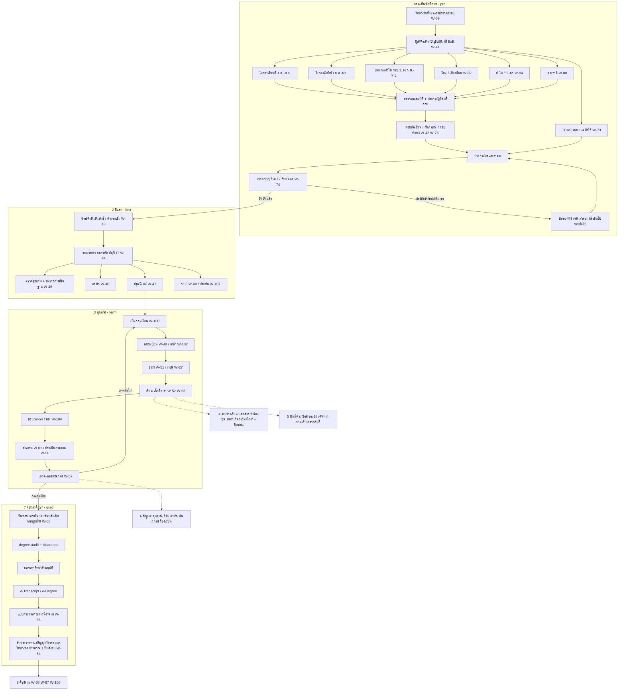

### 1.2 Journey at a glance

| # | ช่วง (stage code) | ช่วงเวลาทั่วไป | ผู้เกี่ยวข้องหลัก | งานหลักของผู้เรียน | Workflow หลัก | โมดูลหลัก | Release ที่รองรับ |
|---|---|---|---|---|---|---|---|
| 1 | สมัครและคัดเลือก (`pre`) | โควตา ต.ค.–ธ.ค. ✅/🟡 · ทั่วไป ก.พ.–มิ.ย. ✅ · TCAS ส.ค.–มิ.ย. ✅ | candidate, guardian, admission, judge, nurse, physician, head | สมัคร, ชำระค่าสมัคร, สอบ, ดูผล, ยืนยัน/สละสิทธิ์, ยืนยันซ้ำ | W-69, W-41, W-77, W-81, W-70, W-71, W-72, W-73, W-75, W-42, W-76, W-85, W-74, W-18, W-82, W-79, W-80, W-144, W-163 | ADM, IAM, PRIV, FIN, ENG, NOTI, CASE (+ ขั้นต่ำ REC, CUR, DOC, HLT, RPT ตาม D-03) | R1 (ก.ย. 2571 = M18) |
| 2 | ยืนยันสิทธิ์และแรกเข้า (`first`) | ทันทีหลังผล → ก่อนเปิดภาค (มิ.ย.); รอบท้าย ≤ 14 วันหลังรายงานตัว | candidate→student, guardian, finance, registrar, physician, nurse, sci, dorm, affairs, loan | ชำระ, รายงานตัว, ตรวจสุขภาพ, หอ, ปฐมนิเทศ, กยศ. | W-43, W-78, W-44, W-127, W-160, W-134, W-45, W-46, W-47, W-48, W-107, W-148 | ADM→REC, FIN, IAM, SVC, HLT, ATH, HOU, AFF, SCH | R1 (ค่ายืนยันสิทธิ์) + R2 (พ.ค. 2572 = M26) |
| 3 | ทุกภาค (`term`) | วนรอบ ภาค 1 ≈ มิ.ย.–ต.ค. 🟡 · ภาค 2 ≈ พ.ย.–มี.ค. 🟡 · ฤดูร้อน ≈ เม.ย.–พ.ค. 🟡 | student, advisor, lecturer, head, dean, registrar, finance, proctor | ลงทะเบียน, ชำระ, เรียน, ลา, สอบ, ดูเกรด | W-100, W-101, W-49, W-50, W-102, W-51, W-105, W-27, W-52, W-53, W-54, W-104, W-05, W-55, W-01, W-103, W-56, W-57, W-61, W-162 | REG, FIN, ATT, EXM, ASM, REC, LMS | R2 |
| 4 | ระหว่างเรียน (`during`) | ตามเหตุ / ตามรอบปี | student, registrar, affairs, scholar, practicum, employer | ขอเอกสาร, คำร้อง, ทุน, ผ่อนผันทหาร, กิจกรรม, ฝึกงาน/ฝึกสอน, accommodation | W-58, W-34, W-113, W-07, W-120, W-59, W-60, W-119, W-62, W-32, W-156, W-33, W-25, W-106, W-140, W-131, W-21, W-147 | SVC, DOC, SCH, AFF, PRA, REC | R2 (ส่วนใหญ่), R3 (PRA, พ.ย. 2572 = M32) |
| 5 | นักกีฬา (`sport`) | ตลอดปี; พีค ก.ย. (พลศึกษาเกมส์), พ.ย.–ม.ค. | student, coach, sci, physician, nurse, physio, sportshead, lecturer | คัดตัว, ซ้อม, wellness (opt-in), ลาแข่ง, เดินทาง, บาดเจ็บ/concussion/ความร้อน, ตรวจสิทธิ์ | W-150, W-68, W-130, W-109, W-112, W-30, W-04, W-114, W-31, W-115, W-39, W-152, W-153, W-154, W-157, W-14, W-146 | ATH, ATT, EXM, HLT, FIN, FAC | R2 (core + **eligibility W-30 + travel W-31 + ล้างเงินยืม W-115 ทันพลศึกษาเกมส์ ก.ย. 2572** — D-03) + R3 (ATH เต็ม) |
| 6 | ปัญหาและกรณีพิเศษ (`problem`) | ตามเหตุ / หลังประกาศเกรด | student, guardian, advisor, dean, rector, affairs, complaint, safeguard | อุทธรณ์, ชี้แจงวินัย, ลาพัก/ลาออก/คืนสภาพ, ร้องเรียน | W-16, W-17, W-02, W-12, W-55, W-11, W-133, W-10, W-161, W-24, W-26, W-19, W-22, W-155, W-93, W-129, W-99, W-09 | CASE, REC, AFF, SAFE, FIN | R1 (CASE อุทธรณ์ผลคัดเลือก) + R2 |
| 7 | จบการศึกษา (`grad`) | ยื่นภายใน 30 วันหลังเปิดภาคสุดท้าย ✅ → สภาอนุมัติ → พิธี ≈ 1 ปีต่อมา ✅ | student, registrar, head, dean, council, affairs | ยื่นจบ, clearance, รับ e-Transcript, ตอบแบบสำรวจ, ซ้อมและรับปริญญา | W-06, W-65, W-118, W-64, W-32 | GRD, DOC, ALU, ENG | R2 GRD ขั้นต่ำ (ยื่นจบ pre-audit clearance — D-03) → R3 เต็ม (พ.ย. 2572 = M32) |
| 8 | ศิษย์เก่า (`alumni`) | ตลอดไป | alumni, employer, registrar | อัปเดตข้อมูล, ขอเอกสาร, ส่งลิงก์ตรวจสอบวุฒิ | W-66, W-67, W-58, W-108, W-132 | ALU, GRD, DOC | R3 |
| 9 | โรงเรียนกีฬา (`sschool`) | ภาค 1 ≈ 16 พ.ค.–30 ก.ย. · ภาค 2 ≈ 1 พ.ย.–31 มี.ค. (รูปแบบปี 2569 ✅) | student (ผู้เยาว์), guardian, homeroom, dorm, sschool_dir, coach, safeguard | สมัคร ม.1/ม.4, มอบตัว, หอพักประจำ, เรียน, ออกนอกหอ, จบ ม.3/ม.6 | W-83, W-86, W-13, W-90, W-91, W-87, W-89, W-94, W-88, W-151, W-92, W-93, W-144, W-149, W-160, W-22, W-23 | SSC, HOU, SAFE, HLT, ATH, PRIV | โรงเรียนกีฬานำร่อง 16 พ.ค. 2573 (M38, คู่กับ Wave 1) |
| 10 | บัณฑิตศึกษา (`gradstudy`) | รับสมัครยาว พ.ย.–ก.พ. ✅ (ชลบุรี) | student, advisor, gradschool | สอบวัดคุณสมบัติ, โครงร่าง, จริยธรรม, ป้องกัน, ส่งเล่ม | W-84, W-95, W-145, W-158, W-159, W-96, W-97, W-98, W-99 | GRAD, ADM, X-RES | R3 |

> **ผู้ใช้กลุ่มแรกบนระบบใหม่:** ผู้สมัครเข้าปีการศึกษา 2572 ใน 2 วิทยาเขต pilot เริ่มสมัครรอบโควตา ต.ค. 2571 (R1, M18) แล้วรายงานตัวและเรียนภาค 1/2572 บน R2 (M26); นักศึกษาปัจจุบันย้ายเข้าระบบที่รอยต่อปีการศึกษา โดยระบบเดิมเป็น read-only + shadow comparison 1 ภาค (D-07) · ถ้าเริ่มสัญญาหลัง ต.ค. 2570 ทุก release เลื่อน 12 เดือนตามรอบรับสมัคร (เล่ม 12 §1.3, D-02)

---

## 2. ก่อนเป็นนักศึกษา: การรับเข้าทุกช่องทาง (`pre`)

### 2.1 โครงสร้างการรับเข้าที่ระบบต้องจำลอง

ข้อเท็จจริงจาก research v2: แต่ละวิทยาเขตออกประกาศในนามของตนเอง ✅ ใช้คำว่า "ประเภทโควตา" (เรียนดี / นักกีฬา) และ "ประเภททั่วไป รอบที่ n" ✅ บางวิทยาเขตเปิดถึงรอบ 5 ✅ (ชลบุรี 2569) หรือรอบ 6 🟡 และไม่พบประกาศปี 2569–2570 ที่ใช้คำว่า "TCAS รอบ x" (หลักฐานเชิงลบ) ([admissions.md §2](../../research_notes/ออกแบบระบบการศึกษา%20TNSU%20ระดับ%20production/v2/admissions.md))

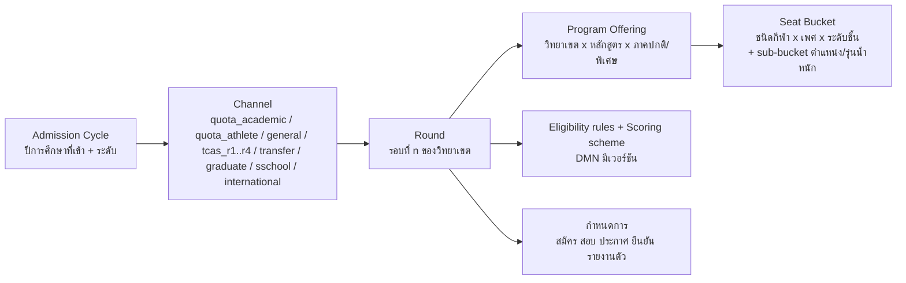

| ระดับ | ตัวอย่างค่า | ใครตั้ง | หมายเหตุ |
|---|---|---|---|
| Cycle | ป.ตรี เข้าปีการศึกษา 2572 | `admission` ส่วนกลาง | ผูก fee schedule และ PolicySet ของรุ่น |
| Channel | โควตานักกีฬา | ส่วนกลางกำหนดรายการช่องทาง วิทยาเขตเลือกใช้ | ช่องทางใหม่เพิ่มได้ด้วย config |
| Round | โควตา รอบเดียว / ทั่วไป รอบ 1..6 | `admission` วิทยาเขต (W-69) | รอบถัดไปรับ "ที่นั่งคงเหลือ" อัตโนมัติ |
| Program Offering | ศษ.บ. พลศึกษา วิทยาเขตชลบุรี ภาคปกติ | CUR + วิทยาเขต | ต้องไม่เกิน `AccreditedIntakeCap` ของคุรุสภาสำหรับหลักสูตรครู (G-12) |
| Seat Bucket | ฟุตบอลชาย 8 ที่ (sub-bucket: ผู้รักษาประตู 1) · มวยไทยชาย 4 ที่ (รุ่น ≤ 57 กก. 1 …) | วิทยาเขต | ใช้กับโควตานักกีฬาและโรงเรียนกีฬา; sub-bucket `position_group` / `weight_class` เป็น option ที่ต้องประกาศใน W-69; จัดอันดับภายใน sub-bucket ก่อนแล้ว spill-over ตามกติกาที่ประกาศ (v1-review F-02) |

**สถานะใบสมัคร (application state)** — ใช้ร่วมทุกช่องทาง:

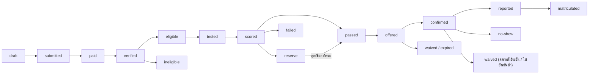

### 2.2 ปฏิทินรับเข้าโดยสรุป (ตัวอย่างรอบเข้าปีการศึกษา 2570 ที่เกิดขึ้นจริงตามหลักฐาน)

| เดือน | มกช. ป.ตรี (รายวิทยาเขต) | TCAS70 (ทปอ.) — ใช้เฉพาะถ้า มกช. เข้าร่วม | โรงเรียนกีฬา (เข้า 2570) | บัณฑิตศึกษา |
|---|---|---|---|---|
| ส.ค. 2569 | — | รอบ 1 Portfolio เปิด 15 ส.ค. ✅ | — | — |
| ก.ย. 2569 | ประกาศโควตา 2570: กรุงเทพ 22 ก.ย. ✅, ชลบุรี (เรียนดี) 30 ก.ย. ✅, อ่างทอง ✅ | — | — | — |
| ต.ค. 2569 | รับสมัครโควตา 🟡 (รอบก่อน: 1 ต.ค.–7 พ.ย. 2568 ✅) | ลงทะเบียน myTCAS 🟡 (ปี 69 เริ่ม 28 ต.ค.) | อุบลฯ ประกาศ 🟡 | ชลบุรีประกาศรับ 2570 วันที่ 1 ต.ค. ✅ |
| พ.ย. 2569 | ปิดรับโควตา ตรวจเอกสาร 🟡 | สมัคร TGAT/TPAT 4–10 พ.ย. (ล่าช้า 11–12) ✅ | — | เปิดรับ 🟡 (ปีก่อน 10 พ.ย.) |
| ธ.ค. 2569 | สอบทักษะ/สัมภาษณ์ ประกาศผลโควตา 🟡 | — | ประกาศรับ (ยะลา 19 ธ.ค. 2568 สำหรับปี 2569 ✅) | สมัครต่อเนื่อง |
| ม.ค. 2570 | ยืนยันสิทธิ์โควตา 🟡 | สมัคร A-Level 14–20 ม.ค. ✅; สอบ TGAT/TPAT3 30 ม.ค. ✅ | รับสมัคร ✅ (สุพรรณฯ ปีก่อน 2–31 ม.ค.) | สมัครต่อเนื่อง |
| ก.พ. 2570 | ทั่วไปรอบ 1–2 ✅ (ปีก่อน รอบ 2 กรุงเทพปิด 3 มี.ค.) | TPAT 31 ม.ค.–1 ก.พ. ✅; ผล 28 ก.พ. ✅ | ประกาศผู้มีสิทธิ์ทดสอบ + ทดสอบ ✅ (ยะลา 11 ก.พ.) | ปิดรับ (ปีก่อน 27 ก.พ.) ✅ |
| มี.ค. 2570 | ทั่วไปรอบ 2–3 ✅ | ผลรอบ 1 + ยืนยัน 10–11 มี.ค. ✅; A-Level 13–15 มี.ค. ✅; รอบ 2 เริ่ม 13 มี.ค. ✅ | ประกาศผล มอบตัว 🟡 | สอบ/สัมภาษณ์ 🟡 |
| เม.ย. 2570 | ทั่วไปรอบ 3 (ข้อเขียน+สัมภาษณ์) ✅ | รอบ 2 คัดเลือก | มอบตัว / หอพัก 🟡 | ประกาศผล 🟡 |
| พ.ค. 2570 | ทั่วไปรอบ 4–5 ✅ | ผลรอบ 2 3 พ.ค. ยืนยัน 3–4 พ.ค. ✅; รอบ 3 สมัคร 7–11 พ.ค. (เพิ่ม 12–13) ✅; ผล 22/27 พ.ค. (แหล่งไม่ตรงกัน) | เปิดภาค ≈ 16 พ.ค. 🟡 | รายงานตัว 🟡 |
| มิ.ย. 2570 | รอบ 5–6 + รายงานตัวทันที (ปีก่อน ชลบุรีประกาศ 8 มิ.ย. รายงานตัว 9 มิ.ย. ✅) | รอบ 4 ≈ 29 พ.ค.–15 มิ.ย. 🟡 | — | เปิดภาค |

แหล่ง: [Trueplookpanya TCAS70](https://www.trueplookpanya.com/tcas/article/detail/97424), [SmartMathPro](https://www.smartmathpro.com/article/tcas70-calendar/), [Bangkokbiznews](https://www.bangkokbiznews.com/health/education/1127836), [tnsubkk โควตา 2570](https://www.tnsubkk.ac.th/%E0%B8%9B%E0%B8%A3%E0%B8%B0%E0%B8%81%E0%B8%B2%E0%B8%A8%E0%B8%A1%E0%B8%AB%E0%B8%B2%E0%B8%A7%E0%B8%B4%E0%B8%97%E0%B8%A2%E0%B8%B2%E0%B8%A5%E0%B8%B1%E0%B8%A2%E0%B8%81%E0%B8%B2%E0%B8%A3%E0%B8%81-97/), [TNSUCBI](https://www.tnsucbi.ac.th/), [tnsucbi รอบ 5](https://www.tnsucbi.ac.th/%E0%B8%9B%E0%B8%A3%E0%B8%B0%E0%B8%81%E0%B8%B2%E0%B8%A8%E0%B8%A3%E0%B8%B2%E0%B8%A2%E0%B8%8A%E0%B8%B7%E0%B9%88%E0%B8%AD%E0%B8%9C%E0%B8%B9%E0%B9%89%E0%B8%A1%E0%B8%B5%E0%B8%AA%E0%B8%B4%E0%B8%97%E0%B8%98-9/), [LINE Today โควตา 2569](https://today.line.me/th/v3/article/wJMap0G), [yalasportsschool](https://yalasportsschool.ac.th/), [Eduzones ชลบุรีบัณฑิต](https://www.eduzones.com/2025/11/07/tnsu-8/) — ปฏิทินรอบปีการศึกษา 2571/2572 อยู่ในเล่ม 03

### 2.3 ขั้นตอนร่วมของทุกช่องทาง (บัญชีผู้สมัคร → ใบสมัคร → ค่าสมัคร)

| ลำดับ | ผู้ทำ | สิ่งที่ทำ | ระบบช่วยอะไร | เอกสาร/ค่าธรรมเนียม | เวลา | WID | โมดูล |
|---|---|---|---|---|---|---|---|
| CM-1 | `admission` งานรับสมัครวิทยาเขต | ตั้งค่ารอบ ที่นั่ง คุณสมบัติ เกณฑ์คะแนน ค่าสมัคร กำหนดการ แล้วเสนออนุมัติและเผยแพร่ประกาศ | wizard ตั้งรอบโดย clone จากรอบปีก่อน, ตรวจ seat ไม่เกินแผนรับ/คุรุสภา cap, สร้างประกาศ PDF ภาษาไทยจาก template, ตั้ง window ในปฏิทินอัตโนมัติ | ประกาศมหาวิทยาลัย (ลงนามโดยผู้มีอำนาจของวิทยาเขต) | อนุมัติ ≥ 30 วัน และเผยแพร่ ≥ 7 วันก่อนเปิดรับ (ผู้เริ่ม = `admission`; กองแผนอนุมัติ AdmissionPlan แยกล่วงหน้า) | W-69 | ADM, ORG, ENG, DOC |
| CM-2 | `candidate` ผู้สมัคร | สร้างบัญชี: ยืนยันตัวตนด้วย ThaID หรือ OTP มือถือ + เลขประจำตัว 13 หลัก / passport / รหัส G | applicant master ระดับมหาวิทยาลัย (dedupe ด้วยเลขประจำตัว + วันเกิด), บัญชีเดียวใช้ได้ทุกวิทยาเขตทุกรอบ, PWA + LINE LIFF | บัตรประชาชน (หรือ passport) | ตลอดปี | W-41 | IAM, ADM |
| CM-3 | `system` | ตรวจอายุจากวันเกิด: ถ้าต่ำกว่า 20 ปี ส่งลิงก์เชิญผู้ปกครองผูกบัญชี | dual consent flow: ผู้ปกครองยืนยันตัวตน (ThaID = ระดับ 2) หรือผูกแบบ provisional (เลขบัตร + OTP) แล้วยืนยันที่จุดบริการเจ้าหน้าที่ (ระดับ 1) ตามเล่ม 04 G2; เก็บ consent แยกวัตถุประสงค์ (ข้อมูลสุขภาพ = sensitive); ผู้ดูแลจริงที่ไม่ใช่ผู้ปกครองตามกฎหมาย (ปู่ย่าตายาย) → W-160 | เอกสารแสดงความเป็นผู้ปกครอง (กรณีไม่ใช่บิดา/มารดา) 🟡 | ก่อนยื่นใบสมัครที่มีข้อมูลสุขภาพหรือการทดสอบร่างกาย | W-41, W-127 | PRIV, IAM |
| CM-4 | `candidate` | เลือกช่องทาง รอบ วิทยาเขต หลักสูตร (และชนิดกีฬา/ตำแหน่ง) เรียงลำดับ | แสดงเฉพาะรอบที่เปิดอยู่และที่ผู้สมัครมีสิทธิ์, เตือนถ้ายืนยันสิทธิ์ที่อื่นแล้ว (กติกา clearing หัวข้อ 2.8), เปรียบเทียบค่าเทอม/ที่นั่ง | — | ช่วงรับสมัครของรอบ | W-41 | ADM |
| CM-5 | `candidate` | กรอกข้อมูลการศึกษา ผลการเรียน และข้อมูลเฉพาะช่องทาง | ดึง GPAX จาก ปพ.1 (OCR + ให้ผู้สมัครยืนยัน + เจ้าหน้าที่ตรวจ), ตรวจคุณสมบัติทันที (eligibility DMN) | ปพ.1 / หนังสือรับรองผลการเรียน (จำนวนภาคเรียนตามประกาศ 🟡), รูปถ่าย | ช่วงรับสมัคร | W-41 | ADM |
| CM-6 | `candidate` | อัปโหลดเอกสาร | checklist ต่อช่องทาง, ตรวจชนิด/ขนาดไฟล์, hash, แจ้งเอกสารขาดก่อนกดยื่น | ตามช่องทาง (ดูตารางแต่ละช่องทาง) | ช่วงรับสมัคร | W-41 | ADM |
| CM-7 | `candidate` / `guardian` | ชำระค่าสมัครด้วย Thai QR / Bill Payment (ใครจ่ายแทนก็ได้) | ใบแจ้งชำระ Ref1 = เลขใบสมัคร, Ref2 = วิทยาเขต+รอบ; ปุ่ม "บันทึกรูป QR" + เลขอ้างอิงคัดลอกได้ + deeplink แอปธนาคาร (มือถือเครื่องเดียว); callback ธนาคาร + statement reconcile; e-Receipt; คำขอยกเว้นค่าสมัคร (ผู้มีรายได้น้อย) เป็น e-Form 🟡 | ค่าสมัคร "หลักร้อยบาท" 🟡 ตามประกาศวิทยาเขต | ภายในวันปิดรับ | W-41, W-81 | FIN, ADM |
| CM-8 | `admission` | ตรวจเอกสารที่ระบบตรวจไม่ได้ (คิวตรวจ verify / reject / ขอเพิ่ม) | verification queue แบ่งงานตามเจ้าหน้าที่, ขอเอกสารเพิ่มผ่าน NOTI พร้อม deadline, บันทึกผู้ตรวจ | — | ภายใน 3–7 วันหลังปิดรับ 🟡 | W-77 | ADM, NOTI |
| CM-9 | `admission` → `campusvp` | ประกาศรายชื่อผู้มีสิทธิ์สอบ | สร้างรายชื่อ masked (ไม่แสดงเลขประจำตัวเต็ม), ส่งแจ้งเตือนรายบุคคล, ออกบัตรประจำตัวผู้สอบ (QR) ในแอป | บัตรประจำตัวผู้สอบ | ตามกำหนดการรอบ | W-42 | ADM, ENG, NOTI |
| CM-10 | `candidate` | ดูวัน เวลา สถานที่ ห้อง/สนาม และข้อปฏิบัติ (การแต่งกาย ของที่นำมา) | ปฏิทินส่วนตัว + แผนที่, เตือน T-3/T-1 วัน | ข้อกำหนดการแต่งกาย เช่น ชุดนักเรียนและรองเท้าหุ้มส้น ✅ (ชลบุรี) | ก่อนวันสอบ | W-42 | ADM, NOTI |

### 2.4 ช่องทาง (a): โควตาเรียนดี (ประเภทโควตา ผลการเรียนดี) — W-70

ข้อเท็จจริง: ประกาศโควตาเรียนดีออกแยกรายวิทยาเขต ✅ (ชลบุรี "ประเภทโควตา ประเภทผลการเรียนดี" 30 ก.ย. 2569) เปิดรับพร้อมโควตานักกีฬา (ปีก่อน 1 ต.ค.–7 พ.ย. 2568 ✅) ส่วนเกณฑ์ GPAX จำนวนภาคเรียน สัดส่วนคะแนน และค่าสมัคร ยังไม่ได้อ่านฉบับเต็ม 🟡

| ลำดับ | ผู้ทำ | สิ่งที่ทำ | ระบบช่วยอะไร | เอกสาร/ค่าธรรมเนียม | เวลา | WID | โมดูล |
|---|---|---|---|---|---|---|---|
| QA-1 | `admission` | ตั้งรอบโควตาเรียนดี: GPAX ขั้นต่ำ (ตัวอย่าง ≥ 2.75 🟡), นับกี่ภาคเรียน (ตัวอย่าง ม.4–ม.6 ภาค 1 = 5 ภาค 🟡), แผนการเรียนที่รับ, GPA กลุ่มสาระพลศึกษา (ถ้ากำหนด 🟡), ที่นั่งต่อหลักสูตร | DMN eligibility มีเวอร์ชัน, คำนวณที่นั่งจากแผนรับ, ประกาศ PDF | ประกาศ | ปลาย ก.ย. ✅ | W-69 | ADM, ORG |
| QA-2 | `candidate` | สมัคร (ขั้น CM-2..CM-7) เลือกวิทยาเขต/หลักสูตร | แสดงผลตรวจ GPAX ทันที "ผ่าน/ไม่ผ่านเกณฑ์ขั้นต่ำ" ก่อนจ่ายเงิน (ลดการจ่ายค่าสมัครทั้งที่ไม่มีสิทธิ์) | ปพ.1 5 ภาค 🟡, บัตร, รูป | ต.ค.–ต้น พ.ย. 🟡 | W-41 | ADM, FIN |
| QA-3 | `admission` | ยืนยัน GPAX กับเอกสาร, ตรวจโรงเรียน/แผนการเรียน | OCR ปพ.1 + เทียบค่าที่ผู้สมัครกรอก, flag ค่าต่างกัน | — | ≤ 7 วันหลังปิดรับ 🟡 | W-41 | ADM |
| QA-4 | `admission` | ประกาศผู้มีสิทธิ์สัมภาษณ์ | CM-9 | บัตรประจำตัวผู้สอบ | พ.ย. 🟡 | W-42 | ADM, ENG |
| QA-5 | `judge` กรรมการสัมภาษณ์ (มักเป็น `head`/อาจารย์หลักสูตร) | สัมภาษณ์ตาม rubric (ทัศนคติ ความพร้อม ความเหมาะสมกับวิชาชีพครู/กีฬา) | slot สัมภาษณ์, เช็กอิน QR, rubric บน tablet แบบ offline-first, กรรมการ ≥ 2 คน/ห้อง 🟡, ประกาศ COI | บัตรประชาชน + บัตรผู้สอบ | พ.ย.–ธ.ค. 🟡 | W-42, W-76 | ADM |
| QA-6 | `judge` + `sci` (เฉพาะหลักสูตรที่กำหนด) | ทดสอบสมรรถภาพพื้นฐาน 🟡 (บางหลักสูตรพลศึกษาอาจกำหนด) | เหมือนสอบทักษะ (หัวข้อ 2.5) แต่ใช้ชุดทดสอบทั่วไป | ใบรับรองแพทย์ (ถ้ามีทดสอบร่างกาย) | วันเดียวกับสัมภาษณ์ 🟡 | W-42 | ADM, HLT |
| QA-7 | `system` | รวมคะแนน = GPAX (weight) + สัมภาษณ์ (+ ทดสอบ) จัดอันดับและสำรอง | scoring scheme ต่อรอบ, tie-break ที่ประกาศไว้ (เช่น GPAX → GPA สาระที่เกี่ยวข้อง → อายุน้อย 🟡) | — | หลังสอบ 1–3 วัน | W-76 | ADM |
| QA-8 | `head` → `dean` → `campusvp` | ตรวจและอนุมัติผล | approval chain + ล็อกผลหลังอนุมัติ + audit | บันทึกอนุมัติผล | ธ.ค. 🟡 | W-76 | ADM, AUD |
| QA-9 | `admission` | ประกาศผู้ผ่านและสำรอง | หน้าผลรายบุคคล + PDF masked + แจ้งเตือน (LINE/อีเมล/SMS) แบบ staggered | ประกาศผล | ธ.ค.–ม.ค. 🟡 | W-42 | ADM, ENG, NOTI |
| QA-10 | `candidate` | ยืนยันหรือสละสิทธิ์ (ภายในเวลาที่กำหนด) และชำระค่ายืนยันสิทธิ์; ยืนยันซ้ำในช่วง reconfirmation ก่อนเปิดภาค (C-14, W-163) | กติกา clearing ภายใน (หัวข้อ 2.8), นับถอยหลัง, ยืนยัน 1 คลิก + guardian รับทราบ (ผู้เยาว์) | ค่ายืนยันสิทธิ์/ค่าแรกเข้า 🟡 | ตามกำหนด (ตัวอย่าง 3–7 วัน 🟡) | W-74, W-43 | ADM, FIN |
| QA-11 | `system` | ผู้ยืนยันแล้วถูกปิดสิทธิ์สมัครรอบอื่นทั้ง มกช. จนกว่าจะสละ (C-3/C-4; นโยบายต้องยืนยัน Q-12 🟡) | unique constraint ตรวจ ณ เวลายืนยัน | — | ทันที | W-74 | ADM |
| QA-12 | `candidate` → `registrar` | ส่งหลักฐานจบ ม.6 (ปพ.1 ฉบับจบ) ตอนรายงานตัว ถ้าไม่จบ ม.6 = เพิกถอนสิทธิ์ | ตั้งสถานะ "รอหลักฐานจบ", deadline job | ปพ.1 ฉบับสมบูรณ์ | มี.ค.–พ.ค. | W-44, W-134 | REC, ADM |

### 2.5 ช่องทาง (b): โควตานักกีฬา — W-71

ข้อเท็จจริง: โควตานักกีฬาเป็นหนึ่งใน 2 ประเภทของ "ประเภทโควตา" ✅ แต่ละวิทยาเขตเปิดเอง ✅; เกณฑ์ระดับผลงานขั้นต่ำ ช่วงปีของผลงาน ชนิดกีฬาที่รับ และ rubric ทดสอบทักษะของ มกช. ยังไม่พบฉบับเต็ม 🟡 benchmark: มก. นับผลงานย้อนหลังเป็นช่วงวันที่ และเกณฑ์ระดับแรกคือผู้แทนประเทศไทย ✅ ([KU 69-TCAS2-Sport](https://admission.ku.ac.th/media/announcements/2025/11/04/69-TCAS2-Sport.pdf)); มหิดลกำหนดผลงานย้อนหลังไม่เกิน 5 ปีและค่าสอบสัมภาษณ์ 500 บาท ✅ ([Mahidol SS](https://ss.mahidol.ac.th/th/images/SS-Project/TCAS/2568/2.%20ba.pdf))

#### 2.5.1 ขั้นตอน

| ลำดับ | ผู้ทำ | สิ่งที่ทำ | ระบบช่วยอะไร | เอกสาร/ค่าธรรมเนียม | เวลา | WID | โมดูล |
|---|---|---|---|---|---|---|---|
| QS-1 | `admission` + `sportshead` | ตั้งรอบ: ชนิดกีฬา × เพศ × ที่นั่ง (seat bucket), ระดับผลงานขั้นต่ำ, ช่วงวันที่ของผลงาน, ชุดทดสอบทักษะและสมรรถภาพต่อชนิดกีฬา, weight คะแนน | seat matrix, ตารางระดับผลงาน (2.5.2), คลัง rubric ต่อชนิดกีฬา (2.5.3) clone ข้ามวิทยาเขตได้แต่ override ได้ | ประกาศ | ปลาย ก.ย. ✅ | W-69 | ADM, ATH (คลังชนิดกีฬา) |
| QS-2 | `candidate` (+ `guardian` ถ้าผู้เยาว์) | สมัคร เลือกชนิดกีฬา/ตำแหน่ง/รุ่นน้ำหนัก กรอกประวัติกีฬา (สโมสร สมาคม โค้ช ปีที่เล่น) | sport profile, ผลงานเป็นรายการ (ชื่อรายการ, ระดับ, อันดับ/เหรียญ, วันที่, ไฟล์หลักฐาน) | เกียรติบัตร, หนังสือรับรองจากสมาคมกีฬา/กกท./ต้นสังกัด, ปพ.1, รูป, บัตร | ต.ค.–ต้น พ.ย. 🟡 | W-41 | ADM |
| QS-3 | `system` | ตรวจผลงานอัตโนมัติ: วันที่อยู่ในช่วง, ระดับผลงานถึงขั้นต่ำ, ชนิดกีฬาตรงกับที่รับ | DMN + ตาราง "รายการแข่งขันที่รับรอง" (competition master เช่น กีฬาแห่งชาติ, กีฬานักเรียนนักศึกษาแห่งชาติ ✅ [DPE](https://www.dpe.go.th/th/news-sports/019fd05f-0b4d-72e2-b1bc-98bcf1bb5d95)) ทำให้ระบบรู้ระดับของรายการเอง | — | ทันที | W-41 | ADM, ATH |
| QS-4 | `admission` + `sportshead` | ตรวจความถูกต้องของหลักฐานผลงาน (เทียบผลการแข่งขันจริง/สอบถามสมาคม) | `VerificationTask` (หลักฐาน, ผู้ตรวจ, ผล, หมายเหตุ), ตรวจซ้ำเฉพาะหลักฐานที่ระบบ flag (เช่น ไฟล์ซ้ำกันข้ามผู้สมัคร โดยเทียบ hash) | — | ≤ 7–10 วันหลังปิดรับ 🟡 | W-41 | ADM |
| QS-5 | `candidate` | ส่งใบรับรองแพทย์ และตอบแบบคัดกรองสุขภาพก่อนออกกำลังกาย (ผู้ใหญ่: PAR-Q+ หรือเทียบเท่า; ผู้เยาว์ต่ำกว่า 15 ปี: แบบคัดกรองเด็กที่แพทย์รับรอง 🟡), ยอมรับข้อตกลงความปลอดภัย; กีฬารุ่นน้ำหนักประกาศรุ่นตอนสมัคร (เปลี่ยนรุ่นหลังสมัครไม่ได้) | ฟอร์มคัดกรอง; ถ้าตอบ "ใช่" ข้อเสี่ยง → บังคับแนบใบรับรองแพทย์เฉพาะทาง; ข้อมูลเก็บใน `hlt_vault` (HLT) ไม่ใช่ ADM | ใบรับรองแพทย์ อายุไม่เกิน 30 วัน **นับ ณ วันทดสอบ** 🟡 (เลขใบอนุญาตแพทย์) | ก่อนจอง slot ทดสอบ | W-42 | HLT, ADM |
| QS-6 | `guardian` | ลงนามยินยอม (ผู้เยาว์): การทดสอบร่างกาย, การเก็บข้อมูลสุขภาพ, การให้ปฐมพยาบาล/ส่งโรงพยาบาลในวันทดสอบ | e-consent ลงนามดิจิทัล, แยก consent รายวัตถุประสงค์, ไม่มี consent = จอง slot ไม่ได้ | — | ก่อนจอง slot | W-42 | PRIV |
| QS-7 | `admission` | ประกาศผู้มีสิทธิ์ทดสอบ + จัดตาราง slot ตามชนิดกีฬา × เพศ × สนาม × กรรมการ | scheduler: ความจุสนาม, จำนวนกรรมการต่อสถานี, เวลาเผื่อเปลี่ยนสถานี, จองสนามใน FAC อัตโนมัติ (กันชนกับการซ้อมของทีม) | บัตรผู้สอบ QR | พ.ย. 🟡 | W-75 | ADM, FAC |
| QS-8 | `nurse` (+ `physician` ข้างเวทีสำหรับกีฬาต่อสู้) | คัดกรองสุขภาพหน้าสนาม (ชีพจร ความดัน อาการ) ก่อนเริ่มทดสอบ; มี AED/รถพยาบาลตาม VenueEmergencyPlan | checklist บน tablet, บันทึก `MedicalClearance(PRE_TEST)`; ไม่ผ่าน → `SkillTestIncident` + เสนอวันสำรอง | — | วันทดสอบ | W-42 | HLT, ADM |
| QS-8a | `nurse` + `judge` หัวหน้าสนาม | **ความร้อนและน้ำหนัก:** วัด WBGT ก่อนเริ่มและทุกชั่วโมง ปรับ/ระงับ station ที่ใช้แรงตามเกณฑ์ (W-153); กีฬารุ่นน้ำหนัก: ชั่งน้ำหนัก**วันทดสอบ** (ไม่ใช่วันก่อน) + ตรวจภาวะขาดน้ำ ห้ามลดน้ำหนักเร่งด่วน (W-154) | HeatReading จาก FAC, weigh-in log; ระดับสูงสุด = เลื่อน slot (ไม่ตัดสิทธิ์) | — | วันทดสอบ | W-153, W-154 | FAC, ATH, ADM |
| QS-9 | `judge` (station rubric ≥ 3 คน 🟡; station วัดผลเชิงวัตถุ 1 ผู้วัด + ผู้ตรวจ) | ทดสอบทักษะเฉพาะชนิดกีฬา + สมรรถภาพ (2.5.3, 2.5.4) ให้คะแนนอิสระ | judge app offline-first, ส่งแล้วล็อก, จับเวลา/วัดระยะกรอกตรงจากเครื่อง (ถ้ามี); **ไม่อ้างว่า blind** — ใช้ COI อัตโนมัติจากสโมสร/โรงเรียน/โค้ชที่ผู้สมัครกรอก + หลายกรรมการ + วิดีโอ (v1-review O-8) | — | พ.ย.–ธ.ค. 🟡 | W-42, W-76 | ADM |
| QS-10 | `judge` หัวหน้ากรรมการ | moderation เมื่อคะแนนกรรมการต่างกันเกินเกณฑ์ (2.5.5; เฉพาะ station rubric) | flag อัตโนมัติ, ดูบันทึก/วิดีโอ (ถ้ามี consent), ให้คะแนนใหม่หรือบันทึกเหตุผล | บันทึก moderation | flag วันเดียวกัน; ปิด ≤ 1 วันทำการก่อนรวมคะแนน (SLA เดียวกับ W-76) | W-76 | ADM |
| QS-11 | `judge` (`head`) | สัมภาษณ์ | เหมือน QA-5 | — | วันเดียวกัน/ถัดไป | W-42 | ADM |
| QS-12 | `system` | รวมคะแนน: ผลงาน (ตามตาราง 2.5.2) + ทักษะ + สมรรถภาพ + สัมภาษณ์ (+ GPAX ถ้ากำหนด) ต่อ seat bucket/sub-bucket จัดอันดับและสำรอง | weight ต่อรอบ, ใช้ panel เดียวต่อ sub-bucket (normalisation ข้ามกลุ่มกรรมการปิดโดยค่าเริ่มต้น — D-06), tie-break ที่ประกาศไว้ | — | ≤ 3 วันหลังทดสอบ 🟡 | W-76 | ADM |
| QS-13 | `head` → `dean` → `campusvp` | อนุมัติผล | เหมือน QA-8 + รายงานการกระจายคะแนนต่อชนิดกีฬา | บันทึกอนุมัติ | ธ.ค. 🟡 | W-76 | ADM |
| QS-14 | `admission` | ประกาศผลแยกตามชนิดกีฬา/เพศ + สำรอง | เหมือน QA-9 | ประกาศ | ธ.ค.–ม.ค. 🟡 | W-42 | ADM, ENG |
| QS-15 | `candidate` | ยืนยัน/สละสิทธิ์ + ชำระ | เหมือน QA-10 + ส่งต่อ sport profile ไป ATH เมื่อรายงานตัว | ค่ายืนยันสิทธิ์ 🟡 | ตามกำหนด | W-74, W-43 | ADM, FIN |
| QS-16 | `candidate` | ขอทบทวนผลทดสอบ (ถ้าไม่เห็นด้วย) แบบเร่งด่วน (หัวข้อ 2.14) | ยื่นใน portal, ระบบแสดงคะแนนรายสถานีให้ผู้สมัครดู, ตั้ง `appeal_hold` ถ้าจำเป็น | — | ยื่น ≤ 3 วันทำการหลังประกาศ; ตัดสินก่อนปิดยืนยันสิทธิ์ | W-18 | CASE, ADM |

#### 2.5.2 ระดับผลงานกีฬา (ตัวอย่าง configuration 🟡)

| ระดับ | ตัวอย่างรายการ | ตัวอย่างคะแนนผลงาน (เต็ม 100) | หลักฐาน | ผู้ตรวจ |
|---|---|---|---|---|
| L1 นานาชาติ / ทีมชาติ | ซีเกมส์, เอเชียนเกมส์, ชิงแชมป์โลก/เอเชีย, เยาวชนทีมชาติ | 100 (เหรียญ) / 90 (เข้าร่วม) | หนังสือรับรองสมาคมกีฬาแห่งประเทศไทย/กกท. | `sportshead` |
| L2 ชาติ (ได้เหรียญ) | กีฬาแห่งชาติ, กีฬาเยาวชนแห่งชาติ, กีฬานักเรียนนักศึกษาแห่งชาติ, ชิงแชมป์ประเทศไทย | 80 (ทอง) / 75 (เงิน) / 70 (ทองแดง) | เกียรติบัตร + ผลการแข่งขัน | `admission` + `sportshead` |
| L3 ชาติ (เข้าร่วม) | ผู้แทนจังหวัดในกีฬาแห่งชาติ | 60 | เกียรติบัตร/หนังสือรับรองจังหวัด | `admission` |
| L4 ภาค / เขต | กีฬาแห่งชาติรอบคัดเลือกภาค, กีฬานักเรียนระดับภาค | 50 (เหรียญ) / 40 | เกียรติบัตร | `admission` |
| L5 จังหวัด | กีฬานักเรียนระดับจังหวัด | 30 (เหรียญ) / 20 | เกียรติบัตร | `admission` |
| ผู้ไม่มีผลงานถึงขั้นต่ำ | — | ไม่มีสิทธิ์ (ถ้าประกาศกำหนดขั้นต่ำ) | — | `system` |

กติกาที่ระบบต้องรองรับ: นับเฉพาะผลงานในช่วงวันที่ที่ประกาศ (ตัวอย่าง มก. นับย้อนหลัง 5 ปี ✅); นับผลงานสูงสุดรายการเดียวหรือรวมหลายรายการตาม config; ประเภททีมใช้ผลของทีมพร้อมหลักฐานว่าผู้สมัครอยู่ในรายชื่อ; กีฬาคนพิการใช้ระดับเดียวกันพร้อม classification (หัวข้อ 2.12)

#### 2.5.3 สอบทักษะเฉพาะชนิดกีฬา (ตัวอย่าง rubric 🟡 — วิทยาเขตตั้งเองได้)

| ชนิดกีฬา | สถานี/รายการทดสอบตัวอย่าง | วิธีให้คะแนน | ข้อควรระวังด้านความปลอดภัย |
|---|---|---|---|
| ฟุตบอล / ฟุตซอล | เลี้ยงลูกอ้อมหลัก (จับเวลา), ส่ง-รับระยะสั้น/ยาว, ยิงประตูเป้าหมาย, เล่นเกมย่อย (สังเกต) | เวลา/จำนวนครั้งเข้าเป้า + rubric เกม 1–5 ต่อหัวข้อ | อบอุ่นร่างกาย, น้ำดื่ม |
| วอลเลย์บอล / วอลเลย์บอลชายหาด | เซต, อันเดอร์, เสิร์ฟลงเป้า, ตบ, เกม | นับครั้งสำเร็จ + rubric | — |
| บาสเกตบอล | เลี้ยงลูกซิกแซก, ชู้ตจุดต่าง ๆ, เลย์อัพ, เกม 3x3 | เวลา + จำนวนลง + rubric | — |
| กรีฑา | ผลเวลา/ระยะตามประเภท (100 ม., 400 ม., กระโดดไกล, ทุ่มน้ำหนัก ฯลฯ) | เทียบตารางเกณฑ์มาตรฐานต่อเพศ/อายุ | จับเวลาไฟฟ้า (ถ้ามี) นำเข้าอัตโนมัติ |
| ว่ายน้ำ | เวลา 50/100 ม. ท่าถนัด | ตารางเวลาเกณฑ์ | เจ้าหน้าที่ช่วยชีวิตประจำสระ |
| มวยไทย / มวยสากล / เทควันโด / ยูโด / คาราเต้ | ท่าพื้นฐาน, ชุดท่า (พุมเซ/คาตะ), เป้าล่อ, ปะทะจำกัด (ถ้ามี) | rubric ต่อทักษะ | **ห้ามปะทะเต็มรูปแบบ** 🟡; ต้องมีแพทย์ข้างเวที, อุปกรณ์ป้องกัน, ข้อมูลผู้ปกครองยินยอมเฉพาะ; ชั่งน้ำหนักวันทดสอบ (QS-8a); สงสัย concussion → ถอดออกทันที (W-152) |
| เซปักตะกร้อ | เดาะ, เสิร์ฟ, ฟาด, เกม | นับครั้ง + rubric | — |
| ยิมนาสติก | ชุดท่าบังคับ | คะแนนความยาก + การแสดง (แบบกรรมการกีฬา) | ผู้ช่วยจับ (spotter) |
| เทนนิส / แบดมินตัน / เทเบิลเทนนิส | ตีโต้, เสิร์ฟลงเป้า, เกม | นับครั้ง + rubric | — |
| ชนิดกีฬาอื่น | วิทยาเขตสร้าง rubric ใหม่ใน config | — | ต้องผ่านการทบทวนความปลอดภัยโดย `physician` ก่อนเปิดใช้ |

#### 2.5.4 ทดสอบสมรรถภาพทางกาย (ตัวอย่างชุดทดสอบ 🟡)

| รายการ | วัดอะไร | อุปกรณ์/การบันทึก |
|---|---|---|
| ส่วนสูง น้ำหนัก (anthropometrics) | สัดส่วนร่างกาย | บันทึกตรงในแอป |
| วิ่ง 50 ม. | ความเร็ว | จับเวลา (มือ/ไฟฟ้า) |
| ยืนกระโดดไกล | พลังกล้ามเนื้อขา | วัดระยะ |
| ลุก-นั่ง 60 วินาที / ดันพื้น | ความอดทนกล้ามเนื้อ | นับจำนวน |
| นั่งงอตัวไปข้างหน้า | ความอ่อนตัว | วัดระยะ |
| วิ่ง 800/1,000 ม. หรือ multistage shuttle run | ความอดทนระบบหัวใจและไหลเวียนเลือด | เวลา / ระดับ — **ต้องผ่าน QS-8 ก่อนเสมอ** |
| แรงบีบมือ | ความแข็งแรง | dynamometer |

ผลทดสอบสมรรถภาพของผู้ที่รายงานตัวแล้วจะถูกนำไปเป็น baseline แรกของโปรไฟล์นักกีฬา (W-45) เมื่อผู้เรียนให้ consent ไม่ต้องทดสอบซ้ำถ้าผ่านไม่เกินระยะที่ `sci` กำหนด 🟡 · ผู้สมัคร ม.1: วิทยาเขตเลือกเปิด norms ปรับตามเดือนเกิด/อายุ (ประกาศล่วงหน้า) และ ANA รายงานการกระจายเดือนเกิดของผู้ผ่านต่อรอบ เพื่อลด relative-age bias (v1-review F-07); ข้อมูล maturation ใช้เพื่อพัฒนาใน talent pathway เท่านั้น ไม่ใช่ตัดสิทธิ์ (D-06)

#### 2.5.5 กติกาการให้คะแนนหลายกรรมการ + moderation (W-76)

1. กรรมการแต่ละคนให้คะแนนอิสระบน tablet (ใช้งาน offline ได้, sync เมื่อมีสัญญาณ) และมองไม่เห็นคะแนนของกรรมการคนอื่นจนกว่าทุกคนส่ง
2. ก่อนเริ่ม กรรมการประกาศ **COI** (เช่น เป็นโค้ชหรือญาติของผู้สมัคร) ระบบไม่ให้กรรมการที่มี COI ให้คะแนนผู้สมัครคนนั้น และแจ้งหัวหน้ากรรมการให้จัดคนแทน
3. แยก `station_type`: **OBJECTIVE** (เวลา/ระยะ/จำนวนครั้ง — 1 การวัด n trials, best-of, เครื่องจับเวลา) ไม่ผ่าน aggregate/moderation; **SUBJECTIVE** (rubric) รวมคะแนนตาม config: ค่าเฉลี่ย / ตัดสูงสุด-ต่ำสุดแล้วเฉลี่ย (เฉพาะเมื่อกรรมการ ≥ 5 คน) / มัธยฐาน
4. station SUBJECTIVE: ถ้าคะแนนระหว่างกรรมการต่างกันเกินเกณฑ์ (ตัวอย่าง: พิสัยเกิน 20% ของคะแนนเต็ม 🟡) ระบบ flag **ในวันสอบ** ให้หัวหน้ากรรมการทำ moderation ให้เสร็จ **≤ 1 วันทำการ** ก่อนรวมคะแนน (QS-12, W-76): ทบทวนบันทึก ให้คะแนนใหม่ หรือบันทึกเหตุผลคงคะแนน
5. **ค่าเริ่มต้น: ใช้กรรมการชุดเดียวต่อ sub-bucket** ไม่ทำ normalisation ข้ามกลุ่มกรรมการ (n ต่อกลุ่มเล็ก ไม่เสถียร อธิบายยาก — D-06); ถ้าจำเป็นต้องใช้หลายกลุ่ม ให้ประกาศวิธีล่วงหน้าและผ่านการอนุมัติของ `head` (selection_chair)
6. ส่งแล้วแก้ไม่ได้ ยกเว้นหัวหน้ากรรมการเปิดแก้พร้อมเหตุผล (audit log ทุกครั้ง)
7. คะแนนรายสถานีเปิดให้ผู้สมัครดูได้หลังประกาศ เพื่อใช้ประกอบคำขอทบทวน (W-18)
8. กรรมการภายนอก (จากสมาคม) ใช้บัญชี `ExternalPerson` แบบมีวันหมดอายุ ไม่ต้องเป็นบุคลากร (G-22, เปิดบัญชีด้วย W-139); การจัดตาราง slot และแต่งตั้งกรรมการใช้ W-75
9. ค่าตอบแทนกรรมการส่งออกไปเบิกจ่าย (W-29)
10. ห้ามวางวันสอบทักษะใน 14 วันก่อนการแข่งขันระดับชาติที่กรรมการ (โค้ช) อยู่ใน delegation — linter L-14 ในเล่ม 03; ช่วงฤดูร้อนจัดวาง station ใช้แรงช่วงเช้า (L-18)

### 2.6 ช่องทาง (c): ประเภททั่วไป รอบ 1..N (รายวิทยาเขต) — W-72

ข้อเท็จจริง: รอบทั่วไปเปิดหลายรอบตั้งแต่ราว ก.พ. ถึงต้น มิ.ย. ✅ แต่ละวิทยาเขตมีจำนวนรอบและวันที่ไม่ตรงกัน ✅ เช่น กรุงเทพรอบ 2 ปิดรับ 3 มี.ค. 2569 และมีรอบ 4 ✅; ลำปางประกาศผู้มีสิทธิ์สอบรอบ 3 วันที่ 24 เม.ย. 2569 ✅; ชลบุรีรอบ 3 สอบข้อเขียนและสัมภาษณ์ใน เม.ย. ✅ และรอบ 5 ประกาศ 8 มิ.ย. ให้รายงานตัวและชำระเงิน 9 มิ.ย. 2569 ✅; มีวิทยาเขตที่ประกาศรอบ 6 (5 มิ.ย. 2569) 🟡; มหาสารคามใช้ระบบรับสมัครออนไลน์ของตัวเอง ✅ การมีสอบปฏิบัติทักษะในรอบทั่วไป 🟡

#### 2.6.1 ขั้นตอนของหนึ่งรอบ

| ลำดับ | ผู้ทำ | สิ่งที่ทำ | ระบบช่วยอะไร | เอกสาร/ค่าธรรมเนียม | เวลา (สัมพัทธ์) | WID | โมดูล |
|---|---|---|---|---|---|---|---|
| GN-1 | `admission` | เปิดรอบ n ด้วยที่นั่งคงเหลือ (หลังหักผู้ยืนยันรอบก่อน) | ยกที่นั่งคงเหลืออัตโนมัติ + ให้ปรับเพิ่ม/ลด, clone กำหนดการรอบก่อน, ตรวจไม่ชนวันสอบภาค 2 ของมหาวิทยาลัย (เล่ม 03) | ประกาศรอบ n | R0 − 7 วัน 🟡 | W-69 | ADM, ORG |
| GN-2 | `candidate` | สมัครออนไลน์ + ชำระค่าสมัคร | ห้ามสมัครถ้ายืนยันสิทธิ์ที่ใดแล้ว (เว้นสละก่อน), แสดงสถานะรอบอื่นของตนเอง | ปพ.1 (หรือหนังสือรับรองกำลังศึกษา ม.6), รูป, บัตร; ค่าสมัคร 🟡 | R0 → R0 + 7–21 วัน 🟡 | W-41 | ADM, FIN |
| GN-3 | `admission` | ตรวจคุณสมบัติ ประกาศผู้มีสิทธิ์สอบ | CM-8/CM-9 | บัตรผู้สอบ | ปิดรับ + 2–5 วัน 🟡 | W-42 | ADM |
| GN-4 | `candidate` / `proctor` | สอบข้อเขียน (ความรู้ทั่วไป/ความถนัดเฉพาะสาขา 🟡) | จัดห้องและผังที่นั่ง (ใช้เครื่องมือเดียวกับ EXM), ใบเซ็นชื่อ QR, สอบแบบ CBT ได้ถ้ามีห้องคอมพิวเตอร์ 🟡 | บัตรผู้สอบ + บัตรประชาชน; ชุดนักเรียน รองเท้าหุ้มส้น ✅ | ปิดรับ + 5–10 วัน | W-42 | ADM, EXM |
| GN-5 | `judge` | สัมภาษณ์ (+ ทดสอบทักษะ/สมรรถภาพ สำหรับสาขาพลศึกษา/ผู้ฝึกสอน 🟡) | เหมือน QA-5 / QS-8..QS-10 (ต้องมีคัดกรองสุขภาพทุกครั้งที่มีทดสอบร่างกาย) | ใบรับรองแพทย์ (ถ้ามีทดสอบร่างกาย) | วันเดียวกับข้อเขียน หรือถัดไป | W-42, W-76 | ADM, HLT |
| GN-6 | `system` → `head` → `campusvp` | รวมคะแนน จัดอันดับ อนุมัติ | W-76 | — | สอบ + 1–3 วัน | W-76 | ADM |
| GN-7 | `admission` | ประกาศผู้มีสิทธิ์เข้าศึกษา + สำรอง | ประกาศรายบุคคล + PDF masked + แจ้งเตือน | ประกาศ | สอบ + 2–5 วัน | W-42 | ADM, ENG |
| GN-8 | `candidate` | ยืนยันสิทธิ์ + ชำระ + รายงานตัว (รอบท้าย ๆ อาจต้องทำภายใน 24 ชม. ✅ ตัวอย่างชลบุรีรอบ 5) | e-reporting ต่อเนื่องในหน้าเดียว: ยืนยัน → QR ชำระ → สร้างรหัสนักศึกษา (ถ้าใช้รหัสล่วงหน้า) → นัดวันรายงานตัว | ค่าแรกเข้า + ค่าเทอมภาค 1 (ตัวอย่างกรุงเทพ ≈ 8,500 บาท/ภาค ✅ [tnsubkk](https://www.tnsubkk.ac.th/about/course/)) | ประกาศ + 1–3 วัน | W-74, W-43 | ADM, FIN |
| GN-9 | `system` | ปิดรอบ: ผู้ไม่ยืนยัน = expired, ที่นั่งคืนเข้าบัคเก็ต ≤ 15 นาที → เรียกสำรอง หรือยกไปรอบ n+1; **หลัง `cascade_cutoff` (T0 + 5 วันทำการ) ไม่เรียกสำรองอีก** | seat release + reserve cascade (หัวข้อ 2.8.1 C-8..C-10) | — | หมดเวลายืนยัน | W-74 | ADM |

> **ผลต่อการออกแบบ:** ประกาศ 8 มิ.ย. รายงานตัว 9 มิ.ย. ✅ หมายความว่าระบบต้องออกประกาศ ใบแจ้งชำระ และรหัสนักศึกษาได้ภายใน 24 ชม. หลังอนุมัติผล และต้องมีช่องทางรายงานตัวที่ counter สำหรับผู้ไม่สะดวกออนไลน์ (เจ้าหน้าที่ทำแทนในระบบเดียวกัน) · ผู้ที่รายงานตัวหลัง T0 − 7 วัน (รอบ 5–6 และสำรองที่ถูกเรียกช่วงเปิดภาค) เข้า **fast-track late-admit (หัวข้อ 3.7, W-148)**

#### 2.6.2 ตัวอย่างหลายรอบของวิทยาเขตหนึ่ง (รูปแบบจากหลักฐาน 2569, วันที่ทั้งหมด 🟡 ยกเว้นที่ติด ✅)

| รอบ | เปิดรับ | สอบ | ประกาศผล | ยืนยัน/รายงานตัว | ที่นั่งที่ใช้ |
|---|---|---|---|---|---|
| ทั่วไป 1 | ต้น ก.พ. | กลาง ก.พ. | ปลาย ก.พ. | ภายใน 7 วัน | ที่นั่งหลังหักโควตาที่ยืนยัน |
| ทั่วไป 2 | กลาง ก.พ.–3 มี.ค. (กรุงเทพ ✅) | กลาง มี.ค. | ปลาย มี.ค. | ภายใน 5 วัน | คงเหลือรอบ 1 |
| ทั่วไป 3 | ปลาย มี.ค.–ต้น เม.ย. | เม.ย. (ชลบุรี ✅) | ปลาย เม.ย. (ลำปางประกาศผู้มีสิทธิ์สอบ 24 เม.ย. ✅) | ภายใน 5 วัน | คงเหลือรอบ 2 |
| ทั่วไป 4 | ต้น พ.ค. | กลาง พ.ค. | ปลาย พ.ค. | ภายใน 3 วัน | คงเหลือรอบ 3 |
| ทั่วไป 5 | ปลาย พ.ค. | ต้น มิ.ย. | 8 มิ.ย. (ชลบุรี ✅) | 9 มิ.ย. ✅ | คงเหลือรอบ 4 |
| ทั่วไป 6 | 🟡 | 🟡 | 5 มิ.ย. (วิทยาเขตไม่ทราบชื่อ 🟡) | ทันที | คงเหลือ |

### 2.7 ช่องทาง (d): TCAS รอบ 1–4 (adapter ทางเลือก) — W-73

สถานะ: พบหน้า tcas.in.th ของสาขาพลศึกษา มกช. ที่อัปเดตล่าสุดปี 2566 เท่านั้น ✅ ([tcas.in.th](https://tcas.in.th/department/%E0%B8%AA%E0%B8%B2%E0%B8%82%E0%B8%B2%E0%B8%9E%E0%B8%A5%E0%B8%A8%E0%B8%B6%E0%B8%81%E0%B8%A9%E0%B8%B2.1541/)) จึงออกแบบ TCAS เป็น **adapter ที่เปิด/ปิดได้ราย Program Offering** (blueprint ข้อ 2.1) ถ้า มกช. หรือบางสาขาเข้าร่วม ระบบต้อง sync สถานะยืนยันสิทธิ์ทุกรอบ ส่วนการสอบทักษะยังเป็นของ มกช. เอง เพราะ TPAT5 วัดความถนัดครู ไม่ได้วัดทักษะกีฬา ✅ ([Trueplookpanya TPAT5](https://www.trueplookpanya.com/learning/detail/35257))

| รอบ TCAS | วันที่ TCAS70 (อ้างอิง) | ใครรับสมัคร | สิ่งที่ระบบ มกช. ทำ | WID | โมดูล |
|---|---|---|---|---|---|
| ลงทะเบียน myTCAS / สอบกลาง | ลงทะเบียน ต.ค.–พ.ย. 🟡; สมัคร TGAT/TPAT 4–10 พ.ย. 2569 ✅; สอบ 30 ม.ค.–1 ก.พ. 2570 ✅ (ผล 28 ก.พ.); A-Level สมัคร 14–20 ม.ค. สอบ 13–15 มี.ค. 2570 ✅; ค่าสอบ TGAT/TPAT วิชาละ 140 บาท, A-Level 100 บาท ✅ | ทปอ. | แสดงข้อมูลในหน้าแนะนำ; ไม่มีธุรกรรม | — | ENG |
| รอบ 1 Portfolio | เปิด 15 ส.ค. 2569 ✅ (มหาวิทยาลัยรับเอง); ประกาศผลในระบบ 10 มี.ค. 2570 ยืนยัน 10–11 มี.ค. สละ 12 มี.ค. ✅ | มกช. (ระบบ ADM) | รับสมัครใน ADM เหมือนโควตา → ส่งรายชื่อผู้ผ่านขึ้น myTCAS ตาม template → ดึงผลยืนยันกลับ | W-73 | ADM |
| รอบ 2 Quota | เริ่ม 13 มี.ค. 2570 ✅; ประกาศ 3 พ.ค. ยืนยัน 3–4 พ.ค. สละ 5 พ.ค. ✅ | มกช. | เหมือนรอบ 1 | W-73 | ADM |
| รอบ 3 Admission | สมัครผ่าน myTCAS 7–11 พ.ค. (เพิ่ม 12–13) ✅; ผล 22/27 พ.ค. (แหล่งไม่ตรงกัน) ยืนยัน 22–23 พ.ค. สละ 28 พ.ค. ✅ | ทปอ. ประมวลผลตามเกณฑ์ที่ มกช. ส่งไว้ | ส่งเกณฑ์/ที่นั่งล่วงหน้า → รับรายชื่อผู้ผ่านและผู้ยืนยัน → นัดสอบทักษะ/สัมภาษณ์ (ถ้ากำหนด) | W-73 | ADM |
| รอบ 4 Direct | ≈ 29 พ.ค.–15 มิ.ย. 2570 🟡 | มกช. | รับเองในกรอบเวลาสั้น → ส่งผล | W-73 | ADM |

กติกาที่ adapter ต้องบังคับ: ยืนยันสิทธิ์ได้ครั้งละ 1 ที่ ✅; ยืนยันรอบ 1–2 แล้วสมัครรอบ 3/4 ไม่ได้ ✅; รอบ 3 ประกาศเฉพาะอันดับสูงสุดที่ติด ✅; TCAS70 สละสิทธิ์ได้สูงสุด 1 ครั้งในช่วงที่กำหนด ✅; การไม่มารายงานตัวทำให้ถูกตัดชื่อแต่ "ไม่ใช่การสละสิทธิ์ในระบบ TCAS" ✅ ([TCAS65 demo](https://assets.mytcas.com/d/TCAS65-demo-round-3-action-17may65.pdf)) — ดังนั้นสถานะใน ADM (no-show) กับ myTCAS อาจไม่ตรงกัน ระบบต้องแสดงทั้งสองค่า การเชื่อมใช้ไฟล์ตาม template + API ตรวจสถานะด้วยเลขประจำตัว + secret key (สเปกปัจจุบัน [ต้องตรวจสอบ], เล่ม 09)

### 2.8 ช่องทาง (e): clearing ภายในข้าม 17 วิทยาเขต (W-74)

ปัญหา: ผู้สมัครหนึ่งคนสมัครได้หลายวิทยาเขตและหลายรอบ เมื่อยืนยันซ้อนกันจะทำให้ที่นั่งว่างหลังวันรายงานตัว (อนุมานจาก admissions.md §6 🟡) ระบบจึงทำ "clearing-house ภายใน" คล้าย TCAS แต่เป็นของ มกช. เอง นโยบายจริงต้องยืนยัน (คำถาม Q-ADM-2 ในหัวข้อ 13)

#### 2.8.1 กติกา clearing ชุดเดียว (v1.1 — เล่มนี้เป็นเจ้าของ; เล่ม 06 ADM และ W-74 อ้างอิงที่นี่)

> v1.1 รวมกติกาที่เคยขัดกันระหว่าง 02 / 03 / 05 / 06 (v1-review X-01..X-04, O-10) ให้เหลือชุดเดียว และใช้ขอบเขต R1 ตาม D-06: **"ยืนยันสิทธิ์ได้ที่เดียวทั้ง มกช." ตรวจซ้ำ ณ เวลายืนยัน** + reserve cascade; `ClearingRun` ข้ามวิทยาเขตแบบอัตโนมัติ (จัดสรรตามลำดับความชอบ) **ไม่อยู่ใน R1** และจะพิจารณาเมื่อมีนโยบาย (Q-12) ไม่เร็วกว่า Wave 2

| รหัส | กติกา | ค่าเริ่มต้นที่เสนอ 🟡 | ทางเลือก config |
|---|---|---|---|
| C-1 | ตัวตนเดียว | applicant master key = เลขประจำตัวประชาชน / passport / รหัส G | — |
| C-2 | สมัครได้หลายที่ | สมัครได้ทุกวิทยาเขตที่เปิด, ไม่เกิน N หลักสูตรต่อรอบต่อวิทยาเขต (ตัวอย่าง N = 3) | จำกัดจำนวนวิทยาเขตต่อรอบ |
| C-3 | **ยืนยันได้ที่เดียว** | สถานะ `confirmed` ∪ `reported` ∪ `matriculated` ได้ **≤ 1 รายการต่อ cycle ต่อระดับ ทั่ว มกช.** (ไม่ใช่ต่อรอบ) บังคับด้วย unique constraint ในฐานข้อมูลและตรวจ **ณ เวลายืนยัน** ใน transaction เดียวกับการสละ offer อื่น | — |
| C-4 | ยืนยันแล้วสมัครรอบอื่น | ไม่ได้ จนกว่าจะสละสิทธิ์ (CL-7) | "upgrade" (สมัครต่อโดยคงสิทธิ์เดิม) **ไม่เปิดใน R1**; ถ้าเปิดภายหลังต้องมีสถานะ `confirmed_conditional` แยก และ unique constraint ครอบ `confirmed` ∪ `confirmed_conditional` ≤ 2 |
| C-5 | จำนวนครั้งที่สละได้ | 1 ครั้งต่อ cycle (สอดคล้อง TCAS70 ✅) — **นับเฉพาะการสละหลัง confirmed (CL-7)**; การสละ offer อื่นอัตโนมัติตอนยืนยัน (CL-2/CL-5), การหมดเวลา (C-8) และการไม่ยืนยันซ้ำ (C-14) **ไม่นับ** | ไม่จำกัด |
| C-6 | เวลาในการยืนยัน | ต่อรอบ (ตัวอย่าง: โควตา 7 วัน, ทั่วไปรอบต้น 5 วัน, รอบท้าย 24–72 ชม.); offer ที่ออกจาก cascade ส่งเฉพาะ 07:00–20:00 และ deadline ไม่นับ quiet hours 21:00–07:00 (UXR-25) | ต่อวิทยาเขต |
| C-7 | ค่ายืนยันสิทธิ์ | ชำระพร้อมยืนยัน; ยืนยันที่ไม่ชำระภายในเวลา = expired | ไม่คืน / คืน / โอนไปวิทยาเขตใหม่ได้ (ถ้าสละเพื่อย้าย) |
| C-8 | หมดเวลา | auto-waive (`expired`) แล้วคืนที่นั่งตาม **ตารางเวลาเดียว** ด้านล่าง | grace period ที่เจ้าหน้าที่ขยายได้รายบุคคลพร้อมเหตุผล (SoD-14) |
| C-9 | ที่นั่งที่ปล่อย | เรียกสำรองลำดับถัดไปใน bucket/sub-bucket เดียวกัน (cascade) ให้เวลายืนยัน 48 ชม. (รอบท้าย 24 ชม.) **จนถึง `cascade_cutoff` = T0 + 5 วันทำการของภาค 1**; หลังจากนั้นไม่เรียกสำรอง ที่นั่งบันทึกเป็น unfilled (F-05) | ไม่เรียกสำรอง → ยกไปรอบถัดไป (ถ้ารอบนั้นจบก่อน cutoff) |
| C-10 | ไม่มารายงานตัว | `no-show` → แจ้งเหตุเป็นลายลักษณ์อักษรภายใน 7 วัน มิฉะนั้นถือสละสิทธิ์ (รูปแบบ ม.อ. ✅ [PSU Trang](https://www.psu.ac.th/trang/wp-content/uploads/2567_รายงานตัวนักศึกษา.pdf)); ที่นั่งเข้า cascade เฉพาะถ้ายังไม่พ้น cutoff | จำนวนวันต่อวิทยาเขต |
| C-11 | ความเป็นส่วนตัว | เจ้าหน้าที่วิทยาเขต A เห็นเพียง "ยืนยันสิทธิ์ที่อื่นแล้ว" ไม่เห็นว่าที่ใด/หลักสูตรใด | — |
| C-12 | TCAS | ถ้า adapter เปิดและพบว่ายืนยันใน myTCAS ที่อื่น → ปิดสิทธิ์ยืนยันใน มกช. | — |
| C-13 | โควตา vs ทั่วไป | ผู้ผ่านโควตาที่ยืนยันแล้ว สมัครทั่วไปไม่ได้ (ตาม C-3/C-4) | — |
| C-14 | **ยืนยันซ้ำก่อนเปิดภาค** (F-01) | ผู้ยืนยันก่อน 1 พ.ค. ต้องกดยืนยันซ้ำใน `ADM_RECONFIRM_WINDOW` (ตัวอย่าง 1–15 พ.ค.) — เตือน 2 ครั้ง + เจ้าหน้าที่โทร; ไม่ยืนยัน = waived หลังปิด window + 2 วันทำการ แล้วที่นั่งเข้า cascade (W-163) — ลดการหลุดไปยืนยัน TCAS ที่อื่นที่ มกช. ไม่เห็น เมื่อ adapter ปิด (A-50) | ปิดได้ต่อวิทยาเขต |
| C-15 | **อุทธรณ์ผลกับที่นั่ง** (X-06) | ผู้ยื่นขอทบทวน (W-18) ที่อันดับอาจถึงเส้นตัด → `appeal_hold` 1 ที่ต่อ sub-bucket (หยุด cascade ของที่นั่งสุดท้าย) จนตัดสิน; ผู้ชนะอุทธรณ์ได้ที่นั่งนี้ก่อน; ที่นั่งเพิ่มต้อง ≤ แผนรับและ **ห้ามเกิน `AccreditedIntakeCap` ของคุรุสภา** (hard stop) มิฉะนั้นเสนอรอบถัดไป/ปีถัดไป | — |

**ตารางเวลาคืนที่นั่ง (กติกาเวลาเดียวที่ 03 J-04 และ W-74 ใช้):**

| เหตุ | ที่นั่งคืนเมื่อไร | เรียกสำรองเมื่อไร |
|---|---|---|
| ยืนยันที่อื่น (offer อื่นถูกสละอัตโนมัติ) | ทันทีใน transaction (CL-5) | job J-04 รอบถัดไป ≤ 15 นาที |
| offer หมดเวลา (C-8) / ไม่ชำระค่ายืนยัน (C-7) | ≤ 15 นาทีหลังเวลาหมด | ≤ 15 นาที (ส่ง offer 07:00–20:00) |
| สละหลังยืนยัน (CL-7) / ไม่ยืนยันซ้ำ (C-14) | ≤ 15 นาทีหลังบันทึก | ≤ 15 นาที |
| ไม่มารายงานตัว (C-10) | หลังครบ 7 วันแจ้งเหตุ | ≤ 15 นาที ถ้ายังไม่พ้น cutoff |
| ใดก็ตามหลัง `cascade_cutoff` | บันทึก unfilled | ไม่เรียก |
| sub-bucket ที่มี `appeal_hold` | ที่นั่งสุดท้ายรอผลอุทธรณ์ | หลังตัดสิน |

#### 2.8.2 ขั้นตอน

| ลำดับ | ผู้ทำ | สิ่งที่ทำ | ระบบช่วยอะไร | เอกสาร/ค่าธรรมเนียม | เวลา | WID | โมดูล |
|---|---|---|---|---|---|---|---|
| CL-1 | `system` | สร้าง offer เมื่อผลอนุมัติ พร้อม deadline | offer ต่อผู้ผ่าน, นับถอยหลัง, แจ้งเตือน T-24/T-3 ชม. (ไม่ส่งช่วง quiet hours) | — | ทันทีหลังประกาศ | W-74 | ADM, NOTI |
| CL-2 | `candidate` | ดู offer ทั้งหมดของตน (หลายวิทยาเขต) เลือกยืนยัน 1 ที่ | หน้าเปรียบเทียบ offer, ปุ่มยืนยัน 1 คลิกพร้อมสรุปผลที่จะเกิด ("offer อื่นจะถูกสละโดยอัตโนมัติ — ไม่นับเป็นสิทธิ์สละของคุณ") | — | ภายใน deadline | W-74 | ADM |
| CL-3 | `guardian` | รับทราบการยืนยัน (ผู้เยาว์) | แจ้งเตือนผู้ปกครอง; การยืนยันเป็นผลแม้ผู้ปกครองยังไม่กด (การยินยอมผูกพันทางการเงินทำตอนชำระ/รายงานตัว 🟡 ต้องตรวจสอบกับเล่ม 10) | — | ทันที | W-74 | PRIV, NOTI |
| CL-4 | `candidate` | ชำระค่ายืนยันสิทธิ์ | QR ที่ผูกกับ offer (บันทึกรูป QR/deeplink ได้), หมดอายุพร้อม offer | ค่ายืนยันสิทธิ์ 🟡 | ภายใน deadline | W-43 | FIN |
| CL-5 | `system` | ตรวจ C-3 ณ เวลายืนยันและล็อกสถานะ `confirmed` (transaction เดียวกับการสละ offer อื่น) | กันยืนยันซ้อนเมื่อกดพร้อมกันหลายเครื่อง/หลายวิทยาเขต | — | ทันที | W-74 | ADM |
| CL-6 | `system` | ที่นั่งว่าง → คืน bucket → เรียกสำรองลำดับถัดไปตามตารางเวลาเดียว | reserve cascade (job J-04 ทุก 5 นาที), log ทุกการเลื่อนลำดับ, หยุดที่ cutoff และข้าม `appeal_hold` | — | ≤ 15 นาที | W-74 | ADM, NOTI |
| CL-7 | `candidate` | ขอสละสิทธิ์ (หลังยืนยันแล้ว) เพื่อไปที่อื่น | e-Form สละสิทธิ์ (นับ C-5), ผลต่อค่ายืนยันตาม C-7 | ค่ายืนยันอาจไม่คืน 🟡 | ก่อนวันรายงานตัว | W-74 | ADM, FIN |
| CL-8 | `admission` (ส่วนกลาง) | ดู dashboard ที่นั่งคงเหลือทุกวิทยาเขต, อัตรายืนยัน, ยืนยันซ้ำ, no-show, unfilled หลัง cutoff | dashboard ข้ามวิทยาเขต (ข้อมูลรวม ไม่ระบุตัวบุคคล) | — | ตลอดฤดูรับสมัคร | W-74 | ADM, ANA |
| CL-9 | `system` | ส่งผู้ `confirmed` เข้าขั้นรายงานตัว (หัวข้อ 3; รอบท้ายเข้า 3.7) | event ยืนยันสิทธิ์ (ชื่อ event ฉบับสุดท้ายเป็นของเล่ม 06 §10.2) | — | ทันที | W-43, W-44, W-148 | ADM → REC |
| CL-10 | `system` | เปิดยืนยันซ้ำก่อนเปิดภาคสำหรับผู้ยืนยันรอบต้น (C-14) | J-48 + เตือน + โทร | — | ตัวอย่าง 1–15 พ.ค. | W-163 | ADM |

**ตัวอย่าง:** "เอ" (อายุ 17 ปี) สมัครโควตานักกีฬาวอลเลย์บอลที่ชลบุรีและโควตาเรียนดีที่กรุงเทพ ผ่านทั้งคู่ เอยืนยันที่ชลบุรี (ผู้ปกครองได้แจ้งเตือน) offer กรุงเทพถูกสละอัตโนมัติ (**ไม่นับเป็นสิทธิ์สละของเอ**) และที่นั่งเรียนดีกรุงเทพถูกส่งให้สำรองอันดับ 1 ภายใน ≤ 15 นาที ต่อมาใน ก.พ. เอต้องการสมัครทั่วไปรอบ 1 ที่กรุงเทพ ระบบแจ้งว่าต้องสละสิทธิ์ชลบุรีก่อน (เอยังมีสิทธิ์สละ 1 ครั้ง) เอตัดสินใจคงชลบุรี แล้วกดยืนยันซ้ำในช่วง 1–15 พ.ค.

### 2.9 ช่องทาง (f): โรงเรียนกีฬา ม.1 / ม.4 (W-83)

ข้อเท็จจริง: โรงเรียนกีฬาสังกัด มกช. ประกาศรับราว ธ.ค. ✅ (ยะลา 19 ธ.ค. 2568 สำหรับปี 2569), รับสมัคร ม.ค. ✅ (สุพรรณบุรี 2–31 ม.ค. 2568; นครศรีธรรมราช 5 ม.ค. 2569), ประกาศผู้มีสิทธิ์ทดสอบสมรรถภาพและทักษะ ก.พ. ✅ (ยะลา 11 ก.พ. 2569), รับแยกชนิดกีฬาและเพศ ✅ และมีหอพัก (อุบลฯ "หอพักฟรี" 🟡) ระวังโรงเรียนกีฬาที่สังกัดหน่วยงานอื่น (เช่น ตราด) ซึ่งไม่อยู่ในขอบเขต ข้อมูลอายุ ส่วนสูง เอกสาร ค่าใช้จ่าย และผู้ตรวจร่างกายยังไม่ยืนยัน 🟡 ([admissions.md §3](../../research_notes/ออกแบบระบบการศึกษา%20TNSU%20ระดับ%20production/v2/admissions.md))

| ลำดับ | ผู้ทำ | สิ่งที่ทำ | ระบบช่วยอะไร | เอกสาร/ค่าธรรมเนียม | เวลา | WID | โมดูล |
|---|---|---|---|---|---|---|---|
| SS-1 | `sschool_dir` + `admission` (ของโรงเรียน) | ตั้งรอบ: ระดับ (ม.1/ม.4) × ชนิดกีฬา × เพศ × ที่นั่ง, คุณสมบัติ (อายุ/ชั้น/ส่วนสูง 🟡), ชุดทดสอบ, ประกาศ | seat matrix ระดับนี้, ประกาศ PDF | ประกาศโรงเรียน | ธ.ค. ✅ | W-83, W-69 | ADM, SSC |
| SS-2 | `guardian` (เป็นผู้ยื่น) + `student` | สร้างบัญชีผู้ปกครอง ผูกบัญชีเด็ก กรอกใบสมัคร | บัญชีผู้ปกครองเป็นหลัก (เด็กอายุ 11–15 ปี), consent PDPA แยกวัตถุประสงค์, รองรับ walk-in โดยเจ้าหน้าที่กรอกแทนในระบบเดียวกัน | ปพ.1 / หนังสือรับรองผลการเรียน (ป.5–6 หรือ ม.1–3), สูติบัตร/บัตรประชาชนเด็ก, ทะเบียนบ้าน, ผลงานกีฬา, ใบรับรองแพทย์, รูปถ่าย 🟡 | ม.ค. ✅ | W-83 | ADM, PRIV |
| SS-3 | `system` | ตรวจอายุ/ชั้นเรียนตามเกณฑ์ ตรวจเอกสาร | DMN, รองรับเด็กที่ไม่มีเลข 13 หลัก (รหัส G) | — | ทันที | W-83 | ADM |
| SS-4 | `guardian` | ชำระค่าสมัคร (ถ้ามี 🟡) | Thai QR | 🟡 | ช่วงสมัคร | W-83 | FIN |
| SS-5 | `guardian` | ยินยอมการทดสอบร่างกาย + ส่งใบรับรองแพทย์ + แบบคัดกรองสุขภาพเด็ก | e-consent; ไม่มี = จอง slot ไม่ได้ | ใบรับรองแพทย์ | ก่อนทดสอบ | W-83 | PRIV, HLT |
| SS-6 | `admission` | ประกาศผู้มีสิทธิ์ทดสอบ + slot | scheduler เหมือน QS-7 | บัตรผู้สอบ | ก.พ. ✅ | W-83 | ADM, FAC |
| SS-7 | `nurse`/`physician` + `judge` (`coach` ของโรงเรียน, ครูพลศึกษา) | คัดกรองสุขภาพหน้าสนาม (แบบคัดกรองเด็ก) + WBGT → ทดสอบสมรรถภาพ + ทักษะ (+ ข้อเขียน/สัมภาษณ์เด็กและผู้ปกครอง 🟡) + วัดสัดส่วนร่างกาย | judge app, W-76 (หลายกรรมการ); **กรรมการทุกคนต้องผ่านการตรวจประวัติผู้ทำงานกับเด็ก (W-23) ก่อนได้สิทธิ์** | — | ก.พ. ✅ | W-76, W-23 | ADM, HLT, SAFE |
| SS-8 | `sschool_dir` | อนุมัติผล ประกาศผู้ผ่านและสำรองแยกชนิดกีฬา/เพศ | ประกาศ masked (ชื่อเด็กไม่แสดงเต็ม 🟡) | ประกาศ | ก.พ.–มี.ค. 🟡 | W-83 | ADM, ENG |
| SS-9 | `guardian` | ยืนยันสิทธิ์ | clearing ระหว่างโรงเรียนกีฬาด้วยกัน (กติกาเดียวกับ 2.8.1 แต่ cycle แยก) 🟡; ผู้ปกครองไม่มีสมาร์ตโฟนยืนยันที่จุดบริการ/โทรศัพท์ตามเล่ม 04 G13 | — | ภายในกำหนด | W-74 | ADM |
| SS-10 | `guardian` + `student` | มอบตัว: ทำสัญญามอบตัว, สัญญาหอพัก, ให้ standing consent รายปี (ออกนอกหอ: กลับเอง/มารับ + รายชื่อผู้รับแทนพร้อมรูป, รักษาพยาบาลเบื้องต้น, เดินทางไปแข่ง, ใช้ภาพ) | e-contract ลงนามดิจิทัล, pickup list, medical alert (แพ้ยา โรคประจำตัว ยาประจำ) เข้า health vault | สัญญามอบตัว, ใบยินยอมหอพัก 🟡; ค่าใช้จ่าย (ค่าบำรุง/อาหาร 🟡) | มี.ค.–เม.ย. 🟡 | W-86, W-46 | SSC, HOU, PRIV, HLT |
| SS-11 | `dorm` | จัดห้อง/เตียงตามเพศ ชั้น และชนิดกีฬา | allocation engine + ครูหอรับผิดชอบรายห้อง | — | ก่อนเปิดภาค | W-46 | HOU |
| SS-12 | `system` | ส่งข้อมูลเข้า SSC (ระดับชั้น ห้อง ครูประจำชั้น) และ ATH (โปรไฟล์นักกีฬาเยาวชน) | event มอบตัวสำเร็จ | — | ทันที | W-83 | SSC, ATH |
| SS-13 | `student` + `guardian` | เข้าหอและเปิดภาค (ภาค 1 ≈ 16 พ.ค. 🟡) | เช็กอินหอ QR, แจ้งผู้ปกครอง "ถึงหอแล้ว" | — | กลาง พ.ค. | W-46 | HOU, NOTI |

> ม.4: นักเรียน ม.3 ของโรงเรียนกีฬาเดิมจะต้องสมัครใหม่หรือเลื่อนต่อได้อัตโนมัติ 🟡 (Q-SS-1) ระบบรองรับทั้งสองแบบ: แบบ "ต่อเนื่อง" สร้างใบสมัครภายในให้อัตโนมัติพร้อมผลการเรียนและผลงานกีฬาที่มีอยู่ **ในสถานะ `offered` (ไม่ใช่ `confirmed`)** ให้ผู้ปกครองยืนยันใน clearing ปกติ เพื่อไม่ชนกับการสมัครโรงเรียนกีฬาอื่น (v1-review X-16)

### 2.10 ช่องทาง (g): บัณฑิตศึกษา ป.โท / ป.เอก (W-84)

ข้อเท็จจริง: เปิดเฉพาะบางวิทยาเขต รับเป็นรอบ ✅ ชลบุรีรับปี 2569 ระหว่าง 10 พ.ย. 2568 – 27 ก.พ. 2569 (สาขาละ 15 คน เช่น บธ.ม. การจัดการการกีฬาฯ, ศษ.ม. พลศึกษาและกีฬา) ✅ และประกาศรอบ 2570 แล้วเมื่อ 1 ต.ค. 2569 ✅; เชียงใหม่มี "ภาคพิเศษ" หลายรอบ ✅ เกณฑ์ภาษาอังกฤษ GPA และรูปแบบการสอบยังไม่พบ 🟡

| ลำดับ | ผู้ทำ | สิ่งที่ทำ | ระบบช่วยอะไร | เอกสาร/ค่าธรรมเนียม | เวลา | WID | โมดูล |
|---|---|---|---|---|---|---|---|
| GS-1 | `gradschool` + `admission` | ตั้งรอบ (rolling หลายรอบ), ภาคปกติ/ภาคพิเศษ (อัตราค่าธรรมเนียมต่างกัน), ที่นั่ง, ขั้นต่ำการเปิดหลักสูตร | Program Offering มี `study_mode`, จำนวนผู้ผ่านขั้นต่ำ (ถ้าน้อยกว่าเกณฑ์ → ไม่เปิด แต่ **เสนอย้ายไปภาคพิเศษ/รอบถัดไป/วิทยาเขตอื่นก่อน** แล้วจึงคืนเงินอัตโนมัติให้ผู้ไม่รับข้อเสนอ — FS X-17) | ประกาศ | ต.ค. ✅ | W-84, W-69 | ADM, GRAD |
| GS-2 | `candidate` | สมัคร อัปโหลดทรานสคริปต์ ป.ตรี/ป.โท, หลักฐานภาษาอังกฤษ, หนังสือรับรอง, concept paper/proposal (ป.เอก) | checklist ต่อระดับ, ตรวจวุฒิขั้นต่ำ | ทรานสคริปต์, ใบรับรองคุณวุฒิ, ผลภาษา 🟡, proposal 🟡; ค่าสมัคร 🟡 | พ.ย.–ก.พ. ✅ (ชลบุรี) | W-84 | ADM |
| GS-3 | `gradschool` | ตรวจคุณสมบัติ ประกาศผู้มีสิทธิ์สอบ | CM-8/9 | — | หลังปิดรับแต่ละรอบ | W-84 | ADM |
| GS-4 | `gradschool` + `judge` | สอบข้อเขียน/สัมภาษณ์/นำเสนอ proposal (ป.เอก) 🟡 | slot, rubric, หลายกรรมการ | — | มี.ค. 🟡 | W-84, W-76 | ADM, GRAD |
| GS-5 | `gradschool` → `dean` | อนุมัติผล ประกาศ | approval | ประกาศ | เม.ย. 🟡 | W-84 | ADM |
| GS-6 | `candidate` | ยืนยัน + ชำระ + รายงานตัว (ผูก PolicySet `GRAD` ของรุ่น) | เหมือนหัวข้อ 3 + เลือกแผน ก/ข | ค่าธรรมเนียมแรกเข้า 🟡 | พ.ค. 🟡 | W-43, W-44 | ADM, REC, FIN |
| GS-7 | `system` | เปิดเส้นทางบัณฑิตศึกษา (หัวข้อ 11) | — | — | หลังรายงานตัว | — | GRAD |

### 2.11 ช่องทาง (h): โอนย้าย / เทียบโอนจาก ปวส. หรือมหาวิทยาลัยอื่น (W-82)

ข้อเท็จจริง: ไม่พบประกาศของ มกช. สำหรับเทียบโอน ปวส. หรือภาคพิเศษเสาร์-อาทิตย์ ระดับ ป.ตรี (พบเฉพาะมหาวิทยาลัยอื่น เช่น มทร.ธัญบุรี) ✅ (หลักฐานเชิงลบ) กรอบกฎหมายคือประกาศหลักเกณฑ์การเทียบโอนหน่วยกิตฯ พ.ศ. 2565 และคลังหน่วยกิต ✅ ([process_requirements §1](../../research_notes/ออกแบบระบบการศึกษา%20TNSU%20ระดับ%20production/process_requirements.md)) สัดส่วนสูงสุดที่เทียบโอนได้ยังไม่ยืนยัน 🟡 จึงออกแบบเป็น application type แยกที่เชื่อม CUR/REC และเปิดใช้เมื่อ มกช. มีนโยบาย

| ลำดับ | ผู้ทำ | สิ่งที่ทำ | ระบบช่วยอะไร | เอกสาร/ค่าธรรมเนียม | เวลา | WID | โมดูล |
|---|---|---|---|---|---|---|---|
| TR-1 | `admission` + `head` | เปิดรอบรับโอน/เทียบโอน (ถ้ามี) ระบุหลักสูตรปลายทาง ที่นั่ง สาขาต้นทางที่รับ (เช่น ปวส. ช่างกีฬา/พลศึกษา 🟡) | channel `transfer` | ประกาศ | 🟡 | W-82, W-69 | ADM |
| TR-2 | `candidate` | สมัคร อัปโหลดทรานสคริปต์ คำอธิบายรายวิชา (course description) ของสถาบันเดิม | parse ทรานสคริปต์เป็นรายวิชา + เกรด + หน่วยกิต | ทรานสคริปต์ฉบับจริง, คำอธิบายรายวิชา, หนังสือรับรองความประพฤติ (ย้ายจากมหาวิทยาลัย) 🟡 | ช่วงรับสมัคร | W-82 | ADM, CUR |
| TR-3 | `system` | เสนอการจับคู่รายวิชาอัตโนมัติจาก `TransferRule` ที่เคยอนุมัติแล้ว (สถาบัน + รหัสวิชาเดิม → วิชาปลายทาง) | กฎเทียบโอนที่สะสมไว้ใช้ซ้ำ; ตรวจเกณฑ์ (เกรดขั้นต่ำ ตัวอย่าง ≥ C 🟡, อายุผลการเรียน 🟡, เพดานหน่วยกิตเทียบโอน 🟡) | — | ทันที | W-82 | CUR |
| TR-4 | `head` กรรมการเทียบโอน | พิจารณารายวิชาที่ระบบจับคู่ไม่ได้ อนุมัติ/ไม่อนุมัติรายวิชา | worklist แสดงคำอธิบายรายวิชาเทียบกัน | — | ≤ 10 วันทำการ 🟡 | W-82, W-25 | CUR |
| TR-5 | `dean` | อนุมัติผลเทียบโอนทั้งชุด | approval | — | — | W-82 | CUR |
| TR-6 | `candidate` | ยืนยันสิทธิ์ ชำระค่าเทียบโอน (ต่อหน่วยกิต 🟡) + ค่าแรกเข้า | invoice อัตโนมัติจากจำนวนหน่วยกิตที่อนุมัติ | ค่าเทียบโอน 🟡 | ก่อนรายงานตัว | W-43 | FIN |
| TR-7 | `registrar` | บันทึก `CreditTransfer` เข้า REC (สัญลักษณ์ตามข้อบังคับ เช่น TC/S 🟡), วางแผนการเรียนที่เหลือ, ตรวจผลต่อเกียรตินิยม | degree audit อ่านผลเทียบโอน, แผนการเรียน (degree planner) | — | รายงานตัว | W-44 | REC, GRD |

> **ย้ายวิทยาเขตภายใน มกช.** (นักศึกษาปัจจุบัน) ไม่ใช่ช่องทางรับเข้า ใช้ W-25 (ย้ายสาขา/เทียบโอน) ที่ต้องผ่านหลักสูตรต้นทางและปลายทาง และรองอธิการบดีทั้งสองวิทยาเขต (หัวข้อ 5.9)

### 2.12 ช่องทาง (i): ผู้สมัครพิการ — accommodation ในการสอบ (W-79)

ข้อเท็จจริง: ไม่พบนโยบาย มกช. สำหรับผู้สมัครพิการ ✅ (หลักฐานเชิงลบ) review G-06 ระบุว่า v0.9 ไม่มีกระบวนการเลย การออกแบบนี้ใช้หลัก "ระบุได้โดยสมัครใจ + เปิดเผยเฉพาะการปรับที่อนุมัติ ไม่เปิดเผยการวินิจฉัย"

| ลำดับ | ผู้ทำ | สิ่งที่ทำ | ระบบช่วยอะไร | เอกสาร/ค่าธรรมเนียม | เวลา | WID | โมดูล |
|---|---|---|---|---|---|---|---|
| DA-1 | `admission` | ระบุในประกาศ: ข้อกำหนดทางกายที่จำเป็นของหลักสูตร (inherent requirements) และช่องทางขอ accommodation | template ประกาศมีหัวข้อนี้บังคับ | ประกาศ | ตอนตั้งรอบ | W-69 | ADM |
| DA-2 | `candidate` | ระบุ (สมัครใจ) ว่าต้องการความช่วยเหลือในการสอบ เลือกประเภท: เวลาเพิ่ม, ข้อสอบตัวพิมพ์ใหญ่/อักษรเบรลล์, ผู้อ่าน/ผู้เขียนแทน, ล่ามภาษามือ, ห้องสอบชั้นล่าง/ทางลาด, ทดสอบทักษะแบบปรับ, จัดกลุ่มตาม classification กีฬาคนพิการ | ฟอร์มแยกจากใบสมัครหลัก, เก็บในส่วนข้อมูลอ่อนไหว, กรรมการคัดเลือกไม่เห็นข้อมูลนี้ | บัตรประจำตัวคนพิการ / ใบรับรองแพทย์, classification card (นักกีฬาพาราฯ — เมื่อรายงานตัวบันทึกเป็น ParaClassification ใน ATH ตาม W-157) | พร้อมสมัคร หรือ **≥ 10 วันทำการก่อนสอบ**; ยื่นช้ากว่านั้นได้ provisional accommodation วันสอบ (X-12) | W-79 | ADM, AFF |
| DA-3 | `dss` หน่วยบริการนักศึกษาพิการ | ตรวจหลักฐาน อนุมัติแผนการปรับ (อาจปรึกษา `physician`) | `AccommodationPlan` อายุเฉพาะรอบ; ส่งต่อเฉพาะ "รายการปรับที่อนุมัติ" ไป ADM/EXM | — | ≤ 3 วันทำการ และ ≥ 5 วันทำการก่อนวันสอบ (SLA W-79) | W-79 | AFF |
| DA-4 | `system` | ปรับตารางสอบ/ห้อง/เวลาอัตโนมัติ และแจ้ง `proctor` / `judge` เฉพาะสิ่งที่ต้องทำ | flag ที่ seat/slot (เช่น "+50% เวลา", "ห้องชั้น 1") | — | ก่อนประกาศผังที่นั่ง | W-79 | ADM, EXM |
| DA-5 | `candidate` | สอบตามแผน ถ้ามีปัญหาวันสอบแจ้งผ่าน `SkillTestIncident` | — | — | วันสอบ | W-79 | ADM |
| DA-6 | `system` | เมื่อรายงานตัว เสนอให้ต่อแผนเป็น accommodation ระหว่างเรียน (W-33) โดยผู้เรียนยืนยันอีกครั้ง | ไม่ส่งต่ออัตโนมัติถ้าไม่ได้รับความยินยอม | — | รายงานตัว | W-33 | AFF |
| DA-7 | `candidate` | ถ้าถูกปฏิเสธ accommodation หรือเห็นว่าข้อกำหนดทางกายไม่เป็นธรรม → ขอทบทวน | CASE | — | ≤ 7 วัน | W-18 | CASE |

### 2.13 ช่องทาง (j): ผู้สมัครต่างชาติ (W-80)

ข้อเท็จจริง: ไม่พบนโยบายรับนักศึกษาต่างชาติของ มกช. ✅ (หลักฐานเชิงลบ); โมดูล X-INTL เป็นสัญญาแยก (2574+) ดังนั้นก่อนหน้านั้น ADM รองรับขั้นต่ำด้วยงานกึ่งมือ review ระบุว่าการชำระจากต่างประเทศ (ไม่มี Thai QR) และการเทียบวุฒิไม่มีใน v0.9 (G-15)

| ลำดับ | ผู้ทำ | สิ่งที่ทำ | ระบบช่วยอะไร | เอกสาร/ค่าธรรมเนียม | เวลา | WID | โมดูล |
|---|---|---|---|---|---|---|---|
| FA-1 | `candidate` | สร้างบัญชีด้วย passport (ไม่มี ThaID) + อีเมล OTP | applicant master รองรับ id_type = passport; หน้าภาษาอังกฤษ | passport | ตลอดปี | W-41 | IAM, ADM |
| FA-2 | `candidate` | สมัครช่องทาง international (หรือช่องทางปกติถ้าหลักสูตรสอนภาษาไทย) | เลือกหลักสูตรที่เปิดรับต่างชาติเท่านั้น | วุฒิการศึกษาต่างประเทศ + คำแปล, หลักฐานภาษา (ไทย/อังกฤษตามหลักสูตร 🟡) | ตามรอบ | W-80 | ADM |
| FA-3 | `candidate` | ชำระค่าสมัครด้วยบัตรเครดิต/โอนต่างประเทศ | payment adapter สำหรับบัตร/โอนระหว่างประเทศ (FIN) | ค่าสมัคร 🟡 (+ค่าธรรมเนียมธนาคาร) | ช่วงสมัคร | W-80 | FIN |
| FA-4 | `admission` | ตรวจการเทียบวุฒิ (หนังสือรับรองการเทียบวุฒิ ม.6 จากหน่วยงานที่รับรอง 🟡) | `QualificationEquivalence` task | หนังสือเทียบวุฒิ 🟡 | ≤ 14 วัน 🟡 | W-80 | ADM |
| FA-5 | `judge` | สัมภาษณ์ออนไลน์ / สอบทักษะ (ถ้ามา) | slot แบบ video call, เขตเวลาผู้สมัคร | — | ตามรอบ | W-42 | ADM |
| FA-6 | `admission` → `campusvp` | ออก acceptance letter สำหรับขอวีซ่านักเรียน (Non-ED 🟡) | template หนังสือ 2 ภาษาลงนามดิจิทัล | หนังสือตอบรับ | หลังยืนยัน | W-80 | DOC |
| FA-7 | `candidate` | ยืนยันสิทธิ์ + ชำระ | FA-3 | ค่าแรกเข้า 🟡, ประกันสุขภาพที่ครอบคลุม 🟡 | ตามกำหนด | W-74, W-43 | ADM, FIN |
| FA-8 | `dorm` | เข้าพักหอ → แจ้ง ตม.30 ภายใน 24 ชม. | timer + เตือน (W-38) | passport, วีซ่า | วันเข้าพัก | W-38 | HOU |
| FA-9 | `student` | รายงานตัว 90 วันต่อ ตม. (นักศึกษาทำเอง มหาวิทยาลัยแจ้งเตือน ✅ ตามบันทึก government-relations) | reminder ทุก 90 วัน, หนังสือรับรองสถานภาพสำหรับต่อวีซ่า (W-58) | — | ทุก 90 วัน | W-58 | NOTI, DOC |

### 2.14 วันสอบที่มีปัญหา และการขอทบทวนผลคัดเลือก

| ลำดับ | ผู้ทำ | สิ่งที่ทำ | ระบบช่วยอะไร | เอกสาร/ค่าธรรมเนียม | เวลา | WID | โมดูล |
|---|---|---|---|---|---|---|---|
| EX-1 | `candidate` | แจ้งป่วย/บาดเจ็บ/ติดแข่งขันในวันทดสอบ ขอเลื่อน | `SkillTestIncident` + เสนอ slot สำรองของรอบเดียวกัน (ถ้ามี) | ใบรับรองแพทย์ / หนังสือขอตัวจากสมาคม | ก่อนหรือภายใน 1 วันหลังวันทดสอบ 🟡 | W-85 | ADM |
| EX-2 | `nurse` / `physician` (หรือ `judge` ในฐานะผู้กำกับกิจกรรม) | ยุติการทดสอบกลางคันเพราะเหตุสุขภาพ (สงสัย concussion → W-152; heat illness → W-153) | บันทึกการบาดเจ็บทันทีโดยไม่รอ consent (ฐาน PDPA ม.26(5)(ก) [ต้องตรวจสอบถ้อยคำ]; vital interest เฉพาะเมื่อขอ consent ไม่ได้ — D-09), เจ้าหน้าที่โทรแจ้งผู้ปกครองก่อน (ผู้เยาว์) | — | ทันที | W-85, W-39 | HLT |
| EX-3 | `proctor` / `judge` | บันทึกทุจริตในการสอบคัดเลือก (เช่น ปลอมเอกสาร สวมรอย) | incident log + ระงับใบสมัคร + ส่ง CASE | หลักฐาน | ทันที | W-55 (รูปแบบเดียวกัน) | ADM, CASE |
| EX-4 | `candidate` | ขอทบทวนผลสอบทักษะหรือผลคัดเลือก **แบบเร่งด่วน** | ยื่นใน portal, เห็นคะแนนรายสถานี, ระบบนับ SLA; ถ้าอันดับอาจถึงเส้นตัด → `appeal_hold` (C-15) และขยายกำหนดยืนยันของผู้ยื่นถึงวันตัดสิน + 24 ชม. | — | ยื่น ≤ 3 วันทำการหลังประกาศ (รอบที่ยืนยัน ≤ 72 ชม.: ≤ 1 วันทำการ) | W-18 | CASE, ADM |
| EX-5 | `head` คณะกรรมการคัดเลือก → `campusvp` | พิจารณาใหม่ ตอบพร้อมเหตุผล ถ้าคะแนนเปลี่ยน → ระบบคำนวณอันดับใหม่และจัดการผลกระทบต่อ offer | re-rank แบบไม่กระทบผู้ที่ confirmed แล้ว; ผู้ชนะใช้ที่นั่ง `appeal_hold` ก่อน; ที่นั่งเพิ่มต้อง ≤ แผนรับ และ **ห้ามเกิน `AccreditedIntakeCap`** (hard stop) มิฉะนั้นเสนอรอบถัดไป/ปีถัดไป | — | ตัดสิน ≤ 5 วันทำการ (รอบ ≤ 72 ชม.: ≤ 2) และก่อนปิดยืนยันสิทธิ์ ≥ 1 วันทำการ — โควตาที่ประกาศช่วงปีใหม่ต้องเปิด clearing หลังอุทธรณ์ปิด (linter L-15) | W-18 | ADM |

---

## 3. ยืนยันสิทธิ์และแรกเข้า (`first`)

### 3.1 ยืนยันสิทธิ์และชำระค่าแรกเข้า (W-43)

W-43 คงความหมายเดิม "ยืนยันสิทธิ์และชำระค่าแรกเข้า" แต่เปลี่ยนจุดยืนยันหลักจาก myTCAS เป็น **clearing ภายใน มกช.** (W-74) ส่วน myTCAS เป็นเพียงกรณี adapter (W-73)

| ลำดับ | ผู้ทำ | สิ่งที่ทำ | ระบบช่วยอะไร | เอกสาร/ค่าธรรมเนียม | เวลา | WID | โมดูล |
|---|---|---|---|---|---|---|---|
| CF-1 | `candidate` | ยืนยันสิทธิ์ (CL-2) | — | — | ภายใน deadline | W-74 | ADM |
| CF-2 | `system` | ออกใบแจ้งชำระ: ค่ายืนยันสิทธิ์ / ค่าแรกเข้า / ค่าเทอมภาค 1 ตาม fee schedule ของรุ่น วิทยาเขต หลักสูตร | fee engine (เหมาจ่าย/ต่อหน่วยกิต/ผสม), ส่วนลดหรือยกเว้นจากทุนที่ประกาศพร้อมผล (เช่น ทุนนักกีฬา), ลิงก์ชำระส่งให้ผู้ปกครองได้ | ค่าเทอมกรุงเทพ ≈ 8,500 บาท/ภาค ✅; รายการอื่น 🟡 | ทันที | W-43 | FIN |
| CF-3 | `candidate` / `guardian` | ชำระ หรือแจ้งว่าจะกู้ กยศ. | ถ้าเลือก กยศ. → สร้าง `Deferment(reason=LOAN_PENDING)` อัตโนมัติ (W-27) ให้รายงานตัวและลงทะเบียนได้ | — | ภายใน deadline | W-43, W-27 | FIN, SCH |
| CF-4 | `finance` | ออก e-Receipt | เลขที่ใบเสร็จ gapless ต่อปีงบ, ยกเลิกต้องผ่าน W-28 | e-Receipt | ทันทีหลังรับเงิน | W-43 | FIN |
| CF-5 | `admission` | ส่งสถานะผู้ยืนยัน/ผู้สละกลับ myTCAS (เฉพาะหลักสูตรที่ใช้ TCAS) | adapter | — | ตามรอบ TCAS | W-73 | ADM |
| CF-6 | `system` | สร้าง (หรือจองล่วงหน้า) รหัสนักศึกษาตาม pattern วิทยาเขต/คณะ/ปี | ID generator ราย OrgUnit; ใช้ได้ทันทีแม้รายงานตัวพรุ่งนี้ (รอบท้าย) | — | ≤ 24 ชม. | W-78 | REC |

### 3.2 รายงานตัว / มอบตัวนักศึกษาใหม่ (W-44) — onboarding checklist

รูปแบบอ้างอิง: ม.อ. ใช้ wizard ตรวจรหัส → บันทึกข้อมูลพื้นฐาน → อัปโหลดเอกสาร → ชำระเงิน → แบบสอบถาม → กด "ยืนยันรายงานตัว" ✅ ([PSU Pattani](https://freshmen-api.pn.psu.ac.th/uploads/2568_04994f7a04.pdf)); วิทยาเขตกรุงเทพมีหน้า "รายงานตัวนักศึกษาใหม่" ของตัวเอง ✅ ระบบใหม่ทำเป็น **checklist ที่ติดตามความคืบหน้าได้** (progress bar) แต่ละรายการมีเจ้าของและ deadline ต่างกัน

| ลำดับ | ผู้ทำ | สิ่งที่ทำ | ระบบช่วยอะไร | เอกสาร/ค่าธรรมเนียม | เวลา | WID | โมดูล |
|---|---|---|---|---|---|---|---|
| OB-1 | `student` | Login (บัญชีผู้สมัครเดิมเปลี่ยนสถานะเป็นนักศึกษาใหม่) ตรวจรหัสนักศึกษา | ไม่ต้องสร้างบัญชีใหม่; ThaID option | — | เปิดรายงานตัว (มี.ค.–มิ.ย. ตามรอบ) | W-44 | IAM, REC |
| OB-2 | `student` | บันทึกประวัติ ที่อยู่ ผู้ปกครอง **ผู้ติดต่อฉุกเฉิน** | ดึงข้อมูลจากใบสมัคร ไม่ต้องกรอกซ้ำ | — | ช่วงรายงานตัว | W-44 | REC |
| OB-3 | `student` | ยืนยันข้อมูลสุขภาพ: โรคประจำตัว ยาที่แพ้ ยาประจำ กรุ๊ปเลือด อุปกรณ์ช่วยชีวิต | เก็บใน health vault (HLT) + `MedicalAlert` ขั้นต่ำที่ทีม/หอเห็นได้เมื่อฉุกเฉิน | — | ช่วงรายงานตัว | W-44 | HLT |
| OB-4 | `guardian` | ยืนยันข้อมูลและให้ความยินยอม (ผู้เยาว์ < 20 ปี): consent แยกวัตถุประสงค์, การผูกพันทางการเงิน, (ถ้าเลือก) สิทธิ์ผู้ปกครองดูผลการเรียน | ระบบแยก "guardian" (ผู้เยาว์ ตามกฎหมาย) กับ "parent observer" (นักศึกษาบรรลุนิติภาวะ ให้สิทธิ์ตาม consent ถอนได้) | — | ช่วงรายงานตัว | W-44, W-127, W-128 | PRIV |
| OB-5 | `student` | อัปโหลดเอกสารเท่าที่ยังไม่มีในระบบ: ปพ.1 ฉบับจบ รูปถ่าย (≤ 6 เดือน .jpg ✅ ตัวอย่าง SPU) ใบเปลี่ยนชื่อ (ถ้ามี) — บัตร/ทะเบียนบ้าน/ใบรับรองแพทย์ดึงจากใบสมัคร/ThaID/`hlt_vault` ไม่ขอซ้ำ | checklist + ตรวจรูปตามเกณฑ์อัตโนมัติ, บีบอัดรูปฝั่ง client, ปุ่ม "เปิดในเบราว์เซอร์" สำหรับขั้นอัปโหลดใน LINE in-app, จุดบริการ Wi-Fi + เจ้าหน้าที่ช่วยวันรายงานตัว (UXR-29) | ตามรายการ | ช่วงรายงานตัว | W-44 | REC |
| OB-6 | `student` | ตอบแบบสอบถามแรกเข้า (ภูมิหลัง รายได้ครอบครัว ความต้องการพิเศษ คัดกรองสุขภาพจิตเบื้องต้น 🟡) | survey engine เดียว (ENG); ผลคัดกรองไปที่ `affairs` ไม่ไปที่โค้ช/อาจารย์ | — | ช่วงรายงานตัว | W-44 | ENG, AFF |
| OB-7 | `student` | กด "ยืนยันรายงานตัว" | สถานะ = reported; ไม่ทำภายในกำหนด → แจ้งเหตุภายใน 7 วัน มิฉะนั้นสละสิทธิ์ (C-10) | คำร้องแจ้งเหตุ | deadline รายงานตัว | W-44 | REC |
| OB-8 | `registrar` | อนุมัติ ออกรหัสนักศึกษาถาวร ผูก **PolicySet ของรุ่น** และหลักสูตร (curriculum version) | กฎวิชาการต่อรุ่น (blueprint 9.6) | — | ≤ 1 วันทำการ | W-44, W-78 | REC |
| OB-9 | `system` | สร้างบัญชี IT: SSO, อีเมล, Wi-Fi, LMS (Moodle), ห้องสมุด | event-driven provisioning (SCIM) ภายใน 24 ชม. 🟡 | — | ≤ 24 ชม. | W-44 | IAM, LMS |
| OB-10 | `system` | ออกบัตรนักศึกษาดิจิทัลในแอป (QR หมุนเวลา สถานะตามการลงทะเบียน) | revoke อัตโนมัติเมื่อพ้นสภาพ | — | ทันทีหลัง OB-8 | W-44 | SVC |
| OB-11 | `registrar` + ธนาคาร | (ถ้ามี) บัตรนักศึกษาพลาสติกร่วมธนาคาร: ต้องมี consent ส่งข้อมูลให้ธนาคาร ✅ (ตัวอย่าง CRA) | export ไฟล์ให้ธนาคาร + ติดตามสถานะ | รูป | 2–4 สัปดาห์ 🟡 | W-44 | SVC |
| OB-12 | `registrar` | ตรวจวุฒิการศึกษาเดิม: ส่งหนังสือตรวจสอบไปโรงเรียนเดิมหรือตรวจกับฐานข้อมูลกลาง (ถ้าเชื่อมได้); ไม่ผ่าน → พ้นสภาพ (TNSU MK มีบริการตรวจสอบวุฒิ ✅) | bulk letter generator (e-Saraban), ติดตามผลตอบกลับ, เตือนก่อนครบกำหนด | หนังสือราชการ + สำเนา ปพ.1 | ภายในภาคแรก 🟡 | W-134 | REC, DOC |
| OB-13 | `affairs` | ขึ้นทะเบียนประกันอุบัติเหตุกลุ่ม ส่งรายชื่อให้บริษัทประกัน | export roster, แสดงกรมธรรม์ในแอป; ผู้รับเข้ารอบท้ายเพิ่มเข้า roster ภายใน 1 วันทำการหลังรายงานตัว | รวมในค่าธรรมเนียม 🟡 | ก่อนเปิดภาค (late-admit: วันรายงานตัว) | W-107 | HLT, FIN |
| OB-14 | `system` | เปิด checklist ต่อ: ตรวจสุขภาพ (3.3), หอพัก (3.4), ปฐมนิเทศ (3.5), กยศ. (3.6), ผ่อนผันทหาร (ชายที่จะอายุครบ 20, 5.4) — กำหนด "ก่อนเปิดภาค" สำหรับผู้รายงานตัวก่อน T0 − 7 วัน; ผู้รับเข้ารอบท้ายใช้ "ภายใน 14 วันหลังรายงานตัว" (3.7) | progress bar + เตือนรายการค้าง | — | ต่อเนื่อง | W-44 | ENG, NOTI |

### 3.3 ตรวจสุขภาพและสมรรถภาพพื้นฐาน (W-45)

| ลำดับ | ผู้ทำ | สิ่งที่ทำ | ระบบช่วยอะไร | เอกสาร/ค่าธรรมเนียม | เวลา | WID | โมดูล |
|---|---|---|---|---|---|---|---|
| HB-1 | `student` | จองคิวตรวจสุขภาพในแอป | Booking & Queue ร่วม (SVC) | — | สัปดาห์ก่อนเปิดภาค/สัปดาห์แรก | W-45 | SVC, HLT |
| HB-2 | `physician` | ตรวจร่างกาย pre-participation screening (นักกีฬา: ECG ตามเกณฑ์ 🟡; คัดกรอง LEA/RED-S; concussion baseline สำหรับชนิดกีฬาเสี่ยง) บันทึก `MedicalClearance(PPE)` — ระหว่างรอใช้ `MedicalClearance(PRE_TEST)` จากวันสอบคัดเลือกเป็น provisional (อายุ ≤ 6 เดือน [config]); ผู้ไม่มี PRE_TEST → แบบคัดกรองตนเอง (soft gate) ก่อนวิชาปฏิบัติ/ซ้อม (F-14) | `hlt_vault`; ผลที่ไม่ใช่ข้อมูลวินิจฉัย ("พร้อม/ไม่พร้อมสำหรับวิชาปฏิบัติ") ส่งให้ ATT/ASM; ATH ไม่เก็บข้อมูลรอบเดือน | ค่าตรวจรวมในค่าธรรมเนียม 🟡 | PPE เสร็จ ≤ สัปดาห์ที่ 3 | W-45, W-130 | HLT |
| HB-3 | `sci` | ทดสอบสมรรถภาพพื้นฐาน (ใช้ผลจาก QS ถ้าเพิ่งทดสอบ) | baseline เข้า ATH | — | สัปดาห์แรก–เดือนแรก | W-45 | ATH |
| HB-4 | `student` | รับทราบว่าโค้ชเห็น **สถานะความพร้อม** (FULL / MODIFIED / UNAVAILABLE + ข้อจำกัด) เสมอเพื่อความปลอดภัย (D-05); เลือก consent ให้โค้ชเห็น**รายละเอียด**การวินิจฉัย/การรักษาหรือไม่ และเข้าร่วม wellness รายวันหรือไม่ (opt-in หรือตามทีมที่มีนักวิทย์ดูแล) | consent แยกวัตถุประสงค์ ถอนได้ (เฉพาะรายละเอียด) | — | ตอนสร้างโปรไฟล์ | W-45 | PRIV, ATH |
| HB-5 | `system` | สร้างโปรไฟล์นักกีฬา ส่งให้ `coach` ของชนิดกีฬา | — | — | ทันที | W-45 | ATH |
| HB-6 | `coach` | รับเข้าทีม (นักกีฬาโควตา) หรือคัดตัวตาม SelectionPolicy ที่เผยแพร่ล่วงหน้า (หัวข้อ 6.8) | roster ทีมวิทยาเขต | — | มิ.ย.–ก.ค. 🟡 | W-45, W-150 | ATH |
| HB-7 | `physician` | ไม่ผ่านการตรวจ → แผนติดตาม/ข้อจำกัดภาคปฏิบัติ | ส่งข้อจำกัด (ไม่ใช่การวินิจฉัย) ให้อาจารย์วิชาปฏิบัติ | — | ทันที | W-45, W-33 | HLT, ATT |

### 3.4 หอพัก (W-46)

รูปแบบอ้างอิง: KKU จองออนไลน์แยกปี 1 vs ปี 2+ ✅; ค่าประกันของเสียหายตัวอย่าง 1,000 บาท และค่าไฟ 5 บาท/หน่วย ✅ (YRU) ([student_services §4](../../research_notes/ออกแบบระบบการศึกษา%20TNSU%20ระดับ%20production/v2/student_services.md)) ระเบียบและอัตราของ มกช. ยังไม่พบ 🟡

| ลำดับ | ผู้ทำ | สิ่งที่ทำ | ระบบช่วยอะไร | เอกสาร/ค่าธรรมเนียม | เวลา | WID | โมดูล |
|---|---|---|---|---|---|---|---|
| DM-1 | `student` | ยื่นขอหอ ระบุเงื่อนไข (ชนิดกีฬา/เวลาซ้อม, ความต้องการพิเศษ, ภูมิลำเนา) | ปี 1 ยื่นใน onboarding; quota ต่อเพศ/ปี/นักกีฬา | ใบสมัคร | หลังยืนยันสิทธิ์ (เม.ย.–พ.ค. 🟡) | W-46 | HOU |
| DM-2 | `system` → `dorm` | จัดลำดับสิทธิ์ (ปี 1, ภูมิลำเนาไกล, นักกีฬาทีมชาติ, รายได้น้อย 🟡) จัดห้องและเพื่อนร่วมห้อง | allocation engine + override + waitlist | — | ก่อนเปิดภาค 2 สัปดาห์ 🟡 | W-46 | HOU |
| DM-3 | `student` (ผู้เยาว์: `guardian` ลงนาม) | ยอมรับระเบียบ/สัญญา ชำระค่าหอ + ค่าประกัน | e-contract + QR; ไม่ชำระ = สละสิทธิ์ | ค่าหอ 🟡, ค่าประกัน (ตัวอย่าง 1,000 บาท) | ภายในกำหนด | W-46 | HOU, FIN |
| DM-4 | `dorm` | เช็กอิน ส่งมอบกุญแจ ตรวจสภาพห้องพร้อมภาพถ่าย จดมิเตอร์ | mobile check-in + photo inventory | — | 3–7 วันก่อนเปิดภาค 🟡 | W-46 | HOU |
| DM-5 | `student` | กดรับทราบระเบียบหอ | — | — | วันเข้าพัก | W-46 | HOU |
| DM-6 | `dorm` | ผู้พักต่างชาติ → ตม.30 ภายใน 24 ชม. | timer | — | ≤ 24 ชม. | W-38 | HOU |
| DM-7 | `student` | ระหว่างพัก: แจ้งซ่อม (QR ประจำห้อง), จ่ายค่าไฟรายเดือน, รับพัสดุ | ticketing + SLA (ด่วน 24 ชม./ปกติ 3 วันทำการ 🟡), meter billing, parcel notify | ค่าไฟ/น้ำ | ตลอดภาค | W-46 | HOU, FIN |
| DM-8 | `student` | ต่อสัญญาภาค 2 / ย้ายห้อง / ย้ายออกและคืนเงินประกัน | ตรวจห้องเทียบ inventory, หักค่าเสียหาย, คืนเงิน ≤ 30 วัน 🟡, clearance flag ก่อนจบ | คำร้องสละสิทธิ์ | ต.ค. (ต่อสัญญา) / ตามเหตุ | W-147 | HOU, FIN |

### 3.5 ปฐมนิเทศ (W-47)

| ลำดับ | ผู้ทำ | สิ่งที่ทำ | ระบบช่วยอะไร | เอกสาร/ค่าธรรมเนียม | เวลา | WID | โมดูล |
|---|---|---|---|---|---|---|---|
| OR-1 | `affairs` + คณะ | สร้างกิจกรรมปฐมนิเทศ (on-site + online), ปฐมนิเทศผู้ปกครองปี 1 🟡, พบอาจารย์ที่ปรึกษา | ENG event, ลงทะเบียน, ที่นั่ง | — | สัปดาห์ก่อนเปิดภาค | W-47 | ENG, AFF |
| OR-2 | `student` | ลงทะเบียนและเช็กอิน QR | นับชั่วโมงกิจกรรมเข้า ledger เดียวของ AFF | — | วันงาน | W-47, W-60 | ENG, AFF |
| OR-3 | `student` | กดรับทราบระเบียบการศึกษา ระเบียบวินัย ช่องทางร้องเรียน และสายด่วนช่วยเหลือ | journey checklist | — | วันงาน | W-47 | ENG |
| OR-4 | `advisor` | พบนักศึกษาในความดูแล ตั้งแผนการเรียนภาคแรก | advisor workspace | — | สัปดาห์แรก | W-61 | REC |
| OR-5 | `affairs` | กิจกรรมรับน้อง/สานสัมพันธ์ตามประกาศ อว. (ห้ามความรุนแรง 🟡) | ช่องทางแจ้งเหตุในแอป (W-19) | — | เดือนแรก | W-60 | AFF |

### 3.6 กยศ. สำหรับผู้กู้ใหม่ (W-48)

วงรอบ (blueprint 2.5): Pre-Approve ระดับอุดมศึกษา 1 มิ.ย.–13 ก.ค. (ปี 2569 ✅), ยื่นกู้ใน DSL 1 ก.ค.–25 ก.ย. ✅, ทำสัญญาและยืนยันเบิกภาค 1 ภายใน 31 ต.ค. ✅, ภาค 2 ภายใน 28 ก.พ. ✅ ([studentloan.or.th](https://www.studentloan.or.th/th/news/1773729176), [ejan.co](https://www.ejan.co/economics/7i05e9bybl9x))

| ลำดับ | ผู้ทำ | สิ่งที่ทำ | ระบบช่วยอะไร | เอกสาร/ค่าธรรมเนียม | เวลา | WID | โมดูล |
|---|---|---|---|---|---|---|---|
| LN-1 | `student` | ยื่น Pre-Approve / ยื่นกู้ในระบบ DSL ของ กยศ. (ภายนอก) | ลิงก์และคู่มือในแอป, เตือนตามวันปิดรับ | เอกสารรายได้ครอบครัว | มิ.ย.–ก.ย. ✅ | W-48 | SCH |
| LN-2 | `loan` (ผู้ทำ) | ตรวจเอกสารและรายได้ครอบครัว | worklist + checklist | — | ≤ 5 วันทำการ 🟡 | W-48 | SCH |
| LN-3 | `loan` (ผู้ตรวจ — คนละคน) | ตรวจและอนุมัติในสถานศึกษา | maker/checker บังคับ SoD | — | — | W-48 | SCH |
| LN-4 | `system` | ผ่อนผันค่าเทอมระหว่างรอเงินกู้ (ไม่บล็อกการลงทะเบียน) | `Deferment(LOAN_PENDING)` | — | ทันที | W-48, W-27 | FIN |
| LN-5 | `loan` | ยืนยันค่าเล่าเรียนจริงตามใบแจ้งหนี้ (export ไฟล์/กรอกใน DSL) | ไฟล์ส่งออกตามรูปแบบ DSL | — | หลังลงทะเบียน | W-48 | SCH |
| LN-6 | `student` | ทำสัญญาและยืนยันเบิกภาค 1 | เตือน T-14/T-7/T-1 ก่อน 31 ต.ค. | — | ภายใน 31 ต.ค. ✅ | W-48, W-119 | SCH, NOTI |
| LN-7 | `system` | รับยอดโอนจาก กยศ. ตัดหนี้ ปิด deferment เรียกเก็บ/คืนส่วนต่าง | import ยอดโอน + reconcile | — | เมื่อเงินเข้า | W-27 | FIN |

### 3.7 ผู้รับเข้ารอบท้าย (late-admit) — fast-track (W-148, v1.1)

ปัญหา (v1-review F-05/X-05): รอบทั่วไป 5–6 ประกาศ ≈ 8 มิ.ย. รายงานตัว 9 มิ.ย. ✅ และสำรองที่ถูกเรียกต่อทอด เกิดหลัง T0 (7 มิ.ย.), census (10 มิ.ย.) และ due date (≈ 11 มิ.ย.) ทำให้ถูกค่าปรับ ขาดเรียนตั้งแต่วันแรก หลุด census และทำรายการ "ก่อนเปิดภาค" ไม่ได้ กติกา v1.1:

| ลำดับ | ผู้ทำ | สิ่งที่ทำ | ระบบช่วยอะไร | เอกสาร/ค่าธรรมเนียม | เวลา | WID | โมดูล |
|---|---|---|---|---|---|---|---|
| LA-1 | `system` | หยุดเรียกสำรองที่ `cascade_cutoff` = T0 + 5 วันทำการ (C-9) | J-49; ที่นั่งหลัง cutoff = unfilled (ไม่ยกไปปีหน้าอัตโนมัติ) | — | ≈ 14 มิ.ย. (ตัวอย่าง 2570) | W-74 | ADM |
| LA-2 | `system` | ติดธง `late_admit` ให้ผู้ matriculated ≥ T0 − 7 วัน; ออกรหัส บัญชี IT และ**ลงทะเบียน block ภาค 1** จากแผนหลักสูตรภายใน 24 ชม. | ไม่ต้องรอ slot; ไม่ใช้ waiting room | — | ≤ 24 ชม. หลังรายงานตัว | W-148, W-78 | REC, REG |
| LA-3 | `system` | **ยกเว้นค่าปรับลงทะเบียนล่าช้าอัตโนมัติ** (`FinePolicy` exemption), ตั้ง due date ของตน = รายงานตัว + 7 วัน, exclude จาก J-15 | — | ค่าเทอมปกติ (กยศ. ใช้ Deferment) | ทันที | W-148, W-102, W-105 | FIN |
| LA-4 | `system` | ATT นับฐานเวลาเรียนจาก `matriculated_at` (คาบก่อนหน้าไม่นับขาด); แจ้งผู้สอนเปิดงานตามทัน | `AttendanceBaseline(from=matriculated_at)` | — | ทันที | W-148 | ATT |
| LA-5 | `student` | ทำ checklist **ภายใน 14 วันหลังรายงานตัว**: เอกสาร ข้อมูลสุขภาพ ผูกผู้ปกครอง (ระดับ 1 ที่จุดบริการ) **ปฐมนิเทศออนไลน์ + รอบตามทันสัปดาห์ที่ 2** | progress bar แยกกำหนด | — | 14 วัน | W-148, W-47 | REC, AFF |
| LA-6 | `nurse` | สุขภาพ: ใช้ PRE_TEST เป็น provisional ถ้ามี; ไม่มี → คัดกรองตนเองก่อนวิชาปฏิบัติ + นัด PPE ภายใน 14 วัน | — | — | 14 วัน | W-148, W-45 | HLT |
| LA-7 | `dorm` | หอพัก: โควตาเตียงสำรองสำหรับ late-admit หรือ waitlist + ทางเลือกชั่วคราว | allocation engine แยกคิว | ค่าหอ 🟡 | ≤ 3 วัน | W-148, W-46 | HOU |
| LA-8 | `registrar` | census: รายงาน snapshot 10 มิ.ย. ระบุผู้เข้าหลังวันตัดยอดแยก (ไม่แก้ snapshot ย้อนหลัง) | RPT flag | — | รอบส่ง อว. | W-148, W-35 | RPT |

> linter L-13 (เล่ม 03): ทุกรอบต้องปิดยืนยันภายใน T0 + cutoff และรอบที่ประกาศหลัง T0 − 7 วันต้องผูก W-148

---

## 4. ทุกภาคการศึกษา (`term`)

### 4.1 วงรอบหนึ่งภาค (T0 = วันเปิดภาค; ทุกช่วงเป็น configuration ในปฏิทิน — ตัวอย่างวันที่ปี 2570 อยู่ในเล่ม 03)

| ช่วงเวลา | เหตุการณ์ | ผู้ทำหลัก | WID | โมดูล |
|---|---|---|---|---|
| T−10 ถึง T−8 สัปดาห์ | ประกาศปฏิทินภาคต่อวิทยาเขต | `registrar` | W-117 | ORG |
| T−8 ถึง T−6 | คณะ/สาขาเลือกรายวิชาที่จะเปิดตามแผนการเรียนของแต่ละรุ่น กำหนดกลุ่มเรียน ความจุ ผู้สอน ห้อง/สนาม | `head` | W-100 | REG, CUR, FAC |
| T−6 ถึง T−4 | จัดตารางเรียน/ตารางสอบกลาง ตรวจชน | `registrar` | W-100 | REG, EXM |
| T−4 | ล็อกตาราง ตั้ง prerequisite ชั้นปี quota และ reserved seats | `registrar` | W-100 | REG |
| ก่อน T−3 | **เผยแพร่เกรดภาคก่อน + จำแนกสถานภาพและ sign-off ก่อนเปิด slot แรก ≥ 1 วันทำการ** (เพดานหน่วยกิตรอพินิจ/คำสั่งพ้นสภาพมีผลกับการลงทะเบียน — D-08, เล่ม 03 L-4) | `system`, `registrar` | W-57, W-11 | REC |
| T−3 ถึง T−1 | ลงทะเบียนตาม priority window + อาจารย์ที่ปรึกษาอนุมัติ (ปี 1 ภาค 1 = block enrolment) | `student`, `advisor` | W-49 | REG |
| T−2 ถึง T0 | ออกใบแจ้งหนี้ ชำระ ยืนยันสถานภาพ | `finance` | W-51 | FIN |
| T0 ถึง T+2 สัปดาห์ | ลงทะเบียนล่าช้า (มีค่าปรับ), เพิ่ม-ลด (ไม่ติด W) | `student` | W-102, W-50 | REG, FIN |
| due date + grace (≈ T0 + 1 สัปดาห์, เล่ม 03 J-15) | batch ยกเลิกรายวิชาของผู้ไม่ชำระ (ยกเว้น กยศ./ทุน/ผ่อนผัน/late-admit/ENROLLED_PENDING_APPEAL ที่มีผ่อนผัน) | `system` | W-105 | FIN, REG |
| T0 ถึง T+16 | เข้าเรียน เช็กชื่อ ลา ลาแข่ง (ลาแข่งเป็นของ ATH, ATT รับผล) | `lecturer`, `student` | W-52, W-53, W-04 | ATT, ATH |
| T+2 ถึง T+4 | ปิด I ของภาคก่อน (ตามข้อบังคับ) | `lecturer` | W-103 | ASM |
| T+6 ถึง T+8 | flag เสี่ยง มส. (ขาด ≥ 10/15/20%) | `system` | W-52 | ATT |
| T+8 ถึง T+9 | สอบกลางภาค | `lecturer`/`registrar` | W-54 | EXM |
| T+12 ถึง T+14 | วันสุดท้ายถอนติด W | `student` | W-03 | REG |
| T+14 ถึง T+16 | ประเมินการสอน (ก่อนดูเกรด) | `student` | W-56 | ASM, ENG |
| T+16 | ประกาศรายชื่อ มส. | `lecturer` → `dean` | W-104 | ATT, EXM |
| T+17 ถึง T+18 | สอบปลายภาค (ผังที่นั่ง กรรมการคุมสอบ) | `registrar`, `proctor` | W-54 | EXM |
| สอบ + 7 ถึง +14 วัน | ส่งเกรด ทวนสอบ อนุมัติ เผยแพร่ | `lecturer` → `head` → `dean` → `registrar` | W-01 | ASM |
| หลังเผยแพร่ (ก่อนเปิดลงทะเบียนภาคถัดไป) | คำนวณ GPA/GPAX จำแนกสถานภาพ แจ้งรอพินิจ/พ้นสภาพพร้อมสิทธิ์อุทธรณ์; เกรดที่เปลี่ยนภายหลัง → re-validation | `system`, `registrar` | W-57, W-11, W-162 | REC, REG |
| หลังเผยแพร่ + 7–15 วัน | อุทธรณ์ผลการเรียน | `student` | W-16 | CASE, ASM |

ลำดับนี้อิงแนวปฏิบัติทั่วไปของมหาวิทยาลัยไทย 🟡 ([academic_calendar_operations §2](../../research_notes/ออกแบบระบบการศึกษา%20TNSU%20ระดับ%20production/v2/academic_calendar_operations.md)); ข้อบังคับ มกช. ว่าด้วยเวลาเรียน 80% กำหนดแก้ I การถอน W และอัตราค่าปรับยังไม่พบ 🟡

### 4.2 เปิดรายวิชาและกลุ่มเรียน (W-100)

| ลำดับ | ผู้ทำ | สิ่งที่ทำ | ระบบช่วยอะไร | เอกสาร/ค่าธรรมเนียม | เวลา | WID | โมดูล |
|---|---|---|---|---|---|---|---|
| CO-1 | `system` | สร้างร่างแผนเปิดรายวิชาจากแผนการเรียนของทุกรุ่น + จำนวนนักศึกษาคาดการณ์ (รวมผู้ต้องเรียนซ้ำ) | demand forecast จาก degree planner/แผนการเรียน | — | T−8 | W-100 | REG, CUR |
| CO-2 | `head` | ปรับแผน: จำนวนกลุ่ม ความจุ ผู้สอน (รวมอาจารย์พิเศษภายนอก) ห้อง/สนาม | ตรวจภาระงานอาจารย์, ตรวจสนามชนกับตารางซ้อมทีม (FAC), เปิดกลุ่มข้ามวิทยาเขต/ออนไลน์ได้ | — | T−8 ถึง T−6 | W-100 | REG, FAC |
| CO-3 | `dean` | อนุมัติแผนเปิดรายวิชา | approval | — | T−6 | W-100 | REG |
| CO-4 | `registrar` | จัดตาราง ตรวจชน (ผู้สอน/ห้อง/กลุ่มนักศึกษา) ล็อก | assisted timetabling + conflict report | — | T−6 ถึง T−4 | W-100 | REG |
| CO-5 | `lecturer` | ส่งรายละเอียดรายวิชา (มคอ.3 หรือเทียบเท่า) ก่อนเปิดภาค | template + เตือน | — | ก่อน T0 | W-100 | CUR |
| CO-6 | `head` → `registrar` | ปิดกลุ่มที่ผู้ลงทะเบียนน้อยกว่าเกณฑ์หลังลงทะเบียน → ย้ายนักศึกษาหรือคืนเงิน | event ปิดกลุ่ม → แจ้งนักศึกษา + ปรับ invoice/refund อัตโนมัติ | — | T+1 สัปดาห์ | W-101, W-09 | REG, FIN |
| CO-7 | `student` (กลุ่ม) | ขอเปิดรายวิชาพิเศษ/กลุ่มเรียนพิเศษ (เช่น ผู้จะจบที่ขาดวิชาเดียว) | e-Form ใน catalogue | ค่าเปิดพิเศษ 🟡 | ก่อนลงทะเบียน | W-34 | SVC, REG |

### 4.3 ลงทะเบียนเรียน (W-49) รวม virtual waiting room

| ลำดับ | ผู้ทำ | สิ่งที่ทำ | ระบบช่วยอะไร | เอกสาร/ค่าธรรมเนียม | เวลา | WID | โมดูล |
|---|---|---|---|---|---|---|---|
| RG-1 | `system` | เปิด window ตามปฏิทิน (หลัง standing sign-off): priority ตามชั้นปี (ตัวอย่าง: ผู้จะจบ → ปี 4 → ... → ปี 2) และตามวิทยาเขต; **ปี 1 ภาค 1 ลงทะเบียนแบบ block จากแผนหลักสูตรให้อัตโนมัติ** นักศึกษาตรวจและยืนยัน (ใช้ตะกร้าตั้งแต่ภาค 2 หลังอบรมในปฐมนิเทศ — UXR-28); squad ที่แข่งต้นภาคได้ slot แรก; นักกีฬาทีมชาติได้ priority window ถ้านโยบายกำหนด 🟡 | slot ต่อกลุ่มลดการกระจุก; ตรวจ hold (หนี้ค้าง วินัย เอกสารวุฒิ) และสถานภาพ/เพดานหน่วยกิตล่วงหน้าและแจ้งก่อนวันลงทะเบียน | — | T−3 ถึง T−1 | W-49 | REG, ORG |
| RG-2 | `student` | เตรียมตะกร้าล่วงหน้า (จาก degree planner) | cart ตรวจ prerequisite/เวลาชนก่อนถึงวัน | — | ก่อน slot | W-49 | REG, GRD |
| RG-3 | `advisor` | อนุมัติแผน (ถ้าหลักสูตรกำหนด) | advisor workspace: GPA trend, holds, ลาแข่ง, readiness | — | ก่อน/ระหว่าง slot | W-49 | REG |
| RG-4 | `student` | เข้าคิว: เมื่อคนมาก gateway ออก token ให้รอใน **virtual waiting room** แสดงลำดับและเวลาโดยประมาณ | token ใน Valkey ที่ gateway, ปล่อยเข้าตามอัตราที่ระบบรับได้ (blueprint 9.4) | — | เวลาเปิด slot | W-49 | REG |
| RG-5 | `student` | ยืนยันตะกร้า | transaction synchronous บน PostgreSQL + **idempotency key**: ตรวจที่นั่ง prerequisite หน่วยกิตขั้นต่ำ/สูงสุด (รวมเพดานรอพินิจ) เวลาชน; เต็ม → waitlist อัตโนมัติ; **สัญญาณหลุดระหว่างส่ง → หน้า "ผลการลงทะเบียนล่าสุด" ที่โหลดซ้ำได้ + ใบยืนยันทาง in-app/LINE; ไม่แสดงปุ่มยืนยันซ้ำจนกว่าจะรู้ผล** (UXR-27) | — | ภายใน slot | W-49 | REG |
| RG-6 | `student` | ลงหน่วยกิตเกิน/ต่ำกว่าเกณฑ์ (ต้องอนุมัติ) | ส่งเข้า W-03 อัตโนมัติ; นักกีฬาแนบหนังสือเก็บตัวได้ | (ตัวอย่าง SUT ยื่นภายใน 10 วันหลังเปิดภาค ✅) | ≤ 10 วันหลัง T0 🟡 | W-03 | REG |
| RG-7 | `system` | ได้ตารางเรียนในแอป + ใบแจ้งหนี้ | iCal export, ตารางรวมซ้อม (ATH) | ใบแจ้งหนี้ | ทันที | W-49, W-51 | REG, FIN |
| RG-8 | `system` | waitlist: เมื่อมีที่ว่าง เสนอที่นั่งตามลำดับ ให้ยืนยันภายใน N ชม. | auto-offer + แจ้งเตือน | — | ถึง T+2 สัปดาห์ | W-50 | REG |
| RG-9 | `student` | ลงวิชากลุ่มเต็ม (ขอเพิ่มที่นั่ง) | e-Form: ผู้สอน → ที่ปรึกษา → ทะเบียน ✅ (รูปแบบ SUT) | — | ช่วง add/drop | W-34 | SVC, REG |

### 4.4 เพิ่ม-ลดรายวิชา (W-50) และลงทะเบียนล่าช้า (W-102)

| ลำดับ | ผู้ทำ | สิ่งที่ทำ | ระบบช่วยอะไร | เอกสาร/ค่าธรรมเนียม | เวลา | WID | โมดูล |
|---|---|---|---|---|---|---|---|
| AD-1 | `student` | เพิ่ม/ลดรายวิชา (ไม่ติด W) | เงื่อนไขเหมือนลงทะเบียน, ปรับ invoice/credit note อัตโนมัติ | — | 2 สัปดาห์แรก ✅ (แนว มรภ.เชียงใหม่: ฤดูร้อน 1 สัปดาห์) | W-50 | REG, FIN |
| AD-2 | `advisor` | อนุมัติ | แจ้งเตือน digest รายวัน | — | ≤ 2 วันทำการ | W-50 | REG |
| LR-1 | `student` | ลงทะเบียนครั้งแรกหลัง window ปกติ | เปิดเฉพาะผู้ยังไม่ลงทะเบียน, แสดงค่าปรับที่จะเกิดก่อนยืนยัน | ค่าปรับ: **รายวัน** (ตัวอย่าง มจธ. 50 บาท/วัน นับวันหยุด ✅) หรือ **เหมา** (ตัวอย่าง สจล. 300 บาท ✅) — ค่าจริงของ มกช. 🟡 | T0 ถึง T+2 สัปดาห์ | W-102 | REG, FIN |
| LR-2 | `system` | คำนวณค่าปรับตาม `FinePolicy(type=daily/flat, amount, cap, count_holidays)` ใส่ใน invoice | ปฏิทินวันหยุด (ORG) | — | ทันที | W-102 | FIN |
| LR-3 | `student` | ขอยกเว้นค่าปรับ (เหตุสุดวิสัย เช่น แข่งขันต่างประเทศ ป่วย) | e-Form → `dean` → `finance` | หลักฐาน | ก่อนชำระ | W-102, W-34 | SVC, FIN |
| LR-4 | `student` | ไม่ลงทะเบียนและไม่รักษาสภาพภายในกำหนด → เสี่ยงพ้นสภาพ | เตือน T+1 / T+2 สัปดาห์ ถึงนักศึกษาและอาจารย์ที่ปรึกษา; แนะนำ W-10 (รักษาสภาพ) | — | หลังหมด window | W-102, W-10 | REC, NOTI |

### 4.5 ชำระค่าธรรมเนียม (W-51) รวมค่าปรับและผ่อนชำระ (W-27)

| ลำดับ | ผู้ทำ | สิ่งที่ทำ | ระบบช่วยอะไร | เอกสาร/ค่าธรรมเนียม | เวลา | WID | โมดูล |
|---|---|---|---|---|---|---|---|
| PY-1 | `finance` | ออกใบแจ้งหนี้ (เหมาจ่ายรายภาค / ต่อหน่วยกิต สำหรับฤดูร้อน ลงเกิน รักษาสภาพ) | fee schedule ต่อรุ่น × หลักสูตร × วิทยาเขต | ค่าเทอม (ตัวอย่างกรุงเทพ ≈ 8,500 บาท/ภาค ✅) | T−2 | W-51 | FIN |
| PY-2 | `student` / `guardian` | ชำระ Thai QR / Bill Payment / counter (เงินสด) | idempotent callback + statement reconcile รายวัน; **มือถือเครื่องเดียวกับแอปธนาคาร: ปุ่ม "บันทึกรูป QR" + เลขอ้างอิง/จำนวนเงินคัดลอกได้ + deeplink และหน้าสถานะที่ poll ซ้ำได้หลังกลับจากแอปธนาคาร** (UXR-30); ผู้ปกครองจ่ายผ่านลิงก์ได้; counter session เปิด/ปิดลิ้นชัก | — | ก่อน due date | W-51 | FIN |
| PY-3 | `system` | sponsor billing: ทุน/กองทุนพัฒนาการกีฬาแห่งชาติ/กยศ. จ่ายแทน | แยก invoice line ต่อผู้จ่าย, วางบิลผู้ให้ทุนรวมหลายคน | — | ตามรอบผู้ให้ทุน | W-07, W-51 | FIN |
| PY-4 | `system` | เตือนก่อนครบกำหนด T−7/T−3/T−1 | NOTI | — | — | W-51 | NOTI |
| PY-5 | `student` | ขอผ่อนชำระ/ขยายเวลา (มีปัญหาการเงิน) | e-Form → `finance` (→ `campusvp` ถ้าเกินวงเงิน) → แผนผ่อนพร้อมวันชำระ; ระหว่างผ่อนไม่ถูกยกเลิกรายวิชา | เอกสารรายได้ (ตัวอย่าง RSU มีเงื่อนไขปีที่ศึกษา/GPAX ✅) | ก่อน due date | W-27 | FIN |
| PY-6 | `system` | หลัง due date + grace: ยกเลิกรายวิชาผู้ไม่ชำระ (ยกเว้นรายชื่อ กยศ./ทุน/ผ่อน/late-admit) หรือใส่ hold ตามข้อบังคับ 🟡 | batch พร้อม dry-run และรายงานให้ทะเบียนตรวจก่อนรันจริง | — | due + grace (J-15) | W-105 | FIN, REG |
| PY-7 | `system` | ชำระแล้วปลด hold ทันที | — | e-Receipt | ทันที | W-51 | FIN |
| PY-8 | `student` | ขอคืนเงิน (ถอนภายในกำหนด ชำระซ้ำ กลุ่มถูกปิด) | refund rule ตามวันที่ (DMN), โอนคืนบัญชีนักศึกษา | บัญชีธนาคาร | ≤ 30 วัน 🟡 | W-09 | FIN |

### 4.6 เข้าเรียน เช็กชื่อ และลา (W-52, W-53)

| ลำดับ | ผู้ทำ | สิ่งที่ทำ | ระบบช่วยอะไร | เอกสาร/ค่าธรรมเนียม | เวลา | WID | โมดูล |
|---|---|---|---|---|---|---|---|
| AT-1 | `lecturer` | เปิดเช็กชื่อ: QR หมุนในห้อง/สนาม, geofence (ถ้าเปิด), หรือนำเข้าจาก Moodle | QR หมุนกันส่งต่อ, รายชื่อบน tablet สำหรับสนามที่ไม่มีสัญญาณ (offline) | — | ทุกคาบ | W-52 | ATT, LMS |
| AT-2 | `student` | เช็กชื่อ / ดูสถิติของตนเอง | % เวลาเรียนต่อวิชาเทียบเกณฑ์ 80% 🟡 | — | ทุกคาบ | W-52 | ATT |
| AT-3 | `student` | ลาป่วย/ลากิจ แนบใบรับรองแพทย์ | e-Form → ผู้สอน; ใบรับรองแพทย์จากคลินิก มกช. ส่งเข้าอัตโนมัติ (ถ้า consent) | ใบรับรองแพทย์ | ภายใน 3 วันหลังกลับ 🟡 | W-53 | ATT |
| AT-4 | `system` | การลาที่อนุมัติ (ลาป่วย ลาแข่ง accommodation) ไม่นับขาด | `AttendanceMark(excused_by=...)` | — | ทันที | W-52, W-04 | ATT |
| AT-5 | `system` → `advisor` | ขาดเรียนสะสมถึงเกณฑ์เตือน (10/15/20%) แจ้งนักศึกษาและอาจารย์ที่ปรึกษา (ผู้ปกครองเฉพาะผู้เยาว์หรือมี consent) | nightly job | — | สัปดาห์ 6–8 เป็นต้นไป | W-52 | ATT, NOTI |
| AT-6 | `lecturer` | ตั้ง `MakeupPolicy` ประจำวิชาครั้งเดียวต่อภาค (ใน มคอ.3) สำหรับผู้ลาแข่ง — ไม่ต้องกำหนดงานชดเชยรายคน | งานชดเชยใน LMS ตาม policy | — | ต้นภาค | W-04, W-114 | LMS, ATH |

### 4.7 สอบกลางภาค / ปลายภาค (W-54) รวมสิทธิ์สอบ (มส.) ผังที่นั่ง กรรมการคุมสอบ ทุจริต

| ลำดับ | ผู้ทำ | สิ่งที่ทำ | ระบบช่วยอะไร | เอกสาร/ค่าธรรมเนียม | เวลา | WID | โมดูล |
|---|---|---|---|---|---|---|---|
| EM-1 | `registrar` (งานวัดผล) | จัดตารางสอบกลาง (ปลายภาค; กลางภาคอาจให้ผู้สอนจัดเอง) ไม่ให้ชนกันต่อนักศึกษา และหลบ blackout การแข่งขัน | EXM เป็นเจ้าของตารางสอบเพียงโมดูลเดียว; ตรวจชนกับ `CompetitionEvent` (เล่ม 03) | — | T−4 (ประกาศพร้อมตารางเรียน) | W-54 | EXM |
| EM-2 | `student` | แจ้งสอบซ้อน | e-Form → ทะเบียน → จัดรอบสอบแยก | ตารางสอบ | ก่อนสอบ | W-34 | SVC, EXM |
| EM-3 | `lecturer` → `dean` | ส่งรายชื่อผู้หมดสิทธิ์สอบ (มส.) จากเวลาเรียน + override พร้อมเหตุผล | รายชื่อคำนวณจาก ATT, ล็อกก่อนสอบ, แจ้งนักศึกษา/ที่ปรึกษา (ผู้ปกครองถ้าผู้เยาว์) | — | 1 สัปดาห์ก่อนสอบ | W-104 | ATT, EXM |
| EM-4 | `student` | ขอทบทวน มส. (เช่น การลาที่ยังไม่บันทึก) | e-Form เร่งด่วน SLA 2 วันทำการ | หลักฐานการลา | ภายใน 2 วันหลังประกาศ 🟡 | W-104 | ATT |
| EM-5 | `registrar` | จัดห้องและผังที่นั่ง, กรรมการคุมสอบ (ตัวอย่าง 2 คน/ห้องตามขนาด 🟡, กระจายภาระเป็นธรรม, หลีกเลี่ยงคุมวิชาตนเอง 🟡), ซองข้อสอบ | seating chart อัตโนมัติ (สลับกลุ่ม), roster กรรมการ + แจ้งเตือน 1 วันก่อน, ค่าตอบแทนกรรมการส่งไปเบิก (W-29) | — | 1–2 สัปดาห์ก่อนสอบ | W-54 | EXM, FIN |
| EM-6 | `system` | จัด accommodation (เวลาเพิ่ม ห้องแยก ตัวพิมพ์ใหญ่) ตามแผนที่อนุมัติ | flag ที่ที่นั่ง, ไม่เปิดเผยการวินิจฉัย | — | ก่อนประกาศผัง | W-33 | EXM, AFF |
| EM-7 | `student` | ดูตารางสอบ ที่นั่ง และบัตรเข้าสอบในแอป | QR บัตรเข้าสอบ | บัตรนักศึกษา (ดิจิทัล) | ก่อนสอบ | W-54 | EXM |
| EM-8 | `proctor` | เช็กชื่อเข้าสอบ (สแกน QR) คุมสอบ บันทึกขาดสอบและเหตุผิดปกติ | incident log บนมือถือ | ใบเซ็นชื่อ (ดิจิทัล) | วันสอบ | W-54 | EXM |
| EM-9 | `proctor` | พบทุจริต: บันทึกเหตุ เก็บหลักฐาน | เปิด case W-55, ล็อกเกรดวิชานั้นระหว่างพิจารณา | หลักฐาน | ทันที | W-55 | EXM, CASE |
| EM-10 | `head` → `dean` | ตั้งกรรมการพิจารณาทุจริต นักศึกษาชี้แจง ตัดสิน (เช่น F / พักการเรียน) แจ้งสิทธิ์อุทธรณ์ | case workflow + คำสั่งพร้อมสิทธิ์อุทธรณ์ | — | ≤ 15 วันทำการ | W-55 | CASE, ASM |
| EM-11 | `student` | ขาดสอบมีเหตุ (ป่วย/แข่ง) ขอสอบชดเชย; ลาแข่งที่อนุมัติแล้วระบบสร้างคำขอให้เอง | W-05 + จัดห้อง/ผู้คุม | ใบรับรองแพทย์/หนังสือขอตัว | ≤ 3 วันทำการหลังสอบ 🟡 | W-05 | EXM |
| EM-12 | `lecturer` | ตรวจข้อสอบ กรอกคะแนน | import Excel, autosave | — | หลังสอบ | W-54 | ASM |

### 4.8 ส่งเกรด ค่า I และประเมินการสอน (W-01, W-103, W-56)

| ลำดับ | ผู้ทำ | สิ่งที่ทำ | ระบบช่วยอะไร | เอกสาร/ค่าธรรมเนียม | เวลา | WID | โมดูล |
|---|---|---|---|---|---|---|---|
| GR-1 | `system` | เปิดแบบประเมินการสอน (ไม่ระบุตัวตน) ก่อนดูเกรด | survey engine เดียว (ENG), gate "ประเมินก่อนดูเกรด" | — | 2–3 สัปดาห์ก่อนสอบปลายภาค | W-56 | ENG, ASM |
| GR-2 | `lecturer` | กรอกคะแนนและส่งเกรด / ให้ I (ไม่สมบูรณ์) พร้อมเหตุผล | grade distribution, เตือน T−3/T−1, เลยกำหนด escalate ถึง `head` | — | สอบ + 7 ถึง +14 วัน 🟡 | W-01 | ASM |
| GR-3 | `head` | ทวนสอบผลการประเมิน | รายงานการกระจายเกรดเทียบภาคก่อน | — | ≤ 3 วันทำการ (SLA W-01) | W-01 | ASM |
| GR-4 | `dean` | อนุมัติเกรด | approval chain + ล็อก + audit | — | — | W-01 | ASM |
| GR-5 | `registrar` | เผยแพร่เกรด | ประกาศเป็น snapshot (รับโหลดอ่านพร้อมกัน), แจ้งเตือนแบบ staggered | — | หลังอนุมัติ | W-01 | ASM, NOTI |
| GR-6 | `lecturer` | ปิด I ในภาคถัดไป ถ้าเลยกำหนด ระบบเปลี่ยนเป็น F/U อัตโนมัติ | I-grade deadline job + เตือนผู้สอนและนักศึกษา | — | ภายในภาคถัดไป (กำหนดจริง 🟡) | W-103 | ASM |
| GR-7 | `lecturer` | ดูผลประเมินการสอนหลังประกาศเกรด; `dean` ใช้ประกอบ QA | รายงานสรุป (ไม่ระบุตัวผู้ประเมิน) | — | หลังประกาศ | W-56 | ANA |

### 4.9 ผลการเรียน สถานภาพ และการให้คำปรึกษา (W-57, W-61)

| ลำดับ | ผู้ทำ | สิ่งที่ทำ | ระบบช่วยอะไร | เอกสาร/ค่าธรรมเนียม | เวลา | WID | โมดูล |
|---|---|---|---|---|---|---|---|
| ST-1 | `system` | คำนวณ GPA/GPAX (ไม่นับ S/U/W/I) จำแนกสถานภาพ ปกติ / รอพินิจ / พ้นสภาพ ตาม PolicySet ของรุ่น | batch ทันทีหลังเกรดเผยแพร่, dry-run ให้ทะเบียน sign-off **ก่อนเปิด slot ลงทะเบียนภาคถัดไป ≥ 1 วันทำการ**; ผลภาคฤดูร้อนจำแนกเฉพาะถ้า PolicySet `standing_after_summer = true` 🟡 | — | หลังเผยแพร่เกรด ก่อนลงทะเบียน | W-57 | REC |
| ST-2 | `student` | ดูเกรดและสถานภาพในแอป | transcript ไม่สมบูรณ์ดาวน์โหลดได้ (W-58) | — | ทันที | W-57 | REC |
| ST-3 | `advisor` | ได้รายชื่อนักศึกษาเสี่ยง นัดพบวางแผน | advisor workspace + case (ไม่ใช้ AI ทำนายในช่วงแรก, blueprint 9.12) | — | ภายใน 2 สัปดาห์ | W-57, W-61 | REC |
| ST-4 | `student` | จองนัดอาจารย์ที่ปรึกษา (ตัวต่อตัว/ออนไลน์) | Booking & Queue (SVC), บันทึกการพบ (เรื่องส่วนตัวเก็บเป็นความลับ) | — | ตลอดภาค | W-61 | SVC, REC |
| ST-5 | `registrar` → `rector` | ผู้เข้าเกณฑ์พ้นสภาพ: ออกคำสั่งพร้อมแจ้งสิทธิ์อุทธรณ์ (ดูหัวข้อ 7) — ระหว่างระยะอุทธรณ์ลงทะเบียน/เรียน/สอบได้ในสถานะ `ENROLLED_PENDING_APPEAL` | — | คำสั่งทางปกครอง | หลังจำแนกสถานภาพ | W-11 | REC, DOC |
| ST-6 | `system` | เกรดเปลี่ยนหลัง sign-off (ปิด I, อุทธรณ์เกรด, แก้เกรด) → คำนวณใหม่เฉพาะผู้ได้รับผลกระทบ: รอพินิจเกินเพดาน → ระงับรายวิชาส่วนเกินให้เลือกถอนใน 5 วันทำการ; ชนะอุทธรณ์ → re-add รายวิชาที่ถูก auto-drop ด้วย registrar override | re-validation job (เล่ม 03 J-50) | — | ≤ 1 วันทำการหลังเกรดเปลี่ยน | W-162 | REG, REC |

---

## 5. ระหว่างเรียน (`during`)

### 5.1 ขอเอกสาร: ใบรับรอง / transcript (W-58)

ข้อเท็จจริง: วิทยาเขตมหาสารคามออกใบรับรองฉบับละ 50 บาท อายุ 60 วัน ผ่านผู้ช่วยอธิการบดีฝ่ายวิชาการ → รองอธิการบดีประจำวิทยาเขต ✅ ([TNSU MK](https://tnsumk.ac.th/reg/index.php/services/registrar-services/certificate-thai)); ค่าเอกสารอื่นของ มกช. ไม่พบ 🟡

| ลำดับ | ผู้ทำ | สิ่งที่ทำ | ระบบช่วยอะไร | เอกสาร/ค่าธรรมเนียม | เวลา | WID | โมดูล |
|---|---|---|---|---|---|---|---|
| DC-1 | `student` | เลือกประเภทเอกสาร ภาษา จำนวน รูปแบบ (digital/กระดาษ) วิธีรับ (ดาวน์โหลด/counter/EMS) | catalogue เอกสาร (รายการด้านล่าง) | — | ตลอดปี | W-58 | DOC, SVC |
| DC-2 | `system` | ตรวจ hold (หนี้ค้าง ห้องสมุด หอพัก) — เอกสารบางประเภทไม่ถูก hold ตามนโยบาย 🟡 | obligation service | — | ทันที | W-58 | FIN |
| DC-3 | `student` | ชำระ Thai QR (+ค่า EMS) | auto-confirm (ไม่ต้องอัปโหลดสลิป) | ใบรับรอง 50 บาท ✅ (MK); transcript 🟡 | ทันที | W-58 | FIN |
| DC-4 | `system` | ออกเอกสารลงนามดิจิทัล (PAdES) พร้อม QR verify และวันหมดอายุ (`valid_until` = 60 วันสำหรับใบรับรอง ✅) | Thai PDF engine, ลายมือชื่ออิเล็กทรอนิกส์ระดับตามประเภทเอกสาร (เล่ม 10) | — | ทันที (เอกสารมาตรฐาน) | W-58 | DOC |
| DC-5 | `registrar` | ตรวจเฉพาะกรณีพิเศษ (ฉบับภาษาอังกฤษพิเศษ ข้อความเฉพาะ) | worklist | — | ≤ 3 วันทำการ 🟡 (Mahidol ≤ 9 วันทำการ ✅) | W-58 | DOC |
| DC-6 | `student` | ดาวน์โหลด หรือส่งลิงก์ตรวจสอบให้ผู้อื่น | public verification endpoint (hash + doc id, รองรับ revoke) | — | — | W-58, W-67 | DOC |

ประเภทเอกสารที่ต้องรองรับ: transcript ไม่สมบูรณ์/สมบูรณ์ (TH/EN), หนังสือรับรองการเป็นนักศึกษา (ใช้ผ่อนผันทหาร วีซ่า ทุน), รับรองความประพฤติ, คาดว่าจะสำเร็จการศึกษา, สำเร็จการศึกษา/คุณวุฒิ (หลังสภาอนุมัติ), รับรองค่าใช้จ่าย (ลดหย่อน/เบิกต้นสังกัด), รับรองลำดับที่/GPA, **หนังสือรับรองสถานภาพเพื่อการแข่งขัน** (นักกีฬา), activity transcript, ใบแทน/ใบแปลปริญญาบัตร (W-108)

### 5.2 คำร้องออนไลน์ (e-Form / e-Petition catalogue) (W-34 + workflow เฉพาะ)

หลักการ: คำร้องทุกประเภทอยู่ใน **catalogue เดียวของ SVC** (form builder + approval chain template + SLA + payment gate + deadline สัมพัทธ์กับวันเปิดภาค) ประเภทที่มี workflow เฉพาะใช้ WID ของตน ที่เหลือใช้ W-34 ผู้อนุมัติและค่าธรรมเนียมเป็น config ราย OrgUnit

| กลุ่ม | คำร้อง | ผู้อนุมัติ (ค่าเริ่มต้น) | ค่าธรรมเนียม / SLA (ตัวอย่าง) | WID |
|---|---|---|---|---|
| A รายวิชา | ลงเพิ่มกรณีกลุ่มเต็ม | `lecturer` → `advisor` → `registrar` | — / ช่วง add/drop | W-34 |
| | ถอนรายวิชา (W) | `advisor` (→ `lecturer`) → `registrar` | — / ก่อนวันสุดท้าย W | W-03 |
| | ลงหน่วยกิตเกิน/ต่ำกว่าเกณฑ์ | `advisor` → `head` → `dean` → `registrar` | — / ≤ 10 วันหลังเปิดภาค (ตัวอย่าง SUT ✅) | W-03 |
| | ขอเปิดรายวิชา/กลุ่มเรียนพิเศษ | `lecturer` → `head` → `dean` → `registrar` | 🟡 / ก่อนลงทะเบียน | W-34 |
| | เรียนร่วม/ข้ามคณะ/ข้ามวิทยาเขต | `advisor` → `head` ต้นทาง → `head` ปลายทาง → `registrar` | — | W-106 |
| | แจ้งสอบซ้อน | `registrar` (→ `lecturer`) | — / ก่อนสอบ | W-34 |
| | สอบชดเชย/เลื่อนสอบ | ยื่นเอง: `lecturer` → `head`; **มาจากลาแข่งที่อนุมัติแล้ว: ระบบสร้างและ `registrar` จัดรอบเลย ไม่ต้องอนุมัติซ้ำ** | — / ≤ 3 วันทำการหลังสอบ 🟡 | W-05 |
| | ขอรับ I | `lecturer` → `head` → `dean` | — / ก่อนส่งเกรด | W-103 |
| | เทียบโอน/ยกเว้นรายวิชา | `advisor` → `head` → `dean` → `registrar` | ต่อหน่วยกิต 🟡 | W-25, W-140 |
| | ลาป่วย/ลากิจ | `lecturer` (→ `advisor`) | — / ≤ 3 วัน | W-53 |
| | ลาไปแข่งขัน/เก็บตัว (ตามระดับ — หัวข้อ 6.4) | T1: อนุมัติอัตโนมัติ (`dean` digest) · T2: `coach` → `advisor` → อัตโนมัติถ้าไม่มี risk flag · T3: `coach` → `advisor` → `dean`; `lecturer` รับทราบเท่านั้น | — / ก่อนเดินทาง | W-04 / W-114 |
| B สถานภาพ | ถอนรายวิชาทั้งภาคด้วยเหตุทางการแพทย์ (หลังเส้นตาย W) | `physician` (ยืนยันสถานะ ไม่เปิดการวินิจฉัย) → `advisor` → `dean` → `registrar` → `finance` | RefundRule.MEDICAL 🟡 / 10 วันทำการ | W-161 |
| | ลาพักการศึกษา | `advisor` → `dean` → `registrar` → **payment gate** | ค่ารักษาสภาพ/ภาค (ตัวอย่าง KMUTT 800 บาท ✅; มกช. 🟡) / ครั้งละ ≤ 2 ภาค (ตัวอย่าง CU ✅) | W-10 |
| | รักษาสภาพนักศึกษา | `advisor` → `registrar` → payment gate | 500–2,500 บาท/ภาค (ตัวอย่างหลายแห่ง ✅) | W-10 |
| | ลาออก | `advisor` → `dean` → `registrar` + clearance (ผู้เยาว์: `guardian` ลงนามร่วม) | — | W-10 |
| | คืนสภาพ / กลับเข้าศึกษา | `dean` → `registrar` → `finance` | ค่าคืนสภาพ + รักษาสภาพย้อนหลัง 🟡 | W-24 |
| | ย้ายสาขา/คณะ/วิทยาเขต | `head` ต้นทาง → `head` ปลายทาง → `dean` ทั้งสอง → (`campusvp` ทั้งสอง) → `registrar` | 🟡 / ก่อนเปิดภาค | W-25 |
| | ขยายเวลาการศึกษา | `advisor` → `dean` → `council` (สภาวิชาการ) | 🟡 | W-99 |
| | ขอสำเร็จการศึกษา | ดูหัวข้อ 8 | ≤ 30 วันหลังเปิดภาคสุดท้าย ✅ | W-06 |
| C การเงิน | ผ่อน/แบ่งชำระ | `finance` (→ `campusvp`) | — | W-27 |
| | คืนเงิน | `finance` → หัวหน้าการเงิน (→ `campusvp`) | ≤ 30 วัน 🟡 | W-09 |
| | ขอยกเว้น/ลดค่าธรรมเนียม (ทุน/ทีมชาติ) | `sportshead`/`affairs` → `dean` → `finance` | — | W-120 |
| | ขอยกเว้นค่าปรับลงทะเบียนล่าช้า | `dean` → `finance` | — | W-102 |
| D ข้อมูลส่วนบุคคล | เปลี่ยนชื่อ-สกุล/คำนำหน้า | `registrar` | 🟡 / ~2–3 สัปดาห์ (ตัวอย่าง MU ✅) | W-131 |
| | แก้ไขข้อมูล (ที่อยู่ = self-service) | `registrar` | — / 3 วันทำการ 🟡 | W-34 |
| | ทำบัตรนักศึกษาใหม่ | `registrar` (→ ธนาคาร) | 🟡 | W-34 |
| | ขอดู/แก้/ลบข้อมูล (PDPA) | `dpo` | — / ≤ 30 วัน | W-21 |
| E กิจการ | ผ่อนผันทหาร | `affairs` → สัสดี | — / ตามประกาศรายปี | W-59 |
| | เบิกประกันอุบัติเหตุ | `affairs` → บริษัทประกัน | — | W-107 |
| | บันทึกชั่วโมงกิจกรรมภายนอก | `advisor` → `affairs` | — | W-60 |
| | ขออนุมัติโครงการ/ใช้สถานที่ (ชมรม) | อาจารย์ที่ปรึกษาชมรม → `affairs` | — / ≥ 2 สัปดาห์ก่อนจัด 🟡 | W-34 |
| | ขอแต่งกายตามเพศสภาพ (เรียน/สอบ/รับปริญญา) | `dean` / `affairs` | — / ก่อนวันซ้อม (ตัวอย่าง CRRU ✅) | W-34 |
| | ขอปรับวิธีเรียน/สอบ (ผู้พิการ) | `affairs` → `lecturer` → `registrar` | — / 5 วันทำการ | W-33 |
| F หอพัก | สมัคร/สละสิทธิ์/ย้ายห้อง/ย้ายออก | `dorm` | ค่าประกัน (ตัวอย่าง 1,000 บาท ✅) | W-46 / W-147 |

### 5.3 ทุนการศึกษา (W-07)

| ลำดับ | ผู้ทำ | สิ่งที่ทำ | ระบบช่วยอะไร | เอกสาร/ค่าธรรมเนียม | เวลา | WID | โมดูล |
|---|---|---|---|---|---|---|---|
| SC-1 | `scholar` | ประกาศทุน (ทุนเรียนดี ทุนขาดแคลน ทุนนักกีฬา ทุนภายนอก) พร้อมเกณฑ์ | eligibility rules (GPAX, รายได้, ผลงานกีฬา, การคงสถานะนักกีฬา), แสดงเฉพาะทุนที่ผู้เรียนมีสิทธิ์ | ประกาศ | ≈ มิ.ย.–ก.ค. (ภาค 1), พ.ย.–ธ.ค. (ภาค 2) 🟡 | W-07 | SCH, ENG |
| SC-2 | `student` | สมัคร แนบเอกสาร | ดึงข้อมูลจาก REC/ATH/AFF อัตโนมัติ | หนังสือรับรองรายได้, transcript | ตามรอบ | W-07 | SCH |
| SC-3 | `system` | ตรวจคุณสมบัติเบื้องต้น | DMN | — | ทันที | W-07 | SCH |
| SC-4 | `advisor` | ให้ความเห็น | — | — | ≤ 5 วัน 🟡 | W-07 | SCH |
| SC-5 | `scholar` | กรรมการทุนให้คะแนน/สัมภาษณ์ | rubric + COI | — | — | W-07 | SCH |
| SC-6 | `campusvp` | อนุมัติทุน | — | — | — | W-07 | SCH |
| SC-7 | `student` | ทำสัญญารับทุน (ผู้เยาว์: `guardian` ลงนาม) | e-contract | สัญญา | — | W-07 | SCH, DOC |
| SC-8 | `finance` | ตัดค่าเทอม / วางบิลผู้ให้ทุน / จ่ายเงินทุนเข้าบัญชี (+ ภาษีหัก ณ ที่จ่ายถ้ามี) | sponsor invoice, payout | — | ตามรอบ | W-07, W-29 | FIN |
| SC-9 | `system` | ติดตามเงื่อนไขทุนทุกภาค (GPA, ชั่วโมงตอบแทน, สถานะนักกีฬา) แจ้งเตือนก่อนเสียสิทธิ์ | rule check หลังเกรดปิด | — | ทุกภาค | W-07 | SCH |

### 5.4 ผ่อนผันการตรวจเลือกทหาร (W-59)

ข้อเท็จจริง: ชายอายุครบ 20 แต่ไม่เกิน 26 ปี ที่ไม่ได้เรียนวิชาทหาร ✅; ยื่นครั้งเดียวผ่อนผันถึงจบ แต่ต้องไปแสดงตนตาม สด.35 ทุกปี ✅; เอกสาร สด.9, สด.35, บัตรประชาชน, ทะเบียนบ้าน, หนังสือรับรองการเป็นนักศึกษา ✅; ช่วงยื่นแต่ละแห่งต่างกัน (ต.ค.–ธ.ค. หรือ ธ.ค.–ม.ค.) ✅; การตรวจเลือก 1–12 เม.ย. ✅ ([student_services §5](../../research_notes/ออกแบบระบบการศึกษา%20TNSU%20ระดับ%20production/v2/student_services.md))

| ลำดับ | ผู้ทำ | สิ่งที่ทำ | ระบบช่วยอะไร | เอกสาร/ค่าธรรมเนียม | เวลา | WID | โมดูล |
|---|---|---|---|---|---|---|---|
| MS-1 | `system` | หาชายที่จะอายุครบ 20 ในปีถัดไปและไม่มี รด. แจ้งเตือนล่วงหน้า 1 ปี | rule จากวันเกิด + ข้อมูล รด. | — | ส.ค. ทุกปี 🟡 | W-59 | AFF |
| MS-2 | `student` | รับ สด.35 ที่ภูมิลำเนา แล้วยื่นคำร้องออนไลน์ | ออกหนังสือรับรองการเป็นนักศึกษาให้อัตโนมัติ | สด.9, สด.35 (2 ชุด), บัตร, ทะเบียนบ้าน | ต.ค.–ธ.ค. 🟡 | W-59 | AFF, DOC |
| MS-3 | `affairs` | ตรวจเอกสาร รวมบัญชีรายชื่อตามแบบ ส่งสัสดีเป็นหนังสือราชการ | export ตามแบบฟอร์ม + e-Saraban | หนังสือราชการ | ภายใน ธ.ค. 🟡 | W-59 | AFF, DOC |
| MS-4 | `student` | รับหนังสือยืนยันการผ่อนผัน | — | — | ม.ค.–มี.ค. 🟡 | W-59 | AFF |
| MS-5 | `system` | เตือนไปแสดงตนทุกปี (นักกีฬาที่เก็บตัวต่างประเทศเสี่ยงพลาด) | annual reminder | — | ก่อน เม.ย. | W-59 | NOTI |
| MS-6 | `system` | เมื่อพ้นสภาพ/ลาออก/จบ แจ้งยุติสิทธิ์ผ่อนผัน | event จาก REC (W-10, W-11, W-06) | — | ทันที | W-59 | AFF |

### 5.5 กิจกรรม จิตอาสา และชั่วโมงกิจกรรม (W-60)

ข้อเท็จจริง: ผู้กู้ กยศ. รายเก่าที่เลื่อนชั้นต้องมีกิจกรรมเพื่อสังคม ≥ 36 ชม./ปีการศึกษา ✅ และกิจกรรมต้องไม่เป็นส่วนหนึ่งของผลการเรียน ✅; บางแห่งจำกัด ≤ 6 ชม./วัน ✅; ความประพฤติเป็นเงื่อนไขขอจบของ มกช. ✅ AFF เป็นเจ้าของ ledger ชั่วโมงเพียงแห่งเดียว (blueprint 4, 10)

| ลำดับ | ผู้ทำ | สิ่งที่ทำ | ระบบช่วยอะไร | เอกสาร/ค่าธรรมเนียม | เวลา | WID | โมดูล |
|---|---|---|---|---|---|---|---|
| AC-1 | `affairs` / ชมรม | สร้างกิจกรรม (ชมรมเสนอ → อาจารย์ที่ปรึกษาชมรม → `affairs`) ระบุหมวด (บังคับ/เลือก/จิตอาสา กยศ.) | ENG event + หมวด ledger | โครงการ | ≥ 2 สัปดาห์ก่อนจัด 🟡 | W-60 | ENG, AFF |
| AC-2 | `student` | ลงทะเบียน เช็กอิน/เช็กเอาต์ QR | ชั่วโมงคำนวณจากเวลาเข้า-ออก, เพดาน 6 ชม./วัน (config) | — | วันงาน | W-60 | ENG, AFF |
| AC-3 | `system` | บันทึกชั่วโมงเข้า ledger + เกียรติบัตรดิจิทัล | ledger เดียวใช้ได้หลายวัตถุประสงค์ (จบการศึกษา, กยศ., ทุน) | — | ทันที | W-60 | AFF |
| AC-4 | `student` | บันทึกกิจกรรมภายนอก แนบเกียรติบัตร | e-Form → `advisor` → `affairs` | เกียรติบัตร | ภายในปีการศึกษา | W-60 | AFF |
| AC-5 | `system` | เตือน "ชั่วโมงจิตอาสา < 36" ก่อนรอบยืนยันกู้ปีถัดไป | rule ต่อผู้กู้ | — | ก่อน พ.ค. | W-60, W-119 | AFF, SCH |
| AC-6 | `student` | ดู/ดาวน์โหลด activity transcript | DOC | — | ตลอดเวลา | W-60, W-58 | AFF, DOC |
| AC-7 | `affairs` | เลือกตั้งสโมสร/สภานักศึกษา (e-voting 🟡), งบโครงการชมรม | — | — | ปีละครั้ง | W-34 | AFF |
| AC-8 | หน่วยงาน → `student` | จ้างงานนักศึกษา: เปิดตำแหน่ง → สมัคร → บันทึกชั่วโมง → รับรอง → เบิกจ่ายรายเดือน | timesheet + payout (W-29) | timesheet | รายเดือน | W-29 | AFF, FIN |

### 5.6 ฝึกงาน / สหกิจศึกษา (W-62)

| ลำดับ | ผู้ทำ | สิ่งที่ทำ | ระบบช่วยอะไร | เอกสาร/ค่าธรรมเนียม | เวลา | WID | โมดูล |
|---|---|---|---|---|---|---|---|
| IN-1 | `student` | เลือกสถานประกอบการ (สโมสร ฟิตเนส สมาคม หน่วยงานท่องเที่ยว ฯลฯ) | ทะเบียนสถานประกอบการ + ประวัติรับนักศึกษา | — | ภาคก่อนฝึก | W-62 | PRA |
| IN-2 | `head` | อนุมัติ ออกหนังสือขอความอนุเคราะห์ | หนังสือราชการอัตโนมัติ | หนังสือ | — | W-62 | PRA, DOC |
| IN-3 | `employer` | ตอบรับ (บัญชีภายนอก magic link/OTP) | external user account มีวันหมดอายุ | — | — | W-62 | PRA, IAM |
| IN-4 | `student` | บันทึกงานรายสัปดาห์ (offline ได้) | log + เตือนถ้าขาด | — | ตลอดการฝึก | W-62 | PRA |
| IN-5 | `employer` | ประเมินผล | mobile form + e-sign | — | ปลายการฝึก | W-62 | PRA |
| IN-6 | `lecturer` | ให้เกรด | ผลประเมินไหลเข้า ASM | — | ปลายภาค | W-62 | PRA, ASM |

### 5.7 ฝึกประสบการณ์วิชาชีพครู (W-32)

ข้อเท็จจริง: คุรุสภากำหนดการปฏิบัติการสอนในสถานศึกษา ≥ 1 ปี ✅; หลักสูตร 4 ปีฝึก 2 ภาค สอนวิชาเอก ≥ 4 ชม./สัปดาห์ × ≥ 15 สัปดาห์ (≥ 120 ชม./ภาค) ✅ (snippet); ส่งแผนการสอนล่วงหน้า 1 สัปดาห์ ✅; นิเทศ ≥ 3 ครั้ง/ภาค ✅; ประเมิน 3 ด้านโดยอาจารย์นิเทศก์ ครูพี่เลี้ยง ผู้บริหารสถานศึกษา ✅; สัดส่วนครูพี่เลี้ยง 1:3 และอาจารย์นิเทศก์ 1:10 (government-relations / seed W-32)

| ลำดับ | ผู้ทำ | สิ่งที่ทำ | ระบบช่วยอะไร | เอกสาร/ค่าธรรมเนียม | เวลา | WID | โมดูล |
|---|---|---|---|---|---|---|---|
| PR-1 | `practicum` | ตรวจคุณสมบัติ (รายวิชาบังคับก่อน, ฝึก 1–2 สังเกต/มีส่วนร่วม) | eligibility rule | — | ภาคก่อนฝึก | W-32 | PRA |
| PR-1a | `student` → `registrar`, `hr`, `affairs` | **เตรียมความพร้อมก่อน 16 พ.ค.** (โรงเรียนคู่สัญญาเปิดก่อนมหาวิทยาลัย 3 สัปดาห์): ลงทะเบียนวิชาฝึกสอนใน window `PRACTICUM_REGISTRATION` (≤ 10 พ.ค.) และชำระ/ผ่อนผัน; สถานภาพนักศึกษาภาค 1 มีผล ณ `PRACTICUM_PERIOD.start`; roster ประกันอุบัติเหตุเริ่มคุ้มครองวันเริ่มฝึก; StaffClearance (W-23) ยังไม่หมดอายุ ณ วันเริ่ม — ไม่ครบ = ออกหนังสือส่งตัวไม่ได้ | gate ก่อนออกหนังสือส่งตัว (เล่ม 03 L-10, L-16) | ค่าเทอมวิชาฝึกสอน | ≤ 10 พ.ค. | W-156, W-107, W-23 | PRA, REG, FIN, SAFE |
| PR-2 | `practicum` | สำรวจ quota โรงเรียนเครือข่าย, นักศึกษาเลือก, จับคู่ + ครูพี่เลี้ยง (สอนพลศึกษา) | placement matching + ตรวจสัดส่วน 1:3 / 1:10 (hard stop) | หนังสือขอความอนุเคราะห์ | 1 ภาคก่อน | W-32 | PRA |
| PR-3 | `hr` → `safeguard` | ตรวจประวัตินักศึกษาฝึกสอน (ทำงานกับเด็ก) | `StaffClearance` มีวันหมดอายุ; ไม่ผ่าน = จับคู่ไม่ได้ | เอกสารตรวจประวัติ 🟡 | ก่อนฝึก | W-23 | SAFE |
| PR-4 | `student` | รายงานตัวโรงเรียน บันทึกเวลาปฏิบัติงานรายวัน ภาระสอน | daily log + hours counter (≥ 120 ชม./ภาค), offline | บันทึกลงเวลา | ≥ 15 สัปดาห์/ภาค — **ตามปฏิทินโรงเรียนคู่สัญญา (สพฐ.) ไม่ใช่ปฏิทินมหาวิทยาลัย** (เล่ม 03) | W-32 | PRA |
| PR-5 | `student` → `mentor` / `supervisor` | ส่งแผนการจัดการเรียนรู้ ≥ 1 สัปดาห์ก่อนสอน | lesson plan + comment | แผนฯ | T−7 วันทุกครั้ง | W-32 | PRA |
| PR-6 | `supervisor` | นิเทศ ≥ 3 ครั้ง/ภาค บันทึก | นัดนิเทศ + เส้นทาง + เบิกค่าเดินทาง + แบบบันทึก offline | แบบบันทึกนิเทศ | ≥ 3 ครั้ง | W-32 | PRA, FIN |
| PR-7 | `mentor` + ผู้บริหารสถานศึกษา | ประเมิน 3 ด้าน | บัญชีภายนอก + e-sign | แบบประเมิน; ค่าตอบแทนครูพี่เลี้ยง 🟡 | กลาง/ปลายภาค | W-32 | PRA |
| PR-8 | `practicum` → `dean` | รวมคะแนน อนุมัติผล → เกรด | event ไป ASM (ไม่กรอกซ้ำ) | — | ปลายภาค | W-32 | PRA, ASM |
| PR-9 | `student` | แจ้งเหตุการณ์ในโรงเรียน/ขอย้ายที่ฝึก | `PracticumIncident`, `PlacementChange`; เหตุเกี่ยวกับเด็ก → W-22 | — | ตามเหตุ | W-32, W-22 | PRA, SAFE |

### 5.8 นักศึกษาพิการ: แผนช่วยเหลือระหว่างเรียน (W-33)

| ลำดับ | ผู้ทำ | สิ่งที่ทำ | ระบบช่วยอะไร | เอกสาร/ค่าธรรมเนียม | เวลา | WID | โมดูล |
|---|---|---|---|---|---|---|---|
| DS-1 | `student` | ขึ้นทะเบียนกับหน่วยบริการนักศึกษาพิการ (หรือยืนยันต่อจาก DA-6) | ข้อมูลใน vault, ผู้เรียนเลือกว่าเปิดเผยอะไร | บัตรประจำตัวคนพิการ / ใบรับรองแพทย์ | ต้นภาค | W-33 | AFF |
| DS-2 | `affairs` | ทำแผนช่วยเหลือรายบุคคล (เวลาสอบเพิ่ม ผู้ช่วย สื่อที่เข้าถึงได้ ห้องเรียนชั้นล่าง) | `AccommodationPlan(items, valid_to)` | — | ≤ 5 วันทำการ | W-33 | AFF |
| DS-3 | `lecturer` | รับทราบรายการปรับในวิชาตน (ไม่เห็นการวินิจฉัย) | แจ้งเฉพาะ section ที่ลงทะเบียน | — | ต้นภาค | W-33 | AFF, ATT |
| DS-4 | `registrar` | จัดสอบตามแผน | EXM flag | — | ทุกการสอบ | W-33 | EXM |
| DS-5 | `affairs` | ขอเงินอุดหนุนนักศึกษาพิการจากหน่วยงานรัฐ (ถ้ามีภาระ 🟡) | รายงานจำนวน (ไม่ระบุตัว) | — | ตามรอบ 🟡 | — | AFF, RPT |

### 5.9 ย้ายสาขา / ย้ายวิทยาเขต / เทียบโอนระหว่างเรียน (W-25)

| ลำดับ | ผู้ทำ | สิ่งที่ทำ | ระบบช่วยอะไร | เอกสาร/ค่าธรรมเนียม | เวลา | WID | โมดูล |
|---|---|---|---|---|---|---|---|
| TM-1 | `student` | ยื่นคำขอ ระบุหลักสูตร/วิทยาเขตปลายทาง | what-if degree audit แสดงหน่วยกิตที่ใช้ได้และระยะเวลาที่เหลือ | transcript | ก่อนเปิดภาค 🟡 | W-25 | REC, GRD |
| TM-2 | `head` ต้นทาง → `head` ปลายทาง | พิจารณา + เทียบโอนรายวิชา | TransferRule ใช้ซ้ำ | — | ≤ 10 วันทำการ | W-25 | CUR |
| TM-3 | `dean` ทั้งสอง (+ `campusvp` ถ้าข้ามวิทยาเขต) | อนุมัติ | — | — | — | W-25 | REC |
| TM-4 | `registrar` | บันทึก ย้าย OrgUnit (RLS เปลี่ยน scope), ผูก curriculum version ปลายทาง, ปรับ fee schedule, ย้ายหอ/ทีมกีฬา (แจ้ง HOU/ATH) | event เปลี่ยนสังกัด | 🟡 | ก่อนเปิดภาค | W-25 | REC, FIN, HOU, ATH |

---

## 6. เส้นทางนักศึกษานักกีฬา (`sport`)

### 6.1 รอบปีของนักกีฬา มกช. (🟡 ลำดับอนุมาน; วันที่จริงติด ✅)

| ช่วง | เหตุการณ์ | ผลต่อการเรียน |
|---|---|---|
| มิ.ย.–ก.ค. | คัดตัวทีมวิทยาเขตตาม SelectionPolicy (W-150) 🟡 | ซ้อมนอกเวลาเรียน; จองสนามร่วมกับการเรียนการสอน |
| ก.ค.–ส.ค. | เก็บตัวพลศึกษาเกมส์ 🟡 | ลาเก็บตัวบางวัน |
| ก.ย. | **พลศึกษาเกมส์ (กีฬามหาวิทยาลัยการกีฬาแห่งชาติ)** ครั้งที่ 49 สุพรรณบุรี 1–10 ก.ย. 2569 ✅ มีนักกีฬาจาก 17 วิทยาเขต ([TNSU MK news](https://www.tnsumk.ac.th/web/index.php/component/content/article/19-news-campus/1128-49-17?Itemid=437)) | ทับช่วงก่อนสอบ/สอบปลายภาค 1 ถ้าเปิดภาค มิ.ย. → **ลาแข่งยกคณะ + สอบชดเชย** (W-114) · pilot: พลศึกษาเกมส์ ก.ย. 2572 ใช้ W-30/W-31/W-115 บน R2 ได้ (D-03) |
| ต.ค. | คัดตัวทีมมหาวิทยาลัย (W-150) 🟡 | ช่วงสอบ/ลงทะเบียนภาค 2 (squad ลง slot แรก) |
| พ.ย. | กีฬามหาวิทยาลัยแห่งประเทศไทย รอบคัดเลือกภูมิภาค (อ้างอิงครั้งที่ 51 ภาคใต้ 8–13 พ.ย. 2568 ✅) | **ตรวจสิทธิ์ลงแข่ง** (W-30) ต้นภาค 2 |
| ธ.ค. | กีฬาแห่งชาติ ครั้งที่ 50 อุดรธานี 19–29 ธ.ค. 2569 ✅ | ทับสัปดาห์ 6–8 ภาค 2 (ใกล้กลางภาค) |
| ม.ค. | กีฬามหาวิทยาลัยแห่งประเทศไทย ครั้งที่ 52 รอบมหกรรม ม.วลัยลักษณ์ 21–30 ม.ค. 2570 ✅; กีฬาคนพิการแห่งชาติ ปลาย ม.ค. 2570 ✅ | ลาแข่งระยะยาว |
| ตลอดปี | รายการนานาชาติ / ทีมชาติ | แผนการเรียนยืดหยุ่น (W-146) |

### 6.2 ฝึกซ้อม ติดตามสมรรถภาพ และ wellness (W-68)

| ลำดับ | ผู้ทำ | สิ่งที่ทำ | ระบบช่วยอะไร | เอกสาร/ค่าธรรมเนียม | เวลา | WID | โมดูล |
|---|---|---|---|---|---|---|---|
| TP-A | `coach` | บันทึก **session log** (วัน เวลา ประเภท ความหนัก ใครมา) สร้างซ้ำจาก FAC recurring booking ในแตะเดียว; แผน periodization เป็นไฟล์แนบ ไม่บังคับ (D-06); ซ้อมกลางแจ้งช่วง `HEAT_SEASON` บันทึก WBGT (W-153) | ตรวจชนกับตารางเรียนของสมาชิกทีม (ไม่บังคับ แต่เตือน), จอง FAC | — | ต้นฤดู/รายสัปดาห์ | W-68, W-111 | ATH, FAC |
| TP-B | `student` | กรอก wellness สั้น ๆ (นอน ปวด เหนื่อย) + sRPE **เฉพาะผู้ที่ opt-in หรืออยู่ในทีมที่มีนักวิทย์ดูแล** | ใช้เวลา **≤ 60 วินาที** (ตรงกับเล่ม 14 AM-1); ข้อมูลเก็บใน `hlt_vault` — ATH เห็นเพียง readiness ที่คำนวณแล้ว (D-04) | — | รายวัน (opt-in) | W-68 | HLT, ATH, PRIV |
| TP-C | `sci` | ทดสอบสมรรถภาพตามรอบ (field test เป็นทีม), ภาระการฝึก; รับ flag wellness ก่อนโค้ช | bulk entry offline + นำเข้า CSV มาตรฐานกลาง (adapter เฉพาะยี่ห้อเป็นทางเลือก — D-06) | — | ทุกภาค | W-68, W-110 | ATH, LAB |
| TP-D | `system` | แสดงแนวโน้มภาระฝึก / ค่าต่างจาก baseline ของบุคคล (**ไม่ใช้คำว่า "เสี่ยงบาดเจ็บ"**; ACWR เป็นรายงานทางเลือกใน ANA — D-06) | ส่งเฉพาะ "readiness" ให้โค้ช ไม่ส่งรายละเอียดสุขภาพ; flag ตอบเป็นเป้าหมายการดูแลระดับทีม ไม่ใช่ KPI รายบุคคลของโค้ช (D-05) | — | ทันที | W-68 | ATH |
| TP-E | `coach` | ปรับแผนซ้อม | — | — | — | W-68 | ATH |
| TP-F | `student` | ขอพบนักโภชนาการ/นักจิตวิทยาการกีฬา (เมื่อมีบริการ) | Booking & Queue; บันทึกใน vault สิทธิ์เฉพาะผู้ให้บริการ | — | ตามนัด | W-109 | ATH, HLT |

### 6.3 ตรวจสิทธิ์ลงแข่ง (W-30)

| ลำดับ | ผู้ทำ | สิ่งที่ทำ | ระบบช่วยอะไร | เอกสาร/ค่าธรรมเนียม | เวลา | WID | โมดูล |
|---|---|---|---|---|---|---|---|
| EL-1 | `system` | ล่วงหน้า 4–6 สัปดาห์ก่อนปิดรายชื่อ: ตรวจนักกีฬาในทีมตาม rule set ของรายการ (สถานภาพ, หน่วยกิตขั้นต่ำที่ลงทะเบียน, ผลการเรียน, อายุ, จำนวนปีที่เคยแข่ง) | eligibility engine (DMN ต่อรายการ เช่น ระเบียบ ก.ก.ม.ท. 2559 — เกณฑ์ตัวเลข 🟡) แสดง "เสี่ยงหมดสิทธิ์" ให้โค้ชและ `advisor.dc_tutor`; **รอบนี้เป็น pre-check ชั่วคราว** — final check ทำหลังเกรด/สถานภาพ sign-off และ squad ลงทะเบียน slot แรก (เล่ม 03 J-36, FS X-20); นักกีฬาพาราฯ อ่าน ParaClassification (W-157) | — | T−6 สัปดาห์ (pre) / หลังลงทะเบียน (final) | W-30 | ATH, REC, REG |
| EL-2 | `coach` | ส่งรายชื่อ | — | — | ตามกำหนดผู้จัด | W-30 | ATH |
| EL-3 | `registrar` | รับรองรายชื่อ ออกหนังสือรับรองสถานภาพ | e-Document ลงนามดิจิทัลเป็นชุด | หนังสือรับรอง | ≤ 3 วันทำการ | W-30, W-58 | REC, DOC |
| EL-4 | `sportshead` | ส่งรายชื่อให้ผู้จัดการแข่งขัน | export ตามแบบของเจ้าภาพ | — | ก่อนปิดรับ | W-30 | ATH |

### 6.4 ลาไปแข่งขัน/เก็บตัว ตามระดับรายการ: รายบุคคล (W-04) และแบบยกคณะ (W-114) — ATH เป็นเจ้าของ

**เจ้าของและผู้เริ่ม (ปิด FS X-26/WF-04):** ATH เป็นเจ้าของ `CompetitionLeave` / `CompetitionLeaveBatch` และเป็นผู้ publish ผลอนุมัติ; ATT (excused attendance) และ EXM (สอบชดเชย) เป็นผู้รับผล · `coach` ส่ง roster ต่อชนิดกีฬา → `sportshead` รวมและยื่น batch

**ระดับการอนุมัติ (`LeaveTier`, ลดภาระอาจารย์/คณบดี — F-15):**

| Tier | รายการ | การอนุมัติ | อาจารย์ผู้สอน | สอบชดเชย |
|---|---|---|---|---|
| T1 | ทีมชาติ/นานาชาติ และระดับชาติใน competition master (กีฬาแห่งชาติ, กีฬามหาวิทยาลัยแห่งประเทศไทย, พลศึกษาเกมส์) + roster ที่ `sportshead` รับรอง | **อนุมัติอัตโนมัติ**; `dean` รับทราบแบบ digest รายสัปดาห์ | รับทราบผ่าน digest; ใช้ `MakeupPolicy` ประจำวิชา | ระบบสร้างอัตโนมัติ `registrar` จัดรอบ ไม่ต้องอนุมัติซ้ำ |
| T2 | ระดับภาค/จังหวัด/รายการเชิญที่อยู่ใน master | `coach` รับรอง → `advisor` (อัตโนมัติถ้าไม่มี risk flag) | เหมือน T1 | เหมือน T1 |
| T3 | นอก master หรือเก็บตัว | `coach` → `advisor` → `dean` | เหมือน T1 | เหมือน T1 |

**แบบยกคณะ — ตัวอย่างพลศึกษาเกมส์ (W-114): อนุมัติครั้งเดียวระดับคณะ**

| ลำดับ | ผู้ทำ | สิ่งที่ทำ | ระบบช่วยอะไร | เอกสาร/ค่าธรรมเนียม | เวลา | WID | โมดูล |
|---|---|---|---|---|---|---|---|
| BL-1 | `sportshead` | สร้าง/เลือก `CompetitionEvent` (ชื่อ ระดับ วันที่ สถานที่) — สำหรับพลศึกษาเกมส์ ปฏิทินกลางสร้างไว้แล้ว (เล่ม 03) | competition master; event นี้ทำให้ EXM รู้ blackout ตั้งแต่ตอนวางตารางสอบ | หนังสือเชิญ/ประกาศการแข่งขัน | ≥ 8 สัปดาห์ก่อน | W-114, W-117 | ATH, ORG |
| BL-2 | `coach` (ทุกชนิดกีฬา) | ส่ง roster ต่อชนิดกีฬา: นักกีฬา (จาก squad ที่คัดตาม W-150) โค้ช เจ้าหน้าที่ ช่วงวันที่ของแต่ละคน (เดินทาง-แข่ง-กลับ) | roster ต่อชนิดกีฬา | — | ≥ 4 สัปดาห์ก่อน | W-114 | ATH |
| BL-3 | `sportshead` | รวม roster เป็นทัพวิทยาเขต (อาจหลายร้อยคน) รับรอง และยื่น batch | ตรวจสิทธิ์ W-30 + จัด LeaveTier อัตโนมัติ | — | ≥ 4 สัปดาห์ก่อน | W-114 | ATH |
| BL-4 | `system` | คำนวณผลกระทบ: วิชา/คาบที่ทับ, การสอบที่ทับ, ฝึกสอน/ฝึกงานที่ทับ ต่อคน แยกตามคณะ | report ต่อนักกีฬา ต่อวิชา ต่อผู้สอน | — | ทันที | W-114 | ATT, EXM, PRA |
| BL-5 | `dean` (แต่ละคณะ) | **อนุมัติครั้งเดียวต่อคณะ** สำหรับนักศึกษาทุกคนของคณะใน batch (คัดออกรายคนได้พร้อมเหตุผล); T1 = อนุมัติอัตโนมัติ + digest | bulk approval | — | ≥ 3 สัปดาห์ก่อน | W-114 | ATH |
| BL-6 | `system` → `lecturer`, `advisor` | digest ต่อผู้สอน (รายชื่อในวิชาตน + วันที่ + MakeupPolicy ของวิชา) และ digest risk flag ต่ออาจารย์ที่ปรึกษา — **ไม่ใช่ขั้นอนุมัติ** | bulk acknowledge | — | ≥ 2 สัปดาห์ก่อน | W-114 | ATT, LMS |
| BL-7 | `system` | บันทึกเวลาเรียนเป็น "ลาแข่ง" (ไม่นับขาด) ทุกคาบที่ทับ | `AttendanceMark(excused_by=CompetitionLeave)` | — | อัตโนมัติ | W-114 | ATT |
| BL-8 | `system` → `registrar` | สร้าง MakeupExam อัตโนมัติสำหรับการสอบที่ทับ แล้วงานวัดผลจัดรอบสอบชดเชยรวม (หลังกลับ 1–2 สัปดาห์ 🟡) **โดยไม่ผ่าน lecturer/head อีก** (W-05 สายลัด, FS X-30) | makeup exam session + ห้อง + ผู้คุม | — | ก่อนเดินทาง | W-114, W-05 | EXM |
| BL-9 | `guardian` | ยินยอมการเดินทาง (นักศึกษาผู้เยาว์) | e-consent ผูกกับทริป; ไม่มีสมาร์ตโฟน: โทรยืนยันตามเล่ม 04 G13 | — | ก่อนเดินทาง | W-31 | PRIV |
| BL-10 | `student` | ดูสรุป: วิชาที่ลา งานชดเชย วันสอบชดเชย | หน้าเดียวในแอป | — | ตลอด | W-114 | ATH |
| BL-11 | `system` | ถ้าการแข่งขันเลื่อน/ยกเลิก → ปรับการลาและการสอบชดเชยทั้งชุด | re-run จาก CompetitionEvent | — | ทันที | W-114 | ATH, ATT, EXM |

**รายบุคคล (W-04):** นักศึกษายื่นพร้อมหนังสือเรียกตัว → ระบบจัด tier → ขั้นอนุมัติตามตารางข้างบน → ATT ไม่นับขาด และ MakeupExam สร้างอัตโนมัติ

### 6.5 เดินทางไปแข่งขันและกลับ (W-31, W-115)

| ลำดับ | ผู้ทำ | สิ่งที่ทำ | ระบบช่วยอะไร | เอกสาร/ค่าธรรมเนียม | เวลา | WID | โมดูล |
|---|---|---|---|---|---|---|---|
| TT-1 | `coach` | เสนอแผนเดินทาง (itinerary รถ ที่พัก) ผู้ควบคุม room plan และงบ | `TeamTrip` ผูก roster และ CompetitionEvent; **gate `TripSupervisionRule` เมื่อมีผู้เยาว์ค้างคืน: ผู้ใหญ่:ผู้เยาว์ 1:10 (1:8 ถ้ามีผู้เยาว์อายุต่ำกว่า 15 ปีหรือกิจกรรมเสี่ยง), ผู้ใหญ่ ≥ 2 คน, ผู้ควบคุมเพศเดียวกับผู้เยาว์แต่ละกลุ่ม, StaffClearance ของผู้ใหญ่ทุกคน, ผู้ใหญ่ไม่พักห้องเดียวกับผู้เยาว์ (ค่าตั้งต้น 🟡)** — ไม่ผ่านส่งอนุมัติไม่ได้ (F-27) | ประมาณการค่าใช้จ่าย | ≥ 5 วันก่อนเดินทาง; เรียกตัวด่วน < 5 วัน: อนุมัติทริปก่อน เอกสารการเงินตามหลัง (gate ผู้ควบคุมยังบังคับ) | W-31 | ATH, SAFE |
| TT-2 | `sportshead` | อนุมัติ | — | — | — | W-31 | ATH |
| TT-3 | `finance` | อนุมัติเงินยืม/เบี้ยเลี้ยง | fund code, วงเงิน; ออกแบบฟอร์มการเงินราชการ (สัญญายืมเงิน ใบสำคัญรับเงิน รายงานการเดินทาง) จาก `TeamTrip` อัตโนมัติ [ต้องตรวจสอบแบบที่ มกช. ใช้] | สัญญายืมเงิน | — | W-31 | FIN |
| TT-4 | `affairs` / `system` | ประกันภัยรายทริป (ถ้าต้องมีเพิ่ม 🟡) | roster ส่งบริษัทประกัน | — | ก่อนเดินทาง | W-107 | HLT |
| TT-5 | `coach` (ผู้จัดการทีม) | เข้าถึง emergency contact + medical alert ของสมาชิกทีม (offline) ระหว่างทริป | สิทธิ์ pre-authorised จำกัดช่วงทริป + audit | — | ระหว่างทริป | W-31 | HLT, ATH |
| TT-6 | `coach` | บันทึกผลการแข่งขัน | ผลไปที่โปรไฟล์นักกีฬา + ข่าว (ENG) ตาม consent ภาพ/ชื่อ | — | ทุกวัน | W-115 | ATH, ENG |
| TT-7 | `coach` | กลับมาส่งหลักฐานล้างเงินยืม | upload ใบเสร็จ, ตรวจตามระเบียบ, เตือนครบกำหนด | ใบสำคัญ | ภายในกำหนดตามระเบียบ 🟡 | W-115 | FIN |
| TT-8 | `finance` | ตรวจและปิดเงินยืม / จ่ายเบี้ยเลี้ยงนักกีฬา (+ ภาษี) | payout + WHT | — | ≤ 7 วันทำการ | W-115, W-29 | FIN |
| TT-9 | `student` | ขอรางวัล/เงินรางวัล (ถ้ามีระเบียบ 🟡) | `AthleteAward` | — | — | W-29 | ATH, FIN |

### 6.6 บาดเจ็บและกลับมาซ้อม/กลับมาเรียน (W-39, W-14)

| ลำดับ | ผู้ทำ | สิ่งที่ทำ | ระบบช่วยอะไร | เอกสาร/ค่าธรรมเนียม | เวลา | WID | โมดูล |
|---|---|---|---|---|---|---|---|
| IJ-1 | `physio` / `nurse` / `physician` ที่อยู่หน้างาน — ไม่มีบุคลากรการแพทย์: **ผู้กำกับกิจกรรม** (`coach`, `lecturer` วิชาปฏิบัติ, `dorm`, `judge`) บันทึก first-aid incident แล้ว `nurse` ทบทวน ≤ 24 ชม. | บันทึกการบาดเจ็บทันที (ไม่ต้องรอ consent — ฐาน PDPA ม.26(5)(ก) [ต้องตรวจสอบถ้อยคำ]; vital interest เฉพาะเมื่อขอ consent ไม่ได้ — D-09) | mobile form offline, `hlt_vault`; ใช้ coding การบาดเจ็บตามที่ทีมแพทย์เลือก [ต้องตรวจสอบ] | — | ทันที | W-39 | HLT, ATH |
| IJ-2 | `coach` / `dorm` / `nurse` → `system` | ผู้เยาว์: **เจ้าหน้าที่โทรแจ้งผู้ปกครองก่อนตาม script** แล้วระบบส่งข้อความยืนยันพร้อมเบอร์ติดต่อ; โทรไม่ติด 15 นาที → แจ้งเตือนเร่งด่วนอัตโนมัติ (UXR-22); ผู้ใหญ่: แจ้งนักกีฬา (+ ผู้ติดต่อฉุกเฉินตามฐานกฎหมาย) | call script + NOTI | — | ทันที | W-39 | NOTI |
| IJ-3 | `physician` / `physio` → `coach` | ตั้ง **สถานะความพร้อม FULL / MODIFIED (+ ข้อจำกัด เช่น "ห้ามปะทะ") / UNAVAILABLE** ซึ่งโค้ชเห็นเสมอ **โดยไม่ต้องขอ consent** (D-05; `nurse` ตั้งได้เพียง UNAVAILABLE ชั่วคราว); นักศึกษาเลือก consent เฉพาะการเปิด**รายละเอียด**การวินิจฉัย/การรักษา | สถานะใน ATH, รายละเอียดใน vault | — | ทันที | W-39 | HLT, ATH, PRIV |
| IJ-4 | `physician` + `physio` | วางแผนฟื้นฟูและ return-to-play แบบ shared decision (แพทย์ นักกายภาพ โค้ช นักกีฬา) — clearance ออกโดย `physician` เท่านั้น | RTP stages + clearance | — | ตามแผน | W-39 | HLT |
| IJ-5 | `system` | แจ้งอาจารย์วิชาปฏิบัติเฉพาะ "ข้อจำกัดการเรียนภาคปฏิบัติ" (return-to-learn) โดยไม่ระบุการวินิจฉัย; ลาป่วยอัตโนมัติจากใบรับรองแพทย์ | ATT excused + ASM ปรับวิธีประเมิน (ถ้าอาจารย์อนุมัติ) | — | ระหว่างฟื้นฟู | W-39, W-53 | ATT |
| IJ-6 | `student` | เบิกประกันอุบัติเหตุ | e-Form + upload ใบเสร็จ + ติดตามสถานะ | ใบเสร็จฉบับจริง ใบรับรองแพทย์ บัญชีธนาคาร | ยื่นภายใน 30–90 วัน 🟡 | W-107 | HLT |
| IJ-7 | `physician` / `nurse` / `physio` | ขอดูข้อมูลสุขภาพกรณีพิเศษ (เกินสิทธิ์ปกติ) | อนุมัติ 2 คน (`physician.lead` + DPO) + ตรวจย้อนหลัง 24 ชม. | — | ทันที | W-14 | HLT, AUD |
| IJ-8 | `affairs` | บาดเจ็บรุนแรงจนหมดอาชีพนักกีฬา → ส่งต่อให้คำปรึกษา ทบทวนทุนนักกีฬา/แผนการเรียน; เรียนต่อไม่ได้ทั้งภาค → ถอนรายวิชาด้วยเหตุทางการแพทย์ (W-161) | case + referral | — | ตามเหตุ | W-61, W-07, W-161 | AFF, SCH, REC |

### 6.7 นักกีฬาทีมชาติ: แผนการเรียนยืดหยุ่น (W-146)

| ลำดับ | ผู้ทำ | สิ่งที่ทำ | ระบบช่วยอะไร | เอกสาร/ค่าธรรมเนียม | เวลา | WID | โมดูล |
|---|---|---|---|---|---|---|---|
| NT-1 | `student` | แจ้งการเรียกตัวทีมชาติ/เก็บตัวระยะยาว | แนบหนังสือสมาคม/กกท.; ระบบคำนวณภาคที่ได้รับผลกระทบ | หนังสือเรียกตัว | ทันทีที่ทราบ | W-146 | ATH |
| NT-2 | `advisor.dc_tutor` (`sportshead` มอบหมาย) | ทำแผนการเรียนรายภาค: ลดหน่วยกิต (ผ่าน W-03), เรียนออนไลน์, ย้ายวิชาปฏิบัติไปภาคถัดไป | degree planner + "athlete tier" policy (สิทธิ์สอบชดเชย/ลดภาระตามระดับนักกีฬา 🟡) | — | ก่อนลงทะเบียน | W-146, W-03 | REC, REG, GRD |
| NT-3 | `dean` | อนุมัติแผน | — | — | ≤ 10 วันทำการ (SLA W-146) | W-146 | REC |
| NT-4 | `registrar` | จัดสอบนอกสถานที่/ออนไลน์ภายใต้การคุมสอบ (ถ้านโยบายอนุญาต 🟡) | proctor ภายนอกเป็น external person (กติกา time zone/ความปลอดภัยข้อสอบเป็นของเล่ม 06 EXM) | — | ตามสอบ | W-146, W-05 | EXM |
| NT-5 | `student` | ขอยกเว้น/ลดค่าธรรมเนียม หรือรักษาสภาพถ้าต้องหยุดเรียนทั้งภาค | W-34 / W-10 | — | — | W-120, W-10 | FIN, REC |
| NT-6 | `student` | ผ่อนผันทหาร/แสดงตน สด.35 ขณะอยู่ต่างประเทศ | เตือนล่วงหน้า | — | — | W-59 | AFF |

### 6.8 คัดเลือกตัวนักกีฬาและทบทวนผล (W-150) — มหาวิทยาลัยและโรงเรียนกีฬา

ทุนนักกีฬา eligibility หอนักกีฬา และการลาแข่งผูกกับ squad จึงต้องมีเกณฑ์ที่ประกาศล่วงหน้าและทางทบทวน (v1-review S-04)

| ลำดับ | ผู้ทำ | สิ่งที่ทำ | ระบบช่วยอะไร | เอกสาร/ค่าธรรมเนียม | เวลา | WID | โมดูล |
|---|---|---|---|---|---|---|---|
| SL-1 | `coach` → `sportshead` | ร่างและอนุมัติ `SelectionPolicy` (เกณฑ์ น้ำหนัก วันคัดตัว ผู้คัดเลือก ≥ 2 คน วิธีทบทวน) เผยแพร่ให้นักกีฬาเห็น | ประกาศใน ATH + แจ้งนักกีฬา; linter L-17 | — | ≥ 14 วันก่อนคัดตัว | W-150 | ATH |
| SL-2 | ผู้คัดเลือก (`coach`) | ประกาศ COI แล้วคัดตัว บันทึกผลตามเกณฑ์ ตัดสิน `SelectionDecision` พร้อมเหตุผลรายคน | **ห้ามใช้รายละเอียดสุขภาพ/จิตวิทยา** (ใช้ได้เฉพาะสถานะความพร้อม); ผู้มีเคส safe sport เปิดอยู่ถูกตัดจากการตัดสินผู้แจ้ง (SoD-28) | — | วันคัดตัว | W-150 | ATH |
| SL-3 | `student` | รับผลพร้อมเหตุผล ขอทบทวน | — | — | ≤ 3 วันทำการ | W-150 | ATH |
| SL-4 | `sportshead` + ผู้คัดเลือกที่ไม่ได้ตัดสินครั้งแรก | ทบทวนและตอบ | — | — | ≤ 3 วันทำการ และก่อนส่งรายชื่อ W-30 | W-150 | ATH |
| SL-5 | `student` → `complaint` | อุทธรณ์เชิงกระบวนการ (ไม่ทำตามเกณฑ์ COI กลั่นแกล้ง) ผ่าน CASE; เรื่องคุกคาม → 6.10 | CASE | — | ตามระเบียบ | W-150, W-155 | CASE |
| SL-6 | `scholar` | ถ้ามีผลต่อทุนนักกีฬา: แจ้งเงื่อนไขและระยะผ่อนผันถึงสิ้นภาค (ไม่ตัดทุนทันที) | SCH rule | — | หลังผลถึงที่สุด | W-150, W-07 | SCH |
| SL-7 | `system` | โรงเรียนกีฬา: ผลที่อาจกระทบสถานะการเป็นนักเรียนไปที่ retention review (หัวข้อ 10.4, W-151) ไม่ใช่การให้ออก | — | — | — | W-151 | SSC |

### 6.9 โปรโตคอลความปลอดภัย: concussion, ความร้อน, การลดน้ำหนัก (W-152, W-153, W-154)

| โปรโตคอล | ขั้นสำคัญ (ผู้ทำ) | gate ในระบบ | WID |
|---|---|---|---|
| **สงสัยกระทบกระเทือนสมอง** | ผู้กำกับกิจกรรมกดปุ่ม "สงสัย concussion" ถอดออกทันที ห้ามกลับวันเดียวกัน (red flag → 1669) → ผู้เยาว์: เจ้าหน้าที่โทรผู้ปกครองก่อน → `physician` ประเมินด้วยเครื่องมือที่ทีมแพทย์เลือก (เช่น SCAT6/Child SCAT6 [ต้องตรวจสอบ]) เทียบ baseline รายปี (W-130) → return-to-learn (ATT/EXM ปรับ) → return-to-sport ทีละขั้นโดย `physio` (แต่ละขั้น ≥ 24 ชม.; ผู้เยาว์ยาวกว่า) → clearance โดย `physician` | สถานะ UNAVAILABLE บล็อกการลงสนาม คัดตัว และ competition entry จนกว่า `physician` clear (SoD-27) | W-152 |
| **ความร้อน (heat stress)** | `facility` ดูแล VenueEmergencyPlan (AED จุดรับรถพยาบาล อุปกรณ์ลดอุณหภูมิ) → ผู้กำกับกิจกรรมบันทึก WBGT ก่อนเริ่ม/ทุกชั่วโมง → ระบบแนะนำปรับกิจกรรมตามเกณฑ์ [ต้องตรวจสอบ] → สงสัย heat illness: `nurse` ลดอุณหภูมิทันทีก่อนเคลื่อนย้าย | soft gate; ระดับสูงสุด = หยุดกิจกรรมผู้เยาว์และสอบทักษะ (hard); blackout `heat` ในเล่ม 03 | W-153 |
| **กีฬารุ่นน้ำหนัก** | `coach` + นักกีฬาประกาศรุ่นต้นฤดู → `nutritionist` ทำ WeightManagementPlan → ชั่งตามรอบ → flag เมื่อลดเกิน X% ในสัปดาห์แข่ง [config, ต้องตรวจสอบ] → `physician` ทบทวน; ผู้เยาว์แจ้งผู้ปกครอง; ห้ามวิธีลดน้ำหนักเร่งด่วน | flag + สถานะ "ยังไม่ผ่าน" สำหรับรุ่นนั้น | W-154 |
| **นักกีฬาพาราฯ** | `student` ยื่นผล classification → `dss` เก็บหลักฐานการแพทย์ใน vault → `sportshead` บันทึก `ParaClassification` (sport class, status, review date) | eligibility (W-30) อ่าน class; เตือนก่อนวันทบทวน | W-157 |

### 6.10 Safe sport สำหรับนักกีฬาผู้ใหญ่ (W-155)

นักศึกษานักกีฬาอายุ 18–25 ปีที่ถูกโค้ช/บุคลากรคุกคามหรือล่วงละเมิด ไม่ไปทางร้องเรียนทั่วไปเท่านั้น (v1-review F-26): แจ้งผ่านแอป/สายด่วน/ผู้ใหญ่ที่ไว้วางใจ → `complaint` คัดแยกหมวด `athlete_welfare` → `safeguard.athlete_welfare_officer` รับ ≤ 24 ชม. → **มาตรการชั่วคราว**: `ContactRestriction` (ถอด CoachAssignment ชั่วคราว ห้ามข้อความ 1:1), `sportshead` จัดโค้ชทดแทนและตรึงการตัดสินคัดตัว/ทุนที่ผู้ถูกกล่าวหาเกี่ยวข้อง → `hr` สอบข้อเท็จจริงตามระเบียบวินัยบุคลากร (หรือ W-12 ถ้าเป็นนักศึกษา) → ส่งต่อตำรวจเมื่อผู้เสียหายยินยอม/กฎหมายกำหนด; ผู้ปกครองไม่ได้รับแจ้งโดยอัตโนมัติ (ผู้ใหญ่) · นโยบายความสัมพันธ์โค้ช–นักกีฬา (conflict declaration) อยู่ใน X-HR

---

## 7. ปัญหาและกรณีพิเศษ (`problem`)

ทุกเรื่องในหัวข้อนี้เข้า **CASE เป็นประตูเดียว** (blueprint 4) แล้วส่งต่อ workflow ที่เกี่ยวข้อง คำสั่งที่กระทบสิทธิ์ (พ้นสภาพ ลงโทษวินัย) เป็นคำสั่งทางปกครองที่ต้องแจ้งสิทธิ์อุทธรณ์และระยะเวลา [ต้องตรวจสอบ] และทุกผู้รับ event การเปลี่ยนสถานะต้องรองรับ "การคืนสถานะ" เมื่ออุทธรณ์สำเร็จ (G-04)

| เหตุการณ์ | ผู้ทำ → ขั้นตอนหลัก | ระบบช่วยอะไร | เอกสาร/ค่าธรรมเนียม | SLA / เวลา | WID | โมดูล |
|---|---|---|---|---|---|---|
| อุทธรณ์ผลการเรียน | `student` ยื่น → `lecturer` ทบทวน → `head` ความเห็น → `dean` + กรรมการวินิจฉัย → `registrar` แก้เกรด (ถ้าสำเร็จ) และ **re-add รายวิชาที่ถูก auto-drop ด้วย registrar override นอกช่วง add/drop** → `student` รับผลพร้อมเหตุผล | ยื่นภายในกำหนดหลังเผยแพร่เกรด, re-validation อัตโนมัติถ้าเกรดเปลี่ยน (W-162) | คำร้อง | 15 วันทำการ | W-16 | CASE, ASM |
| แก้ไขเกรดหลังประกาศ (อาจารย์เริ่ม) | `lecturer` → `head` → `dean` → `registrar` → แจ้ง `student` | เก็บเกรดเดิม + เหตุผล + audit | แบบแก้เกรด | 5 วันทำการ | W-02 | ASM |
| ทุจริตในการสอบ | `proctor` → `head` → `dean` (กรรมการ) → `student` ชี้แจง/อุทธรณ์ → `registrar` บันทึกผล | ล็อกเกรด, เชื่อมวินัย | หลักฐาน | 15 วันทำการ | W-55 | EXM, CASE |
| วินัยนักศึกษา | ผู้แจ้ง → `affairs` ตั้งกรรมการสอบข้อเท็จจริง → `student` ชี้แจง → `dean` พิจารณาโทษ (ว่ากล่าว/ทัณฑ์บน/ตัดคะแนน/พักการเรียน/พ้นสภาพ) → อุทธรณ์ได้ | case จำกัดสิทธิ์ผู้เห็น; ผลไปที่ "ความประพฤติ" ซึ่งเป็นเงื่อนไขขอจบ ✅ | บันทึกเหตุ | ตามระเบียบ | W-12 | AFF, CASE |
| รอพินิจ (probation) | `system` จำแนก → แจ้ง `student` + `advisor` (+ ผู้ปกครองถ้าผู้เยาว์/มี consent) → นัดวางแผน → จำกัดหน่วยกิตตาม PolicySet 🟡 | แผนการเรียนแก้ไข + ติดตามกลางภาค | — | หลังเกรดปิด | W-57, W-61 | REC |
| พ้นสภาพ (retire) | `system` เสนอรายชื่อตามกฎของรุ่น (**ก่อนเปิดลงทะเบียนภาคถัดไป**) → `registrar` ตรวจ → `dean` รับทราบ → `rector` ลงนามคำสั่งพร้อมสิทธิ์อุทธรณ์ → `student` (+ ผู้ปกครอง) รับคำสั่ง | **stay of effect = สถานะ `ENROLLED_PENDING_APPEAL`**: ระหว่างระยะอุทธรณ์และระหว่างพิจารณา ลงทะเบียน เรียน สอบได้, ค่าธรรมเนียมเรียกเก็บตามปกติ (ผ่อนผันได้), ไม่ปิดบัญชี/หอ/กยศ.; ไม่ยื่นอุทธรณ์ในกำหนด → คำสั่งถึงที่สุด ถอนรายวิชาภาคถัดไปและคืนเงินเต็มจำนวน แล้ว cascade ไป FIN SCH HOU AFF IAM | คำสั่ง | 5 วันทำการ | W-11, W-133 | REC, DOC |
| อุทธรณ์คำสั่งพ้นสภาพ | `student` → `registrar` รับเรื่อง → `rector` + คณะกรรมการอุทธรณ์ → คืนสภาพหรือยืนคำสั่ง | **ชนะ:** คืนสถานะย้อนหลัง คงผลการเรียนภาคที่เรียนระหว่างอุทธรณ์ + re-run standing · **ยืนคำสั่ง (แม้กลางภาค):** ผลการเรียนภาคนั้นบันทึกเป็น W (ไม่นับ) และคืนค่าธรรมเนียมตาม `RefundRule.APPEAL_DISMISSED` [ต้องตรวจสอบข้อบังคับ] แล้วเริ่ม W-133 | คำร้อง | ตามกฎหมาย | W-17 | CASE, REC |
| ลาพัก / รักษาสภาพ | `student` (+ `guardian` ถ้าผู้เยาว์) → `advisor` → `dean` → `registrar` → **ชำระแล้วจึงสมบูรณ์** → แจ้ง FIN กยศ. หอ ทหารอัตโนมัติ | payment gate; เตือนเมื่อใกล้ครบระยะลาพัก (ครั้งละ ≤ 2 ภาค ตัวอย่าง ✅) | ค่ารักษาสภาพ 🟡 | 3 วันทำการ | W-10 | REC, FIN |
| ถอนรายวิชาทั้งภาคด้วยเหตุทางการแพทย์ | `student` (+ `guardian` ถ้าผู้เยาว์) → `physician` ยืนยันสถานะ (ไม่เปิดการวินิจฉัย) → `advisor` → `dean` → `registrar` บันทึก W ทุกวิชาย้อนหลัง → `finance` คืนเงิน → แจ้ง กยศ./หอ/ATH | ใช้ได้หลังเส้นตายถอน W; เสนอลาพักภาคถัดไป (W-10) | ใบรับรองแพทย์ | 10 วันทำการ | W-161 | REC, FIN, SCH |
| ลาออก | เหมือนลาพัก + clearance (หนี้ หอ ห้องสมุด อุปกรณ์กีฬา) + คืนเงินตามกฎ | `StudentExitCase` cascade; บัญชี former student เพื่อขอ transcript ภายหลัง | clearance | 3 วันทำการ | W-10, W-133 | REC, FIN, IAM |
| คืนสภาพ / กลับเข้าศึกษา | `student` → `dean` พิจารณาแผนการเรียน → `registrar` คืนสถานภาพ → `finance` เรียกเก็บ; กรณีพ้นสภาพแล้วสมัครใหม่ → เทียบโอนจากประวัติเดิม ผูก PolicySet รุ่นใหม่ | ลิงก์ประวัติเดิม (`prior_student_id`) | ค่าคืนสภาพ 🟡 | 5 วันทำการ | W-24 | REC, CUR |
| นักศึกษาเสียชีวิต | ครอบครัว/คณะแจ้ง → `registrar` ตรวจมรณบัตร เปลี่ยนสถานะ → `system` หยุดใบแจ้งหนี้และข้อความทั้งหมด แจ้ง กยศ. คืนห้อง ปิดบัญชี → `dean` ทีมดูแลครอบครัว → (เหตุในกิจกรรมของมหาวิทยาลัย) `sportshead` + `campusvp` เปิด serious incident review และ `affairs` ดูแลเพื่อนร่วมทีม (W-129 แบบกลุ่ม) → `council` พิจารณาปริญญา/ประกาศนียบัตรระลึก | ข้อความแบบ compassionate, เคลมประกัน, ธงผู้เสียชีวิตใน PRIV | มรณบัตร | 1 วันทำการ | W-26 | REC, CASE |
| ร้องเรียน / แจ้งเบาะแส | ใครก็ได้ (ไม่ระบุชื่อได้) → `complaint` คัดแยก → หน่วยรับผิดชอบ/`auditor` → `rector` (เรื่องร้ายแรง) → ติดตามด้วยรหัส | routing แยกจากสายบังคับบัญชา, สถิติสำหรับ ITA | — | 15–30 วัน | W-19 | CASE |
| Safe sport นักกีฬาผู้ใหญ่ | นักกีฬา/ผู้พบเหตุ → `complaint` (หมวด athlete_welfare) → `safeguard.athlete_welfare_officer` ≤ 24 ชม. → ContactRestriction + โค้ชทดแทน + ตรึงการคัดตัว/ทุน → `hr` สอบข้อเท็จจริง → ส่งต่อตามความยินยอม/กฎหมาย (หัวข้อ 6.10) | SAFE แยกสิทธิ์; คุ้มครองจากการตอบโต้ (SoD-28) | — | รับเรื่อง ≤ 24 ชม. | W-155 | SAFE, CASE, ATH |
| แจ้งเหตุคุ้มครองเด็ก | ผู้พบเหตุ (ผ่านแอป สายด่วน หรือช่องทางไม่ใช้ดิจิทัล: ผู้ใหญ่ที่ไว้วางใจ กล่องรับเรื่อง แล้วเจ้าหน้าที่บันทึกเข้า SAFE) → `safeguard` รับภายใน 24 ชม. → ดูแลเด็ก แยกผู้ถูกกล่าวหา → ส่งต่อหน่วยงานตามกฎหมาย → `guardian` ได้รับแจ้ง (ยกเว้นเกี่ยวข้องกับเหตุ) → `campusvp` มาตรการ | SAFE แยกสิทธิ์, คำสั่งห้ามติดต่อส่งผลไป ATH/HOU โดยไม่เปิดรายละเอียดเคส | — | รับเรื่อง ≤ 24 ชม. | W-22 | SAFE |
| วิกฤตสุขภาพจิต | `student` กดขอความช่วยเหลือ / ผู้พบเห็นแจ้ง → `affairs` (นักจิตวิทยา) ประเมินความเสี่ยง → ส่งต่อโรงพยาบาล/สายด่วน 1323 → ติดต่อผู้ติดต่อฉุกเฉินบนฐานประโยชน์สำคัญต่อชีวิต | ปุ่มช่วยเหลือในแอป, self-screening ที่ไม่ส่งข้อมูลให้โค้ช | — | ทันที | W-129 | AFF, HLT |
| คืนเงิน | `student` → `finance` ตรวจ → หัวหน้าการเงินอนุมัติ (→ `campusvp` ถ้าเกินวงเงิน) → โอนคืน | refund rule ตามวันที่ | บัญชีธนาคาร | 5 วันทำการ | W-09 | FIN |

---

## 8. จบการศึกษา (`grad`)

ข้อเท็จจริง: วิทยาเขตมหาสารคามให้ยื่นคำร้องขอสำเร็จการศึกษา **ภายใน 30 วันหลังเปิดภาคสุดท้าย** GPAX ≥ 2.00 และความประพฤติดีตรวจโดยฝ่ายกิจการนักศึกษา ✅ ([TNSU MK request-graduation](https://www.tnsumk.ac.th/reg/index.php/services/registrar-services/request-graduation)); สำเร็จการศึกษาสมบูรณ์เมื่อสภามหาวิทยาลัยอนุมัติ transcript ออกหลังกรรมการรับรองบัญชี ✅ ([TNSU MK important-document](https://www.tnsumk.ac.th/reg/index.php/services/registrar-services/important-document)); **พิธีพระราชทานปริญญาบัตรจัดรวมทุกวิทยาเขต** ผู้สำเร็จปีการศึกษา 2567 รับเมื่อ 22 มิ.ย. 2569 ณ อิมแพ็ค เมืองทองธานี (ห่างจากจบประมาณ 1 ปี) ✅ ([Chiang Mai News](https://www.chiangmainews.co.th/news/3956324/))

| ลำดับ | ผู้ทำ | สิ่งที่ทำ | ระบบช่วยอะไร | เอกสาร/ค่าธรรมเนียม | เวลา | WID | โมดูล |
|---|---|---|---|---|---|---|---|
| GD-1 | `system` | ตรวจ degree audit ล่วงหน้าตั้งแต่ภาคก่อนสุดท้าย แจ้งรายการที่ยังขาด (หน่วยกิตหมวด วิชาบังคับ ชั่วโมงกิจกรรม ฝึกสอน ภาษาอังกฤษถ้ามี) | holistic audit อ่าน REC + AFF + PRA + ATH (non-course requirements) | — | ภาคก่อนสุดท้าย | W-06 | GRD |
| GD-2 | `student` | ยื่นคำร้องขอสำเร็จการศึกษา | เปิด window อัตโนมัติ T0 → T0+30 วันของภาคสุดท้าย ✅; เตือนเมื่อใกล้ปิด | ค่าขึ้นทะเบียนบัณฑิต 🟡 | ≤ 30 วันหลังเปิดภาคสุดท้าย ✅ | W-06 | GRD |
| GD-3 | `affairs` | ตรวจความประพฤติ | ดึงผลวินัยจาก CASE/AFF | — | ภายในภาค | W-06 | AFF |
| GD-4 | หลายหน่วย | clearance: การเงิน (หนี้), ห้องสมุด (X-LIB), หอพัก (คืนห้อง/ประกัน), อุปกรณ์กีฬา (FAC), กยศ. (ยืนยันข้อมูลผู้กู้) | clearance checklist หลายหน่วยลงนามในระบบ, แสดงสถานะให้นักศึกษาเห็น | — | ก่อนประกาศเกรดภาคสุดท้าย | W-06 | GRD, FIN, HOU |
| GD-5 | `system` | หลังเกรดภาคสุดท้ายปิด: audit ขั้นสุดท้าย GPAX ≥ 2.00 ✅ คำนวณเกียรตินิยมตาม PolicySet ของรุ่น | — | — | หลังเผยแพร่เกรด | W-06 | GRD |
| GD-6 | `head` → `dean` (กรรมการประจำคณะ) | รับรองผล เสนอรายชื่อ | batch ต่อคณะ/วิทยาเขต | บัญชีรายชื่อ | ≈ 2–4 สัปดาห์หลังเกรด 🟡 | W-06 | GRD |
| GD-7 | `registrar` → `council` | เสนอสภาวิชาการ → สภามหาวิทยาลัยอนุมัติปริญญา บันทึกเลข/วันที่มติ (= วันสำเร็จการศึกษาใน transcript) | `CouncilResolution` (บันทึกมือ + 4-eyes ก่อนมี X-MEET) | มติสภา | ตามรอบประชุม (รายเดือน 🟡) | W-06 | GRD |
| GD-8 | `registrar` | ออก e-Transcript ฉบับสมบูรณ์ + e-Degree/หนังสือรับรองคุณวุฒิ ลงนามดิจิทัล + QR | DOC + PAdES/LTV; Open Badges/CLR ภายหลัง | — | ≤ 1 วันทำการหลังมติ 🟡 | W-06, W-58 | GRD, DOC |
| GD-9 | `system` | ส่งข้อมูลผู้สำเร็จให้ อว. และ (หลักสูตรครู) ส่งรายชื่อให้คุรุสภา | RPT snapshot + export คุรุสภา | — | หลังมติ | W-35, W-32 (ส่งรายชื่อคุรุสภา) | RPT, PRA |
| GD-10 | `student` | ปิดบัญชีนักศึกษา → เปลี่ยนเป็นบัญชีศิษย์เก่า (คงเข้าระบบได้) | IAM lifecycle | — | หลังมติ | W-66 | IAM, ALU |
| GD-11 | `student` (บัณฑิต) | ตอบแบบสำรวจภาวะการมีงานทำ | survey engine เดียว (ENG) + export รูปแบบ สป.อว. — หมายเหตุ: นิยามชุดข้อมูล สป.อว. ระบุผู้ตอบหลังจบ 1 ปี ✅ ([MHESI](https://data.mhesi.go.th/dataset/univ_exp_11_03)) ขณะที่หลายแห่งบังคับก่อนลงทะเบียนบัณฑิต 🟡 → รองรับทั้งสองรอบ | — | ก่อนรับปริญญา / 1 ปีหลังจบ | W-65 | ENG, ALU |
| GD-12 | `registrar` | ประกาศรายชื่อผู้มีสิทธิ์เข้ารับพระราชทานปริญญาบัตร (cohort ข้าม 17 วิทยาเขต) | graduation-ceremony cohort แยกจากวันอนุมัติ | ประกาศ | ≈ 2–3 เดือนก่อนพิธี 🟡 | W-64, W-118 | GRD, ENG |
| GD-13 | `student` | ขึ้นทะเบียนบัณฑิต (ทุกคน รวมผู้ไม่ประสงค์เข้ารับ ✅ ตัวอย่าง BSRU), แจ้งความประสงค์เข้ารับ/ไม่เข้ารับ, ยืนยันการสะกดชื่อ TH/EN, ขอแต่งกายตามเพศสภาพ | graduand registration; "ไม่เข้ารับ" เปลี่ยนเส้นทางการรับปริญญาบัตร | สำเนาบัตร (กรณีเพศสภาพ) | ตามประกาศ | W-64, W-34 | GRD |
| GD-14 | `student` | จองชุดครุย (ร้านคู่สัญญา) นัดถ่ายภาพหมู่/เดี่ยว | ลิงก์ vendor, ตารางถ่ายภาพต่อคณะ/สาขา | ค่าครุย/ภาพ 🟡 | ตามประกาศ | W-64 | GRD |
| GD-15 | `affairs` | จัดซ้อมย่อย/ซ้อมใหญ่ เช็กชื่อ QR ตั้งแถวตามลำดับบัณฑิต | ลำดับที่นั่งตามคณะ-วิทยาเขต, ไม่ซ้อม = ไม่มีสิทธิ์เข้าพิธี 🟡 | บัตรบัณฑิต | 1–3 วันก่อนพิธี | W-64 | GRD, ENG |
| GD-16 | `student` | นักกีฬาที่ติดแข่งช่วงซ้อม/พิธี ขอเลื่อนไปรอบถัดไปหรือไม่เข้ารับ | e-Form + ตรวจกับ CompetitionEvent | หนังสือขอตัว | ก่อนซ้อม | W-64 | GRD, ATH |
| GD-17 | `council` | พิธีพระราชทานปริญญาบัตร (รวมทุกวิทยาเขต) | live seat lookup, ประกาศสด | — | ≈ มิ.ย. ปีถัดจากที่จบ ✅ | W-64 | GRD |
| GD-18 | `registrar` | มอบปริญญาบัตร (ผู้ไม่เข้าพิธี: รับเอง/มอบฉันทะ/EMS) | pickup/delivery tracking, `PhysicalDiploma(serial)` | ใบมอบฉันทะ, ค่า EMS 🟡 | หลังพิธี | W-64 | GRD |

---

## 9. ศิษย์เก่า (`alumni`)

| ลำดับ | ผู้ทำ | สิ่งที่ทำ | ระบบช่วยอะไร | เอกสาร/ค่าธรรมเนียม | เวลา | WID | โมดูล |
|---|---|---|---|---|---|---|---|
| AL-1 | `alumni` | เข้าสู่ระบบด้วยบัญชีเดิมหรือ ThaID อัปเดตที่ทำงาน ช่องทางติดต่อ | เชื่อมรุ่นและสาขา, consent การติดต่อ | — | ตลอดเวลา | W-66 | ALU |
| AL-2 | `pr` | ส่งข่าวและกิจกรรมศิษย์เก่า | segment ตามรุ่น/วิทยาเขต/อาชีพ | — | ตามแผน | W-66 | ENG, ALU |
| AL-3 | `alumni` | ขอ transcript/หนังสือรับรอง | เหมือน W-58 (ค่าธรรมเนียมศิษย์เก่าอาจต่างจากนักศึกษา, ตัวอย่าง RU 100 บาท ✅) | ค่าธรรมเนียม 🟡 | ทันที | W-58 | DOC |
| AL-4 | `alumni` → `employer` | ส่งลิงก์ตรวจสอบวุฒิ / นายจ้างเปิดตรวจลายเซ็นดิจิทัล | public verify | ฟรี | ทันที | W-67 | DOC |
| AL-5 | `alumni` | ขอใบแทน/ใบแปลปริญญาบัตร หรือออกใหม่หลังเปลี่ยนชื่อ | ตรวจตัวตน, เลขควบคุมใหม่, เพิกถอนฉบับเดิม | ใบแจ้งความ/ฉบับชำรุด; ค่าธรรมเนียม 🟡 (ตัวอย่าง 100–600 บาท ✅) | ~1 เดือน (ตัวอย่าง MU ✅) | W-108 | GRD, DOC |
| AL-6 | `employer` | ตอบแบบประเมินความพึงพอใจผู้ใช้บัณฑิต | OTP ไม่ต้องสมัครบัญชี | — | รายปี | W-65 (รูปแบบ) | ENG, ALU |
| AL-7 | ศิษย์เก่าสถาบันการพลศึกษา/ผู้ไม่จบ | ขอเอกสารย้อนหลัง (ข้อมูลกระดาษ) | `LegacyRecordDigitization` queue, template ชื่อสถาบันเดิม, บัญชี former student | ค่าธรรมเนียม 🟡 | ≤ 15 วันทำการ 🟡 | W-58 | DOC, REC |
| AL-8 | ศิษย์เก่าครู | ต่อใบอนุญาตคุรุสภา (ภายนอก) | หนังสือรับรอง/transcript ที่ใช้ยื่น | — | ตามรอบของผู้เรียน | W-58 | DOC |

---

## 10. เส้นทางนักเรียนโรงเรียนกีฬา ม.1 → ม.6 (`sschool`) พร้อมจุดสัมผัสของผู้ปกครอง

บริบท: โรงเรียนกีฬาสังกัด มกช. ใช้หลักสูตรการศึกษาขั้นพื้นฐาน ✅ (ไม่ใช่ระบบอุดมศึกษา) มีหอพักประจำ ผู้เรียนเป็นผู้เยาว์ทั้งหมด (อายุประมาณ 12–18 ปี) ภาค 1 ≈ 16 พ.ค.–30 ก.ย. และภาค 2 ≈ 1 พ.ย.–31 มี.ค. (รูปแบบปี 2569 ✅ ตามแหล่งรอง, บางแหล่งระบุปิดภาค 1 วันที่ 11 ต.ค. หรือเปิด 14 พ.ค. ⚠️) วัดผล 8 ระดับ + ร/มส, กิจกรรม ผ/มผ, เอกสาร ปพ. 🟡 จำนวนโรงเรียน 11 หรือ 13 แห่งยังไม่ตรงกัน 🟡 โมดูลหลัก: SSC (วิชาการขั้นพื้นฐาน), HOU (หอประจำ, exeat), SAFE, HLT (ห้องพยาบาล บันทึกการให้ยา), ATH (นักกีฬาเยาวชน), PRIV (ผู้ปกครองเป็นโมเดลเดียวใน REC/PRIV)

### 10.1 ภาพรวม 6 ปี

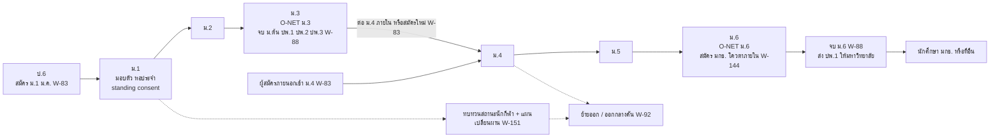

### 10.2 ปีที่เข้า (ม.1 หรือ ม.4): ตั้งแต่สมัครจนวันแรกในหอ

ดูหัวข้อ 2.9 (SS-1..SS-13) จุดสัมผัสผู้ปกครองในช่วงนี้: สร้างบัญชีและยืนยันตัวตน, ยื่นใบสมัครแทนเด็ก, ยินยอมการทดสอบร่างกาย, รับผล, ยืนยันสิทธิ์, มอบตัว + สัญญาหอ + standing consent รายปี (ออกนอกหอ, รายชื่อผู้รับแทนพร้อมรูป, รักษาพยาบาลเบื้องต้น/ส่งโรงพยาบาล, เดินทางไปแข่ง, ใช้ภาพและผลงาน), ชำระค่าใช้จ่าย, ส่งเด็กเข้าหอ

### 10.3 วงรอบทุกภาคเรียนของโรงเรียนกีฬา

| ลำดับ | ผู้ทำ | สิ่งที่ทำ | ระบบช่วยอะไร | เอกสาร/ค่าธรรมเนียม | เวลา | WID | โมดูล |
|---|---|---|---|---|---|---|---|
| SC-T1 | `sschool_dir` | อนุมัติปฏิทินโรงเรียน (แยกจากมหาวิทยาลัย) ตารางเรียน + ตารางซ้อม + วันปิดหอ/กลับบ้าน | ปฏิทิน profile `BASIC_ED` (เล่ม 03) | — | ก่อนเปิดภาค | W-117 | ORG, SSC |
| SC-T2 | `guardian` | ยืนยันข้อมูลผู้ปกครอง/ผู้ติดต่อฉุกเฉิน/ผู้รับแทน ประจำปี; ทบทวน standing consent | เตือนต้นปีการศึกษา; ถ้ามีคำสั่งศาลจำกัดอำนาจปกครอง → บล็อกผู้ปกครองคนนั้นจาก exeat/pickup | คำสั่งศาล (ถ้ามี) | ต้นปีการศึกษา | W-13, W-93 | PRIV, SSC, HOU |
| SC-T3 | `guardian` | ชำระค่าบำรุง/ค่าอาหาร/ค่าหอ (ถ้ามี 🟡) | ลิงก์ชำระ, pocket-money ledger (เฟสหลัง) | 🟡 | ต้นภาค | W-51 | FIN |
| SC-T4 | `homeroom` / `lecturer` | เช็กชื่อรายคาบ/รายวัน; ครูหอเช็กชื่อกลางคืน | ขาดเรียนแจ้งผู้ปกครองในวันเดียวกัน | — | ทุกวัน | W-52, W-90 | SSC, HOU |
| SC-T5 | `student` → `guardian` → `dorm` | ขอออกนอกหอ/กลับบ้าน (exeat): นักเรียนขอ → ระบบตรวจผู้มารับมีสิทธิ์และไม่มีคำสั่งห้าม → ผู้ปกครอง (LEGAL หรือ CAREGIVER ที่ได้รับสิทธิ์) อนุญาตในแอป หรือครูหอโทรยืนยันตามเบอร์ที่ลงทะเบียน/รหัส OTP ทาง SMS (เล่ม 04 G13) → ครูหอออกบัตรผ่าน บันทึกเวลาออก-กลับ → เกินเวลาแจ้งเตือน | standing consent ลดการอนุมัติซ้ำ; ปิดหอวันหยุดยาว = บังคับกลับบ้านตามตาราง | — | ≤ 4 ชม. | W-13 | HOU |
| SC-T6 | `dorm` | บันทึกผู้มาเยี่ยม (เทียบรายชื่อที่ผู้ปกครองอนุญาต) | visitor log + รูป | บัตรประชาชนผู้มาเยี่ยม | เวลาเยี่ยม (ตัวอย่าง ส.–อา. 09:00–17:00 ✅) | W-13 | HOU |
| SC-T7 | `nurse` (ห้องพยาบาลหอ, `nurse.boarding`) + `dorm` | ให้ยาตามแผนที่ `physician` สั่งและผู้ปกครองยินยอม บันทึกการให้ยา; เจ็บป่วยกลางคืนเห็น medical alert | medication log (`hlt_vault`), เจ้าหน้าที่โทรแจ้งผู้ปกครองก่อน (เล่ม 04 G14) | treatment consent | ตามเหตุ | W-91 | HLT |
| SC-T8 | `coach` | ซ้อมตามแผน; wellness ตามทีม (เด็ก: ไม่ใช้รายวันทั่วทั้งโรงเรียน, blueprint R-09) | ATH | — | ทุกวัน | W-68 | ATH |
| SC-T9 | `coach` → `guardian` | ไปแข่ง (กีฬาโรงเรียนกีฬา, กีฬานักเรียนนักศึกษาแห่งชาติ, เยาวชนแห่งชาติ): ผู้ปกครองยินยอมรายทริป (ถ้าเกิน standing consent), ลาเรียน, ครูผู้ควบคุมผ่านการตรวจประวัติ | TeamTrip + e-consent + gate `TripSupervisionRule` (สัดส่วน 1:10 / 1:8 สำหรับอายุต่ำกว่า 15 ปี, ผู้ใหญ่ ≥ 2, เพศเดียวกัน, StaffClearance, room plan 🟡) | หนังสือเชิญ | ก่อนเดินทาง | W-31, W-114 | ATH, PRIV, SAFE |
| SC-T10 | `lecturer` | สอบกลางภาค/ปลายภาค บันทึกผล 8 ระดับ + ร/มส, กิจกรรม ผ/มผ, คุณลักษณะ, อ่านคิดวิเคราะห์เขียน | `AcademicProfile=BASIC_ED` | ปพ.5 | กลาง/ปลายภาค | W-54, W-01 | SSC, ASM |
| SC-T11 | `homeroom` → `guardian` | รายงานผลรายภาค (ปพ.6 สมุดพก) + รายงานพฤติกรรม/การออกนอกหอรายเดือน | guardian timeline + monthly digest | ปพ.6 | ปลายภาค / รายเดือน | W-87 | SSC, NOTI |
| SC-T12 | `homeroom` + `guardian` | ประชุมผู้ปกครอง (ภาคละครั้ง 🟡), เยี่ยมบ้าน/คัดกรอง SDQ 🟡 | Booking slot + online | — | ภาคละครั้ง | W-89 | SSC |
| SC-T13 | `lecturer` | สอบแก้ 0/ร/มส ภายในภาคถัดไป (ไม่เกิน 2 ครั้ง 🟡) | deadline job + แจ้งผู้ปกครอง | — | ภาคถัดไป | W-94 | SSC |
| SC-T14 | `sschool_dir` | เลื่อนชั้น/ซ้ำชั้น ปลายปี | promotion batch + ทบทวนรายคน | — | มี.ค. | W-94 | SSC |
| SC-T15 | `safeguard` | ทุกปี: ตรวจประวัติบุคลากรที่ทำงานกับเด็กใกล้หมดอายุ, อบรม safeguarding | StaffClearance expiry | — | รายปี | W-23 | SAFE |
| SC-T16 | ใครก็ได้ | แจ้งเหตุคุ้มครองเด็ก | ปุ่มในแอป (เด็กแจ้งเองได้) + สายด่วน + **ช่องทางไม่ใช้ดิจิทัล** (ครูที่ไว้วางใจ, กล่องรับเรื่องในหอ) ที่เจ้าหน้าที่บันทึกเข้า SAFE — ไม่ขึ้นกับการถือมือถือ (UXR-49) | — | ≤ 24 ชม. | W-22 | SAFE |
| SC-T18 | `dorm` → `sschool_dir` + `safeguard` | **เหตุร้ายแรง** (เด็กหาย บาดเจ็บสาหัส เสียชีวิต): เปิด CriticalIncident → ผู้บริหาร + safeguard ≤ 30 นาที → โทรผู้ปกครอง → ตำรวจ (เด็กหายตามเวลาที่ตั้ง/ทันทีถ้าเสี่ยงสูง) → รายงานต้นสังกัด → ล็อกการสื่อสารสาธารณะ → ดูแลเพื่อน → serious-case review | ปุ่มเดียว + call tree | — | ≤ 30 นาที | W-149 | SAFE, HOU, SSC |
| SC-T17 | `system` | นับนักเรียน ณ 10 มิ.ย. / 10 พ.ย. (ถ้าต้นสังกัดใช้ DMC 🟡) | census snapshot (RPT) | — | 10 มิ.ย. / 10 พ.ย. 🟡 | W-35 | RPT |

### 10.4 จุดเปลี่ยนสำคัญรายชั้น

| ชั้น | เหตุการณ์เฉพาะ | ผู้ปกครองทำอะไร | WID |
|---|---|---|---|
| ม.1 | ปรับตัวกับหอประจำ; ประชุมผู้ปกครองนักเรียนใหม่; คัดกรองสุขภาพจิต/SDQ 🟡 | เข้าร่วมประชุม, อัปเดตผู้รับแทน | W-83, W-13 |
| ม.2 | ประเมินพัฒนาการกีฬาตามเกณฑ์ที่ประกาศต้นปี — อาจได้แผนพัฒนาหรือเสนอเปลี่ยนชนิดกีฬา (maturation ใช้เพื่ออธิบาย ไม่ใช่ gate) | รับทราบผลประเมิน | W-68, W-112 |
| ม.3 | O-NET ม.3 (สทศ. รับข้อมูล ส.ค.; ประกาศที่นั่งสอบ ม.ค.; สอบ ก.พ.–มี.ค. 🟡); จบ ม.ต้น: อนุมัติจบ ออก ปพ.1/ปพ.2/ปพ.3 (มี.ค.); เลือกต่อ ม.4 ภายใน (ต่อเนื่องหรือสมัครใหม่ 🟡) หรือย้ายไปที่อื่น | ยืนยันการเรียนต่อ ม.4 / ขอใบย้าย | W-88, W-83, W-92 |
| ม.4 | นักเรียนใหม่จากภายนอกเข้าร่วม; ปรับแผนการเรียน ม.ปลาย (หน่วยกิต) | (ผู้ปกครองนักเรียนใหม่) มอบตัว | W-83 |
| ม.5 | ผลงานกีฬาระดับชาติ/ทีมชาติเยาวชน; เตรียม portfolio | ยินยอมเดินทางแข่ง/เก็บตัว | W-31 |
| ม.6 | O-NET ม.6 (ก.พ. 🟡); **สมัครเข้ามหาวิทยาลัย**: โควตาภายในของ มกช. (feeder) ส่งผลการเรียนและผลงานกีฬาจาก SSC/ATH เข้า ADM เมื่อได้รับความยินยอม; TCAS ที่อื่น; จบ ม.6 ออก ปพ.1 ให้ทันวันรายงานตัวมหาวิทยาลัย | ยินยอมส่งข้อมูลให้ ADM, ยินยอมเรื่องการเงินในการยืนยันสิทธิ์ | W-144, W-88 |
| ทุกชั้น | **ผลกีฬาต่ำกว่าเกณฑ์ ≠ ถูกให้ออกทันที:** retention review (เกณฑ์ประกาศต้นปี + แผนพัฒนา ≥ 1 ภาค → ความเห็น sci/homeroom/safeguard → คณะกรรมการที่ไม่ใช่ผู้เสนอ → ผู้ปกครองรับทราบ + อุทธรณ์ CASE → แผนเปลี่ยนผ่าน ≥ 1 ภาค: เปลี่ยนชนิดกีฬา / เรียนต่อแบบนักเรียนทั่วไปถ้านโยบายมี / ย้ายพร้อมประสานโรงเรียนปลายทาง; ห้ามใช้ข้อมูลสุขภาพ/จิตวิทยาเป็นเหตุผล) | ประชุม เสนอข้อมูล เลือกทางเลือก อุทธรณ์ | W-151 |
| ทุกชั้น | ย้ายออก/ออกกลางคัน (ตามคำขอผู้ปกครอง หรือหลัง W-151 ถึงที่สุดและเลือกการย้าย): ออกใบย้าย + ปพ.1 ระหว่างเรียน, check-out หอ, ปิดสิทธิ์ผู้ปกครอง | ยื่นคำขอย้าย/รับเอกสาร | W-92 |

### 10.5 การส่งต่อจากโรงเรียนกีฬาเข้ามหาวิทยาลัย (W-144)

| ลำดับ | ผู้ทำ | สิ่งที่ทำ | ระบบช่วยอะไร | เอกสาร/ค่าธรรมเนียม | เวลา | WID | โมดูล |
|---|---|---|---|---|---|---|---|
| FD-1 | `admission` (วิทยาเขต) | เปิดโควตาภายในสำหรับนักเรียนโรงเรียนกีฬา (ถ้านโยบายมี 🟡) | channel `quota_athlete` + เงื่อนไข "มาจากโรงเรียนกีฬา มกช." | ประกาศ | ต.ค. 🟡 | W-69, W-144 | ADM |
| FD-2 | `student` + `guardian` | ยินยอมให้ส่งข้อมูลผลการเรียนและผลงานกีฬาจาก SSC/ATH เข้า ADM | consent วัตถุประสงค์ใหม่ (ไม่ใช้ข้อมูลข้ามวัตถุประสงค์โดยไม่ขอ) | — | ก่อนสมัคร | W-144 | PRIV |
| FD-3 | `system` | กรอกใบสมัครล่วงหน้าจากข้อมูลที่มี (ผลการเรียน ม.4–ม.6 ภาค 1, ผลงานที่ verified แล้ว) | ไม่ต้องตรวจหลักฐานซ้ำถ้า ATH ยืนยันแล้ว | — | ทันที | W-144 | ADM |
| FD-4 | `candidate` | สอบตามช่องทาง (อาจได้ยกเว้นบางสถานี 🟡) แล้วเข้าสู่ clearing | หัวข้อ 2.5 / 2.8 | — | ตามรอบ | W-76, W-74 | ADM |
| FD-5 | `system` | เมื่อรายงานตัว: ประวัติสุขภาพ/การบาดเจ็บย้ายต่อเฉพาะที่ผู้เรียนยินยอม; สิทธิ์ผู้ปกครองเปลี่ยนจาก guardian (ผู้เยาว์) ตามอายุจริง | PRIV re-consent | — | รายงานตัว | W-44 | PRIV, HLT |

---

## 11. เส้นทางนักศึกษาบัณฑิตศึกษา (ป.โท / ป.เอก) (`gradstudy`)

| ลำดับ | ผู้ทำ | สิ่งที่ทำ | ระบบช่วยอะไร | เอกสาร/ค่าธรรมเนียม | เวลา (ตัวอย่างหลักสูตร 2 ปี 🟡) | WID | โมดูล |
|---|---|---|---|---|---|---|---|
| GT-1 | `candidate` → `student` | รับเข้า (หัวข้อ 2.10) รายงานตัว ผูก PolicySet `GRAD` (ระยะเวลาสูงสุด หน่วยกิตวิทยานิพนธ์ เกณฑ์ภาษา) และแผน ก/ข | — | ค่าธรรมเนียมแรกเข้า; ภาคปกติ/ภาคพิเศษอัตราต่างกัน 🟡 | เดือน 0 | W-84, W-44 | ADM, REC, GRAD |
| GT-2 | `gradschool` → `dean` | แต่งตั้งอาจารย์ที่ปรึกษาวิชาการ | คำสั่งอัตโนมัติ | คำสั่ง | ภาคแรก | W-84 | GRAD |
| GT-3 | `student` | เรียนรายวิชาตามวงรอบภาค (หัวข้อ 4) — ภาคพิเศษเรียนเสาร์-อาทิตย์ 🟡 | ตาราง/ปฏิทินแยกตาม student type (เล่ม 03) | ค่าเทอม | ภาค 1–2 | W-49..W-57 | REG, ASM |
| GT-4 | `student` | ผ่านเกณฑ์ภาษาอังกฤษ (ยื่นผลสอบภายนอกหรือสอบของมหาวิทยาลัย 🟡) | บันทึกผลมีวันหมดอายุ, degree audit อ่าน | ผลสอบ; ค่าสอบ 🟡 | ก่อนสอบป้องกัน | W-145 | GRAD |
| GT-5 | `student` (ป.เอก) → `gradschool` | สอบวัดคุณสมบัติ (qualifying exam) | จัดกรรมการ บันทึกผล ผ่าน/ไม่ผ่าน (สอบซ้ำได้ตามข้อบังคับ 🟡) | — | ปีที่ 1–2 | W-145 | GRAD |
| GT-5b | `student` (แผน ข) → `gradschool` → `thesis_committee` | สอบประมวลความรู้ (comprehensive exam) แล้วทำการค้นคว้าอิสระ (IS) | ตรวจเงื่อนไข (หน่วยกิต GPA ภาษา [ต้องตรวจสอบ]), จำนวนครั้งที่สอบซ้ำได้ [config], ผ่าน → เปิด IS ใช้ W-96/W-97 แบบ IS | — | หลังเรียนรายวิชาครบ | W-158 | GRAD |
| GT-6 | `student` + `advisor` | เสนอหัวข้อและอาจารย์ที่ปรึกษาวิทยานิพนธ์ → แต่งตั้งกรรมการ | `ThesisCommittee` + ตรวจคุณสมบัติกรรมการ (ภายนอกเป็น external person) + **`AdvisorLoadRule`** (เพดานนักศึกษาต่ออาจารย์ที่ปรึกษา [ต้องตรวจสอบเกณฑ์มาตรฐานหลักสูตร] — เกินเป็น hard stop เว้น gradschool อนุมัติข้อยกเว้น) | แบบเสนอ | ภาค 2 | W-95 | GRAD |
| GT-7 | `student` → `gradschool` | สอบโครงร่าง (proposal defense) | นัดห้อง/ออนไลน์, แบบประเมิน, ผล: ผ่าน/แก้ไข/ไม่ผ่าน | เล่มโครงร่าง | ภาค 2–3 | W-96 | GRAD |
| GT-8 | `student` → กรรมการจริยธรรม | ขอรับรองจริยธรรมการวิจัยในมนุษย์ (นักกีฬา/ผู้เยาว์เป็นกลุ่มเปราะบาง) | ลิงก์ X-RES หรือบันทึกเลขรับรองขั้นต่ำก่อนมี X-RES | เอกสารจริยธรรม | ก่อนเก็บข้อมูล | W-96 | GRAD, X-RES |
| GT-9 | `student` | ลงทะเบียนหน่วยกิตวิทยานิพนธ์ (สัญลักษณ์ IP/S/U 🟡) ทุกภาค หรือรักษาสภาพ | ตรวจระยะเวลาสูงสุด, เตือนก่อนครบ | ค่าหน่วยกิต / ค่ารักษาสภาพ (ตัวอย่างบัณฑิต 1,600–5,000 บาท/ภาค ✅ หลายแห่ง) | ทุกภาค | W-49, W-10 | REG, FIN |
| GT-10 | `advisor` | รายงานความก้าวหน้ารายภาค | `ThesisMilestone(PROGRESS)` | รายงาน | ทุกภาค | W-96 | GRAD |
| GT-10b | `student` / `advisor` → `gradschool` | เปลี่ยนอาจารย์ที่ปรึกษา (เกษียณ ย้าย ขัดแย้ง — แจ้งเป็นความลับได้) หรือเปลี่ยนหัวข้อ: ที่ปรึกษาใหม่ตอบรับ → ตรวจ AdvisorLoadRule → `head` เห็นชอบ → คำสั่งใหม่ ปิดบทบาทเดิม; หัวข้อเปลี่ยนสาระสำคัญ → สอบโครงร่างใหม่ | โอนบันทึกความก้าวหน้า/ไฟล์ตามสิทธิ์ | แบบคำร้อง | ตามเหตุ | W-159 | GRAD |
| GT-11 | `student` | ใช้ข้อมูล ATH/LAB เพื่อวิจัย (ต้องมี consent วัตถุประสงค์วิจัย + เลขรับรองจริยธรรม) | data request ผ่าน PRIV; ข้อมูลลดตัวตน | — | ระหว่างวิจัย | W-21 (รูปแบบ) | PRIV, ANA |
| GT-12 | `student` | ตรวจการคัดลอกผลงาน (plagiarism) ก่อนสอบป้องกัน | เชื่อมเครื่องมือตรวจ (อยู่ใน cross-border register ถ้าเป็นบริการต่างประเทศ) | รายงาน similarity | ก่อนสอบ | W-97 | GRAD |
| GT-13 | `student` → `gradschool` | สอบป้องกันวิทยานิพนธ์ | แต่งตั้งกรรมการสอบ, บันทึกผล, ค่าตอบแทนกรรมการ (W-29) | เล่มฉบับสอบ | ภาค 4 | W-97 | GRAD, FIN |
| GT-14 | `student` | แก้ไข ส่งเล่มสมบูรณ์ + ไฟล์ (คลังปัญญา) + หลักฐานการตีพิมพ์/นำเสนอ | `PublicationEvidence`, ตรวจรูปแบบเล่ม | เล่มสมบูรณ์ | ภายใน N วันหลังสอบ 🟡 | W-98 | GRAD, X-LIB |
| GT-15 | `student` | ขอขยายเวลา (ถ้าเกินระยะเวลาสูงสุด) | e-Form → `dean` → สภาวิชาการ | — | ก่อนครบกำหนด | W-99 | GRAD |
| GT-16 | `student` | ยื่นขอจบ → audit (รวมเกณฑ์ภาษา ตีพิมพ์) → สภาอนุมัติ → e-Transcript → รับปริญญาพร้อม ป.ตรี | หัวข้อ 8 | — | ภาคสุดท้าย | W-06, W-64 | GRD |

---

## 12. workflow ที่เล่มนี้เสนอ และการจับคู่กับทะเบียนเล่ม 05

เล่ม 05 ([05-workflows](05-workflows.md), `data/workflows.json`) เป็นเจ้าของเลข workflow และได้ลงทะเบียน W-69..W-147 แล้ว (W-144..W-147 รับจากข้อเสนอในหัวข้อ 12.1) และ **W-148..W-163 ในรอบ v1.1** (หัวข้อ 12.4) เล่มนี้อ้าง ID ของทะเบียนโดยตรง; ข้อความขั้นตอนฉบับสุดท้ายอยู่ใน `data/workflows.json`

### 12.1 workflow ที่เล่มนี้เสนอ (ลงทะเบียนแล้วเป็น W-144..W-147)

| เสนอ ID | ชื่อ | stage | โมดูลหลัก (โมดูลร่วม) | อ้างในหัวข้อ | ขั้นตอนย่อ (ผู้ทำ: สิ่งที่ทำ) | SLA ที่เสนอ | trigger → output |
|---|---|---|---|---|---|---|---|
| W-144 | Feeder: นักเรียนโรงเรียนกีฬาสมัครต่อ มกช. (โควตาภายใน + consent ส่งข้อมูล) | pre | ADM (SSC, ATH, PRIV) | 10.5 | admission: เปิดโควตาภายในในรอบโควตา → student + guardian: ยินยอมส่งผลการเรียน/ผลงานจาก SSC/ATH เข้า ADM → system: เติมใบสมัครล่วงหน้า (ผลงานที่ verified แล้วไม่ต้องตรวจซ้ำ) → candidate: ตรวจ/แก้ แล้วยื่น → เข้า W-71/W-76/W-74 ตามปกติ | ตามรอบรับสมัคร | รอบโควตาเปิด → ใบสมัครที่กรอกล่วงหน้า + consent record (ขึ้นกับคำตอบ Q-17) |
| W-145 | สอบวัดคุณสมบัติ (ป.เอก) และเกณฑ์ภาษาอังกฤษบัณฑิตศึกษา | gradstudy | GRAD (ASM) | 11 (GT-4, GT-5) | student: ยื่นผลสอบภาษาภายนอก หรือสมัครสอบของมหาวิทยาลัย → gradschool: ตรวจผล/จัดสอบวัดคุณสมบัติ แต่งตั้งกรรมการ → thesis_committee: สอบและบันทึกผล → system: บันทึก milestone + วันหมดอายุผลภาษา, degree audit อ่าน → student: สอบซ้ำได้ตามข้อบังคับ | 10 วันทำการหลังสอบ | ผู้เรียนยื่น/รอบสอบ → `ThesisMilestone(QUALIFYING)` / ผลภาษา |
| W-146 | แผนการเรียนยืดหยุ่นนักกีฬา (dual-career plan, ทีมชาติลาระยะยาว) | sport | ATH (REC, REG, EXM, GRD) | 6.7 | student: แจ้งการเรียกตัว + หนังสือสมาคม/กกท. → system: คำนวณภาค/วิชาที่ได้รับผลกระทบ → advisor.dc_tutor: ทำแผนรายภาค (ลดหน่วยกิตผ่าน W-03, เรียนออนไลน์, ย้ายวิชาปฏิบัติ) → dean: อนุมัติ → registrar: จัดสอบนอกสถานที่/ชดเชย (W-05) → system: ตั้ง GateOverride ที่จำเป็น | 10 วันทำการ (ตาม JSON) | หนังสือเรียกตัว → แผนการเรียนที่อนุมัติ + overrides (ขึ้นกับ Q-27) |
| W-147 | ต่อสัญญา / ย้ายห้อง / ย้ายออกหอ และคืนเงินประกัน | during | HOU (FIN) | 3.4 (DM-8) | student: ยื่นต่อสัญญา/ย้ายห้อง/ย้ายออก (ผู้เยาว์: guardian ลงนาม) → dorm: ตรวจห้องเทียบ inventory พร้อมภาพ → finance: หักค่าเสียหาย คืนเงินประกัน (W-143 ถ้าเปลี่ยนบัญชีรับเงิน) → system: ปลด/ตั้ง clearance flag สำหรับจบการศึกษา | คืนเงิน ≤ 30 วัน 🟡 | เปิดรอบต่อสัญญาตามปฏิทิน / คำขอ → สัญญาใหม่ หรือ check-out + refund |

### 12.2 รายการบังคับใน blueprint หัวข้อ 6 → ID ในทะเบียน

| ความต้องการ (blueprint 6) | ID ในทะเบียน | ใช้ในหัวข้อ |
|---|---|---|
| ตั้งค่าและประกาศรอบรับสมัครรายวิทยาเขต | W-69 (+ ช่องทาง W-70 โควตาเรียนดี, W-71 โควตานักกีฬา, W-72 ทั่วไปรายรอบ) | 2.3–2.6 |
| clearing ข้ามวิทยาเขต | W-74 | 2.8 |
| ให้คะแนนสอบทักษะหลายกรรมการ + moderation | W-76 (+ จัดตาราง/กรรมการ W-75, เหตุการณ์วันสอบ W-85) | 2.5.5, 2.14 |
| รับนักเรียนโรงเรียนกีฬา ม.1/ม.4 | W-83 (+ มอบตัวเข้าหอ W-86) | 2.9 |
| รับ ป.โท/เอก | W-84 | 2.10 |
| โอนย้าย/เทียบโอนจาก ปวส. | W-82 | 2.11 |
| ผู้สมัครพิการ (accommodation ตอนสอบ) | W-79 | 2.12 |
| ผู้สมัครต่างชาติ | W-80 | 2.13 |
| เสนอ/สอบโครงร่าง และสอบป้องกันวิทยานิพนธ์ | W-95, W-96, W-97, W-98 | 11 |
| ส่ง/อนุมัติตารางสอนและเปิดกลุ่มเรียน | W-100 (+ ปิดกลุ่ม W-101) | 4.2 |
| ลงทะเบียนล่าช้าพร้อมค่าปรับ | W-102 | 4.4 |
| ค่า I ค้าง (ปิด I) | W-103 | 4.8 |
| ประกันอุบัติเหตุ/เคลม | W-107 | 3.2, 6.6 |
| ยื่นลาแข่งแบบยกคณะ (batch) | W-114 | 6.4 |
| เดินทางกลับ/ล้างเงินยืม | W-115 | 6.5 |
| ปิดปีงบประมาณ | W-116 | เล่ม 03 |
| ใบประกาศนียบัตรแทน | W-108 | 9 |
| ปฏิทินการศึกษา (สร้าง/อนุมัติ/เผยแพร่) | W-117 | 4.1, เล่ม 03 |
| (ไม่อยู่ในรายการบังคับ แต่ journey ใช้) | W-73 TCAS adapter, W-77 ตรวจเอกสาร, W-78 วันรายงานตัว, W-81 ยกเว้น/คืนค่าสมัคร, W-87 ปพ.5/ปพ.6, W-88 จบ ม.3/ม.6, W-89 ประชุมผู้ปกครอง, W-90 เช็กชื่อหอ, W-91 ให้ยาผู้เยาว์, W-92 ย้ายออกโรงเรียนกีฬา, W-93 คำสั่งศาล, W-94 สอบแก้/เลื่อนชั้น, W-99 ขยายเวลา, W-104 มส., W-105 ยกเลิกผู้ไม่ชำระ, W-106 ข้ามวิทยาเขต, W-109 โภชนาการ/จิตวิทยา, W-110 แล็บ (สัญญาแยก), W-111 จองสนาม, W-112 talent pathway, W-113 สร้าง e-Form, W-118 วางแผนพิธี, W-119 กยศ. รายภาค + จิตอาสา, W-120 ยกเว้นค่าธรรมเนียม, W-122 term rollover, W-127 ผูกผู้ปกครอง, W-128 parent observer, W-129 วิกฤตสุขภาพจิต, W-130 คัดกรองสุขภาพก่อนฤดู, W-131 เปลี่ยนชื่อ, W-132 เพิกถอนปริญญา, W-133 lifecycle cascade, W-134 ตรวจวุฒิเดิม, W-135 SAR, W-136 ITA/OIT, W-139 บุคคลภายนอก, W-140 เรียนแทน/ยกเว้น | ทั่วเล่ม |

### 12.3 ข้อเสนอปรับขั้นตอน workflow เดิม (คงความหมาย — ให้เล่ม 05 พิจารณา)

| ID | ข้อเสนอ | เหตุผลจาก journey |
|---|---|---|
| W-41 | เพิ่มขั้น dedupe applicant master และเรียก W-127 เมื่ออายุ < 20 ก่อนยื่นใบสมัครที่มีข้อมูลสุขภาพ/ทดสอบร่างกาย | CM-2, CM-3 |
| W-43 | ระบุชัดว่าการยืนยันหลักทำผ่าน W-74; myTCAS เป็นกรณี W-73 เท่านั้น | 3.1 |
| W-54 | เพิ่ม "ค่าตอบแทนกรรมการคุมสอบส่ง W-29" และ blackout จาก CompetitionEvent ตอนจัดตาราง | EM-1, EM-5 |
| W-64 | เพิ่ม "ขึ้นทะเบียนบัณฑิตทุกคน รวมผู้ไม่ประสงค์เข้ารับ" และ "นักกีฬาที่ติดแข่งขอเลื่อนรอบ" | GD-13, GD-16 |
| W-32 | ระบุว่าช่วงฝึกใช้ปฏิทินโรงเรียนคู่สัญญา (`PRACTICUM_PERIOD`) ไม่ใช่ภาคของมหาวิทยาลัย และต้องผ่าน W-156 ก่อน | PR-1a, PR-4, เล่ม 03 K-11, K-21 |

### 12.4 workflow ใหม่รอบ v1.1 (D-08 — ลงใน `data/workflows.json` แล้ว)

| ID | ชื่อ | stage | โมดูล | ใช้ในหัวข้อ |
|---|---|---|---|---|
| W-148 | Fast-track ผู้รับเข้ารอบท้าย (late-admit) | first | REC | 3.7 |
| W-149 | เหตุร้ายแรงของผู้เยาว์ในหอประจำ/กิจกรรม | sschool | SAFE | 10.3 (SC-T18) |
| W-150 | คัดเลือกตัวนักกีฬา / ประกาศทีม และทบทวนผล | sport | ATH | 6.8 |
| W-151 | ทบทวนสถานะนักกีฬาในโรงเรียนกีฬา + แผนเปลี่ยนผ่าน | sschool | SSC | 10.4 |
| W-152 | สงสัยกระทบกระเทือนสมอง (concussion) | sport | HLT | 6.9 |
| W-153 | ความร้อน (WBGT, heat illness) | sport | FAC | 2.5 (QS-8a), 6.9 |
| W-154 | การจัดการน้ำหนักในกีฬารุ่นน้ำหนัก | sport | ATH | 2.5 (QS-8a), 6.9 |
| W-155 | Safe sport สำหรับนักกีฬาผู้ใหญ่ | problem | SAFE | 6.10, 7 |
| W-156 | เตรียมความพร้อมฝึกสอนก่อน 16 พ.ค. | during | PRA | 5.7 (PR-1a) |
| W-157 | ParaClassification | sport | ATH | 2.12, 6.9 |
| W-158 | สอบประมวลความรู้ (แผน ข) และ IS | gradstudy | GRAD | 11 (GT-5b) |
| W-159 | เปลี่ยนอาจารย์ที่ปรึกษา / หัวข้อ | gradstudy | GRAD | 11 (GT-10b) |
| W-160 | ผู้อุปการะ (CAREGIVER) / ผู้ปกครองในประเทศ (LOCAL_GUARDIAN) | first | REC | 2.3 (CM-3), 10 |
| W-161 | ถอนรายวิชาทั้งภาคด้วยเหตุทางการแพทย์ | problem | REC | 5.2, 6.6, 7 |
| W-162 | ตรวจสิทธิ์ลงทะเบียนซ้ำเมื่อเกรด/สถานภาพเปลี่ยน | term | REG | 4.1, 4.9 (ST-6) |
| W-163 | ยืนยันสิทธิ์ซ้ำก่อนเปิดภาค (reconfirmation) | pre | ADM | 2.8 (C-14, CL-10) |

workflow เดิมที่ปรับขั้นตอนในรอบ v1.1 (คงความหมาย): W-04/W-114 (tier, อนุมัติครั้งเดียวระดับคณะ, module = ATH), W-05 (สายลัด), W-11/W-17 (ENROLLED_PENDING_APPEAL), W-16 (re-add), W-18 (เร่งด่วน + appeal_hold + cap), W-31 (TripSupervisionRule), W-39 (บทบาทวิชาชีพ, สถานะความพร้อม, โทรผู้ปกครองก่อน), W-49 (block enrolment, idempotent), W-51 (QR), W-57 (standing ก่อนลงทะเบียน), W-68, W-69, W-71, W-74 (กติกาเดียว), W-76 (moderation ≤ 1 วันทำการ), W-79, W-92, W-95, W-105, W-127 (2 ระดับ), W-13, W-22, W-26, W-130 และทุกขั้นที่เคยใช้ `medical`

---

## 13. สมมติฐานและคำถามที่ต้องยืนยัน (อ้างทะเบียน A-xx ในเล่ม 01 และ Q-xx ในเล่ม 13)

| ประเด็นในเล่มนี้ | สมมติฐานที่ใช้ (เล่ม 01) | คำถาม (เล่ม 13) | ใช้ในหัวข้อ | ผลกระทบถ้าคำตอบต่าง |
|---|---|---|---|---|
| ร่วม myTCAS หรือไม่ | A-50 (adapter ปิดโดยค่าเริ่มต้น) | Q-11 | 2.7 | ถ้าร่วม: W-73 เข้า R1 และต้องได้ template/API ปัจจุบัน |
| กติกา clearing (ยืนยัน 1 ที่, สมัครซ้ำ, สละได้กี่ครั้ง) | A-51 | Q-12 | 2.8 | ถ้าไม่บังคับ: C-3/C-4 เป็นคำเตือน และต้องมีขั้น "เลือกที่สุดท้าย" ก่อนรายงานตัว |
| เกณฑ์โควตา/ทั่วไปฉบับเต็ม (GPAX ระดับผลงาน ค่าสมัคร weight) | A-49 | Q-13 | 2.4–2.6 | ค่า config ตั้งต้นของ DMN |
| ชนิดกีฬา rubric จำนวนกรรมการ วิธีรวมคะแนน | A-52 | Q-14 | 2.5.3–2.5.5 | ขนาดคลัง rubric |
| ระยะประกาศผล → รายงานตัว 24 ชม. | A-53 | — | 2.6 | ความเร่งของ batch |
| โรงเรียนกีฬา: เกณฑ์กลางหรือแยก, ม.3 → ม.4 ต่อเนื่องหรือสมัครใหม่, ใครตรวจร่างกาย | A-54 | Q-16 | 2.9, 10 | W-83 template |
| feeder จากโรงเรียนกีฬา | — | Q-17 | 10.5 | W-144 เปิด/ไม่เปิด |
| ผู้พิการ ต่างชาติ โอน/เทียบโอน ภาคพิเศษ ป.ตรี | A-56, A-31, A-30 | Q-18, Q-45, Q-46 | 2.11–2.13, 5.8 | W-79/W-80/W-82 อาจเลื่อนเฟส |
| อุทธรณ์ผลคัดเลือก | — | Q-19 | 2.14 | SLA W-18 |
| คัดกรองสุขภาพก่อนสอบทักษะ | — | Q-23 | 2.5 (QS-5, QS-8) | ถ้าไม่บังคับ: gate เลือกเปิดได้ |
| บัณฑิตศึกษา: วิทยาเขต เกณฑ์ภาษา การสอบ | A-55, A-42 | Q-21 | 2.10, 11 | W-84, W-145 |
| ปฏิทินจริง เวลาเรียน 80% ถอน W ส่งเกรด แก้ I | A-35, A-39, A-40 | Q-25, Q-26 | 4 | ตัวเลขในหัวข้อ 4 |
| ลาแข่ง/สอบชดเชย/สอบนอกสถานที่ | A-38 | Q-27, Q-52 | 6 | W-114, W-146 |
| ค่าธรรมเนียม ค่าปรับ ลาพัก/รักษาสภาพ เอกสาร | A-57, A-60, A-61, A-66 | Q-34, Q-36, Q-47 | 4.4, 4.5, 5.2, 7 | fee config |
| กยศ. / ประกันอุบัติเหตุ / ผ่อนผันทหาร / ชั่วโมงกิจกรรม | A-63, A-65, A-67 | Q-38, Q-42, Q-43, Q-44 | 3.6, 5.4, 5.5 | — |
| การสำเร็จการศึกษาและพิธีรวม | A-43, A-44, A-45 | Q-31 | 8 | ลำดับ GD-11/GD-13 |
| ตรวจสิทธิ์กีฬามหาวิทยาลัย | — | Q-51 | 6.3 | DMN ของ W-30 |
| บัตรนักศึกษา/บัญชี IT | A-70 | Q-48 | 3.2 | consent ส่งข้อมูลธนาคาร |
| วัดผลโรงเรียนกีฬา ปพ. consent ผู้ปกครอง คุ้มครองเด็ก | A-41, A-15, A-17 | Q-55, Q-56, Q-57 | 10 | W-87/W-88/W-94 |

---

## 14. ผลการปิด review

| ข้อจาก review | ประเด็น | การจัดการในเล่มนี้ |
|---|---|---|
| ผู้ใช้ (ข้อร้องเรียนหลัก) | v0.9 ไม่แสดงเส้นทางจริง (เปิดรับสมัคร ยื่นสอบ สอบตรง รอบต่าง ๆ) | **แก้:** หัวข้อ 2 แยก 10 ช่องทางพร้อมตารางขั้นตอน เวลาจริงที่พบ และ clearing; หัวข้อ 3–11 ครอบคลุมจนเป็นศิษย์เก่า |
| research v2 / blueprint 2.1 | v0.9 สมมติ TCAS เป็นช่องทางหลัก (journey 3.2 ขั้น "ยืนยันสิทธิ์ TCAS") | **แก้:** รอบรายวิทยาเขต + clearing ภายใน (W-74) เป็นแกน; TCAS เป็น adapter (W-73) |
| review_functional G-01 | roadmap ไม่ตรงปฏิทิน / pilot ไม่ครบวงจร | **แก้บางส่วน:** journey at a glance ระบุ release ที่รองรับทุกช่วงตาม blueprint หัวข้อ 7; แผนเต็มเป็นของเล่ม 12 |
| G-02 | ไม่มี safeguarding | **แก้:** W-22/W-23 อยู่ใน journey ปกติ (กรรมการทดสอบเด็ก SS-7, ฝึกสอน PR-3, ทริป SC-T9, ปุ่มแจ้งเหตุ SC-T16) |
| G-03 | ไม่มีช่องร้องเรียน | **แก้:** W-19 ในหัวข้อ 7; CASE เป็นประตูเดียว |
| G-04 | ไม่มีอุทธรณ์ (เกรด พ้นสภาพ ผลทดสอบ ทุน) | **แก้:** W-16, W-17, W-18 + EX-4/EX-5 + stay of effect ในหัวข้อ 7 |
| G-05 | exit lifecycle ไม่ครบ (เสียชีวิต ลาออก รับกลับ) | **แก้:** หัวข้อ 7 (W-10, W-24, W-26) พร้อม cascade และบัญชี former student |
| G-06 | ไม่มี disability inclusion | **แก้:** ช่องทาง (i) W-79 + W-33 ระหว่างเรียน + EM-6 |
| G-07 | ไม่มีคัดกรองสุขภาพก่อนทดสอบ/emergency contact/ให้ยาผู้เยาว์ | **แก้:** QS-5, QS-8, SS-5, OB-2/OB-3, HB-2, TT-5, SC-T7 |
| G-08 | บัณฑิตศึกษาไม่มี thesis workflow | **แก้:** หัวข้อ 11 + W-84, W-96, W-97, W-145 |
| G-09 | regulatory reporting / census | **อ้างอิง:** SC-T17, GD-9 ใช้ W-35; รายละเอียดเป็นของเล่ม 03 (ปฏิทิน) และเล่ม 09 |
| G-10 | finance exceptions | **แก้ในมุม journey:** ผ่อน/deferment กยศ. (CF-3, LN-4, PY-5), sponsor (PY-3), counter (PY-2), ค่าปรับ (W-102), payout (TT-8), ปิดปีงบ (W-116) |
| G-11 | ไม่มี attendance อุดมศึกษา | **แก้:** หัวข้อ 4.6 (W-52, W-53) + มส. W-104 + ลาแข่งไม่นับขาด |
| G-12 | คุรุสภา: cap, สัดส่วน 1:3/1:10 | **แก้:** cap ใน 2.1, สัดส่วน PR-2, ตรวจประวัติ PR-3, ส่งรายชื่อ W-32 |
| G-13 | sports-school lifecycle (ย้าย จบ ม.3/ม.6 คำสั่งศาล) | **แก้:** หัวข้อ 10 + W-83, W-86, W-88, W-94, W-92, W-93, SC-T2 |
| G-14 | athlete operations (ทริป ตรวจสิทธิ์ รางวัล) | **แก้:** หัวข้อ 6.3–6.5 (W-30, W-31, W-115) |
| G-15 | admissions exceptions (สำรอง dedupe ตรวจผลงาน วันทดสอบ ยกเว้นค่าสมัคร เทียบวุฒิ) | **แก้:** CL-6 (cascade), C-1 (dedupe), QS-4 (verification), EX-1, CM-7 (waiver), FA-4 |
| G-16 | course offering & cross-campus | **แก้:** หัวข้อ 4.2 (W-100) + e-Form เรียนข้ามวิทยาเขต |
| G-17 | เอกสารระหว่างเรียน ใบแทน ชื่อสถาบันเดิม ผู้ไม่จบ | **แก้:** 5.1, AL-5 (W-108), AL-7 |
| G-18 | ทุจริตสอบผูกเกรด | **แก้:** EM-9/EM-10 (W-55 ล็อกเกรด) |
| G-20 | rollover ภาค/ปีงบ | **อ้างอิง:** W-116, W-117; งานอัตโนมัติอยู่ในเล่ม 03 |
| G-23 | วิกฤตสุขภาพจิต | **แก้:** แถววิกฤตสุขภาพจิตในหัวข้อ 7 ใช้ W-129 (ส่งต่อวิกฤตสุขภาพจิต) ของเล่ม 05 |
| G-26 | ผู้ปกครองของนักศึกษาอายุ 18–19 | **แก้:** CM-3, OB-4, W-10 guardian co-sign ตามอายุ ณ วันยื่น |
| I-26 | sequence v0.9 ไม่มี consent ผู้ปกครองตอนสมัคร | **แก้:** CM-3 อยู่ก่อนยื่นใบสมัคร |
| R-04 / R-05 | ชั่วโมงกิจกรรม/แบบสำรวจซ้อน | **แก้:** AFF ledger เดียว (5.5), ENG survey engine เดียว (GR-1, GD-11) |
| R-09 | wellness รายวันเกินจริง | **แก้:** opt-in หรือเฉพาะทีมที่มีนักวิทย์ (HB-4, TP-B, SC-T8) |
| review_benchmark #1 | digital student ID | **แก้:** OB-10 |
| benchmark #2 | e-Form catalogue | **แก้:** หัวข้อ 5.2 |
| benchmark #5, #6 | case management, booking & queue | **แก้บางส่วน:** advisor workspace (ST-3), Booking & Queue (HB-1, ST-4); รายละเอียดโมดูลเป็นของเล่ม 06 |
| benchmark #8 | degree planner | **แก้:** RG-2, NT-2, TM-1 |
| benchmark #9 | eligibility engine | **แก้:** EL-1 (W-30) |
| benchmark #11 | team travel & per diem | **แก้:** 6.5 (W-31, W-115) |
| benchmark G5 | guided journeys/checklists | **แก้:** onboarding checklist (OB-14) |
| benchmark P1–P5 | boarding: exeat, pocket money, guardian timeline, health notification, visitor | **แก้:** SC-T3..SC-T7, SC-T11; pocket-money ledger **เลื่อน** ไปเฟสหลัง (เหตุผล: ต้องตรวจเกณฑ์ ธปท. ก่อน) |
| benchmark #12 (บริการวิชาการ/ค่ายกีฬา) | ไม่อยู่ใน journey ของนักศึกษา | **เลื่อน:** อยู่ใน REV (เฟสหลัง) ตาม blueprint; W-37 คงเดิม |
| benchmark #10, #13–15 (nutrition/psych, OB 3.0, talent pathway, LIMS) | | **อ้างถึงบางส่วน** (TP-F, GD-8, ม.2 talent pathway); รายละเอียดเป็นของเล่ม 06 |
| **v1-review (28 ต.ค. 2569) — functional_sports** | | |
| F-01 / X-13 | ผู้ยืนยันโควตาหลุดไปยืนยัน TCAS ที่อื่น | **แก้:** C-14 + CL-10 (W-163), เล่ม 03 J-48 |
| F-02 | seat bucket ไม่มีตำแหน่ง/รุ่นน้ำหนัก | **แก้:** sub-bucket ใน 2.1, QS-12, W-69/W-76 |
| F-03 / S-03 / S-13 | heat policy, ชั่งน้ำหนัก, แบบคัดกรองเด็ก | **แก้:** QS-5, QS-8a, 6.9 (W-153, W-154) |
| F-04 | สมาคมตรวจช้า | **แก้:** W-71 สถานะ `provisionally_eligible` |
| F-05 / X-05 | late-admit cohort | **แก้:** หัวข้อ 3.7 (W-148), C-9 cascade_cutoff, OB-13/OB-14, 4.1 |
| F-06 / S-04 | คัดออกจากทีม = ให้ออก; ไม่มีการคัดตัว | **แก้:** 6.8 (W-150), 10.4 retention review (W-151), W-92 trigger |
| F-07 / O-9 | relative-age bias, maturation ทุกคน | **แก้:** หมายเหตุ 2.5.4, 10.4 ม.2 |
| F-08 | เหตุร้ายแรงผู้เยาว์ในหอ | **แก้:** SC-T18 (W-149) |
| F-09 | แผน ข / ภาระที่ปรึกษา / เปลี่ยนที่ปรึกษา | **แก้:** GT-5b (W-158), GT-6 AdvisorLoadRule, GT-10b (W-159) |
| F-10 / D-03 | GRD ใน pilot R2 | **แก้:** 1.2 แถว grad: GRD ขั้นต่ำใน R2 |
| F-11 | ParaClassification | **แก้:** DA-2, 6.9 (W-157) |
| F-12 / X-12 | เวลา accommodation เป็นไปไม่ได้ | **แก้:** DA-2 ≥ 10 วันทำการ + provisional, DA-3 ≤ 3 วันทำการ (W-79) |
| F-14 | PPE ตามหลัง gate | **แก้:** HB-2 provisional PRE_TEST + PPE ≤ สัปดาห์ 3 |
| F-15 / X-26 / X-30 | ภาระอนุมัติลาแข่ง, เจ้าของไม่ชัด, อนุมัติสอบชดเชยซ้ำ | **แก้:** 6.4 tier + ATH เจ้าของ + อนุมัติครั้งเดียวระดับคณะ + W-05 สายลัด, AT-6 MakeupPolicy, 5.2 |
| F-19 / X-22 | ฝึกสอน 16 พ.ค. | **แก้:** PR-1a (W-156) |
| F-20 / F-21 / X-19 / D-08 | standing หลังลงทะเบียน; สิทธิ์ระหว่างอุทธรณ์ | **แก้:** 4.1, RG-1, ST-1, ST-5, ST-6 (W-162), หัวข้อ 7 (ENROLLED_PENDING_APPEAL, ผลเมื่อแพ้/ชนะ, re-add) + เล่ม 03 K-15/L-4 |
| F-22 | serious incident review | **แก้:** แถวนักศึกษาเสียชีวิต (W-26) |
| F-23 | medical withdrawal | **แก้:** 5.2, 6.6 IJ-8, หัวข้อ 7 (W-161) |
| F-24 / X-29 | first-aid โดยโค้ชเท่านั้น | **แก้:** "ผู้กำกับกิจกรรม" (0.3, IJ-1, W-39) |
| F-26 | safe sport ผู้ใหญ่ | **แก้:** 6.10, หัวข้อ 7 (W-155) |
| F-27 / S-08 | ratio ผู้ควบคุมทริป, เรียกตัวด่วน, แบบฟอร์มการเงิน | **แก้:** TT-1, TT-3, SC-T9 (W-31) |
| F-30 / D-03 | พลศึกษาเกมส์ ก.ย. 2572 | **แก้:** 1.2 แถว sport, 6.1 |
| S-01 / X-28 / D-05 | สถานะความพร้อมต้องใช้ consent | **แก้:** HB-4, IJ-3 |
| S-02 | concussion | **แก้:** 6.9 (W-152), HB-2 baseline |
| S-05 / O-2 | ACWR "เสี่ยงบาดเจ็บ", KPI flag ของโค้ช | **แก้:** TP-D |
| S-07 / O-1 / O-4 | ภาระกรอกแผนซ้อม, adapter เฉพาะยี่ห้อ | **แก้:** TP-A, TP-C |
| S-10 / D-08 | แยก `medical` | **แก้:** 0.3 และทุกตาราง (`physician`/`nurse`/`physio`) |
| S-12 | LEA/RED-S, ไม่เก็บรอบเดือนใน ATH | **แก้:** HB-2 |
| X-01..X-04 / O-10 / D-06 | กติกา clearing ขัดกัน, ClearingRun | **แก้:** 2.8.1 ชุดเดียว + ตารางเวลาคืนที่นั่ง (C-3, C-4, C-5, C-8..C-10); ClearingRun ไม่อยู่ใน R1 |
| X-06 / X-14 | อุทธรณ์ vs ยืนยันสิทธิ์ / เพดานคุรุสภา | **แก้:** C-15, EX-4, EX-5, QS-16 (W-18) + เล่ม 03 L-15 |
| X-07 / X-08 / O-7 / O-8 | blind vs COI, objective vs subjective, normalisation | **แก้:** QS-9, 2.5.5 ข้อ 3–5 |
| X-09 | moderation SLA | **แก้:** QS-10 + 2.5.5 ข้อ 4 = W-76 (flag วันเดียวกัน, ปิด ≤ 1 วันทำการ) |
| X-10 | CM-1 vs W-69 | **แก้:** CM-1 (≥ 30 วัน / ≥ 7 วัน, ผู้เริ่ม admission) |
| X-11 | อายุใบรับรองแพทย์ | **แก้:** QS-5 นับ ณ วันทดสอบ |
| X-16 | ม.3 → ม.4 ต่อเนื่องเป็น confirmed | **แก้:** หมายเหตุหลัง 2.9 (`offered`) |
| X-17 | GS-1 คืนเงินโดยไม่เสนอทางเลือก | **แก้:** GS-1 |
| X-18 | batch ยกเลิก T0 vs J-15 | **แก้:** 4.1, PY-6 |
| X-20 | ตรวจสิทธิ์ก่อนข้อมูลพร้อม | **แก้:** EL-1 (pre/final) |
| X-24 | W-144..W-147 ยังติดดาว, SLA W-146 | **แก้:** ลบดาวทั้งเล่ม, 12.1 SLA = 10 วันทำการ |
| X-25 | wellness < 30 วินาที | **แก้:** TP-B ≤ 60 วินาที |
| X-27 / D-04 | wellness อยู่ ATH | **แก้:** TP-B (`hlt_vault`) |
| **v1-review consistency** | WF-02, WF-04, TERM-04, REL-11 | **แก้:** ลบ `\*` และ typo "W-144\*..W-32" (0.1, 12); W-04/W-114 = ATH (6.4); `advisor.dc_tutor` (EL-1, NT-2); แถว sschool ใน 1.2 = โรงเรียนกีฬานำร่อง 16 พ.ค. 2573 |
| **v1-review ux_exec_change** | UXR-19/20/21/22 | **แก้:** CM-3, SC-T5, IJ-2, SC-T7 อ้างเล่ม 04 G2/G13/G14 และ W-160 |
| | UXR-25, UXR-27, UXR-28, UXR-29, UXR-30, UXR-49 | **แก้:** C-6 quiet hours, RG-5, RG-1 block enrolment, OB-5, CM-7/PY-2/CL-4, SC-T16 |
| | UXR-36, UXR-37, UXR-65 | **อ้างอิง:** role switcher/standard exports อยู่เล่ม 04 หัวข้อ 4.1/6.4; เรื่องเล่า "วันหนึ่งของ…" เป็นของเล่ม 14 |

## 15. สมมติฐาน/คำถามใหม่ของเล่มนี้ (ลงทะเบียนกลางแล้ว)

ออกเลขจริงในรอบรวมเล่ม v1.1 แล้ว — นิยามอยู่ใน [01-overview](01-overview.md) หัวข้อ 7.11 และ [13-open-questions](13-open-questions.md) หัวข้อ 9.2 เท่านั้น เล่มนี้อ้างรหัส:

- **A-110** cascade cutoff + ยกเว้นค่าปรับผู้สมัครรอบท้าย (ใช้ใน 2.8.1, 3.7) · **A-111** block enrolment ปี 1 ภาค 1 (4.3) · **A-112** ค่าตั้งต้น `TripSupervisionRule` (6.5, 10.3)
- **Q-95** ยืนยันสิทธิ์ซ้ำก่อนเปิดภาค C-14 (2.8.1) · **Q-96** กรอบเวลาอุทธรณ์ผลคัดเลือก (2.14) · **Q-97** ผลการเรียน/ค่าธรรมเนียมเมื่อแพ้อุทธรณ์พ้นสภาพและ medical withdrawal (7)


---

<!-- ไฟล์ต้นฉบับ: docs/03-academic-calendar.md -->
# 03 — ปฏิทินปฏิบัติการรายปี และ Calendar-as-Configuration

> **สถานะ:** v1.1-draft · 28 ต.ค. 2569 (แก้ตาม [00-fix-decisions-v1.1](00-fix-decisions-v1.1.md) D-02, D-03, D-08, D-10; ปิด v1-review ดูหัวข้อ 8) · ผู้เขียน: B · ภาษา: ไทย (ศัพท์เทคนิคเป็นภาษาอังกฤษ)
> **อ่านคู่กับ:** [00-blueprint](00-blueprint.md) · [02-student-journey](02-student-journey.md) (ขั้นตอนของแต่ละเหตุการณ์) · [05-workflows](05-workflows.md) · [06-modules](06-modules.md) (ORG เป็นเจ้าของปฏิทิน, EXM เจ้าของตารางสอบ) · [07-architecture](07-architecture.md) (capacity/SLO) · [09-integrations](09-integrations.md) และ [government-relations](government-relations.md) (ปฏิทินรายงานหน่วยงานรัฐ) · [11-operations](11-operations.md) (change freeze) · [12-roadmap-cost-risk](12-roadmap-cost-risk.md)
> **แหล่งข้อมูลหลัก:** research v2 `academic_calendar_operations.md`, `admissions.md`, `student_services.md`; `government-relations.md` หัวข้อ 5; review `review_functional.md` §2.2, `review_architecture.md` (OPS-04, IC-14)

เล่มนี้มี 3 ส่วน: (1) **ปฏิทินงานรายเดือน** ของปีการศึกษา 2570 (ตัวอย่าง) แยก 5 สายงาน, (2) **ผลต่อระบบ**: ช่วงพีค งานอัตโนมัติ และการแจ้งเตือน, (3) **calendar-as-configuration**: โมเดลข้อมูลที่ทำให้ "วันที่" เป็นตัวเปิด/ปิดฟังก์ชันของทุกโมดูล และการจัดการความขัดแย้งของปฏิทิน

---

## 0. สัญลักษณ์ สมมติฐาน และข้อเท็จจริงที่ใช้ยึด

### 0.1 สัญลักษณ์

- ✅ = มีแหล่งอ้างอิง (ระดับ search snippet ตาม research v2) — วันที่ที่ติด ✅ ส่วนใหญ่เป็นของ **ปี 2569/2570 ที่เกิดแล้วหรือประกาศแล้ว** ใช้เป็นแบบแผน
- 🟡 = **ยังไม่ยืนยัน** [ต้องตรวจสอบ] — รวมถึงวันที่ของปีการศึกษา 2570/ปีงบ 2571 ทุกวันที่คาดจากแบบแผนปีก่อน
- "ตัวอย่างสมมติ" = วันที่ที่เล่มนี้เลือกขึ้นเพื่อสาธิตการตั้งค่า (เช่นวันเปิดภาค) ไม่ใช่ปฏิทินของ มกช.

### 0.2 สมมติฐานโครงปี (อ้างทะเบียน A-xx ในเล่ม 01)

| รหัสในเล่มนี้ | สมมติฐาน | ที่มา | ทะเบียนเล่ม 01 |
|---|---|---|---|
| CAL-A1 | อุดมศึกษา: ภาค 1 ≈ มิ.ย.–ต.ค., ภาค 2 ≈ พ.ย.–มี.ค., ภาคฤดูร้อน ≈ เม.ย.–พ.ค. 🟡 | review_functional §2.2, government-relations หัวข้อ 5 (ยังไม่พบปฏิทินกลาง มกช.; วิทยาเขตอ่างทองมี "ปฏิทินการจัดการศึกษา ภาคเรียนที่ 1/2569" ของตนเอง ✅) | A-35 |
| CAL-A2 | ตัวอย่างสมมติปีการศึกษา 2570: ภาค 1 T0 = จ. 7 มิ.ย. 2570, ภาค 2 T0 = **จ. 8 พ.ย. 2570** (v1.1 เลื่อนจาก 1 พ.ย. เพื่อให้เกรดและการจำแนกสถานภาพภาค 1 เสร็จก่อนเปิดลงทะเบียนภาค 2 — D-08), ฤดูร้อน T0 = จ. 3 เม.ย. 2571; สอนภาคละ 16 สัปดาห์ + สอบปลายภาค 2 สัปดาห์; ส่งเกรด ≤ 7 วันทำการหลังสอบ | เลือกเพื่อสาธิต | — (ตัวอย่างของเล่มนี้) |
| CAL-A3 | โรงเรียนกีฬา (การศึกษาขั้นพื้นฐาน): ภาค 1 ≈ 16 พ.ค.–30 ก.ย., ภาค 2 ≈ 1 พ.ย.–31 มี.ค. (ปี 2569 ✅ จากแหล่งรอง; ⚠️ บางแหล่งระบุเปิด 14 พ.ค. หรือปิดภาค 1 วันที่ 11 ต.ค.) | academic_calendar_operations §5, blueprint 2.7 | A-37 |
| CAL-A4 | ปีงบประมาณ 1 ต.ค.–30 ก.ย. (ปีงบ 2571 = 1 ต.ค. 2570–30 ก.ย. 2571) แยกจากปีการศึกษา ทุกธุรกรรมการเงิน tag ทั้งสองค่า | กฎหมายวิธีการงบประมาณ | A-62 |
| CAL-A5 | แต่ละวิทยาเขตออกปฏิทิน/รอบรับสมัครของตนเองภายใต้ template กลาง (วันที่ override ได้ราย OrgUnit) | blueprint 2.3, admissions §2 | A-36, A-06 |
| CAL-A6 | ระบบใหม่เริ่มใช้จริงกับรอบรับสมัครปีการศึกษา 2572 (R1 ก.ย. 2571 = M18) และภาค 1/2572 (R2 พ.ค. 2572 = M26); R3 พ.ย. 2572 (M32) — ปฏิทิน 2570 ในเล่มนี้เป็นแบบฝึกการตั้งค่าที่จะ clone ไปปีจริง · ถ้าเริ่มสัญญาหลัง ต.ค. 2570 ทุก release เลื่อน 12 เดือนตามรอบรับสมัคร (เล่ม 12 §1.3) · **พลศึกษาเกมส์ ก.ย. 2572 ของ pilot:** ATH eligibility (W-30) + team travel (W-31) และการล้างเงินยืม (W-115 ฝั่ง FIN) อยู่ใน R2 ตาม D-03 จึงใช้ระบบใหม่ได้ทั้งวงจรก่อนปิดปีงบ 30 ก.ย. 2572 (K-23) | blueprint หัวข้อ 7 | A-82, A-84 |

### 0.3 ข้อเท็จจริงที่ใช้ยึด (anchor)

| เหตุการณ์ | วันที่ที่พบ | สถานะ | แหล่ง |
|---|---|---|---|
| ประกาศโควตา ป.ตรี 2570 | กรุงเทพ 22 ก.ย. 2569, ชลบุรี (เรียนดี) 30 ก.ย. 2569 | ✅ | [tnsubkk](https://www.tnsubkk.ac.th/%E0%B8%9B%E0%B8%A3%E0%B8%B0%E0%B8%81%E0%B8%B2%E0%B8%A8%E0%B8%A1%E0%B8%AB%E0%B8%B2%E0%B8%A7%E0%B8%B4%E0%B8%97%E0%B8%A2%E0%B8%B2%E0%B8%A5%E0%B8%B1%E0%B8%A2%E0%B8%81%E0%B8%B2%E0%B8%A3%E0%B8%81-97/), [TNSUCBI](https://www.tnsucbi.ac.th/) |
| รับสมัครโควตา 2569 | 1 ต.ค.–7 พ.ย. 2568 | ✅ | [LINE Today](https://today.line.me/th/v3/article/wJMap0G) |
| ทั่วไปรอบ 5 ชลบุรี | ประกาศ 8 มิ.ย. 2569 รายงานตัว 9 มิ.ย. 2569 | ✅ | [tnsucbi รอบ 5](https://www.tnsucbi.ac.th/%E0%B8%9B%E0%B8%A3%E0%B8%B0%E0%B8%81%E0%B8%B2%E0%B8%A8%E0%B8%A3%E0%B8%B2%E0%B8%A2%E0%B8%8A%E0%B8%B7%E0%B9%88%E0%B8%AD%E0%B8%9C%E0%B8%B9%E0%B9%89%E0%B8%A1%E0%B8%B5%E0%B8%AA%E0%B8%B4%E0%B8%97%E0%B8%98-9/) |
| TCAS70 | รอบ 1 เปิด 15 ส.ค. 2569; TGAT/TPAT สอบ 30 ม.ค.–1 ก.พ. 2570; A-Level 13–15 มี.ค. 2570; รอบ 3 สมัคร 7–11 พ.ค. 2570; รอบ 4 ≈ 29 พ.ค.–15 มิ.ย. 2570 🟡 | ✅/🟡 | [Trueplookpanya](https://www.trueplookpanya.com/tcas/article/detail/97424), [SmartMathPro](https://www.smartmathpro.com/article/tcas70-calendar/) |
| พลศึกษาเกมส์ ครั้งที่ 49 (สุพรรณบุรี, 17 วิทยาเขต) | 1–10 ก.ย. 2569 (⚠️ จำนวนชนิดกีฬา/ผู้เข้าร่วมไม่ตรงกัน: > 3,000 หรือ > 8,000 คน) | ✅ | [TNSU MK](https://www.tnsumk.ac.th/web/index.php/component/content/article/19-news-campus/1128-49-17?Itemid=437), [Dailynews](https://www.dailynews.co.th/news/6157121/) |
| กีฬามหาวิทยาลัยแห่งประเทศไทย | ครั้งที่ 51 รอบคัดเลือกภาคใต้ 8–13 พ.ย. 2568; ครั้งที่ 52 รอบมหกรรม ม.วลัยลักษณ์ 21–30 ม.ค. 2570 | ✅ | [WU CSP](https://csp.wu.ac.th/?p=49343) |
| กีฬาแห่งชาติ ครั้งที่ 50 อุดรธานี | 19–29 ธ.ค. 2569 | ✅ | [Dailynews](https://www.dailynews.co.th/news/6264386/) |
| กีฬาคนพิการแห่งชาติ ครั้งที่ 40 | ปลาย ม.ค. 2570 | ✅ | เดียวกัน |
| พิธีพระราชทานปริญญาบัตร (ผู้จบปีการศึกษา 2567, รวมทุกวิทยาเขต) | 22 มิ.ย. 2569 อิมแพ็ค เมืองทองธานี | ✅ | [Chiang Mai News](https://www.chiangmainews.co.th/news/3956324/) |
| คำร้องขอสำเร็จการศึกษา | ภายใน 30 วันหลังเปิดภาคสุดท้าย (วิทยาเขตมหาสารคาม) | ✅ | [TNSU MK](https://www.tnsumk.ac.th/reg/index.php/services/registrar-services/request-graduation) |
| กยศ. 2569 | Pre-Approve อุดมศึกษา 1 มิ.ย.–13 ก.ค.; ม.ปลาย 16 พ.ค.–13 มิ.ย.; ยื่นกู้ DSL 1 ก.ค.–25 ก.ย.; ยืนยันเบิกภาค 1 ภายใน 31 ต.ค.; ภาค 2 1 พ.ย.–28 ก.พ.; ผู้กู้เก่ายืนยัน 16 พ.ค.–31 ส.ค. | ✅ | [studentloan.or.th](https://www.studentloan.or.th/th/news/1773729176), [ejan.co](https://www.ejan.co/economics/7i05e9bybl9x), [Thairath](https://www.thairath.co.th/news/society/2932312) |
| ITA ปีงบ 2569 | OIT 2 มี.ค.–30 มิ.ย.; IIT ปิด 30 มิ.ย. 17.00; EIT ปิด 30 ก.ย. 17.00 | ✅ | [Mahidol LC timeline](https://lc.mahidol.ac.th/documents/OIT/2026_Timeline.pdf) |
| ข้อมูลนักศึกษาให้ อว. | ข้อมูล ณ 10 มิ.ย. ส่ง 1–31 ส.ค. (เอกสารปี 2566) | ✅ (เก่า) | [catalog.moe.go.th](https://catalog.moe.go.th/dataset/2b63e861-9900-40b4-a679-a6a8f9d965ff/resource/41ef9410-eb88-4a8f-93ec-427825e993ac/download/-.pdf) |
| O-NET | สทศ. รับข้อมูลนักเรียน ส.ค. 2569; ประกาศเลขที่นั่ง ป.6/ม.3 8 ม.ค. 2570 (snippet ไม่ชัด); ผล ป.6/ม.3 ปีก่อน 11–12 มี.ค. 2569 | ✅/🟡 | [Bangkokbiz](https://www.bangkokbiznews.com/news/1240304) |
| ตรวจเลือกทหาร | 1–12 เม.ย. (2569) | ✅ | government-relations [S53] |
| ผ่อนผันทหาร (ตัวอย่าง มศว) | รับคำร้อง 1 ต.ค.–19 ธ.ค. | ✅ | government-relations [S54] |
| โรงเรียนกีฬา: ประกาศรับ/สมัคร/ทดสอบ | ยะลาประกาศ 19 ธ.ค. 2568, ประกาศผู้มีสิทธิ์ทดสอบ 11 ก.พ. 2569; สุพรรณบุรีรับสมัคร 2–31 ม.ค. 2568 | ✅ | [yalasportsschool](https://yalasportsschool.ac.th/), [spbss](https://www.spbss.ac.th/index.php?option=com_content&view=article&id=681&catid=82&Itemid=639) |
| บัณฑิตศึกษา ชลบุรี | ประกาศรับ 2570 วันที่ 1 ต.ค. 2569; รอบ 2569 รับ 10 พ.ย. 2568–27 ก.พ. 2569 | ✅ | [Eduzones](https://www.eduzones.com/2025/11/07/tnsu-8/) |

---

## 1. ภาพรวมปีการศึกษา 2570 (ตัวอย่างสมมติ)

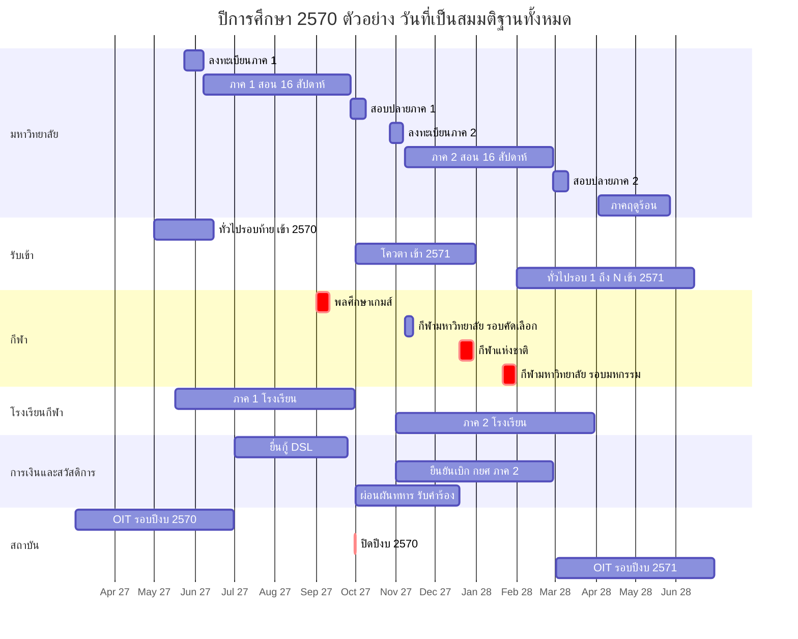

> ทุกแท่งในแผนภาพเป็น 🟡 (คาดจากแบบแผนปี 2569/2570 หรือเป็นตัวอย่างสมมติ CAL-A2) แท่งสีแดง (`crit`) คือเหตุการณ์ที่ชนกับงานวิชาการและต้องจัดการ (หัวข้อ 7)

---

## 2. ปฏิทินงานรายเดือน (พ.ค. 2570 – เม.ย. 2571)

> คอลัมน์ "มหาวิทยาลัย" รวมงานรับเข้า โดยติดป้าย **[เข้า 2570]** = ช่วงท้ายของการรับนักศึกษาที่เข้าปีการศึกษา 2570 และ **[เข้า 2571]** = รอบรับสมัครของปีถัดไปที่เริ่มในปีนี้ · วันที่ของภาคการศึกษาเป็นตัวอย่างสมมติตาม CAL-A2 · WID ตามทะเบียน [05-workflows](05-workflows.md) / `data/workflows.json` (W-01..W-163)

| เดือน | มหาวิทยาลัย (วิชาการ + รับเข้า) | การเงิน / สวัสดิการ | กีฬา | โรงเรียนกีฬา (ม.1–ม.6) | สถาบัน / รายงาน |
|---|---|---|---|---|---|
| **พ.ค. 2570** | [เข้า 2570] ทั่วไปรอบ 4–5 ✅(แบบแผน) และรายงานตัว/onboarding ทยอยตามรอบ (W-44); TCAS70 รอบ 2 ประกาศ/ยืนยัน 3–4 พ.ค. ✅ และรอบ 3 สมัคร 7–11 พ.ค. ✅ (เฉพาะถ้าใช้ adapter) · ภาคฤดูร้อน 2569: สอบ/ส่งเกรด 🟡 · ประกาศตารางเรียน-ตารางสอบภาค 1 (T−4 ≈ 10 พ.ค.) · **ลงทะเบียนภาค 1 ตาม priority slot 24 พ.ค.–6 มิ.ย.** 🟡 · ปฐมนิเทศเริ่มสำหรับผู้รายงานตัวรอบต้น · **ยืนยันสิทธิ์ซ้ำ (reconfirmation) ของผู้ยืนยันรอบต้น 1–15 พ.ค.** (W-163, J-48) · **ลงทะเบียนวิชาฝึกสอนล่วงหน้า ≤ 10 พ.ค.** + roster ประกัน/StaffClearance มีผล 16 พ.ค. (W-156) | กยศ. ผู้กู้เก่ายืนยันเบิก 16 พ.ค.–31 ส.ค. 🟡 · Pre-Approve ม.ปลาย 16 พ.ค.–13 มิ.ย. 🟡 (นักเรียน ม.6 โรงเรียนกีฬาที่จะเข้ามหาวิทยาลัย) · จัดสรรหอภาค 1 · ออกใบแจ้งหนี้ภาค 1 (T−2 สัปดาห์) | คัดตัวทีมวิทยาเขตตาม SelectionPolicy ที่เผยแพร่ ≥ 14 วันก่อน (W-150) 🟡 · ตรวจ PPE ประจำฤดู + concussion baseline (W-130) · ฤดูร้อนจัด: WBGT ก่อนซ้อมกลางแจ้ง (W-153) | **เปิดภาค 1 ≈ 17 พ.ค.** 🟡 (แบบแผน 16 พ.ค. ✅) · รับเข้าหอ, ยืนยัน standing consent รายปี (W-13) · นักเรียนใหม่ ม.1/ม.4 วันแรก | OIT เปิดตอบ/อนุมัติข้อมูล (ถึง 30 มิ.ย.) · ร่าง พ.ร.บ.งบฯ 2571 เข้าสภา 🟡 · เตรียม census 10 มิ.ย. |
| **มิ.ย. 2570** | [เข้า 2570] ทั่วไปรอบ 5–6 **ประกาศและรายงานตัวภายใน 24 ชม.** (แบบแผน 8→9 มิ.ย. ✅); TCAS รอบ 4 ≈ ถึง 15 มิ.ย. 🟡; ปิดรอบ รายงานผู้รับจริง; **cascade_cutoff = T0 + 5 วันทำการ ≈ 14 มิ.ย.** (หลังนี้ไม่เรียกสำรอง, J-49) · ผู้รายงานตัวหลัง 31 พ.ค. เข้า fast-track late-admit (W-148: ลงทะเบียน block ไม่มีค่าปรับ, ATT นับจากวันรายงานตัว, checklist 14 วัน) · **เปิดภาค 1 จ. 7 มิ.ย.** · ลงทะเบียนล่าช้า + เพิ่ม-ลด 7–18 มิ.ย. (W-102, W-50) · ปิด I ของภาค 2/2569 (W-103) · ยื่นขอจบภาค 1: window 7 มิ.ย.–7 ก.ค. (T0+30 ✅) · **พิธีพระราชทานปริญญาบัตร ผู้จบปีการศึกษา 2568 ≈ ปลาย มิ.ย.** 🟡 (แบบแผน 22 มิ.ย. 2569 ✅) + ซ้อมย่อย/ซ้อมใหญ่ | Pre-Approve อุดมศึกษา 1 มิ.ย.–13 ก.ค. 🟡 · **due date ค่าเทอมภาค 1 ≈ 11 มิ.ย.** → batch ยกเลิกผู้ไม่ชำระ ≈ 14 มิ.ย. (J-15; ยกเว้น กยศ./ทุน/ผ่อน/late-admit) · ประกันอุบัติเหตุรอบปี (W-107) · ประกาศทุนภาค 1 | คัดตัว/ซ้อม · โค้ชส่ง roster พลศึกษาเกมส์ฉบับร่าง | **census 10 มิ.ย.** 🟡 (ถ้าใช้ DMC) · ประชุมผู้ปกครองภาค 1 🟡 · O-NET: เตรียมข้อมูลนักเรียน ม.3/ม.6 | **snapshot ข้อมูลนักศึกษา ณ 10 มิ.ย.** 🟡 (ระบุผู้เข้าหลังวันตัดยอดแยก, W-148) · **OIT ปิด / IIT ปิด 30 มิ.ย. 17.00** 🟡 (แบบแผน ✅) · SAR หลักสูตร 🟡 · ส่งข้อมูลนักศึกษาใหม่เข้าฐาน อว. |
| **ก.ค. 2570** | สัปดาห์ 5–8 · ATT เริ่ม flag เสี่ยง มส. (สัปดาห์ 6+) · ส่งรายงานผลรายวิชาภาค 2/2569 (มคอ.5/6 หรือเทียบเท่า ≤ 30 วันหลังสิ้นภาค) 🟡 · ปิด window ขอจบภาค 1 (7 ก.ค.) → pre-audit · [เข้า 2571] เริ่ม config รอบโควตา (W-69) | **ยื่นกู้ DSL 1 ก.ค.–25 ก.ย.** 🟡 · ยืนยันค่าเล่าเรียนจริงใน DSL (W-48) · คัดเลือกทุนภาค 1 (W-07) | **สร้าง CompetitionEvent พลศึกษาเกมส์ + roster ≤ 7 ก.ค.** (≥ 8 สัปดาห์ก่อน, W-114) · เก็บตัว 🟡 | สอบกลางภาค 1 🟡 · รายงานพฤติกรรม/การออกนอกหอรายเดือน | ตรวจประเมิน QA หลักสูตร 🟡 · คำของบ/ชี้แจง กมธ. 🟡 · PMQA/DG readiness 🟡 |
| **ส.ค. 2570** | **สอบกลางภาค 1: 2–6 ส.ค.** 🟡 (หลบ 12 ส.ค.) · ประกาศ "บัญชีผลกระทบ" ลาแข่งพลศึกษาเกมส์ต่อผู้สอน · [เข้า 2571] TCAS71 รอบ 1 เปิด ≈ 15 ส.ค. 🟡 (ถ้าใช้) | **ปิดยืนยันผู้กู้เก่า 31 ส.ค.** 🟡 · ผ่อนผันทหาร: ระบบส่ง reminder ชายที่จะอายุครบ 20 (J-34) · ทุนกองทุนพัฒนาการกีฬาแห่งชาติ (ส.ค.–ก.ย.; ปฐมนิเทศทุน 2568 วันที่ 15 ส.ค. ✅) | ปิดรายชื่อและตรวจสิทธิ์พลศึกษาเกมส์ (W-30) · **อนุมัติลาแข่งยกคณะ ≤ 11 ส.ค.** (≥ 3 สัปดาห์ก่อน) · อนุมัติเงินยืมทริป (W-31) | สทศ. รับข้อมูลนักเรียน O-NET (แบบแผน ส.ค. ✅) | **ส่งข้อมูลหลักสูตร/ผลการเรียนให้ อว. 1–31 ส.ค.** 🟡 · คำของบ 🟡 |
| **ก.ย. 2570** | **พลศึกษาเกมส์ ≈ 1–10 ก.ย. = สัปดาห์ 13–14** (ลาแข่งไม่นับขาด) · **วันสุดท้ายถอน W เลื่อนเป็น 17 ก.ย.** (สัปดาห์ 15 — หลังเกมส์ 1 สัปดาห์, หัวข้อ 7) · ประเมินการสอน 6–24 ก.ย. · **ประกาศ มส. 20 ก.ย.** (W-104) · สอบชดเชยรวมของผู้ไปแข่ง 20–24 ก.ย. (สร้างอัตโนมัติจาก W-114, ไม่ต้องอนุมัติซ้ำ) · **สอบปลายภาค 1: 27 ก.ย.–8 ต.ค.** · [เข้า 2571] **ประกาศโควตา ปลาย ก.ย.** (แบบแผน 22/30 ก.ย. ✅) | **ปิดยื่นกู้ DSL 25 ก.ย.** 🟡 · **ล้างเงินยืมทริปพลศึกษาเกมส์ก่อนปิดปีงบ** (W-115) · **cut-off ปีงบ 2570 วันที่ 30 ก.ย.** (W-116) · ออกใบแจ้งหนี้ภาค 2 ล่วงหน้า (ระบุปีงบ 2571) | **พลศึกษาเกมส์ ครั้งที่ 50 ≈ 1–10 ก.ย.** 🟡 (ครั้งที่ 49 1–10 ก.ย. 2569 ✅) · บันทึกผล/เหรียญ → ข่าว | **ปิดภาค 1 ≈ 30 ก.ย.** 🟡 (⚠️ หรือ 11 ต.ค.) · ออก ปพ.6 ภาค 1 · ผู้ปกครองรับเด็กกลับบ้านตามตารางปิดหอ | **EIT ปิด 30 ก.ย. 17.00** 🟡 · **ปิดปีงบ: รายงานผล, ปิดบัญชี GFMIS** 🟡 · ภาระซ้อน 3 เรื่องในวันเดียว (หัวข้อ 7) |
| **ต.ค. 2570** | สอบปลายภาค 1 ถึง 8 ต.ค. (13 ต.ค. วันหยุด) · **ส่งเกรดภาค 1 ≤ 20 ต.ค.** (7 วันทำการหลังสอบ) → อนุมัติ/เผยแพร่ ≤ 22 ต.ค. · **จำแนกสถานภาพ (dry-run 22 ต.ค., sign-off + แจ้งรอพินิจ/พ้นสภาพพร้อมสิทธิ์อุทธรณ์ 26 ต.ค.)** ก่อนเปิดลงทะเบียน (W-57, W-11; 25 ต.ค. วันหยุดชดเชย 🟡) · **ลงทะเบียนภาค 2: 27 ต.ค.–5 พ.ย.** ด้วยเกรดจริงและเพดานหน่วยกิตรอพินิจ; squad ที่แข่งต้น พ.ย. ลง slot แรก 27 ต.ค.; ผู้ได้รับคำสั่งพ้นสภาพลงทะเบียนได้ในสถานะ ENROLLED_PENDING_APPEAL ระหว่างระยะอุทธรณ์ · [เข้า 2571] **รับสมัครโควตา ≈ 1 ต.ค.–7 พ.ย.** 🟡 (แบบแผน ✅) · บัณฑิตศึกษาประกาศรับ 2571 (แบบแผน 1 ต.ค. ✅) | **ขึ้นปีงบ 2571 วันที่ 1 ต.ค.** — rollover เลขใบเสร็จ/fund code (J-31) · **กยศ. ทำสัญญา + ยืนยันเบิกภาค 1 ภายใน 31 ต.ค.** 🟡 · **ผ่อนผันทหารเปิดรับคำร้อง 1 ต.ค.–19 ธ.ค.** 🟡 · ต่อสัญญาหอภาค 2 · ออกใบแจ้งหนี้ภาค 2 ตามผลลงทะเบียน | คัดเลือกทีมมหาวิทยาลัย (W-150) 🟡 · ตรวจสิทธิ์กีฬามหาวิทยาลัยรอบคัดเลือก 2 รอบ: pre-check ชั่วคราว ≈ 27 ก.ย. และ **final check 28 ต.ค.** หลังเกรด/สถานภาพและการลงทะเบียน slot แรกของ squad (J-36) | ปิดภาค (≈ 1–31 ต.ค.) 🟡 · ซ่อมเสริม/สอบแก้ 0/ร/มส ภาค 1 (W-94) | แผนปฏิบัติราชการ/แผนจัดซื้อปีงบ 2571 🟡 · เตรียม OIT รอบใหม่ 🟡 |
| **พ.ย. 2570** | **เปิดภาค 2 จ. 8 พ.ย.** · ลงทะเบียนล่าช้า + เพิ่ม-ลด 8–19 พ.ย. · ปิด I ภาค 1 (เกรดที่เปลี่ยน → re-validation W-162) · อุทธรณ์เกรด/คำสั่งพ้นสภาพภาค 1 (W-16, W-17; ระหว่างอุทธรณ์เรียน/สอบได้) · **ยื่นขอจบภาค 2: 8 พ.ย.–8 ธ.ค.** · สภาอนุมัติผู้จบภาค 1 (พ.ย.–ธ.ค.) 🟡 · [เข้า 2571] ปิดรับโควตา ≈ 7 พ.ย. → ตรวจเอกสาร/ผลงาน (QS-4) → ประกาศผู้มีสิทธิ์สอบ; TCAS71 สมัคร TGAT/TPAT ≈ ต้น พ.ย. 🟡; บัณฑิตศึกษาเปิดรับ ≈ 10 พ.ย. 🟡 | **กยศ. ยืนยันเบิกภาค 2 เปิด 1 พ.ย.** 🟡 · **due date ค่าเทอมภาค 2 ≈ 12 พ.ย.** → batch ยกเลิกผู้ไม่ชำระ ≈ 15 พ.ย. (J-15) · ประกาศทุนภาค 2 | **กีฬามหาวิทยาลัยแห่งประเทศไทย รอบคัดเลือกภูมิภาค ≈ 8–13 พ.ย.** 🟡 (แบบแผน ✅) — สัปดาห์ที่ 1 ทับ add/drop (squad ลงทะเบียนแล้วตั้งแต่ 27 ต.ค.; GateOverride add/drop) | **เปิดภาค 2 ≈ 1 พ.ย.** 🟡 · **census 10 พ.ย.** 🟡 | **snapshot ณ 10 พ.ย.** 🟡 · ส่งข้อมูลภาค 2 เข้าฐาน อว. (ม.ค.–มี.ค. 🟡) |
| **ธ.ค. 2570** | [เข้า 2571] **สอบทักษะ/สมรรถภาพ/สัมภาษณ์รอบโควตา** (ต้นถึงกลาง ธ.ค., หลบกีฬาแห่งชาติ) → รวมคะแนน/moderation (W-76) → ประกาศผลโควตา ≤ 17 ธ.ค. 🟡 → **ขอทบทวนผล ≤ 3 วันทำการ, ตัดสิน ≤ 5 วันทำการ (W-18) ให้เสร็จก่อนเปิด clearing** · **สอบกลางภาค 2 ไม่วางในสัปดาห์ 7–8** (ทับกีฬาแห่งชาติ + ปีใหม่; 3 ม.ค. 2571 วันหยุดชดเชย 🟡) → เลื่อนเป็น 10–14 ม.ค. 2571 | **ส่งบัญชีผ่อนผันทหารให้สัสดี (ปิดรับ ≈ 19 ธ.ค.)** 🟡 · ภาษี: เตรียม ภ.ง.ด.1ก | **กีฬาแห่งชาติ ≈ 19–29 ธ.ค.** 🟡 (ครั้งที่ 50 19–29 ธ.ค. 2569 ✅) — โค้ช/สนามไม่ว่างสำหรับสอบทักษะช่วงนี้ | สอบกลางภาค 2 🟡 · **ประกาศรับนักเรียน ม.1/ม.4 ปี 2571** (แบบแผน 19 ธ.ค. ✅) | เริ่มคำของบ 🟡 · รายงานไตรมาส 1 ปีงบ 2571 🟡 |
| **ม.ค. 2571** | **สอบกลางภาค 2: 10–14 ม.ค.** 🟡 · [เข้า 2571] **ยืนยันสิทธิ์โควตา (ยืนยันได้ที่เดียวทั้ง มกช. ตรวจ ณ เวลายืนยัน)** (W-74) ≈ 5–12 ม.ค. (sub-bucket ที่ยังมีอุทธรณ์ค้างใช้ appeal_hold); เรียกสำรอง ≤ 15 นาทีหลังเหตุ; ชำระค่ายืนยันสิทธิ์ · TCAS71 สอบ TGAT/TPAT ≈ ปลาย ม.ค. 🟡 | — | **กีฬามหาวิทยาลัยแห่งประเทศไทย รอบมหกรรม ≈ 21–30 ม.ค.** 🟡 (ครั้งที่ 52 21–30 ม.ค. 2570 ✅) = สัปดาห์ 11–12 ภาค 2 · กีฬาคนพิการแห่งชาติ ≈ ปลาย ม.ค. 🟡 (ตรวจ ParaClassification W-157) | **รับสมัคร ม.1/ม.4 ปี 2571** (แบบแผน ม.ค. ✅) · ประกาศเลขที่นั่ง O-NET 🟡 | ITA รอบใหม่: ตั้งค่าเจ้าของข้อมูล OIT (J-30) 🟡 |
| **ก.พ. 2571** | **วันสุดท้ายถอน W ภาค 2 ≈ 11 ก.พ.** (สัปดาห์ 14, หลังกีฬามหาวิทยาลัย ≥ 1 สัปดาห์) · ประเมินการสอน 7–25 ก.พ. · **ประกาศ มส. 21 ก.พ.** · **สอบปลายภาค 2: 28 ก.พ.–10 มี.ค.** · [เข้า 2571] **ทั่วไปรอบ 1–2** (แบบแผน ก.พ.–3 มี.ค. ✅) · บัณฑิตศึกษาปิดรับ ≈ 27 ก.พ. 🟡 | **ปิดยืนยันเบิก กยศ. ภาค 2 ≈ 28 ก.พ.** 🟡 (2571 เป็นปีอธิกสุรทิน ตรวจวันจริง) · ภ.ง.ด.1ก / 50 ทวิ 🟡 | ฤดูร้อนเริ่ม: blackout `heat` (soft) มี.ค.–พ.ค. สำหรับสอบทักษะ/ซ้อมกลางแจ้ง 11:00–15:00 (W-153) | O-NET ม.6 / ม.3 🟡 · **ประกาศผู้มีสิทธิ์ทดสอบ + ทดสอบสมรรถภาพ/ทักษะ ม.1/ม.4** (แบบแผน 11 ก.พ. ✅) · สอบปลายภาค 2 | รายงานผล ITA 5 เดือนแรก 🟡 |
| **มี.ค. 2571** | สอบปลายภาค 2 ถึง 10 มี.ค. · **ส่งเกรดภาค 2 ≤ 21 มี.ค.** → เผยแพร่ ≤ 23 มี.ค. · **standing sign-off 24 มี.ค.** · **ลงทะเบียนภาคฤดูร้อน 27–31 มี.ค.** (หลัง standing) · [เข้า 2571] ทั่วไปรอบ 2–3; TCAS71 รอบ 1 ประกาศ/ยืนยัน ≈ มี.ค. 🟡 | ใบแจ้งหนี้ฤดูร้อน (ต่อหน่วยกิต) | — | **ปิดภาค 2 ≈ 31 มี.ค.** 🟡 · **อนุมัติจบ ม.3/ม.6 + ออก ปพ.1/ปพ.2/ปพ.3** (W-88) · เลื่อนชั้น (W-94) · ผล O-NET 🟡 · ประกาศผลรับเข้า ม.1/ม.4 + มอบตัว 🟡 | **OIT เปิดตอบ/อนุมัติข้อมูล ≈ 2 มี.ค.** 🟡 (แบบแผน ✅) · EIT เริ่มเก็บ 🟡 |
| **เม.ย. 2571** | **ภาคฤดูร้อน จ. 3 เม.ย.** (สงกรานต์ 13–15 เม.ย.) · อุทธรณ์เกรด/คำสั่งพ้นสภาพภาค 2 · ยื่นขอจบภาคฤดูร้อน 3 เม.ย.–3 พ.ค. · สภาอนุมัติผู้จบภาค 2 (เม.ย.–พ.ค.) 🟡 · ประกาศรายชื่อผู้มีสิทธิ์เข้ารับพระราชทานปริญญาบัตร (ผู้จบปีการศึกษา 2569) 🟡 · [เข้า 2571] ทั่วไปรอบ 3 (ข้อเขียน+สัมภาษณ์ ✅แบบแผน) | **ตรวจเลือกทหาร ≈ 1–12 เม.ย.** 🟡 (แบบแผน ✅) — นักศึกษาชายที่ต้องแสดงตนขอเลื่อนสอบฤดูร้อน · เตือนผู้กู้ที่ชั่วโมงจิตอาสา < 36 ก่อนรอบยืนยันกู้ปีถัดไป (J-33) | พักฤดู/ฟื้นฟู 🟡 | ปิดภาค/ซ่อมเสริม · มอบตัว + สัญญาหอนักเรียนใหม่ 🟡 | ภาษีรายเดือนต่อเนื่อง 🟡 · OIT ต่อเนื่อง |

> **รอบปีถัดไปที่ต่อเนื่อง:** พ.ค.–มิ.ย. 2571 = [เข้า 2571] ทั่วไปรอบ 4–6 + รายงานตัว, เปิดภาค 1/2571, พิธีพระราชทานปริญญาบัตรของผู้จบปีการศึกษา 2569 ≈ มิ.ย. 2571 🟡 (ห่างจากจบประมาณ 1 ปีตามแบบแผน ✅)

---

## 3. ช่วงพีคและผลต่อโหลดของระบบ

### 3.1 ช่วงพีค 4 ช่วงตาม blueprint หัวข้อ 8 (แจกแจงเหตุ)

| พีค | ช่วง | อะไรซ้อนกัน | ลักษณะโหลด | ผู้ใช้ที่ได้รับผลกระทบ |
|---|---|---|---|---|
| **P1 เปิดปีการศึกษา** | ปลาย พ.ค.–มิ.ย. | ลงทะเบียนภาค 1 ทุกชั้นปี × 17 วิทยาเขต + นักศึกษาใหม่ onboarding + ทั่วไปรอบท้าย (รายงานตัว 24 ชม.) + เปิดภาคโรงเรียนกีฬา + due date ค่าเทอม + Pre-Approve กยศ. | write-heavy เป็น burst ในชั่วโมงแรกของ slot; payment callback | นักศึกษา, ผู้สมัคร, ผู้ปกครอง, ทะเบียน, การเงิน |
| **P2 ปลายภาค 1 / ต้นภาค 2** | ต.ค.–พ.ย. | ส่งเกรด + ประกาศผล + จำแนกสถานภาพ + ลงทะเบียนภาค 2 + ขึ้นปีงบ 1 ต.ค. + กยศ. 31 ต.ค. + ผ่อนผันทหาร + **รับสมัครโควตา [เข้าปีถัดไป]** + กีฬามหาวิทยาลัยรอบคัดเลือก | write-heavy ฝั่ง finance + read-heavy วันประกาศผล + public burst ผู้สมัคร | ทุกกลุ่ม |
| **P3 ปลายภาค 2** | ก.พ.–มี.ค. | สอบ/เกรดภาค 2 + จบ ม.3/ม.6 (ปพ.) + O-NET + กยศ. 28 ก.พ. + ทั่วไปรอบ 1–3 + รับเข้าโรงเรียนกีฬา + OIT เปิด | ผสม | นักศึกษา, โรงเรียนกีฬา, ผู้สมัคร |
| **P4 มิ.ย. (ซ้อนบน P1)** | มิ.ย. | รับปริญญา (cohort ข้ามวิทยาเขต) + snapshot 10 มิ.ย. + ปิด OIT/IIT 30 มิ.ย. + รอบรับเข้าสุดท้าย | moderate แต่ภาระคนทำงานสูงมาก | ทะเบียน, กองแผน, ITA |

### 3.2 ประมาณการโหลดเบื้องต้น (แสดงสูตร — เล่ม 07 เป็นเจ้าของตัวเลข capacity สุดท้าย)

ฐาน (blueprint 8): นักศึกษาออกแบบรองรับ 15,000 · นักเรียนโรงเรียนกีฬา 4,450 · ผู้ปกครองผู้เยาว์ ~8,000 · ผู้สมัคร 30,000 ใบ/ปี (สมมติฐาน) · บุคลากร 2,700 สัดส่วนทั้งหมดด้านล่างเป็นสมมติฐาน 🟡

| เหตุการณ์ | สูตร | ผลลัพธ์โดยประมาณ | ผลต่อการออกแบบ |
|---|---|---|---|
| เปิด slot ลงทะเบียน | (ก) ค่าเริ่มต้นเหลื่อมเวลา (A-32): ผู้มีสิทธิ์ต่อ slot ≈ 15,000 / 4 ชั้นปี = 3,750; มาใน 15 นาทีแรก 40% = 1,500 คน × ~15 request / 900 s · (ข) worst case ของ A-32 (ทุกวิทยาเขตพร้อมกัน): 40% ของ 15,000 = 6,000 คนใน 15 นาที × 15 request / 900 s | (ก) ≈ 25 request/s เฉลี่ย (พีคช่วงสั้น 3–4 เท่า ≈ 100 request/s) · (ข) ≈ 100 request/s เฉลี่ย (พีค ≈ 300–400 request/s) + token ใน waiting room หลักพัน | waiting room ปล่อยเข้าตามอัตราที่ transaction รับได้; load test ใช้กรณี (ข); นโยบายเหลื่อมเวลาลดโหลดได้ ~4 เท่า (Q-64) |
| วันประกาศเกรด | 15,000 + 4,450 + ผู้ปกครองที่มีสิทธิ์ ~8,000 = 27,450 คน; 50% เข้าในชั่วโมงแรก; 5 นาทีแรก 20% ของชั่วโมง | ≈ 2,700 login ใน 5 นาที (≈ 9 login/s) | ประกาศเป็น snapshot อ่านอย่างเดียว, แจ้งเตือนแบบ staggered ราย OrgUnit |
| ปิดรับสมัคร / ประกาศผลคัดเลือก | A-23: ใบสมัคร ป.ตรี ~23,000 + โรงเรียนกีฬา ~6,000 + บัณฑิต ~1,000 ต่อปี; A-34: ผู้ใช้พร้อมกันช่วงปิดรับ ~3,000 และวันประกาศผล 30,000 คนใน 30 นาที | ≈ 17 ผู้เข้าดู/s เฉลี่ยในวันประกาศผล; ปิดรับ ~3,000 sessions พร้อมกัน | แยก admission portal จาก core; หน้าผลเป็น static/CDN; reconcile ค่าสมัครถูกต้อง |
| ประกาศผลโควตา / เปิด clearing | ผู้ผ่าน + สำรองทุกวิทยาเขต ~6,000 🟡 + ผู้ปกครอง; ยืนยันพร้อมกันในชั่วโมงแรก 30% | ≈ 1,800 การยืนยันใน 1 ชม. | unique constraint "confirmed 1 ที่" ต้องทนการกดพร้อมกันจากหลายเครื่อง; cascade สำรองต่อเนื่องเป็นนาที |
| ทั่วไปรอบสุดท้าย (ประกาศ → รายงานตัว 24 ชม.) | ปริมาณน้อย (หลักร้อยต่อวิทยาเขต) | latency ของ pipeline: อนุมัติ → ประกาศ → ใบแจ้งชำระ → รหัสนักศึกษา ต้อง < 2 ชม. | งานนี้วัดด้วย "เวลา" ไม่ใช่ throughput; ต้องมี counter fallback |
| due date ค่าเทอม | 15,000 ใบแจ้งหนี้; 30% ชำระใน 2 วันสุดท้าย | ≈ 4,500 callback | idempotent callback + statement reconcile รายวัน; ห้ามยกเลิกรายวิชาก่อน reconcile เสร็จ |
| เช็กชื่อเข้าสอบปลายภาค (คาบ 09:00) | นักศึกษาสอบพร้อมกัน ~8,000 สแกนใน 15 นาที | ≈ 9 scan/s | offline-first ใน tablet ของกรรมการคุมสอบ |
| ลาแข่งยกคณะพลศึกษาเกมส์ | ผู้เข้าร่วม 3,000–8,000 (แหล่งไม่ตรงกัน ⚠️) × ~6 วิชา × ~4 คาบที่ทับ | 72,000–192,000 attendance marks + makeup requests | batch job กลางคืน ไม่ใช่ real-time |
| รับปริญญา | ผู้จบ/ปี ≈ 15,000/4 ≈ 3,000–3,750 🟡; เช็กอินวันซ้อมใน 1 ชม. | ≈ 1 scan/s | ปานกลาง; ภาระอยู่ที่การจัดลำดับข้ามวิทยาเขต |

### 3.3 ผลต่อการปฏิบัติการ

1. **SLO ช่วงวิกฤต 99.95%** (blueprint 8; v1.1 เสนอเป้าภายใน 99.94% รอ Q-90 — 07 ADR-027) ผูกกับ window ในปฏิทิน: slot ลงทะเบียน, 48 ชม. ก่อน due date, วันประกาศเกรด/ผลคัดเลือก — ช่วงนอกนี้ใช้ 99.9%
2. **Change freeze แบบ ring ราย OrgUnit** (แก้ OPS-04): freeze อัตโนมัติจาก CalendarEvent ประเภท `critical_window` ของ OrgUnit นั้น และ freeze ทั้งระบบเฉพาะเมื่อ ≥ 50% ของ OrgUnit อยู่ใน critical window พร้อมกัน (เช่น 1 ต.ค., วันแรกของภาค) — รายละเอียดใน [11-operations](11-operations.md)
3. **go-live/migration ทำได้เฉพาะช่วงที่ OrgUnit ที่ go-live ไม่มี `critical_window`** (เช่น หลังปิด add/drop หรือระหว่าง standing sign-off กับเปิด slot ไม่ได้ — ต้องเป็นช่วงว่าง) ตาม blueprint 7 ที่ให้ go-live ที่รอยต่อภาค; วันที่ release และการปรับ freeze rule สำหรับ R3 (พ.ย.) เป็นของเล่ม 11/12 (D-07) — เล่มนี้ให้เพียงข้อมูล critical window
4. **กำลังคน**: P2 และ P4 ภาระคนทำงานสูงกว่าภาระระบบ → ระบบต้องลดงานมือ (batch dry-run, digest แทนอีเมลรายรายการ, dashboard deadline compliance ต่อวิทยาเขต)

---

## 4. งานอัตโนมัติตามกำหนด (scheduled jobs)

ทุกงานอ่าน trigger จาก **CalendarEvent** (ไม่ hard-code วันที่) ใช้ PostgreSQL-backed job queue (blueprint 9.2), รองรับ dry-run, idempotent และบันทึก audit วันที่ในคอลัมน์ "ตัวอย่าง 2570" เป็นสมมติตาม CAL-A2

| รหัส | งาน | Trigger (สัมพัทธ์กับ event) | ตัวอย่าง 2570 | โมดูล | ผลลัพธ์ / ข้อยกเว้น | WID |
|---|---|---|---|---|---|---|
| J-01 | เปิด/ปิด function gate ตาม event | start/end ของทุก CalendarEvent ที่ผูก gate | ต่อเนื่อง | ORG | ประเมิน override รายบุคคล/กลุ่มก่อนปิด | W-117 |
| J-02 | แจ้งเตือนก่อนเปิด/ปิด window | T−1 วัน, T−1 ชม. ของ event ที่ตั้ง `notify=true` | ต่อเนื่อง | NOTI | quiet hours 21:00–07:00 🟡 ยกเว้นเร่งด่วน | — |
| J-03 | เปิด/ปิดรับสมัครรอบ; เตือนใบสมัครค้างชำระ | round.open / round.close − 2 วัน, − 1 วัน | 1 ต.ค., 5–6 พ.ย. 2570 | ADM | — | W-69, W-41, W-81 |
| J-04 | offer หมดเวลา → auto-waive → ปล่อยที่นั่ง → เรียกสำรอง (**กติกาเวลาเดียว: คืนที่นั่ง ≤ 15 นาทีหลังเหตุ**, ส่ง offer ใหม่ 07:00–20:00) | ทุก 5 นาทีระหว่าง clearing window จนถึง cascade_cutoff | ม.ค. 2571 | ADM | grace รายบุคคลที่อนุมัติแล้วไม่ถูก waive; ข้าม sub-bucket ที่มี appeal_hold | W-74, W-18 |
| J-05 | sync สถานะ TCAS (ถ้าเปิด adapter) | ทุกชั่วโมงในช่วงยืนยัน/สละของ TCAS | ตามปฏิทิน ทปอ. | ADM | ไม่รันถ้า adapter ปิด | W-73 |
| J-06 | ยกที่นั่งคงเหลือไปรอบถัดไป | round.confirm_close | ปลายแต่ละรอบทั่วไป | ADM | เจ้าหน้าที่ปรับเพิ่ม/ลดได้ก่อนเปิดรอบ | W-69 |
| J-07 | ตรวจผู้ไม่รายงานตัว → เริ่มนับ 7 วันแจ้งเหตุ → สละสิทธิ์ → ที่นั่งเข้า J-04 (ถ้ายังไม่พ้น cascade_cutoff) | reporting.deadline; +7 วัน | มิ.ย. 2570 | REC | ผู้ที่ยื่นแจ้งเหตุแล้วหยุดนับ | W-44, W-78, W-74 |
| J-08 | เตือนรายการ onboarding ค้าง; retry provisioning IT | ทุกวันในช่วงรายงานตัว | พ.ค.–มิ.ย. | REC, IAM | — | W-44 |
| J-09 | ติดตามผลตรวจวุฒิเดิม | ทุกสัปดาห์ จนถึง term1.end | มิ.ย.–ต.ค. | REC | ครบกำหนดยังไม่ตอบ → escalate | W-134 |
| J-10 | สร้างร่างแผนเปิดรายวิชา | T0 − 8 สัปดาห์ | 12 เม.ย. / 13 ก.ย. 2570 | REG | — | W-100 |
| J-11 | เปิด priority slot ลงทะเบียน (gate: standing sign-off แล้ว, L-4) | registration.slot[n].start | 24 พ.ค.–6 มิ.ย.; 27 ต.ค.–5 พ.ย. | REG | slot แรกสำหรับ squad ที่แข่งต้นภาค; ปี 1 ภาค 1 = block enrolment | W-49 |
| J-12 | waitlist auto-offer | ต่อเนื่องจนถึง add_drop.end | ถึง 18 มิ.ย. / 19 พ.ย. | REG | offer หมดอายุใน N ชม. | W-50 |
| J-13 | ออกใบแจ้งหนี้ + เตือน T−7/T−3/T−1 | invoice.issue (T0 − 2 สัปดาห์); payment.due | 24 พ.ค.; due 11 มิ.ย. | FIN | ผู้ปกครองได้ลิงก์ถ้ามี consent | W-51 |
| J-14 | คำนวณค่าปรับลงทะเบียนล่าช้า | ทุกวัน 00:05 ใน late_registration window | 7–18 มิ.ย. | FIN | `FinePolicy` รายวัน/เหมา, cap, นับวันหยุดหรือไม่ | W-102 |
| J-15 | ยกเลิกรายวิชาผู้ไม่ชำระ | payment.due + grace | ≈ 14 มิ.ย. / 15 พ.ย. | FIN, REG | exclusion list: กยศ., ทุน, แผนผ่อน, late-admit ที่ยังไม่ถึง due date ของตน (W-148), ENROLLED_PENDING_APPEAL ที่มีผ่อนผัน; **ต้องมี dry-run + sign-off ทะเบียน** | W-105 |
| J-16 | นำเข้า statement + reconcile | ทุกวัน (และทุกชั่วโมงในช่วง due) | ต่อเนื่อง | FIN | รายการไม่จับคู่ → คิวเจ้าหน้าที่ | W-51 |
| J-17 | ตรวจกลุ่มเรียนต่ำกว่าเกณฑ์ | add_drop.end | 18 มิ.ย. / 19 พ.ย. | REG | เสนอ `head` ไม่ปิดเอง | W-101 |
| J-18 | คำนวณเวลาเรียน + flag เสี่ยง มส. 10/15/20% | ทุกคืน ตลอดภาค | — | ATT | ลาที่อนุมัติไม่นับขาด | W-52 |
| J-19 | สร้างรายชื่อ มส. และล็อก | final_exam.start − 7 วัน | 20 ก.ย. / 21 ก.พ. | ATT, EXM | ผู้สอน override พร้อมเหตุผล | W-104 |
| J-20 | ตรวจตารางสอบชน blackout/วันหยุด | ทุกครั้งที่ CompetitionEvent หรือ Holiday เปลี่ยน + ก่อน publish ตารางสอบ | — | EXM | สร้าง conflict report ให้ทะเบียน | W-117, W-54 |
| J-21 | จัด roster กรรมการคุมสอบ + เตือน 1 วันก่อน | final_exam.start − 14 วัน; ทุกวันสอบ − 1 | 13 ก.ย. | EXM | กระจายภาระเป็นธรรม | W-54 |
| J-22 | เปิด/ปิดประเมินการสอน + ตั้ง gate ดูเกรด | teaching_eval.start/end | 6–24 ก.ย. | ENG, ASM | — | W-56 |
| J-23 | เตือนส่งเกรด T−3/T−1 และ escalate หลังเลยกำหนด | grade_submission.end | ≤ 20 ต.ค. / 21 มี.ค. | ASM | escalate ไป `head` → `dean` | W-01 |
| J-24 | แปลง I → F/U | incomplete_resolution.end | ต้นภาคถัดไป + N สัปดาห์ 🟡 | ASM | — | W-103 |
| J-25 | คำนวณ GPA/standing (dry-run ทันที, sign-off ก่อนเปิด slot ≥ 1 วันทำการ) | grade_publication | 22→26 ต.ค. / 23→24 มี.ค. | REC | dry-run + sign-off; คำสั่งพ้นสภาพยังต้องลงนาม; ระยะอุทธรณ์ = ENROLLED_PENDING_APPEAL | W-57, W-11 |
| J-26 | ตรวจผู้ไม่ลงทะเบียนและไม่รักษาสภาพ; ลาพักใกล้ครบ | add_drop.end; leave.end − 30 วัน | 18 มิ.ย. | REC | แจ้งนักศึกษา + อาจารย์ที่ปรึกษา | W-10 |
| J-27 | pre-audit ผู้คาดว่าจะจบ + เปิด window ขอจบ (T0 → T0+30) | term.start ของภาคก่อนสุดท้าย; term.start | 7 มิ.ย.–7 ก.ค. | GRD | เตือน T−7/T−1 ก่อนปิด window | W-06 |
| J-28 | digest สถานะ clearance ถึงผู้ขอจบ | ทุกสัปดาห์จนถึงมติสภา | — | GRD | — | W-06 |
| J-29 | **census snapshot** มหาวิทยาลัยและโรงเรียนกีฬา | 10 มิ.ย. 23:59 / 10 พ.ย. 23:59 🟡 | 10 มิ.ย., 10 พ.ย. | RPT | immutable snapshot + hash | W-35 |
| J-30 | เตือนภาระรายงานหน่วยงานรัฐ T−30/T−7/T−1 | `RegulatoryObligation.due` | OIT 30 มิ.ย., EIT 30 ก.ย., อว. 31 ส.ค. | RPT | dashboard ต่อวิทยาเขต | W-35, W-136 |
| J-31 | **rollover ปีงบ** (ชุดเลขใบเสร็จใหม่, fund code, ตัดยอด) | fiscal_year.start 00:00 | 1 ต.ค. 2570 | FIN | counter ปิดก่อน 23:30; ธุรกรรมคร่อมเวลาใช้ timestamp | W-116 |
| J-32 | รายชื่อผู้กู้ยังไม่ยืนยันเบิก | loan.confirm_deadline − 14/−7/−1 | 31 ต.ค., 28 ก.พ. | SCH | — | W-48, W-119 |
| J-33 | ชั่วโมงจิตอาสา < 36 ก่อนรอบยืนยันกู้ | loan.renewal_open − 30 วัน | ≈ 16 เม.ย. 🟡 | AFF | — | W-60, W-119 |
| J-34 | ผ่อนผันทหาร: หาชายที่จะอายุ 20 ปีหน้า; เปิดรอบยื่น; เตือนแสดงตน สด.35 | 1 ส.ค.; military.open; ก่อน 1 เม.ย. | 1 ส.ค., 1 ต.ค., 15 มี.ค. | AFF | — | W-59 |
| J-35 | CompetitionEvent สร้าง/เปลี่ยน → วิเคราะห์ผลกระทบ + bulk leave + makeup exam | on change | ก.ค.–ก.ย. (พลศึกษาเกมส์) | ATH | ถ้าเลื่อน/ยกเลิก → ปรับย้อนทั้งชุด | W-114 |
| J-36 | ตรวจสิทธิ์นักกีฬา 2 รอบ: (1) pre-check "ชั่วคราว" ด้วยข้อมูลภาคปัจจุบัน (2) **final check** หลัง `asm.GradesPublished` + standing sign-off + การลงทะเบียน slot แรกของ squad | (1) roster.deadline − 6 สัปดาห์ (2) หลัง squad ลงทะเบียน และก่อน roster.deadline | (1) 27 ก.ย. (2) 28 ต.ค. (กีฬามหาวิทยาลัยคัดเลือก 8–13 พ.ย.) | ATH | แจ้งโค้ช + `advisor.dc_tutor`; ผลรอบ 1 ใช้ส่งรายชื่อไม่ได้ | W-30 |
| J-37 | เตือนล้างเงินยืม; escalate ค้าง; **บังคับก่อนปิดปีงบ** | trip.end + N วัน; fiscal_year.end − 14 วัน | 16 ก.ย. | FIN | — | W-115 |
| J-38 | ตม.30 (24 ชม.) และรายงาน 90 วัน | check-in ผู้พักต่างชาติ; ทุก 90 วัน | — | HOU, NOTI | — | W-38 |
| J-39 | บิลค่าน้ำไฟรายเดือน; เชิญต่อสัญญาหอ | ทุกต้นเดือน; term.end − 4 สัปดาห์ | ต.ค., มี.ค. | HOU | — | W-46, W-147 |
| J-40 | โรงเรียนกีฬา: แจ้งขาดเรียนรายวัน, digest รายเดือน, exeat เกินเวลา | 16:00 ทุกวัน; สิ้นเดือน; real-time | — | SSC, HOU | ไม่แจ้งผู้ปกครองที่มี ContactRestriction | W-13 |
| J-41 | โรงเรียนกีฬา: ออก ปพ.6 ปลายภาค; ปพ.1/2/3 หลังอนุมัติจบ | school_term.end; graduation_basic_ed.approved | 30 ก.ย., มี.ค. | SSC, DOC | — | W-87, W-88 |
| J-42 | StaffClearance ใกล้หมดอายุ | expiry − 30 วัน | — | SAFE | หมดอายุ → ถอดสิทธิ์ทำงานกับเด็กอัตโนมัติ | W-23 |
| J-43 | สถานะเอกสารหมดอายุ (ใบรับรอง 60 วัน ✅) | valid_until | — | DOC | verify page แสดง "หมดอายุ" | W-58 |
| J-44 | รับปริญญา: เปิดขึ้นทะเบียนบัณฑิต, เตือนซ้อม | ceremony.registration_open; rehearsal − 3/−1 วัน | เม.ย.–มิ.ย. | GRD | — | W-64, W-118 |
| J-45 | publish ปฏิทิน → สร้าง iCal feed ใหม่ + แจ้งผู้ติดตาม | calendar.published / amended | — | ORG, ENG | แจ้งเฉพาะผู้ที่ event เปลี่ยนกระทบ | W-117 |
| J-46 | เปิด change freeze ตาม ring | critical_window.start/end ราย OrgUnit | — | ADMIN | union > 50% OrgUnit → freeze ทั้งระบบ | — |
| J-47 | **rollover ปีการศึกษา/ภาค** (สร้าง term, clone fee schedule, ปิด role ราย term, เลื่อนชั้นโรงเรียน) dry-run | term.start − 4 สัปดาห์ (dry-run); term.start (run) | 10 พ.ค., 11 ต.ค. | ORG, ADMIN | ต้อง sign-off ทะเบียน + การเงิน | W-122 |
| J-48 | เปิด window ยืนยันสิทธิ์ซ้ำ + เตือน 2 ครั้ง → waive ผู้ไม่ยืนยัน | `ADM_RECONFIRM_WINDOW` start/end + 2 วันทำการ | 1–15 พ.ค. 2570 🟡 | ADM | ไม่นับเป็นสิทธิ์สละ (C-5); เปิด/ปิดได้ต่อวิทยาเขต | W-163 |
| J-49 | ปิด reserve cascade ที่ `cascade_cutoff` (T0 + 5 วันทำการ) และติดธง late-admit ผู้ matriculated ≥ T0 − 7 วัน | cascade_cutoff; matriculation event | 14 มิ.ย. 2570 | ADM, REC | ที่นั่งหลัง cutoff = unfilled | W-74, W-148 |
| J-50 | post-standing re-validation | ทุกครั้งที่เกรดเปลี่ยนหลัง standing sign-off; หลังผลฤดูร้อน (ถ้า `standing_after_summer`) | พ.ย., ธ.ค. | REG, REC | ระงับหน่วยกิตส่วนเกินให้เลือกถอน 5 วันทำการ; re-add หลังชนะอุทธรณ์ | W-162 |
| J-51 | เตือน WBGT/ความร้อนต่อสนาม + บังคับบันทึกค่าก่อนกิจกรรมกลางแจ้งในช่วง blackout `heat` | ทุกชั่วโมง 10:00–16:00 ในช่วง `HEAT_SEASON` | มี.ค.–พ.ค. 🟡 | FAC | ระดับสูงสุดหยุดกิจกรรมผู้เยาว์/สอบทักษะ | W-153 |
| J-52 | เตือน ParaClassification / ProfessionalLicence / SelectionPolicy ใกล้ครบกำหนด | review_date − 60 วัน; licence expiry − 30 วัน; trials − 14 วัน | — | ATH, IAM | ใบอนุญาตหมด → ระงับบทบาท `physician`/`nurse`/`physio` | W-157, W-150 |

---

## 5. การแจ้งเตือนตามช่วงเวลา

นโยบายช่องทาง: in-app/push + อีเมล เป็นหลัก; LINE OA ส่งเฉพาะหัวข้อ + ลิงก์ (ข้อมูลข้ามพรมแดน, blueprint 9.10); SMS สำหรับผู้ปกครองผู้เยาว์ เหตุฉุกเฉิน และผู้สมัครรอบท้ายที่ต้องรายงานตัวภายใน 24 ชม.; ส่งแบบ staggered ราย OrgUnit ในวันประกาศผล; NOTI เป็นผู้ส่ง ENG เป็นเจ้าของเนื้อหาประกาศ

| ช่วง | ผู้รับ | ข้อความ (ตัวอย่าง) | ช่องทาง | Trigger |
|---|---|---|---|---|
| ฤดูรับสมัคร (ต.ค.–มิ.ย.) | ผู้สมัคร (+ ผู้ปกครองถ้าผู้เยาว์) | เปิดรับรอบที่สนใจ, ใบสมัครค้างชำระ, เอกสารไม่ผ่าน/ขอเพิ่ม, ประกาศผู้มีสิทธิ์สอบ + บัตรผู้สอบ, เตือนวันสอบ T−3/T−1, **ผลคัดเลือก**, offer หมดเวลาใน 24/3 ชม., ถูกเรียกสำรอง, ยืนยันสำเร็จ, นัดรายงานตัว | push/อีเมล/SMS (รอบท้าย) | J-03, J-04, CL-1 |
| ก่อนเปิดภาค (T−4 ถึง T0) | นักศึกษา | ตารางเรียนเผยแพร่, slot ลงทะเบียนของคุณเปิด T−1 วัน/T−1 ชม., hold ที่ต้องแก้ก่อนลงทะเบียน, ใบแจ้งหนี้ออก, ใกล้ due | push/อีเมล | J-11, J-13 |
| ก่อนเปิดภาค | อาจารย์ | ส่งรายละเอียดรายวิชาก่อนเปิดภาค, อนุมัติแผนลงทะเบียนนักศึกษาในความดูแล (digest) | อีเมล/push | J-10 |
| ต้นภาค (สัปดาห์ 1–2) | นักศึกษา | เริ่มคิดค่าปรับ, add/drop ใกล้ปิด, waitlist offer, กลุ่มเรียนถูกปิด, ยังไม่ลงทะเบียน/รักษาสภาพ (เสี่ยงพ้นสภาพ) | push | J-12, J-14, J-17, J-26 |
| กลางภาค | นักศึกษา + อาจารย์ที่ปรึกษา (+ ผู้ปกครองถ้าผู้เยาว์/consent) | ขาดเรียน ≥ 10/15/20%, ตารางสอบกลางภาค, ถอน W ใกล้ปิด | push | J-18 |
| ปลายภาค | นักศึกษา | ประเมินการสอนก่อนดูเกรด, ประกาศ มส. (+ วิธีขอทบทวน), ตารางสอบและที่นั่ง, ผลสอบออก, สถานะรอพินิจ/พ้นสภาพ (+ สิทธิ์อุทธรณ์) | push/อีเมล | J-19, J-22, J-25 |
| ปลายภาค | อาจารย์ / กรรมการคุมสอบ | roster คุมสอบ (−1 วัน), ส่งเกรด T−3/T−1/เลยกำหนด (escalate), I ค้าง, คำร้องลาแข่งในวิชาตน (digest) | อีเมล/push | J-21, J-23, J-24, BL-5 |
| การเงิน (ตลอดปี) | นักศึกษา/ผู้ปกครอง | ใบแจ้งหนี้, ใกล้ครบกำหนด, ชำระสำเร็จ (e-Receipt), ผ่อนผันอนุมัติ + วันชำระใหม่, ค้างชำระ → hold | push/อีเมล | J-13, J-16 |
| กยศ. (ก.ค.–ต.ค., พ.ย.–ก.พ.) | ผู้กู้ | ยังไม่ยืนยันเบิก (T−14/−7/−1), ชั่วโมงจิตอาสาไม่ครบ | push/อีเมล | J-32, J-33 |
| ทหาร (ส.ค.–เม.ย.) | นศ.ชาย | จะอายุครบ 20 ปีหน้า, เปิดรอบยื่นผ่อนผัน, ผลผ่อนผัน, เตือนแสดงตน | push/อีเมล | J-34 |
| กีฬา (ก.ค.–ม.ค.) | นักกีฬา, โค้ช, อาจารย์ | สรุปวิชาที่ลา + งานชดเชย + วันสอบชดเชย, ตรวจสิทธิ์ "เสี่ยงหมดสิทธิ์", ทริปอนุมัติ, ล้างเงินยืมใกล้ครบ | push | J-35..J-37 |
| โรงเรียนกีฬา (ตลอดปี) | ผู้ปกครอง | ขาดเรียนวันนี้, คำขอ exeat รออนุมัติ, เด็ก**ออก/กลับเข้า**หอ, **เกินเวลากลับ**, ผู้มาเยี่ยมมาถึง, เจ็บป่วย/ให้ยา, ปพ.6, digest พฤติกรรมรายเดือน, ปิดหอ/ตารางรับ-ส่ง, ยินยอมทริปแข่ง | push + SMS fallback | J-40, J-41 |
| รับปริญญา (เม.ย.–มิ.ย.) | บัณฑิต | ประกาศผู้มีสิทธิ์, เปิดขึ้นทะเบียนบัณฑิต, แบบสำรวจภาวะการมีงานทำ, ตารางถ่ายภาพ/ซ้อม + ลำดับแถว, ปริญญาบัตรพร้อมรับ/จัดส่ง | push/อีเมล | J-44 |
| ผู้บริหาร (ตลอดปี) | `campusvp`, `dean`, `rector`, `planner` | dashboard deadline compliance: ส่งเกรดทัน %, ยืนยัน กยศ. %, OIT ครบ %, ที่นั่งคงเหลือรับเข้า, ลาแข่งค้างอนุมัติ | digest รายสัปดาห์ | J-30 |
| ความปลอดภัยรายบุคคล (บาดเจ็บ concussion heat illness เหตุร้ายแรงผู้เยาว์) | ผู้ปกครองผู้เยาว์ | **เจ้าหน้าที่โทรก่อนตาม script** แล้วระบบส่งข้อความยืนยันพร้อมเบอร์ติดต่อ; โทรไม่ติด 15 นาที → แจ้งเตือนเร่งด่วนอัตโนมัติ (ไม่ใช้ P0 ทั้งระบบ) | โทรศัพท์ + push/SMS | W-39, W-149, W-152 |
| ฉุกเฉิน | ทุกคนในพื้นที่ + ผู้ปกครองผู้เยาว์ | ปิดมหาวิทยาลัย/ภัยพิบัติ, เลื่อนสอบฉุกเฉิน (ปฏิทินแก้ไขด่วน) | ทุกช่องทาง ≤ 60 วินาที (W-36) | W-36 |

---

## 6. Calendar-as-Configuration

### 6.1 หลักการ

1. **ORG เป็นเจ้าของปฏิทินเพียงโมดูลเดียว** (blueprint 4, 10) — REG/EXM/ADM/FIN อ่าน ไม่เก็บสำเนา (แก้ RF R-03, RF I-21 และ IC-14 ของ review_functional/review_architecture)
2. **ทุก window คือ CalendarEvent ที่ผูกกับ function gate**: ฟังก์ชันเปิด/ปิดเองตามเวลา ไม่มี if-date ในโค้ด
3. **template กลาง + override ราย scope**: มหาวิทยาลัย → วิทยาเขต (OrgUnit) → คณะ/หลักสูตร → ประเภทนักศึกษา (ภาคปกติ/ภาคพิเศษ/บัณฑิตศึกษา/โรงเรียนกีฬา) → รุ่น; scope ที่เฉพาะที่สุดชนะ
4. **ข้อยกเว้นรายบุคคล/กลุ่มเป็นข้อมูล** (`GateOverride`) มีผู้อนุมัติ เหตุผล วันหมดอายุ และ audit เช่น นักกีฬาที่แข่งช่วง add/drop, ผู้รอ กยศ.
5. **มีเวอร์ชันและสถานะอนุมัติ** (W-117): แก้หลัง publish ต้องมีเหตุผล แจ้งผู้ได้รับผลกระทบ และประเมิน gate ใหม่
6. **ปีการศึกษาแยกจากปีงบประมาณ** และแยก term model ระหว่าง `HIGHER_ED` กับ `BASIC_ED`
7. **วันหยุดเป็นข้อมูล** (HolidayCalendar) ใช้คำนวณค่าปรับ วันทำการของ SLA และตรวจตารางสอบ

### 6.2 โมเดลข้อมูล

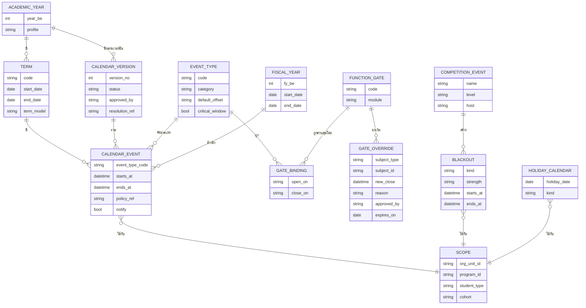

| Entity | ความหมาย | เจ้าของ |
|---|---|---|
| `AcademicYear(year_be, profile)` | ปีการศึกษาต่อ profile (`HIGHER_ED`, `GRAD`, `BASIC_ED`) | ORG |
| `Term(code=1/2/S, start, end, term_model)` | ภาคการศึกษา; term model กำหนดหน่วยกิต/ชั่วโมง ระบบเกรด | ORG |
| `CalendarVersion(version_no, status, approved_by, resolution_ref)` | draft → review → approved → published → superseded | ORG |
| `CalendarEvent(event_type, starts_at, ends_at, scope, policy_ref, notify)` | เหตุการณ์หนึ่งรายการ; รอบรับสมัครของ ADM ก็เป็น CalendarEvent ที่ scope = round | ORG (ADM อ้าง) |
| `EventType(code, category, default_offset, critical_window)` | catalogue กลางใช้ร่วม 17 วิทยาเขต + โรงเรียน | ORG |
| `FunctionGate(code, module)` | ฟังก์ชันที่เปิด/ปิดได้ เช่น `REG.REGISTER` | โมดูลเจ้าของฟังก์ชันลงทะเบียน gate |
| `GateBinding(event_type → gate, open_on, close_on)` | event ประเภทไหนเปิด/ปิด gate ไหน | ORG |
| `GateOverride(subject, gate, new_close, reason, approved_by, expires_on)` | ข้อยกเว้นรายบุคคล/กลุ่ม/section | ORG (อนุมัติผ่าน workflow ของโมดูลเจ้าของ) |
| `Blackout(kind=competition/holiday/ceremony/freeze, strength=hard/soft, period, scope)` | ช่วงห้ามวางกิจกรรมบางประเภท | ORG |
| `CompetitionEvent(name, level, host, dates)` | ข้อมูลการแข่งขัน; เปลี่ยนแปลงแล้วสร้าง/ปรับ Blackout | ATH |
| `HolidayCalendar(date, kind, scope)` | วันหยุดราชการ/ชดเชย/ท้องถิ่นของวิทยาเขต | ORG |
| `FiscalYear(fy_be, start, end)` | ปีงบประมาณ | ORG (FIN ใช้) |

### 6.3 Event type catalogue และฟังก์ชันที่เปิด/ปิด

| Event type | ชื่อ | Profile | Gate ที่เปิดเมื่อเริ่ม / ปิดเมื่อจบ | โมดูลผู้ใช้ | Offset ค่าเริ่มต้น (ตัวอย่าง) | Override ได้ระดับ | critical |
|---|---|---|---|---|---|---|---|
| `ADM_ROUND_APPLY` | รับสมัครรอบ | ทุก profile | `ADM.APPLY(round)` | ADM | ตามรอบ | วิทยาเขต/รอบ | ✓ (48 ชม. สุดท้าย) |
| `ADM_RESULT_PUBLISH` | ประกาศผลรอบ | ทุก | `ADM.VIEW_RESULT(round)` | ADM | — | รอบ | ✓ |
| `ADM_CONFIRM` | ยืนยัน/สละสิทธิ์ | ทุก | `ADM.CONFIRM(round)` | ADM | ผล + 1 ถึง +7 วัน | รอบ/บุคคล | ✓ |
| `ADM_REPORTING` | รายงานตัว | ทุก | `REC.ONBOARD(cohort)` | REC | — | วิทยาเขต/บุคคล | ✓ |
| `ADM_APPEAL_WINDOW` | ขอทบทวนผลคัดเลือก | ทุก | `CASE.SELECTION_APPEAL(round)` | CASE, ADM | ผล → +3 วันทำการ (รอบยืนยัน ≤ 72 ชม.: +1) | รอบ | — |
| `ADM_RECONFIRM_WINDOW` | ยืนยันสิทธิ์ซ้ำก่อนเปิดภาค | HIGHER_ED | `ADM.RECONFIRM(cycle)` | ADM | ตัวอย่าง 1–15 พ.ค. 🟡 | วิทยาเขต | — |
| `ADM_CASCADE_CUTOFF` | ปิดการเรียกสำรอง | ทุก | ปิด `ADM.CASCADE(cycle)` | ADM | T0 + 5 วันทำการ | มหาวิทยาลัย/วิทยาเขต | — |
| `PRACTICUM_REGISTRATION` | ลงทะเบียนวิชาฝึกสอนล่วงหน้า | HIGHER_ED | `REG.REGISTER(practicum)`, `FIN.INVOICE(practicum)` | REG, PRA | ≤ `PRACTICUM_PERIOD.start` − 3 วันทำการ (ตัวอย่าง ≤ 10 พ.ค.) | หลักสูตร | — |
| `SELECTION_TRIALS` | คัดตัวนักกีฬา | ทุก | `ATH.SELECTION(squad)` | ATH | ต่อ squad; policy เผยแพร่ ≥ 14 วันก่อน | squad | — |
| `HEAT_SEASON` | ฤดูร้อนจัด (blackout `heat`) | ทุก | เตือน/บังคับบันทึก WBGT (J-51) | FAC, ATH, ADM | มี.ค.–พ.ค. 🟡 | วิทยาเขต/โรงเรียน | — |
| `TERM_TEACHING` | ช่วงสอน | HIGHER_ED/BASIC_ED | `ATT.CHECKIN`, `LMS.SYNC` | ATT | T0 → T+16 สัปดาห์ | วิทยาเขต | — |
| `OFFERING_PLANNING` | วางแผนเปิดรายวิชา | HIGHER_ED | `REG.OFFERING_EDIT` | REG | T−8 → T−4 | วิทยาเขต/คณะ | — |
| `REG_PRIORITY_SLOT` | ลงทะเบียนตามลำดับ | HIGHER_ED | `REG.REGISTER(slot)` | REG | T−3 → T−1 | วิทยาเขต/ชั้นปี/กลุ่มนักกีฬา | ✓ |
| `REG_LATE` | ลงทะเบียนล่าช้า | HIGHER_ED | `REG.LATE_REGISTER`, `FIN.FINE_ACCRUE` | REG, FIN | T0 → T+2 สัปดาห์ | วิทยาเขต/บุคคล | — |
| `REG_ADD_DROP` | เพิ่ม-ลด | HIGHER_ED | `REG.ADD_DROP` | REG | T0 → T+2 สัปดาห์ (ฤดูร้อน 1) | วิทยาเขต/บุคคล | — |
| `REG_CANCEL_REFUND` | ยกเลิกพร้อมคืนเงิน | HIGHER_ED | `FIN.REFUND_FULL` | FIN | T0 → T+2 สัปดาห์ 🟡 | วิทยาเขต | — |
| `REG_WITHDRAW_W` | ถอนติด W | HIGHER_ED | `REG.WITHDRAW_W` | REG | T+2 → T+14 สัปดาห์ | วิทยาเขต/บุคคล (นักกีฬา) | — |
| `FEE_DUE` | ครบกำหนดชำระ | ทุก | ปิด `FIN.PAY_NO_PENALTY`; เริ่ม `FIN.CANCEL_UNPAID` | FIN | T0 + N วัน | วิทยาเขต/บุคคล (กยศ./แผนผ่อน) | ✓ |
| `MIDTERM_EXAM` | สอบกลางภาค | ทุก | `EXM.CHECKIN(midterm)` | EXM | สัปดาห์ 8–9 | วิทยาเขต | — |
| `TEACHING_EVAL` | ประเมินการสอน | HIGHER_ED | `ASM.EVAL_SUBMIT`; gate `ASM.VIEW_GRADE` ต้องประเมินก่อน | ENG, ASM | T+14 → T+16 | วิทยาเขต | — |
| `EXAM_ELIGIBILITY_PUBLISH` | ประกาศ มส. | ทุก | `ATT.MS_LOCK` | ATT | สอบปลายภาค − 7 วัน | วิทยาเขต | — |
| `FINAL_EXAM` | สอบปลายภาค | ทุก | `EXM.CHECKIN(final)`; ห้ามแก้ตารางสอบ | EXM | T+17 → T+18 | วิทยาเขต | ✓ (เช็กอิน) |
| `MAKEUP_EXAM` | สอบชดเชยรวม | ทุก | `EXM.CHECKIN(makeup)` | EXM | หลังกลับจากแข่ง 1–2 สัปดาห์ | วิทยาเขต/การแข่งขัน | — |
| `GRADE_ENTRY` | กรอก/ส่งเกรด | ทุก | `ASM.GRADE_ENTRY` | ASM | สอบ → สอบ + 14 วัน | คณะ/section | ✓ (24 ชม. สุดท้าย) |
| `GRADE_PUBLISH` | เผยแพร่เกรด | ทุก | `ASM.VIEW_GRADE` | ASM | หลังอนุมัติ | วิทยาเขต | ✓ |
| `GRADE_APPEAL` | อุทธรณ์เกรด | HIGHER_ED | `CASE.GRADE_APPEAL` | CASE | เผยแพร่ → +15 วัน 🟡 | วิทยาเขต | — |
| `INCOMPLETE_RESOLUTION` | ปิด I | HIGHER_ED | `ASM.RESOLVE_I`; ปิดแล้ว J-24 แปลง | ASM | ภาคถัดไป T0 → T+N 🟡 | วิทยาเขต/บุคคล | — |
| `STANDING_RUN` | จำแนกสถานภาพ (dry-run → sign-off) | HIGHER_ED | `REC.STANDING_BATCH`; sign-off เปิด gate `REG.REGISTER` ของภาคถัดไป | REC | เผยแพร่เกรด → sign-off ≥ 1 วันทำการก่อน slot แรก | มหาวิทยาลัย | ✓ |
| `GRAD_APPLICATION` | ยื่นขอจบ | HIGHER_ED/GRAD | `GRD.APPLY` | GRD | T0 → T0 + 30 วัน ✅ | วิทยาเขต/บุคคล | — |
| `COUNCIL_MEETING` | ประชุมสภา | — | `GRD.CONFER_BATCH` | GRD | รายเดือน 🟡 | มหาวิทยาลัย | — |
| `CEREMONY` | รับพระราชทานปริญญาบัตร + ซ้อม | — | `GRD.GRADUAND_REGISTER`, `GRD.REHEARSAL_CHECKIN` | GRD | ≈ มิ.ย. ปีถัดไป | มหาวิทยาลัย (รวม) | — |
| `LOAN_CONFIRM` | ยืนยันเบิก กยศ. | HIGHER_ED | `SCH.REMIND_CONFIRM` | SCH | ภาค 1 ≤ 31 ต.ค.; ภาค 2 ≤ 28 ก.พ. | มหาวิทยาลัย | — |
| `MILITARY_DEFERMENT` | รับคำร้องผ่อนผันทหาร | HIGHER_ED | `AFF.MILITARY_APPLY` | AFF | ≈ 1 ต.ค. → 19 ธ.ค. 🟡 | มหาวิทยาลัย/วิทยาเขต | — |
| `DORM_BOOKING` | จอง/ต่อสัญญาหอ | ทุก | `HOU.BOOK`, `HOU.RENEW` | HOU | ก่อนภาค 4–6 สัปดาห์ | วิทยาเขต/โรงเรียน | — |
| `DORM_CLOSURE` | ปิดหอ/วันหยุดยาว | BASIC_ED | บังคับ exeat ตามตาราง; ปิด `HOU.STAY` | HOU | ตามโรงเรียน | โรงเรียน | — |
| `CENSUS_DATE` | วันตัดยอด | ทุก | J-29 snapshot | RPT | 10 มิ.ย./10 พ.ย. 🟡 | มหาวิทยาลัย | — |
| `FISCAL_YEAR_START` | ขึ้นปีงบ | — | J-31 rollover | FIN | 1 ต.ค. | มหาวิทยาลัย | ✓ |
| `REPORT_DEADLINE` | กำหนดส่งรายงานรัฐ | — | J-30 | RPT | ตาม obligation | มหาวิทยาลัย/วิทยาเขต | — |
| `PRACTICUM_PERIOD` | ช่วงฝึกสอน (ตามปฏิทินโรงเรียนคู่สัญญา) | HIGHER_ED | `PRA.LOG_HOURS` | PRA | ภาค 1 ≈ 16 พ.ค.–30 ก.ย.; ภาค 2 ≈ 1 พ.ย.–31 มี.ค. 🟡 | หลักสูตร/โรงเรียนคู่สัญญา | — |
| `SCHOOL_PARENT_MEETING` | ประชุมผู้ปกครอง | BASIC_ED | `SVC.BOOK(parent_meeting)` | SSC | ภาคละครั้ง 🟡 | โรงเรียน | — |
| `CHANGE_FREEZE` | ห้าม deploy | — | ADMIN freeze ring | ADMIN | derived จาก event ที่ `critical_window=true` | OrgUnit | — |

### 6.4 การ resolve scope (ตัวอย่าง)

1. template มหาวิทยาลัย: `REG_ADD_DROP` = T0 → T0 + 14 วัน
2. วิทยาเขตชลบุรี override: T0 → T0 + 10 วัน (เพราะมีกิจกรรมรับน้องรวมสัปดาห์ที่ 2)
3. นักศึกษาภาคพิเศษ (บัณฑิตศึกษา) override: T0 → T0 + 21 วัน
4. `GateOverride` รายบุคคล: นักกีฬา 18 คนที่แข่งกีฬามหาวิทยาลัยรอบคัดเลือก 8–13 พ.ย. ได้ add/drop ถึง 26 พ.ย. (อนุมัติครั้งเดียวระดับคณะผ่าน W-114, หมดอายุอัตโนมัติ)
5. ระบบเลือก scope ที่เฉพาะที่สุด และแสดง "ทำไม window ของฉันเป็นแบบนี้" ให้ผู้ใช้/เจ้าหน้าที่เห็น

### 6.5 วงจรชีวิตปฏิทิน (W-117)

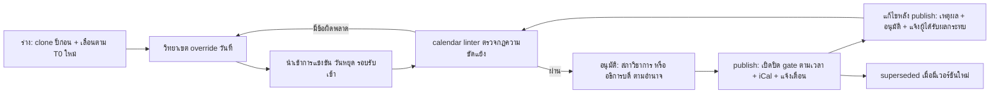

| ขั้น | ผู้ทำ | ระบบช่วยอะไร | เวลา (ก่อน T0 ภาค 1) |
|---|---|---|---|
| ร่าง | `registrar` (ส่วนกลาง) | clone ปีก่อน เลื่อนตาม T0 ใหม่ คงความสัมพันธ์ offset | T−6 เดือน 🟡 |
| override | `registrar` วิทยาเขต / `sschool_dir` | แก้เฉพาะ event ที่อนุญาตให้ override; แสดง diff จาก template | T−5 เดือน |
| นำเข้า | `sportshead`, `admission`, HR (วันหยุด) | CompetitionEvent, รอบรับสมัคร, วันหยุดราชการ + วันหยุดท้องถิ่น | T−5 เดือน |
| linter | `system` | ตรวจกฎในหัวข้อ 7.2 | ทุกครั้งที่แก้ |
| อนุมัติ | `council` (สภาวิชาการ) / `rector` | บันทึกเลขมติ | T−4 เดือน |
| publish | `system` | event `org.AcademicCalendarPublished` (ชื่อสุดท้ายเป็นของเล่ม 06) → REG/EXM/FIN/ADM/ENG รับ | T−4 เดือน (≥ T−10 สัปดาห์ ตามแนวปฏิบัติ) |
| แก้ไข | `registrar` → ผู้อนุมัติเดิม | ห้ามหด window ที่เปิดอยู่โดยไม่มีอนุมัติ; ขยายได้ทันทีถ้าไม่กระทบผู้อื่น; ทุกการแก้แจ้งเฉพาะผู้ได้รับผลกระทบ | ตามเหตุ |

### 6.6 Blackout

| ประเภท | ที่มา | ผลต่อการวาง (hard = ห้าม, soft = เตือน) |
|---|---|---|
| competition | `CompetitionEvent` ระดับชาติ/มหาวิทยาลัย/พลศึกษาเกมส์ ที่วิทยาเขตส่งนักกีฬา | **hard** สำหรับสอบปลายภาคและวันสุดท้ายถอน W ของวิทยาเขตที่ส่งนักกีฬา ≥ N คน (ตัวอย่าง N = 30 🟡); **soft** สำหรับสอบกลางภาค และวิทยาเขตที่ส่งน้อย (ใช้สอบชดเชยแทน) |
| holiday | `HolidayCalendar` | hard สำหรับสอบ/เส้นตาย; ค่าปรับรายวันนับหรือไม่ตาม `FinePolicy.count_holidays` |
| ceremony | พิธีพระราชทานปริญญาบัตร + วันซ้อม | hard สำหรับสอบของบุคลากรที่ทำงานพิธี (soft ระดับวิทยาเขต) |
| admission_test | วันสอบทักษะ/สัมภาษณ์ของวิทยาเขต | soft: ห้องสอบ/สนาม/กรรมการซ้อนกับสอบกลางภาค/ปลายภาค |
| freeze | derived จาก event `critical_window` | hard สำหรับ deploy ใน ring ของ OrgUnit (เล่ม 11) |
| heat | `HEAT_SEASON` + ค่า WBGT จาก FAC (W-153) | soft: เตือนเมื่อวาง ADM station / field test / ซ้อมกลางแจ้ง 11:00–15:00; ระดับ WBGT สูงสุดในวันจริง = hard stop สำหรับผู้เยาว์และสอบทักษะ |

---

## 7. ความขัดแย้งของปฏิทินที่ต้องจัดการ

### 7.1 รายการความขัดแย้ง

| # | ความขัดแย้ง | ช่วง (ตัวอย่าง 2570) | ผลกระทบ | วิธีจัดการ (นโยบายที่เสนอ 🟡) | ระบบช่วยอย่างไร |
|---|---|---|---|---|---|
| K-1 | **พลศึกษาเกมส์ vs ปลายภาค 1** | 1–10 ก.ย. = สัปดาห์ 13–14 (ก่อนสอบปลายภาค 27 ก.ย.) | นักกีฬาหลายร้อย–หลายพันคนทุกวิทยาเขตพลาดเรียน 2 สัปดาห์, เส้นตาย W, ประเมินการสอน; ถ้าเปิดภาคช้ากว่านี้จะทับสอบปลายภาคโดยตรง | ห้ามสอบปลายภาคในช่วงเกมส์ + 7 วัน; เลื่อนเส้นตาย W ไปหลังเกมส์ ≥ 1 สัปดาห์; ลาแข่งยกคณะ (W-114) + สอบชดเชยรวม | blackout hard จาก CompetitionEvent, linter, J-35 |
| K-2 | **กีฬาแห่งชาติ (+ ปีใหม่) vs สอบกลางภาค 2** | ≈ 19–29 ธ.ค. = สัปดาห์ 7–8 ภาค 2 | สอบกลางภาคชนการแข่ง + วันหยุด | เลื่อนกลางภาค 2 ไป 10–14 ม.ค. (หรือให้ผู้สอนจัดเอง + สอบชดเชย) | linter เตือน, ตัวเลือก "auto-shift" |
| K-3 | **กีฬามหาวิทยาลัยแห่งประเทศไทย (รอบมหกรรม) vs ปลายภาค 2** | ≈ 21–30 ม.ค. = สัปดาห์ 11–12 | ใกล้เส้นตาย W | เส้นตาย W ภาค 2 ≥ 1 สัปดาห์หลังจบการแข่ง (≈ 11 ก.พ.) | blackout + linter |
| K-4 | กีฬามหาวิทยาลัยรอบคัดเลือก vs add/drop ภาค 2 และการตรวจสิทธิ์ (FS X-20) | ≈ 8–13 พ.ย. = สัปดาห์ 1 | นักกีฬาลงทะเบียน/เพิ่ม-ลดไม่ได้; ตรวจสิทธิ์ก่อนข้อมูลพร้อม | squad ลง slot แรก 27 ต.ค. → final eligibility 28 ต.ค. (J-36 รอบ 2); GateOverride add/drop กลุ่มนักกีฬา | override หมดอายุอัตโนมัติ |
| K-5 | **ปีงบใหม่ 1 ต.ค. อยู่กลางช่วงสอบ/ลงทะเบียนภาค 2** | 30 ก.ย.–1 ต.ค. | ใบเสร็จต้องขึ้นเลขชุดใหม่ขณะใบแจ้งหนี้ภาคเดียวกันออกก่อน 1 ต.ค.; เงินยืมทริปพลศึกษาเกมส์ต้องล้างก่อนปิดปีงบ; EIT ปิด 30 ก.ย. + โรงเรียนปิดภาค 30 ก.ย. ในวันเดียวกัน | ใบเสร็จผูกปีงบตามเวลารับเงิน (ไม่ใช่วันออกใบแจ้งหนี้); counter ปิดก่อน 23:30 คืน 30 ก.ย.; J-37 บังคับล้างเงินยืม ≤ 16 ก.ย.; ห้าม deploy 28 ก.ย.–3 ต.ค. | J-31, J-37, freeze |
| K-6 | กยศ. vs due date ค่าเทอม | เงินกู้ภาค 1 เข้าหลัง 31 ต.ค. แต่ due date ≈ 11 มิ.ย. | ผู้กู้ถูกยกเลิกรายวิชาหรือติด hold | `Deferment(LOAN_PENDING)` อัตโนมัติ (W-27, W-48) + exclusion ใน J-15 | — |
| K-7 | **มิ.ย.: รับปริญญา + เปิดภาค 1 + census 10 มิ.ย. + OIT 30 มิ.ย. + รอบรับเข้าสุดท้าย** | ทั้งเดือน มิ.ย. | ภาระงานทะเบียน/กองแผนสูงสุดของปี | แยกทีมพิธีออกจากทีมลงทะเบียน; วางวันพิธีหลังสัปดาห์ที่ 2 ของภาค; OIT ส่งก่อน 15 มิ.ย. เป็นเป้าภายใน | dashboard deadline compliance |
| K-8 | รอบทั่วไป (ก.พ.–มิ.ย.) vs สอบปลายภาค 2 และฤดูร้อน | ก.พ.–มี.ค., เม.ย. | ห้องสอบ สนาม กรรมการ อาจารย์สัมภาษณ์ซ้อนกัน | ไม่วางวันสอบคัดเลือกในสัปดาห์สอบปลายภาคของวิทยาเขตนั้น | blackout soft `admission_test` + FAC booking |
| K-9 | สอบทักษะรอบโควตา vs กีฬาแห่งชาติ/การซ้อมทีม | ธ.ค. | โค้ช (กรรมการ) ไปคุมทีม, สนามถูกจองซ้อม | สอบทักษะต้น–กลาง ธ.ค., ใช้กรรมการภายนอก (external person) | FAC booking + scheduler ตรวจกรรมการว่าง |
| K-10 | ปฏิทินโรงเรียนกีฬา vs มหาวิทยาลัย (ใช้สนาม หอ ห้องพยาบาล ร่วมกันในวิทยาเขตเดียวกัน) | 30 ก.ย. (โรงเรียนปิดภาค ขณะมหาวิทยาลัยสอบ), พ.ค. (โรงเรียนเปิดก่อน) | ทรัพยากรชนข้ามองค์กร | จองทรัพยากรผ่าน FAC เดียว ระบุ OrgUnit ผู้จอง | FAC conflict check ข้าม profile |
| K-11 | **ฝึกสอนตามปฏิทินโรงเรียนคู่สัญญา (สพฐ.)** vs ภาคของมหาวิทยาลัย | โรงเรียนเปิด 16 พ.ค. ก่อนมหาวิทยาลัย 3 สัปดาห์; ปิด 30 ก.ย. ก่อนมหาวิทยาลัยสอบ | ชั่วโมงฝึก ≥ 120 ชม./ภาค นับตามโรงเรียน; เกรดฝึกสอนออกไม่ตรงรอบ | `PRACTICUM_PERIOD` ใช้ปฏิทินโรงเรียนคู่สัญญา; กำหนดส่งเกรดวิชาฝึกสอนแยก | profile ปฏิทินต่อหลักสูตร |
| K-12 | วันหยุดในสัปดาห์สอบ/เส้นตาย | 13 ต.ค., 23 ต.ค., 5 ธ.ค., 10 ธ.ค., 31 ธ.ค.–1 ม.ค., วันหยุดทางจันทรคติ (มาฆบูชา วิสาขบูชา อาสาฬหบูชา 🟡 ต้องดูประกาศปี), สงกรานต์ 13–15 เม.ย., วันเลือกตั้ง/วันหยุดพิเศษที่ ครม. ประกาศ | สอบตกวันหยุด, เส้นตายตกวันหยุด | HolidayCalendar เป็นข้อมูลที่แก้ได้ระหว่างปี; เส้นตายที่ตกวันหยุดเลื่อนเป็นวันทำการถัดไป (config) | J-20 ทำงานเมื่อวันหยุดเปลี่ยน |
| K-13 | ตรวจเลือกทหาร 1–12 เม.ย. vs สอบภาคฤดูร้อน | เม.ย. | นักศึกษาชายต้องไปแสดงตน | สิทธิ์สอบชดเชยอัตโนมัติเมื่อแนบ สด.35 | W-05 + rule |
| K-14 | ปฏิทินต่างวิทยาเขต vs วิชาที่เรียนร่วมข้ามวิทยาเขต (GE ออนไลน์) | ทุกภาค | นักศึกษาสองวิทยาเขตมีวันสอบ/เส้นตายต่างกัน | ใช้ปฏิทินของ section เจ้าภาพ (host) สำหรับกิจกรรมของวิชา; ใช้ปฏิทินบ้าน (home) สำหรับการเงิน/สถานภาพ | scope resolution ราย section |
| K-15 | **(แก้ v1.1) ลงทะเบียนภาคถัดไปก่อนเกรด/สถานภาพออก — ทุกรอยต่อภาค** | เดิม 18–29 ต.ค. vs เกรด 26–29 ต.ค.; ฤดูร้อน → ภาค 1 (FS X-21) | prerequisite เพดานหน่วยกิตรอพินิจ และผู้พ้นสภาพที่ลงทะเบียน/จ่ายเงินแล้วไม่ถูกตรวจ | **จำแนกสถานภาพและ sign-off ก่อนเปิด slot แรก** (ส่งเกรด 7 วันทำการ, T0 ภาค 2 = 8 พ.ย., ลงทะเบียน 27 ต.ค.–5 พ.ย.); ผู้มีคำสั่งพ้นสภาพลงทะเบียนในสถานะ ENROLLED_PENDING_APPEAL; เกรดที่เปลี่ยนภายหลัง (ปิด I, อุทธรณ์) → W-162; ฤดูร้อน → ภาค 1: ใช้เฉพาะเมื่อ PolicySet `standing_after_summer = true` แล้วผู้เรียนฤดูร้อนที่สถานภาพอาจเปลี่ยนลงทะเบียนหลัง standing ฤดูร้อน | linter L-4 (error), J-25, J-50 |
| K-16 | window ขอจบ (T0+30) vs รอบประชุมสภา | ทุกภาค | วันจบในทรานสคริปต์ขึ้นกับวันประชุมสภา | ปฏิทินมีรอบประชุมสภาเป็น event; audit ขั้นสุดท้ายต้องเสร็จก่อนประชุม ≥ 10 วันทำการ 🟡 | linter |
| K-17 | union ของ change freeze ครอบคลุม 30–40% ของปี (OPS-04) | ตลอดปี | release กองรวมกัน | freeze แบบ ring ราย OrgUnit (หัวข้อ 3.3) | J-46 |
| K-18 | นักกีฬาติดแข่งวันซ้อม/พิธีรับปริญญา | มิ.ย. | ไม่ได้เข้ารับ | ขอเลื่อนไปรอบถัดไป/ไม่เข้ารับ (GD-16 ในเล่ม 02) | ตรวจกับ CompetitionEvent |
| K-19 | **ผู้รับเข้ารอบท้าย vs เปิดภาค** (X-05, F-05) | รอบ 5–6 + สำรอง 8–15 มิ.ย. หลัง T0 7 มิ.ย., census 10 มิ.ย., due 11 มิ.ย. | ค่าปรับ ขาดเรียน พลาด census ปฐมนิเทศ/หอ/PPE ไม่ทัน | `cascade_cutoff` = T0 + 5 วันทำการ; W-148 fast-track (block enrolment ไม่มีค่าปรับ, ATT จาก matriculated_at, checklist 14 วัน, ธงใน census) | L-13, J-49 |
| K-20 | **อุทธรณ์ผลคัดเลือก vs กำหนดยืนยันสิทธิ์และเพดานคุรุสภา** (X-06, X-14) | โควตา: ประกาศ ≤ 17 ธ.ค. → clearing 5–12 ม.ค. คร่อมปีใหม่; รอบท้าย 24 ชม. | ผู้ชนะอุทธรณ์ไม่มีที่นั่ง / เกินเพดาน | W-18 เร่งด่วน (ยื่น ≤ 3 วันทำการ ตัดสิน ≤ 5 วันทำการ ก่อนปิดยืนยัน ≥ 1 วันทำการ; รอบ ≤ 72 ชม.: 1 + 2 วันทำการ + GateOverride ผู้ยื่น), `appeal_hold`, ห้ามเกิน AccreditedIntakeCap | L-15 |
| K-21 | **ฝึกสอนเริ่ม 16 พ.ค. ก่อนลงทะเบียน/ประกันภาค 1** (FS X-22, F-19) | 16 พ.ค. vs ลงทะเบียน 24 พ.ค., ประกัน "ก่อนเปิดภาค" 7 มิ.ย. | ช่องว่างความคุ้มครอง 3 สัปดาห์ | `PRACTICUM_REGISTRATION` ≤ 10 พ.ค.; สถานภาพ/ประกัน/StaffClearance มีผล ณ `PRACTICUM_PERIOD.start` (W-156) | L-10, L-16 |
| K-22 | สอบทักษะรอบโควตา vs กีฬาระดับชาติที่กรรมการ (โค้ช) ต้องคุมทีม (X-15) | ธ.ค. | กรรมการไม่พอ | ห้ามวางสอบทักษะใน 14 วันก่อนการแข่งขันที่ judge อยู่ใน delegation หรือใช้กรรมการภายนอก | L-14 |
| K-23 | **พลศึกษาเกมส์ ก.ย. 2572 ของ pilot** (F-30) | 1–10 ก.ย. 2572 + ปิดปีงบ 30 ก.ย. 2572 | ถ้า W-30/W-31/W-115 ไม่ live ต้องทำเงินยืมสองทาง | D-03: ATH eligibility + team travel + ล้างเงินยืม (FIN) อยู่ใน R2 (พ.ค. 2572 = M26) | — |
| K-24 | ฤดูร้อนจัด (มี.ค.–พ.ค.) vs สอบทักษะรอบทั่วไป/ซ้อม/วิชาปฏิบัติ (F-03, S-03) | มี.ค.–พ.ค. | heat illness | blackout `heat` (soft) + WBGT ต่อสนาม (W-153) + จัด station ใช้แรงช่วงเช้า | L-18, J-51 |

### 7.2 กฎของ calendar linter (ตรวจก่อนอนุมัติและทุกครั้งที่แก้)

| รหัส | กฎ | ระดับ |
|---|---|---|
| L-1 | ไม่มี `FINAL_EXAM` ทับ blackout competition แบบ hard ของ scope เดียวกัน (+ 7 วันหลังการแข่ง) | error |
| L-2 | `REG_WITHDRAW_W.end` ≥ วันจบการแข่งขัน hard + 7 วัน | error |
| L-3 | `GRADE_ENTRY.end` ≥ `FINAL_EXAM.end` + 7 วันทำการ (ไม่นับวันหยุด; ค่าตั้งต้น config ต่อวิทยาเขต) | error |
| L-4 | **(แก้ v1.1)** `STANDING_RUN` sign-off ≤ `REG_PRIORITY_SLOT.start` ของภาคถัดไป − 1 วันทำการ ทุกรอยต่อภาคปกติ; ฤดูร้อน → ภาค 1 ตรวจเมื่อ `standing_after_summer = true` | **error** |
| L-5 | ไม่มี event `critical_window` ใดคร่อม 1 ต.ค. 00:00 | error |
| L-6 | `GRAD_APPLICATION` = T0 → T0 + 30 วัน (ตามข้อบังคับที่ยืนยัน) | error ถ้าต่างโดยไม่มีมติ |
| L-7 | `EXAM_ELIGIBILITY_PUBLISH` ≥ 7 วันก่อน `FINAL_EXAM.start` | warning |
| L-8 | ไม่มีเส้นตายตกวันหยุดราชการ (เลื่อนอัตโนมัติหรือยืนยันโดยเจ้าหน้าที่) | warning |
| L-9 | `ADM_ROUND_APPLY`/สอบคัดเลือกของวิทยาเขต ไม่ทับ `FINAL_EXAM` ของวิทยาเขตเดียวกัน | warning |
| L-10 | `PRACTICUM_PERIOD` อ้างปฏิทินโรงเรียนคู่สัญญาที่ publish แล้ว และ StaffClearance ของ roster ยังไม่หมดอายุ ณ วันเริ่ม | warning |
| L-11 | `CEREMONY` ไม่อยู่ในสัปดาห์ที่ 1–2 ของภาค 1 | warning |
| L-12 | ทุก event ที่ `notify=true` มีข้อความแจ้งเตือนครบทั้ง TH/EN (ถ้ากลุ่มเป้าหมายมีต่างชาติ) | warning |
| L-13 | `ADM_CONFIRM.end` ของทุกรอบ ≤ `TERM.T0` + `cascade_cutoff`; รอบที่ประกาศหลัง T0 − 7 วันต้องผูก W-148 | error |
| L-14 | สอบทักษะ (`admission_test`) ไม่อยู่ใน 14 วันก่อน `CompetitionEvent` ระดับชาติที่ judge ในชุดกรรมการอยู่ใน delegation | warning |
| L-15 | `ADM_CONFIRM.start` ≥ `ADM_RESULT_PUBLISH` + `ADM_APPEAL_WINDOW` + SLA ตัดสินอุทธรณ์ + 1 วันทำการ หรือรอบเปิด `appeal_hold` | error |
| L-16 | `PRACTICUM_REGISTRATION.end` ≤ `PRACTICUM_PERIOD.start` − 3 วันทำการ และ roster ประกันเริ่ม ≤ `PRACTICUM_PERIOD.start` | error |
| L-17 | `SELECTION_TRIALS` มี SelectionPolicy ที่เผยแพร่แล้ว ≥ 14 วันก่อน | warning |
| L-18 | ADM station ที่ใช้แรงมาก / field test / ซ้อมกลางแจ้ง ไม่วาง 11:00–15:00 ในช่วง `HEAT_SEASON` | warning |

> **namespace ของรหัส:** `K-n` ในเล่มนี้ = ความขัดแย้งของปฏิทิน (คงไว้ K-1..K-24) ส่วน KPI ใช้ `KPI-xx` ในเล่ม 14 (D-10); `L-n` = กฎ linter ของเล่มนี้ (คนละชุดกับ lawful-basis `L-xx` ของเล่ม 10 — อ้างข้ามเล่มให้เขียน `03/L-n`)

---

## 8. ผลการปิด review

| ข้อจาก review | ประเด็น | การจัดการในเล่มนี้ |
|---|---|---|
| review_functional §2.2 (ปฏิทินสมมติทั้งปี) | ปฏิทิน v0.9 เป็นสมมติฐาน ไม่มีวันที่จริง | **แก้:** ใช้วันที่จริงปี 2569/2570 ✅ เป็น anchor (หัวข้อ 0.3) และติด 🟡 ทุกวันที่ที่คาด |
| research v2 (ITA) / blueprint 2.6 | OIT ต้องเสร็จ "เม.ย." ใน v0.9/government-relations ผิด | **แก้:** OIT 2 มี.ค.–30 มิ.ย.; IIT ปิด 30 มิ.ย.; EIT ปิด 30 ก.ย. (ตาราง มิ.ย./ก.ย./มี.ค.) |
| G-01 / review_architecture #5 | roadmap ไม่ตรงปฏิทินจริง | **แก้บางส่วน:** CAL-A6 + ตารางรายเดือนแสดงว่ารอบโควตาเปิด ต.ค. และประกาศปลาย ก.ย. (สนับสนุน R1 ก.ย. 2571 ของ blueprint); แผนละเอียดเป็นของเล่ม 12 |
| G-09 | ไม่มี obligation registry / census 10 มิ.ย.–10 พ.ย. | **แก้ในมุมปฏิทิน:** `CENSUS_DATE`, `REPORT_DEADLINE`, J-29, J-30; registry เต็มอยู่ใน RPT (เล่ม 06/09) |
| G-10 | cut-off ปีงบ 30 ก.ย. กลางภาค 1 | **แก้:** K-5, J-31, J-37, W-116 |
| G-11 | ไม่มี attendance | **แก้:** `TERM_TEACHING` + J-18/J-19 + `EXAM_ELIGIBILITY_PUBLISH` |
| G-14 | ทริปแข่งขัน/ตรวจสิทธิ์ | **แก้:** J-35..J-37 และคอลัมน์กีฬา |
| G-20 | ไม่มี runbook rollover ภาค/ปี/ปีงบ | **แก้:** J-31, J-47 (dry-run + sign-off); runbook ปฏิบัติการเป็นของเล่ม 11 |
| R-03 / I-21 / IC-14 | ปฏิทินมีเจ้าของ 4 ที่; event `org.AcademicCalendarPublished` ไม่มีผู้ publish | **แก้:** ORG เจ้าของเดียว (6.1) และเป็นผู้ publish event นี้ (6.5) — ชื่อ event สุดท้ายให้เล่ม 06 ยืนยัน |
| review_architecture OPS-04 | union ของ freeze 30–40% ของปี | **แก้:** freeze แบบ ring ราย OrgUnit (3.3, J-46, K-17) |
| review_architecture NFR-04 | SLO 99.95% ทั้งระบบทำไม่ได้ | **สอดคล้อง blueprint 8:** 99.95% เฉพาะ window วิกฤตที่ผูกกับ `critical_window` (3.3) |
| research v2 calendar §4 | พลศึกษาเกมส์ทับสอบภาค 1 ทุกปี | **แก้:** blackout + linter L-1/L-2 + ลาแข่งยกคณะ (K-1) |
| research v2 calendar §5 | โรงเรียนกีฬาต้องมี term model แยก | **แก้:** profile `BASIC_ED`, CAL-A3, คอลัมน์โรงเรียนกีฬา, K-10 |
| research v2 calendar §8 (deadlines/notifications) | ควร automate และแจ้งเตือน | **แก้:** หัวข้อ 4 (52 งาน, J-01..J-52) และหัวข้อ 5 |
| review_benchmark (Journeys/checklist, booking) | ไม่มี guided journey | **อ้างอิง:** notification ตามช่วง (หัวข้อ 5) ป้อน checklist ในเล่ม 02 |
| ข้อมูลที่ยังขัดกัน | จำนวนผู้เข้าร่วมพลศึกษาเกมส์ (3,000 vs 8,000), วันเปิด/ปิดภาคโรงเรียน (14/16 พ.ค., 30 ก.ย./11 ต.ค.), ผลรอบ 3 TCAS70 (22/27 พ.ค.) | **เลื่อน:** ระบุ ⚠️ ไว้; ส่งเป็นคำถามให้เล่ม 13 (ยืนยันกับ มกช./ทปอ./ศธ.) |
| **v1-review consistency TERM-01** | แถว พ.ค. ยังมี "ป.ป.ช. ตรวจ OIT" (v0.9 leftover) | **แก้:** "OIT เปิดตอบ/อนุมัติข้อมูล (ถึง 30 มิ.ย.)" |
| consistency WF-02 | W-147\* ยังติดดาว / หมายเหตุ "ที่มี \*" | **แก้:** ลบดาวและหมายเหตุ (หัวข้อ 2, J-39) |
| consistency ID-03 | "I-21" อ่านเป็น integration | **แก้:** "RF I-21" (6.1) |
| consistency X14-02 / D-10 | K-xx ชนกับ KPI ของเล่ม 14 | **คง K-1..K-24 ในเล่มนี้**; KPI เป็น `KPI-xx` ในเล่ม 14 — หมายเหตุ namespace ท้าย 7.2 |
| functional_sports X-19 / X-21 / F-20 / D-08 | จำแนกสถานภาพหลังลงทะเบียนภาคถัดไป; ฤดูร้อน → ภาค 1 | **แก้:** CAL-A2 (ภาค 2 T0 = 8 พ.ย.; ส่งเกรด 7 วันทำการ), แถว ต.ค./มี.ค., J-25, K-15, L-3, L-4 = error ทุกรอยต่อ, `STANDING_RUN` critical, J-50/W-162 |
| X-20 | J-36 ตรวจสิทธิ์ก่อนข้อมูลพร้อม | **แก้:** J-36 สองรอบ (pre-check ชั่วคราว + final check 28 ต.ค. หลังเกรด/standing/ลงทะเบียน slot แรกของ squad), K-4 |
| X-04 | เวลาคืนที่นั่ง 4 แบบ | **แก้:** J-04 กติกาเดียว ≤ 15 นาที (สอดคล้อง 02 §2.8 และ W-74) |
| X-05 / F-05 | late-admit cohort | **แก้:** แถว มิ.ย., J-15 exclusion, J-49, K-19, L-13 |
| X-06 / X-14 | อุทธรณ์ vs ยืนยันสิทธิ์/คุรุสภา; โควตาคร่อมปีใหม่ | **แก้:** แถว ธ.ค./ม.ค., `ADM_APPEAL_WINDOW`, K-20, L-15 |
| X-15 | สอบทักษะ vs การแข่งขันระดับชาติ | **แก้:** K-22, L-14 |
| X-18 | batch ยกเลิกผู้ไม่ชำระ T0 vs J-15 | **แก้:** ใช้ J-15 (payment.due + grace) ทั้ง 02 และ 03 |
| X-22 / F-19 | ฝึกสอน 16 พ.ค. ก่อนลงทะเบียน/ประกัน | **แก้:** แถว พ.ค., `PRACTICUM_REGISTRATION`, K-21, L-10, L-16 (W-156) |
| F-01 | ผู้ยืนยันโควตาหลุดไป TCAS ที่อื่น | **แก้:** `ADM_RECONFIRM_WINDOW`, J-48 (W-163) |
| F-03 / S-03 | ไม่มี heat policy | **แก้:** blackout `heat`, `HEAT_SEASON`, J-51, K-24, L-18 (W-153) |
| F-15 / X-26 / X-30 | ลาแข่งยกคณะเจ้าของไม่ชัด, อนุมัติซ้ำ | **แก้:** ATH เป็นเจ้าของ (J-35), สอบชดเชยสร้างอัตโนมัติ (แถว ก.ย.), GateOverride อนุมัติครั้งเดียวระดับคณะ (6.4) |
| F-30 / D-03 | พลศึกษาเกมส์ ก.ย. 2572 ของ pilot | **แก้:** CAL-A6, K-23 (W-30/W-31/W-115 ฝั่ง FIN ใน R2) |
| S-04 / F-11 | คัดตัว, ParaClassification | **แก้:** `SELECTION_TRIALS`, L-17, J-52 (W-150, W-157) |
| D-02 | วันที่ release ไม่มี M-number | **แก้:** CAL-A6 (M18/M26/M32 + กติกาเลื่อน 12 เดือน) |
| D-07 | "ห้าม go-live ใน P1–P3" ขัด R3 พ.ย. | **แก้:** 3.3 ข้อ 3 อิง `critical_window` ราย OrgUnit; วันที่ release เป็นของเล่ม 11/12 |

### สมมติฐาน/คำถามใหม่ของเล่มนี้ (ลงทะเบียนกลางแล้ว)

นิยามอยู่ใน [01-overview](01-overview.md) หัวข้อ 7.11 และ [13-open-questions](13-open-questions.md) หัวข้อ 9.2: **A-113** ส่งเกรด 7 วันทำการ + T0 ภาค 2 สัปดาห์ที่ 2 ของ พ.ย. · **A-114** `standing_after_summer = false` · **Q-98** เวลาส่งเกรด/จำแนกสถานภาพ/อุทธรณ์ตามข้อบังคับ · **Q-99** เกณฑ์ WBGT และเครื่องวัด (J-51, W-153)


---

<!-- ไฟล์ต้นฉบับ: docs/04-roles-permissions.md -->
# 04 — บทบาท ลำดับชั้นองค์กร และสิทธิ์ (Roles, Organisation & Permissions)

> **สถานะ:** v1.1-draft · 28 ต.ค. 2569 (แก้ตาม [00-fix-decisions-v1.1](00-fix-decisions-v1.1.md) D-05, D-08, D-09; ปิด v1-review ดูหัวข้อ 14) · ผู้เขียน: C · ภาษา: ไทย (ศัพท์เทคนิคเป็นภาษาอังกฤษ)
> **อ่านคู่กับ:** [00-blueprint](00-blueprint.md) · [05-workflows](05-workflows.md) + [`data/workflows.json`](data/workflows.json) (ใช้รหัสบทบาทชุดเดียวกับเล่มนี้) · [06-modules](06-modules.md) (IAM, PRIV, AUD, ADMIN) · [07-architecture](07-architecture.md) (Keycloak, PAM, RLS) · [08-data](08-data.md) (data classification, GuardianRelation) · [10-security-compliance](10-security-compliance.md) (PDPA lawful basis, consent ผู้เยาว์, threat model)
> **เล่มนี้เป็นเจ้าของ:** รายการรหัสบทบาทสุดท้าย (blueprint หัวข้อ 5), scope model, permission matrix, กฎ SoD, การรักษาราชการแทน/การมอบอำนาจลงนาม, บทบาทผู้ดูแลระบบ, break-glass

## 1. หลักการ

1. **ลำดับชั้นเป็นข้อมูล ไม่ใช่โค้ด** — เก็บเป็น `OrgUnit` (มหาวิทยาลัย → วิทยาเขต / โรงเรียนกีฬา → คณะ → ภาค/หลักสูตร → section/squad/หอ) + `Position` + `RoleAssignment(person, role, org_unit, scope, source, valid_from, valid_to)` เปลี่ยนชื่อหรือเพิ่มระดับได้โดยไม่แก้โค้ด
2. **ผังองค์กรในเล่มนี้เป็นสมมติฐาน** ตามโครงสร้างมหาวิทยาลัยรัฐไทยทั่วไป เพราะยังไม่พบผังทางการของ มกช. **[ต้องตรวจสอบ]** และอาจยังบริหารโดยคณะบุคคลแทนสภามหาวิทยาลัย จึงเก็บ `GoverningBody(type = COUNCIL | INTERIM_BOARD)` (สมมติฐานในทะเบียน A-xx ของเล่ม 01)
3. **RBAC + ABAC** — บทบาท (role) บอกว่า "ทำอะไรได้"; attribute บอกว่า "กับข้อมูลของใคร/หน่วยไหน/ชั้นความอ่อนไหวใด" (scope, `org_unit`, `data_class`, ความสัมพันธ์ดูแล, consent, คำสั่งจำกัด) บังคับซ้ำ 2 ชั้น: application (policy engine) และฐานข้อมูล (PostgreSQL RLS ตาม `org_unit_id`)
4. **ผู้ดูแลระบบจัดการ "ระบบ" แต่ไม่ได้ "ข้อมูลธุรกิจ" โดยอัตโนมัติ** — สิทธิ์ privileged ได้แบบ JIT ผ่าน PAM และ break-glass ต้องมีผู้อนุมัติ 2 คนเสมอ
5. **รหัสบทบาทชุดเดียว** — รหัสในเล่มนี้ = รหัสใน `data/workflows.json` = รหัสใน Keycloak client role (แก้ปัญหา role code 3 ชุดของ v0.9) ตำแหน่งย่อยที่ต้องแยกเพื่อ SoD ใช้ **qualifier** (หัวข้อ 3.3) ไม่สร้างรหัสใหม่

## 2. ลำดับชั้นองค์กร

### 2.1 สายบังคับบัญชาหลัก (สมมติฐาน)

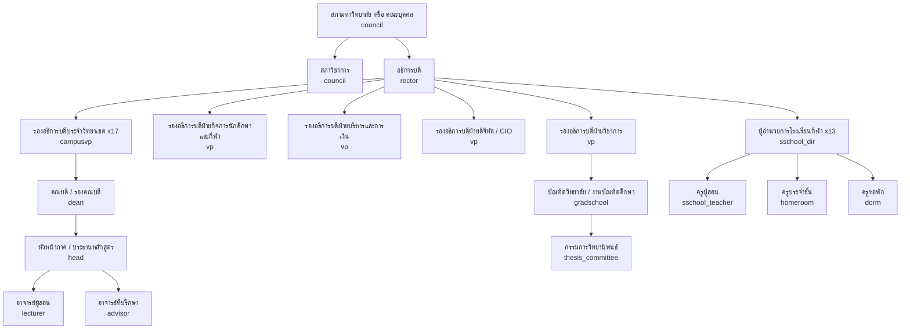

> สังกัดของโรงเรียนกีฬา (ขึ้นตรงอธิการบดี หรือภายใต้วิทยาเขต) **[ต้องตรวจสอบ]** — ระบบรองรับทั้งสองแบบเพราะเป็นเพียง parent ของ OrgUnit

### 2.2 สายงานสนับสนุนและกำกับ

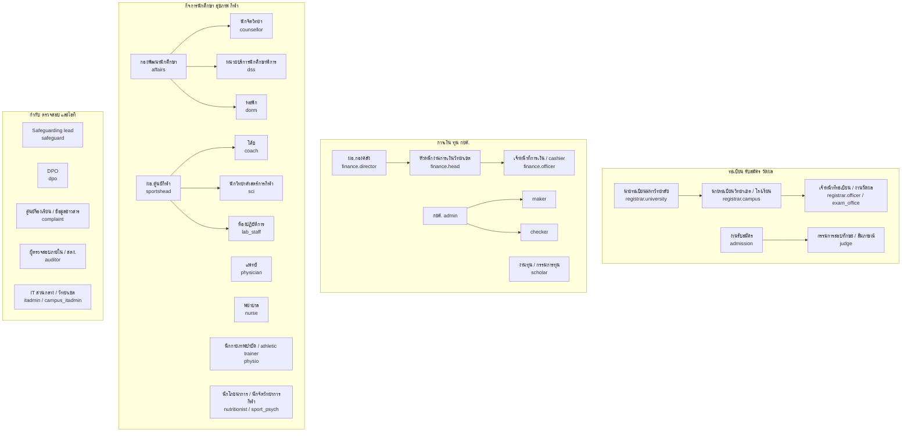

**ข้อกำหนดเชิงโครงสร้างที่ต้องรักษา:** (ก) `safeguard` และ `dpo` รายงานตรงผู้บริหารสูงสุดและไม่อยู่ใต้สายของหน่วยที่ตนกำกับ (ความเป็นอิสระ — review C-13) (ข) `auditor` read-only และ time-boxed (ค) บทบาทวิชาชีพสุขภาพ (`physician`, `nurse`, `physio`) ผูกกับ "ความสัมพันธ์ดูแล" ไม่ใช่สายบังคับบัญชาของโค้ช และ `safeguard.athlete_welfare_officer` ไม่อยู่ใต้สายของหัวหน้างานกีฬา

## 3. Role catalogue (รายการสุดท้าย)

**ที่มาของการมอบหมาย (assignment source):** `HR` = ตำแหน่งจาก HR sync (JML) · `ORDER` = คำสั่งแต่งตั้ง มีวาระ/เลขที่คำสั่ง (เชื่อม e-Saraban) · `ROUND` = คำสั่งต่อรอบ/ต่อคดี/ต่อเคส หมดอายุเมื่อปิดรอบ · `TERM` = มอบหมายรายภาคจากตารางสอน/การมอบหมาย หมดอายุอัตโนมัติ · `REL` = ความสัมพันธ์ที่ยืนยันแล้ว (ผู้ปกครอง, care relationship) · `SELF` = สมัครเอง/สถานะ (ผู้สมัคร นักศึกษา) · `SPONSOR` = บุคคลภายนอกที่บุคลากรรับรอง (W-139) · `SYS` = ระบบ

**Scope types:** ดูหัวข้อ 4 (`own`, `child`, `advisee`, `section`, `squad`, `care`, `assigned`, `program`, `department`, `faculty`, `campus`, `school`, `university`, `aggregate`, `technical`)

### 3.1 บทบาทธุรกิจ

| รหัส | ชื่อภาษาไทย | กลุ่ม | Scope types | ที่มา | หมายเหตุ |
|---|---|---|---|---|---|
| `candidate` | ผู้สมัคร | นักศึกษาและครอบครัว | own | SELF | บัญชีระดับมหาวิทยาลัย 1 คน 1 บัญชี (dedupe ด้วยเลขบัตร/passport/รหัส G) |
| `student` | นักศึกษา / นักเรียนโรงเรียนกีฬา | นักศึกษาและครอบครัว | own | SELF (สถานะ REC) | profile `HIGHER_ED` / `BASIC_ED` เป็น attribute; step-up (passkey/OTP) สำหรับถอนวิชา คืนเงิน เปลี่ยนบัญชี |
| `guardian` | ผู้ปกครอง / ผู้อุปการะ | นักศึกษาและครอบครัว | child | REL | ชนิดความสัมพันธ์ `LEGAL` (ผู้แทนโดยชอบธรรมของผู้เยาว์), `CAREGIVER` (ผู้อุปการะ เช่น ปู่ย่าตายาย/ญาติที่ดูแลจริง สิทธิ์เฉพาะที่กำหนด — W-160), `LOCAL_GUARDIAN` (ผู้ปกครองในประเทศของผู้เยาว์ต่างชาติ — W-160) หรือ `OBSERVER` (ผู้ปกครองของนักศึกษาที่บรรลุนิติภาวะ ตาม consent) + `verification_level` — หัวข้อ 7 |
| `alumni` | ศิษย์เก่า / ผู้สำเร็จการศึกษา | นักศึกษาและครอบครัว | own | SYS (DegreeConferred) | รวมผู้จบโรงเรียนกีฬา |
| `former_student` | อดีตนักศึกษาที่ไม่สำเร็จการศึกษา | นักศึกษาและครอบครัว | own | SYS (W-133) | ขอเอกสาร/คืนสภาพได้ (แก้ review G-17) |
| `applicant` | บุคคลภายนอก / ประชาชน / ผู้แจ้งเรื่อง | ภายนอก | own (เรื่องที่ตนยื่น) | SELF | ร้องเรียนแบบไม่ระบุตัวตนได้ ติดตามด้วยรหัส |
| `employer` | สถานประกอบการ / แหล่งฝึกงาน | ภายนอก | assigned | SPONSOR | ภายใต้ข้อตกลงประมวลผลข้อมูล |
| `verifier` | ผู้ตรวจสอบเอกสาร | ภายนอก | ไม่มี (ลิงก์/QR) | — | ไม่ต้อง login, rate limit, ไม่ค้นหารายชื่อได้ |
| `federation` | สมาคมกีฬา / กกท. / ผู้จัดการแข่งขัน | ภายนอก | assigned | SPONSOR | ยืนยันผลงาน/หนังสือเรียกตัว ไม่เห็นข้อมูลการเรียน/สุขภาพ |
| `insurer` | บริษัทประกันคู่สัญญา | ภายนอก | assigned (เคลม) | SPONSOR | ได้เฉพาะข้อมูลเคลมตาม data sharing agreement |
| `host_principal` | ผู้บริหารสถานศึกษาที่รับฝึก | ภายนอก | assigned (placement) | SPONSOR | ตอบรับ ประเมินภาพรวม |
| `mentor` | ครูพี่เลี้ยง | ภายนอก | assigned (นักศึกษาฝึกสอน) | SPONSOR | สัดส่วน ≤ 1:3 ตรวจโดย RatioRule |
| `lecturer` | อาจารย์ผู้สอน | อาจารย์และผู้บริหาร | section | TERM | หมดอายุหลังช่วงส่งเกรด + grace 60 วัน; ข้ามวิทยาเขตได้ผ่าน host_org_unit |
| `advisor` | อาจารย์ที่ปรึกษา | อาจารย์และผู้บริหาร | advisee | TERM / ORDER | รวม DC tutor (ผู้ประสาน dual career) เป็น qualifier |
| `head` | หัวหน้าภาค / ประธานหลักสูตร / คณะกรรมการคัดเลือก | อาจารย์และผู้บริหาร | department, program | ORDER | qualifier: `dept_head`, `program_chair`, `selection_chair` (ROUND) |
| `dean` | คณบดี / รองคณบดี | อาจารย์และผู้บริหาร | faculty | ORDER | qualifier `associate` สำหรับรองคณบดีที่ได้รับมอบอำนาจ |
| `campusvp` | รองอธิการบดีประจำวิทยาเขต | อาจารย์และผู้บริหาร | campus | ORDER | ผู้อนุมัติเกินวงเงินระดับวิทยาเขต, มาตรการคุ้มครองเด็ก, ผู้บังคับบัญชาสำหรับ recertification |
| `vp` | รองอธิการบดีฝ่าย | อาจารย์และผู้บริหาร | university (เฉพาะสายงาน) | ORDER | qualifier: `academic`, `student_affairs`, `admin_finance`, `digital` (CIO = ผู้อนุมัติคนที่ 2 ของ W-125) |
| `rector` | อธิการบดี | อาจารย์และผู้บริหาร | university | ORDER | ลงนามคำสั่ง/credential; ส่วนใหญ่ลงนามผ่าน **ผู้ได้รับมอบอำนาจลงนาม** (หัวข้อ 9) |
| `council` | สภาวิชาการ / สภามหาวิทยาลัย / คณะบุคคล | อาจารย์และผู้บริหาร | university (aggregate + วาระ) | ORDER | บันทึกมติผ่านเลขานุการสภา (qualifier `secretary`) แบบ 4-eyes |
| `judge` | กรรมการสอบทักษะ / สัมภาษณ์ | อาจารย์และผู้บริหาร | assigned (station/session) | ROUND | ประกาศ COI ต่อรอบ; ภายนอกผ่าน W-139; สิทธิ์หมดเมื่อปิดรอบ |
| `admission` | งานรับสมัคร | เจ้าหน้าที่ | campus (ส่วนกลาง = university) | HR | ไม่เห็นเนื้อหาข้อมูลความพิการ (เห็นเฉพาะแผน accommodation) |
| `registrar` | นายทะเบียน / งานทะเบียนและวัดผล | เจ้าหน้าที่ | campus, school, university | ORDER (นายทะเบียน) / HR (เจ้าหน้าที่) | qualifier: `university`, `campus`, `school` (งานทะเบียนโรงเรียนกีฬา), `officer`, `exam_office` (งานวัดผล = เจ้าของปฏิบัติการตารางสอบใน EXM) |
| `proctor` | กรรมการคุมสอบ | เจ้าหน้าที่ | assigned (ห้องสอบ) | ROUND | ห้ามคุมวิชาที่ตนสอน |
| `finance` | การเงิน / กองคลัง | เจ้าหน้าที่ | campus, university | HR / ORDER | qualifier: `officer`, `cashier`, `head`, `refund_approver`, `director` — แยกเพื่อ SoD-03/05/10 |
| `loan` | เจ้าหน้าที่ กยศ. | เจ้าหน้าที่ | campus | ORDER | qualifier สอดคล้องบทบาทใน DSL: `superuser`, `admin`, `maker`, `checker` |
| `scholar` | งานทุน / กรรมการทุน | เจ้าหน้าที่ | campus, university (ตามประกาศทุน) | HR / ROUND | กรรมการทุนประกาศ COI ต่อรอบ |
| `dorm` | หอพัก / ครูหอพัก | เจ้าหน้าที่ | dorm (OrgUnit หอ) | HR / TERM | qualifier: `manager`, `officer`, `boarding` (ครูหอโรงเรียนกีฬา); เห็นคำสั่งจำกัดที่ต้องปฏิบัติ ไม่เห็นรายละเอียดคดี |
| `affairs` | กิจการนักศึกษา | เจ้าหน้าที่ | campus | HR | qualifier `discipline_committee` (ROUND ต่อคดี) |
| `counsellor` | นักจิตวิทยา / ผู้ให้คำปรึกษา | เจ้าหน้าที่ | care (เคสของตน) | HR | บันทึกการให้คำปรึกษา = ชั้น sensitive |
| `dss` | หน่วยบริการนักศึกษาพิการ | เจ้าหน้าที่ | campus (เคสที่ลงทะเบียน) | HR | เข้าถึงหลักฐานความพิการใน vault |
| `intl` | งานนักศึกษาต่างชาติ | เจ้าหน้าที่ | campus, university | HR | วีซ่า, 90 วัน, ตม.30 |
| `hr` | บุคลากร | เจ้าหน้าที่ | university | HR | เจ้าของ JML, ตรวจประวัติ (W-23), บันทึกคำสั่ง acting/delegation (W-123) |
| `planner` | กองแผน / งานประกันคุณภาพ | เจ้าหน้าที่ | university (aggregate + dataset ที่อนุมัติ) | HR | ไม่มี SQL Lab โดยปริยาย |
| `records` | งานสารบรรณ | เจ้าหน้าที่ | OrgUnit ของตน | HR | ออกเลขหนังสือ, ทำลาย/ส่งมอบเอกสาร |
| `pr` | ประชาสัมพันธ์ | เจ้าหน้าที่ | OrgUnit ของตน | HR | สร้างประกาศ (ENG) ไม่เห็นข้อมูลรายบุคคล |
| `legal` | นิติกร | เจ้าหน้าที่ | assigned (เรื่อง) | HR | อุทธรณ์ คำขอข้อมูลข่าวสาร คำสั่งศาล เพิกถอนปริญญา |
| `facility` | งานอาคารสถานที่ / สนามกีฬา | เจ้าหน้าที่ | campus | HR | |
| `coach` | โค้ช / ผู้จัดการทีม | กีฬาและสุขภาพ | squad | TERM / ORDER | เห็น **สถานะความพร้อม FULL / MODIFIED (+ ข้อจำกัดเชิงกิจกรรม) / UNAVAILABLE เสมอโดยไม่ต้องขอ consent** (D-05; ฐานใน lawful-basis matrix เล่ม 10) แต่ไม่เห็นการวินิจฉัย/การรักษา ยกเว้นนักกีฬายินยอม; เสนอ SelectionDecision (W-150) และถอดนักกีฬาเมื่อสงสัย concussion (W-152); ต้องมี StaffClearance ถ้าทีมมีผู้เยาว์ |
| `sci` | นักวิทยาศาสตร์การกีฬา | กีฬาและสุขภาพ | squad, assigned | TERM | |
| `sportshead` | หัวหน้างานกีฬา / ผอ.ศูนย์กีฬา | กีฬาและสุขภาพ | campus | ORDER | อนุมัติทริป, delegation roster, talent pathway |
| `physician` | แพทย์ (รวมแพทย์เวชศาสตร์การกีฬา/แพทย์ประจำทีม) | กีฬาและสุขภาพ | care | HR + REL | ผู้เดียวที่ออก `MedicalClearance` / `RtpClearance` / clearance หลัง concussion และสั่งแผนยา; qualifier `lead` (แพทย์หัวหน้า = ผู้อนุมัติคนที่ 1 ของ W-14), `team_physician`; ต้องมี `ProfessionalLicence` ที่ยังไม่หมดอายุ (X-HR); MFA แบบ WebAuthn |
| `nurse` | พยาบาล (คลินิก ห้องพยาบาลหอ จุดปฐมพยาบาลวันสอบ) | กีฬาและสุขภาพ | care | HR + REL | คัดกรองหน้าสนาม ปฐมพยาบาล บันทึก medical alert/การบาดเจ็บ ทบทวน MAR; qualifier `clinic`, `boarding`; ไม่ออก clearance; ใบอนุญาตตาม X-HR; MFA แบบ WebAuthn |
| `physio` | นักกายภาพบำบัด / athletic trainer | กีฬาและสุขภาพ | care | HR + REL | บันทึกการบาดเจ็บหน้างาน ดูแลขั้นฟื้นฟูและ return-to-sport ตามแผนของ `physician`; qualifier `athletic_trainer`; ใบอนุญาตตาม X-HR; MFA แบบ WebAuthn |
| `nutritionist` | นักโภชนาการการกีฬา | กีฬาและสุขภาพ | care (referral) | HR | |
| `sport_psych` | นักจิตวิทยาการกีฬา | กีฬาและสุขภาพ | care (referral) | HR | บันทึกลับระดับเดียวกับ counsellor |
| `lab_staff` | เจ้าหน้าที่ห้องปฏิบัติการวิทยาศาสตร์การกีฬา | กีฬาและสุขภาพ | lab | HR | calibration, booking |
| `sschool_dir` | ผอ. / รอง ผอ.โรงเรียนกีฬา | โรงเรียนกีฬา | school | ORDER | อนุมัติผลการเรียน เลื่อนชั้น จบ ม.3/ม.6 |
| `sschool_teacher` | ครูผู้สอนโรงเรียนกีฬา | โรงเรียนกีฬา | section (ห้อง/วิชา) | TERM | ต้องมี StaffClearance + ใบอนุญาตประกอบวิชาชีพที่ยังไม่หมดอายุ |
| `homeroom` | ครูประจำชั้น | โรงเรียนกีฬา | homeroom | TERM | ช่องทางหลักกับผู้ปกครอง; ร่วมในกลุ่มข้อความทุกกลุ่มของห้อง (two-adult rule) |
| `gradschool` | บัณฑิตวิทยาลัย / งานบัณฑิตศึกษา | บัณฑิตศึกษาและฝึกประสบการณ์ | university (หลักสูตรบัณฑิตศึกษา) | ORDER / HR | |
| `thesis_committee` | อาจารย์ที่ปรึกษาวิทยานิพนธ์ / IS / กรรมการสอบ (รวมสอบประมวลความรู้) | บัณฑิตศึกษาและฝึกประสบการณ์ | assigned (นักศึกษาที่ได้รับแต่งตั้ง) | ROUND (คำสั่ง W-95/W-97/W-158/W-159) | qualifier `main_advisor`, `co_advisor`, `chair`, `external`, `comprehensive_exam`; การแต่งตั้ง `main_advisor` ตรวจ `AdvisorLoadRule` (เพดานต่ออาจารย์ [ต้องตรวจสอบ]); เปลี่ยนที่ปรึกษาผ่าน W-159 ปิดบทบาทเดิมทันที |
| `practicum` | ศูนย์ฝึกประสบการณ์วิชาชีพ | บัณฑิตศึกษาและฝึกประสบการณ์ | faculty, campus | ORDER | จับคู่ placement, ตรวจ RatioRule |
| `supervisor` | อาจารย์นิเทศก์ | บัณฑิตศึกษาและฝึกประสบการณ์ | assigned (placement) | TERM | สัดส่วน ≤ 1:10 |
| `safeguard` | ผู้รับผิดชอบด้านคุ้มครองเด็ก และ safe sport | กำกับดูแล | school, campus (เคสที่มอบหมาย) | ORDER | qualifier `lead`, `deputy`, `athlete_welfare_officer` (เคสนักกีฬาผู้ใหญ่ W-155); ถูกตัดสิทธิ์อัตโนมัติจากเคสที่ตนเกี่ยวข้อง |
| `complaint` | ศูนย์รับเรื่องร้องเรียน / ศูนย์ข้อมูลข่าวสาร | กำกับดูแล | university (intake) | ORDER | เห็นเนื้อหาเพื่อคัดแยก; เคสเด็กส่ง SAFE ทันที |
| `dpo` | DPO | กำกับดูแล | university (metadata + DSR) | ORDER | เห็น metadata ของการเข้าถึง sensitive ไม่ใช่เนื้อหา (ยกเว้นในเคส DSR/breach ที่ต้องใช้) |
| `auditor` | ผู้ตรวจสอบภายใน / สตง. | กำกับดูแล | ตามหนังสือขอ / แผนตรวจ | ORDER (time-boxed) | read-only; export ได้เฉพาะชุดที่อนุมัติ (CSV + hash + data dictionary) |
| `data_owner` | เจ้าของข้อมูล | กำกับดูแล | domain | ORDER | เช่น นายทะเบียน (วิชาการ), หัวหน้าการเงิน (การเงิน), แพทย์หัวหน้า (สุขภาพ) |
| `data_steward` | Data steward | กำกับดูแล | domain | ORDER | DQ, metadata, ดึง snapshot รายงาน (W-35) |
| `system` | ระบบ (อัตโนมัติ) | ระบบ | ตาม process | SYS | service account ต่อโมดูล, ไม่มีการ login แบบโต้ตอบ |

### 3.2 บทบาทผู้ดูแลระบบ

| รหัส | ชื่อภาษาไทย | Scope | ที่มา / วิธีได้สิทธิ์ | สิทธิ์หลัก | ห้าม (SoD) |
|---|---|---|---|---|---|
| `itadmin` | ผู้ดูแลแพลตฟอร์มส่วนกลาง (super admin) | university (technical) | ORDER; งานเสี่ยงผ่าน JIT + 4-eyes + hardware key | onboard OrgUnit, feature flag ระดับมหาวิทยาลัย, อนุมัติ config สำคัญ, ขอใช้ break-glass (W-125) | อ่านข้อมูล sensitive, แก้เกรด, แก้ audit, ใช้บัญชีเดียวกับงานประจำวัน |
| `campus_itadmin` | IT วิทยาเขต / โรงเรียนกีฬา | campus / school (technical) | standing (ต่ำ) + JIT | reset รหัส (ผู้อนุมัติคนที่ 2 ใน W-142), จัด role ภายใต้ catalogue ที่อนุญาต, เปิดบัญชีภายนอก (W-139) | มอบ role สูงกว่าตน, ข้ามวิทยาเขต |
| `iam_admin` | ผู้ดูแล IAM | university | JIT | Keycloak client/IdP (ThaID), role catalogue, ABAC attribute, JML rule, ผูก acting/delegation (W-123) | มอบสิทธิ์ให้ตนเอง, แก้ policy ที่ตนอนุมัติ |
| `module_admin` | ผู้ดูแลการตั้งค่าโมดูล | campus / university ต่อโมดูล | ORDER | ร่าง PolicySet, fee schedule, รอบรับสมัคร, แบบฟอร์ม e-Form (W-113), template | publish สิ่งที่ตนร่าง (SoD-05/06), ดูข้อมูลการบาดเจ็บ |
| `security_admin` | ผู้ดูแลความมั่นคงปลอดภัย / SOC | university | JIT | WAF/SIEM, อนุมัติ JIT (W-124), ผู้อนุมัติคนที่ 1 ของ W-125, ทบทวน break-glass, ระงับบัญชีฉุกเฉิน, key rotation | อ่านข้อมูลธุรกิจ |
| `dba_sre` | DBA / SRE / DevOps | infra | GitOps เป็นหลัก; JIT ผ่าน PAM พร้อม session recording | migration ผ่าน pipeline, tuning, backup/restore, incident | write ตรงใน schema `asm`/`rec`/`fin` (ค่าเริ่มต้น read-only; เขียนผ่าน W-137 เท่านั้น), อ่าน vault (ไม่มี key) |
| `helpdesk` | Helpdesk L1/L2 | campus / university | standing (L1) / JIT ต่อ ticket (L2) | ดูสถานะบัญชี, impersonation แบบดูอย่างเดียวเมื่อผู้ใช้ยินยอมในเซสชัน, สร้าง data-fix request (W-137), rerun job | reset MFA คนเดียว (ต้อง ThaID + ผู้อนุมัติคนที่ 2, W-142), แก้ข้อมูลใน DB |
| `vendor_support` | วิศวกรสนับสนุนของผู้รับจ้าง | ตาม ticket | JIT ≤ 8 ชม. ผ่าน W-124 (itadmin/security_admin + data_owner ถ้าแตะข้อมูล) | log/trace ที่ mask แล้ว, staging; prod เมื่ออนุมัติ | standing access, export ข้อมูล, เข้าจากนอกประเทศโดยไม่มีข้อตกลง |

> **บัญชี break-glass** ไม่ใช่บทบาท แต่เป็นบัญชีฉุกเฉิน 2 บัญชีที่ credential แบ่งเป็น 2 ส่วนเก็บแยกผู้ถือ ใช้ผ่าน W-125 เท่านั้น (หัวข้อ 11.3)

### 3.3 Qualifier (ตำแหน่งย่อยเพื่อ SoD)

Qualifier เขียนเป็น `role.qualifier` (เช่น `finance.head`) เก็บใน `RoleAssignment.qualifier` และใช้ใน policy/SoD; ใน `workflows.json` แสดงในข้อความ action เช่น "(หัวหน้างาน คนละคน)" — ไม่สร้างรหัสบทบาทเพิ่ม

| บทบาท | Qualifier | ใช้ใน |
|---|---|---|
| `finance` | `officer`, `cashier`, `head`, `refund_approver`, `director` | W-09, W-27, W-28, W-29, W-81, W-116, W-120, W-121 |
| `loan` | `superuser`, `admin`, `maker`, `checker` | W-48, W-119 |
| `registrar` | `university`, `campus`, `school`, `officer`, `exam_office` | W-01, W-54, W-74, W-117 |
| `head` | `dept_head`, `program_chair`, `selection_chair` | W-01, W-18, W-76 |
| `physician` | `lead`, `team_physician` | W-14, W-39, W-152 |
| `nurse` | `clinic`, `boarding` | W-42, W-91, W-148 |
| `physio` | `athletic_trainer` | W-39, W-152 |
| `safeguard` | `lead`, `deputy`, `athlete_welfare_officer` | W-22, W-93, W-149, W-155 |
| `dorm` | `manager`, `officer`, `boarding` | W-13, W-46, W-90, W-91 |
| `thesis_committee` | `main_advisor`, `co_advisor`, `chair`, `external`, `comprehensive_exam` | W-95..W-98, W-158, W-159 |
| `vp` | `academic`, `student_affairs`, `admin_finance`, `digital` | W-15, W-117, W-125 |
| `council` | `academic_council`, `university_council`, `secretary` | W-06, W-08 |
| `advisor` | `dc_tutor` | W-04, W-114, W-146 |
| `affairs` | `discipline_committee` | W-12 |

### 3.4 ตารางแปลงรหัสจาก v0.9 และ v1.0 (ปิด review RF I-11 / IC-10)

| รหัส v0.9 | รหัส v1.0 |
|---|---|
| `guardian_minor` / `parent_adult_student` | `guardian` + `relation_type = LEGAL / OBSERVER` |
| `president` | `rector` |
| `vp_university` / `vp_campus` | `vp` / `campusvp` |
| `council_member` / `academic_council` | `council` + qualifier |
| `head_of_dept` / `program_chair` / `program_faculty` | `head` + qualifier (อาจารย์ประจำหลักสูตรใช้ `lecturer` + attribute program_faculty) |
| `registrar_university` / `registrar_campus` / `registrar_officer` / `academic_director` | `registrar` + qualifier (ผอ.สำนักวิชาการ = `registrar.university` + `data_owner`) |
| `admissions_officer` / `skilltest_judge` | `admission` / `judge` |
| `finance_director` / `finance_officer` / `refund_approver` | `finance` + qualifier |
| `loan_superuser` / `loan_admin` / `loan_maker` / `loan_checker` | `loan` + qualifier |
| `scholarship_committee` | `scholar` |
| `affairs_director` / `affairs_officer` / `discipline_committee` | `affairs` (+ qualifier) |
| `dorm_manager` / `dorm_officer` / `boarding_staff` | `dorm` + qualifier |
| `sports_director` / `sport_scientist` / `physio` / `medical_officer` / `dc_tutor` | `sportshead` / `sci` / `physio` / `physician` / `advisor.dc_tutor` |
| **v1.0** `medical` (แพทย์/พยาบาล/นักกายภาพรวมกัน) | **v1.1** `physician` / `nurse` / `physio` ตามวิชาชีพและใบอนุญาต (D-08, v1-review S-10) — ไม่คงรหัส `medical` ไว้เป็น alias; ข้อความที่หมายถึง "ทีมสุขภาพ" รวมให้เขียน `physician`/`nurse`/`physio` |
| `ss_director` / `ss_deputy` / `ss_teacher` / `homeroom_teacher` | `sschool_dir` / `sschool_dir` / `sschool_teacher` / `homeroom` |
| `practicum_supervisor` / `practicum_coordinator` / `mentor_teacher` / `school_principal` / `internship_host` | `supervisor` / `practicum` / `mentor` / `host_principal` / `employer` |
| `internal_auditor` / `external_auditor` / `auditor_ro` | `auditor` + attribute `org = INTERNAL / OAG` |
| `executive_viewer` | ไม่มีรหัสแยก: ผู้บริหารได้ dashboard ตาม scope ของตำแหน่ง (หัวข้อ 13) |
| `platform_admin` / `super_admin` / `campus_it_admin` / `sre_devops` / `dba` / `helpdesk_l1` / `helpdesk_l2` | `itadmin` / `itadmin` / `campus_itadmin` / `dba_sre` / `dba_sre` / `helpdesk` / `helpdesk` |
| `module_admin_*` | `module_admin` + attribute module |
| `alumnus` / `verifier_public` / `federation_officer` | `alumni` / `verifier` / `federation` |

## 4. Scope model

| Scope | ความหมาย | การ resolve (ABAC) |
|---|---|---|
| `own` | ข้อมูลของตนเอง | `subject.person_id = resource.person_id` |
| `child` | ข้อมูลของผู้เรียนที่ผู้ปกครองมี GuardianRelation ที่ยืนยันแล้ว | `LEGAL`: ทุกหมวดที่ผู้แทนโดยชอบธรรมมีสิทธิ์ ลบด้วย CustodyRestriction; `OBSERVER`: เฉพาะหมวดที่นักศึกษา consent และยังไม่หมดอายุ |
| `advisee` | นักศึกษาในความดูแลของอาจารย์ที่ปรึกษา/DC tutor | `AdvisorAssignment` ที่ active ใน Term ปัจจุบัน |
| `section` | ผู้เรียนใน section ที่สอน | `TeachingAssignment` × `Enrollment`; ข้ามวิทยาเขตใช้ `section.host_org_unit` (ผู้สอนเห็นเฉพาะชื่อ รหัส ภาพ ข้อมูลการเรียนของ section) |
| `squad` | นักกีฬาในทีมที่เป็นโค้ช/นักวิทย์ | `CoachAssignment` ที่ไม่ถูกระงับโดย ContactRestriction |
| `care` | ผู้ที่อยู่ในความสัมพันธ์ดูแลทางสุขภาพ/การให้คำปรึกษา | `CareRelationship` (เปิดโดยการนัด/การส่งต่อ/เหตุฉุกเฉิน มีวันสิ้นสุด) |
| `assigned` | เรื่อง/เคส/รอบ/station ที่ได้รับมอบหมาย | `CaseAssignment`, `JudgeAssignment`, `PlacementAssignment` — หมดเมื่อปิดเคส/รอบ |
| `program` / `department` / `faculty` | ภายในหลักสูตร / ภาค / คณะ (ต่อวิทยาเขต) | OrgUnit subtree ของ RoleAssignment |
| `campus` / `school` | ภายในวิทยาเขต / โรงเรียนกีฬา | RLS `org_unit_id ∈ subtree` (ตั้งด้วย `SET LOCAL` ต่อ transaction) |
| `university` | ทุก OrgUnit | เฉพาะตำแหน่งระดับมหาวิทยาลัย; ยังถูกจำกัดด้วย data class |
| `aggregate` | ตัวเลขรวมเท่านั้น | ไม่ drill ถึงรายบุคคล; cell ที่น้อยกว่า k (เช่น 5) ถูกซ่อน |
| `technical` | ทรัพยากรระบบ ไม่ใช่ข้อมูลธุรกิจ | ผู้ดูแลระบบ; ข้อมูลธุรกิจต้อง JIT/break-glass |

**กฎผสม scope:** (1) สิทธิ์ = ยูเนียนของ RoleAssignment ที่ active แต่ **ตัดด้วย** data class (หัวข้อ 5) และคำสั่งจำกัด (ContactRestriction/CustodyRestriction/SafeguardingExclusion) ซึ่งมีผลเหนือทุกบทบาท (deny overrides) (2) บุคลากรหลายวิทยาเขตมี RoleAssignment แยกต่อวิทยาเขต (3) นักศึกษาที่ย้ายวิทยาเขต: ประวัติเก่าอยู่ใต้ OrgUnit เดิม วิทยาเขตใหม่เห็นผ่าน `home_org_unit` ปัจจุบัน + สิทธิ์อ่านประวัติวิชาการ (ไม่รวมวินัย/คำปรึกษา) (4) โปรแกรมบัณฑิตศึกษาระดับมหาวิทยาลัยผูกกับ OrgUnit ของบัณฑิตวิทยาลัย (5) BI/replica บังคับ scope ด้วย view ต่อ OrgUnit และปิด SQL Lab สำหรับผู้ใช้ทั่วไป (blueprint ข้อ 9.5)

### 4.1 ผู้ใช้หลายบทบาท: role switcher และ inbox รวม (ปิด v1-review UXR-36)

บุคลากรจำนวนมากถือหลายบทบาทพร้อมกัน (อาจารย์ + ที่ปรึกษา + โค้ช, คณบดี + ผู้สอน, ผู้บริหารหลายวิทยาเขต) ระบบจึงใช้ **shell เดียว** ไม่ใช่บัญชีแยก:

| กติกา | การออกแบบ |
|---|---|
| Inbox รวม | งานรออนุมัติจากทุก RoleAssignment ที่ active อยู่ใน inbox เดียว มีตัวกรอง บทบาท × OrgUnit × workflow |
| Role switcher | แถบด้านบนแสดง **บทบาท + qualifier + OrgUnit ที่กำลังใช้** เสมอ; เปลี่ยนบทบาทได้ในแตะเดียวโดยไม่ต้อง login ใหม่; เมนูและข้อมูลที่เห็นเปลี่ยนตามบทบาทที่เลือก (ไม่ใช่ยูเนียนของทุกบทบาท) |
| ตอนอนุมัติ | ปุ่มอนุมัติระบุ "อนุมัติในฐานะ … (OrgUnit)" และ audit บันทึก role + qualifier ที่ใช้; ถ้าผู้ใช้ถือบทบาทที่ทำให้ขั้นนี้ขัด SoD (หัวข้อ 8) ระบบไม่แสดงงานนั้นในบทบาทที่ขัดและส่งต่อผู้อนุมัติถัดไป |
| Step-up | เปลี่ยนเข้าบทบาท sensitive (`physician`, `nurse`, `physio`, `safeguard`, `counsellor`, admin) ต้อง step-up (WebAuthn) ทุกครั้ง |
| อุปกรณ์ร่วม | เคาน์เตอร์/ห้องพักครูใช้ session สั้น + auto-lock + เปลี่ยนผู้ใช้เร็วด้วย passkey บนมือถือ เพื่อไม่ให้เกิดการแชร์บัญชี (UXR-41; รายละเอียด UX ในเล่ม 14) |

## 5. ชั้นความอ่อนไหวของข้อมูลและการเข้าถึง (ABAC attributes)

ชั้นพื้นฐาน `PUBLIC / INTERNAL / CONFIDENTIAL / SENSITIVE` นิยามในเล่ม 08 · ชั้นความลับของทางราชการ (`official_secrecy`) แยกเป็น attribute ของเอกสาร (เล่ม 10) · หมวดข้อมูลพิเศษด้านล่างมีกติกาเพิ่ม

| หมวด (data category) | ที่เก็บ | ผู้เข้าถึงเนื้อหา | ผู้อื่นเห็นอะไร | กติกาเพิ่ม |
|---|---|---|---|---|
| **สุขภาพ** (การบาดเจ็บ concussion การรักษา medical alert การให้ยา ผลตรวจ wellness) | HLT health vault `hlt_vault` (ฐานแยก + per-person × per-record-class key, D-04) — รวม wellness; ATH เก็บเพียง readiness ที่คำนวณแล้ว | `physician` / `nurse` / `physio` ใน care, เจ้าของข้อมูล, `guardian` LEGAL | โค้ช/ทีม: **สถานะความพร้อม FULL / MODIFIED (+ ข้อจำกัดเชิงกิจกรรม) / UNAVAILABLE เสมอ โดยไม่ต้องขอ consent** (D-05); การวินิจฉัย/การรักษาเฉพาะเมื่อนักกีฬายินยอม; REG/ATT: ข้อจำกัดภาคปฏิบัติไม่มีการวินิจฉัย; หัวหน้าทริป/ครูหอ: medical alert ขั้นต่ำแบบ pre-authorised | บันทึกการบาดเจ็บประจำไม่รอ consent ฐาน PDPA ม.26(5)(ก) [ต้องตรวจสอบถ้อยคำ] (vital interest เฉพาะเมื่อขอ consent ไม่ได้ — D-09); นอก care relationship ต้อง W-14 (2 คน); audit ทุกการอ่าน |
| **คุ้มครองเด็ก / safe sport** (รวมเคสนักกีฬาผู้ใหญ่ W-155) | SAFE | `safeguard` ที่ได้รับมอบหมายเคส | ผู้อื่น: เฉพาะคำสั่งที่ต้องปฏิบัติ (ContactRestriction) | ผู้ถูกกล่าวหาและผู้บังคับบัญชาที่เกี่ยวข้องถูก exclude อัตโนมัติ; ไม่มี break-glass ทางเทคนิคเข้าเนื้อหาเคสยกเว้น W-125 + safeguard lead ร่วมทบทวน |
| **วินัย** | AFF (case) | `affairs.discipline_committee` ที่ได้รับมอบหมาย, `dean`/ผู้มีอำนาจลงโทษ, เจ้าของข้อมูล | อาจารย์ที่ปรึกษา: ผลโทษที่ถึงที่สุด; GRD: ธง "ความประพฤติ" ตอนตรวจจบ | ไม่แชร์ข้ามวิทยาเขตเมื่อย้าย ยกเว้นโทษที่มีผลต่อสถานภาพ |
| **การให้คำปรึกษา / จิตวิทยา** | AFF (confidential notes) | `counsellor` / `sport_psych` ผู้บันทึก | อาจารย์ที่ปรึกษา: ข้อจำกัดการเรียนเมื่อนักศึกษายินยอม; DPO: metadata | เปิดเผยโดยไม่ได้ consent เฉพาะ EmergencyDisclosure (W-129) |
| **ความพิการ** | AFF/DSS ใน vault | `dss`, เจ้าของข้อมูล | ผู้สอน/EXM/ADM: รายการ accommodation เท่านั้น | ห้ามใช้ใน ML/early warning |
| **การเงิน** (หนี้ ใบเสร็จ บัญชีธนาคาร กยศ. รายได้ครอบครัว) | FIN, SCH | `finance` ตาม qualifier, `loan`, เจ้าของข้อมูล, `guardian` LEGAL (หรือ OBSERVER ที่ได้ consent หมวดการเงิน) | อาจารย์ที่ปรึกษา: สถานะ "มี hold" เท่านั้น; ผู้บริหาร: aggregate | เปลี่ยนบัญชีรับเงินต้อง step-up + ยืนยันชื่อ (W-143); รายได้ครอบครัวเห็นเฉพาะงานทุน/กยศ. |
| **ผลการเรียน** | ASM, REC | ผู้สอน (section), ที่ปรึกษา, สายอนุมัติ, ทะเบียน, เจ้าของข้อมูล, guardian ตามสิทธิ์ | ผู้บริหาร: aggregate | เกรดก่อนเผยแพร่เห็นเฉพาะสายอนุมัติ |
| **ข้อมูลผู้เยาว์ทั่วไป** | ทุกโมดูล (flag `minor`) | ตาม scope | — | ไม่ส่งไป LINE/push; ไม่มีข้อความ 1:1 จากบุคลากร; ภาพถ่ายต้องมี media consent |

## 6. Permission matrix (RBAC + ABAC)

สัญลักษณ์: **V** = ดู · **E** = สร้าง/แก้ไข · **A** = อนุมัติ · **P** = เผยแพร่/ลงนาม · **R** = ยื่นคำขอ · **–** = ไม่มี · `(…)` = scope · ทุกช่องถูกจำกัดเพิ่มด้วย RLS ตาม OrgUnit, data class และคำสั่งจำกัด

### 6.1 งานวิชาการ ทะเบียน และการเงิน

| ความสามารถ \ บทบาท | student | guardian LEGAL | guardian OBSERVER | lecturer | advisor | head | dean | campusvp / rector | registrar | finance | affairs | auditor |
|---|---|---|---|---|---|---|---|---|---|---|---|---|
| ข้อมูลส่วนตัว/ติดต่อ | V/E (own) | V (child) | V ตาม consent | V จำกัด (section) | V (advisee) | V (dept) | V (faculty) | V (campus/univ) | V/E (campus) | V จำกัด | V (campus) | V ro |
| ใบสมัคร / ผลคัดเลือก | V (own) | V (child) | – | – | – | A (รับรองผล) | A (เกณฑ์) | A (รอบ, override) | V | V (ค่าสมัคร) | – | V ro |
| ลงทะเบียน / W / ลงเกิน | E/R (own) | V, cosign ถ้า DMN | V ตาม consent | V (section) | A (advisee) | V | A (เกินเกณฑ์) | – | E/A (campus) | – | – | V ro |
| เวลาเรียน / มส. | V (own) | V (child) | V ตาม consent | E (section) | V (advisee) | A (มส.) | V | aggregate | V | – | – | V ro |
| คะแนน / เกรด | V หลังเผยแพร่ | V (child) | V ตาม consent | E (section) | V (advisee) | A (dept) | A (faculty) | aggregate | P (campus) | – | – | V ro |
| แก้เกรดหลังเผยแพร่ | R (อุทธรณ์ W-16) | – | – | R (W-02) | – | A | A | – | P | – | – | V ro |
| สถานภาพ / พ้นสภาพ | V (own) | V (child) | V ตาม consent | – | V (advisee) | V | V/A | P คำสั่ง (rector หรือผู้รับมอบอำนาจ) | A/E | – | – | V ro |
| ใบแจ้งหนี้ / ชำระ | V/จ่าย (own) | V/จ่าย (child) | V/จ่าย ตาม consent | – | V สถานะ hold | – | – | aggregate | V | E (campus) | – | V ro |
| คืนเงิน / ยกเว้น / ตัดหนี้ | R | R | – | – | – | – | A (ยกเว้นค่าธรรมเนียม: เห็นชอบ) | A เกินวงเงิน | – | E (officer) / A (head, refund_approver) แยกคน | – | V ro |
| กยศ. | V (own) | V (child) | – | – | – | – | – | aggregate | – | V | – | V ro |
| เอกสาร / credential | R/V (own) | V (child, ผู้เยาว์) | – | – | – | – | – | P ลงนาม | E/P | – | – | V ro |
| วินัย | V (own) | V (child) | – | – | V ผลถึงที่สุด | – | A (faculty) | A | V | – | E (คดีที่มอบหมาย) | V ro |
| Consent | E (own) | E (child) | – | – | – | – | – | – | – | – | – | V ro |

### 6.2 กีฬา สุขภาพ คุ้มครองเด็ก และกำกับ

| ความสามารถ \ บทบาท | student (นักกีฬา) | guardian LEGAL | coach | sci | physician / nurse / physio | counsellor / sport_psych | sportshead | dorm | safeguard | dpo | itadmin / dba_sre | auditor |
|---|---|---|---|---|---|---|---|---|---|---|---|---|
| แผนฝึก / session log / training load | E (own) | V (child) | V/E (squad) | V/E (squad) | V (care) | – | aggregate | – | – | – | – | – |
| Wellness (อยู่ใน `hlt_vault`) | E (own) | V (child) | readiness + flag ที่ sci ส่งต่อ | V/E (squad, flag ก่อน coach) | V (care) | – | aggregate | – | – | – | – | – |
| สถานะความพร้อม (FULL / MODIFIED / UNAVAILABLE) | V (own) | V (child) | **V เสมอ (squad) ไม่ต้อง consent** | V (squad) | E: physician / physio เท่านั้น (nurse ตั้ง UNAVAILABLE ชั่วคราว) | – | V (campus) | V ข้อจำกัดในหอ | – | metadata | – | V ro |
| การบาดเจ็บ / การรักษา (รายละเอียด) | V (own) | V (child) | เมื่อนักกีฬายินยอม | – | V/E (care); clearance = physician เท่านั้น | – | aggregate | – | – | metadata | – | ผ่าน W-14 เท่านั้น |
| ถอดออกเมื่อสงสัย concussion / หยุดกิจกรรมเพราะความร้อน | – | ได้รับโทรแจ้งก่อน (ผู้เยาว์) | E (ผู้กำกับกิจกรรม) | E | E | – | V | E (ในหอ) | – | – | – | – |
| Medical alert ขั้นต่ำ | V/E (own) | V/E (child) | V ระหว่างทริป (pre-authorised) | – | V/E | – | – | V (ครูหอ, หอที่ดูแล) | – | metadata | – | – |
| คัดตัว / SelectionDecision (W-150) | V ผลและเหตุผลของตน, R ทบทวน | V (child) | E (เสนอ, ผู้คัดเลือก ≥ 2) | ความเห็น | สถานะความพร้อมเท่านั้น | – | A (อนุมัติ policy, ทบทวน) | – | V (เคส safe sport) | – | – | V ro |
| บันทึกการให้ยา (ผู้เยาว์) | V (own) | V/E แผนยา | – | – | E แผนยา (physician), ทบทวน (nurse) | – | – | E (ให้ยาตามแผน) | – | metadata | – | – |
| บันทึกให้คำปรึกษา | – | – | – | – | – | V/E (เคสตน) | – | – | – | metadata | – | – |
| เคสคุ้มครองเด็ก / safe sport ผู้ใหญ่ | R (แจ้งเหตุ W-155) | ได้รับแจ้ง (ยกเว้นเกี่ยวข้อง; ผู้ใหญ่: เฉพาะเมื่อนักศึกษายินยอม) | แจ้งเหตุได้ / ไม่เห็นเคส | แจ้งเหตุได้ | แจ้งเหตุได้ | แจ้งเหตุได้ | แจ้งเหตุได้ | แจ้งเหตุ + รับคำสั่งจำกัด | V/E (เคสที่มอบหมาย) | metadata | – | ตามแผนตรวจ + safeguard lead |
| CustodyRestriction / ContactRestriction | – | R (ยื่นคำสั่งศาล) | รับคำสั่ง | – | – | – | – | รับคำสั่ง | A | V | – | V ro |
| ลาแข่ง / roster (ATH เจ้าของ; T1 อนุมัติอัตโนมัติ) | R (own) | V / permission slip | E (ส่ง roster ต่อชนิดกีฬา) | – | – | – | E (รวม/ยื่น batch) | – | – | – | – | V ro |
| สิทธิ์ลงแข่ง (eligibility) | V (own) | V | V ผล | – | – | – | E | – | – | – | – | V ro |
| Audit log | V access log ของตน | – | – | – | – | – | – | – | V (เคส) | V (univ) | – (แก้ไม่ได้) | V (univ) |
| อ่านข้อมูลสุขภาพ / แก้เกรด | – | – | – | – | – | – | – | – | – | – | **– (ไม่มีทางยกเว้น W-125/W-137)** | – |

> สิทธิ์ของ guardian OBSERVER ในตาราง 6.2: **ไม่มี** ยกเว้นนักศึกษาให้ consent หมวด "สุขภาพ" แบบเจาะจง; การติดต่อฉุกเฉินใช้ฐานประโยชน์สำคัญต่อชีวิต (ม.26(1)) เฉพาะเมื่อขอ consent ไม่ได้ผ่าน W-129/W-39 [ต้องตรวจสอบ] · `guardian` CAREGIVER / LOCAL_GUARDIAN ได้เฉพาะแถวที่ LEGAL มอบหรือที่ W-160 รับรอง (โดยปกติ: medical alert ขั้นต่ำ, การแจ้งเหตุ, permission slip/leave pass) · คอลัมน์ `dean` ของการอนุมัติลาแข่งอยู่ในตาราง 6.1 (อนุมัติครั้งเดียวต่อคณะ ตาม W-114)

### 6.3 Admin permission matrix

**A** = อนุมัติ (4-eyes) · **E** = ทำได้ · **J** = ทำได้เฉพาะ JIT · **V** = ดู · **–** = ไม่ได้

| ความสามารถ | itadmin | campus_itadmin | module_admin | iam_admin | security_admin | dba_sre | helpdesk | data_owner | dpo | auditor | vendor_support |
|---|---|---|---|---|---|---|---|---|---|---|---|
| Onboard OrgUnit / วิทยาเขต / โรงเรียน | E+A | – | – | – | – | – | – | A | – | V | – |
| PolicySet / fee schedule / รอบรับสมัคร / e-Form | A (เทคนิค) | – | E (ร่าง) | – | – | – | – | A (publish) | V (privacy text ของ e-Form) | V | – |
| ปฏิทินการศึกษา (master) | – | – | E | – | – | – | – | A (นายทะเบียน) | – | V | – |
| Role assignment / JML | A | E (campus) | – | E | – | – | V | A (บทบาท sensitive) | – | V | – |
| Acting / delegated authority (W-123) | – | – | – | E (4-eyes ถ้า sensitive) | – | – | – | – | – | V | – |
| PAM / JIT grant (W-124) | A | – | – | E | A | R | R | A (ถ้าแตะข้อมูล) | – | V | R |
| Break-glass ระบบ (W-125) | R + ใช้งาน | – | – | – | A (คนที่ 1) + review | – | – | – | review | V | – |
| Data-fix (W-137) | – | – | – | – | A (คนที่ 2) | E (ตรวจ script) | R (L2) | A (ธุรกิจ) | – | V | – |
| MFA reset (W-142) | – | A (คนที่ 2) | – | – | A (บัญชี sensitive) | – | E (L1/L2) | – | – | V | – |
| Bulk export (W-138) | – | – | – | – | – | – | – | A | A (sensitive) | V | – |
| Backup / restore | A | – | – | – | – | J | – | A (restore ข้อมูล) | – | V | – |
| Job / integration monitor (กยศ. ธนาคาร TCAS) | V | V | V | – | – | E | E (L2 rerun/replay) | – | – | V | J |
| Audit log | V | V (campus) | – | V (IAM) | V | – | – | V (domain) | V | V | – |
| อ่านข้อมูลสุขภาพ / เนื้อหาเคสเด็ก / แก้เกรดตรง | – | – | – | – | – | – | – | – | – | – | – |

### 6.4 Standard exports ต่อบทบาท (อนุมัติล่วงหน้า — ปิด v1-review UXR-37)

ad-hoc export ข้อมูลรายบุคคล **> 500 แถวต่อครั้ง หรือ > 2,000 แถวสะสมต่อผู้ใช้ต่อวัน** (ค่าเดียวทั้งชุดเอกสาร: 07 ADR-017 ข้อ 5, 08 หัวข้อ 10.3, UEBA เล่ม 11; attribute อ่อนไหวเชิงสถิติและ SENSITIVE ต้องอนุมัติทุกขนาด; สมมติฐาน A-115) ต้องผ่าน W-138 **ยกเว้น** รายการด้านล่างที่ `data_owner` + DPO อนุมัติไว้ล่วงหน้าเป็น "standard export" (มีชื่อ คอลัมน์คงที่ วัตถุประสงค์ และ watermark/บันทึก audit อัตโนมัติ ไม่ต้องขออนุมัติรายครั้ง; CSV เป็น UTF-8 with BOM)

| บทบาท (scope) | Standard export ตัวอย่าง | ข้อมูลที่ไม่รวม |
|---|---|---|
| `registrar` (campus) | รายชื่อผู้ลงทะเบียนราย section, ผลการเรียนส่ง อว./census, รายชื่อผู้คาดว่าจะจบ | สุขภาพ วินัยรายละเอียด |
| `lecturer` (section) | รายชื่อ/ใบเซ็นชื่อ/คะแนนของ section ตนเอง | ข้อมูลติดต่อผู้ปกครอง, accommodation รายละเอียด |
| `finance` (campus) | ลูกหนี้คงค้าง, รายการรับเงินรายวัน, sponsor billing | ผลการเรียน |
| `loan` (campus) | ไฟล์ส่ง DSL ตามรูปแบบ กยศ. | ข้อมูลนอกแบบ DSL |
| `admission` (campus) | ผู้สมัคร/ผู้ผ่านต่อรอบ (masked เลขบัตร) | ข้อมูลความพิการ/สุขภาพ |
| `coach` / `sportshead` (squad/campus) | roster ส่งผู้จัดการแข่งขันตามแบบเจ้าภาพ, รายชื่อเบิกเบี้ยเลี้ยง | การวินิจฉัย; มีเพียงสถานะความพร้อม |
| `dorm` (หอ) | รายชื่อผู้พัก/roll call/ตม.30 | ผลการเรียน |
| `planner` / ผู้บริหาร | aggregate เท่านั้น (k ≥ 5) | รายบุคคล |

## 7. กฎผู้ปกครอง (Guardian rules)

แหล่งความจริงเดียว: `GuardianRelation` ใน REC/PRIV (blueprint ข้อ 10: ผู้ปกครอง = โมเดลเดียว) · IAM อ่านเป็น ABAC attribute (`GuardianAccessGrant`) ไม่เก็บซ้ำ

| # | กฎ | การบังคับใช้ |
|---|---|---|
| G1 | **ชนิดความสัมพันธ์** — `LEGAL` (บิดามารดา/ผู้ปกครองตามกฎหมายของผู้เยาว์), `CAREGIVER` (ผู้อุปการะ: ปู่ย่าตายาย/ญาติที่ดูแลจริง — ได้สิทธิ์เฉพาะที่ LEGAL มอบผ่านแบบฟอร์ม หรือที่โรงเรียน/วิทยาเขตรับรองจากการเยี่ยมบ้านแบบ 4-eyes ตาม W-160; นิติกรรม/consent ที่ต้องใช้อำนาจปกครองยังต้องเป็น LEGAL [ต้องตรวจสอบ ป.พ.พ.]), `LOCAL_GUARDIAN` (ผู้ปกครองในประเทศของผู้เยาว์ต่างชาติ มีอำนาจ exeat/รักษาพยาบาลเบื้องต้นตามที่ LEGAL มอบ — W-160), `OBSERVER` (ผู้ปกครองของนักศึกษาที่บรรลุนิติภาวะ), `EMERGENCY_CONTACT` (ผู้ติดต่อฉุกเฉิน ไม่มีสิทธิ์ดูข้อมูล), `PICKUP` (ผู้รับตัวแทนที่ผู้ปกครอง LEGAL กำหนด, โรงเรียนกีฬา) | attribute `relation_type` + `legal_authority` + `delegated_rights[]` + `valid_to` |
| G2 | **การผูกบัญชีต้องยืนยัน — 2 ระดับ (แหล่งเดียวสำหรับเล่ม 14 หัวข้อ 4.4):** **ระดับ 1 (ค่าเริ่มต้น)** เจ้าหน้าที่ช่วยผูกในวันรายงานตัว/มอบตัว ตรวจบัตรและเอกสารอำนาจปกครองต่อหน้า · **ระดับ 2** ผู้ปกครองยืนยันตัวตนด้วย ThaID และอัปโหลดเอกสาร เจ้าหน้าที่ตรวจออนไลน์ · ระหว่างรอตรวจระดับ 2 หรือผูกด้วยเลขบัตร + OTP อย่างเดียวได้สถานะ **provisional** (เห็นเฉพาะประกาศทั่วไปและจ่ายเงินได้ — ตรงกับเล่ม 14 หัวข้อ 4.4 ไม่เห็นข้อมูลอ่อนไหว ไม่อนุมัติ leave pass) จนกว่าจะผ่านระดับ 1 หรือ 2; แจ้งนักศึกษาทุกครั้ง (ป้องกันการปลอมตัว — review SEC-03) · เกณฑ์ usability "ผูกเองได้ ≤ 5 นาที" ของเล่ม 14 วัดเฉพาะขั้น LINE/LIFF (UXR-19) | W-127 |
| G3 | **ผู้เยาว์ (อายุต่ำกว่า 20 ปีและยังไม่สมรส):** LEGAL เห็นผลการเรียน การเงิน การมาเรียน ความประพฤติ อนุมัติ leave pass/permission slip และให้ consent แทน/ร่วม **ตาม consent policy (อายุ × ประเภทกิจกรรม)** ไม่ใช่ทุกเรื่อง — กลุ่มอายุ 10–20 ปีทำบางกิจการเองได้ตามแนวปฏิบัติ สคส. (review C-07) ตารางเต็มอยู่ในเล่ม 10 | DMN `consent_policy`, `requires_guardian_cosign` |
| G4 | **บรรลุนิติภาวะ (20 ปี หรือสมรส):** สิทธิ์ LEGAL สิ้นสุดอัตโนมัติวันเกิดครบ 20 ปี (หรือเมื่อบันทึกการสมรส) และเปลี่ยนเป็น OBSERVER ที่ **ไม่มีสิทธิ์จนกว่านักศึกษาให้ consent รายหมวด**; consent ถอนได้ทุกเมื่อ | W-127 job รายวัน, W-128 |
| G5 | **นักศึกษามหาวิทยาลัยอายุ 18–19 ปี** เป็นผู้เยาว์ตามกฎหมาย: คำร้องที่ก่อนิติสัมพันธ์ (ลาออก ลาพัก สัญญาหอ ทุน กยศ.) ต้อง cosign ตาม DMN **[ต้องตรวจสอบ ป.พ.พ. ม.21–24]** | W-03, W-10, W-46 |
| G6 | **คำสั่งศาล / จำกัดอำนาจปกครอง:** `CustodyRestriction(guardian, scope = PICKUP / CONTACT / DATA / ALL, court_ref, valid_to)` ผ่าน W-93 มีผลทันทีและเหนือทุกสิทธิ์: ถอดจาก pickup list, ไม่ได้รับคำขอ W-13/W-31, ไม่ได้รับแจ้งเตือนและรายงาน, flag ที่จุดตรวจหอ; เจ้าหน้าที่หน้างานเห็นเพียง "ห้ามรับตัว/ห้ามติดต่อ" | deny-overrides ใน policy engine |
| G7 | **ข้อยกเว้นคุ้มครองเด็ก:** ถ้าผู้ปกครองเกี่ยวข้องกับเหตุ (W-22) ระบบไม่แจ้งผู้ปกครองรายนั้นและซ่อนการเข้าถึงข้อมูลที่อาจกระทบความปลอดภัยของเด็ก จนกว่า safeguard จะยกเลิก | SafeguardingExclusion |
| G8 | **ผู้ปกครองหลายคน:** แต่ละคนมี grant แยก; การอนุมัติ leave pass ใช้ผู้ปกครองคนใดก็ได้ที่มีสิทธิ์ (รวม CAREGIVER ที่ได้รับสิทธิ์นี้) เว้นแต่ตั้งค่า "ต้องทั้งสองคน"; ผู้ปกครองที่มีบุตรหลายคน/หลายโรงเรียนเห็นแยกตาม OrgUnit ของบุตรแต่ละคน | GuardianAccessGrant ต่อคู่ |
| G9 | **DSR โดยผู้ปกครอง:** ยื่นแทนผู้เยาว์ได้ (ระบุ requester type + หลักฐาน); ข้อมูลที่การเปิดเผยอาจกระทบความปลอดภัยของเด็ก (เช่น เคส safeguarding) ถูกยกเว้นพร้อมเหตุผล | W-21 |
| G10 | **การจ่ายเงิน:** ใครก็จ่ายได้ผ่าน shareable link โดยไม่ได้สิทธิ์ดูข้อมูลอื่น; การคืนเงินเข้าบัญชีผู้ปกครองต้องเป็น LEGAL หรือได้ consent และผ่านการยืนยันชื่อบัญชี | W-09, W-143 |
| G11 | **การสื่อสารกับผู้เยาว์:** ไม่มีข้อความ 1:1 จากบุคลากร (โค้ช ครู ครูหอ) ถึงนักเรียนผู้เยาว์ในแพลตฟอร์ม ต้องอยู่ในกลุ่มที่มีผู้ปกครองหรือครูประจำชั้น (two-adult rule) พร้อมปุ่ม report abuse (review SEC-04) · **นี่เป็น policy + tooling ไม่ใช่ technical guarantee** (ระบบบังคับนอกแพลตฟอร์มไม่ได้): ระบบมี **ช่องทีมในระบบ** ที่ส่งรูป/voice/read receipt ได้ใกล้เคียง LINE และใส่ผู้ปกครอง/homeroom อัตโนมัติ; **นโยบายกลุ่ม LINE ส่วนตัวของโค้ช/อาจารย์**: กลุ่มนอกระบบที่มีผู้เยาว์ต้องมีผู้ใหญ่ ≥ 2 คน (หนึ่งในนั้นไม่ใช่ผู้สอน/โค้ชคนเดียวกัน) ห้ามส่งข้อมูลสุขภาพ/ผลการเรียนรายบุคคล และลงทะเบียนกลุ่มกับ SAFE; นักกีฬาผู้ใหญ่ใช้หลักเดียวกันโดยสมัครใจ + `ContactRestriction` ของ W-155 มีผลทุกช่องทางในระบบ (UXR Top-7, v1-review S-06) | NOTI + ENG policy + SAFE policy |
| G12 | **ผู้เสียชีวิต:** ครอบครัวได้รับการติดต่อแบบ compassionate; สิทธิ์ดูข้อมูลของทายาทเป็นกรณีพิจารณาของ DPO **[ต้องตรวจสอบ]** | W-26 |
| G13 | **ผู้ปกครองที่ไม่มีสมาร์ตโฟน (assisted approval):** ครูหอ/เจ้าหน้าที่โทรออกไปยังเบอร์ที่ลงทะเบียน (ไม่รับสายเข้าเป็นหลักฐาน) หรือให้ผู้ปกครองอ่านรหัส OTP ทาง SMS แล้วบันทึกการอนุมัติในระบบพร้อมเหตุผลและผู้บันทึก; การรับตัวโดยบุคคลอื่นที่ไม่อยู่ใน pickup list ต้อง 4-eyes (UXR-21) | W-13, W-31 |
| G14 | **แจ้งเหตุบาดเจ็บ/เหตุร้ายแรงของผู้เยาว์ — เจ้าหน้าที่โทรก่อน:** เจ้าหน้าที่ (โค้ช/ครูหอ/พยาบาล) โทรแจ้งผู้ปกครองตาม script ก่อน แล้วระบบส่งข้อความยืนยันพร้อมเบอร์ติดต่อ; โทรไม่ติดใน 15 นาทีจึงส่งแจ้งเตือนเร่งด่วนอัตโนมัติ; ระดับ P0 สงวนไว้สำหรับเหตุฉุกเฉินรวม (UXR-22) | W-39, W-149, W-152 |

## 8. Segregation of Duties (SoD)

บังคับ 2 จุด: **ตอนมอบหมาย** (role-conflict check ใน IAM — ห้ามถือคู่บทบาทที่ขัดกันใน scope เดียว) และ **ตอน runtime** (Flowable ตรวจ actor ของขั้นก่อนหน้าในเรื่องเดียวกัน แล้วข้ามไปผู้อนุมัติถัดไป/ผู้แทน)

| รหัส | ความขัดแย้ง | การบังคับใช้ | Workflow |
|---|---|---|---|
| SoD-01 | ผู้บันทึกเกรด ≠ ผู้ทวนสอบ/อนุมัติเกรดวิชาเดียวกัน | runtime ข้ามไปผู้แทน | W-01 |
| SoD-02 | ผู้ขอแก้เกรด ≠ ผู้อนุมัติแก้เกรด | runtime | W-02 |
| SoD-03 | ผู้รับเงิน/บันทึกชำระ/เตรียมคืนเงิน ≠ ผู้อนุมัติคืนเงิน | assign + runtime | W-09 |
| SoD-04 | กยศ. maker ≠ checker ในรายการเดียวกัน | assign | W-48, W-119 |
| SoD-05 | ผู้ตั้งค่า fee schedule ≠ ผู้อนุมัติ | 4-eyes publish | W-122 |
| SoD-06 | ผู้แก้ PolicySet ≠ ผู้ publish | 4-eyes publish | W-15 |
| SoD-07 | ผู้ดูแลระบบไม่มีสิทธิ์ข้อมูลธุรกิจ และแก้ audit log ไม่ได้ | แยก role + WORM | ทั้งหมด |
| SoD-08 | กรรมการสอบทักษะ/สัมภาษณ์ต้องไม่ประเมินผู้มีความสัมพันธ์ (ประกาศ COI ต่อรอบ สลับ station อัตโนมัติ) | runtime | W-75, W-76 |
| SoD-09 | กรรมการทุน ≠ อาจารย์ที่ปรึกษาที่ให้ความเห็นในใบสมัครเดียวกัน | runtime | W-07 |
| SoD-10 | ผู้เสนอ/maker การยกเว้น ลดหย่อน หรือคืนค่าธรรมเนียม/ค่าปรับ ≠ ผู้อนุมัติ (checker) และมีเพดานวงเงินต่อผู้อนุมัติ (review SEC-02, C-34) | assign + runtime | W-81, W-102, W-120 |
| SoD-11 | ผู้ขอยกเลิกใบเสร็จ ≠ ผู้อนุมัติ; ห้ามลบ/ใช้เลขซ้ำ | runtime | W-28 |
| SoD-12 | ผู้ขอเบิกจ่าย ≠ ผู้คำนวณภาษี ≠ ผู้อนุมัติจ่าย; ผู้อนุมัติเงินยืม ≠ ผู้ล้างเงินยืม | runtime | W-29, W-115 |
| SoD-13 | ผู้เสนอตัดหนี้สูญ ≠ ผู้ตรวจ ≠ ผู้อนุมัติ | runtime | W-121 |
| SoD-14 | ผู้ override ผลคัดเลือกต้องมีผู้อนุมัติคนที่ 2; คะแนนที่ล็อกแล้วแก้ตรงไม่ได้ | runtime + hash | W-18, W-74, W-76 |
| SoD-15 | ผู้ขอเข้าถึงข้อมูลสุขภาพ ≠ ผู้อนุมัติทั้ง 2 คน | runtime | W-14 |
| SoD-16 | ผู้ขอ JIT ≠ ผู้อนุมัติ; ไม่มีใครอนุมัติสิทธิ์ให้ตนเอง | PAM | W-124, W-125 |
| SoD-17 | ผู้สร้าง data-fix ≠ ผู้อนุมัติธุรกิจ ≠ ผู้อนุมัติเทคนิค | runtime | W-137 |
| SoD-18 | ประธานกรรมการสอบวิทยานิพนธ์ ≠ อาจารย์ที่ปรึกษาหลัก | runtime | W-96, W-97 |
| SoD-19 | ผู้ถูกกล่าวหาและผู้บังคับบัญชาที่เกี่ยวข้องถูกตัดจากเคสคุ้มครองเด็ก/วินัยที่ตนเกี่ยวข้อง | SafeguardingExclusion | W-12, W-22 |
| SoD-20 | ผู้สอนวิชาที่ถูกอุทธรณ์ไม่อยู่ในคณะกรรมการอุทธรณ์ | runtime | W-16 |
| SoD-21 | ผู้คุมสอบห้ามคุมวิชาที่ตนสอน | roster rule | W-54 |
| SoD-22 | Helpdesk reset MFA ไม่ได้คนเดียว (ThaID + ผู้อนุมัติคนที่ 2) | runtime | W-142 |
| SoD-23 | ผู้ร่าง e-Form/ประกาศ ≠ ผู้อนุมัติเผยแพร่; ประกาศฉุกเฉิน P0 ต้องอนุมัติ 2 คน | runtime | W-36, W-113 |
| SoD-24 | ผู้ขอ export ข้อมูลรายบุคคลจำนวนมาก ≠ ผู้อนุมัติ | runtime | W-138 |
| SoD-25 | ผู้คัดเลือกที่ประกาศ COI กับนักกีฬาไม่ตัดสินนักกีฬารายนั้น; ผู้ทบทวนผลคัดตัว ≠ ผู้ตัดสินครั้งแรก; โค้ชผู้เสนอ retention review ≠ คณะกรรมการผู้ตัดสิน | runtime | W-150, W-151 |
| SoD-26 | การรับรอง CAREGIVER โดยโรงเรียน/วิทยาเขตต้อง 4-eyes (ผู้เยี่ยมบ้าน ≠ ผู้รับรอง) | runtime | W-160 |
| SoD-27 | clearance กลับเล่น (RTP/concussion) ออกโดย `physician` เท่านั้น — โค้ชหรือผู้กำกับกิจกรรมปลดสถานะ UNAVAILABLE เองไม่ได้ | policy + runtime | W-39, W-152 |
| SoD-28 | ผู้ถูกกล่าวหาในเคส safe sport ถูกตัดจากการตัดสินคัดตัว/ทุนของผู้แจ้งระหว่างเคสเปิด | SafeguardingExclusion | W-150, W-155 |

## 9. การรักษาราชการแทน (acting) กับ การมอบอำนาจลงนาม (delegated authority)

v0.9 ใช้คำว่า "delegation" ปนกันหลายความหมาย (review R-07) เล่มนี้แยกเป็น 3 กลไก:

| | **รักษาราชการแทน / ปฏิบัติหน้าที่แทน (acting)** | **มอบอำนาจลงนาม / ปฏิบัติราชการแทน (delegated authority)** | **ผู้ทำงานแทนระดับ task (task substitute)** |
|---|---|---|---|
| ความหมาย | บุคคลหนึ่งใช้อำนาจ **ทั้งหมดของตำแหน่ง** ชั่วคราว เมื่อตำแหน่งว่างหรือผู้ดำรงตำแหน่งไม่อยู่ | ผู้มีอำนาจมอบอำนาจ **บางเรื่อง/บางวงเงิน** ให้ตำแหน่งอื่นใช้แทนเป็นการถาวรจนกว่าจะยกเลิก (เช่น อธิการบดีมอบให้รองอธิการวิทยาเขตลงนามคำสั่งพ้นสภาพ/ใบแทน) | ผู้อนุมัติลาสั้น ๆ ตั้งผู้รับงานใน inbox ที่มีบทบาทเทียบเท่าใน scope เดียวกัน |
| ฐาน | คำสั่งแต่งตั้งรักษาราชการแทน (มีเลขที่/วันที่) | คำสั่งมอบอำนาจ ระบุเรื่อง วงเงิน เงื่อนไข **[ต้องตรวจสอบ ข้อบังคับ มกช. ว่าด้วยการมอบอำนาจ และการนำหลักการ พ.ร.บ.ระเบียบบริหารราชการแผ่นดินมาใช้]** | การตั้งค่าของผู้ใช้ (ไม่ใช่การโอนอำนาจ) |
| Data model | `ActingAssignment(position, acting_person, order_ref, valid_from, valid_to)` | `DelegatedAuthority(from_position, to_position, matters[], amount_limit, conditions, order_ref, valid_from, valid_to)` | `TaskSubstitute(user, substitute, valid_from, valid_to)` |
| สิทธิ์ที่ได้ | ทุกสิทธิ์ของตำแหน่ง ยกเว้นที่คำสั่งจำกัด | เฉพาะ matters/วงเงินที่ระบุ | เฉพาะ task ที่ผู้แทนมีสิทธิ์อยู่แล้ว (ไม่ขยายสิทธิ์) |
| การแสดงบนเอกสาร | "…รักษาราชการแทน (ตำแหน่ง)" | "…ปฏิบัติราชการแทน (ตำแหน่งผู้มอบ)" + อ้างเลขคำสั่งมอบอำนาจ | ลงนามในนามตนเอง |
| Audit | `actor` = ผู้รักษาการ, `on_behalf_of` = ตำแหน่ง, `basis` = order_ref | `actor` = ผู้รับมอบ, `on_behalf_of` = ตำแหน่งผู้มอบ, `basis` = order_ref | `actor` = ผู้แทน, `substituting_for` = ผู้ใช้ |
| กติกา | หมดอายุอัตโนมัติ; ห้ามมอบต่อ; ตรวจ SoD กับบทบาทเดิมของผู้รักษาการ (ถ้าขัด ระบบข้ามขั้นนั้นไปผู้อนุมัติอื่น) | ห้ามมอบต่อ (ยกเว้นคำสั่งระบุ); ผู้มอบยังใช้อำนาจเองได้; เกินวงเงิน → กลับไปผู้มอบ | ห้ามตั้งผู้แทนที่เป็นผู้ยื่นเรื่อง; ไม่ใช้กับ SoD-critical step ที่ต้องเป็นตำแหน่งเฉพาะ |
| Workflow | W-123 | W-123 | ตั้งค่าใน inbox |

การ resolve ผู้อนุมัติ (กฎ WR-01 ในเล่ม 05): ตรวจ `DelegatedAuthority` ที่ครอบเรื่องนั้นก่อน → ตำแหน่งปกติ → ถ้าว่าง/ลา ใช้ `ActingAssignment` → ถ้าไม่มี ใช้ `TaskSubstitute` → ถ้าไม่มีอีก escalate ไปผู้บังคับบัญชาถัดไป

## 10. บทบาทราย Term รายรอบ และวงจรชีวิตสิทธิ์ (JML)

| กลไก | การออกแบบ |
|---|---|
| **TERM** (`lecturer`, `advisor`, `coach`, `sci`, `supervisor`, `sschool_teacher`, `homeroom`, `dorm.boarding`, `nurse.boarding`) | สร้างจาก TeachingAssignment/AdvisorAssignment/CoachAssignment ต่อ Term (W-100, W-122) หมดอายุอัตโนมัติหลังช่วงส่งเกรด + grace period (ค่าตั้งต้น 60 วัน) เพื่อแก้ I (W-103) และตอบอุทธรณ์ |
| **ROUND** (`judge`, `proctor`, `scholar` กรรมการ, `affairs.discipline_committee`, `thesis_committee`, `head.selection_chair`) | ผูกกับรอบ/คดี/คำสั่ง สิทธิ์เห็นเฉพาะ assigned และสิ้นสุดเมื่อปิดรอบ (คะแนน/บันทึกยังอยู่ แต่ผู้บันทึกเข้าไม่ได้) |
| **ORDER** (ผู้บริหาร นายทะเบียน DPO safeguard) | บันทึกเลขที่/วันที่คำสั่งจาก e-Saraban พร้อมวาระ ระบบเตือนก่อนครบวาระ 30 วัน |
| **HR-driven** | ย้าย/ลาออก/เกษียณจาก HR adapter → ระงับ role ภายใน 24 ชม. และโอน task ค้างให้ผู้แทน; ถ้าไม่มี HR adapter ใช้หน้าจอบันทึกบุคลากรขั้นต่ำ |
| **SPONSOR** (บุคคลภายนอก) | W-139: ต้องมีบุคลากรรับรอง วันหมดอายุบังคับ ข้อตกลงรักษาความลับ และ StaffClearance ถ้าทำงานกับผู้เยาว์ |
| **REL** (ผู้ปกครอง, care relationship) | GuardianRelation (W-127) และ CareRelationship (เปิดด้วยนัด/ส่งต่อ/ฉุกเฉิน ปิดเมื่อจบการรักษา) |
| **StaffClearance gate** | บทบาทที่แตะผู้เยาว์ (`coach`, `sci`, `sschool_teacher`, `homeroom`, `dorm`, `physician`, `nurse`, `physio`, นักศึกษาฝึกสอน, `judge` ของโรงเรียนกีฬา) จะ active เฉพาะเมื่อ W-23 ผ่านและยังไม่หมดอายุ |
| **Access recertification** | W-126 รายไตรมาส; บทบาท sensitive (`physician`, `nurse`, `physio`, `safeguard`, `counsellor`, `finance.refund_approver`, admin ทั้งหมด) รายเดือน |
| **Authentication strength** | บุคลากรทุกคน MFA; `physician`/`nurse`/`physio`/`safeguard`/admin ใช้ WebAuthn/hardware key; บทบาทวิชาชีพสุขภาพ active เฉพาะเมื่อ `ProfessionalLicence` ยังไม่หมดอายุ; นักศึกษา/ผู้ปกครอง step-up (passkey/OTP) สำหรับรายการเสี่ยง; ผู้สมัคร ThaID หรือ e-mail + OTP |

## 11. บทบาทผู้ดูแลระบบ: PAM, JIT และ break-glass

### 11.1 หลักการ

1. ไม่มี standing privileged access บน production ยกเว้นงาน read-only ที่จำเป็น; ทุกสิทธิ์สูงได้แบบ **JIT ผ่าน PAM** (W-124) อ้าง ticket ที่อนุมัติแล้ว สิทธิ์ ≤ 8 ชม. พร้อม session recording
2. **DBA/SRE ใน schema `asm`, `rec`, `fin` เป็น read-only โดยค่าเริ่มต้น**; การเขียนข้อมูลธุรกิจต้องผ่าน **data-fix request 4-eyes** (W-137) ที่รันผ่าน pipeline และบันทึก before/after ลง WORM (ปิด review SEC-01)
3. Health vault (`hlt_vault`) เข้ารหัสระดับ field ด้วย per-person × per-record-class key ที่ wrapped DEK อยู่ใน key store แยก `hlt_keys` (D-04) — DBA ไม่มี key
4. ผลิตภัณฑ์ PAM ต้องผ่าน licence allow-list (เลือกในเล่ม 07; review SEC-14)

### 11.2 Break-glass ข้อมูลสุขภาพ (ระดับธุรกิจ, W-14)

ผู้ขอ (`physician` / `nurse` / `physio` นอก care relationship) ระบุเหตุผล/ขอบเขต/เวลา → **แพทย์หัวหน้า (`physician.lead`, คนละคนกับผู้ขอ) + DPO อนุมัติครบ 2 คน** → สิทธิ์มีวันหมดอายุ บันทึกทุกการอ่าน · **กรณีคุกคามชีวิต:** self-activate ได้ทันที แต่ต้องได้การทบทวนจาก 2 คนเดิมภายใน 24 ชม. มิฉะนั้นเปิด security incident อัตโนมัติ (แก้ความขัดแย้ง RF I-12/IC-11 ของ v0.9)

### 11.3 Break-glass บัญชีระบบ (ระดับเทคนิค, W-125)

- บัญชีฉุกเฉิน 2 บัญชี credential แบ่ง 2 ส่วน: ส่วนที่ 1 ถือโดย `security_admin` ส่วนที่ 2 ถือโดย `vp.digital` (CIO) เก็บ offline (ตู้เซฟ/ซองปิดผนึก) — **ต้องมีผู้อนุมัติ 2 คนเสมอ** (blueprint ข้อ 10)
- ใช้เมื่อ IdP/PAM ล่มหรือเหตุ P0 ที่ช่องทางปกติใช้ไม่ได้; แจ้ง SOC ทันที, ทุกคำสั่งลง WORM
- ทบทวนโดย `security_admin` + `dpo` ภายใน 24 ชม., หมุน credential ทุกครั้งหลังใช้, DPO ประเมินว่าเป็นเหตุละเมิดข้อมูลหรือไม่ (นาฬิกา 72 ชม.)
- ซ้อมใช้ break-glass ปีละ 1 ครั้งพร้อมการซ้อมกู้ระบบ (เล่ม 11)

### 11.4 Vendor และ helpdesk

- `vendor_support` ได้สิทธิ์ผ่าน W-124 เท่านั้น (≤ 8 ชม., ผู้อนุมัติของ มกช.) เห็น log ที่ mask PII แล้ว ห้าม export และห้ามเข้าจากนอกประเทศโดยไม่มีข้อตกลงประมวลผลข้อมูล
- `helpdesk` impersonation เป็นแบบดูอย่างเดียว ผู้ใช้ต้องยินยอมในเซสชันและเห็นแถบเตือน; reset MFA ต้อง ThaID/แสดงตน + ผู้อนุมัติคนที่ 2 และพักรายการเสี่ยง 24 ชม. (W-142)

## 12. Audit

| รายการ | การออกแบบ |
|---|---|
| สิ่งที่บันทึก | ทุก write และทุกขั้น workflow: `actor`, `on_behalf_of`/`basis` (acting, delegated, task substitute), role + qualifier ที่ใช้, OrgUnit, resource, before/after (สำหรับ field สำคัญ), เหตุผล, ช่องทาง, IP/device |
| การอ่าน | บันทึกทุกการ **อ่าน** ข้อมูลหมวดพิเศษ (สุขภาพ คุ้มครองเด็ก คำปรึกษา ความพิการ วินัย) และการ export/พิมพ์ข้อมูลรายบุคคล |
| ความคงทน | append-only แยกจากฐานข้อมูลธุรกิจ + WORM storage; pgaudit + trigger บนตาราง grade/standing/invoice เขียนไป audit แยกจาก app (กัน bypass ด้วย SQL); signed snapshot ของเกรดเทียบ hash ทุกคืน |
| ผู้ดู | เจ้าของข้อมูลเห็น access log ของตนเอง (นักศึกษา/ผู้ปกครองเห็น "ใครเปิดดูข้อมูลของฉัน" ยกเว้นเคสคุ้มครองเด็กที่ยังเปิดอยู่) · `data_owner` เห็นใน domain · `dpo`, `auditor`, `security_admin` เห็นทั้งมหาวิทยาลัย · admin แก้/ลบไม่ได้ |
| UEBA ขั้นต่ำ | bulk read เกินเกณฑ์, อ่านนอกเวลา, ข้ามวิทยาเขต, อ่าน vault โดยไม่มี care relationship, การเข้าถึงเคสที่ตนถูก exclude, export ใหญ่, ใช้ JIT ซ้ำถี่, reset MFA ถี่, refund/waiver ผิดปกติ, login จากต่างประเทศ (รายละเอียด detection อยู่ในเล่ม 10) |
| การทบทวน | break-glass ≤ 24 ชม.; JIT write บน prod ทุกครั้ง; รายงาน exception การเงิน (waiver, void, write-off, refund) รายเดือนให้ผู้ตรวจสอบภายใน; recertification ตามหัวข้อ 10 |
| Export ให้ผู้ตรวจสอบ | ชุดข้อมูล CSV + hash + data dictionary ตามขอบเขตหนังสือขอ มีวันหมดอายุ |

## 13. Dashboard ต่อระดับ

| ระดับ | Dashboard | KPI ตัวอย่าง | รายละเอียดที่เห็น |
|---|---|---|---|
| สภามหาวิทยาลัย / อธิการบดี | University cockpit | ผู้สมัคร/รับเข้าเทียบแผนรายวิทยาเขตและรายช่องทาง, ผล clearing, คงอยู่ปี 1→2, จบตามเวลา, ภาวะการมีงานทำ, ลูกหนี้, ผลงานกีฬา, ความพร้อม ITA/OIT, รายงานหน่วยงานรัฐที่ครบกำหนด, incident/PDPA | aggregate เทียบวิทยาเขต (ไม่เห็นรายบุคคล) |
| รองอธิการบดีฝ่าย | Functional cockpit | วิชาการ: การกระจายเกรด, section ที่ปิด, พ้นสภาพ; กิจการ: กิจกรรม วินัย หอพัก วิกฤต (จำนวน); การเงิน: รายรับ reconcile waiver/write-off กยศ.; ดิจิทัล: SLO, JIT/break-glass | aggregate ข้ามวิทยาเขต |
| รองอธิการบดีประจำวิทยาเขต | Campus cockpit | เหมือนระดับมหาวิทยาลัยในวิทยาเขต + การใช้สนาม/หอพัก + backlog คำร้องและ SLA ต่อ workflow + deadline compliance (ส่งเกรดทัน %, ยืนยัน กยศ. %) | drill ถึงคณะ/หลักสูตร |
| คณบดี | Faculty dashboard | นักศึกษารายหลักสูตร, เกรดค้างส่ง, คำร้องค้าง, มส., PLO, ภาระงานอาจารย์, จำนวนนักศึกษาเสี่ยง | drill ถึง section |
| หัวหน้าภาค / ประธานหลักสูตร | Program dashboard | CLO/PLO, การกระจายเกรดราย section, retention ของรุ่น, ข้อมูล SAR (W-135) | รายชื่อเฉพาะที่มีสิทธิ์ |
| อาจารย์ที่ปรึกษา / DC tutor | Advisee view | สถานะลงทะเบียน, GPA trend, เวลาเรียน, early-warning พร้อมเหตุผล, ตารางแข่ง | รายบุคคล (advisee) |
| อาจารย์ผู้สอน | Section view | เวลาเรียน, ผู้เสี่ยง มส., accommodation ที่ต้องทำ, ผู้ลาแข่ง | section |
| ผอ.โรงเรียนกีฬา | School dashboard | การมาเรียน, ผลการเรียนรายชั้น, 0/ร/มส, หอพัก/เกินเวลากลับ, incident, consent ผู้ปกครองที่ยังไม่ครบ, StaffClearance ใกล้หมดอายุ | รายชั้น/ห้อง |
| ครูประจำชั้น / ครูหอ | Homeroom / Boarding view | การมาเรียน, leave pass, roll call, ยาที่ต้องให้ | ห้อง/หอที่ดูแล |
| ผอ.ศูนย์กีฬา / โค้ช | Performance dashboard | training load, readiness, จำนวนนักกีฬาไม่พร้อม (ไม่มีการวินิจฉัย), clearance หมดอายุ, ผลแข่ง, เงินยืมค้าง | squad / campus |
| Safeguarding lead | Safeguarding view | เคสเปิด, SLA รับเรื่อง 24 ชม., คำสั่งจำกัดที่ใกล้หมดอายุ, StaffClearance | เคสที่มอบหมาย |
| DPO | Privacy dashboard | DSR ค้าง/SLA, consent coverage ผู้เยาว์, การเข้าถึง sensitive ผิดปกติ, break-glass, export ใหญ่, retention jobs | metadata |
| IT / Security | Platform & access dashboard | JIT grant, break-glass, recertification ค้าง, MFA reset, UEBA alerts | technical |

> **รายการ dashboard ต่อระดับฉบับสุดท้ายเป็นของเล่ม 14 หัวข้อ 12.2 และนิยาม KPI เป็นของเล่ม 14 (KPI dictionary แหล่งเดียว รหัส `KPI-01..KPI-47`, D-10)** — ตารางข้างบนเป็นสรุปมุมสิทธิ์; ทุกครั้งที่อ้าง KPI ให้ใช้รหัส `KPI-xx` — ตารางนี้กำหนดเพียงว่าแต่ละระดับเห็นอะไรและละเอียดแค่ไหน; รหัส `K-n` ในเล่ม 03 คือความขัดแย้งของปฏิทิน ไม่ใช่ KPI · dashboard โค้ชแสดงจำนวนนักกีฬาไม่พร้อม (สถานะ ไม่มีการวินิจฉัย) และ flag wellness เป็นเป้าหมายการดูแลระดับทีม/ระบบ ไม่ใช่ตัวชี้วัดความรับผิดรายบุคคลของโค้ช (D-05)

## 14. ผลการปิด review

| ข้อจาก review | การจัดการในเล่มนี้ |
|---|---|
| review_functional I-11 / review_architecture IC-10: role code 3 ชุด | **แก้:** รหัสชุดเดียว (หัวข้อ 3) ใช้ตรงกับ `data/workflows.json` + ตารางแปลงรหัส v0.9 (3.4); ตำแหน่งย่อยใช้ qualifier |
| I-12 / IC-11: break-glass อนุมัติคนเดียว และปน W-14 กับบัญชีระบบ | **แก้:** แยก W-14 (ข้อมูลสุขภาพ: แพทย์หัวหน้า + DPO) กับ W-125 (บัญชีระบบ: security_admin + CIO) ทั้งคู่ 2 คน; ฉุกเฉิน self-activate + ทบทวน 2 คน ≤ 24 ชม. (หัวข้อ 11) |
| blueprint ข้อ 10: แยก acting กับ delegated authority | **แก้:** หัวข้อ 9 แยก 3 กลไก พร้อม data model การแสดงบนเอกสาร และ audit |
| R-07: guardian ถูก model 4 ที่ | **แก้:** GuardianRelation ใน REC/PRIV เป็นแหล่งเดียว IAM อ่านเป็น attribute (หัวข้อ 7) |
| G-02 / C-41 / SEC-04: safeguarding, การสื่อสารกับผู้เยาว์ | **แก้:** บทบาท `safeguard` อิสระ, หมวดข้อมูลคุ้มครองเด็ก (หัวข้อ 5), SoD-19 exclusion, G7, G11 two-adult rule, StaffClearance gate (หัวข้อ 10) |
| G-13: ผู้ปกครองถูกจำกัดอำนาจโดยศาล | **แก้:** CustodyRestriction แบบ deny-overrides (G6, W-93) |
| G-22: บุคคลภายนอก | **แก้:** ที่มา `SPONSOR` + บทบาท `judge`, `mentor`, `host_principal`, `employer`, `federation`, `insurer` มีวันหมดอายุ (W-139) |
| G-26 / C-07: ผู้ปกครองของนักศึกษา 18–19 ปี และ dual consent ที่เข้มเกิน | **แก้:** consent policy อายุ × ประเภทกิจกรรม (G3, G5) — ตารางเต็มในเล่ม 10; ข้อกฎหมาย **[ต้องตรวจสอบ]** |
| G-27: DSR โดยผู้ปกครอง/ผู้เสียชีวิต | **แก้:** G9, G12 |
| C-13: ความเป็นอิสระของ DPO | **แก้:** หัวข้อ 2.2 ข้อกำหนดเชิงโครงสร้าง |
| SEC-01: grade tampering โดย DBA | **แก้:** DBA read-only ใน asm/rec/fin, data-fix 4-eyes (W-137), pgaudit + signed snapshot (หัวข้อ 11.1, 12) |
| SEC-02 / C-34 / C-37: waiver ไม่มี SoD, บัญชีคืนเงิน | **แก้:** SoD-10..13, qualifier ของ `finance`, G10, W-143 |
| SEC-03: account takeover / helpdesk reset MFA | **แก้:** SoD-22, หัวข้อ 11.4, step-up ของนักศึกษา/ผู้ปกครอง (หัวข้อ 10) |
| SEC-05: bulk exfiltration / SQL Lab | **แก้:** scope `aggregate`, ปิด SQL Lab, W-138, SoD-24, UEBA (หัวข้อ 4, 12) |
| SEC-14: licence ของ PAM | **เลื่อน:** การเลือกผลิตภัณฑ์อยู่ในเล่ม 07 ภายใต้ licence allow-list; เล่มนี้กำหนดเฉพาะ capability |
| C-35: score lock / override / COI การคัดเลือก | **แก้:** SoD-08, SoD-14, บทบาท `judge` แบบ ROUND |
| G-06 / G-07: ข้อมูลความพิการและสุขภาพไหลไปผู้ที่ไม่จำเป็น | **แก้:** หัวข้อ 5 กำหนดว่าผู้อื่นเห็นเพียงสถานะ/รายการปรับ |
| v0.9 3A.1: ผังองค์กรไม่มีหลักฐาน | **คงเป็นสมมติฐาน [ต้องตรวจสอบ]** (หัวข้อ 1–2) ระบบเก็บเป็นข้อมูลจึงปรับได้หลัง P0 Discovery; คำถามส่งเล่ม 13 |
| **v1-review functional_sports S-10** — `medical` รวมแพทย์/พยาบาล/นักกายภาพ ไม่แยกอำนาจตามวิชาชีพ | **แก้ (D-08):** แยกเป็น `physician` / `nurse` / `physio` (3.1, 3.3, 3.4, 6.2, 10, 11.2) + `ProfessionalLicence`; clearance/สถานะความพร้อมออกโดย physician (หรือ physio สำหรับสถานะ) เท่านั้น (SoD-27); ไม่คง `medical` เป็น alias; `data/workflows.json` แทนทุกขั้น |
| S-01 / X-28 / D-05 — สถานะความพร้อมต้องใช้ consent | **แก้:** coach เห็นสถานะ FULL/MODIFIED/UNAVAILABLE เสมอ (3.1 `coach`, หัวข้อ 5, 6.2); รายละเอียดใช้ consent |
| X-27 / D-04 — wellness อยู่ ATH | **แก้:** wellness อยู่ `hlt_vault`; ATH เห็น readiness (หัวข้อ 5, 6.2) |
| F-26 — safe sport นักกีฬาผู้ใหญ่ | **แก้:** qualifier `safeguard.athlete_welfare_officer` (3.1, 3.3), หมวดข้อมูล safe sport (หัวข้อ 5), W-155, SoD-28 |
| F-13 / UXR-20 — ผู้ดูแลจริงที่ไม่มีเอกสาร, ผู้ปกครองในประเทศของผู้เยาว์ต่างชาติ | **แก้:** `CAREGIVER`, `LOCAL_GUARDIAN` (G1) + W-160 + SoD-26 |
| UXR-19 — ขั้นตอนผูกบัญชีผู้ปกครองขัดกับเล่ม 14 | **แก้:** G2 สองระดับ + provisional; เล่ม 14 หัวข้อ 4.4 ต้องอ้าง G2 (แจ้ง lead) |
| UXR-21 / UXR-22 — ผู้ปกครองไม่มีสมาร์ตโฟน; แจ้งบาดเจ็บอัตโนมัติก่อนโทร | **แก้:** G13, G14 |
| UXR-36 / UXR-41 — role switcher, อุปกรณ์ร่วม | **แก้:** หัวข้อ 4.1 |
| UXR-37 — export ถูกกั้น | **แก้:** หัวข้อ 6.4 standard exports ต่อบทบาท + ค่า N |
| UXR Top-7 / S-06 — กลุ่ม LINE ส่วนตัว | **แก้:** G11 policy + tooling + ช่องทีมในระบบ |
| UXR-16 / D-10 — dashboard/KPI สองที่ | **แก้:** หัวข้อ 13 อ้าง KPI dictionary ของเล่ม 14 |
| F-09 — ภาระอาจารย์ที่ปรึกษา, เปลี่ยนที่ปรึกษา | **แก้:** `thesis_committee` + AdvisorLoadRule, W-158/W-159 |
| S-04 / F-06 — คัดตัว / retention review | **แก้:** แถวคัดตัวใน 6.2, SoD-25 (W-150, W-151) |
| consistency TERM-05 / ID-03 / ID-04 | **แก้:** "Health vault (`hlt_vault`)" (11.1), "RF I-11", "RF I-12" (3.4, 11.2), "กฎ WR-01" (หัวข้อ 9) |
| ประเด็นที่ยังต้องยืนยัน (ส่งเล่ม 13) | สังกัดโรงเรียนกีฬา; ข้อบังคับการมอบอำนาจของ มกช.; อายุบรรลุนิติภาวะและนิติกรรมของนักศึกษา 18–19 ปี; มาตรา PDPA ที่ใช้กับการเปิดเผยข้อมูลสุขภาพฉุกเฉิน; สิทธิ์ทายาทต่อข้อมูลผู้เสียชีวิต; ผู้ถือ credential break-glass ส่วนที่ 2 |

### สมมติฐาน/คำถามใหม่ของเล่มนี้ (ลงทะเบียนกลางแล้ว)

นิยามอยู่ใน [01-overview](01-overview.md) หัวข้อ 7.11 และ [13-open-questions](13-open-questions.md) หัวข้อ 9.2: **A-115** เพดาน ad-hoc export 500 แถว/ครั้ง, 2,000 แถว/วัน (หัวข้อ 6.4) · **Q-100** อำนาจให้ consent ของ `CAREGIVER` · **Q-101** จำนวนแพทย์/พยาบาล/นักกายภาพ · **Q-102** เพดานนักศึกษาต่ออาจารย์ที่ปรึกษาวิทยานิพนธ์/IS


---

<!-- ไฟล์ต้นฉบับ: docs/05-workflows.md -->
# 05 — ทะเบียน Workflow (Workflow Catalogue)

> **สถานะ:** v1.1-draft · 28 ต.ค. 2569 (หัวข้อ 1, 3, 6 สร้างใหม่จาก `data/workflows.json` ด้วย `tools/gen_05.py`) · ผู้เขียน: C · ภาษา: ไทย (ศัพท์เทคนิคเป็นภาษาอังกฤษ)
> **แหล่งข้อมูลหลัก (source of truth):** [`data/workflows.json`](data/workflows.json) — ตารางในเล่มนี้สร้างจากไฟล์นั้น ถ้าขัดกันให้ยึด JSON
> **อ่านคู่กับ:** [00-blueprint](00-blueprint.md) · [02-student-journey](02-student-journey.md) (เส้นทางนักศึกษาที่อ้าง workflow ID) · [03-academic-calendar](03-academic-calendar.md) (เวลาเกิดของแต่ละ workflow) · [04-roles-permissions](04-roles-permissions.md) (รหัสบทบาท scope SoD การมอบอำนาจ) · [06-modules](06-modules.md) (โมดูลและรายชื่อ event) · [10-security-compliance](10-security-compliance.md) (ระดับ e-signature, lawful basis)

## 1. สรุป

| รายการ | จำนวน |
|---|---|
| Workflow ทั้งหมด | **162** (W-01..W-163; **W-63 ว่าง** ตาม seed) |
| คงความหมายจาก seed (W-01..W-68) | 67 (ปรับขั้นตอนตาม review แล้ว) |
| ใหม่ (W-69 ขึ้นไป) | **95** (W-69..W-163) |
| Stage | 11 (`pre`, `first`, `term`, `during`, `sport`, `sschool`, `gradstudy`, `problem`, `grad`, `alumni`, `admin`) |
| บทบาทที่ใช้ใน JSON | 68 รหัสที่ใช้ในขั้นตอน (catalogue 69 รหัส; รายการสุดท้ายอยู่ในเล่ม 04) |
| workflow ถัดไปที่ว่าง | **W-164** |

**Schema ของ `data/workflows.json`:** เหมือน `workflows.seed.json` (`roles`, `alias`, `stages`, `workflows[{id, stage, name, sla, isNew, steps[{role, action}]}]`) และเพิ่มต่อ workflow: `module` (รหัสโมดูลตาม blueprint หัวข้อ 4 = โมดูลเจ้าของกระบวนงาน), `trigger` (เหตุที่ทำให้เริ่ม), `output` (ผลลัพธ์/สถานะ/เอกสารที่เกิด) · `isNew` ของ W-01..W-68 คงค่าเดิมจาก seed (หมายถึง "ใหม่เทียบกับการทำงานปัจจุบันของ มกช."), W-69+ เป็น `true` ทั้งหมด · `alias.student` ครอบ `student`, `candidate`, `former_student` เพื่อให้หน้า viewer กรองมุมมองนักศึกษาได้ครบ

**การย้าย stage:** W-13 (ขอออกนอกหอ) ย้ายจาก `during` ไป `sschool` เพราะเป็นงานของหอพักประจำโรงเรียนกีฬา ความหมายไม่เปลี่ยน · W-24 ผู้เริ่มเปลี่ยนจาก `student` เป็น `former_student` (ผู้ยื่นคืนสภาพไม่ใช่นักศึกษาปัจจุบัน)

**วิธีอ่านตาราง:** "ผู้เริ่ม" = บทบาทของขั้นแรก · "สายอนุมัติ / ผู้ดำเนินการ" = บทบาทของขั้นถัดไปตามลำดับ (ตัดตัวซ้ำที่ติดกัน; "ระบบ" = งานอัตโนมัติ) · 🆕 = W-69 ขึ้นไป · ชื่อบทบาทในตารางเป็นชื่อย่อ ความหมายเต็ม/รหัสดูเล่ม 04 · ขั้นตอนละเอียดของทุก workflow อยู่ใน **หัวข้อ 6 (ภาคผนวก ก)**

## 2. กฎร่วมของทุก workflow

| # | กฎ | รายละเอียด |
|---|---|---|
| R1 | **Resolve ผู้อนุมัติจาก RoleAssignment** | ไม่ระบุชื่อบุคคลใน process; หาผู้อนุมัติจากตำแหน่ง × OrgUnit ของ "เรื่อง" (เช่น คณบดีของคณะที่เปิด section) ณ เวลาที่ขั้นเริ่ม ถ้าตำแหน่งว่างหรือผู้อนุมัติลา ส่งให้ **ผู้รักษาราชการแทน (acting)** อัตโนมัติ; ถ้าเรื่องอยู่ในขอบเขต **การมอบอำนาจลงนาม (delegated authority)** ส่งให้ผู้รับมอบอำนาจ (เล่ม 04 หัวข้อ 9, W-123) |
| R2 | **SoD** | ผู้เริ่ม/ผู้ทำ (maker) อนุมัติเรื่องของตนเองไม่ได้ ระบบข้ามไปผู้อนุมัติลำดับถัดไปหรือผู้แทน (กฎ SoD-01..SoD-24 ในเล่ม 04 หัวข้อ 8) |
| R3 | **SLA + escalation** | นับเป็นวันทำการตามปฏิทินวันหยุดของ ORG ราย OrgUnit; เกิน SLA → เตือนผู้รับผิดชอบ; เกิน 2 เท่า → แจ้งผู้บังคับบัญชาถัดไป; SLA เป็นค่าตั้งต้น ปรับได้ต่อวิทยาเขต |
| R4 | **Configuration ราย OrgUnit** | ค่าธรรมเนียม ค่าปรับ ผู้ลงนาม window เวลา template แบบฟอร์ม และสายอนุมัติเป็น configuration ราย OrgUnit (blueprint ข้อ 2.3) — workflow เดียวกันใช้ได้ทุกวิทยาเขต/โรงเรียน |
| R5 | **ปฏิทินเป็นตัวสั่ง** | window ของ workflow ที่ผูกเวลา (ลงทะเบียน, W, ส่งเกรด, ยื่นจบ, รับสมัคร) เปิด-ปิดจาก AcademicCalendar ของ ORG เท่านั้น (W-117) ไม่ hard-code |
| R6 | **ใบรับและการติดตาม** | ทุกคำร้องที่ยื่นทางอิเล็กทรอนิกส์ได้ **ใบรับ** (เลขรับ + timestamp) และติดตามสถานะได้ (พ.ร.บ.การปฏิบัติราชการทางอิเล็กทรอนิกส์ 2565 — review C-21) |
| R7 | **Payment gate** | คำร้องที่มีค่าธรรมเนียม (ลาพัก/รักษาสภาพ คืนสภาพ เอกสาร) สมบูรณ์เมื่อชำระแล้ว (blueprint ข้อ 2.8) |
| R8 | **คำสั่งที่กระทบสิทธิ์** | พ้นสภาพ ลงโทษ ปฏิเสธทุน ปฏิเสธข้อมูลข่าวสาร ปฏิเสธ DSR ผลคัดเลือก: แสดงเหตุผล + **แจ้งสิทธิ์อุทธรณ์และกำหนดเวลา** ทุกครั้ง; ระหว่างระยะอุทธรณ์ไม่ทำ cascade ที่ย้อนกลับยาก (W-11, W-133) |
| R9 | **ผู้เยาว์และผู้ปกครอง** | ทุก workflow ที่กระทบผู้เยาว์: ตรวจ GuardianRelation และ CustodyRestriction ก่อนแจ้ง/ขอความเห็นผู้ปกครอง; ใช้ DMN `requires_guardian_cosign` ตามอายุ ณ วันยื่น; ผู้ปกครองของนักศึกษาที่บรรลุนิติภาวะเห็นเฉพาะหมวดที่ได้ consent (W-127, W-128, W-93) |
| R10 | **ข้อมูลอ่อนไหว** | ข้อมูลสุขภาพ คุ้มครองเด็ก การให้คำปรึกษา ความพิการ วินัย: ส่งข้ามโมดูลเป็น "สถานะ/คำสั่ง" เท่านั้น (เช่น cleared/ไม่ cleared, ContactRestriction, รายการ accommodation) ไม่ส่งรายละเอียดการวินิจฉัยหรือเนื้อหาเคส |
| R11 | **การบาดเจ็บฉุกเฉินไม่รอ consent** | บันทึกด้วยฐานประโยชน์สำคัญต่อชีวิต/หน้าที่ตามกฎหมาย consent ใช้เฉพาะการเปิดเผยต่อโค้ช/ทีม (blueprint ข้อ 9.9; W-39, W-85) |
| R12 | **Break-glass = 2 คนเสมอ** | ทั้ง break-glass ข้อมูลสุขภาพ (W-14) และบัญชีฉุกเฉินของระบบ (W-125) ต้องมีผู้อนุมัติ 2 คน; กรณีคุกคามชีวิต self-activate ได้แต่ต้องทบทวนโดย 2 คนภายใน 24 ชม. |
| R13 | **Audit** | ทุกขั้นบันทึก actor, `on_behalf_of` (กรณี acting/delegated), เวลา, ผล และเหตุผลเมื่อปฏิเสธ ลง audit แบบแก้ไขไม่ได้; ข้อมูลอ่อนไหวบันทึกทุกการ **อ่าน** ด้วย |
| R14 | **Notification** | ส่งผ่าน NOTI เท่านั้น; payload ไปช่องทางต่างประเทศ (LINE, push) มีเฉพาะหัวข้อ + ลิงก์ ไม่มีข้อมูลส่วนบุคคล; ไม่มีข้อความ 1:1 จากบุคลากรถึงผู้เยาว์ (ต้องมีผู้ปกครองหรือครูประจำชั้นในกลุ่ม) |
| R15 | **ช่องทาง** | ทำได้ทั้ง web, PWA และ LINE LIFF; ขั้นที่ต้องลงนามใช้ระดับ e-signature ตามประเภทเอกสาร (เล่ม 10); งานกรรมการสอบทักษะและนิเทศทำ offline-first แล้ว sync |
| R16 | **Event** | ทุก workflow publish event เมื่อสถานะเปลี่ยน ชื่อ event เป็นของเล่ม 06 (ตารางนี้ระบุผลลัพธ์เป็นภาษาไทย/ชื่อ entity เท่านั้น เพื่อไม่ให้ชื่อ event ซ้ำซ้อน) |
| R17 | **เวอร์ชัน** | นิยาม workflow และแบบฟอร์มมีเวอร์ชัน คำร้องที่เริ่มแล้วใช้เวอร์ชันเดิมจนจบ (W-113) |

## 3. ทะเบียน workflow ตาม stage

### สมัครและคัดเลือก (`pre`) — 21 workflow

> ก่อนเป็นนักศึกษา: ตั้งรอบ สมัครทุกช่องทาง สอบ ประกาศผล clearing ยืนยันสิทธิ์ รายงานตัว

| ID | ชื่อ | ผู้เริ่ม | สายอนุมัติ / ผู้ดำเนินการ | SLA | โมดูล | ผลลัพธ์ |
|---|---|---|---|---|---|---|
| W-18 | ขอทบทวนผลคัดเลือก (แบบเร่งด่วน ให้จบก่อนกำหนดยืนยันสิทธิ์) | ผู้สมัคร | ระบบ → งานรับสมัคร → กรรมการสอบทักษะ → หัวหน้าภาค → รองอธิการบดีประจำวิทยาเขต → ระบบ → ผู้สมัคร | ยื่น ≤ 3 วันทำการหลังประกาศ (รอบที่ยืนยัน ≤ 72 ชม.: ≤ 1 วันทำการ); ตัดสิน ≤ 5 วันทำการ (รอบยืนยัน ≤ 72 ชม.: ≤ 2 วันทำการ) และก่อนปิดยืนยันสิทธิ์ ≥ 1 วันทำการ | CASE | ยืนผล หรือแก้ผลพร้อม override + ใช้ที่นั่ง appeal_hold (ไม่เกิน AccreditedIntakeCap) |
| W-41 | สมัครเรียนออนไลน์ | ผู้สมัคร | ผู้สมัคร → ผู้ปกครอง → ผู้สมัคร → ระบบ → ผู้สมัคร → ระบบ | ตามรอบรับสมัคร | ADM | ใบสมัครสถานะชำระแล้ว/รอตรวจ + เลขที่สมัคร + ใบรับคำขอ |
| W-42 | สอบคัดเลือก สอบทักษะกีฬา และสัมภาษณ์ | งานรับสมัคร | ผู้สมัคร → ผู้ปกครอง → พยาบาล → กรรมการสอบทักษะ → ระบบ → งานรับสมัคร | ตามตารางสอบของรอบ | ADM | คะแนนรวมที่ล็อก + ประกาศผู้ผ่าน/สำรอง |
| W-43 | ยืนยันสิทธิ์และชำระค่าแรกเข้า | ผู้สมัคร | ระบบ → ผู้สมัคร → การเงิน → ระบบ → งานรับสมัคร | ตามกำหนดของรอบ (รอบท้ายอาจ 24 ชม.) | ADM | สิทธิ์ที่ยืนยันแล้ว 1 ที่ต่อคน + e-Receipt |
| W-69 🆕 | ตั้งค่าและประกาศรอบรับสมัครรายวิทยาเขต | งานรับสมัคร | งานรับสมัคร → หัวหน้าภาค → คณบดี → รองอธิการบดีประจำวิทยาเขต → ระบบ → ประชาสัมพันธ์ | อนุมัติ ≥ 30 วันก่อนเปิดรับ; เผยแพร่ ≥ 7 วันก่อนเปิดรับ | ADM | AdmissionRound เผยแพร่ + ประกาศวิทยาเขต + rubric สาธารณะ |
| W-70 🆕 | รับสมัครประเภทโควตาเรียนดี | ผู้สมัคร | ระบบ → งานรับสมัคร → กรรมการสอบทักษะ → หัวหน้าภาค → งานรับสมัคร | ตามรอบ (ราว ต.ค.–พ.ย.) | ADM | ผู้ผ่าน/สำรองโควตาเรียนดี |
| W-71 🆕 | รับสมัครประเภทโควตานักกีฬา | ผู้สมัคร | งานรับสมัคร → สมาคมกีฬา → พยาบาล → กรรมการสอบทักษะ → หัวหน้าภาค → งานรับสมัคร | ตามรอบ (ราว ต.ค.–ธ.ค.) | ADM | ผู้ผ่าน/สำรองโควตานักกีฬา + ผลงานที่ยืนยันแล้ว |
| W-72 🆕 | รับสมัครประเภททั่วไปรายรอบ (รอบ 1…n) | ระบบ | งานรับสมัคร → รองอธิการบดีประจำวิทยาเขต → ผู้สมัคร → งานรับสมัคร → กรรมการสอบทักษะ → งานรับสมัคร | รอบละ 3–6 สัปดาห์; รอบท้ายรายงานตัวภายใน 24 ชม. | ADM | ผู้ผ่านรอบ n + ที่นั่งคงเหลือสำหรับรอบถัดไป |
| W-73 🆕 | TCAS adapter (ทางเลือก) | งานรับสมัคร | ระบบ → ผู้สมัคร → ระบบ → งานรับสมัคร → ระบบ | ตามปฏิทิน ทปอ. | ADM | ไฟล์/สถานะที่แลกเปลี่ยนกับ myTCAS ครบทุกรอบที่เข้าร่วม |
| W-74 🆕 | Clearing ภายใน มกช. (ยืนยันสิทธิ์ได้ที่เดียว) และเรียกสำรอง | ผู้สมัคร | ระบบ → งานรับสมัคร → นายทะเบียน | ตรวจ uniqueness ณ เวลายืนยัน (synchronous); job J-04 ทุก 5 นาที → คืนที่นั่งและเรียกสำรอง ≤ 15 นาทีหลังเหตุ; ไม่เรียกสำรองหลัง cascade_cutoff (T0 + 5 วันทำการ) | ADM | สิทธิ์ confirmed ≤ 1 ต่อคนต่อ cycle ต่อระดับทั่ว มกช. + ที่นั่งคืน + รายชื่อสำรองที่ถูกเรียก |
| W-75 🆕 | จัดตารางสอบทักษะ / สัมภาษณ์ และแต่งตั้งกรรมการ | งานรับสมัคร | งานรับสมัคร → กรรมการสอบทักษะ → ระบบ → ผู้สมัคร → พยาบาล | ประกาศตาราง ≥ 7 วันก่อนสอบ | ADM | SkillTestSession + slot ผู้สอบ + คำสั่งแต่งตั้งกรรมการ |
| W-76 🆕 | ให้คะแนนสอบทักษะหลายกรรมการ และ moderation | กรรมการสอบทักษะ | กรรมการสอบทักษะ → ระบบ → กรรมการสอบทักษะ → ระบบ → หัวหน้าภาค → ระบบ | flag วันเดียวกับวันสอบ; ปิด moderation ≤ 1 วันทำการหลังวันสอบ และก่อนรวมคะแนน (QS-12) | ADM | คะแนนรวมที่ล็อก (hash) + บันทึก moderation + อันดับ |
| W-77 🆕 | ตรวจเอกสารผู้สมัคร | ระบบ | งานรับสมัคร → ผู้สมัคร → งานรับสมัคร → ระบบ | ≤ 3 วันทำการต่อใบสมัคร | ADM | สถานะเอกสาร verified / rejected / ขอเพิ่ม |
| W-78 🆕 | วันรายงานตัว (ออกรหัสนักศึกษา) | ระบบ | ผู้สมัคร → นายทะเบียน → ระบบ → งานรับสมัคร | ภายใน 24 ชม. หลังยืนยันและชำระ | ADM | รหัสนักศึกษา + ส่งต่อ REC (เปิด W-44) |
| W-79 🆕 | จัด accommodation ในการสอบคัดเลือกสำหรับผู้สมัครพิการ | ผู้สมัคร | หน่วยบริการนักศึกษาพิการ → หัวหน้าภาค → งานรับสมัคร → กรรมการสอบทักษะ → ผู้สมัคร | ยื่น ≥ 10 วันทำการก่อนวันสอบ; อนุมัติ ≤ 3 วันทำการ และ ≥ 5 วันทำการก่อนวันสอบ; ยื่นช้ากว่านั้นได้ provisional accommodation วันสอบ | ADM | AccommodationPlan วันสอบ (ไม่มีรายละเอียดการวินิจฉัย) |
| W-80 🆕 | ผู้สมัครต่างชาติ: เทียบวุฒิและเอกสารวีซ่า | ผู้สมัคร | งานนักศึกษาต่างชาติ → งานรับสมัคร → งานนักศึกษาต่างชาติ → ผู้สมัคร → ระบบ | ตามรอบ + เวลาขอวีซ่า | ADM | ผลเทียบวุฒิ + หนังสือตอบรับเพื่อขอวีซ่า Non-ED |
| W-81 🆕 | ยกเว้น / คืนค่าสมัคร | ผู้สมัคร | งานรับสมัคร → การเงิน → ระบบ → ผู้ตรวจสอบภายใน | 5 วันทำการ | FIN | Waiver หรือ Refund + รายงาน exception |
| W-82 🆕 | รับโอน / เทียบโอนจาก ปวส. หรือสถาบันอื่น | ผู้สมัคร | งานรับสมัคร → หัวหน้าภาค → คณบดี → การเงิน → นายทะเบียน | ภายในภาคแรก | ADM | ผลเทียบโอนรายวิชา + แผนการเรียน + สถานะนักศึกษาโอน |
| W-85 🆕 | เหตุการณ์วันสอบทักษะ (บาดเจ็บ / ขาดสอบ / ขอเลื่อน) | กรรมการสอบทักษะ | พยาบาล → ผู้สมัคร → งานรับสมัคร → หัวหน้าภาค | ยื่นภายใน 48 ชม.; ตัดสินก่อนประกาศผล | ADM | SkillTestIncident + slot ใหม่ หรือผลขาดสอบ |
| W-144 🆕 | นักเรียนโรงเรียนกีฬาสมัครต่อ มกช. (โควตาภายใน) | นักศึกษา | ผู้ปกครอง → ระบบ → ผู้อำนวยการ → งานรับสมัคร → โค้ช → งานรับสมัคร | ตามรอบโควตา | ADM | ใบสมัครโควตาภายในที่ดึงผลการเรียนและผลงานกีฬามาให้อัตโนมัติ |
| W-163 🆕 | ยืนยันสิทธิ์ซ้ำก่อนเปิดภาค (pre-term reconfirmation) สำหรับผู้ยืนยันสิทธิ์รอบต้น | ระบบ | ผู้สมัคร → งานรับสมัคร → ระบบ → งานรับสมัคร | window ยืนยันซ้ำ [config ตัวอย่าง 1–15 พ.ค.]; ไม่ยืนยัน → สละสิทธิ์หลังพ้น window + 2 วันทำการ | ADM | สถานะ reconfirmed หรือ waived + ที่นั่งเข้า cascade (ก่อน cascade_cutoff) |

### เข้าเรียนปีแรก (`first`) — 9 workflow

> รายงานตัว ตรวจสุขภาพ หอพัก ปฐมนิเทศ กยศ. ผูกบัญชีผู้ปกครอง ตรวจวุฒิ

| ID | ชื่อ | ผู้เริ่ม | สายอนุมัติ / ผู้ดำเนินการ | SLA | โมดูล | ผลลัพธ์ |
|---|---|---|---|---|---|---|
| W-44 | รายงานตัว / มอบตัวนักศึกษาใหม่ | นักศึกษา | นักศึกษา → ผู้ปกครอง → ระบบ → นายทะเบียน → ระบบ | ก่อนเปิดภาค; ผู้รับเข้ารอบท้าย (matriculated ≥ T0 − 7 วัน) ใช้ W-148 ภายใน 14 วันหลังรายงานตัว | REC | สถานะนักศึกษา ACTIVE + บัญชี IT + บัตรนักศึกษาดิจิทัล |
| W-45 | ตรวจสุขภาพและทดสอบสมรรถภาพแรกเข้า | นักศึกษา | แพทย์ → ระบบ → นักวิทยาศาสตร์การกีฬา → ระบบ → โค้ช | สัปดาห์แรก (PPE เสร็จ ≤ สัปดาห์ที่ 3; ระหว่างนั้นใช้ PRE_TEST เป็น provisional) | HLT | medical clearance + โปรไฟล์นักกีฬา |
| W-46 | ขอหอพักและเข้าพัก | นักศึกษา | ระบบ → หอพัก → ผู้ปกครอง → นักศึกษา → หอพัก | ก่อนเปิดภาค | HOU | สัญญาหอพัก + การเข้าพัก + งาน ตม.30 (ถ้าต่างชาติ) |
| W-47 | ปฐมนิเทศ | กิจการนักศึกษา | นักศึกษา → ระบบ → ผู้ปกครอง → นักศึกษา | ก่อนเปิดภาค | AFF | ชั่วโมงกิจกรรมใน ledger ของ AFF + การรับทราบระเบียบ |
| W-48 | ยื่นกู้ กยศ. | นักศึกษา | เจ้าหน้าที่ กยศ. → ระบบ → นักศึกษา | ตามรอบ กยศ. (Pre-Approve พ.ค.–ก.ค., ยื่นกู้ ก.ค.–ก.ย.) | SCH | สัญญากู้ + deferment ค่าเทอมระหว่างรอเงิน |
| W-127 🆕 | ผูกบัญชีผู้ปกครองและยืนยันความสัมพันธ์ (ระดับการยืนยัน 2 ระดับ + ช่องทางเจ้าหน้าที่ช่วย) | ผู้ปกครอง | ระบบ → นายทะเบียน → นักศึกษา → ระบบ | 3 วันทำการ | REC | GuardianRelation (LEGAL / CAREGIVER / LOCAL_GUARDIAN / OBSERVER / EMERGENCY_CONTACT / PICKUP) + verification_level + ABAC grant |
| W-134 🆕 | ตรวจวุฒิการศึกษาเดิมของนักศึกษาใหม่ | ระบบ | งานสารบรรณ → นายทะเบียน → ระบบ | ภายในภาคแรก | REC | ผลตรวจวุฒิ; ไม่ผ่าน → เสนอพ้นสภาพ |
| W-148 🆕 | Fast-track ผู้รับเข้ารอบท้าย (late-admit): รายงานตัว ยกเว้นค่าปรับ ปฐมนิเทศ สุขภาพ หอพัก census | ระบบ | ระบบ → นักศึกษา → พยาบาล → หอพัก → อาจารย์ที่ปรึกษา → นายทะเบียน | ภายใน 14 วันหลังรายงานตัว (รหัส/บัญชี/ลงทะเบียน block ภายใน 24 ชม.) | REC | สถานะนักศึกษา + ลงทะเบียน block ภาค 1 โดยไม่มีค่าปรับ + ATT baseline จาก matriculated_at + checklist 14 วัน + ธงเข้าหลังวันตัดยอดในรายงาน census |
| W-160 🆕 | ผู้อุปการะ (CAREGIVER) และผู้ปกครองในประเทศ (LOCAL_GUARDIAN) | ผู้ปกครอง | ครูประจำชั้น → ผู้อำนวยการ → ระบบ → ผู้รับผิดชอบด้านคุ้มครองเด็ก | 5 วันทำการ | REC | GuardianRelation(CAREGIVER / LOCAL_GUARDIAN) พร้อมรายการสิทธิ์ที่กำหนดและวันหมดอายุ |

### ทุกภาคเรียน (`term`) — 19 workflow

> วนซ้ำทุกเทอม: ตารางสอน ลงทะเบียน ค่าปรับ จ่ายค่าเทอม เข้าเรียน มส. สอบ เกรด ปิด I

| ID | ชื่อ | ผู้เริ่ม | สายอนุมัติ / ผู้ดำเนินการ | SLA | โมดูล | ผลลัพธ์ |
|---|---|---|---|---|---|---|
| W-01 | ส่งเกรด | อาจารย์ผู้สอน | หัวหน้าภาค → คณบดี → ระบบ → นายทะเบียน → นักศึกษา | 3 วันทำการ | ASM | เกรดเผยแพร่ + signed snapshot ของชุดเกรด |
| W-03 | ถอนรายวิชา (W) / ลงหน่วยกิตเกินหรือต่ำกว่าเกณฑ์ | นักศึกษา | ระบบ → ผู้ปกครอง → อาจารย์ที่ปรึกษา → อาจารย์ผู้สอน → คณบดี → นายทะเบียน | 2 วันทำการ | REG | Enrollment สถานะ W หรืออนุมัติหน่วยกิตพิเศษ |
| W-05 | สอบชดเชย / เลื่อนสอบ | นักศึกษา | อาจารย์ผู้สอน → หัวหน้าภาค → นายทะเบียน → นักศึกษา | 3 วันทำการ (สายลัดจาก W-04/W-114: จัดรอบภายใน 5 วันทำการหลังกลับ) | EXM | MakeupExam ที่จัดแล้ว |
| W-49 | ลงทะเบียนเรียน | ระบบ | อาจารย์ที่ปรึกษา → นักศึกษา → ระบบ → นักศึกษา → การเงิน | ตามปฏิทินการศึกษา | REG | Enrollment + ตารางเรียน + ใบแจ้งหนี้ |
| W-50 | เพิ่ม-ลดรายวิชา | นักศึกษา | ระบบ → อาจารย์ที่ปรึกษา → นายทะเบียน → การเงิน | 2 สัปดาห์แรกของภาค | REG | Enrollment ที่ปรับแล้ว + ใบแจ้งหนี้/credit note |
| W-51 | ชำระค่าเทอม | การเงิน | นักศึกษา → ระบบ → การเงิน → ระบบ | ตามกำหนดชำระ | FIN | Payment + e-Receipt + ปลด hold |
| W-52 | เข้าเรียนและเช็กชื่อ | อาจารย์ผู้สอน | นักศึกษา → ระบบ → อาจารย์ที่ปรึกษา → นักศึกษา | ทุกคาบ | ATT | AttendanceMark + สถานะเสี่ยง มส. |
| W-53 | ลาป่วย / ลากิจ | นักศึกษา | อาจารย์ผู้สอน → ระบบ | ภายใน 3 วัน | ATT | AttendanceMark = ลา (excused) |
| W-54 | สอบกลางภาค / ปลายภาค | นายทะเบียน | ระบบ → นักศึกษา → กรรมการคุมสอบ → อาจารย์ผู้สอน | ตามตารางสอบ | EXM | ExamSitting + คะแนน + incident (ถ้ามี) |
| W-56 | ประเมินการสอน | ระบบ | นักศึกษา → อาจารย์ผู้สอน → คณบดี | ปลายภาค | ASM | ผลประเมินแบบ aggregate |
| W-57 | ดูผลการเรียนและสถานภาพ | ระบบ | นายทะเบียน → นักศึกษา → อาจารย์ที่ปรึกษา → ระบบ | เกรดเผยแพร่และจำแนกสถานภาพ (sign-off) ก่อนเปิด slot ลงทะเบียนภาคถัดไป ≥ 1 วันทำการ (linter L-4) | REC | GPA/GPAX + proposal สถานภาพ (ปกติ / รอพินิจ / พ้นสภาพ) |
| W-100 🆕 | แผนเปิดรายวิชา ตารางสอน และเปิดกลุ่มเรียน | ระบบ | หัวหน้าภาค → ระบบ → คณบดี → นายทะเบียน → อาจารย์ผู้สอน | T−8 ถึง T−4 สัปดาห์ก่อนเปิดภาค | REG | OfferingPlan อนุมัติ + Section + ตารางสอนเผยแพร่ |
| W-101 🆕 | ปิดกลุ่มเรียนที่มีผู้ลงทะเบียนน้อย | ระบบ | หัวหน้าภาค → คณบดี → ระบบ → การเงิน → นักศึกษา | ภายในสัปดาห์แรกของการเพิ่ม-ลด | REG | SectionCancelled + ย้ายนักศึกษา + ปรับหนี้ |
| W-102 🆕 | ลงทะเบียนล่าช้าพร้อมค่าปรับ | นักศึกษา | ระบบ → อาจารย์ที่ปรึกษา → นักศึกษา → การเงิน → ระบบ | สัปดาห์ 1–2 ของภาค | REG | Enrollment + ใบแจ้งหนี้ที่รวมค่าปรับ |
| W-103 🆕 | ปิดค่า I (ไม่สมบูรณ์) | ระบบ | นักศึกษา → อาจารย์ผู้สอน → หัวหน้าภาค → นายทะเบียน → ระบบ | ภายในกำหนดของภาคถัดไป [ต้องตรวจสอบ] | ASM | เกรดจริงแทน I หรือ F/U อัตโนมัติ |
| W-104 🆕 | ประกาศรายชื่อผู้หมดสิทธิ์สอบ (มส.) | ระบบ | อาจารย์ผู้สอน → หัวหน้าภาค → ระบบ → นักศึกษา | 1 สัปดาห์ก่อนสอบปลายภาค | ATT | ExamEligibility ล็อกใน EXM |
| W-105 🆕 | ยืนยันสถานภาพและยกเลิกรายวิชาผู้ไม่ชำระเงิน | ระบบ | ระบบ → การเงิน → นายทะเบียน → ระบบ | payment.due + grace (J-15) — ไม่ใช่วัน T0; ผู้รับเข้ารอบท้าย (W-148) ได้ due date ของตนเอง | FIN | รายชื่อยกเลิก + แจ้งเตือนสถานภาพ |
| W-106 🆕 | ลงทะเบียนข้ามวิทยาเขต / เรียนร่วม | นักศึกษา | อาจารย์ที่ปรึกษา → หัวหน้าภาค → นายทะเบียน → การเงิน | ช่วงลงทะเบียน | REG | Enrollment ข้าม OrgUnit + การนับหน่วยกิต |
| W-162 🆕 | ตรวจสิทธิ์การลงทะเบียนซ้ำเมื่อเกรด/สถานภาพเปลี่ยนหลังลงทะเบียน (post-standing re-validation) | ระบบ | ระบบ → นายทะเบียน → อาจารย์ที่ปรึกษา | ภายใน 1 วันทำการหลังเกรดเปลี่ยน; นักศึกษาเลือกถอนรายวิชาส่วนเกินภายใน 5 วันทำการ | REG | สถานภาพที่คำนวณใหม่ + การปรับ Enrollment (ระงับส่วนเกิน / re-add) + แจ้งเตือน |

### ระหว่างเรียน (`during`) — 22 workflow

> เรื่องที่เกิดเป็นครั้งคราว: เอกสาร ทุน ทหาร กิจกรรม ฝึกงาน ประกัน สนาม คำร้อง

| ID | ชื่อ | ผู้เริ่ม | สายอนุมัติ / ผู้ดำเนินการ | SLA | โมดูล | ผลลัพธ์ |
|---|---|---|---|---|---|---|
| W-07 | ขอทุนการศึกษา | นักศึกษา | ระบบ → อาจารย์ที่ปรึกษา → งานทุน → รองอธิการบดีประจำวิทยาเขต → การเงิน | ตามรอบทุน | SCH | AwardGranted → วางบิลผู้ให้ทุน/จ่ายทุน |
| W-21 | ขอดู แก้ หรือลบข้อมูลส่วนตัว (PDPA) | นักศึกษา | ระบบ → DPO → เจ้าของข้อมูล → นักศึกษา | ไม่เกิน 30 วัน | CASE | ผลตามสิทธิ์ หรือหนังสือปฏิเสธพร้อมเหตุผล |
| W-25 | ย้ายสาขา / เทียบโอนหน่วยกิต | นักศึกษา | หัวหน้าภาค → คณบดี → นายทะเบียน | 10 วันทำการ | REC | สาขาใหม่ + หน่วยกิตเทียบโอน + PolicySet ที่ถูกต้อง |
| W-27 | ผ่อนชำระค่าเทอม | นักศึกษา | การเงิน → รองอธิการบดีประจำวิทยาเขต → ระบบ → เจ้าหน้าที่ กยศ. | 3 วันทำการ | FIN | PaymentPlan / Deferment + ปลด hold ชั่วคราว |
| W-32 | ฝึกสอน (วิชาชีพครู) | ศูนย์ฝึกประสบการณ์วิชาชีพ | บุคลากร → ผู้บริหารสถานศึกษาที่รับนักศึกษาฝึกสอน → ศูนย์ฝึกประสบการณ์วิชาชีพ → นักศึกษา → อาจารย์นิเทศก์ → ครูพี่เลี้ยง → ศูนย์ฝึกประสบการณ์วิชาชีพ → คณบดี | ตลอดภาค | PRA | Placement + ผลประเมิน 3 ฝ่าย + เกรด + รายชื่อส่งคุรุสภา |
| W-33 | ขอปรับวิธีเรียนหรือสอบ (ผู้พิการ) | นักศึกษา | หน่วยบริการนักศึกษาพิการ → อาจารย์ผู้สอน → นายทะเบียน → ระบบ | 5 วันทำการ | AFF | AccommodationPlan (ส่งเฉพาะรายการปรับ ไม่มีการวินิจฉัย) |
| W-34 | คำร้องออนไลน์อื่น ๆ (e-Form) | นักศึกษา | ระบบ → นายทะเบียน → คณบดี → ระบบ → นักศึกษา | ตามประเภทคำร้อง | SVC | ผลคำร้อง + สถานะติดตามได้ |
| W-58 | ขอเอกสาร: ใบรับรอง / transcript | นักศึกษา | นักศึกษา → ระบบ → นายทะเบียน → นักศึกษา | ทันที (เอกสารมาตรฐาน) | GRD | PDF/A ลงนามดิจิทัล + ลิงก์ตรวจสอบ |
| W-59 | ผ่อนผันการตรวจเลือกทหาร | นักศึกษา | กิจการนักศึกษา → ระบบ → กิจการนักศึกษา → นักศึกษา | ก่อนรอบเกณฑ์ทหาร | AFF | บัญชีรายชื่อส่งสัสดี + หนังสือยืนยัน |
| W-60 | กิจกรรม / จิตอาสา | กิจการนักศึกษา | นักศึกษา → ระบบ → นักศึกษา | ตลอดปี | AFF | ชั่วโมงใน ActivityHourLedger + activity transcript |
| W-61 | นัดพบอาจารย์ที่ปรึกษา / ขอคำปรึกษา | นักศึกษา | อาจารย์ที่ปรึกษา | ตามนัด | AFF | บันทึกการพบ (แยกหมวดวิชาการกับเรื่องส่วนตัว) |
| W-62 | ฝึกงาน / สหกิจศึกษา | นักศึกษา | หัวหน้าภาค → สถานประกอบการ → นักศึกษา → สถานประกอบการ → อาจารย์ผู้สอน | ตลอดภาค | PRA | บันทึกฝึกงาน + ผลประเมิน + เกรด |
| W-107 🆕 | ประกันอุบัติเหตุและการเคลม | นักศึกษา | กิจการนักศึกษา → ระบบ → บริษัทประกันภัยคู่สัญญา → กิจการนักศึกษา | ยื่นภายในกำหนดของกรมธรรม์ [ต้องตรวจสอบ] | HLT | InsuranceClaim + ผลการจ่าย |
| W-111 🆕 | จองสนามและสิ่งอำนวยความสะดวก | นักศึกษา | ระบบ → งานอาคารสถานที่ → การเงิน → งานอาคารสถานที่ | อนุมัติ ≤ 2 วันทำการ | FAC | Booking + ใบแจ้งหนี้ (ภายนอก) |
| W-119 🆕 | ยืนยันเบิก กยศ. รายภาคและชั่วโมงจิตอาสา | ระบบ | นักศึกษา → เจ้าหน้าที่ กยศ. → ระบบ | ภาค 1 ภายใน 31 ต.ค.; ภาค 2 ภายใน 28 ก.พ. | SCH | การยืนยันเบิกครบ + ตัดยอดหนี้เมื่อเงินเข้า |
| W-120 🆕 | ขอยกเว้น / ลดหย่อนค่าธรรมเนียมการศึกษา | นักศึกษา | หัวหน้างานกีฬา → การเงิน → คณบดี → การเงิน → ระบบ → ผู้ตรวจสอบภายใน | 10 วันทำการ | FIN | FeeWaiver + credit note + audit + รายงาน exception รายเดือน |
| W-128 🆕 | ผู้ปกครองของนักศึกษาที่บรรลุนิติภาวะขอดูข้อมูล | ผู้ปกครอง | นักศึกษา → ระบบ → นักศึกษา | นักศึกษาตอบภายใน 7 วัน | PRIV | Consent รายหมวด (เพิกถอนได้) |
| W-131 🆕 | เปลี่ยนชื่อ-สกุลและออกเอกสารใหม่ | นักศึกษา | ระบบ → นายทะเบียน → ระบบ | 5 วันทำการ | REC | ชื่อแบบ effective-dated + เอกสารฉบับใหม่ตามคำขอ |
| W-140 🆕 | ขอเรียนแทน / ยกเว้นรายวิชา / ยกเว้นวิชาบังคับก่อน | นักศึกษา | อาจารย์ที่ปรึกษา → หัวหน้าภาค → คณบดี → นายทะเบียน | 10 วันทำการ | REG | CourseSubstitution / PrerequisiteWaiver ที่ degree audit อ่าน |
| W-143 🆕 | เปลี่ยนบัญชีรับเงิน (คืนเงิน / ทุน / เคลม) | นักศึกษา | ระบบ → การเงิน | ใช้ได้หลัง cooling period 24 ชม. | FIN | บัญชีที่ยืนยันชื่อแล้ว |
| W-147 🆕 | ต่อสัญญาหอ / ย้ายห้อง / ย้ายออก และคืนเงินประกัน | นักศึกษา | หอพัก → นักศึกษา → การเงิน → ระบบ | 7 วันทำการ | HOU | สัญญาใหม่ ห้องใหม่ หรือการคืนห้องพร้อมคืนเงินประกันหลังหักค่าเสียหาย |
| W-156 🆕 | เตรียมความพร้อมฝึกสอนก่อน 16 พ.ค.: ลงทะเบียนล่วงหน้า ประกัน และ StaffClearance | ศูนย์ฝึกประสบการณ์วิชาชีพ | นักศึกษา → นายทะเบียน → บุคลากร → กิจการนักศึกษา → ระบบ | ลงทะเบียน/ชำระหรือผ่อนผันภายใน PRACTICUM_REGISTRATION (≤ 10 พ.ค.); ทุกอย่างมีผล ณ PRACTICUM_PERIOD.start | PRA | Enrollment วิชาฝึกสอน + สถานะนักศึกษาภาค 1 มีผล ณ วันเริ่มฝึก + roster ประกัน + StaffClearance ที่ยังไม่หมดอายุ |

### นักกีฬา (`sport`) — 18 workflow

> ฝึกซ้อม คัดกรอง แข่งขัน ลาแข่งยกคณะ เดินทาง บาดเจ็บ ส่งต่อ talent pathway

| ID | ชื่อ | ผู้เริ่ม | สายอนุมัติ / ผู้ดำเนินการ | SLA | โมดูล | ผลลัพธ์ |
|---|---|---|---|---|---|---|
| W-04 | ลาไปแข่งขัน / เก็บตัว (รายบุคคล) ตามระดับรายการ | นักศึกษา | ระบบ → โค้ช → อาจารย์ที่ปรึกษา → คณบดี → อาจารย์ผู้สอน → ระบบ | T1 อนุมัติอัตโนมัติทันที; T2 2 วันทำการ; T3 3 วันทำการ (เร่งด่วน 1 วัน) | ATH | CompetitionLeave (tier T1/T2/T3) + excused attendance + MakeupExam อัตโนมัติ (W-05 สายลัด) |
| W-14 | ขอดูข้อมูลสุขภาพนักกีฬา (กรณีพิเศษ / break-glass ข้อมูลสุขภาพ) | แพทย์ | แพทย์ → DPO → ระบบ → DPO | ทันที; ฉุกเฉินทบทวน ≤ 24 ชม. | HLT | access grant มีวันหมดอายุ + access log + ผลทบทวน |
| W-30 | ตรวจสิทธิ์ลงแข่ง | โค้ช | ระบบ → นายทะเบียน → หัวหน้างานกีฬา | 3 วันทำการ | ATH | EligibilityCheck ที่รับรองแล้ว |
| W-31 | เดินทางไปแข่งขัน | โค้ช | ระบบ → หัวหน้างานกีฬา → การเงิน → ผู้ปกครอง → ระบบ → โค้ช | ก่อนเดินทาง 5 วัน; เรียกตัวด่วน < 5 วัน: อนุมัติทริปได้ก่อนและทำเอกสารการเงินภายหลัง (gate ผู้ควบคุมยังเป็น hard) | ATH | TeamTrip + เงินยืม + permission slip ต่อทริป |
| W-39 | บันทึกการบาดเจ็บ | นักกายภาพบำบัด | โค้ช → นักกายภาพบำบัด → นักศึกษา → แพทย์ | ทันที | HLT | InjuryRecord ใน hlt_vault + สถานะความพร้อม (FULL / MODIFIED / UNAVAILABLE) + แผน RTP |
| W-68 | ฝึกซ้อมและติดตามสมรรถภาพ | โค้ช | นักศึกษา → นักวิทยาศาสตร์การกีฬา → ระบบ → โค้ช | ทุกวัน / ทุกภาค | ATH | session log + training load trend + readiness (decision support) |
| W-109 🆕 | ส่งต่อบริการโภชนาการ / จิตวิทยาการกีฬา | โค้ช | นักศึกษา → นักโภชนาการการกีฬา → นักจิตวิทยาการกีฬา → โค้ช | นัดภายใน 5 วันทำการ | ATH | Referral + แผนบริการ (บันทึกลับ) |
| W-110 🆕 | จองห้องปฏิบัติการวิทยาศาสตร์การกีฬา (สัญญาแยก) | นักวิทยาศาสตร์การกีฬา | ระบบ → เจ้าหน้าที่ห้องปฏิบัติการวิทยาศาสตร์การกีฬา → นักวิทยาศาสตร์การกีฬา → เจ้าหน้าที่ห้องปฏิบัติการวิทยาศาสตร์การกีฬา | อนุมัติ ≤ 3 วันทำการ | LAB | LabBooking + ผลทดสอบเข้าโปรไฟล์ |
| W-112 🆕 | ทบทวน talent pathway รายภาค | นักวิทยาศาสตร์การกีฬา | โค้ช → หัวหน้างานกีฬา → นักศึกษา → ระบบ | ทุกภาค | ATH | ระดับ pathway + แผนพัฒนารายบุคคล |
| W-114 🆕 | ยื่นลาแข่งแบบยกคณะ (batch) — อนุมัติครั้งเดียวระดับคณะ | โค้ช | หัวหน้างานกีฬา → ระบบ → คณบดี → อาจารย์ที่ปรึกษา → อาจารย์ผู้สอน → ระบบ | 2 วันทำการต่อคณะ (เร่งด่วน 1 วัน); T1 อนุมัติอัตโนมัติ | ATH | CompetitionLeaveBatch (ATH) + excused attendance (ATT) + MakeupExam อัตโนมัติ (EXM) โดยไม่ต้องอนุมัติซ้ำ |
| W-115 🆕 | เดินทางกลับและล้างเงินยืม | โค้ช | ระบบ → โค้ช → การเงิน → หัวหน้างานกีฬา → ระบบ | ล้างเงินยืมภายในกำหนดของระเบียบเงินยืม [ต้องตรวจสอบ] | FIN | เงินยืมล้างแล้ว + ผลการแข่งขัน + คำขอเงินรางวัล |
| W-130 🆕 | คัดกรองสุขภาพก่อนฤดูแข่ง / ก่อนวิชาปฏิบัติ | ระบบ | นักศึกษา → แพทย์ → ระบบ → โค้ช | ก่อนฤดูแข่งหรือก่อนลงทะเบียน | HLT | MedicalClearance (สถานะเท่านั้นที่ส่งออก) |
| W-146 🆕 | แผนการเรียนยืดหยุ่น / ลาระยะยาวของนักกีฬาทีมชาติ | นักศึกษา | โค้ช → อาจารย์ที่ปรึกษา → อาจารย์ผู้สอน → คณบดี → นายทะเบียน → ระบบ | 10 วันทำการ | ATH | แผนการเรียนรายบุคคล (ลดหน่วยกิต เรียนออนไลน์ สอบนอกตาราง) ผูกกับตารางแข่ง |
| W-150 🆕 | คัดเลือกตัวนักกีฬา / ประกาศทีม และทบทวนผลการคัดเลือก | โค้ช | หัวหน้างานกีฬา → โค้ช → นักศึกษา → หัวหน้างานกีฬา → ศูนย์รับเรื่องร้องเรียน → งานทุน → ระบบ | เผยแพร่ SelectionPolicy ≥ 14 วันก่อนคัดตัว; ขอทบทวน ≤ 3 วันทำการ; ตัดสิน ≤ 3 วันทำการ และก่อนส่งรายชื่อ (W-30) | ATH | SelectionPolicy ที่เผยแพร่ + SelectionDecision พร้อมเหตุผลรายคน + ผลทบทวน/อุทธรณ์ |
| W-152 🆕 | สงสัยกระทบกระเทือนสมอง (suspected concussion): ถอดออกทันที → ประเมิน → กลับเรียน → กลับเล่น | โค้ช | ระบบ → แพทย์ → ระบบ → นักกายภาพบำบัด → แพทย์ → ระบบ | ถอดออกทันที; ห้ามกลับเล่นวันเดียวกัน; ประเมินโดย physician ≤ 24–72 ชม.; แต่ละขั้น return-to-sport ≥ 24 ชม. (ผู้เยาว์ยาวกว่า) | HLT | ConcussionEpisode ใน hlt_vault + สถานะ UNAVAILABLE + แผน return-to-learn/return-to-sport + clearance |
| W-153 🆕 | ความร้อน (heat stress): วัด WBGT ปรับกิจกรรม และรับมือ heat illness | งานอาคารสถานที่ | โค้ช → ระบบ → พยาบาล → หัวหน้างานกีฬา | วัดก่อนเริ่มและทุก 1 ชม. ระหว่างกิจกรรมกลางแจ้ง; heat illness: ลดอุณหภูมิทันทีก่อนเคลื่อนย้าย | FAC | HeatReading + การปรับกิจกรรมที่บันทึก + HeatIllness incident (ถ้ามี) |
| W-154 🆕 | การจัดการน้ำหนักในกีฬารุ่นน้ำหนัก (weight management) และห้ามลดน้ำหนักเร่งด่วน | โค้ช | นักโภชนาการการกีฬา → นักศึกษา → ระบบ → แพทย์ | ประกาศรุ่นต้นฤดู; ชั่งน้ำหนักตามรอบ; flag ภายใน 24 ชม. | ATH | WeightManagementPlan + WeighIn log + flag การลดน้ำหนักผิดเกณฑ์ |
| W-157 🆕 | บันทึกและทบทวน classification นักกีฬาพาราฯ (ParaClassification) | นักศึกษา | หน่วยบริการนักศึกษาพิการ → หัวหน้างานกีฬา → ระบบ | เตือนก่อนวันทบทวน 60 วัน; บันทึกผล ≤ 5 วันทำการหลังได้รับผล | ATH | ParaClassification (sport_class, status NEW/REVIEW/CONFIRMED, review_date, ผู้จัดประเภท) ที่ eligibility DMN อ่านได้ |

### โรงเรียนกีฬา (`sschool`) — 12 workflow

> รับนักเรียน ม.1/ม.4 มอบตัว หอพักประจำ ปพ. ประชุมผู้ปกครอง เลื่อนชั้น ย้ายออก

| ID | ชื่อ | ผู้เริ่ม | สายอนุมัติ / ผู้ดำเนินการ | SLA | โมดูล | ผลลัพธ์ |
|---|---|---|---|---|---|---|
| W-13 | ขอออกนอกหอ (โรงเรียนกีฬา) | นักศึกษา | ระบบ → ผู้ปกครอง → หอพัก → ระบบ | ไม่เกิน 4 ชม. | HOU | LeavePass + บันทึกเวลาออก-กลับ |
| W-83 🆕 | รับนักเรียนโรงเรียนกีฬา ม.1 / ม.4 | ผู้อำนวยการ | ผู้ปกครอง → งานรับสมัคร → แพทย์ → กรรมการสอบทักษะ → ผู้อำนวยการ → งานรับสมัคร | ตามประกาศโรงเรียน (ราว ธ.ค.–มี.ค.) | ADM | ผู้ผ่าน/สำรอง + นัดมอบตัว |
| W-86 🆕 | มอบตัวนักเรียนใหม่และเข้าหอพักประจำ | ผู้ปกครอง | นายทะเบียน → ระบบ → พยาบาล → หอพัก → ครูประจำชั้น | ก่อนเปิดภาค (กลาง พ.ค.) | SSC | ทะเบียนนักเรียน + GuardianRelation + pickup list + การเข้าหอ |
| W-87 🆕 | ผลการเรียนรายภาคและสมุดพก (ปพ.5 / ปพ.6) | ครูผู้สอนโรงเรียนกีฬา | ครูประจำชั้น → นายทะเบียน → ผู้อำนวยการ → ระบบ → ผู้ปกครอง | ≤ 2 สัปดาห์หลังปิดภาค | SSC | ผลการเรียนอนุมัติ + ปพ.6 ดิจิทัล |
| W-88 🆕 | จบ ม.3 / ม.6 และออก ปพ.1 / ปพ.2 / ปพ.3 | ระบบ | นายทะเบียน → ผู้อำนวยการ → ระบบ → ผู้ปกครอง → ระบบ | ภายใน มี.ค. (ทันการสมัครเรียนต่อ) | SSC | ผู้จบการศึกษาขั้นพื้นฐาน + เอกสาร ปพ. ลงนามดิจิทัล |
| W-89 🆕 | ประชุมผู้ปกครอง | ผู้อำนวยการ | ครูประจำชั้น → ผู้ปกครอง → ครูประจำชั้น → ระบบ | ภาคเรียนละครั้ง | ENG | บันทึกการเข้าร่วม + ประเด็นติดตามรายบุคคล |
| W-90 🆕 | เช็กชื่อหอพักประจำและแจ้งเกินเวลากลับ | หอพัก | ระบบ → หอพัก → ผู้ปกครอง → ผู้อำนวยการ → ระบบ | เช็กชื่อทุกคืน; แจ้งเกินเวลาภายใน 15 นาที | HOU | RollCall + incident (ถ้ามี) |
| W-91 🆕 | บันทึกการให้ยาผู้เยาว์ในหอพัก | ผู้ปกครอง | แพทย์ → หอพัก → ระบบ → พยาบาล | ตามรอบยา | HLT | MedicationAdministrationRecord ใน vault |
| W-92 🆕 | ย้ายออก / ลาออกจากโรงเรียนกีฬา (ใบย้าย) | ผู้ปกครอง | ครูประจำชั้น → ผู้อำนวยการ → นายทะเบียน → ระบบ | 5 วันทำการ | SSC | ใบย้าย + ปพ.1 ระหว่างเรียน + cascade |
| W-94 🆕 | สอบแก้ตัว 0 / ร / มส และเลื่อนชั้น | ระบบ | ครูผู้สอนโรงเรียนกีฬา → ผู้ปกครอง → นายทะเบียน → ผู้อำนวยการ | ตามระเบียบวัดผล [ต้องตรวจสอบ] | SSC | ผลแก้ตัว + การเลื่อนชั้น/ซ้ำชั้น |
| W-149 🆕 | เหตุร้ายแรงของผู้เยาว์ในหอประจำ/กิจกรรม (เด็กหาย บาดเจ็บสาหัส เสียชีวิต) | หอพัก | ระบบ → ผู้อำนวยการ → ผู้รับผิดชอบด้านคุ้มครองเด็ก → พยาบาล → ประชาสัมพันธ์ → นักจิตวิทยา → ผู้อำนวยการ → ผู้รับผิดชอบด้านคุ้มครองเด็ก | แจ้ง sschool_dir + safeguard ≤ 30 นาที; ผู้ปกครองทางโทรศัพท์ทันที; serious-case review ≤ 30 วัน | SAFE | CriticalIncident + บันทึกการแจ้งผู้ปกครอง/ตำรวจ/ต้นสังกัด + serious-case review |
| W-151 🆕 | ทบทวนสถานะนักกีฬาในโรงเรียนกีฬา (retention review) และแผนเปลี่ยนผ่าน | โค้ช | นักวิทยาศาสตร์การกีฬา → ครูประจำชั้น → ผู้รับผิดชอบด้านคุ้มครองเด็ก → ผู้ปกครอง → ผู้อำนวยการ → ผู้ปกครอง → นักจิตวิทยา → ระบบ | ผู้ปกครองรับทราบ ≥ 10 วันทำการก่อนตัดสิน; อุทธรณ์ ≤ 10 วันทำการ; แผนเปลี่ยนผ่าน ≥ 1 ภาคเรียน | SSC | RetentionDecision + TransitionPlan (เปลี่ยนชนิดกีฬา / เรียนต่อแบบนักเรียนทั่วไปถ้านโยบายมี / ย้ายพร้อมประสานโรงเรียนปลายทาง) |

### บัณฑิตศึกษา (`gradstudy`) — 8 workflow

> รับ ป.โท/เอก กรรมการวิทยานิพนธ์ โครงร่าง สอบป้องกัน ตีพิมพ์

| ID | ชื่อ | ผู้เริ่ม | สายอนุมัติ / ผู้ดำเนินการ | SLA | โมดูล | ผลลัพธ์ |
|---|---|---|---|---|---|---|
| W-84 🆕 | รับสมัคร ป.โท / ป.เอก | บัณฑิตวิทยาลัย | ผู้สมัคร → งานรับสมัคร → หัวหน้าภาค → บัณฑิตวิทยาลัย → งานรับสมัคร | ตามรอบ (หลายรอบ; ราว พ.ย.–ก.พ.) | ADM | ผู้ผ่าน + การตัดสินเปิด/ไม่เปิดหลักสูตรตามขั้นต่ำ |
| W-95 🆕 | แต่งตั้งอาจารย์ที่ปรึกษาวิทยานิพนธ์และกรรมการ | นักศึกษา | ระบบ → หัวหน้าภาค → บัณฑิตวิทยาลัย → ระบบ | 10 วันทำการ | GRAD | คำสั่งแต่งตั้ง (ORDER มีวาระ) + บทบาท thesis_committee |
| W-96 🆕 | สอบโครงร่างวิทยานิพนธ์และขอรับรองจริยธรรม | นักศึกษา | อาจารย์ที่ปรึกษาวิทยานิพนธ์ → บัณฑิตวิทยาลัย → อาจารย์ที่ปรึกษาวิทยานิพนธ์ → นักศึกษา → บัณฑิตวิทยาลัย | นัดสอบภายใน 30 วันหลังยื่น | GRAD | ThesisMilestone PROPOSAL / ETHICS |
| W-97 🆕 | สอบป้องกันวิทยานิพนธ์ | นักศึกษา | ระบบ → อาจารย์ที่ปรึกษาวิทยานิพนธ์ → บัณฑิตวิทยาลัย → อาจารย์ที่ปรึกษาวิทยานิพนธ์ → บัณฑิตวิทยาลัย | นัดสอบภายใน 30 วันหลังยื่น | GRAD | ThesisMilestone DEFENSE + ผล S/U เข้า ASM |
| W-98 🆕 | ส่งผลงานตีพิมพ์และเล่มวิทยานิพนธ์ฉบับสมบูรณ์ | นักศึกษา | อาจารย์ที่ปรึกษาวิทยานิพนธ์ → บัณฑิตวิทยาลัย → ระบบ | ภายในกำหนดของภาคที่จะจบ | GRAD | PublicationEvidence + เล่มสมบูรณ์ในคลัง + ปลดเงื่อนไขจบ |
| W-145 🆕 | สอบวัดคุณสมบัติ ป.เอก และเกณฑ์ภาษาอังกฤษบัณฑิตศึกษา | นักศึกษา | ระบบ → นักศึกษา → บัณฑิตวิทยาลัย → อาจารย์ที่ปรึกษาวิทยานิพนธ์ → บัณฑิตวิทยาลัย | ตามรอบสอบ | GRAD | สถานะผ่าน/ไม่ผ่าน qualifying exam และผ่านเกณฑ์ภาษา บันทึกในระเบียนบัณฑิต |
| W-158 🆕 | สอบประมวลความรู้ (แผน ข) และการค้นคว้าอิสระ | นักศึกษา | ระบบ → บัณฑิตวิทยาลัย → อาจารย์ที่ปรึกษาวิทยานิพนธ์ → บัณฑิตวิทยาลัย | ตามรอบสอบ; ประกาศผล ≤ 10 วันทำการหลังสอบ | GRAD | ComprehensiveExam ผ่าน/ไม่ผ่าน + สิทธิ์สอบซ้ำ + เปิดการค้นคว้าอิสระ (IS) |
| W-159 🆕 | เปลี่ยนอาจารย์ที่ปรึกษา / เปลี่ยนหัวข้อวิทยานิพนธ์หรือ IS | นักศึกษา | อาจารย์ที่ปรึกษาวิทยานิพนธ์ → ระบบ → หัวหน้าภาค → บัณฑิตวิทยาลัย → ระบบ | 10 วันทำการ | GRAD | คำสั่งแต่งตั้งใหม่ + ปิดบทบาท thesis_committee เดิม + โครงร่างใหม่ (ถ้าหัวข้อเปลี่ยนสาระสำคัญ) |

### ปัญหาและกรณีพิเศษ (`problem`) — 18 workflow

> อุทธรณ์ ทุจริต วินัย ลาพัก พ้นสภาพ ร้องเรียน คุ้มครองเด็ก วิกฤต cascade

| ID | ชื่อ | ผู้เริ่ม | สายอนุมัติ / ผู้ดำเนินการ | SLA | โมดูล | ผลลัพธ์ |
|---|---|---|---|---|---|---|
| W-02 | แก้ไขเกรดหลังประกาศ | อาจารย์ผู้สอน | หัวหน้าภาค → คณบดี → นายทะเบียน → ระบบ → นักศึกษา | 5 วันทำการ | ASM | เกรดใหม่ + snapshot ใหม่ + GPA/สถานภาพคำนวณซ้ำ |
| W-09 | ขอคืนเงิน | นักศึกษา | การเงิน → รองอธิการบดีประจำวิทยาเขต → การเงิน → ระบบ | 5 วันทำการ | FIN | Refund โอนเข้าบัญชีที่ยืนยันชื่อ |
| W-10 | ลาพัก / รักษาสภาพ / ลาออก | นักศึกษา | ระบบ → ผู้ปกครอง → อาจารย์ที่ปรึกษา → คณบดี → การเงิน → นายทะเบียน → ระบบ | 3 วันทำการ | REC | StudentStatusChanged + cascade (W-133) |
| W-11 | พ้นสภาพนักศึกษา | ระบบ | นายทะเบียน → คณบดี → อธิการบดี → นักศึกษา → ระบบ | 5 วันทำการ | REC | คำสั่งทางปกครองพร้อมแจ้งสิทธิอุทธรณ์ + e-Saraban |
| W-12 | วินัยนักศึกษา | บุคคลภายนอก | กิจการนักศึกษา → นักศึกษา → ผู้ปกครอง → คณบดี → นักศึกษา | ตามระเบียบ | AFF | Sanction + ผลต่อความประพฤติตอนขอจบ |
| W-16 | อุทธรณ์ผลการเรียน | นักศึกษา | อาจารย์ผู้สอน → หัวหน้าภาค → คณบดี → นายทะเบียน → นักศึกษา | 15 วันทำการ | CASE | ยืนผล หรือแก้เกรดผ่าน W-02 |
| W-17 | อุทธรณ์คำสั่งพ้นสภาพ | นักศึกษา | นายทะเบียน → นิติกร → อธิการบดี → นายทะเบียน → ระบบ | ตามกฎหมาย | CASE | คืนสภาพย้อนหลัง หรือยืนคำสั่งเดิม |
| W-19 | ร้องเรียน / แจ้งเบาะแส | บุคคลภายนอก | ศูนย์รับเรื่องร้องเรียน → ผู้ตรวจสอบภายใน → อธิการบดี → บุคคลภายนอก → ระบบ | 15–30 วัน | CASE | ผลการพิจารณา + สถิติสำหรับ OIT |
| W-22 | แจ้งเหตุคุ้มครองเด็ก | หอพัก | ผู้รับผิดชอบด้านคุ้มครองเด็ก → ระบบ → ผู้รับผิดชอบด้านคุ้มครองเด็ก → ผู้ปกครอง → รองอธิการบดีประจำวิทยาเขต | รับเรื่องใน 24 ชม. | SAFE | SafeguardingCase + ContactRestriction + AgencyReferral |
| W-24 | ขอกลับเข้าเรียน / คืนสภาพ | อดีตนักศึกษาที่ไม่สำเร็จการศึกษา | คณบดี → นายทะเบียน → การเงิน → ระบบ | 5 วันทำการ | REC | สถานะ ACTIVE ผูกประวัติเดิม + PolicySet ที่กำหนด |
| W-26 | นักศึกษาเสียชีวิต | ผู้ปกครอง | นายทะเบียน → ระบบ → คณบดี → หัวหน้างานกีฬา → กิจการนักศึกษา → DPO → สภาวิชาการ | 1 วันทำการ | REC | สถานะ DECEASED + compassionate cascade |
| W-55 | ทุจริตในการสอบ | กรรมการคุมสอบ | ระบบ → หัวหน้าภาค → คณบดี → นักศึกษา → นายทะเบียน | 15 วันทำการ | EXM | IntegrityCase + ผลต่อเกรด/วินัย |
| W-93 🆕 | บันทึกคำสั่งศาล / การจำกัดอำนาจปกครองหรือการติดต่อ | ผู้ปกครอง | นายทะเบียน → นิติกร → ผู้รับผิดชอบด้านคุ้มครองเด็ก → ระบบ → หอพัก | มีผลภายใน 4 ชม. หลังตรวจเอกสาร | REC | CustodyRestriction / ContactRestriction ที่บังคับใช้ทุกโมดูล |
| W-99 🆕 | ขยายระยะเวลาการศึกษา | ระบบ | นักศึกษา → อาจารย์ที่ปรึกษา → คณบดี → สภาวิชาการ → นายทะเบียน | 15 วันทำการ | REC | วันสิ้นสุดสภาพนักศึกษาใหม่ |
| W-129 🆕 | ส่งต่อวิกฤตสุขภาพจิต | อาจารย์ที่ปรึกษา | นักจิตวิทยา → ระบบ → ผู้ปกครอง → นักจิตวิทยา | ทันที; ติดต่อภายใน 1 ชม. | AFF | RiskAssessment + CrisisReferral + EmergencyDisclosure (ถ้ามี) |
| W-133 🆕 | Lifecycle cascade เมื่อสถานภาพเปลี่ยน | ระบบ | การเงิน → เจ้าหน้าที่ กยศ. → หอพัก → กิจการนักศึกษา → โค้ช → ระบบ → นายทะเบียน | ปิดครบภายใน 30 วัน (ข้อความหยุดทันที) | REC | StudentExitCase ปิดครบทุกโมดูล หรือย้อนกลับทั้งหมด |
| W-155 🆕 | Safe sport สำหรับนักกีฬาผู้ใหญ่: แจ้งเหตุคุกคาม/ล่วงละเมิดโดยโค้ชหรือบุคลากร | นักศึกษา | ศูนย์รับเรื่องร้องเรียน → ผู้รับผิดชอบด้านคุ้มครองเด็ก → หัวหน้างานกีฬา → บุคลากร → ผู้รับผิดชอบด้านคุ้มครองเด็ก | รับเรื่อง ≤ 24 ชม.; มาตรการชั่วคราว ≤ 2 วันทำการ | SAFE | AthleteWelfareCase + ContactRestriction + มาตรการคุ้มครองจากการตอบโต้ + ผลสอบสวน |
| W-161 🆕 | ถอนรายวิชาทั้งภาคด้วยเหตุทางการแพทย์ (medical withdrawal) | นักศึกษา | แพทย์ → อาจารย์ที่ปรึกษา → คณบดี → นายทะเบียน → การเงิน → ระบบ | 10 วันทำการ | REC | W ทุกวิชาของภาค (ไม่ติด F) + refund ตาม RefundRule.MEDICAL + แจ้ง กยศ./หอ/ATH |

### จบการศึกษา (`grad`) — 4 workflow

> ยื่นจบ รับปริญญา ภาวะการมีงานทำ

| ID | ชื่อ | ผู้เริ่ม | สายอนุมัติ / ผู้ดำเนินการ | SLA | โมดูล | ผลลัพธ์ |
|---|---|---|---|---|---|---|
| W-06 | ยื่นขอสำเร็จการศึกษา | นักศึกษา | ระบบ → หัวหน้าภาค → คณบดี → นายทะเบียน → สภาวิชาการ → ระบบ → นักศึกษา | ตามรอบประชุมสภา | GRD | DegreeConferred + e-Transcript/e-Degree |
| W-64 | ซ้อมและรับพระราชทานปริญญาบัตร | นายทะเบียน | นักศึกษา → กิจการนักศึกษา → สภาวิชาการ → นายทะเบียน | ตามกำหนดพิธี | GRD | รายชื่อผู้เข้าพิธี + ปริญญาบัตรส่งมอบ |
| W-65 | แบบสำรวจภาวะการมีงานทำ | ระบบ | นักศึกษา → กองแผน | ก่อนรับปริญญา | ALU | ชุดข้อมูลส่ง สป.อว. |
| W-118 🆕 | วางแผนพิธีพระราชทานปริญญาบัตร (รวมทุกวิทยาเขต) | นายทะเบียน | กิจการนักศึกษา → ระบบ → การเงิน → อธิการบดี → นายทะเบียน | เริ่ม ≥ 6 เดือนก่อนพิธี | GRD | รายชื่อบัณฑิต + ผังพิธี + ปริญญาบัตรพิมพ์พร้อมเลขควบคุม |

### ศิษย์เก่า (`alumni`) — 4 workflow

> หลังจบ: ข้อมูลศิษย์เก่า ตรวจสอบวุฒิ ใบแทน เพิกถอน

| ID | ชื่อ | ผู้เริ่ม | สายอนุมัติ / ผู้ดำเนินการ | SLA | โมดูล | ผลลัพธ์ |
|---|---|---|---|---|---|---|
| W-66 | ลงทะเบียนและอัปเดตข้อมูลศิษย์เก่า | ศิษย์เก่า | ศิษย์เก่า → ระบบ → ประชาสัมพันธ์ | ตลอดเวลา | ALU | โปรไฟล์ศิษย์เก่า + consent การตลาด/ระดมทุน |
| W-67 | นายจ้างตรวจสอบวุฒิ | ศิษย์เก่า | ผู้ตรวจสอบเอกสาร → ระบบ | ทันที | GRD | ผลตรวจ valid/revoked + ข้อมูลขั้นต่ำ |
| W-108 🆕 | ขอใบแทนปริญญาบัตร / ประกาศนียบัตร / ปพ. | ศิษย์เก่า | ระบบ → นายทะเบียน → อธิการบดี → ระบบ → นายทะเบียน | ≤ 1 เดือน | GRD | ใบแทนเลขควบคุมใหม่อ้างฉบับเดิม |
| W-132 🆕 | เพิกถอนปริญญา | นายทะเบียน | นิติกร → ศิษย์เก่า → สภาวิชาการ → ระบบ → ศิษย์เก่า | ตามรอบประชุมสภา | GRD | Credential revoked + แจ้ง สป.อว. |

### งานบริหารและกำกับ (`admin`) — 27 workflow

> งานของผู้บริหาร เจ้าหน้าที่ และผู้ดูแลระบบที่ไม่ได้เริ่มจากนักศึกษา

| ID | ชื่อ | ผู้เริ่ม | สายอนุมัติ / ผู้ดำเนินการ | SLA | โมดูล | ผลลัพธ์ |
|---|---|---|---|---|---|---|
| W-08 | ปรับปรุงหลักสูตร | หัวหน้าภาค | คณบดี → สภาวิชาการ → นายทะเบียน → ระบบ | ตามรอบประชุม | CUR | CurriculumVersion อนุมัติ + รหัส CHECO + ProgramOffering |
| W-15 | เปลี่ยนกฎวิชาการ (PolicySet) | ผู้ดูแลการตั้งค่าโมดูล | นายทะเบียน → รองอธิการบดีฝ่าย → สภาวิชาการ → ระบบ | ตามรอบประชุม | REC | PolicySet vN+1 ใช้กับรุ่นที่กำหนด |
| W-20 | ขอข้อมูลข่าวสารราชการ | บุคคลภายนอก | ศูนย์รับเรื่องร้องเรียน → เจ้าของข้อมูล → DPO → นิติกร → ศูนย์รับเรื่องร้องเรียน | ตามกฎหมาย | CASE | เปิดเผย หรือปฏิเสธพร้อมสิทธิ์อุทธรณ์ |
| W-23 | ตรวจประวัติคนที่ทำงานกับเด็ก | บุคลากร | ผู้รับผิดชอบด้านคุ้มครองเด็ก → ระบบ | 15 วันทำการ | SAFE | StaffClearance มีวันหมดอายุ |
| W-28 | ยกเลิกใบเสร็จ | การเงิน | การเงิน → ระบบ → ผู้ตรวจสอบภายใน | วันเดียวกัน | FIN | ใบเดิมสถานะ VOID + ใบใหม่อ้างฉบับเดิม |
| W-29 | จ่ายค่าตอบแทน / เบี้ยเลี้ยง / ทุน / ค่าจ้างนักศึกษา | หัวหน้าภาค | การเงิน → ระบบ | 7 วันทำการ | FIN | Payout + หนังสือรับรองการหักภาษี |
| W-35 | ส่งรายงานให้หน่วยงานรัฐ | Data steward | กองแผน → อธิการบดี → ระบบ | ตามปฏิทินรายงาน | RPT | SubmissionEvidence (hash + ใบตอบรับ) |
| W-36 | ประกาศ / ประกาศฉุกเฉิน | ประชาสัมพันธ์ | ระบบ → คณบดี → รองอธิการบดีประจำวิทยาเขต → ระบบ → นักศึกษา | ฉุกเฉินส่งถึงใน 60 วินาที | ENG | Announcement + การรับทราบ/ฉันปลอดภัย |
| W-37 | คอร์สระยะสั้น / ค่ายกีฬา สำหรับบุคคลภายนอก | บุคคลภายนอก | การเงิน → หัวหน้างานกีฬา → ระบบ | ตามโครงการ | REV | ใบประกาศนียบัตรดิจิทัล + รายได้ |
| W-38 | แจ้งชาวต่างชาติเข้าพักหอ (ตม.30) | หอพัก | ระบบ → หอพัก → งานนักศึกษาต่างชาติ | ภายใน 24 ชม. | HOU | หลักฐานการแจ้ง ตม.30 |
| W-40 | ทำลายเอกสาร / ส่งหอจดหมายเหตุ | งานสารบรรณ | งานสารบรรณ → อธิการบดี → งานสารบรรณ | ปีละครั้ง | DOC | DisposalBatch + archival package |
| W-113 🆕 | สร้าง / เผยแพร่แบบฟอร์ม e-Form | ผู้ดูแลการตั้งค่าโมดูล | DPO → เจ้าของข้อมูล → ระบบ → ผู้ดูแลการตั้งค่าโมดูล | 10 วันทำการ | SVC | FormDefinition เวอร์ชันใหม่ใน catalogue |
| W-116 🆕 | ปิดปีงบประมาณ | การเงิน | ระบบ → การเงิน → ระบบ → การเงิน → ผู้ตรวจสอบภายใน | cut-off 30 ก.ย. 24:00; rollover 1 ต.ค. | FIN | FiscalPeriodClose + เลขใบเสร็จชุดใหม่ + รายงานรายรับปีงบ |
| W-117 🆕 | ปฏิทินการศึกษา: สร้าง / อนุมัติ / เผยแพร่ | นายทะเบียน | นายทะเบียน → ระบบ → รองอธิการบดีฝ่าย → สภาวิชาการ → ระบบ → ประชาสัมพันธ์ | เผยแพร่ ≥ 8–10 สัปดาห์ก่อนเปิดภาค | ORG | AcademicCalendar เวอร์ชันที่เผยแพร่ + window/งานอัตโนมัติ |
| W-121 🆕 | ตัดหนี้สูญ (write-off) | การเงิน | การเงิน → รองอธิการบดีประจำวิทยาเขต → อธิการบดี → ระบบ → ผู้ตรวจสอบภายใน | ตามรอบการเงิน | FIN | WriteOff (ไม่ลบหนี้เดิม) + รายงานผู้ตรวจสอบ |
| W-122 🆕 | ขึ้นภาค / ปีการศึกษาใหม่ (term rollover) | ระบบ | นายทะเบียน → การเงิน → ผู้ดูแลแพลตฟอร์มส่วนกลาง → นายทะเบียน → ระบบ | T−30 วันก่อนเปิดภาค | ORG | Term ใหม่พร้อมใช้ + รายงาน rollover |
| W-123 🆕 | บันทึกการรักษาราชการแทน / การมอบอำนาจลงนาม | งานสารบรรณ | บุคลากร → ระบบ → ผู้ดูแล IAM → ระบบ | บันทึกภายใน 1 วันทำการหลังคำสั่ง | IAM | ActingAssignment / DelegatedAuthority มีช่วงเวลา |
| W-124 🆕 | ขอสิทธิ์ privileged แบบ Just-in-Time (PAM) | DBA | ระบบ → ผู้ดูแลความมั่นคงปลอดภัย → เจ้าของข้อมูล → ระบบ → ผู้ดูแลความมั่นคงปลอดภัย | อนุมัติ ≤ 30 นาที; สิทธิ์ ≤ 8 ชม. | ADMIN | JIT grant มีวันหมดอายุ + session recording |
| W-125 🆕 | ใช้บัญชี break-glass ของระบบ | ผู้ดูแลแพลตฟอร์มส่วนกลาง | ผู้ดูแลความมั่นคงปลอดภัย → รองอธิการบดีฝ่าย → ระบบ → ผู้ดูแลแพลตฟอร์มส่วนกลาง → ผู้ดูแลความมั่นคงปลอดภัย → DPO | ใช้ทันที; ทบทวน ≤ 24 ชม. | ADMIN | BreakGlassSession + รายงานทบทวน + credential ใหม่ |
| W-126 🆕 | รับรองสิทธิ์ผู้ใช้ (access recertification) | ระบบ | รองอธิการบดีประจำวิทยาเขต → เจ้าของข้อมูล → ระบบ → ผู้ตรวจสอบภายใน | รายไตรมาส; บทบาท sensitive รายเดือน | IAM | สิทธิ์ที่ไม่รับรองถูกเพิกถอน + รายงานผล |
| W-135 🆕 | ประเมินคุณภาพหลักสูตร (SAR) | หัวหน้าภาค | ระบบ → คณบดี → กองแผน → หัวหน้าภาค | ตามรอบ QA (ราว มิ.ย.–ส.ค.) | ANA | SelfAssessmentReport + แผนพัฒนา |
| W-136 🆕 | เผยแพร่ข้อมูล ITA / OIT | กองแผน | เจ้าของข้อมูล → ระบบ → อธิการบดี → ประชาสัมพันธ์ | เปิด 2 มี.ค.–30 มิ.ย. ตามรอบ ITA | RPT | หน้าข้อมูล OIT ครบ + snapshot WORM |
| W-137 🆕 | แก้ข้อมูลผ่าน data-fix request (4-eyes) | Helpdesk L1/L2 | เจ้าของข้อมูล → DBA → ผู้ดูแลความมั่นคงปลอดภัย → ระบบ | ตาม priority ของ ticket | ADMIN | DataFix ที่มี before/after ใน WORM |
| W-138 🆕 | ขอ export ข้อมูลรายบุคคลจำนวนมาก | กองแผน | เจ้าของข้อมูล → DPO → ระบบ | 2 วันทำการ | ANA | ไฟล์ watermark ลิงก์หมดอายุ + audit |
| W-139 🆕 | เปิดบัญชีบุคคลภายนอก (กรรมการสอบ อาจารย์พิเศษ ครูพี่เลี้ยง โค้ชสัญญาจ้าง) | หัวหน้าภาค | ระบบ → ผู้รับผิดชอบด้านคุ้มครองเด็ก → IT วิทยาเขต → ระบบ | 3 วันทำการ | IAM | ExternalPerson + บทบาทมีวันหมดอายุ |
| W-141 🆕 | งดรับ / ปิดหลักสูตร และแผน teach-out | หัวหน้าภาค | คณบดี → สภาวิชาการ → ระบบ → นายทะเบียน | ตามรอบประชุมสภา | CUR | ProgramClosure + รายชื่อนักศึกษาคงค้างพร้อมวันสิ้นสุด |
| W-142 🆕 | รีเซ็ต MFA / กู้คืนบัญชี | นักศึกษา | ระบบ → Helpdesk L1/L2 → IT วิทยาเขต → ระบบ | ภายในวันทำการ | IAM | Credential ใหม่ + แจ้งเตือน + พักรายการเสี่ยง |

## 4. ตรวจความครบตาม blueprint หัวข้อ 6 และรายการที่มอบหมาย

| ความต้องการ | Workflow |
|---|---|
| ตั้งค่าและประกาศรอบรับสมัครรายวิทยาเขต | W-69 (+ W-72 รอบถัดไปแบบ carry-over) |
| ช่องทางรับ ป.ตรี: โควตาเรียนดี / โควตานักกีฬา / ทั่วไปรายรอบ / TCAS adapter | W-70 / W-71 / W-72 / W-73 (ร่วมกับ W-41, W-42, W-43) |
| Clearing ข้ามวิทยาเขต + เรียกสำรอง | W-74 |
| จัดตารางสอบทักษะ + ให้คะแนนหลายกรรมการ + moderation | W-75, W-76 (+ W-85 เหตุการณ์วันสอบ) |
| ตรวจเอกสาร / วันรายงานตัว | W-77 / W-78 |
| รับนักเรียนโรงเรียนกีฬา ม.1/ม.4 | W-83 → W-86 |
| รับ ป.โท/เอก | W-84 |
| โอนย้าย/เทียบโอนจาก ปวส. | W-82 (ระหว่างเรียน: W-25) |
| ผู้สมัครพิการ (accommodation ตอนสอบ) | W-79 (ระหว่างเรียน: W-33) |
| ผู้สมัครต่างชาติ (เทียบวุฒิ เอกสารวีซ่า) | W-80 (+ W-38 ตม.30) |
| เสนอ/สอบโครงร่าง, สอบป้องกัน, ตีพิมพ์ | W-95, W-96, W-97, W-98 |
| ตารางสอน / เปิดกลุ่มเรียน | W-100 (+ W-101 ปิดกลุ่ม, W-106 ข้ามวิทยาเขต) |
| ลงทะเบียนล่าช้าพร้อมค่าปรับ (2 แบบ) | W-102 |
| ปิดค่า I | W-103 |
| ประกันอุบัติเหตุ/เคลม | W-107 |
| ลาแข่งแบบยกคณะ | W-114 |
| เดินทางกลับ/ล้างเงินยืม | W-115 |
| ปิดปีงบประมาณ | W-116 |
| ใบแทนประกาศนียบัตร/ปริญญาบัตร | W-108 |
| ปฏิทินการศึกษา สร้าง/อนุมัติ/เผยแพร่ | W-117 (+ W-122 rollover) |
| ปพ. (report cards), หอพักประจำ, ประชุมผู้ปกครอง | W-87, W-88 / W-86, W-90, W-91, W-13 / W-89 |
| พิธีพระราชทานปริญญาบัตรรวมทุกวิทยาเขต | W-118 (+ W-64) |
| จองห้องปฏิบัติการวิทยาศาสตร์การกีฬา / สนาม | W-110 / W-111 |
| ส่งต่อโภชนาการ/จิตวิทยา | W-109 (วิกฤต: W-129) |
| Talent pathway review | W-112 |
| ขอยกเว้น/ลดหย่อนค่าธรรมเนียม (ทีมชาติ ทุน บุตรบุคลากร) แบบ maker/checker + audit — อ้างโดยเล่ม 10 | **W-120** (FIN, during) |
| e-Form generic | W-34 (ยื่น) + W-113 (สร้าง/เผยแพร่แบบฟอร์ม) |
| อื่น ๆ ที่เพิ่มเพื่อปิด review | W-81 ยกเว้นค่าสมัคร, W-93 คำสั่งศาล, W-94 สอบแก้ตัว/เลื่อนชั้น, W-99 ขยายเวลา, W-104 มส., W-105 ยกเลิกรายวิชาผู้ไม่ชำระ, W-119 กยศ. รายภาค, W-120 ยกเว้นค่าธรรมเนียม, W-121 ตัดหนี้สูญ, W-123 acting/delegation, W-124 JIT, W-125 break-glass ระบบ, W-126 recertification, W-127/W-128 ผู้ปกครอง, W-130 PPE clearance, W-131 เปลี่ยนชื่อ, W-132 เพิกถอนปริญญา, W-133 cascade, W-134 ตรวจวุฒิ, W-135 SAR, W-136 ITA/OIT, W-137 data-fix, W-138 bulk export, W-139 บุคคลภายนอก, W-140 เรียนแทน/ยกเว้น prerequisite, W-141 ปิดหลักสูตร, W-142 รีเซ็ต MFA, W-143 เปลี่ยนบัญชีรับเงิน |

**การประสานกับเล่ม 02:** เล่ม 02 อ้าง workflow ด้วย ID ในตารางนี้ ถ้าเล่ม 02 พบขั้นตอนที่ยังไม่มี workflow ให้เสนอเข้ามาที่เล่มนี้ เลขถัดไปที่ว่างดูหัวข้อ 1 (ห้ามตั้งเลขเองในเล่มอื่น) และรอบ consistency pass จะตรวจว่า ID ที่ทุกเล่มอ้างมีอยู่ใน JSON

## 5. Diagram ของ workflow สำคัญ

### 5.1 รอบรับสมัคร ป.ตรี ครบวงจร (W-69 → W-44)

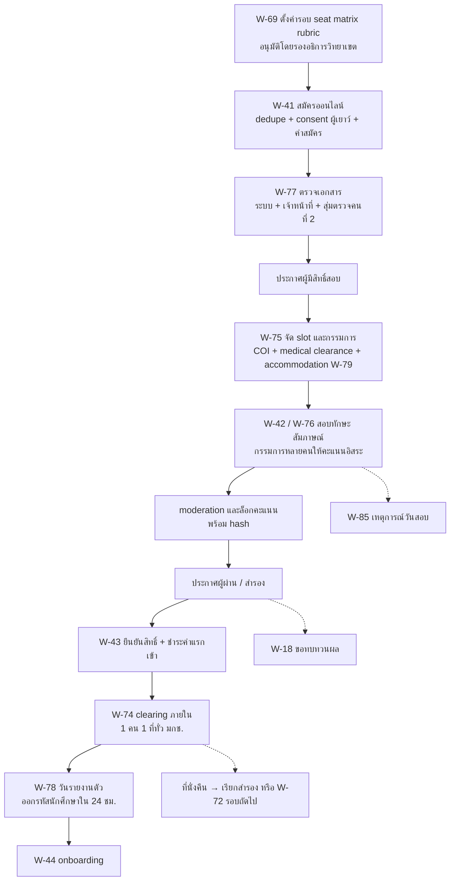

### 5.2 Clearing ภายในข้ามวิทยาเขต (W-74)

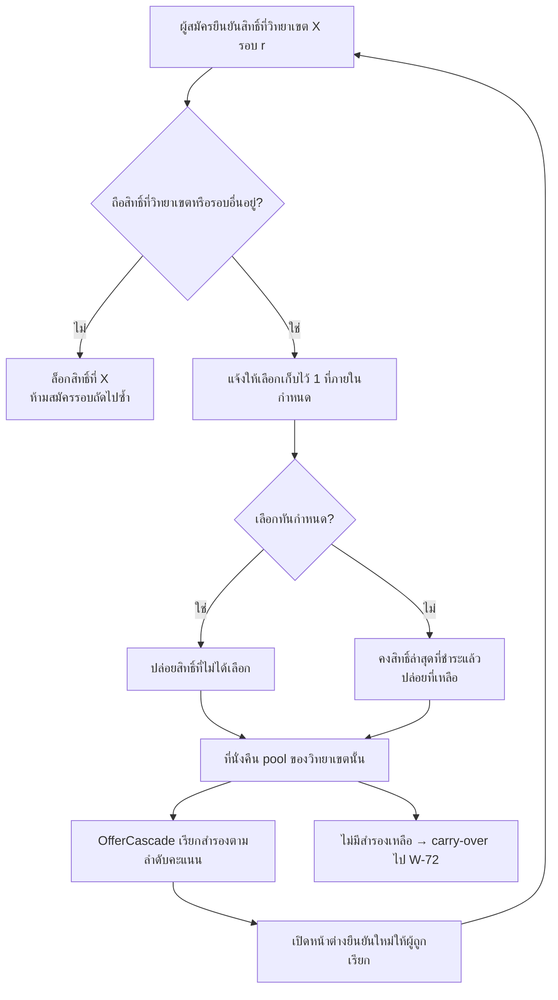

### 5.3 การสอบและเกรด (W-104 → W-57)

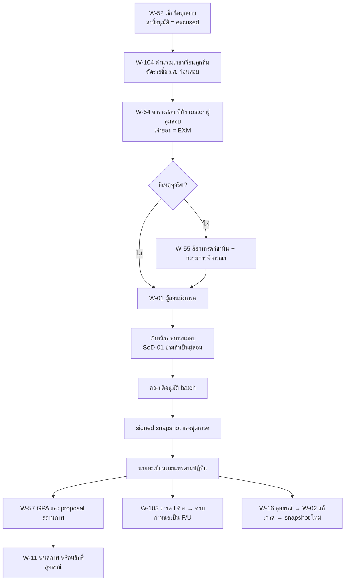

### 5.4 อุทธรณ์และร้องเรียนผ่านประตูเดียว (CASE)

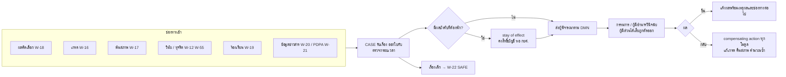

### 5.5 คุ้มครองเด็ก (W-22, W-93, W-23, W-90)

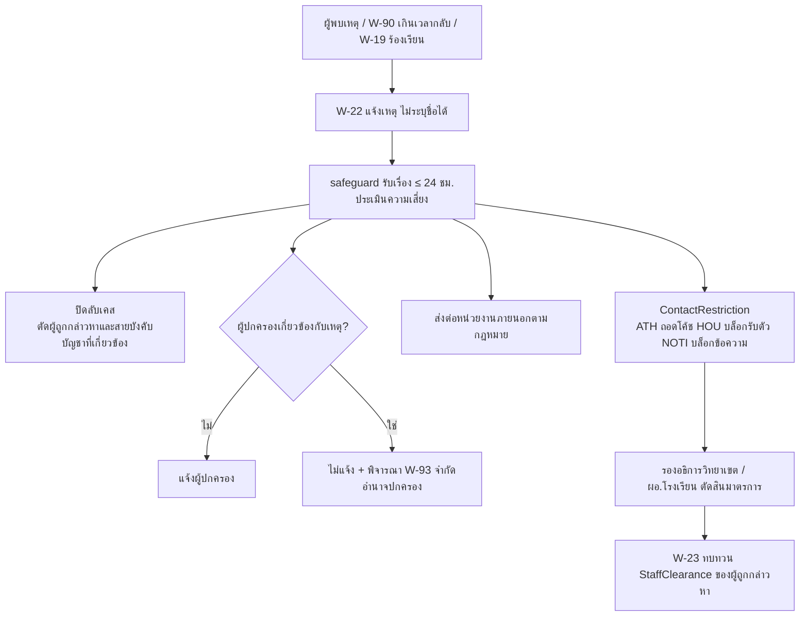

### 5.6 Lifecycle cascade (W-10 / W-11 / W-26 / W-92 → W-133)

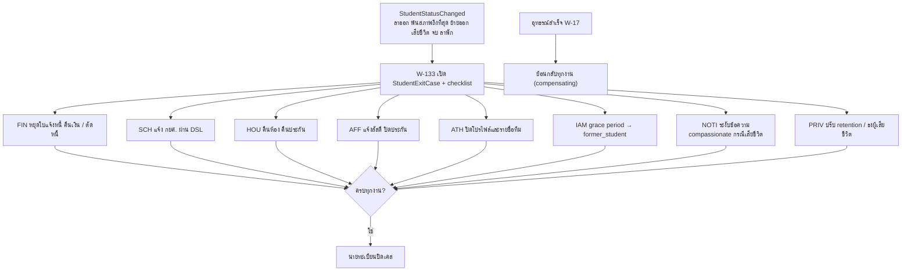

### 5.7 Break-glass สองแบบ (W-14 ข้อมูลสุขภาพ, W-125 บัญชีระบบ)

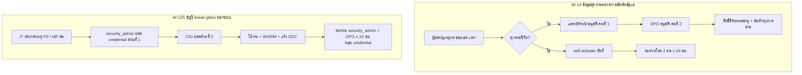

### 5.8 ลาแข่งยกคณะ → สอบชดเชย → เดินทางกลับ (W-114 → W-05 → W-115)

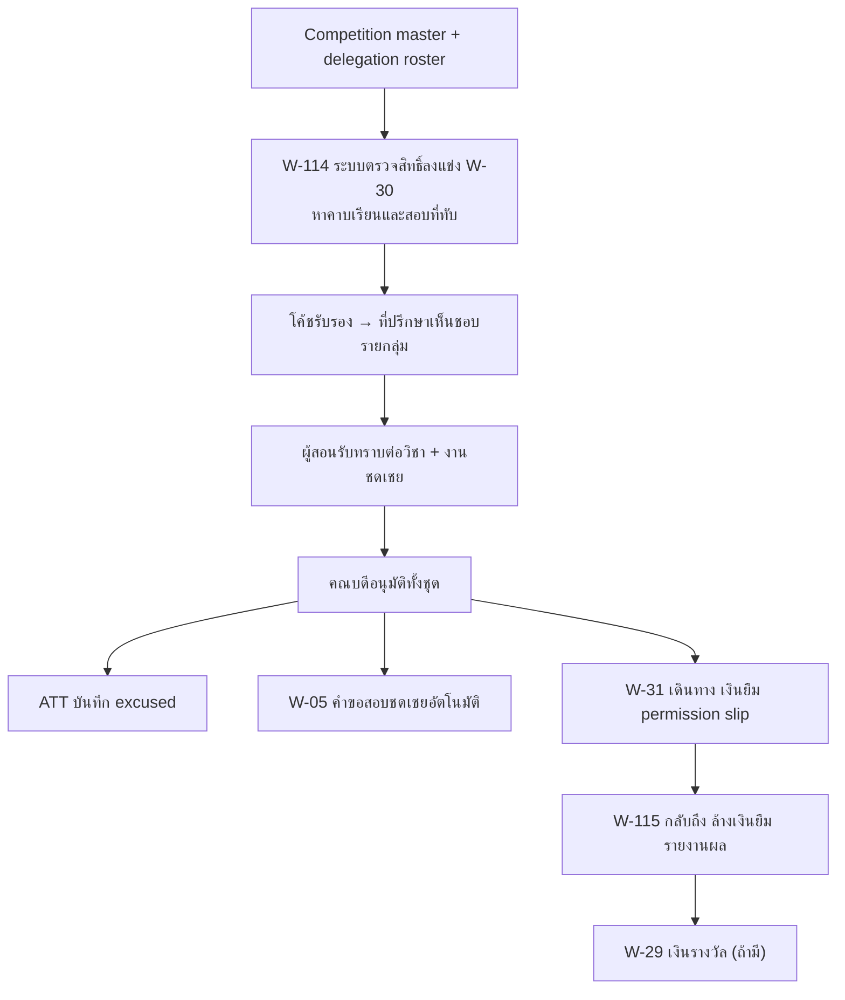

## 6. ภาคผนวก ก — ขั้นตอนละเอียดของทุก workflow (สร้างจาก `data/workflows.json`)

#### สมัครและคัดเลือก (`pre`)

**W-18 ขอทบทวนผลคัดเลือก (แบบเร่งด่วน ให้จบก่อนกำหนดยืนยันสิทธิ์)** — `CASE` · SLA: ยื่น ≤ 3 วันทำการหลังประกาศ (รอบที่ยืนยัน ≤ 72 ชม.: ≤ 1 วันทำการ); ตัดสิน ≤ 5 วันทำการ (รอบยืนยัน ≤ 72 ชม.: ≤ 2 วันทำการ) และก่อนปิดยืนยันสิทธิ์ ≥ 1 วันทำการ  
เริ่มเมื่อ: ผู้สมัครยื่นภายในกรอบเวลาหลังประกาศผล · ผลลัพธ์: ยืนผล หรือแก้ผลพร้อม override + ใช้ที่นั่ง appeal_hold (ไม่เกิน AccreditedIntakeCap)

1. `candidate` — ยื่นขอทบทวนผลภายในกรอบเวลาที่ประกาศ พร้อมเหตุผล (เห็นคะแนนรายสถานีของตน)
2. `system` — ตรวจว่าอันดับที่อาจแก้ได้ของผู้ยื่นถึงเส้นตัดหรือไม่ ถ้าถึง: ตั้ง appeal_hold 1 ที่ต่อ sub-bucket (หยุด cascade ของที่นั่งสุดท้าย) และขยายกำหนดยืนยันสิทธิ์ของผู้ยื่นถึงวันตัดสิน + 24 ชม. (GateOverride)
3. `admission` — รับเรื่อง ออกใบรับ และตรวจว่าอยู่ในกรอบเวลา
4. `judge` — กรรมการชุดเดิมตรวจการบันทึกและการคำนวณคะแนน (ห้ามแก้คะแนนที่ล็อกแล้วโดยตรง)
5. `head` — ประธานคณะกรรมการคัดเลือกพิจารณา ถ้าเปลี่ยนผลต้องบันทึก override พร้อมเหตุผล
6. `campusvp` — อนุมัติ override (ผู้อนุมัติคนที่สอง); ที่นั่งให้ผู้ชนะอุทธรณ์ใช้ appeal_hold ก่อน — ที่นั่งเพิ่มต้องไม่เกินแผนรับและ AccreditedIntakeCap (hard stop) มิฉะนั้นเสนอรอบถัดไป/ปีถัดไป
7. `system` — ปลด appeal_hold: ใช้กับผู้ชนะอุทธรณ์ หรือปล่อยเข้า cascade ตาม W-74
8. `candidate` — รับผลพร้อมเหตุผล และช่องทางร้องเรียนต่อ (W-19)

**W-41 สมัครเรียนออนไลน์** — `ADM` · SLA: ตามรอบรับสมัคร  
เริ่มเมื่อ: เปิดรอบรับสมัครที่อนุมัติแล้ว (W-69) · ผลลัพธ์: ใบสมัครสถานะชำระแล้ว/รอตรวจ + เลขที่สมัคร + ใบรับคำขอ

1. `candidate` — สร้างบัญชีผู้สมัครระดับมหาวิทยาลัยด้วย ThaID หรือ e-mail + OTP (เลขบัตร / passport / รหัส G เป็นกุญแจ dedupe)
2. `candidate` — เลือกช่องทาง รอบ วิทยาเขต สาขา ชนิดกีฬา และระบุความต้องการช่วยเหลือในการสอบ (ถ้ามี → W-79)
3. `guardian` — ให้ความยินยอมร่วมเฉพาะหัวข้อที่ consent policy (อายุ × ประเภทกิจกรรม) กำหนด เช่น ข้อมูลสุขภาพของผู้สมัครอายุต่ำกว่า 20 ปี
4. `candidate` — อัปโหลด ปพ.1 รูปถ่าย ผลงานกีฬา ใบรับรองแพทย์ ตาม checklist ของช่องทาง
5. `system` — ตรวจคุณสมบัติอัตโนมัติตาม rule ของรอบ (GPAX จำนวนภาคเรียน อายุ ระดับผลงาน) และตรวจว่ายืนยันสิทธิ์ที่อื่นแล้วหรือไม่
6. `candidate` — ชำระค่าสมัครด้วย Thai QR (Ref1 = เลขที่สมัคร) หรือขอยกเว้นค่าสมัคร (W-81)
7. `system` — กระทบยอดอัตโนมัติ ออก e-Receipt และใบรับคำขอ แล้วส่งใบสมัครเข้าคิวตรวจเอกสาร (W-77)

**W-42 สอบคัดเลือก สอบทักษะกีฬา และสัมภาษณ์** — `ADM` · SLA: ตามตารางสอบของรอบ  
เริ่มเมื่อ: ประกาศรายชื่อผู้มีสิทธิ์สอบ · ผลลัพธ์: คะแนนรวมที่ล็อก + ประกาศผู้ผ่าน/สำรอง

1. `admission` — ประกาศรายชื่อผู้มีสิทธิ์สอบ และเปิดเลือก slot ตามตารางจาก W-75
2. `candidate` — ดูวัน เวลา สถานที่ และบัตรประจำตัวผู้สอบพร้อม QR ในแอป
3. `candidate` — ส่งใบรับรองแพทย์/แบบคัดกรองสุขภาพ และยอมรับข้อตกลงความปลอดภัย (ไม่มี medical clearance = จอง slot สอบทักษะไม่ได้)
4. `guardian` — ลงนามยินยอมเข้าร่วมทดสอบสมรรถภาพ (ผู้สมัครผู้เยาว์ ตาม consent policy)
5. `nurse` — คัดกรองสุขภาพหน้าสนามก่อนสอบทักษะ ประจำจุดปฐมพยาบาล และตรวจค่า WBGT ก่อนเริ่ม station ที่ใช้แรงมาก (W-153); physician ประจำสนามสำหรับกีฬาต่อสู้
6. `judge` — เช็คอินผู้สอบด้วย QR และให้คะแนนสอบทักษะ/สัมภาษณ์ตาม rubric ที่ประกาศล่วงหน้า (รายละเอียด W-76)
7. `system` — รวมคะแนนตามน้ำหนักของรอบ จัดอันดับ และ tie-break
8. `admission` — เสนอผลต่อคณะกรรมการคัดเลือก แล้วประกาศผู้ผ่าน/สำรองแบบ mask ข้อมูลส่วนบุคคล

**W-43 ยืนยันสิทธิ์และชำระค่าแรกเข้า** — `ADM` · SLA: ตามกำหนดของรอบ (รอบท้ายอาจ 24 ชม.)  
เริ่มเมื่อ: ประกาศผู้ผ่านการคัดเลือก · ผลลัพธ์: สิทธิ์ที่ยืนยันแล้ว 1 ที่ต่อคน + e-Receipt

1. `candidate` — ยืนยันหรือสละสิทธิ์ในระบบ มกช. (ช่องทาง TCAS ยืนยันใน myTCAS ตาม W-73)
2. `system` — ตรวจกฎ "ยืนยันได้ 1 ที่ทั่ว มกช." ผ่าน clearing ภายใน (W-74)
3. `candidate` — ชำระค่ายืนยันสิทธิ์/ค่าแรกเข้าภายในกำหนด
4. `finance` — ออก e-Receipt และกระทบยอด
5. `system` — ไม่ชำระภายในกำหนด = สละสิทธิ์อัตโนมัติ คืนที่นั่งเข้า pool และเรียกสำรองตามลำดับ (W-74)
6. `admission` — ส่งรายชื่อผู้ยืนยันเข้าวันรายงานตัว (W-78) และส่งผลกลับ myTCAS เฉพาะช่องทาง TCAS

**W-69 ตั้งค่าและประกาศรอบรับสมัครรายวิทยาเขต** — `ADM` · SLA: อนุมัติ ≥ 30 วันก่อนเปิดรับ; เผยแพร่ ≥ 7 วันก่อนเปิดรับ  
เริ่มเมื่อ: ปฏิทินรับสมัครของปีการศึกษาถัดไป (ORG) + แผนรับนักศึกษา · ผลลัพธ์: AdmissionRound เผยแพร่ + ประกาศวิทยาเขต + rubric สาธารณะ

1. `admission` — เริ่มตั้งรอบจาก AdmissionPlan ที่กองแผนอนุมัติแยกไว้แล้ว (ที่นั่งต่อหลักสูตร × วิทยาเขต ไม่เกิน AccreditedIntakeCap ของหลักสูตรครู)
2. `admission` — ตั้งค่ารอบ: ช่องทาง วันเปิด-ปิด ค่าสมัคร seat matrix (สาขา × ชนิดกีฬา × เพศ + sub-bucket ตำแหน่ง/รุ่นน้ำหนักถ้ามี) rule คุณสมบัติ scoring scheme กรอบเวลาอุทธรณ์ (W-18) และ cascade_cutoff
3. `head` — ตรวจเกณฑ์และ rubric สอบทักษะ/สัมภาษณ์ของหลักสูตร
4. `dean` — เห็นชอบเกณฑ์ระดับคณะ
5. `campusvp` — อนุมัติรอบ และลงนามประกาศวิทยาเขต (e-signature)
6. `system` — ตรวจความสอดคล้องกับปฏิทิน (blackout) และรอบของวิทยาเขตอื่นเพื่อ clearing
7. `pr` — เผยแพร่ประกาศ เกณฑ์ และ rubric ก่อนเปิดรับ (ENG + หน้า OIT)

**W-70 รับสมัครประเภทโควตาเรียนดี** — `ADM` · SLA: ตามรอบ (ราว ต.ค.–พ.ย.)  
เริ่มเมื่อ: เปิดรอบโควตาเรียนดี (W-69) · ผลลัพธ์: ผู้ผ่าน/สำรองโควตาเรียนดี

1. `candidate` — สมัครผ่าน W-41 โดยเลือกโควตาเรียนดี
2. `system` — รับ GPAX ตามจำนวนภาคเรียนที่ประกาศ และตรวจขั้นต่ำ
3. `admission` — ยืนยัน GPAX กับ ปพ.1 (W-77)
4. `admission` — ประกาศรายชื่อผู้มีสิทธิ์สัมภาษณ์
5. `judge` — สัมภาษณ์และให้คะแนนตาม rubric (W-76)
6. `head` — คณะกรรมการคัดเลือกรับรองผล
7. `admission` — ประกาศผู้ผ่าน/สำรอง และเปิดยืนยันสิทธิ์ (W-43)

**W-71 รับสมัครประเภทโควตานักกีฬา** — `ADM` · SLA: ตามรอบ (ราว ต.ค.–ธ.ค.)  
เริ่มเมื่อ: เปิดรอบโควตานักกีฬา (W-69) · ผลลัพธ์: ผู้ผ่าน/สำรองโควตานักกีฬา + ผลงานที่ยืนยันแล้ว

1. `candidate` — สมัครผ่าน W-41 เลือกชนิดกีฬา ตำแหน่ง และแนบผลงานตามระดับและช่วงปีที่กำหนด
2. `admission` — ตรวจระดับและช่วงเวลาของผลงานตามเกณฑ์
3. `federation` — ยืนยันความถูกต้องของเกียรติบัตร/ผลงานตามหนังสือที่ admission ส่ง (ไม่มี SLA บังคับบุคคลภายนอก): ระหว่างรอ ผู้สมัครมีสถานะ provisionally_eligible สอบได้ แต่ประกาศผลได้เมื่อ verify ครบภายใน deadline; ผลงานที่ ATH verified แล้ว (W-144) ใช้แทนได้
4. `nurse` — ตรวจ medical clearance และแบบคัดกรอง (แบบผู้ใหญ่/แบบเด็กแยกกัน) ก่อนจอง slot ทดสอบ
5. `judge` — ทดสอบสมรรถภาพและทักษะกีฬาหลายกรรมการ (W-75, W-76)
6. `judge` — สัมภาษณ์
7. `head` — คณะกรรมการคัดเลือกรับรองผล (คะแนนล็อกแล้ว)
8. `admission` — ประกาศผู้ผ่าน/สำรอง และเปิดยืนยันสิทธิ์ (W-43)

**W-72 รับสมัครประเภททั่วไปรายรอบ (รอบ 1…n)** — `ADM` · SLA: รอบละ 3–6 สัปดาห์; รอบท้ายรายงานตัวภายใน 24 ชม.  
เริ่มเมื่อ: ที่นั่งคงเหลือหลังรอบก่อน (carry-over) ตามปฏิทินรับสมัคร · ผลลัพธ์: ผู้ผ่านรอบ n + ที่นั่งคงเหลือสำหรับรอบถัดไป

1. `system` — คำนวณที่นั่งคงเหลือต่อสาขาจากรอบก่อน (หักผู้ยืนยันแล้ว) และเสนอเปิดรอบ n
2. `admission` — ยืนยันที่นั่งและวันของรอบ n จาก template ของ W-69
3. `campusvp` — อนุมัติเปิดรอบ n (อนุมัติแบบย่อเพราะเกณฑ์อนุมัติแล้วใน W-69)
4. `candidate` — สมัครผ่าน W-41 (ผู้ที่ยืนยันสิทธิ์ที่ใดแล้วสมัครไม่ได้)
5. `admission` — ประกาศผู้มีสิทธิ์สอบ และจัดสอบข้อเขียน/สัมภาษณ์/ทักษะ (W-75)
6. `judge` — ให้คะแนน (W-76)
7. `admission` — ประกาศผล และเปิดยืนยันสิทธิ์/รายงานตัวทันที (W-43, W-78)

**W-73 TCAS adapter (ทางเลือก)** — `ADM` · SLA: ตามปฏิทิน ทปอ.  
เริ่มเมื่อ: สาขาที่ มกช. ตัดสินใจเข้าร่วม TCAS [ต้องตรวจสอบ] · ผลลัพธ์: ไฟล์/สถานะที่แลกเปลี่ยนกับ myTCAS ครบทุกรอบที่เข้าร่วม

1. `admission` — ลงทะเบียนสาขา/รอบที่เข้าร่วม และเกณฑ์ตาม template ทปอ.
2. `system` — ส่งออกเกณฑ์และรายชื่อผู้ผ่านตามรูปแบบไฟล์/API ของ ทปอ.
3. `candidate` — ยืนยันหรือสละสิทธิ์ใน myTCAS
4. `system` — นำเข้ารายชื่อผู้ยืนยันสิทธิ์ ตรวจรูปแบบ และ dedupe กับ applicant master
5. `admission` — กระทบยอดรายชื่อกับ myTCAS และจัดการข้อผิดพลาด/ผู้สละสิทธิ์
6. `system` — ส่งต่อผู้ยืนยันเข้า W-43/W-78 และซิงก์สถานะกลับ

**W-74 Clearing ภายใน มกช. (ยืนยันสิทธิ์ได้ที่เดียว) และเรียกสำรอง** — `ADM` · SLA: ตรวจ uniqueness ณ เวลายืนยัน (synchronous); job J-04 ทุก 5 นาที → คืนที่นั่งและเรียกสำรอง ≤ 15 นาทีหลังเหตุ; ไม่เรียกสำรองหลัง cascade_cutoff (T0 + 5 วันทำการ)  
เริ่มเมื่อ: ผู้สมัครยืนยัน/สละสิทธิ์ หมดเวลายืนยัน หรือพ้นกำหนดแจ้งเหตุไม่มารายงานตัว ในรอบใดของวิทยาเขตใด · ผลลัพธ์: สิทธิ์ confirmed ≤ 1 ต่อคนต่อ cycle ต่อระดับทั่ว มกช. + ที่นั่งคืน + รายชื่อสำรองที่ถูกเรียก

1. `candidate` — ดู offer ทั้งหมดของตนและกดยืนยัน 1 ที่ (ผู้เยาว์: ผู้ปกครองได้รับแจ้ง)
2. `system` — ณ เวลายืนยัน ตรวจ unique constraint (confirmed ∪ reported ∪ matriculated ≤ 1 ต่อ cycle ต่อระดับทั่ว มกช.) และสละ offer อื่นใน transaction เดียว — การสละอัตโนมัตินี้และการหมดเวลาไม่นับเป็นสิทธิ์สละ (C-5)
3. `system` — job ทุก 5 นาที: offer หมดเวลา → expired; ที่นั่งว่างจากทุกเหตุคืน bucket และเรียกสำรองลำดับถัดไปภายใน ≤ 15 นาที (ส่ง offer ใหม่เฉพาะ 07:00–20:00; deadline ไม่นับ quiet hours)
4. `system` — ไม่เรียกสำรองหลัง cascade_cutoff — ที่นั่งบันทึกเป็น unfilled; ข้าม sub-bucket ที่มี appeal_hold (W-18)
5. `admission` — ตรวจข้อยกเว้น (ข้อมูลผิด ข้อพิพาท grace รายบุคคล) และอนุมัติ override พร้อมเหตุผล (SoD-14)
6. `registrar` — (ส่วนกลาง) ติดตามภาพรวมที่นั่งทุกวิทยาเขต และรายงานผล clearing ต่อผู้บริหาร (ClearingRun ข้ามวิทยาเขตอัตโนมัติไม่อยู่ใน R1 — D-06)

**W-75 จัดตารางสอบทักษะ / สัมภาษณ์ และแต่งตั้งกรรมการ** — `ADM` · SLA: ประกาศตาราง ≥ 7 วันก่อนสอบ  
เริ่มเมื่อ: ปิดรับสมัคร + ประกาศผู้มีสิทธิ์สอบ · ผลลัพธ์: SkillTestSession + slot ผู้สอบ + คำสั่งแต่งตั้งกรรมการ

1. `admission` — กำหนด station ต่อชนิดกีฬา × เพศ สนาม ความจุ และช่วงเวลา (ตรวจกับ FAC ไม่ให้ชน)
2. `admission` — เสนอคำสั่งแต่งตั้งกรรมการต่อ station (บุคคลภายนอกผ่าน W-139)
3. `judge` — ประกาศ COI กับรายชื่อผู้สอบ; ผู้มีความสัมพันธ์ถูกสลับ station อัตโนมัติ
4. `system` — จัด slot ให้ผู้สอบ โดยคำนึงถึง accommodation (W-79) และ medical clearance
5. `candidate` — รับบัตรประจำตัวสอบ QR และยืนยัน slot
6. `nurse` — จัดหน่วยปฐมพยาบาลประจำสนามตามจำนวนผู้สอบ พร้อม VenueEmergencyPlan (AED จุดรับรถพยาบาล) และอุปกรณ์ลดอุณหภูมิ

**W-76 ให้คะแนนสอบทักษะหลายกรรมการ และ moderation** — `ADM` · SLA: flag วันเดียวกับวันสอบ; ปิด moderation ≤ 1 วันทำการหลังวันสอบ และก่อนรวมคะแนน (QS-12)  
เริ่มเมื่อ: เริ่ม session สอบตาม W-75 · ผลลัพธ์: คะแนนรวมที่ล็อก (hash) + บันทึก moderation + อันดับ

1. `judge` — เช็คอินผู้สอบด้วย QR บน tablet (offline-first); ตรวจ COI อัตโนมัติจากสโมสร/โรงเรียน/โค้ชที่ผู้สมัครกรอก
2. `judge` — station OBJECTIVE (เวลา/ระยะ/จำนวน): บันทึกผลวัดตาม n trials (best-of) ไม่ผ่าน aggregate/moderation; station SUBJECTIVE (rubric): กรรมการแต่ละคนให้คะแนนอิสระ (มองไม่เห็นคะแนนกันจนกว่าจะส่ง)
3. `system` — SUBJECTIVE: ตรวจความต่างของคะแนนระหว่างกรรมการเกินเกณฑ์ และ flag ในวันเดียวกัน
4. `judge` — ประธาน station ทบทวนรายการที่ flag (moderation) และบันทึกเหตุผลถ้าปรับ ภายใน 1 วันทำการ
5. `system` — คำนวณตาม scheme (ตัดสูง-ต่ำเมื่อกรรมการ ≥ 5 / เฉลี่ย / มัธยฐาน; normalisation ข้ามกลุ่มกรรมการปิดโดยค่าเริ่มต้น) และล็อกคะแนนพร้อม hash
6. `head` — ประธานคณะกรรมการคัดเลือกยืนยันผลรวมทุก station
7. `system` — รวมกับ GPAX/ข้อเขียน/สัมภาษณ์ตามน้ำหนัก จัดอันดับภายใน sub-bucket (ตำแหน่ง/รุ่นน้ำหนัก ถ้ามี) แล้ว spill-over ตามกติกาที่ประกาศ ส่งเข้า W-42/W-70/W-71/W-72

**W-77 ตรวจเอกสารผู้สมัคร** — `ADM` · SLA: ≤ 3 วันทำการต่อใบสมัคร  
เริ่มเมื่อ: ใบสมัครชำระค่าสมัครแล้ว · ผลลัพธ์: สถานะเอกสาร verified / rejected / ขอเพิ่ม

1. `system` — ตรวจอัตโนมัติ (ไฟล์ครบ ชนิด ขนาด อายุรูป อ่าน GPAX)
2. `admission` — เจ้าหน้าที่ตรวจสิ่งที่ระบบตรวจไม่ได้ (verify / reject / request-more พร้อมเหตุผล)
3. `candidate` — ส่งเอกสารเพิ่มภายในกำหนด
4. `admission` — ผู้ตรวจคนที่ 2 สุ่มตรวจก่อนประกาศผู้มีสิทธิ์สอบ
5. `system` — บันทึก hash เอกสารและผลตรวจ เพื่อใช้ซ้ำตอนรายงานตัว

**W-78 วันรายงานตัว (ออกรหัสนักศึกษา)** — `ADM` · SLA: ภายใน 24 ชม. หลังยืนยันและชำระ  
เริ่มเมื่อ: ผู้ผ่านยืนยันสิทธิ์และชำระแล้ว (W-43) · ผลลัพธ์: รหัสนักศึกษา + ส่งต่อ REC (เปิด W-44)

1. `system` — ออกรหัสนักศึกษาตาม pattern วิทยาเขต/คณะ/ปี
2. `candidate` — ยืนยันข้อมูล และเลือกรายงานตัวออนไลน์หรือที่จุดบริการ
3. `registrar` — ตรวจเอกสารตัวจริงเมื่อต้องแสดงตน หรืออนุมัติแบบออนไลน์
4. `system` — ส่งข้อมูลเข้า REC เป็นนักศึกษาใหม่ และเปิด onboarding (W-44)
5. `admission` — ติดตามผู้ไม่มารายงานตัว (แจ้งเหตุใน 7 วัน มิฉะนั้นสละสิทธิ์ → W-74)

**W-79 จัด accommodation ในการสอบคัดเลือกสำหรับผู้สมัครพิการ** — `ADM` · SLA: ยื่น ≥ 10 วันทำการก่อนวันสอบ; อนุมัติ ≤ 3 วันทำการ และ ≥ 5 วันทำการก่อนวันสอบ; ยื่นช้ากว่านั้นได้ provisional accommodation วันสอบ  
เริ่มเมื่อ: ผู้สมัครระบุความต้องการช่วยเหลือใน W-41 · ผลลัพธ์: AccommodationPlan วันสอบ (ไม่มีรายละเอียดการวินิจฉัย)

1. `candidate` — ระบุความช่วยเหลือที่ต้องการ (เวลาเพิ่ม ผู้ช่วย ข้อสอบตัวใหญ่ สนามเข้าถึงได้ การทดสอบทักษะแบบปรับ) และแนบหลักฐาน
2. `dss` — ตรวจหลักฐาน (เก็บใน vault) และเสนอแผน
3. `head` — ยืนยันว่าการทดสอบแบบปรับยังวัดสมรรถนะหลักของหลักสูตร
4. `admission` — อนุมัติแผน และจัดห้อง/station/ผู้ช่วย
5. `judge` — ได้รับเฉพาะรายการปรับที่ต้องทำ
6. `candidate` — รับแจ้งผล และช่องทางขอทบทวน (W-18)

**W-80 ผู้สมัครต่างชาติ: เทียบวุฒิและเอกสารวีซ่า** — `ADM` · SLA: ตามรอบ + เวลาขอวีซ่า  
เริ่มเมื่อ: ผู้สมัครสมัครด้วย passport · ผลลัพธ์: ผลเทียบวุฒิ + หนังสือตอบรับเพื่อขอวีซ่า Non-ED

1. `candidate` — สมัครด้วย passport และชำระค่าสมัครช่องทางระหว่างประเทศ (บัตร/โอน)
2. `intl` — ตรวจเทียบวุฒิการศึกษาต่างประเทศและหลักฐานภาษา
3. `admission` — พิจารณาคัดเลือกตามช่องทาง
4. `intl` — ออกหนังสือตอบรับ/หนังสือรับรองเพื่อยื่นขอวีซ่า (e-signature)
5. `candidate` — อัปโหลดวีซ่า Non-ED และข้อมูลที่พัก
6. `system` — ตั้งเตือน 90 วัน/วีซ่าหมดอายุ และสร้างงาน ตม.30 เมื่อเข้าหอ (W-38)

**W-81 ยกเว้น / คืนค่าสมัคร** — `FIN` · SLA: 5 วันทำการ  
เริ่มเมื่อ: ผู้สมัครขอยกเว้น หรือยกเลิกรอบ/ชำระซ้ำ · ผลลัพธ์: Waiver หรือ Refund + รายงาน exception

1. `candidate` — ขอยกเว้นค่าสมัครพร้อมหลักฐาน (หรือระบบสร้างคำขอคืนเมื่อยกเลิกรอบ/ชำระซ้ำ)
2. `admission` — ตรวจคุณสมบัติตามประกาศ
3. `finance` — ผู้อนุมัติตามวงเงิน (คนละคนกับผู้ตรวจ: SoD-10)
4. `system` — ปลดสถานะชำระ หรือคืนเงินช่องทางเดิม
5. `auditor` — ดูรายงาน exception รายเดือน

**W-82 รับโอน / เทียบโอนจาก ปวส. หรือสถาบันอื่น** — `ADM` · SLA: ภายในภาคแรก  
เริ่มเมื่อ: รอบรับโอน/เทียบโอนที่เปิดใน W-69 · ผลลัพธ์: ผลเทียบโอนรายวิชา + แผนการเรียน + สถานะนักศึกษาโอน

1. `candidate` — สมัครประเภทเทียบโอน แนบ transcript เดิมและคำอธิบายรายวิชา
2. `admission` — ตรวจคุณสมบัติและเอกสาร
3. `head` — กรรมการเทียบโอนพิจารณารายวิชา (ไม่เกินสัดส่วนที่ข้อบังคับกำหนด [ต้องตรวจสอบ])
4. `dean` — อนุมัติผลเทียบโอน
5. `finance` — เรียกเก็บค่าเทียบโอนต่อหน่วยกิต (ถ้ามี)
6. `registrar` — บันทึกหน่วยกิตเทียบโอน ผูก PolicySet และแผนการเรียน

**W-85 เหตุการณ์วันสอบทักษะ (บาดเจ็บ / ขาดสอบ / ขอเลื่อน)** — `ADM` · SLA: ยื่นภายใน 48 ชม.; ตัดสินก่อนประกาศผล  
เริ่มเมื่อ: ผู้สอบบาดเจ็บ ขาดสอบ หรืออุปกรณ์ขัดข้องในวันสอบ · ผลลัพธ์: SkillTestIncident + slot ใหม่ หรือผลขาดสอบ

1. `judge` — บันทึกเหตุ (บาดเจ็บระหว่างทดสอบ ขาดสอบ อุปกรณ์ขัดข้อง)
2. `nurse` — ปฐมพยาบาลและบันทึกตาม W-39 (ไม่รอ consent; สงสัยกระทบกระเทือนสมอง → W-152, สงสัย heat illness → W-153)
3. `candidate` — ยื่นขอสอบใหม่/เลื่อนพร้อมหลักฐาน
4. `admission` — พิจารณาตามประกาศ และจัด slot ใหม่ถ้ายังอยู่ในช่วงรอบ
5. `head` — อนุมัติกรณีนอกเกณฑ์

**W-144 นักเรียนโรงเรียนกีฬาสมัครต่อ มกช. (โควตาภายใน)** — `ADM` · SLA: ตามรอบโควตา  
เริ่มเมื่อ: นักเรียน ม.6 โรงเรียนกีฬาในสังกัด มกช. ภาคเรียนสุดท้าย · ผลลัพธ์: ใบสมัครโควตาภายในที่ดึงผลการเรียนและผลงานกีฬามาให้อัตโนมัติ

1. `student` — แสดงความประสงค์สมัครต่อ มกช. และเลือกวิทยาเขต สาขา
2. `guardian` — ยินยอมให้ส่งข้อมูลผลการเรียนและข้อมูลนักกีฬาไปยังวิทยาเขตปลายทาง (ถ้ายังไม่ถึง 20 ปี)
3. `system` — ดึง ปพ.1 ผลงานกีฬา และผลทดสอบสมรรถภาพจากระบบโรงเรียนกีฬาและ ATH
4. `sschool_dir` — รับรองผลการเรียนและความประพฤติ
5. `admission` — ตรวจคุณสมบัติตามโควตาภายใน
6. `coach` — ให้ความเห็นด้านศักยภาพกีฬา
7. `admission` — ส่งเข้ารอบสอบสัมภาษณ์/ทักษะ หรือประกาศผลตามเกณฑ์

**W-163 ยืนยันสิทธิ์ซ้ำก่อนเปิดภาค (pre-term reconfirmation) สำหรับผู้ยืนยันสิทธิ์รอบต้น** — `ADM` · SLA: window ยืนยันซ้ำ [config ตัวอย่าง 1–15 พ.ค.]; ไม่ยืนยัน → สละสิทธิ์หลังพ้น window + 2 วันทำการ  
เริ่มเมื่อ: ADM_RECONFIRM_WINDOW เปิดสำหรับผู้ confirmed ก่อนวันที่กำหนด (เช่น ก่อน 1 พ.ค.) · ผลลัพธ์: สถานะ reconfirmed หรือ waived + ที่นั่งเข้า cascade (ก่อน cascade_cutoff)

1. `system` — แจ้งผู้ยืนยันรอบต้นให้กดยืนยันซ้ำ 1 แตะ (ผู้เยาว์: แจ้งผู้ปกครอง) และเตือน 2 ครั้ง
2. `candidate` — ยืนยันซ้ำ หรือสละสิทธิ์
3. `admission` — โทรติดต่อผู้ที่ยังไม่ตอบก่อนปิด window
4. `system` — พ้น window + 2 วันทำการ → waived (ไม่นับเป็นสิทธิ์สละตาม C-5) และส่งที่นั่งเข้า cascade ตาม W-74
5. `admission` — dashboard ความเสี่ยงหลุดไปที่อื่น (ไม่ระบุตัวบุคคลในภาพรวม)

#### เข้าเรียนปีแรก (`first`)

**W-44 รายงานตัว / มอบตัวนักศึกษาใหม่** — `REC` · SLA: ก่อนเปิดภาค; ผู้รับเข้ารอบท้าย (matriculated ≥ T0 − 7 วัน) ใช้ W-148 ภายใน 14 วันหลังรายงานตัว  
เริ่มเมื่อ: ออกรหัสนักศึกษาในวันรายงานตัว (W-78) · ผลลัพธ์: สถานะนักศึกษา ACTIVE + บัญชี IT + บัตรนักศึกษาดิจิทัล

1. `student` — เข้าสู่ระบบด้วยบัญชีผู้สมัครเดิม และตรวจรหัสนักศึกษา
2. `student` — กรอกประวัติ ที่อยู่ ผู้ปกครอง ผู้ติดต่อฉุกเฉิน และให้ consent แยกตามวัตถุประสงค์
3. `student` — ยืนยัน medical alert ขั้นต่ำ (แพ้ยา โรคประจำตัว) ซึ่งเก็บใน health vault
4. `guardian` — ยืนยันความสัมพันธ์และให้ความยินยอมตาม consent policy (นักศึกษาอายุต่ำกว่า 20 ปี; ผูกบัญชีตาม W-127)
5. `system` — ตรวจเอกสารครบ และสร้างงานตรวจวุฒิเดิมกับโรงเรียนต้นทาง (W-134)
6. `registrar` — อนุมัติรายงานตัว เปลี่ยนสถานะเป็นนักศึกษา และผูก PolicySet ของรุ่น
7. `system` — สร้าง SSO อีเมล LMS Wi-Fi บัตรนักศึกษาดิจิทัล และส่งรายชื่อประกันอุบัติเหตุกลุ่ม

**W-45 ตรวจสุขภาพและทดสอบสมรรถภาพแรกเข้า** — `HLT` · SLA: สัปดาห์แรก (PPE เสร็จ ≤ สัปดาห์ที่ 3; ระหว่างนั้นใช้ PRE_TEST เป็น provisional)  
เริ่มเมื่อ: นักศึกษาใหม่รายงานตัวแล้ว · ผลลัพธ์: medical clearance + โปรไฟล์นักกีฬา

1. `student` — จองคิวตรวจในแอป
2. `physician` — ตรวจร่างกาย (pre-participation screening) บันทึกใน hlt_vault และออก medical clearance (ผ่าน / มีเงื่อนไข / ไม่ผ่าน); ระหว่างรอ PPE ใช้ MedicalClearance(PRE_TEST) จากวันสอบคัดเลือกเป็น provisional (อายุ ≤ 6 เดือน) และ PPE ต้องเสร็จภายในสัปดาห์ที่ 3
3. `system` — ส่งเฉพาะสถานะ clearance และข้อจำกัดภาคปฏิบัติ (ไม่มีการวินิจฉัย) ให้ ATH และ REG
4. `sci` — ทดสอบสมรรถภาพพื้นฐาน (เฉพาะผู้มี clearance)
5. `system` — สร้างโปรไฟล์นักกีฬา
6. `coach` — รับนักกีฬาเข้าทีม (เห็นเฉพาะสถานะความพร้อม)

**W-46 ขอหอพักและเข้าพัก** — `HOU` · SLA: ก่อนเปิดภาค  
เริ่มเมื่อ: เปิดรอบจองหอพักตามปฏิทิน · ผลลัพธ์: สัญญาหอพัก + การเข้าพัก + งาน ตม.30 (ถ้าต่างชาติ)

1. `student` — ยื่นขอหอพักและความต้องการพิเศษ (ห้องเข้าถึงได้ เวลาซ้อมของนักกีฬา)
2. `system` — จัดลำดับสิทธิ์ตามเกณฑ์ที่ประกาศ (ปี 1 ภูมิลำเนาไกล ทุน นักกีฬาทีมชาติ)
3. `dorm` — จัดห้องและเพื่อนร่วมห้อง (override ต้องมีเหตุผล) และประกาศผล
4. `guardian` — ลงนามสัญญาหอพัก (ถ้านักศึกษาเป็นผู้เยาว์)
5. `student` — ยอมรับสัญญาและชำระค่าหอ + ค่าประกัน
6. `dorm` — เช็กอิน ตรวจสภาพห้องพร้อมภาพ และสร้างงาน ตม.30 ถ้าผู้พักเป็นชาวต่างชาติ (W-38)

**W-47 ปฐมนิเทศ** — `AFF` · SLA: ก่อนเปิดภาค  
เริ่มเมื่อ: ปฏิทินปฐมนิเทศ · ผลลัพธ์: ชั่วโมงกิจกรรมใน ledger ของ AFF + การรับทราบระเบียบ

1. `affairs` — สร้างกิจกรรมปฐมนิเทศ (นักศึกษาและผู้ปกครอง)
2. `student` — ลงทะเบียน และเช็กอินด้วย QR
3. `system` — บันทึกชั่วโมงกิจกรรมลง ActivityHourLedger ของ AFF (เจ้าของเดียว)
4. `guardian` — เข้าร่วมปฐมนิเทศผู้ปกครอง onsite/online (ถ้าเปิด)
5. `student` — กดรับทราบระเบียบการศึกษา

**W-48 ยื่นกู้ กยศ.** — `SCH` · SLA: ตามรอบ กยศ. (Pre-Approve พ.ค.–ก.ค., ยื่นกู้ ก.ค.–ก.ย.)  
เริ่มเมื่อ: เปิดรอบยื่นกู้ของ กยศ. · ผลลัพธ์: สัญญากู้ + deferment ค่าเทอมระหว่างรอเงิน

1. `student` — ยื่นกู้ในระบบ DSL ของ กยศ. (ผู้กู้ต่อเนื่องต้องมีจิตอาสา ≥ 36 ชม./ปี จาก ledger AFF)
2. `loan` — (maker) ตรวจเอกสารและรายได้ครอบครัว
3. `loan` — (checker คนละคน) ตรวจและอนุมัติในบทบาท DSL
4. `system` — ตั้ง deferment ค่าเทอมสถานะ "รอ กยศ." (W-27) โดยไม่บล็อกการลงทะเบียน
5. `student` — ยืนยันการเบิกเงินกู้ทุกภาค (ภาค 1 ภายใน 31 ต.ค., ภาค 2 ภายใน 28 ก.พ.; ติดตามด้วย W-119)

**W-127 ผูกบัญชีผู้ปกครองและยืนยันความสัมพันธ์ (ระดับการยืนยัน 2 ระดับ + ช่องทางเจ้าหน้าที่ช่วย)** — `REC` · SLA: 3 วันทำการ  
เริ่มเมื่อ: รายงานตัว/มอบตัว หรือผู้ปกครองขอผูกบัญชี · ผลลัพธ์: GuardianRelation (LEGAL / CAREGIVER / LOCAL_GUARDIAN / OBSERVER / EMERGENCY_CONTACT / PICKUP) + verification_level + ABAC grant

1. `guardian` — ขอผูกกับนักศึกษา/นักเรียนและระบุความสัมพันธ์ (บิดามารดา ผู้ปกครองตามกฎหมาย ปู่ย่าตายาย/ญาติผู้อุปการะ ผู้ปกครองในประเทศของนักเรียนต่างชาติ) ผ่าน LIFF/PWA หรือที่จุดบริการวันรายงานตัว/มอบตัว
2. `system` — เทียบกับข้อมูลผู้ปกครองที่นักศึกษาระบุ (ชื่อ/เลขบัตร/เบอร์) และอายุนักศึกษา; ผูกด้วยเลขบัตร + OTP ได้สถานะ provisional (รับแจ้งเตือนและจ่ายเงินเท่านั้น) จนกว่าจะยืนยันระดับ 1 หรือ 2
3. `registrar` — ระดับ 1 (ค่าเริ่มต้น): เจ้าหน้าที่ตรวจบัตรและเอกสารอำนาจปกครองต่อหน้าในวันรายงานตัว/มอบตัว · ระดับ 2: ผู้ปกครองยืนยันตัวตนด้วย ThaID และอัปโหลดเอกสาร เจ้าหน้าที่ตรวจออนไลน์ (สูติบัตร ทะเบียนบ้าน คำสั่งศาลถ้ามี)
4. `student` — นักศึกษาที่บรรลุนิติภาวะเลือกหมวดข้อมูลที่ให้ดู (observer) และถอนได้
5. `system` — สร้าง GuardianRelation + verification_level และ ABAC grant แล้วแจ้งนักศึกษาทุกครั้งที่มีการผูก; ผู้ดูแลจริงที่ไม่มีเอกสารอำนาจปกครองไปที่ W-160
6. `system` — เมื่อนักศึกษาบรรลุนิติภาวะ (20 ปีหรือสมรส) เปลี่ยนสิทธิ์ LEGAL/CAREGIVER เป็น OBSERVER อัตโนมัติ (ต้องได้ consent ใหม่)

**W-134 ตรวจวุฒิการศึกษาเดิมของนักศึกษาใหม่** — `REC` · SLA: ภายในภาคแรก  
เริ่มเมื่อ: นักศึกษาใหม่รายงานตัวแล้ว (W-44) · ผลลัพธ์: ผลตรวจวุฒิ; ไม่ผ่าน → เสนอพ้นสภาพ

1. `system` — สร้างหนังสือขอตรวจสอบวุฒิแบบ batch ถึงโรงเรียนเดิม หรือตรวจกับฐานข้อมูลถ้าเชื่อมได้
2. `records` — ออกเลขหนังสือและส่งผ่าน e-Saraban
3. `registrar` — บันทึกผลตอบกลับ และติดตามรายการค้าง
4. `system` — ผลไม่ผ่าน/ปลอม → เสนอพ้นสภาพ (W-11) พร้อมสิทธิ์ชี้แจง

**W-148 Fast-track ผู้รับเข้ารอบท้าย (late-admit): รายงานตัว ยกเว้นค่าปรับ ปฐมนิเทศ สุขภาพ หอพัก census** — `REC` · SLA: ภายใน 14 วันหลังรายงานตัว (รหัส/บัญชี/ลงทะเบียน block ภายใน 24 ชม.)  
เริ่มเมื่อ: ผู้ยืนยันสิทธิ์รายงานตัวเมื่อ matriculated_at ≥ T0 − 7 วัน (รอบท้าย/สำรองที่ถูกเรียก ก่อน cascade_cutoff) · ผลลัพธ์: สถานะนักศึกษา + ลงทะเบียน block ภาค 1 โดยไม่มีค่าปรับ + ATT baseline จาก matriculated_at + checklist 14 วัน + ธงเข้าหลังวันตัดยอดในรายงาน census

1. `system` — ติดธง late_admit และสร้างรหัสนักศึกษา บัญชี IT และลงทะเบียน block ภาค 1 จากแผนหลักสูตรภายใน 24 ชม. (ไม่ต้องรอ slot)
2. `system` — ยกเว้น FinePolicy ลงทะเบียนล่าช้าอัตโนมัติ ตั้ง due date ของตนเอง (รายงานตัว + 7 วัน) และ exclude จาก J-15 จนพ้น due date นั้น
3. `system` — ATT นับฐานเวลาเรียนจาก matriculated_at (คาบก่อนหน้าไม่นับขาด) และแจ้งผู้สอนรายวิชาให้เปิดงานตามทัน
4. `student` — ทำ checklist ภายใน 14 วัน: เอกสาร ข้อมูลสุขภาพ ผูกผู้ปกครอง ปฐมนิเทศแบบ online + รอบตามทันสัปดาห์ที่ 2
5. `nurse` — ใช้ MedicalClearance(PRE_TEST) เป็น provisional ถ้ามี; ไม่มี → แบบคัดกรองตนเอง (soft gate) ก่อนวิชาปฏิบัติ และนัด PPE ภายใน 14 วัน
6. `dorm` — จัดเตียงจากโควตาสำรองสำหรับ late-admit หรือ waitlist พร้อมทางเลือกชั่วคราว
7. `advisor` — นัดพบภายในสัปดาห์แรกหลังรายงานตัว และวางแผนตามทันรายวิชา
8. `registrar` — ตรวจรายงาน census: บันทึกผู้ที่เข้าหลังวันตัดยอด (10 มิ.ย.) แยกในรายงาน RPT

**W-160 ผู้อุปการะ (CAREGIVER) และผู้ปกครองในประเทศ (LOCAL_GUARDIAN)** — `REC` · SLA: 5 วันทำการ  
เริ่มเมื่อ: ผู้ดูแลจริงของผู้เยาว์ (ปู่ย่าตายาย ญาติ) ไม่มีเอกสารอำนาจปกครอง หรือนักเรียนต่างชาติผู้เยาว์ต้องมีผู้ปกครองในประเทศ · ผลลัพธ์: GuardianRelation(CAREGIVER / LOCAL_GUARDIAN) พร้อมรายการสิทธิ์ที่กำหนดและวันหมดอายุ

1. `guardian` — ผู้ปกครอง LEGAL มอบหมายผ่านแบบฟอร์ม (ThaID หรือลงนามต่อหน้าเจ้าหน้าที่) ระบุสิทธิ์ที่มอบ (leave pass รับแจ้งเหตุ รับตัว) — หรือผู้ดูแลจริงยื่นเองเมื่อติดต่อ LEGAL ไม่ได้
2. `homeroom` — กรณีไม่มีการมอบหมาย: เยี่ยมบ้าน/ตรวจหลักฐานการดูแลจริง (เช่น หนังสือรับรองผู้นำชุมชน) และเสนอ
3. `sschool_dir` — รับรอง (4-eyes ร่วมกับ registrar) — มหาวิทยาลัยใช้ registrar + affairs
4. `system` — สร้าง GuardianRelation ที่มีสิทธิ์เฉพาะการดูแลประจำวัน; consent ที่ต้องใช้อำนาจปกครองตามกฎหมายยังต้องเป็น LEGAL หรือคำสั่งศาล [ต้องตรวจสอบ ป.พ.พ.]
5. `safeguard` — ทบทวนเมื่อมีสัญญาณเสี่ยงหรือ ContactRestriction

#### ทุกภาคเรียน (`term`)

**W-01 ส่งเกรด** — `ASM` · SLA: 3 วันทำการ  
เริ่มเมื่อ: ครบกำหนดส่งเกรดตามปฏิทิน · ผลลัพธ์: เกรดเผยแพร่ + signed snapshot ของชุดเกรด

1. `lecturer` — กรอกคะแนน/นำเข้าจาก LMS และส่งเกรด (ล็อกการแก้ไขโดยผู้สอน)
2. `head` — ทวนสอบการกระจายเกรด (ถ้าเป็นผู้สอนวิชานั้น ระบบส่งข้ามไปผู้แทน: SoD-01)
3. `dean` — อนุมัติเกรดระดับคณะแบบ batch ด้วย e-signature
4. `system` — เก็บ signed snapshot (hash) ของชุดเกรดที่อนุมัติ
5. `registrar` — เผยแพร่เกรดตามปฏิทิน
6. `student` — เห็นเกรดในแอป (หลังประเมินการสอน W-56)

**W-03 ถอนรายวิชา (W) / ลงหน่วยกิตเกินหรือต่ำกว่าเกณฑ์** — `REG` · SLA: 2 วันทำการ  
เริ่มเมื่อ: นักศึกษายื่นคำร้องในช่วงที่ปฏิทินกำหนด · ผลลัพธ์: Enrollment สถานะ W หรืออนุมัติหน่วยกิตพิเศษ

1. `student` — ยื่นคำร้อง
2. `system` — ตรวจ DMN requires_guardian_cosign (อายุ ณ วันยื่น) และผลต่อทุน กยศ. และสิทธิ์ลงแข่ง แล้วแจ้งนักศึกษาก่อนยืนยัน
3. `guardian` — ลงนามร่วม (ถ้า DMN กำหนด)
4. `advisor` — เห็นชอบ
5. `lecturer` — รับทราบ
6. `dean` — อนุมัติ (กรณีเกินหรือต่ำกว่าเกณฑ์)
7. `registrar` — บันทึก

**W-05 สอบชดเชย / เลื่อนสอบ** — `EXM` · SLA: 3 วันทำการ (สายลัดจาก W-04/W-114: จัดรอบภายใน 5 วันทำการหลังกลับ)  
เริ่มเมื่อ: นักศึกษายื่น หรือระบบสร้างจาก W-04 / W-114 · ผลลัพธ์: MakeupExam ที่จัดแล้ว

1. `student` — ขอสอบชดเชย (ป่วย/เหตุจำเป็น) — กรณีลาแข่งที่อนุมัติแล้ว ระบบสร้างคำขอให้เอง
2. `lecturer` — กรณียื่นเอง: เห็นชอบ; กรณีสายลัดจาก W-04/W-114: ข้ามขั้นนี้ (ส่งเฉพาะชุดข้อสอบชดเชย ไม่ใช่การอนุมัติ)
3. `head` — กรณียื่นเอง: อนุมัติ; สายลัด: ข้าม
4. `registrar` — (งานวัดผล) จัดวัน ห้อง และผู้คุมสอบ — สอบชดเชยรวมต่อการแข่งขัน
5. `student` — ได้รับนัดสอบชดเชยในแอป

**W-49 ลงทะเบียนเรียน** — `REG` · SLA: ตามปฏิทินการศึกษา  
เริ่มเมื่อ: window ลงทะเบียนเปิดตามปฏิทิน (ORG) · ผลลัพธ์: Enrollment + ตารางเรียน + ใบแจ้งหนี้

1. `system` — เปิด window ตามปฏิทินและ time-slot ตามชั้นปี/วิทยาเขต (squad ที่แข่งต้นภาคได้ slot แรก) ตรวจ hold และสถานภาพที่ sign-off แล้ว (W-57); ปี 1 ภาค 1 ลงทะเบียนแบบ block จากแผนหลักสูตรให้อัตโนมัติ นักศึกษาตรวจและยืนยัน
2. `advisor` — อนุมัติแผนการเรียน (ถ้าหลักสูตรกำหนด)
3. `student` — เลือกวิชาและกลุ่มเรียนผ่าน virtual waiting room
4. `system` — ตรวจ prerequisite เวลาชน หน่วยกิต min/max (รวมเพดานรอพินิจ) และที่นั่งว่าง (transaction แบบ synchronous + idempotency key) แล้วแสดงหน้า "ผลการลงทะเบียนล่าสุด" ที่โหลดซ้ำได้และส่งใบยืนยันทาง in-app/LINE; ไม่แสดงปุ่มยืนยันซ้ำจนกว่าจะรู้ผล
5. `student` — ได้ตารางเรียนในแอป
6. `finance` — ออกใบแจ้งค่าเทอมอัตโนมัติตาม FeePolicy ของรุ่น/วิทยาเขต

**W-50 เพิ่ม-ลดรายวิชา** — `REG` · SLA: 2 สัปดาห์แรกของภาค  
เริ่มเมื่อ: ช่วงเพิ่ม-ลดตามปฏิทิน · ผลลัพธ์: Enrollment ที่ปรับแล้ว + ใบแจ้งหนี้/credit note

1. `student` — ขอเพิ่มหรือลดวิชา
2. `system` — ตรวจเงื่อนไขเหมือนตอนลงทะเบียน
3. `advisor` — อนุมัติ
4. `registrar` — ปรับตารางเรียน
5. `finance` — ปรับใบแจ้งหนี้ หรือออก credit note อัตโนมัติ

**W-51 ชำระค่าเทอม** — `FIN` · SLA: ตามกำหนดชำระ  
เริ่มเมื่อ: ใบแจ้งหนี้ออกจาก W-49 · ผลลัพธ์: Payment + e-Receipt + ปลด hold

1. `finance` — ออกใบแจ้งหนี้
2. `student` — ชำระด้วย Thai QR (ปุ่ม "บันทึกรูป QR" + เลขอ้างอิง/จำนวนเงินคัดลอกได้ + deeplink แอปธนาคารเมื่อใช้มือถือเครื่องเดียว) หรือหักจาก กยศ./ทุน (ผู้ปกครองชำระผ่าน shareable link ได้)
3. `system` — รับ callback/statement และกระทบยอดอัตโนมัติ; หน้าสถานะชำระ poll ซ้ำได้หลังกลับจากแอปธนาคาร
4. `finance` — ออกใบเสร็จอิเล็กทรอนิกส์
5. `system` — ปลดล็อกสิทธิ์ (ค้างชำระ → ขอผ่อน W-27 หรือเข้า W-105)

**W-52 เข้าเรียนและเช็กชื่อ** — `ATT` · SLA: ทุกคาบ  
เริ่มเมื่อ: คาบเรียนตามตารางสอน · ผลลัพธ์: AttendanceMark + สถานะเสี่ยง มส.

1. `lecturer` — เปิดเช็กชื่อด้วย QR หรือในระบบเรียนออนไลน์
2. `student` — เช็กชื่อ
3. `system` — นับเวลาเรียน โดยการลาที่อนุมัติ (W-04, W-53, W-114, accommodation W-33) เป็น excused
4. `advisor` — ได้รับแจ้งเตือนเมื่อขาดเรียนเกินเกณฑ์ (10% / 15% / 20%)
5. `student` — ดูสถิติการเข้าเรียนของตัวเอง

**W-53 ลาป่วย / ลากิจ** — `ATT` · SLA: ภายใน 3 วัน  
เริ่มเมื่อ: นักศึกษาขาดเรียนด้วยเหตุป่วย/กิจ · ผลลัพธ์: AttendanceMark = ลา (excused)

1. `student` — ยื่นใบลา และแนบใบรับรองแพทย์ (ผู้เยาว์: ผู้ปกครองแจ้งลาแทนได้)
2. `lecturer` — อนุมัติ
3. `system` — บันทึกเป็นลา ไม่นับขาด และแจ้งอาจารย์ที่ปรึกษาเมื่อเกินเกณฑ์

**W-54 สอบกลางภาค / ปลายภาค** — `EXM` · SLA: ตามตารางสอบ  
เริ่มเมื่อ: ปฏิทินสอบ · ผลลัพธ์: ExamSitting + คะแนน + incident (ถ้ามี)

1. `registrar` — (งานวัดผล) จัดตารางสอบ ห้อง ที่นั่ง และ roster กรรมการคุมสอบ (ห้ามคุมวิชาที่ตนสอน)
2. `system` — ตรวจสิทธิ์สอบจากรายชื่อ มส. (W-104) และ accommodation ที่อนุมัติ
3. `student` — ดูตารางสอบ ที่นั่ง และบัตรเข้าสอบในแอป
4. `proctor` — เช็กชื่อเข้าสอบ คุมสอบ และบันทึกเหตุผิดปกติ (ทุจริต → W-55)
5. `lecturer` — ตรวจข้อสอบ และกรอกคะแนน (ส่งเกรดตาม W-01)

**W-56 ประเมินการสอน** — `ASM` · SLA: ปลายภาค  
เริ่มเมื่อ: 2–3 สัปดาห์ก่อนสอบปลายภาค · ผลลัพธ์: ผลประเมินแบบ aggregate

1. `system` — เปิดแบบประเมิน (survey engine ของ ENG) ก่อนดูเกรด
2. `student` — ประเมินแบบไม่ระบุตัวตน
3. `lecturer` — ดูผลสรุปหลังประกาศเกรด
4. `dean` — ใช้ผลประกอบการประกันคุณภาพ (aggregate เท่านั้น)

**W-57 ดูผลการเรียนและสถานภาพ** — `REC` · SLA: เกรดเผยแพร่และจำแนกสถานภาพ (sign-off) ก่อนเปิด slot ลงทะเบียนภาคถัดไป ≥ 1 วันทำการ (linter L-4)  
เริ่มเมื่อ: เกรดเผยแพร่ (W-01) · ผลลัพธ์: GPA/GPAX + proposal สถานภาพ (ปกติ / รอพินิจ / พ้นสภาพ)

1. `system` — คำนวณ GPA GPAX และเสนอสถานภาพตาม PolicySet ของรุ่น (dry-run) ทันทีที่เกรดเผยแพร่
2. `registrar` — ตรวจและ sign-off ก่อนเปิดลงทะเบียนภาคถัดไป; รายชื่อพ้นสภาพเข้า W-11; รอพินิจได้เพดานหน่วยกิตตาม PolicySet ใน gate ลงทะเบียน
3. `student` — ดูเกรดและสถานภาพในแอป (รวมสิทธิ์และเพดานหน่วยกิตของภาคถัดไป)
4. `advisor` — ได้รายชื่อนักศึกษาที่เสี่ยงพร้อมเหตุผล
5. `advisor` — นัดพบเพื่อวางแผนการเรียน (W-61)
6. `system` — เกรดเปลี่ยนภายหลัง (ปิด I, อุทธรณ์ W-16, แก้เกรด W-02) → re-validation ผ่าน W-162

**W-100 แผนเปิดรายวิชา ตารางสอน และเปิดกลุ่มเรียน** — `REG` · SLA: T−8 ถึง T−4 สัปดาห์ก่อนเปิดภาค  
เริ่มเมื่อ: ปฏิทินภาคเผยแพร่แล้ว (W-117) · ผลลัพธ์: OfferingPlan อนุมัติ + Section + ตารางสอนเผยแพร่

1. `system` — เสนอรายวิชาที่ต้องเปิดจากแผนการเรียนของแต่ละรุ่นและจำนวนผู้คาดว่าจะลง
2. `head` — กำหนด section ความจุ ผู้สอน (อาจารย์พิเศษผ่าน W-139) ห้อง/สนาม
3. `system` — ตรวจชนผู้สอน/ห้อง/สนาม (FAC) ภาระงานอาจารย์ และรายวิชาข้ามวิทยาเขต
4. `dean` — อนุมัติแผนเปิดรายวิชาของคณะ
5. `registrar` — ล็อกตาราง ตั้ง prerequisite quota reserved seats และเผยแพร่ตารางสอน
6. `lecturer` — ยืนยันการสอน และส่งเค้าโครงรายวิชาก่อนเปิดภาค

**W-101 ปิดกลุ่มเรียนที่มีผู้ลงทะเบียนน้อย** — `REG` · SLA: ภายในสัปดาห์แรกของการเพิ่ม-ลด  
เริ่มเมื่อ: จำนวนผู้ลงต่ำกว่าขั้นต่ำเมื่อปิดลงทะเบียน · ผลลัพธ์: SectionCancelled + ย้ายนักศึกษา + ปรับหนี้

1. `system` — แสดงรายการ section ที่ต่ำกว่าขั้นต่ำ
2. `head` — เลือกปิด / รวม / คงไว้ (พร้อมเหตุผล เช่น นักศึกษาจะจบ)
3. `dean` — อนุมัติการปิด
4. `system` — ย้ายนักศึกษาไป section อื่นอัตโนมัติถ้าไม่ชน ที่เหลือแจ้งให้เลือกใหม่
5. `finance` — ปรับใบแจ้งหนี้หรือออก credit note
6. `student` — ยืนยันตารางใหม่

**W-102 ลงทะเบียนล่าช้าพร้อมค่าปรับ** — `REG` · SLA: สัปดาห์ 1–2 ของภาค  
เริ่มเมื่อ: พ้น window ลงทะเบียนปกติ · ผลลัพธ์: Enrollment + ใบแจ้งหนี้ที่รวมค่าปรับ

1. `student` — ลงทะเบียนในช่วงล่าช้า
2. `system` — คำนวณค่าปรับตาม FinePolicy ของวิทยาเขต (รายวันมีเพดาน หรือเหมาครั้งเดียว; นับวันหยุดตามที่ตั้ง)
3. `advisor` — อนุมัติแผน (ถ้าหลักสูตรกำหนด)
4. `student` — ขอยกเว้นค่าปรับพร้อมเหตุผล (เช่น รอเงิน กยศ. เก็บตัวทีมชาติ) ถ้ามี
5. `finance` — อนุมัติยกเว้นตามวงเงิน (SoD-10)
6. `system` — ออกใบแจ้งหนี้รวมค่าปรับ; ลงทะเบียนสมบูรณ์เมื่อชำระ

**W-103 ปิดค่า I (ไม่สมบูรณ์)** — `ASM` · SLA: ภายในกำหนดของภาคถัดไป [ต้องตรวจสอบ]  
เริ่มเมื่อ: มีเกรด I หลังประกาศเกรด · ผลลัพธ์: เกรดจริงแทน I หรือ F/U อัตโนมัติ

1. `system` — บันทึกกำหนดแก้ I ต่อรายการ และเตือนผู้สอน/นักศึกษา T−14 และ T−3
2. `student` — ส่งงาน/สอบส่วนที่ค้าง
3. `lecturer` — ส่งเกรดแทน I
4. `head` — ทวนสอบ
5. `registrar` — บันทึกเกรด
6. `system` — ครบกำหนดไม่แก้ → เปลี่ยนเป็น F/U อัตโนมัติ แจ้งทุกฝ่าย และคำนวณ GPA ซ้ำ

**W-104 ประกาศรายชื่อผู้หมดสิทธิ์สอบ (มส.)** — `ATT` · SLA: 1 สัปดาห์ก่อนสอบปลายภาค  
เริ่มเมื่อ: คำนวณเวลาเรียนทุกคืน + ถึงวันตัดรายชื่อ · ผลลัพธ์: ExamEligibility ล็อกใน EXM

1. `system` — คำนวณเวลาเรียนทุกคืน แจ้งเสี่ยงที่ 10% / 15% / 20% (นับลาที่อนุมัติเป็น excused)
2. `lecturer` — ตรวจรายชื่อ มส. และแก้รายการที่บันทึกผิดพร้อมเหตุผล
3. `head` — อนุมัติรายชื่อ มส.
4. `system` — ล็อกสิทธิ์สอบใน EXM และแจ้งนักศึกษา อาจารย์ที่ปรึกษา และผู้ปกครองตามสิทธิ์
5. `student` — ขอทบทวนภายในกรอบเวลา [ต้องตรวจสอบ]

**W-105 ยืนยันสถานภาพและยกเลิกรายวิชาผู้ไม่ชำระเงิน** — `FIN` · SLA: payment.due + grace (J-15) — ไม่ใช่วัน T0; ผู้รับเข้ารอบท้าย (W-148) ได้ due date ของตนเอง  
เริ่มเมื่อ: ครบวันกำหนดชำระค่าเทอม · ผลลัพธ์: รายชื่อยกเลิก + แจ้งเตือนสถานภาพ

1. `system` — แจ้งเตือน T−7 / T−3 / T−1
2. `system` — สร้างรายชื่อผู้ค้างชำระ ยกเว้นสถานะรอ กยศ. ทุน หรือผ่อนผัน
3. `finance` — ตรวจและเพิ่มรายการยกเว้น
4. `registrar` — อนุมัติ batch ยกเลิกรายวิชา (หรือคงสถานะรอตามข้อบังคับ)
5. `system` — ยกเลิก แจ้งนักศึกษา/อาจารย์ที่ปรึกษา และเตือนความเสี่ยงสถานภาพ

**W-106 ลงทะเบียนข้ามวิทยาเขต / เรียนร่วม** — `REG` · SLA: ช่วงลงทะเบียน  
เริ่มเมื่อ: นักศึกษาขอเรียนรายวิชาที่วิทยาเขตอื่นเปิด หรือ section ออนไลน์ร่วม · ผลลัพธ์: Enrollment ข้าม OrgUnit + การนับหน่วยกิต

1. `student` — ยื่นขอเรียนร่วม
2. `advisor` — เห็นชอบ
3. `head` — หลักสูตรต้นทางเห็นชอบการนับหน่วยกิต
4. `head` — หลักสูตรปลายทาง (host) รับเข้า section
5. `registrar` — ลงทะเบียนด้วย host_org_unit + home_org_unit (ผู้สอนเห็นเฉพาะข้อมูลที่จำเป็นต่อการสอน)
6. `finance` — เรียกเก็บตามวิทยาเขตต้นสังกัด และบันทึกรายได้ระหว่างวิทยาเขตตามข้อตกลง

**W-162 ตรวจสิทธิ์การลงทะเบียนซ้ำเมื่อเกรด/สถานภาพเปลี่ยนหลังลงทะเบียน (post-standing re-validation)** — `REG` · SLA: ภายใน 1 วันทำการหลังเกรดเปลี่ยน; นักศึกษาเลือกถอนรายวิชาส่วนเกินภายใน 5 วันทำการ  
เริ่มเมื่อ: เกรดเปลี่ยนหลัง sign-off สถานภาพ (ปิด I W-103, อุทธรณ์ W-16, แก้เกรด W-02) หรือผลภาคฤดูร้อนเมื่อ PolicySet กำหนดให้จำแนกหลังฤดูร้อน · ผลลัพธ์: สถานภาพที่คำนวณใหม่ + การปรับ Enrollment (ระงับส่วนเกิน / re-add) + แจ้งเตือน

1. `system` — คำนวณ GPA/สถานภาพใหม่เฉพาะผู้ได้รับผลกระทบ และตรวจ prerequisite ของรายวิชาภาคปัจจุบัน
2. `system` — กลายเป็นรอพินิจเกินเพดานหน่วยกิต → ระงับรายวิชาส่วนเกินและให้นักศึกษาเลือกถอนใน 5 วันทำการ (ไม่เลือก → ถอนรายวิชาที่เพิ่มล่าสุด) พร้อมคืนเงิน
3. `registrar` — กลายเป็นพ้นสภาพ → เข้า W-11 (สถานะ ENROLLED_PENDING_APPEAL ระหว่างระยะอุทธรณ์)
4. `registrar` — เกรดดีขึ้น/ชนะอุทธรณ์ → re-add รายวิชาที่ถูก auto-drop ด้วย registrar override นอกช่วง add/drop
5. `advisor` — ได้รับแจ้งและนัดพบรายที่สถานภาพเปลี่ยน

#### ระหว่างเรียน (`during`)

**W-07 ขอทุนการศึกษา** — `SCH` · SLA: ตามรอบทุน  
เริ่มเมื่อ: ประกาศทุน · ผลลัพธ์: AwardGranted → วางบิลผู้ให้ทุน/จ่ายทุน

1. `student` — ยื่นขอทุน
2. `system` — ตรวจคุณสมบัติเบื้องต้น (DMN)
3. `advisor` — ให้ความเห็น
4. `scholar` — กรรมการทุนประกาศ COI และให้คะแนน (ต้องไม่ใช่อาจารย์ที่ปรึกษาที่ให้ความเห็นในใบเดียวกัน: SoD-09)
5. `campusvp` — อนุมัติทุน
6. `finance` — วางบิลผู้ให้ทุน หรือจ่ายทุนเข้าบัญชีที่ยืนยันชื่อแล้ว (W-29, W-143)

**W-21 ขอดู แก้ หรือลบข้อมูลส่วนตัว (PDPA)** — `CASE` · SLA: ไม่เกิน 30 วัน  
เริ่มเมื่อ: เจ้าของข้อมูลหรือผู้ปกครองยื่นคำขอ · ผลลัพธ์: ผลตามสิทธิ์ หรือหนังสือปฏิเสธพร้อมเหตุผล

1. `student` — ยื่นคำขอ (ระบุประเภทผู้ยื่น: ตนเอง / ผู้ปกครองของผู้เยาว์ / ผู้รับมอบอำนาจ พร้อมหลักฐาน)
2. `system` — ยืนยันตัวตนด้วย ThaID
3. `dpo` — ตรวจฐานกฎหมายและ RetentionClass ก่อนลบ/ระงับ
4. `data_owner` — ดำเนินการกับข้อมูลในระบบของตน
5. `student` — รับผล หรือหนังสือปฏิเสธพร้อมเหตุผลและช่องทางร้องเรียน

**W-25 ย้ายสาขา / เทียบโอนหน่วยกิต** — `REC` · SLA: 10 วันทำการ  
เริ่มเมื่อ: นักศึกษายื่นคำร้อง · ผลลัพธ์: สาขาใหม่ + หน่วยกิตเทียบโอน + PolicySet ที่ถูกต้อง

1. `student` — ยื่นคำขอ
2. `head` — หลักสูตรต้นทางเห็นชอบ
3. `head` — หลักสูตรปลายทางเทียบโอนวิชา (ไม่เกินสัดส่วนที่ข้อบังคับกำหนด [ต้องตรวจสอบ])
4. `dean` — อนุมัติ
5. `registrar` — บันทึก และผูก curriculum version/PolicySet ใหม่

**W-27 ผ่อนชำระค่าเทอม** — `FIN` · SLA: 3 วันทำการ  
เริ่มเมื่อ: นักศึกษายื่น หรือระบบตั้งให้เมื่อรอเงิน กยศ. · ผลลัพธ์: PaymentPlan / Deferment + ปลด hold ชั่วคราว

1. `student` — ขอผ่อนชำระ (ผู้ปกครองยื่นแทนได้; ผู้รอเงิน กยศ. ระบบตั้งให้เอง)
2. `finance` — (เจ้าหน้าที่) ตรวจ
3. `finance` — (หัวหน้างาน คนละคน) อนุมัติ
4. `campusvp` — อนุมัติเพิ่ม (ถ้าเกินวงเงิน)
5. `system` — ปลด hold ชั่วคราวและตั้งงวดชำระ พร้อมแจ้งเตือนก่อนครบงวด
6. `loan` — ตัดยอดเมื่อเงินกู้เข้า

**W-32 ฝึกสอน (วิชาชีพครู)** — `PRA` · SLA: ตลอดภาค  
เริ่มเมื่อ: เปิดรอบฝึกประสบการณ์วิชาชีพครู และผ่าน W-156 (ลงทะเบียน/ประกัน/StaffClearance ก่อน PRACTICUM_PERIOD) · ผลลัพธ์: Placement + ผลประเมิน 3 ฝ่าย + เกรด + รายชื่อส่งคุรุสภา

1. `practicum` — ประกาศรอบ ตรวจคุณสมบัติ และจับคู่โรงเรียน (ตรวจเพดานรับและสัดส่วนครูพี่เลี้ยง 1:3 / อาจารย์นิเทศก์ 1:10 ด้วย RatioRule)
2. `hr` — ตรวจประวัติผู้ทำงานกับเด็กของนักศึกษาฝึกสอน (W-23) ก่อนออกหนังสือส่งตัว
3. `host_principal` — ตอบรับ และแต่งตั้งครูพี่เลี้ยง (ตรวจคุณสมบัติ/ใบอนุญาต)
4. `practicum` — มอบหมายอาจารย์นิเทศก์
5. `student` — ฝึกสอน บันทึกชั่วโมงและแผนการสอน
6. `supervisor` — นิเทศตามจำนวนครั้งที่ตั้งค่า (บันทึก offline ได้)
7. `mentor` — ประเมินผลกลางภาคและปลายภาค
8. `practicum` — รวมผล 3 ฝ่าย และส่งเกรดเข้า W-01
9. `dean` — อนุมัติผล และส่งรายชื่อให้คุรุสภาหลังสำเร็จการศึกษา

**W-33 ขอปรับวิธีเรียนหรือสอบ (ผู้พิการ)** — `AFF` · SLA: 5 วันทำการ  
เริ่มเมื่อ: นักศึกษาลงทะเบียนกับหน่วยบริการนักศึกษาพิการ · ผลลัพธ์: AccommodationPlan (ส่งเฉพาะรายการปรับ ไม่มีการวินิจฉัย)

1. `student` — ยื่นคำขอ พร้อมหลักฐานความพิการ
2. `dss` — ตรวจหลักฐาน (เก็บใน vault) และจัดทำแผนรายบุคคล
3. `lecturer` — รับทราบเฉพาะรายการปรับที่ต้องทำ
4. `registrar` — (งานวัดผล) จัดสอบตามแผน เช่น เพิ่มเวลา ห้องแยก
5. `system` — ส่ง accommodation flag ให้ EXM HOU FAC

**W-34 คำร้องออนไลน์อื่น ๆ (e-Form)** — `SVC` · SLA: ตามประเภทคำร้อง  
เริ่มเมื่อ: นักศึกษาเลือกแบบฟอร์มใน catalogue (สร้างโดย W-113) · ผลลัพธ์: ผลคำร้อง + สถานะติดตามได้

1. `student` — เลือกแบบฟอร์มและยื่นคำร้องในแอป
2. `system` — ออกใบรับ (เลขรับ + เวลา) และส่งต่อตาม template สายอนุมัติของแบบฟอร์ม
3. `registrar` — ผู้รับผิดชอบตามประเภทคำร้องดำเนินการ
4. `dean` — อนุมัติ (ถ้าคำร้องนั้นต้องใช้)
5. `system` — payment gate: คำร้องสมบูรณ์เมื่อชำระค่าธรรมเนียม (ถ้ามี)
6. `student` — ติดตามสถานะได้ตลอด

**W-58 ขอเอกสาร: ใบรับรอง / transcript** — `GRD` · SLA: ทันที (เอกสารมาตรฐาน)  
เริ่มเมื่อ: นักศึกษา/ศิษย์เก่า/อดีตนักศึกษายื่นคำขอ · ผลลัพธ์: PDF/A ลงนามดิจิทัล + ลิงก์ตรวจสอบ

1. `student` — ยื่นขอในแอป (former_student และ alumni ใช้ช่องทางเดียวกัน)
2. `student` — ชำระค่าธรรมเนียม (ถ้ามี)
3. `system` — ออกเอกสารลงนามดิจิทัลจาก snapshot ที่อนุมัติแล้ว (ไม่ใช่ live query)
4. `registrar` — ตรวจเฉพาะกรณีพิเศษ เช่น ฉบับภาษาอังกฤษพิเศษ หรือข้อมูลย้อนหลังที่ยังเป็นกระดาษ
5. `student` — ดาวน์โหลด หรือส่งลิงก์ตรวจสอบให้ผู้อื่น

**W-59 ผ่อนผันการตรวจเลือกทหาร** — `AFF` · SLA: ก่อนรอบเกณฑ์ทหาร  
เริ่มเมื่อ: ระบบสร้างรายชื่อชายอายุ 20–26 ปีทุก ส.ค. · ผลลัพธ์: บัญชีรายชื่อส่งสัสดี + หนังสือยืนยัน

1. `student` — นักศึกษาชายอายุ 20–26 ปี ยื่น สด.9 สด.35
2. `affairs` — ตรวจเอกสาร
3. `system` — รวมบัญชีรายชื่อ
4. `affairs` — ส่งรายชื่อให้สัสดีเป็นหนังสือราชการ (ผ่าน e-Saraban)
5. `student` — ได้รับหนังสือยืนยันการผ่อนผัน และเตือนไปแสดงตนทุกปี

**W-60 กิจกรรม / จิตอาสา** — `AFF` · SLA: ตลอดปี  
เริ่มเมื่อ: affairs หรือชมรมเสนอกิจกรรม · ผลลัพธ์: ชั่วโมงใน ActivityHourLedger + activity transcript

1. `affairs` — อนุมัติและสร้างกิจกรรม (หรือชมรมเสนอผ่านอาจารย์ที่ปรึกษาชมรม)
2. `student` — สมัครเข้าร่วม
3. `student` — เช็กอินด้วย QR
4. `system` — บันทึกชั่วโมงกิจกรรมและจิตอาสาสำหรับ กยศ. ใน ledger ของ AFF (SCH อ่านจากที่นี่)
5. `student` — ดูสมุดกิจกรรม (activity transcript)

**W-61 นัดพบอาจารย์ที่ปรึกษา / ขอคำปรึกษา** — `AFF` · SLA: ตามนัด  
เริ่มเมื่อ: นักศึกษาจองนัด หรือ early-warning · ผลลัพธ์: บันทึกการพบ (แยกหมวดวิชาการกับเรื่องส่วนตัว)

1. `student` — จองเวลาในแอป
2. `advisor` — ยืนยันนัด
3. `advisor` — บันทึกการพบ: หมวดวิชาการเห็นได้ในสาย advisee; เรื่องส่วนตัวเป็นบันทึกลับเฉพาะผู้บันทึก
4. `advisor` — ส่งต่อ counsellor เมื่อนักศึกษายินยอม (สัญญาณเสี่ยงสูง → W-129)

**W-62 ฝึกงาน / สหกิจศึกษา** — `PRA` · SLA: ตลอดภาค  
เริ่มเมื่อ: เปิดรอบฝึกงานของหลักสูตร · ผลลัพธ์: บันทึกฝึกงาน + ผลประเมิน + เกรด

1. `student` — เลือกสถานประกอบการ
2. `head` — อนุมัติ
3. `employer` — ตอบรับ (บัญชีภายนอก ภายใต้ข้อตกลงประมวลผลข้อมูล)
4. `student` — บันทึกงานรายสัปดาห์
5. `employer` — ประเมินผล
6. `lecturer` — ให้เกรด (เข้า W-01)

**W-107 ประกันอุบัติเหตุและการเคลม** — `HLT` · SLA: ยื่นภายในกำหนดของกรมธรรม์ [ต้องตรวจสอบ]  
เริ่มเมื่อ: อุบัติเหตุ/บาดเจ็บ (W-39) หรือนักศึกษายื่นเอง · ผลลัพธ์: InsuranceClaim + ผลการจ่าย

1. `student` — ยื่นเคลม แนบใบเสร็จ ใบรับรองแพทย์ และบัญชีธนาคาร (ผู้เยาว์: ผู้ปกครองยื่นแทน)
2. `affairs` — ตรวจความครบถ้วนและสิทธิ์ตามกรมธรรม์กลุ่ม (roster ประกันวิชาฝึกสอนเริ่มคุ้มครอง ณ PRACTICUM_PERIOD.start ตาม W-156)
3. `system` — ส่งเฉพาะข้อมูลที่จำเป็นต่อการเคลมให้บริษัทประกัน (ตาม data sharing agreement)
4. `insurer` — พิจารณาและโอนเงิน
5. `affairs` — บันทึกผลและแจ้งนักศึกษา

**W-111 จองสนามและสิ่งอำนวยความสะดวก** — `FAC` · SLA: อนุมัติ ≤ 2 วันทำการ  
เริ่มเมื่อ: ผู้ใช้ภายใน/ภายนอกต้องการใช้สนาม · ผลลัพธ์: Booking + ใบแจ้งหนี้ (ภายนอก)

1. `student` — ขอจองช่วงเวลา (ผู้ขออาจเป็นโค้ช อาจารย์ ชมรม หรือบุคคลภายนอก)
2. `system` — ตรวจลำดับความสำคัญ (ตารางสอน > แผนซ้อมทีม > กิจกรรม > ภายนอก) และการชน
3. `facility` — อนุมัติ (ภายนอก: ออกใบแจ้งหนี้)
4. `finance` — รับชำระ (ภายนอก)
5. `facility` — เช็กอิน และบันทึกสภาพหลังใช้

**W-119 ยืนยันเบิก กยศ. รายภาคและชั่วโมงจิตอาสา** — `SCH` · SLA: ภาค 1 ภายใน 31 ต.ค.; ภาค 2 ภายใน 28 ก.พ.  
เริ่มเมื่อ: เปิดภาค / รอบยืนยันของ กยศ. · ผลลัพธ์: การยืนยันเบิกครบ + ตัดยอดหนี้เมื่อเงินเข้า

1. `system` — เทียบรายชื่อผู้กู้กับการยืนยันเบิก และชั่วโมงจิตอาสาจาก ledger AFF (< 36 ชม. = เตือน)
2. `student` — ยืนยันการเบิกใน DSL
3. `loan` — (maker) ส่งค่าเล่าเรียนจริง
4. `loan` — (checker คนละคน) ตรวจและยืนยัน
5. `system` — เมื่อเงินเข้า ตัดยอดหนี้และปิด deferment (W-27)

**W-120 ขอยกเว้น / ลดหย่อนค่าธรรมเนียมการศึกษา** — `FIN` · SLA: 10 วันทำการ  
เริ่มเมื่อ: นักกีฬาทีมชาติ ผู้ได้รับทุน บุตรบุคลากร หรือผู้มีความจำเป็นยื่นขอ ตามประกาศยกเว้นค่าธรรมเนียม · ผลลัพธ์: FeeWaiver + credit note + audit + รายงาน exception รายเดือน

1. `student` — ยื่นขอพร้อมหลักฐานตามประเภท (หนังสือเรียกตัวทีมชาติ / สัญญาทุน / หนังสือรับรองบุตรบุคลากร / เอกสารรายได้)
2. `sportshead` — รับรองสถานะตามประเภท (ทีมชาติ: sportshead; ทุน: scholar; บุตรบุคลากร: hr; ความจำเป็น: affairs)
3. `finance` — (maker) ตรวจสิทธิ์ตามประกาศ คำนวณยอดยกเว้น และเสนอ
4. `dean` — เห็นชอบ
5. `finance` — (checker คนละคนกับ maker และผู้เสนอ) อนุมัติตามวงเงิน (SoD-10; เกินวงเงิน → campusvp)
6. `system` — ออก credit note เข้าบัญชีลูกหนี้ บันทึก audit (ผู้เสนอ ผู้อนุมัติ เหตุผล วงเงิน) และเข้ารายงาน exception รายเดือน
7. `auditor` — ตรวจรายงานยกเว้นค่าธรรมเนียมย้อนหลัง (read-only)

**W-128 ผู้ปกครองของนักศึกษาที่บรรลุนิติภาวะขอดูข้อมูล** — `PRIV` · SLA: นักศึกษาตอบภายใน 7 วัน  
เริ่มเมื่อ: ผู้ปกครอง (observer) ขอดูหมวดข้อมูลที่ยังไม่ได้รับ · ผลลัพธ์: Consent รายหมวด (เพิกถอนได้)

1. `guardian` — ขอสิทธิ์ดูหมวดข้อมูล (เช่น ใบแจ้งหนี้ เกรด)
2. `student` — อนุมัติหรือปฏิเสธรายหมวด และกำหนดระยะเวลา
3. `system` — บันทึก consent (purpose, version, ระยะเวลา) และเปิดสิทธิ์
4. `student` — ถอน consent ได้ทุกเมื่อ ระบบตัดสิทธิ์ทันที

**W-131 เปลี่ยนชื่อ-สกุลและออกเอกสารใหม่** — `REC` · SLA: 5 วันทำการ  
เริ่มเมื่อ: นักศึกษาเปลี่ยนชื่อ/คำนำหน้า · ผลลัพธ์: ชื่อแบบ effective-dated + เอกสารฉบับใหม่ตามคำขอ

1. `student` — ยื่นพร้อมหนังสือสำคัญการเปลี่ยนชื่อ
2. `system` — ตรวจกับ ThaID/ข้อมูลทะเบียนราษฎร์ (ถ้าเชื่อมได้)
3. `registrar` — อนุมัติ และบันทึกแบบ effective-dated (เก็บชื่อเดิม)
4. `system` — แจ้ง IAM บัตรนักศึกษา LMS กยศ.; credential เดิมยังตรวจสอบได้ และออกฉบับใหม่ตามคำขอ (W-58)

**W-140 ขอเรียนแทน / ยกเว้นรายวิชา / ยกเว้นวิชาบังคับก่อน** — `REG` · SLA: 10 วันทำการ  
เริ่มเมื่อ: รายวิชาบังคับไม่เปิดสอน หลักสูตรปรับปรุง หรือเหตุจำเป็น · ผลลัพธ์: CourseSubstitution / PrerequisiteWaiver ที่ degree audit อ่าน

1. `student` — ยื่นขอ ระบุรายวิชาที่ต้องการแทน/ยกเว้น
2. `advisor` — เห็นชอบ
3. `head` — ประธานหลักสูตรพิจารณาความเทียบเท่า
4. `dean` — อนุมัติ
5. `registrar` — บันทึกให้ degree audit และ REG ใช้

**W-143 เปลี่ยนบัญชีรับเงิน (คืนเงิน / ทุน / เคลม)** — `FIN` · SLA: ใช้ได้หลัง cooling period 24 ชม.  
เริ่มเมื่อ: นักศึกษาหรือผู้ปกครองขอเปลี่ยนบัญชีรับเงิน · ผลลัพธ์: บัญชีที่ยืนยันชื่อแล้ว

1. `student` — ขอเปลี่ยนบัญชีธนาคาร/PromptPay พร้อม step-up ด้วย ThaID
2. `system` — ตรวจชื่อบัญชี (account-name inquiry) ว่าตรงกับนักศึกษาหรือผู้ปกครองที่มีอำนาจ
3. `system` — ตั้ง cooling period ก่อนจ่ายเงินออก และแจ้งทุกช่องทางที่ผูกไว้
4. `finance` — ตรวจกรณีชื่อไม่ตรง (อนุมัติได้เมื่อมีหลักฐาน คนละคนกับผู้จ่ายเงิน)

**W-147 ต่อสัญญาหอ / ย้ายห้อง / ย้ายออก และคืนเงินประกัน** — `HOU` · SLA: 7 วันทำการ  
เริ่มเมื่อ: ครบรอบสัญญาหอพัก หรือผู้พักขอย้ายห้อง/ย้ายออก · ผลลัพธ์: สัญญาใหม่ ห้องใหม่ หรือการคืนห้องพร้อมคืนเงินประกันหลังหักค่าเสียหาย

1. `student` — ขอต่อสัญญา ย้ายห้อง หรือย้ายออก
2. `dorm` — ตรวจสิทธิ์และห้องว่าง (ย้ายห้อง) หรือนัดตรวจห้อง (ย้ายออก)
3. `dorm` — ตรวจสภาพห้อง บันทึกค่าเสียหายพร้อมรูปถ่าย
4. `student` — รับทราบผลตรวจ หรือโต้แย้งภายในกำหนด
5. `finance` — คำนวณยอดคืนเงินประกันหลังหักค่าเสียหายและค่าสาธารณูปโภคค้าง
6. `finance` — หัวหน้างานอนุมัติการคืนเงิน (คนละคนกับผู้คำนวณ)
7. `system` — ปิดสัญญาเดิม ปรับสิทธิ์เข้าออกอาคาร และแจ้ง ตม.30 ถ้าผู้พักเป็นชาวต่างชาติ

**W-156 เตรียมความพร้อมฝึกสอนก่อน 16 พ.ค.: ลงทะเบียนล่วงหน้า ประกัน และ StaffClearance** — `PRA` · SLA: ลงทะเบียน/ชำระหรือผ่อนผันภายใน PRACTICUM_REGISTRATION (≤ 10 พ.ค.); ทุกอย่างมีผล ณ PRACTICUM_PERIOD.start  
เริ่มเมื่อ: เปิด window PRACTICUM_REGISTRATION ก่อน PRACTICUM_PERIOD ตามปฏิทินโรงเรียนคู่สัญญา · ผลลัพธ์: Enrollment วิชาฝึกสอน + สถานะนักศึกษาภาค 1 มีผล ณ วันเริ่มฝึก + roster ประกัน + StaffClearance ที่ยังไม่หมดอายุ

1. `practicum` — ประกาศรายชื่อผู้มีสิทธิ์ฝึกและเปิด window ลงทะเบียนวิชาฝึกสอนแยกจากการลงทะเบียนภาค 1 ปกติ
2. `student` — ลงทะเบียนวิชาฝึกสอนและชำระ/ขอผ่อนผัน (กยศ. ใช้ Deferment)
3. `registrar` — ยืนยันสถานภาพนักศึกษาภาค 1 ให้มีผลตั้งแต่ PRACTICUM_PERIOD.start
4. `hr` — ตรวจ StaffClearance (W-23) ให้มีผล ณ วันเริ่มฝึก
5. `affairs` — ส่ง roster ประกันอุบัติเหตุกลุ่มให้คุ้มครองตั้งแต่ PRACTICUM_PERIOD.start (W-107)
6. `system` — ไม่ผ่านรายการใด = ออกหนังสือส่งตัวไม่ได้; ผ่านครบ → เข้า W-32

#### นักกีฬา (`sport`)

**W-04 ลาไปแข่งขัน / เก็บตัว (รายบุคคล) ตามระดับรายการ** — `ATH` · SLA: T1 อนุมัติอัตโนมัติทันที; T2 2 วันทำการ; T3 3 วันทำการ (เร่งด่วน 1 วัน)  
เริ่มเมื่อ: นักกีฬารายบุคคลได้รับหนังสือเรียกตัว (ทั้งทีมใช้ W-114) · ผลลัพธ์: CompetitionLeave (tier T1/T2/T3) + excused attendance + MakeupExam อัตโนมัติ (W-05 สายลัด)

1. `student` — ยื่นลาไปแข่ง พร้อมหนังสือเรียกตัว (เลือกรายการจาก competition master)
2. `system` — จัดระดับ LeaveTier: T1 = ทีมชาติ/นานาชาติ/ระดับชาติใน competition master; T2 = ระดับภาค/จังหวัด/รายการเชิญใน master; T3 = นอก master หรือเก็บตัว
3. `coach` — รับรองว่าติดทีมจริง (T1: roster ที่ sportshead รับรองแล้วใช้แทนได้)
4. `advisor` — T2/T3: เห็นชอบ (เห็นผลการเรียนและ risk flag); T1 ไม่ต้องรอ — ได้รับ digest
5. `dean` — T3 (และ T2 ที่มี risk flag): อนุมัติ; T1/T2 ปกติอนุมัติอัตโนมัติและคณบดีรับทราบแบบ digest รายสัปดาห์
6. `lecturer` — รับทราบเท่านั้น (ไม่ใช่ขั้นอนุมัติ) — ใช้ MakeupPolicy ประจำวิชาที่ตั้งครั้งเดียวต่อภาค ไม่ต้องเขียนงานชดเชยรายคน
7. `system` — ไม่นับขาดเรียน (ATT รับผล ath.CompetitionLeaveApproved) และสร้าง MakeupExam อัตโนมัติผ่าน W-05 สายลัดเมื่อวันแข่งทับวันสอบ

**W-14 ขอดูข้อมูลสุขภาพนักกีฬา (กรณีพิเศษ / break-glass ข้อมูลสุขภาพ)** — `HLT` · SLA: ทันที; ฉุกเฉินทบทวน ≤ 24 ชม.  
เริ่มเมื่อ: บุคลากรต้องเข้าถึงข้อมูลสุขภาพนอกความสัมพันธ์ดูแล · ผลลัพธ์: access grant มีวันหมดอายุ + access log + ผลทบทวน

1. `physician` — ผู้ขอ (physician / nurse / physio) ขอเข้าถึงนอกความสัมพันธ์ดูแล ระบุเหตุผล ขอบเขต และระยะเวลา
2. `physician` — แพทย์หัวหน้า (physician.lead คนละคนกับผู้ขอ) อนุมัติเป็นคนที่ 1
3. `dpo` — DPO อนุมัติเป็นคนที่ 2 (ต้องครบ 2 คนก่อนเปิดสิทธิ์)
4. `system` — เปิดสิทธิ์แบบมีวันหมดอายุ และบันทึกทุกการอ่าน
5. `system` — กรณีคุกคามชีวิต: self-activate ได้ทันที แต่ต้องได้การทบทวนจาก 2 คน (แพทย์หัวหน้า + DPO) ภายใน 24 ชม. มิฉะนั้นเปิดเหตุ security
6. `dpo` — ทบทวนย้อนหลัง และแจ้งเจ้าของข้อมูลตามนโยบาย

**W-30 ตรวจสิทธิ์ลงแข่ง** — `ATH` · SLA: 3 วันทำการ  
เริ่มเมื่อ: รายการแข่งขันเปิดรับรายชื่อ · ผลลัพธ์: EligibilityCheck ที่รับรองแล้ว

1. `coach` — ส่งรายชื่อนักกีฬา
2. `system` — ตรวจหน่วยกิต เกรด สถานภาพ และ clearance ตามกฎของรายการ (เช่น ระเบียบ ก.ก.ม.ท. [ต้องตรวจสอบ])
3. `registrar` — รับรองรายชื่อ
4. `sportshead` — ส่งรายชื่อให้ผู้จัดการแข่งขัน

**W-31 เดินทางไปแข่งขัน** — `ATH` · SLA: ก่อนเดินทาง 5 วัน; เรียกตัวด่วน < 5 วัน: อนุมัติทริปได้ก่อนและทำเอกสารการเงินภายหลัง (gate ผู้ควบคุมยังเป็น hard)  
เริ่มเมื่อ: ทีมได้รับสิทธิ์ลงแข่ง (W-30) · ผลลัพธ์: TeamTrip + เงินยืม + permission slip ต่อทริป

1. `coach` — เสนอแผนเดินทาง roster ผู้ควบคุม ห้องพัก งบประมาณ และประกันการแข่งขัน
2. `system` — gate ก่อนอนุมัติ: ตรวจ TripSupervisionRule (DMN) เมื่อทริปค้างคืนมีผู้เยาว์ — ผู้ใหญ่:ผู้เยาว์ 1:10 (1:8 ถ้ามีผู้เยาว์อายุต่ำกว่า 15 ปีหรือกิจกรรมเสี่ยง), ผู้ใหญ่ ≥ 2 คน, มีผู้ควบคุมเพศเดียวกับผู้เยาว์แต่ละกลุ่ม, StaffClearance ของผู้ใหญ่ทุกคนยังไม่หมดอายุ, room plan (ผู้ใหญ่ไม่พักห้องเดียวกับผู้เยาว์) — ค่าตั้งต้น 🟡 [ต้องตรวจสอบ]; ไม่ผ่าน = ส่งอนุมัติไม่ได้
3. `sportshead` — อนุมัติ
4. `finance` — อนุมัติเงินยืมทดรอง และออกแบบฟอร์มการเงินราชการ (สัญญายืมเงิน ใบสำคัญรับเงิน) จาก TeamTrip อัตโนมัติ
5. `guardian` — อนุญาตในแอปต่อทริป (ผู้เยาว์; ผู้ถูกจำกัดสิทธิ์ไม่ได้รับคำขอ; ไม่มีสมาร์ตโฟน: ครู/โค้ชโทรยืนยันตามเบอร์ที่ลงทะเบียนและบันทึก)
6. `system` — เปิดให้หัวหน้าทริปเห็น medical alert ขั้นต่ำและผู้ติดต่อฉุกเฉินของสมาชิกแบบ pre-authorised จนจบทริป; room plan เห็นเฉพาะผู้ควบคุม
7. `coach` — เดินทาง และกลับมาล้างเงินยืมตาม W-115

**W-39 บันทึกการบาดเจ็บ** — `HLT` · SLA: ทันที  
เริ่มเมื่อ: เกิดการบาดเจ็บ/เจ็บป่วยระหว่างฝึก แข่ง เรียนวิชาปฏิบัติ สอบทักษะ หรือในหอ · ผลลัพธ์: InjuryRecord ใน hlt_vault + สถานะความพร้อม (FULL / MODIFIED / UNAVAILABLE) + แผน RTP

1. `physio` — บันทึกทันทีที่หน้างาน (หรือ nurse/physician ที่อยู่หน้างาน) ฐาน PDPA ม.26(5)(ก) ภายใต้ความรับผิดชอบของผู้ประกอบวิชาชีพ [ต้องตรวจสอบถ้อยคำ]; ใช้ vital interest เฉพาะเมื่อขอ consent ไม่ได้
2. `coach` — ผู้กำกับกิจกรรม (coach / lecturer วิชาปฏิบัติ / dorm / judge) บันทึก first-aid incident ขั้นต่ำเมื่อไม่มีบุคลากรการแพทย์หน้างาน แล้ว nurse ทบทวนภายใน 24 ชม.; สงสัยกระทบกระเทือนสมอง → W-152, สงสัย heat illness → W-153
3. `coach` — ผู้เยาว์: เจ้าหน้าที่ (โค้ช/ครูหอ/พยาบาล) โทรแจ้งผู้ปกครองก่อนตาม script แล้วระบบส่งข้อความยืนยันพร้อมเบอร์ติดต่อ; โทรไม่ติดใน 15 นาที → ระบบส่งแจ้งเตือนเร่งด่วนอัตโนมัติ
4. `physio` — กำหนดสถานะความพร้อม FULL / MODIFIED (+ ข้อจำกัดเชิงกิจกรรม) / UNAVAILABLE (ออกได้เฉพาะ physician หรือ physio — nurse/ผู้กำกับกิจกรรมตั้งได้เพียง UNAVAILABLE ชั่วคราวจนกว่าจะประเมิน) แล้วระบบส่งให้ coach ของ squad เสมอโดยไม่ต้องขอ consent (D-05); ถ้าเป็นอุบัติเหตุเปิดเคลมประกัน (W-107)
5. `student` — เลือกว่าจะเปิดรายละเอียดการวินิจฉัย/การรักษาให้โค้ช/ทีมหรือไม่ (consent ใช้เฉพาะรายละเอียด ไม่ใช้กับสถานะความพร้อม)
6. `physician` — วางแผนและออก clearance return-to-play / return-to-learn ร่วมกับ physio (ขั้นฟื้นฟู) coach และนักกีฬา (shared decision) และส่งข้อจำกัดภาคปฏิบัติ (ไม่มีการวินิจฉัย) ให้ ATT/ASM

**W-68 ฝึกซ้อมและติดตามสมรรถภาพ** — `ATH` · SLA: ทุกวัน / ทุกภาค  
เริ่มเมื่อ: แผนฝึกของทีม · ผลลัพธ์: session log + training load trend + readiness (decision support)

1. `coach` — บันทึก TrainingSession (สร้างซ้ำจาก FAC recurring booking ในแตะเดียว) + การมาซ้อม; แผน periodization เป็นไฟล์แนบ (ไม่บังคับ)
2. `student` — กรอก wellness ≤ 60 วินาที + sRPE (เฉพาะทีมที่มีนักวิทย์ดูแล; opt-in ตามทีม) — ข้อมูลเก็บใน hlt_vault; ATH เก็บเพียง readiness ที่คำนวณแล้ว
3. `sci` — ทดสอบสมรรถภาพตามรอบ (field test แบบ bulk/offline) และรับ flag wellness ก่อน (coach เห็นเป็นข้อมูล)
4. `system` — แสดงแนวโน้มภาระฝึก/ค่าต่างจาก individual baseline (ไม่ใช้คำว่า "เสี่ยงบาดเจ็บ"; ACWR เป็นรายงานทางเลือกใน ANA เท่านั้น)
5. `coach` — ปรับแผนซ้อม

**W-109 ส่งต่อบริการโภชนาการ / จิตวิทยาการกีฬา** — `ATH` · SLA: นัดภายใน 5 วันทำการ  
เริ่มเมื่อ: โค้ช นักวิทย์ แพทย์ หรือนักกีฬาเห็นความจำเป็น · ผลลัพธ์: Referral + แผนบริการ (บันทึกลับ)

1. `coach` — เสนอส่งต่อ (ระบุเหตุผลทั่วไป ไม่ใช่การวินิจฉัย)
2. `student` — ยินยอมรับบริการ (ผู้เยาว์: ผู้ปกครองตาม consent policy)
3. `nutritionist` — ประเมินและวางแผนโภชนาการ (กรณีส่งต่อด้านโภชนาการ)
4. `sport_psych` — ประเมินและให้คำปรึกษา บันทึกลับ (ความเสี่ยงสูง → W-129)
5. `coach` — ได้รับเฉพาะข้อแนะนำที่นักกีฬายินยอมให้แชร์

**W-110 จองห้องปฏิบัติการวิทยาศาสตร์การกีฬา (สัญญาแยก)** — `LAB` · SLA: อนุมัติ ≤ 3 วันทำการ  
เริ่มเมื่อ: ต้องการทดสอบตาม protocol (ทีม / วิจัย / บริการภายนอก) — หมายเหตุ v1.1: LAB ทั้งหมด (พื้นฐาน + ขั้นสูง) อยู่ในสัญญาแยก 2574+ (D-06, REL-09); คง workflow ไว้เพื่อความต่อเนื่องของเลข · ผลลัพธ์: LabBooking + ผลทดสอบเข้าโปรไฟล์

1. `sci` — ขอจอง ระบุ protocol อุปกรณ์ และผู้รับการทดสอบ
2. `system` — ตรวจว่าอุปกรณ์ผ่านการสอบเทียบ (calibration) และว่าง; งานวิจัยต้องแนบเลขอนุมัติ EC
3. `lab_staff` — อนุมัติการจองและเตรียมอุปกรณ์
4. `sci` — ทดสอบ และบันทึกผลเข้าโปรไฟล์นักกีฬา
5. `lab_staff` — ปิดงาน บันทึกการใช้อุปกรณ์ และเรียกเก็บค่าบริการ (ภายนอก)

**W-112 ทบทวน talent pathway รายภาค** — `ATH` · SLA: ทุกภาค  
เริ่มเมื่อ: รอบทบทวนรายภาค · ผลลัพธ์: ระดับ pathway + แผนพัฒนารายบุคคล

1. `sci` — สรุปผลทดสอบและพัฒนาการ (decision support)
2. `coach` — ให้ความเห็นระดับ (development / elite / คงระดับ)
3. `sportshead` — คณะกรรมการทบทวนกำหนดระดับ (ห้ามใช้ metric เดียว เช่น ACWR ตัดสินอัตโนมัติ)
4. `student` — รับทราบผลและแผนพัฒนา (ผู้เยาว์: ผู้ปกครองรับทราบ)
5. `system` — ส่งผลให้การพิจารณาทุนนักกีฬา/ที่พัก (W-07)

**W-114 ยื่นลาแข่งแบบยกคณะ (batch) — อนุมัติครั้งเดียวระดับคณะ** — `ATH` · SLA: 2 วันทำการต่อคณะ (เร่งด่วน 1 วัน); T1 อนุมัติอัตโนมัติ  
เริ่มเมื่อ: CompetitionEvent ใน competition master + roster ต่อชนิดกีฬาที่ coach ส่ง · ผลลัพธ์: CompetitionLeaveBatch (ATH) + excused attendance (ATT) + MakeupExam อัตโนมัติ (EXM) โดยไม่ต้องอนุมัติซ้ำ

1. `coach` — ส่ง roster ต่อชนิดกีฬา (นักกีฬา โค้ช เจ้าหน้าที่ และช่วงวันที่ของแต่ละคน)
2. `sportshead` — รวม roster เป็นทัพวิทยาเขต รับรอง แนบหนังสือเชิญ และยื่น batch (ATH เป็นเจ้าของ CompetitionLeaveBatch)
3. `system` — ตรวจสิทธิ์ลงแข่ง (W-30) จัด LeaveTier และคำนวณคาบเรียน การสอบ ฝึกสอน/ฝึกงานที่ทับของทุกคน แยกตามคณะ
4. `dean` — อนุมัติครั้งเดียวต่อคณะสำหรับนักศึกษาทุกคนของคณะใน batch (คัดออกรายคนได้พร้อมเหตุผล); T1 อนุมัติอัตโนมัติและคณบดีรับทราบแบบ digest
5. `advisor` — ได้รับ digest risk flag ของ advisee (ไม่ใช่ขั้นอนุมัติ) และนัดวางแผนเฉพาะรายที่เสี่ยง
6. `lecturer` — รับทราบผ่าน digest ต่อวิชาครั้งเดียว ใช้ MakeupPolicy ประจำวิชา (ไม่ใช่ขั้นอนุมัติ)
7. `system` — บันทึก excused ใน ATT และสร้าง MakeupExam อัตโนมัติผ่าน W-05 สายลัด (registrar จัดรอบสอบชดเชยรวมโดยไม่ต้องให้ lecturer/head อนุมัติซ้ำ)
8. `system` — การแข่งขันเลื่อน/ยกเลิก → ปรับการลาและสอบชดเชยทั้งชุดจาก CompetitionEvent

**W-115 เดินทางกลับและล้างเงินยืม** — `FIN` · SLA: ล้างเงินยืมภายในกำหนดของระเบียบเงินยืม [ต้องตรวจสอบ]  
เริ่มเมื่อ: สิ้นสุดทริป (W-31) · ผลลัพธ์: เงินยืมล้างแล้ว + ผลการแข่งขัน + คำขอเงินรางวัล

1. `coach` — บันทึกกลับถึง (roster check-in) และรายงานผลการแข่งขัน/เหตุการณ์
2. `system` — ปิดสิทธิ์ medical alert ชั่วคราวของหัวหน้าทริป
3. `coach` — ส่งหลักฐานค่าใช้จ่าย และคืนเงินเหลือ
4. `finance` — ตรวจหลักฐานและล้างเงินยืม (คนละคนกับผู้อนุมัติยืม)
5. `sportshead` — รับรองผลงาน และเสนอเงินรางวัล (ถ้ามี → W-29)
6. `system` — แจ้งเตือนเงินยืมค้างเกินกำหนด

**W-130 คัดกรองสุขภาพก่อนฤดูแข่ง / ก่อนวิชาปฏิบัติ** — `HLT` · SLA: ก่อนฤดูแข่งหรือก่อนลงทะเบียน  
เริ่มเมื่อ: clearance ใกล้หมดอายุ หรือก่อนลงทะเบียนวิชาปฏิบัติ/ฤดูแข่ง · ผลลัพธ์: MedicalClearance (สถานะเท่านั้นที่ส่งออก)

1. `system` — แจ้งนักกีฬาที่ clearance ใกล้หมดอายุ
2. `student` — ตอบแบบคัดกรอง และนัดตรวจ
3. `physician` — ตรวจ (PPE / ECG ตามความเสี่ยง; คัดกรอง LEA/RED-S; ทำ concussion baseline ปีละครั้งสำหรับชนิดกีฬาเสี่ยง) และออก clearance — ผลอยู่ใน hlt_vault
4. `system` — ส่งเฉพาะสถานะให้ REG (gate วิชาปฏิบัติ) และ ATH (gate ลงแข่ง)
5. `coach` — เห็นสถานะ cleared / มีเงื่อนไข / ไม่ cleared (ไม่ต้องขอ consent — D-05)

**W-146 แผนการเรียนยืดหยุ่น / ลาระยะยาวของนักกีฬาทีมชาติ** — `ATH` · SLA: 10 วันทำการ  
เริ่มเมื่อ: นักกีฬาถูกเรียกติดทีมชาติหรือเก็บตัวระยะยาวเกิน 2 สัปดาห์ · ผลลัพธ์: แผนการเรียนรายบุคคล (ลดหน่วยกิต เรียนออนไลน์ สอบนอกตาราง) ผูกกับตารางแข่ง

1. `student` — ยื่นหนังสือเรียกตัวทีมชาติและขอแผนการเรียนยืดหยุ่น
2. `coach` — รับรองตารางเก็บตัวและแข่งขัน
3. `advisor` — ร่างแผนการเรียนรายบุคคล เช่น ลดหน่วยกิต เลือกวิชาออนไลน์
4. `lecturer` — กำหนดงานชดเชยและวิธีวัดผลทางเลือกในแต่ละวิชา
5. `dean` — อนุมัติแผน
6. `registrar` — ปรับการลงทะเบียน และให้ EXM จัดสอบนอกตาราง
7. `system` — ติดตามความคืบหน้าและเตือนอาจารย์ที่ปรึกษาเมื่อแผนล่าช้า

**W-150 คัดเลือกตัวนักกีฬา / ประกาศทีม และทบทวนผลการคัดเลือก** — `ATH` · SLA: เผยแพร่ SelectionPolicy ≥ 14 วันก่อนคัดตัว; ขอทบทวน ≤ 3 วันทำการ; ตัดสิน ≤ 3 วันทำการ และก่อนส่งรายชื่อ (W-30)  
เริ่มเมื่อ: เปิดฤดูกาล/รายการแข่งขันที่ต้องคัดตัว หรือทบทวน squad ประจำปี · ผลลัพธ์: SelectionPolicy ที่เผยแพร่ + SelectionDecision พร้อมเหตุผลรายคน + ผลทบทวน/อุทธรณ์

1. `coach` — ร่าง SelectionPolicy: เกณฑ์ น้ำหนัก วันคัดตัว ผู้คัดเลือก ≥ 2 คน และวิธีทบทวน
2. `sportshead` — อนุมัติและเผยแพร่ล่วงหน้า ≥ 14 วันให้นักกีฬาเห็น; ผู้คัดเลือกประกาศ COI
3. `coach` — จัดคัดตัว บันทึกผลตามเกณฑ์ และตัดสิน SelectionDecision พร้อมเหตุผลรายคน (ห้ามใช้รายละเอียดสุขภาพ/จิตวิทยา; ใช้ได้เฉพาะสถานะความพร้อม)
4. `student` — รับผลพร้อมเหตุผล และขอทบทวนภายใน 3 วันทำการ
5. `sportshead` — ทบทวนร่วมกับผู้คัดเลือกที่ไม่ได้ตัดสินครั้งแรก และตอบพร้อมเหตุผล
6. `complaint` — อุทธรณ์เชิงกระบวนการ (ไม่ทำตามเกณฑ์ที่ประกาศ / COI / การกลั่นแกล้ง) ผ่าน CASE; เรื่อง safe sport ส่ง W-155
7. `scholar` — ถ้าผลกระทบทุนนักกีฬา: แจ้งเงื่อนไขและระยะผ่อนผันถึงสิ้นภาค (ไม่ตัดทุนทันที)
8. `system` — ส่ง squad ที่ยืนยันแล้วเข้า W-30/W-114; โรงเรียนกีฬาที่อาจกระทบสถานะการเป็นนักเรียนส่ง W-151

**W-152 สงสัยกระทบกระเทือนสมอง (suspected concussion): ถอดออกทันที → ประเมิน → กลับเรียน → กลับเล่น** — `HLT` · SLA: ถอดออกทันที; ห้ามกลับเล่นวันเดียวกัน; ประเมินโดย physician ≤ 24–72 ชม.; แต่ละขั้น return-to-sport ≥ 24 ชม. (ผู้เยาว์ยาวกว่า)  
เริ่มเมื่อ: ผู้กำกับกิจกรรมหรือใครก็ตามเห็นอาการหลังการปะทะ/ล้ม ในฝึก แข่ง วิชาปฏิบัติ หรือสอบทักษะ · ผลลัพธ์: ConcussionEpisode ใน hlt_vault + สถานะ UNAVAILABLE + แผน return-to-learn/return-to-sport + clearance

1. `coach` — ผู้กำกับกิจกรรม (coach / lecturer / judge / dorm) กดปุ่ม "สงสัยกระทบกระเทือนสมอง" ถอดออกทันที (ไม่ต้องเป็นแพทย์); มี red flag → เรียก 1669
2. `system` — ตั้งสถานะ UNAVAILABLE ชั่วคราวทันที (ปลดได้เฉพาะ physician) บล็อกการลงสนาม การคัดตัว และ competition entry; ผู้เยาว์: เจ้าหน้าที่โทรแจ้งผู้ปกครองก่อน (ตาม W-39)
3. `physician` — ประเมินด้วยเครื่องมือที่ทีมแพทย์เลือก (เช่น SCAT6 / Child SCAT6 [ต้องตรวจสอบ]) เทียบ baseline จาก W-130
4. `system` — return-to-learn: ATT excused และ EXM เลื่อน/ปรับการสอบ (ส่งเฉพาะข้อจำกัด ไม่มีการวินิจฉัย)
5. `physio` — ดูแล return-to-sport ทีละขั้นตามโปรโตคอล บันทึกอาการแต่ละขั้น
6. `physician` — ออก clearance กลับเล่นเต็มรูปแบบ (shared decision กับนักกีฬา/ผู้ปกครอง/โค้ช)
7. `system` — ปลดบล็อก ATH และแจ้งโค้ชเฉพาะสถานะ

**W-153 ความร้อน (heat stress): วัด WBGT ปรับกิจกรรม และรับมือ heat illness** — `FAC` · SLA: วัดก่อนเริ่มและทุก 1 ชม. ระหว่างกิจกรรมกลางแจ้ง; heat illness: ลดอุณหภูมิทันทีก่อนเคลื่อนย้าย  
เริ่มเมื่อ: กิจกรรมกลางแจ้ง (ฝึก แข่ง วิชาปฏิบัติ สอบทักษะ) ในสนามที่มี VenueEmergencyPlan หรือช่วง blackout `heat` · ผลลัพธ์: HeatReading + การปรับกิจกรรมที่บันทึก + HeatIllness incident (ถ้ามี)

1. `facility` — ดูแล VenueEmergencyPlan ต่อสนาม (AED จุดรับรถพยาบาล ผู้รับผิดชอบ อุปกรณ์ลดอุณหภูมิ) และเครื่องวัด WBGT
2. `coach` — ผู้กำกับกิจกรรมบันทึก/นำเข้าค่า WBGT ก่อนเริ่มและทุกชั่วโมง
3. `system` — เทียบเกณฑ์ที่ตั้ง [ต้องตรวจสอบเกณฑ์]: แจ้งปรับกิจกรรม (พักบ่อยขึ้น ลดเวลา ลดอุปกรณ์) เป็น soft gate; ระดับสูงสุด = หยุดกิจกรรมของผู้เยาว์และ station สอบทักษะ (hard)
4. `nurse` — สงสัย heat illness: ลดอุณหภูมิทันที ส่งต่อ และบันทึกตาม W-39
5. `sportshead` — ทบทวนรายเดือนในฤดูร้อนและปรับตารางซ้อม/สอบทักษะให้เลี่ยงช่วง 11:00–15:00

**W-154 การจัดการน้ำหนักในกีฬารุ่นน้ำหนัก (weight management) และห้ามลดน้ำหนักเร่งด่วน** — `ATH` · SLA: ประกาศรุ่นต้นฤดู; ชั่งน้ำหนักตามรอบ; flag ภายใน 24 ชม.  
เริ่มเมื่อ: นักกีฬากีฬาต่อสู้/รุ่นน้ำหนัก (มวยไทย มวยสากล ยูโด เทควันโด ฯลฯ) เข้า squad หรือสมัครรายการ · ผลลัพธ์: WeightManagementPlan + WeighIn log + flag การลดน้ำหนักผิดเกณฑ์

1. `coach` — ประกาศรุ่นน้ำหนักของนักกีฬาต้นฤดูร่วมกับนักกีฬา
2. `nutritionist` — ทำ WeightManagementPlan รายบุคคล (เป้าหมายค่อยเป็นค่อยไป)
3. `student` — ชั่งน้ำหนักตามรอบ และรับทราบวิธีที่ห้ามใช้ (ชุดซาวน่า งดน้ำ ยาขับปัสสาวะ)
4. `system` — flag เมื่อน้ำหนักลดเกิน X% ในสัปดาห์ก่อนแข่ง [config, ต้องตรวจสอบเกณฑ์]; ผู้เยาว์แจ้งผู้ปกครอง
5. `physician` — ทบทวนรายที่ถูก flag และให้ความเห็นว่าลงแข่งรุ่นนั้นได้หรือไม่ (ส่งเฉพาะสถานะให้โค้ช)

**W-157 บันทึกและทบทวน classification นักกีฬาพาราฯ (ParaClassification)** — `ATH` · SLA: เตือนก่อนวันทบทวน 60 วัน; บันทึกผล ≤ 5 วันทำการหลังได้รับผล  
เริ่มเมื่อ: นักกีฬาพาราฯ เข้า squad หรือได้รับผล classification ใหม่/วันทบทวนใกล้ถึง · ผลลัพธ์: ParaClassification (sport_class, status NEW/REVIEW/CONFIRMED, review_date, ผู้จัดประเภท) ที่ eligibility DMN อ่านได้

1. `student` — ยื่นผล classification (บัตร/หนังสือจากหน่วยจัดประเภท) และยินยอมให้ใช้เพื่อการแข่งขัน
2. `dss` — เก็บหลักฐานทางการแพทย์ใน hlt_vault/AFF (ATH ไม่เก็บการวินิจฉัย)
3. `sportshead` — บันทึก sport class สถานะ และวันทบทวนใน ATH
4. `system` — eligibility (W-30) อ่าน class; เตือนก่อนวันทบทวน และใช้ class เดียวกันในการจัดกลุ่มสอบทักษะ (DA-2)

#### โรงเรียนกีฬา (`sschool`)

**W-13 ขอออกนอกหอ (โรงเรียนกีฬา)** — `HOU` · SLA: ไม่เกิน 4 ชม.  
เริ่มเมื่อ: นักเรียนขอออกนอกหอ/กลับบ้าน (exeat) · ผลลัพธ์: LeavePass + บันทึกเวลาออก-กลับ

1. `student` — นักเรียนขอออกนอกหอ ระบุเวลาและผู้มารับ
2. `system` — ตรวจว่าผู้มารับอยู่ใน authorised pickup list และไม่มี CustodyRestriction/ContactRestriction (W-93)
3. `guardian` — ผู้ปกครองที่มีอำนาจ (LEGAL หรือ CAREGIVER ที่ได้รับสิทธิ์ leave pass) อนุญาตในแอป; ไม่มีสมาร์ตโฟน: ครูหอโทรออกไปเบอร์ที่ลงทะเบียน (ไม่รับสายเข้า) หรือรับรหัส OTP ทาง SMS แล้วบันทึกพร้อมเหตุผล/ผู้บันทึก; การรับตัวโดยบุคคลอื่นต้อง 4-eyes
4. `dorm` — ออกบัตรผ่าน QR และบันทึกเวลาออก
5. `system` — บันทึกเวลากลับ; เกินเวลาแจ้งครูหอและผู้ปกครอง (W-90)

**W-83 รับนักเรียนโรงเรียนกีฬา ม.1 / ม.4** — `ADM` · SLA: ตามประกาศโรงเรียน (ราว ธ.ค.–มี.ค.)  
เริ่มเมื่อ: โรงเรียนประกาศรับ (seat matrix ชนิดกีฬา × เพศ × ชั้น) · ผลลัพธ์: ผู้ผ่าน/สำรอง + นัดมอบตัว

1. `sschool_dir` — อนุมัติประกาศรับ seat matrix เกณฑ์ และ rubric
2. `guardian` — สร้างบัญชี ยืนยันตัวตน และยื่นใบสมัครแทน/ร่วมกับนักเรียน พร้อม consent (สุขภาพ หอพัก)
3. `admission` — ตรวจเอกสาร (W-77) และรับสมัคร walk-in โดยป้อนข้อมูลแทน
4. `physician` — ตรวจร่างกายด้วยแบบคัดกรองสำหรับเด็กและออก clearance ก่อนทดสอบ
5. `judge` — ทดสอบสมรรถภาพและทักษะกีฬาหลายกรรมการ (W-76) และสัมภาษณ์ผู้ปกครอง
6. `sschool_dir` — รับรองผล
7. `admission` — ประกาศผู้ผ่าน/สำรอง และนัดมอบตัว (W-86)

**W-86 มอบตัวนักเรียนใหม่และเข้าหอพักประจำ** — `SSC` · SLA: ก่อนเปิดภาค (กลาง พ.ค.)  
เริ่มเมื่อ: ผู้ผ่านคัดเลือก W-83 ยืนยันสิทธิ์ · ผลลัพธ์: ทะเบียนนักเรียน + GuardianRelation + pickup list + การเข้าหอ

1. `guardian` — ยืนยันสิทธิ์ มอบตัว ทำสัญญามอบตัว/หอพัก และ e-consent ประจำปี (ออกนอก ไปแข่ง รักษาพยาบาล ใช้ภาพ)
2. `registrar` — (งานทะเบียนโรงเรียน) ตรวจเอกสาร และออกเลขประจำตัวนักเรียน
3. `system` — ตรวจ GuardianRelation (เอกสารอำนาจปกครอง คำสั่งศาลถ้ามี → W-93) และสร้าง authorised pickup list
4. `nurse` — บันทึก medical alert และแผนการให้ยา (ถ้ามี → W-91)
5. `dorm` — จัดห้องและเพื่อนร่วมห้อง และเช็กอิน
6. `homeroom` — รับนักเรียนเข้าห้อง และติดต่อผู้ปกครองครั้งแรก

**W-87 ผลการเรียนรายภาคและสมุดพก (ปพ.5 / ปพ.6)** — `SSC` · SLA: ≤ 2 สัปดาห์หลังปิดภาค  
เริ่มเมื่อ: ปิดภาคเรียนโรงเรียนกีฬา (ภาค 1 ราว ก.ย. / ภาค 2 ราว มี.ค.) · ผลลัพธ์: ผลการเรียนอนุมัติ + ปพ.6 ดิจิทัล

1. `sschool_teacher` — บันทึกคะแนนตามตัวชี้วัด ผลการเรียน 8 ระดับ / ร / มส คุณลักษณะ และการอ่านคิดวิเคราะห์ (ปพ.5)
2. `homeroom` — ตรวจครบทุกวิชา และบันทึกกิจกรรมพัฒนาผู้เรียน (ผ / มผ)
3. `registrar` — (งานวัดผลโรงเรียน) ตรวจและประมวลผล
4. `sschool_dir` — อนุมัติผลการเรียน
5. `system` — ออก ปพ.6 ดิจิทัล แจ้งนักเรียนและผู้ปกครองที่มีสิทธิ์; รายการ 0 / ร / มส เข้า W-94
6. `guardian` — รับทราบผลการเรียน

**W-88 จบ ม.3 / ม.6 และออก ปพ.1 / ปพ.2 / ปพ.3** — `SSC` · SLA: ภายใน มี.ค. (ทันการสมัครเรียนต่อ)  
เริ่มเมื่อ: ปิดปีการศึกษาโรงเรียนกีฬา · ผลลัพธ์: ผู้จบการศึกษาขั้นพื้นฐาน + เอกสาร ปพ. ลงนามดิจิทัล

1. `system` — ตรวจเกณฑ์จบตามหลักสูตรแกนกลาง (เวลาเรียน ผลการเรียน กิจกรรม คุณลักษณะ)
2. `registrar` — ตรวจรายชื่อผู้จบ
3. `sschool_dir` — อนุมัติการจบ
4. `system` — ออก ปพ.1 ปพ.2 (ระดับ e-signature ตามประเภทเอกสาร) และ ปพ.3 ส่งต้นสังกัด [ต้องตรวจสอบรูปแบบ]
5. `guardian` — รับเอกสาร/ลิงก์ตรวจสอบ
6. `system` — เปิดช่องทาง feeder โควตาภายในของ มกช. (ถ้ามี) และ cascade ออกจากหอพัก

**W-89 ประชุมผู้ปกครอง** — `ENG` · SLA: ภาคเรียนละครั้ง  
เริ่มเมื่อ: ปฏิทินโรงเรียน · ผลลัพธ์: บันทึกการเข้าร่วม + ประเด็นติดตามรายบุคคล

1. `sschool_dir` — กำหนดวันและวาระ
2. `homeroom` — ส่งนัด (ผ่าน ENG/NOTI) และเตรียมรายงานรายบุคคล
3. `guardian` — ตอบรับ (RSVP) และเข้าร่วม onsite/online (ผู้ถูกจำกัดสิทธิ์ไม่ได้รับรายงานรายบุคคล)
4. `homeroom` — บันทึกการเข้าร่วมและประเด็นติดตาม (ประเด็นอ่อนไหวส่ง counsellor/safeguard)
5. `system` — ส่งสรุปให้ผู้ปกครองที่ไม่ได้เข้าร่วม

**W-90 เช็กชื่อหอพักประจำและแจ้งเกินเวลากลับ** — `HOU` · SLA: เช็กชื่อทุกคืน; แจ้งเกินเวลาภายใน 15 นาที  
เริ่มเมื่อ: เวลาเช็กชื่อตามตารางหอ / เวลากลับใน leave pass (W-13) · ผลลัพธ์: RollCall + incident (ถ้ามี)

1. `dorm` — เช็กชื่อกลางคืน (QR/รายชื่อ)
2. `system` — เทียบกับ leave pass และแจ้งรายชื่อที่ไม่อยู่โดยไม่มีอนุญาต
3. `dorm` — ติดต่อนักเรียนและผู้ปกครองตามลำดับ
4. `guardian` — ยืนยันที่อยู่ของนักเรียน
5. `sschool_dir` — ได้รับ escalation เมื่อเกินเวลาที่กำหนด และสั่งมาตรการ/แจ้งตำรวจ
6. `system` — บันทึก incident; ถ้ามีสัญญาณความปลอดภัยของเด็กส่งเข้า W-22

**W-91 บันทึกการให้ยาผู้เยาว์ในหอพัก** — `HLT` · SLA: ตามรอบยา  
เริ่มเมื่อ: แผนการให้ยาจากผู้ปกครอง/แพทย์ หรืออาการเจ็บป่วยในหอ · ผลลัพธ์: MedicationAdministrationRecord ใน vault

1. `guardian` — แจ้งยาประจำ และยินยอมให้ครูหอ/พยาบาลจัดยา พร้อมใบสั่งแพทย์
2. `physician` — ตรวจ และบันทึกแผนการให้ยาใน hlt_vault (ตามใบสั่งแพทย์)
3. `dorm` — ให้ยาตามแผน และบันทึกเวลา ขนาด ผู้ให้
4. `system` — เตือนรอบยา/ยาใกล้หมด และแจ้ง nurse เมื่อข้ามรอบ
5. `nurse` — ทบทวนบันทึกการให้ยารายสัปดาห์ และแจ้ง physician เมื่อผิดแผน

**W-92 ย้ายออก / ลาออกจากโรงเรียนกีฬา (ใบย้าย)** — `SSC` · SLA: 5 วันทำการ  
เริ่มเมื่อ: ผู้ปกครองขอย้าย/ลาออก หรือผลทบทวนสถานะนักกีฬา (W-151) ถึงที่สุดและแผนเปลี่ยนผ่านเลือกการย้าย · ผลลัพธ์: ใบย้าย + ปพ.1 ระหว่างเรียน + cascade

1. `guardian` — ยื่นคำร้องย้าย/ลาออก พร้อมโรงเรียนปลายทาง (กรณีมาจาก W-151: ยื่นตามแผนเปลี่ยนผ่านที่ตกลงแล้ว ไม่ใช่การคัดออกทันที)
2. `homeroom` — ตรวจ clearance (หนังสือ อุปกรณ์ หอพัก ค่าใช้จ่าย)
3. `sschool_dir` — อนุมัติ
4. `registrar` — ออกใบย้าย ปพ.1 (ระหว่างเรียน) และหนังสือรับรอง
5. `system` — cascade: ปิดหอพัก โปรไฟล์นักกีฬา สิทธิ์ผู้ปกครอง และส่งข้อมูลต้นสังกัด

**W-94 สอบแก้ตัว 0 / ร / มส และเลื่อนชั้น** — `SSC` · SLA: ตามระเบียบวัดผล [ต้องตรวจสอบ]  
เริ่มเมื่อ: ผลการเรียน 0 / ร / มส ใน W-87 หรือสิ้นปีการศึกษา · ผลลัพธ์: ผลแก้ตัว + การเลื่อนชั้น/ซ้ำชั้น

1. `system` — สร้างรายการแก้ตัวต่อนักเรียน และกำหนดเวลาตามระเบียบวัดผล
2. `sschool_teacher` — จัดสอนซ่อมเสริม/สอบแก้ตัว และบันทึกผล
3. `guardian` — ได้รับแจ้งรายการและผล
4. `registrar` — ประมวลผลการเลื่อนชั้น/ซ้ำชั้น
5. `sschool_dir` — อนุมัติการเลื่อนชั้น

**W-149 เหตุร้ายแรงของผู้เยาว์ในหอประจำ/กิจกรรม (เด็กหาย บาดเจ็บสาหัส เสียชีวิต)** — `SAFE` · SLA: แจ้ง sschool_dir + safeguard ≤ 30 นาที; ผู้ปกครองทางโทรศัพท์ทันที; serious-case review ≤ 30 วัน  
เริ่มเมื่อ: ครูหอ/ครู/โค้ชพบเด็กหาย (เกินเวลาและติดต่อไม่ได้) บาดเจ็บสาหัส หรือเสียชีวิต · ผลลัพธ์: CriticalIncident + บันทึกการแจ้งผู้ปกครอง/ตำรวจ/ต้นสังกัด + serious-case review

1. `dorm` — เปิด CriticalIncident ในแอป (ปุ่มเดียว) ระบุประเภท เวลา สถานที่; บาดเจ็บสาหัสเรียก 1669 ก่อน
2. `system` — แจ้ง sschool_dir และ safeguard ทันที (ไม่เกิน 30 นาที) พร้อมข้อมูลติดต่อฉุกเฉินและ medical alert ขั้นต่ำ
3. `sschool_dir` — มอบหมายผู้ประสาน และโทรแจ้งผู้ปกครองด้วยตนเองหรือผู้ได้รับมอบหมาย (ไม่ใช้ข้อความอัตโนมัติเป็นช่องทางแรก)
4. `safeguard` — เด็กหาย: แจ้งตำรวจเมื่อพ้นเวลาที่ตั้ง [config] หรือทันทีถ้าเสี่ยงสูง; ประเมินว่าเกี่ยวข้องกับการคุ้มครองเด็กหรือไม่ (→ W-22)
5. `nurse` — บาดเจ็บ/เจ็บป่วย: ปฐมพยาบาล ส่งต่อโรงพยาบาล และบันทึกตาม W-39
6. `pr` — ล็อกการสื่อสารสาธารณะ: ประกาศผ่าน ENG เท่านั้นหลัง sschool_dir อนุมัติ
7. `counsellor` — ดูแลเพื่อนนักเรียนและบุคลากรที่ได้รับผลกระทบ (W-129 แบบกลุ่ม)
8. `sschool_dir` — รายงานต้นสังกัด/อธิการบดี; เสียชีวิต: ใช้ cascade แบบ compassionate (W-133) สำหรับ SSC
9. `safeguard` — serious-case review หลังเหตุ และติดตามมาตรการแก้ไข

**W-151 ทบทวนสถานะนักกีฬาในโรงเรียนกีฬา (retention review) และแผนเปลี่ยนผ่าน** — `SSC` · SLA: ผู้ปกครองรับทราบ ≥ 10 วันทำการก่อนตัดสิน; อุทธรณ์ ≤ 10 วันทำการ; แผนเปลี่ยนผ่าน ≥ 1 ภาคเรียน  
เริ่มเมื่อ: ผลประเมินตามเกณฑ์ที่ประกาศต้นปีต่ำกว่าเกณฑ์ ≥ 2 ครั้งหลังมีแผนพัฒนาแล้ว ≥ 1 ภาค หรือผล W-150 กระทบสถานะนักเรียน · ผลลัพธ์: RetentionDecision + TransitionPlan (เปลี่ยนชนิดกีฬา / เรียนต่อแบบนักเรียนทั่วไปถ้านโยบายมี / ย้ายพร้อมประสานโรงเรียนปลายทาง)

1. `coach` — เสนอทบทวนพร้อมหลักฐานตามเกณฑ์ที่ประกาศต้นปี และแผนพัฒนาที่ให้ไปแล้ว
2. `sci` — ให้ความเห็นด้านพัฒนาการ (คำนึงถึง maturation/อายุสัมพัทธ์ — ใช้เพื่ออธิบาย ไม่ใช่ gate)
3. `homeroom` — ให้ความเห็นด้านการเรียนและสวัสดิภาพ
4. `safeguard` — ตรวจความเสี่ยงด้านสวัสดิภาพและการกลั่นแกล้ง; ห้ามใช้ข้อมูล HLT/จิตวิทยาเป็นเหตุผล
5. `guardian` — ประชุมรับทราบ เสนอข้อมูลเพิ่ม และเลือกทางเลือกในแผนเปลี่ยนผ่าน
6. `sschool_dir` — คณะกรรมการ (ไม่ใช่ผู้เสนอ) ตัดสินพร้อมเหตุผล
7. `guardian` — อุทธรณ์ผ่าน CASE ภายใน 10 วันทำการ
8. `counsellor` — ดูแลนักเรียนระหว่างเปลี่ยนผ่าน และประสานโรงเรียนปลายทางเมื่อเลือกย้าย
9. `system` — ถึงที่สุด + แผนเลือกการย้าย → เปิด W-92; ระหว่างนั้นสถานะนักเรียนและหอพักคงเดิมจนสิ้นภาค

#### บัณฑิตศึกษา (`gradstudy`)

**W-84 รับสมัคร ป.โท / ป.เอก** — `ADM` · SLA: ตามรอบ (หลายรอบ; ราว พ.ย.–ก.พ.)  
เริ่มเมื่อ: ประกาศรับบัณฑิตศึกษา (ภาคปกติ/ภาคพิเศษ) · ผลลัพธ์: ผู้ผ่าน + การตัดสินเปิด/ไม่เปิดหลักสูตรตามขั้นต่ำ

1. `gradschool` — ตั้งรอบ หลักสูตร ภาคปกติ/พิเศษ จำนวนขั้นต่ำการเปิด และเกณฑ์ภาษา
2. `candidate` — สมัคร แนบ transcript หลักฐานภาษา และ concept paper (ป.เอก)
3. `admission` — ตรวจเอกสารและคุณสมบัติ
4. `head` — กรรมการบริหารหลักสูตรสอบข้อเขียน/สัมภาษณ์
5. `gradschool` — รับรองผล และตัดสินเปิดหลักสูตร (ผู้ผ่านต่ำกว่าขั้นต่ำ → ไม่เปิด แจ้งผู้สมัครและคืนเงินตามประกาศ)
6. `admission` — ประกาศผล และเปิดยืนยันสิทธิ์ (W-43)

**W-95 แต่งตั้งอาจารย์ที่ปรึกษาวิทยานิพนธ์และกรรมการ** — `GRAD` · SLA: 10 วันทำการ  
เริ่มเมื่อ: นักศึกษาผ่านเงื่อนไขก่อนเสนอหัวข้อ · ผลลัพธ์: คำสั่งแต่งตั้ง (ORDER มีวาระ) + บทบาท thesis_committee

1. `student` — เสนอหัวข้อ และอาจารย์ที่ปรึกษาหลัก/ร่วม
2. `system` — ตรวจคุณสมบัติอาจารย์และ AdvisorLoadRule (DMN: จำนวนนักศึกษาในความดูแลรวมทุกหลักสูตร ≤ เพดานตามเกณฑ์มาตรฐานหลักสูตร [ต้องตรวจสอบตัวเลข]) — เกินเพดาน = hard stop เว้น gradschool อนุมัติข้อยกเว้นพร้อมเหตุผล
3. `head` — ประธานหลักสูตรเห็นชอบ
4. `gradschool` — ออกคำสั่งแต่งตั้ง
5. `system` — มอบบทบาท thesis_committee (เห็นเฉพาะนักศึกษาที่ได้รับมอบหมาย จนสิ้นวาระ)

**W-96 สอบโครงร่างวิทยานิพนธ์และขอรับรองจริยธรรม** — `GRAD` · SLA: นัดสอบภายใน 30 วันหลังยื่น  
เริ่มเมื่อ: อาจารย์ที่ปรึกษาเห็นชอบให้สอบโครงร่าง · ผลลัพธ์: ThesisMilestone PROPOSAL / ETHICS

1. `student` — ส่งเค้าโครงและขอสอบ
2. `thesis_committee` — อาจารย์ที่ปรึกษาเห็นชอบ
3. `gradschool` — ตั้งกรรมการสอบ (ประธานต้องไม่ใช่อาจารย์ที่ปรึกษาหลัก: SoD-18) และนัดวัน
4. `thesis_committee` — สอบและบันทึกผล (ผ่าน / ผ่านโดยมีเงื่อนไข / ไม่ผ่าน)
5. `student` — ยื่นขอรับรองจริยธรรมการวิจัยในมนุษย์ (ถ้าเกี่ยวข้อง) และแนบเลขอนุมัติ EC
6. `gradschool` — บันทึก milestone PROPOSAL และ ETHICS

**W-97 สอบป้องกันวิทยานิพนธ์** — `GRAD` · SLA: นัดสอบภายใน 30 วันหลังยื่น  
เริ่มเมื่อ: ครบเงื่อนไขก่อนสอบ (หน่วยกิต ภาษา ผลงานตามหลักสูตร) · ผลลัพธ์: ThesisMilestone DEFENSE + ผล S/U เข้า ASM

1. `student` — ส่งร่างฉบับสมบูรณ์
2. `system` — ตรวจ plagiarism (ส่งข้อมูลขั้นต่ำตาม cross-border register) และเงื่อนไขก่อนสอบ
3. `thesis_committee` — อาจารย์ที่ปรึกษาเห็นชอบรายงานความคล้าย
4. `gradschool` — แต่งตั้งกรรมการสอบ (มีผู้ทรงคุณวุฒิภายนอกตามเกณฑ์) และประกาศสอบ
5. `thesis_committee` — สอบป้องกัน และบันทึกผล/เงื่อนไขแก้ไข
6. `gradschool` — บันทึก milestone DEFENSE และส่งผลเข้า ASM

**W-98 ส่งผลงานตีพิมพ์และเล่มวิทยานิพนธ์ฉบับสมบูรณ์** — `GRAD` · SLA: ภายในกำหนดของภาคที่จะจบ  
เริ่มเมื่อ: ผ่านการสอบป้องกัน · ผลลัพธ์: PublicationEvidence + เล่มสมบูรณ์ในคลัง + ปลดเงื่อนไขจบ

1. `student` — ส่งหลักฐานตีพิมพ์/ตอบรับ และเล่มสมบูรณ์ PDF/A
2. `thesis_committee` — รับรองการแก้ไขตามมติกรรมการ
3. `gradschool` — ตรวจรูปแบบเล่มและเกณฑ์การเผยแพร่ตามประกาศ แล้วส่งเข้าคลังห้องสมุด/คลังสถาบัน (embargo ได้)
4. `system` — ปลดเงื่อนไขวิทยานิพนธ์ใน degree audit (W-06)

**W-145 สอบวัดคุณสมบัติ ป.เอก และเกณฑ์ภาษาอังกฤษบัณฑิตศึกษา** — `GRAD` · SLA: ตามรอบสอบ  
เริ่มเมื่อ: นักศึกษา ป.เอกครบเงื่อนไขก่อนสอบวัดคุณสมบัติ หรือยื่นผลสอบภาษา · ผลลัพธ์: สถานะผ่าน/ไม่ผ่าน qualifying exam และผ่านเกณฑ์ภาษา บันทึกในระเบียนบัณฑิต

1. `student` — ยื่นผลสอบภาษาอังกฤษ หรือสมัครสอบภาษาของมหาวิทยาลัย
2. `system` — ตรวจคะแนนเทียบเกณฑ์ของหลักสูตร
3. `student` — ยื่นขอสอบวัดคุณสมบัติ (qualifying exam)
4. `gradschool` — แต่งตั้งกรรมการสอบและจัดตารางสอบ
5. `thesis_committee` — สอบข้อเขียนและสอบปากเปล่า แล้วบันทึกผล
6. `gradschool` — อนุมัติผล และเปิดสิทธิ์เสนอโครงร่างวิทยานิพนธ์

**W-158 สอบประมวลความรู้ (แผน ข) และการค้นคว้าอิสระ** — `GRAD` · SLA: ตามรอบสอบ; ประกาศผล ≤ 10 วันทำการหลังสอบ  
เริ่มเมื่อ: นักศึกษาแผน ข เรียนรายวิชาครบตามเงื่อนไข (เช่น GPA ขั้นต่ำ [ต้องตรวจสอบ]) · ผลลัพธ์: ComprehensiveExam ผ่าน/ไม่ผ่าน + สิทธิ์สอบซ้ำ + เปิดการค้นคว้าอิสระ (IS)

1. `student` — ยื่นขอสอบประมวลความรู้
2. `system` — ตรวจเงื่อนไข (หน่วยกิต GPA ภาษา) และจำนวนครั้งที่สอบแล้ว
3. `gradschool` — แต่งตั้งกรรมการและจัดตารางสอบ
4. `thesis_committee` — สอบข้อเขียน/ปากเปล่าและบันทึกผล
5. `gradschool` — อนุมัติผล; ไม่ผ่านสอบซ้ำได้ตามข้อบังคับ [config]; ผ่าน → เปิด IS (ใช้ W-96/W-97 แบบ IS)

**W-159 เปลี่ยนอาจารย์ที่ปรึกษา / เปลี่ยนหัวข้อวิทยานิพนธ์หรือ IS** — `GRAD` · SLA: 10 วันทำการ  
เริ่มเมื่อ: นักศึกษาหรืออาจารย์ที่ปรึกษาขอเปลี่ยน (เกษียณ ย้าย ลาศึกษาต่อ ความขัดแย้ง เปลี่ยนแนววิจัย) · ผลลัพธ์: คำสั่งแต่งตั้งใหม่ + ปิดบทบาท thesis_committee เดิม + โครงร่างใหม่ (ถ้าหัวข้อเปลี่ยนสาระสำคัญ)

1. `student` — ยื่นคำขอพร้อมเหตุผล (เรื่องความขัดแย้งส่งเป็นความลับถึง gradschool ได้)
2. `thesis_committee` — อาจารย์ที่ปรึกษาใหม่ตอบรับ
3. `system` — ตรวจ AdvisorLoadRule ของอาจารย์ใหม่ และ SoD-18
4. `head` — ประธานหลักสูตรเห็นชอบ
5. `gradschool` — ออกคำสั่งใหม่ ปิดบทบาทเดิม และกำหนดว่าต้องสอบโครงร่างใหม่ (W-96) หรือไม่
6. `system` — โอนบันทึกความก้าวหน้าและไฟล์ให้ที่ปรึกษาใหม่ตามสิทธิ์

#### ปัญหาและกรณีพิเศษ (`problem`)

**W-02 แก้ไขเกรดหลังประกาศ** — `ASM` · SLA: 5 วันทำการ  
เริ่มเมื่อ: ผู้สอนพบข้อผิดพลาด หรือผลอุทธรณ์/ทุจริต · ผลลัพธ์: เกรดใหม่ + snapshot ใหม่ + GPA/สถานภาพคำนวณซ้ำ

1. `lecturer` — ขอแก้เกรด พร้อมเหตุผลและหลักฐาน
2. `head` — ตรวจคำขอ (ผู้ขอ ≠ ผู้อนุมัติ: SoD-02)
3. `dean` — อนุมัติ
4. `registrar` — บันทึกเกรดใหม่
5. `system` — ลงนาม snapshot ใหม่ และคำนวณ GPA/สถานภาพซ้ำ
6. `student` — ได้รับแจ้ง

**W-09 ขอคืนเงิน** — `FIN` · SLA: 5 วันทำการ  
เริ่มเมื่อ: นักศึกษาขอ หรือเกิดจากถอน/ปิดวิชา/ชำระซ้ำ · ผลลัพธ์: Refund โอนเข้าบัญชีที่ยืนยันชื่อ

1. `student` — ขอคืนเงิน (บัญชีปลายทางต้องผ่านการยืนยันชื่อตาม W-143)
2. `finance` — (เจ้าหน้าที่) ตรวจตาม RefundRule
3. `finance` — (หัวหน้างาน คนละคน) อนุมัติ
4. `campusvp` — อนุมัติเพิ่ม (ถ้าเกินวงเงิน)
5. `finance` — โอนเงินคืน และบันทึก
6. `system` — ตรวจ anomaly rule (คืนเงินสูง/ถี่ผิดปกติ) และรายงานผู้ตรวจสอบ

**W-10 ลาพัก / รักษาสภาพ / ลาออก** — `REC` · SLA: 3 วันทำการ  
เริ่มเมื่อ: นักศึกษายื่นคำร้อง · ผลลัพธ์: StudentStatusChanged + cascade (W-133)

1. `student` — ยื่นลาพัก รักษาสภาพ หรือลาออก
2. `system` — ตรวจ DMN requires_guardian_cosign (อายุ ณ วันยื่น) และ clearance (กรณีลาออก)
3. `guardian` — ลงนามร่วม (ถ้า DMN กำหนด)
4. `advisor` — เห็นชอบ
5. `dean` — อนุมัติ
6. `finance` — payment gate ค่าธรรมเนียมรักษาสภาพ (คำร้องสมบูรณ์เมื่อชำระ)
7. `registrar` — เปลี่ยนสถานภาพ
8. `system` — เริ่ม lifecycle cascade (W-133)

**W-11 พ้นสภาพนักศึกษา** — `REC` · SLA: 5 วันทำการ  
เริ่มเมื่อ: proposal สถานภาพหลังประกาศเกรด (W-57) · ผลลัพธ์: คำสั่งทางปกครองพร้อมแจ้งสิทธิอุทธรณ์ + e-Saraban

1. `system` — เสนอรายชื่อตามกฎของรุ่น
2. `registrar` — ตรวจรายชื่อ
3. `dean` — รับทราบ
4. `rector` — ลงนามคำสั่ง (หรือผู้ได้รับมอบอำนาจลงนาม) พร้อมแจ้งสิทธิอุทธรณ์และกำหนดเวลา
5. `student` — ได้รับคำสั่ง (ผู้ปกครองได้รับด้วยถ้าเป็นผู้เยาว์)
6. `system` — ระหว่างระยะอุทธรณ์และระหว่างพิจารณาอุทธรณ์: สถานะ ENROLLED_PENDING_APPEAL — ลงทะเบียน เรียน สอบได้, เรียกเก็บค่าธรรมเนียมตามปกติ (ผ่อนผันได้), คงบัญชี/หอ/กยศ.; ไม่ยื่นอุทธรณ์ภายในกำหนด → คำสั่งถึงที่สุด ถอนรายวิชาภาคถัดไปและคืนเงินเต็มจำนวน แล้วเริ่ม W-133

**W-12 วินัยนักศึกษา** — `AFF` · SLA: ตามระเบียบ  
เริ่มเมื่อ: มีผู้แจ้งเรื่อง (ถ้าเกี่ยวกับความปลอดภัยของเด็ก → W-22) · ผลลัพธ์: Sanction + ผลต่อความประพฤติตอนขอจบ

1. `applicant` — ผู้แจ้งเรื่อง (ภายในหรือภายนอก)
2. `affairs` — รับเรื่อง ตั้งกรรมการสอบข้อเท็จจริง (กรรมการเห็นเฉพาะคดีที่ได้รับมอบหมาย)
3. `student` — ชี้แจง
4. `guardian` — ได้รับแจ้งและร่วมชี้แจง (ผู้เยาว์)
5. `dean` — พิจารณาโทษ
6. `student` — รับทราบผล พร้อมสิทธิ์อุทธรณ์

**W-16 อุทธรณ์ผลการเรียน** — `CASE` · SLA: 15 วันทำการ  
เริ่มเมื่อ: นักศึกษายื่นภายใน N วันหลังประกาศเกรด · ผลลัพธ์: ยืนผล หรือแก้เกรดผ่าน W-02

1. `student` — ยื่นอุทธรณ์เกรดพร้อมเหตุผล
2. `lecturer` — ทบทวนคะแนน
3. `head` — ให้ความเห็น
4. `dean` — คณะกรรมการอุทธรณ์ (ไม่รวมผู้สอนวิชานั้น) และคณบดีวินิจฉัย
5. `registrar` — แก้เกรดผ่าน W-02 (ถ้าอุทธรณ์สำเร็จ) และ re-add รายวิชาที่ถูก auto-drop เพราะ prerequisite ด้วย registrar override นอกช่วง add/drop (W-162)
6. `student` — รับผลพร้อมเหตุผล และสิทธิ์ดำเนินการต่อ

**W-17 อุทธรณ์คำสั่งพ้นสภาพ** — `CASE` · SLA: ตามกฎหมาย  
เริ่มเมื่อ: นักศึกษายื่นภายในระยะอุทธรณ์ที่ระบุในคำสั่ง · ผลลัพธ์: คืนสภาพย้อนหลัง หรือยืนคำสั่งเดิม

1. `student` — ยื่นอุทธรณ์ (ผู้ปกครองร่วมถ้าเป็นผู้เยาว์)
2. `registrar` — รับเรื่อง ออกใบรับ และบันทึก stay of effect (ENROLLED_PENDING_APPEAL: เรียนและสอบได้ ค่าธรรมเนียมเรียกเก็บตามปกติ)
3. `legal` — สรุปข้อเท็จจริงและข้อกฎหมาย
4. `rector` — คณะกรรมการอุทธรณ์และอธิการบดีวินิจฉัย
5. `registrar` — ชนะ: คืนสภาพย้อนหลังและคงผลการเรียนภาคที่เรียนระหว่างอุทธรณ์ · ยืนคำสั่ง: บันทึกผลภาคนั้นเป็น W (ไม่นับ) และคืนค่าธรรมเนียมตาม RefundRule.APPEAL_DISMISSED [ต้องตรวจสอบข้อบังคับ]
6. `system` — compensating action ทุกโมดูล (คืนสิทธิ์ คำนวณสถานภาพซ้ำ) หรือเริ่ม W-133 เมื่อยืนคำสั่ง

**W-19 ร้องเรียน / แจ้งเบาะแส** — `CASE` · SLA: 15–30 วัน  
เริ่มเมื่อ: ใครก็ได้ยื่นเรื่อง (ไม่ระบุชื่อได้) · ผลลัพธ์: ผลการพิจารณา + สถิติสำหรับ OIT

1. `applicant` — ร้องเรียน (ไม่ระบุชื่อก็ได้) และได้รหัสติดตาม
2. `complaint` — คัดแยกเรื่อง: เด็ก → W-22, วินัย → W-12, ข้อมูลข่าวสาร → W-20, PDPA → W-21, อื่น → หน่วยงานที่รับผิดชอบ
3. `auditor` — สอบข้อเท็จจริง (กรณีทุจริต)
4. `rector` — วินิจฉัยเรื่องร้ายแรง
5. `applicant` — ติดตามด้วยรหัส และรับผล
6. `system` — นับสถิติ aggregate สำหรับรายงาน ITA/OIT

**W-22 แจ้งเหตุคุ้มครองเด็ก** — `SAFE` · SLA: รับเรื่องใน 24 ชม.  
เริ่มเมื่อ: ผู้พบเหตุแจ้ง (แอป สายด่วน หรือส่งต่อจาก W-19/W-90) · ผลลัพธ์: SafeguardingCase + ContactRestriction + AgencyReferral

1. `dorm` — ผู้พบเหตุ (ครู ครูหอพัก โค้ช นักเรียน ใครก็ได้) แจ้งผ่านแอป สายด่วน หรือช่องทางที่ไม่ใช้ดิจิทัล (ผู้ใหญ่ที่ไว้วางใจ กล่องรับเรื่อง) แล้วเจ้าหน้าที่บันทึกเข้า SAFE (ไม่ระบุชื่อได้)
2. `safeguard` — รับเรื่องภายใน 24 ชม. และประเมินความเสี่ยง
3. `safeguard` — ดูแลเด็กทันที และออก ContactRestriction แยกผู้ถูกกล่าวหา (ATH/HOU/NOTI ได้เฉพาะคำสั่ง ไม่เห็นรายละเอียด)
4. `system` — ปิดลับเคส: เห็นเฉพาะทีม safeguard ที่ได้รับมอบหมาย ตัดผู้ถูกกล่าวหาและผู้บังคับบัญชาที่เกี่ยวข้องออก และ audit ทุกการอ่าน
5. `safeguard` — ส่งต่อพนักงานเจ้าหน้าที่/หน่วยงานภายนอกตามกฎหมาย [ต้องตรวจสอบกรอบเวลา]
6. `guardian` — ได้รับแจ้ง (ยกเว้นผู้ปกครองเกี่ยวข้องกับเหตุ)
7. `campusvp` — ตัดสินมาตรการ (โรงเรียนกีฬา: ร่วมกับ sschool_dir ถ้าไม่เกี่ยวข้องกับเหตุ) และติดตามแผนความปลอดภัย

**W-24 ขอกลับเข้าเรียน / คืนสภาพ** — `REC` · SLA: 5 วันทำการ  
เริ่มเมื่อ: อดีตนักศึกษายื่นคำขอ · ผลลัพธ์: สถานะ ACTIVE ผูกประวัติเดิม + PolicySet ที่กำหนด

1. `former_student` — ยื่นคำขอ
2. `dean` — พิจารณาแผนการเรียน และกำหนด PolicySet (รุ่นเดิมหรือรุ่นใหม่)
3. `registrar` — คืนสถานภาพ
4. `finance` — เรียกเก็บค่าคืนสภาพ/ค่ารักษาสภาพย้อนหลัง (payment gate)
5. `system` — เปิดสิทธิ์บัญชีใหม่โดยผูกกับประวัติเดิม

**W-26 นักศึกษาเสียชีวิต** — `REC` · SLA: 1 วันทำการ  
เริ่มเมื่อ: ครอบครัว คณะ หรือหอพักแจ้ง · ผลลัพธ์: สถานะ DECEASED + compassionate cascade

1. `guardian` — ครอบครัวหรือคณะแจ้ง
2. `registrar` — ตรวจมรณบัตร และเปลี่ยนสถานะ
3. `system` — เริ่ม cascade W-133 แบบ compassionate: หยุดใบแจ้งหนี้และข้อความทั้งหมด แจ้ง กยศ. คืนห้องพัก ปิดบัญชี
4. `dean` — ทีมดูแลช่วยเหลือครอบครัว
5. `sportshead` — ถ้าเหตุเกิดในกิจกรรมของมหาวิทยาลัย: เปิด serious incident review (CASE) เรื่องสนาม อุปกรณ์ การกำกับ ร่วมกับ campusvp; affairs จัด postvention ให้ทีม (W-129 แบบกลุ่ม)
6. `affairs` — ประสานเคลมประกัน (W-107)
7. `dpo` — ตั้งธงผู้เสียชีวิต และปรับ retention
8. `council` — พิจารณาประกาศนียบัตรระลึก/ปริญญาหลังเสียชีวิต (ถ้าต้องการ)

**W-55 ทุจริตในการสอบ** — `EXM` · SLA: 15 วันทำการ  
เริ่มเมื่อ: กรรมการคุมสอบหรือผู้สอนพบเหตุ · ผลลัพธ์: IntegrityCase + ผลต่อเกรด/วินัย

1. `proctor` — บันทึกเหตุ และเก็บหลักฐาน
2. `system` — ล็อกเกรดวิชานั้นของนักศึกษาระหว่างพิจารณา
3. `head` — ตรวจเบื้องต้น
4. `dean` — ตั้งกรรมการพิจารณา และตัดสิน
5. `student` — ชี้แจง และอุทธรณ์ได้ (W-16)
6. `registrar` — บันทึกผล เช่น F ผ่าน W-02 และส่งโทษวินัยเข้า W-12

**W-93 บันทึกคำสั่งศาล / การจำกัดอำนาจปกครองหรือการติดต่อ** — `REC` · SLA: มีผลภายใน 4 ชม. หลังตรวจเอกสาร  
เริ่มเมื่อ: ได้รับคำสั่งศาล/คำสั่งพนักงานเจ้าหน้าที่ หรือผู้ปกครองอีกฝ่ายแจ้ง · ผลลัพธ์: CustodyRestriction / ContactRestriction ที่บังคับใช้ทุกโมดูล

1. `guardian` — ผู้ปกครองฝ่ายที่มีอำนาจ (หรือหน่วยงาน) ยื่นสำเนาคำสั่ง
2. `registrar` — ตรวจความถูกต้องของคำสั่ง (เลขคดี วันที่ ขอบเขต)
3. `legal` — ยืนยันการตีความขอบเขต (ห้ามรับตัว ห้ามติดต่อ ห้ามดูข้อมูล)
4. `safeguard` — อนุมัติ restriction และกำหนดวันสิ้นสุด/ทบทวน
5. `system` — บังคับใช้ทันที: ถอดจาก pickup list consent และการแจ้งเตือน และ flag ที่จุดตรวจ
6. `dorm` — ได้รับเฉพาะคำสั่งที่ต้องปฏิบัติ (ไม่เห็นรายละเอียดคดี)

**W-99 ขยายระยะเวลาการศึกษา** — `REC` · SLA: 15 วันทำการ  
เริ่มเมื่อ: นักศึกษาใกล้ครบระยะเวลาสูงสุดตาม PolicySet · ผลลัพธ์: วันสิ้นสุดสภาพนักศึกษาใหม่

1. `system` — แจ้งเตือนนักศึกษาที่จะครบระยะเวลาสูงสุดล่วงหน้า 1 ภาค
2. `student` — ยื่นขอขยาย พร้อมแผนการเรียน/แผนวิทยานิพนธ์
3. `advisor` — เห็นชอบ (บัณฑิตศึกษา: อาจารย์ที่ปรึกษาวิทยานิพนธ์)
4. `dean` — เสนอ (บัณฑิตศึกษา: ผ่าน gradschool)
5. `council` — สภาวิชาการอนุมัติ (ถ้าข้อบังคับกำหนด)
6. `registrar` — บันทึกวันสิ้นสุดใหม่

**W-129 ส่งต่อวิกฤตสุขภาพจิต** — `AFF` · SLA: ทันที; ติดต่อภายใน 1 ชม.  
เริ่มเมื่อ: สัญญาณเสี่ยงสูง (เช่น ทำร้ายตนเอง) จากผู้พบ หรือ crisis button · ผลลัพธ์: RiskAssessment + CrisisReferral + EmergencyDisclosure (ถ้ามี)

1. `advisor` — ผู้พบ (อาจารย์ที่ปรึกษา ครูหอ โค้ช เพื่อน) กดแจ้งวิกฤต
2. `counsellor` — ประเมินความเสี่ยงทันที
3. `counsellor` — ส่งต่อโรงพยาบาล/สายด่วน และวางแผนความปลอดภัย
4. `system` — เปิดเผยผู้ติดต่อฉุกเฉินบนฐานประโยชน์สำคัญต่อชีวิต พร้อมผู้อนุมัติและ audit
5. `guardian` — ได้รับแจ้ง (ผู้เยาว์เสมอ; ผู้ใหญ่เฉพาะเมื่อจำเป็นต่อชีวิต)
6. `counsellor` — ติดตามผล บันทึกลับ และแจ้งอาจารย์ที่ปรึกษาเฉพาะข้อจำกัดการเรียน (ถ้านักศึกษายินยอม)

**W-133 Lifecycle cascade เมื่อสถานภาพเปลี่ยน** — `REC` · SLA: ปิดครบภายใน 30 วัน (ข้อความหยุดทันที)  
เริ่มเมื่อ: StudentStatusChanged: ลาออก / พ้นสภาพ (ถึงที่สุด) / ย้ายออก / เสียชีวิต / จบ / ลาพัก · ผลลัพธ์: StudentExitCase ปิดครบทุกโมดูล หรือย้อนกลับทั้งหมด

1. `system` — เปิด StudentExitCase และสร้าง checklist ตามประเภทเหตุ
2. `finance` — ปิดยอด หยุดใบแจ้งหนี้ คำนวณคืนเงิน/ตัดหนี้ (W-09, W-121)
3. `loan` — แจ้ง กยศ. ผ่าน DSL (portal-assist)
4. `dorm` — คืนห้อง ตรวจสภาพ และคืนเงินประกัน
5. `affairs` — แจ้งสัสดีกรณีผ่อนผันทหาร และปิดประกัน/กิจกรรม
6. `coach` — ปิดโปรไฟล์นักกีฬาและรายชื่อทีม
7. `system` — IAM grace period แล้ว deprovision แต่คงบัญชี former_student; NOTI ระงับข้อความ (compassionate กรณีเสียชีวิต); PRIV ปรับ retention
8. `registrar` — ปิดเคสเมื่อครบ หรือสั่งย้อนกลับทั้งหมด (compensating) เมื่ออุทธรณ์สำเร็จ

**W-155 Safe sport สำหรับนักกีฬาผู้ใหญ่: แจ้งเหตุคุกคาม/ล่วงละเมิดโดยโค้ชหรือบุคลากร** — `SAFE` · SLA: รับเรื่อง ≤ 24 ชม.; มาตรการชั่วคราว ≤ 2 วันทำการ  
เริ่มเมื่อ: นักกีฬาอายุ ≥ 18 ปี (หรือผู้พบเหตุ) แจ้งผ่าน CASE หมวด athlete_welfare · ผลลัพธ์: AthleteWelfareCase + ContactRestriction + มาตรการคุ้มครองจากการตอบโต้ + ผลสอบสวน

1. `student` — แจ้งเหตุผ่านแอป สายด่วน หรือผู้ใหญ่ที่ไว้วางใจ (ไม่ระบุชื่อได้)
2. `complaint` — คัดแยกหมวด athlete_welfare และส่ง SAFE ทันที (ไม่ผ่านสายบังคับบัญชาของโค้ช)
3. `safeguard` — safeguard.athlete_welfare_officer (หมวด athlete_welfare) รับเรื่อง ≤ 24 ชม. ประเมินความเสี่ยง และออก ContactRestriction (ถอด CoachAssignment ชั่วคราว ห้ามข้อความ 1:1)
4. `sportshead` — จัดโค้ชทดแทน และตรึงการตัดสินคัดตัว/ทุนที่ผู้ถูกกล่าวหาเกี่ยวข้อง (ทบทวนใหม่โดยผู้ไม่เกี่ยวข้อง)
5. `hr` — ผู้ถูกกล่าวหาเป็นบุคลากร: สอบข้อเท็จจริงตามระเบียบวินัย (X-HR); เป็นนักศึกษา → W-12
6. `safeguard` — safeguard.athlete_welfare_officer ส่งต่อตำรวจ/หน่วยงานเมื่อผู้เสียหายยินยอมหรือกฎหมายกำหนด และแจ้งผลพร้อมสิทธิ์อุทธรณ์

**W-161 ถอนรายวิชาทั้งภาคด้วยเหตุทางการแพทย์ (medical withdrawal)** — `REC` · SLA: 10 วันทำการ  
เริ่มเมื่อ: นักศึกษาบาดเจ็บ/เจ็บป่วยรุนแรงหลังเส้นตายถอน W จนเรียนต่อไม่ได้ · ผลลัพธ์: W ทุกวิชาของภาค (ไม่ติด F) + refund ตาม RefundRule.MEDICAL + แจ้ง กยศ./หอ/ATH

1. `student` — ยื่นคำขอ (ผู้เยาว์: ผู้ปกครองร่วม) และยินยอมให้ยืนยันสถานะทางการแพทย์
2. `physician` — ยืนยันว่ามีเหตุทางการแพทย์ที่เรียนต่อไม่ได้ (ไม่เปิดการวินิจฉัย)
3. `advisor` — ให้ความเห็นและแผนการกลับมาเรียน
4. `dean` — อนุมัติ
5. `registrar` — บันทึก W ทุกวิชาย้อนหลังของภาคนั้น และเสนอทางเลือกลาพักภาคถัดไป (W-10)
6. `finance` — คืนเงินตาม RefundRule.MEDICAL [ต้องตรวจสอบข้อบังคับ]
7. `system` — แจ้ง SCH (กยศ.) HOU ATH และ ATT/EXM ยกเลิกการสอบที่เหลือ

#### จบการศึกษา (`grad`)

**W-06 ยื่นขอสำเร็จการศึกษา** — `GRD` · SLA: ตามรอบประชุมสภา  
เริ่มเมื่อ: นักศึกษายื่น ≤ 30 วันหลังเปิดภาคสุดท้าย (ระบบเตือนเมื่อหน่วยกิตใกล้ครบ) · ผลลัพธ์: DegreeConferred + e-Transcript/e-Degree

1. `student` — ยื่นขอจบ
2. `system` — degree audit + clearance หลายหน่วย (หนี้ หอพัก ห้องสมุด ชั่วโมงกิจกรรม ความประพฤติ กยศ.)
3. `head` — รับรองผล
4. `dean` — เสนอกรรมการคณะ
5. `registrar` — ตรวจ และคำนวณเกียรตินิยม
6. `council` — อนุมัติปริญญา (บันทึกเลขที่มติแบบ manual + 4-eyes จนกว่าจะมี e-Meeting)
7. `system` — ออก e-Transcript และ e-Degree จาก snapshot (batch signing แบบ dual control)
8. `student` — รับ e-Transcript และ e-Degree

**W-64 ซ้อมและรับพระราชทานปริญญาบัตร** — `GRD` · SLA: ตามกำหนดพิธี  
เริ่มเมื่อ: เปิดลงทะเบียนบัณฑิตตาม W-118 · ผลลัพธ์: รายชื่อผู้เข้าพิธี + ปริญญาบัตรส่งมอบ

1. `registrar` — ประกาศรายชื่อผู้มีสิทธิ์เข้ารับ (รวมทุกวิทยาเขต)
2. `student` — ลงทะเบียนบัณฑิต ยืนยันชื่อสะกด TH/EN แจ้งความประสงค์รับ/ไม่รับ และคำขอแต่งกายตามเพศสภาพ
3. `affairs` — จัดซ้อมย่อย ซ้อมใหญ่ และเช็กชื่อด้วย QR
4. `council` — พิธีพระราชทานปริญญาบัตร
5. `registrar` — มอบปริญญาบัตร (ผู้ไม่เข้าพิธี: รับเอง / มอบฉันทะ / EMS)

**W-65 แบบสำรวจภาวะการมีงานทำ** — `ALU` · SLA: ก่อนรับปริญญา  
เริ่มเมื่อ: สภาอนุมัติผู้สำเร็จการศึกษา · ผลลัพธ์: ชุดข้อมูลส่ง สป.อว.

1. `system` — ส่งแบบสำรวจให้บัณฑิต (survey engine ของ ENG)
2. `student` — ตอบแบบสำรวจ
3. `planner` — สรุปและส่ง สป.อว. ผ่าน Reporting Hub (W-35)

**W-118 วางแผนพิธีพระราชทานปริญญาบัตร (รวมทุกวิทยาเขต)** — `GRD` · SLA: เริ่ม ≥ 6 เดือนก่อนพิธี  
เริ่มเมื่อ: ได้กำหนดวันพิธี (รวมทุกวิทยาเขตครั้งเดียว) · ผลลัพธ์: รายชื่อบัณฑิต + ผังพิธี + ปริญญาบัตรพิมพ์พร้อมเลขควบคุม

1. `registrar` — (ส่วนกลาง) รวบรวมรายชื่อผู้มีสิทธิ์จากทุกวิทยาเขตตามมติสภา ณ วันตัดรอบ
2. `affairs` — วางผัง ที่นั่ง ลำดับแถว ตารางซ้อม ถ่ายภาพ และร้านชุดครุย
3. `system` — เปิดลงทะเบียนบัณฑิต (W-64) และแบบสำรวจภาวะการมีงานทำ (W-65)
4. `finance` — เรียกเก็บค่าขึ้นทะเบียนบัณฑิต (ถ้ามี)
5. `rector` — อนุมัติรายชื่อและผังพิธีขั้นสุดท้าย
6. `registrar` — พิมพ์ปริญญาบัตรกระดาษพร้อมเลขควบคุม (print batch แบบ dual control)

#### ศิษย์เก่า (`alumni`)

**W-66 ลงทะเบียนและอัปเดตข้อมูลศิษย์เก่า** — `ALU` · SLA: ตลอดเวลา  
เริ่มเมื่อ: สำเร็จการศึกษา · ผลลัพธ์: โปรไฟล์ศิษย์เก่า + consent การตลาด/ระดมทุน

1. `alumni` — เข้าสู่ระบบด้วยบัญชีเดิมหรือ ThaID
2. `alumni` — อัปเดตที่ทำงาน ช่องทางติดต่อ และ consent ใหม่สำหรับการตลาด/ระดมทุน
3. `system` — เชื่อมกับรุ่นและสาขา
4. `pr` — ส่งข่าวและกิจกรรมศิษย์เก่า (ผ่าน ENG)

**W-67 นายจ้างตรวจสอบวุฒิ** — `GRD` · SLA: ทันที  
เริ่มเมื่อ: บัณฑิตส่งลิงก์/QR ให้นายจ้าง · ผลลัพธ์: ผลตรวจ valid/revoked + ข้อมูลขั้นต่ำ

1. `alumni` — ส่งลิงก์ตรวจสอบเอกสารให้นายจ้าง
2. `verifier` — เปิดลิงก์หรือสแกน QR (ไม่ต้อง login)
3. `system` — ตรวจลายมือชื่อดิจิทัล สถานะเพิกถอน และ LTV
4. `system` — แสดงข้อมูลขั้นต่ำบนเอกสาร พร้อม rate limit และไม่เปิดให้ค้นหารายชื่อ

**W-108 ขอใบแทนปริญญาบัตร / ประกาศนียบัตร / ปพ.** — `GRD` · SLA: ≤ 1 เดือน  
เริ่มเมื่อ: เอกสารสูญหาย ชำรุด หรือเปลี่ยนชื่อ · ผลลัพธ์: ใบแทนเลขควบคุมใหม่อ้างฉบับเดิม

1. `alumni` — ยื่นขอใบแทน แนบใบแจ้งความ/ฉบับชำรุด/หลักฐานเปลี่ยนชื่อ (ศิษย์เก่าโรงเรียนกีฬาใช้ช่องทางเดียวกัน)
2. `system` — ยืนยันตัวตนด้วย ThaID และรับชำระค่าธรรมเนียม
3. `registrar` — ตรวจกับทะเบียนผู้สำเร็จและเลขควบคุมเดิม
4. `rector` — ลงนามใบแทน (หรือผู้ได้รับมอบอำนาจลงนาม)
5. `system` — ออกเลขควบคุมใหม่ อ้างฉบับเดิม และเพิกถอนการตรวจสอบของฉบับเดิม (ถ้าเป็นดิจิทัล)
6. `registrar` — จัดส่งหรือนัดรับ

**W-132 เพิกถอนปริญญา** — `GRD` · SLA: ตามรอบประชุมสภา  
เริ่มเมื่อ: ตรวจพบการทุจริตวุฒิ/คุณสมบัติ หรือมีคำพิพากษา · ผลลัพธ์: Credential revoked + แจ้ง สป.อว.

1. `registrar` — รวบรวมข้อเท็จจริงและหลักฐาน
2. `legal` — ตรวจกระบวนการ (สิทธิ์ชี้แจง)
3. `alumni` — ชี้แจงภายในกำหนด
4. `council` — สภามหาวิทยาลัยมีมติเพิกถอน
5. `system` — เพิกถอน credential (revocation list) ผลตรวจสอบแสดง revoked และแจ้ง สป.อว.
6. `alumni` — รับคำสั่งพร้อมแจ้งสิทธิ์อุทธรณ์/ฟ้องคดี

#### งานบริหารและกำกับ (`admin`)

**W-08 ปรับปรุงหลักสูตร** — `CUR` · SLA: ตามรอบประชุม  
เริ่มเมื่อ: รอบปรับปรุงหลักสูตร (ทุก 5 ปี) หรือหลักสูตรใหม่ · ผลลัพธ์: CurriculumVersion อนุมัติ + รหัส CHECO + ProgramOffering

1. `head` — เสนอหลักสูตร
2. `dean` — กรรมการคณะเห็นชอบ
3. `council` — สภาวิชาการและสภามหาวิทยาลัยอนุมัติ (บันทึกเลขที่มติ)
4. `registrar` — ส่งข้อมูลเข้าระบบ CHECO ของ อว.
5. `system` — publish ProgramOffering ให้รับสมัครได้หลัง สป.อว. รับทราบ

**W-15 เปลี่ยนกฎวิชาการ (PolicySet)** — `REC` · SLA: ตามรอบประชุม  
เริ่มเมื่อ: ข้อบังคับ/ประกาศใหม่ · ผลลัพธ์: PolicySet vN+1 ใช้กับรุ่นที่กำหนด

1. `module_admin` — ร่างแก้ PolicySet (DMN) ตามข้อบังคับ เช่น เกณฑ์พ้นสภาพ เกียรตินิยม
2. `registrar` — นายทะเบียนตรวจและเสนอ
3. `vp` — รองอธิการบดีฝ่ายวิชาการเห็นชอบ
4. `council` — สภาวิชาการอนุมัติ (ถ้าเปลี่ยนสาระ)
5. `system` — publish แบบ 4-eyes (ผู้แก้ ≠ ผู้ publish: SoD-06) และใช้กับรุ่นที่กำหนดเท่านั้น

**W-20 ขอข้อมูลข่าวสารราชการ** — `CASE` · SLA: ตามกฎหมาย  
เริ่มเมื่อ: ประชาชนยื่นคำขอ · ผลลัพธ์: เปิดเผย หรือปฏิเสธพร้อมสิทธิ์อุทธรณ์

1. `applicant` — ประชาชนยื่นขอข้อมูล
2. `complaint` — ศูนย์ข้อมูลข่าวสารรับเรื่อง และออกใบรับ
3. `data_owner` — หน่วยงานเจ้าของข้อมูลจัดเตรียม
4. `dpo` — ตรวจว่ามีข้อมูลส่วนบุคคลหรือไม่
5. `legal` — ตรวจข้อยกเว้นการเปิดเผย [ต้องตรวจสอบมาตรา]
6. `complaint` — เปิดเผย หรือปฏิเสธพร้อมบอกสิทธิ์อุทธรณ์

**W-23 ตรวจประวัติคนที่ทำงานกับเด็ก** — `SAFE` · SLA: 15 วันทำการ  
เริ่มเมื่อ: จ้าง/แต่งตั้งบุคคลที่ต้องทำงานกับผู้เยาว์ · ผลลัพธ์: StaffClearance มีวันหมดอายุ

1. `hr` — ส่งตรวจประวัติ (ครู โค้ช นักศึกษาฝึกสอน อาสาสมัคร บุคคลภายนอก)
2. `safeguard` — อนุมัติ
3. `system` — เปิดสิทธิ์ทำงานกับนักเรียนผู้เยาว์ ตามวันหมดอายุ
4. `system` — เตือนก่อนหมดอายุ และระงับสิทธิ์อัตโนมัติเมื่อหมดอายุ

**W-28 ยกเลิกใบเสร็จ** — `FIN` · SLA: วันเดียวกัน  
เริ่มเมื่อ: พบใบเสร็จออกผิด · ผลลัพธ์: ใบเดิมสถานะ VOID + ใบใหม่อ้างฉบับเดิม

1. `finance` — เจ้าหน้าที่ขอยกเลิก พร้อมเหตุผล
2. `finance` — หัวหน้างานอนุมัติ (ต้องเป็นคนละคน)
3. `system` — เก็บใบเดิมไว้เป็น "ยกเลิก" ห้ามลบหรือใช้เลขซ้ำ
4. `auditor` — ตรวจรายงานย้อนหลังได้

**W-29 จ่ายค่าตอบแทน / เบี้ยเลี้ยง / ทุน / ค่าจ้างนักศึกษา** — `FIN` · SLA: 7 วันทำการ  
เริ่มเมื่อ: หน่วยงานขอเบิกจ่าย · ผลลัพธ์: Payout + หนังสือรับรองการหักภาษี

1. `head` — หน่วยงานขอเบิกจ่าย
2. `finance` — คำนวณภาษีหัก ณ ที่จ่าย
3. `finance` — ผู้มีอำนาจอนุมัติจ่าย (คนละคนกับผู้ขอและผู้คำนวณ)
4. `system` — โอนเข้าบัญชีที่ยืนยันชื่อแล้ว และออกหนังสือรับรองการหักภาษี

**W-35 ส่งรายงานให้หน่วยงานรัฐ** — `RPT` · SLA: ตามปฏิทินรายงาน  
เริ่มเมื่อ: RegulatoryObligation ถึงกำหนด (T-30/T-7/T-1) · ผลลัพธ์: SubmissionEvidence (hash + ใบตอบรับ)

1. `data_steward` — ดึงข้อมูล ณ วันตัดยอด (snapshot) และตรวจคุณภาพข้อมูล
2. `planner` — ผู้อำนวยการกองแผนทบทวน
3. `rector` — อนุมัติส่ง (หรือผู้ได้รับมอบอำนาจลงนาม)
4. `system` — เก็บสำเนาข้อมูลที่ส่ง hash และใบตอบรับไว้เป็นหลักฐาน

**W-36 ประกาศ / ประกาศฉุกเฉิน** — `ENG` · SLA: ฉุกเฉินส่งถึงใน 60 วินาที  
เริ่มเมื่อ: หน่วยงานต้องการประกาศ หรือเกิดเหตุฉุกเฉิน · ผลลัพธ์: Announcement + การรับทราบ/ฉันปลอดภัย

1. `pr` — เขียนประกาศ และเลือกกลุ่มผู้รับ
2. `system` — ตรวจว่าไม่มีข้อมูลส่วนบุคคลหลุด
3. `dean` — อนุมัติตามระดับ OrgUnit (ระดับวิทยาเขต: campusvp)
4. `campusvp` — ประกาศฉุกเฉิน P0 ต้องมีผู้อนุมัติคนที่ 2
5. `system` — ส่งทุกช่องทางผ่าน NOTI (payload ไม่มี PII): แอป LINE อีเมล SMS
6. `student` — กดรับทราบ หรือกด "ฉันปลอดภัย"

**W-37 คอร์สระยะสั้น / ค่ายกีฬา สำหรับบุคคลภายนอก** — `REV` · SLA: ตามโครงการ  
เริ่มเมื่อ: เปิดโครงการ · ผลลัพธ์: ใบประกาศนียบัตรดิจิทัล + รายได้

1. `applicant` — สมัครและชำระเงิน (ผู้เยาว์: ผู้ปกครองยินยอม)
2. `finance` — ออก e-Receipt
3. `sportshead` — ผู้รับผิดชอบโครงการจัดอบรม
4. `system` — ออกใบประกาศนียบัตรดิจิทัล

**W-38 แจ้งชาวต่างชาติเข้าพักหอ (ตม.30)** — `HOU` · SLA: ภายใน 24 ชม.  
เริ่มเมื่อ: ชาวต่างชาติเช็กอินหอพัก · ผลลัพธ์: หลักฐานการแจ้ง ตม.30

1. `dorm` — บันทึกชาวต่างชาติเข้าพัก
2. `system` — นับเวลาและเตือนก่อนครบ 24 ชม.
3. `dorm` — ยื่น ตม.30 และแนบหลักฐาน
4. `intl` — ตรวจรายการค้างและติดตาม 90 วัน

**W-40 ทำลายเอกสาร / ส่งหอจดหมายเหตุ** — `DOC` · SLA: ปีละครั้ง  
เริ่มเมื่อ: รอบสำรวจเอกสารครบอายุ · ผลลัพธ์: DisposalBatch + archival package

1. `records` — เสนอรายการเอกสารที่ครบอายุ
2. `records` — คณะกรรมการทำลายเอกสารตรวจ
3. `rector` — อนุมัติ
4. `records` — ส่งเอกสารถาวรให้หอจดหมายเหตุแห่งชาติ (PDF/A + metadata + checksum)

**W-113 สร้าง / เผยแพร่แบบฟอร์ม e-Form** — `SVC` · SLA: 10 วันทำการ  
เริ่มเมื่อ: หน่วยงานต้องการบริการคำร้องใหม่หรือแก้แบบเดิม · ผลลัพธ์: FormDefinition เวอร์ชันใหม่ใน catalogue

1. `module_admin` — ร่างแบบฟอร์มจาก template สายอนุมัติ (A–G) กำหนด SLA ค่าธรรมเนียม และ payment gate
2. `dpo` — ตรวจข้อมูลที่เก็บ (data minimisation) และข้อความแจ้ง privacy
3. `data_owner` — เจ้าของกระบวนงานอนุมัติ
4. `system` — ทดสอบบน staging และสร้างเวอร์ชันใหม่ (คำร้องที่ยื่นแล้วใช้เวอร์ชันเดิม)
5. `module_admin` — เผยแพร่ใน catalogue และประกาศช่องทางอิเล็กทรอนิกส์ (OIT)

**W-116 ปิดปีงบประมาณ** — `FIN` · SLA: cut-off 30 ก.ย. 24:00; rollover 1 ต.ค.  
เริ่มเมื่อ: สิ้นปีงบประมาณ (30 ก.ย.) · ผลลัพธ์: FiscalPeriodClose + เลขใบเสร็จชุดใหม่ + รายงานรายรับปีงบ

1. `finance` — ตรวจรายการค้าง (เงินยืม ใบแจ้งหนี้ค้าง รายการรับเงินที่ยังไม่กระทบยอด) ตั้งแต่ T−30
2. `system` — dry-run rollover: เลขใบเสร็จชุดใหม่ fund code ปีงบใหม่ และแยก invoice ที่คร่อมปีงบ
3. `finance` — หัวหน้างานการเงินวิทยาเขต sign-off ยอดปิด
4. `system` — freeze การบันทึกย้อนหลังปีเก่า (เปิดได้ด้วยการอนุมัติ 2 คน)
5. `finance` — ส่งออกข้อมูลเข้า GFMIS/ระบบบัญชี และรายงานรายรับปีงบ
6. `auditor` — เข้าถึงรายงานปิดปีแบบ read-only

**W-117 ปฏิทินการศึกษา: สร้าง / อนุมัติ / เผยแพร่** — `ORG` · SLA: เผยแพร่ ≥ 8–10 สัปดาห์ก่อนเปิดภาค  
เริ่มเมื่อ: รอบวางปฏิทินปีการศึกษาถัดไป · ผลลัพธ์: AcademicCalendar เวอร์ชันที่เผยแพร่ + window/งานอัตโนมัติ

1. `registrar` — (ส่วนกลาง) ร่างปฏิทินแม่แบบ: อุดมศึกษา และโรงเรียนกีฬา (TermModel 2 แบบ)
2. `registrar` — (วิทยาเขต) override วันที่ของวิทยาเขต (ค่าปรับ ผู้ลงนาม window)
3. `system` — ตรวจ blackout (พลศึกษาเกมส์ กีฬามหาวิทยาลัย วันหยุด) ลำดับเหตุการณ์ และช่วง change-freeze
4. `vp` — รองอธิการบดีฝ่ายวิชาการเห็นชอบ
5. `council` — สภาวิชาการ/อธิการบดีอนุมัติตามข้อบังคับ
6. `system` — publish เวอร์ชัน ตั้ง window และงานอัตโนมัติ และส่ง iCal
7. `pr` — ประกาศผ่าน ENG

**W-121 ตัดหนี้สูญ (write-off)** — `FIN` · SLA: ตามรอบการเงิน  
เริ่มเมื่อ: หนี้ค้างเกินระยะ ติดตามไม่ได้ หรือผู้เสียชีวิต · ผลลัพธ์: WriteOff (ไม่ลบหนี้เดิม) + รายงานผู้ตรวจสอบ

1. `finance` — (เจ้าหน้าที่) เสนอรายการพร้อมหลักฐานการติดตาม
2. `finance` — (หัวหน้างาน คนละคน) ตรวจ
3. `campusvp` — อนุมัติตามวงเงิน
4. `rector` — อนุมัติกรณีเกินวงเงินวิทยาเขต
5. `system` — บันทึก write-off โดยไม่ลบหนี้เดิม
6. `auditor` — ตรวจย้อนหลัง

**W-122 ขึ้นภาค / ปีการศึกษาใหม่ (term rollover)** — `ORG` · SLA: T−30 วันก่อนเปิดภาค  
เริ่มเมื่อ: ปฏิทินภาคถัดไปเผยแพร่แล้ว · ผลลัพธ์: Term ใหม่พร้อมใช้ + รายงาน rollover

1. `system` — สร้าง Term ใหม่จากปฏิทินที่ publish และ checklist rollover
2. `registrar` — ตรวจ dry-run (clone fee schedule หมดอายุ role ราย term batch I→F standing เลื่อนชั้น SSC)
3. `finance` — อนุมัติ fee schedule ภาคใหม่ (ผู้ตั้งค่า ≠ ผู้อนุมัติ: SoD-05)
4. `itadmin` — ยืนยัน change-freeze และ capacity ช่วงลงทะเบียน
5. `registrar` — sign-off และเริ่ม rollover จริง
6. `system` — รายงานผล และแจ้งเจ้าของรายการที่ล้มเหลว

**W-123 บันทึกการรักษาราชการแทน / การมอบอำนาจลงนาม** — `IAM` · SLA: บันทึกภายใน 1 วันทำการหลังคำสั่ง  
เริ่มเมื่อ: คำสั่งรักษาราชการแทน หรือคำสั่งมอบอำนาจลงนามแล้ว · ผลลัพธ์: ActingAssignment / DelegatedAuthority มีช่วงเวลา

1. `records` — ลงทะเบียนเลขที่คำสั่งจาก e-Saraban
2. `hr` — ระบุตำแหน่งต้นทาง ผู้รับ ประเภท (acting / delegated) ขอบเขต (ทุกอำนาจ หรือรายการเรื่อง/วงเงิน) และวันเริ่ม-สิ้นสุด
3. `system` — ตรวจ SoD กับบทบาทที่ผู้รับมีอยู่ และห้ามมอบต่อ
4. `iam_admin` — ผูกสิทธิ์ (ตำแหน่ง sensitive ต้อง 4-eyes)
5. `system` — เปิดสิทธิ์ตามช่วงเวลา แสดงข้อความ "รักษาราชการแทน" / "ปฏิบัติราชการแทน" บนเอกสาร และหมดอายุอัตโนมัติ

**W-124 ขอสิทธิ์ privileged แบบ Just-in-Time (PAM)** — `ADMIN` · SLA: อนุมัติ ≤ 30 นาที; สิทธิ์ ≤ 8 ชม.  
เริ่มเมื่อ: ticket/change request ที่ต้องใช้สิทธิ์ผู้ดูแล · ผลลัพธ์: JIT grant มีวันหมดอายุ + session recording

1. `dba_sre` — ขอสิทธิ์ผ่าน PAM อ้าง ticket ระบุ scope และระยะเวลา
2. `system` — ตรวจว่า ticket อนุมัติแล้ว และผู้ขอไม่ใช่ผู้อนุมัติ
3. `security_admin` — อนุมัติ
4. `data_owner` — อนุมัติร่วม (เมื่อแตะข้อมูลธุรกิจ; schema asm/rec/fin ค่าเริ่มต้นเป็น read-only)
5. `system` — ออก credential ชั่วคราว บันทึก session และเพิกถอนอัตโนมัติเมื่อหมดเวลา
6. `security_admin` — ทบทวน session recording (ทุกครั้งสำหรับการเขียนบน production)

**W-125 ใช้บัญชี break-glass ของระบบ** — `ADMIN` · SLA: ใช้ทันที; ทบทวน ≤ 24 ชม.  
เริ่มเมื่อ: IdP/PAM ล่ม หรือเหตุ P0 ที่ช่องทางปกติใช้ไม่ได้ · ผลลัพธ์: BreakGlassSession + รายงานทบทวน + credential ใหม่

1. `itadmin` — ประกาศเหตุฉุกเฉิน และขอใช้บัญชี break-glass
2. `security_admin` — ผู้อนุมัติคนที่ 1 (ปลด credential ส่วนที่ 1)
3. `vp` — รองอธิการบดีฝ่ายดิจิทัล/CIO ผู้อนุมัติคนที่ 2 (ปลดส่วนที่ 2; ต้องครบ 2 คน)
4. `system` — แจ้งเตือน SOC ทันที และบันทึกทุกคำสั่งลง WORM
5. `itadmin` — ดำเนินการเฉพาะที่จำเป็นต่อการกู้ระบบ
6. `security_admin` — ทบทวนร่วมกับ DPO ภายใน 24 ชม. และหมุน credential
7. `dpo` — ประเมินว่าเป็นเหตุละเมิดข้อมูลหรือไม่ (นาฬิกา 72 ชม.)

**W-126 รับรองสิทธิ์ผู้ใช้ (access recertification)** — `IAM` · SLA: รายไตรมาส; บทบาท sensitive รายเดือน  
เริ่มเมื่อ: รอบรับรองสิทธิ์ · ผลลัพธ์: สิทธิ์ที่ไม่รับรองถูกเพิกถอน + รายงานผล

1. `system` — สร้างรายการสิทธิ์ต่อผู้บังคับบัญชา (รวมบุคคลภายนอก และ acting/delegation ที่ใช้งาน)
2. `campusvp` — ผู้บังคับบัญชาตามสายงาน (มอบต่อหัวหน้าหน่วยได้) รับรองหรือเพิกถอนรายคน
3. `data_owner` — รับรองบทบาท sensitive (health safeguard ผู้อนุมัติการเงิน)
4. `system` — เพิกถอนรายการที่ไม่ได้รับรองเมื่อครบกำหนด
5. `auditor` — ดูรายงานผลการรับรอง

**W-135 ประเมินคุณภาพหลักสูตร (SAR)** — `ANA` · SLA: ตามรอบ QA (ราว มิ.ย.–ส.ค.)  
เริ่มเมื่อ: สิ้นปีการศึกษา · ผลลัพธ์: SelfAssessmentReport + แผนพัฒนา

1. `head` — ร่าง SAR หลักสูตรจากข้อมูลที่ระบบดึงให้ (OBE retention ภาวะการมีงานทำ)
2. `system` — แนบหลักฐานจาก dataset (ลิงก์ snapshot)
3. `dean` — ทบทวนระดับคณะ
4. `planner` — (งานประกันคุณภาพ) จัดกรรมการประเมินและบันทึกผล
5. `head` — บันทึกแผนพัฒนาและติดตาม

**W-136 เผยแพร่ข้อมูล ITA / OIT** — `RPT` · SLA: เปิด 2 มี.ค.–30 มิ.ย. ตามรอบ ITA  
เริ่มเมื่อ: รอบ ITA ประจำปี · ผลลัพธ์: หน้าข้อมูล OIT ครบ + snapshot WORM

1. `planner` — สร้าง checklist ข้อ OIT ผูกเจ้าของข้อมูลและ deadline
2. `data_owner` — เตรียมข้อมูล/เอกสารของตน
3. `system` — สร้างสถิติ aggregate (ร้องเรียน คำขอข้อมูลข่าวสาร ผลคัดเลือก) จาก snapshot
4. `rector` — อนุมัติเผยแพร่ (หรือผู้ได้รับมอบอำนาจ)
5. `pr` — เผยแพร่บนเว็บไซต์ (ส่วน ITA ของ X-CMS) และเก็บ snapshot แบบ WORM

**W-137 แก้ข้อมูลผ่าน data-fix request (4-eyes)** — `ADMIN` · SLA: ตาม priority ของ ticket  
เริ่มเมื่อ: ticket แจ้งข้อมูลผิดที่แก้ผ่านหน้าจอธุรกิจไม่ได้ · ผลลัพธ์: DataFix ที่มี before/after ใน WORM

1. `helpdesk` — (L2) สร้าง data-fix request ระบุ record ค่าเดิม ค่าใหม่ เหตุผล และ script
2. `data_owner` — อนุมัติทางธุรกิจ (เกรด/สถานภาพ: นายทะเบียน; การเงิน: หัวหน้าการเงิน)
3. `dba_sre` — ตรวจ script บน staging
4. `security_admin` — อนุมัติคนที่ 2 สำหรับ schema asm / rec / fin
5. `system` — รันผ่าน pipeline (ไม่ใช่ console) บันทึก before/after ลง WORM และลงนาม snapshot ที่กระทบใหม่

**W-138 ขอ export ข้อมูลรายบุคคลจำนวนมาก** — `ANA` · SLA: 2 วันทำการ  
เริ่มเมื่อ: ผู้ใช้ขอ export ข้อมูลรายบุคคลเกินเกณฑ์ N แถว · ผลลัพธ์: ไฟล์ watermark ลิงก์หมดอายุ + audit

1. `planner` — เจ้าหน้าที่ผู้ขอระบุวัตถุประสงค์ ฟิลด์ และผู้รับ
2. `data_owner` — อนุมัติ
3. `dpo` — อนุมัติร่วม (กรณีข้อมูล sensitive)
4. `system` — สร้างไฟล์พร้อม watermark (ผู้ดึง/เวลา) ลิงก์หมดอายุ และบันทึก audit

**W-139 เปิดบัญชีบุคคลภายนอก (กรรมการสอบ อาจารย์พิเศษ ครูพี่เลี้ยง โค้ชสัญญาจ้าง)** — `IAM` · SLA: 3 วันทำการ  
เริ่มเมื่อ: ต้องใช้บุคคลภายนอกในงานของมหาวิทยาลัย · ผลลัพธ์: ExternalPerson + บทบาทมีวันหมดอายุ

1. `head` — บุคลากรผู้รับรอง (sponsor) ขอเปิดบัญชี ระบุบทบาท scope และวันหมดอายุ
2. `system` — ยืนยันตัวตน (ThaID หรือ e-mail + OTP + เอกสาร) และส่งข้อตกลงรักษาความลับ/PDPA
3. `safeguard` — ตรวจ StaffClearance (W-23) ถ้าต้องทำงานกับผู้เยาว์
4. `campus_itadmin` — เปิดบทบาทภายใต้ catalogue ที่อนุญาต
5. `system` — หมดอายุอัตโนมัติ; ต่ออายุต้องให้ sponsor รับรองใหม่

**W-141 งดรับ / ปิดหลักสูตร และแผน teach-out** — `CUR` · SLA: ตามรอบประชุมสภา  
เริ่มเมื่อ: หลักสูตรไม่ผ่านเกณฑ์ หรือมีหลักสูตรปรับปรุงแทน · ผลลัพธ์: ProgramClosure + รายชื่อนักศึกษาคงค้างพร้อมวันสิ้นสุด

1. `head` — เสนองดรับ/ปิดหลักสูตร พร้อมแผน teach-out ของนักศึกษาคงค้าง
2. `dean` — กรรมการคณะเห็นชอบ
3. `council` — สภามหาวิทยาลัยอนุมัติ
4. `system` — ปิด ProgramOffering ในรอบรับสมัครถัดไป (ADM) และสร้างรายชื่อนักศึกษาคงค้าง
5. `registrar` — แจ้ง CHECO/สป.อว. และติดตามนักศึกษาคงค้างจนจบ

**W-142 รีเซ็ต MFA / กู้คืนบัญชี** — `IAM` · SLA: ภายในวันทำการ  
เริ่มเมื่อ: ผู้ใช้ทำอุปกรณ์หาย หรือเข้าสู่ระบบไม่ได้ · ผลลัพธ์: Credential ใหม่ + แจ้งเตือน + พักรายการเสี่ยง

1. `student` — ขอรีเซ็ต MFA/บัญชี (บุคลากรใช้ขั้นตอนเดียวกัน)
2. `system` — ยืนยันตัวตนด้วย ThaID หรือแสดงตนพร้อมบัตรที่จุดบริการ
3. `helpdesk` — ตรวจ และบันทึกเหตุผล
4. `campus_itadmin` — อนุมัติคนที่ 2 (บัญชีที่มีบทบาท sensitive ต้องเป็น security_admin)
5. `system` — รีเซ็ต แจ้งทุกช่องทางที่ผูกไว้ และพักรายการเสี่ยง (เปลี่ยนบัญชีรับเงิน) 24 ชม.

## 7. ผลการปิด review (ส่วนที่เกี่ยวกับ workflow)

| ข้อจาก review | การจัดการ |
|---|---|
| review_functional I-12 / review_architecture IC-11: W-14 อนุมัติคนเดียวขัดกับ "2-person" | **แก้:** W-14 ต้องได้แพทย์หัวหน้า + DPO; ฉุกเฉิน self-activate แล้วทบทวน 2 คน ≤ 24 ชม.; แยก break-glass ของระบบเป็น W-125 (2 ผู้อนุมัติ) |
| review_compliance C-06: บันทึกการบาดเจ็บพึ่ง consent | **แก้:** W-39 และ W-85 บันทึกทันทีด้วยฐานประโยชน์สำคัญต่อชีวิต/หน้าที่ตามกฎหมาย consent ใช้เฉพาะการเปิดเผยต่อโค้ช |
| I-13: ลำดับ W-04 ไม่มีอาจารย์ที่ปรึกษาในบางที่ | **แก้:** W-04 และ W-114 มีขั้นอาจารย์ที่ปรึกษาเสมอ |
| I-26 / G-26: ไม่มี consent ผู้ปกครองตอนสมัคร และไม่มี cosign ตามอายุ | **แก้:** W-41, W-42 มีขั้น guardian ตาม consent policy; W-03, W-10 ใช้ DMN `requires_guardian_cosign`; W-127 ผูกบัญชีผู้ปกครอง |
| G-02 / C-41: ไม่มี safeguarding | **แก้:** W-22 (ปิดลับ ตัดผู้ถูกกล่าวหา ContactRestriction), W-23 (มีวันหมดอายุ), W-93, W-90 |
| G-03 / G-04: ไม่มีร้องเรียนและอุทธรณ์ | **แก้:** CASE เป็นประตูเดียว (W-16, W-17, W-18, W-19, W-20, W-21) พร้อม stay of effect และ compensating action (diagram 5.4) |
| G-05: exit lifecycle ไม่ครบ | **แก้:** W-133 cascade, W-26 เสียชีวิต, W-24 คืนสภาพ (ผู้เริ่ม `former_student`), W-92 ย้ายออกโรงเรียนกีฬา |
| G-06: ไม่มี disability inclusion | **แก้:** W-79 (สอบคัดเลือก), W-33 (ระหว่างเรียน) ส่งเฉพาะรายการปรับ |
| G-07: ไม่มี medical clearance / medication log | **แก้:** W-42 gate clearance, W-45, W-130 PPE, W-91 ให้ยาผู้เยาว์, W-31 medical alert ต่อทริป |
| G-08: บัณฑิตศึกษาไม่มี workflow | **แก้:** stage `gradstudy` W-84, W-95..W-98, W-99 |
| G-10 / C-34 / SEC-02: finance exceptions และ waiver ไม่มี SoD | **แก้:** W-27, W-28, W-29, W-81, W-102 (ยกเว้นค่าปรับ), W-105, W-116, W-120, W-121, W-143; SoD-10 |
| G-11 / I-20: ไม่มี attendance | **แก้:** W-52, W-53, W-104 (มส.) โมดูล ATT |
| G-12: คุรุสภา ratio/เพดานรับ | **แก้:** W-32 RatioRule + W-23 ก่อนส่งตัว; W-69 เพดานรับในแผนรับ |
| G-13: โรงเรียนกีฬา (ย้ายออก ปพ. คำสั่งศาล) | **แก้:** stage `sschool` W-83, W-86..W-94, W-13 |
| G-14: ทริปแข่งขันและสิทธิ์ลงแข่ง | **แก้:** W-30, W-31, W-114, W-115 |
| G-15 / C-35: reserve list, dedupe, ตรวจผลงาน, เหตุวันสอบ, score lock, rubric ก่อนเปิดรอบ | **แก้:** W-69 (rubric เผยแพร่ก่อน), W-71 (federation ยืนยันผลงาน), W-74 (dedupe/สำรอง), W-76 (ล็อก + moderation), W-85, W-18 (override 2 คน), W-81, W-80 |
| G-16: เปิด section / ปิด section / ข้ามวิทยาเขต | **แก้:** W-100, W-101, W-106 |
| G-17: เอกสาร ใบแทน เปลี่ยนชื่อ เพิกถอน ผู้ไม่จบ | **แก้:** W-58 (รวม `former_student`), W-108, W-131, W-132, W-118 (พิมพ์ปริญญาบัตรเลขควบคุม) |
| G-18: ทุจริตผูกกับเกรด | **แก้:** W-55 ล็อกเกรด → W-02 / W-12 |
| G-19 / C-04: QA และ ITA มาช้า | **แก้:** W-135, W-136 (ใช้ได้ตั้งแต่ R1 สำหรับส่วน OIT) |
| G-20: rollover ภาค/ปีงบ | **แก้:** W-122, W-116, W-117 |
| G-21: curriculum transition | **แก้:** W-140 เรียนแทน/ยกเว้น prerequisite, W-141 ปิดหลักสูตร + teach-out |
| G-22: บุคคลภายนอก | **แก้:** W-139 sponsor-based พร้อมวันหมดอายุ |
| G-23: วิกฤตสุขภาพจิต | **แก้:** W-129 + EmergencyDisclosure |
| G-24: ย้ายห้อง/ผู้พักภายนอก | **เลื่อน:** เป็น capability ของ HOU ในเล่ม 06 (ไม่ต้องมีสายอนุมัติหลายขั้น); TM30 ครอบคลุมใน W-38 |
| G-28: มติสภาก่อนมี e-Meeting | **แก้:** W-06 บันทึกเลขที่มติ manual + 4-eyes |
| C-01 / C-02 / C-21: ข้อมูลข่าวสารราชการ ใบรับ | **แก้:** W-20 (มี legal ตรวจข้อยกเว้น), กฎ R6 ใบรับ |
| C-37 / SEC-03: บัญชีรับเงิน และ MFA reset | **แก้:** W-143 (account-name inquiry + cooling period), W-142 (ThaID + ผู้อนุมัติคนที่ 2) |
| C-40: TM30/90 วัน/วีซ่า | **แก้:** W-38 (ใช้ได้ตั้งแต่ R2 พร้อม HOU), W-80 |
| SEC-01: grade tampering | **แก้:** W-01 signed snapshot, W-137 data-fix 4-eyes, W-124 DBA read-only เป็นค่าเริ่มต้น |
| SEC-05: bulk exfiltration | **แก้:** W-138 |
| R-01 / R-03 / R-04 / R-06 (เจ้าของซ้ำ) | **แก้:** module ของ workflow ยึด blueprint: ตารางสอบ = EXM (W-54, W-05), ปฏิทิน = ORG (W-117), ชั่วโมงกิจกรรม = AFF (W-47, W-60), สุขภาพ = HLT (W-39, W-45, W-91, W-107) |
| blueprint 2.1: รับรายวิทยาเขต ไม่ใช่ TCAS เป็นหลัก | **แก้:** W-43 ไม่ผูก TCAS แล้ว; TCAS เป็น W-73 (ทางเลือก [ต้องตรวจสอบ]) |
| blueprint 2.4: พลศึกษาเกมส์ชนสอบ | **แก้:** W-117 ตรวจ blackout; W-114 ลาแข่งยกคณะ |
| blueprint 2.5: วงจร กยศ. | **แก้:** W-48, W-119 (31 ต.ค. / 28 ก.พ. / จิตอาสา 36 ชม.) |
| blueprint 2.8: ค่าปรับ 2 แบบ + payment gate | **แก้:** W-102 FinePolicy, W-10 / W-24 payment gate, กฎ R7 |
| ประเด็นที่ยังต้องยืนยัน | **[ต้องตรวจสอบ]** ติดไว้ใน JSON: กฎ ก.ก.ม.ท. (W-30), สัดส่วนเทียบโอน (W-25, W-82), กำหนดแก้ I (W-103), กรอบเวลาส่งต่อคุ้มครองเด็ก (W-22), รูปแบบ ปพ.3 (W-88), ระเบียบเงินยืม (W-115), กรอบเวลาเคลม (W-107), การเข้าร่วม TCAS (W-73) — รวบรวมเข้าเล่ม 13 |
| v1.1: เพิ่ม W-144..W-147 (จากเล่ม 02) และ W-148..W-163 (ตาม 00-fix-decisions-v1.1 D-08) | W-144 โควตาภายในโรงเรียนกีฬา, W-145 สอบวัดคุณสมบัติ ป.เอก, W-146 แผนยืดหยุ่นทีมชาติ, W-147 หอพักต่อสัญญา/ย้าย/คืนเงินประกัน, W-148 ผู้สมัครรอบท้าย fast-track, W-149 เหตุวิกฤตผู้เยาว์, W-150 คัดตัวนักกีฬา, W-151 ทบทวนการคงสภาพนักเรียนกีฬา + แผนเปลี่ยนผ่าน, W-152 concussion, W-153 heat/WBGT, W-154 weight management, W-155 adult safe sport, W-156 ความพร้อมฝึกสอนก่อน 16 พ.ค., W-157 ParaClassification, W-158 สอบประมวลความรู้แผน ข, W-159 เปลี่ยนอาจารย์ที่ปรึกษา/หัวข้อ, W-160 ผู้ปกครองแบบ caregiver/local guardian, W-161 ถอนตัวด้วยเหตุทางการแพทย์, W-162 ตรวจซ้ำหลังคำนวณสถานภาพ, W-163 ยืนยันก่อนเปิดภาค |


---

<!-- ไฟล์ต้นฉบับ: docs/06-modules.md -->
# 06 — Module Catalogue (แคตตาล็อกโมดูล)

> **สถานะ:** v1.1-draft · 28 ต.ค. 2569 (แก้ตาม review v1.0 และ [00-fix-decisions-v1.1](./00-fix-decisions-v1.1.md) D-03, D-04, D-05, D-06, D-10; รายการ **Workflow:** ของแต่ละโมดูลสร้างจาก `data/workflows.json` ด้วย `tools/gen_06_workflows.py`) · ผู้เขียน: D · ภาษา: ไทย (ศัพท์เทคนิค ชื่อผลิตภัณฑ์ และโค้ดเป็นภาษาอังกฤษ)
> **อ่านคู่กับ:** [00-blueprint](./00-blueprint.md) (สัญญากลาง: รหัสโมดูลหัวข้อ 4, แผนเฟสหัวข้อ 7, กฎเจ้าของเดียวหัวข้อ 10) · [08-data](./08-data.md) (domain model, identifiers, RLS, health vault, migration) · `02-student-journey.md` · `03-academic-calendar.md` · `04-roles-permissions.md` (เจ้าของรหัสบทบาท) · `05-workflows.md` + `data/workflows.json` (เจ้าของ W-xx; `output` เป็นคำบรรยาย ส่วนชื่อ event ที่ workflow ปล่อยต้องมาจากหัวข้อ 10 ของเล่มนี้) · `07-architecture.md` (ADR, stack) · `09-integrations.md` · `10-security-compliance.md` · `12-roadmap-cost-risk.md`
> **เล่มนี้เป็นเจ้าของ:** (1) ขอบเขตและความสามารถของทุกโมดูลตามรหัสใน blueprint หัวข้อ 4 (2) **รายการ event แบบ canonical** (หัวข้อ 10) ซึ่งทุกเล่มต้องอ้างชื่อตามนี้ (3) ตารางเจ้าของข้อมูลเพียงโมดูลเดียว (หัวข้อ 3)

---

## สารบัญ

1. [หลักการของโมดูล (bounded context rules)](#1-หลักการของโมดูล-bounded-context-rules)
2. [ภาพรวมโมดูล](#2-ภาพรวมโมดูล)
3. [กฎเจ้าของเพียงโมดูลเดียว (single-owner matrix)](#3-กฎเจ้าของเพียงโมดูลเดียว-single-owner-matrix)
4. [รูปแบบของแต่ละหัวข้อโมดูล](#4-รูปแบบของแต่ละหัวข้อโมดูล)
5. [Platform](#5-platform)
6. [Academic](#6-academic)
7. [Student services](#7-student-services)
8. [Sports](#8-sports)
9. [Extended (สัญญาแยก)](#9-extended-สัญญาแยก)
10. [Event catalogue (canonical)](#10-event-catalogue-canonical)
11. [สรุป release ต่อโมดูล](#11-สรุป-release-ต่อโมดูล)
12. [ผลการปิด review](#12-ผลการปิด-review)

---

## 1. หลักการของโมดูล (bounded context rules)

1. **Modular monolith** (Java 21 + Spring Boot 3 + Spring Modulith) ตามการตัดสินใจหลักข้อ 2 ใน blueprint แต่ละโมดูลเป็นเจ้าของ schema PostgreSQL ของตัวเอง (`adm`, `reg`, `rec`, …) และห้าม JOIN ข้าม schema ส่วน health vault (HLT) อยู่ใน **database แยก** ไม่ใช่ schema (ดู [08-data หัวข้อ 9](./08-data.md#9-health-vault))
2. การเรียกข้ามโมดูลแบบ synchronous ทำผ่าน **published API** (`*.api` package; ภายนอกใช้ REST/OpenAPI) ส่วนแบบ asynchronous ทำผ่าน **domain event → transactional outbox → event publication registry บน PostgreSQL** (Spring Modulith JDBC) โดยยังไม่ใช้ Kafka/Debezium (เลื่อนออกไปเป็นทางเลือกตาม ADR ในเล่ม 07) ผลคือ event ทุกตัวในหัวข้อ 10 ส่งแบบ at-least-once และผู้ consume ต้อง idempotent
3. **ชื่อ event มีรูปแบบเดียว** คือ `<module>.<EventName>` โดย `<module>` คือรหัสโมดูลตัวพิมพ์เล็กที่ตัดขีดออก (`adm`, `rec`, `xhr` สำหรับ X-HR) และ `<EventName>` เป็น PascalCase รูปอดีตกาล เล่มนี้เป็นเจ้าของรายการ ถ้าเล่มอื่นต้องการ event ใหม่ต้องเพิ่มในหัวข้อ 10 ก่อน
4. ทุก aggregate ที่เป็นธุรกรรมมี `org_unit_id` ที่ไม่เป็น null และอยู่ภายใต้ Row-Level Security (กติกาเต็มอยู่ใน [08-data หัวข้อ 10](./08-data.md#10-row-level-security-และการกำหนดขอบเขตข้อมูล))
5. Shared kernel มีเท่าที่จำเป็น: `PersonId`, `OrgUnitId`, `AcademicTermRef`, `FiscalYear`, `Money(THB)`, `ThaiDate` (แสดง พ.ศ. แต่เก็บ ISO), `LocalizedText(th,en)`, `DataClass`
6. **กฎวิชาการเป็น PolicySet แบบมีเวอร์ชันต่อรุ่น** (DMN) และมี 3 profile คือ `HIGHER_ED`, `GRAD`, `BASIC_ED` โดย REC เป็น system of record ของ PolicySet และ ADMIN เป็นเพียงหน้าจอจัดการ (ร่าง, diff, ทดสอบ, 4-eyes, publish)
7. **Workflow engine** ใช้ Flowable (BPMN/DMN แบบ embedded) และไม่ใช้ CMMN ส่วน Case management (CASE, SAFE) สร้างเป็น domain model ของตัวเอง แล้วใช้ BPMN เฉพาะส่วนที่เป็นขั้นตอนอนุมัติ
8. **Configuration ราย OrgUnit**: ค่าธรรมเนียม ผู้ลงนาม รอบรับสมัคร ปฏิทิน และแม่แบบเอกสาร ตั้งค่าแยกตามวิทยาเขตได้ (blueprint หัวข้อ 2 ข้อ 3) โดยสืบทอดจากระดับมหาวิทยาลัยแล้ว override ได้
9. **Build / Adopt / Integrate**: Build แกนวงจรชีวิตนักศึกษา, Adopt open source สำหรับงานทั่วไปภายใต้ licence allow-list (OSI) + SBOM, Integrate ระบบภายนอกหรือระบบกลางของรัฐผ่าน adapter (anti-corruption layer)
10. ในเอกสารนี้ ข้อเท็จจริงที่ยังไม่ยืนยันจะติด **[ต้องตรวจสอบ]** และค่าตัวเลขเชิงนโยบายของ มกช. ทั้งหมดถือเป็น configuration ไม่ hard-code

## 2. ภาพรวมโมดูล

ระบบมี **35 โมดูลในขอบเขตหลัก** (Platform 12, Academic 12, Student services 7, Sports 4) และ **10 โมดูลส่วนขยาย (X-\*) ที่เป็นสัญญาแยก** รวม 45 รหัส (ตรงกับ blueprint หัวข้อ 4) แผนภาพด้านล่างแสดงการจัดกลุ่มและการไหลหลัก (เส้นทึบ = event/ข้อมูลหลัก) โดยไม่แสดงทุก event (ตารางเต็มอยู่ในหัวข้อ 10)

```mermaid
flowchart TB
  subgraph PLAT["Platform"]
    IAM["IAM Identity and Access"]
    ORG["ORG Organisation and Calendar"]
    NOTI["NOTI Notification delivery"]
    ENG["ENG News and Engagement"]
    SVC["SVC Shared Services"]
    CASE["CASE Case Management"]
    DOC["DOC Documents and e-Signature"]
    PRIV["PRIV Privacy and Consent"]
    AUD["AUD Audit"]
    ANA["ANA Analytics and BI"]
    RPT["RPT Regulatory Reporting Hub"]
    ADMIN["ADMIN Admin Console"]
  end
  subgraph ACAD["Academic"]
    ADM["ADM Admissions"]
    CUR["CUR Curriculum"]
    REG["REG Registration and Timetable"]
    ATT["ATT Attendance"]
    EXM["EXM Examination"]
    ASM["ASM Assessment and Grading"]
    REC["REC Student Records and Lifecycle"]
    GRD["GRD Graduation and Credentials"]
    GRAD["GRAD Graduate school"]
    PRA["PRA Practicum and Internship"]
    SSC["SSC Sports School profile"]
    LMS["LMS LMS integration"]
  end
  subgraph SERV["Student services"]
    FIN["FIN Finance and Billing"]
    SCH["SCH Scholarships and Loans"]
    HOU["HOU Housing"]
    AFF["AFF Student Affairs"]
    SAFE["SAFE Safeguarding"]
    HLT["HLT Health vault"]
    ALU["ALU Alumni and Career"]
  end
  subgraph SPORT["Sports"]
    ATH["ATH Athlete Management"]
    FAC["FAC Facilities booking"]
    LAB["LAB Sports-science lab"]
    REV["REV Revenue services"]
  end
  subgraph EXT["Extended - separate contracts"]
    XHR["X-HR"]
    XPAY["X-PAY"]
    XPLAN["X-PLAN"]
    XPROC["X-PROC"]
    XRES["X-RES"]
    XLIB["X-LIB"]
    XMEET["X-MEET"]
    XCMS["X-CMS"]
    XHELP["X-HELP"]
    XINTL["X-INTL"]
  end
  ADM -->|"OfferConfirmed"| REC
  CUR --> REG
  ORG -->|"calendar windows"| REG
  REG -->|"EnrollmentConfirmed"| FIN
  REG --> ATT
  ATT -->|"ExamEligibilityChanged"| EXM
  EXM --> ASM
  ASM -->|"GradesPublished"| REC
  REC --> GRD
  GRD -->|"DegreeConferred"| ALU
  FIN --> SCH
  ATH -->|"CompetitionLeaveApproved"| EXM
  HLT -->|"AvailabilityChanged"| ATH
  SAFE -->|"ContactRestrictionApplied"| ATH
  CASE -->|"AppealFiled"| REC
  REC -->|"StudentExited"| FIN
  PLAT -.-> ACAD
  ACAD --> ANA
  SERV --> ANA
  SPORT --> ANA
  ANA --> RPT
  XMEET -.-> GRD
```

## 3. กฎเจ้าของเพียงโมดูลเดียว (single-owner matrix)

ตารางนี้ปิดประเด็นเจ้าของซ้ำจาก v0.9 (review_functional R-01..R-07, RF I-21) และบังคับตาม blueprint หัวข้อ 10 โมดูลอื่นอ่านผ่าน API หรือ event เท่านั้น ห้ามเก็บสำเนาที่แก้ไขได้

| ข้อมูล / ความสามารถ | เจ้าของ (System of record) | โมดูลอื่นทำได้เพียง | หมายเหตุ |
|---|---|---|---|
| ปฏิทินการศึกษา, window ลงทะเบียน/W/ส่งเกรด/ยื่นจบ, ช่วงรับสมัครแต่ละรอบ, blackout, ปีงบประมาณ | **ORG** | REG/ASM/GRD/ADM/SCH/EXM consume window events; ENG แสดงผลเป็นปฏิทินรวมและ iCal | แก้ v0.9 ที่ให้ REG เป็น SoR; ADM สร้าง milestone ของรอบผ่าน API ของ ORG |
| ประกาศ (ข่าว, ประกาศทางการ, ประกาศเฉพาะกลุ่ม, ฉุกเฉิน) | **ENG** | NOTI ส่งออกช่องทาง; ADMIN ตั้งค่าช่องทาง/แม่แบบช่องทางเท่านั้น; DOC ลงนาม PDF | R-02 |
| ตารางสอบ (กลางภาค/ปลายภาค/สอบชดเชย), ห้องสอบ, กรรมการคุมสอบ | **EXM** | REG ส่ง section/ผู้ลงทะเบียน; ASM รับผลขาดสอบ/ทุจริต | R-01; การสอบคัดเลือกเข้าศึกษาเป็นของ ADM (ไม่ใช่ตารางสอบรายวิชา) |
| ชั่วโมงกิจกรรม/จิตอาสา (ledger เดียว) | **AFF** | ENG ส่ง check-in; SCH อ่านชั่วโมงจิตอาสา กยศ.; GRD อ่านเพื่อ degree audit | R-04 |
| ข้อมูลสุขภาพทุกประเภท (คลินิก, บาดเจ็บ, RTP, ยา, **wellness**, จิตวิทยา/บันทึกการให้คำปรึกษา, หลักฐานความพิการ, SDQ, ประกัน) | **HLT** (`hlt_vault`; wrapped DEK ใน `hlt_keys`) | ATH/AFF/HOU/SSC ได้เฉพาะ status ที่ไม่มีการวินิจฉัย (โค้ชเห็นสถานะความพร้อม + ข้อจำกัดเสมอ — D-05) หรือเข้าถึงตาม purpose ที่ได้รับอนุญาต | R-06; AFF เป็นเจ้าของ workflow ให้คำปรึกษา/DSS แต่เนื้อหาเก็บใน HLT |
| ความสัมพันธ์ผู้ปกครอง–นักเรียน, อำนาจปกครอง, คำสั่งจำกัดสิทธิ์ (custody) | **REC** (`GuardianRelation`) | PRIV เป็นเจ้าของ consent; IAM อ่านเป็น ABAC attribute (`GuardianAccessGrant` เป็นข้อมูลอนุพันธ์) | R-07; ใช้โมเดลเดียวทั้งมหาวิทยาลัยและโรงเรียนกีฬา |
| Hold (การระงับสิทธิ์ลงทะเบียน/ขอเอกสาร/จบ) | **REC** | FIN, X-LIB, FAC, AFF แจ้งภาระผ่าน event; REG/SVC/GRD ตรวจผ่าน API | แก้ v0.9 ที่ FIN publish `HoldPlaced` |
| PolicySet (กฎวิชาการต่อรุ่น) | **REC** | ADMIN เป็นหน้าจอจัดการ; REG/ASM/ATT/GRD/SSC/EXM consume | |
| Person master (ชื่อ, เลขประจำตัว, ผู้ติดต่อ) | **REC** | IAM เป็นเจ้าของบัญชี/credential; ADM สร้าง Person ผ่าน API ของ REC เมื่อสมัคร | เลขประจำตัวและชื่อมีที่เดียว (ดู 08-data) |
| แบบสำรวจ/แบบประเมิน (engine) | **ENG** | ASM เก็บผลประเมินการสอนที่ประมวลแล้ว; ALU เก็บผลภาวะการมีงานทำ | R-05 |
| คำร้อง (form instance + routing + SLA) | **SVC** | โมดูลเจ้าของเรื่องเป็นผู้ตัดสินและบันทึกผล (เช่น REC บันทึกลาพัก) | |
| อุทธรณ์, ร้องเรียน, แจ้งเบาะแส, คำขอข้อมูลข่าวสารราชการ, รับคำขอ DSR | **CASE** (ประตูเดียว) | PRIV ดำเนินการ DSR; SAFE รับเรื่องคุ้มครองเด็ก; AFF รับเรื่องวินัย | |
| ทะเบียนคำสั่งจำกัดการติดต่อ (safeguarding) และการตรวจประวัติผู้ทำงานกับเด็ก | **SAFE** | ATH/HOU/SSC/PRA/NOTI บังคับใช้ผ่าน event | |
| แม่แบบเอกสารราชการ, ลายมือชื่ออิเล็กทรอนิกส์, ชั้นความลับทางราชการ, หน้า verify | **DOC** | GRD/FIN/REC/SSC ขอสร้างเอกสารผ่าน API | |
| รายงานส่งหน่วยงานรัฐ, snapshot ณ วันตัดยอด, OIT | **RPT** | ANA ให้ข้อมูล mart; X-CMS แสดงผลหน้าเว็บ | |
| บัญชีลูกหนี้, ใบเสร็จ, การจ่ายเงินออก | **FIN** | ทุกโมดูลส่ง charge/payout request ผ่าน event | |
| ห้อง/สนาม/อาคาร (master) | **ORG** (ทะเบียน) / **FAC** (การจอง) | REG/EXM/ADM/ATH จองผ่าน FAC | |
| รายการ event และชื่อ event | **เล่ม 06 หัวข้อ 10** | ทุกเล่มอ้างชื่อตามนี้ | blueprint หัวข้อ 10 |

**คำศัพท์ที่แยกกัน (ตาม blueprint หัวข้อ 10):** **การรักษาราชการแทน (acting)** = `ActingAssignment` ใน IAM (ผู้รับมีอำนาจครบตามตำแหน่งในช่วงเวลา) กับ **การมอบอำนาจลงนาม (delegated authority)** = `DelegatedAuthority` ใน IAM (มอบเฉพาะประเภทเอกสาร/วงเงิน) และไม่ใช้คำว่า "Delegation" กับความสัมพันธ์ผู้ปกครอง

## 4. รูปแบบของแต่ละหัวข้อโมดูล

แต่ละโมดูลมีหัวข้อย่อยตามลำดับนี้: **วัตถุประสงค์** · **ความสามารถ** · **Entities หลัก** (รายละเอียด attribute อยู่ใน 08-data) · **Events ที่ publish / consume** (สร้างจากหัวข้อ 10 อัตโนมัติจึงตรงกันเสมอ) · **Workflow ที่เกี่ยวข้อง** (W-xx ตาม seed; workflow ใหม่ W-69 ขึ้นไปเป็นของเล่ม 05) · **Integrations** · **แนวทาง** (Build / Adopt / Integrate) · **Release** (ตาม blueprint หัวข้อ 7: R1 ก.ย. 2571, R2 พ.ค. 2572, R3 พ.ย. 2572, Wave 1 มิ.ย. 2573, Wave 2 มิ.ย. 2574, สัญญาแยก 2574+)

---

## 5. Platform

### 5.1 IAM — Identity & Access

**วัตถุประสงค์:** ยืนยันตัวตน, SSO, บัญชีตลอดวงจรชีวิต และการตัดสินสิทธิ์แบบ RBAC + ABAC สำหรับผู้ใช้ภายใน ภายนอก และผู้เยาว์

**ความสามารถ:**
- Keycloak realm เดียว โดยใช้ organization/group ต่อวิทยาเขตและโรงเรียน, OIDC สำหรับทุกแอป รวมถึงโมดูลที่ Adopt (Moodle, Superset, Zammad, Koha)
- **ThaID** (OIDC Authorization Code ของกรมการปกครอง; discovery `imauth.bora.dopa.go.th`; scope `pid`, ชื่อ, `ial`) สำหรับผู้สมัคร นักศึกษา ผู้ปกครอง และศิษย์เก่า ([ETDA ThaiD RP](https://github.com/ETDA/ThaiD-Python-RP)) ผูก `pid` กับ Person ด้วย HMAC แยก key context (เงื่อนไขการขึ้นทะเบียน RP **[ต้องตรวจสอบ]**) และมี DGA Digital ID เป็นทางเลือก
- บุคลากรใช้ LDAP/AD federation และต้องใช้ **MFA** (WebAuthn/TOTP) ส่วนนักศึกษาและผู้ปกครองใช้ passkey หรือ OTP และต้อง **step-up** เมื่อทำ action เสี่ยง ได้แก่ ถอนรายวิชา ขอคืนเงิน เปลี่ยนบัญชีรับเงิน/อีเมล/เบอร์โทร การ reset MFA ต้องยืนยันด้วย ThaID หรือแสดงตัวพร้อมบัตร และมีผู้อนุมัติคนที่สอง (review_architecture SEC-03)
- **JML lifecycle**: สร้างบัญชีจาก `rec.StudentMatriculated` และ `xhr.StaffJoined` (ก่อนมี X-HR ใช้หน้าจอบันทึกบุคลากรขั้นต่ำใน ADMIN); บัญชี **former_student** ที่คงสิทธิ์ขอเอกสารหลังพ้นสภาพ ลาออก หรือไม่จบ (G-17); grace period ก่อน deprovision; ระงับการ deprovision ระหว่างอุทธรณ์เมื่อได้รับ `case.AppealFiled` ที่มี `stay_of_effect`
- **บุคคลภายนอกแบบมีผู้รับรอง (sponsor-based)**: กรรมการสอบทักษะจากสมาคม, อาจารย์พิเศษ, ครูพี่เลี้ยง, ผู้บริหารสถานศึกษาฝึก, กรรมการสอบวิทยานิพนธ์ภายนอก และอาสาสมัคร ต้องมี `valid_to`, ผู้รับรอง, ระดับการยืนยันตัวตน และ login แบบ magic link/ThaID (G-22)
- `RoleAssignment` (รหัสบทบาทตามเล่ม 04) มี scope, ที่มา (คำสั่ง/HR/ราย term) และวาระ แยก **`ActingAssignment`** (รักษาราชการแทน) กับ **`DelegatedAuthority`** (มอบอำนาจลงนามตามประเภทเอกสาร/วงเงิน)
- **Relationship attributes สำหรับ ABAC/RLS**: advisor-of, coach-of, guardian-of, homeroom-of, supervisor-of, mentor-of, judge-of (ราย session) คำนวณจาก REC/ATH/SSC/PRA/ADM และเคารพ `safe.ContactRestrictionApplied` (ถอดความสัมพันธ์ทันที)
- **Guardian access**: IAM ไม่เป็นเจ้าของความสัมพันธ์ แต่สร้าง `GuardianAccessGrant` จาก REC `GuardianRelation` + PRIV consent; เมื่อบุตรบรรลุนิติภาวะ (`priv.AgeOfMajorityReached`) สิทธิ์เปลี่ยนจาก guardian เป็น parent observer ที่ต้องมี consent ของนักศึกษา
- Provisioning ไปยัง M365/Google Workspace (SCIM), eduroam (RADIUS ผ่าน UniNet) และ Moodle; ทุกปลายทางต่างประเทศอยู่ใน cross-border transfer register ของ PRIV
- Service account / client credentials สำหรับ adapter และบัญชี break-glass ที่ต้อง **อนุมัติ 2 คน** (จัดการผ่าน ADMIN)

- **Role switcher (D-08):** ผู้ใช้หลายบทบาทใช้บัญชีเดียวและ shell เดียว เลือก "บทบาท × OrgUnit ที่ใช้อยู่" ได้โดยไม่ login ใหม่; บทบาทที่ใช้อยู่ถูกส่งไปกับทุกคำขออนุมัติเพื่อตรวจ SoD และบันทึก audit (UX ในเล่ม 14 หัวข้อ 9.3)

- **Entities หลัก:** `UserAccount`, `IdentityLink(provider, subject, ial)`, `CredentialBinding`, `RoleAssignment`, `ActingAssignment`, `DelegatedAuthority`, `ExternalPerson(sponsor, valid_to)`, `RelationshipGrant`, `GuardianAccessGrant` (อนุพันธ์), `ServiceAccount`, `AccessPolicy`

- **Events ที่ publish:** `iam.AccountProvisioned`, `iam.IdentityVerified`, `iam.AccountSuspended`, `iam.RoleAssigned`, `iam.ExternalAccessExpired`
- **Events ที่ consume:** `case.AppealFiled`, `case.AppealDecided`, `priv.AgeOfMajorityReached`, `rec.StudentMatriculated`, `rec.StudentStatusChanged`, `rec.StudentExited`, `rec.StudentReinstated`, `rec.StudentReadmitted`, `rec.ProgramTransferred`, `rec.GuardianRelationChanged`, `rec.PersonDataCorrected`, `rec.AdvisorAssigned`, `grd.DegreeConferred`, `ssc.HomeroomAssigned`, `safe.ContactRestrictionApplied`, `safe.ContactRestrictionLifted`, `safe.StaffClearanceVerified`, `safe.StaffClearanceExpired`, `alu.AlumnusRegistered`, `ath.CoachAssigned`, `xhr.StaffJoined`, `xhr.StaffMoved`, `xhr.StaffLeft`

- **Workflow:** (เป็นเจ้าของ 4 รายการ, สร้างจาก `data/workflows.json`) W-123 บันทึกการรักษาราชการแทน / การมอบอำนาจลงนาม; W-126 รับรองสิทธิ์ผู้ใช้ (access recertification); W-139 เปิดบัญชีบุคคลภายนอก (กรรมการสอบ อาจารย์พิเศษ ครูพี่เลี้ยง โค้ชสัญญาจ้าง); W-142 รีเซ็ต MFA / กู้คืนบัญชี
- **Integrations:** ThaID, DGA Digital ID (ทางเลือก), AD/LDAP, M365/Google (SCIM), eduroam/UniNet, X-HR
- **แนวทาง:** **Adopt** Keycloak + **Build** provisioning, relationship/ABAC service และ adapter ThaID
- **Release:** R1 (ผู้สมัคร, **ผู้ปกครองผู้สมัครผู้เยาว์**, เจ้าหน้าที่รับเข้า, ThaID, MFA บุคลากร, บุคคลภายนอกสำหรับกรรมการสอบทักษะ, role switcher) · R2 (นักศึกษา, ผู้ปกครองทั้งหมด, relationship attributes ครบ)

### 5.2 ORG — Organisation, Campus & Academic Calendar

**วัตถุประสงค์:** โครงสร้างองค์กรหลายวิทยาเขต, configuration แบบสืบทอด และเป็น **เจ้าของปฏิทินการศึกษาเพียงโมดูลเดียว** (calendar-as-configuration)

**ความสามารถ:**
- ลำดับชั้น University → HQ / Campus (17) / Sports School (11–13 แห่ง **[ต้องตรวจสอบ]**) / Graduate School → Faculty → Department → Program office และ type ใหม่เพิ่มได้โดยไม่แก้ code
- `OrgSetting` แบบสืบทอดและ override ได้ มีวันที่มีผล (signatory, ID scheme ของรหัสนักศึกษา, ค่าเริ่มต้นของ window, โลโก้, บัญชีรับเงิน (อ้างไป FIN), แม่แบบเอกสาร (อ้างไป DOC)) และการเปลี่ยนค่าสำคัญต้องผ่าน 4-eyes ใน ADMIN
- **`ExternalCode(scheme, code, valid_from/to)`** ต่อ OrgUnit สำหรับ GFMIS_AGENCY, BUDGET_CODE, EGP_DEPT, MHESI_INST, OBEC_SCHOOL, KSP_INST, SARABAN_PREFIX (review_compliance ORG-01, C-24)
- `ParentAgency` และ **`InstitutionName`** แบบ effective-dated รองรับการแยกกระทรวง (ครม. 14 ก.ค. 2569 พิจารณาแยกภารกิจท่องเที่ยวกับกีฬา **[ต้องตรวจสอบผล]**) และชื่อสถาบันเดิม (สถาบันการพลศึกษา) สำหรับออกเอกสารย้อนหลัง (G-17) พร้อม "ministry change runbook" เป็น acceptance test
- **ปฏิทินการศึกษา**: `AcademicCalendar(year, term, profile HIGHER_ED/GRAD/BASIC_ED, campus_scope, student_type ปกติ/พิเศษ, version, approval)` → `CalendarEvent(type, start, end, policy_ref)` โดย event type ใช้ enum ร่วมทั้ง 17 วิทยาเขต แต่วันที่ override ได้ต่อวิทยาเขต; workflow สร้าง → อนุมัติ → เผยแพร่ (workflow ใหม่ของเล่ม 05 "ปฏิทินการศึกษา (สร้าง/อนุมัติ/เผยแพร่)")
- **Window engine**: เปิด/ปิดฟังก์ชันตามปฏิทิน (ลงทะเบียนตามลำดับชั้นปี, ลงทะเบียนล่าช้า, add/drop, ยกเลิกพร้อมคืนเงิน, W, ประเมินการสอน, ส่งเกรด, ยื่นทบทวนผล, ยื่นขอจบ, ยืนยัน กยศ., ช่วงรับสมัครของแต่ละรอบ) พร้อม **`WindowException`** รายบุคคล/รายกลุ่ม (นักกีฬาทั้งทัพ, ผู้กู้ กยศ.) และ audit
- **Blackout period**: เช่น พลศึกษาเกมส์ราว ก.ย. ที่อาจทับช่วงสอบภาค 1 (blueprint หัวข้อ 2 ข้อ 4) ORG รับ `ath.CompetitionScheduled` แล้วเสนอ blackout ให้นายทะเบียนยืนยัน ส่วน EXM ใช้เป็น constraint
- ปีการศึกษามหาวิทยาลัย (ภาค 1 ราว มิ.ย.–ต.ค. **[ต้องตรวจสอบ]**), ปีการศึกษาโรงเรียนกีฬา (ภาค 1 ประมาณ 16 พ.ค.–30 ก.ย., ภาค 2 ประมาณ 1 พ.ย.–31 มี.ค.) และ **ปีงบประมาณ** (1 ต.ค.–30 ก.ย.) แยกกัน โดยทุกรายการการเงินต้อง tag ทั้งสองค่า
- ทะเบียนอาคารและห้อง (`Building`, `Room` พร้อมเลขทะเบียนราชพัสดุและคุณลักษณะการเข้าถึงสำหรับผู้พิการ) ซึ่ง FAC ใช้ในการจอง
- `Signatory` ต่อ OrgUnit × ประเภทเอกสาร อ้างไปยัง `DelegatedAuthority` ใน IAM (เช่น วิทยาเขตมหาสารคามให้ผู้ช่วยอธิการบดีฝ่ายวิชาการและรองอธิการบดีประจำวิทยาเขตลงนามใบรับรอง ([TNSU MK](https://tnsumk.ac.th/reg/index.php/services/registrar-services/certificate-thai)))

- **Entities หลัก:** `OrgUnit`, `OrgSetting`, `ExternalCode`, `ParentAgency`, `InstitutionName`, `AcademicYear`, `FiscalYear`, `AcademicCalendar`, `CalendarEvent`, `WindowException`, `BlackoutPeriod`, `Building`, `Room`, `Signatory`

- **Events ที่ publish:** `org.OrgUnitCreated`, `org.SettingChanged`, `org.ParentAgencyChanged`, `org.AcademicCalendarPublished`, `org.CalendarWindowOpened`, `org.CalendarWindowClosed`, `org.BlackoutPeriodSet`
- **Events ที่ consume:** `admin.ConfigChangeApproved`, `admin.OrgUnitGoLive`, `adm.RoundPublished`, `ath.CompetitionScheduled`

- **Workflow:** (เป็นเจ้าของ 2 รายการ, สร้างจาก `data/workflows.json`) W-117 ปฏิทินการศึกษา: สร้าง / อนุมัติ / เผยแพร่; W-122 ขึ้นภาค / ปีการศึกษาใหม่ (term rollover)
- **Integrations:** GFMIS/สำนักงบประมาณ (รหัสเป็น config), X-HR (ผังตำแหน่ง)
- **แนวทาง:** **Build**
- **Release:** R1 (OrgUnit ทุกแห่ง, ปฏิทินรอบรับสมัคร, window engine) · R2 (ปฏิทินภาคการศึกษาเต็ม, blackout) · Wave 1 (ปฏิทินโรงเรียนกีฬา)

### 5.3 NOTI — Notification delivery

**วัตถุประสงค์:** ส่งข้อความทุกช่องทางและเป็นกล่องแจ้งเตือนของผู้ใช้ โดยไม่เป็นเจ้าของเนื้อหาประกาศ (ENG เป็นเจ้าของ)

**ความสามารถ:**
- ช่องทาง: in-app inbox (notification center ใน PWA), Web Push, **LINE OA** (Messaging API; LIFF), อีเมล (SMTP relay), **SMS** (เฉพาะ OTP, ฉุกเฉิน และ fallback ของผู้ปกครองผู้เยาว์); FCM/APNs เมื่อมี Flutter app (สัญญาแยก)
- `NotificationRule` (event → template → ผู้รับ) สำหรับข้อความ transactional เช่น ใบแจ้งหนี้ใกล้ครบกำหนด (T-7/T-3/T-1), เกรดออก, เสี่ยง มส., ใกล้ปิด W, ผลคำร้อง, ผู้ปกครอง: นักเรียนออก/กลับหอ/เกินเวลา; template มีเวอร์ชัน ไทย/อังกฤษ และ override ราย OrgUnit ได้
- Preference ต่อหมวดของผู้รับ, หมวดบังคับ (การเงิน, วิชาการ, ฉุกเฉิน), quiet hours (ยกเว้น P0), digest รายวัน/รายสัปดาห์
- **ลดข้อมูลในช่องทางภายนอก**: ข้อความ confidential/sensitive ส่งไป LINE/SMS/push เพียงหัวข้อ + ลิงก์ให้เปิดแอป (blueprint ข้อ 9.10) และทุกผู้ให้บริการอยู่ใน cross-border register
- **กติกาคุ้มครองผู้เยาว์ (two-adult rule)**: ระบบไม่อนุญาตข้อความส่วนตัว 1:1 จากบุคลากร/โค้ชถึงนักเรียนผู้เยาว์ ข้อความต้องอยู่ในกลุ่มหรือ cc ผู้ปกครองหรือครูประจำชั้น และมีปุ่ม report-abuse (SEC-04, C-41)
- **Suppression**: เคารพ `safe.ContactRestrictionApplied`, custody restriction (`rec.GuardianRelationChanged`), ธงผู้เสียชีวิต (compassionate mode จาก `rec.StudentExited` เหตุ DECEASED ระงับข้อความอัตโนมัติทั้งหมดถึงบัญชีนั้นและผู้ปกครอง ยกเว้นข้อความที่เจ้าหน้าที่ส่งเอง)
- Rate limit ต่อช่องทาง, retry, DLQ, delivery receipt; เป้า P0 ออกครบทุกช่องทางใน 60 วินาทีถึงผู้รับ ~25,000 คน (ความจุต่อช่องทางคำนวณในเล่ม 07)

- **"เปิดอ่าน" ที่วัดได้:** LINE Messaging API ไม่มี read receipt รายข้อความของ push และ SMS ก็ไม่มี 🟡 [ต้องตรวจสอบ] จึงนิยาม "เปิดอ่าน" = คลิก deep link หรือกด "รับทราบ" ใน app/LIFF; ข้อความ P1 ทุกฉบับมีปุ่มรับทราบ และกติกา fallback ข้ามช่องทางใช้นิยามนี้ (เล่ม 14 หัวข้อ 8.3)
- **Hold window ของ bulk action:** outbox รองรับ `release_at` เพื่อระงับข้อความ/ event ปลายน้ำ 10 นาทีระหว่างที่ผู้ใช้ยังยกเลิก bulk action ได้ (เล่ม 14 หัวข้อ 9.2)
- **ช่องทีม (team channel):** กลุ่มข้อความต่อทีม/ชั้นเรียนที่มีผู้ใหญ่ ≥ 2 คน ส่งรูป/ไฟล์ ประกาศตารางซ้อม และ read-ack ในแอป มีบันทึก; LINE OA ส่งเฉพาะหัวข้อ + deep link (นโยบายกลุ่ม LINE ส่วนตัวอยู่ในเล่ม 10 หัวข้อ 4.6)

- **Entities หลัก:** `NotificationRule`, `MessageTemplate(version)`, `Message`, `Delivery`, `InboxItem`, `ChannelPreference`, `ChannelBinding` (LINE userId), `QuietHoursPolicy`, `SuppressionEntry`

- **Events ที่ publish:** `noti.MessageDelivered`, `noti.DeliveryFailed`
- **Events ที่ consume:** `iam.AccountProvisioned`, `iam.AccountSuspended`, `eng.AnnouncementPublished`, `eng.EmergencyDeclared`, `svc.RequestSubmitted`, `svc.RequestCompleted`, `svc.RequestSlaBreached`, `svc.DigitalIdIssued`, `svc.DigitalIdRevoked`, `svc.AppointmentBooked`, `svc.QueueTicketCalled`, `case.CaseReceived`, `case.AppealDecided`, `case.CaseClosed`, `priv.AgeOfMajorityReached`, `priv.ErasureApproved`, `priv.BreachDeclared`, `rpt.ReportDue`, `rpt.ReportOverdue`, `admin.ConfigChangeApproved`, `admin.BreakGlassActivated`, `admin.JobFailed`, `adm.ApplicationSubmitted`, `adm.SkillTestSessionPlanned`, `adm.ResultsAnnounced`, `adm.OfferMade`, `adm.OfferConfirmed`, `adm.OfferDeclined`, `reg.SectionCancelled`, `att.AbsenceThresholdWarning`, `att.ExamEligibilityChanged`, `exm.ExamTimetablePublished`, `exm.ExamConflictDetected`, `exm.MakeupExamScheduled`, `exm.InvigilatorAssigned`, `asm.GradesSubmitted`, `asm.GradesPublished`, `asm.IncompleteExpired`, `rec.StudentMatriculated`, `rec.StudentStatusChanged`, `rec.StudentExited`, `rec.StudentReinstated`, `rec.StudentReadmitted`, `rec.AcademicStandingChanged`, `rec.HoldPlaced`, `rec.HoldReleased`, `rec.GuardianRelationChanged`, `rec.AdvisorAssigned`, `grd.GraduationApplicationSubmitted`, `grd.DegreeConferred`, `grd.CredentialIssued`, `grd.CredentialRevoked`, `grd.BadgeIssued`, `grd.CeremonyRegistrationClosed`, `grad.CommitteeAppointed`, `grad.MilestonePassed`, `pra.PlacementAssigned`, `pra.PlacementChanged`, `ssc.PromotionDecided`, `ssc.HomeroomAssigned`, `ssc.ProgressReportPublished`, `fin.InvoiceIssued`, `fin.PaymentReceived`, `fin.ReceiptIssued`, `fin.ReceiptVoided`, `fin.DebtOverdue`, `fin.DebtCleared`, `fin.PaymentPlanAgreed`, `fin.RefundPaid`, `fin.PayoutMade`, `sch.AwardGranted`, `sch.AwardSuspended`, `hou.Allocated`, `hou.CheckedIn`, `hou.CheckedOut`, `hou.LeavePassApproved`, `hou.LeavePassOverdue`, `aff.DisciplinarySanctionIssued`, `aff.MilitaryDefermentSubmitted`, `safe.ContactRestrictionApplied`, `safe.ContactRestrictionLifted`, `hlt.InjuryReported`, `hlt.InsuranceClaimSubmitted`, `ath.AthleteProfileCreated`, `ath.CompetitionLeaveApproved`, `ath.EligibilityConfirmed`, `ath.EligibilityFailed`, `ath.TripApproved`, `ath.TalentStageChanged`, `fac.BookingConfirmed`, `fac.BookingCancelled`, `lab.CalibrationDue`, `rev.EnrollmentConfirmed`, `xhr.ProfessionalLicenceExpiring`, `xintl.VisaExpiring`

- **Integrations:** LINE Messaging API, SMTP relay, SMS gateway, Web Push (VAPID); FCM/APNs (สัญญาแยก)
- **Workflow:** (เป็นเจ้าของ 0 รายการ, สร้างจาก `data/workflows.json`) ไม่มี workflow ที่โมดูลนี้เป็นเจ้าของ (ให้บริการแก่ workflow ของโมดูลอื่น)
- **แนวทาง:** **Build** (บาง) บน PostgreSQL job queue
- **Release:** R1 (in-app, อีเมล, LINE, SMS OTP) · R2 (ผู้ปกครอง, digest)

### 5.4 ENG — News, Announcements, Events & Engagement

**วัตถุประสงค์:** เจ้าของเนื้อหาสื่อสารทั้งหมดและการมีส่วนร่วม: ข่าว, ประกาศ (เจ้าของเพียงโมดูลเดียว), กิจกรรม, แบบสำรวจ, journey และฉุกเฉิน

**ความสามารถ:**
- **ข่าว** ไทย/อังกฤษ แยกหมวด ตั้งเวลาเผยแพร่และวันหมดอายุ เผยแพร่ไป feed, portal และเว็บไซต์วิทยาเขต (X-CMS); ข่าวผลงานนักกีฬาจาก `ath.CompetitionResultRecorded` เผยแพร่ได้เมื่อมี consent (ผู้เยาว์ต้องมี consent ผู้ปกครอง)
- **ประกาศทางการ** มีเลขที่/ปี พ.ศ./ผู้ลงนาม, ลงนามผ่าน DOC, อ้างเลขทะเบียนสารบรรณ, ห่วงโซ่ฉบับแก้ไข/ยกเลิก (ห้ามแก้ทับ) และหมวดที่ต้องเปิดเผยใน OIT ส่งต่อให้ RPT
- **ประกาศเฉพาะกลุ่ม** ใช้ audience segment แบบ dynamic (OrgUnit, หลักสูตร, ชั้นปี, สถานะ, บทบาท, ชนิดกีฬา/ทีม, อาคารหอ, section, ผู้ปกครองผู้เยาว์, ศิษย์เก่ารุ่นปี) ประเมินกลุ่ม ณ เวลาส่ง และบันทึก `RecipientSnapshot` เป็นหลักฐาน
- **รับทราบ (acknowledgement)** พร้อมเตือนซ้ำ 24/72 ชม. และรายงานอัตรารับทราบ (ระเบียบหอ, กฎการสอบ, ประกาศ PDPA)
- **ฉุกเฉิน P0**: ต้องอนุมัติ 2 คน หรือใช้ template ที่อนุมัติล่วงหน้า, ข้าม quiet hours, SMS fallback, **safety check-in "ฉันปลอดภัย"** สำหรับหอพักและโรงเรียนกีฬา พร้อม dashboard ติดตามคนที่ยังไม่ตอบ
- **ผลการคัดเลือกเข้าศึกษา**: ประกาศรายชื่อแบบ mask ข้อมูล (PDF จาก DOC) ส่วนผลรายบุคคลแสดงใน portal ของ ADM
- **กิจกรรม**: ปฏิทินรวม (อ่านจาก ORG + กิจกรรม + การแข่งขัน), iCal, RSVP พร้อมจำนวนรับ/waitlist/เงื่อนไขสิทธิ์/ค่าลงทะเบียน (FIN), **QR check-in** (QR หมุนเวลาหรือ geofence ที่ผ่าน DPIA) แล้วส่ง `eng.EventCheckedIn` ให้ AFF นับชั่วโมง, e-certificate (หรือ Open Badge ผ่าน GRD), แบบประเมินหลังกิจกรรม
- **e-permission slip** สำหรับผู้เยาว์ที่ออกนอกสถานที่/ค้างคืน/ไปแข่ง ผูกกับ ATH trip หรือกิจกรรม
- **Survey engine เดียว** (แบบประเมินการสอน, ความพึงพอใจผู้รับบริการ (ใช้กับ ITA), ภาวะการมีงานทำ, ผู้ใช้บัณฑิต, โพลด่วน) มีโหมดไม่ระบุตัวตน (เก็บเพียงว่าตอบแล้ว) โดยไม่รวมการเลือกตั้งองค์การนักศึกษา (ความเสี่ยงด้านความน่าเชื่อถือสูง)
- **Journey/checklist** ที่ติดตามความคืบหน้าได้ (รายงานตัวออนไลน์, ปฐมนิเทศ, ยื่นจบ, ผ่อนผันทหาร) และ reminder จาก window ของ ORG (benchmark G5)
- DLP check ก่อนเผยแพร่ (ตรวจรูปแบบเลขบัตร/ชื่อ + ผลการเรียน) และบังคับใส่ alt text (WCAG 2.1 AA)

- **Entities หลัก:** `NewsArticle`, `Announcement(no, year_be, type, signer, signature_ref, saraban_ref, supersedes_id, requires_ack, priority)`, `AudienceSegment`, `RecipientSnapshot`, `Acknowledgement`, `Event`, `EventSession`, `EventRegistration`, `Ticket`, `CheckIn`, `PermissionSlip`, `Survey`, `SurveyResponse`, `Journey`, `JourneyStep`, `EmergencyIncident`, `SafetyCheckIn`

- **Events ที่ publish:** `eng.AnnouncementPublished`, `eng.AnnouncementAcknowledged`, `eng.EventCheckedIn`, `eng.EmergencyDeclared`, `eng.SurveyClosed`, `eng.PermissionSlipDecided`
- **Events ที่ consume:** `iam.RoleAssigned`, `org.AcademicCalendarPublished`, `org.CalendarWindowOpened`, `org.CalendarWindowClosed`, `noti.MessageDelivered`, `noti.DeliveryFailed`, `doc.DocumentSigned`, `doc.SentToSaraban`, `priv.ConsentGranted`, `priv.ConsentWithdrawn`, `priv.GuardianConsentDecided`, `priv.ErasureApproved`, `rpt.OitItemPublished`, `admin.OrgUnitGoLive`, `adm.RoundPublished`, `adm.ResultsAnnounced`, `exm.ExamTimetablePublished`, `rec.StudentMatriculated`, `rec.StudentStatusChanged`, `rec.StudentExited`, `rec.StudentReinstated`, `rec.GuardianRelationChanged`, `grd.DegreeConferred`, `grd.CeremonyRegistrationClosed`, `fin.PaymentReceived`, `aff.ClubProjectApproved`, `safe.ContactRestrictionApplied`, `safe.ContactRestrictionLifted`, `alu.AlumnusRegistered`, `ath.SquadAssigned`, `ath.CompetitionScheduled`, `ath.TripApproved`, `ath.CompetitionResultRecorded`, `fac.BookingConfirmed`

- **Workflow:** (เป็นเจ้าของ 2 รายการ, สร้างจาก `data/workflows.json`) W-36 ประกาศ / ประกาศฉุกเฉิน; W-89 ประชุมผู้ปกครอง
- **Integrations:** NOTI, DOC/e-Saraban, X-CMS (เว็บไซต์ + หน้า OIT), FIN, FAC, AFF, PRIV
- **แนวทาง:** **Build**
- **Release:** R1 (ข่าว, ประกาศ, ประกาศผลคัดเลือก, ฉุกเฉิน P0, journey ผู้สมัคร) · R2 (กิจกรรม/check-in, survey, permission slip, journey นักศึกษาใหม่)

### 5.5 SVC — Shared Services

**วัตถุประสงค์:** ชั้นบริการแนวราบ (horizontal service layer) ที่ทุกโมดูลใช้ร่วมกัน 3 อย่าง: บัตรประจำตัวดิจิทัล, catalogue คำร้อง/แบบฟอร์ม และระบบนัดหมาย/คิว (review_benchmark หัวข้อ 3)

**ความสามารถ:**
- **Digital ID card** สำหรับนักศึกษา บุคลากร นักเรียนโรงเรียนกีฬา และบัตรผู้ปกครองสำหรับรับ-ส่ง: QR ที่ลงนามและหมุนเวลา (TTL สั้น), live watermark กันภาพหน้าจอ, สถานะผูกกับ REC (active/suspended/exited), endpoint ตรวจบัตรสำหรับเครื่องสแกนที่หอ สนาม ห้องสอบ ห้องสมุด และกิจกรรม; บัตรพลาสติกร่วมธนาคารเป็น export ที่ต้องมี consent ส่งข้อมูลให้ธนาคาร; Wallet/NFC pass อยู่ในสัญญาแยก ไม่ใช้ biometric (R-11)
- **e-Form / e-Petition catalogue**: form builder (JSON Schema) ที่เจ้าหน้าที่สร้างแบบฟอร์มใหม่ได้เอง, เลือก **approval-chain template** ~6 แบบ (A รายวิชา, B สถานภาพ + payment gate, C การเงิน, D ข้อมูลส่วนบุคคล, E เอกสาร, F/G กิจการนักศึกษา/หอ-ผู้ปกครอง) และ override ต่อวิทยาเขต, deadline ที่อ้างวันจาก ORG (เช่น ≤ 10 วันหลังเปิดภาค), **payment gate** (คำร้องสมบูรณ์เมื่อชำระเงิน เช่น ลาพัก/รักษาสภาพ ตาม blueprint ข้อ 2.8), SLA ต่อขั้น + escalation, **ใบรับ (receipt)** ที่มีเลขรับและเวลา (พ.ร.บ.การปฏิบัติราชการทางอิเล็กทรอนิกส์ 2565, C-21), track-my-request และ KPI ต่อบริการส่งให้ RPT (ITA)
- seed catalogue ~43 คำร้องจาก research (ลงทะเบียนเพิ่มกรณีกลุ่มเต็ม, W, ลงเกิน/ต่ำกว่าเกณฑ์, ขอเปิดหมู่เรียน, เรียนข้ามวิทยาเขต, สอบซ้อน, สอบชดเชย, I, เทียบโอน, ลาพัก, รักษาสภาพ, คืนสภาพ, ลาออก, ย้ายสาขา/วิทยาเขต, ขอจบ, ขยายเวลา, ผ่อนผันค่าธรรมเนียม, คืนเงิน, เปลี่ยนชื่อ, ทำบัตรใหม่, หนังสือรับรอง, transcript, ใบแทน/ใบแปลปริญญา, ผ่อนผันทหาร, เคลมประกัน, ขอเทียบชั่วโมงกิจกรรม, แต่งกายตามเพศสภาพ, หอพัก/exeat ฯลฯ) ซึ่งค่าธรรมเนียมและ SLA ของ มกช. ยัง **[ต้องตรวจสอบ]**
- **กติกาผู้ร่วมลงนาม**: DMN ระบุ `requires_guardian_cosign` ตามอายุ ณ วันยื่น (เช่น ลาออก/ลาพักของนักศึกษาอายุต่ำกว่า 20 ปี **[ต้องตรวจสอบ ป.พ.พ.]**) (G-26)
- SVC เป็นเจ้าของ form instance, การ route และ SLA ส่วนการตัดสินและบันทึกผลเป็นของโมดูลเจ้าของเรื่อง (REC บันทึกลาพัก, FIN บันทึกผ่อนชำระ, DOC ออกเอกสาร)
- **Booking & queue**: availability ของบุคลากร/จุดบริการ (อาจารย์ที่ปรึกษา, เคาน์เตอร์ทะเบียน, ทุน, ให้คำปรึกษา, กายภาพ, DC tutor, ประชุมผู้ปกครอง), นัดออนไลน์/วิดีโอ, drop-in queue พร้อม e-ticket และแจ้งเตือนเมื่อใกล้ถึงคิว (ช่วงรายงานตัว/รับปริญญา), สถิติ no-show; นัดหมายด้านสุขภาพ/จิตวิทยาเก็บเฉพาะ slot และจุดบริการแบบ masked ส่วนเนื้อหาอยู่ใน HLT
- บริการทั่วไปที่ทำเป็นแบบฟอร์มได้โดยไม่ต้องมีโมดูลใหม่: ลงทะเบียนรถ/สติกเกอร์, ของหาย, ขอ IT service/licence (เชื่อม X-HELP)

- **Entities หลัก:** `DigitalIdCard`, `CardToken`, `ScanEvent`, `FormDefinition(version)`, `ApprovalChainTemplate`, `ServiceRequest`, `RequestStep`, `RequestReceipt`, `PaymentGate`, `ServicePoint`, `AvailabilitySlot`, `Appointment`, `QueueTicket`, `ServiceKpiSnapshot`

- **Events ที่ publish:** `svc.RequestSubmitted`, `svc.RequestCompleted`, `svc.RequestSlaBreached`, `svc.DigitalIdIssued`, `svc.DigitalIdRevoked`, `svc.AppointmentBooked`, `svc.QueueTicketCalled`
- **Events ที่ consume:** `iam.AccountProvisioned`, `iam.AccountSuspended`, `eng.SurveyClosed`, `doc.DocumentSigned`, `priv.ErasureApproved`, `rec.StudentMatriculated`, `rec.StudentStatusChanged`, `rec.StudentExited`, `rec.StudentReinstated`, `rec.ProgramTransferred`, `rec.HoldPlaced`, `rec.HoldReleased`, `rec.PersonDataCorrected`, `grd.DegreeConferred`, `fin.PaymentReceived`

- **Workflow:** (เป็นเจ้าของ 2 รายการ, สร้างจาก `data/workflows.json`) W-34 คำร้องออนไลน์อื่น ๆ (e-Form); W-113 สร้าง / เผยแพร่แบบฟอร์ม e-Form
- **Integrations:** Flowable (engine), FIN (payment gate), DOC, ธนาคารผู้ออกบัตร (export)
- **แนวทาง:** **Build** + **Adopt** Flowable engine
- **Release:** R1 บางส่วน (form builder สำหรับคำร้องของผู้สมัคร เช่น ขอยกเว้นค่าสมัคร, ใบรับ, booking สำหรับรายงานตัว) · R2 เต็ม (catalogue คำร้อง, digital ID, queue)

### 5.6 CASE — Case Management (ประตูเดียว)

**วัตถุประสงค์:** รับและติดตามเรื่องที่ต้องมีเลขรับ กำหนดเวลา ผู้พิจารณา และหลักฐานทางกฎหมาย ได้แก่ อุทธรณ์ ร้องเรียน/แจ้งเบาะแส คำขอข้อมูลข่าวสารของราชการ และคำขอใช้สิทธิตาม PDPA (DSR) ในประตูเดียว

**ความสามารถ:**
- ช่องทางรับ: portal (ระบุตัวด้วย ThaID หรือไม่ระบุตัวตน), เจ้าหน้าที่บันทึกแทน (เคาน์เตอร์/โทรศัพท์/หนังสือ), อีเมล; ออกเลขรับ + ใบรับทุกเรื่อง (C-21)
- **Complaint & whistleblowing**: หมวด บริการ / ทุจริตและประพฤติมิชอบ / คุกคามทางเพศ / PDPA / คุ้มครองเด็ก; แจ้งแบบไม่ระบุตัวตนพร้อม token สำหรับติดตามผล; ปิดผนึกตัวตนผู้แจ้ง (เข้ารหัสแยก, ชั้นความลับราชการ "ลับ" ตามที่ DOC กำหนด); route เรื่องทุจริต **นอกสายบังคับบัญชา** ของผู้ถูกร้อง; SLA ตั้งค่าได้ (ตัวอย่างแนวปฏิบัติจุฬาฯ: สั่งการ 7 วัน/แจ้งผล 15 วัน ([Chula](https://transparency.chula.ac.th/storage/files/แนวปฏิบัติการจัดการเรื่องร้องเรียนการทุจริตและประพฤติมิชอบ.pdf))); legal hold; สถิติรายไตรมาสให้ RPT สำหรับ ITA/OIT (G-03, C-04)
- **Triage และส่งต่อ**: เรื่องคุ้มครองเด็กส่งเข้า SAFE (เนื้อหาย้ายไปเก็บใน SAFE store), เรื่องวินัยนักศึกษาส่งเข้า AFF (W-12), เรื่องวิชาการส่ง ASM/REC
- **Appeals (generic)**: `Appeal(subject_type, subject_id, grounds, filed_at, deadline, stay_of_effect)` ใช้กับเกรด (W-16), สถานภาพ/พ้นสภาพ (W-17), วินัย, ทุน, ผลคัดเลือก (W-18), ผลการสอบ/ทุจริต; ระยะเวลายื่นคำนวณจาก `AdministrativeOrder.served_at` ที่ DOC ออกพร้อมแจ้งสิทธิอุทธรณ์ (พ.ร.บ.วิธีปฏิบัติราชการทางปกครอง 2539 **[ต้องตรวจสอบ]**); **stay of effect** ส่ง `case.AppealFiled` ให้ IAM ระงับ deprovision, HOU ระงับการให้ออกจากหอ, SCH ระงับการตัดทุน; ผลชนะส่ง `case.AppealDecided` แล้ว REC คืนสถานะย้อนหลังและคำนวณ standing ใหม่ (G-04)
- **Official Information Request (พ.ร.บ.ข้อมูลข่าวสารของราชการ 2540)**: คำขอตาม ม.11 พร้อมกำหนดเวลาตอบ, บันทึกการพิจารณาข้อยกเว้น ม.14/15 และเหตุผล, การอุทธรณ์ต่อคณะกรรมการวินิจฉัยการเปิดเผยข้อมูลข่าวสาร, เชื่อมหน้า "ศูนย์ข้อมูลข่าวสาร" (ม.9) ที่ใช้ข้อมูลชุดเดียวกับ OIT (C-01) ทั้งนี้นิยาม "หน่วยงานของรัฐ" ใน ม.4 ที่ครอบคลุม มกช. ยัง **[ต้องตรวจสอบ]**
- **Information Rights Desk**: คำขอดู/แก้/ลบข้อมูลของตนใช้ตัวเลือกฐานกฎหมาย (PDPA หรือ พ.ร.บ.ข้อมูลข่าวสารฯ หมวด 3) เพราะบางกรณีเป็นทั้งสองอย่าง เช่น ขอดูกระดาษคำตอบ (C-02); คำขอ DSR ส่ง `case.DsrReceived` ให้ PRIV ดำเนินการ และรองรับผู้ยื่นแทน (ผู้ปกครอง/ผู้รับมอบอำนาจ) พร้อมหลักฐาน (G-27)
- เจ้าหน้าที่เห็นเฉพาะเรื่องที่ได้รับมอบหมาย; การอ่านทุกครั้ง audit; ผู้ถูกร้องไม่มีสิทธิ์เห็นเรื่อง

- **Entities หลัก:** `CaseFile(type, channel, anonymous_token_hash, classification, org_unit_id)`, `CaseParty`, `CaseAssignment`, `CaseDeadline`, `CaseEvidence`, `CaseDecision`, `Appeal`, `OfficialInfoRequest(exemption_basis)`, `DsrIntake(requester_type, proof_ref)`, `LegalHold`, `CaseStatsSnapshot`

- **Events ที่ publish:** `case.CaseReceived`, `case.CaseRoutedToSafeguarding`, `case.DisciplinaryReferralMade`, `case.AppealFiled`, `case.AppealDecided`, `case.OfficialInfoRequestReceived`, `case.DsrReceived`, `case.CaseClosed`
- **Events ที่ consume:** `priv.DsrFulfilled`

- **Workflow:** (เป็นเจ้าของ 6 รายการ, สร้างจาก `data/workflows.json`) W-16 อุทธรณ์ผลการเรียน; W-17 อุทธรณ์คำสั่งพ้นสภาพ; W-18 ขอทบทวนผลคัดเลือก (แบบเร่งด่วน ให้จบก่อนกำหนดยืนยันสิทธิ์); W-19 ร้องเรียน / แจ้งเบาะแส; W-20 ขอข้อมูลข่าวสารราชการ; W-21 ขอดู แก้ หรือลบข้อมูลส่วนตัว (PDPA)
- **Integrations:** ThaID (ยืนยันตัวผู้ยื่น), e-Saraban (ผ่าน DOC), ช่องทางภายนอก ป.ป.ท./ผู้ตรวจการแผ่นดิน (ส่งต่อแบบเอกสาร)
- **แนวทาง:** **Build**
- **Release:** R1 (ร้องเรียน/แจ้งเบาะแส, อุทธรณ์ผลคัดเลือก) · R2 เต็ม (อุทธรณ์ทุกประเภท, OIR, DSR intake) (REL-07)

### 5.7 DOC — Documents, Thai PDF engine & e-Signature

**วัตถุประสงค์:** ผลิตเอกสารราชการและเอกสารการศึกษาภาษาไทยที่ถูกต้อง ลงลายมือชื่ออิเล็กทรอนิกส์ตามระดับที่เหมาะสม เก็บรักษาและส่งเข้าระบบสารบรรณ

**ความสามารถ:**
- **Thai PDF/report engine**: text shaping ด้วย HarfBuzz (สระลอย/วรรณยุกต์ซ้อนถูกต้อง), ตัดคำด้วย ICU, ฟอนต์ฝัง (TH Sarabun New/Noto Sans Thai **[ต้องตรวจสอบ licence ฟอนต์]**), วันที่ พ.ศ./เลขไทยตามแม่แบบ, **PDF/A-3** (แนบ XML ได้) และ **PDF/UA** (เอกสาร accessible สำหรับผู้พิการ) พร้อม golden-file visual test ทุกแม่แบบ และ batch generation (เช่น transcript ทั้งรุ่น) ตัวเลือก engine เป็น ADR ในเล่ม 07
- **Template registry** แบบ effective-dated ต่อ OrgUnit / ParentAgency / InstitutionName มีเวอร์ชันและอนุมัติแบบ maker-checker: transcript ไทย/อังกฤษ (ฉบับสมบูรณ์/ไม่สมบูรณ์), หนังสือรับรอง (เป็นนักศึกษา, ความประพฤติ, คาดว่าจะจบ, ค่าใช้จ่าย, สถานภาพสำหรับกีฬามหาวิทยาลัย/ผ่อนผันทหาร/ทุน, การขอตัวไปแข่งขัน), ใบแจ้งหนี้/ใบเสร็จ, **ปพ.1/ปพ.2/ปพ.3/ปพ.5/ปพ.6/ปพ.7** (โรงเรียนกีฬา รูปแบบ **[ต้องตรวจสอบ]**), คำสั่ง/ประกาศ (รวมคำสั่งพ้นสภาพที่แจ้งสิทธิอุทธรณ์และระยะเวลา), หนังสือถึงโรงเรียนเดิมเพื่อตรวจวุฒิ ม.6, หนังสือขอความอนุเคราะห์ฝึกสอน, บัญชีรายชื่อผ่อนผันทหาร, บัตรประจำตัวสอบคัดเลือก
- **ระดับลายมือชื่ออิเล็กทรอนิกส์ต่อประเภทเอกสาร** (signature policy matrix; เล่ม 10 เป็นเจ้าของการ map กฎหมาย, DOC เป็นผู้ implement): ระดับ 1 การอนุมัติภายใน = ลายมือชื่อตาม พ.ร.บ.ธุรกรรมฯ ม.9 + audit; ระดับ 2 คำสั่ง/ประกาศ/e-Receipt/หนังสือรับรอง = ลายมือชื่อที่เชื่อถือได้ (ม.26); ระดับ 3 transcript/ปริญญา/ใบรับรองคุณวุฒิ = ลายมือชื่อที่มีใบรับรองจาก CA ภายใต้ NRCA + TSA (ม.28) ตามแนวทาง [ขมธอ. 23-2563](https://opendata.etda.or.th/en/dataset/dataset_16_23/resource/ebb987be-cd7c-4600-8ed1-cda9c2e6fb47) (การ map มาตรา **[ต้องตรวจสอบ]**); รองรับ org seal และ personal signature, dual control ของ batch signing, key อยู่ใน HSM
- **Long-term validation (LTV)**: PAdES-B-LTA / XAdES-A, job ประทับเวลาซ้ำก่อนใบรับรองหรืออัลกอริทึมหมดอายุ และทะเบียน algorithm sunset (C-20)
- **e-Transcript** XML ตาม ขมธอ. 25-2563 (UN/CEFACT + PESC) ฝังใน PDF/A-3 โดย XML ใช้วันที่ ISO (ค.ศ.) ส่วน PDF แสดง พ.ศ. (C-26) ([DGA Digital Transcript](https://www.dga.or.th/en/our-services/digital-platform-services/dga-digital-transcript/))
- **หน้า verify สาธารณะ** (QR + hash + สถานะเพิกถอน + `valid_until` เช่น ใบรับรองของวิทยาเขตมหาสารคามมีอายุ 60 วัน)
- **e-Saraban adapter** (API / e-mail-in / upload ด้วยมือ) บันทึกเลขทะเบียนหนังสือ และ prefix ราย OrgUnit จาก `ExternalCode(SARABAN_PREFIX)`; **เป็นเจ้าของการกำหนดชั้นความลับทางราชการ** (ปกติ/ลับ/ลับมาก/ลับที่สุด) และชั้นความเร็ว (C-03)
- **Records management**: `RetentionClass` ต่อประเภทเอกสาร, workflow **บัญชีขอทำลาย/คณะกรรมการทำลาย/ส่งมอบหอจดหมายเหตุ** (W-40) และ archival package (PDF/A + XML metadata + checksum) (C-23)
- **Digitisation queue** สำหรับเอกสารกระดาษเดิม (ทะเบียนก่อนยุคดิจิทัลของสถาบันการพลศึกษา) พร้อมการรับรองสำเนา (G-17, C-20)

- **Entities หลัก:** `DocumentTemplate`, `TemplateVersion`, `GeneratedDocument`, `SignaturePolicy`, `SignatureRequest`, `SignatureRecord`, `TimestampToken`, `LtvRenewalJob`, `SarabanReference`, `SecrecyMarking`, `RetentionClass`, `DisposalBatch`, `ArchivalPackage`, `VerificationRecord`, `DigitisationTask`, `AdministrativeOrder(notice_of_rights, served_at)`

- **Events ที่ publish:** `doc.DocumentSigned`, `doc.SentToSaraban`, `doc.SignatureRenewalDue`, `doc.DisposalApproved`
- **Events ที่ consume:** `org.SettingChanged`, `org.ParentAgencyChanged`, `grd.CredentialRevoked`, `grad.CommitteeAppointed`, `pra.PlacementAssigned`, `ssc.BasicEdCompleted`, `aff.MilitaryDefermentSubmitted`, `aff.MilitaryDefermentEnded`, `ath.EligibilityConfirmed`

- **Workflow:** (เป็นเจ้าของ 1 รายการ, สร้างจาก `data/workflows.json`) W-40 ทำลายเอกสาร / ส่งหอจดหมายเหตุ
- **Integrations:** e-Saraban ของ มกช. (interface **[ต้องตรวจสอบ]**), CA/TSA ภายใต้ NRCA, HSM, ETDA/DGA verification, หอจดหมายเหตุ
- **แนวทาง:** **Build** wrapper + **Adopt** engine และ signing library ที่อยู่ใน licence allow-list (ตัวเลือกใน ADR เล่ม 07)
- **Release:** R1 (ใบเสร็จค่าสมัคร, ประกาศผล, บัตรประจำตัวสอบ) · R2 (เอกสารมาตรฐาน: หนังสือรับรอง, transcript ไม่สมบูรณ์, คำสั่ง, e-Saraban) · R3 (credential ระดับ 3, LTV) · Wave 1 (ปพ.)

> **หมายเหตุถึงเล่ม 12:** R1 ต้องมี engine ขั้นต่ำของ DOC (ใบเสร็จ, ประกาศ, บัตรสอบ) เพราะ FIN/ENG/ADM ใน R1 ใช้งาน แม้ blueprint ระบุ DOC ใน R2 (R2 = ชุดเอกสารมาตรฐานเต็ม)

### 5.8 PRIV — Privacy & Consent Center

**วัตถุประสงค์:** ทำให้การปฏิบัติตาม PDPA เป็นความสามารถของระบบ ตั้งแต่ฐานทางกฎหมายต่อวัตถุประสงค์ ไปจนถึงการลบและการแจ้งเหตุ

**ความสามารถ:**
- **Purpose registry + lawful-basis matrix** ที่ DPO และนิติกรอนุมัติ และเป็นตาราง config ที่ map ใหม่ได้เมื่อร่างแนวปฏิบัติ สคส. (7 ก.ค. 2569) หรือร่างแก้ไข PDPA มีผล (C-06): ข้อมูลทะเบียนหลักใช้ภารกิจรัฐ/หน้าที่ตามกฎหมาย; การบันทึกบาดเจ็บ/ปฐมพยาบาลใช้ประโยชน์สำคัญต่อชีวิตหรือหน้าที่ตามกฎหมาย **ไม่ต้องรอ consent** (blueprint ข้อ 9.9); consent ใช้เฉพาะ wellness รายวัน, wearables, วิจัย, เผยแพร่ภาพ/ข่าว, เปิดเผยข้อมูลสุขภาพต่อโค้ช
- **Consent ledger** (notice มีเวอร์ชัน, granular, ถอนได้, หลักฐาน) และ **consent policy table อายุ × ประเภทกิจกรรม** แทน dual consent แบบเหมารวม: ข้อมูลอ่อนไหว/การเผยแพร่/ค้างคืน = ผู้เยาว์ + ผู้ปกครอง; กิจกรรมทั่วไปที่ผู้เยาว์ทำเองได้ = ผู้เยาว์ให้เอง (C-07, นิติกรต้องยืนยัน)
- **Guardian consent** ผูกกับ `GuardianRelation` ของ REC และเคารพคำสั่งจำกัดอำนาจปกครอง; job **บรรลุนิติภาวะ** (อายุ 20 ปี หรือกรณีสมรส **[ต้องตรวจสอบ]**) ขอ consent ใหม่และเปลี่ยนสิทธิ์ผู้ปกครอง
- **DSR execution** (รับเรื่องจาก CASE): ตรวจ `RetentionClass` + `LawfulBasis` ก่อนลบ/ระงับ และออกหนังสือปฏิเสธพร้อมเหตุผลเมื่อมีหน้าที่เก็บถาวร (C-11); crypto-shredding ห้ามใช้กับข้อมูลที่อยู่ในประเภทเก็บถาวร
- **ROPA** (ฝั่ง controller และ processor), **DPIA register** พร้อมรายการบังคับและ phase gate (health vault, wellness, geofence/QR หอพัก, wearables, LINE binding, guardian portal, early warning ในอนาคต) (C-08)
- `DataSharingAgreement` (controller-to-controller: กยศ., TCAS, สป.อว., กกท./สมาคม, คุรุสภา, สัสดี, บริษัทประกัน) และ `ProcessorAgreement` (vendor/SaaS) (C-09)
- **Cross-border transfer register**: ทุกบริการต่างประเทศ (LINE, FCM/APNs, M365/Google, Turnitin, CDN, wearable clouds) มีปลายทาง ฐานกฎหมาย DPA และ TIA (blueprint ข้อ 9.10)
- **Breach management** พร้อม decision table ว่าต้องแจ้ง สคส. (72 ชม.), สกมช., ต้นสังกัด, เจ้าของข้อมูล หรือผู้ปกครอง และเก็บหลักฐานเวลา (C-12)
- **Research use gate**: การใช้ข้อมูล ATH/LAB/HLT เพื่อวิจัยต้องมี ethics approval ref (จาก X-RES หรือบันทึกด้วยมือก่อนมี X-RES) + consent เฉพาะ + pseudonymisation (C-22, G-27)
- ธงผู้เสียชีวิตและ retention ของข้อมูลผู้เสียชีวิต (G-05)

- **Entities หลัก:** `Purpose`, `LawfulBasisMapping`, `PrivacyNotice(version)`, `Consent`, `ConsentPolicyRule`, `GuardianConsent`, `DsrExecution`, `RopaEntry`, `Dpia`, `DataSharingAgreement`, `ProcessorAgreement`, `CrossBorderTransfer`, `BreachIncident`, `ErasureJob`, `ResearchUseApproval`

- **Events ที่ publish:** `priv.ConsentGranted`, `priv.ConsentWithdrawn`, `priv.GuardianConsentDecided`, `priv.AgeOfMajorityReached`, `priv.ErasureApproved`, `priv.DsrFulfilled`, `priv.BreachDeclared`
- **Events ที่ consume:** `iam.IdentityVerified`, `case.DsrReceived`, `doc.DisposalApproved`, `aud.AnomalyDetected`, `admin.BreakGlassActivated`, `adm.ApplicationSubmitted`, `rec.StudentMatriculated`, `rec.StudentExited`, `rec.GuardianRelationChanged`, `xres.EthicsApprovalGranted`

- **Workflow:** (เป็นเจ้าของ 1 รายการ, สร้างจาก `data/workflows.json`) W-128 ผู้ปกครองของนักศึกษาที่บรรลุนิติภาวะขอดูข้อมูล
- **Integrations:** สคส. (ช่องทางแจ้งเหตุ **[ต้องตรวจสอบ]**), สกมช.
- **แนวทาง:** **Build**
- **Release:** R1 (notice, consent ผู้สมัครผู้เยาว์, ROPA/DPIA register, cross-border register) · R2 (DSR execution, research gate, ผู้ปกครองครบ)

### 5.9 AUD — Audit

**วัตถุประสงค์:** หลักฐานที่แก้ไขไม่ได้ว่าใครทำอะไร กับข้อมูลใด เมื่อไร ในนามใคร และด้วยวัตถุประสงค์ใด

**ความสามารถ:**
- ระดับ audit (DATA-01): **sensitive** = ทุก read/write; **confidential** = write ทั้งหมด + read ข้อมูลของคนอื่น + read แบบรายการ (bulk); การอ่านข้อมูลของตนเอง = เก็บแบบ sampling/aggregate
- ฟิลด์: actor, on_behalf_of (acting/delegated authority), action, resource, `org_unit_id`, purpose, IP, trace_id, ผลการตัดสินสิทธิ์
- hash chain ต่อ partition รายวัน + สำเนาใน object storage แบบ Object Lock **compliance mode** ใน tenant แยก
- **ป้องกันการแก้เกรด/เงินนอกแอป** (SEC-01): pgaudit + trigger บนตาราง grade, standing, invoice, receipt ส่งไป WORM แยกจากแอป และ job รายคืนเทียบ hash ของ `GradeSnapshot` ที่ลงนามแล้วกับข้อมูลปัจจุบัน ถ้าไม่ตรงจะ publish `aud.AnomalyDetected`
- กฎ UEBA ขั้นต่ำ 10 ข้อ (bulk read, นอกเวลา, ข้ามวิทยาเขต, อ่าน vault โดยไม่มี care relationship, export ใหญ่, ใช้ break-glass ฯลฯ) (SEC-05)
- รายงาน access review รายไตรมาส และ **auditor export package** (CSV + hash + data dictionary) สำหรับ สตง./ผู้ตรวจสอบภายใน (C-36)
- ค้นหา audit ใน PostgreSQL partition (ไม่ใช้ OpenSearch ตาม Minimum Operable Stack) และส่งต่อ SIEM/SOC

- **Entities หลัก:** `AuditEvent(actor, on_behalf_of, action, resource, org_unit_id, purpose, ip, trace_id, prev_hash)`, `AuditPartitionSeal`, `IntegrityCheckRun`, `AnomalyRule`, `AnomalyFinding`, `AccessReview`, `AuditorExport`

- **Events ที่ publish:** `aud.AnomalyDetected`
- **Events ที่ consume:** — (ไม่ consume domain event) (รับ audit stream จากทุกโมดูลผ่าน library ไม่ใช่ domain event)

- **Integrations:** SIEM/MSSP (syslog/OTLP)
- **Workflow:** (เป็นเจ้าของ 0 รายการ, สร้างจาก `data/workflows.json`) ไม่มี workflow ที่โมดูลนี้เป็นเจ้าของ (ให้บริการแก่ workflow ของโมดูลอื่น)
- **แนวทาง:** **Build** + **Adopt** pgaudit
- **Release:** R1

### 5.10 ANA — Analytics & BI

**วัตถุประสงค์:** ข้อมูลเชิงวิเคราะห์ชุดเดียวทั้งมหาวิทยาลัยสำหรับผู้บริหาร วิทยาเขต หลักสูตร QA และเป็นแหล่งข้อมูลของ RPT

**ความสามารถ:**
- สถาปัตยกรรม: **PostgreSQL read replica → ELT รายชั่วโมง (dbt) → analytics database → Superset** (BI ตัวเดียว, R-08) ตาม Minimum Operable Stack; ClickHouse/OpenSearch เป็นทางเลือกเมื่อ dashboard p95 > 3 วินาทีที่ข้อมูลจริง
- **Column allow-list** ตั้งแต่ ingestion (ไม่ดึงที่อยู่ ผู้ปกครอง หรือเลขบัตร), `dim_student` ใช้ surrogate key และตาราง identity แยกที่ join ได้เฉพาะ role ที่ได้รับอนุญาต (DATA-02)
- **RLS ใน mart** ด้วย `org_unit_id` + Superset row-level filter ที่ sync role จาก Keycloak; **ปิด SQL Lab** สำหรับผู้ใช้ทั่วไป (data team ใช้ผ่าน JIT); **standard export ต่อบทบาท** ที่ Design Authority + DPO อนุมัติล่วงหน้า (คอลัมน์คงที่, RLS ของผู้ใช้, watermark, audit) ไม่ต้องขออนุมัติรายครั้ง ส่วน ad-hoc export ข้อมูลบุคคลเกิน N แถว (ค่าเดียวตาม 08-data หัวข้อ 10) ต้องระบุ purpose + อนุมัติ + watermark (SEC-05; เล่ม 14 หัวข้อ 9.4)
- Marts: รับเข้า (ต่อรอบ/วิทยาเขต/ช่องทาง), คงอยู่/สำเร็จตามเวลา, การเงิน, กยศ., ผลการเรียน, PLO/CLO (OBE), ผลประเมินการสอน, ภาวะการมีงานทำ, ITA service stats, **athlete mart แบบ pseudonymised** (แนวโน้มภาระฝึกแบบบรรยาย, readiness; ไม่มี ACWR injury-risk alert — D-06) ซึ่งรับข้อมูลจาก health vault ผ่าน pipeline แยกที่ตรวจ k-anonymity เท่านั้น
- Dashboard ตามระดับ (executive, campus cockpit, คณะ, หลักสูตร) และ open data แบบ aggregate (หลักสูตร, สถิติรับเข้า/สำเร็จ) พร้อม licence และ k-anonymity (C-19)
- **ไม่มี** ML early warning หรือ chatbot ในขอบเขตนี้ (blueprint ข้อ 9.12) ส่วนสัญญาณเตือนแบบ rule-based อยู่ใน REC (advisor workspace)

- **KPI dictionary:** นิยาม KPI ทุกตัวเป็นของเล่ม 14 หัวข้อ 12.1 (`KPI-01..KPI-47`); ANA เป็นผู้คำนวณและแสดงรหัส/เวอร์ชันนิยามบนทุก tile; ข้อมูลก่อนระบบใหม่ (legacy analytics feed BR-10 และ cohort status history ตามเล่ม 12 TR-10) ติดป้าย "ข้อมูลก่อนระบบ" (D-10)

**Entities หลัก (warehouse):** `fct_enrollment`, `fct_grade`, `fct_payment`, `fct_application`, `fct_activity_hours`, `fct_training_load_pseudo`, `dim_student` (pseudonymised), `dim_program`, `dim_org_unit`, `dim_term`, `mart_qa_*`, `mart_ita_*`, `ExportRequest`, `StandardExportDefinition`, `DatasetCatalogEntry` (dbt docs) · **เพิ่ม v1.1 สำหรับ KPI dictionary (D-10):** `dim_admission_plan`, `fct_census_snapshot`, `fct_alert`, `fct_graduation`, `fct_invoice`, `fct_loan_confirmation`, `fct_competition_result`, `fct_eligibility_check`, `agg_safeguarding_monthly` (aggregate k-anonymity จาก SAFE ไม่ replicate รายเรื่อง), `fct_case` (metadata เท่านั้น), `fct_petition`, `fct_service_feedback`, `fct_slo_daily` (export รายวันจาก observability), `fct_reconciliation`, `fct_registration_session`, `fct_document_issue`, `fct_leave_batch`, `fct_report_submission`, `fct_active_user`, `fct_counter_visit`, `fct_finops_monthly`, `fct_kt_checklist`, `fct_guardian_binding`, `fct_wellness_flag` (aggregate), `fct_ticket`, `fct_legacy_feed` (BR-10)

- **Events ที่ publish:** `ana.MartRefreshed`
- **Events ที่ consume:** `org.OrgUnitCreated`, `priv.ConsentWithdrawn`, `priv.ErasureApproved`, `rpt.CensusSnapshotTaken`, `asm.CloResultsComputed`, `lms.EngagementSnapshot`, `fin.FiscalPeriodClosed`, `alu.EmploymentSurveyCompleted`

- **Integrations:** data.go.th/GD Catalog (metadata, ร่าง **[ต้องตรวจสอบ]**)
- **Workflow:** (เป็นเจ้าของ 2 รายการ, สร้างจาก `data/workflows.json`) W-135 ประเมินคุณภาพหลักสูตร (SAR); W-138 ขอ export ข้อมูลรายบุคคลจำนวนมาก
- **แนวทาง:** **Adopt** Superset + dbt + **Build** models
- **Release:** R2 (core dashboards + marts ที่ RPT ใช้) · R3/Wave (ขยาย)

### 5.11 RPT — Regulatory Reporting Hub

**วัตถุประสงค์:** รู้ว่ารายงานใดครบกำหนดเมื่อไร ใครรับผิดชอบ ส่งแล้วหรือยัง และส่งข้อมูลชุดใด ณ วันตัดยอดใด พร้อมหลักฐาน (G-09, compliance ประเด็น #2)

**ความสามารถ:**
- **Obligation registry**: หน่วยงาน, รายงาน, ฐานกฎหมาย, template version, กติกากำหนดส่ง, หน่วยรับผิดชอบ, ขอบเขตวิทยาเขต; scheduler แจ้งเตือน T-30/T-7/T-1 และ dashboard ความครบถ้วนต่อวิทยาเขต (รายละเอียดปฏิทินรายงานอยู่ในเล่ม 09 และ [government-relations.md](./government-relations.md))
- **Census snapshot ณ วันตัดยอด** แบบ immutable (เช่น ข้อมูล ณ 10 มิ.ย. และ 10 พ.ย. ของ HEdata **[ต้องตรวจสอบรอบปัจจุบัน]**, DMC ถ้าโรงเรียนกีฬามีภาระ **[ต้องตรวจสอบ]**) และ **FTES** ต่อสาขาสำหรับคำของบประมาณ
- Report catalogue: HEdata (สป.อว.), ผู้สำเร็จการศึกษา, ภาวะการมีงานทำ (ข้อมูลจาก ALU), CHECO export (ข้อมูลจาก CUR), รายชื่อผู้สำเร็จหลักสูตรครูให้คุรุสภา (ข้อมูลจาก PRA/GRD), รายงานกองทุนพัฒนาการกีฬาแห่งชาติ (จาก SCH/ATH), สถิติ สขร. (จาก CASE), รายงานจำนวนรับจริงต่อหลักสูตร
- **Validation ก่อน export** + **submission evidence** (file hash, ผู้ส่ง, เวลา, เลขตอบรับ) เก็บแบบ WORM
- **ITA/OIT**: ทะเบียนข้อ OIT ต่อปีงบ ผูกเจ้าของข้อมูลและ deadline (OIT เปิด 2 มี.ค.–30 มิ.ย. ตาม blueprint ข้อ 2.6), snapshot รายปี (WORM) และส่ง `rpt.OitItemPublished` ให้ X-CMS แสดงบนเว็บ; สถิติการให้บริการจาก SVC/X-HELP และสถิติร้องเรียนจาก CASE
- **KPI hub**: indicator → owner → source → target → actual (ก.พ.ร., แผนพัฒนามหาวิทยาลัย, แผนพัฒนาการกีฬาแห่งชาติ)
- **QA workspace**: `QaCycle`, SAR ระดับหลักสูตร/คณะ (CUPT QA/AUN-QA สำหรับอุดมศึกษา และ สมศ. สำหรับโรงเรียนกีฬา), คลังหลักฐานที่ลิงก์ไปยัง dataset ของ ANA, กรรมการประเมิน, แผนพัฒนา (G-19)
- **Regulation register**: ข้อบังคับ/ประกาศของมหาวิทยาลัยพร้อมการอ้างราชกิจจานุเบกษา (เล่ม/ตอน/หน้า) และ PolicySet ที่อ้างถึง (C-05)

- **Entities หลัก:** `RegulatoryObligation`, `ReportDefinition`, `ReportTemplateVersion`, `ReportRun`, `ValidationResult`, `SubmissionEvidence`, `CensusSnapshot`, `FtesComputation`, `OitItem`, `OitSnapshot`, `KpiIndicator`, `KpiMeasurement`, `QaCycle`, `SelfAssessmentReport`, `QaEvidence`, `RegulationRegisterEntry`

- **Events ที่ publish:** `rpt.CensusSnapshotTaken`, `rpt.ReportDue`, `rpt.ReportOverdue`, `rpt.OitItemPublished`
- **Events ที่ consume:** `org.OrgUnitCreated`, `org.ParentAgencyChanged`, `eng.AnnouncementPublished`, `eng.SurveyClosed`, `svc.RequestSubmitted`, `svc.RequestCompleted`, `case.CaseReceived`, `case.OfficialInfoRequestReceived`, `case.CaseClosed`, `priv.BreachDeclared`, `ana.MartRefreshed`, `admin.OrgUnitGoLive`, `cur.CurriculumVersionApproved`, `cur.ProgramOfferingOpened`, `reg.TermRegistrationClosed`, `grd.DegreeConferred`, `fin.ReceiptVoided`, `fin.WriteOffApproved`, `fin.FiscalPeriodClosed`, `safe.AgencyReferralMade`, `alu.EmploymentSurveyCompleted`, `ath.CompetitionResultRecorded`, `xhelp.TicketResolved`, `xplan.KpiTargetSet`

- **Workflow:** (เป็นเจ้าของ 2 รายการ, สร้างจาก `data/workflows.json`) W-35 ส่งรายงานให้หน่วยงานรัฐ; W-136 เผยแพร่ข้อมูล ITA / OIT
- **Integrations:** สป.อว. (HEdata, ภาวะการมีงานทำ, CHECO), ITAS ของสำนักงาน ป.ป.ช., คุรุสภา, สพฐ./สทศ. (ถ้ามีภาระ), กองทุนพัฒนาการกีฬาแห่งชาติ — ส่วนใหญ่เป็น portal/ไฟล์ (เล่ม 09)
- **แนวทาง:** **Build**
- **Release:** R1 (OIT item registry + snapshot สำหรับหน้า ITA disclosure) · R2 core (obligation registry, census, HEdata, KPI) · R3 (QA workspace)

### 5.12 ADMIN — Admin Console / Platform Ops

**วัตถุประสงค์:** ศูนย์บริหารแพลตฟอร์มที่ปลอดภัย ตรวจสอบได้ และไม่ต้องเข้าฐานข้อมูลโดยตรง โดยไม่เป็นเจ้าของข้อมูลธุรกิจ (เป็นเพียงหน้าจอของโมดูลเจ้าของ)

**ความสามารถ:**
- **Org onboarding wizard** (สร้างวิทยาเขต/โรงเรียนใหม่ → คัดลอก template ของ settings, fee, ปฏิทิน, แม่แบบเอกสาร → checklist ความพร้อม → go-live flag ต่อ **release ring** ราย OrgUnit)
- **Policy console**: ร่าง/เปรียบเทียบ diff/ทดสอบด้วยนักศึกษาตัวอย่าง/อนุมัติ 4-eyes/publish/rollback ของ PolicySet และ DMN (SoR อยู่ที่ REC)
- **4-eyes สำหรับ config สำคัญ**: fee, PolicySet, Biller ID/บัญชีรับเงิน, role catalogue, retention, consent notice, signature policy
- **Calendar operations orchestrator** (G-20): runbook แบบ BPMN ของการขึ้นภาค ขึ้นปีการศึกษา และขึ้นปีงบประมาณ (สร้าง term, clone fee schedule, ปิด role ราย term, batch I→F/standing, เลื่อนชั้นโรงเรียนกีฬา, ขึ้นเลขใบเสร็จชุดใหม่ 1 ต.ค.) พร้อม dry-run และ sign-off; ข้อมูลปฏิทินยังเป็นของ ORG
- **Change freeze** ต่อ OrgUnit ring ตามปฏิทิน (ช่วงลงทะเบียน ประกาศผล ครบกำหนดชำระ) และ freeze ทั้งระบบเฉพาะช่วงที่ทุกแห่งวิกฤตพร้อมกัน
- JML recertification campaign, **PAM/JIT** (เครื่องมือเลือกในเล่ม 07 ตาม licence policy), **break-glass ที่ต้องอนุมัติ 2 คน** + แจ้งเตือนทันที + review ภายใน 24 ชม.
- **Data-fix request** แบบ 4-eyes แทนการให้ DBA เขียนตรงใน schema `asm/rec/fin` (SEC-01)
- Job scheduler & integration monitor (สถานะ batch กยศ./TCAS/ธนาคาร/GFMIS/สป.อว., DLQ replay), system health (ฝัง Grafana), feature flags (flagd/config ใน Git), cost dashboard, หน้าจอบันทึกบุคลากรขั้นต่ำก่อนมี X-HR
- ไม่มีหน้าจอสร้างประกาศ (เป็นของ ENG) มีเพียงการตั้งค่าช่องทางของ NOTI

- **Entities หลัก:** `AdminChangeRequest(type, diff, maker, checker, state)`, `ReleaseRing`, `FeatureFlag`, `JitGrant`, `BreakGlassSession(approver_1, approver_2)`, `RecertCampaign`, `CalendarOperation`, `RolloverChecklistItem`, `DataFixRequest`, `JobRun`, `IntegrationRun`, `CostRecord`, `MinimalStaffRecord`

- **Events ที่ publish:** `admin.ConfigChangeApproved`, `admin.BreakGlassActivated`, `admin.JobFailed`, `admin.OrgUnitGoLive`
- **Events ที่ consume:** `iam.RoleAssigned`, `iam.ExternalAccessExpired`, `org.OrgUnitCreated`, `org.AcademicCalendarPublished`, `org.BlackoutPeriodSet`, `noti.DeliveryFailed`, `svc.RequestSlaBreached`, `doc.SignatureRenewalDue`, `doc.DisposalApproved`, `priv.BreachDeclared`, `aud.AnomalyDetected`, `rpt.ReportOverdue`

- **Integrations:** Keycloak Admin API, Argo CD, OpenBao, Grafana, PAM tool
- **Workflow:** (เป็นเจ้าของ 3 รายการ, สร้างจาก `data/workflows.json`) W-124 ขอสิทธิ์ privileged แบบ Just-in-Time (PAM); W-125 ใช้บัญชี break-glass ของระบบ; W-137 แก้ข้อมูลผ่าน data-fix request (4-eyes)
- **แนวทาง:** **Build** + **Adopt**
- **Release:** R1 ขั้นต่ำ (4-eyes config, job monitor, break-glass, onboarding 2 วิทยาเขต pilot) · R2 (policy console, rollover orchestrator, data-fix)

> **หมายเหตุถึงเล่ม 12:** blueprint R1 ไม่ได้ระบุ ADMIN แต่ R1 ใช้งานจริงไม่ได้หากไม่มีส่วนขั้นต่ำข้างต้น จึงถือเป็นส่วนหนึ่งของ platform baseline ของ R1

---
## 6. Academic

### 6.1 ADM — Admissions

**วัตถุประสงค์:** รับสมัครและคัดเลือกทุกระดับและทุกช่องทาง โดยยึดข้อเท็จจริงว่า มกช. **รับ ป.ตรี แยกรายวิทยาเขตด้วยระบบของตนเอง และไม่ได้ใช้ TCAS เป็นช่องทางหลัก** (blueprint หัวข้อ 2 ข้อ 1; ประกาศโควตา 2570 ของวิทยาเขตกรุงเทพลงวันที่ 22 ก.ย. 2569 ([tnsubkk](https://www.tnsubkk.ac.th/)), ชลบุรี 30 ก.ย. 2569 ([tnsucbi](https://www.tnsucbi.ac.th/)))

**ความสามารถ:**
- **โมเดลรอบ**: `AdmissionCycle` (ปีการศึกษา) → `AdmissionChannel` (QUOTA_ACADEMIC โควตาเรียนดี, QUOTA_ATHLETE โควตานักกีฬา, GENERAL ประเภททั่วไป, TCAS_R1..R4 (ทางเลือก), GRADUATE, SPORTS_SCHOOL_M1/M4, TRANSFER/เทียบโอน ปวส., INTERNATIONAL, READMISSION) → **`AdmissionRound` ที่แต่ละวิทยาเขตตั้งเอง** (ประเภททั่วไปได้ถึง 5–6 รอบ ราว ก.พ.–มิ.ย.; โควตาราว ต.ค.–พ.ย.) → seat matrix `Campus × ProgramOffering × study mode (ปกติ/พิเศษ)` และสำหรับโรงเรียนกีฬา `× Sport × Gender × ชั้น`
- **Round wizard**: วันที่ทุก milestone (ลงทะเบียนเป็น `CalendarEvent` ของ ORG), ค่าสมัคร, เอกสารที่ต้องใช้, เกณฑ์คุณสมบัติแบบ DMN (GPAX ขั้นต่ำและจำนวนภาคเรียน, ระดับและช่วงวันที่ของผลงานกีฬา, อายุ, ชนิดกีฬา), scoring scheme (องค์ประกอบ + น้ำหนัก + tie-break), **เผยแพร่ rubric ก่อนเปิดรอบ** (C-35), ที่นั่งคงเหลือยกจากรอบก่อนอัตโนมัติ (carry-over), `AdmissionPlan` ที่ต้องอนุมัติ และ **เพดานรับตามที่คุรุสภาอนุญาต** (`AccreditedIntakeCap` จาก CUR) เป็น hard stop (G-12)
- **Applicant master ระดับมหาวิทยาลัย**: Person ใช้เลขประจำตัวประชาชน/passport/รหัส G ร่วมกับ REC, ตรวจซ้ำข้ามวิทยาเขตและข้ามรอบ, ผู้ปกครองและ consent สำหรับผู้สมัครผู้เยาว์ (RF I-26), คำขอความช่วยเหลือในการสอบสำหรับผู้พิการ (ส่ง AFF ประเมิน → `aff.AccommodationGranted`), ผู้สมัครต่างชาติ (ชำระเงินผ่าน adapter ต่างประเทศของ FIN, เทียบวุฒิด้วย `QualificationEquivalence`)
- **ใบสมัคร**: เลือกได้หลายอันดับ (campus × program × sport), สถานะ draft → submitted → paid → verified → eligible → tested → scored → passed/reserve/failed → confirmed/declined → reported/no-show, อัปโหลดแบบ resumable (tus) + virus scan, คิวตรวจเอกสาร (verify/reject/request more), ตรวจผลงานกีฬากับสมาคม/กกท. ผ่าน `VerificationTask`, ช่วยกรอก GPAX จาก ปพ.1 (OCR + เจ้าหน้าที่ยืนยัน)
- **ค่าสมัคร**: ใบแจ้งหนี้ Thai QR ผ่าน FIN (Ref1 = เลขใบสมัคร, Ref2 = วิทยาเขต+รอบ), คำขอยกเว้นค่าสมัคร (ยากจน) แบบมีผู้อนุมัติ, คืนเงินเมื่อยกเลิกรอบ
- **วันสอบ**: ประกาศรายชื่อผู้มีสิทธิ์สอบแบบ mask, บัตรประจำตัวสอบพร้อม QR, check-in หน้างาน, จัดห้องสอบข้อเขียน/สัมภาษณ์ของการคัดเลือก (ADM เป็นเจ้าของ `AdmissionTestSession` ซึ่งแยกจากตารางสอบรายวิชาของ EXM)
- **สอบทักษะหลายกรรมการ (multi-judge skill scoring)**: session ตามชนิดกีฬา × เพศ, สถานี, จองสนามผ่าน FAC; **gate ใบรับรองแพทย์/คัดกรองสุขภาพก่อนทดสอบ** (ข้อมูลอยู่ใน HLT vault ตั้งแต่ R1; ADM อ่านเพียงสถานะ `hlt.MedicalClearanceChanged`, G-07); จองสนามสอบทักษะผ่าน FAC ขั้นต่ำใน R1 (D-03); กรรมการภายนอกเป็น `ExternalPerson`; **ประกาศ COI** รายผู้สมัคร (ความสัมพันธ์กับโค้ช/โรงเรียน) แล้วถอนตัวอัตโนมัติ; กรอกคะแนนบน tablet/PWA แบบ **offline-first** (UUIDv7 ฝั่ง client, sync, conflict queue, กระดาษ + import เป็น fallback); **ล็อกคะแนนเมื่อกรรมการส่ง**; กติกา aggregate ตั้งค่าได้ (เฉลี่ย, ตัดสูงสุด/ต่ำสุด, median) **ไม่มี z-score normalisation ข้ามชุดกรรมการ** (n ต่อกลุ่มเล็ก ไม่เสถียร อธิบายผู้สมัครยาก — ใช้ panel เดียวต่อ sub-bucket แทน; D-06); ตรวจความแปรปรวนระหว่างกรรมการแล้วส่ง **moderation** ให้ประธานกรรมการพร้อมเหตุผล; บันทึกเหตุการณ์วันสอบ (บาดเจ็บ, ขาดสอบ, ขอเลื่อน)
- **จัดอันดับและคัดเลือก**: composite score, tie-break, อนุมัติโดยคณะกรรมการ, ประกาศผล (portal รายบุคคล + PDF รายชื่อแบบ mask ผ่าน DOC/ENG), override ต้องมีเหตุผล + ผู้อนุมัติ, สถิติแบบ aggregate ส่ง OIT
- **Offer และ reserve**: ยืนยัน/สละสิทธิ์ภายในกำหนด; **reserve list cascade** (เรียกสำรองตามลำดับอัตโนมัติ เช่น ภายใน 48 ชม. หลังมีผู้สละ); ตรวจจับ no-show
- **Clearing ภายในข้ามวิทยาเขต**: กติกา clearing เป็นชุดเดียวที่ **เล่ม 02 หัวข้อ 2.8.1 เป็นเจ้าของ** (D-08) — เล่มนี้อ้างอิงเท่านั้น; ใน R1 ทำแบบ **"ยืนยันสิทธิ์ได้ที่เดียวทั้ง มกช. ต่อ cycle (ปีการศึกษา) ต่อระดับ" ตรวจซ้ำตอนยืนยัน** (unique constraint ข้ามวิทยาเขตบน applicant master; เมื่อยืนยันที่หนึ่ง offer อื่นถูกปล่อยอัตโนมัติ) + reserve cascade; **`ClearingRun` อัตโนมัติที่นำที่นั่งว่างไปเสนอข้ามวิทยาเขตเลื่อนออกไป** จนกว่านโยบายจะยืนยัน (Q-12) และทุกวิทยาเขตอยู่บน ADM (D-06, functional_sports O-10)
- **ส่งต่อเข้าทะเบียน**: ค่ายืนยันสิทธิ์/ค่าแรกเข้าผ่าน FIN แล้ว `adm.OfferConfirmed` → REC ออกรหัสนักศึกษา; ต้องทำได้ภายใน 24 ชม. เพราะบางรอบประกาศผลแล้วให้รายงานตัววันถัดไป (ชลบุรีรอบ 5: ประกาศ 8 มิ.ย. รายงานตัว 9 มิ.ย. 2569 ([tnsucbi](https://www.tnsucbi.ac.th/)))
- **TCAS adapter (ทางเลือก)**: import/export ตาม template ของ ทปอ., API ตรวจสถานะด้วยเลข 13 หลัก + secret key (เก็บใน OpenBao) ตามคู่มือ TCAS63 และ reconcile job ช่วงยืนยัน/สละสิทธิ์ (สเปกปัจจุบัน **[ต้องตรวจสอบ]**, [TCAS63 manual](https://www.admission.kmutnb.ac.th/sites/default/files/2020-02/TCAS63-University_Manual_V2_20-01.pdf)); ปิดได้ทั้ง adapter ถ้า มกช. ไม่เข้าร่วม
- ช่องทาง **feeder จากโรงเรียนกีฬา** (ดึงผลงาน/ผลการเรียนเมื่อได้รับ consent; `ssc.BasicEdCompleted`, `ath.TalentStageChanged`), **บัณฑิตศึกษา** (rolling หลายรอบ, ภาคปกติ/พิเศษ, ทรานสคริปต์, หลักฐานภาษา, concept paper), **เทียบโอน/โอนย้าย** (ส่ง CUR ประเมินการเทียบโอน), **กลับเข้าศึกษาใหม่** (REC ผูกประวัติเดิม)
- อุทธรณ์ผลคัดเลือกผ่าน CASE (W-18) ภายในกรอบเวลา โดยใช้ score lock และ audit เป็นหลักฐาน

- **Entities หลัก:** `AdmissionCycle`, `AdmissionChannel`, `AdmissionRound`, `AdmissionPlan`, `SeatQuota`, `ScoringScheme`, `Rubric`, `RubricItem`, `Applicant` (บทบาทของ Person), `Application`, `ApplicationChoice`, `ApplicationDocument`, `VerificationTask`, `SportAchievement`, `FeeWaiverRequest`, `AdmissionTestSession`, `TestStation`, `JudgePanel`, `JudgeAssignment`, `ConflictDeclaration`, `JudgeScore`, `ScoreModeration`, `CompositeScore`, `RankList`, `Offer`, `ReserveList`, `ClearingRun` (เลื่อน — D-06), `TestIncident`, `TcasSyncBatch`, `QualificationEquivalence`

- **Events ที่ publish:** `adm.RoundPublished`, `adm.ApplicationSubmitted`, `adm.ApplicationFeeWaived`, `adm.SkillTestSessionPlanned`, `adm.ResultsAnnounced`, `adm.OfferMade`, `adm.OfferConfirmed`, `adm.OfferDeclined`, `adm.AccommodationRequested`
- **Events ที่ consume:** `iam.IdentityVerified`, `iam.ExternalAccessExpired`, `org.SettingChanged`, `org.AcademicCalendarPublished`, `org.CalendarWindowOpened`, `org.CalendarWindowClosed`, `case.AppealFiled`, `case.AppealDecided`, `priv.GuardianConsentDecided`, `priv.ErasureApproved`, `admin.ConfigChangeApproved`, `cur.ProgramOfferingOpened`, `cur.ProgramOfferingClosed`, `cur.AccreditedIntakeCapSet`, `ssc.BasicEdCompleted`, `fin.PaymentReceived`, `aff.AccommodationGranted`, `hlt.MedicalClearanceChanged`, `ath.TalentStageChanged`, `fac.BookingConfirmed`, `fac.BookingCancelled`

- **Workflow:** (เป็นเจ้าของ 21 รายการ, สร้างจาก `data/workflows.json`) W-41 สมัครเรียนออนไลน์; W-42 สอบคัดเลือก สอบทักษะกีฬา และสัมภาษณ์; W-43 ยืนยันสิทธิ์และชำระค่าแรกเข้า; W-69 ตั้งค่าและประกาศรอบรับสมัครรายวิทยาเขต; W-70 รับสมัครประเภทโควตาเรียนดี; W-71 รับสมัครประเภทโควตานักกีฬา; W-72 รับสมัครประเภททั่วไปรายรอบ (รอบ 1…n); W-73 TCAS adapter (ทางเลือก); W-74 Clearing ภายใน มกช. (ยืนยันสิทธิ์ได้ที่เดียว) และเรียกสำรอง; W-75 จัดตารางสอบทักษะ / สัมภาษณ์ และแต่งตั้งกรรมการ; W-76 ให้คะแนนสอบทักษะหลายกรรมการ และ moderation; W-77 ตรวจเอกสารผู้สมัคร; W-78 วันรายงานตัว (ออกรหัสนักศึกษา); W-79 จัด accommodation ในการสอบคัดเลือกสำหรับผู้สมัครพิการ; W-80 ผู้สมัครต่างชาติ: เทียบวุฒิและเอกสารวีซ่า; W-82 รับโอน / เทียบโอนจาก ปวส. หรือสถาบันอื่น; W-83 รับนักเรียนโรงเรียนกีฬา ม.1 / ม.4; W-84 รับสมัคร ป.โท / ป.เอก; W-85 เหตุการณ์วันสอบทักษะ (บาดเจ็บ / ขาดสอบ / ขอเลื่อน); W-144 นักเรียนโรงเรียนกีฬาสมัครต่อ มกช. (โควตาภายใน); W-163 ยืนยันสิทธิ์ซ้ำก่อนเปิดภาค (pre-term reconfirmation) สำหรับผู้ยืนยันสิทธิ์รอบต้น
- **Integrations:** ThaID, ธนาคาร/Thai QR (ผ่าน FIN), TCAS (ทางเลือก), X-CMS (หน้าประกาศสาธารณะ), สมาคมกีฬา/กกท. (ตรวจหลักฐาน, portal/หนังสือ)
- **แนวทาง:** **Build**
- **Release:** R1 (2 วิทยาเขต pilot สำหรับรอบโควตา ต.ค. 2571 ของปีการศึกษา 2572 และรอบทั่วไปถัดไป) · Wave 1/2 ขยายวิทยาเขต · Wave 1 ช่องทางโรงเรียนกีฬา

> **คำถามเปิด (ส่งเล่ม 13):** ถ้าวิทยาเขต pilot ต้องออกรหัสนักศึกษาทันทีหลังยืนยันสิทธิ์รอบโควตา (ม.ค. 2572) ก่อน R2 ต้องย้ายความสามารถ "ออกรหัส + Student record ขั้นต่ำ" ของ REC มาไว้ใน R1 หรือให้ ADM จองเลขจาก ID scheme ของ ORG ไว้ก่อน **[ต้องตรวจสอบ]**

### 6.2 CUR — Curriculum & Course Catalogue

**วัตถุประสงค์:** Curriculum master ระดับมหาวิทยาลัยที่มีเวอร์ชันและการเปิดสอนรายวิทยาเขต ครอบคลุม OBE และการส่งข้อมูล CHECO

**ความสามารถ:**
- `Program` → `CurriculumVersion` (ปี พ.ศ. ที่ปรับปรุง, มติสภา, รหัส CHECO) → โครงสร้างหมวด (GE ≥ 24 หน่วยกิต, หลักสูตร 4 ปี ≥ 120 หน่วยกิต ตามเกณฑ์มาตรฐานหลักสูตร 2565 **[ต้องตรวจสอบกับต้นฉบับ]**) → รายวิชา (`CourseVersion`, หน่วยกิตแบบ ท-ป-ศ, prerequisite/co-requisite เป็น expression)
- `EquivalenceRule` ข้ามวิทยาเขตและข้ามเวอร์ชันหลักสูตร (ใช้ใน migration และ degree audit)
- **OBE**: PLO ↔ CLO ↔ รายวิชา พร้อมระดับ I/R/M (Introduced/Reinforced/Mastered) และวิธีประเมิน; รับ `asm.CloResultsComputed` เพื่อรายงาน PLO achievement ต่อรุ่น
- สร้างเอกสารรายละเอียดหลักสูตร/รายวิชา (มคอ.2–7 หรือ "รายละเอียดรายวิชา" ตามแนวปฏิบัติปัจจุบัน **[ต้องตรวจสอบสถานะ]**) ผ่าน DOC และ export ข้อมูลสำหรับกรอก CHECO
- `ProgramOffering` ต่อวิทยาเขต × study mode (ภาคปกติ/ภาคพิเศษ ซึ่งมีค่าธรรมเนียมต่างกัน), อาจารย์ประจำหลักสูตรและการตรวจคุณวุฒิ, การรับรองหลักสูตรโดยคุรุสภาและ **`AccreditedIntakeCap`** ต่อปี
- การเทียบโอน/คลังหน่วยกิต: `TransferRule`, `CreditTransferEvaluation` (กรรมการเทียบโอน), `CreditBankEntry` (รวมผลจาก REV และ Thai MOOC ในอนาคต; ระบบกลาง NCBS **[ต้องตรวจสอบ]**)
- **การเปลี่ยนผ่านหลักสูตร** (G-21): `ProgramClosure(teach_out_until)` งดรับและดูแลนักศึกษาค้าง, ตารางเทียบรายวิชาเดิม→ใหม่ที่ REC ใช้ทำ curriculum migration รายบุคคล
- Catalogue ของ **profile BASIC_ED** (กลุ่มสาระ, ตัวชี้วัด, รายวิชาพื้นฐาน/เพิ่มเติม, ชั่วโมง/หน่วยกิตตามโครงสร้าง) สำหรับ SSC
- บันทึกมติสภาแบบ manual (เลขที่/วันที่ + แนบรายงานการประชุม + 4-eyes) จนกว่าจะมี X-MEET (G-28)

- **Entities หลัก:** `Program`, `CurriculumVersion`, `CurriculumBlock`, `Course`, `CourseVersion`, `Requisite`, `EquivalenceRule`, `Plo`, `Clo`, `CloMapping(level)`, `CourseSpecDocument`, `ProgramOffering`, `ProgramFaculty`, `AccreditedIntakeCap`, `TransferRule`, `CreditTransferEvaluation`, `CreditBankEntry`, `ProgramClosure`, `LearningArea`, `Indicator`

- **Events ที่ publish:** `cur.CurriculumVersionApproved`, `cur.CourseVersionPublished`, `cur.ProgramOfferingOpened`, `cur.ProgramOfferingClosed`, `cur.AccreditedIntakeCapSet`
- **Events ที่ consume:** `asm.CloResultsComputed`, `rev.CompletionRecorded`, `xmeet.ResolutionRecorded`

- **Workflow:** (เป็นเจ้าของ 2 รายการ, สร้างจาก `data/workflows.json`) W-08 ปรับปรุงหลักสูตร; W-141 งดรับ / ปิดหลักสูตร และแผน teach-out
- **Integrations:** CHECO (export/portal), คุรุสภา (รหัสหลักสูตรที่รับรอง), Thai MOOC/NCBS (**[ต้องตรวจสอบ]**)
- **แนวทาง:** **Build**
- **Release:** R1 ขั้นต่ำ (`Program`/`ProgramOffering`/cap ของ 2 วิทยาเขต pilot ที่ ADM ต้องใช้) · R2 เต็ม · Wave 1 (BASIC_ED catalogue)

### 6.3 REG — Course Registration & Timetable

**วัตถุประสงค์:** วางแผนเปิดรายวิชา จัดตารางสอน และลงทะเบียนเรียนที่ทนต่อ peak (ไม่รวมตารางสอบ ซึ่งเป็นของ EXM)

**ความสามารถ:**
- **Offering plan** ต่อภาค: ดึงแผนการเรียนของแต่ละรุ่นจาก CUR และ demand จาก degree planner (GRD), กำหนด section/ความจุ/ผู้สอน (`TeachingAssignment` รวมอาจารย์พิเศษภายนอก) และตรวจภาระงาน, เสนออนุมัติตามสายงาน (workflow ใหม่ "ส่ง/อนุมัติตารางสอนและเปิดกลุ่มเรียน") (G-16)
- **Timetable**: meeting, ห้อง/สนามผ่าน FAC (สนามใช้ร่วมกับทีมนักกีฬา), ตรวจการชนของผู้สอน/ห้อง/กลุ่มเรียน และใช้ตารางซ้อม/แข่งของนักกีฬา (`ath.CompetitionScheduled`) เป็น soft constraint
- **Seat pool และที่นั่งสงวน** (โปรแกรม/ชั้นปี/นักกีฬาทีมชาติ/ผู้ลงซ้ำ), **section ข้ามวิทยาเขตและออนไลน์** โดยแยก `host_org_unit_id` ของ section กับ `home_org_unit_id` ของนักศึกษา (กติกา RLS ใน 08-data) และ **ปิด section** ที่ผู้ลงทะเบียนไม่ถึงเกณฑ์ แล้วย้ายนักศึกษาหรือคืนเงิน (`reg.SectionCancelled`)
- **Registration engine**: transaction แบบ synchronous บน PostgreSQL หลัง **virtual waiting room** (token ใน Valkey ที่ gateway) ตาม blueprint ข้อ 9.4; **pre-computed eligibility** (prerequisite, credit load ตาม PolicySet, hold จาก REC, deferment จาก FIN) คำนวณก่อนวันเปิด; ตะกร้าล่วงหน้าที่ prefill จากแผนการเรียน; ลำดับ window ตามชั้นปี/วิทยาเขตจาก ORG; waitlist เลื่อนอัตโนมัติ
- Add/drop/W และลงเกิน/ต่ำกว่าเกณฑ์ผ่านคำร้องใน SVC (อนุมัติโดยอาจารย์ที่ปรึกษา/ผู้สอน), เจ้าหน้าที่ลงทะเบียนแทน, **ลงทะเบียนล่าช้าพร้อมค่าปรับ 2 แบบ (รายวัน/เหมาครั้งเดียว)** ตาม `FinePolicy` (blueprint ข้อ 2.8) ส่งให้ FIN
- ผลต่อสิทธิ์อื่น: การถอน W ตรวจผลต่อทุน/กยศ./สิทธิ์นักกีฬา (eligibility) ก่อนยืนยัน

- **ผลการลงทะเบียนที่ตรวจซ้ำได้ (D-08):** ทุก submit มี idempotency key ฝั่ง client (ส่งซ้ำได้ผลเดิม) และ API/หน้า "ผลการลงทะเบียนล่าสุด" ที่อ่านจากผล commit จริง เพื่อให้นักศึกษาที่สัญญาณหลุดรู้ว่าสำเร็จหรือไม่โดยไม่ submit ซ้ำ (UX เล่ม 14 หัวข้อ 4.1); waitlist offer หยุดนับเวลาใน quiet hours

- **Entities หลัก:** `Term` (อ้าง ORG), `OfferingPlan`, `TeachingAssignment`, `Section`, `Meeting`, `SeatPool`, `SeatReservation`, `EligibilitySnapshot`, `RegistrationCart`, `Enrollment(home_org_unit_id, host_org_unit_id)`, `Waitlist`, `SectionCancellation`, `RegistrationOverride`

- **Events ที่ publish:** `reg.OfferingPlanApproved`, `reg.SectionScheduled`, `reg.SectionCancelled`, `reg.EnrollmentConfirmed`, `reg.EnrollmentDropped`, `reg.WithdrawalApproved`, `reg.LateRegistrationFineAssessed`, `reg.TermRegistrationClosed`
- **Events ที่ consume:** `org.SettingChanged`, `org.AcademicCalendarPublished`, `org.CalendarWindowOpened`, `org.CalendarWindowClosed`, `org.BlackoutPeriodSet`, `cur.CurriculumVersionApproved`, `cur.CourseVersionPublished`, `cur.ProgramOfferingClosed`, `rec.StudentStatusChanged`, `rec.StudentExited`, `rec.StudentReinstated`, `rec.ProgramTransferred`, `rec.AcademicStandingChanged`, `rec.HoldPlaced`, `rec.HoldReleased`, `rec.PolicySetPublished`, `grd.AcademicPlanApproved`, `fin.PaymentReceived`, `fin.DefermentGranted`, `hlt.MedicalClearanceChanged`, `ath.CompetitionScheduled`, `xhr.StaffJoined`, `xhr.StaffMoved`, `xhr.StaffLeft`

- **Workflow:** (เป็นเจ้าของ 9 รายการ, สร้างจาก `data/workflows.json`) W-03 ถอนรายวิชา (W) / ลงหน่วยกิตเกินหรือต่ำกว่าเกณฑ์; W-49 ลงทะเบียนเรียน; W-50 เพิ่ม-ลดรายวิชา; W-100 แผนเปิดรายวิชา ตารางสอน และเปิดกลุ่มเรียน; W-101 ปิดกลุ่มเรียนที่มีผู้ลงทะเบียนน้อย; W-102 ลงทะเบียนล่าช้าพร้อมค่าปรับ; W-106 ลงทะเบียนข้ามวิทยาเขต / เรียนร่วม; W-140 ขอเรียนแทน / ยกเว้นรายวิชา / ยกเว้นวิชาบังคับก่อน; W-162 ตรวจสิทธิ์การลงทะเบียนซ้ำเมื่อเกรด/สถานภาพเปลี่ยนหลังลงทะเบียน (post-standing re-validation)
- **Integrations:** FAC, LMS (ผ่าน event), Valkey waiting room
- **แนวทาง:** **Build**
- **Release:** R2

### 6.4 ATT — Attendance

**วัตถุประสงค์:** บันทึกเวลาเรียน คำนวณสิทธิ์สอบตามเกณฑ์ (ค่าเริ่มต้น 80% **[ต้องตรวจสอบข้อบังคับ มกช.]**) และรองรับการลาแข่งที่ไม่นับขาด ซึ่ง v0.9 ไม่มี (G-11, RF I-20)

**ความสามารถ:**
- `AttendanceSession` สร้างอัตโนมัติจาก meeting ของ REG; ผู้สอนเช็คชื่อด้วย roster หรือ **QR ที่ลงนามและหมุนเวลา** (geofence เป็นทางเลือกที่ต้องผ่าน DPIA; ไม่ใช้ biometric) และนำเข้าการเข้าเรียนออนไลน์จาก Moodle
- สถานะ PRESENT/LATE/ABSENT/EXCUSED พร้อม **แหล่งที่มาของการยกเว้น**: `ath.CompetitionLeaveApproved` (ลาแข่งยกคณะ), `hlt.SickLeaveCertified`, `aff.AccommodationGranted`, วันฝึกสอน (PRA), การลาป่วย/ลากิจที่ยื่นเอง (W-53; ผู้เยาว์ต้องให้ผู้ปกครองยืนยัน)
- เกณฑ์ต่อรายวิชาจาก PolicySet, คำนวณทุกคืน, **แจ้งเตือนล่วงหน้า** ที่ระดับขาด 10%/15%/20% ไปยังนักศึกษา อาจารย์ที่ปรึกษา DC tutor และผู้ปกครอง (ผู้เยาว์), ล็อกรายชื่อ มส. ก่อนสอบปลายภาค โดยผู้สอน override ได้เมื่อมีเหตุผล + ผู้อนุมัติ
- ส่ง `att.ExamEligibilityChanged` ให้ EXM/ASM
- **Profile BASIC_ED**: เช็คชื่อรายวัน/รายคาบของโรงเรียนกีฬา และส่งรายงานการมาเรียนให้ผู้ปกครอง (ATT เป็นเจ้าของ attendance ทั้งสองระดับ)

- **Entities หลัก:** `AttendanceSession`, `QrSessionToken`, `AttendanceMark`, `AttendanceExcuse(source_type, source_ref)`, `ClassLeaveRequest`, `ExamEligibility`

- **Events ที่ publish:** `att.AbsenceThresholdWarning`, `att.ExamEligibilityChanged`
- **Events ที่ consume:** `org.AcademicCalendarPublished`, `reg.SectionScheduled`, `reg.SectionCancelled`, `reg.EnrollmentConfirmed`, `reg.EnrollmentDropped`, `reg.WithdrawalApproved`, `rec.PolicySetPublished`, `pra.PlacementAssigned`, `lms.EngagementSnapshot`, `aff.AccommodationGranted`, `hlt.AvailabilityChanged`, `hlt.InjuryReported`, `hlt.SickLeaveCertified`, `ath.CompetitionScheduled`, `ath.CompetitionLeaveApproved`, `ath.TripApproved`

- **Workflow:** (เป็นเจ้าของ 3 รายการ, สร้างจาก `data/workflows.json`) W-52 เข้าเรียนและเช็กชื่อ; W-53 ลาป่วย / ลากิจ; W-104 ประกาศรายชื่อผู้หมดสิทธิ์สอบ (มส.)
- **Integrations:** LMS (engagement), SVC (digital ID สำหรับ check-in)
- **แนวทาง:** **Build**
- **Release:** R2 (อุดมศึกษา) · Wave 1 (โรงเรียนกีฬา)

### 6.5 EXM — Examination management

**วัตถุประสงค์:** **เจ้าของตารางสอบเพียงโมดูลเดียว** ทั้งสอบกลางภาค ปลายภาค และสอบชดเชย รวมถึงห้อง/ที่นั่ง กรรมการคุมสอบ และเหตุทุจริต (R-01)

**ความสามารถ:**
- จัดตารางสอบที่ไม่ชน (นักศึกษา/ห้อง/ผู้คุมสอบ) โดยใช้ **blackout จาก ORG** (เช่น พลศึกษาเกมส์) และตรวจชนกับรายการแข่งขันและการเดินทางของนักกีฬา (`exm.ExamConflictDetected`)
- **สอบชดเชยแบบยกคณะนักกีฬา**: รับ `ath.CompetitionLeaveApproved` แล้วสร้างคำร้องสอบชดเชยสำหรับทุกรายวิชาที่วันสอบทับอัตโนมัติ (blueprint ข้อ 2.4) รวมถึงสอบชดเชยจากการลาป่วย (W-05)
- จัดห้องและผังที่นั่ง, รายชื่อผู้เข้าสอบ, check-in ด้วย digital ID/QR, การปรับวิธีสอบสำหรับผู้พิการ (เวลาเพิ่ม, ห้องแยก, ตัวพิมพ์ใหญ่) จาก `aff.AccommodationGranted` โดยไม่เห็นการวินิจฉัย
- **กรรมการคุมสอบ**: มอบหมายแบบ fair-share, ห้ามคุมวิชาของตนตามนโยบาย, สลับเวร, แจ้งเตือน 1 วันก่อน, ส่งข้อมูลค่าตอบแทนให้ X-PAY
- **ทุจริตในการสอบ** (W-55): บันทึกเหตุในห้องสอบบน mobile → `exm.MisconductReported` → ASM ระงับเกรดวิชานั้น และ AFF เปิดเรื่องวินัย
- ติดตามซองข้อสอบ (chain of custody) โดยข้อสอบก่อนสอบมีชั้นความลับทางราชการ "ลับ" (DOC กำหนด); คลังข้อสอบแบบเข้ารหัสอยู่ในสัญญาแยก
- สอบออนไลน์ผ่าน Moodle Quiz + Safe Exam Browser (ผ่าน LMS) เป็นทางเลือก
- **ไม่รวม** การสอบคัดเลือกเข้าศึกษา (เป็นของ ADM)

- **Entities หลัก:** `ExamPeriod` (อ้าง ORG), `ExamSession`, `ExamRoomAllocation`, `ExamSeat`, `ExamCandidate`, `InvigilationDuty`, `MakeupExamRequest`, `MakeupExam`, `ExamIncident`, `ExamPaperCustody`

- **Events ที่ publish:** `exm.ExamTimetablePublished`, `exm.ExamConflictDetected`, `exm.MakeupExamScheduled`, `exm.InvigilatorAssigned`, `exm.MisconductReported`, `exm.ExamAttendanceRecorded`
- **Events ที่ consume:** `org.AcademicCalendarPublished`, `org.CalendarWindowOpened`, `org.CalendarWindowClosed`, `org.BlackoutPeriodSet`, `case.AppealFiled`, `case.AppealDecided`, `cur.CourseVersionPublished`, `reg.SectionScheduled`, `reg.SectionCancelled`, `reg.EnrollmentConfirmed`, `reg.EnrollmentDropped`, `reg.WithdrawalApproved`, `att.ExamEligibilityChanged`, `rec.PolicySetPublished`, `aff.AccommodationGranted`, `hlt.AvailabilityChanged`, `hlt.SickLeaveCertified`, `ath.CompetitionScheduled`, `ath.CompetitionLeaveApproved`, `fac.BookingConfirmed`, `fac.BookingCancelled`

- **Workflow:** (เป็นเจ้าของ 3 รายการ, สร้างจาก `data/workflows.json`) W-05 สอบชดเชย / เลื่อนสอบ; W-54 สอบกลางภาค / ปลายภาค; W-55 ทุจริตในการสอบ
- **Integrations:** FAC (ห้อง), LMS (สอบออนไลน์), X-PAY (ค่าตอบแทน)
- **แนวทาง:** **Build**
- **Release:** R2

### 6.6 ASM — Assessment & Grading

**วัตถุประสงค์:** บันทึก คำนวณ อนุมัติ และเผยแพร่ผลการเรียนอย่างตรวจสอบได้และป้องกันการแก้ไขนอกกระบวนการ

**ความสามารถ:**
- Grading scheme ต่อ profile: HIGHER_ED/GRAD (A–F, S/U, I, W; IP สำหรับวิทยานิพนธ์) และ BASIC_ED (8 ระดับ 4–0, ร, มส, ผ/มผ)
- องค์ประกอบคะแนนและน้ำหนัก, grade passback จาก Moodle (LTI AGS), กรอกคะแนน/นำเข้า Excel พร้อม autosave
- **สายอนุมัติตาม W-01**: ผู้สอน → หัวหน้าภาค/ประธานหลักสูตร → คณบดี/กรรมการวิชาการประจำคณะ → นายทะเบียนเผยแพร่ (RF I-27) พร้อมรายงานการกระจายเกรดและล็อกหลังอนุมัติ
- **Signed grade snapshot** (SEC-01): เมื่อเผยแพร่ ระบบสร้าง hash ของชุดเกรดและลงนามด้วย signing service (DOC) และ AUD ตรวจเทียบทุกคืน; e-Transcript ออกจาก snapshot ไม่ใช่ live query
- แก้เกรดหลังประกาศ (W-02) ต้องมีเหตุผล + อนุมัติ; อุทธรณ์เกรดโดยนักศึกษารับผ่าน CASE (W-16) และให้ตรวจใหม่
- Job แปลง **I → F/U** อัตโนมัติเมื่อเลยกำหนด พร้อมเตือนผู้สอนและนักศึกษา (workflow ใหม่ "ค่า I ค้าง")
- **Academic integrity** (G-18): `IntegrityCase` ผูกกับเหตุจาก EXM และให้ `GradeOverride(reason=MISCONDUCT)` ผ่าน W-02
- รับผลฝึกสอนจาก `pra.EvaluationFinalized` (G-25) และขาดสอบจาก EXM
- ผล CLO ราย assessment; ผลประเมินการสอนที่ประมวลแล้ว (แบบสอบถามอยู่ใน ENG) และตัวเลือก "ประเมินก่อนดูเกรด"

- **Entities หลัก:** `GradingScheme`, `AssessmentComponent`, `ComponentScore`, `GradeSubmission`, `GradeSnapshot(hash, signature_ref)`, `Grade`, `GradeChangeRequest`, `IncompleteDeadline`, `IntegrityCase`, `CloResult`, `TeachingEvaluationResult`

- **Events ที่ publish:** `asm.GradesSubmitted`, `asm.GradesPublished`, `asm.GradeChanged`, `asm.IncompleteExpired`, `asm.CloResultsComputed`
- **Events ที่ consume:** `org.AcademicCalendarPublished`, `org.CalendarWindowOpened`, `org.CalendarWindowClosed`, `eng.SurveyClosed`, `case.AppealFiled`, `case.AppealDecided`, `reg.EnrollmentConfirmed`, `reg.EnrollmentDropped`, `reg.WithdrawalApproved`, `att.ExamEligibilityChanged`, `exm.MakeupExamScheduled`, `exm.MisconductReported`, `exm.ExamAttendanceRecorded`, `rec.PolicySetPublished`, `pra.EvaluationFinalized`, `lms.GradebookSynced`, `aff.AccommodationGranted`, `ath.CompetitionLeaveApproved`

- **Workflow:** (เป็นเจ้าของ 4 รายการ, สร้างจาก `data/workflows.json`) W-01 ส่งเกรด; W-02 แก้ไขเกรดหลังประกาศ; W-56 ประเมินการสอน; W-103 ปิดค่า I (ไม่สมบูรณ์)
- **Integrations:** Moodle (LTI AGS ผ่าน LMS)
- **แนวทาง:** **Build**
- **Release:** R2

### 6.7 REC — Student Records, Academic Standing & Lifecycle status

**วัตถุประสงค์:** system of record ของบุคคลและนักศึกษา สถานภาพตลอดวงจรชีวิต และการไล่ผลกระทบข้ามโมดูลเมื่อสถานะเปลี่ยน (รวมกรณีเสียชีวิต)

**ความสามารถ:**
- **Person master** (ชื่อ ไทย/อังกฤษ + ประวัติการเปลี่ยนชื่อ, identifiers 13 หลัก/รหัส G/passport, ผู้ติดต่อ, **ผู้ติดต่อฉุกเฉิน**) ซึ่งเป็นแหล่งเดียวที่ IAM, ADM และโมดูลอื่นอ้างถึง
- **GuardianRelation (โมเดลเดียว)**: ผู้ปกครองหลายคน, ความสัมพันธ์, อำนาจปกครองตามกฎหมาย, ลำดับการติดต่อ, **`CustodyRestriction`** (อ้างคำสั่งศาล; บล็อกการอนุมัติ exeat, รายชื่อผู้รับตัว และการเห็นข้อมูล) (G-13, R-07); แยก "guardian" ของผู้เยาว์ออกจาก "parent observer" ของนักศึกษาที่บรรลุนิติภาวะ
- **Matriculation**: ออกรหัสนักศึกษาตาม **ID scheme ที่ตั้งค่าได้ต่อวิทยาเขต/ระดับ** (08-data หัวข้อ 5), ผูก **PolicySet** ตามรุ่น/โปรแกรม/profile (REC เป็น SoR ของ PolicySet), journey รายงานตัวออนไลน์ (ผ่าน ENG), ส่งหนังสือตรวจวุฒิ ม.6 ไปโรงเรียนเดิมและติดตามผล (ไม่ผ่านแล้วเข้าสู่การพ้นสภาพ)
- **Lifecycle status machine** แบบ effective-dated: ACTIVE, ON_LEAVE (ลาพัก), MAINTAINING (รักษาสภาพ; **payment gate**: สมบูรณ์เมื่อชำระ), PROBATION, SUSPENDED, LAPSED (ไม่ลงทะเบียน/ไม่รักษาสภาพ), WITHDRAWN (ลาออก), TRANSFERRED_OUT, DISMISSED (พ้นสภาพ), **DECEASED**, GRADUATED (ตั้งโดย GRD), พร้อม REINSTATED (คืนสภาพ) และ READMITTED (สร้าง Student ใหม่ที่ผูก `prior_student_id`)
- **`ExitCase` (BPMN saga) + cascade** ด้วย checklist ที่ติดตามได้และ compensation (G-05): FIN หยุดเรียกเก็บ/ใช้ refund rule/ตัดหนี้สูญ; SCH แจ้ง กยศ. (portal-assist task); HOU check-out; AFF ยุติผ่อนผันทหารและแจ้งสัสดี (C-39); ATH ปิดโปรไฟล์/ถอดจาก squad; LMS ยกเลิกการลงทะเบียน; IAM grace period แล้วเปลี่ยนเป็นบัญชี former_student; NOTI ระงับข้อความอัตโนมัติ; PRIV ตั้งธง/retention; X-INTL แจ้ง สตม. (นักศึกษาต่างชาติ); X-LIB/FAC clearance
- **กรณีเสียชีวิต**: ตรวจหลักฐาน (มรณบัตร), กำหนดผู้ติดต่อของครอบครัว, **compassionate mode** (ระงับใบแจ้งหนี้/เกรด/ข้อความอัตโนมัติถึงบัญชีและผู้ปกครอง), ส่งข้อมูลให้ HLT สำหรับเคลมประกัน, ทางเลือกปริญญาหลังเสียชีวิตตามมติสภา (GRD), แจ้ง กยศ.; ถ้าบันทึกผิดย้อนกลับได้ด้วย `rec.StudentReinstated(cause=RECORD_CORRECTION)` (W-26)
- **อุทธรณ์และการคืนสถานะ**: รับ `case.AppealFiled` ที่มี stay of effect แล้วคงสถานะเดิมไว้ระหว่างพิจารณา; ถ้าชนะ คืนสถานะย้อนหลัง คำนวณ standing ใหม่ และ publish `rec.StudentReinstated` ซึ่งทุกผู้ consume `StudentExited` ต้องรองรับ (W-17, W-24)
- **Academic standing** ทุกสิ้นภาคเป็นข้อเสนอ → นายทะเบียนยืนยัน (human-in-the-loop); GPA/GPAX แบบ deterministic ตาม PolicySet
- **Advisor workspace**: มอบหมายอาจารย์ที่ปรึกษา, บันทึกการให้คำปรึกษาด้านวิชาการ (ไม่ใช่บันทึกจิตวิทยา ซึ่งอยู่ HLT), สัญญาณเตือนแบบ rule-based (GPA ลด, เสี่ยง มส. จาก ATT, hold) แทน ML ที่เลื่อนออกไป
- **Hold registry (เจ้าของเดียว)**: รับภาระจาก FIN (`fin.DebtOverdue`), X-LIB, FAC (อุปกรณ์ค้าง), AFF (โทษวินัย), เอกสารรายงานตัวไม่ครบ และปลดเมื่อเคลียร์
- ดำเนินผลคำร้องสถานภาพ (ลาพัก, ลาออก, ย้ายสาขา/วิทยาเขต พร้อมประวัติเดิม, เปลี่ยนชื่อ, ขยายเวลา) ที่ยื่นผ่าน SVC และออกใบรับรองสถานภาพ (กีฬามหาวิทยาลัย/ทหาร/ทุน) ผ่าน DOC
- `CourseSubstitution` และ `CurriculumMigration` รายบุคคล (เปลี่ยนไปใช้หลักสูตรปรับปรุง) ที่ degree audit อ่าน (G-21)

- **Entities หลัก:** `Person`, `PersonIdentifier`, `NameHistory`, `ContactPoint`, `EmergencyContact`, `GuardianRelation`, `CustodyRestriction`, `Student`, `StudentNumberScheme`, `StudentStatusHistory`, `ExitCase`, `ExitCaseTask`, `TermRecord`, `AcademicStanding`, `PolicySet`, `PolicySetAssignment`, `Hold`, `AdvisorAssignment`, `AdvisingNote`, `AcademicAlert`, `CourseSubstitution`, `CurriculumMigration`

- **Events ที่ publish:** `rec.StudentMatriculated`, `rec.StudentStatusChanged`, `rec.StudentExited`, `rec.StudentReinstated`, `rec.StudentReadmitted`, `rec.ProgramTransferred`, `rec.AcademicStandingChanged`, `rec.HoldPlaced`, `rec.HoldReleased`, `rec.GuardianRelationChanged`, `rec.PersonDataCorrected`, `rec.PolicySetPublished`, `rec.AdvisorAssigned`
- **Events ที่ consume:** `case.AppealFiled`, `case.AppealDecided`, `doc.DocumentSigned`, `doc.SentToSaraban`, `priv.AgeOfMajorityReached`, `admin.ConfigChangeApproved`, `adm.OfferConfirmed`, `cur.CurriculumVersionApproved`, `cur.ProgramOfferingClosed`, `att.AbsenceThresholdWarning`, `att.ExamEligibilityChanged`, `asm.GradesPublished`, `asm.GradeChanged`, `asm.IncompleteExpired`, `grd.DegreeConferred`, `grad.MilestonePassed`, `grad.ExtensionApproved`, `ssc.PromotionDecided`, `ssc.BasicEdCompleted`, `ssc.TransferCertificateIssued`, `fin.DebtOverdue`, `fin.DebtCleared`, `fin.PaymentPlanAgreed`, `fin.DefermentGranted`, `aff.DisciplinarySanctionIssued`, `fac.EquipmentOverdue`, `xhr.StaffJoined`, `xhr.StaffLeft`, `xlib.LoanOverdue`, `xmeet.ResolutionRecorded`, `xintl.VisaExpiring`

- **Workflow:** (เป็นเจ้าของ 17 รายการ, สร้างจาก `data/workflows.json`) W-10 ลาพัก / รักษาสภาพ / ลาออก; W-11 พ้นสภาพนักศึกษา; W-15 เปลี่ยนกฎวิชาการ (PolicySet); W-24 ขอกลับเข้าเรียน / คืนสภาพ; W-25 ย้ายสาขา / เทียบโอนหน่วยกิต; W-26 นักศึกษาเสียชีวิต; W-44 รายงานตัว / มอบตัวนักศึกษาใหม่; W-57 ดูผลการเรียนและสถานภาพ; W-93 บันทึกคำสั่งศาล / การจำกัดอำนาจปกครองหรือการติดต่อ; W-99 ขยายระยะเวลาการศึกษา; W-127 ผูกบัญชีผู้ปกครองและยืนยันความสัมพันธ์ (ระดับการยืนยัน 2 ระดับ + ช่องทางเจ้าหน้าที่ช่วย); W-131 เปลี่ยนชื่อ-สกุลและออกเอกสารใหม่; W-133 Lifecycle cascade เมื่อสถานภาพเปลี่ยน; W-134 ตรวจวุฒิการศึกษาเดิมของนักศึกษาใหม่; W-148 Fast-track ผู้รับเข้ารอบท้าย (late-admit): รายงานตัว ยกเว้นค่าปรับ ปฐมนิเทศ สุขภาพ หอพัก census; W-160 ผู้อุปการะ (CAREGIVER) และผู้ปกครองในประเทศ (LOCAL_GUARDIAN); W-161 ถอนรายวิชาทั้งภาคด้วยเหตุทางการแพทย์ (medical withdrawal)
- **Integrations:** สป.อว. (ผ่าน RPT), โรงเรียนเดิม (หนังสือตรวจวุฒิผ่าน DOC/e-Saraban), ทะเบียนราษฎร (ทางเลือกผ่าน MOU **[ต้องตรวจสอบ]**)
- **แนวทาง:** **Build**
- **Release:** R1 ขั้นต่ำ (**Person master** + GuardianRelation สำหรับผู้สมัครผู้เยาว์ เพราะ ADM/IAM/PRIV ใน R1 อ้าง Person ที่ REC เป็นเจ้าของ) · R2 เต็ม (ดูคำถามเปิดใน ADM เรื่องการออกรหัสก่อน R2) · Wave 1 (BASIC_ED)

> **หมายเหตุถึงเล่ม 12:** blueprint ระบุ REC ใน R2 แต่ Person master เป็นส่วนของ REC ตามกฎเจ้าของเดียว จึงต้องส่งส่วนนี้ใน R1

### 6.8 GRD — Graduation & Credentials

**วัตถุประสงค์:** ตรวจจบ วางแผนการเรียน อนุมัติปริญญา ออกเอกสารและ credential ดิจิทัลที่ตรวจสอบได้ และจัดการพิธีพระราชทานปริญญาบัตร

**ความสามารถ:**
- **Degree audit engine** ตามโครงสร้าง `CurriculumVersion` ของรุ่น รวม **ข้อกำหนดที่ไม่ใช่รายวิชา** (ชั่วโมงกิจกรรมจาก AFF, ฝึกสอนจาก PRA, วิทยานิพนธ์จาก GRAD, ภาษาอังกฤษ, การอบรม anti-doping) ในโครงสร้างเดียว และรองรับ `CourseSubstitution`/ข้อยกเว้นที่อนุมัติแล้ว พร้อม what-if
- **Degree planner**: `AcademicPlan` หลายภาค (placeholder, ส่งอาจารย์ที่ปรึกษาอนุมัติ) ที่ prefill ตะกร้าลงทะเบียนและให้ demand ของการเปิด section (`grd.AcademicPlanApproved`) รวมถึงการวางแผนภาคเบาในปีแข่งขันของนักกีฬา (benchmark Top-15 #8)
- คำร้องขอสำเร็จการศึกษา (window จาก ORG เช่น ภายใน 30 วันหลังเปิดภาคสุดท้ายของวิทยาเขตมหาสารคาม ([TNSU MK](https://www.tnsumk.ac.th/reg/index.php/services/registrar-services/request-graduation))), **clearance แบบ event-driven** (FIN, HOU, X-LIB, FAC อุปกรณ์, SCH กยศ., AFF ความประพฤติ), เกียรตินิยมตาม PolicySet (ค่าเริ่มต้น 3.60/3.25 + เงื่อนไข เป็น parameter)
- `ConferralBatch`: คณะ → กรรมการรับรองบัญชี → สภาวิชาการ → สภามหาวิทยาลัย บันทึกเลขที่/วันที่มติ (manual + 4-eyes จนกว่ามี X-MEET) (G-28); ปริญญาหลังเสียชีวิตตามมติสภา
- **Credentials**: e-Transcript (XML ขมธอ. 25-2563 ใน PDF/A-3 ลงนามระดับ 3 ผ่าน DOC จาก signed grade snapshot), e-Degree/หนังสือรับรองคุณวุฒิ, **ปริญญาบัตรกระดาษที่มีเลขควบคุมและรอบพิมพ์**, ใบแทน/ออกใหม่หลังเปลี่ยนชื่อ, **workflow เพิกถอนตามมติสภา**, แม่แบบชื่อสถาบันเดิมสำหรับเอกสารย้อนหลัง (G-17); หน้า verify อยู่ใน DOC
- **Open Badges 3.0 / CLR 2.0** ([1EdTech OB 3.0](https://www.1edtech.org/1edtech-article/new-open-badges-30-standard-provides-enhanced-security-and-mobility/411060), [CLR](https://www.1edtech.org/standards/clr)): badge class สำหรับกิจกรรม, คอร์สระยะสั้น (REV), อบรม anti-doping, การรับรองโค้ช และทักษะ; **Comprehensive Learner Record** รวม transcript + activity transcript + ผลงานกีฬา + ฝึกสอน ออกเป็น W3C Verifiable Credential ลงนามด้วย issuer key ใน HSM (ใช้ร่วมกับ e-Transcript) และขอ consent ก่อนใส่ผลงานกีฬา; ePortfolio (teaching portfolio จาก PRA)
- **พิธีพระราชทานปริญญาบัตรรวมทุกวิทยาเขตครั้งเดียว** (ปีการศึกษา 2567 รับเมื่อ 22 มิ.ย. 2569; blueprint ข้อ 2.2): cohort ข้ามวิทยาเขต, แจ้งความประสงค์รับ/ไม่รับ, ยืนยันการสะกดชื่อ ไทย/อังกฤษ, คำขอแต่งกายตามเพศสภาพ, ชุดครุย (ลิงก์ร้านคู่สัญญา), ถ่ายภาพ, ซ้อมย่อย/ซ้อมใหญ่ด้วย QR, ลำดับแถว/ที่นั่ง, รายชื่อส่งหน่วยงานที่เกี่ยวข้อง **[ต้องตรวจสอบ]**, การรับปริญญาบัตรสำหรับผู้ไม่เข้าพิธี (มารับ/มอบฉันทะ/EMS), นักกีฬาที่ติดแข่งขอเลื่อน
- ส่งรายชื่อผู้สำเร็จหลักสูตรครูให้คุรุสภา (ร่วมกับ PRA ผ่าน RPT)

- **GRD ขั้นต่ำใน R2 (D-03):** รับคำร้องขอสำเร็จการศึกษา (W-06 ขั้นยื่น), holistic pre-audit แบบรายงานจากข้อมูล REC/ASM ที่ migrate แล้ว และ clearance items เพื่อให้ผู้ยื่นจบภาค 1/2572 ของ pilot (window ≈ มิ.ย.–ก.ค. 2572) มีที่ยื่น; degree audit เต็ม อนุมัติจบ และ credential ใน R3

- **Entities หลัก:** `DegreeAudit`, `AuditException`, `AcademicPlan`, `PlannedCourse`, `GraduationApplication`, `ClearanceItem`, `HonoursDetermination`, `ConferralBatch`, `CouncilResolution`, `Credential`, `PhysicalDiploma(serial, print_batch)`, `CredentialReissue`, `CredentialRevocation`, `BadgeClass`, `BadgeAssertion`, `LearnerRecord`, `Ceremony`, `CeremonyRegistration`

- **Events ที่ publish:** `grd.GraduationApplicationSubmitted`, `grd.DegreeConferred`, `grd.CredentialIssued`, `grd.CredentialRevoked`, `grd.BadgeIssued`, `grd.CeremonyRegistrationClosed`, `grd.AcademicPlanApproved`
- **Events ที่ consume:** `org.AcademicCalendarPublished`, `org.CalendarWindowOpened`, `org.CalendarWindowClosed`, `doc.DocumentSigned`, `cur.CurriculumVersionApproved`, `asm.GradesPublished`, `asm.GradeChanged`, `rec.StudentExited`, `rec.StudentReadmitted`, `rec.ProgramTransferred`, `rec.HoldPlaced`, `rec.HoldReleased`, `rec.PersonDataCorrected`, `rec.PolicySetPublished`, `grad.MilestonePassed`, `grad.ThesisSubmitted`, `pra.PlacementCompleted`, `fin.DebtCleared`, `sch.LoanClearanceStatusChanged`, `hou.CheckedOut`, `aff.ActivityHoursRecorded`, `aff.ActivityRequirementMet`, `rev.CompletionRecorded`, `xlib.ClearanceStatusChanged`, `xmeet.ResolutionRecorded`

- **Workflow:** (เป็นเจ้าของ 7 รายการ, สร้างจาก `data/workflows.json`) W-06 ยื่นขอสำเร็จการศึกษา; W-58 ขอเอกสาร: ใบรับรอง / transcript; W-64 ซ้อมและรับพระราชทานปริญญาบัตร; W-67 นายจ้างตรวจสอบวุฒิ; W-108 ขอใบแทนปริญญาบัตร / ประกาศนียบัตร / ปพ.; W-118 วางแผนพิธีพระราชทานปริญญาบัตร (รวมทุกวิทยาเขต); W-132 เพิกถอนปริญญา
- **Integrations:** DGA/ETDA Digital Transcript, CA/TSA/HSM (ผ่าน DOC), คุรุสภา, wallet ที่รองรับ OB 3.0
- **แนวทาง:** **Build** + **Adopt** library มาตรฐาน OB/VC (ตาม licence policy)
- **Release:** **R2 ขั้นต่ำ** (ยื่นขอจบ, pre-audit, clearance — D-03) · R3 (degree audit, planner, อนุมัติจบ, e-Transcript, e-Degree, ปริญญาบัตร, พิธี, badge กิจกรรม/อบรม) · Wave 1 (CLR เต็ม, ePortfolio)

> นักศึกษา pilot ที่จบก่อน R3 ใช้ระบบเดิมผ่าน legacy bridge ตามเล่ม 11/12

### 6.9 GRAD — Graduate school

**วัตถุประสงค์:** วงจรบัณฑิตศึกษา (ป.โท/ป.เอก) ตั้งแต่อาจารย์ที่ปรึกษาจนส่งเล่ม บน profile `GRAD` ของ PolicySet

**ความสามารถ:**
- PolicySet `GRAD`: ระยะเวลาสูงสุด, หน่วยกิตวิทยานิพนธ์ (IP/S/U), เกณฑ์ภาษาอังกฤษ, ข้อกำหนดการตีพิมพ์ก่อนจบ
- อาจารย์ที่ปรึกษาหลัก/ร่วม และกรรมการ พร้อมตรวจคุณสมบัติตามเกณฑ์ **[ต้องตรวจสอบ]**; กรรมการภายนอกเป็น `ExternalPerson`; คำสั่งแต่งตั้งผ่าน DOC; ค่าตอบแทนส่ง X-PAY
- Milestones: สอบวัดคุณสมบัติ → เสนอโครงร่าง → สอบโครงร่าง → **จริยธรรมการวิจัยในมนุษย์** (ref จาก X-RES หรือกรอกเลขอนุมัติด้วยมือก่อนมี X-RES) → รายงานความก้าวหน้ารายภาค → สอบป้องกัน → แก้ไข → ตรวจรูปแบบ → ส่งเล่ม → ฝาก repository (X-LIB) และส่ง ThaiLIS
- ตรวจการคัดลอกผลงาน (อักขราวิสุทธิ์ หรือ Turnitin แบบไม่เก็บใน repository; อยู่ใน cross-border register) และบันทึกหลักฐานการตีพิมพ์
- คำร้องขยายเวลา, ลงทะเบียนรักษาสภาพระหว่างทำวิทยานิพนธ์

- **Entities หลัก:** `ThesisProject`, `ThesisCommittee`, `CommitteeMember`, `ThesisMilestone`, `ExamBoardSession`, `PlagiarismReport`, `PublicationEvidence`, `ProgressReport`, `ExtensionRequest`, `ThesisSubmission`

- **Events ที่ publish:** `grad.CommitteeAppointed`, `grad.MilestonePassed`, `grad.ThesisSubmitted`, `grad.ExtensionApproved`
- **Events ที่ consume:** `xres.EthicsApprovalGranted`

- **Workflow:** (เป็นเจ้าของ 7 รายการ, สร้างจาก `data/workflows.json`) W-95 แต่งตั้งอาจารย์ที่ปรึกษาวิทยานิพนธ์และกรรมการ; W-96 สอบโครงร่างวิทยานิพนธ์และขอรับรองจริยธรรม; W-97 สอบป้องกันวิทยานิพนธ์; W-98 ส่งผลงานตีพิมพ์และเล่มวิทยานิพนธ์ฉบับสมบูรณ์; W-145 สอบวัดคุณสมบัติ ป.เอก และเกณฑ์ภาษาอังกฤษบัณฑิตศึกษา; W-158 สอบประมวลความรู้ (แผน ข) และการค้นคว้าอิสระ; W-159 เปลี่ยนอาจารย์ที่ปรึกษา / เปลี่ยนหัวข้อวิทยานิพนธ์หรือ IS
- **Integrations:** อักขราวิสุทธิ์/Turnitin (**[ต้องตรวจสอบ licence]**), ThaiLIS, X-LIB, X-RES
- **แนวทาง:** **Build**
- **Release:** R3 (นักศึกษาบัณฑิตศึกษาของ pilot ก่อน R3 ใช้ระบบเดิม; G-08 ดูเล่ม 12)

### 6.10 PRA — Teaching practicum & internship/co-op

**วัตถุประสงค์:** ฝึกประสบการณ์วิชาชีพครูของนักศึกษาสายศึกษาศาสตร์ ฝึกงานโค้ช และสหกิจของหลักสูตรอื่น โดยบังคับสัดส่วนและเพดานตามคุรุสภา

**ความสามารถ:**
- ทะเบียนสถานศึกษาเครือข่าย + MOU (`PartnerAgreement`) และโควตาต่อโรงเรียน; สถานศึกษาอาจเป็น สพฐ./อปท./โรงเรียนกีฬา
- ตรวจคุณสมบัติก่อนฝึก (รายวิชาบังคับก่อน, GPAX), รับ preference, จับคู่ placement
- **กติกาสัดส่วน (DMN)**: ครูพี่เลี้ยง 1 : นักศึกษา ≤ 3 และอาจารย์นิเทศก์ 1 : นักศึกษา ≤ 10 ตรวจตอนจับคู่และเปลี่ยนตัว (hard stop; override ได้เฉพาะคณบดีพร้อมเหตุผล) — ค่าเป็น config **[ต้องตรวจสอบประกาศคุรุสภา]** (G-12)
- **เพดานรับ**: ตรวจจำนวนนักศึกษาต่อรุ่นเทียบ `AccreditedIntakeCap` (ADM บังคับตอนรับเข้า; PRA แจ้งเตือนถ้ารุ่นที่ต้องฝึกเกินความจุของเครือข่าย)
- **ครูพี่เลี้ยง** เป็น `ExternalPerson` ที่มี `MentorQualification` (เลขใบอนุญาต, วันหมดอายุ, ประสบการณ์, สอนพลศึกษา); **นักศึกษาฝึกสอนต้องมี `StaffClearance` จาก SAFE ก่อนทำงานกับเด็ก**
- บันทึกเวลารายวันและตัวนับชั่วโมง (เช่น ≥ 120 ชม./ภาค **[ต้องตรวจสอบ]**), ส่งแผนการจัดการเรียนรู้ล่วงหน้า ≥ 1 สัปดาห์, นิเทศ ≥ 3 ครั้ง/ภาค ด้วยแบบฟอร์ม mobile แบบ offline, ค่าเดินทางนิเทศส่ง X-PAY
- ประเมิน 3 ฝ่าย (อาจารย์นิเทศก์, ครูพี่เลี้ยง, ผู้บริหารสถานศึกษา) ด้วย login แบบเบาและ e-sign; `pra.EvaluationFinalized` → ASM
- เปลี่ยนที่ฝึก/ฝึกไม่ผ่าน (`PlacementChange`), เหตุการณ์ระหว่างฝึก (`PracticumIncident`; ถ้าเกี่ยวกับเด็กส่ง SAFE), กติกาวันขาดฝึกและการฝึกชดเชยสำหรับนักศึกษาครูที่เป็นนักกีฬา
- หนังสือรับรองการปฏิบัติการสอน, ติดตามความพร้อมขอใบอนุญาต (P License/B License; ทดสอบสมรรถนะ **[ต้องตรวจสอบ]**), ส่งรายชื่อผู้สำเร็จให้คุรุสภาผ่าน RPT
- ใช้ engine เดียวกันกับฝึกงานโค้ช/สหกิจ (scheme ต่างกัน)

- **Entities หลัก:** `PartnerSchool`, `PartnerAgreement`, `PracticumScheme`, `PracticumRound`, `PlacementQuota`, `RatioRule`, `PracticumPreference`, `Placement`, `MentorAssignment`, `MentorQualification`, `SupervisorAssignment`, `TeachingLog`, `LessonPlanSubmission`, `SupervisionVisit`, `Evaluation`, `PlacementChange`, `PracticumIncident`, `TeachingPracticeCertificate`, `LicenceReadiness`, `InternshipHost`

- **Events ที่ publish:** `pra.PlacementAssigned`, `pra.PlacementChanged`, `pra.SupervisionVisitLogged`, `pra.EvaluationFinalized`, `pra.PlacementCompleted`
- **Events ที่ consume:** `iam.ExternalAccessExpired`, `cur.AccreditedIntakeCapSet`, `reg.EnrollmentConfirmed`, `rec.StudentExited`, `grd.DegreeConferred`, `safe.ContactRestrictionApplied`, `safe.ContactRestrictionLifted`, `safe.StaffClearanceVerified`, `safe.StaffClearanceExpired`, `ath.CompetitionLeaveApproved`, `xhr.StaffLeft`

- **Workflow:** (เป็นเจ้าของ 3 รายการ, สร้างจาก `data/workflows.json`) W-32 ฝึกสอน (วิชาชีพครู); W-62 ฝึกงาน / สหกิจศึกษา; W-156 เตรียมความพร้อมฝึกสอนก่อน 16 พ.ค.: ลงทะเบียนล่วงหน้า ประกัน และ StaffClearance
- **Integrations:** คุรุสภา (ไฟล์/portal), DOC (หนังสือขอความอนุเคราะห์)
- **แนวทาง:** **Build**
- **Release:** R3

### 6.11 SSC — Sports School academic profile

**วัตถุประสงค์:** ให้โรงเรียนกีฬาใช้แพลตฟอร์มเดียวกันด้วย profile การศึกษาขั้นพื้นฐาน (BASIC_ED) โดยไม่บิดกฎอุดมศึกษา และรองรับวงจรชีวิตของนักเรียนผู้เยาว์ที่อยู่ประจำ

**ความสามารถ:**
- ชั้น ม.1–ม.6, ห้องเรียน, **ครูประจำชั้น** (บทบาท `homeroom`), ผู้อำนวยการ (`sschool_dir`); ใช้ catalogue BASIC_ED จาก CUR, เกรดจาก ASM, เวลาเรียนจาก ATT, หอพักประจำจาก HOU (โหมด boarding), ผู้ปกครองจาก REC
- งานเฉพาะการศึกษาขั้นพื้นฐาน: คุณลักษณะอันพึงประสงค์, อ่าน-คิดวิเคราะห์-เขียน, กิจกรรมพัฒนาผู้เรียน (ผ/มผ), **สอบแก้ 0/ร/มส** (จำนวนครั้งตามระเบียบ **[ต้องตรวจสอบ]**), เลื่อนชั้น/ซ้ำชั้น, **จบ ม.3/ม.6**
- เอกสาร ปพ. ผ่าน DOC: ปพ.1 (ระเบียนแสดงผลการเรียน), ปพ.2 (ประกาศนียบัตร), ปพ.3 (รายงานผู้สำเร็จการศึกษา), ปพ.5, ปพ.6 (รายงานพัฒนาการรายบุคคล) และ ปพ.7 (ใบรับรองผลการเรียน) — รูปแบบ **[ต้องตรวจสอบ]**; ปพ.1/ปพ.3 ต้องออกหลังอนุมัติจบ (ราว มี.ค.) ให้ทันการต่อ ม.4/มหาวิทยาลัย
- **ย้ายเข้า/ย้ายออก/ออกกลางคัน** พร้อมใบย้ายและ ปพ.1 ระหว่างเรียน (G-13)
- **ระบบดูแลช่วยเหลือนักเรียน**: เยี่ยมบ้าน, คัดกรอง SDQ (ผลเก็บใน HLT), ประชุมผู้ปกครอง (ENG event + SVC booking), รายงานผู้ปกครองรายเดือน (การมาเรียน + พฤติกรรม + การออกนอกหอจาก HOU)
- ทะเบียนใบอนุญาตประกอบวิชาชีพครู (ชั่วคราวก่อน X-HR) พร้อมเตือนล่วงหน้า 6 เดือน; รายงานค่าอาหาร/เงินอุดหนุนรายหัว **[ต้องตรวจสอบภาระ]**; ส่งรายชื่อสอบ O-NET (สอบตามความสมัครใจ **[ต้องตรวจสอบ]**) และรายงานข้อมูลนักเรียนให้ต้นสังกัด/ข้อมูลกลาง (DMC ถ้ามีภาระ **[ต้องตรวจสอบ]**) ผ่าน RPT
- รองรับนักเรียนรหัส G และ **ปฏิทินโรงเรียนกีฬาแยก** (ORG profile BASIC_ED)
- **เส้นทางต่อ มกช.** (feeder) ส่งผลการเรียน/ผลงานให้ ADM เมื่อได้รับ consent

- **Entities หลัก:** `GradeLevel`, `Homeroom`, `HomeroomAssignment`, `CharacteristicAssessment`, `ReadingThinkingWritingAssessment`, `DevelopmentActivityResult`, `RemedialAttempt`, `PromotionDecision`, `BasicEdCompletion`, `PorPorRecord`, `TransferCertificate`, `SchoolLeaving`, `HomeVisit`, `StudentCareRecord`, `ParentMeeting`, `TeacherLicence` (ชั่วคราว), `MealPlan`, `PerCapitaSubsidyReport`

- **Events ที่ publish:** `ssc.PromotionDecided`, `ssc.BasicEdCompleted`, `ssc.TransferCertificateIssued`, `ssc.HomeroomAssigned`, `ssc.ProgressReportPublished`
- **Events ที่ consume:** `org.AcademicCalendarPublished`, `eng.AnnouncementAcknowledged`, `eng.EmergencyDeclared`, `eng.PermissionSlipDecided`, `doc.DocumentSigned`, `priv.ConsentGranted`, `priv.ConsentWithdrawn`, `priv.GuardianConsentDecided`, `att.AbsenceThresholdWarning`, `asm.GradesPublished`, `rec.StudentExited`, `rec.GuardianRelationChanged`, `rec.PolicySetPublished`, `hou.LeavePassApproved`, `safe.ContactRestrictionApplied`, `safe.ContactRestrictionLifted`, `safe.StaffClearanceVerified`, `safe.StaffClearanceExpired`, `hlt.MedicalClearanceChanged`, `hlt.InjuryReported`, `hlt.MedicalAlertUpdated`, `xhr.ProfessionalLicenceExpiring`

- **Workflow:** (เป็นเจ้าของ 6 รายการ, สร้างจาก `data/workflows.json`) W-86 มอบตัวนักเรียนใหม่และเข้าหอพักประจำ; W-87 ผลการเรียนรายภาคและสมุดพก (ปพ.5 / ปพ.6); W-88 จบ ม.3 / ม.6 และออก ปพ.1 / ปพ.2 / ปพ.3; W-92 ย้ายออก / ลาออกจากโรงเรียนกีฬา (ใบย้าย); W-94 สอบแก้ตัว 0 / ร / มส และเลื่อนชั้น; W-151 ทบทวนสถานะนักกีฬาในโรงเรียนกีฬา (retention review) และแผนเปลี่ยนผ่าน
- **Integrations:** สทศ. (O-NET), ต้นสังกัด/ศธ. (ข้อมูลรายบุคคล **[ต้องตรวจสอบ]**)
- **แนวทาง:** **Build** (ใช้ REG/ASM/REC/ATT ร่วมผ่าน AcademicProfile strategy)
- **Release:** Wave 1 (โรงเรียนกีฬานำร่อง 1 แห่ง พ.ค. 2573) · โรงเรียนชุด A (16 พ.ค. 2574, M50) · ชุด B (16 พ.ค. 2575, M62 ถ้าจำเป็น — เล่ม 12 หัวข้อ 4.3)

### 6.12 LMS — LMS integration

**วัตถุประสงค์:** เชื่อม Moodle แบบมาตรฐานโดยไม่สร้าง LMS เอง

**ความสามารถ:**
- **LTI 1.3 / LTI Advantage**: launch แบบ SSO ผ่าน Keycloak, Names & Roles Provisioning, Assignment & Grade Services (grade passback → ASM)
- สร้าง course shell และ enrolment จาก event ของ REG/CUR และยกเลิกเมื่อถอน/พ้นสภาพ; Moodle Web Services สำหรับงาน bulk
- Engagement snapshot → ATT (การเข้าเรียนออนไลน์) และ ANA
- หลักสูตรอบรมบังคับ (anti-doping, PDPA, safeguarding training) และสอบออนไลน์ (Moodle Quiz + Safe Exam Browser) สำหรับ EXM; Thai MOOC/Open edX สำหรับคอร์สสาธารณะของ REV **[ต้องตรวจสอบ]**

- **Entities หลัก:** `LmsCourseLink`, `LtiDeployment`, `LmsSyncJob`, `LmsEnrolmentLink`, `GradebookSync`

- **Events ที่ publish:** `lms.GradebookSynced`, `lms.EngagementSnapshot`
- **Events ที่ consume:** `iam.AccountProvisioned`, `cur.CourseVersionPublished`, `reg.SectionScheduled`, `reg.SectionCancelled`, `reg.EnrollmentConfirmed`, `reg.EnrollmentDropped`, `rec.StudentMatriculated`, `rec.StudentStatusChanged`, `rec.StudentExited`, `rec.StudentReinstated`, `aff.AccommodationGranted`

- **Integrations:** Moodle (Adopt), Safe Exam Browser, Thai MOOC (**[ต้องตรวจสอบ]**)
- **Workflow:** (เป็นเจ้าของ 0 รายการ, สร้างจาก `data/workflows.json`) ไม่มี workflow ที่โมดูลนี้เป็นเจ้าของ (ให้บริการแก่ workflow ของโมดูลอื่น)
- **แนวทาง:** **Adopt** Moodle + **Integrate** ผ่าน LTI
- **Release:** R3

---
## 7. Student services

### 7.1 FIN — Finance & Billing

**วัตถุประสงค์:** บัญชีลูกหนี้ของนักศึกษาและบุคคลภายนอก การรับชำระ ใบเสร็จ และการจ่ายเงินออก ภายใต้ระเบียบการเงินภาครัฐ ครอบคลุม exception ที่เกิดทุกภาค (G-10)

**ความสามารถ:**
- **Party account** สำหรับนักศึกษา ผู้สมัคร ผู้ปกครองที่ชำระแทน ผู้ให้ทุน (sponsor) และลูกค้าภายนอก
- **Fee master** แบบ effective-dated ต่อ OrgUnit × โปรแกรม × รุ่น × study mode: เหมาจ่ายรายภาค, ต่อหน่วยกิต, หรือผสม (ภาคฤดูร้อน, ลงเกิน, รักษาสภาพ, คืนสภาพ) — รูปแบบจริงของ มกช. **[ต้องตรวจสอบ]** (ตัวอย่างค่าธรรมเนียมวิทยาเขตกรุงเทพราว 8,500 บาท/ภาค ([tnsubkk](https://www.tnsubkk.ac.th/about/course/))); ค่าปรับลงทะเบียนช้า 2 แบบ (รายวัน/เหมา); ค่าธรรมเนียมคำร้องและ payment gate
- **Waiver/ลดหย่อน** (นักกีฬาทีมชาติ, ทุน, บุตรบุคลากร) ที่มีวงเงินตามอำนาจและ SoD (ผู้ขอ ≠ ผู้อนุมัติ) (C-34, SEC-02)
- **ใบแจ้งหนี้ + Thai QR** (EMVCo bill payment: Biller ID, Ref1 = เลขใบแจ้งหนี้, Ref2 = รหัสนักศึกษา/ใบสมัคร) และบาร์โค้ด; callback จากธนาคารแบบ idempotent + นำเข้า statement รายวัน → **reconcile 3 ทาง** (invoice–callback–statement); กติกาชำระขาด/เกิน
- **ใบเสร็จอิเล็กทรอนิกส์** เลขที่ต่อเนื่องไม่ขาดช่วงต่อ OrgUnit/ปีงบประมาณ, ลงนามระดับ 2 ผ่าน DOC; **ยกเลิกใบเสร็จ** (W-28) โดยเก็บต้นฉบับ ออกเลขใหม่อ้างฉบับเดิม และต้องมีผู้อนุมัติ; credit note
- **ผ่อนชำระ/ผ่อนผัน** (W-27) และ **deferment ระหว่างรอ กยศ./ทุน** ที่ปลด hold ชั่วคราว (`fin.DefermentGranted`)
- **Sponsor billing**: กยศ., กองทุนพัฒนาการกีฬาแห่งชาติ, กสศ., สมาคมกีฬา, ทุนภายใน — แยก InvoiceLine ระหว่างนักศึกษากับผู้ให้ทุน และออก `SponsorInvoice` รวมรายคน
- **เคาน์เตอร์รับเงินสด**: เปิด/ปิดลิ้นชัก, ยอดนำส่งธนาคาร, ใบนำส่ง
- **คืนเงิน** (W-09): DMN refund rule ตามวันที่ถอน/ยกเลิก/ปิด section; **ตรวจบัญชีปลายทาง** (ชื่อบัญชี/PromptPay ต้องตรงกับนักศึกษาหรือผู้ปกครองที่มีอำนาจ หรือคืนทางช่องทางเดิม); การเปลี่ยนบัญชีรับเงินต้อง step-up ThaID และมี cooling period (C-37); กติกา anomaly (คืนเงินถี่/สูงผิดปกติ)
- **ตัดหนี้สูญ** ตามวงเงินอนุมัติ และการติดตามหนี้ (dunning) → `fin.DebtOverdue` ให้ REC ตั้ง hold
- **จ่ายเงินออก (payout) + ภาษีหัก ณ ที่จ่าย** (W-29): ทุน, เบี้ยเลี้ยง/per diem นักกีฬา, ค่าจ้างงานนักศึกษา, เงินรางวัล; ออกหนังสือรับรองการหักภาษี (50 ทวิ) และข้อมูล ภ.ง.ด. **[ต้องตรวจสอบประเภทแบบ]**; ค่าตอบแทนบุคลากรส่ง X-PAY; เงินยืมทดรองและการล้างเงินยืมของทริปแข่งขัน (จาก ATH)
- **Fund code** (เงินงบประมาณ/เงินรายได้/เงินนอกงบ) และ **ปิดปีงบประมาณ 30 ก.ย.** ซึ่งอยู่กลางภาค 1: ตัดยอด, ขึ้นเลขใบเสร็จชุดใหม่ 1 ต.ค., รายงานรายรับปีงบ, export New GFMIS Thai (workflow ใหม่ "ปิดปีงบประมาณ")
- tax code สำหรับรายได้เชิงพาณิชย์ (เช่าสนาม, REV) และ VAT/e-Tax invoice **[ต้องตรวจสอบสถานะภาษีของ มกช.]**; e-Donation **[ต้องตรวจสอบ]**
- adapter ชำระเงินจากต่างประเทศ (บัตร/โอน) สำหรับผู้สมัครต่างชาติ
- **Pocket-money ledger** แบบ closed-loop สำหรับนักเรียนโรงเรียนกีฬา (ผู้ปกครองเติมและดูรายการได้, วงเงินต่อวัน) — ต้องตรวจเกณฑ์ ธปท. ก่อน **[ต้องตรวจสอบ]**

- **Thai QR บนมือถือเครื่องเดียวกับแอปธนาคาร (D-08):** สร้างรูป QR ที่บันทึกได้ (มียอด เลขอ้างอิง วันหมดอายุในรูป), Ref1/Ref2/Biller ID ที่คัดลอกได้, deep link ธนาคารเมื่อธนาคารรองรับ **[ต้องตรวจสอบ]**, สถานะ "รอยืนยันจากธนาคาร" ที่ poll ซ้ำได้ และไม่สร้างใบแจ้งหนี้ซ้ำ (เล่ม 14 หัวข้อ 4.7)

- **Entities หลัก:** `PartyAccount`, `FeeSchedule`, `FeeItem`, `FinePolicy`, `Waiver`, `Invoice`, `InvoiceLine`, `PaymentIntent`, `Payment`, `PaymentCallback`, `PaymentAllocation`, `BankStatementLine`, `Reconciliation`, `Receipt`, `ReceiptVoid`, `CreditNote`, `PaymentPlan`, `Installment`, `Deferment`, `Sponsor`, `SponsorAgreement`, `SponsorInvoice`, `CashierSession`, `CashDeposit`, `RefundRule`, `Refund`, `BeneficiaryAccount`, `WriteOff`, `DunningStep`, `Payout`, `WithholdingTax`, `TaxCertificate`, `Advance`, `FundCode`, `FiscalPeriod`, `GfmisExportBatch`, `PocketMoneyLedger`

- **Events ที่ publish:** `fin.InvoiceIssued`, `fin.PaymentReceived`, `fin.ReceiptIssued`, `fin.ReceiptVoided`, `fin.DebtOverdue`, `fin.DebtCleared`, `fin.PaymentPlanAgreed`, `fin.DefermentGranted`, `fin.SponsorBilled`, `fin.RefundPaid`, `fin.PayoutMade`, `fin.WriteOffApproved`, `fin.FiscalPeriodClosed`
- **Events ที่ consume:** `iam.IdentityVerified`, `org.SettingChanged`, `org.ParentAgencyChanged`, `org.AcademicCalendarPublished`, `doc.DocumentSigned`, `admin.ConfigChangeApproved`, `adm.RoundPublished`, `adm.ApplicationSubmitted`, `adm.ApplicationFeeWaived`, `adm.OfferMade`, `adm.OfferConfirmed`, `adm.OfferDeclined`, `reg.SectionCancelled`, `reg.EnrollmentConfirmed`, `reg.EnrollmentDropped`, `reg.WithdrawalApproved`, `reg.LateRegistrationFineAssessed`, `reg.TermRegistrationClosed`, `rec.StudentMatriculated`, `rec.StudentStatusChanged`, `rec.StudentExited`, `rec.StudentReinstated`, `rec.StudentReadmitted`, `rec.ProgramTransferred`, `rec.PersonDataCorrected`, `grd.GraduationApplicationSubmitted`, `grad.ExtensionApproved`, `ssc.PromotionDecided`, `sch.AwardGranted`, `sch.AwardDisbursed`, `sch.AwardSuspended`, `sch.LoanTuitionConfirmed`, `sch.LoanDisbursementReceived`, `hou.Allocated`, `hou.CheckedIn`, `hou.ChargePosted`, `hou.CheckedOut`, `aff.StudentJobTimesheetApproved`, `aff.ClubProjectApproved`, `alu.DonationReceived`, `ath.TripApproved`, `ath.TripClosed`, `fac.BookingCharged`, `lab.ServiceInvoiced`, `rev.EnrollmentConfirmed`, `rev.TicketSold`, `rev.SponsorshipContracted`, `xpay.PaymentFileAccepted`

- **Workflow:** (เป็นเจ้าของ 12 รายการ, สร้างจาก `data/workflows.json`) W-09 ขอคืนเงิน; W-27 ผ่อนชำระค่าเทอม; W-28 ยกเลิกใบเสร็จ; W-29 จ่ายค่าตอบแทน / เบี้ยเลี้ยง / ทุน / ค่าจ้างนักศึกษา; W-51 ชำระค่าเทอม; W-81 ยกเว้น / คืนค่าสมัคร; W-105 ยืนยันสถานภาพและยกเลิกรายวิชาผู้ไม่ชำระเงิน; W-115 เดินทางกลับและล้างเงินยืม; W-116 ปิดปีงบประมาณ; W-120 ขอยกเว้น / ลดหย่อนค่าธรรมเนียมการศึกษา; W-121 ตัดหนี้สูญ (write-off); W-143 เปลี่ยนบัญชีรับเงิน (คืนเงิน / ทุน / เคลม)
- **Integrations:** ธนาคาร (callback API + SFTP statement), Thai QR/PromptPay, New GFMIS Thai, e-Payment ภาครัฐ (ทางเลือก), กรมสรรพากร (**[ต้องตรวจสอบ]**), payment gateway ต่างประเทศ
- **แนวทาง:** **Build**
- **Release:** R1 (ค่าสมัคร, ค่ายืนยันสิทธิ์, ใบเสร็จ, reconcile, waiver ค่าสมัคร, คืนเงินเมื่อยกเลิกรอบ) · R2 เต็ม · Wave 1 (pocket money ถ้าผ่านการตรวจ)

### 7.2 SCH — Scholarships & Student Loans

**วัตถุประสงค์:** ทุนการศึกษา (รวมทุนนักกีฬาและแหล่งทุนภายนอก) และงาน กยศ. ตามวงรอบจริง

**ความสามารถ:**
- **ทุน**: แหล่งทุน (ภายใน, กองทุนพัฒนาการกีฬาแห่งชาติ, กสศ., สมาคม, เอกชน), ประกาศทุน (ผ่าน ENG), สมัคร + เอกสารรายได้, คัดกรองด้วย DMN, กรรมการ (ประกาศ COI + score lock), ประกาศผล, สัญญา, รูปแบบเบิกจ่าย (waiver/payout/sponsor ผ่าน FIN), **ติดตามเงื่อนไขทุกภาค** (GPA, สถานะนักกีฬา/eligibility, ชั่วโมงจิตอาสา), ระงับ/ตัดทุน (อุทธรณ์ผ่าน CASE), รายงานผลโครงการให้แหล่งทุน (เช่น ใบรับรองผลการเรียน + output/outcome สำหรับกองทุนพัฒนาการกีฬาแห่งชาติ)
- **กยศ. (DSL/LOS)** ตามวงรอบ (blueprint ข้อ 2.5): Pre-Approve พ.ค.–ก.ค., ยื่นกู้ DSL ก.ค.–ก.ย., **ยืนยันเบิกภาค 1 ภายใน 31 ต.ค.**, **ภาค 2 ภายใน 28 ก.พ.**; นำเข้ารายชื่อผู้กู้, สร้าง "ค่าใช้จ่ายตามจริง" ต่อคนต่อภาคจาก invoice ของ FIN แล้ว export ตามแบบเพื่อให้ Maker/Checker ทำในพอร์ทัล DSL (ไม่มี API สาธารณะ ([กยศ. Super User](https://www.studentloan.or.th/th/system/files/files/news/Super%20User%20v.1.64.pdf))), ติดตามสถานะการยืนยันของผู้กู้และเตือนก่อน deadline, นำเข้ายอดโอน → FIN ตัดหนี้ → ส่วนต่าง, คืนเงิน กยศ. เมื่อถอนรายวิชาหลังเบิก
- **ชั่วโมงจิตอาสา ≥ 36 ชม./ปี** ของผู้กู้ต่อเนื่อง อ่านจาก ledger ของ AFF (SCH ไม่นับเอง) และแจ้งเตือนเมื่อไม่ครบก่อนรอบยื่นกู้
- **Portal-assist task** แจ้ง กยศ. เมื่อผู้กู้พ้นสภาพ/ลาออก/เสียชีวิต (จาก `rec.StudentExited`) และสถานะ clearance กยศ. ก่อนจบ
- กยศ. ระดับ ม.ปลาย สำหรับโรงเรียนกีฬา **[ต้องตรวจสอบ]**

- **Entities หลัก:** `FundingSource`, `ScholarshipProgram`, `ScholarshipApplication`, `ScreeningResult`, `CommitteeReview`, `Award`, `AwardCondition`, `AwardConditionCheck`, `ExternalGrantReport`, `LoanBorrower`, `LoanTermRecord`, `LoanActualCostExport`, `LoanDisbursementImport`, `LoanPortalTask`

- **Events ที่ publish:** `sch.AwardGranted`, `sch.AwardDisbursed`, `sch.AwardSuspended`, `sch.LoanTuitionConfirmed`, `sch.LoanDisbursementReceived`, `sch.LoanClearanceStatusChanged`
- **Events ที่ consume:** `org.AcademicCalendarPublished`, `org.CalendarWindowOpened`, `org.CalendarWindowClosed`, `case.AppealFiled`, `case.AppealDecided`, `reg.EnrollmentConfirmed`, `reg.EnrollmentDropped`, `reg.WithdrawalApproved`, `reg.TermRegistrationClosed`, `asm.GradesPublished`, `asm.GradeChanged`, `rec.StudentMatriculated`, `rec.StudentStatusChanged`, `rec.StudentExited`, `rec.StudentReinstated`, `rec.AcademicStandingChanged`, `grd.GraduationApplicationSubmitted`, `grd.DegreeConferred`, `fin.InvoiceIssued`, `fin.SponsorBilled`, `fin.RefundPaid`, `fin.PayoutMade`, `aff.ActivityHoursRecorded`, `aff.DisciplinarySanctionIssued`, `ath.EligibilityConfirmed`, `ath.EligibilityFailed`, `ath.CompetitionResultRecorded`

- **Workflow:** (เป็นเจ้าของ 3 รายการ, สร้างจาก `data/workflows.json`) W-07 ขอทุนการศึกษา; W-48 ยื่นกู้ กยศ.; W-119 ยืนยันเบิก กยศ. รายภาคและชั่วโมงจิตอาสา
- **Integrations:** กยศ. DSL (portal + ไฟล์), ธนาคาร (statement), แหล่งทุนภายนอก (รายงาน)
- **แนวทาง:** **Build**
- **Release:** R2

### 7.3 HOU — Housing / Dormitory (รวม ตม.30 และ exeat)

**วัตถุประสงค์:** หอพักนักศึกษา และหอพักประจำของโรงเรียนกีฬา (ผู้เยาว์) ตั้งแต่สมัครจนออกจากหอ พร้อมหน้าที่แจ้งที่พักของคนต่างด้าว

**ความสามารถ:**
- รอบจอง → สมัคร (ระบุความต้องการพิเศษ/ห้องที่เข้าถึงได้จาก AFF) → **จัดสรรด้วย DMN** (ปี 1, ภูมิลำเนาไกล, นักกีฬาทีมชาติ/squad, รายได้) + manual override + waitlist → สัญญา e-sign (ผู้ปกครองลงนามกรณีผู้เยาว์) และเงินประกัน → check-in พร้อมตรวจสภาพห้องและภาพถ่าย
- **ย้ายห้อง/สลับห้อง**, **ผู้พักภายนอก** (ทีมเยือน, ค่ายกีฬา) พร้อมค่าบริการ, หอช่วงฤดูร้อน (G-24)
- บิลค่าห้อง + มิเตอร์น้ำ/ไฟรายเดือนต่อห้องแบ่งต่อคน → FIN, แจ้งซ่อมผ่าน app/QR ประจำห้องพร้อม SLA, พัสดุ, คะแนนความประพฤติหอ (เรื่องร้ายแรงส่ง AFF)
- check-out → หักค่าเสียหาย → คืนเงินประกัน → clearance ก่อนจบ
- **โหมด boarding (โรงเรียนกีฬา)**: **exeat** (W-13) ด้วย standing consent รายปีของผู้ปกครอง + การอนุมัติรายครั้งเมื่อนอกปฏิทิน, ครูหอออก QR อนุญาต, บันทึกออก/เข้า, **แจ้งเตือนเมื่อเกินเวลา** (ผู้ปกครอง + ครูเวร + SAFE เมื่อเกินเกณฑ์), **รายชื่อผู้มีสิทธิ์รับตัว** พร้อมรูปและบัตรผู้ปกครองดิจิทัล (SVC), บล็อกผู้ที่มี custody restriction (REC) หรือ contact restriction (SAFE), สมุดผู้มาเยี่ยมที่ตรวจบัตร, เช็คชื่อกลางคืน, รายงานผู้ปกครองรายเดือน, safety check-in เมื่อมีเหตุฉุกเฉิน
- **การให้ยาในหอประจำ**: HOU แสดงรายการที่ต้องให้และบันทึกผ่าน API ของ HLT (ข้อมูลอยู่ใน vault, เข้าถึงตาม purpose ของครูหอที่ได้รับมอบหมาย)
- เรื่องคุ้มครองเด็กส่งเข้า SAFE โดยตรงจากหน้าจอหอ (ไม่เก็บใน `DormIncident`)
- **ตม.30** (W-38; พ.ร.บ.คนเข้าเมือง ม.38 แจ้งภายใน 24 ชม.): check-in ของคนต่างด้าวสร้าง task พร้อมข้อมูลที่ต้องกรอกในพอร์ทัล สตม. (portal-assist), ติดตาม deadline และเก็บหลักฐานการแจ้ง (C-40)

- **Entities หลัก:** `Dormitory`, `DormRoom`, `Bed`, `HousingRound`, `HousingApplication`, `AllocationRule`, `Allocation`, `HousingContract`, `Deposit`, `RoomInventoryCheck`, `RoomChange`, `GuestStay`, `MeterReading`, `UtilityCharge`, `MaintenanceTicket`, `Parcel`, `DormConductPoint`, `LeavePass`, `StandingExeatConsent`, `AuthorisedPickup`, `VisitorLog`, `RollCall`, `Tm30Notification`, `DormIncident`

- **Events ที่ publish:** `hou.Allocated`, `hou.CheckedIn`, `hou.ChargePosted`, `hou.CheckedOut`, `hou.LeavePassApproved`, `hou.LeavePassOverdue`, `hou.IncidentLogged`, `hou.ForeignResidentReported`
- **Events ที่ consume:** `org.AcademicCalendarPublished`, `org.CalendarWindowOpened`, `org.CalendarWindowClosed`, `eng.AnnouncementAcknowledged`, `eng.EmergencyDeclared`, `eng.PermissionSlipDecided`, `svc.DigitalIdRevoked`, `case.AppealFiled`, `case.AppealDecided`, `priv.ConsentGranted`, `priv.ConsentWithdrawn`, `priv.GuardianConsentDecided`, `adm.OfferConfirmed`, `rec.StudentMatriculated`, `rec.StudentStatusChanged`, `rec.StudentExited`, `rec.StudentReinstated`, `rec.ProgramTransferred`, `rec.GuardianRelationChanged`, `grd.GraduationApplicationSubmitted`, `ssc.PromotionDecided`, `ssc.TransferCertificateIssued`, `fin.PaymentReceived`, `aff.DisciplinarySanctionIssued`, `aff.AccommodationGranted`, `safe.ContactRestrictionApplied`, `safe.ContactRestrictionLifted`, `safe.StaffClearanceVerified`, `safe.StaffClearanceExpired`, `hlt.MedicalClearanceChanged`, `hlt.MedicalAlertUpdated`, `ath.SquadAssigned`, `ath.TripApproved`

- **Workflow:** (เป็นเจ้าของ 5 รายการ, สร้างจาก `data/workflows.json`) W-13 ขอออกนอกหอ (โรงเรียนกีฬา); W-38 แจ้งชาวต่างชาติเข้าพักหอ (ตม.30); W-46 ขอหอพักและเข้าพัก; W-90 เช็กชื่อหอพักประจำและแจ้งเกินเวลากลับ; W-147 ต่อสัญญาหอ / ย้ายห้อง / ย้ายออก และคืนเงินประกัน
- **Integrations:** พอร์ทัล สตม. (portal-assist), ระบบ access control หอ (ทางเลือกผ่าน adapter)
- **แนวทาง:** **Build**
- **Release:** R2 (หอมหาวิทยาลัย + ตม.30) · Wave 1 (boarding เต็มที่โรงเรียนนำร่อง)

### 7.4 AFF — Student Affairs

**วัตถุประสงค์:** กิจกรรมและชั่วโมงกิจกรรม (เจ้าของเพียงโมดูลเดียว), ชมรม, วินัย, การให้คำปรึกษา, ผ่อนผันทหาร/รด., บริการนักศึกษาพิการ และงานนักศึกษา

**ความสามารถ:**
- **Activity hours ledger (เจ้าของเดียว)**: หมวดบังคับ/เลือก/จิตอาสา กยศ., tag วัตถุประสงค์หลายอย่าง (เงื่อนไขจบ, กยศ. 36 ชม., ทุน), แหล่งข้อมูลจาก ENG check-in, คำร้องเทียบกิจกรรมภายนอก และโครงการชมรม, กติกา (เช่น ไม่เกิน 6 ชม./วัน **[ต้องตรวจสอบ]**), activity transcript ที่ GRD ใช้ใน CLR (R-04)
- **ชมรม/องค์การนักศึกษา**: ทะเบียน, สมาชิก, อาจารย์ที่ปรึกษา, เสนอโครงการ → อนุมัติ → งบ/สถานที่ (FAC) → รายงานผล (ไม่รวมการเลือกตั้งออนไลน์)
- **วินัย** (W-12): รับเรื่อง (จาก HOU, EXM, CASE, อาจารย์), สอบข้อเท็จจริง, คณะกรรมการ, โทษ (ว่ากล่าว/ทัณฑ์บน/ตัดคะแนน/พักการเรียน/เสนอพ้นสภาพต่อ REC), อุทธรณ์ผ่าน CASE, สถานะความประพฤติสำหรับขอจบ
- **ให้คำปรึกษาและสุขภาวะ**: นัดหมายผ่าน SVC (ไม่ระบุตัวตนได้), บันทึกลับเก็บใน HLT (AFF เป็นเจ้าของ workflow), **crisis protocol** (`RiskAssessment` ระดับความเสี่ยง, ปุ่มขอความช่วยเหลือ, ส่งต่อสายด่วน 1323/โรงพยาบาล, `EmergencyDisclosure` บนฐานประโยชน์สำคัญต่อชีวิตที่ต้องมีผู้อนุมัติ + audit) (G-23); self-screening ที่ไม่ส่งผลให้โค้ช
- **บริการนักศึกษาพิการ (disability services)** (G-06): ลงทะเบียนพร้อมหลักฐาน (เก็บใน HLT), `AccommodationPlan` (เวลาสอบเพิ่ม, ห้องแยก, ผู้ช่วย, เอกสาร accessible, ห้องพักที่เข้าถึงได้) ที่ไม่มีการวินิจฉัย, แจ้งผู้สอน/EXM/ADM/HOU/FAC/LMS ผ่าน `aff.AccommodationGranted`, เงินอุดหนุน **[ต้องตรวจสอบภาระรายงาน]**
- **ผ่อนผันการตรวจเลือกทหาร** (W-59): คัดรายชื่อชายอายุ 20–26 ปีที่ไม่ได้เรียน รด. จากวันเกิดล่วงหน้า 1 ปี, รวบรวม สด.9/สด.35, สร้างบัญชีรายชื่อส่งสัสดีผ่าน DOC/e-Saraban, เตือนแสดงตนทุกปี, แจ้งยุติสิทธิ์เมื่อพ้นสภาพ/จบ/อายุเกิน (C-39); ทะเบียนนักศึกษาวิชาทหาร (รด.) และตรวจชนกับตารางแข่ง/เรียน
- **งานนักศึกษา (student jobs)**: ตำแหน่ง, สมัคร, สัญญา (จ้างงาน/ทุนแลกงาน), timesheet ที่หน่วยงานรับรอง → FIN payout + ภาษี; กติกาห้ามจ้างผู้เยาว์นอกเวลาที่กฎหมายกำหนด และนักศึกษาต่างชาติที่ไม่มีใบอนุญาตทำงาน **[ต้องตรวจสอบ]** (C-38)

- **Entities หลัก:** `ActivityCategory`, `Activity`, `ActivityHourLedgerEntry`, `ExternalActivityClaim`, `ActivityRequirement`, `Club`, `ClubMembership`, `ClubProject`, `DisciplinaryCase`, `Hearing`, `Sanction`, `ConductStatus`, `CounsellingCase` (pointer; เนื้อหาใน HLT), `RiskAssessment`, `CrisisReferral`, `EmergencyDisclosure`, `DisabilityRegistration` (pointer), `AccommodationPlan`, `AccommodationItem`, `MilitaryDefermentRecord`, `DefermentBatch`, `RotcEnrollment`, `StudentJobPosition`, `StudentJobContract`, `Timesheet`

- **Events ที่ publish:** `aff.ActivityHoursRecorded`, `aff.ActivityRequirementMet`, `aff.DisciplinarySanctionIssued`, `aff.AccommodationGranted`, `aff.MilitaryDefermentSubmitted`, `aff.MilitaryDefermentEnded`, `aff.StudentJobTimesheetApproved`, `aff.ClubProjectApproved`
- **Events ที่ consume:** `org.AcademicCalendarPublished`, `org.CalendarWindowOpened`, `org.CalendarWindowClosed`, `eng.EventCheckedIn`, `eng.PermissionSlipDecided`, `case.DisciplinaryReferralMade`, `case.AppealFiled`, `case.AppealDecided`, `doc.DocumentSigned`, `priv.GuardianConsentDecided`, `adm.AccommodationRequested`, `exm.MisconductReported`, `rec.StudentMatriculated`, `rec.StudentStatusChanged`, `rec.StudentExited`, `rec.StudentReinstated`, `grd.GraduationApplicationSubmitted`, `grd.DegreeConferred`, `fin.PayoutMade`, `hou.IncidentLogged`

- **Workflow:** (เป็นเจ้าของ 7 รายการ, สร้างจาก `data/workflows.json`) W-12 วินัยนักศึกษา; W-33 ขอปรับวิธีเรียนหรือสอบ (ผู้พิการ); W-47 ปฐมนิเทศ; W-59 ผ่อนผันการตรวจเลือกทหาร; W-60 กิจกรรม / จิตอาสา; W-61 นัดพบอาจารย์ที่ปรึกษา / ขอคำปรึกษา; W-129 ส่งต่อวิกฤตสุขภาพจิต
- **Integrations:** สัสดี/กรมการรักษาดินแดน (หนังสือ + ไฟล์ผ่าน DOC), สายด่วน/หน่วยบริการสุขภาพจิต (ส่งต่อ)
- **แนวทาง:** **Build**
- **Release:** R2

### 7.5 SAFE — Safeguarding & Child Protection

**วัตถุประสงค์:** คุ้มครองเด็กและผู้เยาว์ (นักเรียนประจำ ~4,450 คน, นักกีฬาเยาวชน, นักเรียนในโรงเรียนฝึกสอน) ด้วยระบบจัดการเคสที่ปิดลับ และบังคับใช้ข้อจำกัดการติดต่อข้ามโมดูลโดยไม่เปิดเผยรายละเอียด (G-02, C-41)

**ความสามารถ:**
- **รับแจ้งข้อกังวล** จากบุคลากร ครูหอ โค้ช นักเรียน ผู้ปกครอง และช่องทางไม่ระบุตัวตน (ผ่าน CASE) ด้วยฟอร์มเฉพาะที่ไม่บันทึกลงโมดูลต้นทาง
- **Designated Safeguarding Lead** (บทบาท `safeguard`) ต่อโรงเรียน/วิทยาเขต, triage และประเมินความเสี่ยง, chronology, safety plan, หลักฐาน (เข้ารหัส column-level)
- **ส่งต่อหน่วยงาน** (พม., สายด่วน 1300, ตำรวจ, โรงพยาบาล) พร้อม SLA เป็นชั่วโมง ทั้งนี้หน้าที่แจ้งและกรอบเวลาตาม พ.ร.บ.คุ้มครองเด็ก 2546 **[ต้องตรวจสอบ]** (W-22)
- **`ContactRestriction`** (ผู้ได้รับการคุ้มครอง, ผู้ถูกจำกัด, ขอบเขต: การฝึกสอน/โค้ช, การเข้าหอ, การส่งข้อความ, การรับตัว) ส่งเป็น event ที่ไม่มีรายละเอียดเคส: ATH ถอดโค้ชออกจาก `CoachAssignment`, HOU บล็อกการรับตัว/เยี่ยม, NOTI บล็อกข้อความ, IAM ถอด relationship, PRA เปลี่ยนที่ฝึก
- **การจำกัดผู้เห็นเคส**: ผู้ถูกกล่าวหาและโค้ช/ครูในทีมเดียวกันเห็นไม่ได้, คัดกรอง conflict ของผู้ได้รับมอบหมาย, audit ทุกการอ่าน, ชั้นข้อมูล sensitive และชั้นความลับทางราชการ "ลับ" ตามที่ DOC กำหนด
- **`StaffClearance` register** (W-23): การตรวจประวัติอาชญากรรม การอบรม safeguarding และวันหมดอายุ สำหรับโค้ช ครูหอ ครู นักศึกษาฝึกสอน อาสาสมัคร และกรรมการภายนอกที่ทำงานกับเด็ก; หมดอายุแล้วจำกัดสิทธิ์อัตโนมัติ
- กติกา **two-adult communication** (บังคับใช้ใน NOTI), ซ่อนตำแหน่งห้องพัก/ตารางรายบุคคลของเด็กจากบทบาทที่ไม่จำเป็น
- **DPIA ผู้เยาว์บังคับก่อน Wave 1** และรายงานสถิติแบบไม่ระบุตัวตนให้ RPT

- **Entities หลัก:** `SafeguardingConcern`, `ConcernParty`, `SafeguardingAssessment`, `ChronologyEntry`, `SafetyPlan`, `ContactRestriction`, `AgencyReferral`, `SafeguardingEvidence`, `StaffClearance`, `ClearanceRequirement`, `SafeguardingTraining`

- **Events ที่ publish:** `safe.ContactRestrictionApplied`, `safe.ContactRestrictionLifted`, `safe.StaffClearanceVerified`, `safe.StaffClearanceExpired`, `safe.AgencyReferralMade`
- **Events ที่ consume:** `case.CaseRoutedToSafeguarding`, `rec.GuardianRelationChanged`, `pra.PlacementAssigned`, `pra.PlacementChanged`, `hou.LeavePassOverdue`, `ath.CoachAssigned`, `xhr.StaffJoined`, `xhr.StaffLeft`

- **Workflow:** (เป็นเจ้าของ 4 รายการ, สร้างจาก `data/workflows.json`) W-22 แจ้งเหตุคุ้มครองเด็ก; W-23 ตรวจประวัติคนที่ทำงานกับเด็ก; W-149 เหตุร้ายแรงของผู้เยาว์ในหอประจำ/กิจกรรม (เด็กหาย บาดเจ็บสาหัส เสียชีวิต); W-155 Safe sport สำหรับนักกีฬาผู้ใหญ่: แจ้งเหตุคุกคาม/ล่วงละเมิดโดยโค้ชหรือบุคลากร
- **Integrations:** พม./สายด่วน 1300/ตำรวจ (ส่งต่อแบบเอกสาร/โทรศัพท์ บันทึกในระบบ), หน่วยงานตรวจประวัติ (**[ต้องตรวจสอบช่องทาง]**)
- **แนวทาง:** **Build**
- **Release:** R2 (โครงสร้าง: StaffClearance, การรับแจ้ง, ContactRestriction ซึ่ง PRA ใน R3 ต้องใช้) · Wave 1 (เต็มพร้อมโรงเรียนกีฬานำร่อง)

### 7.6 HLT — Health (health vault: ที่เก็บข้อมูลสุขภาพแห่งเดียว)

**วัตถุประสงค์:** เก็บและใช้ข้อมูลสุขภาพทุกประเภท **รวม wellness** ในที่เดียวภายใต้ health vault — ฐานข้อมูล **`hlt_vault`** (database แยก ไม่ใช่ cluster แยก) เข้ารหัสด้วย DEK **ต่อบุคคล × ประเภทระเบียน (record class: ยา/ผู้เยาว์, wellness, injury, คลินิก, จิตวิทยา ฯลฯ)** เพื่อลบตาม retention แต่ละประเภทได้ด้วย crypto-shredding; wrapped DEK เก็บใน **key store แยก `hlt_keys`** (ไม่อยู่ใน backup ของ `hlt_vault`, replicate ไปไซต์ B แบบ synchronous, backup อายุ ≤ 35 วัน) (D-04; รายละเอียด 08-data หัวข้อ 9) และส่งให้โมดูลอื่นเฉพาะสถานะที่ไม่มีการวินิจฉัย (R-06)

**ความสามารถ:**
- **Clinic EMR-lite** ของห้องพยาบาลมหาวิทยาลัย/โรงเรียน: การรักษา, การวินิจฉัย (ICD-10), การส่งต่อ, ใบรับรองแพทย์ → `hlt.SickLeaveCertified` ให้ ATT/EXM; ตรวจสุขภาพแรกเข้า/ประจำปี (W-45), วัคซีน
- **Medical clearance** (PRE_TEST ก่อนสอบทักษะ, PPE ก่อนฤดูแข่ง, ANNUAL, PRACTICAL ก่อนวิชาภาคปฏิบัติ) พร้อมวันหมดอายุ และ gate ใน ADM/ATH/REG (G-07)
- **Medical alert** ชุดข้อมูลขั้นต่ำ (แพ้ยา, โรคที่ต้องรู้ในเหตุฉุกเฉิน, อุปกรณ์ช่วยชีวิต) ที่มี purpose = EMERGENCY และอนุญาตล่วงหน้าให้หัวหน้าทริป/ครูหอเวรเข้าถึงได้ (ผู้ติดต่อฉุกเฉินอยู่ใน REC)
- **Treatment consent ล่วงหน้า** จากผู้ปกครอง (ยาสามัญ, ส่งโรงพยาบาล) และ **บันทึกการให้ยา** (MAR) สำหรับผู้เยาว์ในหอประจำ
- **Sports medicine**: injury (บันทึกได้ทันทีโดยผู้ประกอบวิชาชีพตามฐานกฎหมายในเล่ม 10 — ไม่รอ consent; W-39), การวินิจฉัย, rehab plan, **RTP clearance**, concussion/return-to-learn; **สถานะความพร้อม** (`AvailabilityStatus`: FULL = พร้อม / MODIFIED = จำกัด พร้อมรายการข้อจำกัดเชิงกิจกรรม เช่น "ห้ามปะทะ" / UNAVAILABLE = ไม่พร้อม) ออกโดย `physician`/`physio` เท่านั้น แล้วส่ง `hlt.AvailabilityChanged` ให้ ATH/ATT/EXM — **โค้ชของ squad เห็นสถานะและข้อจำกัดนี้เสมอโดยไม่ต้องขอ consent** (ฐาน: หน้าที่ดูแลความปลอดภัยของผู้เรียน ตาม lawful-basis matrix L-11 ในเล่ม 10); **รายละเอียดการวินิจฉัย/การรักษา** เปิดเผยต่อโค้ช/ทีมได้เฉพาะเมื่อได้ consent (`DisclosureGrant`) (D-05)
- **Wellness self-report** (ย้ายจาก ATH ตาม D-04): `WellnessEntry` (การนอน ความปวด อารมณ์ ความล้า) เก็บใน vault record class `wellness`; ATH ได้เฉพาะคะแนน readiness/flag ที่คำนวณแล้วตามที่นักกีฬาอนุญาต; flag ส่งถึง `sci`/S&C ก่อน (เล่ม 14 AM-4)
- **Sports psychology & counselling notes** (สิทธิ์เฉพาะนักจิตวิทยา/ผู้ให้คำปรึกษา), body composition และ dietitian consult ทางคลินิก, หลักฐานความพิการ, ผลคัดกรอง SDQ/PHQ, TUE reference (ถ้าเก็บ ตาม WADA ISPPPI **[ต้องตรวจสอบ]**, C-43)
- **ประกันอุบัติเหตุ**: กรมธรรม์กลุ่ม, ส่งรายชื่อให้บริษัทประกัน, ประกันรายรายการสำหรับทริปแข่งขัน, เคลม (เอกสาร, สถานะ)
- **การเข้าถึงกรณีพิเศษ** (W-14): break-glass ที่ต้องอนุมัติ 2 คน หรือเปิดใช้เองในเหตุฉุกเฉินแล้ว review โดย 2 คนภายใน 24 ชม. และ audit ทุกการอ่าน
- Retention ผูกกับกฎหมายที่ใช้กับห้องพยาบาล (สถานะห้องพยาบาลตาม พ.ร.บ.สถานพยาบาล **[ต้องตรวจสอบใน P0]**, C-42)

- **Entities หลัก:** `HealthSubject` (pseudonymous key), `Encounter`, `Diagnosis`, `Treatment`, `Referral`, `MedicalClearance`, `MedicalAlert`, `TreatmentConsent`, `MedicationOrder`, `MedicationAdministration`, `Injury`, `RehabPlan`, `RtpClearance`, `AvailabilityStatus`, `WellnessEntry` (ย้ายจาก ATH), wrapped DEK ต่อบุคคล × record class (เก็บใน `hlt_keys` ตาม 08), `PsychSession`, `CounsellingNote`, `DisabilityEvidence`, `ScreeningResult`, `BodyComposition`, `Vaccination`, `InsurancePolicy`, `InsuranceEnrolment`, `InsuranceClaim`, `TueReference`, `DisclosureGrant`, `VaultAccessLog`

- **Events ที่ publish:** `hlt.MedicalClearanceChanged`, `hlt.AvailabilityChanged`, `hlt.InjuryReported`, `hlt.SickLeaveCertified`, `hlt.MedicalAlertUpdated`, `hlt.InsuranceClaimSubmitted`
- **Events ที่ consume:** `priv.ConsentGranted`, `priv.ConsentWithdrawn`, `priv.AgeOfMajorityReached`, `priv.ErasureApproved`, `adm.SkillTestSessionPlanned`, `rec.StudentMatriculated`, `rec.StudentExited`, `ath.AthleteProfileCreated`, `ath.TripApproved`

- **Workflow:** (เป็นเจ้าของ 7 รายการ, สร้างจาก `data/workflows.json`) W-14 ขอดูข้อมูลสุขภาพนักกีฬา (กรณีพิเศษ / break-glass ข้อมูลสุขภาพ); W-39 บันทึกการบาดเจ็บ; W-45 ตรวจสุขภาพและทดสอบสมรรถภาพแรกเข้า; W-91 บันทึกการให้ยาผู้เยาว์ในหอพัก; W-107 ประกันอุบัติเหตุและการเคลม; W-130 คัดกรองสุขภาพก่อนฤดูแข่ง / ก่อนวิชาปฏิบัติ; W-152 สงสัยกระทบกระเทือนสมอง (suspected concussion): ถอดออกทันที → ประเมิน → กลับเรียน → กลับเล่น
- **Integrations:** บริษัทประกัน (ไฟล์), โรงพยาบาลคู่สัญญา (ใบส่งตัว), wearable/แล็บ (ผ่าน ATH/LAB เฉพาะข้อมูลที่จัดเป็นสุขภาพ)
- **แนวทาง:** **Build**
- **Release:** R1 ขั้นต่ำ (`hlt_vault` + `hlt_keys` + `MedicalClearance` ก่อนสอบทักษะ + บันทึกบาดเจ็บวันสอบ W-39 ผ่าน W-85; ADM เห็นเฉพาะสถานะ) · R2 พื้นฐาน (คลินิก, alert, ประกัน, injury, availability status ถึงโค้ช, wellness, counselling notes, disability evidence) · R3 (sports medicine เต็มพร้อม ATH) · Wave 1 (MAR/treatment consent ในหอประจำ) — ตัดสินแล้วตาม D-03 (REL-04)

### 7.7 ALU — Alumni & Career

**วัตถุประสงค์:** ความสัมพันธ์กับศิษย์เก่า ภาวะการมีงานทำ บริการอาชีพ และการบริจาค

**ความสามารถ:**
- ทะเบียนศิษย์เก่าจาก `grd.DegreeConferred` และข้อมูลย้อนหลังของสถาบันการพลศึกษา, อัปเดตข้อมูลการทำงานด้วยตนเอง (W-66), บัญชีขอเอกสารของผู้ไม่จบอยู่ที่ IAM (former_student)
- **แบบสำรวจภาวะการมีงานทำ** (W-65; engine ของ ENG) และ export ตามรูปแบบ สป.อว. ผ่าน RPT (รูปแบบและจังหวะเวลา เช่น ก่อนรับปริญญาหรือราว 1 ปีหลังจบ **[ต้องตรวจสอบ]**); แบบสอบถามความพึงพอใจของผู้ใช้บัณฑิต (QA)
- **Career services**: ประกาศงาน, career fair (ENG event), นัดที่ปรึกษาอาชีพ (SVC), ฝึกงาน (ลิงก์ PRA)
- บริจาค + ใบเสร็จ (FIN; e-Donation **[ต้องตรวจสอบ]**), campaign
- **Hall of fame** ศิษย์เก่าโอลิมเปียน/ทีมชาติ/โค้ช/ครู จาก `ath.CompetitionResultRecorded` เมื่อได้รับ consent
- CRM: ประเมิน CiviCRM (AGPL ภายใต้ licence policy) แทนการสร้างเองสำหรับ campaign **[ต้องตรวจสอบ]**

- **Entities หลัก:** `Alumnus`, `AlumniProfileUpdate`, `EmploymentRecord`, `EmploymentSurveyCycle`, `EmployerSurveyResult`, `JobPosting`, `Donation`, `Campaign`, `HallOfFameEntry`

- **Events ที่ publish:** `alu.AlumnusRegistered`, `alu.EmploymentSurveyCompleted`, `alu.DonationReceived`
- **Events ที่ consume:** `eng.SurveyClosed`, `priv.ConsentGranted`, `priv.ConsentWithdrawn`, `rec.PersonDataCorrected`, `grd.DegreeConferred`, `grd.CredentialIssued`, `grd.CredentialRevoked`, `grd.BadgeIssued`, `ath.CompetitionResultRecorded`

- **Workflow:** (เป็นเจ้าของ 2 รายการ, สร้างจาก `data/workflows.json`) W-65 แบบสำรวจภาวะการมีงานทำ; W-66 ลงทะเบียนและอัปเดตข้อมูลศิษย์เก่า
- **Integrations:** สป.อว. (ภาวะการมีงานทำผ่าน RPT), ธนาคาร
- **แนวทาง:** **Build** + ทางเลือก **Adopt** CRM
- **Release:** R3

---

## 8. Sports

### 8.1 ATH — Athlete Management

**วัตถุประสงค์:** ข้อมูลนักกีฬาครบวงจรที่เชื่อมกับการเรียน (dual career) เน้นสิ่งที่โค้ชและนักกีฬาใช้จริง (ลดขอบเขตตาม D-06) เก็บข้อมูลในประเทศภายใต้ PDPA และไม่เก็บข้อมูลสุขภาพเอง รวมถึง wellness (ใช้ HLT `hlt_vault`; ATH เก็บเพียงสถานะ/ค่าที่ได้รับอนุญาต — D-04)

**ความสามารถ:**
- **Profile**: ชนิดกีฬา/ประเภท/ตำแหน่ง, ระดับ (ทีมชาติ/เยาวชนทีมชาติ/มหาวิทยาลัย/จังหวัด), athlete tier ที่ผูกสิทธิ์ยืดหยุ่น (จำนวนสอบชดเชย, ลดภาระหน่วยกิต) ผ่าน PolicySet, สมาคมต้นสังกัด, squad, **coach assignment** (ต้องผ่าน `StaffClearance` ถ้าดูแลผู้เยาว์ และถูกถอดทันทีเมื่อมี `safe.ContactRestrictionApplied`)
- **Training (ลดขอบเขต D-06)**: ขั้นต่ำที่บังคับคือ **`TrainingSession` log** (วัน เวลา ประเภท ความหนัก ผู้เข้าร่วม — สร้างจาก FAC recurring booking ในแตะเดียว และใช้เป็น exposure/การดูแลผู้เยาว์) + sRPE ที่นักกีฬากรอกเอง + template session; **แผนฝึกเป็นไฟล์แนบ (`TrainingPlan` เป็น optional)** — ไม่มี periodization model macro/meso/micro เต็มรูป; ภาระฝึกแสดงเป็น **แนวโน้มเชิงบรรยายเทียบค่าปกติของบุคคล** ไม่มี ACWR แบบ "แจ้งเตือนความเสี่ยงบาดเจ็บ"; **wellness แบบ opt-in หรือตามทีม** เฉพาะ squad ที่มีนักวิทยาศาสตร์การกีฬาดูแล (R-09) — ข้อมูลเก็บใน HLT, ATH รับเพียง readiness/flag; ผลทดสอบภาคสนามนำเข้าด้วย CSV มาตรฐานกลาง (LAB เป็นสัญญาแยก)
- **สถานะความพร้อมในมุมโค้ช (D-05)**: roster แสดง พร้อม/จำกัด/ไม่พร้อม + ข้อจำกัดการฝึกจาก `hlt.AvailabilityChanged` ให้โค้ชของ squad **เสมอโดยไม่ต้องขอ consent**; รายละเอียดการวินิจฉัย/การรักษาต้องมี consent; การคัดตัวห้ามใช้ข้อมูล HLT/จิตวิทยาเป็นเหตุผล
- **Competitions**: master ของรายการ (พลศึกษาเกมส์, กีฬามหาวิทยาลัยแห่งประเทศไทย, กีฬาแห่งชาติ, ทีมชาติ), competition delegation/roster ต่อวิทยาเขต, ผลแข่ง/สถิติ/เหรียญ, การเรียกตัวทีมชาติ; รายการที่ มกช. เป็นเจ้าภาพใช้ระบบ partner/สเปรดชีตนำเข้า และคงเฉพาะ roster ของ มกช. (**ตัด hosted-event accreditation** — D-06)
- **ลาแข่งแบบยกคณะ** (W-04; blueprint ข้อ 2.4): **ATH เป็นเจ้าของ** `CompetitionLeaveBatch` (ATT เป็นผู้รับผล); coach ส่ง roster ต่อชนิดกีฬา → `sportshead` รวมและยื่น → **อนุมัติครั้งเดียวที่ระดับคณะ** → `ath.CompetitionLeaveApproved` → ATT ยกเว้นเวลาเรียน, EXM **สร้างสอบชดเชยอัตโนมัติโดยไม่ต้องอนุมัติซ้ำ**, PRA จัดวันฝึกชดเชย (D-08)
- **Eligibility engine** (W-30): `EligibilityRuleSet` แบบ DMN ต่อรายการ/ทุน (เช่น ระเบียบกีฬามหาวิทยาลัยแห่งประเทศไทย 2559 ([มทร.ล้านนา](https://webs.rmutl.ac.th/assets/upload/files/2024/03/20240321133409_80477.pdf)) — เกณฑ์หน่วยกิต/สถานภาพ/อายุ **[ต้องตรวจสอบ]**) อ่านสถานะจาก REC, หน่วยกิตที่ลงจาก REG, GPA จาก ASM; ตรวจล่วงหน้าและแจ้งเตือนก่อนปิดรายชื่อ, dashboard โค้ช/DC tutor, ใบรับรองสถานภาพผ่าน DOC
- **Team travel & per diem** (W-31): คำขอทริป, itinerary, roster, งบประมาณ, **เงินยืมทดรอง**, per diem policy, ยานพาหนะ/ที่พัก (ปล่อยห้องหอระหว่างทริป), ประกันรายรายการ (HLT), **permission slip ของผู้เยาว์** (ENG + PRIV), ชุด medical alert ที่อนุญาตล่วงหน้าให้หัวหน้าทริป (HLT), อนุมัติ, **ล้างเงินยืม/ใบสำคัญ** หลังกลับ → FIN; เงินรางวัล/เบี้ยเลี้ยงพร้อมภาษีผ่าน FIN payout
- **Nutrition (ลดขอบเขต D-06)**: **meal provision ระดับทีม/หอนักกีฬา** (งบรายหัว จำนวนมื้อ), **supplement register** (ผลิตภัณฑ์ที่ผ่านการตรวจ batch) และ referral นักโภชนาการ — **ไม่มี meal/fuelling log รายมื้อรายบุคคล**; ข้อมูลคลินิก เช่น body composition และ dietitian consult อยู่ใน HLT
- **Sports psychology**: workshop ต่อทีม, นัดหมายรายบุคคลผ่าน SVC, mental-health screening ที่ส่งต่อได้ (บันทึกอยู่ใน HLT สิทธิ์เฉพาะนักจิตวิทยา)
- **Talent pathway**: `TalentPoolEntry`, ขั้น pathway (โรงเรียนกีฬา → มกช. → ทีมชาติ) แบบ longitudinal; **การวัดการเจริญเติบโต (PHV/maturation) เฉพาะนักกีฬาใน talent pathway** (เริ่ม ม.4–ม.6 และนักกีฬาระดับชาติ) ไม่ใช่ทุกคน ผลเป็นแผนพัฒนา ไม่เป็น gate (D-06); แชร์ข้อมูลกับ กกท./สมาคมภายใต้ DataSharingAgreement + consent
- **Para-classification (D-08)**: `ParaClassification` (class, สถานะ confirmed/review, วันทบทวน/หมดอายุ) ที่ eligibility engine อ่าน; หลักฐานการแพทย์อยู่ HLT ATH เก็บเฉพาะ class + วันหมดอายุ
- **Dual career**: มอบหมาย DC tutor, academic risk view (ไม่มีการวินิจฉัย), การเรียนออนไลน์ระหว่างเก็บตัว (LMS)
- **Anti-doping**: หลักสูตรอบรมผ่าน LMS + badge (GRD), เตือน TUE หมดอายุ (เก็บเฉพาะ reference) และไม่เก็บ whereabouts (ใช้ ADAMS ของ WADA)
- เบิก/คืนชุดและอุปกรณ์ต่อนักกีฬาผ่าน FAC inventory
- **Import (ลดขอบเขต D-06)**: CSV/Excel ตาม **mapping มาตรฐานกลาง** เท่านั้น ไม่มี adapter เฉพาะยี่ห้อ (Catapult/Polar/Garmin) ใน core — เพิ่มเป็น option เมื่อมีทีมใช้จริง (ต้องผ่าน DPIA + cross-border register)

- **Entities หลัก:** `AthleteProfile`, `SportDiscipline`, `AthleteTier`, `Squad`, `SquadMembership`, `CoachAssignment`, `TrainingPlan` (optional/ไฟล์แนบ), `TrainingSession`, `SessionTemplate`, `SessionLoad`, `ReadinessSummary` (อนุพันธ์จาก HLT), `Competition`, `CompetitionDelegation`, `CompetitionEntry`, `CompetitionResult`, `NationalTeamCallUp`, `CompetitionLeaveBatch`, `CompetitionLeaveItem`, `EligibilityRuleSet`, `EligibilityCheck`, `TeamTrip`, `TripRoster`, `TripItinerary`, `TripBudget`, `TripAdvance`, `TripExpenseClaim`, `PerDiemPolicy`, `AthleteAward`, `TeamMealProvision`, `SupplementRegister`, `NutritionReferral`, `TalentPoolEntry`, `MaturationMeasure` (เฉพาะ talent pathway), `PathwayStage`, `ParaClassification`, `DcTutorAssignment`, `AntiDopingEducation`, `TueReminder`, `DeviceImportBatch` (CSV มาตรฐานกลาง) · **ตัด/เลื่อนตาม D-06:** `FuellingLog`, `HostedEvent`, `WellnessEntry` (ย้ายไป HLT)

- **Events ที่ publish:** `ath.AthleteProfileCreated`, `ath.SquadAssigned`, `ath.CoachAssigned`, `ath.CompetitionScheduled`, `ath.CompetitionLeaveApproved`, `ath.EligibilityConfirmed`, `ath.EligibilityFailed`, `ath.TripApproved`, `ath.TripClosed`, `ath.CompetitionResultRecorded`, `ath.TrainingPlanPublished`, `ath.TalentStageChanged`
- **Events ที่ consume:** `eng.EmergencyDeclared`, `eng.PermissionSlipDecided`, `priv.ConsentGranted`, `priv.ConsentWithdrawn`, `priv.GuardianConsentDecided`, `priv.ErasureApproved`, `adm.OfferConfirmed`, `reg.SectionScheduled`, `reg.EnrollmentConfirmed`, `reg.WithdrawalApproved`, `reg.TermRegistrationClosed`, `att.AbsenceThresholdWarning`, `exm.ExamTimetablePublished`, `exm.ExamConflictDetected`, `exm.MakeupExamScheduled`, `asm.GradesPublished`, `asm.GradeChanged`, `rec.StudentMatriculated`, `rec.StudentStatusChanged`, `rec.StudentExited`, `rec.StudentReinstated`, `rec.ProgramTransferred`, `rec.AcademicStandingChanged`, `rec.GuardianRelationChanged`, `ssc.BasicEdCompleted`, `fin.PayoutMade`, `sch.AwardGranted`, `safe.ContactRestrictionApplied`, `safe.ContactRestrictionLifted`, `safe.StaffClearanceVerified`, `safe.StaffClearanceExpired`, `hlt.MedicalClearanceChanged`, `hlt.AvailabilityChanged`, `hlt.InjuryReported`, `hlt.MedicalAlertUpdated`, `fac.BookingConfirmed`, `fac.BookingCancelled`, `lab.TestResultRecorded`, `xhr.StaffLeft`, `xhr.ProfessionalLicenceExpiring`, `xres.EthicsApprovalGranted`

- **Workflow:** (เป็นเจ้าของ 11 รายการ, สร้างจาก `data/workflows.json`) W-04 ลาไปแข่งขัน / เก็บตัว (รายบุคคล) ตามระดับรายการ; W-30 ตรวจสิทธิ์ลงแข่ง; W-31 เดินทางไปแข่งขัน; W-68 ฝึกซ้อมและติดตามสมรรถภาพ; W-109 ส่งต่อบริการโภชนาการ / จิตวิทยาการกีฬา; W-112 ทบทวน talent pathway รายภาค; W-114 ยื่นลาแข่งแบบยกคณะ (batch) — อนุมัติครั้งเดียวระดับคณะ; W-146 แผนการเรียนยืดหยุ่น / ลาระยะยาวของนักกีฬาทีมชาติ; W-150 คัดเลือกตัวนักกีฬา / ประกาศทีม และทบทวนผลการคัดเลือก; W-154 การจัดการน้ำหนักในกีฬารุ่นน้ำหนัก (weight management) และห้ามลดน้ำหนักเร่งด่วน; W-157 บันทึกและทบทวน classification นักกีฬาพาราฯ (ParaClassification)
- **Integrations:** ไฟล์ CSV มาตรฐานกลางจากอุปกรณ์/การทดสอบ, กกท./สมาคมกีฬา (ไฟล์/portal), เจ้าภาพกีฬามหาวิทยาลัย (ใบรับรองสถานภาพ), DCAT/ADAMS (ไม่มี API, เก็บ reference)
- **แนวทาง:** **Build** + CSV import มาตรฐานกลาง
- **Release:** R2 (profile, squad, coach, session log, competitions, ลาแข่ง batch, **eligibility engine W-30 และ team travel/per diem/เงินยืม W-31** ทันพลศึกษาเกมส์ ก.ย. 2572 — D-03) · R3 (nutrition provision, psychology, talent pathway, ParaClassification) · สัญญาแยก (รายการที่ตัดตาม D-06)

### 8.2 FAC — Sports facilities booking

**วัตถุประสงค์:** จองสนาม สระ ยิม ห้องเรียน/ห้องประชุม และอุปกรณ์ด้วย policy เดียว รวมถึงคลังอุปกรณ์/ชุดของนักกีฬา

**ความสามารถ:**
- ทะเบียน facility อ้าง `Room`/`Building` ของ ORG (ทุกประเภทห้อง ไม่เฉพาะสนาม), ช่วงเวลา, ความจุ, ค่าบริการ, คุณลักษณะการเข้าถึง
- ลำดับความสำคัญตั้งค่าได้: **การเรียนการสอน > ทีมมหาวิทยาลัย > ภายในอื่น > บริการภายนอกที่มีค่าบริการ**; block เวลาเรียนจาก REG, ห้องสอบจาก EXM, สนามสอบทักษะจาก ADM, ตารางซ้อมจาก ATH (recurring), กิจกรรม/ชมรมจาก ENG/AFF, ห้องแล็บจาก LAB
- คิดค่าบริการบุคคลภายนอก (tax code) → FIN, check-in ด้วย digital ID/QR, รายงานอัตราการใช้งาน
- **Inventory & uniform issue**: สินค้า/ขนาด/คลัง, เบิก-คืนต่อนักกีฬา, ของสิ้นเปลือง, อุปกรณ์ค้างคืน → REC hold (clearance), เลขครุภัณฑ์อ้าง X-PROC

- **Entities หลัก:** `Facility`, `FacilitySlot`, `BookingPolicy`, `Booking`, `RecurringBookingSeries`, `BookingCheckIn`, `Equipment`, `EquipmentLoan`, `InventoryItem`, `StockLocation`, `IssueTransaction`

- **Events ที่ publish:** `fac.BookingConfirmed`, `fac.BookingCancelled`, `fac.BookingCharged`, `fac.EquipmentOverdue`
- **Events ที่ consume:** `svc.DigitalIdRevoked`, `adm.SkillTestSessionPlanned`, `reg.OfferingPlanApproved`, `reg.SectionScheduled`, `exm.ExamTimetablePublished`, `grd.GraduationApplicationSubmitted`, `fin.PaymentReceived`, `aff.AccommodationGranted`, `aff.ClubProjectApproved`, `ath.SquadAssigned`, `ath.CompetitionScheduled`, `ath.TrainingPlanPublished`, `xproc.AssetRegistered`

- **Integrations:** ระบบประตู/ไฟสนาม (ทางเลือก), X-PROC
- **Workflow:** (เป็นเจ้าของ 2 รายการ, สร้างจาก `data/workflows.json`) W-111 จองสนามและสิ่งอำนวยความสะดวก; W-153 ความร้อน (heat stress): วัด WBGT ปรับกิจกรรม และรับมือ heat illness
- **แนวทาง:** **Build**
- **Release:** **R1 ขั้นต่ำ** (ทะเบียน facility + จองสนามสอบทักษะของ ADM) · **R2 เต็ม** (ห้องเรียน/ห้องสอบสำหรับ REG/EXM, ตารางซ้อม ATH, inventory) — ตัดสินแล้วตาม D-03 (REL-06)

### 8.3 LAB — Sports-science lab management

**วัตถุประสงค์:** บริหารห้องปฏิบัติการวิทยาศาสตร์การกีฬา: protocol, การจอง, calibration และรายงานผล — **ทั้งโมดูลเลื่อนเป็นสัญญาแยก (2574+) รวม W-110** เพราะมีแล็บจริงไม่กี่วิทยาเขต (D-06, REL-09); ระหว่างนี้ผลทดสอบภาคสนามนำเข้า ATH ด้วย CSV มาตรฐานกลาง และ external client ไป REV

**ความสามารถ:**
- คลัง protocol แบบมีเวอร์ชัน (VO2max, sprint, CMJ ฯลฯ), ทะเบียนเครื่องมือ, **ตาราง calibration และบันทึกผล**, การรับรองผู้ใช้เครื่อง (training gate) ก่อนจอง
- จองผ่าน FAC, session ทดสอบ, นำเข้าผลจากเครื่อง (CSV/batch) → `lab.TestResultRecorded` ให้ ATH (นักกีฬา) หรือรายงานลูกค้าภายนอก (คิดค่าบริการผ่าน FIN)
- การใช้ข้อมูลเพื่อวิจัยต้องมี ethics ref (X-RES/บันทึกด้วยมือ) + consent ผ่าน PRIV
- รายงานผลผ่าน DOC

- **Entities หลัก:** `TestProtocol`, `ProtocolVersion`, `Instrument`, `CalibrationRecord`, `InstrumentQualification`, `LabSession`, `LabTestResult`, `ExternalClientOrder`, `LabReport`

- **Events ที่ publish:** `lab.TestResultRecorded`, `lab.CalibrationDue`, `lab.ServiceInvoiced`
- **Events ที่ consume:** `priv.ConsentGranted`, `priv.ConsentWithdrawn`, `fin.PaymentReceived`, `ath.SquadAssigned`, `ath.TrainingPlanPublished`, `fac.BookingConfirmed`, `fac.BookingCancelled`, `xres.EthicsApprovalGranted`

- **Workflow:** (เป็นเจ้าของ 1 รายการ, สร้างจาก `data/workflows.json`) W-110 จองห้องปฏิบัติการวิทยาศาสตร์การกีฬา (สัญญาแยก)
- **แนวทาง:** **Build**
- **Release:** สัญญาแยก ทั้งหมด (พื้นฐาน + LIMS ขั้นสูง + บริการภายนอก) — ความสามารถด้านบนเป็นขอบเขตอ้างอิงสำหรับสัญญาแยก

### 8.4 REV — Revenue services

**วัตถุประสงค์:** บริการที่สร้างรายได้แก่บุคคลภายนอก: คอร์สระยะสั้น ค่ายกีฬา การอบรม/รับรองโค้ชและผู้ตัดสิน ticketing และ sponsorship (W-37)

**ความสามารถ:**
- Catalogue คอร์ส/ค่าย/อบรม, ลงทะเบียนสาธารณะด้วยบัญชี OTP, ชำระผ่าน FIN, roster, เวลาเรียน, การประเมิน, e-certificate และ **Open Badge** (ออกโดย GRD), บันทึกเข้าคลังหน่วยกิต (CUR) ถ้าเข้าเกณฑ์
- Ticketing สำหรับงานแข่งขัน/กิจกรรม (งานใหญ่ใช้ partner), สัญญา sponsorship และติดตามสิ่งที่ต้องส่งมอบ (โลโก้บนชุด/ป้าย)
- ค่าย/อบรมที่มีผู้เยาว์ต้องใช้ permission slip, StaffClearance ของวิทยากร และ PDPA ผู้เยาว์ตามโมดูลเจ้าของ

- **Entities หลัก:** `RevOffering`, `RevSession`, `RevEnrollment`, `RevAssessment`, `TicketedEvent`, `Ticket`, `SponsorshipContract`, `SponsorDeliverable`

- **Events ที่ publish:** `rev.EnrollmentConfirmed`, `rev.CompletionRecorded`, `rev.TicketSold`, `rev.SponsorshipContracted`
- **Events ที่ consume:** `fin.PaymentReceived`

- **Workflow:** (เป็นเจ้าของ 1 รายการ, สร้างจาก `data/workflows.json`) W-37 คอร์สระยะสั้น / ค่ายกีฬา สำหรับบุคคลภายนอก
- **แนวทาง:** **Build** + ทางเลือก **Adopt** CRM/ticketing partner
- **Release:** สัญญาแยก (เฟสหลัง, 2574+)

---

## 9. Extended (สัญญาแยก)

โมดูล X-\* อยู่นอก core lifecycle และจัดหาเป็นสัญญาแยกตั้งแต่ 2574 ยกเว้น **X-HELP และส่วน ITA/OIT ของ X-CMS ที่ต้องพร้อมตั้งแต่ R1** (blueprint หัวข้อ 4 และ 7) หลักการ: ใช้ IAM/ORG/NOTI/DOC/AUD/ANA ของแพลตฟอร์ม, โมดูล Adopt ต้องรองรับ OIDC กับ Keycloak และส่ง log/audit ผ่าน OpenTelemetry, แนวทางคือ **Integrate-first, Adopt-second, Build-last**

| รหัส | ขอบเขต | แนวทาง | Release | Events ที่ publish | เชื่อมกับ core / หมายเหตุ |
|---|---|---|---|---|---|
| **X-HR** | ตำแหน่ง/สังกัด/วาระ (แหล่ง RoleAssignment), ภาระงานอาจารย์, ตำแหน่งวิชาการ, คุณวุฒิอาจารย์ประจำหลักสูตร, **ใบอนุญาตวิชาชีพ** (ครู, โค้ช, ผู้ตัดสิน) และ work permit ต่างชาติ | Integrate ระบบ HR เดิม + Build ส่วนวิชาการ | สัญญาแยก (ก่อนมี: หน้าจอบุคลากรขั้นต่ำใน ADMIN และทะเบียนใบอนุญาตครูชั่วคราวใน SSC) | `xhr.StaffJoined`, `xhr.StaffMoved`, `xhr.StaffLeft`, `xhr.ProfessionalLicenceExpiring` | IAM (JML), REG, REC, SAFE, ATH |
| **X-PAY** | ส่งค่าสอนพิเศษ ค่าคุมสอบ ค่านิเทศ ค่ากรรมการวิทยานิพนธ์ เข้าระบบเงินเดือน | Integrate (ไฟล์) | สัญญาแยก (ก่อนมี: export ไฟล์จาก EXM/PRA/GRAD) | `xpay.PaymentFileAccepted` | EXM, PRA, GRAD, FIN |
| **X-PLAN** | แผนพัฒนา → แผนปฏิบัติราชการ → โครงการ → KPI, ติดตามงบ | Integrate MIS เดิม หรือ Build แบบเบา | สัญญาแยก | `xplan.KpiTargetSet` | RPT (KPI hub), FIN |
| **X-PROC** | อ้างเลขครุภัณฑ์/ทะเบียนสินทรัพย์, e-GP project ID และสถิติจัดซื้อสำหรับ OIT (สขร.1) | Integrate (e-GP, ทะเบียนเดิม) ไม่สร้างระบบจัดซื้อ | สัญญาแยก | `xproc.AssetRegistered` | FAC, HOU, RPT |
| **X-RES** | โครงการวิจัย, ทุน, ผลงานตีพิมพ์, **คณะกรรมการจริยธรรมการวิจัยในมนุษย์** | Integrate NRIIS + Build ethics | สัญญาแยก (ก่อนมี: ช่องกรอกเลขอนุมัติจริยธรรมด้วยมือใน PRIV/GRAD) | `xres.EthicsApprovalGranted` | PRIV (research gate), ATH, LAB, GRAD |
| **X-LIB** | ห้องสมุด Koha, e-resources ผ่าน Keycloak, clearance ก่อนจบ, repository วิทยานิพนธ์ | Adopt Koha | สัญญาแยก (ก่อนมี: clearance ห้องสมุดเป็น manual item ใน GRD) | `xlib.LoanOverdue`, `xlib.ClearanceStatusChanged` | GRD, REC (hold), GRAD |
| **X-MEET** | e-Meeting สภามหาวิทยาลัย/สภาวิชาการ: วาระ, เอกสารจากระบบ, มติที่ส่งกลับเข้า workflow | Adopt/Build | สัญญาแยก (ก่อนมี: บันทึกมติด้วยมือ + 4-eyes ใน GRD/CUR) | `xmeet.ResolutionRecorded` | GRD, CUR, REC |
| **X-CMS** | เว็บไซต์มหาวิทยาลัย/วิทยาเขต/โรงเรียน, **หน้าเปิดเผยข้อมูล ITA/OIT** | Adopt headless CMS | **ส่วน OIT: R1**; ส่วนเว็บไซต์เต็ม: สัญญาแยก | — (ไม่มี event ที่ publish; ทำงานผ่าน API/ไฟล์) | RPT, ENG, ADM, CUR |
| **X-HELP** | Helpdesk/ticket ราย OrgUnit, SLA L1–L3, knowledge base ไทย, สถิติความพึงพอใจ (ITA) | Adopt (Zammad/GLPI ภายใต้ licence policy) | **R1** | `xhelp.TicketResolved` | ADMIN, NOTI, RPT |
| **X-INTL** | นักศึกษาต่างชาติ: วีซ่า Non-ED, รายงานตัว 90 วัน, หนังสือรับรอง, ประกันสุขภาพ | Build | สัญญาแยก (ก่อนมี: ตม.30 อยู่ใน HOU ตั้งแต่ R2 และเตือนวีซ่าหมดอายุขั้นต่ำผ่าน REC) | `xintl.VisaExpiring` | HOU, REC, ADM, PRIV |

---
## 10. Event catalogue (canonical)

เล่มนี้เป็นเจ้าของรายการ event (blueprint หัวข้อ 10) มี **212 event** และ **682 คู่ publisher→subscriber** จาก 44 โมดูลที่ publish โดย **ทุก event ที่มีผู้ subscribe มีผู้ publish เพียงโมดูลเดียว** และส่วน "Events ที่ publish / consume" ของทุกโมดูลในเล่มนี้สร้างจากตารางเดียวกันนี้ (ไม่มีการพิมพ์ซ้ำด้วยมือ)

### 10.1 กติกาของ event

| หัวข้อ | กติกา |
|---|---|
| ชื่อ | `<module>.<EventName>`; `<module>` = รหัสโมดูลตัวพิมพ์เล็กไม่มีขีด (`xhr`, `xlib`, …); `<EventName>` = PascalCase รูปอดีตกาล; ห้ามใช้ prefix อื่น เช่น `credentials.*`, `loan.*`, `consent.*` แบบ v0.9 (RF I-10) |
| Envelope | `event_id` (UUIDv7), `event_name`, `schema_version`, `occurred_at`, `org_unit_id`, `actor` (หรือ `system`), `on_behalf_of`, `correlation_id`, `causation_id`, `data_class` |
| Payload | ส่งเฉพาะ ID และข้อมูลขั้นต่ำที่ผู้ consume ต้องใช้; **ห้ามมีข้อมูลสุขภาพ รายละเอียดเคสคุ้มครองเด็ก รายละเอียดวินัย การวินิจฉัย หรือเลขประจำตัวประชาชน**; ถ้าต้องการรายละเอียด ผู้ consume เรียก API ของเจ้าของภายใต้การตรวจสิทธิ์และ audit |
| การส่ง | transactional outbox → Spring Modulith event publication registry บน PostgreSQL; at-least-once; ลำดับรับประกันต่อ aggregate; consumer ต้อง idempotent ด้วย `event_id`; ล้มเหลวเกินจำนวนครั้งเข้า DLQ และ replay ผ่าน ADMIN |
| การกลับสถานะ | event ที่มีผลย้อนกลับได้ต้องมีคู่: `rec.StudentExited` ↔ `rec.StudentReinstated`, `safe.ContactRestrictionApplied` ↔ `safe.ContactRestrictionLifted`, `case.AppealFiled` (stay) ↔ `case.AppealDecided`, `rec.HoldPlaced` ↔ `rec.HoldReleased`; ผู้ consume ต้องมี compensating action |
| เวอร์ชัน | เปลี่ยนแบบเพิ่มฟิลด์ (backward compatible) เพิ่ม `schema_version`; breaking change ต้อง publish คู่ขนานเวอร์ชันเก่า ≥ 12 เดือน และบันทึกใน AsyncAPI |
| Contract test | CI ตรวจว่า (1) ทุก subscription ใน code อ้างชื่อที่อยู่ในตารางนี้ (2) ทุก event ที่ publish มี schema (3) ชื่อ event ที่ workflow ปล่อย (ฟิลด์ `events[]` ที่จะเพิ่มใน `data/workflows.json`; `output` เป็นคำบรรยาย) ต้องมาจากตารางนี้เท่านั้น (WF-05) |
| Notification | NOTI subscribe event ที่ notifiable แล้วใช้ `NotificationRule` แปลงเป็นข้อความ ส่วนประกาศ (broadcast) มาจาก ENG เท่านั้น |

### 10.2 ตาราง event

| # | Event (canonical) | Publisher | Subscribers | Payload สาระสำคัญ (อ้าง ID ไม่ใส่ข้อมูลอ่อนไหว) |
|---|---|---|---|---|
| 1 | `iam.AccountProvisioned` | IAM | NOTI, LMS, SVC, X-LIB | person_id, account_id, account_type, org_unit_id |
| 2 | `iam.IdentityVerified` | IAM | ADM, PRIV, FIN | person_id, method (ThaID/เอกสาร), ial |
| 3 | `iam.AccountSuspended` | IAM | NOTI, SVC | person_id, reason_code, effective_at |
| 4 | `iam.RoleAssigned` | IAM | ENG, ADMIN | person_id, role_code, scope, valid_from/to, source |
| 5 | `iam.ExternalAccessExpired` | IAM | ADM, PRA, ADMIN | external_person_id, sponsor_id, role_code |
| 6 | `org.OrgUnitCreated` | ORG | ADMIN, ANA, RPT | org_unit_id, type, parent_id |
| 7 | `org.SettingChanged` | ORG | FIN, REG, DOC, ADM | org_unit_id, setting_key, valid_from |
| 8 | `org.ParentAgencyChanged` | ORG | DOC, RPT, FIN | agency_id, valid_from, codes |
| 9 | `org.AcademicCalendarPublished` | ORG | REG, ATT, EXM, ASM, FIN, SCH, HOU, ENG, SSC, ADMIN, ADM, AFF, GRD | calendar_id, academic_year, term, org_unit_scope, version |
| 10 | `org.CalendarWindowOpened` | ORG | REG, ASM, GRD, ENG, SCH, AFF, ADM, HOU, EXM | window_type (REGISTRATION/LATE_REG/ADD_DROP/W/GRADE_ENTRY/GRAD_APPLY/ADMISSION_*), org_unit_scope, start/end |
| 11 | `org.CalendarWindowClosed` | ORG | REG, ASM, GRD, ENG, SCH, AFF, ADM, HOU, EXM | เหมือน CalendarWindowOpened |
| 12 | `org.BlackoutPeriodSet` | ORG | EXM, REG, ADMIN | org_unit_scope, start/end, reason (เช่น พลศึกษาเกมส์), source_ref |
| 13 | `noti.MessageDelivered` | NOTI | ENG | message_id, channel, delivered_at |
| 14 | `noti.DeliveryFailed` | NOTI | ENG, ADMIN | message_id, channel, error_class |
| 15 | `eng.AnnouncementPublished` | ENG | NOTI, X-CMS, RPT | announcement_id, type, priority, audience_snapshot_id, oit_category? |
| 16 | `eng.AnnouncementAcknowledged` | ENG | HOU, SSC | announcement_id, person_id, acked_at (ใช้กับระเบียบหอ/กฎโรงเรียน) |
| 17 | `eng.EventCheckedIn` | ENG | AFF | event_id, person_id, checked_in_at, check_out_at, activity_category |
| 18 | `eng.EmergencyDeclared` | ENG | NOTI, HOU, SSC, ATH | incident_id, org_unit_scope, level=P0, safety_checkin_required |
| 19 | `eng.SurveyClosed` | ENG | ASM, ALU, RPT, SVC | survey_id, survey_type, response_dataset_ref (anonymised) |
| 20 | `eng.PermissionSlipDecided` | ENG | ATH, AFF, SSC, HOU | slip_id, student_id, guardian_id, decision, activity_ref |
| 21 | `svc.RequestSubmitted` | SVC | NOTI, RPT | request_id, form_code, org_unit_id, receipt_no (ใบรับ), sla_due_at |
| 22 | `svc.RequestCompleted` | SVC | NOTI, RPT | request_id, outcome, completed_at |
| 23 | `svc.RequestSlaBreached` | SVC | NOTI, ADMIN | request_id, step, overdue_by |
| 24 | `svc.DigitalIdIssued` | SVC | NOTI | card_id, person_id, card_type, valid_to |
| 25 | `svc.DigitalIdRevoked` | SVC | NOTI, HOU, FAC | card_id, person_id, reason |
| 26 | `svc.AppointmentBooked` | SVC | NOTI | appointment_id, service_point_id, slot (ไม่มีหัวข้อที่อ่อนไหว) |
| 27 | `svc.QueueTicketCalled` | SVC | NOTI | ticket_id, counter, called_at |
| 28 | `case.CaseReceived` | CASE | NOTI, RPT | case_id, case_type, category, org_unit_id, channel, receipt_no (ไม่มีเนื้อหา) |
| 29 | `case.CaseRoutedToSafeguarding` | CASE | SAFE | case_id, intake_ref (เนื้อหาอยู่ใน CASE/SAFE store เท่านั้น) |
| 30 | `case.DisciplinaryReferralMade` | CASE | AFF | case_id, subject_person_id, category |
| 31 | `case.AppealFiled` | CASE | REC, ADM, ASM, SCH, AFF, EXM, IAM, HOU | appeal_id, subject_type (GRADE/STANDING/DISMISSAL/DISCIPLINE/SCHOLARSHIP/ADMISSION/EXAM), subject_id, stay_of_effect |
| 32 | `case.AppealDecided` | CASE | REC, ADM, ASM, SCH, AFF, EXM, NOTI, IAM, HOU | appeal_id, subject_type, subject_id, decision, remedy |
| 33 | `case.OfficialInfoRequestReceived` | CASE | RPT | oir_id, received_at, due_at (สถิติ สขร.) |
| 34 | `case.DsrReceived` | CASE | PRIV | dsr_id, right_type, requester_type (SELF/GUARDIAN/PROXY), person_id |
| 35 | `case.CaseClosed` | CASE | RPT, NOTI | case_id, case_type, outcome_code, closed_at |
| 36 | `doc.DocumentSigned` | DOC | GRD, ENG, REC, SVC, FIN, SSC, AFF | document_id, request_ref, template_code, signature_level, hash |
| 37 | `doc.SentToSaraban` | DOC | ENG, REC | document_id, saraban_no, sent_at |
| 38 | `doc.SignatureRenewalDue` | DOC | ADMIN | document_batch_id, reason (cert/algorithm expiry), due_at |
| 39 | `doc.DisposalApproved` | DOC | PRIV, ADMIN | disposal_batch_id, retention_class, record_refs (สำหรับลบ/ส่งหอจดหมายเหตุ) |
| 40 | `priv.ConsentGranted` | PRIV | ATH, HLT, ENG, SSC, HOU, X-RES, ALU, LAB | consent_id, person_id, purpose_code, notice_version, by (SELF/GUARDIAN) |
| 41 | `priv.ConsentWithdrawn` | PRIV | ATH, HLT, ENG, SSC, HOU, X-RES, ALU, LAB, ANA | consent_id, person_id, purpose_code |
| 42 | `priv.GuardianConsentDecided` | PRIV | HOU, ATH, ENG, SSC, AFF, ADM | consent_id, minor_person_id, guardian_person_id, purpose_code, decision |
| 43 | `priv.AgeOfMajorityReached` | PRIV | IAM, REC, HLT, NOTI | person_id, reached_on (สิทธิ์ผู้ปกครองเปลี่ยนเป็น observer ตาม consent) |
| 44 | `priv.ErasureApproved` | PRIV | ADM, HLT, ATH, ANA, NOTI, ENG, SVC | erasure_job_id, person_id, scope (purpose/record types), method (DELETE/ANONYMISE/CRYPTO_SHRED) |
| 45 | `priv.DsrFulfilled` | PRIV | CASE | dsr_id, outcome, legal_basis_of_refusal? |
| 46 | `priv.BreachDeclared` | PRIV | NOTI, ADMIN, RPT | breach_id, severity, notify_targets (สคส./สกมช./ต้นสังกัด/เจ้าของข้อมูล/ผู้ปกครอง) |
| 47 | `aud.AnomalyDetected` | AUD | ADMIN, PRIV | rule_id, actor_id, resource_type, org_unit_id, severity |
| 48 | `ana.MartRefreshed` | ANA | RPT | mart_name, as_of, row_count, dq_status |
| 49 | `rpt.CensusSnapshotTaken` | RPT | ANA | snapshot_id, census_date (10 มิ.ย./10 พ.ย./อื่น), scope |
| 50 | `rpt.ReportDue` | RPT | NOTI | obligation_id, report_code, due_at, owner_unit, stage (T-30/T-7/T-1) |
| 51 | `rpt.ReportOverdue` | RPT | NOTI, ADMIN | obligation_id, report_code, owner_unit |
| 52 | `rpt.OitItemPublished` | RPT | X-CMS, ENG | oit_item_code, fiscal_year, snapshot_ref (WORM) |
| 53 | `admin.ConfigChangeApproved` | ADMIN | ORG, FIN, REC, ADM, NOTI | change_id, target_module, change_type, maker, checker |
| 54 | `admin.BreakGlassActivated` | ADMIN | NOTI, PRIV | session_id, requester, approvers[2], scope, expires_at |
| 55 | `admin.JobFailed` | ADMIN | NOTI, X-HELP | job_id, job_type, org_unit_scope, error_class |
| 56 | `admin.OrgUnitGoLive` | ADMIN | ORG, RPT, ENG | org_unit_id, ring, go_live_at |
| 57 | `adm.RoundPublished` | ADM | ENG, X-CMS, FIN, ORG | round_id, cycle, channel, org_unit_id, programs/seat matrix ref |
| 58 | `adm.ApplicationSubmitted` | ADM | FIN, NOTI, PRIV | application_id, applicant_person_id, round_id, org_unit_id, is_minor |
| 59 | `adm.ApplicationFeeWaived` | ADM | FIN | application_id, waiver_reason, approved_by |
| 60 | `adm.SkillTestSessionPlanned` | ADM | FAC, HLT, NOTI | session_id, sport, venue_need, date, org_unit_id |
| 61 | `adm.ResultsAnnounced` | ADM | ENG, NOTI, X-CMS | round_id, announcement_ref, counts (ไม่มีรายชื่อ) |
| 62 | `adm.OfferMade` | ADM | NOTI, FIN | offer_id, application_id, program_offering_id, confirm_deadline, from_reserve |
| 63 | `adm.OfferConfirmed` | ADM | REC, FIN, HOU, NOTI, ATH | offer_id, person_id, program_offering_id, org_unit_id, channel |
| 64 | `adm.OfferDeclined` | ADM | FIN, NOTI | offer_id, reason (DECLINED/LAPSED/CONFIRMED_ELSEWHERE) |
| 65 | `adm.AccommodationRequested` | ADM | AFF | application_id, person_id, need_category (ไม่มีการวินิจฉัย) |
| 66 | `cur.CurriculumVersionApproved` | CUR | REC, GRD, REG, X-CMS, RPT | curriculum_version_id, program_id, council_resolution_ref, effective_cohort |
| 67 | `cur.CourseVersionPublished` | CUR | REG, LMS, EXM | course_version_id, course_code, credits pattern |
| 68 | `cur.ProgramOfferingOpened` | CUR | ADM, X-CMS, RPT | program_offering_id, org_unit_id, checo_code, study_mode |
| 69 | `cur.ProgramOfferingClosed` | CUR | ADM, REC, REG | program_offering_id, teach_out_until |
| 70 | `cur.AccreditedIntakeCapSet` | CUR | ADM, PRA | program_offering_id, academic_year, cap, source (คุรุสภา) |
| 71 | `reg.OfferingPlanApproved` | REG | FAC, X-HR | term_id, org_unit_id, plan_id |
| 72 | `reg.SectionScheduled` | REG | FAC, ATT, LMS, EXM, ATH | section_id, host_org_unit_id, meetings[], instructor_ids |
| 73 | `reg.SectionCancelled` | REG | FIN, NOTI, LMS, ATT, EXM | section_id, reason, affected_count |
| 74 | `reg.EnrollmentConfirmed` | REG | FIN, LMS, ATT, ASM, ATH, PRA, SCH, EXM | enrollment_id, student_id, section_id, home_org_unit_id, host_org_unit_id, credits |
| 75 | `reg.EnrollmentDropped` | REG | FIN, LMS, ATT, ASM, SCH, EXM | enrollment_id, student_id, section_id, dropped_at |
| 76 | `reg.WithdrawalApproved` | REG | FIN, ASM, SCH, ATH, ATT, EXM | enrollment_id, student_id, section_id (สัญลักษณ์ W) |
| 77 | `reg.LateRegistrationFineAssessed` | REG | FIN | student_id, term_id, fine_policy (DAILY/FLAT), days |
| 78 | `reg.TermRegistrationClosed` | REG | FIN, SCH, RPT, ATH | term_id, org_unit_id |
| 79 | `att.AbsenceThresholdWarning` | ATT | NOTI, REC, SSC, ATH | student_id, section_id, absence_pct, threshold |
| 80 | `att.ExamEligibilityChanged` | ATT | EXM, ASM, NOTI, REC | student_id, section_id, status (ELIGIBLE/BARRED มส.), reason |
| 81 | `exm.ExamTimetablePublished` | EXM | NOTI, ATH, FAC, ENG | term_id, org_unit_id, version |
| 82 | `exm.ExamConflictDetected` | EXM | ATH, NOTI | student_id, exam_session_id, conflict_type (COMPETITION/TRIP/OVERLAP) |
| 83 | `exm.MakeupExamScheduled` | EXM | NOTI, ASM, ATH | makeup_id, student_id, section_id, session |
| 84 | `exm.InvigilatorAssigned` | EXM | NOTI, X-PAY | exam_session_id, staff_id, role |
| 85 | `exm.MisconductReported` | EXM | ASM, AFF | incident_id, student_id, section_id |
| 86 | `exm.ExamAttendanceRecorded` | EXM | ASM | exam_session_id, student_id, status (PRESENT/ABSENT) |
| 87 | `asm.GradesSubmitted` | ASM | NOTI | grade_submission_id, section_id, step |
| 88 | `asm.GradesPublished` | ASM | REC, SCH, ATH, GRD, NOTI, SSC | grade_submission_id, section_id, term_id, snapshot_hash |
| 89 | `asm.GradeChanged` | ASM | REC, GRD, SCH, ATH | grade_id, student_id, old/new symbol, reason_code, approval_ref |
| 90 | `asm.IncompleteExpired` | ASM | REC, NOTI | grade_id, student_id, converted_to (F/U) |
| 91 | `asm.CloResultsComputed` | ASM | CUR, ANA | section_id, clo_result_dataset_ref |
| 92 | `rec.StudentMatriculated` | REC | IAM, SVC, FIN, HOU, AFF, ATH, LMS, PRIV, HLT, ENG, NOTI, SCH | student_id, person_id, student_no, program_offering_id, org_unit_id, policy_set_id, academic_profile |
| 93 | `rec.StudentStatusChanged` | REC | IAM, SVC, FIN, SCH, HOU, AFF, ATH, LMS, ENG, NOTI, X-INTL, X-LIB, REG | student_id, from_status, to_status (ACTIVE/ON_LEAVE/MAINTAINING/SUSPENDED/PROBATION), effective_at, order_ref |
| 94 | `rec.StudentExited` | REC | IAM, SVC, FIN, SCH, HOU, AFF, ATH, HLT, NOTI, PRIV, ENG, GRD, LMS, X-INTL, X-LIB, REG, SSC, PRA | student_id, exit_reason (WITHDRAWN/TRANSFERRED_OUT/DISMISSED/DECEASED/LAPSED), effective_at, exit_case_id, compassionate_mode |
| 95 | `rec.StudentReinstated` | REC | IAM, SVC, FIN, SCH, HOU, AFF, ATH, LMS, NOTI, REG, ENG | student_id, restored_status, retroactive_from, cause (APPEAL/REINSTATEMENT/RECORD_CORRECTION) |
| 96 | `rec.StudentReadmitted` | REC | IAM, FIN, GRD, NOTI | new_student_id, prior_student_id, policy_set_id |
| 97 | `rec.ProgramTransferred` | REC | REG, FIN, HOU, ATH, GRD, IAM, SVC | student_id, from/to program_offering_id, from/to org_unit_id |
| 98 | `rec.AcademicStandingChanged` | REC | REG, SCH, ATH, NOTI | student_id, term_id, standing, decided_by |
| 99 | `rec.HoldPlaced` | REC | REG, SVC, GRD, NOTI | hold_id, student_id, hold_type, source_module, blocks[] |
| 100 | `rec.HoldReleased` | REC | REG, SVC, GRD, NOTI | hold_id, student_id |
| 101 | `rec.GuardianRelationChanged` | REC | IAM, PRIV, HOU, SSC, ENG, NOTI, ATH, SAFE | relation_id, student_person_id, guardian_person_id, relation_type, legal_authority, custody_restriction_flag |
| 102 | `rec.PersonDataCorrected` | REC | IAM, GRD, FIN, SVC, ALU | person_id, fields_changed[] (เช่น ชื่อ-สกุล) |
| 103 | `rec.PolicySetPublished` | REC | REG, ASM, GRD, ATT, SSC, EXM | policy_set_id, code, profile, effective_cohorts |
| 104 | `rec.AdvisorAssigned` | REC | NOTI, IAM | student_id, advisor_staff_id, valid_from |
| 105 | `grd.GraduationApplicationSubmitted` | GRD | AFF, FIN, HOU, SCH, X-LIB, NOTI, FAC | grad_app_id, student_id, expected_term |
| 106 | `grd.DegreeConferred` | GRD | REC, ALU, IAM, AFF, PRA, SCH, ENG, X-INTL, RPT, NOTI, SVC | student_id, conferral_batch_id, council_resolution_no, conferred_on, honours |
| 107 | `grd.CredentialIssued` | GRD | NOTI, ALU | credential_id, type, person_id, verify_ref |
| 108 | `grd.CredentialRevoked` | GRD | NOTI, ALU, DOC | credential_id, reason, resolution_ref |
| 109 | `grd.BadgeIssued` | GRD | NOTI, ALU | assertion_id, badge_class, recipient_ref |
| 110 | `grd.CeremonyRegistrationClosed` | GRD | ENG, NOTI | ceremony_id, counts per org_unit |
| 111 | `grd.AcademicPlanApproved` | GRD | REG | plan_id, student_id, planned_terms[] (ใช้ prefill ตะกร้า + demand forecast) |
| 112 | `grad.CommitteeAppointed` | GRAD | DOC, NOTI, X-PAY | thesis_id, committee_members[], order_ref |
| 113 | `grad.MilestonePassed` | GRAD | GRD, REC, NOTI, X-RES | thesis_id, milestone (PROPOSAL/ETHICS/PROGRESS/DEFENSE/SUBMISSION) |
| 114 | `grad.ThesisSubmitted` | GRAD | X-LIB, GRD | thesis_id, final_file_ref, embargo |
| 115 | `grad.ExtensionApproved` | GRAD | REC, FIN | student_id, extended_until |
| 116 | `pra.PlacementAssigned` | PRA | NOTI, DOC, SAFE, ATT | placement_id, student_id, partner_school_id, mentor_ref, supervisor_id, term_id |
| 117 | `pra.PlacementChanged` | PRA | NOTI, SAFE | placement_id, reason |
| 118 | `pra.SupervisionVisitLogged` | PRA | X-PAY | visit_id, supervisor_id, distance_km |
| 119 | `pra.EvaluationFinalized` | PRA | ASM | placement_id, section_id, final_score, evaluator_set |
| 120 | `pra.PlacementCompleted` | PRA | GRD | placement_id, student_id, hours_logged |
| 121 | `ssc.PromotionDecided` | SSC | REC, HOU, FIN, NOTI | student_id, from_grade, to_grade, decision (PROMOTE/REPEAT) |
| 122 | `ssc.BasicEdCompleted` | SSC | REC, DOC, ADM, ATH | student_id, level (ม.3/ม.6), completed_on |
| 123 | `ssc.TransferCertificateIssued` | SSC | REC, HOU | student_id, destination_school, issued_on |
| 124 | `ssc.HomeroomAssigned` | SSC | IAM, NOTI | homeroom_id, teacher_staff_id, student_ids |
| 125 | `ssc.ProgressReportPublished` | SSC | NOTI | student_id, report_type (ปพ.6), term_id |
| 126 | `lms.GradebookSynced` | LMS | ASM | section_id, sync_id, item_count |
| 127 | `lms.EngagementSnapshot` | LMS | ATT, ANA | section_id, as_of, activity_metrics_ref |
| 128 | `fin.InvoiceIssued` | FIN | NOTI, SCH | invoice_id, party_id, org_unit_id, fiscal_year, amount, due_date |
| 129 | `fin.PaymentReceived` | FIN | ADM, REG, HOU, SVC, ENG, REV, FAC, NOTI, LAB | payment_id, invoice_id, amount, channel, paid_at |
| 130 | `fin.ReceiptIssued` | FIN | NOTI | receipt_id, receipt_no, invoice_id |
| 131 | `fin.ReceiptVoided` | FIN | NOTI, RPT | receipt_id, replacement_receipt_id, reason, approver |
| 132 | `fin.DebtOverdue` | FIN | REC, NOTI | party_id, student_id, amount, overdue_since |
| 133 | `fin.DebtCleared` | FIN | REC, GRD, NOTI | party_id, student_id |
| 134 | `fin.PaymentPlanAgreed` | FIN | REC, NOTI | plan_id, student_id, installments |
| 135 | `fin.DefermentGranted` | FIN | REC, REG | deferment_id, student_id, reason (LOAN_PENDING/SCHOLARSHIP_PENDING), valid_until |
| 136 | `fin.SponsorBilled` | FIN | SCH | sponsor_invoice_id, sponsor_id, beneficiary_count |
| 137 | `fin.RefundPaid` | FIN | NOTI, SCH | refund_id, party_id, amount, destination_verified |
| 138 | `fin.PayoutMade` | FIN | NOTI, ATH, AFF, SCH | payout_id, payee_person_id, purpose, gross, wht |
| 139 | `fin.WriteOffApproved` | FIN | RPT | write_off_id, amount, approval_ref |
| 140 | `fin.FiscalPeriodClosed` | FIN | RPT, ANA, X-PLAN | org_unit_id, fiscal_year, period |
| 141 | `sch.AwardGranted` | SCH | FIN, NOTI, ATH | award_id, student_id, program_code, amount, conditions |
| 142 | `sch.AwardDisbursed` | SCH | FIN | award_id, amount, disbursement_mode (WAIVER/PAYOUT/SPONSOR) |
| 143 | `sch.AwardSuspended` | SCH | FIN, NOTI | award_id, reason |
| 144 | `sch.LoanTuitionConfirmed` | SCH | FIN | student_id, term_id, amount (ยืนยันใน DSL แล้ว) |
| 145 | `sch.LoanDisbursementReceived` | SCH | FIN | batch_ref, student_id, amount |
| 146 | `sch.LoanClearanceStatusChanged` | SCH | GRD | student_id, status |
| 147 | `hou.Allocated` | HOU | NOTI, FIN | allocation_id, person_id, bed_id, org_unit_id, period |
| 148 | `hou.CheckedIn` | HOU | NOTI, FIN, X-INTL | allocation_id, person_id, checked_in_at, is_foreign |
| 149 | `hou.ChargePosted` | HOU | FIN | charge_id, person_id, type (ROOM/UTILITY/DAMAGE), amount |
| 150 | `hou.CheckedOut` | HOU | FIN, GRD, NOTI | allocation_id, person_id, deposit_deduction |
| 151 | `hou.LeavePassApproved` | HOU | NOTI, SSC | pass_id, student_id, out/in window, approver |
| 152 | `hou.LeavePassOverdue` | HOU | NOTI, SAFE | pass_id, student_id, overdue_minutes |
| 153 | `hou.IncidentLogged` | HOU | AFF | incident_id, person_id, category (ไม่ใช่เรื่องคุ้มครองเด็ก — เรื่องนั้นเข้า SAFE โดยตรง) |
| 154 | `hou.ForeignResidentReported` | HOU | X-INTL | person_id, tm30_ref, reported_at |
| 155 | `aff.ActivityHoursRecorded` | AFF | SCH, GRD | ledger_entry_id, student_id, category, hours, purpose_tags[] |
| 156 | `aff.ActivityRequirementMet` | AFF | GRD | student_id, requirement_code |
| 157 | `aff.DisciplinarySanctionIssued` | AFF | REC, HOU, SCH, NOTI | case_id, student_id, sanction_type, effective_from/to |
| 158 | `aff.AccommodationGranted` | AFF | ADM, EXM, ASM, ATT, HOU, FAC, LMS | plan_id, person_id, items[] (เวลาเพิ่ม/ห้อง/ผู้ช่วย) ไม่มีการวินิจฉัย |
| 159 | `aff.MilitaryDefermentSubmitted` | AFF | NOTI, DOC | batch_id, year, count |
| 160 | `aff.MilitaryDefermentEnded` | AFF | DOC | student_id, reason (EXITED/GRADUATED/AGE) |
| 161 | `aff.StudentJobTimesheetApproved` | AFF | FIN | timesheet_id, student_id, hours, rate |
| 162 | `aff.ClubProjectApproved` | AFF | FAC, ENG, FIN | project_id, club_id, budget, venue_need |
| 163 | `safe.ContactRestrictionApplied` | SAFE | ATH, HOU, SSC, NOTI, PRA, ENG, IAM | restriction_id, protected_person_id, restricted_person_id, scope (ไม่มีรายละเอียดเคส) |
| 164 | `safe.ContactRestrictionLifted` | SAFE | ATH, HOU, SSC, NOTI, PRA, ENG, IAM | restriction_id |
| 165 | `safe.StaffClearanceVerified` | SAFE | PRA, ATH, IAM, HOU, SSC | person_id, clearance_type, valid_to |
| 166 | `safe.StaffClearanceExpired` | SAFE | IAM, ATH, PRA, HOU, SSC, X-HR | person_id, clearance_type |
| 167 | `safe.AgencyReferralMade` | SAFE | RPT | referral_id, agency_type, org_unit_id (สถิติเท่านั้น) |
| 168 | `hlt.MedicalClearanceChanged` | HLT | ADM, ATH, REG, SSC, HOU | person_id, clearance_type (PRE_TEST/PPE/ANNUAL/PRACTICAL), status, valid_to |
| 169 | `hlt.AvailabilityChanged` | HLT | ATH, ATT, EXM | person_id, availability (FULL/MODIFIED/UNAVAILABLE), valid_to (ไม่มีการวินิจฉัย) |
| 170 | `hlt.InjuryReported` | HLT | ATH, NOTI, SSC, ATT | person_id, occurred_at, context (TRAINING/COMPETITION/CLASS/DORM), severity_band |
| 171 | `hlt.SickLeaveCertified` | HLT | ATT, EXM | person_id, from/to |
| 172 | `hlt.MedicalAlertUpdated` | HLT | ATH, HOU, SSC | person_id, has_alert (ตัวชี้ ไม่ใช่เนื้อหา) |
| 173 | `hlt.InsuranceClaimSubmitted` | HLT | NOTI | claim_id, person_id, insurer_ref |
| 174 | `alu.AlumnusRegistered` | ALU | ENG, IAM | alumnus_id, person_id, cohort |
| 175 | `alu.EmploymentSurveyCompleted` | ALU | RPT, ANA | survey_cycle, person_id, completed_at |
| 176 | `alu.DonationReceived` | ALU | FIN | donation_id, donor_ref, amount, e_donation_flag |
| 177 | `ath.AthleteProfileCreated` | ATH | HLT, NOTI | athlete_id, person_id, sport, level, org_unit_id |
| 178 | `ath.SquadAssigned` | ATH | HOU, FAC, ENG, LAB | squad_id, athlete_id, valid_from/to |
| 179 | `ath.CoachAssigned` | ATH | IAM, SAFE | assignment_id, coach_person_id, squad_id/athlete_id |
| 180 | `ath.CompetitionScheduled` | ATH | EXM, REG, ATT, FAC, ENG, ORG | competition_id, level, start/end, venue, org_unit_scope |
| 181 | `ath.CompetitionLeaveApproved` | ATH | ATT, EXM, ASM, NOTI, PRA | leave_batch_id, competition_id, student_ids[], from/to |
| 182 | `ath.EligibilityConfirmed` | ATH | NOTI, SCH, DOC | check_id, athlete_id, rule_set, competition_id |
| 183 | `ath.EligibilityFailed` | ATH | NOTI, SCH | check_id, athlete_id, reasons[] |
| 184 | `ath.TripApproved` | ATH | FIN, HOU, HLT, ENG, NOTI, ATT | trip_id, competition_id, roster[], dates, budget |
| 185 | `ath.TripClosed` | ATH | FIN | trip_id, settlement_ref |
| 186 | `ath.CompetitionResultRecorded` | ATH | ENG, ALU, SCH, RPT | result_id, athlete_id, competition_id, rank/medal, publish_consent |
| 187 | `ath.TrainingPlanPublished` | ATH | FAC, LAB | plan_id, squad_id, sessions[] (ต้องการสนาม/แล็บ) |
| 188 | `ath.TalentStageChanged` | ATH | ADM, NOTI | person_id, pathway_stage, sport |
| 189 | `fac.BookingConfirmed` | FAC | NOTI, ADM, ATH, ENG, EXM, LAB | booking_id, facility_id, slot, requester_module |
| 190 | `fac.BookingCancelled` | FAC | NOTI, ADM, ATH, EXM, LAB | booking_id, reason |
| 191 | `fac.BookingCharged` | FAC | FIN | booking_id, party_id, amount, tax_code |
| 192 | `fac.EquipmentOverdue` | FAC | REC | loan_id, person_id, item_ref |
| 193 | `lab.TestResultRecorded` | LAB | ATH | result_id, person_id, protocol_code, metrics_ref |
| 194 | `lab.CalibrationDue` | LAB | NOTI | instrument_id, due_at |
| 195 | `lab.ServiceInvoiced` | LAB | FIN | service_id, client_party_id, amount |
| 196 | `rev.EnrollmentConfirmed` | REV | FIN, NOTI | rev_enrollment_id, learner_person_id, offering_id, fee |
| 197 | `rev.CompletionRecorded` | REV | GRD, CUR | rev_enrollment_id, learner_person_id, offering_id, outcome, credit_bank_eligible |
| 198 | `rev.TicketSold` | REV | FIN | ticket_id, event_ref, amount |
| 199 | `rev.SponsorshipContracted` | REV | FIN | contract_id, sponsor_party_id, schedule |
| 200 | `xhr.StaffJoined` | X-HR | IAM, SAFE, REC, REG | staff_id, person_id, org_unit_id, position |
| 201 | `xhr.StaffMoved` | X-HR | IAM, REG | staff_id, from/to org_unit_id |
| 202 | `xhr.StaffLeft` | X-HR | IAM, REG, REC, ATH, SAFE, PRA | staff_id, effective_at |
| 203 | `xhr.ProfessionalLicenceExpiring` | X-HR | NOTI, SSC, ATH | staff_id, licence_type, expires_on |
| 204 | `xlib.LoanOverdue` | X-LIB | REC | person_id, item_count |
| 205 | `xlib.ClearanceStatusChanged` | X-LIB | GRD | person_id, status |
| 206 | `xmeet.ResolutionRecorded` | X-MEET | GRD, CUR, REC | meeting_id, resolution_no, agenda_ref, decided_on |
| 207 | `xres.EthicsApprovalGranted` | X-RES | PRIV, ATH, LAB, GRAD | ethics_ref, project_id, valid_to, data_scope |
| 208 | `xintl.VisaExpiring` | X-INTL | NOTI, REC | person_id, expires_on |
| 209 | `xhelp.TicketResolved` | X-HELP | RPT | ticket_id, category, org_unit_id, sla_met |
| 210 | `xproc.AssetRegistered` | X-PROC | FAC | asset_no, location_ref |
| 211 | `xplan.KpiTargetSet` | X-PLAN | RPT | kpi_id, fiscal_year, target |
| 212 | `xpay.PaymentFileAccepted` | X-PAY | FIN | batch_id, count, total |

### 10.3 การแก้ความไม่สอดคล้องของ event จาก v0.9

| v0.9 | ปัญหา | v1.0 |
|---|---|---|
| `athlete.ResultRecorded` vs `athlete.CompetitionResultRecorded` | ชื่อไม่ตรงกัน (RF I-06, IC-13) | `ath.CompetitionResultRecorded` |
| `org.AcademicCalendarPublished` (ENG subscribe แต่ไม่มีผู้ publish) | ไม่มี publisher (RF I-07, IC-14) | คงชื่อ `org.AcademicCalendarPublished` และให้ ORG publish (ORG เป็นเจ้าของปฏิทิน) |
| `registration.SectionScheduled`, `admissions.SkillTestSessionPlanned`, `athlete.TrainingPlanPublished` | ไม่มี publisher (RF I-07) | `reg.SectionScheduled`, `adm.SkillTestSessionPlanned`, `ath.TrainingPlanPublished` อยู่ใน Pub ของเจ้าของแล้ว |
| `loan.DisbursementConfirmed` vs `loan.DisbursementReceived` | ชื่อไม่ตรงกัน (RF I-08) | `sch.LoanDisbursementReceived` |
| `eng.EventCheckedIn` ไม่อยู่ใน Sub ของ AFF | ขาด subscriber (RF I-09) | AFF subscribe แล้ว |
| PRA → ASM ไม่มี event | ขาด contract (G-25) | `pra.EvaluationFinalized` → ASM |
| `finance.HoldPlaced/Released` | hold มีหลายแหล่ง แต่ FIN เป็นเจ้าของ | REC เป็นเจ้าของ (`rec.HoldPlaced/Released`), FIN ส่ง `fin.DebtOverdue/DebtCleared` |
| `credentials.*`, `scholarship.*`, `loan.*`, `consent.*`, `privacy.*`, `sportsschool.*`, `housing.*` | prefix ไม่ตรงรหัสโมดูล (RF I-10) | `grd.*`, `sch.*`, `priv.*`, `ssc.*`, `hou.*` |
| `assessment.MakeupExamScheduled` | ตารางสอบมีเจ้าของ 3 ที่ (R-01) | `exm.MakeupExamScheduled` |
| `analytics.RiskFlagRaised` | ML early warning เลื่อน (blueprint ข้อ 9.12) | ตัดออก; สัญญาณเตือนแบบ rule-based อยู่ใน REC (`AcademicAlert`) และ ATT (`att.AbsenceThresholdWarning`) |

## 11. สรุป release ต่อโมดูล

ตัดสินแล้วตาม **D-03** (ตรงกับเล่ม 01 หัวข้อ 4.1 และเล่ม 12 หัวข้อ 2.1/3.1 — ไม่มีรายการ "เสนอ" ค้าง) ✓ = ใช้งานในรอบนั้น, ◐ = บางส่วน/ขั้นต่ำ, + = ขยายเพิ่ม · เลขเดือนสัญญา: R1 = M18, R2 = M26, R3 = M32, Wave 1 = M39, Wave 2a = M51, Wave 2b = M56 (ถ้าเริ่มสัญญาหลัง ต.ค. 2570 ทุก release เลื่อน 12 เดือน — เล่ม 12 หัวข้อ 1.3)

| โมดูล | R1 ก.ย. 2571 (M18) | R2 พ.ค. 2572 (M26) | R3 พ.ย. 2572 (M32) | Wave 1 มิ.ย. 2573 (M39) | Wave 2a มิ.ย. 2574 (M51) / 2b พ.ย. 2574 (M56) | สัญญาแยก 2574+ |
|---|---|---|---|---|---|---|
| IAM | ✓ ผู้สมัคร, ผู้ปกครองผู้สมัครผู้เยาว์, บุคลากร, ThaID, บุคคลภายนอก, role switcher | + นักศึกษา, ผู้ปกครองทั้งหมด | | + 5 วิทยาเขต, โรงเรียน 1 แห่ง | + ทั้งหมด | |
| ORG | ✓ OrgUnit ทุกแห่ง, ปฏิทินรับสมัคร, window | + ปฏิทินภาค, blackout | | + ปฏิทินโรงเรียนกีฬา | | |
| NOTI | ✓ (read = คลิก/รับทราบ) | + ผู้ปกครอง, digest, ช่องทีม | | | | FCM/APNs (Flutter) |
| ENG | ✓ ข่าว, ประกาศ, ฉุกเฉิน, journey ผู้สมัคร | + กิจกรรม, survey, permission slip | | | | |
| SVC | ◐ คำร้องผู้สมัคร, ใบรับ, นัดรายงานตัว | ✓ catalogue, digital ID, คิว | | | | Wallet/NFC |
| CASE | ◐ ร้องเรียน, อุทธรณ์ผลคัดเลือก | ✓ ทุกประเภท (รวม OIR, DSR) | | | | |
| DOC | ◐ e-Receipt ค่าสมัคร, ประกาศผล, บัตรประจำตัวสอบ | ✓ เอกสารมาตรฐาน, e-Saraban, print template | + credential ระดับ 3, LTV | + ปพ. | | |
| PRIV | ✓ | + DSR execution, research gate | | + DPIA ผู้เยาว์ (gate) | | |
| AUD | ✓ | | | | | |
| ANA | | ✓ core + legacy analytics feed + standard exports | + dashboard ผู้บริหาร (KPI dictionary) | + | + | ClickHouse ถ้าจำเป็น |
| RPT | ◐ OIT registry (W-136) ทั้งมหาวิทยาลัย | ✓ core | + QA workspace | | | |
| ADMIN | ◐ ขั้นต่ำ (4-eyes config, job monitor, break-glass) | ✓ | | + onboarding wave | + | |
| ADM | ✓ 2 วิทยาเขต pilot (clearing แบบยืนยันที่เดียว) | | | + 5 วิทยาเขต, ช่องทางโรงเรียนกีฬา | + ทั้งหมด | `ClearingRun` อัตโนมัติ (เมื่อมีนโยบาย) |
| CUR | ◐ ProgramOffering + AccreditedIntakeCap ของ pilot | ✓ | | + BASIC_ED | | |
| REG | | ✓ | | | | |
| ATT | | ✓ | | + โรงเรียนกีฬา | | |
| EXM | | ✓ | | | | คลังข้อสอบเข้ารหัส |
| ASM | | ✓ | | + BASIC_ED | | |
| REC | ◐ Person master + GuardianRelation; คำถามเปิดเรื่องออกรหัสก่อน R2 | ✓ | | + BASIC_ED | | |
| GRD | | ◐ ยื่นขอจบ, pre-audit, clearance | ✓ | + CLR เต็ม | | |
| GRAD | | | ✓ | | | |
| PRA | | | ✓ | | | |
| SSC | | | | ✓ โรงเรียนนำร่อง (16 พ.ค. 2573, M38) | ✓ ชุด A (16 พ.ค. 2574, M50); ชุด B พ.ค. 2575 ถ้าจำเป็น | |
| LMS | | | ✓ | | | |
| FIN | ◐ ค่าสมัคร/ยืนยันสิทธิ์ | ✓ เต็ม (รวมเงินยืมทริป) | | + pocket money (ถ้าผ่านการตรวจ) | | |
| SCH | | ✓ | | | | |
| HOU | | ✓ หอมหาวิทยาลัย + ตม.30 | | + boarding เต็ม | | |
| AFF | | ✓ | | | | |
| SAFE | | ◐ โครงสร้าง | | ✓ เต็ม | | |
| HLT | ◐ `hlt_vault` + clearance ก่อนสอบทักษะ + บาดเจ็บวันสอบ | ✓ พื้นฐาน + availability status + wellness | + sports medicine | + MAR/treatment consent | | |
| ALU | | | ✓ | | | |
| ATH | | ◐ core + eligibility + team travel/per diem | ✓ ส่วนที่เหลือ | | | periodization เต็ม, ACWR alert, meal log, wearable adapters, hosted events (D-06) |
| FAC | ◐ ทะเบียน facility + สนามสอบทักษะ | ✓ เต็ม | | | | |
| LAB | | | | | | ✓ ทั้งโมดูล (รวม W-110) |
| REV | | | | | | ✓ |
| X-HELP | ✓ | | | | | |
| X-CMS | ◐ หน้า OIT (แสดงผลจาก RPT) | | | | | ✓ เว็บไซต์เต็ม |
| X-HR, X-PAY, X-PLAN, X-PROC, X-RES, X-LIB, X-MEET, X-INTL | | | | | | ✓ |

## 12. ผลการปิด review

| ข้อจาก review | ประเด็น | การจัดการในเล่มนี้ |
|---|---|---|
| review_functional G-02, review_compliance C-41, review_architecture SEC-04, benchmark #4 | ไม่มี safeguarding | **แก้**: โมดูล SAFE (7.5) + ContactRestriction events + StaffClearance + two-adult rule ใน NOTI |
| G-03, C-04, benchmark #3 | ไม่มีร้องเรียน/แจ้งเบาะแส | **แก้**: CASE (5.6) ตั้งแต่ R1 พร้อมสถิติให้ RPT |
| G-04 | ไม่มีอุทธรณ์/stay of effect | **แก้**: `Appeal` ใน CASE + `case.AppealFiled/Decided` + `rec.StudentReinstated` + `AdministrativeOrder` ใน DOC |
| G-05 | ไม่มีเสียชีวิต/ลาออก/รับกลับ และไม่มี cascade | **แก้**: REC `ExitCase` saga, สถานะ DECEASED/WITHDRAWN/TRANSFERRED_OUT/READMITTED, compassionate mode, consumer list ของ `rec.StudentExited` |
| G-06 | ไม่มี disability services | **แก้**: AFF disability services + `aff.AccommodationGranted` (ไม่มีการวินิจฉัย); หลักฐานใน HLT; PDF/UA ใน DOC |
| G-07, benchmark P4 | ไม่มีคัดกรองสุขภาพ/medical alert/การให้ยา | **แก้**: HLT MedicalClearance (gate ใน ADM/ATH/REG), MedicalAlert purpose EMERGENCY, MAR + TreatmentConsent; เสนอ vault ขั้นต่ำใน R1 (หมายเหตุถึงเล่ม 12) |
| G-08 | Graduate profile มาช้า | **เลื่อนพร้อมเหตุผล**: GRAD อยู่ R3 ตาม blueprint; นักศึกษา ป.โท/เอก ของ pilot ก่อน R3 ใช้ระบบเดิม (legacy bridge เล่ม 11/12) |
| G-09, C-02 (compliance #2) | ไม่มี Regulatory Reporting Hub | **แก้**: RPT (5.11) obligation registry, census snapshot, FTES, OIT, KPI hub, QA workspace, evidence |
| G-10, C-34, C-37, SEC-02 | FIN ไม่รองรับ exception | **แก้**: FIN (7.1) payment plan, deferment, sponsor billing, receipt void, cashier, refund rule + ตรวจบัญชีปลายทาง, write-off, payout + WHT, fund code, ปิดปีงบ, SoD ของ waiver |
| G-11, I-20, benchmark #7 | ไม่มี attendance อุดมศึกษา | **แก้**: ATT (6.4) |
| G-12, compliance §2.1 (คุรุสภา) | ไม่มี ratio/cap | **แก้**: PRA RatioRule 1:3/1:10 (config) + `AccreditedIntakeCap` (CUR→ADM hard stop) + MentorQualification + StaffClearance ของนักศึกษาฝึกสอน |
| G-13 | SSC lifecycle ขาด | **แก้**: SSC (6.11) ย้ายเข้า/ออก, จบ ม.3/ม.6, ปพ., custody restriction (REC), เยี่ยมบ้าน/SDQ, ใบอนุญาตครู |
| G-14, benchmark #9/#10/#11/#14 | ATH ขาด travel, eligibility, nutrition, psychology, talent | **แก้**: ATH (8.1) ครบทุกข้อ ข้อมูลคลินิกอยู่ HLT |
| G-15 | ADM exceptions | **แก้**: reserve cascade, dedupe ข้ามวิทยาเขต, VerificationTask, TestIncident, FeeWaiver, AdmissionPlan, QualificationEquivalence, ชำระเงินต่างประเทศ |
| blueprint ข้อ 2.1 (research v2 admissions) | รับแยกรายวิทยาเขต, ไม่ใช้ TCAS หลัก | **แก้**: รอบรายวิทยาเขต, clearing ภายในข้ามวิทยาเขต, multi-judge + moderation + score lock, TCAS adapter เป็นทางเลือก |
| G-16 | offering plan/ข้ามวิทยาเขต | **แก้**: REG OfferingPlan, TeachingAssignment, SectionCancellation, host/home org (กติกา RLS ใน 08-data) |
| G-17 | บริการเอกสาร/ปริญญาบัตร/ใบแทน/เพิกถอน | **แก้**: GRD PhysicalDiploma, reissue, revocation; DOC InstitutionName template, digitisation queue; IAM former_student |
| G-18 | academic integrity | **แก้**: ASM IntegrityCase + EXM MisconductReported |
| G-19, C-04 | QA/ITA cycle | **แก้**: RPT QA workspace + OIT registry ตั้งแต่ R1 |
| G-20 | rollover | **แก้**: ADMIN CalendarOperation orchestrator (ข้อมูลปฏิทินเป็นของ ORG) |
| G-21 | curriculum transitions | **แก้**: CUR ProgramClosure + EquivalenceRule; REC CourseSubstitution/CurriculumMigration |
| G-22 | บุคคลภายนอก | **แก้**: IAM ExternalPerson แบบ sponsor-based |
| G-23 | crisis | **แก้**: AFF RiskAssessment/CrisisReferral/EmergencyDisclosure |
| G-24, C-40 | ย้ายห้อง, ผู้พักภายนอก, ตม.30 | **แก้**: HOU RoomChange, GuestStay, Tm30Notification ตั้งแต่ R2 |
| G-25 | PRA→ASM | **แก้**: `pra.EvaluationFinalized` |
| G-26 | guardian co-sign | **แก้**: SVC DMN `requires_guardian_cosign` ตามอายุ |
| G-27, C-22 | DSR โดยผู้แทน, วิจัย | **แก้**: CASE DsrIntake(requester_type), PRIV ResearchUseApproval |
| G-28 | มติสภาก่อนมี e-Meeting | **แก้**: บันทึกมติด้วยมือ + 4-eyes ใน GRD/CUR |
| G-01 | roadmap/pilot coverage | **ส่งต่อ**: release ต่อโมดูลอยู่หัวข้อ 11 ตาม blueprint; pilot coverage และ legacy bridge เป็นของเล่ม 11/12 พร้อมหมายเหตุ dependency (DOC/ADMIN/HLT/FAC ขั้นต่ำใน R1) |
| R-01 | ตารางสอบ 3 เจ้าของ | **แก้**: EXM เจ้าของเดียว (ตารางหัวข้อ 3) |
| R-02 | ประกาศ 3 เจ้าของ | **แก้**: ENG เจ้าของเดียว; NOTI ส่ง; ADMIN ตั้งค่าช่องทาง |
| R-03, I-21 | ปฏิทิน 4 เจ้าของ | **แก้**: ORG เจ้าของเดียวตาม blueprint (ไม่ใช่ REG ตามที่ review เสนอ) |
| R-04 | ชั่วโมงกิจกรรมซ้อน | **แก้**: AFF ledger เดียว |
| R-05 | survey engine ซ้อน | **แก้**: ENG engine เดียว |
| R-06 | ข้อมูลสุขภาพ 3 ที่ | **แก้**: HLT ที่เดียว |
| R-07 | guardian 4 โมเดล, "Delegation" สองความหมาย | **แก้**: REC GuardianRelation + PRIV consent; IAM ActingAssignment/DelegatedAuthority |
| R-08 | BI 2 ตัว | **แก้**: Superset ตัวเดียว |
| R-09 | wellness รายวันเกินจริง | **แก้**: opt-in/ตามทีมที่มีนักวิทย์ดูแล |
| R-10 | Build ส่วนขยายก่อน gap หลัก | **แก้**: X-\* เป็นสัญญาแยก แนวทาง Integrate-first |
| R-11 | face biometric | **แก้**: ตัดออก ใช้ QR/digital ID |
| I-06..I-10, IC-13, IC-14 | ชื่อ event ไม่ตรง/ไม่มี publisher | **แก้**: หัวข้อ 10 (generate จากแหล่งเดียว + กติกา contract test) |
| I-18 | จำนวนโมดูลไม่ตรง | **แก้**: 35 core + 10 X-\* ตาม blueprint |
| I-22 | ENG อยู่นอก core | **แก้**: ENG อยู่ Platform core R1 |
| I-27, IC-16 | สายอนุมัติเกรดไม่ตรง | **แก้**: ASM อ้าง W-01 |
| benchmark #1 | Digital ID | **แก้**: SVC digital ID |
| benchmark #2 | e-Form catalogue | **แก้**: SVC form builder + approval-chain template + ใบรับ |
| benchmark #5 | student-success case management | **แก้บางส่วน**: advisor workspace + AcademicAlert ใน REC และ referral ผ่าน AFF/SVC; ML เลื่อนตาม blueprint ข้อ 9.12 |
| benchmark #6 | booking & queue | **แก้**: SVC |
| benchmark #8 | degree planner | **แก้**: GRD AcademicPlan |
| benchmark #12 | short courses/camps | **แก้**: REV (สัญญาแยกตาม blueprint) |
| benchmark #13 | Open Badges 3.0/CLR | **แก้**: GRD |
| benchmark #15 | lab management | **แก้**: LAB |
| benchmark T2/P2 | e-wallet/pocket money | **แก้บางส่วน**: pocket-money ledger แบบ closed-loop ใน FIN **[ต้องตรวจสอบเกณฑ์ ธปท.]**; e-wallet ทั่วไปไม่ทำ (ใช้ partner bank) |
| benchmark S8 | equipment/uniform | **แก้**: FAC inventory |
| benchmark T14 | chatbot | **เลื่อน**: AI เลื่อนตาม blueprint ข้อ 9.12 |
| C-01, C-02 | พ.ร.บ.ข้อมูลข่าวสารฯ | **แก้**: CASE OfficialInfoRequest + Information Rights Desk |
| C-03 | ชั้นความลับราชการ | **แก้**: DOC เป็นเจ้าของ SecrecyMarking (นิยามชั้นข้อมูลใน 08-data) |
| C-05 | ทะเบียนข้อบังคับ | **แก้**: RPT RegulationRegister |
| C-06, C-07, C-08, C-09, C-12 | lawful basis, consent ผู้เยาว์, DPIA, DSA, breach | **แก้**: PRIV (5.8) |
| C-20 | ระดับลายมือชื่อ, LTV | **แก้**: DOC signature policy matrix + LTV (การ map กฎหมายเป็นของเล่ม 10) |
| C-21 | ใบรับคำร้องอิเล็กทรอนิกส์ | **แก้**: SVC/CASE RequestReceipt |
| C-23, C-24 | ทำลาย/หอจดหมายเหตุ, prefix สารบรรณ | **แก้**: DOC DisposalBatch/ArchivalPackage; ORG ExternalCode |
| C-26 | ปี ค.ศ./พ.ศ. ใน XML | **แก้**: DOC (XML ISO, PDF แสดง พ.ศ.) |
| C-35 | โปร่งใสการคัดเลือก | **แก้**: ADM เผยแพร่ rubric ก่อนเปิดรอบ, score lock, override มีเหตุผล, สถิติ OIT |
| C-36 | auditor export | **แก้**: AUD AuditorExport |
| C-38 | student job | **แก้**: AFF + FIN payout/WHT + กติกาผู้เยาว์ |
| C-39 | แจ้งสัสดีเมื่อพ้นสภาพ | **แก้**: AFF consume `rec.StudentExited` → `aff.MilitaryDefermentEnded` → DOC |
| C-42, C-43 | retention เวชระเบียน, TUE | **แก้บางส่วน**: HLT ผูก retention กับสถานะห้องพยาบาล **[ต้องตรวจสอบใน P0]**; TUE เก็บเป็น reference ใน vault |
| SEC-01 | grade tampering | **แก้**: ASM signed GradeSnapshot + AUD integrity job + ADMIN DataFixRequest |
| SEC-03 | account takeover | **แก้**: IAM step-up, MFA reset ด้วย ThaID + ผู้อนุมัติคนที่สอง |
| SEC-05 | SQL Lab/bulk export | **แก้**: ANA ปิด SQL Lab, export มี purpose + watermark (รายละเอียด 08-data) |
| ARCH-01 | Kafka เกินจำเป็น | **แก้**: event ผ่าน outbox + PostgreSQL publication registry (หลักการข้อ 2) |
| ARCH-02, ARCH-03 | ClickHouse/OpenSearch | **แก้**: ANA บน PostgreSQL replica + dbt + Superset; ค้นหาด้วย PostgreSQL |
| ARCH-07 | CMMN ไม่มี use case | **แก้**: ไม่ใช้ CMMN (หลักการข้อ 7) |
| ARCH-11 | offline/อัปโหลดไฟล์ใหญ่ | **แก้**: ADM offline-first scoring + tus resumable upload; PRA นิเทศ offline |
| review_compliance #9 | TM30 มาช้า | **แก้**: HOU ตั้งแต่ R2 |
| blueprint หัวข้อ 10 | event เป็นของเล่ม 06, เจ้าของเดียว, acting vs delegated | **แก้**: หัวข้อ 3 และ 10 |
| **v1.1 — consistency REL-01..REL-10** | release matrix มี "(เสนอ)" ค้าง และไม่ตรง 01/12 | **แก้ (D-03):** หัวข้อ 11 ตัดสินครบ; IAM R1 รวมผู้ปกครองผู้สมัครผู้เยาว์ (REL-08); CASE R1 ไม่มี OIR (REL-07); FAC R1 ขั้นต่ำสนามสอบทักษะ + R2 เต็ม ตาม D-03 (แทนข้อเสนอ REL-06); LAB ทั้งโมดูลสัญญาแยก (REL-09); GRD ขั้นต่ำ + ATH eligibility/travel ใน R2 |
| consistency TERM-03 | entity `Delegation` ชนศัพท์ delegated authority | **แก้:** `CompetitionDelegation` (8.1) — ส่งผู้ดูแลเล่ม 08 แก้ ER ให้ตรง |
| consistency WF-05 | contract test อ้าง `output` | **แก้:** หัวข้อ 10.1 และหัวเล่มใช้ `events[]` |
| consistency ID-03 | `I-nn` ชน integration ID | **แก้:** เติม `RF` ในเนื้อความนอกตาราง closure |
| consistency WF-03 | รายการ Workflow ต่อโมดูลเป็น placeholder | **แก้ (รอบรวมเล่ม v1.1):** บรรทัด "Workflow" ของทุกโมดูลสร้างจาก `data/workflows.json` ด้วย generator แล้ว (162 workflow) |
| D-04 / OWN-02, X-27 | ชื่อ vault, ที่เก็บ DEK, wellness อยู่ ATH | **แก้:** HLT ใช้ `hlt_vault` + `hlt_keys` (DEK ต่อบุคคล × record class); `WellnessEntry` ย้ายเข้า HLT; ATH เก็บ `ReadinessSummary` |
| D-05 / functional_sports S-01, X-28 | โค้ชอาจไม่เห็นสถานะความพร้อม | **แก้:** HLT/ATH: สถานะ พร้อม/จำกัด/ไม่พร้อม + ข้อจำกัดเห็นเสมอ (ออกโดย `physician`/`physio`), รายละเอียดต้อง consent |
| D-06 / functional_sports O-1..O-6, O-9, O-10 | over-engineering | **แก้:** ATH (session log แทน periodization, ไม่มี ACWR alert, meal provision แทน meal log, CSV กลางแทน adapter ยี่ห้อ, ตัด hosted-event accreditation, maturation เฉพาะ talent pathway), LAB เลื่อนทั้งโมดูล, ADM ไม่มี z-score normalisation และเลื่อน `ClearingRun` |
| functional_sports X-01, X-26 | ขอบเขต clearing "ต่อรอบ", เจ้าของ batch leave | **แก้:** clearing ต่อ cycle ต่อระดับ อ้างเล่ม 02 เป็นเจ้าของกติกา; ATH เป็นเจ้าของ batch leave, sportshead ยื่น, อนุมัติครั้งเดียว |
| functional_sports F-11 / D-08 | ไม่มี ParaClassification | **แก้:** ATH `ParaClassification` |
| ux_exec_change UXR-24, UXR-27, UXR-30, UXR-33, UXR-36, UXR-37 / D-08, D-10 | read receipt, ผลการลงทะเบียน, Thai QR, hold window, role switcher, standard export, fact ของ KPI | **แก้:** NOTI, REG, FIN, IAM, ANA (standard export + fact ใหม่สำหรับ KPI dictionary เล่ม 14) |


---

<!-- ไฟล์ต้นฉบับ: docs/07-architecture.md -->
# 07 — สถาปัตยกรรมระบบ (Architecture, Minimum Operable Stack, ADR, NFR)

> **สถานะ:** v1.1-draft · 28 ต.ค. 2569 (v1.0 → v1.1 ตาม [00-fix-decisions-v1.1](00-fix-decisions-v1.1.md): D-04 กุญแจ/`hlt_vault`/`hlt_keys`/HSM ไซต์ B, D-06 นับ component ใหม่และตัดของเกิน, D-09 RLS scope token + analytics แบบ physical replica + ตราประทับอิเล็กทรอนิกส์/TSA, SLO chain ที่นับ PgBouncer และ load balancer) · ผู้เขียน: E · ภาษา: ไทย (ศัพท์เทคนิคและชื่อผลิตภัณฑ์เป็นภาษาอังกฤษ)
>
> **เปลี่ยนใน v1.1 (สรุป):** หัวข้อ 1, 4, 5 (นับใหม่ 35 → 32), 6, ADR-004/005/010/011/012/013/016/017/018/023 แก้, **ADR-026..031 ใหม่**, 9 (sequence), 10.2–10.8 (SLO chain คำนวณใหม่), 11.2/11.8/11.11, 12 (seal model ใหม่), 13 (STRIDE เพิ่ม), 14.1 (ข้อเสนอ A/Q ใหม่), 15.10 (ผลการปิด v1-review)
>
> **อ่านคู่กับ:** [00-blueprint](00-blueprint.md) (ข้อตกลงกลาง ข้อ 7–9) · [01-overview](01-overview.md) (Assumptions register A-xx) · [04-roles-permissions](04-roles-permissions.md) · [06-modules](06-modules.md) (เจ้าของรายการ event) · [08-data](08-data.md) · [09-integrations](09-integrations.md) · [10-security-compliance](10-security-compliance.md) (รายละเอียด STRIDE, PDPA, ระดับลายมือชื่อ) · [11-operations](11-operations.md) · [12-roadmap-cost-risk](12-roadmap-cost-risk.md)
>
> **ฐานเดิม:** `archive/v0.9/system-design.md` หัวข้อ 5, 8, 9 (เล่มนี้เขียนใหม่ทั้งหมด ไม่ได้แก้ต่อจากฉบับเดิม) · ประเด็นจาก [review_architecture](<../../research_notes/ออกแบบระบบการศึกษา TNSU ระดับ production/review_architecture.md>) ปิดครบทุกข้อในหัวข้อ 14

**ป้ายความน่าเชื่อถือในเล่มนี้:** **[ตรวจแล้ว]** = ผู้เขียนค้นยืนยันจากเว็บในรอบนี้ (มีลิงก์) · **[ความรู้ผู้เขียน]** = ไม่ได้ตรวจซ้ำในรอบนี้ ต้องให้ฝ่ายกฎหมาย/ผู้ตรวจรับยืนยันจาก LICENSE ของเวอร์ชันที่ใช้จริง · **[ต้องตรวจสอบ]** = ยังไม่ยืนยัน ห้ามใช้เป็นข้อเท็จจริง · **S7-xx** = สมมติฐานของเล่มนี้ (เล่ม 01 จะรวมเข้าทะเบียน A-xx)

---

## สารบัญ

1. [สรุปสำหรับผู้อ่านเร็ว](#1-สรุปสำหรับผู้อ่านเร็ว)
2. [หลักการสถาปัตยกรรม](#2-หลักการสถาปัตยกรรม)
3. [C4 Level 1 — System Context](#3-c4-level-1--system-context)
4. [C4 Level 2 — Container (Minimum Operable Stack)](#4-c4-level-2--container-minimum-operable-stack)
5. [จำนวน component: v0.9 เทียบ v1.0](#5-จำนวน-component-v09-เทียบ-v10)
6. [ตาราง Technology stack ฉบับเต็ม](#6-ตาราง-technology-stack-ฉบับเต็ม)
7. [Licence policy, allow-list และ SBOM](#7-licence-policy-allow-list-และ-sbom)
8. [Architecture Decision Records (ADR-001..031)](#8-architecture-decision-records-adr-001031)
9. [Sequence diagram หลัก](#9-sequence-diagram-หลัก)
10. [NFR: capacity ที่คำนวณใหม่, SLO, RPO/RTO](#10-nfr-capacity-ที่คำนวณใหม่-slo-rporto)
11. [Cross-cutting concerns](#11-cross-cutting-concerns)
12. [Key management](#12-key-management)
13. [STRIDE threat model (สรุป)](#13-stride-threat-model-สรุป)
14. [สมมติฐานและคำถามเปิดของเล่มนี้](#14-สมมติฐานและคำถามเปิดของเล่มนี้)
15. [ผลการปิด review](#15-ผลการปิด-review)

---

## 1. สรุปสำหรับผู้อ่านเร็ว

| ประเด็น | v0.9 | v1.0 (เล่มนี้) |
|---|---|---|
| Runtime component ที่ต้องดูแล | 53 รายการ (นับในหัวข้อ 5; review ประเมิน 45–50) | v1.0 ประกาศ 28 แต่**นับต่ำ** (ไม่นับ etcd ของ Patroni, PostgreSQL 3 cluster, Valkey Sentinel, FreeRADIUS, cert-manager, waiting-room plugin) → นับจริง **35**; **v1.1 = 32** หลังตัด Tempo, ย้าย waiting room เข้า Next.js และรวม apps DB เข้า analytics cluster (หัวข้อ 5.3) |
| Event bus | Kafka + Strimzi + MirrorMaker 2 + Apicurio + Debezium | **Transactional outbox + PostgreSQL event publication registry + PG job queue**; Kafka เป็นทางเลือกเมื่อถึงเกณฑ์ (ADR-003) |
| Registration engine | Redis DECR → Kafka → worker (dual-write ข้าม 3 ระบบ) | **Transaction แบบ synchronous บน PostgreSQL** หลัง virtual waiting room ที่ gateway (ADR-004) |
| Analytics | ClickHouse + Keeper + Debezium + Superset + Metabase + OpenMetadata | **v1.1: physical read replica (ELT source) + view แบบ `security_invoker` (column allow-list) + `postgres_fdw` เข้า analytics DB + dbt Core + Superset ตัวเดียว** (ADR-017; เลิก logical replication เข้าตาราง RLS ตาม D-09) |
| Secrets / IaC / cache / object | Vault (BSL), Terraform (BSL), Redis, MinIO | **OpenBao, OpenTofu, Valkey, S3 ของผู้ให้บริการ หรือ Ceph RGW/SeaweedFS** (ADR-012..015) |
| Environments | 8 | **5** ([11-operations](11-operations.md) หัวข้อ 1) |
| Peak ลงทะเบียน (worst case ไม่ stagger) | 3,000 RPS เป้า, ไม่นับ polling | **origin ≈ 1,050 RPS คาด / 2,100 RPS ออกแบบ**; command 60/s burst, ออกแบบ 120/s, ทดสอบยืนยัน 300/s |
| P0 broadcast | เป้า 200 msg/s แต่ต้องส่ง 417 msg/s (ขัดกันเอง) | **≈ 800 delivery/s** ในนาทีแรก, dispatcher ออกแบบ 1,000/s, SMS เป็นคอขวด (ครบ ≤ 5 นาที) |
| SLO ช่วงวิกฤต | 99.95% แต่ dependency ต่ออนุกรมได้จริง ≈ 99.70–99.80% | v1.0 อ้าง 99.950% จาก 4 ตัวอนุกรม แต่**ไม่ได้นับ PgBouncer และ cloud load balancer**; นับครบ 6 ตัว = **99.930%** (7.1 นาที/7 วัน) ไม่ถึงเป้า → **v1.1:** ย้าย PgBouncer เป็น sidecar ใน pod ของ core (ADR-027) เหลือ 5 ตัว = **99.940%** (6.0 นาที/7 วัน) และ**ปรับเป้าภายในช่วงวิกฤตเป็น 99.94%** โดยเสนอแก้ blueprint ข้อ 8 (Q-90); SLA สัญญา 99.9% ไม่เปลี่ยน (หัวข้อ 10.7) |
| Ransomware | RTO 4 ชม. | แยก 2 กรณี: logical corruption RTO ≤ 4 ชม. / platform compromise **RTO 48–72 ชม.** จาก immutable backup |
| Key management (v1.1) | Vault + Shamir unseal | OpenBao **auto-unseal ด้วย HSM ทั้งสองไซต์** (ไซต์ B มี HSM และ seal key ของตนเอง); Shamir 3-of-5 เป็น **recovery key** สำหรับ authorization เท่านั้น (ถอดรหัส root key ไม่ได้); ทางกู้จริงเมื่อ HSM หายคือ **escrow ของ transit key** ที่ซ้อมกรณี "HSM สูญหาย"; wrapped DEK ต่อ **บุคคล × ประเภทระเบียน** อยู่ใน DB `hlt_keys` (หัวข้อ 12) |
| RLS (v1.1) | `SET LOCAL app.org_scope` จาก app role | scope ตั้งผ่าน **`SECURITY DEFINER` function ที่ตรวจ scope token ที่ลงนามและผูกกับ transaction** — SQL injection ที่เรียก `set_config` เองไม่ขยาย scope ได้ (ADR-005) |

---

## 2. หลักการสถาปัตยกรรม

| รหัส | หลักการ | ผลต่อการออกแบบ |
|---|---|---|
| AP-01 | **Operability ก่อนความสวยงาม:** ทุก runtime component ต้องมีผู้ดูแลฝั่ง มกช. ที่ระบุบทบาทได้ (`itadmin`, `dba_sre`, `security_admin`, `campus_itadmin`) หรือเป็นบริการที่ผู้ให้บริการ cloud/MSP ดูแลตามสัญญา | ตัด/เลื่อน component ที่ไม่มีเจ้าของ (หัวข้อ 5) |
| AP-02 | **Boring technology:** ใช้ PostgreSQL ให้สุดก่อนเพิ่ม datastore ใหม่ ทุก datastore ใหม่ต้องมี ADR ที่มีเกณฑ์เชิงตัวเลข | ไม่มี Kafka, ClickHouse, OpenSearch ใน R1–R3 |
| AP-03 | **Modular monolith ที่บังคับ boundary:** โมดูลตามรหัสใน blueprint ข้อ 4 แยก schema, สื่อสารผ่าน published API/event เท่านั้น, ตรวจใน CI | ADR-002 |
| AP-04 | **Configuration ราย OrgUnit ไม่ใช่ fork ของโค้ด:** ค่าธรรมเนียม ผู้ลงนาม ปฏิทิน รอบรับสมัคร template เป็นข้อมูลที่มีเวอร์ชันและผ่าน maker-checker | ADR-005, ADR-006 |
| AP-05 | **Defence-in-depth ข้ามวิทยาเขต:** RLS ที่ DB + ABAC ที่แอป + scope ใน BI/replica; ชั้น DB ต้อง**เป็นอิสระจากแอป** คือ scope ที่ policy ใช้ต้องผ่านการตรวจลายเซ็นใน DB (v1.1) ไม่ใช่ค่าที่ app role ตั้งเองได้ | ADR-005, ADR-017 |
| AP-06 | **ลด serial dependency บน journey สำคัญ** และออกแบบให้ degrade ได้ (fail-open สำหรับ cache, fail-static สำหรับประกาศ) | หัวข้อ 10.5 |
| AP-07 | **Open standards และ licence allow-list:** OIDC, S3 API, BPMN/DMN 2.0, OpenAPI 3.1, AsyncAPI, PDF/A, PAdES, ขมธอ. 25-2563; ห้าม licence BSL/SSPL/RSAL/ELv2 ในแกน | ADR-019 |
| AP-08 | **ข้อมูลอยู่ในประเทศไทยโดยค่าเริ่มต้น** บริการต่างประเทศต้องอยู่ใน cross-border transfer register และส่งเฉพาะหัวข้อ + ลิงก์ (blueprint ข้อ 9.10) | NOTI payload policy, หัวข้อ 11 |
| AP-09 | **Mobile-first บนเครือข่ายไม่ดี:** PWA + LINE LIFF, งบ JS ต่อหน้า, offline สำหรับงานภาคสนาม | ADR-008, หัวข้อ 11.8 |
| AP-10 | **ความถูกต้องตรวจสอบได้ (auditability):** เอกสารราชการสร้างจาก snapshot ที่ลงนาม, audit แยกจากแอป, ทุกการเปลี่ยนแปลง config มีผู้อนุมัติ | ADR-010, หัวข้อ 13 |
| AP-11 | **Brand-neutral สำหรับ TOR:** ชื่อผลิตภัณฑ์ในเล่มนี้เป็น reference architecture ของผู้เสนองาน ถ้าใช้ทำ TOR ต้องแปลงเป็น capability spec + มาตรฐานเปิด (blueprint ข้อ 9.11) | ตาราง stack มีคอลัมน์ทางเลือกทุกแถว |
| AP-12 | **ถอยกลับได้:** ทุก release ใช้ DB migration แบบ expand/contract, feature flag ราย OrgUnit ring, kill-switch รายโมดูล | ADR-025, [11-operations](11-operations.md) |

---

## 3. C4 Level 1 — System Context

```mermaid
flowchart TB
  subgraph USERS["ผู้ใช้"]
    U1["ผู้สมัคร / นักศึกษา / นักกีฬา / นักเรียนโรงเรียนกีฬา"]
    U2["ผู้ปกครอง (guardian)"]
    U3["อาจารย์ / โค้ช / กรรมการสอบทักษะ / ครูพี่เลี้ยง"]
    U4["เจ้าหน้าที่ทะเบียน การเงิน หอพัก กิจการ สุขภาพ"]
    U5["ผู้บริหาร / QA / DPO / ผู้ตรวจสอบ"]
    U6["ศิษย์เก่า / นายจ้าง / ผู้ตรวจสอบเอกสาร"]
  end

  SYS["ระบบสารสนเทศ มกช. v1.0<br/>Student and Athlete Lifecycle Platform"]

  subgraph GOV["หน่วยงานรัฐและระบบกลาง"]
    G1["ThaID - กรมการปกครอง"]
    G2["TCAS adapter - ทปอ. (ทางเลือก)"]
    G3["กยศ. DSL"]
    G4["สป.อว. CHECO / ฐานข้อมูลอุดมศึกษา"]
    G5["DGA / ETDA Digital Transcript"]
    G6["New GFMIS Thai - กรมบัญชีกลาง"]
    G7["คุรุสภา / สทศ. / DMC"]
    G8["ITA - สำนักงาน ป.ป.ช. (OIT)"]
  end

  subgraph BANK["การเงิน"]
    B1["ธนาคาร - Bill Payment / Thai QR / statement"]
  end

  subgraph XB["บริการต่างประเทศ (อยู่ใน cross-border register)"]
    X1["LINE OA / LIFF"]
    X2["FCM / APNs / Web Push"]
    X3["Email / SMS gateway"]
  end

  subgraph INT["ระบบอื่นของ มกช."]
    I1["Moodle LMS (LTI 1.3)"]
    I2["AD / LDAP รายวิทยาเขต"]
    I3["e-Saraban"]
    I4["HR / Koha / ระบบเดิมระหว่าง migration"]
  end

  U1 --> SYS
  U2 --> SYS
  U3 --> SYS
  U4 --> SYS
  U5 --> SYS
  U6 --> SYS
  SYS <--> G1
  SYS <--> G2
  SYS <--> G3
  SYS --> G4
  SYS --> G5
  SYS --> G6
  SYS --> G7
  SYS --> G8
  SYS <--> B1
  SYS --> X1
  SYS --> X2
  SYS --> X3
  SYS <--> I1
  SYS <--> I2
  SYS --> I3
  SYS <--> I4
```

สถานะการยืนยันของแต่ละ integration (เช่น สถานะ มกช. ต่อ GFMIS, การใช้ TCAS) อยู่ใน [09-integrations](09-integrations.md) เล่มนี้ถือว่าทุกตัวเชื่อมผ่าน **integration adapter ภายใน core (โปรไฟล์ worker)** และ adapter ต้องทำงานแบบ file-based ได้เมื่อหน่วยงานไม่มี API

---

## 4. C4 Level 2 — Container (Minimum Operable Stack)

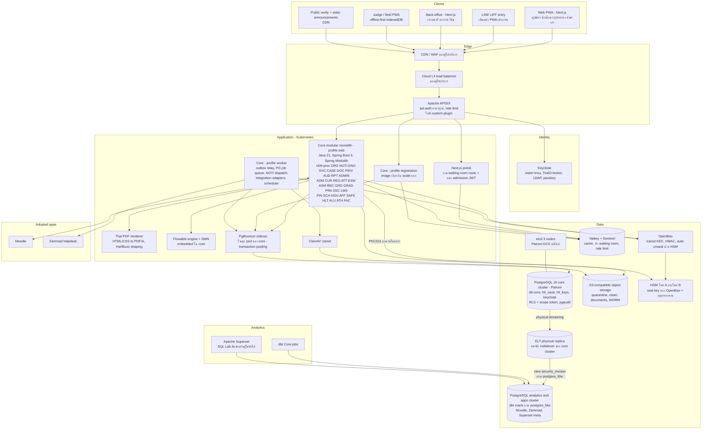

**หมายเหตุ container (ค่าเดียวที่ใช้ทั้งชุดเอกสาร — ขนาดอยู่ใน [11-operations](11-operations.md) หัวข้อ 2):**

| Container | Deploy unit | หน้าที่ | หมายเหตุ |
|---|---|---|---|
| Core profile `web` | image `core` | REST API ทุกโมดูล, BFF ของ web | stateless, JWT ตรวจที่ gateway และตรวจซ้ำที่แอป |
| Core profile `registration` | image `core` (deployment แยก) | endpoint ลงทะเบียน/ที่นั่ง เท่านั้น | แยกเพื่อ bulkhead และ scale ช่วง peak (ADR-004) ไม่ใช่ service แยก |
| Core profile `worker` | image `core` | outbox relay, PG job queue, NOTI dispatcher, integration adapters (ไฟล์/API/SFTP), scheduled jobs จากปฏิทิน (ORG) | leader election ผ่าน PG advisory lock |
| Thai PDF renderer | image `doc-render` | แปลง HTML/CSS template เป็น PDF/A (ไม่มีกุญแจลงนาม) | การลงนาม PAdES ทำใน core ผ่าน PKCS#11 (ADR-010) |
| Next.js | image `web` (2 deployment: portal, backoffice) | SSR หน้า public/portal, CSR back-office, service worker; **v1.1: route `/queue` ของ waiting room** (ลำดับคิวใน Valkey, ออก admission JWT ที่ลงนามด้วยกุญแจ K5) | LIFF ใช้ portal เดียวกัน; waiting room เขียนด้วย TypeScript ซึ่งเป็นภาษาเดียวกับทีม frontend (ADR-028) |
| PgBouncer | sidecar ในทุก pod ของ `core` (v1.1, ADR-027) | transaction pooling ต่อ pod | PgBouncer ≥ 1.21 พร้อม `max_prepared_statements` (หรือ JDBC `prepareThreshold=0`); ล่มพร้อม pod ของตน จึงไม่เป็น tier อนุกรมแยก |
| Keycloak | 3 replicas | OIDC, ThaID broker, LDAP, passkey/OTP | DB แยกใน Patroni ชุดเดียวกัน (เชื่อมผ่าน pool ของ Keycloak เอง) |
| APISIX | 3 replicas (peak 6) | routing, ตรวจ JWT ผู้ใช้และ admission JWT ด้วย plugin มาตรฐาน (`jwt-auth`/`openid-connect`), rate limit | ใช้โหมด standalone/declarative จาก Git เพื่อไม่ต้องดูแล etcd ของ APISIX **[ต้องตรวจสอบ: ingress controller เวอร์ชันที่เลือกต้องรองรับโหมดนี้]**; v1.1 ไม่มี custom Lua plugin |
| etcd (Patroni DCS) | 3 members ต่อไซต์ (ADR-026) | leader election ของ Patroni | ไซต์ A วางบน 3 node ของ data zone (primary, sync standby, ELT replica) บน volume แยก; ไซต์ B 3 members (node PG + VM เล็ก 2 ตัว) สำหรับ standby cluster |

โมดูล IAM (provisioning), ORG, ENG, NOTI, AUD, ANA, RPT และ ADMIN อยู่ใน core ทั้งหมด (ปิดประเด็น IC-25) ส่วน X-* อยู่นอกขอบเขตสัญญานี้และเชื่อมผ่าน adapter

---

## 5. จำนวน component: v0.9 เทียบ v1.0

### 5.1 เกณฑ์การนับ

นับ **runtime component ที่ทีมต้อง install, patch, upgrade, monitor และ backup แยกกัน** ไม่นับ library ที่อยู่ใน JVM (Spring Modulith, Flowable engine, EU DSS, ICU4J) และไม่นับบริการที่ผู้ให้บริการ cloud/MSSP ดูแลตามสัญญา (CDN/WAF, HSM แบบ managed, SOC/SIEM, SMS/email gateway) ซึ่งแยกแสดงไว้

### 5.2 v0.9 (53 รายการ)

| # | Component v0.9 | ผลใน v1.0 |
|---|---|---|
| 1 | Kubernetes | คง |
| 2 | CDN/WAF (OWASP CRS ดูแลเอง) | ใช้ของผู้ให้บริการ (ไม่นับ) |
| 3 | Waiting room service แยก | รวมเป็น plugin ใน APISIX + Valkey |
| 4 | APISIX | คง |
| 5 | Keycloak | คง |
| 6 | Core modular monolith | คง |
| 7 | Registration Engine (image แยก) | รวมเป็น profile ของ core |
| 8 | Notification Service (image แยก) | รวมใน core worker |
| 9 | Integration Adapters (Camel, image แยก) | รวมใน core worker |
| 10 | Document & Signing Service | แยกเฉพาะ renderer ที่ไม่มีกุญแจ; การลงนามอยู่ใน core |
| 11 | Reporting API (warehouse) | ตัด (RPT อยู่ใน core, BI ผ่าน Superset) |
| 12 | Flowable Design/Admin UI | ตัด (Flowable 7 OSS ไม่มี UI; ใช้ bpmn-js/dmn-js ใน ADMIN) |
| 13 | PostgreSQL core (Patroni) | คง |
| 14 | PostgreSQL health vault cluster แยก | ลดเป็น database แยกใน cluster เดียวกัน |
| 15 | PgBouncer | คง |
| 16 | pgBackRest | คง |
| 17 | Redis | เปลี่ยนเป็น Valkey |
| 18 | Kafka (Strimzi) | เลื่อน |
| 19 | MirrorMaker 2 | เลื่อน |
| 20 | Apicurio | เลื่อน (AsyncAPI ใน Git) |
| 21 | Debezium | เลื่อน (v1.0 ใช้ PG logical replication; v1.1 ใช้ physical replica + FDW) |
| 22 | MinIO | ไม่ใช้ (upstream archived) |
| 23 | OpenSearch | เลื่อน |
| 24 | ClickHouse | เลื่อน |
| 25 | ClickHouse Keeper | เลื่อน |
| 26 | dbt | คง (dbt Core) |
| 27 | Superset | คง |
| 28 | Metabase | ตัด |
| 29 | OpenMetadata | เลื่อน (ใช้ dbt docs + ROPA ใน PRIV) |
| 30 | HashiCorp Vault | เปลี่ยนเป็น OpenBao |
| 31 | HSM | คง (นับเป็นบริการ managed/appliance ไม่นับ) |
| 32 | Teleport | ไม่ใช้ (licence) |
| 33 | Unleash | เลื่อน (OpenFeature SDK + flag ใน DB/Git) |
| 34 | Argo CD | คง |
| 35 | Argo Rollouts | เลื่อน |
| 36 | Velero | เลื่อน (app tier stateless, state อยู่นอก cluster) |
| 37 | Prometheus/Alertmanager | คง |
| 38 | Grafana | คง |
| 39 | Loki | คง |
| 40 | Tempo | คง |
| 41 | Kyverno | คง (baseline policies) |
| 42 | Falco | เลื่อน (ให้ MSSP เป็นเจ้าของถ้าต้องการ) |
| 43 | Service mesh | เลื่อน |
| 44 | Wazuh (SIEM) | ย้ายไป MSSP/SOC (ไม่นับ) |
| 45 | Dependency-Track | คง |
| 46 | SonarQube (server) | ตัดเป็น CI tooling (Semgrep CE/SpotBugs ใน pipeline) |
| 47 | GitLab | คง (Git forge + CI) |
| 48 | Harbor | คง |
| 49 | ClamAV | คง |
| 50 | Moodle | คง (ถ้า มกช. ไม่มี instance เดิม) |
| 51 | Zammad | คง (X-HELP) |
| 52 | Next.js web | คง |
| 53 | Flutter app | เลื่อนไปสัญญาแยก |

### 5.3 Minimum Operable Stack: นับใหม่ v1.0 (35) และ v1.1 (32 รายการ)

**ที่มาของการนับใหม่ (D-06, review v1-review architecture_compliance A-01..A-04, Top-7):** ตาราง v1.0 ประกาศ 28 รายการ แต่ไม่นับ 7 รายการที่ต้อง install/patch/monitor แยกจริง ได้แก่ (1) **etcd** ซึ่งเป็น DCS ของ Patroni (v1.0 ไม่กล่าวถึงเลยทั้งชุด) (2–3) PostgreSQL มี **3 cluster** (core, analytics, apps) แต่นับเป็นแถวเดียว ทั้งที่แต่ละ cluster มี backup stanza, upgrade และ monitoring ของตน (4) **Valkey Sentinel** (5) **FreeRADIUS** สำหรับ eduroam (09 I-46) (6) **cert-manager** (7) **APISIX waiting-room plugin** ที่ต้องเขียนเองด้วย Lua (bespoke code บน critical path) → **v1.0 นับจริง = 35**

**สิ่งที่ตัด/ย้ายใน v1.1 (−3):** (ก) **Tempo** ตัดออกจาก R1–Wave 2 (trace id อยู่ใน log ของ Loki และ OTel Collector sampling ส่งไป Loki; เกณฑ์นำกลับในหัวข้อ 5.4) (ข) **waiting-room plugin** เลิกใช้ ย้ายเป็น route ใน Next.js + Valkey และให้ APISIX ตรวจ admission JWT ด้วย plugin มาตรฐาน (ADR-028) จึงไม่ใช่ runtime component แยก (ค) **apps DB รวมเข้า analytics cluster** (Moodle, Zammad, Superset metadata) เหลือ PostgreSQL 2 cluster (ADR-026) → **v1.1 = 32**

| # | Component | กลุ่ม | ผู้ดูแลหลัก / สำรอง ฝั่ง มกช. (role ตามเล่ม 04) | Tier | v1.0 นับ? |
|---|---|---|---|---|---|
| 1 | Kubernetes (managed ของผู้ให้บริการ หรือ RKE2) รวม CNI/CoreDNS/CSI ของ distribution | Platform | `itadmin` / `campus_itadmin` ส่วนกลาง | Must | ✓ |
| 2 | **cert-manager** (ใบรับรองภายใน, mTLS ไป PostgreSQL/OpenBao) | Platform | `itadmin` / `security_admin` | Must | ✗ เพิ่ม |
| 3 | Apache APISIX (gateway + rate limit + ตรวจ admission JWT) | Edge | `itadmin` / `dba_sre` | Must | ✓ |
| 4 | Keycloak | Identity | `security_admin` / `itadmin` | Must | ✓ |
| 5 | **FreeRADIUS** (eduroam IdP → Keycloak/LDAP; ใช้ของเดิมถ้าวิทยาเขตมีอยู่แล้ว — Q-68) | Identity | `itadmin` / `campus_itadmin` | Should (R2) | ✗ เพิ่ม |
| 6 | Core modular monolith (profiles web/registration/worker) | App | vendor L3 + `itadmin` / `dba_sre` | Must | ✓ |
| 7 | Next.js web tier (portal PWA + back-office + waiting room route) | App | vendor L3 / `itadmin` | Must | ✓ |
| 8 | Thai PDF renderer | App | vendor L3 / `itadmin` | Must | ✓ |
| 9 | PostgreSQL 16 + Patroni — **cluster core** (core, `hlt_vault`, `hlt_keys`, keycloak + ELT replica) | Data | `dba_sre` / `itadmin` | Must | ✓ (รวมแถวเดียว) |
| 10 | PostgreSQL 16 + Patroni — **cluster analytics+apps** (marts, Moodle, Zammad, Superset meta) | Data | `dba_sre` / `data_steward` | Must | ✗ แยกนับ |
| 11 | **etcd** (Patroni DCS, 3 members ต่อไซต์) | Data | `dba_sre` / `itadmin` | Must | ✗ เพิ่ม |
| 12 | PgBouncer (sidecar ใน pod ของ core) | Data | `dba_sre` / vendor L3 | Must | ✓ |
| 13 | pgBackRest | Data | `dba_sre` / `itadmin` | Must | ✓ |
| 14 | Valkey | Data | `dba_sre` / `itadmin` | Must | ✓ |
| 15 | **Valkey Sentinel** | Data | `dba_sre` / `itadmin` | Must | ✗ เพิ่ม |
| 16 | S3-compatible object storage (บริการของผู้ให้บริการ; สำรอง Ceph RGW/SeaweedFS) | Data | `itadmin` / `dba_sre` | Must | ✓ |
| 17 | OpenBao | Security | `security_admin` / `dba_sre` | Must | ✓ |
| 18 | ClamAV | Security | `security_admin` / `itadmin` | Must | ✓ |
| 19 | Kyverno (baseline + verify image signature) | Security | `security_admin` / `itadmin` | Must | ✓ |
| 20 | Dependency-Track | Security | `security_admin` / vendor | Must | ✓ |
| 21 | PAM/bastion ที่ licence ชัด (บริการของ GDCC/MSSP หรือ JumpServer) | Security | `security_admin` / `itadmin` | Must | ✓ |
| 22 | dbt Core (batch job) | Analytics | `data_steward` / vendor | Must | ✓ |
| 23 | Apache Superset | Analytics | `data_steward` / `dba_sre` | Must | ✓ |
| 24 | OpenTelemetry Collector | Observability | `dba_sre` / `itadmin` | Must | ✓ |
| 25 | Prometheus + Alertmanager | Observability | `dba_sre` / `itadmin` | Must | ✓ |
| 26 | Grafana | Observability | `dba_sre` / `itadmin` | Must | ✓ |
| 27 | Loki | Observability | `dba_sre` / `itadmin` | Must | ✓ |
| 28 | Argo CD | Delivery | `itadmin` / `dba_sre` | Must | ✓ |
| 29 | Git forge + CI runners (GitLab CE หรือ Forgejo) | Delivery | `itadmin` / vendor | Must | ✓ |
| 30 | Harbor (รวม Trivy scanner) | Delivery | `itadmin` / `security_admin` | Must | ✓ |
| 31 | Zammad (X-HELP) | Adopted | `helpdesk` / `itadmin` | Must ตั้งแต่ R1 | ✓ |
| 32 | Moodle | Adopted | `itadmin` (หรือ instance เดิม) / vendor MA | ใช้เมื่อ มกช. ไม่มี instance เดิม | ✓ |
| — | ~~Tempo~~ | Observability | — | **ตัด** (หัวข้อ 5.4) | ✓ (v1.0) |
| — | ~~APISIX waiting-room plugin (Lua)~~ | Edge | — | **ตัด** → route ใน Next.js (ADR-028) | ✗ (v1.0 ไม่นับ) |
| — | ~~PostgreSQL cluster apps~~ | Data | — | **รวม** เข้าแถว 10 | ✗ (v1.0 ไม่นับ) |

**ผลลัพธ์ (ตัวเลขจริง):** v0.9 = 53 · v1.0 ประกาศ 28 / **นับจริง 35** · **v1.1 = 32** (ลดจาก v0.9 = 21 รายการ หรือ 40%) ถ้า มกช. ใช้ Moodle เดิม, PAM เป็นบริการของ GDCC/MSSP และ eduroam ใช้ RADIUS เดิมของวิทยาเขต จะเหลือ **29** — บริการ managed ที่ไม่นับแต่ต้องอยู่ในสัญญา: CDN/WAF, **cloud L4 load balancer**, **HSM 2 ไซต์** (v1.1: ไซต์ B ต้องมี HSM ของตนเอง — ผลต่อต้นทุนเป็นหมายเหตุให้เล่ม 12), SOC/SIEM 24×7, SMS/email gateway, ETDA e-Timestamping (TSA), ปลายทาง backup แบบ offline

**Bus factor (A-04):** ทุกแถวมีผู้ดูแลหลักและสำรองคนละคน; KT metric ใหม่ "≥ 2 คนของ มกช. ทำ runbook วิกฤตได้เอง" สำหรับ OpenBao unseal/restore/HSM-lost, Patroni failover/PITR/etcd, Keycloak upgrade และ restore จาก backup เป็นเงื่อนไข MS-W1 ([11-operations](11-operations.md) หัวข้อ 16)

**ข้อจำกัดที่ยังอยู่ (บอกตรง ๆ):** 32 component ยังมากสำหรับทีม IT มกช. 5–10 คน ถ้าไม่มี MA/MSP; สิ่งที่ลดภาระได้มากที่สุดคือใช้ **managed Kubernetes, managed object storage, HSM/KMS และ PAM ของ GDCC** ถ้ามี (ผล GDCC spike, ADR-020) ซึ่งตัดภาระ patch/upgrade ของ 4–5 แถวออกไป

### 5.4 รายการที่เลื่อน พร้อมเกณฑ์นำกลับ (บันทึกใน ADR)

| เลื่อน/ตัด | เกณฑ์นำกลับ (ต้องมีหลักฐานจาก production) | ADR |
|---|---|---|
| Kafka + Strimzi + MirrorMaker 2 + schema registry | event > 500/s ต่อเนื่อง 15 นาทีในช่วงปกติ **หรือ** consumer ภายนอก ≥ 5 ระบบที่ต้อง replay **หรือ** outbox lag p95 > 30 s แม้ปรับ relay แล้ว | ADR-003 |
| Debezium CDC | ผู้ใช้จริงต้องการ freshness < 15 นาที และ ELT รายชั่วโมงผ่าน FDW ไม่พอ | ADR-017 |
| ClickHouse | dashboard p95 > 3 s บนข้อมูลจริงหลังทำ partition/materialized view แล้ว | ADR-017 |
| OpenSearch | ต้องค้น full-text ในเอกสาร/ไฟล์ปริมาณมาก หรือ PG FTS p95 > 500 ms | ADR-021 |
| Service mesh (mTLS ภายใน) | threat model รอบทบทวนพบ lateral movement risk สูง; ระหว่างนี้ใช้ NetworkPolicy default-deny + WireGuard ของ CNI ถ้ามี | ADR-018 |
| Argo Rollouts | มีทีม SRE ประจำ ≥ 3 คน | ADR-025 |
| Unleash/flag service | flag > 100 หรือต้องทำ % rollout | ADR-025 |
| Falco | มี SOC 24×7 ที่รับ alert runtime ได้ | ADR-018 |
| OpenMetadata | GD Catalog บังคับ หรือ dataset > 200 | ADR-017 |
| Flutter app | PWA/LIFF ไม่พอสำหรับ wellness รายวัน/offline หนัก (วัดจาก adoption) | ADR-008 |
| Velero | มี stateful workload ใน cluster ที่ไม่อยู่ใน backup ของ DB/object | [11-operations](11-operations.md) |
| Tempo (distributed tracing store) — **ตัดใน v1.1** | incident ที่หาสาเหตุไม่ได้ด้วย log + trace id ใน Loki ≥ 2 ครั้ง/ไตรมาส **และ** มีผู้ดูแลสำรองที่ผ่าน KT | ADR-018 |
| APISIX custom plugin (Lua) — **ตัดใน v1.1** | plugin มาตรฐานทำไม่ได้และมีผู้ดูแลภาษา Lua ≥ 2 คน | ADR-028 |
| PostgreSQL cluster ที่ 3 (แยก apps) | Moodle/Zammad รบกวน dbt จนเกินเกณฑ์ capacity review ([11-operations](11-operations.md) หัวข้อ 11) | ADR-026 |

---

## 6. ตาราง Technology stack ฉบับเต็ม

> คอลัมน์ licence: ระบุ SPDX และสถานะการตรวจ ผู้ตรวจรับต้องยืนยันจาก LICENSE ของเวอร์ชันที่ส่งมอบจริงผ่าน SBOM gate (ADR-019) ทุกแถวเป็น reference architecture ไม่ใช่ spec ใน TOR (AP-11)

| Layer | Component | ตัวเลือก | Licence | เหตุผล | ทางเลือก | ทบทวนเมื่อ |
|---|---|---|---|---|---|---|
| Runtime | ภาษา | Java 21 LTS (Eclipse Temurin), virtual threads | GPL-2.0 WITH Classpath-exception-2.0 [ความรู้ผู้เขียน] | ตลาดแรงงานไทยใหญ่, LTS ยาว | Kotlin บน JVM, .NET 8, TypeScript | Java LTS ถัดไป (25) ผ่าน 1 ปี |
| Runtime | Framework | Spring Boot 3 + Spring Modulith | Apache-2.0 [ความรู้ผู้เขียน] | boundary verification + event publication registry บน JDBC ([Spring Modulith docs](https://docs.spring.io/spring-modulith/reference/1.4/events.html) [ตรวจแล้ว]) | Quarkus, Micronaut | Spring Boot major ใหม่ |
| Runtime | Job queue | PG-backed (event publication registry + ตาราง job แบบ `FOR UPDATE SKIP LOCKED` หรือ db-scheduler) | db-scheduler: Apache-2.0 [ต้องตรวจสอบ]; ทางเลือก JobRunr OSS LGPL-3.0 [ต้องตรวจสอบ] | ไม่เพิ่ม component, transaction เดียวกับข้อมูล | Kafka, RabbitMQ | ถึงเกณฑ์ ADR-003 |
| Workflow/rules | BPMN/DMN | Flowable 7 engine (embedded) | Apache-2.0 [ความรู้ผู้เขียน]; UI apps ถูกตัดออกตั้งแต่ v7 ([Flowable forum](https://forum.flowable.org/t/flowable-7-0-0-m1-plans-for-ui-and-content-engine/10733) [ตรวจแล้ว]) | BPMN/DMN มาตรฐาน อยู่ใน JVM | Camunda 7 CE (EOL [ต้องตรวจสอบ]), Camunda 8 (licence แยก), state machine เอง | ต้องการ CMMN จริง หรือ Flowable เปลี่ยน licence |
| Workflow/rules | Modeler | bpmn-js / dmn-js ฝังใน ADMIN (deploy ผ่าน pipeline) | bpmn.io License (MIT-style แต่บังคับคง watermark bpmn.io ให้มองเห็นเต็มที่ — review v1-review A-10 ✅ อ่าน LICENSE แล้ว) **ไม่ใช่ OSI มาตรฐาน → อยู่ในทะเบียนข้อยกเว้น; DoD ของ ADMIN ห้ามซ่อน/แก้ watermark** | ไม่ต้องซื้อ Flowable Design | Flowable Design (subscription), modeler ภายนอกที่ export BPMN | ฝ่ายกฎหมายไม่รับเงื่อนไขโลโก้ |
| API | Style | REST + OpenAPI 3.1, AsyncAPI 3 สำหรับ event, RFC 9457 | — | มาตรฐาน, สอดคล้องแนว API ภาครัฐ | GraphQL (เฉพาะ BFF) | — |
| Frontend | Web | React + Next.js (App Router) + TypeScript, PWA (service worker) | MIT [ความรู้ผู้เขียน] | talent pool ใหญ่, SSR สำหรับมือถือ | Vue/Nuxt | — |
| Frontend | Design system | "TNSU DS" บน React Aria Components + Tailwind, ฟอนต์ไทยฝัง (Sarabun / IBM Plex Sans Thai) | Apache-2.0 / MIT / OFL-1.1 [ความรู้ผู้เขียน] | a11y ระดับ component | MUI | — |
| Frontend | LINE | LINE LIFF + Messaging API | ข้อตกลงบริการของ LINE (ไม่ใช่ OSS) | ช่องทางที่ผู้ใช้ไทยเปิดจริง | — | ข้อตกลง/ราคาเปลี่ยน |
| Frontend | Upload | Uppy + S3 multipart (presigned) | MIT [ความรู้ผู้เขียน] | resumable บน 4G ไม่ต้องมี upload server | tus (tusd) | — |
| Identity | IdP | Keycloak 26 | Apache-2.0 [ความรู้ผู้เขียน] | OIDC/SAML, broker ThaID, passkey | Authentik, WSO2 IS | — |
| Edge | Gateway | Apache APISIX (standalone config จาก Git) | Apache-2.0 (โครงการ ASF) [ความรู้ผู้เขียน] | plugin มาตรฐาน JWT/limit; **v1.1 ไม่มี custom plugin** (waiting room อยู่ใน Next.js, ADR-028) | Envoy Gateway, Kong OSS, NGINX | — |
| Edge | WAF/CDN | บริการของผู้ให้บริการ (GDCC/CSP ในไทย) | บริการ | ไม่ต้องดูแล rule set เอง | Coraza (Apache-2.0) ใน APISIX [ต้องตรวจสอบ] | ผู้ให้บริการไม่มี WAF |
| Data | OLTP | PostgreSQL 16 + Patroni (2 cluster: core, analytics+apps) | PostgreSQL License ([postgresql.org](https://www.postgresql.org/about/licence/) [ตรวจแล้ว]); Patroni MIT [ความรู้ผู้เขียน] | ACID, RLS, ICU collation ไทย, physical streaming replica, view `security_invoker` (PG15+) | Oracle, managed DB ของ CSP | PG major ใหม่ทุก 2 ปี |
| Data | DCS ของ Patroni | **etcd 3.5** (3 members ต่อไซต์, ADR-026) | Apache-2.0 (CNCF) [ความรู้ผู้เขียน] | ไม่ผูก HA ของ DB กับ control plane ของ Kubernetes | Consul (BSL ตั้งแต่ 1.17 → ห้าม [ความรู้ผู้เขียน]), Kubernetes API เป็น DCS | — |
| Data | Pooler | PgBouncer ≥ 1.21 (transaction mode) **แบบ sidecar ใน pod ของ core** (ADR-027) | ISC [ความรู้ผู้เขียน] | connection ต่ำ; `max_prepared_statements` รองรับ prepared statement ของ JDBC; ไม่เป็น tier อนุกรมแยก | PgCat, Odyssey, PgBouncer แบบ deployment แยก ≥ 2 instance | — |
| Data | Backup | pgBackRest | MIT [ความรู้ผู้เขียน] | PITR, S3, encryption, parallel restore | Barman (GPL-3.0) | — |
| Data | Cache/token | **Valkey** | BSD-3-Clause ([elest.io](https://blog.elest.io/valkey-vs-redis-vs-keydb-which-in-memory-store-after-the-license-change/), [InfoQ](https://www.infoq.com/news/2025/05/redis-agpl-license) [ตรวจแล้ว]) | fork ของ Redis 7.2.4 ภายใต้ Linux Foundation | Redis 8 (เลือกได้ AGPLv3/RSAL/SSPL [ตรวจแล้ว]) | — |
| Data | Object | S3 ของผู้ให้บริการ; สำรอง Ceph RGW หรือ SeaweedFS | Ceph LGPL-2.1/3.0 [ความรู้ผู้เขียน]; SeaweedFS Apache-2.0 [ต้องตรวจสอบ]; Garage AGPL-3.0 ([SUSE](https://packagehub.suse.com/packages/garage/) [ตรวจแล้ว]) | ต้องการ Object Lock **compliance mode** | MinIO: upstream archived 25 เม.ย. 2569, หยุดแจก binary ต.ค. 2568 ([GitHub](https://github.com/minio/minio), [itsfoss](https://itsfoss.com/news/minio-moves-away-from-open-source/) [ตรวจแล้ว]) → ไม่ใช้ | ผู้ให้บริการไม่มี Object Lock |
| Security | Secrets/keys | **OpenBao ≥ 2.2** + HSM (PKCS#11 auto-unseal) ทั้ง 2 ไซต์ | MPL-2.0 ([desdelinux](https://blog.desdelinux.net/en/openbao-an-open-source-fork-of-hashicorp/) [ตรวจแล้ว, แหล่งรอง]) | fork ของ Vault 1.14 ที่ยังเป็น open source; Vault เป็น BSL 1.1 ([The Register](https://www.theregister.com/2023/12/08/hashicorp_openbao_fork/)); **PKCS#11 seal มีตั้งแต่ 2.2 และต้องใช้ build ที่เปิด HSM (cgo); ตั้งแต่ 2.7 seal เป็น external plugin** (review v1-review A-11 ✅ จาก release notes/เอกสาร OpenBao) → จัดหา build/plugin พร้อม checksum + SBOM; **OSS ไม่มี cross-cluster DR replication** 🟡 จึงกู้ไซต์ B จาก snapshot (หัวข้อ 12) | Vault Enterprise (มีค่าใช้จ่าย), Cloud KMS ในไทย | build HSM ของเวอร์ชันที่ใช้ไม่ผ่าน bake-off P0 |
| Security | Antivirus | ClamAV (clamd) | GPL-2.0 [ความรู้ผู้เขียน] | สแกนไฟล์อัปโหลดก่อนปล่อย | บริการสแกนของผู้ให้บริการ | — |
| Security | Policy | Kyverno | Apache-2.0 [ความรู้ผู้เขียน] | baseline pod security + verify cosign | OPA Gatekeeper | — |
| Security | SBOM/SCA | Dependency-Track + Trivy (ใน Harbor/CI) + cosign | Apache-2.0 [ความรู้ผู้เขียน] | SBOM CycloneDX เป็น acceptance gate | Grype | — |
| Security | PAM | บริการ PAM ของ GDCC/MSSP; สำรอง JumpServer | JumpServer GPL-3.0 [ต้องตรวจสอบ] | session recording, JIT | Teleport CE: licence จำกัดองค์กร < 100 คน และรายได้ < USD 10M ตั้งแต่ v16 ([Teleport](https://goteleport.com/blog/teleport-community-license) [ตรวจแล้ว]) → ไม่ใช้ | — |
| Docs | PDF render | HTML/CSS → PDF ด้วย **WeasyPrint** (Pango + HarfBuzz) | BSD-3-Clause ([Debian](https://sources.debian.org/src/weasyprint/67.0-1/PKG-INFO) [ตรวจแล้ว]); รองรับ PDF/A, PDF/UA ([openapps](https://openapps.pro/packages/weasyprint) [แหล่งรอง, ต้องตรวจสอบ]) | shaping ไทยด้วย HarfBuzz; ตัดคำไทยต้องพิสูจน์ด้วย golden file | Chromium headless (Gotenberg, MIT [ความรู้ผู้เขียน]); JasperReports (LGPL, แต่ exporter ใช้ iText 2.1.7 รุ่นเก่า [ตรวจแล้ว: Wikipedia]); Typst ยังไม่ตัดคำไทยตามพจนานุกรม ([Typst forum](https://forum.typst.app/t/how-to-implement-dictionary-based-word-recognition-for-thai-for-line-breaking-hyphenation/7470) [ตรวจแล้ว]) | bake-off P0 ไม่ผ่าน |
| Docs | ลงนาม | EU DSS library (PAdES-B-LTA, XAdES) ใน core | LGPL-2.1 ([EC DSS](https://ec.europa.eu/digital-building-blocks/sites/display/DIGITAL/Digital%20Signature%20Service%20-%20%20DSS) [ตรวจแล้ว]) | ครบทั้ง PAdES/XAdES/timestamp/LTV | iText 7 (AGPL/commercial [ตรวจแล้ว]) | — |
| Docs | ตรวจ PDF/A | veraPDF (ใน CI/gate) | GPL-3.0+ หรือ MPL-2.0+ [ความรู้ผู้เขียน] | validation ก่อนออกเอกสาร | — | — |
| Search | ค้นหา | PostgreSQL FTS + `pg_trgm` + ICU4J BreakIterator ตัดคำไทยฝั่งแอป | PostgreSQL License; ICU License [ความรู้ผู้เขียน] | ไม่เพิ่ม cluster | OpenSearch (Apache-2.0) | ADR-021 |
| Analytics | Transform | dbt Core | Apache-2.0; dbt Fusion เป็น proprietary ไม่ใช้ ([dbt licensing](https://docs.getdbt.com/docs/dbt-licensing) [ตรวจแล้ว]) | SQL + test + docs/lineage | SQLMesh | — |
| Analytics | BI | Apache Superset | Apache-2.0 (ASF) [ความรู้ผู้เขียน] | RLS filter, embed, ไทยได้ | Metabase (AGPL) | — |
| Observability | Telemetry | OpenTelemetry SDK/Collector | Apache-2.0 [ความรู้ผู้เขียน] | มาตรฐานเปิด | — | — |
| Observability | Metrics | Prometheus + Alertmanager | Apache-2.0 [ความรู้ผู้เขียน] | SLO burn-rate | VictoriaMetrics | ข้อมูล > 13 เดือน |
| Observability | Dashboard/logs | Grafana, Loki (**Tempo ตัดใน v1.1**) | **AGPL-3.0** ([Grafana Labs](https://grafana.com/blog/2021/04/20/grafana-loki-tempo-relicensing-to-agplv3) [ตรวจแล้ว]) — ใช้ภายในโดยไม่แก้ไข ต้องผ่าน legal review; **ห้าม fork/แก้ source** (ถ้าแก้แล้วเปิดให้ผู้ใช้นอกทีมผ่านเครือข่าย เช่น dashboard ให้วิทยาเขต ต้องเสนอ source ส่วนที่แก้ตาม AGPL §13) — อยู่ใน DoD | ทีมรู้จักแพร่หลาย | OpenSearch Dashboards, Jaeger (Apache-2.0) | legal ไม่รับ AGPL |
| Observability | RUM | Grafana Faro Web SDK / OTel web | Apache-2.0 [ต้องตรวจสอบ] | เห็นปัญหาผู้ใช้ต่างจังหวัด | — | — |
| Delivery | IaC | **OpenTofu** | MPL-2.0, โครงการ CNCF ([The New Stack](https://thenewstack.io/opentofu-joins-cncf-new-home-for-open-source-iac-project/) [ตรวจแล้ว]) | Terraform เป็น BSL 1.1 | Pulumi, Ansible | — |
| Delivery | GitOps | Argo CD | Apache-2.0 [ความรู้ผู้เขียน] | declarative, audit ผ่าน Git | Flux | — |
| Delivery | Git + CI | GitLab CE หรือ Forgejo + runners ในไทย | GitLab CE: MIT [ความรู้ผู้เขียน]; Forgejo: GPL-3.0+ [ความรู้ผู้เขียน] | source อยู่ในประเทศ, repo ของ มกช. | GitHub + self-hosted runner | — |
| Delivery | Registry | Harbor | Apache-2.0 (CNCF) [ความรู้ผู้เขียน] | สแกน + replication + signature | registry ของผู้ให้บริการ | — |
| Platform | Certificates | cert-manager | Apache-2.0 (CNCF) [ความรู้ผู้เขียน] | ออก/หมุนใบรับรองภายในอัตโนมัติ | ใบรับรองจาก OpenBao PKI ด้วยมือ | — |
| Identity | RADIUS (eduroam) | FreeRADIUS (ถ้าวิทยาเขตไม่มีของเดิม) | GPL-2.0 [ความรู้ผู้เขียน] — รันแยก ไม่ link | IdP ของ eduroam ผ่าน UniNet (09 I-46) | RADIUS เดิมของวิทยาเขต | ไม่เป็นสมาชิก eduroam (Q-68) |
| Testing | Load | k6 | **AGPL-3.0** ([pkg.go.dev](https://pkg.go.dev/go.k6.io/k6) [ตรวจแล้ว]) — ใช้เป็นเครื่องมือภายใน ไม่แจกจ่าย | script JS, scenario ซับซ้อน | Gatling (Apache-2.0) | legal ไม่รับ AGPL |
| Testing | อื่น | JUnit 5, Testcontainers, ArchUnit, Pact, Playwright, axe-core, PIT, ZAP, Semgrep CE, gitleaks | Apache-2.0 / MIT / EPL / LGPL-2.1 [ความรู้ผู้เขียน] | — | — | — |
| Adopted | LMS | Moodle 4.x (LTI 1.3) | GPL-3.0 [ความรู้ผู้เขียน] | มาตรฐานในไทย | Open edX | — |
| Adopted | Helpdesk | Zammad | AGPL-3.0 (review_compliance C-28, 🟡) | ภาษาไทย, ใช้โดยไม่แก้ core | GLPI (GPL-3.0), osTicket (GPL-2.0) | legal ไม่รับ AGPL |
| Platform | Container | Kubernetes managed ของผู้ให้บริการ หรือ RKE2 | Apache-2.0 [ความรู้ผู้เขียน] | portable ข้าม GDCC/CSP | VM + systemd (ไม่มี HA เพียงพอ) | ADR-020 |
| Deferred | Event bus | Kafka, Debezium | Apache-2.0 [ความรู้ผู้เขียน] | — | NATS JetStream | ADR-003 |
| Deferred | OLAP/search | ClickHouse, OpenSearch | Apache-2.0 [ความรู้ผู้เขียน] | — | — | ADR-017, ADR-021 |

---

## 7. Licence policy, allow-list และ SBOM

ตามมติ blueprint ข้อ 9.1 และ review_compliance C-28 ([review_compliance](<../../research_notes/ออกแบบระบบการศึกษา TNSU ระดับ production/review_compliance.md>))

| ระดับ | Licence | เงื่อนไข |
|---|---|---|
| **อนุญาต** | Apache-2.0, MIT, BSD-2/3-Clause, ISC, PostgreSQL, MPL-2.0, EPL-2.0, LGPL-2.1/3.0 (dynamic linking), Unicode/ICU, OFL-1.1 (ฟอนต์), CC-BY-4.0 (เนื้อหา) | ใช้ได้ทุกที่ |
| **อนุญาตแบบมีเงื่อนไข** | GPL-2.0/3.0 | เฉพาะโปรแกรมที่รันแยก (ClamAV, Moodle, JumpServer) ไม่ link กับโค้ดของ มกช. |
| | AGPL-3.0 | ใช้ภายในโดย **ไม่แก้ไข** (Grafana, Loki, k6, Zammad) ต้องผ่าน legal review ก่อน TOR; **ห้าม fork** — ถ้าแก้ไขแล้วให้ผู้ใช้นอกทีมใช้ผ่านเครือข่ายต้องเสนอ source ส่วนที่แก้ (AGPL §13); ห้ามใช้ใน core; อยู่ใน DoD ของทุก release |
| | Licence เฉพาะ (bpmn.io) | อยู่ในทะเบียนข้อยกเว้น ต้องมีความเห็นฝ่ายกฎหมาย |
| **ห้ามใน core และ runtime** | BSL/BUSL, SSPL, RSAL, Elastic License v2, Commons Clause, "Community Edition" ที่จำกัดจำนวนพนักงาน/รายได้ (เช่น Teleport CE v16+), licence ที่เปลี่ยนเป็น proprietary ได้ฝ่ายเดียวโดยไม่มี fork ที่เป็น OSI | ถ้าจำเป็นจริงต้องซื้อ subscription เชิงพาณิชย์และระบุงบในเล่ม 12 |

**กลไกบังคับ:**
1. ทุก build สร้าง **SBOM CycloneDX** (image + dependency ของ Java/Node) ส่งเข้า Dependency-Track
2. CI ล้มเมื่อพบ licence นอก allow-list ที่ไม่อยู่ในทะเบียนข้อยกเว้น
3. **ทะเบียน licence และ obligation** (ชื่อ, เวอร์ชัน, SPDX, obligation, ผู้อนุมัติ, วันทบทวน) เป็น deliverable ทุก release และเป็น **เงื่อนไขตรวจรับ** ของแต่ละงวด
4. ทบทวนทะเบียนทุก 6 เดือนและเมื่อมีการเปลี่ยน licence ของ upstream (เหตุการณ์ Vault, Terraform, Redis, MinIO แสดงว่าเกิดได้จริง)
5. ตัวเลือกทุกตัวในหัวข้อ 6 ต้องมีทางหนีที่เป็น OSI licence (คอลัมน์ "ทางเลือก")

---

## 8. Architecture Decision Records (ADR-001..031)

> รูปแบบ: บริบท → การตัดสินใจ → ทางเลือกที่พิจารณา → ผลที่ตามมา → **ทบทวนเมื่อ** · สถานะทุกข้อ: **Accepted (รอยืนยันใน P0 Discovery)** · ADR ชุดนี้เขียนใหม่ทั้งหมดและแทน ADR-001..019 ของ v0.9 · **v1.1:** ADR ที่แก้มีป้าย "(แก้ v1.1)" และ ADR-026..031 เป็นข้อใหม่ (ท้ายหัวข้อนี้)

### ADR-001: Build แกนวงจรชีวิตนักศึกษา + Adopt open source สำหรับงานทั่วไป + Integrate ระบบรัฐ

- **บริบท:** SIS ระดับ Tier-1 มีต้นทุนและความล้มเหลวสูง (เช่น Workday ที่ WashU ราว USD 266M ([The Register](https://www.theregister.com/2025/12/12/washington_university_workday_costs_revealed/)), PeopleSoft ที่ Minnesota ทำให้ทุน 37,000 คนล่าช้า ([Minnesota Daily](https://mndaily.com/187685/uncategorized/peoplesoft-glitches-create-headaches))) ไม่พบการติดตั้งในมหาวิทยาลัยไทย; open source SIS ยังไม่พร้อม (Kuali Student ราว USD 40M แล้ว sunset ([e-Literate](https://eliterate.us/kuali-student-sunsetting-40-million-project-moving-kualico/))); ตลาดไทยใช้ REG ที่พัฒนาในประเทศ ([products_architecture](<../../research_notes/ออกแบบระบบการศึกษา TNSU ระดับ production/products_architecture.md>)); มกช. มีความต้องการเฉพาะ (นักกีฬา, โรงเรียนกีฬา, 17 วิทยาเขตที่รับสมัครเอง)
- **การตัดสินใจ:** **Build** โมดูลกลุ่ม Academic, Student services และ Sports ตามรหัสใน blueprint ข้อ 4 (รวม ATH เพราะ AMS เชิงพาณิชย์ใช้ proprietary API และข้อมูลอยู่ต่างประเทศ); **Adopt** Keycloak, Flowable engine, Moodle, Superset, Zammad, Koha (X-LIB) ภายใต้ ADR-019; **Integrate** GFMIS, e-Saraban, กยศ., ThaID, ธนาคาร, HR เดิม
- **ทางเลือก:** ซื้อ Tier-1 SaaS (data residency, ไม่ fit กฎไทย, ต้นทุน); ซื้อ REG package ไทยแล้ว customise (เร็วช่วงต้น แต่ไม่รองรับกีฬา/โรงเรียน/multi-campus และ IP เป็นของผู้ขาย); OSS ERP (OpenEduCat/Frappe) ไม่ถึงระดับหลายวิทยาเขต
- **ผล:** + มกช. เป็นเจ้าของ IP, ไม่มีค่า licence รายหัว − ต้องมี governance กันขอบเขตบาน, ต้องมีทีมรับช่วง (ADR-002, [11-operations](11-operations.md) หัวข้อ 16–18)
- **ทบทวนเมื่อ:** มี SIS เชิงพาณิชย์ที่รองรับกฎไทยพร้อม reference ในไทย ≥ 2 แห่ง

### ADR-002: Modular monolith (Java 21 + Spring Boot 3 + Spring Modulith)

- **บริบท:** ผู้ใช้ราว 35,000 คนรวมผู้ปกครองและบุคลากร (blueprint ข้อ 8), ~35 โมดูล, ทีมผู้รับจ้าง 28–39 FTE ตลอดช่วงสร้าง (สูงสุด 39 FTE ต.ค. 2571–พ.ค. 2572 ตาม [12-roadmap-cost-risk](12-roadmap-cost-risk.md) หัวข้อ 5.2), ทีม IT ของ มกช. ขยายจาก 5 เป็น 10 คน, peak เกิดไม่กี่จุด
- **การตัดสินใจ:** codebase เดียว, image `core` เดียว, หลาย deployment profile (`web`, `registration`, `worker`); โมดูลละ Java package + DB schema ของตน; ห้าม query ข้าม schema (ตรวจด้วย Spring Modulith verify + ArchUnit ใน CI); สื่อสารข้ามโมดูลผ่าน published interface หรือ event; bulkhead (thread pool/connection pool) แยกต่อโมดูลที่เสี่ยง; เกณฑ์แยก service: ต้อง scale ต่างกัน ≥ 5 เท่า **และ** มีทีมเจ้าของแยก **หรือ** มีข้อกำหนด isolation ทางกฎหมาย
- **ทางเลือก:** microservices 20+ (overhead เกินทีม), monolith ไม่มี boundary (big ball of mud)
- **ผล:** + transaction ภายในง่าย (ลงทะเบียน + ใบแจ้งหนี้ในธุรกรรมเดียว), deploy ง่าย − ต้องมีวินัย boundary, build ใหญ่ (แก้ด้วย Gradle multi-module + test ต่อโมดูล)
- **ทบทวนเมื่อ:** build > 20 นาที หรือทีมพัฒนา > 40 คน หรือมีโมดูลถึงเกณฑ์แยก

### ADR-003: Transactional outbox + PostgreSQL event publication registry + PG job queue (Kafka/Debezium เลื่อน)

- **บริบท:** ภาระ event ระดับหลักสิบต่อวินาที (หัวข้อ 10); Kafka เป็น component ที่ operate ยากที่สุดในชุดเดิม (review ARCH-01)
- **การตัดสินใจ:** (1) event ภายในใช้ **Spring Modulith event publication registry บน JDBC** ซึ่งบันทึกใน transaction เดียวกับข้อมูลธุรกิจ และ resubmit รายการที่ยังไม่เสร็จได้ (2) งานที่ต้องส่งออกนอกระบบ (NOTI, adapter, ส่งไฟล์รัฐ) เป็น **job ใน PostgreSQL** ดึงด้วย `FOR UPDATE SKIP LOCKED`, retry แบบ exponential backoff, dead-letter table, idempotency key (3) analytics ใช้ physical replica + FDW (ADR-017, v1.1) ไม่ใช้ CDC (4) ชื่อ event เป็น `<module>.<EventName>.v<n>` ตามรายการที่เล่ม 06 เป็นเจ้าของ และอธิบายใน AsyncAPI ใน Git (5) event ไม่บรรจุข้อมูล sensitive ใส่เฉพาะ id + ข้อมูลขั้นต่ำ (6) purge รายการที่เสร็จแล้วตามรอบ (completion mode DELETE หรือ archive)
- **ทางเลือก:** Kafka + Debezium (ops หนัก), RabbitMQ (เพิ่ม component), NATS JetStream
- **ผล:** + ไม่มี dual-write, backup/DR ชุดเดียวกับ DB − throughput จำกัดโดย PG (พอสำหรับ < 500 event/s), ไม่มี replay ระยะยาวสำหรับ consumer ภายนอก
- **ทบทวนเมื่อ:** ถึงเกณฑ์ในหัวข้อ 5.4 (event > 500/s ต่อเนื่อง, consumer ภายนอก ≥ 5, outbox lag p95 > 30 s)

### ADR-004: Registration engine = synchronous PostgreSQL transaction หลัง virtual waiting room (แก้ v1.1)

- **บริบท:** v0.9 ใช้ Redis DECR → Kafka → worker ทำให้เกิด seat leak/oversell และต้องพึ่ง reconcile job (review Top-4); ภาระที่คำนวณใหม่คือ 60 cmd/s burst (หัวข้อ 10.3)
- **การตัดสินใจ:**
  1. **Waiting room (v1.1 ย้ายจาก APISIX plugin ไป Next.js ตาม ADR-028):** route `/queue` ของ Next.js เก็บลำดับคิวใน Valkey และออก admission JWT ที่ลงนามด้วยกุญแจ K5 ส่วน APISIX ตรวจลายเซ็นด้วย plugin มาตรฐาน, หน้าคิวเป็น static บน CDN; **pre-queue randomisation** (ผู้ที่เข้ามาก่อนเวลาเปิดได้ลำดับสุ่ม เปิดเผยกติกา); ปล่อยตามอัตราที่ปรับได้อัตโนมัติจาก p95 latency และ error rate; token เป็น JWT อายุ 20 นาที ผูกกับ `sub` (กันการขาย/แชร์คิว) ใช้ได้ 1 session
  2. **Command แบบ synchronous:** `POST /api/v1/registrations` ทำงานในธุรกรรมเดียว: ตรวจ eligibility จาก `EligibilitySnapshot` (คำนวณ T-24h, invalidate ด้วย event) → `UPDATE seat_pool SET taken = taken + 1 WHERE id = ? AND taken < capacity` เรียงตาม `section_id` เพื่อกัน deadlock → INSERT enrollment (unique `(student_id, term_id, course_id)`) → outbox → COMMIT แล้วตอบผลสุดท้ายทันที (201 หรือ 409 พร้อมกลุ่มที่เต็มและทางเลือก) **ไม่มี command status polling**
  3. Valkey ใช้เป็น **read cache** ของที่นั่งคงเหลือ (TTL 2 s) เท่านั้น ไม่ใช่ source of truth
  4. **Staggered window ราย OrgUnit/ชั้นปีเป็นค่าเริ่มต้นทางนโยบาย** ตั้งใน ORG (ปฏิทิน) ไม่ใช่ option
  5. กันบอท: quota ต่อผู้ใช้ (≤ 10 command/นาที), token ผูกอุปกรณ์/session, ไม่ใช้ CAPTCHA ที่ขัด a11y
  6. **Fallback:** ถ้า load test ที่ 300 cmd/s ไม่ผ่าน ให้เพิ่ม queue (PG job queue) หน้า transaction เดิม โดยไม่เปลี่ยน invariant ของ DB
  7. **(v1.1) Hot row:** lock ของแถว `seat_pool` ค้างจนถึง COMMIT ซึ่งรอ synchronous standby (RTT + fsync) จึงอาจ 15–25 ms ไม่ใช่ 5 ms (ตารางความไวในหัวข้อ 10.3) → (ก) ทำ UPDATE seat **เป็นขั้นสุดท้ายก่อน COMMIT** (INSERT enrollment/outbox/audit ทำก่อน) (ข) เตรียม **seat-pool bucketing** (แบ่งที่นั่งกลุ่มยอดนิยมเป็น 4 bucket, เลือก bucket แบบสุ่ม, รวมเมื่อ bucket หมด) ไว้ตั้งแต่ R2 แต่เปิดด้วย flag (ค) วัด lock hold จริงใน spike P0; **ไม่ลด** `synchronous_commit` ของ schema `reg` เพราะเสี่ยงยืนยันผลแล้วหายเมื่อ failover
  8. **(v1.1) กัน seat hoarding/ส่งต่อที่นั่ง:** ที่นั่งที่ถอนระหว่าง window **เข้า waitlist อัตโนมัติ** (offer ตามลำดับ) ไม่คืน pool ทันที, การถอนแล้วลงกลุ่มเดิมซ้ำมี cool-down, UEBA rule "ถอน–ลงคู่กันระหว่างสองบัญชี" ([11-operations](11-operations.md) หัวข้อ 10.3)
  9. **(v1.1) ผลที่ไม่แน่ใจเมื่อสัญญาณหลุด (UX):** ทุก command มี `Idempotency-Key` ที่ client สร้างก่อนส่ง; หน้า **"ผลการลงทะเบียนล่าสุด"** ดึงผลด้วย key เดิมได้ซ้ำ (ไม่ส่งคำสั่งใหม่), ปุ่มยืนยันถูกปิดจนกว่าจะรู้ผล, ใบยืนยันส่งทาง in-app/LINE (หัวข้อเท่านั้น)
- **ทางเลือก:** async queue engine (ซับซ้อน, UX ต้อง polling), Queue-it SaaS (ข้อมูลออกนอกประเทศ; เป็นแผนสำรองถ้า self-hosted ไม่ผ่าน)
- **ผล:** + ไม่มี oversell โดยโครงสร้าง (constraint ใน DB), ผู้ใช้รู้ผลทันที, ตัด reconcile job − hot row ของกลุ่มเรียนยอดนิยม (คำนวณในหัวข้อ 10.3 ว่ารับได้), ต้องคุมความยาว transaction
- **ทบทวนเมื่อ:** load test 300 cmd/s ไม่ผ่าน p95 ≤ 1 s หรือ lock wait p95 > 200 ms

### ADR-005: Multi-campus = OrgUnit + Row-Level Security (implementation contract) (แก้ v1.1)

- **บริบท:** 17 วิทยาเขต + โรงเรียนกีฬา ที่มีงานทะเบียน ค่าธรรมเนียม ผู้ลงนามของตน (blueprint ข้อ 2.3) แต่ต้องรายงานรวม; review Top-10 ชี้ช่องโหว่ RLS ทางเทคนิค
- **การตัดสินใจ (สัญญาการ implement ที่ตรวจใน CI):**
  1. ทุกตารางธุรกรรมมี `org_unit_id NOT NULL` (denormalised แม้ตารางลูก เช่น enrollment, grade, invoice, payment, consent, guardian_relation) และ index นำด้วย `org_unit_id`
  2. `ALTER TABLE ... ENABLE ROW LEVEL SECURITY` + **`FORCE ROW LEVEL SECURITY`**; policy (v1.1) `USING (org_unit_id = ANY ((SELECT sec.org_scope())))` และ `WITH CHECK` เดียวกัน — ใช้ subquery เพื่อให้ฟังก์ชันถูกประเมินครั้งเดียวต่อ statement (InitPlan) และ index นำด้วย `org_unit_id` ใช้งานได้; ส่วนการมองเห็นผ่านความสัมพันธ์ (advisor-of, coach-of ฯลฯ) แยกเป็น **policy ที่สองแบบ permissive** ที่ใช้ `EXISTS` บนตาราง relationship ที่มี index `(person_id, target_id)` แทนการเรียก `rel_visible()` ต่อแถว (review v1-review A-08)
  3. app role **ไม่เป็น owner** ของตาราง และ **ไม่มี `BYPASSRLS`**; migration ใช้ role แยก
  4. **(v1.1, D-09) Scope ตั้งผ่าน `SECURITY DEFINER` function ที่ตรวจ claim ไม่ใช่ `set_config` จาก app role:** ใน v1.0 app role เรียก `set_config('app.org_scope', …)` เอง ผู้โจมตีที่ฉีด SQL ได้จึงขยาย scope ได้ ทำให้ RLS ไม่เป็นชั้นป้องกันอิสระ (review v1-review Top-5/S-02) กลไกใหม่:
     - core สร้าง **scope token** ต่อ transaction = `{sub, roles, org_scope[], purpose, txid, exp}` + HMAC-SHA256 ด้วย **scope-signing key** (ดึงจาก OpenBao KV ตอนเริ่ม pod, หมุนรายวัน, มี key version); token สร้างจาก JWT ที่ตรวจแล้ว + `RoleAssignment` ที่มีผล (เล่ม 04)
     - ต้นทุก transaction (hook ใน transaction manager ของ Spring) เรียก `SELECT sec.begin_scope($token)` ซึ่งเป็น `SECURITY DEFINER` (owner = role `sec_owner` แบบ NOLOGIN) ที่ (ก) ตรวจ HMAC ด้วย verification key ในตาราง `sec.scope_key` ที่ **app role อ่านไม่ได้** (ข) ตรวจ `txid = txid_current()` และ `exp` (กัน replay ข้าม transaction) (ค) ตรวจซ้ำว่า `org_scope` ⊆ scope จาก `iam.role_assignment` ที่มีผลของ `sub` (defence-in-depth แม้ key รั่ว) แล้วเก็บ token ไว้ใน GUC ระดับ transaction
     - `sec.org_scope()` (`SECURITY DEFINER`, `STABLE`) อ่าน token จาก GUC แล้ว **ตรวจ HMAC + txid ซ้ำทุกครั้ง** ก่อนคืน array — ถ้า SQL injection เรียก `set_config` ใส่ค่าอื่น ลายเซ็นไม่ผ่านและคืนค่าว่าง → 0 แถว (fail-closed)
     - PgBouncer ใช้ transaction pooling ได้ตามเดิม เพราะทุกอย่างเป็นระดับ transaction; ห้าม `SET` ระดับ session; ถ้าไม่ได้เรียก `begin_scope` policy คืน 0 แถว
     - กันทางลัด: ห้าม dynamic SQL ใน repository (Semgrep/ArchUnit rule), ใช้ bind parameter เท่านั้น, app role ไม่มีสิทธิ์ `CREATE` ใน schema ใด และไม่มีสิทธิ์บน schema `sec`
     - **PgBouncer + JDBC (A-07):** PgBouncer ≥ 1.21 ตั้ง `max_prepared_statements` (หรือ JDBC `prepareThreshold=0`), ArchUnit rule บังคับให้ repository ทุกตัวถูกเรียกภายใน `@Transactional` (query นอก transaction จะไม่มี scope และคืน 0 แถว ซึ่ง fail-closed แต่เป็น bug ที่หายาก)
  5. scope มาจาก JWT claim + RoleAssignment ที่มีวันเริ่ม/สิ้นสุด (เล่ม 04); งาน batch ข้าม OrgUnit ใช้ role เฉพาะที่ audit ทุกครั้ง
  6. **Tenancy rules** (ownership vs visibility) ตามหัวข้อ 11.9: ข้อมูลมี `owning_org` (ผู้รับผิดชอบทางทะเบียน) และอาจมี `serving_org` (ผู้ให้บริการ เช่น กลุ่มเรียนข้ามวิทยาเขต); PERSON เป็นข้อมูล shared ที่มองเห็นผ่าน relationship
  7. **นอก OLTP (v1.1, D-09):** ELT อ่านจาก **physical replica** ผ่าน view แบบ **`security_invoker = true`** (RLS ของ base table ทำงานในนามผู้เรียก) ด้วย service identity ที่ได้ scope token ระดับมหาวิทยาลัย — **ไม่มี role ใดมี `BYPASSRLS`** และไม่ใช้ logical replication เข้าตารางที่เปิด RLS (เพราะ subscription owner ต้อง bypass RLS); mart ใน analytics มี `org_unit_id` + RLS; Superset ใช้ RLS filter ของ Superset ผูกกับกลุ่มใน Keycloak (ไม่พึ่ง DB impersonation) และ CI ตรวจว่า dataset ทุกตัวมี filter; **SQL Lab ปิด** สำหรับผู้ใช้ทั่วไป เปิดเฉพาะ data team ผ่าน JIT (ADR-017)
  8. **Test:** RLS cross-tenant suite รันทุก PR: ทุก repository ถูกเรียกด้วย scope ผิดแล้วต้องได้ 0 แถว/ถูกปฏิเสธ, fuzz scope แบบสุ่ม, ทดสอบผ่าน PgBouncer จริง (Testcontainers) เพื่อจับ scope รั่วข้าม transaction; **(v1.1)** test ว่า `set_config('app.ctx', <ค่าปลอม/ค่าจาก transaction อื่น>)` จาก app role ได้ 0 แถว, token หมดอายุ/ผิด txid ถูกปฏิเสธ, view ทุกตัวใน schema ที่ ELT ใช้มี `security_invoker = true` (lint `pg_class.reloptions`), และไม่มี role ที่มี `BYPASSRLS` นอกจาก superuser ที่ใช้ผ่าน break-glass
  9. **(v1.1) Performance:** วัด p95 ของ query รายงาน/รายการใหญ่ที่มีและไม่มี policy ใน load test (เกณฑ์ทบทวน +20% เดิม); การตรวจ HMAC ต่อ statement คาดว่าเป็นระดับไมโครวินาที **[ต้องยืนยันใน spike P0]**
- **ทางเลือก:** DB ต่อวิทยาเขต (ops ×30, รายงานรวมยาก), schema ต่อวิทยาเขต, กรองในแอปอย่างเดียว; (v1.1) `SET ROLE` ต่อ OrgUnit (role ระเบิดตามจำนวน OrgUnit × บทบาท), ตรวจ JWT RS256 ใน DB โดยตรง (ต้องใช้ extension เพิ่ม)
- **ผล:** + defence-in-depth ที่เป็นอิสระจากแอปจริง (SQLi ไม่ขยาย scope), ย้ายวิทยาเขตได้ − ต้องคุม performance ของ policy, หมุน scope-signing key และ test เข้ม; scope-signing key เป็นความลับใหม่ที่ต้องอยู่ใน threat model (หัวข้อ 13)
- **ทบทวนเมื่อ:** นักศึกษา > 50,000 หรือ policy ทำให้ p95 query เพิ่ม > 20%

### ADR-006: กฎวิชาการเป็น PolicySet แบบมีเวอร์ชันต่อรุ่น (DMN)

- **บริบท:** ข้อบังคับแต่ละฉบับใช้กับรุ่นที่เข้าศึกษาตั้งแต่ปีที่กำหนด และมีทั้ง profile มหาวิทยาลัยและโรงเรียนกีฬา (blueprint ข้อ 9.6)
- **การตัดสินใจ:** `PolicySet` = bundle ที่มีเวอร์ชัน ประกอบด้วย parameter (JSON Schema), DMN decision tables (สถานภาพ, เกียรตินิยม, eligibility, ค่าปรับลงทะเบียนช้า 2 แบบ), grading scheme และอ้างเลขที่ข้อบังคับ; `AcademicProfile` = `HIGHER_ED`, `GRAD`, `BASIC_ED`; ผูกกับนักศึกษาตอนขึ้นทะเบียน เปลี่ยนได้ผ่าน workflow เท่านั้น; ทุก PolicySet มี golden test cases ที่ต้องผ่านก่อน publish แบบ 4-eyes; ประเมินด้วย DMN engine ของ Flowable ใน JVM
- **ทางเลือก:** hard-code ต่อปี, Drools DRL, OPA/Rego (เหมาะกับ authorization)
- **ผล:** + นายทะเบียนอ่าน DMN ได้, คำนวณย้อนหลังตามกฎของรุ่นได้ − ต้องมี tooling diff/test ของ policy
- **ทบทวนเมื่อ:** มีกฎที่ DMN แสดงไม่ได้ > 10% ของกฎ

### ADR-007: Workflow = Flowable 7 engine แบบ embedded; modeler = bpmn-js/dmn-js; ไม่ใช้ CMMN

- **บริบท:** Flowable 7 open source ตัด UI apps (modeler/admin/task) ออก ส่วน Flowable Design แบบติดตั้งเองต้องมี subscription ([Flowable forum](https://forum.flowable.org/t/flowable-ui-app-maven-repository-does-not-have-7-0-0-support/10880) [ตรวจแล้ว])
- **การตัดสินใจ:** ใช้ engine (BPMN + DMN) ใน core; task UI สร้างเองใน back-office (Inbox รวม); modeler ฝังใน ADMIN ด้วย bpmn-js/dmn-js; process/decision อยู่ใน Git และ deploy ผ่าน pipeline เท่านั้น; process versioning: instance ที่ค้างทำงานต่อบนเวอร์ชันเดิม, migration ระหว่างเวอร์ชันต้องมี script + test; ไม่ใช้ CMMN; ทางเลือกซื้อ Flowable subscription ระบุเป็น option ในเล่ม 12
- **ผล:** + ไม่ผูก UI เชิงพาณิชย์ − ต้องสร้าง task UI และ admin view เอง (รวมใน effort)
- **ทบทวนเมื่อ:** BA ต้องการ modeler ที่ simulate ได้ หรือ bpmn.io licence ไม่ผ่าน legal

### ADR-008: Frontend = Next.js PWA + LINE LIFF ก่อน; Flutter เลื่อน

- **บริบท:** ผู้ใช้ส่วนใหญ่ใช้มือถือ, อุปกรณ์ระดับล่าง, เครือข่ายต่างจังหวัดไม่เสถียร; การมี Flutter + PWA + web ทำให้ต้องมี 2 stack ภาษา (review ARCH-05)
- **การตัดสินใจ:** Next.js เดียว (portal + back-office แยก deployment) เป็น **PWA** (service worker, offline cache, Web Push); LINE LIFF เปิดหน้าเดียวกัน (ไม่สร้างแอปแยก); งาน offline ภาคสนาม (กรรมการสอบทักษะ, นิเทศ, เช็คชื่อ) ใช้ IndexedDB + sync protocol (หัวข้อ 11.8); งบ performance: JS ≤ 200 KB gzip ต่อ route, LCP ≤ 2.5 s บน Android ระดับล่างที่ 4G/3G profile; Flutter ไปสัญญาแยกเมื่อถึงเกณฑ์ในหัวข้อ 5.4
- **ทางเลือก:** Flutter ตั้งแต่ต้น, React Native
- **ผล:** + stack เดียว, ไม่ต้องผ่าน app store review ก่อน freeze − Web Push บน iOS ต้องติดตั้ง PWA ลง home screen ก่อน (จึงใช้ LINE เป็นช่องทางหลักสำรอง) **[ต้องตรวจสอบพฤติกรรม iOS เวอร์ชันปัจจุบัน]**
- **ทบทวนเมื่อ:** adoption ของ PWA push < 40% ของนักศึกษาหลัง 1 ภาค หรือ ATH ต้อง offline หนัก

### ADR-009: Identity = Keycloak realm เดียว + ThaID + LDAP + passkey/step-up

- **การตัดสินใจ:** realm `tnsu` เดียว, organization/group ต่อ OrgUnit; IdP broker: ThaID (ผู้สมัคร นักศึกษา ผู้ปกครอง), LDAP/AD รายวิทยาเขต (บุคลากร); **MFA บังคับบุคลากรทุกคน**, passkey/WebAuthn สำหรับ admin และบทบาท sensitive; **นักศึกษาและผู้ปกครอง:** passkey หรือ OTP เป็น **step-up** สำหรับ action เสี่ยง (ถอนรายวิชา, ขอคืนเงิน, เปลี่ยนบัญชีรับเงิน/อีเมล/เบอร์); แจ้งเตือนทุกช่องทางเมื่อ credential เปลี่ยน; ไม่เก็บเลขบัตรประชาชนแบบ plain ใน Keycloak (เก็บ HMAC ด้วยกุญแจเฉพาะ context ของ IAM, ADR-012); access token 5 นาที; session เจ้าหน้าที่ re-auth ทุก 8 ชม. และ step-up เมื่อ export; ช่วง window ลงทะเบียน refresh token ต้องครอบคลุม window เพื่อตัด Keycloak ออกจาก critical path (หัวข้อ 10.5)
- **(v1.1) เครื่องใช้ร่วม (เคาน์เตอร์, ห้องพักครู):** fast user switching ด้วย passkey บนมือถือ/บัตร (FIDO2) + session สั้นและ auto-lock 5 นาทีที่หน้าจอ back-office บนเครื่องที่ลงทะเบียนเป็น shared device, ห้าม shared account (ตรวจด้วย UEBA "หลาย session จากเครื่องเดียวสลับบัญชีผิดปกติ") เพื่อไม่ให้ MFA ทำให้เกิดการแชร์รหัสผ่าน (review v1-review UXR-41)
- **ทางเลือก:** realm ต่อวิทยาเขต, IdP SaaS ต่างประเทศ
- **ผล:** + SSO ทั้งระบบ, Moodle, eduroam − Keycloak สำคัญต่อ login (HA 3 nodes) แต่ไม่อยู่ใน path ของ request ทั่วไป
- **ทบทวนเมื่อ:** ThaID เปลี่ยนเงื่อนไข RP หรือมี national federation

### ADR-010: Thai PDF/document engine + PDF/A + PAdES + ระดับลายมือชื่อต่อประเภทเอกสาร (แก้ v1.1)

- **บริบท:** ปพ. (โรงเรียนกีฬา), transcript, ใบรับรอง, ใบเสร็จ, คำสั่ง/ประกาศ เป็น deliverable ที่ผู้ใช้เห็นมากที่สุด ภาษาไทยมีสระบน/ล่างและวรรณยุกต์ซ้อนที่ต้อง shaping ถูกต้อง และตัดบรรทัดตามคำ (ไม่มีช่องว่างระหว่างคำ) (review Top-8)
- **การตัดสินใจ:**
  1. **Template** = HTML/CSS (Thymeleaf/Handlebars ฝั่ง core เติมข้อมูล) เก็บใน template registry ที่มีเวอร์ชันราย OrgUnit/ParentAgency พร้อม maker-checker
  2. **Renderer** = service แยก (ไม่มีกุญแจ) ใช้ engine ที่ทำ shaping ด้วย **HarfBuzz**: ตัวเลือกหลัก WeasyPrint (Pango + HarfBuzz) ทางเลือก Chromium headless; **ตัดคำไทยทำฝั่ง core ด้วย ICU4J BreakIterator แล้วแทรก zero-width space (U+200B) ก่อนส่งเข้า renderer** เพื่อไม่พึ่งการตัดคำของ engine; ฟอนต์ไทยฝังทั้งหมด (OFL); **(v1.1, A-09)** ZWSP ใส่**เฉพาะชั้น render** ไม่ใส่ในข้อมูล, XML ขมธอ. 25 หรือ text layer ที่ใช้ค้น (ใช้ ActualText/ลบ ZWSP ใน text layer ถ้า engine รองรับ **[ต้องตรวจสอบใน bake-off]**), golden test รวม **text extraction** (copy/คัดข้อความต้องไม่มี U+200B) และ pin เวอร์ชัน Pango/HarfBuzz/ฟอนต์ใน image เพราะ Pango มีประวัติ regression การตัดบรรทัดไทย
  3. **ผลลัพธ์:** PDF/A-3b (transcript แนบ XML ตาม ขมธอ. 25-2563 ภายใน), PDF/A-2b สำหรับเอกสารอื่น; เอกสารสาธารณะต้องผ่าน PDF/UA; ตรวจด้วย veraPDF ใน CI และสุ่มใน production
  4. **ลงนาม (v1.1: เส้นทางเดียว)** = EU DSS ใน core → **PKCS#11 → HSM โดยตรง** (OpenBao **ไม่อยู่ใน path** ของการลงนาม; แก้ความไม่ตรงกันระหว่าง 07/08/10 ตาม review v1-review Top-9) มี HSM ทั้งไซต์ A และ B ที่ถือกุญแจลงนามชุดเดียวกัน (clone/backup ด้วยกลไกของผู้ผลิต HSM) เพื่อให้ออกเอกสารได้หลัง DR; **PAdES-B-LTA** เฉพาะเอกสารเก็บถาวรจริง (transcript, ปริญญา, คำสั่ง/ประกาศถาวร) ส่วนเอกสารอายุสั้นใช้ B-LT ตาม policy matrix ของเล่ม 10; job **re-timestamp** ก่อนใบรับรอง/อัลกอริทึมหมดอายุ; ทะเบียน algorithm sunset
  5. **ระดับลายมือชื่อต่อประเภทเอกสาร** (ตาราง policy และฐานกฎหมายเป็นของเล่ม 10 §7.2) — **หลักของ v1.1 (D-09):** เอกสารที่ออก**จำนวนมากแบบ batch** (transcript หลังสภาอนุมัติ, หนังสือรับรอง, ใบเสร็จ, ประกาศ) ลงนามด้วย **ตราประทับอิเล็กทรอนิกส์ของหน่วยงาน (organisational e-seal)** ของ มกช./วิทยาเขต โดยระบุชื่อ/ตำแหน่งนายทะเบียนหรือผู้มีอำนาจในเนื้อเอกสาร เพราะลายมือชื่อรายบุคคลที่กุญแจอยู่ใน HSM ของสถาบันแล้วถูกใช้ลงนาม 3,000 ฉบับต่อครั้งเสี่ยงไม่ผ่านหลัก sole control (ม.26 🟡); **ลายมือชื่อรายบุคคล (S3)** ใช้เฉพาะเอกสารที่กฎหมาย/ข้อบังคับกำหนดให้บุคคลลงนาม ผ่าน **remote signing ที่ผู้ลงนามยืนยันด้วย 2FA ของตนเองต่อ batch** (ตามเล่ม 10 v1.1); นิติกรและ ETDA ยืนยันใน P0 (คำถามเล่ม 13)
  5a. **TSA และ trust anchor (v1.1, review v1-review C-06):** TSA หลัก = **ETDA e-Timestamping** ✅ (มีบริการในประเทศ; ความเข้ากันได้กับ RFC 3161 🟡 ยืนยันใน P0) + **TSA สำรองเชิงพาณิชย์** (CA ไทยภายใต้ NRCA **[ต้องตรวจสอบผู้ให้บริการ]**) ตามเล่ม 10/09 v1.1; ตั้ง **trusted certificate source ของ EU DSS = Thailand NRCA (G3 สำหรับ document signing)** เพราะไม่มี EU Trusted List ของไทย; NRCA อยู่ใน Adobe AATL ตั้งแต่ 2019 ✅ → ทดสอบ "green check" ใน Acrobat และ Foxit ใน P0; **เมื่อ TSA ทั้งหลักและสำรองล่ม:** ลงนาม PAdES-B-B ทันทีแล้วเข้าคิว augment เป็น B-T/B-LT เมื่อ TSA กลับมา (ไม่ block การออกใบเสร็จ), สลับไป TSA สำรองอัตโนมัติเมื่อ TSA หลักไม่ตอบ (circuit breaker), แสดงสถานะ "รอประทับเวลา" ในหน้าตรวจสอบ
  6. **เอกสารสำคัญสร้างจาก snapshot ที่ลงนาม** (เช่น GradeSubmission snapshot, DegreeConferred record) ไม่ใช่ live query
  7. **Batch signing** (เช่น transcript 3,000 ฉบับหลังสภาอนุมัติ) ใช้ e-seal ของหน่วยงาน (ข้อ 5) ต้องมี dual control (ผู้สั่ง ≠ ผู้อนุมัติ, ผู้อนุมัติยืนยันด้วย step-up) และบันทึก manifest รายการ hash ที่ผู้อนุมัติเห็นก่อนกดยืนยัน
  8. **Golden-file visual test**: ชุดเอกสารไทยที่ยากที่สุด (ชื่อมีสระซ้อน เช่น "ปุ้ม", "ฐิติพัฒน์", ชื่อยาวล้นบรรทัด, เลขไทย, จำนวนเงินเป็นตัวอักษร) เทียบ pixel diff ทุก release; bake-off ใน P0 ระหว่าง WeasyPrint กับ Chromium ด้วยเอกสารจริงของ มกช.
- **ทางเลือก:** JasperReports (PDF exporter ใช้ iText 2.1.7 รุ่นเก่า ปัญหา Thai shaping [ต้องตรวจสอบ]), iText 7 (AGPL/commercial), Typst (ยังไม่ตัดคำไทยตามพจนานุกรม), docx → PDF ผ่าน LibreOffice (layout ไม่แน่นอน)
- **ผล:** + เอกสารไทยถูกต้องและตรวจสอบได้ระยะยาว − renderer เป็น Python/Chromium อีกหนึ่ง runtime (ยอมรับเพราะแยกจากกุญแจ)
- **ทบทวนเมื่อ:** bake-off ไม่ผ่าน golden file หรือ batch 3,000 ฉบับเกิน 1 ชม.

### ADR-011: Health vault = database แยก `hlt_vault` + DEK ต่อบุคคล × ประเภทระเบียน + key store `hlt_keys` + crypto-shredding (แก้ v1.1)

- **บริบท:** PostgreSQL community ไม่มี TDE (blueprint ข้อ 10); การแยก cluster เพิ่มภาระ ops (review ARCH-04); การบันทึกบาดเจ็บต้องไม่ถูก block ด้วย consent (blueprint ข้อ 9.9); review v1-review พบว่า v1.0 (ก) เล่ม 07 เก็บ wrapped DEK ใน vault แต่เล่ม 08 เก็บใน key store แยก (ข) DEK เดียวต่อคนลบตาม retention ที่ต่างกันรายประเภทไม่ได้ (ค) ชื่อ DB ไม่ตรงกัน (`hlt_vault` vs `hlt_vault`) — ปิดตาม D-04
- **การตัดสินใจ:**
  1. HLT เป็นเจ้าของข้อมูลสุขภาพแห่งเดียว เก็บใน **database `hlt_vault`** ใน Patroni cluster core (credential, role, pgBackRest stanza, NetworkPolicy แยก; role ของ ELT/analytics ไม่มีสิทธิ์ CONNECT); **v1.1: ข้อมูล wellness รายวัน (อารมณ์ การนอน ความปวด ความเมื่อยล้า) ย้ายมาอยู่ใน `hlt_vault`** ส่วน ATH เก็บเพียงสถานะความพร้อม/ข้อจำกัดการฝึกและค่าที่ได้รับอนุญาต (readiness band) (D-04, D-05)
  2. ป้องกันด้วย (ก) volume/disk encryption (ข) **column-level encryption ด้วย DEK ต่อ (บุคคล × ประเภทระเบียน)** — ประเภทตั้งต้น: `CLINICAL` (เวชระเบียน), `MEDICATION_MINOR`, `INJURY_RTP`, `WELLNESS`, `COUNSELLING`, `DISABILITY`, `SELECTION_MEDICAL` (ใบรับรองแพทย์/ผลตรวจตอนคัดเลือก), `INSURANCE`, `TUE` (รายการสุดท้ายเป็นของเล่ม 08 §9.2) (ค) purpose-bound API ที่ตรวจ care relationship + audit ทุก read
  3. **Wrapped DEK เก็บใน database `hlt_keys` แยก** (ไม่ใช่ใน `hlt_vault` และไม่ใช่ OpenBao KV) ห่อด้วย KEK ใน OpenBao transit; backup ของ `hlt_keys` เก็บ **≤ 35 วัน** (สั้นกว่า `hlt_vault` 13 เดือน) และไม่อยู่ในสำเนา offline ระยะยาว
  4. **Key-before-data (RPO ≈ 0 ของกุญแจเทียบกับข้อมูล):** DEK ใหม่ต้องถูก commit ใน `hlt_keys` และ**ยืนยันว่าไปถึง standby ไซต์ B แล้ว** (ตรวจ `replay_lsn` ของ standby ≥ LSN ของ commit) ก่อนนำไปเข้ารหัสข้อมูลแถวแรก — ข้อมูลที่ไปถึงไซต์ B จึงมีกุญแจของตนอยู่ที่ไซต์ B เสมอ; การสร้าง DEK เกิดน้อย (ครั้งเดียวต่อบุคคล × ประเภท) จึงรับเวลารอได้; ถ้าไซต์ B ไม่ตอบใน 5 s ให้ queue การบันทึก (ยกเว้นบันทึกฉุกเฉินซึ่งเข้ารหัสด้วย DEK ฉุกเฉินของหน่วยบริการที่สร้างล่วงหน้าแล้ว rewrap ภายหลัง)
  5. **Crypto-shredding:** ครบ retention ของประเภทนั้นและไม่มี legal hold/หน้าที่เก็บ → ลบทุกเวอร์ชันของ DEK ของ (บุคคล × ประเภท) นั้นใน `hlt_keys` + บันทึกใน **erasure ledger (tombstone list) ที่อยู่นอก DB ที่ถูก restore** (bucket `audit-worm`, Object Lock) → ciphertext ใน `hlt_vault` และ backup ทุกชุดอ่านไม่ได้เมื่อ backup ของ `hlt_keys` ที่มี DEK นั้นหมดอายุ (≤ 35 วัน) ซึ่งเป็นกรอบที่ประกาศใน privacy notice
  6. **Restore-then-reapply-erasure:** ทุกการ restore (`hlt_vault`, `hlt_keys` หรือ core) ต้องเปิดใน maintenance mode → ใช้ erasure ledger ลบ DEK/แถวที่อยู่ใน ledger ซ้ำ → ตรวจ → จึงเปิดใช้งาน (runbook [11-operations](11-operations.md) หัวข้อ 6–7)
  7. **ฐานทางกฎหมาย (เป็นของเล่ม 10):** บันทึกการบาดเจ็บ/การรักษาตามปกติโดยผู้ประกอบวิชาชีพใช้ ม.26(5)(ก) 🟡; ประโยชน์สำคัญต่อชีวิตใช้เฉพาะเหตุฉุกเฉินที่ขอ consent ไม่ได้; โค้ชเห็น **สถานะความพร้อม (พร้อม/จำกัด/ไม่พร้อม) + ข้อจำกัดการฝึก** โดยไม่ต้องขอ consent ส่วนรายละเอียดการวินิจฉัย/การรักษาต้องมี consent (D-05)
  8. ส่งไป analytics เฉพาะ aggregate ที่ pseudonymised ผ่าน export job ที่อนุมัติและตรวจ k-anonymity
- **ทางเลือก:** cluster แยก (ops +1/3), Postgres distribution ที่มี TDE (ค่า licence), เก็บร่วม DB หลัก, wrapped DEK ใน OpenBao KV (RPO ของ OpenBao ข้ามไซต์ = รอบ snapshot ซึ่งยาวกว่า DB → แถวที่สร้างก่อน failover ถอดรหัสไม่ได้; ปฏิเสธ), DEK เดียวต่อคน (ลบรายประเภทไม่ได้; ปฏิเสธ)
- **ผล:** + blast radius เล็ก, ลบได้จริงภายใน ≤ 35 วันหลังลบ DEK ทั้งใน DB และ backup, ลบตาม retention รายประเภทได้ − จำนวน DEK เพิ่มราว 9 เท่าต่อคน (ยังเป็นหลักแสนแถว), ค้นหาข้อมูลเข้ารหัสไม่ได้ (index เฉพาะ field ที่ไม่ sensitive), ขั้นตอน restore ยาวขึ้น
- **ทบทวนเมื่อ:** ผู้ตรวจ/หน่วยงานกำกับกำหนดให้แยก physical หรือสถานะห้องพยาบาลเป็นสถานพยาบาลที่มีหน้าที่เก็บเวชระเบียนยาวกว่า (คำถามเล่ม 13, review v1-review K-06)

### ADR-012: Key management = OpenBao auto-unseal ด้วย HSM ทั้งสองไซต์ + recovery key แบบ Shamir + escrow ของ transit key + ซ้อม "HSM สูญหาย" (แก้ v1.1)

- **บริบท:** ถ้ากุญแจหาย ข้อมูลเลขบัตรและ health vault กู้ไม่ได้ถาวร (review Top-2); review v1-review Top-1/K-01 (Critical): v1.0 เขียนว่า recovery key แบบ Shamir ใช้ unseal ได้ ซึ่ง**ผิด** — ในโหมด auto-unseal ด้วย HSM, recovery key **ถอดรหัส root key ไม่ได้** ใช้เพื่อ authorization (เช่น generate root, rekey, seal migration) เท่านั้น และถ้ากุญแจ seal ใน HSM หาย snapshot ทุกชุดก็กู้ไม่ได้ ✅ (เอกสาร seal ของ Vault ซึ่ง OpenBao fork มา)
- **การตัดสินใจ:** (รายละเอียดหัวข้อ 12)
  1. **Seal model เดียวทั้งชุดเอกสาร:** OpenBao ≥ 2.2 ใช้ **PKCS#11 auto-unseal** กับ HSM; **ไซต์ A และไซต์ B มี HSM ของตนเอง** ที่ถือ seal key ชุดเดียวกัน (clone/backup แบบเข้ารหัสด้วยกลไกของผู้ผลิต HSM หรือ Cloud HSM ในไทยที่ replicate ข้ามไซต์) — ผลต่อต้นทุน: HSM ชุดที่สองเป็นหมายเหตุให้เล่ม 12 (ไม่คำนวณราคาใหม่ในเล่มนี้)
  2. **Recovery keys** แบบ Shamir 3-of-5 ถือโดยตำแหน่งผู้บริหาร มกช. (ไม่ใช่ vendor) ใช้สำหรับ authorization เท่านั้น จึง**ไม่อยู่บนเส้นทางวิกฤตของ DR** (การ unseal ทำอัตโนมัติด้วย HSM ของไซต์นั้น)
  3. **ทางกู้จริงเมื่อ HSM หาย = escrow ของ transit key:** transit key ทุกตัว (KEK ต่อโดเมน, HMAC key) ตั้งค่าให้ backup ได้ และ**ถูก export เฉพาะใน key ceremony บนเครื่อง air-gapped** แล้วเข้ารหัสด้วย escrow public key ทันที (ไม่มีขั้นตอนอัตโนมัติ, ไม่เรียกว่า "non-exportable" อีกต่อไป — review v1-review K-02); escrow private key แบ่ง Shamir 3-of-5 เก็บ offline 2 สถานที่
  4. **RPO ของ OpenBao ข้ามไซต์:** OpenBao OSS ไม่มี DR replication 🟡 → ไซต์ B กู้จาก Raft snapshot ที่ถี่ขึ้นเป็น **ทุก 15 นาที** (เดิมรายชั่วโมง) ดังนั้น **RPO ของ OpenBao = 15 นาที**; กติกา **snapshot-before-use:** การสร้าง transit key ใหม่, rotate KEK หรือ HMAC ต้องทำ snapshot ทันทีและยืนยันว่าถึงไซต์ B (และอยู่ใน escrow ถ้าเป็น key ใหม่) ก่อนใช้งานกับข้อมูลจริง → ข้อมูลไม่ขึ้นกับ secret ที่อาจหายใน 15 นาที; wrapped DEK ไม่อยู่ใน OpenBao (อยู่ใน `hlt_keys`, ADR-011) จึงไม่ได้รับผลจาก RPO นี้
  5. **ซ้อม:** รายไตรมาส (restore escrow + snapshot ใน environment แยก แล้วถอดรหัส canary), ปีละ 2 ครั้ง "restore จากศูนย์", และ **ปีละ 1 ครั้ง "HSM สูญหาย"** (ไม่มี HSM เดิม: ตั้ง OpenBao ใหม่ด้วย seal ใหม่, import transit key จาก escrow, ถอดรหัส canary ของ `hlt_keys` และ HMAC) เป็น exit criteria ของ go-live ([11-operations](11-operations.md) หัวข้อ 8)
  6. HMAC key ของเลขบัตร **2 context** (core, IAM) — v1.1 ตัด context "migration" ออก (migration ใช้ HMAC ของ core ผ่าน API ใน enclave; review v1-review หัวข้อ 2.7) — มี key version สำหรับ rotate
- **ทางเลือก:** HashiCorp Vault (BSL; DR replication อยู่ใน Enterprise), Cloud KMS ต่างประเทศ (cross-border), Kubernetes Secrets อย่างเดียว, Shamir seal (ไม่ใช้ HSM: ต้องประกอบ quorum ทุกครั้งที่ restart → RTO ขึ้นกับผู้บริหารที่อาจไม่อยู่นอกเวลาราชการ)
- **ผล:** + ไม่มี single point of key loss (HSM 2 ไซต์ + escrow), DR ไม่ต้องรอผู้ถือ share, vendor ไม่ถือกุญแจ − ต้องมี HSM 2 ชุด, พิธีกุญแจ, ผู้ถือที่หมุนเวียนตามตำแหน่ง และการซ้อม HSM-lost ที่ใช้เวลาครึ่งวัน
- **ทบทวนเมื่อ:** ซ้อมกู้ล้มเหลว 2 ไตรมาสติด, OpenBao มี DR replication ใน OSS, หรือ GDCC มี KMS/HSM ในไทยที่ผ่านการประเมิน

### ADR-013: Cache, waiting room และ rate-limit store = Valkey

- **การตัดสินใจ:** Valkey 3 nodes (primary + 2 replicas) + **Valkey Sentinel 3 processes** (นับเป็น component แยกใน v1.1) ใช้สำหรับ (1) ลำดับคิวของ waiting room (route ใน Next.js, ADR-028) (2) cache ที่นั่งคงเหลือและ catalogue (3) rate-limit counter; **ไม่มีข้อมูลที่เป็น source of truth** ทุกการใช้งานต้องมี fallback เมื่อ Valkey ล่ม: cache → อ่านจาก PG, rate limit → local limiter ที่ APISIX, waiting room → โหมด fixed-rate ที่ Next.js แต่ละ pod ออก admission JWT ตามโควตาของตน (stateless)
- **ทางเลือก:** Redis 8 (AGPLv3/RSAL/SSPL), Memcached (ไม่มีโครงสร้างข้อมูลที่ต้องใช้)
- **ทบทวนเมื่อ:** Valkey หยุดพัฒนา หรือ licence เปลี่ยน

### ADR-014: Object storage = S3-compatible ของผู้ให้บริการ (สำรอง Ceph RGW/SeaweedFS); Object Lock compliance mode; ไม่ใช้ MinIO

- **การตัดสินใจ:** ใช้ S3 API เท่านั้น; ลำดับเลือก (1) object storage ของ GDCC/CSP ในไทยที่มี versioning + **Object Lock compliance mode** + replication ข้าม site (2) Ceph RGW (เมื่อทีมมีทักษะ Ceph) (3) SeaweedFS; bucket: `quarantine` (ไฟล์อัปโหลดยังไม่สแกน, ไม่มี read ให้ผู้ใช้), `clean`, `documents` (เอกสารลงนาม, versioning), `audit-worm`, `backup-*` ใน **account/tenant แยก** ที่ credential ของ production เขียนได้แต่ลบไม่ได้; เข้ารหัส server-side; presigned URL อายุสั้น
- **ทางเลือก:** MinIO (upstream archived, หยุดแจก binary [ตรวจแล้ว]), Garage (AGPL), NFS (ไม่มี Object Lock)
- **ทบทวนเมื่อ:** ผลทดสอบ Object Lock ของผู้ให้บริการใน P0 ไม่ผ่าน

### ADR-015: IaC = OpenTofu; GitOps = Argo CD; ทุกอย่างสร้างใหม่ได้จาก repo ของ มกช.

- **การตัดสินใจ:** OpenTofu สำหรับ infrastructure (state เข้ารหัสใน object storage ในไทย, lock), Helm/Kustomize + Argo CD สำหรับ workload; repo อยู่ใน Git forge ของ มกช.; สร้าง environment ใหม่จาก repo ได้ภายใน 1 วัน; **independent rebuild test** ก่อนรับมอบแต่ละ release ([11-operations](11-operations.md) หัวข้อ 16)
- **ทางเลือก:** Terraform (BSL 1.1), Pulumi, Ansible-only
- **ทบทวนเมื่อ:** provider ที่จำเป็นไม่รองรับ OpenTofu

### ADR-016: API gateway = Apache APISIX + WAF ของผู้ให้บริการ

- **การตัดสินใจ:** APISIX ทำ routing, ตรวจ JWT ในเครื่อง (JWKS cache), **ตรวจ admission JWT ของ waiting room ด้วย plugin มาตรฐาน (v1.1 ไม่มี custom Lua plugin, ADR-028)**, rate limit (per IP / per `sub` / per route), request size limit, CORS; config แบบ declarative ใน Git; WAF (OWASP CRS) ที่ CDN/edge ของผู้ให้บริการ; endpoint ของธนาคาร (payment callback) แยก route + mTLS + IP allow-list
- **ทางเลือก:** Envoy Gateway, Kong OSS, ingress-nginx
- **ทบทวนเมื่อ:** การตรวจ admission JWT ที่ 2,000 RPS ไม่ผ่าน load test

### ADR-017: Analytics = PostgreSQL physical replica + view `security_invoker` + dbt Core + Superset (ClickHouse/OpenSearch ภายหลัง) (แก้ v1.1)

- **บริบท:** ข้อมูลวิชาการราว 200,000 แถว/ปี; v0.9 มี warehouse ที่เกินขนาดและอยู่นอก RLS (review ARCH-02, DATA-02, SEC-05)
- **การตัดสินใจ (v1.1, D-09 — แก้ความขัดกันระหว่าง 07 logical กับ 08 physical และช่องโหว่ RLS):**
  1. **ต้นทาง ELT = physical streaming replica** ของ cluster core (สมาชิก Patroni แบบ `nofailover`, ไม่อยู่ใน synchronous set, `max_standby_streaming_delay` ≤ 30 s, query ถูก cancel ได้แทนการหน่วง replay) — **เลิกใช้ logical replication** เพราะการ replicate เข้าตารางที่เปิด RLS ต้องให้ subscription owner bypass RLS ✅ (PG15+)
  2. role `elt_reader` อ่านผ่าน schema `elt_api` ซึ่งเป็น **view แบบ `security_invoker = true`** ที่มี column allow-list (ไม่มีชื่อ, เลขบัตร, ที่อยู่, ผู้ปกครอง, บัญชีธนาคาร) — view จึงไม่ข้าม RLS ของ base table; `elt_reader` ได้ scope ระดับมหาวิทยาลัยผ่าน scope token ของ service identity (ADR-005) **ไม่มี `BYPASSRLS`**; ไม่มีสิทธิ์ CONNECT `hlt_vault`/`hlt_keys` และ `pg_hba` ปฏิเสธ
  3. **analytics DB** (cluster analytics+apps, ADR-026) ดึงข้อมูลด้วย `postgres_fdw` จาก `elt_api` แบบ incremental รายชั่วโมง แล้ว dbt Core สร้าง mart (pseudonymised โดยค่าเริ่มต้น) ที่มี `org_unit_id` + RLS แบบเดียวกับ core
  4. Superset ตัวเดียว (ตัด Metabase) ใช้ **RLS filter ของ Superset** ผูกกับกลุ่มใน Keycloak (ไม่พึ่ง DB impersonation ซึ่งยังไม่ยืนยันว่ารองรับ PostgreSQL 🟡), DB role ของ Superset อ่านได้เฉพาะ curated view, CI ตรวจว่า dataset ทุกตัวมี filter; **SQL Lab ปิด** ยกเว้น data team ผ่าน JIT
  5. **Export (ค่าเดียวทั้งชุดเอกสาร, v1.1):** (ก) **standard export ต่อบทบาท** ที่อนุมัติไว้ล่วงหน้า (เช่น รายชื่อในกลุ่มเรียน, รายชื่อสอบ, ลูกหนี้ของวิทยาเขต — catalogue เป็นของเล่ม 14/06) ไม่ต้องขออนุมัติรายครั้ง แต่มี audit + watermark (ข) **ad-hoc export ข้อมูลระดับบุคคล > 500 แถวต่อครั้ง หรือ > 2,000 แถวสะสมต่อผู้ใช้ต่อวัน** ต้องระบุ purpose + อนุมัติ + watermark (ค) export ที่มี attribute อ่อนไหวเชิงสถิติ (ความพิการ, วินัย, สุขภาพ aggregate) ต้องอนุมัติทุกขนาด — ค่า 500 นี้แทนค่า 100 ในเล่ม 08 v1.0 และใช้ใน UEBA ของเล่ม 11
  6. dbt docs เป็น data catalogue จนกว่าจะถึงเกณฑ์ OpenMetadata; RPT (snapshot ณ วันตัดยอด) อยู่ใน core ไม่ใช่ BI; KPI ที่มาจาก observability (availability, p95, เวลารอคิว) ส่งเข้า ANA เป็น `fct_slo_daily` ด้วย job รายวันจาก Prometheus (review v1-review UXR-12)
- **ทางเลือก:** ClickHouse, Iceberg + Trino, Debezium CDC, logical replication + row filter (ต้องมี role ที่ bypass RLS; ปฏิเสธใน v1.1)
- **ทบทวนเมื่อ:** dashboard p95 > 3 s หลังทำ materialized view/partition หรือข้อมูล ATH time-series > 50 ล้านแถว/ปี

### ADR-018: Observability = OpenTelemetry + Prometheus + Grafana/Loki + RUM; runtime security แบบ tier (แก้ v1.1)

- **การตัดสินใจ:** OTel SDK ทุก service, trace id แสดงในหน้า error และ ticket และเขียนลง log; **v1.1 ตัด Tempo** (ใช้ trace id ใน Loki + span สำคัญเป็น log event; เกณฑ์นำกลับหัวข้อ 5.4); **SLI หลักเป็น request-based จาก log ของ APISIX** ส่วน synthetic ทุก 1 นาทีเป็นสัญญาณเสริม (review v1-review N-06); SLO ราย journey + burn-rate alert แบบ multi-window; synthetic checks จากนอกศูนย์ข้อมูล (รวมจุดในวิทยาเขต); **RUM** แยกตาม OrgUnit/ISP; log ไม่มี PII (masking ที่ logger); Grafana/Loki เป็น AGPL ใช้ภายในโดยไม่แก้ไข ต้องผ่าน legal review และห้าม fork; security tier **Must:** NetworkPolicy default-deny, image signed + scanned, Kyverno baseline, pgaudit; **Later:** service mesh, Falco
- **ทางเลือก:** Datadog/New Relic (SaaS ต่างประเทศ), OpenSearch stack
- **ทบทวนเมื่อ:** legal ไม่รับ AGPL (เปลี่ยนเป็น Jaeger + OpenSearch Dashboards/VictoriaLogs [ต้องตรวจสอบ licence]) หรือถึงเกณฑ์นำ Tempo กลับ

### ADR-019: Licence allow-list + SBOM เป็นเงื่อนไขตรวจรับ

- **การตัดสินใจ:** ตามหัวข้อ 7; ใช้เกณฑ์เดียวกันทั้งเอกสาร (ปิดความไม่สม่ำเสมอ IC-01: ตัด Redpanda เพราะ BSL แต่เลือก Vault/Terraform)
- **ทบทวนเมื่อ:** ทุก 6 เดือน หรือ upstream เปลี่ยน licence

### ADR-020: Hosting = Kubernetes บน cloud ในประเทศไทย 2 sites; Cloud First/GDCC เป็นสมมติฐาน

- **บริบท:** นโยบาย Cloud First ให้จัดหา cloud ผ่าน GDCC ตั้งแต่ 1 ต.ค. 2568 ([Bangkok Post](https://bangkokpost.com/business/general/2986926/cloud-first-policy-gets-underway-on-oct-1)) แต่ **ยังไม่ยืนยันว่าผูกพัน มกช.** (blueprint ข้อ 10) → **สมมติฐาน S7-01**
- **การตัดสินใจ:** ออกแบบให้ cloud-portable (Kubernetes มาตรฐาน CNCF, S3 API, PostgreSQL ที่ดูแลเอง, ไม่ใช้ PaaS เฉพาะเจ้า); 2 sites คนละศูนย์ข้อมูล (site A primary, site B warm DR); ข้อมูลทั้งหมดรวม backup และ log อยู่ในไทย; **GDCC technical spike ใน P0 (เม.ย.–มิ.ย. 2570)**: สร้าง cluster จริง, ทดสอบ Object Lock compliance mode, latency ข้าม site, HSM/PKCS#11, egress ไป ThaID/ธนาคาร, SOC; decision tree: (1) managed K8s ของ GDCC → (2) K8s บน VM ของ GDCC ที่ vendor ดูแลตลอดสัญญา MA → (3) CSP ในไทยที่ผ่านเกณฑ์ (ถ้า มกช. ไม่ถูกบังคับ)
- **(v1.1)** HSM ต้องมีที่ทั้ง 2 sites (ADR-012) และ Kubernetes ต้อง upgrade minor ≥ 3 ครั้ง/ปี ([11-operations](11-operations.md) หัวข้อ 5.1) จึงให้น้ำหนัก managed K8s และ HSM/KMS ในไทยของ GDCC เป็นพิเศษใน spike
- **ทบทวนเมื่อ:** ผล spike หรือคำตอบทางกฎหมายเรื่อง Cloud First

### ADR-021: Search = PostgreSQL FTS + pg_trgm + การตัดคำไทยฝั่งแอป

- **การตัดสินใจ:** ตามหัวข้อ 11.6; OpenSearch เลื่อนตามเกณฑ์ในหัวข้อ 5.4
- **ทบทวนเมื่อ:** p95 > 500 ms หรือมีความต้องการค้นเนื้อหาเอกสาร

### ADR-022: API style และ versioning

- **การตัดสินใจ:** REST resource-oriented, `/api/v{major}`, OpenAPI 3.1, RFC 9457 problem details, cursor pagination, `Idempotency-Key` บังคับสำหรับ POST ที่มีผลทางการเงิน/ที่นั่ง; นโยบาย versioning ตามหัวข้อ 11.3; event ตาม AsyncAPI พร้อม compatibility check ใน CI; API ภายนอก (ธนาคาร, หน่วยงานรัฐ) มีเวอร์ชันแยกจาก API ของแอป
- **ทบทวนเมื่อ:** มี consumer ภายนอกจำนวนมากที่ต้องการ GraphQL

### ADR-023: Privileged access = JIT + PAM ที่ licence ชัด + break-glass 2 คน + data-fix 4-eyes

- **การตัดสินใจ:** ไม่มี standing access ระดับ prod สำหรับมนุษย์; JIT ผ่าน PAM ของ GDCC/MSSP หรือ JumpServer (ไม่ใช้ Teleport CE); session recording ของ `kubectl`/`psql`; **DBA JIT บน schema `asm`, `rec`, `fin`, `grd` เป็น read-only โดยค่าเริ่มต้น และไม่มี DML**; **ช่องทางแก้ข้อมูลมีช่องทางเดียว (v1.1, review v1-review S-08) = `DataFixRequest` แบบ 4-eyes ที่รันผ่าน pipeline** ด้วย role เฉพาะที่ถูก audit (ไม่ใช่ DBA); break-glass (2 คน) ใช้เฉพาะเมื่อ pipeline ใช้ไม่ได้และต้องตามด้วย DataFixRequest ย้อนหลัง; vendor ที่เข้าถึง prod/migration enclave ต้องผ่าน background check, JIT ≤ 8 ชม. ที่ผู้อนุมัติฝั่ง มกช. และ session recording ถูกสุ่มตรวจรายเดือน (S-07); **break-glass ต้องอนุมัติ 2 คน** (blueprint ข้อ 10) ในกรณีฉุกเฉินทางการแพทย์ให้ self-activate ได้แล้วต้องมี 2-person review ภายใน 24 ชม. (นิยามสุดท้ายอยู่ในเล่ม 04); vendor access time-boxed ≤ 8 ชม.
- **ทบทวนเมื่อ:** ผล pen test หรือ audit พบช่องทาง bypass

### ADR-024: AI (early warning, chatbot) เลื่อน; เงื่อนไขก่อนเริ่ม

- **การตัดสินใจ:** ไม่มี ML/LLM ใน R1–Wave 2 (blueprint ข้อ 9.12); early alert แบบ rule-based ที่อธิบายได้ส่งให้ advisor เท่านั้น; ก่อนเริ่ม AI ในสัญญาแยกต้องมี: DPIA ต่อฟีเจอร์, AI register, human-in-the-loop, fairness review (ห้ามใช้วิทยาเขต/ภูมิภาค/สถานะนักกีฬา/เพศ/ความพิการเป็นตัวทำนายโดยไม่ผ่านการทบทวน), ไม่ใช้กับ profile `BASIC_ED` (ผู้เยาว์) จนกว่าแนวปฏิบัติข้อมูลเด็กของ สคส. จะออก; chatbot เริ่มจาก retrieval-only พร้อม citation, ห้ามตอบเรื่องสถานภาพรายบุคคล, eval set ภาษาไทย ≥ 200 คำถาม, chat log ไม่เก็บ PII เกิน 30 วัน, LLM host ในไทยหรือไม่ส่งข้อมูลส่วนบุคคลออก
- **ทบทวนเมื่อ:** มีข้อมูลสะอาด ≥ 3 ปี และงบสัญญาแยก

### ADR-025: Release แบบ ring ราย OrgUnit + feature flag + kill-switch

- **การตัดสินใจ:** โค้ดเดียว deploy ทุก OrgUnit แต่ **เปิดฟีเจอร์ตาม ring**: ring 0 (ทีมภายใน/test), ring 1 (วิทยาเขต pilot), ring 2 (wave 1), ring 3 (ทั้งหมด); flag ใช้ OpenFeature SDK + provider ที่อ่านจาก DB/Git (ไม่มี service เพิ่ม); **kill-switch ราย module × OrgUnit** สำหรับปิดฟังก์ชันที่มีปัญหาโดยไม่ rollback; rolling update + readiness gate แทน canary ตาม traffic (ไม่ให้ผู้ใช้คนเดียวเห็น 2 เวอร์ชัน); freeze ราย ring ตามปฏิทินใน [11-operations](11-operations.md) หัวข้อ 5
- **ทบทวนเมื่อ:** ถึงเกณฑ์ Argo Rollouts/Unleash ในหัวข้อ 5.4

### ADR-026: Patroni DCS = etcd 3 members ต่อไซต์; PostgreSQL เหลือ 2 cluster (ใหม่ v1.1)

- **บริบท:** Patroni ต้องมี DCS (etcd/Consul/ZooKeeper/Kubernetes API) แต่ v1.0 ไม่ระบุเลยทั้งชุด ถ้าใช้ Kubernetes API เป็น DCS, HA ของ DB ที่อยู่บน VM แยกจะผูกกับ control plane ของ K8s (review v1-review A-01); v1.0 มี PostgreSQL 3 cluster (core, analytics, apps) แต่นับเป็นแถวเดียว (A-02)
- **การตัดสินใจ:**
  1. **etcd 3.5, 3 members ต่อไซต์**: ไซต์ A วางบน 3 node ของ data zone ของ cluster core (primary, sync standby, ELT replica) บน volume แยกจากข้อมูล PostgreSQL เพื่อไม่ให้ fsync แย่งกัน; ไซต์ B 3 members (node PG standby + VM เล็ก 2 ตัว 2 vCPU) สำหรับ **Patroni standby cluster** ที่ promote ด้วยมือ (ไม่ failover ข้ามไซต์อัตโนมัติ — ตรงกับ runbook [11-operations](11-operations.md) หัวข้อ 7.2)
  2. cluster analytics+apps ใช้ etcd ของไซต์ A (namespace/scope แยก)
  3. **PostgreSQL 2 cluster:** (ก) **core** = `core`, `hlt_vault`, `hlt_keys`, `keycloak` + ELT physical replica (ข) **analytics+apps** = marts, Moodle, Zammad, Superset metadata (primary + async replica) — ตัด cluster apps แยกออก
  4. Failure mode ที่ยอมรับ: etcd เสีย quorum → Patroni ลด primary เป็น read-only (ไม่เกิด split-brain) จึงใส่ใน game day: ฆ่า etcd 1 member (ต้องไม่กระทบ) และ 2 members (ต้อง fail-safe ตามที่คาด) ([11-operations](11-operations.md) หัวข้อ 4.2)
- **ทางเลือก:** Kubernetes API เป็น DCS (ผูก HA ของ DB กับ control plane), Consul (BSL ตั้งแต่ 1.17 — ห้ามตาม ADR-019 [ความรู้ผู้เขียน]), managed PostgreSQL ของ GDCC (ถ้ามีและรองรับ RLS/extension ที่ต้องใช้ — ประเมินใน GDCC spike)
- **ผล:** + HA ของ DB เป็นอิสระจาก K8s, ลด cluster ที่ต้อง upgrade/backup จาก 3 เหลือ 2 − etcd เป็น component ที่ต้องดูแล (นับในหัวข้อ 5.3), Moodle อยู่ร่วม cluster กับ analytics (ติดตามใน capacity review)
- **ทบทวนเมื่อ:** มี managed PostgreSQL ในไทยที่ผ่านเกณฑ์ หรือ Moodle/dbt แย่งทรัพยากรเกินเกณฑ์

### ADR-027: PgBouncer แบบ sidecar และ SLO chain ที่นับ load balancer (ใหม่ v1.1)

- **บริบท:** SLO ช่วงวิกฤต 99.95% ของ v1.0 นับ 4 ตัวอนุกรม แต่ PgBouncer (deployment แยก) และ cloud load balancer อยู่บน path จริง นับครบ 6 ตัวได้ 99.930% (review v1-review Top-6/N-01); v1.0 ยังมีตัวเลข client connection ไม่ตรงกันระหว่าง 07 และ 11 (N-03)
- **การตัดสินใจ:** PgBouncer ≥ 1.21 รันเป็น **sidecar ใน pod ของ core ทุก profile** (transaction pooling, `default_pool_size` ต่อ pod: web 6, registration 8, worker 4; `max_prepared_statements` เปิด) → ล่มพร้อม pod ของตนซึ่งมี replica และ PDB อยู่แล้ว จึง**ไม่เป็น tier อนุกรมแยก**; server connection รวมช่วง peak = 10 × 6 + 6 × 8 + 4 × 4 = **124** (ต่ำกว่า `max_connections` 300 ของ core ที่สำรองให้ Keycloak, Patroni, ELT replica และ admin); load balancer ของผู้ให้บริการ**นับเข้า chain อย่างเปิดเผย** (หัวข้อ 10.7)
- **ทางเลือก:** PgBouncer deployment แยก ≥ 2 instance + health check (ยังเป็นตัวอนุกรมที่ต้องนับ), ไม่ใช้ pooler (connection ต่อ pod สูงเกินไปช่วง peak)
- **ผล:** + ลด serial dependency 1 ตัว, ไม่มีจุดรวม connection เดียว − pooling ต่อ pod มีประสิทธิภาพน้อยกว่าแบบรวม, ต้องคุมผลรวม pool ตามจำนวน pod (ใส่ใน capacity review)
- **ทบทวนเมื่อ:** จำนวน pod ของ core ช่วง peak > 40 หรือ server connection เกิน 70% ของ `max_connections`

### ADR-028: Waiting room = route ใน Next.js + Valkey + admission JWT ที่ APISIX ตรวจด้วย plugin มาตรฐาน (ใหม่ v1.1)

- **บริบท:** v1.0 ใช้ custom APISIX plugin ภาษา Lua บน critical path วันพีค ซึ่งทั้งทีม มกช. และ vendor Java ไม่ถนัด (review v1-review A-03) และไม่ได้นับเป็น component
- **การตัดสินใจ:** หน้าคิว static บน CDN; การเข้าคิว/ถามลำดับ/ออก token เป็น route ของ Next.js portal (TypeScript) ที่เก็บลำดับใน Valkey (sorted set) พร้อม pre-queue randomisation และอัตราปล่อยที่ปรับตาม p95/error rate ซึ่งอ่านจาก Prometheus; admission token เป็น **JWT อายุ 20 นาที ผูก `sub` และใช้ได้ 1 session** ลงนามด้วยกุญแจ K5 (หมุนรายเดือน, public key เผยแพร่เป็น JWKS ภายใน); APISIX ตรวจด้วย plugin มาตรฐานบน route ลงทะเบียน; Valkey ล่ม → Next.js แต่ละ pod ออก token แบบ fixed-rate ตามโควตาของตน (stateless); ภาระ poll 975 RPS คาด / 1,950 RPS ออกแบบ ตกที่ Next.js portal (peak 8 pods → ~250 RPS/pod ซึ่งเป็นการอ่าน Valkey อย่างเดียว **[ยืนยันใน load test]**)
- **ทางเลือก:** custom APISIX plugin (เดิม), Queue-it SaaS (ข้อมูลออกนอกประเทศ; แผนสำรอง)
- **ผล:** + ไม่มีภาษาที่สามบน critical path, ทดสอบด้วย tooling เดียวกับ frontend − Next.js portal ต้อง scale ตาม poll ช่วงพีค (รวมในตาราง sizing ของ [11-operations](11-operations.md) หัวข้อ 2.1)
- **ทบทวนเมื่อ:** load test ที่ 2,000 RPS poll ไม่ผ่าน p95 ≤ 200 ms

### ADR-029: Signing pipeline = organisational e-seal สำหรับ batch + ETDA TSA + NRCA trust anchor + fallback (ใหม่ v1.1)

- **บริบท:** review v1-review Top-9/C-05/C-06: ลายมือชื่อรายบุคคลแบบ batch ขัดหลัก sole control, เส้นทางลงนามต่างกันใน 07/08/10, และไม่ได้เลือก TSA/trust anchor/fallback (D-09)
- **การตัดสินใจ:** เส้นทางเดียว core (EU DSS) → PKCS#11 → HSM (ไม่ผ่าน OpenBao); e-seal ของหน่วยงานสำหรับเอกสารจำนวนมาก, S3 รายบุคคลผ่าน remote signing ที่ยืนยัน 2FA ต่อ batch เฉพาะที่กฎหมายกำหนด; TSA หลัก ETDA e-Timestamping + TSA สำรองเชิงพาณิชย์; trust anchor = Thailand NRCA ใน EU DSS; ถ้า TSA ทั้งสองล่มให้ลงนาม B-B แล้ว augment ภายหลัง (ไม่ block ใบเสร็จ); HSM ทั้ง 2 ไซต์มีกุญแจลงนาม (รายละเอียดใน ADR-010 ข้อ 4–7, policy matrix ในเล่ม 10 §7.2)
- **ทางเลือก:** ลายมือชื่อรายบุคคลใน HSM ของสถาบันสำหรับทุกเอกสาร (เสี่ยงไม่ผ่าน sole control), ลงนามผ่าน OpenBao (เพิ่ม dependency บน path)
- **ผล:** + ออกเอกสารได้แม้ TSA ล่ม, ตรวจสอบ green check ได้ในโปรแกรมทั่วไป − ต้องได้ใบรับรอง e-seal ของหน่วยงาน (และของวิทยาเขตถ้าออกใบเสร็จแยก) และสัญญา TSA 2 ราย (หมายเหตุต้นทุนให้เล่ม 12)
- **ทบทวนเมื่อ:** นิติกร/ETDA ให้ความเห็นใน P0 ต่างจากนี้

### ADR-030: Integrity ของเกรด = โมเดลเดียว (ใหม่ v1.1)

- **บริบท:** v1.0 มีกลไก 2 แบบที่ไม่บอกว่าใช้ร่วมกันอย่างไร (hash chain append-only ต่อ section ในเล่ม 10 กับ GradeSubmission snapshot ลงนามในเล่มนี้) และนิยามช่องทาง data-fix ไม่ตรงกัน (review v1-review S-08)
- **การตัดสินใจ:** **source of truth ของความถูกต้อง = GradeSubmission snapshot ที่ลงนาม** (e-seal ระบบ) ต่อ section ต่อรอบส่ง/แก้; ทุกการแก้เกรดหลังส่งสร้าง snapshot ใหม่ที่อ้าง snapshot ก่อนหน้า (จึงเป็น hash chain ต่อ section โดยธรรมชาติ); root hash รายวันของ snapshot ทั้งหมดประทับเวลาด้วย TSA และเก็บใน `audit-worm` เป็น evidence; job รายคืนเทียบ hash กับข้อมูลปัจจุบัน; ช่องทางแก้ข้อมูลเดียว = DataFixRequest 4-eyes (ADR-023)
- **ผล:** + มีกลไกเดียวให้ทดสอบและตรวจรับ − ทุกการแก้เกรดต้องผ่าน workflow (ตั้งใจ)
- **ทบทวนเมื่อ:** ผู้ตรวจสอบกำหนดรูปแบบหลักฐานอื่น

### ADR-031: ความปลอดภัยของ CI/CD และ GitOps (ใหม่ v1.1)

- **บริบท:** STRIDE v1.0 ไม่มี CI/CD/GitOps: ผู้ที่ merge env repo ได้ก็ deploy prod ได้ด้วย review 1 คน, runner มี secret, Argo CD admin (review v1-review S-01)
- **การตัดสินใจ:** env repo ของ prod ต้องมี **branch protection + 2 reviewers (1 คนเป็นของ มกช.)** และ signed commits; Argo CD ใช้ SSO (Keycloak) + RBAC แยก project prod, ไม่มีบัญชี admin ภายในที่ใช้งานปกติ; **runner ของ prod แยก** และไม่มี secret ถาวร (OIDC → OpenBao ออก credential อายุสั้น); image ต้องลงนาม cosign และ Kyverno ตรวจ; การเปลี่ยน policy ของ Kyverno/Argo CD เองต้องผ่าน 2 reviewers
- **ผล:** + ปิดเส้นทาง supply chain ที่ข้าม CAB − release ช้าลงเล็กน้อย
- **ทบทวนเมื่อ:** ผล pen test หรือ audit

---

## 9. Sequence diagram หลัก

### 9.1 ลงทะเบียนเรียนวัน peak หลัง waiting room (ADR-004)

```mermaid
sequenceDiagram
  autonumber
  actor ST as นักศึกษา
  participant CDN as CDN หน้าคิว static
  participant NX as Next.js waiting room route
  participant GW as APISIX
  participant VK as Valkey
  participant CORE as Core registration
  participant PG as PostgreSQL schema reg
  participant WK as Core worker
  participant NO as NOTI
  Note over CORE,PG: T-24h สร้าง EligibilitySnapshot และ warm cache รายวิชา
  ST->>NX: เปิดหน้าลงทะเบียน 08.50 น. (login ไว้ล่วงหน้า)
  NX->>VK: บันทึกเข้า pre-queue
  NX-->>ST: ส่งไปหน้าคิวบน CDN
  Note over NX,VK: 09.00 น. สุ่มลำดับผู้ที่มาก่อนเวลา แล้วปล่อยตามอัตราที่ปรับตาม p95 และ error rate
  ST->>NX: ถามลำดับคิวทุก 20 วินาที
  NX-->>ST: admission JWT ผูกกับ sub อายุ 20 นาที
  ST->>GW: GET กลุ่มเรียนและที่นั่งคงเหลือ
  GW->>CORE: ตรวจ JWT และ admission JWT ด้วย plugin มาตรฐาน และ rate limit ต่อผู้ใช้
  CORE->>VK: อ่านที่นั่งคงเหลือ cache 2 วินาที
  CORE-->>ST: รายการกลุ่มเรียน
  ST->>GW: POST registrations พร้อม Idempotency-Key
  GW->>CORE: ส่งต่อ
  CORE->>CORE: ตรวจ eligibility จาก snapshot และ PolicySet
  CORE->>PG: BEGIN และ sec.begin_scope ด้วย scope token ที่ลงนาม ผ่าน PgBouncer sidecar
  CORE->>PG: UPDATE seat_pool เพิ่ม taken เมื่อยังน้อยกว่า capacity เรียงตาม section_id
  alt ได้ที่นั่งครบทุกกลุ่ม
    CORE->>PG: INSERT enrollment และ outbox EnrollmentConfirmed
    CORE->>PG: COMMIT
    CORE-->>ST: 201 ยืนยันผลทันที พร้อมลิงก์ใบแจ้งหนี้
  else มีกลุ่มที่เต็ม
    CORE->>PG: ROLLBACK
    CORE-->>ST: 409 ระบุกลุ่มที่เต็ม เสนอกลุ่มอื่นหรือ waitlist
  end
  WK->>PG: ดึง event ที่ยังไม่ส่งด้วย SKIP LOCKED
  WK->>VK: invalidate cache ที่นั่ง
  WK->>NO: ส่งต่อ EnrollmentConfirmed
  NO-->>ST: แจ้งใน app และ push
```

### 9.2 ชำระเงิน → e-Receipt → ส่งออก GFMIS

```mermaid
sequenceDiagram
  autonumber
  actor ST as นักศึกษา หรือผู้ปกครอง
  participant FIN as FIN ใน core
  participant BK as ธนาคาร biller
  participant AD as Bank adapter ใน worker
  participant DOC as DOC ใน core
  participant RD as PDF renderer
  participant HSM as HSM ผ่าน PKCS11 โดยตรง ไม่ผ่าน OpenBao
  participant GF as GFMIS export
  actor FO as เจ้าหน้าที่การเงิน
  FIN->>FIN: สร้างใบแจ้งหนี้จาก FeeSchedule ของรุ่นและ OrgUnit หักทุนและ กยศ.
  FIN-->>ST: ใบแจ้งหนี้ + Thai QR (Biller ID, Ref1 เลขใบแจ้งหนี้, Ref2 รหัสนักศึกษา)
  ST->>BK: ชำระผ่าน mobile banking
  BK->>AD: payment notification ผ่าน mTLS และลายเซ็น
  AD->>AD: ตรวจลายเซ็น และ dedupe ด้วยเลขอ้างอิงธนาคาร
  AD->>FIN: RecordPayment แบบ idempotent
  alt ยอดตรงกับใบแจ้งหนี้
    FIN->>FIN: ตัดหนี้ ปลด hold บันทึก PaymentReceived
  else ชำระขาดหรือเกิน
    FIN->>FIN: บันทึกตามกติกา partial หรือ over-payment และเปิด exception
  end
  FIN->>DOC: ขอออกใบเสร็จ เลขต่อเนื่องราย OrgUnit และปีงบประมาณ
  DOC->>RD: render HTML template เป็น PDF/A
  RD-->>DOC: PDF/A
  DOC->>HSM: ลงนาม PAdES ด้วยตราของหน่วยงาน
  DOC-->>ST: e-Receipt ใน app และอีเมล
  Note over AD,BK: 06.00 น. วันถัดไป ดึง statement ผ่าน SFTP
  AD->>FIN: นำเข้า statement
  FIN->>FIN: reconcile 3 ทาง ใบแจ้งหนี้ callback statement
  FIN-->>FO: รายการไม่ตรงให้ตรวจ
  FIN->>GF: สรุปรับเงินและนำส่งเงินรายวันตาม template กรมบัญชีกลาง
  GF-->>FO: ไฟล์สำหรับนำเข้า GFMIS พร้อม checksum
  FO->>GF: ยืนยันการนำเข้าและแนบหลักฐาน
```

หมายเหตุ: สถานะ มกช. ต่อ GFMIS และ e-Payment ภาครัฐยังไม่ยืนยัน ([external_integrations](<../../research_notes/ออกแบบระบบการศึกษา TNSU ระดับ production/external_integrations.md>) หัวข้อ 6) adapter จึงออกแบบเป็นไฟล์ตาม template ที่ตั้งค่าได้; หลัง DR failover ใช้ชุดเลขใบเสร็จใหม่ ([11-operations](11-operations.md) หัวข้อ 7)

### 9.3 รอบรับสมัครรายวิทยาเขต + สอบทักษะหลายกรรมการ

```mermaid
sequenceDiagram
  autonumber
  actor AO as เจ้าหน้าที่รับสมัคร
  actor CA as ผู้สมัคร
  actor JD as กรรมการสอบทักษะ
  actor CH as ประธานกรรมการ
  participant ADM as ADM ใน core
  participant ORG as ORG ปฏิทิน
  participant FIN as FIN
  participant JP as Judge PWA offline
  participant ENG as ENG ประกาศ
  participant CDN as CDN
  AO->>ADM: ตั้งรอบโควตานักกีฬา วิทยาเขตของตน ชนิดกีฬา rubric น้ำหนักคะแนน
  ADM->>ORG: ผูกช่วงเวลารอบเข้ากับปฏิทิน OrgUnit
  CA->>ADM: login ThaID แล้วยื่นใบสมัคร แนบหลักฐาน อัปโหลดแบบ resumable
  ADM->>ADM: ตรวจซ้ำข้ามรอบและข้ามวิทยาเขตด้วย HMAC เลขบัตร
  ADM->>FIN: สร้างใบแจ้งหนี้ค่าสมัคร
  FIN-->>ADM: PaymentReceived
  ADM-->>CA: บัตรประจำตัวสอบพร้อม QR และ slot สอบ
  ADM->>JP: ส่งรายชื่อ slot และ rubric ลงเครื่องก่อนวันสอบ
  CA->>JP: เช็คอินด้วย QR ที่สนาม
  JD->>JP: ให้คะแนนรายสถานี ทำงานได้แม้ไม่มีสัญญาณ
  JP->>ADM: sync เมื่อมีสัญญาณ ใช้ UUIDv7 ต่อรายการ
  ADM->>ADM: ตรวจกรรมการครบ ล็อกคะแนนที่ส่งแล้ว
  ADM->>ADM: moderation ตัดสูงสุดต่ำสุดหรือเฉลี่ย แจ้งคะแนนต่างกันเกินเกณฑ์
  CH->>ADM: ทบทวนรายการที่ผิดปกติ และอนุมัติผลรวม
  ADM->>ADM: จัดอันดับตามน้ำหนัก GPAX ข้อเขียน ทักษะ สัมภาษณ์ และ tie-break
  ADM->>CDN: เผยแพร่ผลแบบ pre-computed shard key เป็น HMAC ของเลขผู้สมัครและวันเกิด ไม่มีชื่อเต็มหรือเลขบัตร
  ADM->>ENG: ประกาศรอบ
  ENG-->>CA: แจ้งให้ตรวจผล ส่งเฉพาะหัวข้อและลิงก์
  CA->>CDN: ตรวจผล
  CA->>ADM: ยืนยันสิทธิ์และชำระค่ายืนยันสิทธิ์ภายในกำหนด
  ADM->>ADM: ตรวจซ้ำตอนยืนยันว่ายืนยันสิทธิ์ได้ที่เดียวทั้ง มกช. ด้วย HMAC เลขบัตร
  ADM->>ADM: ที่นั่งว่างเลื่อนให้ผู้สำรองของรอบนั้น
```

หมายเหตุ v1.1 (D-06): R1 ใช้ clearing แบบ "ยืนยันสิทธิ์ได้ที่เดียวทั้ง มกช." ที่ตรวจซ้ำตอนยืนยัน ส่วน `ClearingRun` ข้ามวิทยาเขตแบบอัตโนมัติเลื่อนไปจนกว่าจะมีนโยบาย (Q-12); กติกา clearing ชุดเดียวเป็นของเล่ม 02

### 9.4 สำเร็จการศึกษา → ลงนาม e-Transcript

```mermaid
sequenceDiagram
  autonumber
  actor ST as นักศึกษา
  participant GRD as GRD ใน core
  participant REC as REC
  participant ASM as ASM
  participant WF as Flowable
  participant DOC as DOC
  participant RD as PDF renderer
  participant SIG as HSM ผ่าน PKCS11
  participant TSA as ETDA e-Timestamping หรือ TSA สำรอง
  participant DGA as DGA ETDA verification
  ST->>GRD: ยื่นคำร้องขอสำเร็จการศึกษา
  GRD->>REC: ดึงประวัติและ PolicySet ของรุ่น
  GRD->>ASM: ตรวจ hash ของ GradeSubmission snapshot ที่ลงนามแล้วทุกภาค
  alt hash ไม่ตรงกับข้อมูลปัจจุบัน
    GRD-->>GRD: หยุดและเปิดเหตุ integrity ให้นายทะเบียนและ security_admin
  end
  GRD->>GRD: degree audit และเกียรตินิยมตาม DMN ของรุ่น
  GRD->>WF: เสนอรายชื่อ คณะ สภาวิชาการ สภามหาวิทยาลัย
  WF-->>GRD: อนุมัติ พร้อมเลขที่มติและวันที่
  GRD->>GRD: บันทึก DegreeConferred เป็น snapshot ที่ไม่แก้ไข
  GRD->>DOC: ขอ transcript ชุด batch ผู้สั่งไม่ใช่ผู้อนุมัติ
  DOC->>DOC: สร้าง XML ตาม ขมธอ. 25-2563
  DOC->>RD: render PDF/A-3 พร้อมแนบ XML
  RD-->>DOC: PDF/A-3
  DOC->>SIG: ลงนาม PAdES ด้วยตราประทับอิเล็กทรอนิกส์ของ มกช. แบบ batch
  DOC->>TSA: ประทับเวลาและเก็บข้อมูล revocation เป็น B-LTA
  alt TSA ทั้งสองไม่ตอบ
    DOC->>DOC: เก็บเป็น B-B แล้วเข้าคิว augment ภายหลัง
  end
  DOC-->>GRD: เอกสารลงนามและ hash
  GRD->>DGA: ส่งหรือลงทะเบียนตามช่องทางที่ DGA กำหนด
  GRD-->>ST: ดาวน์โหลด e-Transcript และ QR ตรวจสอบ
  Note over DOC,TSA: job re-timestamp ก่อนใบรับรองหรืออัลกอริทึมหมดอายุ
```

---

## 10. NFR: capacity ที่คำนวณใหม่, SLO, RPO/RTO

### 10.1 ค่าตั้งต้น (blueprint ข้อ 8)

| ตัวแปร | ค่า | หมายเหตุ |
|---|---|---|
| นักศึกษามหาวิทยาลัย | 12,300 (ออกแบบ **N = 15,000**) | headroom 1.22× ซ้อนครั้งเดียว |
| นักเรียนโรงเรียนกีฬา | 4,450 | ลงทะเบียนต่างเวลา (ภาคเริ่ม 16 พ.ค. / 1 พ.ย.) |
| บุคลากร | 2,700 | อาจารย์ที่ส่งเกรด สมมติ 1,200 คน (S7-02) |
| ผู้ปกครองผู้เยาว์ | ~8,000 | |
| ใบสมัครต่อปี | 30,000 | สมมติฐานของ blueprint |
| ช่วงพีค | พ.ค.–มิ.ย., ต.ค.–พ.ย., ก.พ.–มี.ค., มิ.ย. | [academic_calendar_operations](<../../research_notes/ออกแบบระบบการศึกษา TNSU ระดับ production/v2/academic_calendar_operations.md>) หัวข้อ 7–8 |

**กติกา headroom (ปิด NFR-01):** ใช้ worst case ที่นิยามชัดเพียงครั้งเดียว แล้วคูณ **2× เป็นเป้าออกแบบ** และ load test ยืนยันที่เป้าออกแบบ + stress test หาจุดแตกที่ 3× (สำหรับ registration command ใช้ 300/s ตามข้อเสนอ review) เมื่อได้ log จริงจากระบบเดิม (คำถามเล่ม 13) ให้แทนค่า worst case ด้วย peak จริง

### 10.2 Admissions peak

| ขั้น | การคำนวณ | ผล |
|---|---|---|
| ใบสมัครในรอบที่หนาแน่นที่สุด (โควตา ต.ค.–พ.ย. ทุกวิทยาเขตพร้อมกัน, S7-03) | 30,000 × 40% | 12,000 ใบ ใน 21 วัน |
| 48 ชม. สุดท้าย | 12,000 × 30% | 3,600 ใบ |
| ชั่วโมงสูงสุด | 3,600 × 10% | **360 ใบ/ชม. = 0.1 ใบ/s** |
| API ช่วงชั่วโมงสูงสุด | 360 × 40 request ต่อใบ ÷ 3,600 s × 5 (เผื่อการเปิดดูซ้ำ) | **≈ 20 RPS** |
| Upload เอกสาร | 360 × 5 MB ÷ 3,600 s | 0.5 MB/s ≈ 4 Mbps |
| Upload วิดีโอผลงานกีฬา (30% ของใบสมัคร, เฉลี่ย 150 MB, สูงสุด 200 MB) | 108 × 150 MB ÷ 3,600 s | 4.5 MB/s ≈ **36 Mbps** ขาเข้า → ออกแบบ 100 Mbps |
| ประกาศผล (v1.1 ใช้ A-34: ผู้เข้าดู 30,000 คนใน 30 นาที, 60% ใน 10 นาทีแรก) | 18,000 ÷ 600 s; burst ×10 | 30/s เฉลี่ย, **300/s burst** → ให้บริการจาก CDN (pre-computed shard; key = HMAC(เลขผู้สมัคร + วันเกิด) กัน scrape) origin ≈ 0 |
| รายงานตัว + ชำระค่ายืนยันสิทธิ์ (รับ 40% = 4,800 คนใน 24 ชม., ชั่วโมงสูงสุด 15%) | 720 ÷ 3,600 s | 0.2 รายการ/s |
| สอบทักษะ: 3,000 คน × 4 สถานี × 3 กรรมการ | 36,000 คะแนนใน 3 วัน; sync หลังปิดสถานี 50 เครื่อง × 200 รายการใน 5 นาที | ≈ 33 รายการ/s ช่วง sync |

**ข้อสรุป:** admissions ไม่ใช่ตัวกำหนด capacity ความเสี่ยงจริงคือ upload บนเครือข่ายไม่ดี (แก้ด้วย S3 multipart resumable), ความเป็นธรรมและความถูกต้องของคะแนน (offline + lock + moderation), และวันประกาศผล (แก้ด้วย static shard)

### 10.3 Registration peak (รวม status polling)

**Scenario B — worst case ที่ใช้ออกแบบ:** ทุกวิทยาเขตทุกชั้นปีเปิดพร้อมกัน, 40% เข้ามาใน 15 นาทีแรก, session 8 นาที, 1 request ทุก 4 s ต่อผู้ใช้ active, 1.5 command ต่อคน, 6 กลุ่มเรียนต่อ command

| ตัวชี้วัด | การคำนวณ | คาด (B) | **ออกแบบ (2×)** | ทดสอบ |
|---|---|---|---|---|
| ผู้เข้ามาใน 15 นาทีแรก | 15,000 × 40% | 6,000 | — | — |
| Session ในคิวพร้อมกัน | 15,000 × 1.3 (หลายแท็บ/อุปกรณ์) | 19,500 | 39,000 | — |
| Poll ลำดับคิว (ทุก 20 s, ตอบที่ APISIX + Valkey) | 19,500 ÷ 20 | 975 RPS | 1,950 RPS | 2,000 RPS |
| อัตราปล่อยจากคิว | 6,000 ÷ 15 นาที | 400 คน/นาที | ปรับได้ 100–1,000 | — |
| ผู้ใช้ active ใน portal | 400 × 8 นาที | 3,200 | 6,400 | — |
| Request ปกติถึง core | 3,200 ÷ 4 s | 800 RPS | — | — |
| ดูที่นั่งคงเหลือ (50% ของ active, ทุก 10 s, จาก Valkey) | 3,200 × 50% ÷ 10 | 160 RPS | — | — |
| ถามสถานะชำระเงิน (10% ของ active ที่อยู่ขั้นชำระ, ทุก 5 s) | 320 ÷ 5 | 64 RPS | — | — |
| ถามสถานะ command | synchronous (ADR-004) | **0** (v0.9 ไม่ได้นับ ≈ 1,600 RPS ที่ poll ทุก 2 s) | — | — |
| **รวม origin RPS** | 800 + 160 + 64 | **≈ 1,050** | **2,100** | ผ่านที่ 2,100 นาน 30 นาที; stress 3,150 |
| Registration command | 6,000 × 1.5 ÷ 900 s = 10/s; burst ×6 | **60 cmd/s** | **120 cmd/s** | ยืนยัน 300 cmd/s |
| Row writes ต่อ command | 6 UPDATE seat + 6 INSERT enrollment + 1 header + 1 outbox + 1 audit | 15 | — | — |
| Row writes/s | 60 × 15 / 120 × 15 / 300 × 15 | 900 | 1,800 | 4,500 (PG 16 vCPU/NVMe รับได้) |
| Hot row (กลุ่มยอดนิยมอยู่ใน 20% ของ command) — **v1.1: lock ค้างจนถึง COMMIT ที่รอ sync standby** | cmd/s × 20% × lock hold | 5 ms: 6% · 15 ms: 18% | 5 ms: 12% · 15 ms: 36% | 5 ms: 30% · 15 ms: **90%** · 25 ms: **150% (อิ่มตัว)** → ที่ 300 cmd/s ผ่านเฉพาะเมื่อ lock hold < ~10 ms; จึงเตรียม seat-pool bucketing ไว้ตั้งแต่ R2 (ADR-004 ข้อ 7) |
| Keycloak login (ผู้ที่ไม่ได้ login ล่วงหน้า) | 400 ÷ 60 | 6.7/s | 20/s → **v1.1 เป้าออกแบบ 40/s** (3 pods × 2 vCPU × ~15 password login/s/vCPU ≈ 90/s ก่อนหัก headroom ตามคู่มือ sizing ของ Keycloak ✅; ผู้ใช้ ThaID ไม่มีการ hash) | 50/s |
| PgBouncer (v1.1 sidecar, ADR-027) | peak: web 10 × 6 + registration 6 × 8 + worker 4 × 4 | — | server conn **124** | ตรวจ wait time ต่อ pod (แทนตัวเลข 240 client ของ v1.0 ที่ไม่ตรงกับ 11) |

**Scenario A — นโยบาย staggered (ค่าเริ่มต้น):** แบ่ง 4 slot ตามชั้นปี → 3,750 คนต่อ slot → 1,500 คนใน 15 นาที → 100 คน/นาที → active 800 → origin ≈ 260 RPS, command burst ≈ 15/s ดังนั้นเป้าออกแบบมี headroom ราว **8×** เทียบภาระที่คาดภายใต้นโยบายจริง ซึ่งเพียงพอที่จะรับกรณีวิทยาเขตไม่ทำตาม slot โดยไม่ต้อง scale เพิ่ม

### 10.4 วันประกาศเกรด และ deadline ส่งเกรด

| ตัวชี้วัด | การคำนวณ | ผล |
|---|---|---|
| ผู้เปิดดูเกรด (แจ้งพร้อมกันทั้งหมด; ไม่รวมผู้ปกครอง/โรงเรียนกีฬาซึ่งแจ้งแยกรอบตาม 03 §3.2 — ถ้ารวมฐาน 27,450 คน ค่าจะเป็น 68.6 session/s และยังอยู่ในขีด Keycloak ~90/s) | 15,000 × 60% ใน 15 นาที, 25% ของผู้เปิดอยู่ในนาทีแรก | 2,250 ในนาทีแรก = **37.5 session/s** |
| Active sessions (session 2 นาที) | 37.5 × 120 s | 4,500 → 4,500 × 6 request ÷ 120 s = **225 RPS** |
| Keycloak login burst | 37.5/s | **v1.1:** ไม่เกินเป้าออกแบบใหม่ 40/s (ความจุ ~90/s) — ยังทยอยแจ้งเพื่อลด burst ของ core แต่ไม่ใช่เพราะ Keycloak เป็นคอขวด (review v1-review A-12) |
| แจ้งแบบ batch 2,000 คน/นาที (ADR NOTI) | 2,000 × 25% ÷ 60 s + ส่วนค้าง | ≈ 12 session/s → 1,440 active → 72 RPS, login 12/s |
| แบบประเมินการสอนที่บังคับก่อนดูเกรด (ถ้า มกช. ใช้) | 9,000 คน × 6 แบบ ÷ 900 s | **60 form/s** — มากกว่า command ลงทะเบียน → เปิดประเมินก่อนสอบ และ gate ตรวจเพียงสถานะครบ |
| ส่งเกรด (1,200 อาจารย์ × 5 กลุ่ม = 6,000 ใบ, 50% ใน 24 ชม. สุดท้าย, ชั่วโมงสูงสุด 15%) | 3,000 × 15% | 450 ใบ/ชม. + autosave จาก 300 คนทุก 30 s = 10 RPS |

มาตรการ: ทยอยแจ้งเกรด 2,000 คน/นาที (P2 ไม่ใช่ P0), pre-compute มุมมองเกรดหลัง publish, ตรวจ hash ของ GradeSubmission snapshot ก่อน publish, load test scenario "grade release"

### 10.5 P0 broadcast fan-out (เหตุฉุกเฉิน)

| ตัวชี้วัด | การคำนวณ | ผล |
|---|---|---|
| ผู้รับ | 15,000 + 4,450 + 8,000 + 2,700 | **30,150 คน** |
| Push (in-app/Web Push, 70% มี subscription — S7-04) | 30,150 × 70% | 21,105 |
| LINE (60% ผูกบัญชี — S7-04) | 30,150 × 60% | 18,090 |
| SMS (ผู้ปกครองผู้เยาว์ + บุคลากรที่ไม่มีแอป) | 8,000 + 1,000 | 9,000 |
| Delivery ในระลอกแรก | 21,105 + 18,090 + 9,000 | **48,195** |
| อัตราที่ dispatcher ถ้าต้องครบใน 60 s | 48,195 ÷ 60 | **≈ 803 delivery/s** (v0.9 ตั้งเป้า 200 msg/s แต่ต้องการ 417 — ขัดกันเอง, IC-18) |
| คำขอ HTTP ไปผู้ให้บริการ | LINE multicast 500 คน/คำขอ → 37 คำขอ; Web Push ทีละอุปกรณ์ → 21,105 ÷ 60 = 352 req/s | — |
| SMS | 9,000 ÷ 100 msg/s (throughput ของ gateway, **[ต้องตรวจสอบ]** S7-05) | 90 s → **คอขวด** |
| อีเมล | 30,150 ฉบับ ไม่อยู่ใน SLA ระลอกแรก | — |

**เป้าใหม่ (NOTI):** dispatcher ออกแบบ **1,000 delivery/s** (virtual threads + connection pool ต่อผู้ให้บริการ, เขียน delivery record แบบ batch); P0 เริ่มส่ง ≤ 10 s หลังกดยืนยัน (2 คนอนุมัติ), push + LINE ถึง 95% ≤ 2 นาที, SMS ถึง 95% ≤ 5 นาที; ข้อความ P0 มีเพียงหัวข้อ + ลิงก์ไปหน้าประกาศ **static บน CDN** (ENG publish) เพื่อไม่ให้การเปิดอ่านพร้อมกัน (~30,000 × 70% ใน 5 นาที ≈ 70 คน/s) วิ่งเข้า core; ข้อความที่ไม่ใช่ P0 ทยอย ≤ 2,000 ผู้รับ/นาที

### 10.6 เป้า performance (p95 ที่โหลดออกแบบ)

| Interaction | p95 | p99 |
|---|---|---|
| API อ่านทั่วไป (โปรไฟล์ เกรด ตาราง) | ≤ 300 ms | ≤ 800 ms |
| API เขียนทั่วไป (คำร้อง แบบฟอร์ม) | ≤ 500 ms | ≤ 1.5 s |
| Registration command → ผลสุดท้าย (synchronous) | **≤ 1 s** | ≤ 2.5 s |
| หน้าคิว (CDN) TTFB | ≤ 200 ms | — |
| LCP หน้า portal บน Android ระดับล่าง 4G | ≤ 2.5 s | — |
| ค้นหา (PG FTS/trgm) | ≤ 500 ms | — |
| เอกสาร PDF/A ลงนาม | ≤ 5 s ต่อฉบับ; batch 3,000 ฉบับ ≤ 1 ชม. | — |
| คำนวณ GPA/สถานภาพทั้งมหาวิทยาลัยสิ้นภาค | ≤ 30 นาที | — |
| Dashboard ผู้บริหาร | ≤ 3 s | — |
| Outbox lag | ≤ 5 s | ≤ 30 s |

### 10.7 SLO ราย journey และคณิตศาสตร์ความพร้อมใช้แบบอนุกรม

> คำนวณใหม่ใน v1.1 (review v1-review Top-6, N-01, N-06)

**ปัญหาเดิม (v0.9):** ถ้า journey ลงทะเบียนต้องผ่าน CDN/WAF → APISIX → Keycloak → core → PostgreSQL → Valkey และแต่ละตัว 99.95% ความพร้อมใช้รวม = 0.9995⁶ = **99.70%** (≈ 30 นาทีใน 7 วัน) ไม่ใช่ 99.95% (review NFR-04)

**การลด serial dependency (blueprint ข้อ 8):**
1. **Keycloak ออกจาก path:** JWT ตรวจในเครื่องที่ APISIX และ core (JWKS cache), ผู้ใช้ login ล่วงหน้า, refresh token ครอบคลุม window, Keycloak ใช้เฉพาะ login ใหม่ (journey "login" แยก SLO)
2. **Valkey ออกจาก path:** cache fail-open ไปอ่าน PG; waiting room fallback เป็น fixed-rate signed token แบบ stateless; rate limit fallback เป็น local limiter
3. **OpenBao ไม่อยู่ใน path ของ command ลงทะเบียน** (ไม่มีการถอดรหัส PII หรือค้น HMAC ใน transaction ลงทะเบียน; eligibility มาจาก snapshot) — แต่**อยู่ใน path** ของ journey ที่ถอดรหัส PII/สุขภาพหรือค้นด้วย HMAC (ผูกบัญชี ThaID ครั้งแรก, ดูข้อมูลส่วนตัว, HLT, บัญชีรับเงิน) จึงนับใน journey เหล่านั้น และลดผลด้วย **cache ของ DEK ที่ unwrap แล้วในหน่วยความจำของ pod อายุ 10 นาที** (ไม่เขียนลงดิสก์, ล้างเมื่อ pod หยุด) ทำให้ OpenBao ล่ม < 10 นาทีไม่กระทบการอ่าน (review v1-review Top-6)
4. **v1.0 นับขาด:** PgBouncer และ cloud load balancer อยู่บน path จริงแต่ไม่ได้นับ (review v1-review N-01)

**ผลการคำนวณใหม่อย่างตรงไปตรงมา (ช่วงวิกฤต, หน้าต่าง 7 วัน = 10,080 นาที):**

| แบบ | Component อนุกรม | ความพร้อมใช้รวม | budget ใน 7 วัน | ผล |
|---|---|---|---|---|
| v1.0 ตามที่เขียน | edge, APISIX, core, PostgreSQL | 0.9999³ × 0.9998 = 0.99950 | 5.0 นาที | **นับไม่ครบ** |
| v1.0 นับครบ | edge, **LB**, APISIX, core, **PgBouncer**, PostgreSQL | 0.9999⁵ × 0.9998 = **0.99930** | **7.1 นาที** | ไม่ถึง 99.95% |
| **v1.1** (PgBouncer เป็น sidecar ใน pod ของ core, ADR-027) | edge, LB, APISIX, core(+sidecar), PostgreSQL | 0.9999⁴ × 0.9998 = **0.99940** | **6.0 นาที** | ยังไม่ถึง 99.95% |
| ถ้าจะถึง 99.95% | ต้องให้ edge และ LB ≥ 99.995% ในช่วงวิกฤต | 0.99995² × 0.9999² × 0.9998 = 0.99950 | 5.0 นาที | ขึ้นกับ SLA ผู้ให้บริการที่ยังไม่ยืนยัน (A-103) |

| Component (v1.1) | เป้าภายในช่วงวิกฤต | budget ใน 7 วัน | เหตุที่ทำได้ |
|---|---|---|---|
| Edge CDN/WAF | 99.99% | 1.0 นาที | SLA ของผู้ให้บริการ [ต้องตรวจสอบ] |
| Cloud L4 load balancer | 99.99% | 1.0 นาที | SLA ของผู้ให้บริการ [ต้องตรวจสอบ]; health check ไปยัง APISIX ทุก 5 s |
| APISIX | 99.99% | 1.0 นาที | 3–6 replicas, config freeze |
| Core registration (+ PgBouncer sidecar) | 99.99% | 1.0 นาที | ≥ 4 pods, PDB, ไม่มี deploy ระหว่าง freeze |
| PostgreSQL (Patroni + etcd) | 99.98% | 2.0 นาที | failover 1 ครั้ง (≈ 30–60 s รวม reconnect) ใช้ budget ได้ |
| **รวม** | **0.99940 (99.94%)** | **6.0 นาที** | |

**การตัดสินใจ v1.1:** (1) แก้สถาปัตยกรรมเท่าที่คุ้ม (PgBouncer sidecar ลดได้ 1 ตัว) (2) **ปรับเป้าภายในช่วงวิกฤตของ journey ลงทะเบียนเป็น 99.94%** (≈ 6 นาที/7 วัน) ซึ่งเป็นค่าที่คณิตศาสตร์รองรับ และ**เสนอแก้ blueprint ข้อ 8** จาก 99.95% (Q-90) — ถ้า GDCC spike ยืนยัน SLA ของ edge และ LB ≥ 99.995% จึงคง 99.95% ได้ (3) **SLA ในสัญญา MA ไม่เปลี่ยน** (99.9% รายเดือนและช่วงวิกฤต) เพราะต่ำกว่าทั้งสองค่า

**รายเดือน 99.9% (43.8 นาที):** 5 ตัวอนุกรมที่ 99.98% เท่ากัน → 0.9998⁵ = **99.900%** ดังนั้นเป้าภายในต่อ component รายเดือน = 99.98% (v1.0 ใช้ 4 ตัวที่ 99.975%)

| Journey (SLI หลักเป็น request-based จาก log ของ APISIX; synthetic + RUM เป็นสัญญาณเสริม) | Chain อนุกรม | SLO รายเดือน | SLO ช่วงวิกฤต | หมายเหตุ |
|---|---|---|---|---|
| ลงทะเบียน (ไม่นับ login) | edge, LB, APISIX, core, PG | 99.9% | **99.94%** (เดิม 99.95%) | ตามตารางข้างบน |
| Login (Keycloak + ThaID) | edge, LB, APISIX, Keycloak 99.98, PG 99.98, OpenBao (ผูกบัญชีครั้งแรก) | 99.9% | 99.9% (คำนวณได้ 0.9999⁴ × 0.9998² = 99.92%) | ThaID ล่ม → ใช้รหัสผ่าน + OTP ของ Keycloak; ไม่นับเวลาที่ ThaID ล่ม |
| ดูเกรด/ตารางเรียน | edge, LB, APISIX, core, PG | 99.9% | 99.9% | |
| ข้อมูลส่วนตัว/บัญชีรับเงิน/HLT | + OpenBao 99.99% (ลดผลด้วย DEK cache 10 นาที) | 99.9% | 99.9% | OpenBao อยู่ใน game day ([11-operations](11-operations.md) หัวข้อ 4.2) |
| ชำระเงิน | edge, LB, APISIX, core, PG | 99.9% (หน้าใบแจ้งหนี้ + QR) | 99.9% | **callback ไม่สัญญา 99.95%** ใช้ bank retry + statement reconcile ไม่มีเงินหาย |
| ประกาศผลรับสมัคร / ประกาศ P0 | CDN อย่างเดียว | 99.95% | 99.95% | static บน CDN, fail-static |
| Back-office เจ้าหน้าที่ | — | 99.5% (เวลาทำการ 99.9%) | 99.9% | |
| ตรวจสอบเอกสาร (public verify) | — | 99.5% | — | |
| BI | — | 99.0% | — | |

**Error budget policy:** ใช้ budget > 50% ในช่วงวิกฤต → freeze ทุก change ยกเว้นแก้เหตุ; หมด budget → postmortem ภายใน 10 วันทำการ + งานแก้ reliability อยู่หน้า feature **SLA ในสัญญา MA** แยกจาก SLO ภายใน: เสนอ 99.9% รายเดือนสำหรับ journey นักศึกษา และ 99.9% ในช่วงวิกฤต (≈ 10 นาที/7 วัน) พร้อม service credit **DR failover ทั้ง site (ชั่วโมงระดับ) จะทำให้ไม่ถึงเป้าทั้งสองแบบ** และนับรวมอย่างเปิดเผย ไม่ซ่อนเป็นข้อยกเว้น; ค่า SLI รายวันส่งเข้า ANA เป็น `fct_slo_daily` (ADR-017)

### 10.8 RPO / RTO (รวม ransomware)

> แก้ใน v1.1: OpenBao, `hlt_keys`, etcd, HSM, degraded mode, DB ↔ object reconciliation

| สถานการณ์ | RPO | RTO | กลไก |
|---|---|---|---|
| Pod/node ล้ม | 0 | < 1 นาที | replicas, PDB, anti-affinity |
| PG primary ล้มใน site | **0** (synchronous standby) | ≤ 1 นาที | Patroni auto-failover (etcd quorum, ADR-026); ถ้า sync standby ล้มด้วยจะลดเป็น async พร้อม alert |
| etcd เสีย 1 member / เสีย quorum | 0 | 0 / primary เป็น read-only จนกว่า quorum กลับ | ADR-026; อยู่ใน game day |
| Valkey node ล้ม | ยอมเสีย cache | < 1 นาที | Sentinel + fail-open |
| OpenBao node ล้มในไซต์ | 0 | < 1 นาที | Raft 3 nodes + auto-unseal ด้วย HSM ของไซต์ |
| OpenBao ทั้ง cluster ล้มในไซต์ | 0 (Raft data อยู่) | ≤ 30 นาที (restart + auto-unseal); การอ่าน PII ไม่สะดุดถึง 10 นาทีจาก DEK cache | game day รายภาค |
| Site A ล้มทั้งหมด | DB **≤ 5 นาที**; **`hlt_keys` ≈ 0 เทียบกับข้อมูล** (key-before-data, ADR-011); **OpenBao ≤ 15 นาที** (snapshot-before-use ทำให้ไม่มีข้อมูลที่พึ่ง secret ในช่วงนั้น); object storage ตามรอบ replication | **≤ 4 ชม.** (เป้ายืดในช่วงวิกฤต ≤ 2 ชม. เมื่อ pre-scale DR) | async standby cluster ที่ site B + WAL archive, promote ด้วยมือ, OpenBao ที่ site B กู้จาก snapshot และ unseal ด้วย **HSM ของไซต์ B**, Argo CD sync, DNS/GSLB, **DB ↔ object reconciliation** (เทียบ hash ที่ DB อ้างกับ object ที่มีจริง; เอกสารที่หายสร้างใหม่จาก snapshot) — เอกสารลงนามใช้ **write-both** (เขียนทั้งสองไซต์ก่อน commit สถานะ "issued") |
| หลัง failover ไป site B | — | — | **Degraded mode:** มี PG node เดียวที่ไซต์ B (ไม่มี HA) → สร้าง standby ใหม่ที่ไซต์ B ภายใน ≤ 8 ชม. และวัดเวลานี้ใน DR drill (review v1-review N-05) |
| Logical corruption (deploy ผิด, data-fix ผิด) | ≤ 5 นาทีก่อนเหตุ (WAL archive ทุก ≤ 60 s) | ≤ 4 ชม. | pgBackRest PITR (restore ขนาน), ตรวจ integrity ด้วย hash ของ snapshot เกรด/ลำดับเลขใบเสร็จ, **reapply erasure ledger ก่อนเปิดใช้** |
| **Ransomware: platform ถูกยึด** (K8s/OpenBao/Keycloak/Git/credential) | ≤ 15 นาที ถ้า WORM (compliance mode, tenant แยก) ไม่ถูกแตะ; กรณีเลวร้ายสุด **≤ 7 วัน** จากสำเนา offline รายสัปดาห์ | **48–72 ชม.** | สร้าง platform ใหม่ใน clean room จาก IaC + Git mirror offline, กู้ OpenBao จาก snapshot (unseal ด้วย HSM ที่ไม่ถูกแตะ หรือถ้าสงสัยว่า HSM ถูกใช้โดยมิชอบ ใช้ escrow ตั้ง seal ใหม่), restore DB, reapply erasure ledger, หมุนทุก credential (ขั้นตอนใน [11-operations](11-operations.md) หัวข้อ 7) |
| HSM สูญหาย/ใช้ไม่ได้ทั้งสองไซต์ | transit key ณ escrow ล่าสุด (ทุก key ใหม่เข้า escrow ก่อนใช้) | ≤ 24 ชม. | ตั้ง OpenBao ใหม่ด้วย seal ใหม่ + import จาก escrow ([11-operations](11-operations.md) หัวข้อ 8) |
| Health vault (`hlt_vault`) | ≤ 5 นาที | ≤ 4 ชม. | เหมือน core + `hlt_keys` + escrow ของ KEK |
| Analytics | 24 ชม. | 24 ชม. | rebuild จาก ELT replica + dbt |

**บริการขั้นต่ำระหว่าง ransomware recovery:** หน้า status/ประกาศ static ที่โฮสต์แยกจาก platform, ประกาศขยายกำหนดเวลา (ลงทะเบียน/ชำระเงิน) ตามปฏิทิน, ธนาคารยังรับชำระได้และ reconcile ย้อนหลังจาก statement, ช่องทางคำร้องกระดาษที่นำเข้าภายหลัง

---

## 11. Cross-cutting concerns

### 11.1 Caching

| ชั้น | ใช้กับ | นโยบาย |
|---|---|---|
| CDN | static assets (hash ในชื่อไฟล์, cache 1 ปี), หน้า public, หน้าคิว, ผลรับสมัครแบบ shard, ประกาศ P0 | ห้าม cache response ที่มีข้อมูลบุคคล (`Cache-Control: private, no-store`) |
| HTTP | catalogue รายวิชา, ปฏิทิน, ค่าธรรมเนียมที่ประกาศ | `ETag` + `Cache-Control: max-age` สั้น; invalidate ด้วยเวอร์ชันของข้อมูล |
| Valkey | ที่นั่งคงเหลือ (TTL 2 s), EligibilitySnapshot (ถึงสิ้น window), catalogue, rate-limit | invalidate จาก event ผ่าน outbox; ทุก key มี TTL; fail-open |
| ในแอป (Caffeine) | PolicySet, OrgSetting, template | invalidate ด้วย event + TTL 5 นาที |
| Service worker | shell ของ PWA, ตารางเรียน, บัตรนักศึกษาดิจิทัล, ประกาศล่าสุด | stale-while-revalidate; ข้อมูล confidential ไม่เก็บถาวรบนเครื่อง (ยกเว้นงาน offline ที่เข้ารหัสและล้างหลัง sync) |

### 11.2 Rate limiting และกันบอท

- APISIX: per IP (กัน flood), per `sub` (กันสคริปต์), per route (endpoint แพง เช่น export, PDF); ค่าเริ่ม: API ทั่วไป 20 req/s ต่อผู้ใช้, registration command ≤ 10/นาที, login ตาม brute-force detection ของ Keycloak (backoff + แจ้งเตือน)
- Waiting room: pre-queue randomisation, token ผูก `sub` และใช้ได้ 1 session, ตรวจ pattern ผิดปกติ (หลาย token จาก IP เดียว)
- **(v1.1 ให้ตรงกับเล่ม 09/10)** กันบอทค่าเริ่มต้น = **self-hosted challenge** แบบ proof-of-work/ไม่ต้องแก้ภาพ (09 I-55; เครื่องมือเช่น ALTCHA 🟡) ที่ใช้แบบปรับตามความเสี่ยงบน endpoint สมัคร/login/ลืมรหัส ไม่ใช่ CAPTCHA SaaS ต่างประเทศ; **ตรวจรหัสผ่านที่รั่ว** ตอนตั้งรหัส (09 I-56 แบบ k-anonymity range query ส่งเฉพาะ hash prefix); ทางเลือกที่ accessible คือ step-up OTP
- **SMS pumping/OTP toll fraud (review v1-review S-03):** rate limit ต่อเบอร์/IP/prefix, ส่ง SMS เฉพาะเบอร์ไทยโดยค่าเริ่มต้น, ใช้ OTP ทาง LINE/อีเมลก่อน SMS, alert เมื่อยอด SMS รายวันเกินงบ
- Response 429 มี `Retry-After` และข้อความภาษาไทยที่เข้าใจได้

### 11.3 API versioning

- Path `/api/v{major}`; การเปลี่ยนที่ไม่ breaking เพิ่มใน major เดิม; breaking change ออก major ใหม่
- **รองรับ N-1 major อย่างน้อย 12 เดือน**; ส่ง header `Deprecation` และ `Sunset` (RFC 8594) พร้อมลิงก์เอกสาร
- PWA: endpoint `/api/meta/min-client-version`; service worker ตรวจและบังคับ reload เมื่อเวอร์ชันต่ำกว่า; ไม่มี app store จึงไม่มีปัญหาแอปค้างเวอร์ชันนานแบบ native
- Contract test (Pact) ระหว่าง web กับ core และกับ adapter; event ตรวจ compatibility ของ AsyncAPI ใน CI; ชื่อ event มี `.v<n>`
- API สำหรับภายนอก (ธนาคาร, partner) มีเอกสารและเวอร์ชันแยก แจ้งล่วงหน้า ≥ 6 เดือน

### 11.4 File upload และ virus scanning

1. Client ขอ presigned URL (ระบุชนิด/ขนาด) → upload แบบ **S3 multipart resumable** (Uppy) ไปยัง bucket `quarantine` (resume ได้เมื่อสัญญาณหลุด)
2. Event "object created" → job ใน worker: ตรวจขนาดจริง, magic bytes vs ชนิดที่ประกาศ, สแกน ClamAV (clamd), ตรวจ PDF ที่มี JavaScript/ไฟล์ฝัง, **ลบ EXIF/GPS ของรูป** (โดยเฉพาะผู้เยาว์)
3. ผ่าน → ย้ายไป `clean` และผูกกับ record; ไม่ผ่าน → เก็บใน quarantine 30 วันพร้อม alert ให้ `security_admin`, แจ้งผู้ใช้ด้วยข้อความกลาง
4. ไฟล์ที่ยังไม่สแกนเปิดอ่านไม่ได้ทุกกรณี; download ผ่าน presigned URL อายุสั้นพร้อม `Content-Disposition: attachment`
5. ขีดจำกัด: เอกสาร 10 MB, วิดีโอผลงาน 200 MB (ไม่ transcode ใน R1–R3), signature ClamAV อัปเดตรายชั่วโมง

### 11.5 Thai search

- ชื่อคน/รหัส: `pg_trgm` (GIN) บนคอลัมน์ search key ที่ normalise แล้ว (ตัดวรรณยุกต์และเครื่องหมายบางชนิดเพื่อให้พิมพ์ผิดเล็กน้อยยังเจอ) + B-tree สำหรับรหัสนักศึกษา; เลขบัตรค้นด้วย HMAC เท่านั้น
- ข้อความไทย (ชื่อวิชา คำอธิบาย ประกาศ): PostgreSQL ไม่มี parser ที่ตัดคำไทย จึง **ตัดคำในแอปด้วย ICU4J BreakIterator** แล้วเก็บเป็น `tsvector` แบบ `simple`; ภาษาอังกฤษใช้ config `english`
- เรียงลำดับด้วย ICU collation `th-TH-x-icu` (สระหน้า เ แ โ ใ ไ เรียงถูกต้อง)
- **ข้อจำกัด:** ไม่มี stemming/synonym ภาษาไทย, ranking พื้นฐาน, คำที่ไม่อยู่ในพจนานุกรม ICU (ชื่อเฉพาะ ศัพท์กีฬา) อาจตัดผิด → ใช้ trigram เสริม; การทำงานของ `pg_trgm` กับอักขระไทยที่เป็นเครื่องหมายประกอบต้องพิสูจน์ด้วย test set **[ต้องตรวจสอบ]**; ไม่รองรับค้นเนื้อหาไฟล์ PDF (เกณฑ์นำ OpenSearch กลับใน ADR-021)

### 11.6 i18n: ไทย/อังกฤษ และ พ.ศ.

| หัวข้อ | ข้อกำหนด |
|---|---|
| ภาษา | ไทยเป็นค่าเริ่มต้น, อังกฤษครบทุกหน้าของผู้ใช้ภายนอก; เอกสารทางการ 2 ภาษาตาม template |
| วันที่ | เก็บ ISO-8601 (ค.ศ., timestamp เป็น UTC); แสดง **พ.ศ.** ด้วย locale `th-TH-u-ca-buddhist`; ปีการศึกษาและปีงบประมาณ (1 ต.ค.–30 ก.ย.) เป็น type แยก ทุกรายการการเงิน tag ทั้งสองค่า |
| ตัวเลข | เลขไทย (๑๒๓) เป็นตัวเลือกต่อ template; จำนวนเงินเป็นตัวอักษรไทยในใบเสร็จ |
| เวลา | Asia/Bangkok |
| ชื่อบุคคล | คำนำหน้า/ยศ/ตำแหน่งวิชาการ, ชื่อ-สกุลไทย/อังกฤษ, ประวัติเปลี่ยนชื่อ |
| ที่อยู่ | โครงสร้างไทยจาก reference dataset ที่มีเวอร์ชัน (เจ้าของคือเล่ม 08) |
| ข้อความ | message catalogue แยกจากโค้ด, ภาษาง่ายสำหรับผู้ปกครอง, ไม่ต่อสตริงแบบ hard-code |

### 11.7 Accessibility

- **WCAG 2.1 AA บังคับ** ทุกหน้าที่ผู้ใช้ภายนอกใช้และ back-office หลัก; งานใหม่ตั้งเป้า **WCAG 2.2 AA** (focus appearance, target size)
- เอกสารสาธารณะ (ประกาศ, transcript ที่ผู้ใช้ได้รับ) ต้องผ่าน **PDF/UA**
- CI: axe-core (fail เมื่อพบ critical) + ตรวจด้วย screen reader ภาษาไทย (NVDA, TalkBack, VoiceOver) ก่อน release หลัก; LIFF ต้องผ่านเกณฑ์เดียวกัน
- ขยาย 200%, contrast ≥ 4.5:1, ใช้คีย์บอร์ดได้ทั้งหมด, ไม่ใช้สีเป็นสื่อเดียว, ทางเลือกแทน CAPTCHA, timeout ของ waiting room ขยายได้สำหรับผู้ใช้ที่แจ้งความต้องการ (disability services ใน AFF)

### 11.8 Offline และเครือข่ายไม่ดีที่วิทยาเขตต่างจังหวัด

- **PWA caching:** shell + ข้อมูลอ่านบ่อย (ตารางเรียน, ตารางสอบ/ที่นั่ง, บัตรนักศึกษาดิจิทัลที่เป็น signed QR ตรวจได้ offline ภายในอายุที่กำหนด, ประกาศล่าสุด)
- **งาน offline-first** (กรรมการสอบทักษะ, นิเทศ PRA, เช็คชื่อ ATT ภาคสนาม): IndexedDB เข้ารหัสด้วย **WebCrypto key แบบ non-extractable ที่ปลดด้วย PIN ของกรรมการ** (v1.1, review v1-review S-05) และ tablet ของ มกช. อยู่ใน MDM/kiosk mode, ทะเบียนอุปกรณ์ที่ **revoke จากระยะไกล** ได้ (ข้อมูลที่ยังไม่ sync ของเครื่องที่ถูก revoke ถูกปฏิเสธเมื่อ sync), ทุกรายการมี **UUIDv7 ที่สร้างฝั่ง client**, sync แบบ idempotent, server ตรวจ validation อีกครั้ง, ความขัดแย้ง (แก้รายการเดียวกันจากสองเครื่อง) เข้า **conflict queue** ให้ประธาน/ผู้รับผิดชอบตัดสิน (ไม่ใช้ last-writer-wins กับคะแนน), ข้อมูลบนเครื่องล้างหลัง sync สำเร็จ
- **Upload resumable** ตามหัวข้อ 11.4
- **งบ performance:** JS ≤ 200 KB gzip ต่อ route, รูปปรับขนาดอัตโนมัติ, LCP ≤ 2.5 s บนโปรไฟล์ Android ระดับล่าง + 3G ใน CI (Lighthouse)
- **RUM แยกตาม OrgUnit/ISP** เพื่อเห็นปัญหาเฉพาะพื้นที่
- **WAN ของวิทยาเขตล่ม:** ระบบอยู่บน cloud จึงใช้ 4G/5G เป็นเส้นทางสำรองได้; มี **manual fallback** (แบบฟอร์มกระดาษมาตรฐาน + ช่อง import CSV ที่มี 4-eyes) สำหรับ check-in, คะแนนสอบทักษะ และการรับชำระที่ counter — ชุดอุปกรณ์/SOP/การซ้อม (business continuity kit) อยู่ใน [11-operations](11-operations.md) หัวข้อ 7.4
- LINE เป็นช่องทางสำรองเมื่อ Web Push ไม่ถึง (ส่งเฉพาะหัวข้อ + ลิงก์)

### 11.9 Tenancy rules (กรณีขอบของหลายวิทยาเขต)

| กรณี | owning_org | serving_org / การมองเห็น | กติกา |
|---|---|---|---|
| ย้ายวิทยาเขต | ประวัติเดิมคงที่ OrgUnit เดิม; record ใหม่ที่ OrgUnit ใหม่ | นายทะเบียนวิทยาเขตใหม่เห็นประวัติเดิมแบบ read-only ผ่าน relationship "transferred_from" | ไม่ย้าย `org_unit_id` ของประวัติ |
| ลงเรียนข้ามวิทยาเขต/กลุ่มเรียน online | วิทยาเขตต้นสังกัดของนักศึกษา | วิทยาเขตที่เปิดกลุ่มเรียนเห็น enrollment ของกลุ่มตน | enrollment มีทั้ง `org_unit_id` (นักศึกษา) และ `serving_org_id` (กลุ่มเรียน) |
| บุคลากรหลายวิทยาเขต | — | RoleAssignment หลายรายการ แต่ละรายการมี scope และวันสิ้นสุด | scope = union ของ assignment ที่มีผล |
| หลักสูตรบัณฑิตศึกษาระดับมหาวิทยาลัย | OrgUnit "บัณฑิตวิทยาลัย" | วิทยาเขตที่สอนเห็นเฉพาะกลุ่มเรียนของตน | — |
| นักเรียนโรงเรียนกีฬาที่มาเป็นนักศึกษา | PERSON เดียว (shared), Student record ใหม่ | ประวัติโรงเรียนอยู่ใต้โรงเรียนเดิม มองเห็นตามความยินยอม/ฐานกฎหมาย | PERSON ไม่มี RLS ตาม OrgUnit แต่เข้าถึงผ่าน relationship |
| ผู้ปกครองที่มีบุตรหลายแห่ง | Guardian เป็น PERSON shared | เห็นข้อมูลบุตรแต่ละคนตาม guardian_relation ที่ยืนยันแล้ว | โมเดลผู้ปกครองเดียวใน REC/PRIV (blueprint ข้อ 10) |

ทุกกรณีมี test case ใน RLS suite (ADR-005)

### 11.11 Import/Export ไฟล์ของเจ้าหน้าที่ (v1.1)

- **Export:** ใช้กติกาเดียวของ ADR-017 ข้อ 5 (standard export ต่อบทบาทไม่ต้องอนุมัติรายครั้ง; ad-hoc > 500 แถว/ครั้งหรือ > 2,000 แถว/วันต้องอนุมัติ; ทุก export มี audit + watermark) และ CSV ออกเป็น **UTF-8 with BOM** ให้เปิดใน Excel ภาษาไทยได้
- **Import (review v1-review UXR-38):** ตรวจ encoding อัตโนมัติ (UTF-8/UTF-8 BOM/TIS-620/Windows-874), รับปี พ.ศ. ในเซลล์วันที่ (ปี > 2400 แปลงเป็น ค.ศ. พร้อมเตือนให้ยืนยัน), แสดง preview + รายการแถวที่ผิดก่อน commit, import ที่กระทบเกรด/การเงินต้องผ่าน 4-eyes; ทั้งหมดเป็น test case ตรวจรับ ([11-operations](11-operations.md) หัวข้อ 4.1)

### 11.10 Audit (ระดับการบันทึก)

| ชั้นข้อมูล | Write | Read |
|---|---|---|
| Sensitive (สุขภาพ, safeguarding, เลขบัตร) | ทุกครั้ง | **ทุกครั้ง** พร้อม purpose |
| Confidential (เกรด, การเงิน, ที่อยู่, ผู้ปกครอง) | ทุกครั้ง | การอ่านข้อมูล **ของผู้อื่น** ทุกครั้ง + การอ่านแบบรายการ (bulk); การอ่านข้อมูลของตนเองเก็บเป็น aggregate |
| Internal/Public | การเปลี่ยนแปลง config และ master data | ไม่บันทึกรายครั้ง |

Audit ระดับแอปเขียนผ่าน outbox ไปยัง bucket `audit-worm`; **pgaudit + trigger** บนตาราง `asm.grade`, `rec.standing`, `fin.invoice`, `fin.payment`, `fin.refund` เขียนแยกจากแอป (กัน bypass ด้วย SQL); hash chain รายวัน (รายละเอียดใน 08/10)

---

## 12. Key management

> เขียนใหม่ใน v1.1 ตาม D-04 และ review v1-review Top-1/Top-2, K-01..K-08

```mermaid
flowchart TB
  HSMA["HSM ไซต์ A<br/>seal key + กุญแจลงนาม"]
  HSMB["HSM ไซต์ B<br/>seal key + กุญแจลงนาม ชุดเดียวกัน"]
  SEALA["OpenBao ไซต์ A<br/>auto-unseal PKCS11"]
  SEALB["OpenBao ไซต์ B<br/>กู้จาก snapshot ทุก 15 นาที<br/>auto-unseal ด้วย HSM B"]
  RK["Recovery keys Shamir 3-of-5<br/>authorization เท่านั้น ไม่ใช่ unseal"]
  TR["OpenBao transit"]
  K1["KEK hlt_vault"]
  K2["KEK PII core"]
  K3["HMAC pid - core"]
  K4["HMAC pid - IAM"]
  K5["Admission token key"]
  K6["Scope-signing key<br/>OpenBao KV"]
  DEK[("hlt_keys<br/>wrapped DEK ต่อบุคคล x ประเภทระเบียน<br/>backup ไม่เกิน 35 วัน")]
  LED[("Erasure ledger<br/>audit-worm นอก DB ที่ถูก restore")]
  ESC["Escrow package<br/>transit key export ใน key ceremony<br/>เข้ารหัสด้วย escrow public key"]
  SPL["Escrow private key<br/>Shamir 3-of-5 offline 2 สถานที่"]
  SIG["DOC ใน core - EU DSS<br/>PKCS11 ไป HSM โดยตรง"]

  HSMA --> SEALA
  HSMB --> SEALB
  SEALA -->|"Raft snapshot"| SEALB
  RK -.->|"generate root, rekey, seal migration"| SEALA
  SEALA --> TR
  TR --> K1
  TR --> K2
  TR --> K3
  TR --> K4
  TR --> K5
  SEALA --> K6
  K1 --> DEK
  DEK -.-> LED
  TR --> ESC
  SPL --> ESC
  SIG --> HSMA
  SIG --> HSMB
```

| หัวข้อ | การออกแบบ (v1.1) |
|---|---|
| Seal model (แบบเดียวทั้งชุดเอกสาร) | OpenBao ≥ 2.2 **auto-unseal ด้วย PKCS#11 กับ HSM ของไซต์ตนเอง**; ไซต์ B มี HSM ที่ถือ seal key ชุดเดียวกัน (clone/backup ด้วยกลไกของผู้ผลิต HSM หรือ Cloud HSM ในไทยที่ replicate ข้ามไซต์) — ไม่มีการ unseal ด้วย Shamir ในงานปกติหรือ DR |
| ลำดับชั้นกุญแจ | HSM → seal ของ OpenBao → transit KEK ต่อโดเมน (core-PII, vault, safeguarding, finance-bank) → DEK ต่อ (บุคคล × ประเภทระเบียน) สำหรับ health ซึ่งเก็บแบบห่อใน **`hlt_keys`** / DEK ต่อโดเมนหรือตารางสำหรับ PII ใน core |
| Recovery keys | Shamir 3-of-5 ผู้ถือคือตำแหน่ง (เช่น รองอธิการบดีที่กำกับ IT, ผอ.สำนักคอมพิวเตอร์, DPO, ผู้อำนวยการกองคลัง, ผู้ตรวจสอบภายใน) **[ต้องยืนยันรายชื่อตำแหน่งกับ มกช. — คำถามเล่ม 13]** + ผู้แทนสำรองต่อ share; vendor ไม่ถือ share; **ใช้ authorization เท่านั้น** (generate root token, rekey, seal migration) **ถอดรหัส root key ไม่ได้** จึงไม่ใช่ทางกู้เมื่อ HSM หาย |
| Escrow ของ transit key (ทางกู้จริงเมื่อ HSM หาย) | transit key ตั้งค่าให้ backup ได้ (`exportable`/`allow_plaintext_backup` 🟡 ตามพฤติกรรม Vault transit) แต่**ถูก export เฉพาะใน key ceremony บนเครื่อง air-gapped** แล้วเข้ารหัสด้วย escrow public key ทันที; escrow private key แบ่ง Shamir 3-of-5 บนสื่อ offline (smartcard/กระดาษใน sealed envelope) ในตู้นิรภัย 2 สถานที่; กติกา: **key ใหม่/เวอร์ชันใหม่ต้องเข้า escrow ก่อนใช้กับข้อมูลจริง** |
| แยก context ของ HMAC | **2 context** (core, IAM) — ตัด context migration (migration เรียก HMAC ของ core ผ่าน API ใน enclave); key version สำหรับ rotate (เก็บ lookup ของเวอร์ชันเก่าจนกว่าจะ re-hash ครบ); ไม่เรียกว่า "non-exportable" เพราะมี escrow |
| Snapshot และ RPO ข้ามไซต์ | Raft snapshot **ทุก 15 นาที** → เข้ารหัส → `backup-openbao` (Object Lock) ทั้ง 2 sites; **RPO ของ OpenBao = 15 นาที** (OSS ไม่มี DR replication 🟡) + กติกา **snapshot-before-use** (สร้าง/rotate key แล้ว snapshot + ยืนยันถึงไซต์ B ก่อนใช้) → ไม่มีข้อมูลที่พึ่ง secret ที่อาจหาย; สำเนา offline รายสัปดาห์ (retention ตาราง offline ใน [11-operations](11-operations.md) หัวข้อ 6) |
| `hlt_keys` (key store ของ health vault) | database แยกใน cluster core; replicate พร้อม Patroni; **key-before-data** (DEK ต้องถึง standby ไซต์ B ก่อนใช้เข้ารหัส) จึง RPO ของกุญแจ ≈ 0 เทียบกับข้อมูล; backup ≤ 35 วัน; ไม่อยู่ในสำเนา offline เกิน 35 วัน |
| Crypto-shredding | ลบ DEK ของ (บุคคล × ประเภท) ใน `hlt_keys` + บันทึก erasure ledger ใน `audit-worm` → ข้อมูลใน DB และ backup ทุกชุดอ่านไม่ได้เมื่อ backup ของ `hlt_keys` หมดอายุ (≤ 35 วัน); ทุกการ restore ต้อง reapply ledger ก่อนเปิดใช้ (ADR-011) |
| ซ้อมกู้ | **รายไตรมาส:** restore escrow + snapshot ใน environment แยก แล้วถอดรหัส canary; **ปีละ 2 ครั้ง:** "restore from zero"; **ปีละ 1 ครั้ง: "HSM สูญหาย"** (ไม่มี HSM เดิม → seal ใหม่ + import จาก escrow → ถอดรหัส canary ของ `hlt_keys` และ HMAC); **ปีละ 1 ครั้งนอกเวลาราชการ:** ประกอบ quorum escrow ด้วยผู้แทนสำรอง ([11-operations](11-operations.md) หัวข้อ 8) |
| Signing | กุญแจลงนาม (e-seal ของหน่วยงาน) อยู่ใน HSM ทั้ง 2 ไซต์; core เรียกผ่าน PKCS#11 โดยตรง (OpenBao ไม่อยู่ใน path); batch ต้อง dual control; การใช้กุญแจมี audit แยก; S3 รายบุคคลใช้ remote signing ของ CA (ADR-029) |
| Rotation | KEK หมุนรายปี (rewrap DEK แบบ lazy), HMAC ตามเหตุการณ์, admission token key รายเดือน, scope-signing key รายวัน (DB เก็บ verification key 2 เวอร์ชันซ้อนกันระหว่างหมุน) |
| Exit/ย้ายผู้ให้บริการ | การย้าย GDCC ↔ CSP ต้องทำ **seal migration** (ใช้ recovery keys authorize) และออกใบรับรองลงนามใหม่ถ้า HSM เปลี่ยน; อยู่ใน exit plan ([11-operations](11-operations.md) หัวข้อ 18) |

---

## 13. STRIDE threat model (สรุป)

> สรุประดับสถาปัตยกรรมเพื่อใช้กำหนด control และขอบเขต pen test รายละเอียด (attack tree, ASVS level, PDPA) อยู่ใน [10-security-compliance](10-security-compliance.md) ทำซ้ำทุก release ใหญ่

| Asset | ภัยหลัก (STRIDE) | Control หลักในสถาปัตยกรรม |
|---|---|---|
| **เกรดและสถานภาพ** | **T** DBA/ผู้มีสิทธิ์แก้เกรดตรงใน DB; **R** ปฏิเสธว่าไม่ได้แก้; **E** อาจารย์แก้เกรดนอก workflow | workflow อนุมัติ + SoD (เล่ม 04); **GradeSubmission snapshot ที่ลงนาม** + job รายคืนเทียบ hash; pgaudit + trigger ไป WORM; DBA JIT read-only ค่าเริ่มต้น, เขียนผ่าน data-fix 4-eyes; transcript สร้างจาก snapshot |
| **การเงิน/คืนเงิน** | **S** QR ปลอมใน phishing, callback ปลอม; **T** แก้ Biller ID/บัญชีรับเงิน; **E** waiver/คืนเงินโดยไม่มี SoD | callback mTLS + ลายเซ็น + IP allow-list + idempotency; reconcile 3 ทาง; SoD ผู้ให้ waiver ≠ ผู้อนุมัติ + เพดานวงเงิน (SoD-10 ในเล่ม 04); คืนเงินเฉพาะบัญชีที่ยืนยันชื่อบัญชีตรงกับผู้เรียน/ผู้ปกครอง หรือช่องทางเดิม + cooling period เมื่อเปลี่ยนบัญชี; config การเงินเปลี่ยนแบบ maker-checker; anomaly rules (คืนเงินสูง/ถี่) |
| **ข้อมูลสุขภาพ/safeguarding** | **I** รั่วไหลจากการอ่านเกินจำเป็น หรือ export; **I** ส่งออกต่างประเทศผ่าน LINE/push | `hlt_vault` แยก + DEK ต่อบุคคล × ประเภทระเบียนใน `hlt_keys`; ABAC ตาม care relationship + purpose; audit ทุก read; SAFE case ปิดลับแยกสิทธิ์; ไม่มีข้อมูลสุขภาพใน event, analytics, หรือข้อความแจ้งเตือน |
| **บัญชีผู้ดูแลระบบ** | **S** phishing/ขโมย session; **E** สิทธิ์ถาวรเกินจำเป็น; **R** การกระทำไม่ถูกบันทึก | passkey บังคับ; JIT + PAM + session recording; break-glass 2 คน; ไม่มี standing access; audit ของ Keycloak/K8s/PG/OpenBao ส่ง SOC; แจ้งเตือน login จาก ASN ต่างประเทศ |
| **ข้อมูลผู้เยาว์** | **S** ปลอมเป็นผู้ปกครอง; **I** การสื่อสาร 1:1 ระหว่างผู้ใหญ่กับเด็ก (grooming); **I** ภาพมี GPS | guardian linking 2 ช่องทาง (เอกสาร + ยืนยันจากโรงเรียน) + cooling period; **two-adult rule** ใน NOTI/messaging (ไม่มี DM ส่วนตัวระหว่างผู้ใหญ่กับผู้เยาว์ ต้อง cc ผู้ปกครองหรือครูประจำชั้น) + ปุ่มรายงาน; ลบ EXIF; ไม่ส่งข้อมูลส่วนบุคคลของผู้เยาว์ไป LINE |
| **บัญชีนักศึกษา/ผู้ปกครอง** | **S** account takeover แล้วถอน/ขอคืนเงิน; **S** social engineering helpdesk ให้ reset MFA | step-up passkey/OTP สำหรับ action เสี่ยง; แจ้งเตือนเมื่อ credential เปลี่ยน; reset MFA ต้องยืนยัน ThaID หรือแสดงตัว + ผู้อนุมัติคนที่สอง ([11-operations](11-operations.md) หัวข้อ 15) |
| **Credential / e-Transcript** | **S** ปลอมเอกสาร; **T** แก้ PDF | PAdES-B-LTA + QR ตรวจสอบ + ลงทะเบียน DGA/ETDA; batch signing dual control |
| **ข้อมูลรวม (insider/bulk)** | **I** ดึงข้อมูลจำนวนมากผ่าน BI/export | SQL Lab ปิด; standard export ต่อบทบาท + ad-hoc > 500 แถว/ครั้งหรือ > 2,000 แถว/วันต้องอนุมัติ + watermark (ADR-017); UEBA rules ขั้นต่ำ ([11-operations](11-operations.md) หัวข้อ 10) |
| **(v1.1) ขอบเขตข้อมูลข้ามวิทยาเขต — RLS bypass ผ่าน SQL injection** | **E/I** ผู้โจมตีที่ฉีด SQL ผ่าน app role เรียก `set_config` ขยาย `org_scope` เป็นทุก OrgUnit แล้วอ่านข้อมูลทั้งมหาวิทยาลัย; **E** scope-signing key รั่ว | scope ผ่าน `sec.begin_scope()` แบบ `SECURITY DEFINER` ที่ตรวจ HMAC + txid + ตรวจซ้ำกับ `role_assignment` (ADR-005 ข้อ 4); ห้าม dynamic SQL (Semgrep/ArchUnit); app role ไม่มีสิทธิ์บน schema `sec`; test ว่า `set_config` ปลอมได้ 0 แถว; UEBA: การตรวจ token ล้มเหลวซ้ำ = สัญญาณ SQLi; หมุน scope-signing key รายวัน |
| **(v1.1) Supply chain / CI-CD / GitOps** | **T/E** merge env repo แล้ว deploy prod; ขโมย secret ของ runner; ยึด Argo CD admin | ADR-031: 2 reviewers + signed commits บน env repo, Argo CD SSO + RBAC แยก prod, runner prod แยกไม่มี secret ถาวร (OIDC → OpenBao), cosign + Kyverno |
| **(v1.1) Vendor insider** | **I/T** ทีม vendor ที่มี JIT ใน prod/migration enclave ดึงหรือแก้ข้อมูล | background check, JIT ≤ 8 ชม. อนุมัติโดย มกช., session recording สุ่มตรวจรายเดือน, DataFixRequest ช่องทางเดียว (ADR-023) |
| **(v1.1) กุญแจ (availability)** | **D** HSM หรือ seal key หาย → ข้อมูลเข้ารหัสทั้งหมดกู้ไม่ได้ | HSM 2 ไซต์ + escrow ของ transit key + ซ้อม "HSM สูญหาย" รายปี (ADR-012) |
| **(v1.1) ที่นั่งและผลรับสมัคร** | **E** seat hoarding/ส่งต่อที่นั่ง; **I** scrape ผลประกาศจาก static shard ที่เดา key ได้; **I** tablet กรรมการหายก่อน sync | waitlist อัตโนมัติ + cool-down (ADR-004 ข้อ 8); shard key = HMAC(เลขผู้สมัคร + วันเกิด) ไม่มีชื่อเต็ม/เลขบัตร; WebCrypto non-extractable key + PIN + MDM + remote revoke (หัวข้อ 11.8) |
| **ความพร้อมใช้ช่วงวิกฤต** | **D** บอท/flood วันลงทะเบียน, ransomware | waiting room + rate limit + WAF; immutable backup + ขั้นตอน 48–72 ชม. |

---

## 14. สมมติฐานและคำถามเปิดของเล่มนี้

| รหัส | สมมติฐาน | ผลถ้าผิด |
|---|---|---|
| S7-01 | Cloud First/GDCC อาจผูกพัน มกช. (ยังไม่ยืนยัน) และ GDCC มี managed K8s, Object Lock, HSM | ADR-020 decision tree: ภาระ ops ของ vendor เพิ่มถ้าได้เพียง VM |
| S7-02 | อาจารย์ที่ส่งเกรดราว 1,200 คน เฉลี่ย 5 กลุ่มเรียน | sizing ส่งเกรดเปลี่ยนเล็กน้อย (ไม่ใช่ตัวกำหนด capacity) |
| S7-03 | รอบโควตา ต.ค.–พ.ย. รับราว 40% ของใบสมัครทั้งปี ทุกวิทยาเขตพร้อมกัน | admissions ยังไม่ใช่ตัวกำหนด capacity แม้ผิด 3× |
| S7-04 | 70% มี Web Push subscription, 60% ผูก LINE | ถ้าต่ำกว่า SMS จะเพิ่มและเป็นคอขวดของ P0 มากขึ้น |
| S7-05 | SMS gateway ส่งได้ราว 100 msg/s | ถ้าต่ำกว่า SMS P0 ครบช้ากว่า 5 นาที → ต้องใช้หลายผู้ให้บริการ |
| S7-06 | ระบบเดิมไม่มี log peak จริงในตอนนี้ จึงใช้ worst case B | เมื่อได้ log จริงให้คำนวณใหม่ตามกติกาหัวข้อ 10.1 |
| S7-07 | ฝ่ายกฎหมายรับ AGPL สำหรับใช้ภายในโดยไม่แก้ไข | ต้องเปลี่ยน Grafana/Loki/Tempo/Zammad/k6 ตามคอลัมน์ทางเลือก |

**คำถามเปิด (ส่งเล่ม 13):** GDCC ให้บริการอะไรได้จริง; วันลงทะเบียน/ประกาศเกรดจริงราย OrgUnit; มกช. ยอมรับ staggered window เป็นนโยบายหรือไม่; ใครถือ recovery share และใบรับรองลงนาม (นิติบุคคล/รายบุคคล); ขนาดและทักษะทีมรับช่วง; ความเห็นฝ่ายกฎหมายต่อ AGPL/BSL/licence bpmn.io; ตัวอย่างไฟล์ ปพ./transcript/ใบรับรองจริงสำหรับ golden files; มี Moodle instance เดิมหรือไม่; มีแบบประเมินการสอนบังคับก่อนดูเกรดหรือไม่

### 14.1 สมมติฐาน/คำถามใหม่ของเล่มนี้ (ลงทะเบียนกลางแล้ว)

นิยามอยู่ใน [01-overview](01-overview.md) หัวข้อ 7.11 และ [13-open-questions](13-open-questions.md) หัวข้อ 9.2 เท่านั้น: **A-103** SLA ของ edge/LB ≥ 99.99% (ใช้คำนวณ SLO 99.94%) · **A-104** HSM ทั้งสองไซต์ · **A-105** OpenBao OSS ไม่มี DR replication (snapshot 15 นาที) · **A-106** ETDA e-Timestamping RFC 3161 + TSA สำรอง · **A-107** ขนาด ELT replica และ etcd บน node PG · **Q-90** ยอมรับ SLO ภายในช่วงวิกฤต 99.94% (ADR-027) · **Q-91** HSM/Cloud HSM 2 ไซต์ + PKCS#11

---

## 15. ผลการปิด review

แหล่ง: [review_architecture.md](<../../research_notes/ออกแบบระบบการศึกษา TNSU ระดับ production/review_architecture.md>) (ปิดทุกข้อ) และส่วน licence ของ [review_compliance.md](<../../research_notes/ออกแบบระบบการศึกษา TNSU ระดับ production/review_compliance.md>) · สถานะ: **แก้** / **เลื่อน** (พร้อมเหตุผล) / **ปฏิเสธ** (พร้อมเหตุผล) / **ส่งต่อ** (เล่มอื่นเป็นเจ้าของ เล่มนี้ตรวจแล้วว่าสอดคล้อง)

### 15.1 Top-10

| ข้อ | การจัดการ | ที่อยู่ |
|---|---|---|
| Top-1 Stack ใหญ่เกินทีม | **แก้** 53 → 28 component (v1.0 ประกาศ; v1.1 นับจริง 35 → 32 ตามหัวข้อ 5.3) พร้อมผู้ดูแลราย component และเกณฑ์นำกลับ | หัวข้อ 5 |
| Top-2 ไม่มีแผน key backup/escrow | **แก้** OpenBao + Shamir recovery + KEK escrow + snapshot + ซ้อมรายไตรมาส | ADR-012, หัวข้อ 12, 11-operations หัวข้อ 8 |
| Top-3 ไม่มี threat model | **แก้** (สรุป) | หัวข้อ 13; รายละเอียดเล่ม 10 |
| Top-4 Registration engine เกินจำเป็น | **แก้** synchronous PG transaction | ADR-004, หัวข้อ 9.1, 10.3 |
| Top-5 Roadmap ไม่ตรงปฏิทิน | **แก้** ใน blueprint ข้อ 7 (R1 ก.ย. 2571 ก่อนรอบโควตา ต.ค., go-live เฉพาะรอยต่อภาค) | ส่งต่อเล่ม 12; freeze ในเล่ม 11 |
| Top-6 Phase 1 scope ใหญ่ | **แก้** ใน blueprint ข้อ 7 (แยก R1/R2/R3) | ส่งต่อเล่ม 12 |
| Top-7 ไม่มี parallel run/rollback | **แก้** | 11-operations หัวข้อ 13 |
| Top-8 ไม่มี document engine ไทย | **แก้** | ADR-010 |
| Top-9 Licence OSS | **แก้** allow-list + SBOM + เปลี่ยนเป็น OpenBao/OpenTofu/Valkey/S3 ไม่ใช่ MinIO/ไม่ใช้ Teleport | หัวข้อ 6–7, ADR-019 |
| Top-10 ช่องโหว่ RLS | **แก้** implementation contract (SET LOCAL, FORCE RLS, ไม่มี BYPASSRLS, org_unit_id ทุกตาราง, BI scope, test) | ADR-005, ADR-017 |

### 15.2 Architecture (ARCH)

| ข้อ | การจัดการ |
|---|---|
| ARCH-01 Kafka | **แก้** ADR-003 + เกณฑ์นำกลับเชิงตัวเลข |
| ARCH-02 ClickHouse/Metabase/OpenMetadata | **แก้** ADR-017 (ตัด Metabase, เลื่อน ClickHouse/OpenMetadata พร้อมเกณฑ์) |
| ARCH-03 OpenSearch | **แก้** ADR-021, หัวข้อ 11.5 |
| ARCH-04 Health vault cluster + "TDE" | **แก้** ADR-011 (database แยก, volume + column encryption, ไม่อ้าง TDE) |
| ARCH-05 Flutter + PWA + web | **แก้** ADR-008 (Flutter เลื่อนตาม blueprint) |
| ARCH-06 security/platform tooling ทั้งหมดตั้งแต่ต้น | **แก้** แบ่ง Must/Later (หัวข้อ 5.3–5.4, ADR-018) |
| ARCH-07 Flowable UI | **แก้** ADR-007 (engine OSS + bpmn-js, ตัด CMMN, process versioning) |
| ARCH-08 Blast radius / canary | **แก้** ADR-025 ring ราย OrgUnit + kill-switch |
| ARCH-09 API versioning | **แก้** หัวข้อ 11.3, ADR-022 (Flutter ไม่อยู่ใน scope จึงไม่มีปัญหาแอปค้างเวอร์ชัน) |
| ARCH-10 Multi-tenancy edge cases | **แก้** หัวข้อ 11.9; รายละเอียด schema ส่งต่อเล่ม 08 |
| ARCH-11 Offline/poor connectivity | **แก้** หัวข้อ 11.4, 11.8 (ใช้ S3 multipart resumable แทน tus เพื่อไม่เพิ่ม component) |

### 15.3 Capacity, SLO, RPO/RTO (NFR)

| ข้อ | การจัดการ |
|---|---|
| NFR-01 Headroom ซ้อน | **แก้** กติกา headroom เดียว (worst case × 2) + staggered เป็นค่าเริ่มต้น (หัวข้อ 10.1, 10.3) |
| NFR-02 Polling/grade release/bot | **แก้** command synchronous (polling = 0), คำนวณ grade release และ P0, quota + token ผูก sub (หัวข้อ 10.3–10.5, 11.2) |
| NFR-03 ความเป็นธรรมของคิว | **แก้** pre-queue randomisation + เปิดเผยกติกา (ADR-004) |
| NFR-04 SLO vs serial dependency | **แก้** SLO ราย journey + ลด serial เหลือ 4 ตัว + แยก SLA สัญญา (หัวข้อ 10.7) |
| NFR-05 RTO ransomware | **แก้** แยก 2 scenario, 48–72 ชม. (หัวข้อ 10.8; ขั้นตอนใน 11) |
| NFR-06 RPO กับเลขใบเสร็จ | **แก้** runbook ชุดเลขใหม่หลัง failover + reconcile (11-operations หัวข้อ 7); **เลื่อน** การพิจารณา sync replication ข้าม site สำหรับ schema `fin` ไปผล GDCC spike เพราะต้องรู้ latency จริง |
| NFR-07 GDCC feasibility | **แก้บางส่วน** decision tree ใน ADR-020; **เลื่อน** การยืนยันไป P0 spike (ต้องเข้าถึง GDCC จริง) |

### 15.4 Security (SEC)

| ข้อ | การจัดการ |
|---|---|
| SEC-01 Grade tampering | **แก้** signed snapshot + hash job + pgaudit/trigger + DBA read-only (หัวข้อ 11.10, 13, ADR-023) |
| SEC-02 Payment/refund fraud | **แก้** ระดับสถาปัตยกรรม (หัวข้อ 13, 9.2); SoD-10 **ส่งต่อ** เล่ม 04, กติกา partial/over-payment ส่งต่อเล่ม 06 |
| SEC-03 Account takeover | **แก้** step-up passkey/OTP, แจ้งเตือน, ขั้นตอน reset MFA (ADR-009; 11 หัวข้อ 15); guardian linking ส่งต่อเล่ม 04/10 |
| SEC-04 Safeguarding ผู้เยาว์ | **แก้** two-adult rule ใน NOTI/messaging, ลบ EXIF, ไม่ส่ง PII ไป LINE (หัวข้อ 13); SAFE ส่งต่อเล่ม 06/10 |
| SEC-05 Insider/bulk exfiltration | **แก้** SQL Lab ปิด, export อนุมัติ + watermark (ADR-017); UEBA rules ใน 11 หัวข้อ 10 |
| SEC-06 SIEM/SOC | **แก้** MSSP/SOC 24×7 (11 หัวข้อ 9–10) |
| SEC-07 IR vs PDPA 72 ชม./NCSA | **แก้** ใน 11 หัวข้อ 9; DPA clause ส่งต่อเล่ม 10 |
| SEC-08 Backup immutability | **แก้** compliance mode + tenant แยก + offline + ครอบคลุม Git/registry/OpenBao/state (ADR-014; 11 หัวข้อ 6) |
| SEC-09 Crypto-shredding กับ backup | **แก้** (v1.1 แก้ซ้ำ: wrapped DEK ต่อบุคคล × ประเภทใน `hlt_keys` backup ≤ 35 วัน + erasure ledger นอก DB, ADR-011; ดู 15.10) |
| SEC-10 HMAC เลขบัตร | **แก้** transit non-exportable + แยก context + versioned (หัวข้อ 12) |
| SEC-11 Signing key governance | **แก้** dual control batch signing, HSM, TSA (ADR-010); ผู้ถือใบรับรองเป็นคำถามเปิด (เล่ม 13); ตารางระดับลายมือชื่อส่งต่อเล่ม 10 |
| SEC-12 Cross-border ที่ซ่อนอยู่ | **แก้** หลัก AP-08 + payload หัวข้อ + ลิงก์; register ส่งต่อเล่ม 09/10 (blueprint ข้อ 9.10) |
| SEC-13 Zero trust staff | **แก้** re-auth 8 ชม., step-up เมื่อ export, แจ้งเตือน ASN ต่างประเทศ (ADR-009, หัวข้อ 13); device posture **เลื่อน** เพราะ มกช. ไม่มี MDM [ต้องตรวจสอบ] |
| SEC-14 Teleport CE | **ปฏิเสธ Teleport CE** เพราะ licence จำกัด < 100 คน [ตรวจแล้ว]; ใช้ PAM ของ GDCC/MSSP หรือ JumpServer (ADR-023) |

### 15.5 Data (DATA)

| ข้อ | การจัดการ |
|---|---|
| DATA-01 ระดับ audit | **แก้** หัวข้อ 11.10 |
| DATA-02 CDC ส่งทุก schema | **แก้** ไม่มี CDC; v1.1 เปลี่ยนเป็น physical replica + view `security_invoker` column allow-list, ไม่ส่ง `hlt_vault` (ADR-017) |
| DATA-03 Legacy archive | **แก้** 11 หัวข้อ 13 |
| DATA-04 Migration tooling | **แก้** 11 หัวข้อ 13 (factory, rehearsal ≥ 3); งบ FTE ส่งต่อเล่ม 12 |
| DATA-05 Bitemporal | **ส่งต่อ** เล่ม 08 (จำกัด bitemporal ที่ PolicySet, FeeSchedule, OrgSetting, ParentAgency, StudentStatus) — เล่มนี้ใช้หลักเดียวกัน |
| DATA-06 Master data ไทย | **ส่งต่อ** เล่ม 08 |
| DATA-07 Test data non-prod | **แก้** synthetic เป็นค่าเริ่มต้น, masked copy เฉพาะ migration enclave (11 หัวข้อ 1) |

### 15.6 Operations, delivery, AI, a11y, observability

| ข้อ | การจัดการ |
|---|---|
| OPS-01 8 environments | **แก้** 5 environments (11 หัวข้อ 1) |
| OPS-02 TCO หลังปีที่ 5 | **แก้บางส่วน** cost drivers + FinOps KPI (11 หัวข้อ 12); ตัวเลข TCO ปี 6–10 ส่งต่อเล่ม 12 |
| OPS-03 On-call 24×7 | **แก้** vendor/MSP ถือ L2/L3 24×7 (11 หัวข้อ 15) |
| OPS-04 Freeze ซ้อนกัน | **แก้** freeze ราย ring (ADR-025; 11 หัวข้อ 5) |
| OPS-05 Exit plan | **แก้** 11 หัวข้อ 16–18 |
| OPS-06 Training | **แก้** 11 หัวข้อ 14 |
| OPS-07 Moodle ownership | **แก้** ใช้ instance เดิมถ้ามี มิฉะนั้น vendor ดูแลใน MA (หัวข้อ 5.3; คำถามเล่ม 13) |
| DEL-01 Phase โรงเรียนกีฬา | **แก้** ใน blueprint ข้อ 7 (นำร่อง พ.ค. 2573, ที่เหลือ พ.ค. 2574) — ส่งต่อเล่ม 12 |
| DEL-02 ENG/Helpdesk ใน pilot | **แก้** blueprint R1 มี ENG + X-HELP; Zammad อยู่ใน MOS |
| DEL-03 Testing strategy | **แก้** 11 หัวข้อ 4 |
| DEL-04 Coverage 80% | **แก้** mutation testing + defect escape rate (11 หัวข้อ 4) |
| DEL-05 Game day | **แก้** 11 หัวข้อ 4 และ 7 |
| DEL-06 Procurement realism | **แก้** AP-11 + คอลัมน์ทางเลือกทุกแถว; ส่งต่อเล่ม 10 (brand-neutral spec, COI) |
| AI-01 Chatbot governance | **เลื่อน** ตาม blueprint ข้อ 9.12; เงื่อนไขก่อนเริ่มอยู่ใน ADR-024 |
| AI-02 ACWR/readiness | **ส่งต่อ** เล่ม 06 (ATH แสดงเป็น decision support พร้อมคำอธิบาย ไม่ใช่การตัดสินอัตโนมัติ) — สอดคล้อง ADR-024 |
| A11Y-01 WCAG 2.2/PDF/UA/Flutter | **แก้** WCAG 2.1 AA บังคับ + 2.2 AA เป้างานใหม่ + PDF/UA (หัวข้อ 11.7); Flutter ไม่อยู่ใน scope |
| OBS-01 RUM | **แก้** RUM แยก OrgUnit/ISP (ADR-018, หัวข้อ 11.8) |

### 15.7 Internal inconsistencies (IC)

| ข้อ | การจัดการ |
|---|---|
| IC-01 เกณฑ์ licence ไม่สม่ำเสมอ | **แก้** หัวข้อ 7 |
| IC-02 TDE | **แก้** ADR-011 |
| IC-03 Flowable UI | **แก้** ADR-007 |
| IC-04 Event vs CDC | **แก้** ADR-003, ADR-017 |
| IC-05 Boring tech vs 45–50 component | **แก้** หัวข้อ 5 |
| IC-06 Wave 2 กลางภาค | **แก้** blueprint ข้อ 7 (มิ.ย. 2574) — ส่งต่อเล่ม 12 |
| IC-07 R1 ช้ากว่ารอบรับสมัคร | **แก้** blueprint ข้อ 7 (ก.ย. 2571) |
| IC-08 คน-เดือนรวมผิด | **ส่งต่อ** เล่ม 12 |
| IC-09 ทีม 25–40 vs 41 FTE | **แก้** ADR-002 ใช้ตัวเลขเล่ม 12: 28–39 FTE (สูงสุด 39) |
| IC-10 role code ไม่ตรง | **ส่งต่อ** เล่ม 04 (เล่มนี้ใช้รหัสตาม blueprint ข้อ 5) |
| IC-11 Break-glass 1 vs 2 คน | **แก้** ADR-023 (2 คน; ฉุกเฉินการแพทย์ self-activate + review 2 คนใน 24 ชม.) — นิยามสุดท้ายเล่ม 04 |
| IC-12 Audit ทุก read vs bulk | **แก้** หัวข้อ 11.10 |
| IC-13 ชื่อ event ไม่ตรง | **ส่งต่อ** เล่ม 06 (กติกาตั้งชื่อใน ADR-003) |
| IC-14 เจ้าของปฏิทิน | **แก้** blueprint: ORG เป็นเจ้าของปฏิทิน; รายการ event ส่งต่อเล่ม 06 |
| IC-15 org_unit_id ไม่ครบใน ER | **แก้** ADR-005 ข้อ 1; ER ส่งต่อเล่ม 08 |
| IC-16 W-01 approval chain | **ส่งต่อ** เล่ม 05 |
| IC-17 ENG/Helpdesk ไม่อยู่ใน R1 | **แก้** blueprint R1 |
| IC-18 NOTI 200 vs 417 msg/s | **แก้** คำนวณใหม่ ≈ 803 delivery/s, ออกแบบ 1,000/s (หัวข้อ 10.5) |
| IC-19 Headroom "4–5 เท่า" | **แก้** ระบุ headroom ต่อตัวชี้วัด (หัวข้อ 10.3) |
| IC-20 HPA ไม่ตรงกัน | **แก้** sizing มีตารางเดียวใน 11 หัวข้อ 2 |
| IC-21 RTO DR 1 vs 2 ชม. | **แก้** ตารางเดียวในหัวข้อ 10.8 (≤ 4 ชม. baseline ตาม blueprint, ≤ 2 ชม. เป้ายืดในช่วงวิกฤต) |
| IC-22 ห้าม SaaS ต่างประเทศ vs ใช้จริง | **แก้** AP-08 (register แทนการห้าม) — ส่งต่อเล่ม 09/10 |
| IC-23 Superset/Metabase | **แก้** Superset ตัวเดียว |
| IC-24 ลำดับ A-36/A-35 | **ส่งต่อ** เล่ม 01 |
| IC-25 Container ไม่ครบโมดูล | **แก้** หัวข้อ 4 แสดงทุกโมดูลใน core |

### 15.8 คำถาม Phase 0 ของ review (หัวข้อ 7 ของ review)

| ข้อ | การจัดการ |
|---|---|
| 1 GDCC ให้บริการอะไร | **ส่งต่อ** เล่ม 13 + GDCC spike (ADR-020) |
| 2 วันจริงราย OrgUnit | **ส่งต่อ** เล่ม 13 / เล่ม 03 |
| 3 Staggered window เป็นนโยบาย | **ส่งต่อ** เล่ม 13 (เล่มนี้ตั้งเป็นค่าเริ่มต้น) |
| 4 ผู้ถือ recovery key/ใบรับรอง | **ส่งต่อ** เล่ม 13 (หัวข้อ 12 เสนอโครง) |
| 5 ขนาด/ทักษะทีมรับช่วง | **ส่งต่อ** เล่ม 13 / 12 |
| 6 Legal รับ BSL/SSPL/AGPL หรือไม่ | **ส่งต่อ** เล่ม 13 (S7-07) |
| 7 ตัวอย่างเอกสารจริง | **ส่งต่อ** เล่ม 13 (golden files ของ ADR-010) |

### 15.9 ส่วน licence ของ review_compliance

| ข้อ | การจัดการ |
|---|---|
| ประเด็น #4 / C-28 Licence ไม่ตรงที่อ้าง | **แก้** หัวข้อ 6–7 (ตรวจซ้ำ: Teleport CE, MinIO, Grafana stack, Redis 8, Valkey, OpenBao, OpenTofu, dbt, k6, Garage, EU DSS, WeasyPrint) |
| ข้อสังเกต 4.3 เกณฑ์ licence ไม่เท่ากัน | **แก้** ADR-019 |
| รายการ 🟡: licence Grafana/Loki/Tempo/Redis/Zammad รุ่นที่ใช้จริง | **แก้บางส่วน** Grafana stack และ Redis ตรวจแล้ว; Zammad ยังไม่ได้ตรวจซ้ำ → SBOM gate ตอนส่งมอบ |

### 15.10 ผลการปิด review v1-review (รอบ v1.1)

แหล่ง: `research_notes/ออกแบบระบบการศึกษา TNSU ระดับ production/v1-review/` — **AC** = architecture_compliance.md, **CO** = consistency.md, **UX** = ux_exec_change.md, **FS** = functional_sports.md · ตาม [00-fix-decisions-v1.1](00-fix-decisions-v1.1.md)

| ข้อ | สถานะ | ที่อยู่ในเล่มนี้ |
|---|---|---|
| AC Top-1 / K-01 recovery key ≠ unseal | **แก้** seal model เดียว (HSM auto-unseal ทั้ง 2 ไซต์), recovery key = authorization, escrow เป็นทางกู้, ซ้อม HSM สูญหาย (D-04) | ADR-012, หัวข้อ 12 |
| AC Top-2 / K-03 / CO OWN-01 ที่เก็บ DEK ขัดกัน | **แก้** wrapped DEK ใน `hlt_keys` (ไม่ใช่ vault/OpenBao KV), key-before-data, backup ≤ 35 วัน, ledger นอก DB | ADR-011, หัวข้อ 12 |
| AC Top-3 / K-04 DEK ต่อคน vs retention ต่อประเภท | **แก้** DEK ต่อ (บุคคล × ประเภทระเบียน) | ADR-011 ข้อ 2 |
| AC Top-4 RLS นอก OLTP / replica ขัดกัน | **แก้** physical replica + `security_invoker` + FDW; ไม่มี BYPASSRLS; Superset RLS filter + CI (D-09) | ADR-005 ข้อ 7, ADR-017 |
| AC Top-5 / S-02 SQLi ขยาย scope | **แก้** scope token + `SECURITY DEFINER` + เพิ่มใน STRIDE (D-09) | ADR-005 ข้อ 4, หัวข้อ 13 |
| AC Top-6 / N-01 SLO chain ไม่นับ PgBouncer/LB, OpenBao ไม่อยู่ใน SLO | **แก้** คำนวณใหม่ (99.93% → 99.94% หลัง sidecar), ปรับเป้าเป็น 99.94% + Q-90, OpenBao ใน journey ที่เกี่ยว + DEK cache + game day | ADR-027, หัวข้อ 10.7–10.8 |
| AC Top-7 / A-01..A-04 stack นับต่ำ, bus factor | **แก้** นับจริง 35 → v1.1 32, etcd/Sentinel/FreeRADIUS/cert-manager นับ, ตัด Tempo/Lua plugin/cluster apps, ผู้ดูแลหลัก/สำรอง (D-06) | หัวข้อ 5.3–5.4, ADR-026, ADR-028 |
| AC Top-8 migration/parallel run | **ส่งต่อ** เล่ม 11 (shadow comparison) และ 12 (Wave 2a/2b, FTE) | [11-operations](11-operations.md) หัวข้อ 13 |
| AC Top-9 / C-05 sole control ของ batch signing, signing path ขัดกัน | **แก้** e-seal สำหรับ batch, S3 ผ่าน remote signing 2FA ต่อ batch, path เดียว core → PKCS#11 → HSM (ตรงกับเล่ม 10 v1.1) | ADR-010, ADR-029 |
| AC Top-10 cross-border / lawful basis | **ส่งต่อ** เล่ม 09/10 (I-53..I-58); เล่มนี้ใช้ self-hosted challenge + breached-password + SMS pumping controls | หัวข้อ 11.2 |
| AC A-05 สรรหา IT ก่อน R2 | **ส่งต่อ** เล่ม 12 | — |
| AC A-06 OpenBao ไม่มี DR replication | **แก้** RPO OpenBao = 15 นาที + snapshot-before-use | ADR-012 ข้อ 4, หัวข้อ 10.8 |
| AC A-07 PgBouncer + prepared statements | **แก้** PgBouncer ≥ 1.21 `max_prepared_statements`, ArchUnit บังคับ transaction | ADR-005 ข้อ 4, ADR-027 |
| AC A-08 `rel_visible()` ต่อแถว | **แก้** policy แยก org scope (InitPlan) + relationship แบบ EXISTS ที่ index ได้ | ADR-005 ข้อ 2 |
| AC A-09 ZWSP | **แก้** ZWSP เฉพาะชั้น render + text-extraction test + pin เวอร์ชัน | ADR-010 ข้อ 2 |
| AC A-10 / C-11 bpmn-js watermark, AGPL | **แก้** DoD ห้ามซ่อน watermark; ห้าม fork AGPL | หัวข้อ 6–7 |
| AC A-11 OpenBao PKCS#11 | **แก้** ≥ 2.2, HSM build, external plugin ตั้งแต่ 2.7 | หัวข้อ 6 |
| AC A-12 Keycloak sizing | **แก้** เป้า 40/s, ไม่ใช่คอขวด | หัวข้อ 10.3–10.4 |
| AC N-02 hot row รวม sync commit | **แก้** ตารางความไว, UPDATE seat ท้าย transaction, bucketing พร้อมตั้งแต่ R2 | ADR-004 ข้อ 7, หัวข้อ 10.3 |
| AC N-03 PgBouncer connection ไม่ตรง | **แก้** ตัวเลขเดียว 124 server conn (sidecar) | ADR-027, หัวข้อ 10.3 |
| AC N-04 DB ↔ object หลัง failover | **แก้** reconciliation + write-both ของเอกสารลงนาม | หัวข้อ 10.8; runbook เล่ม 11 |
| AC N-05 site B degraded | **แก้** degraded mode + สร้าง standby ≤ 8 ชม. วัดใน drill | หัวข้อ 10.8 |
| AC N-06 synthetic 1 นาที | **แก้** SLI request-based จาก APISIX log | ADR-018, หัวข้อ 10.7 |
| AC N-07 | Info — ไม่ต้องแก้ | — |
| AC S-01 CI/CD/GitOps | **แก้** | ADR-031, หัวข้อ 13 |
| AC S-03 SMS pumping | **แก้** | หัวข้อ 11.2 |
| AC S-04 seat hoarding | **แก้** | ADR-004 ข้อ 8 |
| AC S-05 judge tablet | **แก้** | หัวข้อ 11.8 |
| AC S-06 static shard scrape | **แก้** shard key = HMAC(เลขผู้สมัคร + วันเกิด) | หัวข้อ 9.3, 10.2 |
| AC S-07 vendor insider | **แก้** | ADR-023, หัวข้อ 13 |
| AC S-08 integrity เกรดสองกลไก / data-fix สองช่องทาง | **แก้** โมเดลเดียว + DataFixRequest ช่องทางเดียว | ADR-030, ADR-023 |
| AC S-09 CAPTCHA | **แก้** self-hosted challenge (09 I-55) | หัวข้อ 11.2 |
| AC K-02 "non-exportable" ขัดกับ escrow | **แก้** export เฉพาะ key ceremony air-gapped | ADR-012 ข้อ 3, หัวข้อ 12 |
| AC K-05 offline/backup ระยะยาว vs DSR | **แก้ส่วนสถาปัตยกรรม** (ledger + reapply); ตาราง retention ของ offline อยู่เล่ม 11 | ADR-011 ข้อ 6 |
| AC K-06 เวชระเบียน | **เลื่อน** ไป P0 (สถานะห้องพยาบาล); รองรับด้วยประเภทระเบียน `CLINICAL` แยก | ADR-011 |
| AC K-07 / O-08 ต้นทุน HSM 2 ไซต์, TSA | **หมายเหตุให้เล่ม 12** (ไม่คำนวณราคาใหม่ตาม D-01): เพิ่ม HSM ชุดที่สอง, ใบรับรอง e-seal, TSA สำรอง | หัวข้อ 5.3, ADR-029 |
| AC K-08 quorum ≤ 4 ชม. บนเส้นทาง DR | **แก้** auto-unseal ไม่ต้องใช้ share; ผู้แทนสำรอง + ซ้อมนอกเวลา | หัวข้อ 12 |
| AC C-06 TSA/trust anchor/fallback | **แก้** ETDA + สำรองเชิงพาณิชย์ + NRCA ใน DSS + B-B queue | ADR-010 ข้อ 5a |
| AC หัวข้อ 2.7 over-engineered | **แก้บางส่วน:** ตัด Tempo, Lua plugin, HMAC 3 → 2 context, รวมกลไก integrity เกรด, B-LTA เฉพาะเอกสารถาวร; DEK ต่อบุคคลคงไว้แต่เปลี่ยนเป็นต่อประเภท (จำเป็นต่อ retention) | หัวข้อ 5, ADR-010/012/030 |
| AC O-01 K8s upgrade cadence | **ส่งต่อ** เล่ม 11 หัวข้อ 5.1 (≥ 3 ครั้ง/ปี); ADR-020 ให้น้ำหนัก managed K8s | ADR-020 |
| CO OWN-02 ชื่อ DB | **แก้** `hlt_vault`/`hlt_keys` ทั้งเล่ม | ทั้งเล่ม |
| CO NUM-02 ภาระวันประกาศผล | **แก้** ใช้ A-34 (300/s burst) | หัวข้อ 10.2 |
| CO NUM-03 ฐานวันประกาศเกรด | **แก้** ระบุฐานและผลถ้ารวม 27,450 คน | หัวข้อ 10.4 |
| CO NUM-04 จำนวน component ใน 01 | **ส่งต่อ** เล่ม 01: ใช้ "53 → v1.0 นับจริง 35 → v1.1 32" | หัวข้อ 5.3 |
| UX UXR-12 KPI จาก observability | **แก้** `fct_slo_daily` | ADR-017 ข้อ 6, หัวข้อ 10.7 |
| UX UXR-27 ผลไม่แน่ใจเมื่อเน็ตหลุด | **แก้** idempotency key + หน้าผลล่าสุด | ADR-004 ข้อ 9 |
| UX UXR-37 export threshold ไม่กำหนด/ขัดกัน | **แก้** ค่าเดียว: standard export ต่อบทบาท + ad-hoc 500 แถว/ครั้ง, 2,000 แถว/วัน (แทน 100 ใน 08 v1.0) | ADR-017 ข้อ 5, หัวข้อ 11.11 |
| UX UXR-38 encoding/ปี พ.ศ. ใน import | **แก้** | หัวข้อ 11.11 |
| UX UXR-40 business continuity kit | **ส่งต่อ** เล่ม 11 หัวข้อ 7.4 | หัวข้อ 11.8 |
| UX UXR-41 เครื่องใช้ร่วม | **แก้** fast user switching | ADR-009 |
| FS X-27 wellness อยู่ ATH | **แก้** ย้ายเข้า `hlt_vault` (D-04) | ADR-011 ข้อ 1 |
| FS O-10 / D-06 ClearingRun อัตโนมัติ | **แก้** R1 ใช้ยืนยันสิทธิ์ได้ที่เดียว ตรวจซ้ำตอนยืนยัน | หัวข้อ 9.3 |


---

<!-- ไฟล์ต้นฉบับ: docs/08-data.md -->
# 08 — Data Architecture (สถาปัตยกรรมข้อมูล)

> **สถานะ:** v1.1-draft · 28 ต.ค. 2569 (v1.0 → v1.1 ตาม [00-fix-decisions-v1.1](./00-fix-decisions-v1.1.md): D-04 `hlt_vault`/`hlt_keys`, DEK ต่อบุคคล × ประเภทระเบียน, wellness ย้ายเข้า HLT, restore-then-reapply-erasure; D-05 สถานะความพร้อมที่โค้ชเห็น; D-06 ลด entity ที่เกินจำเป็น; D-07 Wave 2a/2b + shadow comparison; D-09 RLS scope token + analytics แบบ physical replica/`security_invoker`; D-10 entity/fact สำหรับ KPI dictionary และ cohort history) · ผู้เขียน: D · ภาษา: ไทย (ศัพท์เทคนิค ชื่อผลิตภัณฑ์ และโค้ดเป็นภาษาอังกฤษ)
> **อ่านคู่กับ:** [00-blueprint](./00-blueprint.md) (ข้อ 9.3 Minimum Operable Stack, 9.5 OrgUnit + RLS, 9.9 health vault, หัวข้อ 10) · [06-modules](./06-modules.md) (เจ้าของข้อมูลต่อโมดูลและ event) · `07-architecture.md` (ADR, key management ระดับ platform, NFR) · `10-security-compliance.md` (PDPA lawful basis, ROPA/DPIA, ระดับ e-signature, งานสารบรรณ) · `11-operations.md` (backup/DR, cutover, parallel run, rollback ระดับปฏิบัติการ) · `12-roadmap-cost-risk.md` (ทีม migration)
> **ขอบเขต:** domain model, master data, identifiers, การกำหนดขอบเขตข้อมูลราย OrgUnit, การจัดชั้นข้อมูล (รวมชั้นความลับของทางราชการ), retention, health vault, การเข้ารหัส, RLS (รวม analytics/BI), data quality, migration จากระบบเดิมรายวิทยาเขต และ archival

---

## สารบัญ

1. [หลักการของ data model](#1-หลักการของ-data-model)
2. [Domain model (ER)](#2-domain-model-er)
3. [Master data และเจ้าของข้อมูล](#3-master-data-และเจ้าของข้อมูล)
4. [Reference data](#4-reference-data)
5. [Identifiers](#5-identifiers)
6. [การกำหนดขอบเขตข้อมูลด้วย org_unit_id](#6-การกำหนดขอบเขตข้อมูลด้วย-org_unit_id)
7. [การจัดชั้นข้อมูล (Data classification)](#7-การจัดชั้นข้อมูล-data-classification)
8. [Retention](#8-retention)
9. [Health vault](#9-health-vault)
10. [Row-Level Security และการกำหนดขอบเขตข้อมูล](#10-row-level-security-และการกำหนดขอบเขตข้อมูล)
11. [การเข้ารหัส (Encryption)](#11-การเข้ารหัส-encryption)
12. [Data quality และ data governance](#12-data-quality-และ-data-governance)
13. [Migration จากระบบเดิมรายวิทยาเขต](#13-migration-จากระบบเดิมรายวิทยาเขต)
14. [Archival และ legacy archive](#14-archival-และ-legacy-archive)
15. [ข้อมูลทดสอบ (non-production)](#15-ข้อมูลทดสอบ-non-production)
16. [ผลการปิด review](#16-ผลการปิด-review)

---

## 1. หลักการของ data model

1. **Person-centric**: บุคคลหนึ่งคนมี `PERSON` เดียวตลอดชีวิตในระบบ และเป็นได้หลายบทบาท (ผู้สมัคร → นักเรียนโรงเรียนกีฬา → นักศึกษา ป.ตรี → ป.โท → ศิษย์เก่า → ผู้ปกครอง → บุคลากร) จึงติดตาม talent pathway ได้โดยไม่ต้องทำ record linkage ภายหลัง
2. **Student ต่อ program career**: `STUDENT` 1 แถวต่อการเข้าศึกษา 1 ครั้งใน 1 โปรแกรม (ป.ตรี/ป.โท แยกกัน, ผู้ที่กลับเข้าศึกษาใหม่ได้แถวใหม่ที่ผูก `prior_student_id`) และแต่ละแถวผูก PolicySet ของตัวเอง
3. **Schema ต่อโมดูล** ตาม [06-modules หัวข้อ 1](./06-modules.md#1-หลักการของโมดูล-bounded-context-rules): ห้าม JOIN ข้าม schema; การอ้างข้ามโมดูลเป็น **logical reference** (UUID) ที่ตรวจความถูกต้องผ่าน API/event ไม่ใช่ foreign key ข้าม schema; ER diagram ด้านล่างจึงแสดงความสัมพันธ์เชิงตรรกะข้ามโมดูลด้วย
4. **ทุกตารางธุรกรรมมี `org_unit_id NOT NULL`** และอยู่ภายใต้ RLS (หัวข้อ 6 และ 10) รวมถึงตารางที่ v0.9 ขาด (ENROLLMENT, GRADE, INVOICE, PAYMENT, CONSENT, GUARDIAN_RELATION; IC-15)
5. **Temporal อย่างจำกัด** (DATA-05): ใช้ effective-dating/bitemporal เฉพาะ PolicySet, FeeSchedule, OrgSetting, ExternalCode, ParentAgency, InstitutionName, StudentStatusHistory และ GuardianRelation ส่วนตารางอื่นใช้ history table (trigger) และ audit
6. **Primary key เป็น UUIDv7** (เรียงตามเวลา เป็นมิตรกับ index) สร้างฝั่ง server หรือฝั่ง client สำหรับงาน offline (คะแนนสอบทักษะ, การนิเทศ) เพื่อให้ sync แบบ idempotent ได้
7. **ข้อมูลสุขภาพอยู่ใน database แยก** (`hlt_vault`) เท่านั้น (หัวข้อ 9) และโมดูลอื่นเก็บได้เพียง status ที่ไม่มีการวินิจฉัย — **v1.1:** รวมถึง wellness รายวัน (อารมณ์ การนอน ความปวด ความเมื่อยล้า) ซึ่งย้ายจาก ATH มาอยู่ใน `hlt_vault`; ATH เก็บเพียงสถานะความพร้อม + ข้อจำกัดการฝึก และ readiness band ที่ได้รับอนุญาต (D-04, D-05)
8. **วันที่เก็บเป็น ISO (ค.ศ.) ใน `date`/`timestamptz`** และแสดงผลเป็น พ.ศ. ที่ชั้น presentation; ปีการศึกษาและปีงบประมาณเก็บเป็นปี พ.ศ. แบบ integer พร้อมชื่อคอลัมน์ `_be` เพื่อไม่ให้สับสน
9. **ข้อความสองภาษา** ใช้คู่คอลัมน์ `_th`/`_en` สำหรับชื่อที่ต้องพิมพ์บนเอกสาร (ชื่อบุคคล หลักสูตร รายวิชา ปริญญา)
10. **ไม่ลบข้อมูลธุรกรรมแบบ hard delete** ยกเว้นผ่าน `ErasureJob`/`DisposalBatch` ที่ตรวจ retention แล้ว (หัวข้อ 8)

## 2. Domain model (ER)

แผนภาพแบ่งตามกลุ่มข้อมูล ชื่อ entity เป็นตัวพิมพ์ใหญ่ภาษาอังกฤษ (ตรงกับชื่อตาราง) และแสดง attribute เฉพาะ entity ที่สำคัญต่อการกำหนดขอบเขตข้อมูล การเข้ารหัส หรือ identifier ส่วนรายการ entity ต่อโมดูลอยู่ใน 06-modules entity ที่ปรากฏในหลายแผนภาพ (เช่น `PERSON`, `ORG_UNIT`, `STUDENT`) คือ entity เดียวกัน

### 2.1 Identity และองค์กร (IAM, ORG, REC-person)

```mermaid
erDiagram
  ORG_UNIT ||--o{ ORG_UNIT : "parent of"
  ORG_UNIT ||--o{ ORG_SETTING : "configured by"
  ORG_UNIT ||--o{ EXTERNAL_CODE : "coded as"
  PARENT_AGENCY ||--o{ ORG_UNIT : "oversees"
  ORG_UNIT ||--o{ INSTITUTION_NAME : "named"
  ORG_UNIT ||--o{ ACADEMIC_CALENDAR : "scopes"
  ACADEMIC_CALENDAR ||--o{ CALENDAR_EVENT : "contains"
  ACADEMIC_CALENDAR ||--o{ TERM : "defines"
  CALENDAR_EVENT ||--o{ WINDOW_EXCEPTION : "excepted by"
  ORG_UNIT ||--o{ BLACKOUT_PERIOD : "has"
  ORG_UNIT ||--o{ BUILDING : "owns"
  BUILDING ||--o{ ROOM : "contains"
  ORG_UNIT ||--o{ SIGNATORY : "signs via"
  PERSON ||--o{ PERSON_IDENTIFIER : "identified by"
  PERSON ||--o{ NAME_HISTORY : "renamed"
  PERSON ||--o{ CONTACT_POINT : "reached at"
  PERSON ||--o{ EMERGENCY_CONTACT : "has"
  PERSON ||--o{ GUARDIAN_RELATION : "is guardian in"
  PERSON ||--o{ GUARDIAN_RELATION : "is ward in"
  GUARDIAN_RELATION ||--o{ CUSTODY_RESTRICTION : "limited by"
  PERSON ||--o{ USER_ACCOUNT : "uses"
  USER_ACCOUNT ||--o{ IDENTITY_LINK : "federated by"
  PERSON ||--o| STAFF : "may be"
  PERSON ||--o| EXTERNAL_PERSON : "may be"
  STAFF ||--o{ EXTERNAL_PERSON : "sponsors"
  STAFF ||--o{ ROLE_ASSIGNMENT : "holds"
  EXTERNAL_PERSON ||--o{ ROLE_ASSIGNMENT : "holds"
  ROLE_ASSIGNMENT }o--|| ORG_UNIT : "scoped to"
  ROLE_ASSIGNMENT ||--o{ ACTING_ASSIGNMENT : "acted by"
  STAFF ||--o{ DELEGATED_AUTHORITY : "granted"
  DELEGATED_AUTHORITY ||--o{ SIGNATORY : "backs"
  PERSON ||--o{ RELATIONSHIP_GRANT : "subject of"

  ORG_UNIT {
    uuid org_unit_id PK
    uuid parent_id FK
    string type "UNIVERSITY HQ CAMPUS SPORTS_SCHOOL GRAD_SCHOOL FACULTY DEPT PROGRAM_OFFICE"
    string code
    string path "ltree for hierarchical scope"
    string name_th
    string name_en
  }
  PERSON {
    uuid person_id PK
    string name_th
    string name_en
    date birth_date
    string sex
    string nationality "ISO 3166"
    boolean deceased_flag
    date deceased_on
    string data_class "CONFIDENTIAL"
  }
  PERSON_IDENTIFIER {
    uuid id PK
    uuid person_id FK
    string id_type "NATIONAL_ID G_CODE PASSPORT ALIEN_ID TCAS_ID"
    bytea value_enc "column encrypted"
    string value_hmac "per-context HMAC for lookup"
    string issuing_country
    date valid_to
    uuid superseded_by FK
  }
  GUARDIAN_RELATION {
    uuid id PK
    uuid org_unit_id FK
    uuid guardian_person_id FK
    uuid ward_person_id FK
    string relation_type "FATHER MOTHER LEGAL_GUARDIAN CAREGIVER v1.1 grandparent or sponsor"
    boolean legal_authority
    uuid delegated_by_relation_id "CAREGIVER appointed by LEGAL"
    string binding_method "THAID DOCUMENT ASSISTED_IN_PERSON"
    int contact_priority
    date valid_from
    date valid_to
  }
  CUSTODY_RESTRICTION {
    uuid id PK
    uuid org_unit_id FK
    uuid guardian_relation_id FK
    string court_order_ref
    string scope "PICKUP EXEAT DATA_VIEW ALL"
    date valid_to
  }
  ROLE_ASSIGNMENT {
    uuid id PK
    uuid org_unit_id FK
    string role_code "per volume 04"
    string scope_type "own advisee section dept faculty campus university"
    string source "HR ORDER TERM SYS"
    string order_no
    date valid_from
    date valid_to
  }
  ACTING_ASSIGNMENT {
    uuid id PK
    uuid org_unit_id FK
    uuid role_assignment_id FK
    uuid acting_person_id FK
    string order_no
    date valid_from
    date valid_to
  }
  DELEGATED_AUTHORITY {
    uuid id PK
    uuid org_unit_id FK
    uuid grantor_staff_id FK
    uuid delegate_person_id FK
    string document_types
    decimal amount_limit_thb
    date valid_to
  }
```

### 2.2 Admissions (ADM)

```mermaid
erDiagram
  ADMISSION_CYCLE ||--o{ ADMISSION_ROUND : "contains"
  ADMISSION_CHANNEL ||--o{ ADMISSION_ROUND : "typed"
  ORG_UNIT ||--o{ ADMISSION_ROUND : "runs"
  ADMISSION_ROUND ||--o{ ADMISSION_PLAN : "approved by"
  ADMISSION_ROUND ||--o{ SEAT_QUOTA : "offers"
  PROGRAM_OFFERING ||--o{ SEAT_QUOTA : "seats"
  ACCREDITED_INTAKE_CAP ||--o{ SEAT_QUOTA : "limits"
  ADMISSION_ROUND ||--|| SCORING_SCHEME : "scored by"
  SCORING_SCHEME ||--o{ RUBRIC : "uses"
  RUBRIC ||--o{ RUBRIC_ITEM : "has"
  PERSON ||--o{ APPLICATION : "submits"
  ADMISSION_ROUND ||--o{ APPLICATION : "receives"
  APPLICATION ||--o{ APPLICATION_CHOICE : "ranks"
  SEAT_QUOTA ||--o{ APPLICATION_CHOICE : "targeted by"
  APPLICATION ||--o{ APPLICATION_DOCUMENT : "attaches"
  APPLICATION_DOCUMENT ||--o{ VERIFICATION_TASK : "verified by"
  PERSON ||--o{ SPORT_ACHIEVEMENT : "earned"
  SPORT_ACHIEVEMENT ||--o{ VERIFICATION_TASK : "verified by"
  APPLICATION ||--o| FEE_WAIVER_REQUEST : "requests"
  ADMISSION_ROUND ||--o{ ADMISSION_TEST_SESSION : "schedules"
  ADMISSION_TEST_SESSION ||--o{ TEST_STATION : "has"
  JUDGE_PANEL ||--o{ JUDGE_ASSIGNMENT : "includes"
  TEST_STATION ||--o{ JUDGE_ASSIGNMENT : "staffed by"
  JUDGE_ASSIGNMENT ||--o{ CONFLICT_DECLARATION : "declares"
  JUDGE_ASSIGNMENT ||--o{ JUDGE_SCORE : "gives"
  APPLICATION_CHOICE ||--o{ JUDGE_SCORE : "receives"
  RUBRIC_ITEM ||--o{ JUDGE_SCORE : "measures"
  APPLICATION_CHOICE ||--o{ SCORE_MODERATION : "moderated"
  APPLICATION_CHOICE ||--o| COMPOSITE_SCORE : "aggregates to"
  RANK_LIST ||--o{ COMPOSITE_SCORE : "orders"
  RANK_LIST ||--o{ RESERVE_LIST_ENTRY : "reserves"
  APPLICATION_CHOICE ||--o| OFFER : "results in"
  CLEARING_RUN ||--o{ OFFER : "produces"
  APPLICATION ||--o{ TEST_INCIDENT : "logs"
  APPLICATION ||--o{ TCAS_SYNC_RECORD : "synced"
  APPLICATION ||--o| QUALIFICATION_EQUIVALENCE : "evaluated"

  APPLICATION {
    uuid application_id PK
    uuid org_unit_id FK
    uuid person_id FK
    uuid round_id FK
    string application_no
    string status "draft submitted paid verified eligible tested scored passed reserve failed confirmed declined reported no_show"
    boolean is_minor
    uuid guardian_consent_ref
  }
  JUDGE_SCORE {
    uuid id PK "client UUIDv7 for offline sync"
    uuid org_unit_id FK
    uuid judge_assignment_id FK
    uuid application_choice_id FK
    uuid rubric_item_id FK
    decimal raw_score
    timestamp captured_at
    timestamp locked_at
    string device_id
  }
  CONFLICT_DECLARATION {
    uuid id PK
    uuid org_unit_id FK
    uuid judge_assignment_id FK
    uuid applicant_person_id FK
    string relation "COACH SCHOOL RELATIVE OTHER"
    boolean recused
  }
  OFFER {
    uuid offer_id PK
    uuid org_unit_id FK
    uuid application_choice_id FK
    uuid program_offering_id FK
    string status "made confirmed declined lapsed released"
    timestamp confirm_deadline
    boolean from_reserve
  }
  CLEARING_RUN {
    uuid id PK
    uuid org_unit_id FK "university level"
    uuid cycle_id FK
    string rule "ONE_CONFIRMATION_PER_LEVEL"
    timestamp run_at
  }
```

### 2.3 วิชาการ: หลักสูตร ลงทะเบียน เวลาเรียน สอบ และเกรด (CUR, REG, ATT, EXM, ASM)

```mermaid
erDiagram
  PROGRAM ||--o{ CURRICULUM_VERSION : "versioned as"
  CURRICULUM_VERSION ||--o{ CURRICULUM_BLOCK : "structured by"
  CURRICULUM_BLOCK }o--o{ COURSE_VERSION : "lists"
  COURSE ||--o{ COURSE_VERSION : "versioned as"
  COURSE_VERSION ||--o{ REQUISITE : "requires"
  CURRICULUM_VERSION ||--o{ PLO : "defines"
  COURSE_VERSION ||--o{ CLO : "defines"
  PLO ||--o{ CLO_MAPPING : "mapped"
  CLO ||--o{ CLO_MAPPING : "mapped"
  PROGRAM ||--o{ PROGRAM_OFFERING : "offered as"
  ORG_UNIT ||--o{ PROGRAM_OFFERING : "hosts"
  PROGRAM_OFFERING ||--o{ ACCREDITED_INTAKE_CAP : "capped"
  TERM ||--o{ OFFERING_PLAN : "planned in"
  OFFERING_PLAN ||--o{ SECTION : "opens"
  COURSE_VERSION ||--o{ SECTION : "taught as"
  SECTION ||--o{ MEETING : "meets"
  SECTION ||--o{ TEACHING_ASSIGNMENT : "taught by"
  SECTION ||--o{ SEAT_POOL : "allocates"
  STUDENT ||--o{ ENROLLMENT : "registers"
  SECTION ||--o{ ENROLLMENT : "has"
  MEETING ||--o{ ATTENDANCE_SESSION : "generates"
  ATTENDANCE_SESSION ||--o{ ATTENDANCE_MARK : "records"
  ENROLLMENT ||--o{ ATTENDANCE_MARK : "marked"
  ATTENDANCE_MARK ||--o| ATTENDANCE_EXCUSE : "excused by"
  ENROLLMENT ||--o| EXAM_ELIGIBILITY : "eligible"
  SECTION ||--o{ EXAM_SESSION : "examined in"
  EXAM_SESSION ||--o{ EXAM_CANDIDATE : "seats"
  ENROLLMENT ||--o{ EXAM_CANDIDATE : "sits"
  EXAM_SESSION ||--o{ INVIGILATION_DUTY : "invigilated"
  EXAM_SESSION ||--o{ EXAM_INCIDENT : "logs"
  ENROLLMENT ||--o{ MAKEUP_EXAM_REQUEST : "requests"
  SECTION ||--o{ ASSESSMENT_COMPONENT : "assessed by"
  ASSESSMENT_COMPONENT ||--o{ COMPONENT_SCORE : "scores"
  ENROLLMENT ||--o{ COMPONENT_SCORE : "earns"
  SECTION ||--o{ GRADE_SUBMISSION : "submits"
  GRADE_SUBMISSION ||--|| GRADE_SNAPSHOT : "sealed by"
  ENROLLMENT ||--o| GRADE : "results in"
  GRADE ||--o{ GRADE_CHANGE_REQUEST : "changed by"
  ENROLLMENT ||--o{ INTEGRITY_CASE : "involves"

  SECTION {
    uuid section_id PK
    uuid org_unit_id FK "owning unit"
    uuid host_org_unit_id FK "teaching campus"
    uuid course_version_id FK
    uuid term_id FK
    string delivery_mode "ONSITE ONLINE HYBRID"
    int capacity
  }
  ENROLLMENT {
    uuid enrollment_id PK
    uuid org_unit_id FK "student home campus"
    uuid host_org_unit_id FK "section campus"
    uuid student_id FK
    uuid section_id FK
    string status "confirmed dropped withdrawn"
    timestamp confirmed_at
  }
  ATTENDANCE_MARK {
    uuid id PK
    uuid org_unit_id FK
    uuid attendance_session_id FK
    uuid enrollment_id FK
    string status "PRESENT LATE ABSENT EXCUSED"
    string method "ROSTER QR GEOFENCE LMS"
  }
  GRADE {
    uuid grade_id PK
    uuid org_unit_id FK
    uuid enrollment_id FK
    string grade_symbol
    decimal grade_point
    string approval_state
    uuid snapshot_id FK
  }
  GRADE_SNAPSHOT {
    uuid snapshot_id PK
    uuid org_unit_id FK
    string sha256
    string signature_ref
    timestamp sealed_at
  }
```

### 2.4 ทะเบียนนักศึกษา สถานภาพ และการสำเร็จการศึกษา (REC, GRD)

```mermaid
erDiagram
  PERSON ||--o{ STUDENT : "enrolled as"
  STUDENT }o--|| PROGRAM_OFFERING : "studies"
  STUDENT ||--o| STUDENT : "readmitted from"
  POLICY_SET ||--o{ POLICY_SET_ASSIGNMENT : "applied by"
  STUDENT ||--o{ POLICY_SET_ASSIGNMENT : "governed by"
  STUDENT_NUMBER_SCHEME ||--o{ STUDENT : "numbers"
  STUDENT ||--o{ STUDENT_STATUS_HISTORY : "changes"
  STUDENT ||--o{ TERM_RECORD : "per term"
  STUDENT ||--o{ ACADEMIC_STANDING : "classified"
  STUDENT ||--o{ HOLD : "blocked by"
  STUDENT ||--o{ EXIT_CASE : "exits via"
  EXIT_CASE ||--o{ EXIT_CASE_TASK : "cascades"
  STUDENT ||--o{ ADVISOR_ASSIGNMENT : "advised"
  STUDENT ||--o{ ACADEMIC_ALERT : "flagged"
  ACADEMIC_ALERT ||--o{ ALERT_INTERVENTION : "followed up by"
  STUDENT ||--o{ STANDING_EVALUATION : "evaluated before next term"
  STUDENT ||--o{ COURSE_SUBSTITUTION : "substitutes"
  STUDENT ||--o{ CURRICULUM_MIGRATION : "migrates"
  STUDENT ||--o{ DEGREE_AUDIT : "audited"
  STUDENT ||--o{ ACADEMIC_PLAN : "plans"
  ACADEMIC_PLAN ||--o{ PLANNED_COURSE : "contains"
  STUDENT ||--o{ GRADUATION_APPLICATION : "applies"
  GRADUATION_APPLICATION ||--o{ CLEARANCE_ITEM : "clears"
  CONFERRAL_BATCH ||--o{ GRADUATION_APPLICATION : "confers"
  COUNCIL_RESOLUTION ||--o{ CONFERRAL_BATCH : "approves"
  STUDENT ||--o{ CREDENTIAL : "issued"
  CREDENTIAL ||--o| PHYSICAL_DIPLOMA : "printed as"
  CREDENTIAL ||--o{ CREDENTIAL_REISSUE : "reissued"
  CREDENTIAL ||--o| CREDENTIAL_REVOCATION : "revoked by"
  BADGE_CLASS ||--o{ BADGE_ASSERTION : "awarded as"
  PERSON ||--o{ BADGE_ASSERTION : "earns"
  PERSON ||--o{ LEARNER_RECORD : "holds"
  CEREMONY ||--o{ CEREMONY_REGISTRATION : "registers"
  STUDENT ||--o{ CEREMONY_REGISTRATION : "attends"

  STUDENT {
    uuid student_id PK
    uuid org_unit_id FK "home campus or school"
    uuid person_id FK
    string student_no "unique university-wide"
    uuid program_offering_id FK
    string cohort_year_be
    string academic_profile "HIGHER_ED GRAD BASIC_ED"
    string status "ACTIVE ON_LEAVE MAINTAINING PROBATION SUSPENDED LAPSED WITHDRAWN TRANSFERRED_OUT DISMISSED DECEASED GRADUATED"
    uuid prior_student_id FK
  }
  STUDENT_STATUS_HISTORY {
    uuid id PK
    uuid org_unit_id FK
    uuid student_id FK
    string from_status
    string to_status
    date effective_from
    date recorded_at
    string order_ref
    uuid appeal_ref
  }
  EXIT_CASE {
    uuid id PK
    uuid org_unit_id FK
    uuid student_id FK
    string exit_reason "WITHDRAWN TRANSFERRED_OUT DISMISSED DECEASED LAPSED"
    boolean compassionate_mode
    string state
  }
  HOLD {
    uuid hold_id PK
    uuid org_unit_id FK
    uuid student_id FK
    string hold_type
    string source_module
    string blocks "REGISTRATION DOCUMENTS GRADUATION"
    timestamp released_at
  }
  POLICY_SET {
    uuid policy_set_id PK
    uuid org_unit_id FK "owning unit usually university"
    string code "HE-2572-v1"
    string profile
    date effective_from
    string dmn_bundle_hash
  }
  ACADEMIC_ALERT {
    uuid alert_id PK
    uuid org_unit_id FK
    uuid student_id FK
    string rule_code "GPA_DROP ATTENDANCE NO_REG FIN_HOLD"
    string severity
    timestamp raised_at
    uuid assigned_advisor_id
    timestamp acknowledged_at
    timestamp closed_at
    string outcome "RESOLVED REFERRED NO_ACTION WITHDRAWN"
  }
  ALERT_INTERVENTION {
    uuid id PK
    uuid org_unit_id FK
    uuid alert_id FK
    string action_type "ADVISING_MEETING REFERRAL_COUNSELLING REFERRAL_FIN STUDY_PLAN CONTACT_GUARDIAN"
    uuid advising_note_ref
    uuid referral_case_ref
    timestamp acted_at
    uuid actor_id
  }
  STANDING_EVALUATION {
    uuid id PK
    uuid org_unit_id FK
    uuid student_id FK
    uuid term_id FK
    string result "NORMAL PROBATION DISMISSAL_PENDING"
    boolean appeal_pending
    string registration_right "FULL CONDITIONAL BLOCKED"
    timestamp computed_at
  }
  CREDENTIAL {
    uuid credential_id PK
    uuid org_unit_id FK
    uuid student_id FK
    string type "TRANSCRIPT DEGREE CERTIFICATE CLR"
    string serial_no
    string sha256
    string status "valid revoked superseded"
  }
```

### 2.5 บัณฑิตศึกษา ฝึกประสบการณ์ และโรงเรียนกีฬา (GRAD, PRA, SSC)

```mermaid
erDiagram
  STUDENT ||--o{ THESIS_PROJECT : "undertakes"
  THESIS_PROJECT ||--o{ COMMITTEE_MEMBER : "examined by"
  PERSON ||--o{ COMMITTEE_MEMBER : "serves"
  THESIS_PROJECT ||--o{ THESIS_MILESTONE : "progresses"
  THESIS_PROJECT ||--o{ PLAGIARISM_REPORT : "checked"
  THESIS_PROJECT ||--o{ PUBLICATION_EVIDENCE : "evidenced"
  PARTNER_SCHOOL ||--o{ PARTNER_AGREEMENT : "signs"
  PARTNER_SCHOOL ||--o{ PLACEMENT_QUOTA : "offers"
  PRACTICUM_ROUND ||--o{ PLACEMENT : "places"
  RATIO_RULE ||--o{ PRACTICUM_ROUND : "constrains"
  STUDENT ||--o{ PLACEMENT : "placed"
  PARTNER_SCHOOL ||--o{ PLACEMENT : "hosts"
  PLACEMENT ||--o{ MENTOR_ASSIGNMENT : "mentored"
  EXTERNAL_PERSON ||--o{ MENTOR_ASSIGNMENT : "mentors"
  EXTERNAL_PERSON ||--o{ MENTOR_QUALIFICATION : "qualified"
  PLACEMENT ||--o{ SUPERVISOR_ASSIGNMENT : "supervised"
  PLACEMENT ||--o{ TEACHING_LOG : "logs"
  PLACEMENT ||--o{ LESSON_PLAN_SUBMISSION : "submits"
  PLACEMENT ||--o{ SUPERVISION_VISIT : "visited"
  PLACEMENT ||--o{ PRACTICUM_EVALUATION : "evaluated"
  PLACEMENT ||--o{ PLACEMENT_CHANGE : "changed"
  PLACEMENT ||--o{ PRACTICUM_INCIDENT : "incidents"
  ORG_UNIT ||--o{ HOMEROOM : "has"
  GRADE_LEVEL ||--o{ HOMEROOM : "groups"
  HOMEROOM ||--o{ HOMEROOM_MEMBERSHIP : "includes"
  STUDENT ||--o{ HOMEROOM_MEMBERSHIP : "belongs"
  STUDENT ||--o{ CHARACTERISTIC_ASSESSMENT : "assessed"
  STUDENT ||--o{ REMEDIAL_ATTEMPT : "retakes"
  STUDENT ||--o{ PROMOTION_DECISION : "promoted"
  STUDENT ||--o| BASIC_ED_COMPLETION : "completes"
  STUDENT ||--o{ POR_POR_RECORD : "documented"
  STUDENT ||--o| TRANSFER_CERTIFICATE : "transferred"
  STUDENT ||--o{ HOME_VISIT : "visited"

  PLACEMENT {
    uuid placement_id PK
    uuid org_unit_id FK
    uuid student_id FK
    uuid partner_school_id FK
    uuid round_id FK
    string level "P1 P2 P3 COOP COACHING"
    int hours_logged
    string status
  }
  RATIO_RULE {
    uuid id PK
    uuid org_unit_id FK
    string role "MENTOR SUPERVISOR"
    int max_students "config e.g. 3 or 10"
    string source_ref "Khurusapha announcement"
  }
  MENTOR_QUALIFICATION {
    uuid id PK
    uuid org_unit_id FK
    uuid external_person_id FK
    string licence_no
    date licence_expiry
    int years_experience
    string subject
  }
  POR_POR_RECORD {
    uuid id PK
    uuid org_unit_id FK
    uuid student_id FK
    string form_type "PP1 PP2 PP3 PP5 PP6 PP7"
    uuid document_id FK
    date issued_on
  }
```

### 2.6 การเงิน ทุน และ กยศ. (FIN, SCH)

```mermaid
erDiagram
  PERSON ||--o{ PARTY_ACCOUNT : "owns"
  SPONSOR ||--o| PARTY_ACCOUNT : "owns"
  FEE_SCHEDULE ||--o{ FEE_ITEM : "lists"
  PARTY_ACCOUNT ||--o{ INVOICE : "billed"
  INVOICE ||--o{ INVOICE_LINE : "itemised"
  FEE_ITEM ||--o{ INVOICE_LINE : "priced"
  FUND_CODE ||--o{ INVOICE_LINE : "funds"
  WAIVER ||--o{ INVOICE_LINE : "reduces"
  INVOICE ||--o{ PAYMENT_INTENT : "payable via"
  PAYMENT ||--o{ PAYMENT_ALLOCATION : "allocated"
  INVOICE ||--o{ PAYMENT_ALLOCATION : "settled by"
  PAYMENT ||--o{ PAYMENT_CALLBACK : "notified by"
  BANK_STATEMENT_LINE }o--o| PAYMENT : "reconciled with"
  RECONCILIATION ||--o{ BANK_STATEMENT_LINE : "matches"
  CASHIER_SESSION ||--o{ PAYMENT : "collects"
  PAYMENT ||--o| RECEIPT : "evidenced by"
  FISCAL_PERIOD ||--o{ RECEIPT : "numbers"
  RECEIPT ||--o| RECEIPT_VOID : "voided by"
  RECEIPT_VOID }o--|| RECEIPT : "replaced by"
  INVOICE ||--o{ CREDIT_NOTE : "adjusted by"
  INVOICE ||--o| PAYMENT_PLAN : "split into"
  PAYMENT_PLAN ||--o{ INSTALLMENT : "has"
  PARTY_ACCOUNT ||--o{ DEFERMENT : "granted"
  SPONSOR ||--o{ SPONSOR_AGREEMENT : "signs"
  SPONSOR_AGREEMENT ||--o{ SPONSOR_INVOICE : "billed"
  SPONSOR_INVOICE ||--o{ INVOICE_LINE : "covers"
  PARTY_ACCOUNT ||--o{ REFUND : "refunded"
  BENEFICIARY_ACCOUNT ||--o{ REFUND : "receives"
  PARTY_ACCOUNT ||--o{ WRITE_OFF : "written off"
  PERSON ||--o{ PAYOUT : "paid"
  PAYOUT ||--o| WITHHOLDING_TAX : "withholds"
  PARTY_ACCOUNT ||--o{ ADVANCE : "advanced"
  GFMIS_EXPORT_BATCH ||--o{ RECEIPT : "exports"
  FUNDING_SOURCE ||--o{ SCHOLARSHIP_PROGRAM : "funds"
  SCHOLARSHIP_PROGRAM ||--o{ SCHOLARSHIP_APPLICATION : "receives"
  SCHOLARSHIP_APPLICATION ||--o| AWARD : "results in"
  AWARD ||--o{ AWARD_CONDITION_CHECK : "monitored"
  PERSON ||--o| LOAN_BORROWER : "may be"
  LOAN_BORROWER ||--o{ LOAN_TERM_RECORD : "borrows"
  LOAN_TERM_RECORD ||--o{ LOAN_DISBURSEMENT : "disbursed"

  INVOICE {
    uuid invoice_id PK
    uuid org_unit_id FK
    uuid party_account_id FK
    string invoice_no "OrgCode-FYBE-running"
    int fiscal_year_be
    int academic_year_be
    decimal amount_thb
    string ref1
    string ref2
    string status
  }
  PAYMENT {
    uuid payment_id PK
    uuid org_unit_id FK
    string bank_txn_ref "unique"
    string channel "QR BILLPAY COUNTER CARD SPONSOR LOAN"
    decimal amount_thb
    timestamp paid_at
  }
  RECEIPT {
    uuid receipt_id PK
    uuid org_unit_id FK
    string receipt_no "gapless per org unit and fiscal year"
    int fiscal_year_be
    uuid document_id FK
    string status "issued voided"
  }
  BENEFICIARY_ACCOUNT {
    uuid id PK
    uuid org_unit_id FK
    uuid person_id FK
    bytea account_no_enc "column encrypted"
    string account_name_verified
    timestamp verified_at
    timestamp cooling_until
  }
  LOAN_TERM_RECORD {
    uuid id PK
    uuid org_unit_id FK
    uuid student_id FK
    uuid term_id FK
    decimal actual_cost_thb
    string dsl_status
    timestamp confirm_deadline
  }
```

### 2.7 หอพักและกิจการนักศึกษา (HOU, AFF)

```mermaid
erDiagram
  ORG_UNIT ||--o{ DORMITORY : "operates"
  DORMITORY ||--o{ DORM_ROOM : "has"
  DORM_ROOM ||--o{ BED : "has"
  HOUSING_ROUND ||--o{ HOUSING_APPLICATION : "receives"
  PERSON ||--o{ HOUSING_APPLICATION : "applies"
  HOUSING_APPLICATION ||--o| ALLOCATION : "allocated"
  BED ||--o{ ALLOCATION : "occupied by"
  ALLOCATION ||--|| HOUSING_CONTRACT : "governed by"
  ALLOCATION ||--o{ ROOM_CHANGE : "moved"
  ALLOCATION ||--o{ TM30_NOTIFICATION : "reported"
  BED ||--o{ GUEST_STAY : "hosts"
  DORM_ROOM ||--o{ METER_READING : "metered"
  DORM_ROOM ||--o{ MAINTENANCE_TICKET : "repaired"
  PERSON ||--o{ STANDING_EXEAT_CONSENT : "consents"
  STANDING_EXEAT_CONSENT ||--o{ LEAVE_PASS : "authorises"
  PERSON ||--o{ LEAVE_PASS : "leaves"
  PERSON ||--o{ AUTHORISED_PICKUP : "is ward in"
  PERSON ||--o{ AUTHORISED_PICKUP : "may collect"
  DORMITORY ||--o{ VISITOR_LOG : "logs"
  DORMITORY ||--o{ ROLL_CALL : "checks"
  DORMITORY ||--o{ DORM_INCIDENT : "logs"
  ACTIVITY_CATEGORY ||--o{ ACTIVITY : "classifies"
  CLUB ||--o{ CLUB_MEMBERSHIP : "has"
  CLUB ||--o{ CLUB_PROJECT : "proposes"
  CLUB_PROJECT ||--o{ ACTIVITY : "runs"
  ACTIVITY ||--o{ ACTIVITY_HOUR_LEDGER_ENTRY : "credits"
  PERSON ||--o{ ACTIVITY_HOUR_LEDGER_ENTRY : "earns"
  PERSON ||--o{ EXTERNAL_ACTIVITY_CLAIM : "claims"
  PERSON ||--o{ DISCIPLINARY_CASE : "subject of"
  DISCIPLINARY_CASE ||--o{ SANCTION : "imposes"
  PERSON ||--o{ ACCOMMODATION_PLAN : "receives"
  ACCOMMODATION_PLAN ||--o{ ACCOMMODATION_ITEM : "lists"
  PERSON ||--o{ RISK_ASSESSMENT : "assessed"
  RISK_ASSESSMENT ||--o{ CRISIS_REFERRAL : "refers"
  RISK_ASSESSMENT ||--o{ EMERGENCY_DISCLOSURE : "discloses"
  DEFERMENT_BATCH ||--o{ MILITARY_DEFERMENT_RECORD : "lists"
  PERSON ||--o{ MILITARY_DEFERMENT_RECORD : "defers"
  STUDENT_JOB_POSITION ||--o{ STUDENT_JOB_CONTRACT : "fills"
  STUDENT_JOB_CONTRACT ||--o{ TIMESHEET : "records"

  ALLOCATION {
    uuid id PK
    uuid org_unit_id FK
    uuid person_id FK
    uuid bed_id FK
    date start_date
    date end_date
    string mode "UNIVERSITY BOARDING GUEST"
  }
  LEAVE_PASS {
    uuid id PK
    uuid org_unit_id FK
    uuid student_person_id FK
    uuid approved_by_guardian_id FK
    timestamp out_at
    timestamp due_back_at
    timestamp returned_at
    string state
  }
  AUTHORISED_PICKUP {
    uuid id PK
    uuid org_unit_id FK
    uuid ward_person_id FK
    uuid pickup_person_id FK
    string photo_ref
    boolean blocked "custody or safeguarding restriction"
    date valid_to
  }
  TM30_NOTIFICATION {
    uuid id PK
    uuid org_unit_id FK
    uuid allocation_id FK
    timestamp due_at "check-in plus 24h"
    timestamp submitted_at
    string evidence_ref
  }
  ACTIVITY_HOUR_LEDGER_ENTRY {
    uuid id PK
    uuid org_unit_id FK
    uuid person_id FK
    uuid activity_id FK
    string category "MANDATORY ELECTIVE VOLUNTEER"
    decimal hours
    string purpose_tags "GRAD_REQ LOAN_36H SCHOLARSHIP"
    string source "ENG_CHECKIN CLAIM CLUB"
  }
  ACCOMMODATION_ITEM {
    uuid id PK
    uuid org_unit_id FK
    uuid plan_id FK
    string item_type "EXTRA_TIME SEPARATE_ROOM ASSISTANT LARGE_PRINT ACCESSIBLE_ROOM"
    date valid_to
  }
```

### 2.8 นักกีฬาและห้องปฏิบัติการ (ATH, LAB) — core database

```mermaid
erDiagram
  PERSON ||--o| ATHLETE_PROFILE : "may be"
  SPORT_DISCIPLINE ||--o{ ATHLETE_PROFILE : "practised by"
  SQUAD ||--o{ SQUAD_MEMBERSHIP : "has"
  ATHLETE_PROFILE ||--o{ SQUAD_MEMBERSHIP : "joins"
  SQUAD ||--o{ COACH_ASSIGNMENT : "coached"
  STAFF ||--o{ COACH_ASSIGNMENT : "coaches"
  SQUAD ||--o{ TRAINING_SESSION : "holds"
  TRAINING_PLAN |o--o{ TRAINING_SESSION : "optionally plans"
  TRAINING_SESSION ||--o{ SESSION_ATTENDANCE : "attended"
  TRAINING_SESSION ||--o{ SESSION_LOAD : "loads"
  ATHLETE_PROFILE ||--o{ SESSION_LOAD : "records"
  ATHLETE_PROFILE ||--o{ READINESS_STATUS : "status from HLT"
  ATHLETE_PROFILE ||--o| PARA_CLASSIFICATION : "classified"
  SQUAD ||--o{ SELECTION_ROUND : "selects"
  SELECTION_ROUND ||--o{ SELECTION_DECISION : "decides"
  ATHLETE_PROFILE ||--o{ SELECTION_DECISION : "subject of"
  COMPETITION ||--o{ COMPETITION_DELEGATION : "sends"
  COMPETITION ||--o{ COMPETITION_ENTRY : "has"
  ATHLETE_PROFILE ||--o{ COMPETITION_ENTRY : "enters"
  COMPETITION_ENTRY ||--o| COMPETITION_RESULT : "results"
  COMPETITION ||--o{ COMPETITION_LEAVE_BATCH : "requires"
  COMPETITION_LEAVE_BATCH ||--o{ COMPETITION_LEAVE_ITEM : "lists"
  ELIGIBILITY_RULE_SET ||--o{ ELIGIBILITY_CHECK : "applied"
  ATHLETE_PROFILE ||--o{ ELIGIBILITY_CHECK : "checked"
  COMPETITION ||--o{ TEAM_TRIP : "travelled"
  PER_DIEM_POLICY ||--o{ TEAM_TRIP : "rates"
  TEAM_TRIP ||--o{ TRIP_ROSTER : "carries"
  TEAM_TRIP ||--o| TRIP_ADVANCE : "funded by"
  TEAM_TRIP ||--o{ TRIP_EXPENSE_CLAIM : "settles"
  ATHLETE_PROFILE ||--o{ NUTRITION_PLAN : "follows"
  PERSON ||--o{ TALENT_POOL_ENTRY : "tracked"
  TALENT_POOL_ENTRY ||--o{ MATURATION_MEASURE : "measured talent pathway only"
  ATHLETE_PROFILE ||--o{ DC_TUTOR_ASSIGNMENT : "tutored"
  TEST_PROTOCOL ||--o{ LAB_TEST_RESULT : "defines"
  ATHLETE_PROFILE ||--o{ LAB_TEST_RESULT : "tested"
  INSTRUMENT ||--o{ CALIBRATION_RECORD : "calibrated"
  INSTRUMENT ||--o{ LAB_TEST_RESULT : "measures"

  ATHLETE_PROFILE {
    uuid athlete_id PK
    uuid org_unit_id FK
    uuid person_id FK
    string level "NATIONAL YOUTH_NATIONAL UNIVERSITY PROVINCE"
    string tier
    string availability "FULL MODIFIED UNAVAILABLE from HLT"
  }
  READINESS_STATUS {
    uuid id PK
    uuid org_unit_id FK
    uuid athlete_id FK
    string status "FULL MODIFIED UNAVAILABLE"
    string restrictions "e.g. NO_CONTACT NO_JUMP"
    string readiness_band "GREEN AMBER RED if athlete permits"
    date valid_to
  }
  PARA_CLASSIFICATION {
    uuid id PK
    uuid org_unit_id FK
    uuid athlete_id FK
    string sport_class
    string status "CONFIRMED REVIEW NEW"
    date review_on
  }
  SELECTION_DECISION {
    uuid id PK
    uuid org_unit_id FK
    uuid selection_round_id FK
    uuid athlete_id FK
    string result "SELECTED RESERVE NOT_SELECTED DESELECTED"
    uuid appeal_ref
    uuid care_plan_ref
  }
  COACH_ASSIGNMENT {
    uuid id PK
    uuid org_unit_id FK
    uuid coach_staff_id FK
    uuid squad_id FK
    boolean minors_involved
    string clearance_status "from SAFE"
    date valid_to
  }
  TEAM_TRIP {
    uuid trip_id PK
    uuid org_unit_id FK
    uuid competition_id FK
    date depart_on
    date return_on
    decimal budget_thb
    string state
  }
  ELIGIBILITY_CHECK {
    uuid id PK
    uuid org_unit_id FK
    uuid athlete_id FK
    uuid rule_set_id FK
    string result "ELIGIBLE INELIGIBLE PENDING"
    string reasons
    timestamp checked_at
  }
```

**หมายเหตุ v1.1 (D-06, D-08, FS O-1..O-10):** `TRAINING_PLAN` เป็น optional (แนบไฟล์/template) และ**ไม่มีโมเดล periodization macro/meso/micro**; ข้อมูลขั้นต่ำคือ `TRAINING_SESSION` (สร้างจาก FAC recurring booking) + `SESSION_ATTENDANCE` (ใช้เป็น exposure และ safeguarding) + `SESSION_LOAD` (sRPE ที่นักกีฬากรอก) — ภาระฝึกแสดงเป็น**แนวโน้มเทียบ baseline ของบุคคล**เท่านั้น ไม่มี entity/alert "ACWR injury risk"; ไม่มี meal/fuelling log รายมื้อ (`NUTRITION_PLAN` เป็นแผนระดับบุคคล/ทีมที่นักโภชนาการทำ); ไม่มี vendor-specific wearable adapter (นำเข้า CSV ตาม mapping กลาง); `MATURATION_MEASURE` ใช้เฉพาะ talent pathway; ไม่มี `HOSTED_EVENT`/accreditation; entity ของ LAB (`TEST_PROTOCOL`, `INSTRUMENT`, `CALIBRATION_RECORD`, `LAB_TEST_RESULT`) อยู่ใน**สัญญาแยก** (เลื่อนจาก R3); `WELLNESS_ENTRY` ย้ายไป `hlt_vault` (หัวข้อ 2.9) และ ATH เห็นเพียง `READINESS_STATUS`; `COMPETITION_DELEGATION` (เดิม `DELEGATION`) เปลี่ยนชื่อเพื่อไม่ชนกับ "delegated authority" (CO TERM-03); เพิ่ม `PARA_CLASSIFICATION` และ `SELECTION_ROUND`/`SELECTION_DECISION` (การคัดเลือก/ตัดออกจากทีมพร้อมอุทธรณ์และแผนดูแล ตาม D-08)

### 2.9 Health vault (HLT) — database แยก `hlt_vault`

```mermaid
erDiagram
  HEALTH_SUBJECT ||--o{ SUBJECT_KEY : "keyed per record class in hlt_keys"
  HEALTH_SUBJECT ||--o{ WELLNESS_ENTRY : "reports"
  HEALTH_SUBJECT ||--o{ ENCOUNTER : "visits"
  ENCOUNTER ||--o{ DIAGNOSIS : "diagnosed"
  ENCOUNTER ||--o{ TREATMENT : "treated"
  ENCOUNTER ||--o{ REFERRAL : "referred"
  HEALTH_SUBJECT ||--o{ MEDICAL_CLEARANCE : "cleared"
  HEALTH_SUBJECT ||--o{ MEDICAL_ALERT : "alerts"
  HEALTH_SUBJECT ||--o{ TREATMENT_CONSENT : "consents"
  HEALTH_SUBJECT ||--o{ MEDICATION_ORDER : "prescribed"
  MEDICATION_ORDER ||--o{ MEDICATION_ADMINISTRATION : "administered"
  HEALTH_SUBJECT ||--o{ INJURY : "suffers"
  INJURY ||--o{ REHAB_PLAN : "rehabilitated"
  INJURY ||--o| RTP_CLEARANCE : "returns"
  HEALTH_SUBJECT ||--o{ AVAILABILITY_STATUS : "available"
  HEALTH_SUBJECT ||--o{ PSYCH_SESSION : "attends"
  HEALTH_SUBJECT ||--o{ COUNSELLING_NOTE : "noted"
  HEALTH_SUBJECT ||--o{ DISABILITY_EVIDENCE : "evidences"
  HEALTH_SUBJECT ||--o{ SCREENING_RESULT : "screened"
  HEALTH_SUBJECT ||--o{ BODY_COMPOSITION : "measured"
  HEALTH_SUBJECT ||--o{ VACCINATION : "vaccinated"
  INSURANCE_POLICY ||--o{ INSURANCE_ENROLMENT : "covers"
  HEALTH_SUBJECT ||--o{ INSURANCE_ENROLMENT : "insured"
  INSURANCE_ENROLMENT ||--o{ INSURANCE_CLAIM : "claims"
  HEALTH_SUBJECT ||--o{ TUE_REFERENCE : "references"
  HEALTH_SUBJECT ||--o{ DISCLOSURE_GRANT : "discloses"
  HEALTH_SUBJECT ||--o{ VAULT_ACCESS_LOG : "accessed"

  HEALTH_SUBJECT {
    uuid subject_id PK
    string person_token "HMAC of person_id with vault-only key"
    uuid org_unit_id FK "care unit"
    timestamp shredded_at
  }
  SUBJECT_KEY {
    uuid id PK
    uuid subject_id FK
    string record_class "CLINICAL MEDICATION_MINOR INJURY_RTP WELLNESS COUNSELLING DISABILITY SELECTION_MEDICAL INSURANCE TUE"
    int key_version
    bytea wrapped_dek "stored in database hlt_keys"
    string kek_version
    timestamp replicated_to_site_b_at
    timestamp shredded_at
  }
  WELLNESS_ENTRY {
    uuid id PK
    uuid org_unit_id FK
    uuid subject_id FK
    date entry_date
    bytea answers_enc "mood sleep soreness pain"
    string derived_band "GREEN AMBER RED"
    string record_class "WELLNESS"
  }
  INJURY {
    uuid injury_id PK
    uuid org_unit_id FK
    uuid subject_id FK
    timestamp occurred_at
    string context "TRAINING COMPETITION CLASS DORM"
    string protocol "NONE CONCUSSION HEAT WEIGHT_CUT"
    int time_loss_days
    string mechanism
    string osiics_code
    bytea body_part_enc
    bytea diagnosis_enc
    string lawful_basis "S26_5A_MEDICAL VITAL_INTEREST_EMERGENCY LEGAL_DUTY CONSENT"
  }
  MEDICAL_ALERT {
    uuid id PK
    uuid org_unit_id FK
    uuid subject_id FK
    bytea alert_enc "minimum emergency dataset"
    string purpose "EMERGENCY"
    date reviewed_on
  }
  DISCLOSURE_GRANT {
    uuid id PK
    uuid org_unit_id FK
    uuid subject_id FK
    string grantee_role "COACH TRIP_LEADER DORM_DUTY"
    string scope "ALERT DETAIL (AVAILABILITY needs no grant)"
    uuid consent_ref
    date valid_to
  }
  VAULT_ACCESS_LOG {
    uuid id PK
    uuid org_unit_id FK
    uuid subject_id FK
    uuid actor_id
    string purpose
    string basis "CARE EMERGENCY BREAK_GLASS CONSENT"
    timestamp at
  }
```

### 2.10 Case management และ safeguarding (CASE, SAFE)

```mermaid
erDiagram
  CASE_FILE ||--o{ CASE_PARTY : "involves"
  PERSON ||--o{ CASE_PARTY : "party to"
  CASE_FILE ||--o{ CASE_ASSIGNMENT : "assigned"
  CASE_FILE ||--o{ CASE_DEADLINE : "due"
  CASE_FILE ||--o{ CASE_EVIDENCE : "evidenced"
  CASE_FILE ||--o{ CASE_DECISION : "decided"
  CASE_FILE ||--o{ LEGAL_HOLD : "held"
  CASE_FILE ||--o| APPEAL : "is"
  ADMINISTRATIVE_ORDER ||--o{ APPEAL : "appealed by"
  CASE_FILE ||--o| OFFICIAL_INFO_REQUEST : "is"
  CASE_FILE ||--o| DSR_INTAKE : "is"
  CASE_FILE ||--o| SAFEGUARDING_CONCERN : "routed to"
  SAFEGUARDING_CONCERN ||--o{ CONCERN_PARTY : "involves"
  PERSON ||--o{ CONCERN_PARTY : "party to"
  SAFEGUARDING_CONCERN ||--o{ SAFEGUARDING_ASSESSMENT : "assessed"
  SAFEGUARDING_CONCERN ||--o{ CHRONOLOGY_ENTRY : "chronicled"
  SAFEGUARDING_CONCERN ||--o| SAFETY_PLAN : "planned"
  SAFEGUARDING_CONCERN ||--o{ CONTACT_RESTRICTION : "imposes"
  SAFEGUARDING_CONCERN ||--o{ AGENCY_REFERRAL : "referred"
  SAFEGUARDING_CONCERN ||--o{ SAFEGUARDING_EVIDENCE : "evidenced"
  CLEARANCE_REQUIREMENT ||--o{ STAFF_CLEARANCE : "required by"
  PERSON ||--o{ STAFF_CLEARANCE : "cleared"

  CASE_FILE {
    uuid case_id PK
    uuid org_unit_id FK
    string case_type "APPEAL COMPLAINT WHISTLEBLOW OIR DSR"
    string category
    string channel
    string anonymous_token_hash
    string receipt_no
    string data_class
    string secrecy_level "NORMAL LAB LAB_MAK"
  }
  APPEAL {
    uuid appeal_id PK
    uuid org_unit_id FK
    uuid case_id FK
    string subject_type "GRADE STANDING DISMISSAL DISCIPLINE SCHOLARSHIP ADMISSION EXAM"
    uuid subject_id
    timestamp deadline
    boolean stay_of_effect
  }
  SAFEGUARDING_CONCERN {
    uuid concern_id PK
    uuid org_unit_id FK
    string category
    string risk_level
    bytea narrative_enc
    uuid lead_person_id FK
    string secrecy_level
  }
  CONTACT_RESTRICTION {
    uuid restriction_id PK
    uuid org_unit_id FK
    uuid protected_person_id FK
    uuid restricted_person_id FK
    string scope "COACHING DORM MESSAGING PICKUP PRACTICUM ALL"
    date valid_to
  }
  STAFF_CLEARANCE {
    uuid id PK
    uuid org_unit_id FK
    uuid person_id FK
    string clearance_type "CRIMINAL_RECORD SAFEGUARDING_TRAINING"
    string result "CLEARED NOT_CLEARED PENDING"
    date expires_on
    bytea detail_enc
  }
```

### 2.11 เอกสาร ความเป็นส่วนตัว รายงาน และ audit (DOC, PRIV, RPT, AUD)

```mermaid
erDiagram
  DOCUMENT_TEMPLATE ||--o{ TEMPLATE_VERSION : "versioned"
  TEMPLATE_VERSION ||--o{ GENERATED_DOCUMENT : "renders"
  RETENTION_CLASS ||--o{ GENERATED_DOCUMENT : "retains"
  GENERATED_DOCUMENT ||--o| SECRECY_MARKING : "marked"
  SIGNATURE_POLICY ||--o{ SIGNATURE_RECORD : "governs"
  GENERATED_DOCUMENT ||--o{ SIGNATURE_RECORD : "signed"
  SIGNATURE_RECORD ||--o{ TIMESTAMP_TOKEN : "timestamped"
  GENERATED_DOCUMENT ||--o| SARABAN_REFERENCE : "registered"
  GENERATED_DOCUMENT ||--o| VERIFICATION_RECORD : "verifiable"
  RETENTION_CLASS ||--o{ DISPOSAL_BATCH : "disposed"
  DISPOSAL_BATCH ||--o| ARCHIVAL_PACKAGE : "transferred"
  PURPOSE ||--o{ LAWFUL_BASIS_MAPPING : "justified"
  PURPOSE ||--o{ CONSENT : "for"
  PRIVACY_NOTICE ||--o{ CONSENT : "under"
  PERSON ||--o{ CONSENT : "grants"
  CONSENT ||--o| GUARDIAN_CONSENT : "co-signed"
  PURPOSE ||--o{ ROPA_ENTRY : "recorded"
  ROPA_ENTRY ||--o{ CROSS_BORDER_TRANSFER : "transfers"
  PROCESSOR_AGREEMENT ||--o{ CROSS_BORDER_TRANSFER : "covers"
  PERSON ||--o{ ERASURE_JOB : "erased"
  REGULATORY_OBLIGATION ||--o{ REPORT_RUN : "fulfilled"
  CENSUS_SNAPSHOT ||--o{ REPORT_RUN : "feeds"
  REPORT_RUN ||--o| SUBMISSION_EVIDENCE : "proves"
  OIT_ITEM ||--o{ OIT_SNAPSHOT : "published"
  AUDIT_PARTITION_SEAL ||--o{ AUDIT_EVENT : "seals"

  GENERATED_DOCUMENT {
    uuid document_id PK
    uuid org_unit_id FK
    uuid template_version_id FK
    string sha256
    string pdfa_level
    string signature_level "L1 L2 L3"
    string retention_class
    date valid_until
  }
  SECRECY_MARKING {
    uuid id PK
    uuid org_unit_id FK
    uuid document_id FK
    string level "NORMAL LAB LAB_MAK (LAB_THISUD not stored)"
    string urgency
    uuid marked_by FK
  }
  CONSENT {
    uuid consent_id PK
    uuid org_unit_id FK
    uuid person_id FK
    string purpose_code
    string notice_version
    string state "GRANTED WITHDRAWN EXPIRED"
    string given_by "SELF GUARDIAN"
    timestamp granted_at
  }
  CENSUS_SNAPSHOT {
    uuid snapshot_id PK
    uuid org_unit_id FK
    date census_date
    string scope
    string sha256
    timestamp frozen_at
  }
  AUDIT_EVENT {
    uuid id PK
    uuid org_unit_id FK
    uuid actor_id
    uuid on_behalf_of
    string action
    string resource
    string purpose
    string trace_id
    string prev_hash
  }
```

### 2.12 KPI facts, ความพึงพอใจ และประวัติรุ่นก่อนระบบ (ANA, SVC) — ใหม่ v1.1

> ตาม D-10: KPI dictionary แหล่งเดียวอยู่ใน**เล่ม 14** (รหัส `KPI-xx`); หัวข้อนี้เพิ่ม **entity และ fact ที่ขาด** เพื่อให้ทุก KPI คำนวณได้จาก warehouse (review UX หัวข้อ 4, UXR-08..UXR-13) — ตารางที่ขึ้นต้น `fct_`/`dim_`/`agg_` อยู่ใน analytics DB (มี `org_unit_id` + RLS ตามหัวข้อ 10.3) ส่วน `SERVICE_FEEDBACK` อยู่ใน core (schema `svc`)

```mermaid
erDiagram
  PERSON ||--o{ SERVICE_FEEDBACK : "responds"
  SERVICE_FEEDBACK }o--|| FEEDBACK_SURVEY : "answers"
  DIM_ORG_UNIT ||--o{ FCT_ALERT : "scopes"
  DIM_STUDENT ||--o{ FCT_ALERT : "flagged"
  DIM_STUDENT ||--o{ FCT_COHORT_STATUS : "tracked"
  DIM_COHORT ||--o{ FCT_COHORT_STATUS : "groups"
  DIM_COHORT ||--o{ LEGACY_COHORT_SUMMARY : "pre-system history"
  DIM_ADMISSION_PLAN ||--o{ FCT_APPLICATION : "measured against"
  DIM_ORG_UNIT ||--o{ FCT_PETITION : "scopes"
  DIM_ORG_UNIT ||--o{ FCT_CASE : "scopes"
  DIM_ORG_UNIT ||--o{ FCT_SERVICE_FEEDBACK : "scopes"
  DIM_ORG_UNIT ||--o{ FCT_LOAN_CONFIRMATION : "scopes"
  DIM_ORG_UNIT ||--o{ FCT_COMPETITION_RESULT : "scopes"
  DIM_ORG_UNIT ||--o{ FCT_ELIGIBILITY_CHECK : "scopes"
  DIM_ORG_UNIT ||--o{ AGG_SAFEGUARDING_MONTHLY : "scopes"
  DIM_ORG_UNIT ||--o{ DIM_STAFF_FTE_TERM : "staffed"
  STAFF_FTE_IMPORT ||--o{ DIM_STAFF_FTE_TERM : "loads"
  DIM_ORG_UNIT ||--o{ FCT_SLO_DAILY : "served"
  DIM_ORG_UNIT ||--o{ LEGACY_FEED_TERM : "pre-go-live feed"

  SERVICE_FEEDBACK {
    uuid id PK
    uuid org_unit_id FK
    uuid person_id FK
    string transaction_type "PETITION CASE PAYMENT REGISTRATION HELPDESK"
    uuid transaction_ref
    int score_1_to_5
    string channel "PWA LIFF EMAIL"
    bytea comment_enc
    timestamp responded_at
  }
  FCT_COHORT_STATUS {
    uuid org_unit_id FK
    string student_key
    string cohort_key
    date census_date "10 Jun or 10 Nov snapshot"
    string status_at_census
    boolean transferred_within_tnsu
    boolean excluded "DECEASED etc"
    string source "SYSTEM LEGACY_MIGRATED"
  }
  LEGACY_COHORT_SUMMARY {
    uuid org_unit_id FK
    string program_code
    string cohort_year_be
    int entered
    int active_year2
    int graduated_on_time
    int graduated_late
    int withdrew
    int dismissed
    int transferred_out
    string source "LEGACY_STATUS_HISTORY REGISTRAR_CERTIFIED"
    string certified_by
    string label "pre-system data"
  }
  FCT_ALERT {
    uuid org_unit_id FK
    string alert_key
    string rule_code
    timestamp raised_at
    timestamp first_intervention_at
    boolean followed_up_within_7d "needs advising note or referral"
    string outcome
  }
  FCT_PETITION {
    uuid org_unit_id FK
    string form_code
    timestamp submitted_at
    timestamp closed_at
    numeric business_days_to_close
    boolean within_sla
  }
  FCT_CASE {
    uuid org_unit_id FK
    string case_type "metadata only no content"
    timestamp received_at
    timestamp closed_at
    boolean within_sla
  }
  DIM_STAFF_FTE_TERM {
    uuid org_unit_id FK
    string term_key
    numeric faculty_fte
    string source "HR file import S-21 until X-HR"
  }
  FCT_SLO_DAILY {
    uuid org_unit_id FK
    date day
    string journey
    numeric availability
    numeric p95_ms
    numeric queue_wait_p95_s
  }
  AGG_SAFEGUARDING_MONTHLY {
    uuid org_unit_id FK
    string month
    int concerns_count "suppressed if under 5"
    numeric pct_screened_24h
  }
  LEGACY_FEED_TERM {
    uuid org_unit_id FK
    string term_key
    string dataset "ROSTER STATUS ENROLMENT RECEIVABLE"
    int row_count
    numeric dq_score
    string sha256
  }
```

| Fact/entity ใหม่ | ใช้กับ KPI (รหัสตาม KPI dictionary เล่ม 14 v1.1; ในวงเล็บคือรหัส K-xx ของเล่ม 14 v1.0 ซึ่งเลิกใช้แล้ว — ไม่ใช่ K-x ของเล่ม 03) | ต้นทาง | หมายเหตุ |
|---|---|---|---|
| `ALERT_INTERVENTION` (REC) + `fct_alert` | KPI-04 (K-04) | entity `ACADEMIC_ALERT` + `ALERT_INTERVENTION` ของ REC (ไม่ใช่ event) | "ติดตาม" = มี `AdvisingNote` หรือ referral ไม่ใช่แค่กดรับทราบ (UXR-09) |
| `fct_cohort_status` + `dim_cohort` | KPI-03, KPI-05 (K-03/K-05) | `STUDENT_STATUS_HISTORY` + `CENSUS_SNAPSHOT` | census 10 มิ.ย./10 พ.ย.; cohort = first-time เต็มเวลา; 2 มุมมอง (วิทยาเขต/มหาวิทยาลัย: ย้ายภายใน มกช. ไม่นับเป็นการสูญเสียระดับมหาวิทยาลัย); exclude ผู้เสียชีวิต; "ตามเวลา" = ระยะหลักสูตร (UXR-07) |
| `LEGACY_COHORT_SUMMARY` | แนวโน้ม 5 ปีของ KPI-03/KPI-05 | **TR-10 ของเล่ม 12:** migrate `StudentStatusHistory` ระดับรุ่น (รวมผู้ออก) 6–8 รุ่นเข้า **ANA เท่านั้น** หรือตัวเลขรวมที่นายทะเบียนรับรอง | ติดป้าย "ข้อมูลก่อนระบบ"; ถ้าไม่มีให้แสดงหมายเหตุว่าอัตราย้อนหลังคำนวณจากนักศึกษาที่ยังมีสถานะ ซึ่งสูงเกินจริงอย่างเป็นระบบ (UXR-08, D-10) |
| `dim_admission_plan` | KPI-02 (K-02) | ADM `AdmissionPlan`, `SeatQuota` | |
| `fct_application` (มีแล้ว) + คอลัมน์ `is_unique_applicant`, `lost_to` (`OTHER_TNSU_CAMPUS`/`OUTSIDE`) | KPI-01 (K-01) | ADM | yield 2 ระดับ: unique applicant และ application/choice (UXR-06) |
| `STAFF_FTE_IMPORT` (staging ใน ANA: ไฟล์, ภาค, ผู้นำเข้า, checksum, สถานะตรวจ) → `dim_staff_fte_term` | KPI-07 (K-07) | import ไฟล์อัตรากำลังรายภาคจาก HR เดิมผ่าน S-21 จนกว่ามี X-HR | เจ้าของข้อมูล = กองบริหารงานบุคคล (UXR-10) |
| `fct_payment` (มีแล้ว) + งวดตามใบแจ้งหนี้ที่ครบกำหนด, แยก deferment กยศ. | KPI-08 (K-08) | FIN | ตัด waiver (UXR-14) |
| `fct_loan_confirmation` | KPI-09 (K-09) | SCH | ตัวหาร = ผู้กู้ที่มีสัญญาในภาคนั้น |
| `fct_competition_result`, `fct_eligibility_check` | KPI-10, KPI-11 (K-10/K-11) | ATH | |
| `agg_safeguarding_monthly` | KPI-12, KPI-32 (K-12) | SAFE ส่ง **aggregate** รายเดือน (ไม่ replicate รายเคส), suppress n < 5 | UXR-13 |
| `fct_case`, `fct_petition` | KPI-13, KPI-14, KPI-24 (K-13/K-14) | CASE, SVC (metadata เท่านั้น) | UXR-11 |
| `SERVICE_FEEDBACK` + `fct_service_feedback` | KPI-15 (K-14) | แบบสอบถามสั้นหลังธุรกรรม (SVC survey engine) | ส่งแบบสุ่มไม่เกิน 1 ครั้ง/คน/เดือน (กัน fatigue) |
| `fct_slo_daily` | KPI-17 (K-16) | export รายวันจาก Prometheus (07 ADR-017) | เจ้าของ = SRE (UXR-12) |
| `legacy_feed_term` | ตัวเลขทั้งมหาวิทยาลัยก่อน Wave 2 ครบ (KPI-01..05 ระดับมหาวิทยาลัย) | **BR-10 ของเล่ม 12:** ไฟล์มาตรฐานรายภาคจาก OrgUnit ที่ยังใช้ระบบเดิม (หัวข้อ 13.1) | DQ score ต่อไฟล์ (UXR-18) |
| `STANDING_EVALUATION` (REC) | — (รองรับ D-08: คำนวณสถานภาพก่อนเปิดลงทะเบียนภาคถัดไป + สิทธิ์ระหว่างอุทธรณ์) | REC DMN | |

**ขนาดของ model:** v1.0 มี 11 แผนภาพ **333 entity**; **v1.1 มี 12 แผนภาพ 361 entity** (นับไม่ซ้ำด้วยสคริปต์: +29 ได้แก่ entity ของ KPI/fact 19 ตัวในหัวข้อ 2.12 (รวม `STAFF_FTE_IMPORT`), `ALERT_INTERVENTION`, `STANDING_EVALUATION`, `READINESS_STATUS`, `PARA_CLASSIFICATION`, `SELECTION_ROUND`, `SELECTION_DECISION`, `SESSION_ATTENDANCE`, `SERVICE_FEEDBACK`, `FEEDBACK_SURVEY`, `COMPETITION_DELEGATION`; −1 `DELEGATION` ที่เปลี่ยนชื่อ; `WELLNESS_ENTRY` ย้ายจาก ATH ไป HLT) ครอบคลุมทุกโมดูลในขอบเขตหลัก; entity ใหม่อื่นจาก workflow W-148+ ของ D-08 (เช่น concussion protocol, critical incident ผู้เยาว์) ให้เล่ม 06 เป็นเจ้าของรายชื่อและใช้กติกาเดียวกัน ส่วน entity ที่ไม่ได้แสดงในแผนภาพ (เช่น `NOTIFICATION_RULE`, `FORM_DEFINITION`, `DIGITAL_ID_CARD`, `ANNOUNCEMENT`, `EVENT_REGISTRATION`, `FACILITY`, `BOOKING`) มีรายชื่ออยู่ใน 06-modules และใช้กติกาเดียวกัน (`org_unit_id`, UUIDv7, ชั้นข้อมูล)

## 3. Master data และเจ้าของข้อมูล

| Master data | System of record (โมดูล) | Data owner (หน่วยงาน/บทบาท) | Data steward | การกระจาย |
|---|---|---|---|---|
| Person (ชื่อ, identifiers, ผู้ติดต่อ, ผู้ติดต่อฉุกเฉิน) | REC | สำนักทะเบียน (`registrar`) | `data_steward` ของงานทะเบียนแต่ละวิทยาเขต | API + `rec.PersonDataCorrected` |
| ความสัมพันธ์ผู้ปกครองและ custody restriction | REC (consent อยู่ PRIV) | สำนักทะเบียน / โรงเรียนกีฬา | งานทะเบียน, ครูประจำชั้น | `rec.GuardianRelationChanged` |
| บัญชีผู้ใช้, credential, role assignment | IAM | สำนักดิจิทัล/IT | `itadmin` | Keycloak + `iam.*` |
| OrgUnit, ExternalCode, ParentAgency, InstitutionName, อาคาร/ห้อง | ORG | สำนักงานอธิการบดี / กองแผน | กองแผน | config cache + `org.*` |
| **ปฏิทินการศึกษาและปีงบประมาณ** | **ORG** (เจ้าของเดียว) | สำนักทะเบียน (วิชาการ), กองคลัง (ปีงบ) | งานทะเบียนวิทยาเขต | `org.AcademicCalendarPublished`, window events |
| Program, CurriculumVersion, Course, PLO/CLO, ProgramOffering, cap คุรุสภา | CUR | สำนักวิชาการ + คณะ | ประธานหลักสูตร | `cur.*` |
| PolicySet | REC (หน้าจอใน ADMIN) | สภาวิชาการ/สำนักทะเบียน | นายทะเบียน | `rec.PolicySetPublished` |
| Fee schedule, fund code, fiscal period | FIN | กองคลัง | การเงินวิทยาเขต | API |
| บุคลากร | X-HR (ก่อนมีใช้หน้าจอขั้นต่ำใน ADMIN) → mirror ใน IAM | กองบริหารงานบุคคล | HR วิทยาเขต | `xhr.*` / nightly sync |
| ชนิดกีฬา, squad, รายการแข่งขัน | ATH | กองกีฬา/ศูนย์วิทยาศาสตร์การกีฬา | ผู้ประสานงานกีฬา | `ath.*` |
| สถานศึกษาเครือข่ายฝึกสอน | PRA | คณะศึกษาศาสตร์ | ศูนย์ฝึกประสบการณ์ | API |
| แม่แบบเอกสาร, retention class, signature policy | DOC | สำนักงานอธิการบดี (สารบรรณ) | นิติกร/สารบรรณ | API |
| Purpose, lawful basis, privacy notice | PRIV | DPO | DPO office | API |
| Regulatory obligations, OIT items | RPT | กองแผน/กองนโยบาย | ผู้รับผิดชอบรายงาน | `rpt.*` |
| Reference data (หัวข้อ 4) | ADMIN (versioned dataset) | สำนักดิจิทัล/IT | `data_steward` | versioned dataset |

**(v1.1) RACI ต่อ data domain × OrgUnit และการยุติข้อพิพาทเจ้าของข้อมูล (review UX UXR-53, D-10):** Data Owner (ระดับมหาวิทยาลัย) อนุมัตินิยามและกติกา, Data Steward ของ OrgUnit รับผิดชอบความถูกต้องของ record ที่ `org_unit_id` ของตน; กรณีคาบเกี่ยว (ย้ายวิทยาเขต, นักกีฬาที่ส่วนกลางดูแล, ผู้สมัครที่ผ่านหลายวิทยาเขต, ข้อมูล migrate ผิด) ใช้ **data dispute process:** ยื่นเรื่องใน X-HELP (หมวด data dispute) → steward ทั้งสองฝ่ายตอบภายใน 5 วันทำการ → ไม่ยุติส่ง Data Owner ตัดสินภายใน 10 วันทำการ → ไม่ยุติส่ง Design Authority/Steering ตามเส้นทาง escalation ในเล่ม 14; ระหว่างพิพาท record ไม่ถูกแก้นอก data-fix queue 4-eyes และผลการตัดสินบันทึกเป็นกติกาใน data dictionary

## 4. Reference data

ข้อมูลอ้างอิงเก็บเป็น **versioned dataset** (มีเวอร์ชัน, วันที่มีผล, ตาราง mapping ของรหัสเก่า) และอัปเดตผ่าน ADMIN แบบ 4-eyes (DATA-06)

| ชุดข้อมูล | แหล่งที่มา (เสนอ) | ความถี่ | หมายเหตุ |
|---|---|---|---|
| จังหวัด/อำเภอ/ตำบล | กรมการปกครอง / data.go.th | รายปีหรือเมื่อมีประกาศเปลี่ยนแปลง | เก็บ mapping ตำบลที่ยุบ/ตั้งใหม่ |
| รหัสไปรษณีย์ | บริษัทไปรษณีย์ไทย | รายปี | |
| โรงเรียนเดิม (รหัสสถานศึกษา) | สพฐ./data.go.th และสังกัดอื่น | ก่อนเปิดรับสมัครแต่ละปี | ใช้ใน ADM, รายงาน สป.อว., TCAS adapter |
| คำนำหน้า ยศ ตำแหน่งทางวิชาการ | ระเบียบที่เกี่ยวข้อง | เมื่อเปลี่ยน | |
| ประเทศ/สัญชาติ | ISO 3166 | เมื่อเปลี่ยน | |
| ศาสนา | — | — | **เก็บเฉพาะเมื่อมีวัตถุประสงค์ที่ชอบด้วยกฎหมาย** (ข้อมูลอ่อนไหว ม.26) |
| ชนิดกีฬา/ประเภท/ตำแหน่ง | กกท./สหพันธ์กีฬา | รายปี | |
| ICD-10 | กระทรวงสาธารณสุข/WHO | ตามรุ่น | ใช้ใน HLT เท่านั้น |
| รหัสธนาคาร/สาขา | ธปท. | รายปี | FIN |
| รหัสหลักสูตร CHECO | สป.อว. | เมื่อหลักสูตรผ่านการพิจารณา | ความยาว/รูปแบบ **[ต้องตรวจสอบ]** |

## 5. Identifiers

| Identifier | รูปแบบ | การจัดเก็บ | กติกา |
|---|---|---|---|
| `person_id` และ PK ทุกตาราง | UUIDv7 | คอลัมน์ `uuid` | ไม่เปิดเผยเป็นเลขที่ใช้ภายนอก |
| **เลขประจำตัวประชาชน 13 หลัก** | 13 หลัก หลักสุดท้ายเป็น check digit (mod 11) | `PERSON_IDENTIFIER(id_type=NATIONAL_ID)`: `value_enc` (envelope encryption, หัวข้อ 11) + `value_hmac` (HMAC-SHA256 แยก key ตาม context: **core และ IAM/ThaID** — v1.1 ตัด context migration; migration เรียก HMAC ของ core ผ่าน API ใน enclave) และแสดงแบบ mask `1-2345-xxxxx-xx-3` | ตรวจ check digit ตอนรับเข้า; ค้นหาด้วย HMAC เท่านั้น; ใช้กับ ThaID `pid`, กยศ., TCAS, สป.อว. |
| **รหัส G** | รหัสสำหรับเด็กที่ไม่มีหลักฐานทะเบียนราษฎร ([Dailynews](https://www.dailynews.co.th/articles/5922244/)) รูปแบบ **[ต้องตรวจสอบ]** | `id_type=G_CODE` (เข้ารหัสเหมือนเลขบัตร) | **ห้ามบังคับว่าทุกคนต้องมีเลข 13 หลัก**; เมื่อได้เลข 13 หลักภายหลัง เพิ่ม identifier ใหม่และตั้ง `superseded_by` โดยไม่สร้าง Person ใหม่ |
| **Passport** | เลข + ประเทศผู้ออก (ISO alpha-3) + วันหมดอายุ | `id_type=PASSPORT` (เข้ารหัส) | เก็บหลายเล่มตามเวลา; ใช้กับผู้สมัคร/นักศึกษาต่างชาติ, ตม.30 |
| เลขประจำตัวคนซึ่งไม่มีสัญชาติไทย/คนต่างด้าว 13 หลัก | 13 หลัก | `id_type=ALIEN_ID` | แยก type จากบัตรประชาชนเพื่อให้กติกาและรายงานถูกต้อง **[ต้องตรวจสอบประเภทที่ใช้จริง]** |
| **รหัสนักศึกษา (ตั้งค่าได้ต่อวิทยาเขต)** | `StudentNumberScheme` ต่อ OrgUnit × ระดับ ด้วย template token เช่น `{YY}{CC}{L}{PPP}{NNN}` (YY = 2 หลักท้ายปี พ.ศ. ที่เข้า, CC = รหัสวิทยาเขต, L = ระดับ, PPP = โปรแกรม, NNN = running) ค่าเริ่มต้น 11 หลักตามที่วิทยาเขตมหาสารคามใช้ ([tnsumk](https://www.tnsumk.ac.th/reg/index.php/enroll-guide)) **[สมมติฐาน]** | `STUDENT.student_no` unique ทั้งมหาวิทยาลัย; sequence ต่อ scope | ห้ามนำกลับมาใช้ซ้ำ; **คงรหัสเดิมของนักศึกษาที่ migrate มา**; ตรวจชนข้ามวิทยาเขตก่อน publish scheme; ออกได้ภายใน 24 ชม. หลังยืนยันสิทธิ์ |
| รหัสนักเรียนโรงเรียนกีฬา | ตาม scheme ของโรงเรียน (config) + เลขประจำตัวนักเรียนตามระบบการศึกษาขั้นพื้นฐาน (ถ้ามี **[ต้องตรวจสอบ]**) | `STUDENT.student_no` + `PERSON_IDENTIFIER` | ใช้ scheme เดียวกันกับมหาวิทยาลัยได้ |
| เลขผู้สมัคร/ใบสมัคร | `{cycle}{campus}{channel}{running}` | `APPLICATION.application_no` | Ref1 ของ Thai QR ค่าสมัคร |
| รหัสบุคลากร | `hr_employee_no` จาก HR | `STAFF` | บุคคลภายนอกใช้ `EXTERNAL_PERSON` |
| เลขใบแจ้งหนี้/ใบเสร็จ | `{OrgCode}-{ปีงบ พ.ศ.}-{running}` | gapless sequence ต่อ OrgUnit × ปีงบ × ประเภท | ใบเสร็จที่ยกเลิกคงเลขเดิมไว้ และฉบับใหม่ได้เลขใหม่ที่อ้างฉบับเดิม; ขึ้นชุดใหม่ 1 ต.ค. |
| Credential serial, เลขปริญญาบัตร (เลขควบคุม), verification code | serial ต่อประเภท/รอบพิมพ์; verification code สุ่ม 128 บิต (base32) | `CREDENTIAL`, `PHYSICAL_DIPLOMA`, `VERIFICATION_RECORD` | verification code ไม่เดาได้และไม่มีข้อมูลส่วนบุคคล |
| เลขรับเรื่อง/ใบรับ | `{type}-{OrgCode}-{ปี พ.ศ.}-{running}` | `CASE_FILE.receipt_no`, `REQUEST_RECEIPT` | ใบรับตาม พ.ร.บ.การปฏิบัติราชการทางอิเล็กทรอนิกส์ |
| เลขทะเบียนหนังสือสารบรรณ | prefix จาก `ExternalCode(SARABAN_PREFIX)` | `SARABAN_REFERENCE` | effective-dated ต่อวิทยาเขต |
| รหัสภายนอกของหน่วยงาน | `ExternalCode(scheme, code, valid_from/to)` | ORG | GFMIS, งบประมาณ, e-GP, สป.อว., คุรุสภา, สพฐ. |
| LINE userId, device token | ข้อความจากผู้ให้บริการ | `CHANNEL_BINDING` (NOTI) | ไม่ใช่ identifier ยืนยันตัวตน; ลบเมื่อยกเลิกผูก |

## 6. การกำหนดขอบเขตข้อมูลด้วย `org_unit_id`

**กติกา:** ทุกตารางธุรกรรมใน core database และ `hlt_vault` มีคอลัมน์ `org_unit_id uuid NOT NULL` (มี index และ RLS policy) โดยความหมายของคอลัมน์ต้องระบุใน data dictionary ว่าเป็นแบบใด:

| ความหมายของ `org_unit_id` | ตัวอย่างตาราง | หมายเหตุ |
|---|---|---|
| **Owning unit** (หน่วยที่เป็นเจ้าของ record) | APPLICATION (วิทยาเขตที่เปิดรอบ), STUDENT (วิทยาเขต/โรงเรียนต้นสังกัด), INVOICE/RECEIPT (หน่วยที่ออก), ALLOCATION (หน่วยเจ้าของหอ), CASE_FILE (หน่วยที่รับเรื่อง) | ค่าเริ่มต้น |
| **Home + host** (สองคอลัมน์) | ENROLLMENT (`org_unit_id` = วิทยาเขตต้นสังกัดของนักศึกษา, `host_org_unit_id` = วิทยาเขตที่สอน), SECTION (`org_unit_id` = เจ้าของรายวิชา, `host_org_unit_id` = ที่สอน) | ใช้กับการเรียนข้ามวิทยาเขต/ออนไลน์ (G-16) |
| **Care/serving unit** | ตารางใน `hlt_vault` (หน่วยที่ให้การดูแล), ATTENDANCE_MARK (ตาม enrollment) | |
| **University level** | POLICY_SET, CLEARING_RUN (v1.1: เลื่อนจนกว่าจะมีนโยบาย clearing ข้ามวิทยาเขต; R1 ใช้การตรวจ "ยืนยันสิทธิ์ได้ที่เดียว" ด้วย HMAC เลขบัตรตอนยืนยัน — D-06), BADGE_CLASS, ตาราง config ระดับมหาวิทยาลัย | ใช้ OrgUnit ราก (University) |

**ข้อยกเว้นที่ไม่มี `org_unit_id`:** (1) `PERSON` และตารางลูกของ Person (identifier, ชื่อ, ผู้ติดต่อ) เพราะเป็นข้อมูลร่วมข้ามหน่วย และมองเห็นได้ผ่าน relationship เท่านั้น (หัวข้อ 10.3) (2) reference data ระดับประเทศ (หัวข้อ 4) (3) ตาราง infrastructure ภายใน เช่น event publication registry ที่ไม่มีข้อมูลธุรกิจ ทั้งนี้ CI ตรวจทุก migration ว่าตารางใหม่ใน schema ธุรกรรมมี `org_unit_id` + `relrowsecurity = true` ไม่เช่นนั้น build ล้ม

## 7. การจัดชั้นข้อมูล (Data classification)

ใช้ **สองมิติแยกกัน** (C-03): (ก) ชั้นข้อมูลตามความเป็นส่วนตัว/การเปิดเผย 4 ระดับ ซึ่งอ้างอิงร่าง มรด. ว่าด้วยหลักเกณฑ์การจัดระดับชั้นข้อมูลภาครัฐ (CDV v0.3 ม.ค. 2569 ซึ่ง **ยังไม่ประกาศใช้** ([ร่าง มรด.](https://standard.dga.or.th/wp-content/uploads/2026/01/ร่าง-มรด.-X-256X-ว่าด้วยหลักเกณฑ์การจัดระดับชั้นข้อมูลภาครัฐ-ฉบับ-CDV-v0.3.pdf)); ต้อง map ชื่อชั้นใหม่เมื่อประกาศจริง) และ (ข) **ชั้นความลับของทางราชการ** ตามระเบียบว่าด้วยการรักษาความลับของทางราชการ พ.ศ. 2544 **[ต้องตรวจสอบ]** ซึ่ง DOC เป็นเจ้าของการกำหนด (`SECRECY_MARKING`)

### 7.1 ชั้นข้อมูลตามความเป็นส่วนตัว

| ชั้น | ตัวอย่างข้อมูล | Control ขั้นต่ำ |
|---|---|---|
| **Public** | หลักสูตร, ตารางเปิดสอน, ประกาศรับสมัคร, ประกาศรายชื่อแบบ mask, สถิติรวม (OIT/open data), ข่าว | เผยแพร่ได้, CDN cache, ตรวจ DLP ก่อนเผยแพร่ |
| **Internal** | ตารางสอนรายบุคคลของอาจารย์, การจองห้อง/สนาม, รายชื่อ section (ไม่มีผลการเรียน), แม่แบบเอกสาร, config ทั่วไป | ต้อง login, RBAC, ไม่เปิดสาธารณะ |
| **Confidential** (ข้อมูลส่วนบุคคล) | ประวัตินักศึกษา, เกรด, คะแนนสอบคัดเลือก, เวลาเรียน, การเงิน/บัญชีธนาคาร, ที่อยู่, ผู้ปกครองและ custody, กยศ., ผลวินัย, สถานะ StaffClearance (ไม่ใช่รายละเอียด), ผลทดสอบสมรรถภาพ, training load (sRPE), สถานะความพร้อม/ข้อจำกัดการฝึกที่ส่งจาก HLT | RBAC + ABAC (scope, relationship), **RLS**, audit การอ่านข้อมูลของผู้อื่นและแบบรายการ, mask ใน non-prod (ใช้ synthetic เป็นหลัก), ส่งออกช่องทางภายนอกเฉพาะหัวข้อ + ลิงก์ |
| **Sensitive** (ข้อมูลอ่อนไหวตาม PDPA ม.26 **[ต้องตรวจสอบเลขมาตรา]**) | สุขภาพ/บาดเจ็บ/การรักษา/ยา, wellness รายวัน (v1.1), ใบรับรองแพทย์/ผลตรวจร่างกายตอนคัดเลือก (v1.1), ความพิการ, บันทึกจิตวิทยา/การให้คำปรึกษา, SDQ, เนื้อหาเคสคุ้มครองเด็ก, **ประวัติอาชญากรรม** (ผลตรวจประวัติ), ศาสนา (ถ้าเก็บ), TUE | อยู่ใน `hlt_vault` หรือ schema ของ SAFE ที่เข้ารหัส column-level, per-person key (vault), purpose-bound access, audit ทุก read, ไม่ index ในการค้นหา, ไม่ส่งเข้า analytics แบบระบุตัวตน, DPIA บังคับ |

ไม่เก็บ biometric (ตัด face check-in ออกตาม R-11)

### 7.2 ชั้นความลับของทางราชการ

| ชั้น | ใช้กับ (ตัวอย่าง) | Control เพิ่มเติม |
|---|---|---|
| ปกติ | เอกสารราชการทั่วไป | ตามชั้นในข้อ 7.1 |
| **ลับ** | ข้อสอบก่อนสอบ (ซองข้อสอบ/คลังข้อสอบ), สำนวนสอบข้อเท็จจริงทางวินัยและทุจริต, ตัวตนผู้แจ้งเบาะแส, รายงานการส่งต่อเคสคุ้มครองเด็ก, รายงานช่องโหว่ความปลอดภัยของระบบ | need-to-know list ต่อเอกสาร, ห้าม export/พิมพ์ซ้ำโดยไม่บันทึก, watermark ชื่อผู้เปิด, เข้ารหัส, audit ทุกการเปิด, ทะเบียนเอกสารลับ |
| **ลับมาก** | เฉพาะกรณีที่ผู้มีอำนาจกำหนด เช่น เรื่องร้องเรียนทุจริตที่เกี่ยวกับผู้บริหารระดับสูง **[ต้องตรวจสอบ]** | เหมือน "ลับ" + ผู้เข้าถึงระบุชื่อรายคน + อนุมัติการเปิดทุกครั้ง |
| **ลับที่สุด** | **ไม่จัดเก็บในแพลตฟอร์มนี้** | ใช้ช่องทางนอกระบบตามระเบียบ; ระบบปฏิเสธการกำหนดชั้นนี้ |

กติกาการรวม: ข้อมูลหนึ่งรายการมีทั้งสองมิติ (เช่น สำนวนวินัยนักศึกษา = Confidential + ลับ; เคสคุ้มครองเด็ก = Sensitive + ลับ) และ control ที่ใช้คือ **ค่าที่เข้มกว่าของทั้งสองมิติ** ส่วนการเปิดเผยตาม พ.ร.บ.ข้อมูลข่าวสารฯ พิจารณาผ่าน CASE (`OfficialInfoRequest`) โดยอ้างชั้นความลับเป็นข้อมูลประกอบ ไม่ใช่เหตุปฏิเสธอัตโนมัติ

## 8. Retention

> ระยะเวลาด้านล่างเป็น **ค่าเริ่มต้นที่เสนอ** ซึ่ง มกช. ต้องอนุมัติเป็น retention schedule; ทุกแถวที่ไม่มีฐานยืนยันติด **[ต้องตรวจสอบ]** อ้างอิงระเบียบสำนักนายกรัฐมนตรีว่าด้วยงานสารบรรณ (แก้ไขถึงฉบับที่ 4 พ.ศ. 2564) และ พ.ร.บ.จดหมายเหตุแห่งชาติ 2556 ([KKU JISKKU](https://so03.tci-thaijo.org/index.php/jiskku/article/view/66933)) สำหรับการส่งมอบหอจดหมายเหตุ ส่วนระยะ "≥ 10 ปี" และ "ส่งมอบเมื่อครบ 25 ปี" มาจากความรู้เดิม **[ต้องตรวจสอบ ข้อ 57–58 ของระเบียบสารบรรณ]**; การลบจริงทำผ่าน `DisposalBatch` (เอกสาร) หรือ `ErasureJob` (ข้อมูลส่วนบุคคล) ที่ตรวจ legal hold และ DSR ก่อนเสมอ

| ประเภทข้อมูล | ระยะเก็บ (เสนอ) | เมื่อครบกำหนด | สถานะ |
|---|---|---|---|
| ทะเบียนประวัติ ผลการเรียน (รวม GradeSnapshot) การสำเร็จการศึกษา ทะเบียน credential | **ถาวร** | ส่งหอจดหมายเหตุตามระเบียบ (archival package) | [ต้องตรวจสอบ] |
| ไฟล์ credential ที่ลงนาม + verification record | ถาวร (ประทับเวลาซ้ำตาม LTV) | — | [ต้องตรวจสอบ] |
| ใบสมัครที่ไม่ได้รับเข้า + คะแนนกรรมการ + เอกสารแนบ | 2 ปีหลังปิดรอบ (ขยายถ้ามีอุทธรณ์/คดี) | ลบ/ทำให้ไม่ระบุตัวตน เก็บสถิติ | [ต้องตรวจสอบ] |
| ใบสมัครที่รับเข้าแล้ว | ส่วนที่จำเป็นรวมเข้าแฟ้มนักศึกษา; เอกสารประกอบ 5 ปีหลังพ้นสภาพ/จบ | ลบเอกสารประกอบ | [ต้องตรวจสอบ] |
| เวลาเรียนรายครั้ง (raw marks) | 2 ปีหลังปิดภาค (ร้อยละเวลาเรียนเก็บถาวรกับผลการเรียน) | ลบ raw | [ต้องตรวจสอบ] |
| กระดาษคำตอบ/ใบคะแนนสอบ | ≥ 1 ภาคหลังประกาศผล หรือจนกว่าอุทธรณ์/คำขอข้อมูลข่าวสารเสร็จสิ้น (C-02) | ทำลายตาม DisposalBatch | [ต้องตรวจสอบระเบียบ มกช.] |
| การเงิน (ใบแจ้งหนี้, ใบเสร็จ, ใบเสร็จที่ยกเลิก, คืนเงิน, payout, หลักฐานภาษี, statement) | 10 ปีหลังสิ้นปีงบประมาณ | ทำลายตามขั้นตอน | [ต้องตรวจสอบ ระเบียบการเงิน/สตง./ประมวลรัษฎากร] |
| กยศ. และทุน | 10 ปีหลังจบ/พ้นสภาพ | ลบ/ทำลาย | [ต้องตรวจสอบ] |
| สัญญาหอพัก, เงินประกัน | 5 ปีหลัง check-out | ลบ | [ต้องตรวจสอบ] |
| บันทึกออก-เข้าหอ, ผู้มาเยี่ยม, เช็คชื่อกลางคืน (ผู้เยาว์) | 2 ปี หรือ 1 ปีหลังพ้นสภาพ แล้วแต่อย่างใดยาวกว่า | ลบ | [ต้องตรวจสอบ] |
| หลักฐานการแจ้ง ตม.30 | 2 ปี | ลบ | [ต้องตรวจสอบ] |
| วินัย | ตามโทษ (เช่น 5 ปี) ยกเว้นโทษพ้นสภาพ (ถาวร) | ลบ/ปิดผนึก | [ต้องตรวจสอบ] |
| เคสคุ้มครองเด็ก (SAFE) | จนผู้ได้รับการคุ้มครองอายุ 25 ปี หรือ 10 ปีหลังปิดเคส แล้วแต่อย่างใดยาวกว่า (อ้างแนวปฏิบัติสากล ไม่ใช่กฎหมายไทย) | ทบทวนก่อนลบ | [ต้องตรวจสอบ] |
| StaffClearance | ระยะที่ปฏิบัติงาน + 5 ปี (รายละเอียดผลตรวจประวัติเก็บสั้นที่สุดที่จำเป็น) | ลบรายละเอียด เก็บสถานะ | [ต้องตรวจสอบ] |
| ร้องเรียน/แจ้งเบาะแส | 10 ปีหลังปิดเรื่อง | ลบ/ทำลาย | [ต้องตรวจสอบ] |
| คำขอข้อมูลข่าวสารราชการ, DSR | 5 ปีหลังปิดเรื่อง | ลบ | [ต้องตรวจสอบ] |
| เวชระเบียนห้องพยาบาล | ตามกฎหมายที่ใช้กับสถานะของห้องพยาบาล (C-42) | crypto-shred | [ต้องตรวจสอบใน P0] |
| ข้อมูลบาดเจ็บ/RTP ของนักกีฬา | ระยะศึกษา + 5 ปี | crypto-shred | [ต้องตรวจสอบ] |
| บันทึกจิตวิทยา/ให้คำปรึกษา | 5 ปีหลังพ้นสภาพ | crypto-shred | [ต้องตรวจสอบ] |
| บันทึกการให้ยา (ผู้เยาว์) | จนอายุ 25 ปี หรือ 5 ปีหลังพ้นสภาพ แล้วแต่อย่างใดยาวกว่า | crypto-shred | [ต้องตรวจสอบ] |
| Wellness รายวัน (v1.1 อยู่ใน `hlt_vault`, record class `WELLNESS`) | 3 ปี | crypto-shred ประเภท `WELLNESS` (ไม่กระทบประเภทอื่น) + เก็บ aggregate ที่ไม่ระบุตัวตน | [ต้องตรวจสอบ] |
| Training load/session (ATH) | 3 ปี | เก็บเป็น aggregate + ลบ raw | [ต้องตรวจสอบ] |
| ใบรับรองแพทย์/ผลตรวจร่างกายตอนคัดเลือก (v1.1, `SELECTION_MEDICAL`) | ผู้ไม่ได้รับเข้า: ลบเมื่อปิดรอบ + ระยะอุทธรณ์; ผู้ได้รับเข้า: ส่วนที่จำเป็นต่อการดูแลย้ายเป็น `CLINICAL` | crypto-shred | [ต้องตรวจสอบ] |
| ชั่วโมงกิจกรรม | สรุปเก็บถาวรกับ activity transcript; check-in raw 2 ปี | ลบ raw | [ต้องตรวจสอบ] |
| Consent records | อายุ consent + 10 ปี | ลบ | [ต้องตรวจสอบอายุความ] |
| ประกาศทางการ | ถาวร | ส่งหอจดหมายเหตุ | [ต้องตรวจสอบ] |
| ข่าวทั่วไป, ข้อความแจ้งเตือน (เนื้อหา) | ข่าว 5 ปี; ข้อความ 1 ปี (metadata การส่ง 2 ปี) | ลบ | [ต้องตรวจสอบ] |
| Census snapshot และ submission evidence | 10 ปี (snapshot ที่เป็นสถิติทางการ: ถาวร) | — | [ต้องตรวจสอบ] |
| Audit log (ธุรกรรมวิชาการ/การเงิน) | 10 ปี (WORM) | ลบเมื่อหมด Object Lock | [ต้องตรวจสอบ] |
| Traffic/access log | ≥ 90 วัน online + 1 ปี archive (พ.ร.บ.คอมพิวเตอร์ ม.26) | ลบ | [ต้องตรวจสอบ] |
| Backup ของ core (v1.1) | 35 วัน + รายเดือน 12 เดือน (**ตัดรายปี 7 ปี** เพราะ backup ไม่ใช่ archive — ข้อมูลที่ต้องเก็บยาวอยู่ใน records/archive; เสนอ Q-93) + **fiscal-close export** รายปีเข้า records archive (Parquet + checksum) | หมดอายุอัตโนมัติ; ข้อมูลที่ถูกขอลบยังอยู่ใน backup ในสถานะ "beyond use" จนหมดอายุ และ**ทุกการ restore ต้อง reapply erasure ledger ก่อนเปิดใช้** (หัวข้อ 9.2) — เขียนไว้ใน privacy notice/ROPA | [ต้องตรวจสอบ] |
| Backup ของ `hlt_vault` | 13 เดือน | ใช้ร่วมกับกุญแจใน `hlt_keys` เท่านั้น | [ต้องตรวจสอบ] |
| **`hlt_keys` (wrapped DEK) และ backup** (v1.1) | ตราบที่ประเภทระเบียนของ subject ยังไม่ครบ retention; **backup ≤ 35 วัน** และสำเนา offline ไม่เกิน 35 วัน | ลบ DEK = crypto-shred; ข้อมูลอ่านไม่ได้ทั้งใน DB และ backup เมื่อ backup ของ `hlt_keys` ที่มี DEK นั้นหมดอายุ (≤ 35 วัน) | ตาม D-04 |
| Erasure ledger (tombstone list) | ≥ อายุ backup ที่ยาวที่สุด + 1 ปี (WORM) | — | ตาม D-04 |
| `LEGACY_COHORT_SUMMARY` และ `legacy_feed_term` (ANA) | ถาวรสำหรับตัวเลขรวมรายรุ่น; ไฟล์ feed รายบุคคล 2 ปีหลัง OrgUnit go-live | ลบไฟล์รายบุคคล คงตัวเลขรวม | [ต้องตรวจสอบ] |
| Legacy archive | ตามประเภทข้อมูลต้นทางในตารางนี้ | ตามประเภท | [ต้องตรวจสอบ] |

**ปฏิสัมพันธ์กับ DSR** (C-11): คำขอลบ/คัดค้านจะถูกปฏิเสธพร้อมเหตุผลเมื่อข้อมูลอยู่ใน retention class ที่มีหน้าที่เก็บตามกฎหมายหรือเก็บถาวร และ **crypto-shredding ห้ามใช้กับข้อมูลที่อยู่ในประเภทเก็บถาวร** ส่วน `LEGAL_HOLD` (จาก CASE) ระงับการลบทุกประเภท

## 9. Health vault

### 9.1 โครงสร้าง

- **Database แยก `hlt_vault`** และ **key store `hlt_keys`** (v1.1) บน Patroni cluster เดียวกับ core (ไม่ใช่ cluster แยก ตาม blueprint ข้อ 9.9 และ ARCH-04) แต่ละ DB มี owner role, credential (dynamic secret จาก OpenBao), pgBackRest stanza และ backup encryption key แยกจาก core และแยกจากกัน; NetworkPolicy อนุญาตเฉพาะ pod ของโมดูล HLT
- **ไม่มี TDE** ใน PostgreSQL community (IC-02) จึงใช้ volume encryption + column-level encryption ด้วย per-person key (หัวข้อ 11)
- **Pseudonymous subject**: `HEALTH_SUBJECT.person_token = HMAC(vault_key, person_id)` โดย vault_key อยู่ใน OpenBao และ resolve ได้เฉพาะใน HLT service; ตารางใน vault ไม่มีชื่อหรือเลขประจำตัวของบุคคล
- เอกสารแนบ (ใบรับรองแพทย์, ภาพ) เก็บใน object storage bucket แยก เข้ารหัสด้วย DEK ของ subject และอ้างด้วย key ที่สุ่ม
- Physical replica ของ cluster (standby และ ELT replica) มี `hlt_vault`/`hlt_keys` อยู่ด้วยโดยธรรมชาติ แต่ **role ของ analytics/ELT ไม่มีสิทธิ์ CONNECT ทั้งสอง DB** และ `pg_hba` ปฏิเสธการเชื่อมจาก analytics network; แม้จะเข้าถึงไฟล์ได้ก็พบแต่ ciphertext และ wrapped DEK ที่ต้องใช้ KEK ใน OpenBao

### 9.2 DEK ต่อบุคคล × ประเภทระเบียน, key store `hlt_keys` และ crypto-shredding

> v1.1 ตาม D-04 และ review v1-review Top-2/Top-3, K-03/K-04/K-05, CO OWN-01 (เล่ม 07 ADR-011/012 และหัวข้อ 12 ใช้แบบเดียวกัน)

| ขั้น | รายละเอียด |
|---|---|
| ประเภทระเบียน (record class) | `CLINICAL` (เวชระเบียน), `MEDICATION_MINOR`, `INJURY_RTP`, `WELLNESS`, `COUNSELLING`, `DISABILITY`, `SELECTION_MEDICAL`, `INSURANCE`, `TUE` — ผูกกับแถว retention ในหัวข้อ 8; ทุกตารางใน `hlt_vault` มีคอลัมน์ `record_class` |
| สร้างกุญแจ | เมื่อบันทึกข้อมูลประเภทใดครั้งแรกของ subject: สร้าง **DEK ต่อ (subject × record class)** (AES-256-GCM) แล้วห่อด้วย KEK ของ vault ใน OpenBao Transit |
| เก็บ DEK | wrapped DEK เก็บใน **database `hlt_keys`** (ตาราง `SUBJECT_KEY`) ใน cluster core — **ไม่ใช่ใน `hlt_vault` และไม่ใช่ OpenBao KV** (KV มี RPO ข้ามไซต์ = รอบ snapshot ซึ่งยาวกว่า DB); **ไม่อยู่ใน backup ของ `hlt_vault`**; credential/role แยก; เฉพาะ HLT service อ่านได้ |
| Key-before-data | DEK ใหม่ต้อง commit และ**ยืนยันว่าถึง standby ไซต์ B** (`replay_lsn` ≥ LSN ของ commit, บันทึก `replicated_to_site_b_at`) ก่อนเข้ารหัสข้อมูลแถวแรก → ข้อมูลที่ถึงไซต์ B มีกุญแจของตนอยู่ที่ไซต์ B เสมอ (RPO ของกุญแจ ≈ 0 เทียบกับข้อมูล, D-04); บันทึกฉุกเฉินใช้ DEK ฉุกเฉินของหน่วยบริการที่สร้างล่วงหน้าแล้ว rewrap เข้ากุญแจของ subject ภายหลัง |
| เข้ารหัส | คอลัมน์ที่มีเนื้อหาทางการแพทย์ (`*_enc`) และไฟล์แนบเข้ารหัสด้วย DEK ของประเภทนั้น; คอลัมน์ที่ใช้ query (วันที่, ประเภท, สถานะ, `record_class`) ไม่เข้ารหัส |
| Backup ของกุญแจ | backup ของ `hlt_keys` เก็บ **≤ 35 วัน** (สั้นกว่า `hlt_vault` 13 เดือน) และสำเนา offline หมุนภายใน 35 วัน ([11-operations](./11-operations.md) หัวข้อ 6) |
| Crypto-shredding | เมื่อประเภทระเบียนนั้นครบ retention และไม่มี legal hold/หน้าที่เก็บ: ลบทุกเวอร์ชันของ DEK (subject × class) → บันทึก `shredded_at` และเพิ่มรายการใน **erasure ledger** ซึ่งเก็บ**นอก DB ที่ถูก restore** (bucket `audit-worm`, Object Lock) → ciphertext ของประเภทนั้นใน DB และ backup ทุกชุดอ่านไม่ได้เมื่อ backup ของ `hlt_keys` ที่ยังมี DEK หมดอายุ (**≤ 35 วัน** — กรอบที่ประกาศใน privacy notice); ประเภทอื่นของบุคคลเดียวกันไม่ได้รับผล |
| Restore-then-reapply-erasure | ทุกการ restore ของ `hlt_vault`, `hlt_keys` หรือ core: เปิดใน maintenance mode → ใช้ erasure ledger ลบ DEK/แถว/บุคคลที่อยู่ใน ledger ซ้ำ → ตรวจ (นับรายการที่ลบซ้ำ = จำนวนใน ledger ช่วงนั้น) → จึงเปิดใช้; ใช้กับ DSR ของ core ด้วย (ข้อมูลที่ลบตาม DSR ใน core ยังอยู่ใน backup ≤ 12 เดือนในสถานะ "beyond use") |
| Rotation | KEK หมุนรายปีและ rewrap DEK แบบ lazy; DEK หมุนเมื่อมีเหตุ (เช่น สงสัยรั่ว) |
| Escrow/กู้คืน | **แก้ v1.0 ที่เขียนว่า "KEK ใช้ Shamir unseal":** OpenBao ใช้ **auto-unseal ด้วย HSM ทั้ง 2 ไซต์**; Shamir 3-of-5 เป็น recovery key สำหรับ authorization เท่านั้น; ทางกู้เมื่อ HSM หายคือ **escrow ของ transit key** (export เฉพาะ key ceremony แบบ air-gapped, เข้ารหัสด้วย escrow key ที่แบ่ง Shamir ถือโดยผู้บริหาร มกช.) และซ้อมกรณี "HSM สูญหาย" รายปี (07 ADR-012, 11 หัวข้อ 8) |

### 9.3 การเข้าถึง

- ทุกคำขอต้องระบุ **purpose** (CARE, EMERGENCY, SPORTS_MEDICINE, COUNSELLING, INSURANCE, RESEARCH_PSEUDO) และผ่านการตรวจ **care relationship** (เช่น แพทย์/พยาบาลของหน่วย, นักกายภาพที่ดูแลนักกีฬา, นักจิตวิทยาที่รับเคส)
- **ฐานทางกฎหมาย (v1.1 ตาม D-05, D-09; matrix เป็นของเล่ม 10):** การบันทึกบาดเจ็บ/การรักษาตามปกติโดยผู้ประกอบวิชาชีพใช้ ม.26(5)(ก) 🟡 (`lawful_basis = S26_5A_MEDICAL`), ประโยชน์สำคัญต่อชีวิตใช้เฉพาะเหตุฉุกเฉินที่ขอ consent ไม่ได้ (`VITAL_INTEREST_EMERGENCY`); **โค้ชเห็นสถานะความพร้อม (พร้อม/จำกัด/ไม่พร้อม) และข้อจำกัดการฝึกเสมอโดยไม่ต้องมี consent** (ส่งเป็น `READINESS_STATUS` ใน ATH) ส่วนรายละเอียดการวินิจฉัย/การรักษาต้องมี `DISCLOSURE_GRANT` ที่ผูก consent; wellness ดิบไม่ออกนอก vault — ATH ได้เพียง readiness band เมื่อนักกีฬาอนุญาต
- **Emergency path**: medical alert ชุดขั้นต่ำเปิดได้โดยหัวหน้าทริป/ครูหอเวรที่ได้รับอนุญาตล่วงหน้า
- **Break-glass (W-14)**: ต้องอนุมัติ 2 คน หรือเปิดใช้เองในเหตุฉุกเฉินแล้ว review โดย 2 คนภายใน 24 ชม.
- ทุก read/write บันทึกใน `VAULT_ACCESS_LOG` และ AUD; UEBA แจ้งเมื่ออ่านโดยไม่มี care relationship
- **Output ออกนอก vault** มีเพียง: event ที่ไม่มีการวินิจฉัย (`hlt.AvailabilityChanged` พร้อมรายการข้อจำกัดเชิงกิจกรรม, `hlt.MedicalClearanceChanged`, `hlt.InjuryReported` แบบ severity band), API สถานะ, และ **pipeline pseudonymised** ไป athlete mart ที่ตรวจ k-anonymity (ค่า k ตั้งค่าได้ เช่น ≥ 5) และ suppress cell เล็ก
- ไม่ index เนื้อหา vault ในระบบค้นหาใด ๆ

## 10. Row-Level Security และการกำหนดขอบเขตข้อมูล

### 10.1 Implementation contract (core database)

1. ทุกตารางธุรกรรม `ENABLE` + **`FORCE ROW LEVEL SECURITY`**; application role **ไม่เป็น table owner และไม่มี `BYPASSRLS`**; migration role แยกจาก runtime role; DBA ใช้ JIT ที่เป็น read-only เป็นค่าเริ่มต้น และการเขียนใน schema `asm/rec/fin` ทำผ่าน `DataFixRequest` แบบ 4-eyes (SEC-01)
2. **(v1.1, D-09) Context ต่อ transaction ตั้งผ่าน `SECURITY DEFINER` function ไม่ใช่ `set_config` จาก app role:** core ส่ง **scope token** ที่ลงนาม (`person_id`, `org_scope` ที่ขยายตาม hierarchy แล้ว, `roles`, `purpose`, `txid`, `exp` + HMAC) ไปยัง `sec.begin_scope(token)` ที่ตรวจลายเซ็นด้วย key ที่ app role อ่านไม่ได้, ตรวจ `txid`/อายุ และตรวจซ้ำกับ `ROLE_ASSIGNMENT` ที่มีผล; policy อ่าน scope ผ่าน `(SELECT sec.org_scope())` ซึ่งตรวจลายเซ็นซ้ำ — ค่า GUC ที่ถูกตั้งด้วย `set_config` โดย SQL injection จึงไม่มีผล; ยังเป็นระดับ transaction จึงใช้กับ PgBouncer transaction pooling ได้; ถ้าไม่มี token ที่ถูกต้อง policy คืน **0 แถว** (default deny) — รายละเอียดใน [07 ADR-005](./07-architecture.md)
3. Hierarchy ใช้ `ORG_UNIT.path` (ltree) ทำให้ scope ระดับวิทยาเขตครอบคลุมคณะ/ภาคภายใต้โดยอัตโนมัติ และ scope ระดับมหาวิทยาลัยครอบคลุมทั้งหมด
4. Policy มาตรฐาน (v1.1, review v1-review A-08): **policy ที่ 1** `org_unit_id = ANY((SELECT sec.org_scope()))` (ประเมินครั้งเดียวต่อ statement, ใช้ index นำด้วย `org_unit_id` ได้) และ **policy ที่ 2 แบบ permissive** สำหรับความสัมพันธ์ `EXISTS (SELECT 1 FROM rel.<relationship> r WHERE r.person_id = (SELECT sec.person_id()) AND r.target_id = <table>.<key>)` บนตาราง relationship (advisor-of, instructor-of-section, coach-of, guardian-of, homeroom-of, supervisor-of, judge-of-session) ที่มี index `(person_id, target_id)` — แทน `rel_visible()` ต่อแถวของ v1.0 ที่ planner ประเมินยาก; วัด p95 ใน load test
5. การเข้าถึงของเจ้าของข้อมูลเอง (นักศึกษา/ผู้ปกครอง) ผ่าน API self-service ที่ใช้ policy `person_id = app.person_id` หรือ guardian-of ที่ไม่ขึ้นกับ org scope
6. **Test**: synthetic dataset สองวิทยาเขต + cross-tenant fuzz test ทุกตารางใน CI; query lint ตรวจ `pg_class.relrowsecurity` และ `relforcerowsecurity`; **(v1.1)** test ว่า `set_config` ที่ใส่ scope ปลอม/token ของ transaction อื่นได้ 0 แถว, ไม่มี role ใดมี `BYPASSRLS` (ยกเว้น superuser ผ่าน break-glass), view ใน `elt_api` ทุกตัวเป็น `security_invoker`; ทดสอบซ้ำทุก release

### 10.2 Tenancy rules สำหรับ edge cases (ARCH-10)

| กรณี | กติกา |
|---|---|
| ย้ายวิทยาเขต | แถวประวัติคง `org_unit_id` เดิม; สร้าง `STUDENT_VISIBILITY_GRANT(student_id, org_unit_id, reason=TRANSFER)` ให้นายทะเบียนวิทยาเขตใหม่เห็นประวัติเดิมแบบอ่านอย่างเดียว |
| ลงเรียนข้ามวิทยาเขต/section ออนไลน์ | ENROLLMENT มี `org_unit_id` (home) และ `host_org_unit_id`; ผู้สอนวิทยาเขต host เห็นเฉพาะ enrollment ของ section ที่ตนสอน (instructor-of-section) และเห็นข้อมูลนักศึกษาเท่าที่ต้องใช้ (ชื่อ, รหัส, สถานะการเข้าเรียน) |
| บุคลากรหลายวิทยาเขต | `ROLE_ASSIGNMENT` หลายแถว → `app.org_scope` เป็น union |
| โปรแกรมระดับมหาวิทยาลัย (บัณฑิตวิทยาลัย) | OrgUnit ประเภท GRAD_SCHOOL; เจ้าหน้าที่บัณฑิตวิทยาลัยมี scope นั้น และวิทยาเขตที่เป็นที่ตั้งเห็นผ่าน grant |
| Person ที่ใช้ร่วม | `PERSON` ไม่มี org_unit_id; เข้าถึงผ่าน view `person_in_scope` ที่เปิดเฉพาะบุคคลที่มี record ใน scope (student/applicant/staff/case party) หรือมี relationship |
| ผู้ปกครองที่มีบุตรหลายโรงเรียน/วิทยาเขต | เห็นผ่าน guardian-of (self-service) ไม่ใช่ staff scope; custody restriction ตัดสิทธิ์ทันที |
| นักเรียนโรงเรียนกีฬาที่มาเป็นนักศึกษา | Student สองแถวต่าง OrgUnit บน Person เดียว; ข้อมูล pathway ข้ามได้เมื่อมี consent (purpose TALENT_PATHWAY) |
| หน่วยงานกลาง (สำนักทะเบียนกลาง, ผู้ตรวจสอบ, DPO) | scope = OrgUnit ราก แต่ยังอยู่ภายใต้ purpose และ audit; ผู้ตรวจสอบเป็น read-only แบบมีกำหนดเวลา |
| SAFE/CASE | นอกจาก org scope ต้องเป็นผู้ได้รับมอบหมายในเคส และไม่อยู่ใน conflict list |

### 10.3 Analytics replica และ BI scoping

ตาม blueprint ข้อ 9.5 "CDC/replica/BI ต้องบังคับ scope ด้วย" — **v1.1 (D-09) ใช้แบบเดียวกับเล่ม 07 ADR-017** (v1.0 เล่มนี้ใช้ physical replica แต่เล่ม 07 ใช้ logical replication จึงขัดกัน; review v1-review Top-4):

1. **แหล่งข้อมูล**: **physical read replica** (สมาชิก `nofailover` ของ cluster core) ใช้เป็นต้นทาง ELT เท่านั้น — ไม่ใช้ logical replication เข้าตารางที่เปิด RLS เพราะ subscription owner ต้อง bypass RLS
2. role `elt_reader` อ่านผ่าน schema `elt_api` ซึ่งเป็น **view แบบ `security_invoker = true`** ที่มี **column allow-list** (ไม่มีชื่อ, เลขบัตร, ที่อยู่, ผู้ปกครอง, บัญชีธนาคาร) — RLS ของ base table จึงทำงานในนามผู้เรียก; `elt_reader` ได้ scope ระดับมหาวิทยาลัยผ่าน scope token ของ service identity (**ไม่มี `BYPASSRLS`**) และ **ไม่มีสิทธิ์ CONNECT `hlt_vault`/`hlt_keys`** (DATA-02)
3. **Analytics database** (cluster analytics+apps) ดึงข้อมูลด้วย `postgres_fdw` จาก `elt_api` แบบ incremental รายชั่วโมง; dbt สร้าง staging/marts โดยทุก fact/dim ที่เป็นข้อมูลระดับบุคคลมี `org_unit_id` และ **RLS policy แบบเดียวกับ core**; `dim_student` ใช้ surrogate `student_key` ส่วนตาราง identity (student_key → ชื่อ/รหัส) แยกและให้เฉพาะ role ที่ได้รับอนุญาต
4. **Superset**: ผู้ใช้ทั่วไปเข้าถึงได้เฉพาะ dataset ที่เป็น curated view และ **ทุก dataset ต้องมี Superset RLS filter** ที่ผูก role ซึ่ง sync จาก Keycloak (CI ตรวจว่า dataset ใหม่มี filter); DB role ของ Superset อ่านได้เฉพาะ curated view ไม่ใช่ base table; **ไม่พึ่ง DB impersonation** ของ Superset (ยังไม่ยืนยันว่ารองรับ PostgreSQL 🟡)
5. **SQL Lab ปิด** สำหรับผู้ใช้ทั่วไป; data team ใช้ผ่าน JIT และทุก query ถูก audit (SEC-05)
6. **Export (ค่าเดียวทั้งชุดเอกสาร, v1.1 แทนค่า 100 ของ v1.0):** (ก) **standard export ต่อบทบาท** ที่อนุมัติไว้ล่วงหน้า (catalogue ในเล่ม 14/06 เช่น รายชื่อในกลุ่มเรียน, รายชื่อสอบ, ลูกหนี้ของวิทยาเขต) ไม่ต้องขออนุมัติรายครั้งแต่มี audit + watermark (ข) **ad-hoc export ข้อมูลระดับบุคคล > 500 แถวต่อครั้ง หรือ > 2,000 แถวสะสมต่อผู้ใช้ต่อวัน** ต้องระบุ purpose + อนุมัติ + watermark (ชื่อผู้ดึง/เวลา) (ค) export ที่มี attribute อ่อนไหวเชิงสถิติ (ความพิการ, วินัย, สุขภาพ aggregate) ต้องอนุมัติทุกขนาด; dashboard ที่มี attribute อ่อนไหว suppress cell ที่ n < 5
7. **Athlete mart** รับจาก vault เฉพาะผ่าน pipeline pseudonymised (หัวข้อ 9.3)
8. **RPT exports** สร้างโดย service ที่มี scope ของรายงานนั้น ไฟล์ส่งออกเข้ารหัสและเก็บ hash เป็น submission evidence
9. **Access review** รายไตรมาสของ role BI และรายชื่อผู้ใช้ SQL Lab

## 11. การเข้ารหัส (Encryption)

PostgreSQL community **ไม่มี TDE** (blueprint หัวข้อ 10) จึงใช้หลายชั้นดังนี้

| ชั้น | กลไก | ขอบเขต |
|---|---|---|
| Disk/volume | LUKS หรือ disk encryption ของผู้ให้บริการ cloud สำหรับทุก node ของ PostgreSQL, object storage และ backup repository | ทุกข้อมูล at rest |
| Backup | pgBackRest repository encryption (key แยกต่อ stanza: core, vault) + Object Lock (compliance mode) | backup ทั้งหมด |
| Object storage | server-side encryption + bucket แยกตามชั้นข้อมูล; ไฟล์ใน vault เข้ารหัสด้วย DEK ของ subject ก่อนอัปโหลด | ไฟล์แนบ |
| **Column-level (application envelope encryption)** | AES-256-GCM ด้วย DEK ต่อโดเมน/ตาราง ห่อด้วย KEK ใน OpenBao Transit | เลขประจำตัวประชาชน/รหัส G/passport, เลขบัญชีธนาคาร, เลขผู้เสียภาษี, รายได้ครอบครัว, narrative ของวินัย/ร้องเรียน/safeguarding, ตัวตนผู้แจ้งเบาะแส, รายละเอียดผลตรวจประวัติ, secret ของ adapter (เช่น TCAS key), ข้อสอบในคลัง |
| Per-person × record-class key (v1.1) | DEK ต่อ (subject × ประเภทระเบียน) เก็บแบบห่อใน `hlt_keys` + crypto-shredding | ทุกเนื้อหาใน `hlt_vault` |
| Deterministic lookup | HMAC-SHA256 ด้วย key แยกต่อ context (**core, IAM/ThaID** — v1.1 ตัด migration) ที่อยู่ใน OpenBao Transit, ไม่ export ในงานปกติ (export เฉพาะ key ceremony เพื่อ escrow) และมีเวอร์ชันเพื่อ rotate (SEC-10) | ค้นหาเลขบัตร/passport โดยไม่ถอดรหัส |
| In transit | TLS 1.2+ ภายนอก; mTLS หรือ TLS ภายในระหว่าง service, PgBouncer, PostgreSQL | ทุกการเชื่อมต่อ |
| ลายมือชื่อ | e-seal ของหน่วยงานใน HSM ทั้ง 2 ไซต์ (แยกจาก OpenBao; core เรียก PKCS#11 โดยตรง); S3 รายบุคคลผ่าน remote signing ของ CA | DOC/GRD |

**ลำดับชั้นของ key (แก้ v1.1):** root = seal ของ OpenBao ที่ **auto-unseal ด้วย HSM ของแต่ละไซต์** (Shamir 3-of-5 เป็น recovery key สำหรับ authorization เท่านั้น ไม่ใช่ unseal) → KEK ต่อโดเมน (core-PII, vault, safeguarding, finance-bank) → DEK (ต่อโดเมน/ตาราง หรือต่อ subject × ประเภทระเบียนใน vault ซึ่งเก็บใน `hlt_keys`); ทางกู้เมื่อ HSM หาย = escrow ของ transit key (07 หัวข้อ 12); non-production ใช้ key ชุดของตนเองเสมอ และไม่มีสำเนา key ของ production

## 12. Data quality และ data governance

**Governance** (C-18): คณะกรรมการธรรมาภิบาลข้อมูลของ มกช. อนุมัติ data owner/steward ตามหัวข้อ 3, มาตรฐาน metadata และ KPI คุณภาพ โดยอ้างกรอบธรรมาภิบาลข้อมูลภาครัฐ (ฉบับปรับปรุง **[ต้องตรวจสอบสถานะการประกาศ]**) ใช้ dbt docs เป็น data catalogue (OpenMetadata เลื่อนออกไป) และส่ง metadata ให้ Government Data Catalog เมื่อบังคับใช้

| มิติ | ตัวอย่างกฎ | ที่บังคับ |
|---|---|---|
| Validity | เลข 13 หลักผ่าน check digit; วันเกิดสมเหตุสมผลกับระดับการศึกษา; รหัสไปรษณีย์ตรงกับตำบล; เกรดอยู่ใน grading scheme ของ profile | ฟอร์ม + DB constraint + dbt test |
| Completeness | ผู้ติดต่อฉุกเฉินของผู้เยาว์; ผู้ปกครองที่มีอำนาจตามกฎหมายของนักเรียนประจำ; `org_unit_id` | onboarding checklist + DQ dashboard |
| Uniqueness | Person ซ้ำ (HMAC ตรงกัน หรือชื่อ+วันเกิดคล้ายกัน); รหัสนักศึกษา; เลขใบเสร็จ | unique index + งาน dedupe รายสัปดาห์ (merge ต้องผ่าน steward) |
| Consistency | GPAX ที่คำนวณ = ค่าที่แสดง; ยอดใบแจ้งหนี้ = ผลรวม line − allocation; สถานะ Student สอดคล้องกับ enrollment | nightly reconciliation job |
| Timeliness | เกรดส่งภายใน window; การแจ้ง ตม.30 ภายใน 24 ชม.; census snapshot ตรงวันตัดยอด | ORG window + RPT scheduler |
| Integrity | GradeSnapshot hash ตรงกับข้อมูลปัจจุบัน; hash chain ของ audit | AUD integrity job |

KPI คุณภาพข้อมูลตั้งต้น (เสนอ; นิยามสุดท้ายอยู่ใน **KPI dictionary ของเล่ม 14** ตาม D-10 — เล่มนี้เป็นเจ้าของกฎ DQ ไม่ใช่นิยาม KPI): ความครบถ้วนของ identifier ≥ 99.5%, Person ซ้ำที่ยังไม่แก้ < 0.1%, reconciliation การเงินไม่ตรง = 0 รายการเกิน 3 วันทำการ; แสดงใน DQ dashboard ต่อวิทยาเขต และแก้ผ่าน **data-fix queue แบบ 4-eyes** (ไม่แก้ตรงใน DB); **(v1.1, UX UXR-54)** ช่วง P0 ถึง T−6 เดือนก่อน go-live ของแต่ละวิทยาเขต DQ dashboard แสดงเฉพาะแนวโน้มของวิทยาเขตตนเองเทียบเกณฑ์ **ไม่จัดอันดับข้ามวิทยาเขต** (กันการปกปิดข้อมูลจริงก่อน migration); การเปรียบเทียบข้ามวิทยาเขตใช้หลัง go-live เท่านั้น

## 13. Migration จากระบบเดิมรายวิทยาเขต

**ข้อเท็จจริง:** ระบบทะเบียนแยกรายวิทยาเขตและไม่ทราบผู้พัฒนา (เช่น วิทยาเขตมหาสารคามใช้ระบบรับสมัครของตนเอง ([tnsumk](https://www.tnsumk.ac.th/web/index.php/academics/admission))) และโรงเรียนกีฬาส่วนใหญ่น่าจะใช้ Excel **[ต้องตรวจสอบใน P0]** migration จึงเป็นความเสี่ยงอันดับต้น ด้านล่างคือการออกแบบด้านข้อมูล ส่วน cutover runbook, parallel run เชิงปฏิบัติการ และ rollback procedure อยู่ในเล่ม 11 และทีม/งบอยู่ในเล่ม 12

### 13.1 ลำดับตามแผนเฟส (blueprint หัวข้อ 7)

> เดือนสัมพัทธ์ M1 = เม.ย. 2570 (D-02); ถ้าเริ่มสัญญาหลัง ต.ค. 2570 ทุก release เลื่อน 12 เดือนตามรอบรับสมัคร (เล่ม 12 §1.3)

| ช่วง | ข้อมูลที่ย้าย | หมายเหตุ |
|---|---|---|
| P0 Discovery (เม.ย.–มิ.ย. 2570, M1–M3) | **Profiling ทุกวิทยาเขตและโรงเรียน** (ไม่ย้ายจริง) | inventory + profiling report + เลือก pilot |
| R1 (ก.ย. 2571, M18) | reference data, OrgUnit, หลักสูตร/ProgramOffering ของ 2 วิทยาเขต pilot; **ผู้สมัครเป็นข้อมูลใหม่** | นักศึกษาปัจจุบันยังอยู่ระบบเดิม |
| R2 (พ.ค. 2572, M26) | นักศึกษาปัจจุบันของ pilot ที่รอยต่อปีการศึกษา: Person, Student, ประวัติผลการเรียนทั้งหมด, สถานภาพ, ยอดคงค้าง, hold, กยศ., หอพักที่ active | parallel run 1 ภาค |
| R2 ขึ้นไป (พ.ค. 2572, M26) — **legacy analytics feed = BR-10 ของเล่ม 12** (v1.1, UXR-18) | ไฟล์มาตรฐานรายภาค (รายชื่อ, สถานภาพ, ลงทะเบียน, ลูกหนี้) จาก OrgUnit ที่ยังใช้ระบบเดิมเข้า ANA staging (`legacy_feed_term`) พร้อม DQ score | ผู้บริหารเห็นภาพทั้งมหาวิทยาลัยก่อน Wave 2 ครบ; ใช้ template เดียวกับ BR-06 ของเล่ม 12 |
| R2 (M26) — **cohort history สรุป = TR-10 ของเล่ม 12** (v1.1, UXR-08, D-10) | `StudentStatusHistory` ระดับรุ่นย้อนหลัง 6–8 รุ่น **รวมผู้ลาออก/พ้นสภาพ** ของวิทยาเขต pilot เข้า **ANA เท่านั้น** (`LEGACY_COHORT_SUMMARY`/`fct_cohort_status` source = LEGACY_MIGRATED) หรือ ตัวเลขรวมรายรุ่นที่นายทะเบียนรับรอง; ทำซ้ำในแต่ละ wave | ไม่เข้า REC; ติดป้าย "ข้อมูลก่อนระบบ"; ถ้าไม่มีให้ KPI ย้อนหลังแสดงหมายเหตุว่าสูงเกินจริง |
| Wave 1 (มิ.ย. 2573, M39; โรงเรียน พ.ค. 2573, M38) | +5 วิทยาเขต + โรงเรียนกีฬานำร่อง 1 แห่ง | ซ้อมอย่างน้อย 3 รอบต่อ wave |
| **Wave 2a** (มิ.ย. 2574, M51; v1.1 ตาม D-07) | วิทยาเขตชุดแรกของ Wave 2 + โรงเรียนกีฬาที่เหลือชุดแรก (พ.ค. 2574, M50) — รายชื่อเป็นของเล่ม 12 | rehearsal ≥ 3 รอบต่อ OrgUnit; data engineer ไม่ต้องทำ 22 OrgUnit พร้อมกัน |
| **Wave 2b** (พ.ย. 2574, M56; ต้นภาค 2) | วิทยาเขตที่เหลือ (+ โรงเรียนชุดสอง พ.ค. 2575 ถ้าจำเป็น ตามที่เล่ม 12 เสนอ) | migrate ณ รอยต่อภาค 1→2: ประวัติถึงภาค 1/2574 + ยอดคงค้างกลางปีการศึกษา + การลงทะเบียนภาค 2 ทำในระบบใหม่ |

### 13.2 Pipeline

```mermaid
flowchart LR
  S1["Legacy registration DB x17 campuses"] --> X["Extract: DB dump / CSV / API"]
  S2["Legacy admission and finance systems"] --> X
  S3["Sports school spreadsheets"] --> X
  S4["Paper archives"] --> DG["Digitisation queue (DOC)"]
  X --> L[("Landing zone: raw per source, immutable, encrypted")]
  L --> P["Profiling and DQ rules"]
  P --> M["Mapping registry (versioned): code tables, curricula, grade symbols, statuses"]
  M --> D["Person matching: HMAC national ID then name + DOB review"]
  D --> STG[("Staging in target schemas")]
  STG --> R["Reconciliation: counts, GPAX recompute, balances, holds"]
  R -->|"registrar and finance sign-off per campus"| PROD[("Production")]
  R -->|"exceptions"| Q["Data-fix queue (4-eyes)"]
  Q --> M
  L --> ARC[("Legacy archive: Parquet + manifest + checksum")]
  DG --> ARC
```

### 13.3 ขั้นตอนและเกณฑ์ผ่าน

| ขั้น | รายละเอียด | เกณฑ์ผ่าน |
|---|---|---|
| 1. Inventory & profiling (P0) | ระบบ/เวอร์ชัน/DB ต่อวิทยาเขต, ปีย้อนหลัง, จำนวนแถว, อัตรา null/ซ้ำ/ผิดรูปแบบ, รหัสที่ใช้, เจ้าของข้อมูล | Profiling report ครบทุกแห่ง (17 วิทยาเขต + โรงเรียนกีฬา) |
| 2. Canonical migration schema + mapping registry | Person, Student, Curriculum, Course, Enrollment, Grade, Status, Invoice/Balance, Hold, Loan, Dorm; mapping มีเวอร์ชันและผู้อนุมัติ | mapping spec อนุมัติต่อวิทยาเขต |
| 3. Curriculum first | ย้ายหลักสูตร/รายวิชาทุกเวอร์ชันที่มีเกรดอ้างถึง + `EquivalenceRule` ข้ามวิทยาเขต | 100% ของรายวิชาที่มีเกรดอ้างอิงถึง |
| 4. PolicySet ย้อนหลัง | สร้าง PolicySet ตามข้อบังคับแต่ละฉบับที่รุ่นเดิมใช้ | degree audit ตัวอย่าง 5% ตรงกับการตรวจด้วยมือ |
| 5. Person matching | deterministic ด้วย HMAC เลขบัตร; probabilistic (ชื่อ+วันเกิด+โรงเรียนเดิม) ส่งให้ steward ตัดสิน; ตรวจข้ามวิทยาเขต (ย้ายวิทยาเขต, เรียนต่อ ป.โท, เคยอยู่โรงเรียนกีฬา) | **false merge = 0** |
| 6. Staged loads | reference → OrgUnit → curriculum → Person → Student → ประวัติผลการเรียน → สถานภาพ → ยอดเงินคงค้าง (opening balance) → hold/กยศ./หอ ที่ active; ใช้ idempotent upsert ด้วย legacy key | ทุก load re-run ได้ |
| 7. ผลการเรียนเดิม | **คงเกรดตามที่บันทึก** (ไม่คำนวณใหม่) แต่คำนวณ GPAX ใหม่เพื่อเทียบ | GPAX ต่าง = 0 ราย หรือมีเหตุผลทุกราย |
| 8. การเงิน | ย้าย opening balance ณ วันตัด; ธุรกรรมย้อนหลังเข้า legacy archive (ค้นได้) | ยอดรวมตรงรายงานกองคลังต่อวิทยาเขต |
| 9. ข้อมูลพิเศษ | รหัสนักศึกษาเดิมคงไว้; consent เดิมไม่ใช้เป็นหลักฐาน → ส่ง notice ใหม่; ข้อมูลสุขภาพย้ายเฉพาะที่จำเป็นต่อการดูแลต่อเนื่อง (alert, การบาดเจ็บที่ยังรักษา) หลัง DPIA; แฟ้มคุ้มครองเด็กเดิมให้ DSL โอนด้วยมือ | DPIA ผ่าน |
| 10. Dress rehearsal | ≥ 3 รอบต่อ wave บน enclave ที่มี control เท่า production จับเวลา | cutover ≤ 48 ชม. |
| 11. Reconciliation & sign-off | นับต่อ entity ต่อวิทยาเขต, GPAX, หน่วยกิตสะสม, ยอดคงค้าง, hold, ผู้กู้, ผู้พักหอ; รายงานลงนามโดยนายทะเบียนและหัวหน้าการเงินวิทยาเขต | ลงนามครบ |
| 12. Cutover | นอกช่วงลงทะเบียน/ประกาศผล/ครบกำหนดชำระ; freeze ระบบเดิม; delta load; smoke test; go/no-go scorecard ที่มีเกณฑ์ตัวเลข | ผ่าน scorecard |
| 13. Parallel run 1 ภาค (**แก้ v1.1 ตาม D-07: shadow comparison**) | ระบบใหม่เป็น system of record; ระบบเดิม **read-only และไม่ถูกเขียนกลับ** (เลิก reverse feed/write-back เว้นแต่วิทยาเขตนั้นมี API ที่รับได้ — ตรวจใน P0); ระบบใหม่คำนวณซ้ำด้วย **legacy-rule PolicySet** (กฎเดิมของวิทยาเขตนั้นแปลงเป็น DMN ในขั้นที่ 4) คู่กับ PolicySet ใหม่ แล้วออก **รายงานเทียบ** ค่าธรรมเนียม GPA/standing และสถานะสิ้นภาค กับ snapshot ของระบบเดิม ณ วัน cutover และกับตัวอย่างที่นายทะเบียนตรวจมือ รายสัปดาห์และสิ้นภาค | diff ที่อธิบายไม่ได้ = 0 ก่อนปิด parallel run |
| 14. Rollback (แก้ v1.1) | rollback window จนถึงวันลงทะเบียนวันแรกของภาค (เล่ม 11/12); ไม่มี reverse-delta อัตโนมัติ (ยกเว้นวิทยาเขตที่มี import API): ระบบใหม่ออก **delta report ต่อ entity** (CSV + checksum: ผู้สมัคร/นักศึกษาใหม่, การชำระ, การเปลี่ยนสถานะ) เพื่อคีย์กลับระบบเดิมแบบ 4-eyes — ปริมาณจำกัดเพราะ window สั้น; เกณฑ์ตัดสินอยู่ใน scorecard | ซ้อม rollback (คีย์ delta ตัวอย่าง) อย่างน้อย 1 ครั้งต่อ wave |
| 15. Decommission | หลัง parallel run: ข้อมูลระบบเดิมทั้งหมดเข้า legacy archive แล้วออก decommission certificate ต่อระบบ | certificate ลงนาม |

**เครื่องมือ:** landing zone เข้ารหัสใน object storage, dbt + SQL tests สำหรับ profiling/DQ, mapping registry (ตาราง versioned ใน schema `mig`), DQ dashboard ต่อวิทยาเขต (Superset), data-fix UI แบบ 4-eyes, ข้อมูลระบุตัวตนใน migration ใช้ HMAC key ของ context migration ที่หมุนทิ้งหลังจบ wave

## 14. Archival และ legacy archive

- **Partitioning ตามปีการศึกษา/ปีงบประมาณ** สำหรับตารางขนาดใหญ่ (enrollment, attendance, payment, audit, notification) แล้วย้าย partition เก่าไป tablespace/instance ที่ถูกกว่า (warm) และ export เป็น Parquet ใน object storage (cold) โดยยังค้นได้ผ่าน viewer
- **Legacy archive service** (DATA-03): landing zone แบบ immutable (Parquet + manifest + checksum + Object Lock), read-only viewer, ค้นหาด้วย `person_id`/HMAC, **RLS ตาม OrgUnit**, ครอบคลุม DSR และคำขอ สตง., retention ตามประเภทข้อมูลต้นทาง
- **ส่งมอบหอจดหมายเหตุ** (C-23): `DisposalBatch` (คณะกรรมการ → บัญชีขอทำลาย/ส่งมอบ → อนุมัติ) และ `ArchivalPackage` = PDF/A + XML metadata + checksum (รูปแบบแบบ OAIS-SIP **[ต้องตรวจสอบกับกรมศิลปากร]**)
- **Digital preservation**: ประทับเวลาซ้ำของเอกสารที่ลงนาม (LTV), ทะเบียนรูปแบบไฟล์และแผนแปลงรูปแบบเมื่อรูปแบบเดิมเลิกใช้
- **เอกสารกระดาษเดิม**: digitisation queue ของ DOC (สแกน + metadata + รับรองสำเนา) โดยจัดลำดับตามความต้องการ (เช่น ศิษย์เก่าที่ขอ transcript)

## 15. ข้อมูลทดสอบ (non-production)

- ค่าเริ่มต้นใช้ **synthetic data generator** (ชื่อไทย, เลข 13 หลักที่ check digit ถูกแต่อยู่ในช่วงที่ไม่ออกจริง **[ต้องตรวจสอบช่วงที่ปลอดภัย]**, เกรดและการเงินที่สมจริง, สองวิทยาเขต + หนึ่งโรงเรียน) (DATA-07)
- masked copy ของข้อมูลจริงใช้เฉพาะ migration rehearsal ใน enclave ที่มี control เท่า production และลบหลังจบรอบ
- ห้ามนำข้อมูลจาก `hlt_vault`, `hlt_keys` และ SAFE ไป non-production ในทุกรูปแบบ

## 16. ผลการปิด review

| ข้อจาก review | ประเด็น | การจัดการในเล่มนี้ |
|---|---|---|
| review_architecture Top-10 #10, IC-15 | RLS มีช่องโหว่ (SET LOCAL, BYPASSRLS, CDC/BI นอก RLS, ตารางไม่มี org_unit_id) | **แก้**: หัวข้อ 6 และ 10 (contract, FORCE RLS, `SET LOCAL`, CI lint, org_unit_id ทุกตารางธุรกรรม รวม ENROLLMENT/GRADE/INVOICE/PAYMENT/CONSENT/GUARDIAN_RELATION) |
| ARCH-10 | multi-tenancy edge cases | **แก้**: หัวข้อ 10.2 |
| ARCH-04, IC-02 | vault เป็น cluster แยก + "TDE" | **แก้**: database แยกบน cluster เดียวกัน, ไม่มี TDE, volume + column encryption (หัวข้อ 9, 11) |
| SEC-09 | crypto-shred ไม่มีผลกับ backup | **แก้**: wrapped DEK อยู่ใน key store แยกที่ไม่อยู่ใน backup ของ vault + tombstone list (v1.1 กำหนดเป็น `hlt_keys` + DEK ต่อประเภท + backup ≤ 35 วัน + ledger นอก DB; ดู 16.1) |
| SEC-10 | HMAC key รั่วแล้ว brute force ได้ | **แก้**: HMAC key ต่อ context ใน OpenBao Transit แบบ non-exportable + versioned |
| SEC-05, DATA-02 | SQL Lab/CDC ส่ง PII | **แก้**: column allow-list, ปิด SQL Lab, export มี purpose + watermark, vault ไม่เข้าถึงจาก analytics (หัวข้อ 10.3) |
| ARCH-02, ARCH-03 | ClickHouse/OpenSearch เกินจำเป็น | **แก้**: PostgreSQL replica + analytics DB + dbt + Superset; ไม่ index vault |
| DATA-01 | ระดับ audit ขัดกัน | **ส่งต่อ**: นิยามใน 06-modules (AUD); เล่มนี้ใช้ชั้นข้อมูลเป็นตัวกำหนด |
| DATA-03 | legacy archive ไม่ชัด | **แก้**: หัวข้อ 14 |
| DATA-04, Top-10 #7 | migration tooling, parallel run, rollback | **แก้**: หัวข้อ 13 (mapping registry, data-fix 4-eyes, rehearsal ≥ 3, parallel run + reverse feed, rollback window + reverse-delta, decommission certificate); runbook ปฏิบัติการอยู่เล่ม 11, FTE อยู่เล่ม 12 |
| DATA-05 | bitemporal กว้างเกิน | **แก้**: จำกัดตารางที่เป็น temporal (หัวข้อ 1 ข้อ 5) |
| DATA-06 | reference data ไม่มีแหล่ง | **แก้**: หัวข้อ 4 |
| DATA-07 | masked copy ใน non-prod | **แก้**: synthetic เป็นค่าเริ่มต้น (หัวข้อ 15) |
| Top-10 #2 | key escrow | **แก้ส่วนข้อมูล**: ลำดับชั้น key และ Shamir escrow (หัวข้อ 9.2, 11); ขั้นตอนปฏิบัติการอยู่เล่ม 07/11 |
| review_compliance C-03 | ไม่มีชั้นความลับราชการ | **แก้**: หัวข้อ 7.2 (สองมิติ, ลับที่สุดไม่เก็บในระบบ) |
| C-11 | DSR ชนกับหน้าที่เก็บถาวร | **แก้**: หัวข้อ 8 (ปฏิสัมพันธ์กับ DSR, ห้าม crypto-shred ข้อมูลเก็บถาวร, legal hold) |
| C-18, C-19 | data governance, open data | **แก้**: หัวข้อ 12; open data อยู่ใน ANA (06-modules) |
| C-23 | ทำลาย/หอจดหมายเหตุ | **แก้**: หัวข้อ 8 และ 14 |
| C-24 | prefix สารบรรณ | **แก้**: identifiers (หัวข้อ 5) + `ExternalCode` |
| C-26 | วันที่ใน XML | **แก้**: หลักการข้อ 8 (เก็บ ISO แสดง พ.ศ.) |
| C-42 | retention เวชระเบียน | **เลื่อนพร้อมเหตุผล**: ผูกกับสถานะห้องพยาบาลที่ต้องยืนยันใน P0 |
| review_functional R-07 | guardian หลายโมเดล | **แก้**: `GUARDIAN_RELATION` เดียวใน REC + `CUSTODY_RESTRICTION` |
| review_functional R-06 | สุขภาพหลายที่ | **แก้**: ทุก entity สุขภาพอยู่ใน `hlt_vault` (2.9) |
| review_functional I-21 | เจ้าของปฏิทิน | **แก้**: ORG (หัวข้อ 3) ตาม blueprint |
| review_functional G-05 | เสียชีวิต/ออกกลางคัน | **แก้**: `PERSON.deceased_flag`, `EXIT_CASE`, สถานะใน `STUDENT` |
| review_functional G-13 | ผู้ปกครองถูกจำกัดสิทธิ์โดยศาล | **แก้**: `CUSTODY_RESTRICTION` + `AUTHORISED_PICKUP.blocked` |
| review_functional G-16 | ข้ามวิทยาเขต | **แก้**: home/host org ใน ENROLLMENT/SECTION |
| review_functional G-17 | ชื่อสถาบันเดิม, เอกสารกระดาษ | **แก้**: `INSTITUTION_NAME`, digitisation queue |
| v0.9 6.3 | รหัสนักศึกษาตายตัว 11 หลัก | **แก้**: `StudentNumberScheme` ตั้งค่าได้ต่อวิทยาเขต/ระดับ, คงรหัสเดิม |
| v0.9 6.5 | retention เป็นค่าเดา | **แก้บางส่วน**: เพิ่มประเภทข้อมูลใหม่และติด [ต้องตรวจสอบ] ทุกแถวจนกว่า มกช. อนุมัติ |
| blueprint หัวข้อ 10 | PostgreSQL ไม่มี TDE | **แก้**: หัวข้อ 11 |
| blueprint ข้อ 9.5 | replica/BI ต้องบังคับ scope | **แก้**: หัวข้อ 10.3 |

### 16.1 ผลการปิด review v1-review (รอบ v1.1)

แหล่ง: `research_notes/ออกแบบระบบการศึกษา TNSU ระดับ production/v1-review/` — **AC** = architecture_compliance.md, **CO** = consistency.md, **UX** = ux_exec_change.md, **FS** = functional_sports.md · ตาม [00-fix-decisions-v1.1](./00-fix-decisions-v1.1.md)

| ข้อ | การจัดการในเล่มนี้ | หัวข้อ |
|---|---|---|
| AC Top-1 / K-01 "KEK ใช้ Shamir unseal" (08 §9.2, §11) | **แก้**: auto-unseal ด้วย HSM ทั้ง 2 ไซต์, Shamir = recovery key, escrow ของ transit key คือทางกู้ (D-04) | 9.2, 11 |
| AC Top-2 / K-03 / CO OWN-01 ที่เก็บ DEK, OpenBao KV มี RPO ไม่ตรง DB | **แก้**: เลือก `hlt_keys` (DB) เท่านั้น + key-before-data + backup ≤ 35 วัน + erasure ledger นอก DB | 9.2, 8 |
| AC Top-3 / K-04 DEK เดียวต่อคน | **แก้**: DEK ต่อ (subject × record class) + `SUBJECT_KEY` | 2.9, 9.2 |
| AC Top-3 / K-05 backup 7 ปีกับ DSR | **แก้**: ตัด backup รายปี 7 ปี (เสนอ Q-93), "beyond use" + restore-then-reapply-erasure ใน privacy notice | 8, 9.2 |
| AC Top-4 RLS นอก OLTP, 07 vs 08 ขัดกัน, export 100 vs 500 | **แก้**: physical replica + `security_invoker` + FDW, ไม่มี BYPASSRLS, Superset RLS filter; export ค่าเดียว 500/ครั้ง + 2,000/วัน + standard export ต่อบทบาท (D-09) | 10.3 |
| AC Top-5 / S-02 GUC + SQLi | **แก้**: scope token + `SECURITY DEFINER` (D-09) | 10.1 |
| AC A-08 `rel_visible()` ต่อแถว | **แก้**: policy แยก + EXISTS ที่ index ได้ | 10.1 |
| AC Top-8 / O-04 reverse-delta | **แก้**: shadow comparison ด้วย legacy-rule PolicySet; rollback ด้วย delta report + คีย์ 4-eyes (D-07) | 13.3 |
| AC K-06 เวชระเบียน | **เลื่อน** ไป P0 (สถานะห้องพยาบาล); แยกประเภท `CLINICAL` ไว้แล้ว | 9.2 |
| AC หัวข้อ 2.7 HMAC 3 context | **แก้**: เหลือ 2 (core, IAM) | 5, 11 |
| AC C-03 (สุขภาพในการคัดเลือก) | **แก้ส่วนข้อมูล**: ประเภท `SELECTION_MEDICAL` ใน vault + retention; ฐานกฎหมายเป็นของเล่ม 10 (L-36) | 7.1, 8, 9.2 |
| AC C-02 (VI กับบาดเจ็บทั่วไป) | **แก้ส่วนข้อมูล**: `lawful_basis` ของ `INJURY` = `S26_5A_MEDICAL` / `VITAL_INTEREST_EMERGENCY` (D-09) | 2.9, 9.3 |
| CO OWN-02 ชื่อ DB | **แก้**: ใช้ `hlt_vault`/`hlt_keys` | ทั้งเล่ม |
| CO TERM-03 `DELEGATION` | **แก้**: `COMPETITION_DELEGATION` | 2.8 |
| CO WF-04 ลาแข่ง ATH | ตรวจแล้วสอดคล้อง (`COMPETITION_LEAVE_*` อยู่ใน ATH) | 2.8 |
| CO REL-02 CUR ใน R1 | สอดคล้องอยู่แล้ว (ProgramOffering ของ pilot ใน R1) | 13.1 |
| CO ID-03 รหัส review_functional ชนกับ I/X/A | **แก้**: เติม "review_functional" ในตาราง closure | 16 |
| UX UXR-08 cohort ย้อนหลังขาดผู้ออก | **แก้**: `LEGACY_COHORT_SUMMARY` + migrate status history ระดับรุ่นเข้า ANA (D-10) | 2.12, 13.1 |
| UX UXR-09 ติดตาม alert | **แก้**: `ALERT_INTERVENTION`, `fct_alert` | 2.4, 2.12 |
| UX UXR-10 FTE อาจารย์ | **แก้**: `dim_staff_fte_term` (import ไฟล์ HR) | 2.12 |
| UX UXR-11 CSAT, SLA คำร้อง/เรื่องร้องเรียน | **แก้**: `SERVICE_FEEDBACK`, `fct_service_feedback`, `fct_petition`, `fct_case` | 2.12 |
| UX UXR-12 KPI จาก observability | **แก้**: `fct_slo_daily` | 2.12 |
| UX UXR-13 ผลแข่งขัน, safeguarding | **แก้**: `fct_competition_result`, `agg_safeguarding_monthly` (aggregate ไม่ replicate) | 2.12 |
| UX UXR-05/06/07/14 นิยาม KPI | **ส่งต่อ** เล่ม 14 (KPI dictionary, D-10); เล่มนี้เพิ่มคอลัมน์/fact ที่ต้องใช้ (unique applicant, lost_to, census, cohort, งวดใบแจ้งหนี้) | 2.12 |
| UX UXR-18 ตัวเลขทั้งมหาวิทยาลัยก่อน Wave 2 | **แก้**: legacy analytics feed ตั้งแต่ R2 | 13.1, 2.12 |
| UX UXR-37 export | **แก้**: ค่าเดียว + standard export | 10.3 |
| UX UXR-53 ข้อพิพาทเจ้าของข้อมูล | **แก้**: RACI + data dispute process | 3 |
| UX UXR-54 DQ scorecard ประจาน | **แก้**: ไม่จัดอันดับก่อน go-live | 12 |
| UX Top-5 ผู้ดูแลที่ไม่ใช่ผู้แทนโดยชอบธรรม | **แก้ส่วนข้อมูล**: `relation_type = CAREGIVER` + `delegated_by_relation_id` + `binding_method` (D-08) | 2.1 |
| FS X-27 wellness ใน ATH | **แก้**: `WELLNESS_ENTRY` ใน `hlt_vault`, ATH มี `READINESS_STATUS` (D-04) | 1, 2.8, 2.9 |
| FS S-01 / D-05 สถานะความพร้อมต้อง consent | **แก้**: สถานะ + ข้อจำกัดไม่ต้องมี grant; รายละเอียดต้องมี consent | 2.9, 9.3 |
| FS S-11 injury surveillance | **แก้**: `time_loss_days`, `mechanism`, `osiics_code` (ระบบ coding [ต้องตรวจสอบ]), `protocol` | 2.9 |
| FS F-11 ParaClassification | **แก้**: `PARA_CLASSIFICATION` | 2.8 |
| FS S-04 / D-08 คัดเลือก/ตัดออกจากทีม | **แก้ส่วนข้อมูล**: `SELECTION_ROUND`/`SELECTION_DECISION` + appeal/care plan | 2.8 |
| FS O-1..O-6, O-9, O-10 / D-06 over-engineering | **แก้**: periodization optional, ไม่มี ACWR alert/meal log/vendor adapter/HostedEvent, maturation เฉพาะ talent pathway, LAB สัญญาแยก, ClearingRun เลื่อน | 2.8, 6 |
| D-08 สถานภาพก่อนเปิดลงทะเบียนภาคถัดไป | **แก้ส่วนข้อมูล**: `STANDING_EVALUATION` | 2.4 |

### 16.2 สมมติฐาน/คำถามใหม่ของเล่มนี้ (ลงทะเบียนกลางแล้ว)

นิยามอยู่ใน [01-overview](01-overview.md) หัวข้อ 7.11 และ [13-open-questions](13-open-questions.md) หัวข้อ 9.2 เท่านั้น: **A-108** ระบบเดิมไม่มี write API → shadow comparison · **A-109** ดึงประวัติสถานภาพระดับรุ่น 6–8 รุ่นได้ · **A-118** backup ของ `hlt_keys` ≤ 35 วัน · **Q-92** import/write API ของผู้ขายระบบเดิม · **Q-93** ตัด backup รายปี 7 ปีของ core · **Q-94** ขอบเขตประวัติรุ่นสำหรับ KPI ย้อนหลัง


---

<!-- ไฟล์ต้นฉบับ: docs/09-integrations.md -->
# 09 — Integrations: ระบบภายนอก รูปแบบการเชื่อมต่อ ปฏิทินรายงาน และการโอนข้อมูลข้ามประเทศ

> **สถานะ:** v1.1-draft · 28 ต.ค. 2569 (v1.0 → v1.1 ตาม [00-fix-decisions-v1.1](./00-fix-decisions-v1.1.md): D-02 เดือนสัมพัทธ์, D-03 ขอบเขต R1/R2, D-04 `hlt_vault`, D-06 wearable เหลือ CSV/มาตรฐานกลาง, D-07 Wave 2a/2b, D-09 cross-border X-11..X-16 + TSA) · ผู้เขียน: F · ภาษา: ไทย (ศัพท์เทคนิคเป็นภาษาอังกฤษ)
> **อ่านคู่กับ:** [00-blueprint](./00-blueprint.md) · [06-modules](./06-modules.md) (เจ้าของรายการ event และ module) · [07-architecture](./07-architecture.md) (gateway, outbox, OpenBao) · [08-data](./08-data.md) (identifiers, classification, retention) · [10-security-compliance](./10-security-compliance.md) (PDPA, ฐานทางกฎหมาย, DPIA) · [11-operations](./11-operations.md) (runbook, support) · [government-relations.md](./government-relations.md) (ภาคผนวก: บทบาทของหน่วยงาน, ภาระรายงาน และกฎหมาย)
>
> **ป้ายสถานะหลักฐาน**
> - ✅ = มีแหล่งอ้างอิง (ลิงก์อยู่ในตาราง) ส่วนใหญ่ยืนยันจาก **search snippet** เท่านั้น ไม่ได้อ่านเอกสารฉบับเต็ม เพราะเครือข่ายของ session บล็อกโดเมน .go.th/.or.th/.ac.th เกือบทั้งหมด
> - 🟡 = อนุมาน ความรู้ทั่วไป หรือสเปกที่ยังไม่ได้รับจากเจ้าของระบบ ต้องยืนยันใน P0 Discovery ก่อนใช้ใน TOR **[ต้องตรวจสอบ]**
>
> **หลักที่ใช้ทั้งเล่ม:** (1) ไม่มี schema ภายนอกรั่วเข้า domain ทุกระบบต้องผ่าน **anti-corruption adapter** (2) ระบบที่มีแต่เว็บพอร์ทัลใช้ **portal-assist** (ระบบเตรียมไฟล์และงานให้คน ห้ามทำ RPA/screen scraping ถ้าเจ้าของระบบไม่อนุญาตเป็นลายลักษณ์อักษร) (3) ทุก integration ต้องมี **ขั้นตอน manual fallback** ที่ซ้อมแล้ว (4) ทุกการส่งข้อมูลออกต้องมี **evidence** (ไฟล์, hash, ผู้ส่ง, เวลา, ใบตอบรับ) เก็บใน RPT (5) ทุกบริการต่างประเทศต้องอยู่ใน **cross-border transfer register** (หัวข้อ 7)

---

## สารบัญ

1. [ภาพรวมและการจัดกลุ่ม](#1-ภาพรวมและการจัดกลุ่ม)
2. [Integration catalogue (I-01..I-58)](#2-integration-catalogue)
3. [รายละเอียดเชิงออกแบบของ integration สำคัญ](#3-รายละเอียดเชิงออกแบบของ-integration-สำคัญ)
4. [Integration patterns](#4-integration-patterns)
5. [Manual fallback procedures](#5-manual-fallback-procedures)
6. [ปฏิทินการส่งรายงาน (สรุป)](#6-ปฏิทินการส่งรายงานต่อหน่วยงานกำกับ-สรุป)
7. [Cross-border data transfer register](#7-cross-border-data-transfer-register)
8. [ลำดับการส่งมอบตาม release](#8-ลำดับการส่งมอบตาม-release)
9. [คำถามที่ต้องยืนยัน](#9-คำถามที่ต้องยืนยันใน-p0-discovery)
10. [ผลการปิด review](#10-ผลการปิด-review) (v1.1: 10.6)
11. [สมมติฐาน/คำถามใหม่ของเล่มนี้ (ลงทะเบียนกลางแล้ว)](#สมมติฐานคำถามใหม่ของเล่มนี้-ลงทะเบียนกลางแล้ว)

---

## 1. ภาพรวมและการจัดกลุ่ม

```mermaid
flowchart LR
  subgraph TNSU["แพลตฟอร์ม มกช."]
    CORE["Core modules<br/>(modular monolith)"]
    OUTBOX[("Outbox + job queue<br/>PostgreSQL")]
    ACL["Integration adapters<br/>(anti-corruption layer)"]
    RPT["RPT: Regulatory Reporting Hub<br/>obligation, snapshot, evidence"]
    GW["APISIX gateway"]
  end
  subgraph GOV["หน่วยงานรัฐ"]
    G1["ThaID / DGA Digital ID"]
    G2["สป.อว.: CHECO, HEdata, ภาวะการมีงานทำ"]
    G3["กยศ. DSL"]
    G4["กรมบัญชีกลาง: GFMIS, e-Payment, e-GP"]
    G5["กรมสรรพากร"]
    G6["สตม., สัสดี, คุรุสภา, สพฐ., สทศ."]
    G7["สำนักงาน ป.ป.ช. ITAS, สกมช., สคส."]
  end
  subgraph PRIV["เอกชน / เครือข่าย"]
    P1["ธนาคาร: Bill Payment, Thai QR, payout"]
    P2["LINE, FCM/APNs, Email, SMS"]
    P3["M365/Google, Turnitin, Wearables"]
    P4["ประกัน, CA/TSA (ETDA e-Timestamping), UniNet/eduroam"]
    P5["Video call, payment บัตรต่างประเทศ, bot/breached-password check, Web Push, SOC/SIEM (X-11..X-15)"]
  end
  subgraph SPORT["ระบบนิเวศกีฬา"]
    S1["กกท., สมาคมกีฬา, ก.ก.ม.ท., DCAT"]
  end
  CORE --> OUTBOX --> ACL
  GW <--> ACL
  ACL <--> G1
  ACL --> G2
  ACL -.->|"portal-assist"| G3
  ACL <--> G4
  ACL --> G5
  ACL -.->|"portal-assist"| G6
  RPT --> G7
  ACL <--> P1
  ACL --> P2
  ACL <--> P3
  ACL <--> P4
  ACL <--> P5
  ACL -.->|"file"| S1
  CORE --> RPT
```

**การจัดกลุ่ม interface (ใช้ในคอลัมน์ "Interface")**

| รหัส | ความหมาย | ตัวอย่าง |
|---|---|---|
| **API** | เชื่อมต่อแบบ machine-to-machine (REST/OIDC/SOAP/LTI) | ThaID, ธนาคาร, Moodle |
| **FILE** | แลกเปลี่ยนไฟล์ตาม template (SFTP, upload, e-mail ที่เข้ารหัส) | statement ธนาคาร, HEdata, ประกัน |
| **PORTAL** | เจ้าหน้าที่กรอกหรืออัปโหลดในเว็บของหน่วยงานภายนอก ระบบเตรียมข้อมูลให้ (portal-assist) | กยศ. DSL, CHECO, ITAS, TM30 |
| **MANUAL** | หนังสือราชการหรือเอกสาร ระบบสร้างเอกสารและติดตามสถานะ | สัสดี, ส่งหอจดหมายเหตุ |
| **REF** | ไม่เชื่อมระบบ เก็บเพียงข้อมูลอ้างอิง | DCAT/ADAMS |

---

## 2. Integration catalogue

> คอลัมน์ "Release" ใช้แผนในหัวข้อ 7 ของ blueprint (เดือนสัมพัทธ์ M1 = เม.ย. 2570 ตาม D-02): R1 = ก.ย. 2571 (M18), R2 = พ.ค. 2572 (M26), R3 = พ.ย. 2572 (M32), W1 = Wave 1 (มิ.ย. 2573 = M39, โรงเรียนกีฬานำร่อง พ.ค. 2573 = M38), W2 = Wave 2a มิ.ย. 2574 (M51) / Wave 2b พ.ย. 2574 (M56) ตาม D-07, X = สัญญาแยก; **ถ้าเริ่มสัญญาหลัง ต.ค. 2570 ทุก release เลื่อน 12 เดือนตามรอบรับสมัคร (เล่ม 12 §1.3)**
> ทิศทาง: **In** = เข้าระบบ มกช., **Out** = ออก, **In/Out** = สองทาง

### 2.1 ตัวตนและการรับเข้า

| # | ระบบ | หน่วยงานเจ้าของ | ทิศทาง | ข้อมูล | Interface | Auth | ความถี่ | โมดูล | Release | สถานะ + แหล่ง |
|---|---|---|---|---|---|---|---|---|---|---|
| I-01 | **ThaID** | กรมการปกครอง | In | `pid` (เลข 13 หลัก), ชื่อ TH/EN, วันเกิด, ที่อยู่, `ial` | API: OIDC Authorization Code + PKCE; discovery `imauth.bora.dopa.go.th/.well-known/openid-configuration`; introspect | client id/secret + API key; callback ลงทะเบียนผ่าน RP Admin | ต่อการยืนยันตัวตน (สมัคร, เปิดบัญชี, step-up, ศิษย์เก่าขอเอกสาร, เปลี่ยนบัญชีรับเงิน) | IAM | R1 | ✅ ตัวอย่าง RP ของ ETDA [Python](https://github.com/ETDA/ThaiD-Python-RP) · [PHP](https://github.com/ETDA/ThaiD-PHP-RP) · [C#](https://github.com/ETDA/ThaiD-CSharp-RP); 🟡 เงื่อนไข/ค่าธรรมเนียมการขึ้นทะเบียน RP |
| I-02 | DGA Digital ID (ทางเลือก) | สพร. (DGA) | In | ตัวตนผู้ใช้ภาครัฐ | API: OpenID (accounts.egov.go.th / connect.egov.go.th) | RP registration | ต่อ login | IAM | R2 (ทางเลือก) | ✅ [DGA Digital ID](https://www.dga.or.th/en/?p=119693) · [OpenID SSO manual](https://accounts.egov.go.th/Download/OpenID_SSO_AdminManual_1.0_17042019.pdf); 🟡 endpoint ปัจจุบัน |
| I-03 | **TCAS / myTCAS** (adapter ทางเลือก, feature flag ต่อวิทยาเขต/หลักสูตร) | ทปอ. | In/Out | ข้อมูลโครงการ, รายชื่อผู้ผ่าน, สถานะยืนยัน/สละสิทธิ์ | PORTAL + FILE (CSV/Excel) + API ตรวจสถานะด้วยเลข 13 หลัก (หลักฐาน TCAS63) | secret key ที่มหาวิทยาลัยสร้าง (ห้ามเปลี่ยนกลางรอบ) เก็บใน OpenBao | ตามรอบ TCAS + polling รายชั่วโมงช่วงยืนยันสิทธิ์ | ADM | R1 (ปิดไว้จนยืนยันการเข้าร่วม) | ✅ ระบบ [TCAS63 manual](https://www.admission.kmutnb.ac.th/sites/default/files/2020-02/TCAS63-University_Manual_V2_20-01.pdf) · ปฏิทิน TCAS70 [Trueplookpanya](https://www.trueplookpanya.com/tcas/article/detail/97424); 🟡 สเปก TCAS70/71 และ **การเข้าร่วมของ มกช.** (พบหลักฐานเพียงหน้าปี 2566 [tcas.in.th](https://tcas.in.th/department/%E0%B8%AA%E0%B8%B2%E0%B8%82%E0%B8%B2%E0%B8%9E%E0%B8%A5%E0%B8%A8%E0%B8%B6%E0%B8%81%E0%B8%A9%E0%B8%B2.1541/)) |
| I-04 | สทศ. (TGAT/TPAT/A-Level) | สทศ. ผ่าน ทปอ. | In | คะแนนสอบกลาง | FILE ผ่าน TCAS (ถ้าเข้าร่วม) | ตาม I-03 | รายปี | ADM | R1 (ทางเลือก) | 🟡 |
| I-05 | ทะเบียนราษฎร (linkage ตรวจสถานะบุคคล/ความสัมพันธ์ผู้ปกครอง) | กรมการปกครอง | In | สถานะบุคคล, บิดามารดา | API ผ่านศูนย์เชื่อมโยงข้อมูล (ต้องมี MOU) | ใบรับรองหน่วยงาน | ตามคำขอ | REC, PRIV | X (ทางเลือก) | 🟡 ต้องมี MOU และฐานทางกฎหมาย |

### 2.2 อุดมศึกษาและวิชาชีพ

| # | ระบบ | หน่วยงานเจ้าของ | ทิศทาง | ข้อมูล | Interface | Auth | ความถี่ | โมดูล | Release | สถานะ + แหล่ง |
|---|---|---|---|---|---|---|---|---|---|---|
| I-06 | **CHECO** (CHE Curriculum Online) | สป.อว. | Out | ข้อมูลหลักสูตรที่สภาอนุมัติ → รับ "รหัสหลักสูตร" กลับ | PORTAL (ระบบ export ข้อมูลที่จัดรูปแบบแล้ว + checklist) | บัญชีคณะ/มหาวิทยาลัย | ต่อหลักสูตร (ตัวอย่าง ม.อ. ภายใน 25 วันหลังสภาอนุมัติ) | CUR | R2 | ✅ [มหิดล](https://graduate.mahidol.ac.th/Assets-Center/ITA-MU/pdf/14/014-17.pdf) · [ม.อ. O10](https://ita.psu.ac.th/pdf/O10-Education.pdf); 🟡 URL/กำหนดเวลาปัจจุบัน |
| I-07 | **ฐานข้อมูลอุดมศึกษา (HEdata)** ตามกฎกระทรวงการเปิดเผยและการส่งข้อมูลการอุดมศึกษา พ.ศ. 2566 | สป.อว. | Out | นักศึกษา (เลข 13 หลัก), ผู้สำเร็จการศึกษา, หลักสูตร, บุคลากร | FILE ตาม template รายรอบ (snapshot ณ วันตัดยอด) | บัญชีหน่วยงาน | อย่างน้อยรายภาค; snapshot **10 มิ.ย.** และ **10 พ.ย.** 🟡 | RPT (เจ้าของ snapshot), REC, CUR | R2 | ✅ กฎกระทรวง 2566 [BU](https://eqs.bu.ac.th/announcement-ministerial-regulations/) · หมวด 3 ให้ส่งข้อมูลผู้เรียน/ผู้สำเร็จ [Thai Post](https://www.thaipost.net/news-update/621314/) · ตัวอย่างเอกสารปีการศึกษา 2566 ใช้ข้อมูล ณ 10 มิ.ย. ส่ง 1–31 ส.ค. [catalog.moe.go.th](https://catalog.moe.go.th/dataset/2b63e861-9900-40b4-a679-a6a8f9d965ff/resource/41ef9410-eb88-4a8f-93ec-427825e993ac/download/-.pdf); 🟡 ภาระผูกพันของ มกช. (ไม่สังกัด อว.), template และวันตัดยอดปัจจุบัน; มีร่างกฎกระทรวงฉบับปรับปรุงเข้า ครม. 15 ต.ค. 2567 [MOF](https://ofm.mof.go.th/index.php/view/attachment/file/3139373031/มติคณะรัฐมนตรีวันที่%2015%20ตุลาคม%202567.pdf) |
| I-08 | **ระบบภาวะการมีงานทำของบัณฑิต** | สป.อว. | Out | ผลสำรวจรายบุคคล (W-65) | FILE/PORTAL หรือ API ถ้ามี | บัญชีหน่วยงาน | ต่อรุ่น (ช่วงขอจบ/รับปริญญา) | ALU, RPT | R3 | ✅ มหาวิทยาลัยต้องเชื่อมกับระบบของ อว. [มข.](https://bucket.kku.ac.th/odt/cmmeig6x7288701pi3nvke9oc.pdf); 🟡 URL/รูปแบบไฟล์ |
| I-09 | **คุรุสภา** | สำนักงานเลขาธิการคุรุสภา | Out (และ In: ผลรับรองหลักสูตร) | รายชื่อผู้สำเร็จหลักสูตรครู, รหัสหลักสูตร, จำนวนรับ (เพดาน), ข้อมูลฝึกสอน | PORTAL/FILE | บัญชีสถาบัน | รายปี/ต่อรุ่น | PRA, GRD, ADM (เพดานรับ) | R3 | ✅ เกณฑ์ 1:3 / 1:10 [Matichon](https://www.matichon.co.th/education/news_4500728) · จำนวนรับไม่เกินที่อนุญาต [Bangkokbiznews](https://www.bangkokbiznews.com/news/news-update/1218935); 🟡 ช่องทางส่งข้อมูล |
| I-10 | ThaiLIS (ส่งวิทยานิพนธ์ฉบับเต็ม) | UniNet/สป.อว. | Out | metadata + PDF วิทยานิพนธ์ | FILE/PORTAL | บัญชีห้องสมุด | ต่อเล่ม | GRAD, X-LIB | R3 | 🟡 |
| I-11 | **Thai MOOC / คลังหน่วยกิตแห่งชาติ (NCBS)** | สป.อว./TCU | In (และ Out: รายวิชา) | certificate/ผลการเรียน เพื่อเทียบโอน | FILE (certificate) / API ถ้ามี | — | ตามคำร้องเทียบโอน | CUR, REC (credit bank) | X | ✅ NCBS นำร่อง [Prachachat](https://www.prachachat.net/education/news-1089494); 🟡 API/ช่องทาง |

### 2.3 การศึกษาขั้นพื้นฐาน (โรงเรียนกีฬา)

| # | ระบบ | หน่วยงานเจ้าของ | ทิศทาง | ข้อมูล | Interface | Auth | ความถี่ | โมดูล | Release | สถานะ + แหล่ง |
|---|---|---|---|---|---|---|---|---|---|---|
| I-12 | **สพฐ. DMC** / ข้อมูลนักเรียนรายบุคคล | สพฐ. (หรือหน่วยงานที่ต้นสังกัดกำหนด) | Out | นักเรียนรายบุคคล (เลข 13 หลัก/รหัส G), ชั้น, รอบนับนักเรียน | PORTAL/FILE | บัญชีโรงเรียน | รอบนับ 10 มิ.ย./10 พ.ย. 🟡 | SSC, RPT | W1 | 🟡 **ไม่ยืนยันว่าโรงเรียนกีฬาสังกัด มกช. ต้องส่ง DMC** (โรงเรียนกีฬาอยู่ในสังกัด มกช. ไม่ใช่ สพฐ. ✅ [TCI JRA](https://so06.tci-thaijo.org/index.php/jra/article/view/259531)); รหัส G ✅ [data.go.th](https://data.go.th/en/dataset/obec-student-030) |
| I-13 | **O-NET** | สทศ. | Out (รายชื่อผู้เข้าสอบ) / In (คะแนน) | รายชื่อ ม.3/ม.6, ผลคะแนน | PORTAL/FILE | บัญชีโรงเรียน | รายปี (ส่งรายชื่อราว ส.ค., สอบ ก.พ.–มี.ค.) | SSC | W1 | 🟡 **การเข้าร่วมของโรงเรียนกีฬาในปัจจุบันไม่ยืนยัน** (มีงานวิจัย O-NET นักเรียนโรงเรียนกีฬาปีการศึกษา 2554 [NU](https://nuir.lib.nu.ac.th/dspace/handle/123456789/1548), attribution ไม่แน่ชัด; O-NET เป็นแบบสมัครใจตั้งแต่ราวปี 2567 🟡) |
| I-14 | สมศ. (ประเมินคุณภาพภายนอก ขั้นพื้นฐาน รอบห้า / อุดมศึกษา) | สมศ. | Out | SAR, หลักฐาน | PORTAL + evidence package | บัญชีสถานศึกษา | ตามรอบประเมิน | ANA (QA evidence store), RPT | R3/W1 | ✅ รอบห้า 2567–2571 [TCI](https://so06.tci-thaijo.org/index.php/mcjou/article/download/267365/179089/1051136); 🟡 รูปแบบการส่ง |

### 2.4 การเงิน ภาษี พัสดุ

| # | ระบบ | หน่วยงานเจ้าของ | ทิศทาง | ข้อมูล | Interface | Auth | ความถี่ | โมดูล | Release | สถานะ + แหล่ง |
|---|---|---|---|---|---|---|---|---|---|---|
| I-15 | **Bank Cross-bank Bill Payment / Thai QR (tag 30)** | ธนาคารผู้ให้บริการ (ตามสัญญา) | Out (QR/barcode) / In (payment notification) | Biller ID 15 หลัก, Ref1 (เลขใบแจ้งหนี้), Ref2 (รหัสผู้ชำระ), จำนวนเงิน, `bank_txn_ref` | API: payment notification callback (HTTPS + mTLS + ลายเซ็น) | mTLS + HMAC/JWS ตามสัญญา; IP allow-list | real-time | FIN | R1 (ค่าสมัคร/ค่ายืนยันสิทธิ์) | ✅ โครงสร้าง [Krungsri](https://developers.krungsri.com/UseCases/Payment/Bill-Payment.html) · [Krungsri API](https://developers.krungsri.com/APIs/Payment/Bill-Payment-Initiation.html) · Biller ID/Ref (แหล่งบุคคลที่สาม) [thai-qr-payment.js](https://thai-qr-payment.js.org/guide/barcode/); 🟡 สเปกของธนาคารที่ มกช. ใช้ |
| I-16 | **Bank statement / reconciliation file** | ธนาคาร | In | รายการรับเงินรายวัน | FILE (SFTP, รายวัน) | SSH key + PGP | รายวัน (เช้า T+1) | FIN | R1 | 🟡 รูปแบบไฟล์ |
| I-17 | **Bank payout** (คืนเงิน W-09, จ่ายทุน, ค่าตอบแทน W-29, per diem) | ธนาคาร | Out | ผู้รับ, PromptPay/บัญชี, จำนวน, อ้างอิง | API หรือ FILE (bulk payment) | mTLS / ระบบ corporate banking + maker-checker | ต่อรอบจ่าย | FIN, SCH, ATH (travel) | R2 | 🟡 ต้องตรวจชื่อบัญชีตรงกับผู้มีสิทธิ์ (ดูหัวข้อ 3.3) |
| I-18 | **New GFMIS Thai** | กรมบัญชีกลาง | Out | รายการรับ/นำส่งเงิน, เบิกจ่าย, รหัสงบประมาณ | FILE ตาม template / web online | บัญชี GFMIS (token) | รายวัน/รายเดือน; ปิดปีงบ ก.ย.–ต.ค. | FIN (X-PLAN สำหรับงบประมาณ) | R2 | ✅ ระบบเริ่ม 4 เม.ย. 2565 [thaigov](https://media.thaigov.go.th/uploads/document/142/2022/10/doc/Doc_20221007104527000000.doc); 🟡 **มกช. ใช้ GFMIS กับเงินประเภทใด** (เงินงบประมาณ vs เงินรายได้) |
| I-19 | e-Payment ภาครัฐ / e-Receipt กรมบัญชีกลาง (ทางเลือก) | กรมบัญชีกลาง | In | การชำระ + e-Receipt + ลงบัญชีอัตโนมัติ | API/ระบบกลาง | ตามข้อตกลง | ต่อการชำระ | FIN | R2 (ทางเลือก) | ✅ บริการสำหรับส่วนราชการที่ไม่มี e-service ของตน [Thansettakij](https://www.thansettakij.com/business/economy/590663); 🟡 ใช้กับ มกช. ได้หรือไม่ |
| I-20 | **กรมสรรพากร: ภาษีหัก ณ ที่จ่าย** (ภ.ง.ด.1/1ก/3/53, หนังสือรับรอง 50 ทวิ) | กรมสรรพากร | Out | ผู้รับเงิน (เลขผู้เสียภาษี), เงินได้, ภาษีที่หัก | FILE (e-Filing upload) | บัญชี e-Filing ของหน่วยงาน | รายเดือน + รายปี (ภ.ง.ด.1ก ภายใน ก.พ.) | FIN (payout + WHT), X-PAY | R2 | 🟡 รูปแบบไฟล์และกำหนดเวลาต้องยืนยันกับงานคลัง |
| I-21 | กรมสรรพากร: **e-Tax Invoice & e-Receipt** (เฉพาะรายได้ที่ต้องเสีย VAT เช่น เช่าสนาม/ขายสินค้า ถ้ามี) และ **e-Donation** | กรมสรรพากร | Out | ใบกำกับ/ใบรับ XML, ข้อมูลผู้บริจาค | API/FILE ตามระบบสรรพากร | ใบรับรองดิจิทัล | ต่อเอกสาร | FIN, FAC, REV | R3/X | 🟡 ต้องยืนยันว่ารายได้ใดของ มกช. อยู่ในข่าย VAT; ใบเสร็จค่าธรรมเนียมการศึกษาทั่วไปออกตามระเบียบมหาวิทยาลัย/กรมบัญชีกลาง |
| I-22 | **e-GP** | กรมบัญชีกลาง | In (อ้างอิง) / Out (สถิติ OIT) | e-GP project ID, แบบ บก.01/บก.05, ผลจัดซื้อ | MANUAL/PORTAL (บันทึกเลขอ้างอิงใน X-PROC) | — | ต่อโครงการ + สรุปรายเดือน | X-PROC, RPT (OIT, สขร.1 🟡) | R1 (เก็บอ้างอิงขั้นต่ำสำหรับ OIT) | ✅ ใช้จริงในวิทยาเขต [tnsubkk](https://www.tnsubkk.ac.th/); 🟡 รูปแบบสถิติที่ OIT ต้องการ |
| I-23 | สำนักงบประมาณ (ระบบงบประมาณ) | สำนักงบประมาณ | Out | คำของบ, ผลการใช้จ่าย | PORTAL/FILE | บัญชีหน่วยงาน | รายไตรมาส/รายปี | X-PLAN, RPT | X | 🟡 |
| I-24 | กองทุนพัฒนาการกีฬาแห่งชาติ (ทุนนักกีฬา, รายงานผลโครงการ) | กกท. | Out (เกรดล่าสุด, รายงานผล) / In (ยอดทุน) | ผลการเรียน, สถานภาพ, output/outcome | FILE/MANUAL | — | รายภาค | SCH (`SponsorAccount`), ATH | R2 | ✅ ใช้เกรดล่าสุดเพื่อเบิกทุน [S58 ใน GR](./government-relations.md) (attribution ระหว่างข่าวไม่แน่ชัด) |

### 2.5 ทุนและสวัสดิการ

| # | ระบบ | หน่วยงานเจ้าของ | ทิศทาง | ข้อมูล | Interface | Auth | ความถี่ | โมดูล | Release | สถานะ + แหล่ง |
|---|---|---|---|---|---|---|---|---|---|---|
| I-25 | **กยศ. DSL (LOS)** | กองทุนเงินให้กู้ยืมเพื่อการศึกษา | In/Out | คุณสมบัติรายได้, **ค่าเล่าเรียนจริงรายคนรายภาค**, ยืนยันเบิก, ชั่วโมงจิตอาสา ≥ 36 ชม., ยอดโอนให้สถานศึกษา | PORTAL (บทบาท Super User/Admin/**Maker/Checker**) + FILE export จาก มกช. (ถ้า DSL รับ batch 🟡) + FILE import ยอดโอน | บัญชีตามบทบาทของ กยศ. (บุคคล ไม่ใช่ service account) | ตามวงรอบ (หัวข้อ 6) | SCH (เจ้าของ), FIN (ตัดหนี้/รอ กยศ.), AFF (ชั่วโมง) | R2 | ✅ DSL/LOS [กยศ.](https://www.studentloan.or.th/th/system/files/files/news/1._0.pdf) · บทบาท [Super User](https://www.studentloan.or.th/th/system/files/files/news/Super%20User%20v.1.64.pdf) · ต้องบันทึกค่าใช้จ่ายจริงก่อนผู้กู้ไปต่อได้ [FAQ](https://www.studentloan.or.th/th/system/files/files/news/FAQ%201-6-5-65.pdf) · จิตอาสา 36 ชม. [กยศ.](https://www.studentloan.or.th/th/highlight/1604025515); 🟡 batch upload |
| I-26 | **บริษัทประกันอุบัติเหตุ** (นักศึกษา, นักกีฬาแข่งขัน, ทัศนศึกษา) | ผู้รับประกันตามสัญญา | Out (รายชื่อผู้เอาประกัน, เคลม) / In (ผลเคลม) | รายชื่อ+วันเกิด+เลขบัตร (ขั้นต่ำ), เอกสารเคลม, ใบรับรองแพทย์ | FILE (SFTP/PGP) + PORTAL ของบริษัท | SSH key / บัญชีบริษัท | รายปี (ต้นปีการศึกษา), เพิ่ม-ลดรายเดือน, ต่อเคลม | HLT (insurance), FIN | R2 | ✅ แนวปฏิบัติมหาวิทยาลัยอื่น [CMU](https://web.sdd.oou.cmu.ac.th/service/accident) · [UTCC](https://www.utcc.ac.th/utcc-student-accident-insurance-claim-2026/); 🟡 ผู้รับประกันของ มกช.; ข้อมูลสุขภาพที่ส่งต้องเป็นข้อมูลเคลมเท่านั้น |
| I-27 | กสศ. / ทุนภายนอกอื่น | กสศ. ฯลฯ | In/Out | รายชื่อผู้รับทุน, ผลการเรียน | FILE/PORTAL | — | รายภาค | SCH | R2 | 🟡 |

### 2.6 ทหาร คนเข้าเมือง

| # | ระบบ | หน่วยงานเจ้าของ | ทิศทาง | ข้อมูล | Interface | Auth | ความถี่ | โมดูล | Release | สถานะ + แหล่ง |
|---|---|---|---|---|---|---|---|---|---|---|
| I-28 | **สัสดี / หน่วยสัสดี (ผ่อนผันการตรวจเลือกทหาร)** | กระทรวงกลาโหม (หน่วยสัสดี) | Out | บัญชีรายชื่อนักศึกษาชายที่ขอผ่อนผัน (สด.9, สด.35), การพ้นสภาพ/สำเร็จการศึกษา | MANUAL (หนังสือราชการผ่าน e-Saraban + ไฟล์บัญชีตามแบบ) | — | รายปี (ส่งบัญชีราว ต.ค.–ธ.ค.) + ต่อเหตุพ้นสภาพ | AFF (W-59), REC (event พ้นสภาพ), DOC | R2 | ✅ กฎกระทรวงผ่อนผัน 2549 / ช่วงยื่น [Chula](https://www.sa.chula.ac.th/wp-content/uploads/2016/07/ประกาศ-ผ่อนผันทหารปีการศึกษา-2568-ใหม่.pdf) · [มศว.](https://studentaffairs.op.swu.ac.th/Portals/25/งานสวัสดิการนิสิต/ผ่อนผันทหาร/69_ประกาศเรื่องการขอผ่อนผัน.pdf); 🟡 กรอบเวลาแจ้งเมื่อพ้นสภาพ |
| I-29 | นรด. / ศูนย์การฝึกนักศึกษาวิชาทหาร (รด.) | กรมการรักษาดินแดน | In/Out | รายชื่อ นศท., ผลการฝึก, วันฝึก (ชนตารางแข่ง/เรียน) | MANUAL/FILE | — | รายปี | AFF (`RotcEnrollment`), ATH, REG | R2 | 🟡 |
| I-30 | **สตม.: ตม.30 (แจ้งที่พักคนต่างด้าว)** | สำนักงานตรวจคนเข้าเมือง | Out | ผู้พัก (หนังสือเดินทาง, วีซ่า, วันเข้าพัก), ที่พัก (หอพัก มกช.) | PORTAL (ระบบแจ้งที่พักออนไลน์ของ สตม.) แบบ portal-assist: HOU check-in สร้าง task + ไฟล์ข้อมูล | บัญชีเจ้าบ้าน/ผู้จัดการหอ | **ภายใน 24 ชม.** หลังเข้าพัก (W-38) | HOU | R2 | ✅ ม.38 พ.ร.บ.คนเข้าเมือง 24 ชม. [legardy](https://legardy.com/free-qna/7454) · [Thai Post](https://www.thaipost.net/main/detail/45992); 🟡 API ของ สตม. |
| I-31 | **สตม.: ตม.47 (รายงานตัว 90 วัน)**, สถานภาพนักศึกษา Non-ED | สตม. | Out (หนังสือรับรองสถานภาพ) / แจ้งเตือนนักศึกษา | วันครบ 90 วัน, วีซ่าหมดอายุ, การพ้นสภาพ | MANUAL (นักศึกษารายงานเอง ระบบแจ้งเตือนช่วง −15/+7 วัน และออกหนังสือรับรอง) | — | ทุก 90 วัน + ต่อเหตุ | X-INTL (ขั้นต่ำอยู่ใน REC ตั้งแต่ R2) | R2 (ขั้นต่ำ) | ✅ 90 วัน / ช่วงรายงาน [มข.](https://iad.kku.ac.th/file/ir_form/90_days_and_48_hrs_report.pdf); 🟡 การรายงานสถานภาพ Non-ED ต่อ สตม. เมื่อพ้นสภาพ |

### 2.7 ความโปร่งใส ไซเบอร์ ข้อมูลส่วนบุคคล

| # | ระบบ | หน่วยงานเจ้าของ | ทิศทาง | ข้อมูล | Interface | Auth | ความถี่ | โมดูล | Release | สถานะ + แหล่ง |
|---|---|---|---|---|---|---|---|---|---|---|
| I-32 | **ITA: ITAS (OIT/IIT/EIT)** | สำนักงาน ป.ป.ช. | Out | คำตอบ OIT + URL หน้าเปิดเผยข้อมูล, รายชื่อผู้มีส่วนได้เสีย (EIT, ต้องมีฐาน PDPA) | PORTAL (ITAS) + หน้า OIT บนเว็บไซต์ (X-CMS ส่วน OIT) ที่ดึงข้อมูลจาก RPT | บัญชีผู้ดูแลของหน่วยงาน | รายปีงบ: **OIT 2 มี.ค.–30 มิ.ย.** (รอบ 2569), IIT ปิด 30 มิ.ย., EIT ถึง 30 ก.ย. | RPT, X-CMS, CASE (สถิติร้องเรียน) | R1 | ✅ [Mahidol LC timeline 2569](https://lc.mahidol.ac.th/documents/OIT/2026_Timeline.pdf) · [PSU Nursing](https://www.nur.psu.ac.th/nur/file_web/ita/ITA-5-calendar-2569.pdf) · [ป.ป.ช. OIT 2569](https://www.nacc.go.th/files/article/attachments/27716904748de661b64652480c799ab0699adc2.pdf); 🟡 ปฏิทินปีงบ 2570–2571 |
| I-33 | สกมช. / ThaiCERT (แจ้งเหตุภัยคุกคามไซเบอร์, ประเมินตนเองรายปี) | สกมช. | Out | รายงานเหตุ, ผลประเมิน | PORTAL/e-mail/โทรศัพท์ตามช่องทาง สกมช. | — | ต่อเหตุ + รายปี | ADMIN (incident), RPT (evidence) | R1 | ✅ ประกาศเรื่องการแจ้งเหตุ (RG 9 พ.ค. 2566) [MUIT](https://muit.mahidol.ac.th/downloads/act-policy/140D107S0000000003900.pdf) · ประมวลแนวทาง 2564 [MUIT](https://muit.mahidol.ac.th/downloads/act-policy/17176753.pdf); 🟡 กรอบเวลาเป็นชั่วโมง |
| I-34 | สคส. (PDPC) แจ้งเหตุละเมิดข้อมูลส่วนบุคคล | สคส. | Out | รายงานเหตุละเมิด | PORTAL/แบบฟอร์มของ สคส. | — | ต่อเหตุ (**ภายใน 72 ชม.**) | PRIV, CASE | R1 | ✅ [Multilaw](https://multilaw.com/Multilaw/Data_Protection_Laws_Guide/DataProtection_Guide_Thailand.aspx) |
| I-35 | **DGA: Government Data Catalog / data.go.th (open data)** | สพร. | Out | metadata ชุดข้อมูล, ชุดข้อมูลเปิดแบบ aggregate | API (CKAN) / PORTAL | API key | รายไตรมาส | ANA, RPT | R3 | ✅ ร่างมาตรฐาน [GD Catalog](https://standard.dga.or.th/wp-content/uploads/2023/07/Final_เอกสารนำเสนองานประชาพิจารณ์-GD-Catalog.pdf); 🟡 สถานะประกาศใช้ |
| I-36 | DGA: บริการแลกเปลี่ยนข้อมูลภาครัฐ (ตาม มสพร. ม 2/2566), แอป "ทางรัฐ" (แจ้งเตือน/บริการ) | สพร. | In/Out | ข้อมูลที่ได้รับอนุญาตตาม data exchange agreement | API ตามมาตรฐาน DGA | ใบรับรอง/คีย์ | ตามกรณี | IAM, NOTI | X (ทางเลือก) | ✅ มาตรฐานการเชื่อมโยง [standard.dga](https://standard.dga.or.th/wp-content/uploads/2023/06/มสพร10-4-2566.pdf); 🟡 API แจ้งเตือนผ่านทางรัฐ |

### 2.8 เอกสารและลายมือชื่ออิเล็กทรอนิกส์

| # | ระบบ | หน่วยงานเจ้าของ | ทิศทาง | ข้อมูล | Interface | Auth | ความถี่ | โมดูล | Release | สถานะ + แหล่ง |
|---|---|---|---|---|---|---|---|---|---|---|
| I-37 | **e-Saraban** (ระบบสารบรรณอิเล็กทรอนิกส์ของ มกช. และการรับส่งกับหน่วยงานภายนอก) | มกช. (ระบบเดิม/ระบบใหม่) + ระบบกลางของรัฐ (ถ้ามี) | In/Out | หนังสือราชการ, เลขทะเบียนรับ/ส่ง, ชั้นความลับ/ความเร็ว, prefix "ที่ ..." แบบ effective-dated ต่อ OrgUnit | API (ถ้าระบบเดิมมี) / e-mail-in / upload; ระบบกลางรับส่งหนังสือระหว่างหน่วยงาน 🟡 | SSO / service account | ต่อเอกสาร | DOC | R2 | ✅ ระเบียบสารบรรณ ฉบับที่ 4 2564 [Chula](https://www.arch.chula.ac.th/arch-cu/files/formcontentepost/ระเบียบงานสารบรรณ%20ฉบับที่%204%20พ.ศ.%202564.pdf); 🟡 ระบบ e-Saraban ปัจจุบันของแต่ละวิทยาเขตและมาตรฐานกลาง |
| I-38 | **Digital Transcript (ขมธอ. 25-2563)** + บริการตรวจสอบ ETDA | อว./DGA/ETDA/ก.พ.ร. | Out | XML ตาม ขมธอ. 25-2563 (UN/CEFACT + PESC) ฝังใน PDF/A-3 ลงลายมือชื่อ PAdES; ลงทะเบียนเพื่อให้ตรวจสอบได้ | FILE/API ตามช่องทางของโครงการ 🟡 | ใบรับรองนิติบุคคลจาก CA | ต่อการออกเอกสาร | GRD, DOC | R3 | ✅ 98 มหาวิทยาลัย ณ 31 ก.ค. 2567 [DGA](https://www.dga.or.th/en/our-services/digital-platform-services/dga-digital-transcript/) · มาตรฐาน [NU Journal](https://www.journal.nu.ac.th/NUJST/article/view/Vol-31-No-3-2023-113-128) · ตรวจผ่าน ETDA [KMUTT](https://regis.kmutt.ac.th/web/verify/); 🟡 ช่องทางส่ง/ลงทะเบียนปัจจุบัน |
| I-39 | **Public verification endpoint ของ มกช.** (W-67 นายจ้างตรวจสอบวุฒิ) | มกช. | Out (สาธารณะ) | doc id + hash → สถานะ (valid/revoked/expired) ไม่แสดงข้อมูลส่วนบุคคลเกินจำเป็น | API + หน้าเว็บ (QR บนเอกสาร) | ไม่มี (rate limit + CAPTCHA) | real-time | GRD, DOC | R2 (ใบรับรอง) / R3 (transcript) | ✅ แนวปฏิบัติ [RBRU](https://e-transcript.rbru.ac.th/) |
| I-40 | **CA / TSA** (ผู้ออกใบรับรองและประทับเวลา ภายใต้ Thailand NRCA) และ HSM — v1.1: **TSA หลัก = ETDA e-Timestamping (TEDA)**, TSA สำรอง = TSA เชิงพาณิชย์ที่ต่อสายถึง NRCA, trust anchor = NRCA ใน EU DSS; ใบรับรองหน่วยงานสำหรับ organisational e-seal (S2) + remote signing ของ CA สำหรับลายมือชื่อบุคคล (S3) | ETDA (TSA หลัก); ผู้ให้บริการ CA/TSA ที่ ETDA รับรอง | In | ใบรับรองนิติบุคคล/บุคคล, timestamp token, OCSP/CRL | API (RFC 3161 TSA 🟡 สำหรับ TEDA, OCSP); signing path: DOC → PKCS#11 → HSM (OpenBao ไม่อยู่ใน path) | ใบรับรอง/สัญญา | ต่อการลงนาม + job re-timestamp | DOC (signing service) | **R1** (e-Receipt ค่าสมัคร/ใบเสร็จ, D-03 DOC) / R2 (ครบ) | ✅ หลักการ T/LT/LTA [ETDA LTV](https://www.etda.or.th/getattachment/Useful-Resource/knowledge-sharing/articles/e-Standard/Long-Term-Digital-Signature/20241022_หลกการ-Long-term-digital-signature_V01-05.pdf.aspx?lang=th-TH) · บริการ [ETDA e-Timestamping](https://www.etda.or.th/en/Our-Service/Digital-Trusted-services-Infrastructure/TEDA/e-Timestamping.aspx); 🟡 RFC 3161/SLA ของ TEDA และ TSA สำรองที่เลือก (เล่ม 10 §7.4) |

### 2.9 การสื่อสาร และ productivity

| # | ระบบ | หน่วยงานเจ้าของ | ทิศทาง | ข้อมูล | Interface | Auth | ความถี่ | โมดูล | Release | สถานะ + แหล่ง |
|---|---|---|---|---|---|---|---|---|---|---|
| I-41 | **LINE Official Account (Messaging API) + LIFF** | LY Corporation | Out (ข้อความ) / In (ผูกบัญชีผ่าน LIFF) | LINE userId ↔ บัญชี มกช., **หัวข้อแจ้งเตือน + ลิงก์เท่านั้น** (ไม่ส่งเกรด/สุขภาพ/การเงิน/วินัยในเนื้อข้อความ) | API | channel access token (rotate) ใน OpenBao | real-time | NOTI (และ LIFF front-end) | R1 | 🟡 ที่ตั้งข้อมูล: แหล่งรองระบุ server หลักที่ญี่ปุ่น [RSF](https://resources.rsf.org/line-a-messaging-app-to-use-with-caution/); นโยบาย [LY Corp TH](https://www.lycorp.co.jp/th/company/privacypolicy/) ไม่ระบุประเทศใน snippet; ค่าบริการตามจำนวนข้อความ 🟡 |
| I-42 | **FCM / APNs** (push ของ PWA/แอป) | Google / Apple | Out | device token, หัวข้อ + ลิงก์ | API | service account key / APNs key | real-time | NOTI | R1 | 🟡 |
| I-43 | **E-mail (SMTP relay / transactional e-mail)** | ผู้ให้บริการที่จัดหา (แนะนำในประเทศ หรือ relay ของ M365/Google) | Out | อีเมล, หัวข้อ + ลิงก์ | SMTP (TLS) + DKIM/SPF/DMARC | credential ใน OpenBao | real-time | NOTI | R1 | 🟡 |
| I-44 | **SMS gateway** (OTP สำรอง, แจ้งเหตุฉุกเฉินผู้ปกครอง) | ผู้ให้บริการในประเทศ | Out | เบอร์โทร, ข้อความสั้น | API | API key | real-time | NOTI, IAM (OTP สำรอง; ไม่ใช่ MFA หลักของบุคลากร) | R1 | 🟡; **กัน SMS pumping (v1.1):** rate limit ต่อเบอร์/IP/prefix ประเทศ, ส่งเฉพาะเบอร์ไทยเป็นค่าเริ่มต้น, เพดานงบ + alert รายวัน (เล่ม 10 T-04) |
| I-45 | **Microsoft 365 / Google Workspace** (อีเมล/ปฏิทิน/ไดรฟ์ของนักศึกษาและบุคลากร) | Microsoft / Google | Out (provisioning) / In (สถานะบัญชี) | ชื่อ, อีเมล, OrgUnit, สถานะบัญชี | API: SCIM / Graph / Directory API; SSO ผ่าน Keycloak (SAML/OIDC) | OAuth2 client credentials | real-time + nightly | IAM | R1 | 🟡 ระบบที่แต่ละวิทยาเขตใช้อยู่; **โรงเรียนกีฬา (ผู้เยาว์) พิจารณาทางเลือกที่ host ในประเทศ** |
| I-46 | UniNet / **eduroam** | สำนักงาน UniNet (NRO) | In | RADIUS authentication | API: RADIUS (FreeRADIUS → Keycloak/LDAP) | RADIUS shared secret / RadSec | real-time | IAM | R2 | ✅ UniNet เป็น NRO ของ eduroam [UniNet](https://www.uni.net.th/wp-content/uploads/2023/05/nayobai-join-eduroam.pdf); 🟡 สถานะสมาชิกของ มกช. |

### 2.10 การเรียนการสอนและวิชาการ

| # | ระบบ | หน่วยงานเจ้าของ | ทิศทาง | ข้อมูล | Interface | Auth | ความถี่ | โมดูล | Release | สถานะ + แหล่ง |
|---|---|---|---|---|---|---|---|---|---|---|
| I-47 | **Moodle (LTI 1.3 Advantage + Web Services)** | มกช. (self-hosted) | In/Out | course/section, enrolment roster (NRPS), เกรด (AGS) กลับเข้า ASM เป็น draft | API: LTI 1.3 (OIDC launch, JWT), Moodle WS | JWKS / OAuth2 client credentials | real-time + reconcile nightly | LMS, REG, ASM | R3 | 🟡 LMS ปัจจุบันของแต่ละวิทยาเขต; มาตรฐาน LTI 1.3 เป็นมาตรฐานเปิด |
| I-48 | **Turnitin / อักขราวิสุทธิ์** (ตรวจการคัดลอก) | Turnitin LLC / ผู้พัฒนาไทย | Out | ไฟล์วิทยานิพนธ์/รายงาน, ชื่อผู้ส่ง (ขั้นต่ำ) | API/LTI | API key | ต่อการส่งเล่ม | GRAD, LMS | R3 | 🟡 ต้องเลือก **no-repository** ได้สำหรับงานที่มีข้อมูลส่วนบุคคลของผู้ร่วมวิจัย |
| I-49 | **Wearable / AMS imports** (Catapult, Polar, Garmin, force plate/lab devices) — v1.1 ตาม D-06: **ใน core เหลือเพียงนำเข้า CSV/รูปแบบมาตรฐานกลาง**; vendor-specific API adapter เลื่อนไปสัญญาแยก | ผู้ให้บริการ (vendor cloud) / อุปกรณ์ | In | training load, HR, GPS (ช่วงซ้อมเท่านั้น), ผลทดสอบ | FILE (CSV export จากซอฟต์แวร์อุปกรณ์ตาม template กลาง); API (OAuth2, บัญชีทีมของ มกช.) = สัญญาแยก | upload โดย `sci` | รายวัน/ต่อ session | ATH, HLT (เฉพาะข้อมูลสุขภาพที่จำแนกแล้ว เก็บใน `hlt_vault`) | R3 (CSV) / X (API) | ✅ Catapult มี API [Catapult](https://www.catapult.com/blog/ams-catapult-api-integration); 🟡 ประเทศที่เก็บข้อมูลของแต่ละ vendor; **ห้ามให้นักกีฬาผูกบัญชีส่วนตัวโดยไม่มี notice และ DPIA** |

### 2.11 ระบบนิเวศกีฬา

| # | ระบบ | หน่วยงานเจ้าของ | ทิศทาง | ข้อมูล | Interface | Auth | ความถี่ | โมดูล | Release | สถานะ + แหล่ง |
|---|---|---|---|---|---|---|---|---|---|---|
| I-50 | **กกท. / สมาคมกีฬาแห่งประเทศไทย** (ทะเบียนนักกีฬา, ตรวจหลักฐานผลงาน, ตัวแทนทีมชาติ) | กกท., สมาคมกีฬา | In/Out | หลักฐานผลงานกีฬา (ADM โควตานักกีฬา), หนังสือขอตัว, รายชื่อทีมชาติ | MANUAL/FILE (ยังไม่พบ API สาธารณะ) + `PartnerAgreement` (MOU/DSA) | — | ตามรายการแข่ง/รอบรับสมัคร | ADM (verification), ATH | R1 (ตรวจหลักฐาน) / R3 | ✅ MOU กับสมาคม [Khaosod](https://www.khaosod.co.th/sports/news_8114787); 🟡 ช่องทางตรวจหลักฐาน |
| I-51 | **กีฬามหาวิทยาลัยแห่งประเทศไทย (ก.ก.ม.ท./เจ้าภาพ)** และ **พลศึกษาเกมส์** (ภายใน มกช.) | ก.ก.ม.ท. / เจ้าภาพแต่ละปี; มกช. | Out | รายชื่อนักกีฬา + ใบรับรองสถานภาพ/ผลการเรียน (eligibility), delegation roster | FILE + PORTAL ของเจ้าภาพ / ภายใน: API | บัญชีเจ้าภาพ | รายปี (รอบคัดเลือก พ.ย., มหกรรม ม.ค.; พลศึกษาเกมส์ ก.ย.) | ATH (eligibility engine, roster), REC (หนังสือรับรอง), ATT/EXM (ลาแข่งแบบยกคณะ) | **R2** (v1.1 ตาม D-03: ATH eligibility + team travel ทันพลศึกษาเกมส์ ก.ย. 2572) | ✅ ระเบียบ 2559 [มทร.ล้านนา](https://webs.rmutl.ac.th/assets/upload/files/2024/03/20240321133409_80477.pdf) · ตุมปังเกมส์ 21–30 ม.ค. 2570 [WU](https://csp.wu.ac.th/?p=49343) · พลศึกษาเกมส์ครั้งที่ 49, 1–10 ก.ย. 2569 [TNSU MK](https://www.tnsumk.ac.th/web/index.php/component/content/article/19-news-campus/1128-49-17?Itemid=437); 🟡 เกณฑ์ eligibility ปัจจุบัน |
| I-52 | **DCAT / WADA ADAMS** | กกท./DCAT, WADA | REF | ไม่เก็บ whereabouts; เก็บเพียงหลักฐานการอบรม anti-doping และ flag (ถ้ามี TUE ต้องเก็บใน `hlt_vault`) | REF | — | — | ATH, HLT | R3 | ✅ DCAT ปฏิบัติตาม Code 2021 [Thansettakij](https://www.thansettakij.com/insights/507312) |

### 2.12 บริการสนับสนุนที่อาจอยู่ต่างประเทศ (v1.1 เพิ่มตาม D-09)

> บริการกลุ่มนี้ไม่ได้เป็น "หน่วยงาน" แต่ส่งข้อมูลส่วนบุคคลออกนอกระบบ จึงต้องอยู่ใน catalogue และทะเบียน cross-border (หัวข้อ 7, X-11..X-16) ค่าเริ่มต้นของทุกแถวคือ **เลือกทางเลือกในประเทศ/self-hosted ก่อน**

| # | ระบบ | หน่วยงานเจ้าของ | ทิศทาง | ข้อมูล | Interface | Auth | ความถี่ | โมดูล | Release | สถานะ + แหล่ง |
|---|---|---|---|---|---|---|---|---|---|---|
| I-53 | **Video conferencing** สำหรับสัมภาษณ์ออนไลน์ (ADM), identity proofing ของผู้ไม่มีเลข 13 หลัก (3.1), สอบป้องกันวิทยานิพนธ์ออนไลน์ (GRAD) | ผู้ให้บริการที่ มกช. มีสัญญา (M365 Teams / Google Meet / Zoom) หรือ self-hosted (Jitsi/BigBlueButton) | Out | ชื่อแสดง, อีเมล, ภาพ/เสียงระหว่างประชุม, ลิงก์นัด | MANUAL (ระบบสร้างนัด + ลิงก์ + บันทึกผล); API ของผู้ให้บริการถ้ามี | บัญชีหน่วยงาน | ต่อรอบสัมภาษณ์/ต่อนัด | ADM, IAM, GRAD | R1 | 🟡 ผู้ให้บริการที่แต่ละวิทยาเขตใช้; **ค่าเริ่มต้นห้ามบันทึกวิดีโอ** (ถ้าต้องบันทึกเพื่อหลักฐานการสัมภาษณ์ ให้แจ้งก่อนและเก็บในประเทศ) |
| I-54 | **Payment gateway บัตร/การโอนจากต่างประเทศ** (ผู้สมัครต่างชาติ, ค่าธรรมเนียมจากต่างประเทศ) | PSP/acquirer ที่ธนาคารผู้ให้บริการกำหนด | Out (redirect) / In (callback) | invoice no., จำนวนเงิน, อีเมล; **ข้อมูลบัตรไม่ผ่านระบบ มกช.** (hosted payment page + 3-D Secure) | API (hosted checkout + webhook ลงลายเซ็น) | API key + webhook secret ใน OpenBao | ต่อการชำระ | FIN | R1 (ค่าสมัครผู้สมัครต่างชาติ ถ้าเปิดรับ) / R2 | 🟡 ผู้ให้บริการ/ที่ตั้งข้อมูล; ใช้รูปแบบเดียวกับ 3.3 (callback + reconcile) |
| I-55 | **Bot challenge / CAPTCHA** | ค่าเริ่มต้น **self-hosted proof-of-work** (ไม่มีผู้ให้บริการภายนอก); ทางเลือก SaaS | Out (ถ้า SaaS) | IP, user agent, สัญญาณพฤติกรรมของ browser | JS widget + server verify | site/secret key | ต่อการ login/สมัคร/verification ที่เสี่ยง | IAM, ADM, GRD (I-39) | R1 | 🟡 (เล่ม 10 T-04; เล่ม 07 ไม่ใช้ CAPTCHA SaaS เป็นค่าเริ่มต้น) |
| I-56 | **Breached-password check** | ค่าเริ่มต้น: ชุดข้อมูล hash ที่ดาวน์โหลดมาเก็บในประเทศ; ทางเลือก: range API ภายนอก (k-anonymity) | Out (ถ้า API) | prefix 5 ตัวอักษรของ SHA-1 ของรหัสผ่าน (ไม่ส่งรหัสผ่าน/ชื่อผู้ใช้) | API / FILE (อัปเดตชุดข้อมูลรายไตรมาส) | — | ต่อการตั้ง/เปลี่ยนรหัสผ่าน | IAM (Keycloak) | R1 | 🟡 |
| I-57 | **Web Push services ของ browser** (สำหรับ PWA): Chrome → FCM, Firefox → Mozilla push service, Edge → Microsoft (WNS), Safari → Apple | Google / Mozilla / Microsoft / Apple | Out | push subscription endpoint, payload เข้ารหัส (VAPID + RFC 8291) ที่มีเพียงหัวข้อทั่วไป | Web Push protocol (RFC 8030) | VAPID key ใน OpenBao | real-time | NOTI | R1 | 🟡 ประเทศที่ประมวลผลขึ้นกับ browser ของผู้ใช้ — ไม่อยู่ในการควบคุมของ มกช. (แจ้งใน notice) |
| I-58 | **SOC / MSSP / SIEM ภายนอก** (ถ้า มกช. จ้าง) | ผู้ให้บริการ SOC | Out | security log, IP, user id, เหตุการณ์ (อาจมีข้อมูลส่วนบุคคล) | log forwarding (syslog/OTLP over TLS) | mTLS | ต่อเนื่อง | ADMIN, AUD | R1 (ถ้าจ้าง) | 🟡 **ค่าเริ่มต้น: SIEM/log pipeline อยู่ในประเทศ** (เล่ม 07); SOC ที่ใช้ SIEM บน cloud ต่างประเทศต้องลงทะเบียน X-15 ก่อนส่ง log |

**ระบบภายในที่เชื่อมด้วยรูปแบบเดียวกัน (ไม่นับเป็น I-xx ภายนอก):** HR (X-HR, nightly), payroll IF (X-PAY), พัสดุ (X-PROC), ห้องสมุด Koha (X-LIB, SIP2/REST), e-Meeting สภา (X-MEET: ระหว่างยังไม่มีให้บันทึกเลขที่/วันที่มติแบบ manual ใน W-06/W-08), CMS/OIT web (X-CMS), helpdesk (X-HELP), SIEM/log pipeline

---

## 3. รายละเอียดเชิงออกแบบของ integration สำคัญ

### 3.1 ThaID (I-01)

- ใช้ Authorization Code + PKCE ผ่าน Keycloak เป็น **identity brokering** (Keycloak เป็นผู้คุย OIDC กับ ThaID) แอปภายในไม่เชื่อม ThaID ตรง
- ขอ scope ขั้นต่ำต่อกรณี: สมัครเรียน = `openid pid name birthdate`; step-up = `openid pid` เท่านั้น ไม่ขอ `address` ถ้าไม่จำเป็น (data minimisation)
- `pid` เก็บแบบ encrypted column + blind index (HMAC) สำหรับค้นหา และ dedupe ผู้สมัครข้ามวิทยาเขต ไม่ใช้ `pid` เป็น primary key (ใช้ `person_id` ภายในตามเล่ม 08)
- กรณีไม่มีเลข 13 หลัก (ต่างชาติ, รหัส G) ใช้เส้นทางยืนยันตัวตนทางเลือก: ตรวจหนังสือเดินทาง/เอกสารโดยเจ้าหน้าที่ + video call (I-53, X-11) หรือมาแสดงตน (บันทึกเป็น `identity_proofing_method`)
- **การใช้เป็น step-up ที่บังคับ:** เปลี่ยนบัญชีรับเงิน, ขอ reset MFA ด้วยตนเอง, ศิษย์เก่าขอเอกสาร, ผู้ปกครองผูกสิทธิ์กับบุตร (ร่วมกับการตรวจเอกสารความสัมพันธ์)

### 3.2 TCAS adapter (I-03) — ทางเลือก

ข้อเท็จจริงจาก research v2: มกช. รับ ป.ตรี แยกรายวิทยาเขตด้วยรอบโควตา (ต.ค.–พ.ย.) และรอบทั่วไปหลายรอบ (ก.พ.–มิ.ย.) ไม่ได้ใช้ TCAS เป็นช่องทางหลัก ([v2/admissions §2](../../research_notes/ออกแบบระบบการศึกษา%20TNSU%20ระดับ%20production/v2/admissions.md)) ดังนั้น:

- ADM ใช้ **canonical model เดียว** (`AdmissionRound`, `Application`, `Offer`, `Acceptance`) ทั้งรอบของวิทยาเขตและ TCAS; adapter แปลง TCAS เป็น `ExternalChannel=TCAS` เท่านั้น
- เปิดด้วย feature flag ต่อ `OrgUnit × Program × Round`
- ถ้าเปิดใช้: (ก) นำเข้าไฟล์ผู้สมัคร/ผู้ยืนยันสิทธิ์ (ข) เรียก API สถานะรายคนช่วงยืนยัน/สละสิทธิ์ (ค) reconcile ทุกชั่วโมงในช่วงยืนยันสิทธิ์ และทุกวันนอกช่วง (ง) ผู้ที่ยืนยันสิทธิ์ที่อื่นผ่าน TCAS แล้ว จะถูก flag ในรอบของ มกช. ด้วย (ถ้าเงื่อนไขของ ทปอ. กำหนด 🟡)
- secret key ห้ามเปลี่ยนกลางรอบ (คู่มือ TCAS63) จึงกำหนด key rotation window เฉพาะช่วงนอกรอบ
- clearing ภายในข้ามวิทยาเขตเป็นงานของ ADM เอง ไม่ใช่ของ TCAS

### 3.3 การชำระเงิน (I-15..I-17)

```mermaid
sequenceDiagram
  participant S as ผู้ชำระ
  participant FIN as FIN
  participant BANK as ธนาคาร
  participant RCN as Reconciliation job (FIN worker)
  FIN->>S: ใบแจ้งหนี้ + Thai QR (Biller ID, Ref1=invoice_no, Ref2=payer_code)
  S->>BANK: ชำระผ่าน mobile banking
  BANK->>FIN: payment notification (mTLS + signature, bank_txn_ref)
  FIN->>FIN: inbox: unique(bank_txn_ref) ป้องกันซ้ำ, จับคู่ Ref1
  FIN-->>BANK: HTTP 200 (ack เสมอเมื่อบันทึก inbox แล้ว)
  FIN->>S: e-Receipt (สร้างและลงนามโดย DOC: PDF/A + PAdES) ผ่าน NOTI
  BANK->>RCN: statement file รายวัน (SFTP, T+1)
  RCN->>FIN: เทียบ callback vs statement, สร้าง exception queue
```

- **ไม่เชื่อ callback อย่างเดียว:** สถานะ "ชำระแล้ว" ตั้งจาก callback แต่ปิดยอดบัญชีจาก statement; รายการที่มีใน statement แต่ไม่มี callback ให้ระบบสร้างรายการรับเงินอัตโนมัติพร้อม flag ตรวจ
- ชำระเกิน/ชำระซ้ำ/ชำระหลังใบแจ้งหนี้ถูกยกเลิก → เข้า exception queue ของ `finance` พร้อม SLA 2 วันทำการ และนำไปสู่ W-09 (คืนเงิน) หรือเครดิตยกไป
- **Payout (I-17):** ชื่อบัญชีปลายทางต้องตรงกับผู้มีสิทธิ์ (นักศึกษา หรือผู้ปกครองที่มีอำนาจกรณีผู้เยาว์) ตรวจผ่าน name-inquiry ของธนาคารถ้ามี 🟡; การเปลี่ยนบัญชีต้อง step-up ด้วย ThaID และมี cooling-off 24 ชม. ก่อนใช้จ่ายจริง; ไฟล์ bulk payment ต้องผ่าน maker-checker (คนละคน) และ hash ของไฟล์ที่อนุมัติต้องตรงกับไฟล์ที่ส่ง
- **บัตร/การโอนจากต่างประเทศ (I-54, v1.1):** ใช้ hosted payment page ของ PSP (ข้อมูลบัตรไม่ผ่านระบบ มกช.) + webhook ลงลายเซ็นเข้า inbox เดียวกัน และ reconcile กับรายงาน settlement ของ PSP; อยู่ในทะเบียน X-12
- ปีงบประมาณใหม่ (1 ต.ค.) เปลี่ยนชุดเลขใบเสร็จ; การยกเลิกใบเสร็จใช้ W-28 (ห้ามลบ ออกเลขใหม่ อ้างฉบับเดิม)

### 3.4 กยศ. DSL (I-25) — portal-assist เต็มรูปแบบ

| ขั้น | ระบบ มกช. ทำ | เจ้าหน้าที่ทำใน DSL | หลักฐานที่เก็บ |
|---|---|---|---|
| ตรวจคุณสมบัติ/ผู้กู้ต่อเนื่อง | รายงาน "ผู้กู้ต่อเนื่องชั่วโมงจิตอาสาไม่ครบ 36 ชม." และสถานภาพ/ผลการเรียน (จาก AFF, REC) | Maker ตรวจ, Checker อนุมัติ | snapshot รายชื่อ + เวลา |
| บันทึกค่าเล่าเรียนจริง | export ไฟล์ค่าเล่าเรียนรายคนรายภาค ตามโครงสร้าง FeeItem ที่ map กับประเภทค่าใช้จ่ายของ กยศ. | Maker กรอก/อัปโหลด (ถ้ามี batch 🟡), Checker ยืนยัน | ไฟล์ + hash + ผู้ทำ |
| ผู้กู้ยืนยันเบิก | NOTI เตือนนักศึกษาตามกำหนด (31 ต.ค. ภาค 1 / 28 ก.พ. ภาค 2 ✅ ปีการศึกษา 2569) | — | สถานะต่อคน (นำเข้าจากรายงาน DSL) |
| รับเงินโอน | import รายงานยอดโอนจาก กยศ./ธนาคาร → ตัดหนี้ใบแจ้งหนี้ (`SponsorAccount=กยศ.`) | — | reconciliation report |
| ส่วนต่าง | ใบแจ้งหนี้ส่วนที่ กยศ. ไม่ครอบคลุมออกให้นักศึกษา; ถ้า กยศ. โอนเกิน → คืน กยศ. ตามระเบียบ 🟡 | — | exception queue |

- สถานะ "รอ กยศ." (hold แบบ soft) ป้องกันการตัดสิทธิ์ลงทะเบียน/ค่าปรับชำระช้าในช่วงที่รอเงินโอน ซึ่งอาจยาวหลายเดือน
- บัญชี DSL เป็นของบุคคล ระบบห้ามเก็บรหัสผ่าน DSL และห้ามทำ RPA

### 3.5 HEdata และรายงาน อว. (I-07, I-08)

- RPT เป็นเจ้าของ **snapshot ณ วันตัดยอด** (`ReportingSnapshot(obligation_id, as_of_date, org_unit, data_hash)`) ที่สร้างอัตโนมัติ 00:00 ของวันตัดยอด (10 มิ.ย./10 พ.ย. 🟡 ค่าเป็น configuration ใน obligation registry)
- ไฟล์ส่งสร้างจาก snapshot เท่านั้น (ไม่ใช้ข้อมูล live) จึงส่งซ้ำได้ผลเหมือนเดิม และแก้ไขด้วย **correction snapshot** ที่อ้าง snapshot เดิม
- validation ก่อน export: เลข 13 หลัก/รหัส G ถูกรูปแบบ (check digit mod 11 สำหรับเลข 13 หลัก), รหัสหลักสูตรจาก CHECO มีครบ, จำนวนรวมต่อหลักสูตรตรงกับ dashboard
- มกช. ไม่สังกัด อว. การผูกพันตามกฎกระทรวง 2566 จึงเป็นสมมติฐาน (A-xx ในเล่ม 01) แต่ออกแบบให้ส่งได้ไม่ว่าคำตอบจะเป็นอย่างไร

### 3.6 NOTI: กติกาเนื้อหาข้อความผ่านช่องทางต่างประเทศ

| ระดับข้อมูล (เล่ม 08) | LINE/FCM/APNs/SMS | E-mail | In-app (PWA, ในประเทศ) |
|---|---|---|---|
| Public / Internal | ข้อความเต็มได้ | ได้ | ได้ |
| Confidential (เกรด, ยอดหนี้, สถานภาพ, วินัย) | **หัวข้อทั่วไป + ลิงก์** ("มีผลการเรียนใหม่") | หัวข้อ + ลิงก์ | เต็ม (หลัง login) |
| Sensitive (สุขภาพ, safeguarding, ความพิการ) | **ห้ามระบุประเภท** ("มีข้อความใหม่จาก มกช.") | ห้าม | เต็ม (หลัง login + purpose check) |
| ผู้เยาว์ | ส่งถึงผู้ปกครองตาม guardian model; ข้อความจากบุคลากรถึงผู้เยาว์แบบ 1:1 ต้อง cc ผู้ปกครองหรือครูหอ (two-adult rule ดูเล่ม 10 §4.2) | เหมือนกัน | เหมือนกัน |

> **ขอบเขตที่บังคับได้ (v1.1 ตาม D-08):** กติกาในตารางนี้บังคับได้เฉพาะช่องทางที่ระบบส่งเอง กลุ่ม LINE ที่โค้ช/อาจารย์ตั้งเองอยู่นอก LINE OA (I-41) ระบบมองไม่เห็นและไม่เก็บเนื้อหา ใช้นโยบายช่องทางสื่อสารและทะเบียนกลุ่มที่รับรองในเล่ม 10 §4.6 แทน; ช่องทางทีมในระบบ (team channel ใน PWA/LIFF) เป็นทางเลือกหลักที่ส่งผ่าน NOTI ตามกติกาเดียวกับตารางนี้

---

## 4. Integration patterns

### 4.1 โครงสร้าง adapter

```mermaid
flowchart LR
  subgraph CORE["Core (domain)"]
    CMD["Canonical command / query"]
    EVT[("Outbox: domain events<br/>id + สถานะ เท่านั้น")]
  end
  subgraph ADP["Adapter ต่อ partner ต่อ version"]
    MAP["Mapper<br/>external model ↔ canonical"]
    VAL["Schema validation<br/>+ business validation"]
    IDEM[("Inbox / idempotency<br/>unique(partner, external_ref)")]
    RETRY["Retry + circuit breaker"]
    DLQ[("Dead-letter table<br/>+ replay UI")]
  end
  subgraph EV["Evidence"]
    STORE[("RPT evidence store<br/>ไฟล์ + SHA-256 + ใบตอบรับ")]
  end
  EXT["ระบบภายนอก"]
  EVT --> MAP --> VAL --> RETRY --> EXT
  EXT --> IDEM --> MAP --> CMD
  RETRY --> DLQ
  VAL --> STORE
```

### 4.2 ตาราง pattern

| Pattern | ใช้เมื่อ | การออกแบบ |
|---|---|---|
| **Anti-corruption adapter** | ทุกระบบภายนอก | แยก package ต่อ partner และต่อ version ของสเปก (`adapter.bank.ktb.v2`), แปลงเป็น canonical command; contract test กับ sandbox/ไฟล์ตัวอย่าง; ห้าม domain อ้างชื่อ field ภายนอก |
| **Transactional outbox + PostgreSQL job queue** | ทุก event ที่ทำให้ต้องส่งออก | เขียน event ใน transaction เดียวกับ state change; worker อ่าน queue (`SKIP LOCKED`) ส่งต่อ adapter; ไม่ใช้ Kafka/Debezium ในเฟสแรก (blueprint 9.2) ชื่อ event ใช้ตามรายการของเล่ม 06 |
| **API gateway (APISIX)** | partner ที่เรียกเข้า (ธนาคาร callback, verification endpoint) | mTLS กับ partner, IP allow-list, rate limit, ขนาด payload สูงสุด, OpenAPI 3.1, versioning `/api/v1`; WAF ตามเล่ม 07 |
| **File exchange** | GFMIS, HEdata, statement, ประกัน, สรรพากร | template versioned (`template_version` ใน obligation), ตรวจ schema ก่อนส่ง, manifest (จำนวนแถว, ยอดรวม, SHA-256), เข้ารหัส PGP เมื่อส่งนอก SFTP, ชื่อไฟล์ deterministic (`{agency}_{report}_{org}_{asof}_{seq}`), เก็บสำเนาทุกไฟล์ที่ส่ง |
| **Portal-assist** | กยศ. DSL, CHECO, คุรุสภา, ITAS, ตม.30, DMC/O-NET | ระบบสร้าง (1) ไฟล์/ข้อมูลพร้อมกรอก (2) task ในคิวเจ้าหน้าที่พร้อม checklist และกำหนดเวลา (3) ช่อง upload ใบตอบรับ/ภาพหน้าจอผลการส่ง (4) บันทึกสถานะกลับ; **ห้าม RPA/screen scraping** เว้นแต่เจ้าของระบบอนุญาตเป็นลายลักษณ์อักษร; ห้ามเก็บรหัสผ่านพอร์ทัลของบุคคล |
| **Idempotency** | callback ธนาคาร, สถานะ TCAS, LTI grade passback, import ไฟล์ซ้ำ | inbox table `unique(partner, external_ref)`; ไฟล์ import ใช้ `file_hash` ป้องกันนำเข้าซ้ำ; ขาออกส่ง `Idempotency-Key` เมื่อ partner รองรับ; ผลลัพธ์ซ้ำคืนผลเดิม |
| **Retry** | การเรียกขาออก | exponential backoff + jitter (1s, 5s, 30s, 2m, 10m, 1h; สูงสุด 24 ชม. หรือตามความสำคัญ), circuit breaker ต่อ partner, timeout ชัดเจน; หลังครบรอบ → DLQ + แจ้ง L2 |
| **Dead-letter + replay** | ทุก adapter | ตาราง DLQ พร้อม payload (เข้ารหัส), สาเหตุ, จำนวนครั้ง; หน้าจอ replay สำหรับ `itadmin` (การ replay ถูกบันทึกใน AUD) |
| **Reconciliation** | เงิน, กยศ., TCAS, LMS roster, ประกัน, HEdata | job ตามรอบ (ตาราง 4.3) เทียบสองฝั่ง → exception queue พร้อม owner และ SLA; สรุปรายเดือนส่งผู้ตรวจสอบภายใน (`auditor`) |
| **Secrets** | key/credential ของทุก partner | OpenBao (dynamic secret ถ้าทำได้), rotation ตามรอบ ยกเว้น TCAS ที่ห้ามเปลี่ยนกลางรอบ; ไม่มี secret ใน Git (secret scanning ใน CI) |
| **Data minimisation ขาออก** | ทุกการส่งออก โดยเฉพาะต่างประเทศ | adapter มี allow-list ของ field ต่อปลายทาง (ไม่ใช่ deny-list); ทดสอบด้วย contract test ว่าไม่มี field เกิน |
| **Evidence** | ทุกภาระรายงานใน RPT | เก็บไฟล์ที่ส่ง + hash + ผู้ส่ง + เวลา + ใบตอบรับ/เลขรับ แบบ WORM ตาม retention ของ obligation |
| **Effective-dated external codes** | รหัสหน่วยงาน (GFMIS, งบประมาณ, e-GP, MHESI, OBEC, คุรุสภา, prefix สารบรรณ) | `ExternalCode(org_unit, scheme, code, valid_from, valid_to)` (เล่ม 08) รองรับการแยกกระทรวง ทก. → กระทรวงการกีฬา โดยแก้ configuration ไม่แก้ code ("Ministry change runbook" เป็น acceptance test) |

### 4.3 รอบ reconciliation

| คู่เทียบ | รอบ | Owner (บทบาท) | SLA ปิด exception |
|---|---|---|---|
| Bank callback ↔ statement | รายวัน 07:00 | `finance` | 2 วันทำการ |
| ใบเสร็จ ↔ GFMIS (รายการนำส่ง) | รายเดือน + ปิดปีงบ | `finance` | ก่อนปิดงวด |
| ค่าเล่าเรียนที่บันทึกใน DSL ↔ ใบแจ้งหนี้ ↔ ยอดโอน กยศ. | รายสัปดาห์ในช่วงยืนยันเบิก, รายเดือนนอกช่วง | `loan` + `finance` | 5 วันทำการ |
| TCAS สถานะยืนยัน ↔ ADM | รายชั่วโมงในช่วงยืนยันสิทธิ์ | `admission` | ภายในวัน |
| Moodle roster ↔ REG enrolment | nightly + ทันทีหลัง add/drop | `registrar` (ผ่าน L1) | 1 วันทำการ |
| รายชื่อผู้เอาประกัน ↔ สถานภาพนักศึกษา | รายเดือน | `affairs` | ก่อนรอบเพิ่ม-ลดถัดไป |
| HEdata snapshot ↔ dashboard จำนวนนักศึกษา | ต่อ snapshot | `planner` | ก่อนส่ง |
| ผู้เข้าพักต่างชาติ (HOU) ↔ ตม.30 ที่แจ้งแล้ว | รายวัน | `dorm` | ภายใน 24 ชม. นับจากเข้าพัก |

---

## 5. Manual fallback procedures

ทุก integration มี fallback ที่ซ้อมอย่างน้อยปีละครั้ง (ก่อนช่วงพีคที่เกี่ยวข้อง) และ runbook อยู่ในเล่ม 11

| Integration | อาการ | Fallback | การกลับสู่ปกติ |
|---|---|---|---|
| ThaID (I-01) | IdP ล่ม/ช้า | สมัครต่อด้วยอีเมล+OTP ในสถานะ "ยังไม่ยืนยันตัวตน" แล้วยืนยันภายหลังก่อนรายงานตัว; step-up ที่เกี่ยวกับเงินเลื่อนไปจนกว่า ThaID กลับมา หรือมาแสดงตนที่ counter | job แจ้งผู้ใช้ให้ยืนยันตัวตนที่ค้าง |
| Bank callback (I-15) | callback ไม่มา | สถานะ "รอยืนยัน" + ผู้ชำระ upload slip ได้ (ไม่ใช่หลักฐานสุดท้าย); ปิดยอดจาก statement วันถัดไป; ขยายกำหนดชำระอัตโนมัติเมื่อมีเหตุ (configuration ของ ORG) | reconcile T+1 |
| Bank statement (I-16) | ไฟล์ไม่มา | ดาวน์โหลดจาก corporate banking แล้ว upload ด้วยมือ (ผ่าน validation เดียวกัน) | — |
| GFMIS (I-18) | ระบบกลางใช้ไม่ได้ช่วงปิดปีงบ | export ไฟล์ตาม template ไว้ล่วงหน้า + บันทึกด้วยมือในหน้าเว็บ GFMIS | reconcile รายเดือน |
| กยศ. DSL (I-25) | DSL ล่ม/ขยายกำหนด | ขยาย soft hold "รอ กยศ." ตามประกาศ กยศ.; แจ้งนักศึกษาผ่าน ENG | — |
| HEdata (I-07) | portal ไม่รับไฟล์ | ส่งไฟล์เดียวกันตามช่องทางที่ สป.อว. กำหนด (หนังสือ/อีเมล) พร้อม hash; หลักฐานใน RPT | — |
| ITAS (I-32) | ระบบช้าช่วงใกล้ปิด | กำหนดเป้าภายใน **15 มิ.ย.** (ก่อนปิด 30 มิ.ย.) และเตรียมคำตอบใน RPT ล่วงหน้า | — |
| ตม.30 (I-30) | ระบบ สตม. ใช้ไม่ได้ | แจ้งด้วยแบบกระดาษที่ ตม. ในพื้นที่ภายใน 24 ชม.; ระบบพิมพ์แบบฟอร์มที่กรอกข้อมูลแล้ว | บันทึกเลขรับย้อนหลัง |
| Digital Transcript/CA/TSA (I-38, I-40) | TSA หลัก (ETDA e-Timestamping) ล่ม | (1) สลับไป **TSA สำรอง** อัตโนมัติ (2) ถ้าล่มทั้งคู่: ใบเสร็จ/หนังสือรับรอง **ลงนาม B-B แล้วเข้าคิว timestamp** (ไม่ block การชำระเงิน) (3) transcript/ปริญญา (ถาวร) → **คิวรอลงนาม** และออกฉบับกระดาษลงนามจริงกรณีเร่งด่วน; CA/HSM ล่ม → คิวรอลงนามทุกประเภท | job ลงนาม/ประทับเวลาย้อน; alert ถ้าคิวค้าง > 4 ชม. (เล่ม 10 §7.4) |
| LINE/FCM (I-41, I-42) | ส่งไม่สำเร็จ | NOTI fallback chain: in-app → e-mail → SMS (เฉพาะเรื่องเร่งด่วน/ฉุกเฉิน) | — |
| Moodle (I-47) | LTI launch ล้มเหลว | ใช้ Moodle login ตรง (Keycloak SSO) ; เกรดกรอกใน ASM โดยตรง | reconcile roster |
| e-Saraban (I-37) | adapter ใช้ไม่ได้ | ออกเลขหนังสือจากทะเบียนสำรอง (ช่วงเลขที่จองไว้ต่อ OrgUnit) แล้วบันทึกย้อน | ตรวจเลขซ้ำ/ข้าม |
| ทุก FILE | template เปลี่ยนกะทันหัน | ปรับ mapper เป็น version ใหม่ผ่าน change ปกติ; ระหว่างนั้น export ข้อมูลดิบ (CSV ตาม data dictionary) ให้เจ้าหน้าที่จัดรูปแบบเอง | — |

---

## 6. ปฏิทินการส่งรายงานต่อหน่วยงานกำกับ (สรุป)

> รายละเอียดบทบาทหน่วยงานและกฎหมายอยู่ใน [government-relations.md §5](./government-relations.md#5-ปฏิทินการรายงานต่อหน่วยงานกำกับ-ร่าง) (ภาคผนวก ซึ่ง v1.0 แก้ข้อผิดพลาดไว้ในหัวข้อ "v1.0 alignment" ท้ายเอกสารนั้น) ปฏิทินงานทั้งปีของมหาวิทยาลัยอยู่ใน [03-academic-calendar](./03-academic-calendar.md) ทุกบรรทัดด้านล่างเป็น `RegulatoryObligation` ใน RPT ที่มี due rule, owner, campus scope และแจ้งเตือน T-30/T-7/T-1
> แหล่งของวันที่ ✅: [v2/academic_calendar_operations §3, §6, §7](../../research_notes/ออกแบบระบบการศึกษา%20TNSU%20ระดับ%20production/v2/academic_calendar_operations.md)

| เดือน | ภาระ (หน่วยงาน) | I-xx | สถานะ |
|---|---|---|---|
| ต.ค. | ขึ้นปีงบใหม่ 1 ต.ค. (เลขใบเสร็จชุดใหม่); **กยศ. ทำสัญญา + ยืนยันเบิกภาค 1 ภายใน 31 ต.ค.**; ส่งบัญชีผ่อนผันทหาร (ต.ค.–ธ.ค.); เริ่มรอบโควตารับสมัคร | I-18, I-25, I-28 | ✅ กยศ. (ปี 2569) / 🟡 ส่วนอื่น |
| พ.ย. | **snapshot 10 พ.ย.** (HEdata ภาค 2, รอบนับนักเรียน) 🟡; กยศ. ยืนยันเบิกภาค 2 เริ่ม 1 พ.ย.; กีฬามหาวิทยาลัยรอบคัดเลือก (ส่งรายชื่อ/สถานภาพ) | I-07, I-12, I-25, I-51 | ✅ กยศ./กีฬา; 🟡 snapshot |
| ธ.ค. | ส่งบัญชีผ่อนผันทหารให้สัสดี (ปิดรอบ) | I-28 | 🟡 |
| ม.ค. | กีฬามหาวิทยาลัยรอบมหกรรม (ปี 2570: 21–30 ม.ค.) | I-51 | ✅ |
| ก.พ. | **ปิดยืนยันเบิก กยศ. ภาค 2 วันที่ 28 ก.พ.**; ภ.ง.ด.1ก และ 50 ทวิ ประจำปี; O-NET (ถ้าโรงเรียนกีฬาเข้าร่วม) | I-25, I-20, I-13 | ✅ กยศ.; 🟡 ภาษี/O-NET |
| มี.ค. | **ITA: OIT/EIT เปิด 2 มี.ค.** | I-32 | ✅ (รอบ 2569) |
| เม.ย. | ตรวจเลือกทหาร 1–12 เม.ย. (แจ้งเตือนนักศึกษา) | I-28 | ✅ |
| พ.ค. | กยศ. Pre-Approve (ม.ปลาย 16 พ.ค.–13 มิ.ย.; อุดมศึกษา 1 มิ.ย.–13 ก.ค. ปี 2569); ผู้กู้เก่ายืนยัน 16 พ.ค.–31 ส.ค.; โรงเรียนกีฬาเปิดภาค 1 (~16 พ.ค.) | I-25 | ✅ |
| มิ.ย. | **snapshot 10 มิ.ย.** 🟡; **OIT ตอบ/อนุมัติข้อมูลถึง 30 มิ.ย. และ IIT ปิด 30 มิ.ย. 17.00 น.**; ภาวะการมีงานทำ (ช่วงรับปริญญา) | I-07, I-12, I-32, I-08 | ✅ ITA; 🟡 snapshot |
| ก.ค. | ยื่นกู้ DSL 1 ก.ค.–25 ก.ย.; ส่งรายชื่อผู้เอาประกันปีการศึกษาใหม่ | I-25, I-26 | ✅ กยศ.; 🟡 ประกัน |
| ส.ค. | ส่งข้อมูลหลักสูตร/ผลการเรียน (ตัวอย่างปี 2566: 1–31 ส.ค. ใช้ข้อมูล ณ 10 มิ.ย.); สทศ. รับข้อมูลนักเรียน O-NET | I-07, I-13 | ✅ (เอกสารเก่า) / 🟡 |
| ก.ย. | **EIT ปิด 30 ก.ย.**; ปิด DSL 25 ก.ย.; ปิดปีงบ (GFMIS, งบการเงิน) | I-32, I-25, I-18 | ✅ ITA/กยศ.; 🟡 ปิดปีงบ |
| ต่อเหตุ | **PDPC ภายใน 72 ชม.**; สกมช. (กรอบเวลาตามประกาศ 🟡); **ตม.30 ภายใน 24 ชม.**; CHECO หลังสภาอนุมัติหลักสูตร (ตัวอย่าง 25 วัน); สัสดีเมื่อพ้นสภาพ 🟡 | I-34, I-33, I-30, I-06, I-28 | ✅ / 🟡 |
| ทุก 90 วัน | แจ้งเตือนนักศึกษาต่างชาติรายงานตัว (ตม.47) | I-31 | ✅ |
| ตามรอบรุ่น | รายชื่อผู้สำเร็จหลักสูตรครูให้คุรุสภา; ภาวะการมีงานทำ; ThaiLIS | I-09, I-08, I-10 | 🟡 |

---

## 7. Cross-border data transfer register

> ฐาน: PDPA ม.28–29 และประกาศ สคส. เรื่องการส่ง/โอนข้อมูลไปต่างประเทศ (ประกาศ ธ.ค. 2566 มีผล มี.ค. 2567 ✅ [HSF Kramer](https://www.hsfkramer.com/notes/data/2025-posts/pdpa-fines-and-firsts-a-6-year-timeline-of-thailands-data-privacy-enforcement)) เลขมาตราและเงื่อนไขละเอียด 🟡 ให้นิติกร/DPO ยืนยัน
> **นโยบาย v1.0 (แทนถ้อยคำ v0.9 "ห้าม SaaS ต่างประเทศสำหรับ PII" ที่ขัดกับการออกแบบเอง):** ใช้บริการต่างประเทศได้เฉพาะเมื่อ (1) อยู่ในทะเบียนนี้ (2) มี DPA/ข้อสัญญามาตรฐานที่เข้ากับประกาศ สคส. (3) มี Transfer Impact Assessment (TIA) ที่ DPO อนุมัติ (4) ระบุประเทศปลายทางใน privacy notice (5) ส่งข้อมูลตาม allow-list ขั้นต่ำ ข้อมูล Sensitive และข้อมูลผู้เยาว์ระดับ Confidential ขึ้นไป **ห้าม** ส่งผ่านบริการในทะเบียนนี้ ยกเว้นแถวที่ระบุไว้ชัดและผ่าน DPIA
> ระบบหลัก (ฐานข้อมูล, backup, log, object storage, analytics) **อยู่ในประเทศไทย** (เล่ม 07)

| # | บริการ | ข้อมูลที่ส่ง | ประเทศปลายทาง | ฐานทางกฎหมาย (การประมวลผล / การโอน) | DPA / มาตรการ | การลดข้อมูล (minimisation) | สถานะ |
|---|---|---|---|---|---|---|---|
| X-01 | LINE OA / LIFF (I-41) | LINE userId, ชื่อแสดง (จาก LINE), เนื้อหาข้อความแจ้งเตือน | ญี่ปุ่น (และอาจมีประเทศอื่นตามนโยบาย LY) 🟡 | ประมวลผล: consent ในการผูกบัญชี (เลือกได้ มีช่องทางอื่นแทน); โอน: consent ที่แจ้งประเทศปลายทาง หรือมาตรการคุ้มครองตามประกาศ 🟡 | ข้อตกลงผู้ใช้ LINE OA (ต่อรอง DPA เฉพาะได้ยาก 🟡) → TIA | หัวข้อ + ลิงก์ (หัวข้อ 3.6); ไม่ส่งเลข 13 หลัก/เกรด/สุขภาพ; ผู้เยาว์ส่งผ่านบัญชีผู้ปกครองเป็นหลัก | 🟡 |
| X-02 | FCM (Google) / APNs (Apple) (I-42) | device token, payload แจ้งเตือน | สหรัฐฯ (และศูนย์ข้อมูลทั่วโลก) 🟡 | ประมวลผล: public task (แจ้งข่าวราชการ) / contract; โอน: มาตรการตามประกาศ | ข้อตกลงผู้พัฒนา + DPA ของผู้ให้บริการ | payload ไม่มีข้อมูลส่วนบุคคลนอกจากหัวข้อทั่วไป; เนื้อหาเต็มดึงหลัง login | 🟡 |
| X-03 | Microsoft 365 / Google Workspace (I-45) | ชื่อ, อีเมล, OrgUnit, เนื้อหาอีเมล/ไฟล์ที่ผู้ใช้สร้าง | ตาม data region ที่เลือก (อาจเป็นเอเชียแปซิฟิก/สหรัฐฯ) 🟡 | ประมวลผล: public task (การจัดการศึกษา); โอน: SCC/มาตรการตามประกาศ หรือ region ในประเทศถ้ามี | DPA ของผู้ให้บริการ (education agreement) | provisioning ส่งเฉพาะ field ที่จำเป็น; ห้ามใช้ไดรฟ์ส่วนตัวเก็บเอกสาร Sensitive ของระบบ; **โรงเรียนกีฬา: ทางเลือกในประเทศ** | 🟡 |
| X-04 | Turnitin (I-48) | ไฟล์งาน, ชื่อผู้ส่ง, อีเมล | สหรัฐฯ/EU 🟡 | public task (ตรวจความซื่อสัตย์ทางวิชาการ); โอน: SCC/มาตรการ | DPA + ตัวเลือก no-repository | ใช้รหัสแทนชื่อถ้าทำได้; ตัดภาคผนวกที่มีข้อมูลผู้ร่วมวิจัยออก | 🟡 |
| X-05 | Wearable vendor clouds (Catapult, Polar, Garmin) (I-49) | ข้อมูลการฝึก, HR, GPS ช่วงซ้อม (อาจเป็นข้อมูลสุขภาพ ม.26) | ออสเตรเลีย/ฟินแลนด์/สหรัฐฯ ฯลฯ ตาม vendor 🟡 | ประมวลผล: **explicit consent** สำหรับข้อมูลอ่อนไหว (หรือ ม.26 ข้อยกเว้นที่นิติกรรับรอง) ; โอน: consent ที่แจ้งประเทศ + มาตรการ | DPA บังคับ + **DPIA บังคับ** (เล่ม 10) | ใช้บัญชีทีมของ มกช. (ไม่ใช่บัญชีส่วนตัว); pseudonymous athlete code ใน vendor; ไม่ส่งข้อมูลระบุตัวตนอื่น; ผู้เยาว์ต้องผ่าน dual consent | 🟡 |
| X-06 | CDN / WAF / DDoS provider | IP, header, cookie, URL | ตาม POP ทั่วโลก 🟡 | legitimate interest/public task (ความปลอดภัย) | DPA ของผู้ให้บริการ | ไม่ cache หน้าที่มีข้อมูลส่วนบุคคล; log ที่ provider ตั้ง retention สั้น | 🟡 |
| X-07 | Virtual waiting room (ถ้าใช้ SaaS แทน Valkey ภายใน) | token, IP | ตามผู้ให้บริการ | public task | DPA | ค่าเริ่มต้นคือ **ทำเองบน Valkey ในประเทศ** (blueprint 9.4) จึงไม่โอน | ไม่ใช้ (ค่าเริ่มต้น) |
| X-08 | E-mail relay / SMS gateway (I-43, I-44) | อีเมล/เบอร์โทร, ข้อความ | เลือกผู้ให้บริการในประเทศเป็นค่าเริ่มต้น; ถ้าต่างประเทศต้องลงทะเบียน | public task | DPA | หัวข้อ + ลิงก์ | 🟡 |
| X-09 | ผู้ให้บริการ AI/LLM (เลื่อนไปสัญญาแยก) | — | — | ต้องตัดสินใจก่อนใช้ (blueprint 9.12) | — | ห้ามส่งข้อมูลส่วนบุคคลโดยไม่ผ่าน DPIA; โปรไฟล์โรงเรียนกีฬา (ผู้เยาว์) ไม่ใช้ใน ML จนกว่าแนวปฏิบัติข้อมูลเด็กยุค AI ของ สคส. จะออก | ไม่อยู่ในขอบเขต R1–W2 |
| X-10 | Developer tooling ของผู้รับจ้าง (repo hosting, CI, error tracking) | ห้ามมีข้อมูลจริง | — | — | สัญญาจ้าง | non-prod ใช้ข้อมูลสังเคราะห์/tokenised เท่านั้น; error tracking ต้อง scrub PII | บังคับในสัญญา |
| X-11 | **Video conferencing** (I-53) — สัมภาษณ์ออนไลน์, identity proofing, สอบวิทยานิพนธ์ (v1.1) | ชื่อแสดง, อีเมล, ภาพ/เสียงสด, metadata การประชุม; identity proofing: ภาพบัตร/หนังสือเดินทางที่แสดงต่อกล้อง | ตามผู้ให้บริการ (สหรัฐฯ/ภูมิภาคที่เลือก) 🟡; self-hosted = ไม่โอน | ประมวลผล: PT (การคัดเลือก/การยืนยันตัวตน); โอน: มาตรการตามประกาศ/SCC ของผู้ให้บริการ 🟡 | DPA ของผู้ให้บริการ (มักรวมใน education agreement ของ X-03) | ไม่บันทึกวิดีโอเป็นค่าเริ่มต้น; ไม่ส่งเลขบัตรในแชต; ผู้สมัครผู้เยาว์ให้ผู้ปกครองอยู่ร่วมได้ | 🟡 |
| X-12 | **Payment gateway บัตร/การโอนต่างประเทศ** (I-54) (v1.1) | invoice no., จำนวนเงิน, อีเมล, ประเทศของบัตร; ข้อมูลบัตรอยู่ที่ PSP (PCI DSS) | ตาม PSP/เครือข่ายบัตร 🟡 | ประมวลผล: CT (การชำระค่าธรรมเนียม); โอน: จำเป็นเพื่อปฏิบัติตามสัญญาตามคำขอของเจ้าของข้อมูล 🟡 | สัญญา PSP + PCI DSS attestation | hosted page; ไม่ส่งข้อมูลการศึกษา/เลข 13 หลัก | 🟡 |
| X-13 | **Bot challenge/CAPTCHA SaaS และ breached-password API** (I-55, I-56) (v1.1) | IP, user agent, สัญญาณ browser; hash prefix 5 ตัวอักษร | ตามผู้ให้บริการ 🟡 | PT/LI (ความมั่นคงปลอดภัย) | DPA/ToS ของผู้ให้บริการ | **ค่าเริ่มต้นไม่ใช้** (self-hosted PoW + ชุดข้อมูล hash ในประเทศ); ถ้าใช้ API ส่งเพียง k-anonymity prefix | ไม่ใช้ (ค่าเริ่มต้น) |
| X-14 | **Web Push services ของ browser** (I-57): Mozilla, Microsoft (WNS), Apple, Google (v1.1; แยกจาก X-02 ที่เป็น FCM/APNs ของแอป) | push endpoint, payload เข้ารหัส end-to-end (RFC 8291) ที่มีเพียงหัวข้อทั่วไป | ตามผู้ให้บริการ browser 🟡 | ประมวลผล: C (ผู้ใช้เปิด push เอง, L-26); โอน: consent ที่แจ้งประเทศ/มาตรการ 🟡 | ToS ของผู้ให้บริการ browser (ต่อรองไม่ได้) → TIA | payload เข้ารหัสและมีเพียง "มีข้อความใหม่จาก มกช."; เนื้อหาเต็มดึงหลัง login (3.6) | 🟡 |
| X-15 | **SOC/MSSP/SIEM บน cloud ต่างประเทศ** (I-58) — เฉพาะถ้า มกช. จ้าง (v1.1) | security log (IP, user id, การกระทำ) | ตามผู้ให้บริการ 🟡 | PT/LI (ความมั่นคงปลอดภัย) + LO (ข้อมูลจราจรฯ) | DPA + ข้อกำหนดแจ้งเหตุ ≤ 24 ชม. + สิทธิ audit | pseudonymise user id ก่อนส่ง ถ้าทำได้; ไม่ส่ง log ของ `hlt_vault`/SAFE ที่มีเนื้อหา; **ค่าเริ่มต้น SIEM อยู่ในประเทศ** | ไม่ใช้ (ค่าเริ่มต้น) |
| X-16 | **ผู้รับ credential/การตรวจสอบวุฒิในต่างประเทศ** (WES, มหาวิทยาลัย/นายจ้างต่างประเทศ ผ่าน I-38/I-39) (v1.1) | transcript/ปริญญาที่ลงนาม, ผลการตรวจสอบ | ตามผู้รับ | ตาม **คำขอของเจ้าของข้อมูล** (CT/C) | — (เจ้าของข้อมูลเป็นผู้สั่งส่ง) | ส่งเฉพาะเอกสารที่ขอ; verification endpoint แสดงเพียงสถานะ | 🟡 |

**การดูแลทะเบียน:** owner = `dpo`; (v1.1) ทุกแถวที่ค่าเริ่มต้นเป็น "ไม่ใช้" (X-07, X-13, X-15) ถ้าจะเปิดใช้ต้องผ่าน change request + TIA ก่อน; ทบทวนทุก 12 เดือนหรือเมื่อผู้ให้บริการเปลี่ยนเงื่อนไข/ประเทศ; การเพิ่มแถวต้องผ่าน change request ที่แนบ TIA; ทะเบียนนี้ส่งออกเป็นส่วนหนึ่งของ ROPA (เล่ม 10 §2.5)

---

## 8. ลำดับการส่งมอบตาม release

| Release | Integrations |
|---|---|
| R1 ก.ย. 2571 (M18) | I-01 ThaID, I-03 TCAS (ปิด flag), I-15/I-16 ธนาคาร (ค่าสมัคร/ค่ายืนยันสิทธิ์), I-22 e-GP ref (OIT), I-32 ITAS/OIT (RPT ส่วน OIT ตาม D-03), I-33/I-34 แจ้งเหตุ, **I-40 CA/TSA (e-Receipt/บัตรประจำตัวผู้สอบ, DOC ตาม D-03)**, I-41..I-45 การสื่อสาร/M365-Google, I-50 ตรวจหลักฐานผลงานกีฬา, **I-53 video call, I-54 บัตรต่างประเทศ (ถ้าเปิดรับผู้สมัครต่างชาติ), I-55/I-56 bot/breached-password (self-hosted), I-57 Web Push, I-58 SOC (ถ้าจ้าง)** |
| R2 พ.ค. 2572 (M26) | I-02 (ทางเลือก), I-06 CHECO, I-07 HEdata, I-17 payout (รวม per diem team travel ตาม D-03), I-18 GFMIS, I-19 (ทางเลือก), I-20 WHT, I-24 กองทุนกีฬา, I-25 กยศ., I-26 ประกัน, I-27 ทุนภายนอก, I-28/I-29 ทหาร, I-30/I-31 สตม., I-37 e-Saraban, I-39 verification (ใบรับรอง), I-40 CA/TSA (ครบ), I-46 eduroam, **I-51 กีฬามหาวิทยาลัย/พลศึกษาเกมส์ (ย้ายจาก R3 ตาม D-03)** |
| R3 พ.ย. 2572 (M32) | I-08 ภาวะการมีงานทำ, I-09 คุรุสภา, I-10 ThaiLIS, I-14 สมศ. (อุดมศึกษา), I-21 e-Tax (ถ้าจำเป็น), I-35 open data, I-38 Digital Transcript, I-47 Moodle, I-48 Turnitin, I-49 wearables (CSV เท่านั้น ตาม D-06), I-52 DCAT ref |
| Wave 1 (มิ.ย. 2573 = M39; โรงเรียนนำร่อง พ.ค. 2573 = M38) | I-12 DMC (ถ้าต้องส่ง), I-13 O-NET, I-14 สมศ. (ขั้นพื้นฐาน) |
| Wave 2a (มิ.ย. 2574 = M51) / 2b (พ.ย. 2574 = M56) ตาม D-07 | ไม่มี integration ใหม่; เปิด adapter เดิมให้ OrgUnit ที่ go-live (บัญชีธนาคาร/Biller ID, บัญชี portal, prefix สารบรรณต่อ OrgUnit) |
| สัญญาแยก | I-05 ทะเบียนราษฎร, I-11 Thai MOOC/NCBS, I-23 สำนักงบประมาณ, I-36 DGA exchange/ทางรัฐ, I-49 vendor API adapters (D-06), X-INTL เต็ม |

---

## 9. คำถามที่ต้องยืนยันใน P0 Discovery

(รวมเข้าเล่ม 13 แล้ว ผลกระทบถ้าคำตอบต่างระบุในวงเล็บ)

1. มกช./วิทยาเขตใดเข้าร่วม TCAS รอบใด ปีการศึกษา 2572 (ถ้าเข้าร่วม: เปิด flag + ขอคู่มือมหาวิทยาลัยและ secret key จาก ทปอ.)
2. มกช. มีหน้าที่ส่ง HEdata ตามกฎกระทรวง 2566 หรือไม่ และวันตัดยอด/รูปแบบไฟล์ปัจจุบัน (ถ้าไม่: เก็บเป็นรายงานโดยสมัครใจ)
3. โรงเรียนกีฬาต้องส่ง DMC และเข้าสอบ O-NET หรือไม่ ส่งผ่านหน่วยงานใด (ถ้าไม่: ตัด I-12/I-13 ออก)
4. มกช. ใช้ GFMIS กับเงินประเภทใด และใช้ e-Payment/e-Receipt ของกรมบัญชีกลางหรือไม่ (เปลี่ยนขอบเขต I-18/I-19)
5. ธนาคารที่ให้บริการ bill payment/ payout ของแต่ละวิทยาเขต และสเปก API/ไฟล์
6. รายได้ใดอยู่ในข่าย VAT (กำหนดว่าต้องทำ I-21 หรือไม่)
7. ระบบ e-Saraban และ e-mail/productivity ที่แต่ละวิทยาเขตใช้อยู่
8. ผู้รับประกันอุบัติเหตุ และรูปแบบไฟล์รายชื่อ/เคลม
9. สถานะสมาชิก UniNet/eduroam และ ThaiLIS
10. เงื่อนไขการขึ้นทะเบียน RP ของ ThaID (หนังสือราชการ/ค่าธรรมเนียม/ระยะเวลา) เพราะต้องพร้อมก่อน R1

---

## 10. ผลการปิด review

> แหล่ง: `research_notes/.../review_compliance.md` ตารางนี้ระบุ **ทุกข้อ** ของ review นั้น ข้อที่เกี่ยวกับ integration ปิดในเล่มนี้; ข้ออื่นอ้างไปยังหัวข้อในเล่ม 10 (ซึ่งมีตารางปิด review ฉบับเต็ม) หรือเล่มที่เป็นเจ้าของ

### 10.1 ประเด็นสำคัญ 10 อันดับ (หัวข้อ 1 ของ review)

| ข้อ | ประเด็น | การจัดการ |
|---|---|---|
| #1 | ไม่มี พ.ร.บ.ข้อมูลข่าวสารฯ 2540 | **แก้** ในเล่ม 10 §3 (CASE รับคำขอ W-20, ชั้นความลับราชการ); integration ที่เกี่ยวข้อง: หน้า OIT/ศูนย์ข้อมูลข่าวสารออนไลน์ดึงข้อมูลจาก RPT (I-32) |
| #2 | ไม่มี Regulatory Reporting Hub | **แก้**: RPT เป็นเจ้าของ obligation registry, snapshot, evidence (หัวข้อ 3.5, 4.2, 6) |
| #3 | Cross-border ขัดกับนโยบายของ design เอง | **แก้**: นโยบายใหม่ + ทะเบียน X-01..X-10 (หัวข้อ 7; v1.1 ขยายเป็น X-16) + กติกาเนื้อหาข้อความ (3.6) |
| #4 | License OSS ไม่ถูกต้อง | **แก้** ในเล่ม 07 (OpenBao/Valkey/OpenTofu/S3-compatible ตาม blueprint 9.3) และเล่ม 10 §11 (licence policy + SBOM); adapter ในเล่มนี้ใช้ OpenBao |
| #5 | ผู้เสนอราคาร่าง design ระบุยี่ห้อ | **แก้** ในเล่ม 10 §11 (brand-neutral capability spec, COI) |
| #6 | ฐานทางกฎหมายข้อมูลสุขภาพพึ่ง consent | **แก้** ในเล่ม 10 §2.2; integration: wearable (X-05) ใช้ consent เฉพาะการใช้งานเสริม ส่วนการบาดเจ็บ (W-39) ไม่ส่งออกนอก `hlt_vault` |
| #7 | ไม่มี safeguarding | **แก้** ในเล่ม 10 §4 + กติกา two-adult rule ใน NOTI (หัวข้อ 3.6) |
| #8 | e-signature ไม่แยกระดับ/ไม่มี LTV | **แก้** ในเล่ม 10 §7; integration CA/TSA (I-40) + fallback (หัวข้อ 5) |
| #9 | TM30 มาช้า | **แก้**: I-30/I-31 อยู่ใน R2 พร้อม HOU check-in → task ภายใน 24 ชม. + reconcile รายวัน |
| #10 | ภาระความโปร่งใสมาช้ากว่ารอบ ITA | **แก้**: I-32 ITAS/OIT และ I-22 e-GP ref อยู่ใน R1; complaint (CASE) อยู่ใน R1 ตาม blueprint; มติสภาบันทึก manual ก่อนมี X-MEET (หัวข้อ 2 ท้ายตาราง) |

### 10.2 ตาราง mapping ข้ามเอกสาร (หัวข้อ 2 ของ review)

| รายการจาก review | การจัดการ |
|---|---|
| 2.1 REG-HUB-01/02 | **แก้**: RPT (หัวข้อ 3.5, 6) |
| 2.1 `ExternalCode` effective-dated | **แก้**: หัวข้อ 4.2 (entity อยู่ในเล่ม 08) |
| 2.1 Ministry change runbook เป็น acceptance test | **แก้**: หัวข้อ 4.2; test case อยู่ในเล่ม 11 |
| 2.1 Policy & regulation register | **แก้** ในเล่ม 10 §3.2 (`RegulationRegister`) |
| 2.1 Council e-Meeting มาช้า | **แก้**: บันทึกมติแบบ manual ใน W-06/W-08 จนกว่า X-MEET (หัวข้อ 2) |
| 2.1 คุรุสภา cap/ratio | **แก้**: I-09 + PRA/ADM (DMN rule ในเล่ม 06) |
| 2.1 ใบอนุญาตครูโรงเรียนกีฬา/โค้ช | **เลื่อน** ไป X-HR พร้อมเหตุผล: ข้อมูลบุคลากรอยู่นอก core; ขั้นต่ำ `ProfessionalLicence` ต้องพร้อมก่อน Wave 1 (เล่ม 06) |
| 2.1 สมศ. evidence | **แก้**: I-14 |
| 2.1 ก.พ.ร. KPI hub | **แก้บางส่วน**: KPI model ใน ANA/RPT (เล่ม 06); รายงานต่อ ก.พ.ร. เป็น PORTAL นอก catalogue นี้ |
| 2.1 Complaint & integrity module | **แก้**: CASE (R1) สถิติส่ง OIT ผ่าน RPT |
| 2.1 OIT snapshot | **แก้**: I-32 + evidence WORM |
| 2.1 e-GP ID/สถิติ | **แก้**: I-22 (R1 ขั้นต่ำ) |
| 2.1 ภาษี WHT/VAT | **แก้**: I-20, I-21 |
| 2.1 ประกันสังคม/กบข. | **ปฏิเสธในขอบเขตนี้** (เป็นของ X-HR/X-PAY); StudentJob ดูเล่ม 10 §12 |
| 2.1 ราชพัสดุ | **เลื่อน** ไป X-PROC (attribute ใน `Facility` เล่ม 08) |
| 2.1 Sponsor billing | **แก้**: `SponsorAccount` ใน I-24, I-25, I-27 |
| 2.1 กสศ. | **แก้**: I-27 |
| 2.1 กองทุนพัฒนาการกีฬาแห่งชาติ | **แก้**: I-24 |
| 2.1 กรมการจัดหางาน work permit | **เลื่อน** ไป X-HR (เหตุผล: ข้อมูลบุคลากร) |
| 2.1 DG Readiness/NCSA evidence | **แก้**: RPT evidence store |
| 2.1 สสช./สกศ. | **แก้**: ใช้ report catalogue ของ RPT (ไม่ทำ adapter เฉพาะ) |
| 2.1 ทะเบียนราษฎร | **เลื่อน**: I-05 สัญญาแยก ต้องมี MOU |
| 2.1 TM30/visa/90 วัน | **แก้**: I-30, I-31 |
| 2.1 กระทรวงการต่างประเทศ (legalisation) | **แก้บางส่วน**: สถานะคำขอใน GRD (เล่ม 06); ไม่มี integration (MANUAL) |
| 2.1 รด. | **แก้**: I-29 |
| 2.1 MOU registry/ตรวจผลงานกีฬา | **แก้**: I-50 + `PartnerAgreement` |
| 2.1 Data-sharing กับสถาบันวิทยาศาสตร์การกีฬา | **แก้**: DSA template ใน PRIV (เล่ม 10 §2.5) |
| 2.1 แผนพัฒนาการกีฬาแห่งชาติ → KPI | **แก้**: KPI model ใน ANA (เล่ม 06) |
| 2.1 NRIIS/EC | **เลื่อน** ไป X-RES; ethics gate ดูเล่ม 10 §12 |
| 2.1 DisposalBatch | **แก้** ในเล่ม 10 §8 (W-40) |
| 2.1 ThaiLIS | **แก้**: I-10 |
| 2.1 EIT stakeholder list | **แก้**: I-32 (export ต้องมีฐาน PDPA) |
| 2.1 ปฏิทินรายงาน T-30/T-7/T-1 | **แก้**: หัวข้อ 6 |
| 2.1 "สคช./ป.ป.ช." | **แก้**: ใช้ "สำนักงาน ป.ป.ช." ทุกแห่ง |
| 2.2 Google/M365 | **แก้**: I-45 + X-03 |
| 2.2 LINE | **แก้**: I-41 + X-01 |
| 2.2 FCM/APNs/SMS/SMTP | **แก้**: I-42..I-44 + X-02, X-08 |
| 2.2 Wearables | **แก้**: I-49 + X-05 + DPIA |
| 2.2 Turnitin | **แก้**: I-48 + X-04 (no-repository) |
| 2.2 CA/TSA/HSM | **แก้**: I-40 |
| 2.2 CDN/WAF, Queue-it | **แก้**: X-06, X-07 (ค่าเริ่มต้นไม่ใช้ Queue-it) |
| 2.2 ผู้ให้สิทธิ์ซอฟต์แวร์ | **แก้** ในเล่ม 07/10 §11 (licence register) |
| 2.2 LLM/chatbot | **เลื่อน** (blueprint 9.12): X-09 |
| 2.2 ILS/Moodle/HR ภายใน | **รับทราบ**: ระบบภายใน ไม่ต้องอยู่ใน GR (หัวข้อ 2 ท้ายตาราง) |

### 10.3 ช่องว่าง C-01..C-43 (หัวข้อ 3 ของ review)

| ข้อ | การจัดการ (ในเล่มนี้ / อ้างอิง) |
|---|---|
| C-01, C-02, C-03, C-05 | เล่ม 10 §3 |
| C-04 | **แก้**: I-32 R1 + CASE R1 + snapshot WORM |
| C-06, C-07, C-08, C-11, C-13, C-14 | เล่ม 10 §2 |
| C-09 | **แก้ร่วม**: DSA ต่อ partner ใน catalogue (กยศ., TCAS, สป.อว., กกท./สมาคม, คุรุสภา, สัสดี, ประกัน) เป็นเงื่อนไขก่อนเปิด adapter; รายละเอียดเล่ม 10 §2.5 |
| C-10 | **แก้**: หัวข้อ 7 |
| C-12 | **แก้ร่วม**: I-33/I-34 + runbook ในเล่ม 10 §2.8 |
| C-15, C-16, C-17 | เล่ม 10 §5–6 |
| C-18, C-19 | เล่ม 10 §6; open data adapter I-35 |
| C-20 | เล่ม 10 §7; I-38, I-40 |
| C-21 | เล่ม 10 §6.4 (ใบรับคำร้องอิเล็กทรอนิกส์) |
| C-22 | เล่ม 10 §12 (ethics gate ก่อน export ATH) |
| C-23, C-24 | เล่ม 10 §8; prefix สารบรรณใช้ `ExternalCode(SARABAN_PREFIX)` ใน I-37 |
| C-25 | เล่ม 10 §10 |
| C-26 | **แก้**: XML ตาม ขมธอ. 25 ใช้วันที่ ISO 8601 (ค.ศ.) ส่วน PDF แสดง พ.ศ. (I-38); รายละเอียด field 🟡 |
| C-27..C-33 | เล่ม 10 §11 (C-33 Cloud First เป็นสมมติฐานตาม blueprint §10) |
| C-34 | เล่ม 10 §9 (STRIDE: refund/waiver fraud) + W-28 |
| C-35 | เล่ม 10 §9 + เล่ม 06 (ADM score lock) |
| C-36 | **แก้**: audit export package (CSV + SHA-256 + data dictionary) ใช้ file-exchange pattern (หัวข้อ 4.2) owner ADMIN/AUD |
| C-37 | **แก้**: หัวข้อ 3.3 (ชื่อบัญชีตรงผู้มีสิทธิ์ + ThaID step-up + cooling-off) |
| C-38 | เล่ม 10 §12 (StudentJob) + I-20 WHT |
| C-39 | **แก้**: I-28 event พ้นสภาพ → task แจ้งสัสดี; ตรวจสัญชาติ/รหัส G ก่อนเข้ารายชื่อ |
| C-40 | **แก้**: I-30, I-31 (R2) |
| C-41 | เล่ม 10 §4 |
| C-42 | เล่ม 10 §12 |
| C-43 | **แก้**: I-52 (ไม่เก็บ whereabouts; TUE ใน `hlt_vault`) |

### 10.4 ข้อสังเกตความสอดคล้องภายใน (หัวข้อ 4 ของ review)

| ข้อ | การจัดการ |
|---|---|
| 4.1 นโยบาย cross-border ขัดกัน | **แก้**: หัวข้อ 7 |
| 4.2 Cloud First เขียนเป็นข้อบังคับ | **แก้**: เป็นสมมติฐาน (blueprint §10) ไม่มีถ้อยคำบังคับในเล่มนี้ |
| 4.3 มาตรฐาน license ไม่เท่ากัน | **แก้** ในเล่ม 07/10 §11 |
| 4.4 e-GP "ไม่เชื่อมต่อ" | **แก้**: I-22 |
| 4.5 dual consent ไม่แยกประเภทกิจกรรม | เล่ม 10 §2.4 |
| 4.6 GR ไม่มีหมวด processor | **แก้**: ทะเบียนหัวข้อ 7 + ภาคผนวก v1.0 alignment ใน government-relations.md |
| 4.7 ไม่มี สขร./คณะกรรมการวินิจฉัยฯ | เล่ม 10 §3 + ภาคผนวก v1.0 alignment ใน government-relations.md |
| 4.8 ภาระตามกฎหมายอยู่ Phase 5–6 | **แก้**: หัวข้อ 8 (ITA/complaint R1, TM30 R2) |

### 10.5 ข้อผิดพลาด v0.9 ที่แก้ในเล่มนี้ (นอกเหนือ review_compliance)

- v0.9 §7.2 ใช้ Debezium/Kafka และ HashiCorp Vault → v1.0 ใช้ outbox + PostgreSQL job queue และ OpenBao (blueprint 9.2–9.3)
- v0.9 I-03 ถือว่า TCAS เป็นช่องทางหลัก → v1.0 เป็น adapter ทางเลือก (blueprint §2.1)
- v0.9 I-31 สตม. อยู่ Phase 6 → v1.0 R2
- government-relations.md ระบุ OIT "ภายใน เม.ย./ตรวจ พ.ค." → v1.0 ใช้ 2 มี.ค.–30 มิ.ย. (แก้ในภาคผนวกของเอกสารนั้น)

### 10.6 ผลการปิด review v1.0 (รอบแก้ v1.1)

> แหล่ง: `research_notes/.../v1-review/` — **AC** = architecture_compliance.md, **CS** = consistency.md, **FS** = functional_sports.md, **UX** = ux_exec_change.md; `D-xx` = [00-fix-decisions-v1.1](./00-fix-decisions-v1.1.md)

| ข้อ review | ประเด็น | การจัดการ | ที่ |
|---|---|---|---|
| AC Top-10 / C-04 | cross-border register ขาด video call, payment ต่างประเทศ, CAPTCHA/breached-password, Web Push Mozilla/Microsoft, SOC/SIEM ต่างประเทศ, ผู้รับ credential ต่างประเทศ | **แก้** (D-09): I-53..I-58 (หัวข้อ 2.12) + X-11..X-16 | §2.12, §7 |
| AC S-03 | SMS pumping | **แก้**: control ใน I-44 | §2.9 |
| AC S-09 | CAPTCHA SaaS ขัดกับเล่ม 07 | **แก้**: I-55 ค่าเริ่มต้น self-hosted; SaaS ต้องผ่าน X-13 | §2.12 |
| AC Top-9 / C-06 | TSA/trust anchor/fallback และ signing path | **แก้** (D-09): I-40 ระบุ ETDA e-Timestamping เป็นหลัก + TSA สำรอง + NRCA; fallback ไม่ block ใบเสร็จ; path DOC → PKCS#11 → HSM | §2.8 I-40, §5; เล่ม 10 §7.4 |
| CS OWN-03 | participant `REC` ชนกับรหัสโมดูล | **แก้**: `RCN` (Reconciliation job, FIN worker) | §3.3 |
| CS OWN-04 | e-Receipt ไม่แสดงว่า DOC เป็นผู้สร้าง/ลงนาม | **แก้** | §3.3 |
| CS TERM-02 | "ป.ป.ช." ใน diagram | **แก้**: "สำนักงาน ป.ป.ช." | §1 |
| CS OWN-02 | ชื่อ health vault | **แก้** (D-04): `hlt_vault` | I-49, I-52, §10 |
| CS (REL, ตาม D-03) | ATH eligibility/travel ต้องทันพลศึกษาเกมส์ | **แก้**: I-51 → R2; I-40 เริ่ม R1 สำหรับ DOC ขั้นต่ำ | §2.11, §8 |
| AC O-05 / D-07 | Wave 2 แยก 2a/2b | **แก้**: §8 และคำอธิบายคอลัมน์ Release พร้อมเดือนสัมพัทธ์ (D-02) | §2, §8 |
| D-06 (over-engineering) | vendor-specific wearable adapters | **แก้**: I-49 เหลือ CSV/template กลางใน core; API adapter → สัญญาแยก | §2.10, §8 |
| FS S-06 / UX Top-7 / UXR-07 | กลุ่ม LINE ของโค้ช/อาจารย์อยู่นอกการควบคุมของ NOTI | **แก้** (D-08): หมายเหตุขอบเขตที่บังคับได้ใน 3.6 → นโยบายในเล่ม 10 §4.6 | §3.6 |
| UX UXR-04 | LINE OA กลาง/route ตามวิทยาเขต | **ไม่แก้ในเล่มนี้** (เป็น operating model ของ helpdesk/NOTI; เล่ม 11/14 ตาม D-07) — I-41 คงเป็น channel เดียว | — |
| UX UXR-24 | นิยาม "เปิดอ่าน" ของ LINE/SMS | **ไม่แก้ในเล่มนี้** (นิยามอยู่ใน 06 NOTI/14); integration ไม่มี read receipt ต่อข้อความตามที่ review ระบุ 🟡 | — |

---

## สมมติฐาน/คำถามใหม่ของเล่มนี้ (ลงทะเบียนกลางแล้ว)

นิยามอยู่ใน [01-overview](01-overview.md) หัวข้อ 7.11 และ [13-open-questions](13-open-questions.md) หัวข้อ 9.2 เท่านั้น: **A-119** video call ของ มกช. ไม่บันทึกวิดีโอ · **A-120** ไม่ใช้ SOC/SIEM ต่างประเทศ (X-15) · **A-106** ETDA e-Timestamping (I-40) · **Q-108** บัตรต่างประเทศ (I-54/X-12) · **Q-109** เงื่อนไข ETDA e-Timestamping และ TSA สำรอง

---

## แหล่งอ้างอิงเพิ่มเติมที่ค้นในรอบ v1.0

- LINE ที่ตั้ง server (แหล่งรอง): [RSF](https://resources.rsf.org/line-a-messaging-app-to-use-with-caution/) · [LY Corporation privacy policy (TH)](https://www.lycorp.co.jp/th/company/privacypolicy/)
- ETDA หลักการ Long-term digital signature (22 ต.ค. 2567): [ETDA](https://www.etda.or.th/getattachment/Useful-Resource/knowledge-sharing/articles/e-Standard/Long-Term-Digital-Signature/20241022_หลกการ-Long-term-digital-signature_V01-05.pdf.aspx?lang=th-TH)
- กฎกระทรวงการเปิดเผยและการส่งข้อมูลการอุดมศึกษา 2566 (หมวด 3): [Thai Post](https://www.thaipost.net/news-update/621314/) · [ICCS](https://www.iccs.ac.th/wp-content/uploads/2026/01/การเปิดเผยและการส่งข้อมูลการอุดมศึกษา-พ.ศ-2568-1.pdf)
- ประกาศการแจ้งเหตุภัยคุกคามไซเบอร์ (2566): [MUIT](https://muit.mahidol.ac.th/downloads/act-policy/140D107S0000000003900.pdf)

## แหล่งอ้างอิงที่ค้นเพิ่มในรอบ v1.1

- ETDA e-Timestamping (TEDA): [ETDA](https://www.etda.or.th/en/Our-Service/Digital-Trusted-services-Infrastructure/TEDA/e-Timestamping.aspx) · [คู่มือบริการ](https://etda.or.th/getattachment/2ed37fe4-fa72-4126-8f57-221f3a25c6f6/คมอบรการ-TEDA-e-Timestamping.aspx) (ไม่ระบุ RFC 3161 ใน snippet 🟡) · [RFC 3161](https://rfc-editor.org/rfc/rfc3161)
- Web Push (RFC 8030/8291) และ push service ต่อ browser: ความรู้ผู้เขียน 🟡


---

<!-- ไฟล์ต้นฉบับ: docs/10-security-compliance.md -->
# 10 — Security & Compliance: PDPA, ข้อมูลข่าวสารราชการ, คุ้มครองเด็ก, ไซเบอร์, มาตรฐานรัฐบาลดิจิทัล, ลายมือชื่ออิเล็กทรอนิกส์, งานสารบรรณ, Threat model และการจัดซื้อ

> **สถานะ:** v1.1-draft · 28 ต.ค. 2569 (v1.0 → v1.1 ตาม [00-fix-decisions-v1.1](./00-fix-decisions-v1.1.md): D-04 ชื่อ `hlt_vault`/`hlt_keys` + backup, D-05 สิ่งที่โค้ชเห็น, D-08 safe sport/ทริปค้างคืน/กลุ่ม LINE, D-09 PDPA/ลายมือชื่อ/TSA/RLS) · ผู้เขียน: F · ภาษา: ไทย (ศัพท์เทคนิคเป็นภาษาอังกฤษ)
> **วันที่และ release:** R1 = ก.ย. 2571 (M18), R2 = พ.ค. 2572 (M26), R3 = พ.ย. 2572 (M32), Wave 1 = มิ.ย. 2573 (M39; โรงเรียนนำร่อง พ.ค. 2573 = M38), Wave 2a = มิ.ย. 2574 (M51), Wave 2b = พ.ย. 2574 (M56) โดย M1 = เม.ย. 2570; ถ้าเริ่มสัญญาหลัง ต.ค. 2570 ทุก release เลื่อน 12 เดือนตามรอบรับสมัคร (เล่ม 12 §1.3)
> **อ่านคู่กับ:** [00-blueprint](./00-blueprint.md) · [04-roles-permissions](./04-roles-permissions.md) (SoD, break-glass, การรักษาราชการแทน/การมอบอำนาจลงนาม) · [06-modules](./06-modules.md) (PRIV, CASE, SAFE, HLT, DOC, AUD, RPT) · [07-architecture](./07-architecture.md) (key management, licence policy, ADR) · [08-data](./08-data.md) (classification, retention, identifiers) · [09-integrations](./09-integrations.md) (cross-border register, แจ้งเหตุ) · [11-operations](./11-operations.md) (DR, ransomware, incident runbook) · [12-roadmap-cost-risk](./12-roadmap-cost-risk.md) · [government-relations.md](./government-relations.md)
>
> **ป้ายสถานะหลักฐาน**
> - ✅ = มีแหล่งอ้างอิง (ลิงก์ในบรรทัด) ส่วนใหญ่ยืนยันจาก **search snippet** ไม่ได้อ่านตัวบทฉบับเต็ม เพราะ session บล็อกโดเมน ratchakitcha/pdpc/oic/etda/dga เกือบทั้งหมด
> - 🟡 = ความรู้ของผู้เขียน/อนุมาน หรือเลขมาตราที่ยังไม่ได้ตรวจกับราชกิจจานุเบกษา **[ต้องตรวจสอบ]** โดยนิติกรของ มกช. ก่อนใช้ใน TOR หรือ privacy notice
> - เลขมาตรา PDPA ทั้งหมดในเล่มนี้เป็น 🟡 เว้นแต่ระบุ ✅ (ตาม review_compliance หมายเหตุท้ายเอกสาร)
>
> **ข้อสมมติฐานฐานะทางกฎหมาย:** มกช. เป็น **หน่วยงานของรัฐ** ที่ตั้งตาม พ.ร.บ.มหาวิทยาลัยการกีฬาแห่งชาติ พ.ศ. 2562 ✅ ([Matichon](https://www.matichon.co.th/sport/news_395168)) ส่วนฐานะว่าเป็น "ส่วนราชการ" หรือไม่ และผลต่อกฎหมายแต่ละฉบับ เป็น 🟡 (ตัวบทเต็มยังไม่ได้อ่าน) การออกแบบในเล่มนี้จึง **ทำให้ปฏิบัติตามได้ในกรณีที่เข้มที่สุด** และเก็บค่าที่ขึ้นกับคำตอบเป็น configuration

---

## สารบัญ

1. [หลักการและโครงสร้างความรับผิดชอบ](#1-หลักการและโครงสร้างความรับผิดชอบ)
2. [PDPA](#2-pdpa)
3. [พ.ร.บ.ข้อมูลข่าวสารของราชการ 2540 และชั้นความลับของทางราชการ](#3-พรบข้อมูลข่าวสารของราชการ-2540-และชั้นความลับของทางราชการ)
4. [การคุ้มครองเด็กและ safeguarding](#4-การคุ้มครองเด็กและ-safeguarding)
5. [พ.ร.บ.ไซเบอร์ 2562 และประมวลแนวทางของ สกมช.](#5-พรบไซเบอร์-2562-และประมวลแนวทางของ-สกมช)
6. [มาตรฐานรัฐบาลดิจิทัล (DGA) และ e-Service](#6-มาตรฐานรัฐบาลดิจิทัล-dga-และ-e-service)
7. [ลายมือชื่ออิเล็กทรอนิกส์ระดับต่อประเภทเอกสาร และ LTV](#7-ลายมือชื่ออิเล็กทรอนิกส์ระดับต่อประเภทเอกสาร-และ-ltv)
8. [งานสารบรรณ การเก็บรักษา การทำลาย และหอจดหมายเหตุ](#8-งานสารบรรณ-การเก็บรักษา-การทำลาย-และหอจดหมายเหตุ)
9. [Threat model (STRIDE)](#9-threat-model-stride)
10. [Accessibility](#10-accessibility)
11. [การจัดซื้อจัดจ้างและ licence](#11-การจัดซื้อจัดจ้างและ-licence)
12. [ภาระทางกฎหมายอื่นที่กระทบการออกแบบ](#12-ภาระทางกฎหมายอื่นที่กระทบการออกแบบ)
13. [Compliance mapping: requirement → control → module → evidence](#13-compliance-mapping)
14. [ผลการปิด review](#14-ผลการปิด-review) (v1.1: 14.7)
15. [สมมติฐาน/คำถามใหม่ของเล่มนี้ (ลงทะเบียนกลางแล้ว)](#สมมติฐานคำถามใหม่ของเล่มนี้-ลงทะเบียนกลางแล้ว)

---

## 1. หลักการและโครงสร้างความรับผิดชอบ

1. **กฎหมายเป็น configuration ที่มีเวอร์ชัน:** ฐานทางกฎหมาย (`LawfulBasis`), นโยบาย consent ผู้เยาว์, retention class, ระดับลายมือชื่อ, ภาระรายงาน เก็บเป็นตาราง/PolicySet ที่ effective-dated เพื่อรองรับร่างแก้ไข PDPA 2569, ร่าง พ.ร.บ.คุ้มครองเด็กฉบับใหม่ และการแยกกระทรวง โดยไม่แก้ code
2. **ประตูเดียวสำหรับคำขอสิทธิ:** CASE รับคำขอ PDPA (DSR), คำขอข้อมูลข่าวสารราชการ (OIA), ร้องเรียน/แจ้งเบาะแส และอุทธรณ์ แล้วแยกตาม `legal_track` (blueprint §4)
3. **หลักฐานก่อนคำกล่าวอ้าง:** ทุก control ในตารางหัวข้อ 13 ต้องมี evidence ที่ระบบสร้างเอง (log, รายงาน, snapshot) เก็บใน RPT/AUD
4. **ไม่ block การดูแลชีวิตและความปลอดภัยด้วย consent** (blueprint 9.9)

| บทบาท (รหัสเล่ม 04) | ความรับผิดชอบด้าน compliance |
|---|---|
| `council`, `rector` | อนุมัตินโยบายคุ้มครองข้อมูล, ไซเบอร์, data governance charter; รับรายงาน DPO และ CISO ตรง |
| `dpo` | DPO ตาม PDPA (หน่วยงานรัฐต้องแต่งตั้ง ✅ [PriceSanond](https://www.pricesanond.com/blog/law-update-new-personal-data-protection-regulation-data-protection-officer-dpo.php)) **รายงานตรงต่ออธิการบดี** ไม่อยู่ใต้สายงาน IT; อนุมัติ lawful-basis matrix, DPIA, TIA, ทะเบียน cross-border |
| `security_admin` (CISO/ผู้รับผิดชอบความมั่นคงปลอดภัย) | นโยบายและแผนไซเบอร์ตามประมวลแนวทาง สกมช., incident response, ประเมินตนเองรายปี |
| `records` | งานสารบรรณ, retention, การทำลาย, ส่งหอจดหมายเหตุ, ชั้นความลับราชการ |
| `safeguard` | ผู้รับผิดชอบการคุ้มครองเด็กที่แต่งตั้ง (Designated Safeguarding Lead) ต่อโรงเรียน/วิทยาเขต |
| `complaint` | รับเรื่องร้องเรียน/แจ้งเบาะแส และคำขอข้อมูลข่าวสาร (ศูนย์ข้อมูลข่าวสาร) |
| `data_steward` | เจ้าของคุณภาพข้อมูลและ metadata ต่อ domain |
| `auditor` | ผู้ตรวจสอบภายใน (อ่านอย่างเดียว + audit export) |
| ผู้รับจ้าง | **ผู้ประมวลผลข้อมูล** ต้องลง DPA, มี DPO/ผู้ติดต่อของตน, ส่ง ROPA ฝั่ง processor เป็น deliverable |

---

## 2. PDPA

### 2.1 สถานะกฎหมายและแนวปฏิบัติที่ต้องติดตาม (ณ ต.ค. 2569)

| รายการ | สถานะ | ผลต่อการออกแบบ |
|---|---|---|
| PDPA 2562 มีผลเต็ม; ประกาศแจ้งเหตุละเมิด (ธ.ค. 2565), DPO (2566), cross-border (ธ.ค. 2566 มีผล มี.ค. 2567), การลบ/ทำลาย/ทำให้ไม่ระบุตัวตน (2567) | ✅ [HSF Kramer](https://www.hsfkramer.com/notes/data/2025-posts/pdpa-fines-and-firsts-a-6-year-timeline-of-thailands-data-privacy-enforcement) · [Nishimura](https://www.nishimura.com/en/knowledge/publications/personal-data-protection-update-recent-developments-sub-regulations-guidelines-and-official-plan-under-the-thai-pdpa) | baseline ทั้งเล่ม |
| แนวปฏิบัติ consent และการแจ้ง (7 ก.ย. 2565): ผู้เยาว์ 2 กลุ่ม (<10 ปี ผู้ใช้อำนาจปกครองให้ความยินยอมแทน; 10–20 ปี ไม่จำเป็นต้องได้ความยินยอมผู้ปกครองทุกกรณี) | ✅ [Tilleke](https://www.tilleke.com/insights/thailand-issues-guidelines-on-pdpa-consent-and-notification-requirements) | ตาราง consent ผู้เยาว์ (2.4) |
| **ร่างแก้ไข PDPA** (เข้าสภา; รับฟัง 16 ก.ค.–15 ส.ค. 2569): นิยาม "หน่วยงานของรัฐ", ขยายข้อยกเว้นภาครัฐไปถึงงานปราบปรามการทุจริต, จัดโครงสร้างฐานทางกฎหมายใหม่ (consent เป็นหนึ่งใน 7 ฐาน) — **ไม่พบประเด็นเปลี่ยนอายุผู้เยาว์** | ✅ [Tilleke](https://www.tilleke.com/insights/thailand-proposes-significant-amendments-to-the-personal-data-protection-act/) · [Mondaq](https://www.mondaq.com/data-protection/1826470/thailand-proposes-significant-amendments-to-the-personal-data-protection-act); เนื้อหาร่างเรื่องผู้เยาว์ 🟡 (ค้นแล้วไม่พบ) | `LawfulBasis` เป็นตาราง config; ทบทวน matrix เมื่อกฎหมายมีผล |
| ร่างแนวปฏิบัติ สคส. เรื่องฐานทางกฎหมาย/การตลาด/ROPA/DPO (7 ก.ค. 2569) | ✅ [Tilleke](https://www.tilleke.com/insights/thailand-releases-new-draft-pdpa-guidance-on-lawful-bases-and-marketing/) | ใช้กระบวนการเลือกฐาน 5 ขั้นของร่างเป็นแบบฟอร์มใน PRIV |
| ร่างแนวปฏิบัติ AI กับข้อมูลส่วนบุคคล (17 ก.พ. 2569, ปิดรับ 25 ก.พ. 2569); สคส. + UNICEF กำลังทำแนวปฏิบัติข้อมูลเด็กยุค AI (พ.ค. 2569, ยังไม่มีร่างเผยแพร่) | ✅ [Tilleke](https://www.tilleke.com/insights/thailand-seeks-feedback-on-draft-data-protection-guidelines-for-ai) · [Thairath EN](https://en.thairath.co.th/news/governmentpolicy/2931149) · [Thai Post](https://www.thaipost.net/economy-news/992076/) | AI เลื่อน (blueprint 9.12); ห้ามใช้ข้อมูลโรงเรียนกีฬาใน ML จนกว่าแนวปฏิบัติเด็กออก |

### 2.2 Lawful-basis matrix ต่อกิจกรรมการประมวลผล

> คอลัมน์ฐาน: **PT** = ภารกิจเพื่อประโยชน์สาธารณะ/การใช้อำนาจรัฐ, **LO** = หน้าที่ตามกฎหมาย, **VI** = ป้องกันอันตรายต่อชีวิต ร่างกาย สุขภาพ, **CT** = สัญญา, **LI** = ประโยชน์โดยชอบด้วยกฎหมาย (หน่วยงานรัฐใช้อย่างจำกัด), **C** = ความยินยอม, **EC** = ความยินยอมโดยชัดแจ้งสำหรับข้อมูลอ่อนไหว; เลขมาตรา 🟡 (ม.24 ฐานทั่วไป, ม.26 ข้อมูลอ่อนไหว)
> ตารางนี้เป็นค่าตั้งต้น **ต้องผ่านการอนุมัติของ DPO + นิติกร** และบันทึกใน PRIV เป็น `ProcessingActivity × Purpose × LawfulBasis` ที่มีเวอร์ชัน

| # | กิจกรรม | ข้อมูลหลัก | ฐาน (ทั่วไป) | ข้อมูลอ่อนไหว: เงื่อนไข ม.26 | หมายเหตุการออกแบบ | โมดูล |
|---|---|---|---|---|---|---|
| L-01 | รับสมัคร คัดเลือก สอบทักษะ | ตัวตน, การศึกษา, ผลงานกีฬา, คะแนน | PT | ความพิการ (เพื่อจัด accommodation): EC หรือ LO ตามกฎหมายส่งเสริมการศึกษาคนพิการ 🟡; **ใบรับรองแพทย์ ข้อมูลร่างกาย ผลทดสอบสมรรถภาพ → ดู L-36** | ไม่ใช้ consent เป็นฐานของการคัดเลือก; ผู้สมัครที่ไม่ได้รับคัดเลือก: ลบ/ทำให้ไม่ระบุตัวตนตาม retention | ADM |
| L-02 | ยืนยันตัวตนด้วย ThaID | pid, ชื่อ, วันเกิด | PT | — | ขอ scope ขั้นต่ำ | IAM |
| L-03 | ทะเบียนประวัติ ผลการเรียน สถานภาพ | ข้อมูลนักศึกษา | PT + LO (ส่งข้อมูลการอุดมศึกษา 🟡) | — | ข้อมูลหลักไม่ขึ้นกับ consent; สิทธิคัดค้าน/ลบมีข้อจำกัด (2.7) | REC, ASM, GRD |
| L-04 | ค่าธรรมเนียม ใบเสร็จ คืนเงิน | การเงิน, บัญชีธนาคาร | CT/PT + LO (บัญชีและการตรวจสอบ) | — | บัญชีรับเงินต้องตรงผู้มีสิทธิ์ | FIN |
| L-05 | กยศ. DSL | รายได้ครอบครัว, ค่าเล่าเรียน | LO/PT (ภาระสถานศึกษาตามกฎหมาย กยศ. 🟡) | — | DSA กับ กยศ.; ไม่เก็บรหัสผ่าน DSL | SCH |
| L-06 | ทุนการศึกษาภายนอก/กองทุนกีฬา | ผลการเรียน, รายได้ | CT (ผู้รับทุน) / PT | — | ส่งให้ผู้ให้ทุนเฉพาะที่สัญญากำหนด | SCH |
| L-07 | หอพัก, exeat, visitor log | ที่พัก, ผู้รับแทน | CT (นักศึกษา) / PT (โรงเรียนประจำ) | — | ซ่อนเลขห้อง/ตารางรายบุคคลของเด็กจากบทบาทที่ไม่จำเป็น | HOU |
| L-08 | ตม.30 / ตม.47 | หนังสือเดินทาง, วีซ่า | LO (พ.ร.บ.คนเข้าเมือง ✅ 24 ชม.) | — | | HOU, X-INTL |
| L-09 | ผ่อนผันทหาร / รด. | เพศ, วันเกิด, สด.9/สด.35 | LO/PT (ตามคำขอของนักศึกษา) | — | | AFF |
| L-10 | **บันทึกการบาดเจ็บ ปฐมพยาบาล RTP แบบปกติ (W-39)** (v1.1 แก้ตาม D-09) | ข้อมูลสุขภาพ | PT | **ม.26(5)(ก)** — เวชศาสตร์ป้องกัน/การวินิจฉัย/การรักษา/การจัดการด้านสุขภาพ โดยผู้ประกอบวิชาชีพที่มีหน้าที่รักษาความลับตามกฎหมาย **[ต้องตรวจสอบถ้อยคำและเลขอนุมาตรา]** 🟡 (snippet: ข้อยกเว้นด้านเวชศาสตร์ป้องกัน/อาชีวเวชศาสตร์/การวินิจฉัย/การให้บริการสุขภาพ [Global Legal Post](https://www.globallegalpost.com/lawoverborders/data-protection-1072382791/thailand-2024007059)); **VI ใช้เฉพาะเมื่อเจ้าของข้อมูลให้ความยินยอมไม่ได้** (หมดสติ ภาวะฉุกเฉิน) | ผู้บันทึกการวินิจฉัย/การรักษา = `physician`/`nurse`/`physio` (แยกจาก `medical` ตาม D-08, เล่ม 04); ผู้กำกับกิจกรรม (coach/lecturer/dorm) บันทึกได้เพียง **incident ที่ไม่มีการวินิจฉัย** (เวลา สถานที่ กลไก การปฐมพยาบาลที่ทำ) และกด "ถอดออกจากกิจกรรม"; **ไม่ block การบันทึก** ไม่รอ consent; แจ้ง privacy notice; เก็บใน `hlt_vault` (D-04) | HLT, ATH |
| L-11 | **สถานะความพร้อม + ข้อจำกัดการฝึก** ต่อโค้ช/ผู้กำกับกิจกรรมของ squad/รายวิชาปฏิบัติ (v1.1 แทนแถวเดิมตาม D-05) | สถานะ **พร้อม / จำกัด / ไม่พร้อม** + รายการข้อจำกัดเชิงกิจกรรม (เช่น "ห้ามปะทะ", "ห้ามกระโดด", "ห้ามลงน้ำ") + วันทบทวนถัดไป — **ไม่มี** การวินิจฉัย/ยา/การรักษา | PT (หน้าที่ดูแลความปลอดภัยของผู้เรียนในกิจกรรมที่ มกช. จัด) + CT (สัญญาทุน/การเป็นสมาชิก squad) | ข้อมูลที่อนุมานสุขภาพได้: **ม.26(5)(ก)** (การจัดการด้านสุขภาพ/ประเมินความสามารถในการเข้าร่วมกิจกรรม ที่ผู้ประกอบวิชาชีพเป็นผู้ออกสถานะ) **[ต้องตรวจสอบกับนิติกร]**; ไม่ใช้ consent | **แสดงต่อโค้ชเสมอ โดยไม่ต้องขอ consent** และนักกีฬา **ถอน/ซ่อนไม่ได้** (เพื่อไม่ให้โค้ชสั่งซ้อมคนที่ห้ามซ้อม); สถานะออกโดย `physician`/`physio` เท่านั้น; แสดงเฉพาะโค้ชที่มี `CoachAssignment` กับนักกีฬานั้นและผู้กำกับรายวิชาปฏิบัติที่ลงทะเบียน; ถ้านิติกรเห็นว่าฐาน ม.26 ไม่พอ ให้ทำเป็น **เงื่อนไขการเข้าร่วมกิจกรรมที่มีความเสี่ยงทางกาย** (แจ้งตอนเข้า squad) ไม่ใช่ consent ที่ถอนแล้วซ่อนสถานะได้ — ผู้ไม่ยอมรับยังคงทุนและเรียนต่อได้แต่ไม่ลงกิจกรรมเสี่ยง (ดู Q-103) | HLT (ผู้ออก), ATH (แสดง) |
| L-11A | การเปิดเผย **รายละเอียด** การบาดเจ็บ/การวินิจฉัย/การรักษา/แผน RTP ต่อโค้ช/ทีม/`sci` | การวินิจฉัย, ระยะ RTP, ยา | — | **EC** (ผู้เยาว์ตาม 2.4) | ค่าเริ่มต้น **ปิด**; นักกีฬาเลือกเปิดรายผู้รับ/รายเรื่อง ถอนได้ทุกเมื่อโดยไม่กระทบสิทธิทุนและ **ไม่กระทบการแสดงสถานะ L-11** | HLT, ATH |
| L-12 | Wellness รายวัน (opt-in หรือตามทีม) | อารมณ์ การนอน ความเมื่อยล้า ความปวด | — | **EC** | **เก็บใน HLT `hlt_vault`** (D-04); ATH รับเพียงค่า readiness ที่นักกีฬาอนุญาต; flag ไปที่ `sci`/S&C ก่อน (โค้ชเห็นเป็นข้อมูล); **KPI "ตอบ wellness flag ใน 48 ชม." เป็นเป้าหมายการดูแลระดับทีม/ระบบ ไม่ใช่ตัวชี้วัดความรับผิดรายบุคคลของโค้ช** (D-05; KPI dictionary เล่ม 14); ความสัมพันธ์เชิงอำนาจ (นักกีฬาทุน) ทำให้ consent อาจไม่อิสระ → ต้องมีทางเลือกที่ไม่เสียประโยชน์ และ DPIA | HLT (เก็บ), ATH (ค่าที่อนุญาต) |
| L-13 | Wearables / lab testing | HR, GPS ช่วงซ้อม, ผลทดสอบ | PT (การฝึกตามหลักสูตร) สำหรับข้อมูลไม่อ่อนไหว | **EC** สำหรับข้อมูลที่เป็นสุขภาพ | cross-border X-05; บัญชีทีม | ATH, LAB |
| L-14 | วิจัยด้วยข้อมูลนักกีฬา/นักศึกษา | ตามโครงการ | ข้อยกเว้นวิจัย/สถิติพร้อมมาตรการ 🟡 หรือ C | EC หรือข้อยกเว้นวิจัยพร้อมมาตรการ 🟡 | **ต้องมีเลขอนุมัติ EC ก่อน export** (12.6) | ANA, X-RES |
| L-15 | ภาพ/ข่าวผลงานนักกีฬา, สื่อประชาสัมพันธ์ | ภาพ ชื่อ ผลงาน | PT (การรายงานกิจกรรมสาธารณะของมหาวิทยาลัย) สำหรับผู้ใหญ่ ในขอบเขตจำกัด; **C** สำหรับผู้เยาว์และการใช้เชิงพาณิชย์ | — | ผู้เยาว์: media consent ของผู้ปกครอง + ข้อห้ามตามกฎหมายคุ้มครองเด็ก (4.1) | ENG |
| L-16 | Face/biometric check-in | ข้อมูลชีวภาพ | — | **EC** + ทางเลือกอื่นที่เท่าเทียม | ค่าเริ่มต้น **ไม่ใช้**; ถ้าจะใช้ต้องผ่าน DPIA | ATT |
| L-17 | CCTV หอพัก/สนาม | ภาพ | PT/LI (ความปลอดภัย) | — | ป้ายแจ้ง, retention สั้น, การเรียกดูมี log | HOU, FAC |
| L-18 | Safeguarding case (W-22) — ผู้เยาว์/เด็ก (นักกีฬาผู้ใหญ่ดู L-37) | ข้อกล่าวหา, ข้อมูลเด็ก | LO (กฎหมายคุ้มครองเด็ก 🟡) + VI | ข้อมูลสุขภาพ/พฤติกรรมทางเพศ: VI / LO 🟡 | ไม่ใช้ consent; ปิดลับสูงสุด (หัวข้อ 4) | SAFE |
| L-19 | ตรวจประวัติบุคลากรที่ทำงานกับเด็ก (W-23) | ประวัติอาชญากรรม | LO/PT ถ้ามีกฎหมาย/ระเบียบรองรับ 🟡; มิฉะนั้น EC ของบุคลากร | ประวัติอาชญากรรม (ข้อมูลอ่อนไหว) | เก็บเฉพาะผล (ผ่าน/ไม่ผ่าน + วันที่ + อ้างอิง) ไม่เก็บสำเนาเอกสาร | SAFE, X-HR |
| L-20 | วินัยนักศึกษา, ทุจริตสอบ | ข้อเท็จจริง | PT | — | | AFF, EXM |
| L-21 | ร้องเรียน/แจ้งเบาะแส (W-19) | ผู้ร้อง, ผู้ถูกร้อง | PT/LO | ตามเนื้อหา | ช่องทางไม่ระบุตัวตน; คุ้มครองผู้แจ้ง | CASE |
| L-22 | คำขอข้อมูลข่าวสาร (W-20), DSR (W-21) | ผู้ขอ | LO | — | | CASE |
| L-23 | ITA: รายชื่อผู้มีส่วนได้เสียภายนอก (EIT) | ชื่อ ช่องทางติดต่อ | PT (ภาระประเมินตามมติ ครม. ✅) 🟡 | — | ส่งเฉพาะช่องทางติดต่อที่ผู้นั้นให้ไว้กับ มกช. + แจ้งใน notice | RPT |
| L-24 | ภาวะการมีงานทำ | อาชีพ รายได้ | PT/LO (รายงาน อว. 🟡) | — | | ALU |
| L-25 | ศิษย์เก่าสัมพันธ์ ระดมทุน จดหมายข่าว | ติดต่อ | **C** | — | แยกจาก L-24 | ALU |
| L-26 | ผูก LINE / push | LINE userId, device token | **C** (ช่องทางเลือกได้) | — | ไม่ผูกก็ได้รับข่าวผ่านช่องทางอื่น | NOTI |
| L-27 | ผู้ปกครองดูข้อมูลนักศึกษาที่บรรลุนิติภาวะ (parent observer) | ผลการเรียน การเงิน | **C** ของนักศึกษา (ถอนได้) | — | แยกจาก guardian ของผู้เยาว์ (2.4) | PRIV, REC |
| L-28 | Medication log ผู้เยาว์ (หอพักโรงเรียน) | ยา, อาการ | PT (การดูแลเด็กในความดูแล) | VI + ความยินยอมของผู้ปกครอง (EC) สำหรับการให้ยาตามปกติ | | HLT |
| L-29 | ประกันอุบัติเหตุ | รายชื่อ, เคลม | CT (ประกันกลุ่ม) | ข้อมูลการรักษาในเคลม: EC ณ เวลาเคลม 🟡 | ส่งให้ผู้รับประกันเฉพาะเอกสารเคลม | HLT, FIN |
| L-30 | Anti-doping (TUE ถ้าเก็บ) | ยา/โรค | — | EC | เก็บใน `hlt_vault`, retention ตาม WADA 🟡 | HLT |
| L-31 | Security logs, audit, traffic data | IP, การกระทำ | LO (ข้อมูลจราจรคอมพิวเตอร์ ≥ 90 วัน 🟡) + PT/LI (ความมั่นคงปลอดภัย) | — | | AUD, ADMIN |
| L-32 | Analytics/รายงานผู้บริหาร | ข้อมูลรวม | PT | — | ใช้ข้อมูลทำให้ไม่ระบุตัวตน/aggregate ใน mart; RLS ต่อ OrgUnit | ANA |
| L-33 | Early warning/AI (เลื่อน) | ผลการเรียน การเข้าเรียน | PT + DPIA | — | human-in-the-loop, fairness review; ห้ามใช้วิทยาเขต/ภูมิภาค/สถานะนักกีฬาเป็นตัวทำนายโดยไม่ทบทวน | ANA |
| L-34 | **ข้อมูลบุคลากร (~2,700 คน)** ที่ core ใช้: ตัวตน, บทบาท/สังกัด, ภาระสอน, อาจารย์ที่ปรึกษา, การมอบอำนาจลงนาม/รักษาราชการแทน, ใบอนุญาตวิชาชีพ, ผลอบรม safeguarding (v1.1 เพิ่มตาม D-09) | ชื่อ ตำแหน่ง OrgUnit อีเมล ใบอนุญาต (เลข/วันหมดอายุ) | CT (สัญญาจ้าง) + PT (การจัดการศึกษา) + LO (กฎหมายวิชาชีพ/การเงินการคลัง) | ใบอนุญาตที่อนุมานสุขภาพไม่ได้ = ไม่ใช่ข้อมูลอ่อนไหว; ประวัติอาชญากรรม → L-19 | ข้อมูลหลักมาจาก X-HR (เล่ม 09 หัวข้อ 2 ท้ายตาราง); core เก็บเฉพาะที่จำเป็น; privacy notice ฉบับบุคลากร (CM-03) | IAM, ORG, X-HR |
| L-35 | **การเฝ้าระวังการใช้งานของบุคลากร** (UEBA, audit log ระดับบุคคล, session recording ของบัญชีสิทธิ์สูง, watermark export) (v1.1 เพิ่มตาม D-09) | user id, เวลา, การกระทำ, IP, อุปกรณ์, ผลการให้คะแนนความผิดปกติ | PT (ความมั่นคงปลอดภัยของระบบราชการ) + LO (ข้อมูลจราจรฯ ≥ 90 วัน 🟡); LI ใช้อย่างจำกัด | — | **ต้องแจ้งบุคลากรล่วงหน้า** (notice + นโยบายการใช้ระบบ) ว่ามีการเฝ้าระวังอะไร เพื่ออะไร เก็บนานเท่าใด; **DPIA D-10**; ผล UEBA เป็นเพียงสัญญาณให้ `security_admin` ตรวจ ห้ามใช้ลงโทษอัตโนมัติหรือประเมินผลงาน; ผู้ตรวจ log ของผู้ดูแลระบบต้องเป็นคนละคน (SoD) | AUD, ADMIN |
| L-36 | **ข้อมูลสุขภาพ/สมรรถภาพในการคัดเลือก** (ใบรับรองแพทย์ก่อนสอบทักษะ, ส่วนสูง/น้ำหนัก/รุ่นน้ำหนัก, ผลทดสอบสมรรถภาพ, ความพิการที่มีผลต่อการทดสอบ) ทั้งรับเข้า ADM (รวมโรงเรียนกีฬา ม.1/ม.4) และการคัดตัว/ทบทวนสถานะนักกีฬาใน ATH (v1.1 เพิ่มตาม D-09) | ข้อมูลสุขภาพ + ข้อมูลร่างกาย | PT (การคัดเลือกเข้าศึกษาและการจัดทีม) | ใบรับรองแพทย์/ผลตรวจร่างกาย: **EC ของผู้สมัคร** (ผู้เยาว์: dual consent ตาม 2.4) ณ เวลายื่นสมัคร เป็นค่าตั้งต้น — การไม่ให้ = ไม่เข้าทดสอบทักษะที่มีความเสี่ยง (ความปลอดภัย) ไม่ใช่การตัดสิทธิ์สมัครช่องทางอื่น; ทางเลือก: ข้อยกเว้น ม.26(5)(ก) ถ้านิติกรรับรอง **[ต้องตรวจสอบ]**; ผลทดสอบสมรรถภาพที่ไม่อนุมานสุขภาพ (เวลาวิ่ง, คะแนนทักษะ) = PT ไม่ใช่ข้อมูลอ่อนไหว | `MedicalClearance(PRE_TEST)` เก็บใน `hlt_vault` (D-03/D-04, R1); ADM/กรรมการ (`judge`) เห็นเพียง **ผ่าน/ไม่ผ่าน clearance + accommodation** ไม่เห็นรายละเอียด; ผู้ไม่ได้รับคัดเลือก: ลบเมื่อปิดรอบอุทธรณ์; ผู้ได้รับคัดเลือก: ใช้เป็น provisional clearance ได้ตามอายุที่กำหนด; **ห้ามใช้ข้อมูล HLT/จิตวิทยาเป็นเหตุผลคัดออกจากทีม** (14 AM-6) นอกจากสถานะ L-11 | ADM, ATH, HLT |
| L-37 | **Safe sport สำหรับนักกีฬาทุกวัย** (เรื่องร้องเรียนการคุกคาม/ล่วงละเมิด/ใช้อำนาจโดยมิชอบระหว่างโค้ช/บุคลากรกับนักกีฬา ≥ 18 ปี) (v1.1 เพิ่มตาม D-08) | ผู้ร้อง ผู้ถูกร้อง ข้อเท็จจริง | PT (การคุ้มครองผู้เรียน, วินัยบุคลากร) + LO ตามระเบียบวินัย/กฎหมายที่เกี่ยวข้อง 🟡 | ข้อมูลพฤติกรรมทางเพศ/สุขภาพ: ม.26 ข้อยกเว้นเพื่อการก่อตั้ง/ใช้/ป้องกันสิทธิเรียกร้องตามกฎหมาย หรือ VI **[ต้องตรวจสอบ]** | ไม่ใช้ consent เป็นฐานของการสอบสวน; ปิดลับระดับเดียวกับ SAFE; ดูหัวข้อ 4.4 | SAFE, CASE |
| L-38 | **ช่องทางทีมในระบบ (team channel) และทะเบียนกลุ่ม LINE ทีมที่รับรอง** (v1.1 เพิ่มตาม D-08) | ข้อความ รูป ผู้อยู่ในกลุ่ม ผู้ดูแลกลุ่ม | PT (การจัดการศึกษา/การฝึก) + การคุ้มครองเด็ก | ห้ามส่งข้อมูลสุขภาพ/safeguarding ในช่องทางทีม | เก็บข้อความในระบบตาม retention สั้น (🟡 ค่าตั้งต้น 1 ปีการศึกษา) เพื่อการตรวจย้อนด้าน safeguarding; ทะเบียนกลุ่ม LINE เก็บเพียงชื่อกลุ่ม ผู้ใหญ่ 2 คนที่รับผิดชอบ และวันทบทวน **ไม่เก็บเนื้อหาแชต LINE** (หัวข้อ 4.6) | NOTI, SAFE, ATH |

### 2.3 ข้อมูลอ่อนไหวและการแยกเก็บ

- ข้อมูลสุขภาพ ความพิการ ข้อมูลชีวภาพ ประวัติอาชญากรรม และ safeguarding เก็บใน **health vault (`hlt_vault`) / safeguarding store** ที่เป็นฐานข้อมูลแยก (ไม่ใช่ cluster แยก) (blueprint 9.9; ชื่อตาม D-04 และเล่ม 08) รวมถึง **wellness** (L-12) ซึ่งย้ายจาก ATH มาอยู่ใน vault (ATH เก็บเพียงสถานะ/ค่าที่ได้รับอนุญาต)
- **กุญแจ (D-04):** DEK แยก **ต่อบุคคล × ประเภทระเบียน (record class)** เช่น ยา/ผู้เยาว์, wellness, injury, clinical record เพื่อให้ลบตาม retention แต่ละประเภทได้โดยไม่กระทบประเภทอื่น; wrapped DEK เก็บใน **key store แยก `hlt_keys`** (ไม่อยู่ใน backup ของ `hlt_vault`) ซึ่ง replicate ไปไซต์ B แบบ synchronous (RPO ≈ 0) และ backup ของ `hlt_keys` มีอายุ **≤ 35 วัน**; KEK อยู่ใน OpenBao transit ที่ auto-unseal ด้วย HSM ของแต่ละไซต์ (รายละเอียดเล่ม 07/08)
- PostgreSQL community ไม่มี TDE: ใช้ volume/disk encryption + **column-level encryption** สำหรับ pid, ข้อมูลสุขภาพ, บัญชีธนาคาร (blueprint §10)
- การเข้าถึงทุกครั้งต้องระบุ **purpose of use** และบันทึกใน AUD; การอ่านแบบ bulk ส่งสัญญาณ UEBA

### 2.4 กติกา consent ผู้เยาว์

> **สองเกณฑ์อายุที่ต้องแยก:** "ผู้เยาว์" ตาม ป.พ.พ./PDPA = อายุต่ำกว่า **20 ปี** (บรรลุนิติภาวะเมื่ออายุยี่สิบปีบริบูรณ์ ป.พ.พ. ม.19 ✅ [legardy](https://www.legardy.com/articles/civil-commercial/civil-and-commercial-section19); เว้นแต่สมรสตาม ม.20) ส่วน "เด็ก" ตาม พ.ร.บ.คุ้มครองเด็ก 2546 = อายุต่ำกว่า **18 ปี** ✅ ([Tilleke](https://www.tilleke.com/insights/thailands-draft-child-protection-act-complete-overhaul-of-existing-framework/)) นักศึกษาปี 1–2 อายุ 18–19 ปีจึงยังเป็น **ผู้เยาว์ตาม PDPA** แต่ไม่ใช่ "เด็ก" ตามกฎหมายคุ้มครองเด็ก ระบบคำนวณทั้งสองสถานะจากวันเกิด ณ วันที่ทำธุรกรรม
> ฐาน: แนวปฏิบัติ consent ของ สคส. 2565 ✅ ([Tilleke](https://www.tilleke.com/insights/thailand-issues-guidelines-on-pdpa-consent-and-notification-requirements)); ป.พ.พ. ม.21–24 (การที่ผู้เยาว์ทำได้เอง) 🟡; ร่างแก้ไข PDPA 2569 ไม่พบการเปลี่ยนเกณฑ์อายุ ✅/🟡

| ประเภทการประมวลผลที่ต้องใช้ consent | อายุ < 10 ปี | 10 ถึง < 20 ปี | ≥ 20 ปี |
|---|---|---|---|
| ข้อมูลทะเบียนหลัก, ผลการเรียน, การเงิน (L-01..L-09) | **ไม่ใช้ consent** (ฐาน PT/LO) | ไม่ใช้ consent | ไม่ใช้ consent |
| กิจกรรมทั่วไปที่ผู้เยาว์ทำเองได้ตามสมควรแก่ฐานานุรูป (เช่น ผูก LINE กับบัญชีของตน, สมัครชมรม) | ผู้ปกครอง | **ผู้เยาว์ให้เอง** (แจ้งผู้ปกครองในโรงเรียนกีฬา) | ตนเอง |
| ข้อมูลอ่อนไหว EC (L-11A, L-12, L-13 สุขภาพ, L-16, L-30, L-36 ใบรับรองแพทย์) — **สถานะความพร้อม L-11 ไม่ใช้ consent** (D-05) | ผู้ปกครอง | **Dual consent: ผู้เยาว์ + ผู้ปกครอง** | ตนเอง |
| การเผยแพร่ภาพ/ข้อมูลผู้เยาว์ต่อสาธารณะ (L-15) | ผู้ปกครอง | **Dual consent** + editorial review ตามกฎหมายคุ้มครองเด็ก (เฉพาะ < 18) | ตนเอง |
| การค้างคืน/เดินทางแข่งขัน/ทัศนศึกษา (consent ทางปกครอง ไม่ใช่ PDPA) | ผู้ปกครอง | ผู้ปกครอง (โรงเรียนกีฬา); นักศึกษามหาวิทยาลัย < 20 ปี: ผู้ปกครองลงนามสัญญาหอ/ทุน | ตนเอง |
| วิจัย (L-14) | ผู้ปกครอง + assent เด็ก | Dual consent ตามที่ EC กำหนด | ตนเอง |
| parent observer (L-27) | ไม่ใช้ (เป็น guardian โดยกฎหมาย) | **นักศึกษามหาวิทยาลัย**: guardian ตามกฎหมายยังมีสิทธิตามอำนาจปกครอง 🟡 แต่ระบบแสดงเฉพาะที่จำเป็น; โรงเรียนกีฬา: guardian เต็ม | consent ของนักศึกษา ถอนได้ |

กติกาเพิ่มเติม:
- **Re-consent อัตโนมัติเมื่ออายุครบ 20 ปี:** consent ที่ผู้ปกครองให้แทนจะถูก flag ให้เจ้าของข้อมูลยืนยันเองภายใน 30 วัน มิฉะนั้นหยุดใช้เฉพาะ purpose ที่อาศัย consent
- **ผู้ปกครองต้องพิสูจน์ความสัมพันธ์** (ThaID + เอกสาร/ทะเบียนราษฎรเมื่อมี I-05) ก่อนได้สิทธิ guardian; รองรับผู้ปกครองหลายคนและคำสั่งศาลจำกัดสิทธิ (flag "ห้ามเปิดเผยต่อบุคคลนี้")
- **ถอน consent ได้ทุกเมื่อ** ผ่าน PRIV โดยไม่เสียสิทธิทุน/การคัดเลือก

### 2.5 ROPA outline และข้อตกลงการแบ่งปันข้อมูล

ROPA สร้างจาก PRIV (ไม่ใช่เอกสาร Excel แยก) ฟิลด์ขั้นต่ำต่อ `ProcessingActivity`:

| กลุ่ม | ฟิลด์ |
|---|---|
| ระบุ | id, ชื่อ, controller (มกช. / joint / independent), OrgUnit, owner (`data_steward`), โมดูล |
| วัตถุประสงค์ | purpose, lawful basis (ม.24/ม.26 + เวอร์ชัน matrix), เหตุผลการเลือกฐาน (แบบฟอร์ม 5 ขั้นตามร่างแนวปฏิบัติ 2569) |
| ข้อมูล | ประเภทเจ้าของข้อมูล (นักศึกษา, ผู้เยาว์, ผู้ปกครอง, บุคลากร, ผู้สมัคร, ประชาชน), หมวดข้อมูล, ข้อมูลอ่อนไหว (Y/N), classification (เล่ม 08) |
| การเปิดเผย | ผู้รับภายใน, ผู้รับภายนอก (อ้าง I-xx), processor (อ้าง `ProcessorAgreement`), cross-border (อ้าง X-xx ในเล่ม 09) |
| การเก็บ | retention class, วิธีลบ/ทำลาย/ทำให้ไม่ระบุตัวตน, legal hold |
| มาตรการ | security controls (อ้างหัวข้อ 13), DPIA id (ถ้ามี), วันที่ทบทวนล่าสุด |
| สิทธิ | สิทธิที่ใช้ได้/ข้อจำกัด (2.7), ช่องทาง |

ข้อตกลงที่ระบบเก็บเป็น entity (`PartnerAgreement` ประเภท MOU/DSA/DPA): **DataSharingAgreement** (controller-to-controller) กับ กยศ., ทปอ., สป.อว., กกท./สมาคมกีฬา, คุรุสภา, หน่วยสัสดี, ผู้รับประกัน, สถาบันวิทยาศาสตร์การกีฬา; **ProcessorAgreement** กับผู้รับจ้างพัฒนา/MA, ผู้ให้บริการ cloud, SaaS ในทะเบียน cross-border ผู้รับจ้างต้องส่ง **ROPA ฝั่ง processor** เป็น deliverable ของทุก release

### 2.6 DPIA บังคับ (phase gate)

DPIA เป็น **exit criterion** ของ release ที่เปิดใช้กิจกรรมนั้น (ไม่ผ่าน = ไม่ go-live กิจกรรมนั้น) แม่แบบ DPIA อยู่ใน PRIV; DPO อนุมัติ; ทบทวนเมื่อเปลี่ยนสาระสำคัญหรือทุก 24 เดือน

| DPIA | ขอบเขต | ต้องเสร็จก่อน | ประเด็นหลักที่ต้องประเมิน |
|---|---|---|---|
| D-01 **ผู้เยาว์ (โรงเรียนกีฬา + นักศึกษา < 20 ปี)** | guardian portal, หอพักประจำ, exeat, visitor log, การสื่อสารกับผู้เยาว์ | R1 (ผู้สมัครผู้เยาว์) / Wave 1 (โรงเรียน) | ความถูกต้องของความสัมพันธ์ผู้ปกครอง, ตำแหน่งเด็ก, การสื่อสาร 1:1 |
| D-02 **ข้อมูลสุขภาพนักกีฬา** | `hlt_vault`, medical clearance ก่อนสอบทักษะ (L-36), injury/RTP, สถานะความพร้อมที่โค้ชเห็น (L-11), wellness (L-12), medication log | **R1** (ส่วน medical clearance ก่อนสอบทักษะ ตาม D-03) / R2 (injury, RTP, wellness) | ฐาน ม.26(5)(ก)/VI/EC แยกตามแถว, purpose-bound access, ความสัมพันธ์เชิงอำนาจ, ความพอเพียงของข้อมูลที่โค้ชเห็น (สถานะ + ข้อจำกัดเท่านั้น) |
| D-03 **Systematic monitoring นักกีฬา** | wellness รายวัน, wearables, GPS, training load | R3 | ความถี่, ความจำเป็น, cross-border (X-05), สิทธิปฏิเสธ |
| D-04 **Safeguarding** | SAFE case store, การส่งต่อพนักงานเจ้าหน้าที่, ตรวจประวัติบุคลากร | R2 (โครงสร้าง) / Wave 1 (เต็ม) | การรั่วไหลต่อผู้ถูกกล่าวหา, ข้อมูลผู้แจ้ง |
| D-05 **AI / early warning / chatbot** | ทุกโมเดลที่ใช้ข้อมูลส่วนบุคคล | ก่อนเริ่มสัญญาแยก AI | bias, explainability, human-in-the-loop, ข้อมูลเด็ก |
| D-06 LINE binding + push ข้ามประเทศ | NOTI | R1 | ข้อมูลในข้อความ, ประเทศปลายทาง |
| D-07 Biometric/face check-in, GPS/geofence (นิเทศ/กิจกรรม) | ATT, PRA, AFF | ก่อนเปิดใช้ (ค่าเริ่มต้นไม่ใช้) | ทางเลือกอื่น |
| D-08 CCTV/QR หอพัก | HOU | Wave 1 | retention, ผู้เรียกดู |
| D-09 การย้ายข้อมูลจากระบบเดิม (migration) | ทุกวิทยาเขต | ก่อน R2 cutover | ข้อมูลเกินจำเป็นที่ติดมา, คุณภาพ |
| D-10 **การเฝ้าระวังบุคลากร (UEBA/session recording)** (v1.1) | AUD, ADMIN, privileged access gateway | R1 | ความได้สัดส่วน, การแจ้งล่วงหน้า, ห้ามใช้ประเมินผลงาน, retention |
| D-11 **Safe sport ผู้ใหญ่ + ช่องทางทีม** (v1.1) | SAFE (หมวด `athlete_welfare`), team channel, ทะเบียนกลุ่ม LINE ที่รับรอง | R2 (ATH core) | การรั่วไหลต่อผู้ถูกร้อง, ข้อมูลในข้อความ, ขอบเขตที่ระบบบังคับได้จริง (4.6) |

### 2.7 การจัดการคำขอใช้สิทธิของเจ้าของข้อมูล (DSR) ผ่าน CASE

```mermaid
flowchart TD
  A["ผู้ยื่น: portal (login/ThaID) หรือ counter"] --> B["CASE: สร้างคำร้อง + ใบรับ (เลขรับ + timestamp)"]
  B --> C{"legal_track"}
  C -->|"PDPA DSR"| D["ยืนยันตัวตน / อำนาจแทน (ผู้ปกครอง, ผู้รับมอบ)"]
  C -->|"OIA หมวด 3 (ข้อมูลข่าวสารส่วนบุคคล)"| D
  C -->|"OIA ข้อมูลทั่วไป"| O["หัวข้อ 3.3"]
  D --> E["รวบรวมข้อมูลจากทุกโมดูลผ่าน PRIV data map"]
  E --> F{"ตรวจข้อจำกัด: LawfulBasis + RetentionClass + legal hold + สิทธิบุคคลอื่น"}
  F -->|"ทำได้"| G["ดำเนินการ: export (JSON/PDF), แก้ไข, ระงับ, ลบ/ทำให้ไม่ระบุตัวตน"]
  F -->|"ทำได้บางส่วน/ไม่ได้"| H["หนังสือแจ้งเหตุผล + ช่องทางร้องเรียน สคส. / อุทธรณ์"]
  G --> I["ปิดคำร้อง + evidence ใน AUD"]
  H --> I
```

| สิทธิ | ข้อจำกัดสำหรับหน่วยงานรัฐ (ต้องให้นิติกรยืนยัน 🟡) | การออกแบบ |
|---|---|---|
| เข้าถึง/ขอสำเนา | ตัดข้อมูลของบุคคลอื่น (เช่น ความเห็นกรรมการ, ผู้แจ้ง safeguarding) | redaction workflow; กระดาษคำตอบ/ใบคะแนนเก็บตาม retention เพื่อตอบคำขอได้ (คำวินิจฉัยเคยถือเป็นข้อมูลราชการและข้อมูลส่วนบุคคล ✅ [Chula CUIR](https://cuir.car.chula.ac.th/bitstream/123456789/72262/6/Ek-it_th_ch5_p.pdf)) |
| แก้ไข | ผลการเรียนแก้ได้เฉพาะผ่าน W-02/W-16 (ไม่ใช่ DSR) | DSR แก้ได้เฉพาะข้อมูลติดต่อ/ข้อมูลประวัติที่ผิด พร้อมหลักฐาน |
| ลบ/ระงับ/คัดค้าน | ข้อมูลที่ใช้ฐาน PT/LO และข้อมูลที่ต้องเก็บถาวรตามงานสารบรรณ ลบไม่ได้ | DSR engine ตรวจ `RetentionClass` ก่อน; **ห้าม crypto-shredding กับข้อมูลประเภทเก็บถาวร**; consent-based purposes หยุดทันที; การลบมีผลกับ backup ตามกติกา "ลบกับ backup" ใน 2.9 |
| โอนย้าย | ใช้กับฐาน consent/สัญญา 🟡 | export JSON + PDF |
| ถอน consent | — | ผ่าน PRIV ทันที |

SLA: ตอบภายใน **30 วัน** นับแต่ได้รับคำขอ 🟡 (เป้าภายใน 15 วันทำการสำหรับคำขอสำเนาทั่วไป) แจ้งเตือน `dpo` ที่ D-7

### 2.8 Breach runbook (72 ชั่วโมง)

ฐาน: แจ้ง สคส. ภายใน 72 ชม. นับแต่ทราบเหตุ เว้นแต่ไม่มีความเสี่ยง; แจ้งเจ้าของข้อมูลเมื่อมีความเสี่ยงสูง ✅ ([Multilaw](https://multilaw.com/Multilaw/Data_Protection_Laws_Guide/DataProtection_Guide_Thailand.aspx)); การรั่วไหลจากมาตรการไม่เพียงพอถือเป็นการฝ่าฝืนหน้าที่รักษาความปลอดภัย ✅ ([Thansettakij](https://www.thansettakij.com/general-news/512640)); การแจ้ง สกมช. ตามประกาศเรื่องการแจ้งเหตุ (2566) ✅ ([MUIT](https://muit.mahidol.ac.th/downloads/act-policy/140D107S0000000003900.pdf)) แต่กรอบเวลาเป็นชั่วโมง 🟡

| เวลา (นับจาก T0 = ทราบเหตุ) | การกระทำ | ผู้รับผิดชอบ | หลักฐาน |
|---|---|---|---|
| T0 | เปิด `BreachIncident` ใน PRIV (บันทึกเวลาที่ทราบอัตโนมัติ) + แจ้ง `dpo`, `security_admin` | ผู้พบเหตุ / L1 | incident record |
| ≤ T+4 ชม. | containment (revoke token, ปิดบัญชี, isolate), เก็บหลักฐาน (snapshot log แบบ WORM) | `security_admin`, `dba_sre` | chain of custody |
| ≤ T+24 ชม. | ประเมินขอบเขต: จำนวนคน, ประเภทข้อมูล (อ่อนไหว? ผู้เยาว์?), ความเสี่ยง | `dpo` + เจ้าของโมดูล | risk assessment form |
| ≤ T+48 ชม. | ตัดสินตาม decision table ด้านล่าง; ร่างหนังสือแจ้ง; ผู้บริหารอนุมัติ | `dpo` → `rector` (หรือผู้รักษาราชการแทน) | อนุมัติใน DOC |
| **≤ T+72 ชม.** | **แจ้ง สคส.** (ถ้าเข้าเกณฑ์) — ถ้ายังไม่ครบข้อมูลให้แจ้งเบื้องต้นแล้วแจ้งเพิ่ม | `dpo` | ใบตอบรับ (I-34) |
| โดยไม่ชักช้า | แจ้งเจ้าของข้อมูล/ผู้ปกครอง (ผ่านช่องทางที่ไม่ใช่ช่องทางที่ถูกโจมตี) พร้อมคำแนะนำ | `dpo`, `pr` | NOTI log |
| T+30 วัน | post-incident review, แก้ root cause, ปรับ DPIA | `security_admin`, `dpo` | รายงาน |

**Decision table การแจ้ง**

| เงื่อนไข | สคส. | เจ้าของข้อมูล | ผู้ปกครอง | สกมช. | ต้นสังกัด/สภาฯ | ตำรวจ |
|---|---|---|---|---|---|---|
| ไม่น่ามีความเสี่ยง (เช่น ข้อมูลเข้ารหัส key ไม่รั่ว) | ไม่ต้อง (บันทึกเหตุผล) | ไม่ต้อง | ไม่ต้อง | ถ้าเป็นภัยไซเบอร์ | รายงานรายไตรมาส | — |
| มีความเสี่ยง | ✔ ≤ 72 ชม. | ตามระดับ | — | ✔ ถ้าเป็นภัยไซเบอร์ | ✔ | ถ้ามีความผิด |
| ความเสี่ยงสูง หรือข้อมูลอ่อนไหว/ผู้เยาว์ | ✔ | ✔ โดยไม่ชักช้า | ✔ (ผู้เยาว์) | ✔ | ✔ ทันที | ✔ |
| เกิดจาก processor | ✔ (มกช. เป็น controller ยังรับผิด ✅ แนวโน้ม 2569 [Nishimura](https://www.nishimura.com/en/knowledge/publications/personal-data-protection-update-recent-developments-sub-regulations-guidelines-and-official-plan-under-the-thai-pdpa)) | ตามระดับ | ตามระดับ | ✔ | ✔ | ตามกรณี |

สัญญากับผู้รับจ้างต้องกำหนดให้แจ้ง มกช. **ภายใน 24 ชม.** เพื่อให้ มกช. ทันกรอบ 72 ชม.

### 2.9 Cross-border, retention และการลบ

- ทะเบียนการโอนข้อมูลข้ามประเทศ: [09-integrations §7](./09-integrations.md#7-cross-border-data-transfer-register)
- ลบ/ทำลาย/ทำให้ไม่ระบุตัวตนตามประกาศ 2567 ✅ ผ่าน retention scheduler; ทุกการลบมี `DisposalRecord`; ข้อมูลที่อยู่ใต้งานสารบรรณใช้กระบวนการหัวข้อ 8 (ไม่ลบเอง)
- **การลบกับ backup (v1.1 ตาม D-04)** — ถ้อยคำที่ใช้ใน ROPA และ privacy notice:
  1. **ข้อมูลใน `hlt_vault`:** ลบโดยทำลาย wrapped DEK ของ (บุคคล × ประเภทระเบียน) ใน `hlt_keys` ทันที; ciphertext ที่ยังอยู่ใน backup ของ vault ถอดรหัสไม่ได้อีก เมื่อ backup ของ `hlt_keys` (อายุ ≤ 35 วัน) หมดอายุ → **ลบมีผลจริงภายใน 35 วัน** แม้ backup ของ vault ยังอยู่
  2. **ข้อมูลอื่น (core, object storage) ที่อยู่ใน backup แบบ Object Lock ระยะยาว:** ระบุว่าข้อมูลที่ถูกขอลบ "ถูกลบจากระบบที่ใช้งาน และจะถูกลบจาก backup เมื่อ backup นั้นหมดอายุตามรอบ (สูงสุดตามตาราง retention ของ backup ในเล่ม 11)" ระหว่างนั้นอยู่ในสถานะ **beyond use** (ไม่มีผู้ใช้เข้าถึง ใช้ได้เฉพาะการกู้ระบบ)
  3. **Tombstone:** ทุกการลบบันทึก tombstone (id + record class + เวลา ไม่มีข้อมูลส่วนบุคคล) ใน **ที่เก็บแบบ WORM นอกฐานข้อมูลที่ถูก restore**; หลัง restore ใด ๆ ต้องรัน **restore-then-reapply-erasure** ก่อนเปิดให้ผู้ใช้เข้าระบบ และบันทึกผลใน AUD
  4. ข้อมูลประเภทเก็บถาวรและข้อมูลที่มี legal hold ไม่ลบ (2.7) และไม่ crypto-shred

---

## 3. พ.ร.บ.ข้อมูลข่าวสารของราชการ 2540 และชั้นความลับของทางราชการ

### 3.1 การใช้บังคับกับ มกช.

- พ.ร.บ. ใช้กับ "หน่วยงานของรัฐ" (ม.4) ✅ หลักการ (เจตนารมณ์ให้ประชาชนรับรู้ข้อมูลการดำเนินงานของรัฐ ✅ [STOU](https://law.stou.ac.th/wp-content/uploads/2023/12/น.13-กฎหมายเกี่ยวกับข้อมูลข่าวสารของราชการ.pdf)); มีคำวินิจฉัยของคณะกรรมการวินิจฉัยฯ ต่อมหาวิทยาลัยของรัฐ (กรณีมหาวิทยาลัยเกษตรศาสตร์) ✅ ([Chula CUIR ch1](https://cuir.car.chula.ac.th/bitstream/123456789/72262/2/Ek-it_th_ch1_p.pdf)) แต่ **ยังไม่ได้ยืนยันถ้อยคำ ม.4 กับฐานะของ มกช. โดยตรง 🟡** → การออกแบบถือว่าใช้บังคับ (กรณีเข้มที่สุด) และให้นิติกรยืนยันใน P0
- หน่วยงานกำกับ: สำนักงานคณะกรรมการข้อมูลข่าวสารของราชการ (สขร.) และคณะกรรมการวินิจฉัยการเปิดเผยข้อมูลข่าวสาร (เพิ่มเป็น stakeholder ใน government-relations.md ภาคผนวก v1.0)

### 3.2 ภาระและการออกแบบ

| ภาระ | ฐาน | การออกแบบ | โมดูล |
|---|---|---|---|
| ส่งข้อมูลลงราชกิจจานุเบกษา (โครงสร้าง อำนาจหน้าที่ กฎ ข้อบังคับ ประกาศที่มีผลต่อประชาชน) | ม.7 ✅ ([royalrain](https://royalrain.go.th/UploadFile/04412825640510.pdf)) | **`RegulationRegister`**: ข้อบังคับ/ประกาศของ มกช. พร้อมเล่ม/ตอน/หน้า/วันที่ลงราชกิจจาฯ, เชื่อมกับ PolicySet ที่มีผล (เช่น ข้อบังคับการศึกษาต่อรุ่น) และหน้า OIT | DOC, RPT, X-CMS |
| จัดให้ประชาชนตรวจดู (ศูนย์ข้อมูลข่าวสาร): ผลพิจารณา, นโยบาย, แผน/งบ, คู่มือ, สัญญาสัมปทาน ฯลฯ | ม.9 ✅ | **ศูนย์ข้อมูลข่าวสารออนไลน์** ที่ใช้ข้อมูลชุดเดียวกับ OIT (ไม่ทำสองระบบ) + จุดบริการ ณ วิทยาเขต | X-CMS, RPT |
| คำขอข้อมูลข่าวสารอื่น | ม.11 ✅ (หลักการ) | **W-20** ใน CASE: ใบรับ, ตรวจข้อยกเว้น, คำสั่งเปิด/ไม่เปิดพร้อมเหตุผล, ค่าธรรมเนียมสำเนา, ช่องทางอุทธรณ์ต่อคณะกรรมการวินิจฉัยฯ; เป้าตอบ **15 วัน** 🟡 (แนวปฏิบัติทั่วไป ต้องยืนยัน) | CASE |
| ข้อมูลที่ไม่ต้องเปิดเผย | ม.14–15 ✅ | checklist ข้อยกเว้นในคำสั่ง (เช่น ข้อมูลส่วนบุคคล, การสอบ/ข้อสอบ, ความเห็นภายใน) + redaction; ผู้มีอำนาจสั่งตามการมอบอำนาจลงนาม (เล่ม 04) | CASE, DOC |
| ข้อมูลข่าวสารส่วนบุคคล (หมวด 3) | ม.23–25 🟡 (v1.1: เดิมติด ✅ โดยอ้าง review ซึ่งเป็นการอ้างวน ต้องตรวจตัวบท) | รวมกับ DSR (2.7) ใน **Information Rights Desk** เดียว แต่ `legal_track` ระบุกฎหมายที่ใช้ เพราะเงื่อนไข/การอุทธรณ์ต่างกัน | CASE, PRIV |
| ส่งข้อมูลที่มีคุณค่าทางประวัติศาสตร์ให้หอจดหมายเหตุ | ม.26 🟡 + พ.ร.บ.จดหมายเหตุแห่งชาติ 2556 ✅ | หัวข้อ 8 | DOC |
| สถิติคำขอ | ITA/รายงาน สขร. 🟡 | สถิติจาก CASE ส่ง OIT | RPT |

### 3.3 ชั้นความลับของทางราชการ (official secrecy)

- ฐาน: ระเบียบว่าด้วยการรักษาความลับของทางราชการ พ.ศ. 2544 🟡 และชั้นความลับ/ความเร็วตามระเบียบสารบรรณ ✅ (GR §4.13)
- เพิ่ม attribute **`official_secrecy` = ปกติ / ลับ / ลับมาก / ลับที่สุด** แยกจาก privacy classification ของเล่ม 08 (เอกสารหนึ่งมีทั้งสองมิติ เช่น "ลับ + Confidential")
- เจ้าของ: DOC/e-Saraban; การกำหนดและลดชั้นต้องทำโดยผู้มีอำนาจและบันทึกใน AUD
- ตัวอย่างค่าตั้งต้น (มกช. ยืนยัน): ข้อสอบก่อนสอบ = ลับ; รายงานสอบสวนวินัย/safeguarding = ลับ; รายงานการประชุมกรรมการพิจารณาทุน = ปกติ + Confidential
- เอกสารชั้นลับขึ้นไป: ไม่ส่งผ่าน NOTI ต่างประเทศ, ไม่แสดงตัวอย่างใน search, ดาวน์โหลดได้เฉพาะพร้อม watermark ผู้ดาวน์โหลด, พิมพ์มี log; ลับที่สุดไม่เก็บในระบบนี้ (ใช้ช่องทางกระดาษตามระเบียบ) 🟡

---

## 4. การคุ้มครองเด็กและ safeguarding

### 4.1 ฐานทางกฎหมาย

| รายการ | สถานะ | ผล |
|---|---|---|
| พ.ร.บ.คุ้มครองเด็ก 2546: "เด็ก" = อายุต่ำกว่า 18 ปี | ✅ [Tilleke](https://www.tilleke.com/insights/thailands-draft-child-protection-act-complete-overhaul-of-existing-framework/) | ใช้กับนักเรียนโรงเรียนกีฬาเกือบทั้งหมด และผู้สมัครบางส่วน |
| ครูมีหน้าที่รายงานต่อพนักงานคุ้มครองเด็กเมื่อพบนักเรียนในความดูแลถูกทารุณกรรม/เลี้ยงดูโดยมิชอบ (ม.29); ผู้พบเห็นทั่วไปต้องรีบแจ้งพนักงานเจ้าหน้าที่/ตำรวจ/ผู้มีหน้าที่คุ้มครองสวัสดิภาพเด็ก | ✅ snippet [Trueplookpanya](https://www.trueplookpanya.com/education/content/79313-teaartedu-teaart-) · [ศธ. สรุปสาระสำคัญ](https://ops.moe.go.th/wp-content/uploads/2023/03/3.-คำอธิบายสรุปสาระสำคัญของ-พรบ.คุ้มครองเด็ก.pdf) · [Matichon](https://www.matichon.co.th/local/news_383383); ตัวบท/บทลงโทษ 🟡 | หน้าที่แจ้งเป็น **ภาระทางกฎหมายของบุคลากร** ระบบต้องทำให้แจ้งได้ง่ายและมีหลักฐาน |
| ห้ามเผยแพร่ข้อมูลที่ทำให้เสียหายแก่เด็ก (ม.27) | 🟡 (ตาม thai_gov_compliance [TK]) | editorial review + media consent (L-15) |
| **ร่าง พ.ร.บ.คุ้มครองเด็กฉบับใหม่** (พม. เผยแพร่ 11 พ.ค. 2569 รับฟังถึง 9 มิ.ย. 2569): ยกเลิกฉบับ 2546 ทั้งฉบับ, ขยายความผิดการเผยแพร่ข้อมูลเด็ก (ที่ก่อความเสียหายหรือเพื่อประโยชน์ส่วนตัวโดยมิชอบ, จำคุก ≤ 6 เดือน/ปรับ ≤ 60,000 บาท), **เพิ่มความรับผิดทางอาญาของนิติบุคคล**, ตัดข้อยกเว้นการสมรสออกจากนิยามเด็ก; มีข่าว ครม. เห็นชอบในหลักการ (ไม่ทราบวันที่) | ✅ [Tilleke](https://www.tilleke.com/insights/thailands-draft-child-protection-act-complete-overhaul-of-existing-framework/) · [Pattaya Mail](https://www.pattayamail.com/thailandnews/thai-cabinet-approves-draft-child-protection-act-overhaul-to-strengthen-rights-and-safeguards-for-children-505045); เนื้อหาสุดท้าย 🟡 | ความรับผิดของ มกช. ในฐานะนิติบุคคลเพิ่มขึ้น → control การเผยแพร่และ safeguarding ต้องเข้มตั้งแต่ Wave 1 |
| ร่างกฎหมายเรื่อง online grooming / sexual extortion ต่อผู้เยาว์ (ผ่านการรับฟังรอบแรก) | ✅ [Tilleke (สรุปจากผลค้น)](https://www.tilleke.com/insights/thailands-tech-industry-outlook-for-2026/) 🟡 | two-adult rule ในการสื่อสาร |
| สายด่วน 1300 (ศูนย์ช่วยเหลือสังคม) เป็นช่องทางส่งต่อ | 🟡 | ใส่ในแบบส่งต่อเป็น configuration |

### 4.2 การออกแบบ SAFE (Safeguarding & Child Protection)

| Control | รายละเอียด |
|---|---|
| ผู้รับผิดชอบที่แต่งตั้ง | `safeguard` ต่อโรงเรียน/วิทยาเขต + ผู้แทน; รายชื่อเผยแพร่ให้นักเรียน/ผู้ปกครอง |
| ช่องทางแจ้ง (W-22) | ทุกบุคลากร/นักเรียน/ผู้ปกครองแจ้งได้ (รวม anonymous) จากแอป เว็บ และฟอร์มกระดาษ; ปุ่ม "แจ้งเรื่องความปลอดภัย" อยู่ทุกหน้าของ portal นักเรียน |
| SLA | รับเรื่อง → ประเมินเบื้องต้นภายใน **24 ชม.** (กรณีมีอันตรายทันที: ทันทีและแจ้งตำรวจ/พนักงานเจ้าหน้าที่); ส่งต่อพนักงานเจ้าหน้าที่ตามกฎหมายตาม decision tree ที่นิติกรอนุมัติ 🟡 |
| ปิดลับ | case store แยก (เข้ารหัส per-case key), เห็นเฉพาะ `safeguard` ที่ได้รับมอบหมาย; **ผู้ถูกกล่าวหาถูกตัดสิทธิ์เห็นข้อมูลของเด็กผู้เกี่ยวข้องอัตโนมัติ** (ABAC conflict flag) และถูกพักการเข้าถึงหอพัก/ทีมตามคำสั่ง; ไม่มีการแจ้งเตือนผ่านช่องทางที่ผู้ถูกกล่าวหาเห็น |
| หน้าที่แจ้งของครู | เมื่อครูบันทึกเรื่อง ระบบออก "หลักฐานการแจ้ง" (เวลา, ผู้รับ) ให้ครูเก็บได้ เพื่อแสดงว่าทำหน้าที่ตามกฎหมายแล้ว |
| **Two-adult rule** | NOTI/แชตห้ามบุคลากร (`coach`, `homeroom`, `dorm`, `lecturer`) ส่งข้อความส่วนตัว 1:1 ถึงผู้ที่อายุ < 18 ปี โดยไม่ cc ผู้ปกครองหรือครูหออีกคน; ข้อความทั้งหมดเก็บและตรวจย้อนได้; ช่องทางนอกระบบ (กลุ่ม LINE ฯลฯ) ใช้ **นโยบายช่องทางสื่อสาร** ในหัวข้อ 4.6 — ระบบบังคับได้เฉพาะในแพลตฟอร์ม ไม่สัญญาว่า "ห้าม" ช่องทางภายนอกได้ทางเทคนิค |
| ช่องทางแจ้งที่ไม่ใช้ดิจิทัล (v1.1) | ผู้ใหญ่ที่ไว้วางใจ (ครูหอ/homeroom/พยาบาล), กล่องรับเรื่อง, สายด่วน 1300 🟡 → เจ้าหน้าที่บันทึกเข้า SAFE แทนผู้แจ้ง (ใช้ได้แม้นักเรียนไม่ได้ถือมือถือ, Q-80) |
| ทริปค้างคืนของผู้เยาว์ (v1.1) | gate `TripSupervisionRule` ก่อนอนุมัติเดินทาง (หัวข้อ 4.5) |
| ตรวจประวัติบุคลากร (W-23) | ทะเบียนผลตรวจประวัติของบุคลากร/อาสาสมัครที่ทำงานกับเด็ก (โค้ช, ครูหอ, คนขับรถ, ผู้รับเหมาในหอ) พร้อมวันหมดอายุ (ต่ออายุทุก 3 ปี 🟡); ระบบไม่ให้กำหนดบทบาทที่เข้าถึงเด็กถ้าไม่มีผลที่ยังไม่หมดอายุ |
| ความปลอดภัยของตำแหน่ง | เลขห้อง/ตารางรายบุคคล/สถานที่เก็บตัวของเด็กเห็นได้เฉพาะบทบาทที่จำเป็น; โปรไฟล์นักกีฬาผู้เยาว์ไม่เผยแพร่สาธารณะโดยไม่มี media consent |
| exeat / pickup | ผู้รับแทนต้องอยู่ในรายชื่อที่ผู้ปกครองอนุญาต + ยืนยันตัวตน ณ จุดรับ; log ทุกครั้ง |
| ฝึกอบรม | บุคลากรต้องผ่าน safeguarding training ก่อนได้บทบาทที่เข้าถึงเด็ก (ตรวจใน IAM) |
| รายงาน | สถิติแบบไม่ระบุตัวตนต่อผู้บริหาร/สภาฯ รายไตรมาส; ไม่ส่ง ANA ระดับรายบุคคล — SAFE ส่ง **aggregate รายเดือน** (จำนวนเรื่อง, % คัดกรองใน 24 ชม.) ที่ปิดช่องที่น้อยกว่า k (k ≥ 5 🟡) แทนการ replicate ตาราง (ใช้กับ KPI ด้าน safeguarding ในเล่ม 14) |
| DPIA | D-01, D-04, D-11 |

### 4.3 แรงงานเด็ก

`StudentJob` สำหรับผู้มีอายุ < 18 ปี: ห้ามสร้างตำแหน่งที่เวลาทำงานอยู่ในช่วง 22:00–06:00 และชั่วโมงเกินเกณฑ์ (ค่าเป็น configuration ตาม พ.ร.บ.คุ้มครองแรงงาน 🟡) และต้องมีความยินยอมผู้ปกครอง; ดูหัวข้อ 12.1

### 4.4 Safe sport สำหรับนักกีฬาผู้ใหญ่ (v1.1 ตาม D-08)

SAFE ขยายวัตถุประสงค์เป็น **"safe sport สำหรับนักกีฬาทุกวัย"** เพราะนักศึกษานักกีฬาอายุ 18–25 ปีที่ถูกโค้ช/บุคลากรคุกคามหรือใช้อำนาจโดยมิชอบ ไม่อยู่ในขอบเขตกฎหมายคุ้มครองเด็ก แต่มีความสัมพันธ์เชิงอำนาจเดียวกัน (ทุน การคัดตัว การส่งแข่ง)

| Control | รายละเอียด |
|---|---|
| ช่องทางและการ route | CASE หมวด `athlete_welfare` (ร้องเรียนได้ทั้งระบุตัวตนและไม่ระบุตัวตน) route เข้า SAFE แทนช่องร้องเรียนทั่วไป (W-19); ผู้รับเรื่อง = `safeguard` ที่มี qualifier `athlete_welfare_officer` (เล่ม 04) ซึ่ง **ไม่อยู่ในสายบังคับบัญชาของโค้ช/`sportshead` ของนักกีฬาผู้ร้อง** |
| มาตรการคุ้มครองระหว่างสอบสวน | `ContactRestriction` ใช้กับนักกีฬาผู้ใหญ่ได้: ถอด `CoachAssignment` ชั่วคราว, ห้ามส่งข้อความในระบบ, ย้ายผู้ควบคุมทริป; การตัดสินคัดตัว/ทุนของผู้ร้องระหว่างสอบสวนต้องมีผู้ทบทวนอิสระ (กันการแก้แค้น) |
| ความสัมพันธ์โค้ช–นักกีฬา | นโยบาย (ประกาศโดยมหาวิทยาลัย ไม่ใช่ระบบ) ว่าด้วยความสัมพันธ์ส่วนตัว/ทางชู้สาวระหว่างผู้มีอำนาจเหนือกับนักกีฬา: ต้อง **declare conflict** และย้ายอำนาจตัดสินใจ; ทะเบียน declaration อยู่ใน X-HR (ขั้นต่ำใน core: flag บน `CoachAssignment`) 🟡 |
| ฐานทางกฎหมาย | L-37 (ไม่ใช้ consent) |
| ความลับ | ระดับเดียวกับ SAFE ผู้เยาว์ (case store แยก, per-case key, ABAC conflict flag) |
| ข้อจำกัด | ผลทางวินัยของบุคลากรเป็นอำนาจของผู้บังคับบัญชาตามระเบียบบุคคล (X-HR) ระบบบันทึกและติดตาม ไม่ตัดสินแทน |

### 4.5 ทริปค้างคืน/เดินทางแข่งขันที่มีผู้เยาว์ (v1.1 ตาม D-08)

`TripSupervisionRule` (DMN ต่อ OrgUnit, ค่าตั้งต้น 🟡 ให้ `safeguard` + `sschool_dir` อนุมัติ) เป็น **gate ก่อน `sportshead` อนุมัติ** team travel (W-31) และทัศนศึกษาที่มีผู้ที่อายุ < 18 ปี:

| กติกา | ค่าตั้งต้นที่เสนอ (config) |
|---|---|
| อัตราผู้ดูแล : เด็ก | ไม่ต่ำกว่า **1 : 10** สำหรับทริปค้างคืน (1 : 8 ถ้าอายุ < 15 ปี หรือกิจกรรมทางน้ำ/ต่อสู้) และ **ผู้ใหญ่อย่างน้อย 2 คนเสมอ** ไม่ว่าเด็กกี่คน 🟡 [ต้องตรวจสอบกับระเบียบ ศธ./พม. หรือระเบียบภายใน มกช.] |
| เพศของผู้ดูแล | ทริปค้างคืนที่มีเด็กหญิงต้องมีผู้ดูแลหญิง ≥ 1 คน และเด็กชายต้องมีผู้ดูแลชาย ≥ 1 คน (same-sex supervision) |
| คุณสมบัติผู้ดูแล | ทุกคนต้องมี `StaffClearance` ที่ยังไม่หมดอายุ + ผ่าน safeguarding training (W-23, 4.2) รวมคนขับรถ/อาสาสมัคร |
| ห้องพัก | room plan: ผู้ใหญ่ไม่พักห้องเดียวกับเด็กตามลำพัง (ยกเว้นผู้ปกครองของเด็กคนนั้น); แยกเพศ; room plan เห็นเฉพาะผู้ดูแลในทริปและ `safeguard` |
| two-adult rule ในทริป | การพบเด็กตามลำพังในห้อง/รถ ห้ามตามนโยบาย; การรักษาพยาบาลให้มีผู้ใหญ่คนที่สองอยู่ด้วย |
| ผู้ปกครอง | consent ทางปกครองต่อทริป (2.4) + รายชื่อ/เบอร์ผู้ดูแลส่งให้ผู้ปกครองก่อนออกเดินทาง |
| เหตุผิดปกติ | ระหว่างทริปใช้ปุ่มแจ้ง SAFE และโปรโตคอล critical incident ผู้เยาว์ (workflow ใหม่ตาม D-08, เลขโดยเล่ม 05) |

ระบบตรวจได้เฉพาะข้อมูลที่บันทึก (จำนวน เพศ clearance) ส่วนการปฏิบัติจริงในทริปเป็นหน้าที่ของผู้ดูแลและการตรวจสุ่มโดย `safeguard`

### 4.6 นโยบายช่องทางสื่อสาร: กลุ่ม LINE ส่วนตัวของโค้ช/อาจารย์กับผู้เยาว์ และขอบเขตที่ระบบบังคับได้ (v1.1 ตาม D-08)

ข้อเท็จจริง: โค้ชและอาจารย์ใช้กลุ่ม LINE ทีม/รายวิชาอยู่แล้ว ระบบ **บังคับนอกแพลตฟอร์มไม่ได้** ถ้าห้ามแบบเด็ดขาดโดยไม่มีทางเลือกที่สะดวกเท่ากัน การสื่อสารจะย้ายไปอยู่ในที่ที่ไม่มีใครเห็น จึงใช้ **policy + tooling** แทน technical guarantee:

| ประเภทช่องทาง | กติกา |
|---|---|
| ช่องทางทีม/รายวิชาในระบบ (team channel, PWA/LIFF) | ช่องทาง **หลัก** ที่แนะนำ: ส่งรูป/ไฟล์, ประกาศตารางซ้อม, read-ack, ผู้ปกครองและ homeroom/ครูหอถูกเพิ่มอัตโนมัติสำหรับสมาชิกที่อายุ < 18 ปี; ข้อความเก็บตาม L-38 |
| กลุ่ม LINE ทีม/รายวิชาที่ **ลงทะเบียนรับรอง** | อนุญาตถ้า (1) ลงทะเบียนในระบบ (ชื่อกลุ่ม, วัตถุประสงค์, ผู้ใหญ่รับผิดชอบ **≥ 2 คน** อยู่ในกลุ่ม) (2) ผู้ดูแลกลุ่มรับทราบ code of conduct (3) ทบทวนทุกภาค; ระบบ **ไม่เก็บเนื้อหาแชต** เก็บเพียงทะเบียน |
| แชต 1:1 ส่วนตัวระหว่างบุคลากรกับผู้ที่อายุ < 18 ปี (นอกระบบ) | **ห้ามตามนโยบาย** ยกเว้นเหตุฉุกเฉิน (ต้องบันทึกในระบบภายหลังภายใน 24 ชม.) |
| ห้ามส่งในทุกช่องทางนอกระบบ | ข้อมูลสุขภาพ/การบาดเจ็บ, ผลการเรียนรายบุคคล, เรื่อง safeguarding, รูปเด็กในห้องพัก/ห้องแต่งตัว |
| การบังคับใช้ | วัดการใช้ช่องทางในระบบต่อทีม (adoption metric), รายงานจากนักเรียน/ผู้ปกครองผ่าน SAFE, การฝ่าฝืนเป็นเรื่องวินัยบุคลากร (ไม่ใช่ technical block) |
| ข้อจำกัดที่ต้องประกาศชัด | มกช. ไม่มีอำนาจทางเทคนิคเข้าถึง/ตรวจกลุ่ม LINE ส่วนตัว; ความรับผิดชอบอยู่ที่ผู้ดูแลกลุ่มตามนโยบาย; นโยบายนี้ไม่ได้ทำให้ช่องทางภายนอกเป็นส่วนหนึ่งของระบบที่มี audit |

นักศึกษามหาวิทยาลัย (≥ 18 ปี) ใช้กติกาเดียวกันยกเว้นเรื่องการเพิ่มผู้ปกครองอัตโนมัติ; กลุ่ม LINE ของโค้ชกับนักกีฬาผู้ใหญ่ควรมีผู้ใหญ่ 2 คนเช่นกัน (แนะนำ ไม่บังคับ) ตามหลัก safe sport (4.4)

---

## 5. พ.ร.บ.ไซเบอร์ 2562 และประมวลแนวทางของ สกมช.

| ประเด็น | สถานะ | การออกแบบ / deliverable |
|---|---|---|
| หน่วยงานของรัฐต้องปฏิบัติตามประมวลแนวทางปฏิบัติและกรอบมาตรฐาน (2564) | ✅ [MUIT](https://muit.mahidol.ac.th/downloads/act-policy/17176753.pdf) | ISMS ตามกรอบ NIST CSF (Identify/Protect/Detect/Respond/Recover) |
| มกช. เป็น CII หรือไม่ | ประกาศลักษณะ CII 2564 ✅ ([MUIT](https://muit.mahidol.ac.th/downloads/act-policy/17175488.pdf)); การที่มหาวิทยาลัยไม่ใช่ CII = อนุมาน 🟡 | ออกแบบให้ยกระดับเป็นมาตรฐาน CII ได้ (มาตรฐานลักษณะระบบ/CII 2566 มีผล 18 ม.ค. 2568 ✅ secondary [Digital Policy Alert](https://digitalpolicyalert.org/change/11176-standards-for-defining-characteristics-and-cybersecurity-for-information-systems-or-critical-infrastructures-be-2566-2023)) |
| **นโยบายและแผนไซเบอร์ของ มกช.** (ทั้งองค์กร ไม่ใช่เฉพาะระบบนี้) | ภาระของหน่วยงานรัฐ ✅ (หลักการ) | **P0 deliverable** (ร่างโดยที่ปรึกษาที่ไม่ใช่ผู้พัฒนา หรือทีม มกช.); ระบบนี้ต้องสอดคล้อง |
| หน่วยงานควบคุมหรือกำกับดูแลของ มกช. | 🟡 (ทก. ปัจจุบัน → อาจเป็นกระทรวงการกีฬา) | contact registry ต่อ obligation ใน RPT ไม่ hard-code |
| แจ้งเหตุภัยคุกคามที่มีนัยสำคัญต่อ สกมช./หน่วยงานกำกับ | ✅ ประกาศ 2566 ([MUIT](https://muit.mahidol.ac.th/downloads/act-policy/140D107S0000000003900.pdf)); กรอบเวลา 🟡 | incident runbook (เล่ม 11) + decision table 2.8; ค่า SLA เป็น configuration |
| ประเมินตนเองรายปี (ผลภาครัฐ 2568 เฉลี่ย 59%) | ✅ [mitihoon](https://www.mitihoon.com/2025/12/09/601757/) (attribution ไม่แน่ชัด) · [NCSA annual 2025](https://www.ncsa.or.th/media/uploads/2026/03/27/e-book-ncsa-annual-2025_compressed_uid_69c656e7da599.pdf) | evidence ใน RPT |
| ข้อมูลจราจรทางคอมพิวเตอร์ ≥ 90 วัน | พ.ร.บ.คอมพิวเตอร์ ม.26 🟡 | log hot 90 วัน + archive 1 ปี (เล่ม 11) แบบ WORM |
| พ.ร.ฎ.วิธีการแบบปลอดภัยในการทำธุรกรรมทางอิเล็กทรอนิกส์ 2553 (ระดับเคร่งครัด/กลาง/พื้นฐาน) | 🟡 | ประเมินระดับต่อธุรกรรม: การเงิน, ใบรับรอง/transcript, IAM = **กลางขึ้นไป**; ทั่วไป = พื้นฐาน; map กับ control ในหัวข้อ 9 |
| มาตรฐานอุตสาหกรรมที่ใช้ใน TOR | ISO/IEC 27001:2022, OWASP ASVS L2 (L3 สำหรับ IAM/FIN/`hlt_vault`), pen test รายปี + ก่อน go-live แต่ละ wave | — |

---

## 6. มาตรฐานรัฐบาลดิจิทัล (DGA) และ e-Service

### 6.1 ธรรมาภิบาลข้อมูล

- พ.ร.บ.การบริหารงานและการให้บริการภาครัฐผ่านระบบดิจิทัล 2562 ม.7(2) ✅ ([DGA](https://www.dga.or.th/wp-content/uploads/2024/03/4.pdf)); กรอบธรรมาภิบาลข้อมูลภาครัฐฉบับปรับปรุง (DGF v2, ร่าง v0.17) ✅ ([standard.dga](https://standard.dga.or.th/wp-content/uploads/2023/10/Final_DGF-Review-v0.17_NoTrack-Change.pdf))
- **Data Governance charter** ของ มกช.: คณะกรรมการธรรมาภิบาลข้อมูล, data owner (ผู้บริหารโดเมน), `data_steward` ต่อโดเมน, data quality KPI (ความครบ/ถูกต้องของเลข 13 หลัก, รหัสหลักสูตร, วันเกิด), กระบวนการขอใช้ข้อมูล, ประเมินระดับธรรมาภิบาลข้อมูลรายปี
- **Data classification:** 4 ระดับของเล่ม 08 map ได้กับร่าง มรด. การจัดระดับชั้นข้อมูลภาครัฐ (CDV v0.3, ม.ค. 2569) ✅ ([standard.dga](https://standard.dga.or.th/wp-content/uploads/2026/01/ร่าง-มรด.-X-256X-ว่าด้วยหลักเกณฑ์การจัดระดับชั้นข้อมูลภาครัฐ-ฉบับ-CDV-v0.3.pdf)) เมื่อประกาศใช้จริงแก้ mapping ใน config

### 6.2 Data catalogue และ open data

- Data catalogue ภายในสร้างจาก dbt docs + PRIV data map (OpenMetadata เลื่อน ตาม blueprint 9.3); export metadata ตามร่างมาตรฐาน Government Data Catalog ✅ (I-35)
- ชุดข้อมูลเปิดขั้นต่ำ: หลักสูตรและจำนวนรับ, สถิติผู้สมัคร/รับเข้า/สำเร็จการศึกษาแบบ aggregate ต่อวิทยาเขต, สถิติ ITA/คำขอข้อมูล/ข้อร้องเรียน, ปฏิทินการศึกษา; ใช้ k-anonymity (k ≥ 10, ปิดช่องที่น้อยกว่า) และ licence เปิด (เช่น Open Data Common 🟡)

### 6.3 API และการแลกเปลี่ยนข้อมูล

- มสพร. ม 2/2566 มาตรฐานการเชื่อมโยงและแลกเปลี่ยนข้อมูลภาครัฐ ✅ ([standard.dga](https://standard.dga.or.th/wp-content/uploads/2023/06/มสพร10-4-2566.pdf)) → API gateway + OpenAPI 3.1 + data exchange agreement (09 §4)

### 6.4 e-Service และเว็บไซต์

| มาตรฐาน | สถานะ | การออกแบบ |
|---|---|---|
| พ.ร.บ.การปฏิบัติราชการทางอิเล็กทรอนิกส์ 2565 | ✅ (อ้างผ่านร่างแนวปฏิบัติ DGA [standard.dga](https://standard.dga.or.th/wp-content/uploads/2022/10/ร่างแนวปฏิบัติการดำเนินงานทั่วไป_v.02.pdf)) | คำร้อง/คำขอข้อมูล/ร้องเรียนทุกช่องทางออก **ใบรับอิเล็กทรอนิกส์** (เลขรับ + timestamp + สรุปเอกสารที่ยื่น); ประกาศช่องทางอิเล็กทรอนิกส์ใน OIT; e-Form catalogue ใน SVC |
| มาตรฐานเว็บไซต์ภาครัฐ (DGA) เวอร์ชัน 3.0 (ครอบคลุม PDPA, พ.ร.บ.ไซเบอร์, พ.ร.บ.ปฏิบัติราชการทางอิเล็กทรอนิกส์) | ✅ ร่างปี 2566 [standard.dga PH-GovWebsite3](https://standard.dga.or.th/wp-content/uploads/2023/07/PH-GovWebsite3_v.01.pdf); สถานะประกาศใช้ 🟡 | checklist ใน definition of done ของทุกหน้าสาธารณะ |
| **Website Security Standard 2568** | สกมช. ผลักดันในปี 2569 ✅ ([mitihoon](https://www.mitihoon.com/2025/12/09/601757/), attribution ไม่แน่ชัด); ตัวเอกสาร/ผู้ออก 🟡 | ใช้เป็น **gate ของทุกหน้าที่เปิดสาธารณะตั้งแต่ R1** (portal รับสมัคร, verification, OIT): TLS 1.2+/HSTS, security headers, WAF, CMS hardening, vulnerability scan ก่อนเผยแพร่ |
| Digital ID ภาครัฐ (ThaID/DGA Digital ID) | ✅ (09 I-01/I-02) | IAM |
| Cloud First / GDCC | นโยบาย ✅ ([Bangkok Post](https://bangkokpost.com/business/general/2986926/cloud-first-policy-gets-underway-on-oct-1)); **การผูกพัน มกช. = สมมติฐาน** (blueprint §10) | เล่ม 07 |

---

## 7. ลายมือชื่ออิเล็กทรอนิกส์ระดับต่อประเภทเอกสาร และ LTV

### 7.1 ฐาน

- พ.ร.บ.ว่าด้วยธุรกรรมทางอิเล็กทรอนิกส์ 2544 (แก้ไข 2562): ลายมือชื่ออิเล็กทรอนิกส์ทั่วไป (ม.9), ลายมือชื่อที่เชื่อถือได้ (ม.26), ผู้ให้บริการออกใบรับรอง (ม.28) — **เลขมาตรา 🟡**
- ขมธอ. 23-2563 แนวทางการลงลายมือชื่ออิเล็กทรอนิกส์ ✅ ([ETDA open data](https://opendata.etda.or.th/en/dataset/dataset_16_23/resource/ebb987be-cd7c-4600-8ed1-cda9c2e6fb47)); ขมธอ. 11-2560 หนังสือรับรองอิเล็กทรอนิกส์ (PDF/A-3 + PAdES) ✅ ([ETDA](https://etda.or.th/getattachment/22a6682d-f1b0-4182-87a1-1021a5d8460f/ขมธอ-11-2560.aspx)); ขมธอ. 25-2563 Digital Transcript ✅; ขมธอ. 24-2563 Verifiable Credential ✅
- ETDA หลักการ **Long-term digital signature** (22 ต.ค. 2567): ระดับ T → LT → LTA โดย LTA เพิ่ม archive timestamp เพื่อรักษาความสมบูรณ์ของข้อมูลยืนยันตลอดอายุการเก็บ ✅ ([ETDA](https://www.etda.or.th/getattachment/Useful-Resource/knowledge-sharing/articles/e-Standard/Long-Term-Digital-Signature/20241022_หลกการ-Long-term-digital-signature_V01-05.pdf.aspx?lang=th-TH)); profile สากล ETSI EN 319 142-1 (PAdES B-B/B-T/B-LT/B-LTA) ✅ ([Cryptomathic](https://www.cryptomathic.com/blog/pades-and-long-term-archival-lta))

### 7.2 Signature policy matrix

> ระดับ: **S1** = ลายมือชื่ออิเล็กทรอนิกส์ทั่วไป (ม.9) ผูกกับการยืนยันตัวตนใน IAM + audit trail; **S2** = **ตราประทับอิเล็กทรอนิกส์ของหน่วยงาน (organisational e-seal)** ด้วยใบรับรองนิติบุคคล/หน่วยงานของ มกช. จาก CA ภายใต้ NRCA — ใช้ลงนาม **แบบ batch อัตโนมัติ** ได้เพราะผู้ควบคุมกุญแจคือหน่วยงาน ไม่ใช่บุคคล; **S3** = ลายมือชื่อดิจิทัลของ**ผู้มีอำนาจลงนามรายบุคคล** ด้วยใบรับรองบุคคลจาก CA ภายใต้ NRCA (ระดับ ม.26 🟡) — **ใช้เฉพาะเอกสารที่กฎหมาย/ข้อบังคับกำหนดให้บุคคลลงลายมือชื่อ** และต้องให้ผู้ลงนามควบคุมการลงนามเอง (sole control): ลงนามรายฉบับ หรืออนุมัติ batch ด้วย remote signing + 2FA ของผู้ลงนามต่อ batch (เห็นรายการและ hash ก่อนอนุมัติ) ห้ามระบบใช้กุญแจบุคคลโดยอัตโนมัติ (v1.1 ตาม D-09)
> สถานะทางกฎหมายของ e-seal: ETDA ไม่มี ขมธอ. เฉพาะเรื่อง e-seal ที่ค้นพบ (ขมธอ. 23-2563 ครอบคลุมลายมือชื่อ) การใช้ใบรับรองนิติบุคคลลงนามเอกสารราชการแทนลายมือชื่อบุคคลต้อง **ให้นิติกรและ ETDA ยืนยันใน P0 [ต้องตรวจสอบ]** (ดู Q-104)
> Profile: PAdES (PDF) / XAdES (XML) ตาม ETSI; TSA ตาม RFC 3161 (ความเข้ากันได้ของ ETDA e-Timestamping กับ RFC 3161 🟡 — 7.4)
> **เส้นทางการลงนามเดียว:** DOC signing service (core) → PKCS#11 → HSM (หรือ remote signing ของ CA สำหรับ S3) — **OpenBao ไม่อยู่ใน path การลงนาม** (OpenBao ใช้ HSM สำหรับ auto-unseal เท่านั้น)

| ประเภทเอกสาร | ระดับ | ผู้ลงนาม | Profile | อายุใช้งาน/การเก็บ | หมายเหตุ |
|---|---|---|---|---|---|
| การอนุมัติภายใน workflow (W-xx ทั่วไป) | S1 | ผู้อนุมัติตามสายอำนาจ (รวม acting/delegated ตามเล่ม 04) | — (บันทึกใน AUD + hash chain) | ตาม retention ของเรื่อง | step-up MFA สำหรับการอนุมัติด้านการเงิน |
| คำร้อง e-Petition ของนักศึกษา, ใบรับ | S1 (+ ThaID สำหรับคำร้องเสี่ยงสูง) | ผู้ยื่น / ระบบ | ใบรับ: PAdES-B-T (ตราประทับระบบ) | ตามเรื่อง | |
| **e-Receipt** ใบเสร็จรับเงิน | S2 | ตราประทับนิติบุคคลของวิทยาเขต (ผู้รับเงินตามระเบียบ) | PAdES-**B-LT** | ≥ 10 ปี 🟡 (การเงิน) → ทำ archive timestamp เมื่อใกล้หมดอายุใบรับรอง TSA | ยกเลิกผ่าน W-28 (ไม่ลบ ออกใบใหม่อ้างฉบับเดิม) |
| หนังสือรับรอง (สถานภาพ, คาดว่าจะจบ, ค่าใช้จ่าย, ความประพฤติ) | S2 | ใบรับรองหน่วยงาน (ผู้มีอำนาจตามการมอบอำนาจลงนาม) | PAdES-B-LT + `valid_until` (60 วัน ✅ [TNSU MK](https://tnsumk.ac.th/reg/index.php/services/registrar-services/certificate-thai)) | อายุสั้น; สำเนาเก็บตาม retention | verify page แสดงหมดอายุ |
| **Transcript (ฉบับสมบูรณ์/ไม่สมบูรณ์)** (v1.1: S3 → S2) | **S2** (batch ได้) | **ตราประทับอิเล็กทรอนิกส์ของ มกช.** (ใบรับรองหน่วยงาน); ชื่อ/ตำแหน่งนายทะเบียนผู้รับรองระบุในเนื้อเอกสารและใน XML | XML ขมธอ. 25 ลง **XAdES** + PDF/A-3 ฝัง XML ลง **PAdES-B-LTA** | **ถาวร** → re-timestamp | ฉบับไม่สมบูรณ์ระบุสถานะในเนื้อหา; ถ้านิติกร/ETDA หรือโครงการ Digital Transcript (I-38) กำหนดให้ต้องเป็นลายมือชื่อบุคคล → S3 แบบ remote signing ที่นายทะเบียนอนุมัติ batch ด้วย 2FA (ไม่ใช่กุญแจบุคคลใน HSM ที่ระบบใช้เอง) |
| **ปริญญาบัตรดิจิทัล / หนังสือรับรองคุณวุฒิ** | **S3** (ถ้าข้อบังคับกำหนดผู้ลงนามรายบุคคล 🟡) มิฉะนั้น S2 | อธิการบดี (หรือผู้ได้รับมอบอำนาจลงนาม) + นายกสภาฯ ตามแบบ 🟡 | PAdES-B-LTA (+ VC ตาม ขมธอ. 24 / Open Badges 3.0 เป็นทางเลือก) | ถาวร | ออกหลังสภาฯ อนุมัติ ✅; ปริมาณราว 3,000 ฉบับ/ปี → remote signing อนุมัติ batch ด้วย 2FA ต่อรุ่น |
| **คำสั่ง/ประกาศมหาวิทยาลัย** (พ้นสภาพ, ผลคัดเลือก, ทุน, แต่งตั้ง) | **S3** (คำสั่งทางปกครองเป็นหนังสือต้องมีลายมือชื่อผู้ทำคำสั่ง 🟡) | ผู้มีอำนาจตามคำสั่งมอบอำนาจ | PAdES-B-LTA สำหรับเอกสารถาวร; B-LT สำหรับเอกสารที่ไม่ถาวร | ตาม retention (หลายรายการถาวร) | ประกาศผลคัดเลือกเผยแพร่ฉบับไม่มีเลขบัตร; เป็นเอกสารฉบับเดียวต่อเรื่อง (ไม่ใช่ batch รายบุคคล) |
| หนังสือราชการภายนอก (e-Saraban) | S3 | ผู้ลงนามตามระเบียบสารบรรณ | PAdES-B-LT/LTA ตามชั้นการเก็บ | ตามระเบียบสารบรรณ | |
| สัญญา (หอพัก, ทุน, จ้างงานนักศึกษา) | S1 (+ ThaID) สำหรับคู่สัญญา; S2/S3 สำหรับ มกช. | คู่สัญญา + ผู้มีอำนาจ | PAdES-B-LT | อายุสัญญา + 10 ปี 🟡 | ผู้เยาว์ต้องมีผู้ปกครองลงนามร่วม |
| ปพ. ของโรงเรียนกีฬา | ตามแบบที่ ศธ./ต้นสังกัดกำหนด 🟡 | ผอ.โรงเรียน (`sschool_dir`) / นายทะเบียนโรงเรียน | PAdES-B-LTA ถ้าออกดิจิทัล | ถาวร | ยืนยันว่าออก ปพ. ดิจิทัลได้หรือไม่ใน P0 |
| ใบตอบรับการส่งรายงาน (evidence) | — | หน่วยงานภายนอก | เก็บต้นฉบับ + hash + timestamp ของ มกช. | ตาม obligation | |

### 7.3 Long-term validation และ re-timestamping

1. ลงนามพร้อมฝัง **validation material** (สายใบรับรองถึง root, OCSP/CRL) ใน DSS ทันที (B-LT)
2. เอกสารถาวรเพิ่ม **document timestamp (B-LTA)**
3. **Job re-timestamp:** ทุกวันตรวจเอกสารที่ (ก) ใบรับรอง TSA ของ archive timestamp ล่าสุดจะหมดอายุภายใน 12 เดือน หรือ (ข) อัลกอริทึม hash/ลายเซ็นอยู่ในรายการ "sunset" → เพิ่ม archive timestamp ใหม่แบบ incremental
4. **Algorithm sunset registry** (config): บันทึกอัลกอริทึมที่ใช้และวันที่ต้องเปลี่ยน (เช่น SHA-256/RSA-3072 หรือ ECDSA P-256 ในปัจจุบัน) ทบทวนรายปีกับคำแนะนำของ ETDA
5. เอกสารเดิมที่ migrate จากระบบเก่า (transcript กระดาษ/สแกน): workflow **digitisation** — สแกนเป็น PDF/A, ผู้ตรวจรับรองความถูกต้อง, ลงนาม S2 ว่า "สำเนาที่แปลงจากต้นฉบับกระดาษ" ตามประกาศ ETDA เรื่องการแปลงเอกสาร 🟡; ต้นฉบับกระดาษยังเก็บตามงานสารบรรณ
6. key ลงนามบุคคล (S3) อยู่ใน remote signing ของ CA (ผู้ลงนามอนุมัติเอง); key ตราประทับหน่วยงาน (S2) อยู่ใน HSM ของไซต์ A/B และใช้**เส้นทางลงนามเดียว: core (DOC signing service, EU DSS) → PKCS#11 → HSM** — OpenBao ไม่อยู่ใน path การลงนาม (OpenBao ใช้ HSM เฉพาะ auto-unseal; ตรงกับเล่ม 07 ADR-029 และเล่ม 08); การใช้ key ทุกครั้งบันทึกใน AUD (เอกสาร, hash, batch id, ผู้อนุมัติ)

### 7.4 TSA และ trust anchor (v1.1 ตาม D-09)

| รายการ | การเลือก | สถานะ |
|---|---|---|
| **TSA หลัก** | **ETDA e-Timestamping (TEDA)** — TSA ของ สพธอ. ที่เทียบเวลากับ NTP 3 แหล่ง (สถาบันมาตรวิทยาแห่งชาติ, กรมอุทกศาสตร์, สพธอ.) | ✅ บริการมีจริง [ETDA e-Timestamping](https://www.etda.or.th/en/Our-Service/Digital-Trusted-services-Infrastructure/TEDA/e-Timestamping.aspx) · [คู่มือ TEDA](https://etda.or.th/getattachment/2ed37fe4-fa72-4126-8f57-221f3a25c6f6/คมอบรการ-TEDA-e-Timestamping.aspx); 🟡 รูปแบบ RFC 3161, SLA, ค่าบริการ และเงื่อนไขการใช้กับหน่วยงานรัฐ — ทดสอบใน P0 |
| **TSA สำรอง** | TSA เชิงพาณิชย์ของ CA ที่ใบรับรองต่อสายถึง NRCA (เลือกใน P0 จากผู้ให้บริการที่ได้รับอนุญาต) | 🟡 |
| **Fallback เมื่อ TSA ทั้งสองล่ม** | **ไม่ block การออกใบเสร็จ/หนังสือรับรอง:** ลงนาม PAdES-B-B แล้วเข้า **คิว timestamp** ที่ retry จนได้ B-T/B-LT; transcript/ปริญญา (ถาวร) รอคิวลงนามครบก่อนปล่อย (09 หัวข้อ 5); แจ้งเตือน `itadmin` ถ้าคิวค้าง > 4 ชม. | — |
| **Trust anchor** | **NRCA** (Thailand National Root CA) — ตั้งเป็น trusted certificate source ใน EU DSS (ไม่มี EU Trusted List สำหรับไทย) และ pin เวอร์ชัน root ที่ใช้; NRCA อยู่ใน Adobe AATL ✅ (ตาม review architecture_compliance C-06 อ้าง [ETDA PKI D-Day](https://www.etda.or.th/th/Thailand-PKI-D-Day-EN.aspx) · [Adobe AATL](https://helpx.adobe.com/acrobat/kb/approved-trust-list1.html)) | sub-CA ปัจจุบัน 🟡 |
| **ทดสอบรับ** | green check ใน Acrobat และ Foxit + DSS validation report สำหรับ e-Receipt, หนังสือรับรอง, transcript ก่อน R2 | — |

---

## 8. งานสารบรรณ การเก็บรักษา การทำลาย และหอจดหมายเหตุ

| รายการ | ฐาน | การออกแบบ |
|---|---|---|
| งานสารบรรณอิเล็กทรอนิกส์ | ระเบียบสำนักนายกฯ ว่าด้วยงานสารบรรณ ฉบับที่ 4 พ.ศ. 2564 ✅ ([Chula](https://www.arch.chula.ac.th/arch-cu/files/formcontentepost/ระเบียบงานสารบรรณ%20ฉบับที่%204%20พ.ศ.%202564.pdf)) | DOC + e-Saraban (09 I-37): ทะเบียนรับ/ส่ง, ชั้นความลับ/ความเร็ว, prefix แบบ effective-dated ต่อ OrgUnit |
| ระยะเก็บทั่วไป ≥ 10 ปี; เอกสารที่ต้องเก็บตลอดไป; บัญชีขอทำลาย; คณะกรรมการทำลาย | ระเบียบสารบรรณ ข้อ 57–58, 66–67 🟡 | `RetentionClass` (เล่ม 08) + **W-40** `DisposalBatch`: ระบบเสนอรายการที่ครบกำหนด → คณะกรรมการทำลายพิจารณา → บัญชีขอทำลาย → ส่งกรมศิลปากร/หอจดหมายเหตุพิจารณา (ถ้ากำหนด) → อนุมัติ → ทำลาย (ลบ/crypto-shred เฉพาะที่ไม่ใช่ถาวร) → `DisposalRecord` |
| ส่งมอบเอกสารที่มีคุณค่าแก่หอจดหมายเหตุแห่งชาติ (เอกสารอายุ ~25 ปี 🟡) | พ.ร.บ.จดหมายเหตุแห่งชาติ 2556 ใช้กับหน่วยงานรัฐทุกแห่ง ✅ ([iLaw](https://www.ilaw.or.th/?p=16685)) + พ.ร.บ.ข้อมูลข่าวสารฯ ม.26 🟡 | **archival package** แบบ OAIS-style SIP: PDF/A + XML metadata (Dublin Core/ตามที่หอจดหมายเหตุกำหนด 🟡) + checksum SHA-256 + manifest + ลายมือชื่อ B-LTA |
| ข้อมูลทะเบียนนักศึกษา | — | ทะเบียนประวัติ, ผลการเรียน, การสำเร็จการศึกษา, มติสภาอนุมัติปริญญา = **ถาวร**; ใบสมัครผู้ไม่ได้รับคัดเลือก = สั้น (เช่น 1 ปีหลังปิดรอบอุทธรณ์ 🟡); log = 90 วัน hot + 1 ปี |
| ความขัดกับ PDPA | PDPA การลบ vs หน้าที่เก็บ | กฎ: หน้าที่ตามกฎหมายชนะคำขอลบ; ระบบออกหนังสือปฏิเสธพร้อมเหตุผล (2.7) |
| เวชระเบียน | 🟡 ขึ้นกับสถานะห้องพยาบาล (พ.ร.บ.สถานพยาบาล) | ยืนยันใน P0 แล้วตั้ง retention class "clinical record" ใน `hlt_vault` (ห้าม crypto-shred ก่อนครบระยะที่กฎหมายกำหนด) |

---

## 9. Threat model (STRIDE)

### 9.1 สินทรัพย์หลัก

| รหัส | สินทรัพย์ | เหตุผล |
|---|---|---|
| AS-1 | ผลการเรียน/เกรด/สถานภาพ/การสำเร็จการศึกษา | ความถูกต้องเป็นหัวใจของมหาวิทยาลัย; ปลอมแปลงแล้วออกเอกสารถาวร |
| AS-2 | การเงิน: ใบแจ้งหนี้, การรับเงิน, คืนเงิน, ยกเว้น/ลดค่าธรรมเนียม, payout | ทุจริตโดยตรง (มีกรณีร้องเรียน สตง. เรื่องงบ มกช. ✅ [Thai Post](https://www.thaipost.net/main/detail/68098)) |
| AS-3 | ตัวตนและสิทธิ์ (IAM, MFA, บทบาท admin) | ทางเข้าของทุกการโจมตี |
| AS-4 | Health vault (`hlt_vault` + key store `hlt_keys`) และ safeguarding store | ข้อมูลอ่อนไหว + ผู้เยาว์ |
| AS-5 | คะแนนคัดเลือก/สอบทักษะ/ทุนนักกีฬา | จุดเสี่ยงทุจริตและความไม่เป็นธรรม |
| AS-6 | Signing keys, credentials ของ partner (ธนาคาร, ThaID, TCAS) | ปลอมเอกสาร/ธุรกรรม |
| AS-7 | Platform, backup, KEK | ransomware |

### 9.2 STRIDE ต่อสินทรัพย์ (ย่อ)

| | S Spoofing | T Tampering | R Repudiation | I Information disclosure | D Denial of service | E Elevation of privilege |
|---|---|---|---|---|---|---|
| AS-1 | ยึดบัญชีอาจารย์เพื่อส่งเกรด | แก้เกรดใน DB/ผ่าน admin | อาจารย์ปฏิเสธว่าไม่ได้ส่ง | เกรดรั่วผ่าน BI/replica ที่ข้าม RLS | ปิดระบบช่วงส่งเกรด | ผู้ช่วยงานทะเบียนให้สิทธิ์ตนเอง; **SQL injection ขยาย RLS scope ข้ามวิทยาเขต (T-08)** |
| AS-2 | ปลอม callback ธนาคาร | แก้บัญชีปลายทาง/ยอดคืนเงิน | ผู้อนุมัติปฏิเสธ | ข้อมูลบัญชีรั่ว | ช่วงวันครบกำหนดชำระ | self-approval waiver |
| AS-3 | MFA reset social engineering, phishing | แก้ role mapping; merge env repo เพื่อ deploy prod (T-09) | admin ปฏิเสธการให้สิทธิ์ | — | credential stuffing ล็อกบัญชี; SMS pumping | break-glass ใช้ผิด; **ปลอม scope/claim เพื่อให้ RLS เปิดแถวเกินสิทธิ์ (T-08)**; vendor insider ที่มี JIT ใน prod |
| AS-4 | ผู้ปกครองปลอม | แก้บันทึกการบาดเจ็บ | — | โค้ชเห็นข้อมูลเกินสถานะ+ข้อจำกัด (L-11), insider อ่าน | OpenBao/HSM ล่ม → ถอดรหัสไม่ได้ | ผู้ถูกกล่าวหาเข้าถึง case; RLS scope injection |
| AS-5 | กรรมการลงคะแนนแทนกัน | แก้คะแนนหลังยืนยัน | กรรมการปฏิเสธ | คะแนนรั่วก่อนประกาศ | — | override โดยไม่มีอำนาจ |
| AS-6 | — | เปลี่ยนเอกสารหลังลงนาม | — | key รั่ว | CA/TSA ล่ม (fallback 7.4) | ใช้ key โดยไม่มีอำนาจ; ระบบใช้กุญแจบุคคล (S3) แทนผู้ลงนาม |
| AS-7 | — | เข้ารหัสข้อมูล/ลบ backup | — | exfiltration ก่อนเข้ารหัส | ระบบล่มทั้งหมด | ยึด admin plane |

### 9.3 สถานการณ์เสี่ยงสูงและ control

**T-01 การแก้ไขเกรดโดยมิชอบ (รวมผู้ดูแลฐานข้อมูล)**
- เกรดเปลี่ยนได้ทางเดียว: workflow W-01 (ส่งเกรด) และ W-02 (แก้ไขเกรดหลังประกาศ) ที่ต้องมีเหตุผล ผู้อนุมัติ 2 ระดับ และแจ้งนักศึกษาอัตโนมัติ
- ตารางเกรดเป็น **append-only** (ทุกการเปลี่ยนเป็น row ใหม่ที่มี `prev_hash`) → **hash chain** ต่อ section; ค่า root hash รายวันประทับเวลาด้วย TSA และเก็บนอกฐานข้อมูล (object storage แบบ object-lock)
- ผู้ส่งเกรดยืนยันด้วย step-up MFA และระบบสร้าง **ใบส่งเกรดลงนาม (S1 + hash)**; job nightly เทียบเกรดปัจจุบันกับใบส่งเกรด + W-02 ที่อนุมัติ; ต่างกัน = alert ถึง `registrar` และ `auditor`
- **DBA/SRE:** บัญชี `dba_sre` ใน production **ไม่มีสิทธิ์ DML** บน schema วิชาการ/การเงิน (owner role แยก ใช้เฉพาะ migration ที่ผ่าน CI); การแก้ข้อมูลตรงต้องใช้ **break-glass ที่อนุมัติ 2 คน** (blueprint §10) มีเวลาจำกัด, session ถูกบันทึกเต็ม (pgaudit + session recording ผ่าน privileged access gateway), และสร้าง incident อัตโนมัติ; trigger ระดับ DB บันทึกการเปลี่ยนแปลงลง audit table ที่ owner อื่นเป็นเจ้าของ และส่งต่อออกนอก DB แบบ near-real-time
- Transcript/ปริญญาลงนาม S3 → เปลี่ยนเกรดหลังออกเอกสารต้องเพิกถอน (revoke) และออกใหม่ ซึ่งมองเห็นได้ใน verification endpoint

**T-02 ทุจริตการคืนเงินและการยกเว้น/ลดค่าธรรมเนียม**
- SoD: ผู้สร้างคำขอ ≠ ผู้อนุมัติ ≠ ผู้จ่าย; ห้ามอนุมัติรายการของตนเองหรือญาติ (conflict flag)
- วงเงินตามอำนาจ (DMN ต่อ OrgUnit) และการมอบอำนาจลงนามที่มีวันหมดอายุ
- คืนเงินได้เฉพาะไปยังบัญชีที่ชื่อตรงผู้ชำระ/ผู้มีสิทธิ์; เปลี่ยนบัญชีต้อง ThaID step-up + cooling-off 24 ชม. (09 §3.3)
- waiver ต้องอ้างเกณฑ์ (ทุน, ประกาศ, มติ) ที่เป็น master data ไม่ใช่ข้อความอิสระ
- รายงาน exception รายเดือนให้ `auditor`: waiver ตามผู้อนุมัติ, คืนเงินซ้ำบัญชีเดียวกันหลายคน, รายการใกล้เพดานอำนาจ, ยกเลิกใบเสร็จ (W-28) ตามผู้ทำ
- ใบเสร็จห้ามลบ ยกเลิกแล้วออกเลขใหม่อ้างฉบับเดิม

**T-03 Social engineering เพื่อ reset MFA**
- นักศึกษา: reset ด้วยตนเองผ่าน **ThaID** เป็นช่องทางหลัก; ไม่มี ThaID → มาแสดงตน ณ counter พร้อมบัตร
- บุคลากร/บทบาทสิทธิ์สูง: helpdesk (`helpdesk`) **reset เองไม่ได้**; ต้องมาแสดงตนกับ `security_admin` หรือ ThaID + การอนุมัติของหัวหน้า (2 คน) และ callback ไปยังหมายเลขที่ลงทะเบียนไว้ก่อน
- หลัง reset: แจ้งทุกช่องทางที่ลงทะเบียน, ระงับการกระทำเสี่ยงสูง (เปลี่ยนบัญชีรับเงิน, export, ส่งเกรด) **24 ชม.**, revoke ทุก session
- script ของ helpdesk ห้ามเปิดเผยว่าบัญชีมีอยู่หรือไม่; ทุกคำขอ reset บันทึกใน AUD และ UEBA ตรวจความถี่ผิดปกติ

**T-04 Account takeover**
- บุคลากร: MFA บังคับ; บทบาทสิทธิ์สูง (admin, การเงิน, ทะเบียน, `physician`/`nurse`/`physio`, `safeguard`) ใช้ **phishing-resistant MFA (WebAuthn/passkey)**
- นักศึกษา/ผู้ปกครอง: passkey หรือ TOTP; SMS OTP เป็นเพียงทางสำรอง
- ป้องกัน credential stuffing: rate limit ต่อ IP/บัญชี, breached-password check, bot challenge แบบปรับตามความเสี่ยง; ตรวจ impossible travel/อุปกรณ์ใหม่
- **(v1.1) บริการภายนอกที่ใช้:** bot challenge ค่าเริ่มต้นเป็น **self-hosted proof-of-work** (ไม่ส่งข้อมูลออกนอกประเทศ) หรือ step-up OTP; ถ้าใช้ CAPTCHA SaaS ต่างประเทศต้องอยู่ในทะเบียน X-13 (09 I-55); breached-password check ค่าเริ่มต้นใช้ **ชุดข้อมูล hash ที่ดาวน์โหลดมาเก็บในประเทศ** ถ้าใช้ range API ภายนอก ส่งเพียง prefix 5 ตัวอักษรของ SHA-1 (k-anonymity) และลงทะเบียน X-13 (09 I-56)
- **SMS pumping/OTP toll fraud:** rate limit ต่อเบอร์/IP/prefix ประเทศ, ส่ง SMS เฉพาะเบอร์ไทยเป็นค่าเริ่มต้น, เพดานและ alert งบรายวัน (09 I-44)
- session ผูกอุปกรณ์, อายุสั้นสำหรับ admin, re-auth ก่อนการกระทำเสี่ยงสูง

**T-05 Insider (ผู้มีสิทธิ์โดยชอบใช้เกินหน้าที่)**
- least privilege + ABAC (OrgUnit, ความสัมพันธ์, purpose, data class) + PostgreSQL RLS; field masking (เลขบัตร, บัญชี)
- purpose of use บังคับสำหรับ `hlt_vault`/safeguarding; "break-the-glass" ทางคลินิกฉุกเฉินแจ้ง DPO ทันที
- UEBA บน audit: bulk read/export, การค้นหาคนดัง/นักกีฬาทีมชาติ, การอ่านนอกเวลา — การเฝ้าระวังบุคลากรต้องเป็นไปตาม L-35 (แจ้งล่วงหน้า, DPIA D-10, ไม่ใช้ประเมินผลงาน)
- **Vendor insider:** ทีมผู้รับจ้างที่เข้าถึง prod/migration enclave ต้องผ่าน background check, JIT ≤ 8 ชม. ที่ผู้อนุมัติฝั่ง มกช. อนุมัติ, session recording ตรวจสุ่มรายเดือน
- export มี watermark ผู้ส่งออก + จำกัดจำนวนแถว; SQL Lab ใน Superset ปิดสำหรับผู้ใช้ทั่วไป (blueprint 9.5)
- recertify สิทธิ์รายไตรมาส (หัวหน้ายืนยัน); ปิดสิทธิ์อัตโนมัติเมื่อพ้นตำแหน่ง (จาก X-HR) และเมื่อหมดวาระรักษาราชการแทน

**T-06 Ransomware**
- immutable backup (object lock) + สำเนา offline; OpenBao **auto-unseal ด้วย HSM ของแต่ละไซต์** (ไซต์ B มี HSM ของตนพร้อม seal key); Shamir shares เป็น **recovery keys (ใช้ authorize ไม่ใช่ unseal)**; ทางกู้จริงเมื่อ HSM สูญหายคือ **escrow ของ transit KEK** (export ใน key ceremony บนเครื่อง air-gapped) — ซ้อมกู้รายไตรมาส **รวมกรณี "HSM สูญหาย"** (D-04; blueprint 9.3 ปรับตาม D-04, รายละเอียดเล่ม 07/11)
- แยก admin plane (บัญชี admin แยก, เครือข่ายแยก, privileged access gateway), EDR บน server/endpoint ของผู้ดูแล
- ซ้อม restore ทั้ง platform ปีละครั้ง: เป้า **RTO 48–72 ชม.** จาก immutable backup (blueprint §8)
- ตรวจจับ exfiltration (egress anomaly) เพราะ ransomware สมัยใหม่ขโมยก่อนเข้ารหัส → เข้า breach runbook 2.8

**T-08 RLS scope injection — ขยาย scope ข้าม OrgUnit ผ่าน SQL injection หรือ app role (v1.1 ตาม D-09)**
- ภัย: ถ้า RLS อ่าน scope จาก GUC (`app.org_scope`) ที่ app role ตั้งเองด้วย `set_config` ผู้โจมตีที่ฉีด SQL ได้จะเรียก `set_config('app.org_scope', …)` ขยาย scope ทั้งมหาวิทยาลัยได้ → RLS ไม่เป็นชั้นป้องกันอิสระ (E, I ต่อ AS-1/AS-2/AS-4)
- Control: (1) scope ตั้งได้ **เฉพาะผ่านฟังก์ชัน `SECURITY DEFINER`** ที่ตรวจลายเซ็น/ความสมบูรณ์ของ JWT/claim (หรือ scope token ที่ core ลงนาม HMAC) และอายุ token ก่อนตั้งค่าแบบ `SET LOCAL` ภายใน transaction (2) app role **ไม่มีสิทธิ์ตั้ง GUC namespace `app.*` โดยตรง** (policy อ่านค่าผ่านฟังก์ชันที่ตรวจว่าค่าถูกตั้งโดยฟังก์ชันข้อ 1) (3) ห้าม dynamic SQL ใน repository; parameterised query + ArchUnit rule (4) **test บังคับใน CI:** `set_config('app.org_scope', …)` จาก app role ต้องไม่ทำให้เห็นแถวเพิ่ม (5) analytics ใช้ **physical replica + view แบบ `security_invoker = true`** (เลิก logical replication เข้าตารางที่เปิด RLS) และ Superset dataset ทุกตัวมี RLS filter ตรวจใน CI (รายละเอียดเล่ม 07 ADR-005/ADR-017, เล่ม 08 §10)
- Evidence: CM-50

**T-09 CI/CD และ GitOps**
- ภัย: ผู้ที่ merge env repo ได้ deploy prod ได้; runner secret ถาวร; Argo CD admin ใช้ร่วมกัน
- Control: branch protection + ผู้ review ≥ 2 คนสำหรับ env repo prod, signed commits, Argo CD ผ่าน SSO + RBAC แยก prod, runner prod แยกและใช้ OIDC → OpenBao (ไม่มี secret ถาวร), การเปลี่ยน env repo prod ระหว่าง freeze ต้องมีผู้อนุมัติฝั่ง มกช.

**T-07 อื่น ๆ (สรุป)**

| ภัย | Control |
|---|---|
| ปลอม callback ธนาคาร | mTLS + signature + IP allow-list + reconcile กับ statement (09 §3.3) |
| แก้คะแนนคัดเลือก/สอบทักษะ | เผยแพร่ rubric ก่อนเปิดรอบ; คะแนนต่อกรรมการ (`judge`) แยกกัน, **score lock** หลังกรรมการยืนยัน, moderation บันทึกเหตุผล, override ต้องมีผู้อนุมัติ; COI declaration ของกรรมการต่อผู้สมัคร; สถิติแบบ aggregate ใน OIT |
| รั่วคะแนนก่อนประกาศ | ผลอยู่ในสถานะ embargo จนถึงเวลาประกาศที่ตั้งไว้ |
| แก้เอกสารหลังลงนาม | ลายมือชื่อดิจิทัล + verification endpoint |
| signing key รั่ว | HSM/remote signing, ไม่มีการ export key, การใช้ key มี log, แผนเพิกถอนใบรับรอง |
| TSA ล่ม | TSA สำรอง + คิว timestamp (7.4) |
| Judge tablet ออฟไลน์หาย/ถูกขโมยก่อน sync | WebCrypto non-extractable key + PIN ของกรรมการ, MDM/kiosk, remote revoke ผ่าน device list |
| Scrape ผลรับสมัครจาก static shard | key ของ shard = HMAC(เลขผู้สมัคร + วันเกิด), ไม่มีชื่อเต็ม/เลขบัตร |
| DoS ช่วงพีค | virtual waiting room + rate limit + CDN/WAF (เล่ม 07) |
| Supply chain | SBOM + license/vulnerability scan เป็น gate, signed images, pinned dependencies |

---

## 10. Accessibility

- **ขั้นต่ำ WCAG 2.1 AA** สำหรับทุกหน้าของนักศึกษา ผู้สมัคร ผู้ปกครอง และหน้าสาธารณะ; **เป้า WCAG 2.2 AA** สำหรับงานใหม่ 🟡 (ยังไม่ยืนยันว่าเป็นข้อบังคับ); สอดคล้องมาตรฐานเว็บไซต์ภาครัฐของ DGA (6.4); เว็บหน่วยงานรัฐไทยไม่ผ่านเกณฑ์การเข้าถึง 52% ✅ ([NSTDA](https://www.nstda.or.th/nac/2024/wp-content/uploads/2024/04/เสวนาการขับเคลื่อนให้เว็บไซต์ไทยเข้าถึงโดยสะดวกถ้วนหน้า-โดย-ดร.อุรัชฎา-เกตุพรหม.pdf)); เลข มอก. ด้านการเข้าถึง 🟡
- ทดสอบด้วย screen reader ภาษาไทย (NVDA + เสียงไทย, VoiceOver iOS, TalkBack) และผู้ใช้พิการจริงก่อน R1/R2
- **Accessibility statement** + ช่องทางแจ้งปัญหา (เข้า CASE) บนทุก portal
- PDF ที่ระบบสร้าง: tagged PDF (ใกล้เคียง PDF/UA เท่าที่ engine รองรับร่วมกับ PDF/A) และมีเวอร์ชัน HTML สำหรับเอกสารสำคัญ
- LINE LIFF/PWA: ขนาดตัวอักษรปรับได้, contrast, ไม่พึ่งสีอย่างเดียว
- บริการนักศึกษาพิการ (AFF disability services): accommodation flag ส่งไป EXM/ADM อัตโนมัติ โดยไม่เปิดเผยประเภทความพิการต่อผู้ที่ไม่จำเป็น

---

## 11. การจัดซื้อจัดจ้างและ licence

### 11.1 ความเสี่ยงที่เอกสารนี้เขียนโดยผู้เสนองาน

- เอกสารชุดนี้เป็น **design ของผู้เสนองาน** ระบุชื่อผลิตภัณฑ์ (Keycloak, Flowable, PostgreSQL ฯลฯ) ถ้า มกช. นำไปทำ TOR ต้อง:
  1. แปลงเป็น **brand-neutral capability/standards spec**: ระบุความสามารถและมาตรฐานเปิด (OIDC/SAML, SCIM, LTI 1.3, OpenAPI 3.1, BPMN 2.0/DMN 1.3, S3 API, PDF/A + PAdES/XAdES, ขมธอ. 25-2563, WCAG 2.1 AA, ISO/IEC 27001) แทนยี่ห้อ ตามหลักระเบียบ กค. ว่าด้วยรายละเอียดคุณลักษณะ (ข้อ 21) 🟡
  2. **แยกผู้ร่าง TOR** (คณะกรรมการ มกช. หรือที่ปรึกษาที่ไม่ยื่นข้อเสนองานพัฒนา) และให้ผู้ร่าง/กรรมการลงนาม **หนังสือแสดงความไม่มีส่วนได้เสีย** (พ.ร.บ.จัดซื้อฯ 2560 ม.13 🟡)
  3. เปิดรับฟังความเห็นร่าง TOR (ประชาพิจารณ์) ตามเกณฑ์วงเงิน 🟡 และใช้ **ข้อตกลงคุณธรรม (Integrity Pact)** ถ้าเข้าเกณฑ์ 🟡 (ข้อวิจารณ์ TOR/ข้อตกลงคุณธรรมปี 2569 ✅ [Naewna](https://www.naewna.com/local/943675))
  4. design ละเอียดของผู้ชนะเป็น deliverable หลังได้สัญญา

### 11.2 Licence policy และ SBOM

| กติกา | รายละเอียด |
|---|---|
| Allow-list (core) | Apache-2.0, MIT, BSD-2/3, MPL-2.0, EPL-2.0, LGPL, PostgreSQL License, ISC |
| ใช้ได้มีเงื่อนไข | GPL (ไม่ link เข้ากับโค้ดที่ส่งมอบแบบที่ทำให้ติด obligation), **AGPL** (ใช้ภายในโดยไม่แก้ไข เช่น Grafana/Loki ต้องผ่าน legal review ตาม blueprint 9.3; ถ้าแก้ไขต้องเปิด source ส่วนที่แก้เมื่อให้บริการผ่านเครือข่าย) |
| ห้ามใน core | BSL, SSPL, RSAL, "community edition" ที่มีเงื่อนไขเชิงพาณิชย์จำกัดขนาดองค์กร (เช่น Teleport CE ตั้งแต่ v16 จำกัด < 100 คน ✅ [Teleport](https://goteleport.com/blog/teleport-community-license)), Vault BSL ✅ ([The Register](https://www.theregister.com/2023/12/08/hashicorp_openbao_fork/)), Redis 7.4+ 🟡, MinIO (AGPL + upstream หยุดแจก binary/ถูก archive ✅ [dev.to](https://dev.to/rosgluk/minio-ce-in-2026-retired-upstream-source-only-and-what-to-use-1k02)) → ใช้ OpenBao, Valkey, OpenTofu, S3-compatible ของ cloud หรือ Ceph RGW/SeaweedFS (blueprint 9.3) |
| SBOM | CycloneDX หรือ SPDX ต่อ release + license scan + vulnerability scan เป็น **acceptance gate** ของการตรวจรับทุกงวด |
| ทะเบียน obligation | สำหรับทุก component ที่มี obligation (attribution, AGPL, LGPL) และผู้ให้สิทธิ์ |

### 11.3 กรรมสิทธิ์ source code และการส่งมอบ

- ลิขสิทธิ์ใน source code, schema, IaC (OpenTofu), pipeline, test, เอกสาร ที่พัฒนาตามสัญญา **เป็นของ มกช.**; ส่วนประกอบเดิมของผู้รับจ้าง (pre-existing IP) ต้องให้ **licence ถาวร ไม่จำกัดผู้ใช้/วิทยาเขต แก้ไขได้ และโอนให้ผู้รับจ้างรายใหม่ใช้ได้**
- ส่งมอบเข้า repository ที่ มกช. เป็นเจ้าของ **อย่างน้อยรายเดือน** (build ได้จาก repo นั้นโดยอิสระ ทดสอบโดยทีม มกช. ทุกไตรมาส); ไม่ต้องใช้ escrow ถ้าทำได้ครบ
- แบบสัญญากลาง/escrow ของภาครัฐ 🟡 (ไม่พบแหล่งยืนยัน); handover/exit plan อยู่ในเล่ม 11

### 11.4 สิทธิพิเศษผู้ประกอบการไทย และบัญชีนวัตกรรมไทย

| รายการ | สถานะ | ผล |
|---|---|---|
| กฎกระทรวง 2563: พัสดุผลิตในไทย (MiT) ≥ 60%, จัดซื้อจาก SME ≥ 30% ของงบ, แต้มต่อราคา SME ≤ 10% | ✅ [thaigov](https://media.thaigov.go.th/uploads/document/142/2020/12/doc/Doc_20201223095136000000.doc) | ระบุสัดส่วนทีมพัฒนาในประเทศ; ผู้เสนองานที่เป็น SME ต้องขึ้นทะเบียนตามระบบที่กำหนด 🟡 |
| **บัญชีนวัตกรรมไทย:** ครม. 26 พ.ค. 2569 โอนการตรวจคุณสมบัติให้ **สนช. (NIA) แทน สวทช. มีผล 1 ต.ค. 2569**; ครม. ปรับหลักเกณฑ์ใหม่ (ข่าว 14 ต.ค. 2569) เพื่อสกัดสินค้าสวมสิทธิ์; รายงานว่าระยะเวลาขึ้นทะเบียนเปลี่ยนเป็น "5+3 ปี" จากเดิม 8 ปี | ✅ [Thairath](https://www.thairath.co.th/news/politic/2935432) · [InfoQuest](https://www.infoquest.co.th/?p=596094) · [Thai Post](https://www.thaipost.net/general-news/1088467/) · [Bangkokbiznews](https://www.bangkokbiznews.com/tech/innovation/1255389); เกณฑ์เฉพาะซอฟต์แวร์ 🟡 | ประเมินใน P0 ว่าโมดูลใด (ถ้ามี) จัดหาจากบัญชีนวัตกรรม (วิธีเฉพาะเจาะจง) ได้ภายใต้เกณฑ์ใหม่ และผลต่อการแข่งขัน/การ integrate กับ core; ห้ามผูก core กับผลิตภัณฑ์ในบัญชีจนทำให้เปลี่ยนผู้รับจ้างไม่ได้ |
| ราคากลาง | เกณฑ์ราคากลาง ICT ธ.ค. 2568 ✅ ([yotathai](https://yotathai.com/yotanews/rakaklang-computer68)) ไม่ครอบคลุมงานพัฒนา (อนุมาน) | ราคากลางงานพัฒนาใช้หลักเกณฑ์ค่าจ้างที่ปรึกษา/อัตราตลาดอย่างน้อย 3 แหล่ง (สูตรในเล่ม 12) |
| โครงการดิจิทัลวงเงินสูง | ต้องผ่านการพิจารณาของต้นสังกัด/หน่วยงานกลาง 🟡 (ตัวอย่าง ศธ. แบบฟอร์มโครงการ > 100 ล้านบาท ✅ snippet) | เตรียมแบบเสนอโครงการตามต้นสังกัด (ซึ่งอาจเปลี่ยนเป็นกระทรวงการกีฬา) |
| รับประกันและ MA | ระเบียบ กค. ค่าปรับ/หลักประกัน 🟡 | รับประกันความชำรุดบกพร่อง ≥ 1–2 ปีต่อ release ที่ตรวจรับ; SLA/ค่าปรับแยกจาก MA; MA เป็นสัญญารายปีหรือมีงบผูกพันข้ามปีที่อนุมัติแล้ว 🟡; ตรวจรับรายงวดผูกกับ deliverable ที่ทดสอบได้ (เล่ม 12) |

---

## 12. ภาระทางกฎหมายอื่นที่กระทบการออกแบบ

| # | เรื่อง | ฐาน | การออกแบบ |
|---|---|---|---|
| 12.1 | **StudentJob** (จ้างงานนักศึกษา/ทุนแลกงาน) | กฎหมายแรงงานใช้กับนักศึกษาที่ทำงาน ✅ ([TCI](https://li01.tci-thaijo.org/index.php/crujournal/article/view/60010)); ข้อยกเว้นประกันสังคม ✅ แหล่ง ([กฤษฎีกา](https://comment.ocs.go.th/main/download/dlf/pdf/0367_2554)) แต่การใช้กับกรณีนี้ 🟡; ลูกจ้างเด็ก 🟡 | ประเภท (จ้างงาน/ทุนแลกงาน), timesheet, ค่าตอบแทน → WHT/50 ทวิ (09 I-20) → X-PAY; rule ผู้เยาว์ (4.3); ห้ามนักศึกษาวีซ่า Non-ED ทำงานโดยไม่มีใบอนุญาต ✅ ([The Standard](https://thestandard.co/thailand-visa-rules-for-students-prevent-illegal-work)) |
| 12.2 | ผ่อนผันทหาร | กฎกระทรวง 2549 ✅ | event พ้นสภาพ → task แจ้งสัสดี (09 I-28); ตรวจสัญชาติ/รหัส G |
| 12.3 | คนต่างด้าว | ม.38 พ.ร.บ.คนเข้าเมือง ✅; 90 วัน ✅ | ตม.30 จาก HOU (R2), visa expiry/90-day alert ใน REC (R2) |
| 12.4 | ข้อมูลสุขภาพ/ห้องพยาบาล | พ.ร.บ.สุขภาพแห่งชาติ 2550 ม.7 (ความลับข้อมูลสุขภาพ) 🟡; พ.ร.บ.สถานพยาบาล 🟡 | ยืนยันสถานะห้องพยาบาลใน P0; retention ตามกฎหมายที่ใช้ |
| 12.5 | Anti-doping | WADA ISPPPI 🟡; DCAT ✅ | ไม่เก็บ whereabouts; TUE (ถ้าเก็บ) ใน `hlt_vault` |
| 12.6 | จริยธรรมการวิจัยในมนุษย์ | มาตรฐานจริยธรรมการวิจัย ✅ (GR §3.12) | **ห้าม export ข้อมูล ATH/HLT เพื่อวิจัยจนกว่าจะบันทึกเลขอนุมัติ EC** (ช่องกรอก manual ตั้งแต่ R3 จนกว่า X-RES) |
| 12.7 | ITA / ความโปร่งใส | ITA IIT/EIT/OIT; มติ ครม. ✅ | OIT ใน R1 (09 I-32); การคัดเลือก/ทุนเผยแพร่เกณฑ์ก่อนเปิดรอบ |
| 12.8 | การตรวจสอบของ สตง. | 🟡 | **Audit export package**: CSV + SHA-256 + data dictionary + ช่วงเวลา จาก ADMIN/AUD โดย `auditor` |

---

## 13. Compliance mapping

| # | Requirement | Control | Module | Evidence |
|---|---|---|---|---|
| CM-01 | PDPA: แต่งตั้ง DPO ที่เป็นอิสระ | บทบาท `dpo` รายงานตรงอธิการบดี; DPO console | PRIV | คำสั่งแต่งตั้ง, RACI |
| CM-02 | PDPA: ฐานทางกฎหมายต่อ purpose | Lawful-basis matrix (2.2) แบบมีเวอร์ชัน + อนุมัติ DPO/นิติกร | PRIV | matrix version + approval log |
| CM-03 | PDPA: privacy notice | notice versioned ต่อกลุ่ม (ผู้สมัคร, นักศึกษา, ผู้เยาว์/ผู้ปกครอง, บุคลากร) + บันทึกการรับทราบ | PRIV, ADM, REC | acknowledgment records |
| CM-04 | PDPA: consent + ผู้เยาว์ | consent ledger granular, dual consent, re-consent อายุ 20 | PRIV | consent records |
| CM-05 | PDPA: ข้อมูลอ่อนไหว | `hlt_vault` แยก, DEK ต่อบุคคล × ประเภทระเบียนใน `hlt_keys`, purpose of use, สถานะความพร้อมที่โค้ชเห็นจำกัดเฉพาะสถานะ + ข้อจำกัด (L-11) | HLT, SAFE | access log + purpose |
| CM-06 | PDPA: ROPA | สร้างจาก PRIV (2.5) | PRIV | ROPA export รายไตรมาส |
| CM-07 | PDPA: DPIA | D-01..D-11 เป็น phase gate | PRIV | DPIA อนุมัติก่อน go-live |
| CM-08 | PDPA: DSR | CASE + DSR engine ตรวจ retention/basis | CASE, PRIV | DSR register + SLA report |
| CM-09 | PDPA: แจ้งเหตุ 72 ชม. | BreachIncident + decision table + runbook | PRIV, ADMIN | timeline, ใบตอบรับ สคส. |
| CM-10 | PDPA: processor | DPA ในสัญญา, ROPA ฝั่ง processor, แจ้งเหตุ ≤ 24 ชม. | PRIV (`ProcessorAgreement`) | สัญญา, ROPA processor |
| CM-11 | PDPA: cross-border | ทะเบียน X-01..X-16 (09 §7) + TIA + allow-list payload | PRIV, NOTI | ทะเบียน + TIA + contract test |
| CM-12 | PDPA: การลบ/ทำให้ไม่ระบุตัวตน (2567) | retention scheduler + DisposalRecord | DOC, PRIV | disposal log |
| CM-13 | OIA ม.7 | RegulationRegister | DOC, RPT | ทะเบียน + อ้างอิงราชกิจจาฯ |
| CM-14 | OIA ม.9 | ศูนย์ข้อมูลข่าวสารออนไลน์ร่วมกับ OIT | X-CMS, RPT | snapshot หน้าเว็บรายปี |
| CM-15 | OIA ม.11, 14–15, หมวด 3 | W-20 ใน CASE + redaction + อุทธรณ์ | CASE | คำสั่งพร้อมเหตุผล, สถิติ |
| CM-16 | ชั้นความลับราชการ | attribute `official_secrecy` + watermark + log | DOC | รายงานเอกสารชั้นลับ |
| CM-17 | คุ้มครองเด็ก: หน้าที่แจ้ง | W-22 + หลักฐานการแจ้งของครู + decision tree ส่งต่อ | SAFE | case log, หลักฐานส่งต่อ |
| CM-18 | คุ้มครองเด็ก: ห้ามเผยแพร่ข้อมูลเด็กในทางเสียหาย | media consent + editorial review + ซ่อนโปรไฟล์ผู้เยาว์ | ENG, PRIV | consent + review record |
| CM-19 | Safeguarding: บุคลากรที่ทำงานกับเด็ก | ทะเบียนตรวจประวัติ (W-23) + training gate ใน IAM | SAFE, IAM, X-HR | รายงานผู้ที่หมดอายุ = 0 |
| CM-20 | Safeguarding: การสื่อสาร | two-adult rule ใน NOTI/แชต + นโยบายช่องทางสื่อสาร/ทะเบียนกลุ่ม LINE (4.6) | NOTI, SAFE | policy test + log + ทะเบียนกลุ่มที่ทบทวนแล้ว |
| CM-21 | พ.ร.บ.ไซเบอร์: นโยบาย/แผน | ISMS + นโยบายระดับองค์กร (P0) | ADMIN | เอกสารอนุมัติ |
| CM-22 | พ.ร.บ.ไซเบอร์: แจ้งเหตุ | incident runbook + contact registry | ADMIN, RPT | incident record + ใบตอบรับ |
| CM-23 | ประเมินตนเองรายปี (สกมช.) | evidence store | RPT | ผลประเมิน |
| CM-24 | ข้อมูลจราจรคอมพิวเตอร์ ≥ 90 วัน | log pipeline WORM | ADMIN, AUD | retention config + ตัวอย่าง restore |
| CM-25 | Website Security Standard 2568 | gate ก่อนเผยแพร่หน้าสาธารณะ | ADMIN, X-CMS | scan report ต่อ release |
| CM-26 | ธรรมาภิบาลข้อมูล (DGA) | charter, steward, DQ KPI | ANA | DQ dashboard, มติคณะกรรมการ |
| CM-27 | Open data / GD Catalog | dataset list + k-anonymity | ANA, RPT | catalog export |
| CM-28 | e-Service Act: ใบรับ | ใบรับอิเล็กทรอนิกส์ทุกคำร้อง | SVC, CASE | ใบรับ (PAdES-B-T) |
| CM-29 | ETA: ระดับลายมือชื่อ | signature policy matrix (7.2) | DOC | signing log ต่อประเภท |
| CM-30 | LTV | B-LTA + re-timestamp job + algorithm registry | DOC | job report, validation test รายปี |
| CM-31 | ขมธอ. 25-2563 | XML transcript + XAdES + PDF/A-3 | GRD, DOC | conformance test |
| CM-32 | งานสารบรรณ | e-Saraban + ทะเบียนรับ/ส่ง | DOC | ทะเบียน |
| CM-33 | การทำลาย/หอจดหมายเหตุ | W-40 DisposalBatch + archival package | DOC | บัญชีขอทำลาย, ใบส่งมอบ |
| CM-34 | ITA/OIT | RPT + X-CMS (R1) | RPT | snapshot WORM ต่อปี |
| CM-35 | ความถูกต้องของเกรด | append-only + hash chain + DBA no-DML + 2-person break-glass | ASM, AUD | hash verification report |
| CM-36 | ควบคุมการเงิน (คืนเงิน/waiver/ใบเสร็จ) | SoD, วงเงิน, payee match, exception report, W-28 | FIN | exception report รายเดือน |
| CM-37 | IAM: MFA และ reset | WebAuthn สิทธิ์สูง, ThaID reset, 24h hold | IAM | MFA coverage, reset log |
| CM-38 | Ransomware resilience | immutable backup, KEK escrow, restore drill | ADMIN (เล่ม 11) | drill report |
| CM-39 | Accessibility | WCAG 2.1 AA + statement | ทุก front-end | audit report ต่อ release |
| CM-40 | Procurement: brand-neutral, COI | capability spec + COI declaration | — (กระบวนการ) | TOR, หนังสือ COI |
| CM-41 | Licence/SBOM | allow-list + SBOM gate | CI/CD | SBOM + scan ต่อ release |
| CM-42 | Source ownership | repo ของ มกช. + build อิสระรายไตรมาส | — | build log ของทีม มกช. |
| CM-43 | MiT/SME/บัญชีนวัตกรรม | ประเมินใน P0 | — | บันทึกการประเมิน |
| CM-44 | ตม.30 24 ชม. | HOU task + reconcile | HOU | รายงานแจ้งตรงเวลา 100% |
| CM-45 | วิจัย: ethics gate | EC ref ก่อน export | ANA, ATH | export log พร้อม EC ref |
| CM-46 | Anti-corruption ในการคัดเลือก | rubric ก่อนรอบ, score lock, COI กรรมการ | ADM, SCH | lock log, COI register |
| CM-47 | Safe sport นักกีฬาผู้ใหญ่ (v1.1) | CASE `athlete_welfare` → SAFE, ContactRestriction, conflict declaration | SAFE, CASE, ATH | case log, ทะเบียน declaration |
| CM-48 | ทริปค้างคืนผู้เยาว์ (v1.1) | `TripSupervisionRule` gate (ratio, same-sex, two-adult, StaffClearance) | ATH, SAFE | ผล gate ต่อทริป |
| CM-49 | PDPA: บุคลากรและการเฝ้าระวัง (v1.1) | L-34/L-35 + notice บุคลากร + DPIA D-10 | AUD, IAM | notice version + DPIA |
| CM-50 | ความสมบูรณ์ของ RLS scope (v1.1) | security-definer scope function + CI test `set_config` + `security_invoker` views | ทุกโมดูล, ANA | CI test report |
| CM-51 | LTV: TSA/trust anchor (v1.1) | ETDA e-Timestamping + TSA สำรอง + คิว + NRCA ใน DSS | DOC | validation report, TSA uptime |
| CM-52 | สถานะความพร้อมต่อโค้ช (v1.1) | L-11 แสดงเสมอ, L-11A ต้อง EC, ออกสถานะโดย `physician`/`physio` | HLT, ATH | access log ต่อโค้ช |

---

## 14. ผลการปิด review

> แหล่ง: `research_notes/.../review_compliance.md` (ทุกข้อ) · การจัดการ: **แก้** / **เลื่อน** (พร้อมเหตุผล) / **ปฏิเสธ** (พร้อมเหตุผล)

### 14.1 ประเด็นสำคัญ 10 อันดับ

| ข้อ | การจัดการ | ที่ |
|---|---|---|
| #1 ไม่มี OIA 2540 | **แก้**: ภาระ ม.7/9/11/14–15/หมวด 3/ม.26, W-20 ใน CASE (แทนโมดูล OIR แยก ตาม blueprint "ประตูเดียว"), สขร./คณะกรรมการวินิจฉัยฯ เป็น stakeholder, ชั้นความลับราชการ | §3; GR ภาคผนวก v1.0 |
| #2 ไม่มี Regulatory Reporting Hub | **แก้**: RPT (blueprint §4) + obligation/snapshot/evidence | 09 §3.5, §6 |
| #3 Cross-border ขัดนโยบาย | **แก้**: นโยบายใหม่ + ทะเบียน + TIA + allow-list | 09 §7; §2.9 |
| #4 License OSS | **แก้**: licence policy, SBOM gate, เปลี่ยน stack ตาม blueprint 9.3 | §11.2; เล่ม 07 |
| #5 ผู้เสนองานร่าง design/ระบุยี่ห้อ | **แก้**: brand-neutral spec, แยกผู้ร่าง TOR, COI, ประชาพิจารณ์, ข้อตกลงคุณธรรม | §11.1 |
| #6 ข้อมูลสุขภาพพึ่ง consent | **แก้**: L-10 ไม่ block; consent เฉพาะการใช้เสริม; config รองรับร่างแก้ไข PDPA (v1.1: ฐานของ L-10 เปลี่ยนเป็น ม.26(5)(ก), VI เฉพาะเมื่อขอ consent ไม่ได้ — 14.7) | §2.2 |
| #7 ไม่มี safeguarding | **แก้**: SAFE (W-22, W-23, two-adult rule, DPIA) | §4 |
| #8 e-signature ไม่แยกระดับ/ไม่มี LTV | **แก้**: matrix + B-LTA + re-timestamp + algorithm registry + digitisation | §7 |
| #9 TM30 มาช้า | **แก้**: R2 จาก HOU | 09 I-30; §12.3 |
| #10 ภาระความโปร่งใสมาช้า | **แก้**: OIT/CASE ใน R1, e-GP ref R1, มติสภา manual | 09 §8; §12.7 |

### 14.2 Cross-document mapping (หัวข้อ 2 ของ review)

รายการทั้งหมดในหัวข้อ 2.1 และ 2.2 ปิดรายข้อใน [09-integrations §10.2](./09-integrations.md#102-ตาราง-mapping-ข้ามเอกสาร-หัวข้อ-2-ของ-review) รายการที่เป็นของเล่มนี้: Policy & regulation register → **แก้** (§3.2 RegulationRegister); DisposalBatch → **แก้** (§8); DSA กับสถาบันวิทยาศาสตร์การกีฬา → **แก้** (§2.5); NRIIS/EC → **เลื่อน** X-RES แต่มี ethics gate (§12.6); ประกันสังคม/กบข. → **ปฏิเสธในขอบเขต core** (เป็นของ X-HR/X-PAY) ยกเว้น StudentJob (§12.1); ผู้ให้สิทธิ์ซอฟต์แวร์ → **แก้** (§11.2); LLM → **เลื่อน** (blueprint 9.12, D-05)

### 14.3 C-01..C-43

| ข้อ | การจัดการ | ที่ |
|---|---|---|
| C-01 คำขอข้อมูลข่าวสาร/ศูนย์ข้อมูลข่าวสาร | **แก้** (W-20, ศูนย์ข้อมูลข่าวสารออนไลน์ร่วม OIT); การใช้บังคับกับ มกช. ตาม ม.4 ยัง 🟡 จึงออกแบบแบบกรณีเข้มสุด | §3.1–3.2 |
| C-02 หมวด 3 ซ้อน PDPA | **แก้**: Information Rights Desk + `legal_track`; ASM เก็บกระดาษคำตอบตาม retention | §2.7, §3.2 |
| C-03 ชั้นความลับราชการ | **แก้**: `official_secrecy` แยกจาก privacy class | §3.3 |
| C-04 OIT/complaint มาช้า | **แก้**: R1 | 09 I-32; §12.7 |
| C-05 RegulationRegister | **แก้** | §3.2 |
| C-06 lawful basis สุขภาพ | **แก้** | §2.2 (L-10..L-13) |
| C-07 dual consent เข้มเกิน | **แก้**: ตารางอายุ × ประเภทกิจกรรม; ไม่ใช้ consent กับข้อมูลทะเบียนหลัก | §2.4 |
| C-08 DPIA บังคับ | **แก้**: D-01..D-09 เป็น phase gate | §2.6 |
| C-09 joint/independent controller, DSA | **แก้**: `PartnerAgreement` DSA/DPA + ROPA processor | §2.5 |
| C-10 cross-border | **แก้** | 09 §7 |
| C-11 ข้อจำกัด DSR ของหน่วยงานรัฐ | **แก้**: ตรวจ RetentionClass + LawfulBasis, ห้าม crypto-shred ข้อมูลถาวร | §2.7 |
| C-12 decision table การแจ้งเหตุ | **แก้** | §2.8 |
| C-13 ความเป็นอิสระ DPO / DPO ผู้รับจ้าง | **แก้** | §1 |
| C-14 AI กับข้อมูลเด็ก | **แก้**: ตัดข้อมูลโรงเรียนกีฬาออกจาก ML จนกว่าแนวปฏิบัติเด็กยุค AI ออก + D-05 (สถานะร่าง ✅ ยืนยันแล้วว่ายังไม่มีร่างเฉพาะเด็กเผยแพร่) | §2.1, §2.6 |
| C-15 หน่วยงานกำกับ/นโยบายไซเบอร์องค์กร | **แก้**: P0 deliverable + contact registry | §5 |
| C-16 Website Security Standard | **แก้**: gate ตั้งแต่ R1 (ผู้ออกมาตรฐาน 🟡) | §6.4 |
| C-17 พ.ร.ฎ.วิธีการแบบปลอดภัย 2553 | **แก้**: ประเมินระดับต่อธุรกรรม (🟡 ตัวบท) | §5 |
| C-18 Data governance | **แก้** | §6.1 |
| C-19 Open data | **แก้** | §6.2; 09 I-35 |
| C-20 ลายมือชื่อ/LTV/digitisation | **แก้** | §7 |
| C-21 ใบรับตาม e-Service Act | **แก้** | §6.4 |
| C-22 ใช้ ATH เพื่อวิจัยก่อนมี ethics | **แก้**: ethics gate | §12.6 |
| C-23 การทำลาย/หอจดหมายเหตุ | **แก้**: W-40 + archival package | §8 |
| C-24 prefix สารบรรณ effective-dated | **แก้** | 09 I-37; §8 |
| C-25 Accessibility statement/WCAG 2.2 | **แก้** | §10 |
| C-26 ปี ค.ศ./พ.ศ. ใน XML/PDF | **แก้** | 09 §10.3 |
| C-27 COI/ยี่ห้อ | **แก้** | §11.1 |
| C-28 License | **แก้** | §11.2 |
| C-29 IP/source code | **แก้** (แบบสัญญากลาง 🟡) | §11.3 |
| C-30 บัญชีนวัตกรรมไทย | **แก้**: ข้อเท็จจริงปี 2569 ✅ + ประเมินใน P0 | §11.4 |
| C-31 ราคากลาง/อนุมัติโครงการ | **แก้บางส่วน**: หลักการที่นี่; สูตรและตัวเลขในเล่ม 12 | §11.4 |
| C-32 Warranty/MA/งบผูกพัน | **แก้บางส่วน**: หลักการที่นี่; งวดและตัวเลขในเล่ม 12 | §11.4 |
| C-33 Cloud First | **แก้**: เป็นสมมติฐาน | §6.4; blueprint §10 |
| C-34 void ใบเสร็จ / waiver | **แก้**: W-28 + T-02 | §9.3 |
| C-35 ความเสี่ยงการคัดเลือกโควตา/ทุน | **แก้**: rubric, score lock, override, COI, สถิติ OIT | §9.3 T-07; CM-46 |
| C-36 Auditor export | **แก้** | §12.8 |
| C-37 บัญชีปลายทาง | **แก้** | §9.3 T-02; 09 §3.3 |
| C-38 StudentJob | **แก้** | §12.1, §4.3 |
| C-39 แจ้งสัสดีเมื่อพ้นสภาพ | **แก้** | §12.2; 09 I-28 |
| C-40 TM30/TM47/Non-ED | **แก้** (การรายงานสถานภาพ Non-ED 🟡) | §12.3; 09 I-30/I-31 |
| C-41 Safeguarding | **แก้**; หน้าที่แจ้งของครู (ม.29) ✅ snippet; ร่าง พ.ร.บ. ใหม่ ✅ | §4 |
| C-42 เวชระเบียน | **เลื่อน** การกำหนด retention ไป P0 (เหตุผล: ขึ้นกับสถานะห้องพยาบาลที่ยังไม่รู้) | §12.4 |
| C-43 Anti-doping | **แก้** | §12.5; 09 I-52 |

### 14.4 ข้อสังเกตความสอดคล้องภายใน (หัวข้อ 4 ของ review)

| ข้อ | การจัดการ |
|---|---|
| 4.1 cross-border ขัดกัน | **แก้** (09 §7) |
| 4.2 Cloud First เขียนเป็นข้อบังคับ | **แก้** (§6.4 เป็นสมมติฐาน) |
| 4.3 มาตรฐาน license ไม่เท่ากัน | **แก้** (§11.2 ใช้เกณฑ์เดียวกับทุก component) |
| 4.4 e-GP "ไม่เชื่อมต่อ" | **แก้** (09 I-22) |
| 4.5 dual consent ไม่แยกกิจกรรม | **แก้** (§2.4) |
| 4.6 GR ไม่มีหมวด processor | **แก้** (09 §7 + GR ภาคผนวก v1.0) |
| 4.7 ไม่มี สขร./คณะกรรมการวินิจฉัยฯ | **แก้** (§3.1 + GR ภาคผนวก v1.0) |
| 4.8 ภาระตามกฎหมายอยู่ Phase 5–6 | **แก้** (09 §8) |

### 14.5 รายการ 🟡 ที่ยังค้าง (ส่งเข้าเล่ม 13)

นิยาม ม.4 พ.ร.บ.ข้อมูลข่าวสารฯ กับฐานะ มกช.; เลขมาตรา PDPA ทั้งหมดและเนื้อหาร่างแก้ไขเรื่องผู้เยาว์; ระเบียบรักษาความลับของทางราชการ 2544; พ.ร.ฎ.วิธีการแบบปลอดภัย 2553; ตัวบทและบทลงโทษ ม.29/ม.41 พ.ร.บ.คุ้มครองเด็ก และสถานะร่างฉบับใหม่; กรอบเวลาแจ้ง สกมช.; ผู้ออก/เนื้อหา Website Security Standard 2568; ข้อยกเว้นประกันสังคมกับนักศึกษา; เกณฑ์วงเงินข้อตกลงคุณธรรม; ระยะ 25 ปีส่งหอจดหมายเหตุ; เลขมาตรา ETA; เกณฑ์บัญชีนวัตกรรมไทยสำหรับซอฟต์แวร์; เกณฑ์ ITA ปีงบ 2570–2571; สถานะห้องพยาบาล; เวลาตอบคำขอข้อมูลข่าวสาร (15 วัน)

### 14.6 ข้อผิดพลาด v0.9 ที่แก้ในเล่มนี้

- v0.9 §10.1 "ห้าม SaaS ต่างประเทศสำหรับ PII" → นโยบายทะเบียน + TIA (09 §7)
- v0.9 §10.1 PDPA ม.20 ใช้ dual consent กับทุกคนอายุ 10–20 → ตาราง §2.4
- v0.9 §10.3 "Vault + HSM", Teleport, Falco, service mesh → OpenBao/HSM, privileged access gateway ที่ผ่าน licence policy, เลื่อน Falco/mesh (blueprint 9.3)
- v0.9 encryption at rest ที่สื่อเป็น TDE → volume + column-level encryption (blueprint §10)
- break-glass อนุมัติ 1 คน → **2 คน** (§9.3 T-01)
- v0.9 sequence 5.8 block การบันทึกการบาดเจ็บถ้าไม่มี consent → ไม่ block (L-10)
- "สคช./ป.ป.ช." → "สำนักงาน ป.ป.ช."

### 14.7 ผลการปิด review v1.0 (รอบแก้ v1.1)

> แหล่ง: `research_notes/.../v1-review/` — **AC** = architecture_compliance.md, **FS** = functional_sports.md, **CS** = consistency.md, **UX** = ux_exec_change.md; การตัดสินใจกลางอ้าง `D-xx` ใน [00-fix-decisions-v1.1](./00-fix-decisions-v1.1.md) (คนละชุดกับรหัส DPIA D-01..D-11 ในหัวข้อ 2.6)

| ข้อ review | ประเด็น | การจัดการ | ที่ |
|---|---|---|---|
| AC Top-10 / C-01 | lawful-basis matrix ไม่มีบุคลากรและ UEBA | **แก้** (D-09): L-34, L-35, DPIA D-10, CM-49 | §2.2, §2.6 |
| AC Top-10 / C-02 | L-10 ใช้ VI กับการบาดเจ็บทั่วไป | **แก้** (D-09): ม.26(5)(ก) [ต้องตรวจสอบถ้อยคำ]; VI เฉพาะเมื่อขอ consent ไม่ได้; ผู้กำกับกิจกรรมบันทึกเพียง incident ไม่มีการวินิจฉัย | §2.2 L-10 |
| AC Top-10 / C-03 | ไม่มีฐานสำหรับข้อมูลสุขภาพ/สมรรถภาพในการคัดเลือก | **แก้** (D-09): L-36 + medical clearance ใน `hlt_vault` ตั้งแต่ R1 (D-03) | §2.2 L-36, §2.6 D-02 |
| AC Top-10 / C-04 | cross-border register ขาดหลายบริการ | **แก้** (D-09): X-11..X-16 + I-53..I-58 | 09 §2.12, §7 |
| AC Top-9 / C-05 | batch S3 ขัด sole control; signing path ไม่ตรงกัน | **แก้** (D-09): transcript/ใบรับรองจำนวนมาก = S2 organisational e-seal; S3 เฉพาะที่กฎหมายกำหนด + remote signing อนุมัติ batch ด้วย 2FA; path เดียว core → PKCS#11 → HSM (OpenBao ไม่อยู่ใน path); สถานะ e-seal ตามกฎหมาย 🟡 → Q-104 | §7.2, §7.3 |
| AC C-06 | TSA/trust anchor/fallback ไม่ระบุ | **แก้** (D-09): ETDA e-Timestamping เป็นหลัก ✅ (RFC 3161 🟡), TSA สำรอง, คิว B-B → B-T, NRCA ใน DSS | §7.4, CM-51 |
| AC C-07 | ม.23–25 ✅ อ้างวน | **แก้**: เปลี่ยนเป็น 🟡 | §3.2 |
| AC C-08 | อายุบรรลุนิติภาวะติด 🟡 | **แก้**: ✅ ป.พ.พ. ม.19 พร้อมลิงก์ | §2.4 |
| AC C-09, C-10, C-11 | (Info: ติดป้ายถูกต้อง) | รับทราบ | — |
| AC Top-5 / S-02 | RLS ที่อิง GUC ไม่กัน SQLi; ไม่อยู่ใน threat model | **แก้** (D-09): T-08 + CM-50 (security-definer function ตรวจ JWT/claim, CI test) | §9.2, §9.3 T-08 |
| AC Top-4 (ส่วน compliance) | replica/view ข้าม RLS | **แก้ในเล่มนี้เฉพาะ control**: physical replica + `security_invoker` views (D-09) ใน T-08; รายละเอียดสถาปัตยกรรมเป็นของเล่ม 07/08 | §9.3 T-08 |
| AC S-01 | ไม่มี STRIDE ของ CI/CD/GitOps | **แก้**: T-09 | §9.3 |
| AC S-03 | SMS pumping | **แก้**: T-04 + 09 I-44 | §9.3 T-04 |
| AC S-05, S-06 | judge tablet, scrape static shard | **แก้**: ใน T-07 (รายละเอียด UI/สถาปัตยกรรมเล่ม 07) | §9.3 T-07 |
| AC S-07 | vendor insider | **แก้**: T-05 | §9.3 |
| AC S-09 | CAPTCHA SaaS ต่างประเทศขัดกับ 07 | **แก้**: ค่าเริ่มต้น self-hosted proof-of-work/step-up OTP; SaaS ต้องอยู่ใน X-13 | §9.3 T-04 |
| AC Top-1 / K-01, K-08 (ส่วนที่อยู่ในเล่มนี้) | T-06 เขียนว่า Shamir เป็นทางกู้ | **แก้** (D-04): HSM auto-unseal ทั้งสองไซต์, Shamir = recovery keys, escrow transit KEK, drill "HSM สูญหาย" | §9.3 T-06 |
| AC Top-2/Top-3 / K-03, K-04 | ที่เก็บ DEK, DEK ต่อคนแต่ retention ต่างกัน | **แก้** (D-04): `hlt_keys`, DEK ต่อบุคคล × ประเภทระเบียน, backup ของ key store ≤ 35 วัน | §2.3 |
| AC K-05 | backup ระยะยาวลบตาม DSR ไม่ได้ | **แก้** (D-04): ถ้อยคำ "ลบกับ backup" (beyond use + หมดอายุ + tombstone WORM + restore-then-reapply-erasure) | §2.9, §2.7 |
| AC K-06 | เวชระเบียนตาม พ.ร.บ.สถานพยาบาล | **เลื่อน** ไป P0 (เหตุผลเดิม C-42) แต่เพิ่ม retention class "clinical record" ที่ห้าม crypto-shred ก่อนครบ | §8 |
| FS Top-2 / S-01 / X-28 (CS) | สถานะความพร้อมอาจถูกซ่อนจากโค้ช (L-11 ใช้ EC) | **แก้** (D-05): L-11 = สถานะ + ข้อจำกัด แสดงเสมอไม่ต้อง consent (ฐาน PT/CT + ม.26(5)(ก) [ต้องตรวจสอบ]); L-11A รายละเอียด = EC; CM-52 | §2.2, §2.4 |
| FS S-05 | KPI wellness 48 ชม. เป็นความรับผิดของโค้ช | **แก้ในส่วนกฎหมาย** (D-05): ระบุใน L-12 ว่าเป็นเป้าหมายการดูแลระดับทีม/ระบบ; นิยาม KPI เป็นของเล่ม 14 | §2.2 L-12 |
| FS X-27 | wellness อยู่ใน ATH | **แก้** (D-04): wellness เก็บใน `hlt_vault` | §2.2 L-12, §2.3 |
| FS Top-9 / F-26 | safeguarding เฉพาะผู้เยาว์ | **แก้** (D-08): §4.4 safe sport ผู้ใหญ่ + L-37 + DPIA D-11 + CM-47 | §4.4 |
| FS F-27 | ไม่มี ratio/เพศผู้ดูแลทริปค้างคืน | **แก้** (D-08): §4.5 `TripSupervisionRule` + CM-48 (ค่าตั้งต้น 🟡) | §4.5 |
| FS S-06 / UX Top-7 / UXR-07 | กติกา 1:1 บังคับได้เฉพาะในระบบ; ไม่มีนโยบายกลุ่ม LINE | **แก้** (D-08): §4.6 policy + tooling + ข้อจำกัดการบังคับใช้นอกระบบ + L-38 | §4.2, §4.6 |
| FS S-10 | role `medical` รวมวิชาชีพ | **แก้ในเล่มนี้เฉพาะการอ้างอิง** (D-08): L-10/L-11 ใช้ `physician`/`nurse`/`physio`; รายการบทบาทเป็นของเล่ม 04 | §2.2 |
| FS F-06 (ส่วนกฎหมาย) | ห้ามใช้ข้อมูล HLT เป็นเหตุผลคัดออก | **แก้**: ระบุใน L-36 | §2.2 |
| UX UXR-13 | KPI safeguarding ไม่ควร replicate | **แก้**: SAFE ส่ง aggregate k-anonymity | §4.2 |
| UX UXR-49 | ช่องทางแจ้งต้องมีอุปกรณ์ | **แก้**: ช่องทางที่ไม่ใช้ดิจิทัล | §4.2 |
| CS OWN-02 | ชื่อ `health_vault` vs `hlt_vault` | **แก้** (D-04): ใช้ `hlt_vault`/`hlt_keys` ทั้งเล่ม | ทั้งเล่ม |
| CS X14-03 | namespace ID ซ้ำ (CM-, L-) | **รับทราบ**: ไม่เปลี่ยนรหัส (คงความเสถียร); อ้างข้ามเล่มให้เติมเลขเล่ม เช่น `10/L-11` | — |

---

## สมมติฐาน/คำถามใหม่ของเล่มนี้ (ลงทะเบียนกลางแล้ว)

นิยามอยู่ใน [01-overview](01-overview.md) หัวข้อ 7.11 และ [13-open-questions](13-open-questions.md) หัวข้อ 9.2 เท่านั้น: **A-116** ฐาน ม.26(5)(ก) ของ L-11 · **A-117** organisational e-seal สำหรับ batch · **A-106** ETDA e-Timestamping (รวมข้อเสนอเดิมของเล่มนี้) · **A-112** ค่าตั้งต้น `TripSupervisionRule` · **A-118** backup ของ `hlt_keys` ≤ 35 วัน · **Q-103** ฐานของ L-11/L-36 · **Q-104** เอกสารที่ต้องเป็นลายมือชื่อบุคคล · **Q-105** ระเบียบอัตราผู้ดูแลทริปค้างคืน · **Q-106** นโยบายความสัมพันธ์โค้ช–นักศึกษา · **Q-107** การแจ้งบุคลากรเรื่อง UEBA

---

## แหล่งอ้างอิงที่ค้นเพิ่มในรอบ v1.0 (search snippet)

- ร่างแก้ไข PDPA 2569 และเกณฑ์ consent ผู้เยาว์: [Tilleke – amendment](https://www.tilleke.com/insights/thailand-proposes-significant-amendments-to-the-personal-data-protection-act/) · [Tilleke – consent guideline](https://www.tilleke.com/insights/thailand-issues-guidelines-on-pdpa-consent-and-notification-requirements)
- แนวปฏิบัติ AI และข้อมูลเด็ก: [Tilleke – AI draft](https://www.tilleke.com/insights/thailand-seeks-feedback-on-draft-data-protection-guidelines-for-ai) · [Thai Post](https://www.thaipost.net/economy-news/992076/)
- ร่าง พ.ร.บ.คุ้มครองเด็ก 2569: [Tilleke](https://www.tilleke.com/insights/thailands-draft-child-protection-act-complete-overhaul-of-existing-framework/) · [Mondaq](https://www.mondaq.com/employment/1799232/thailands-draft-child-protection-act-complete-overhaul-of-existing-framework) · [Pattaya Mail](https://www.pattayamail.com/thailandnews/thai-cabinet-approves-draft-child-protection-act-overhaul-to-strengthen-rights-and-safeguards-for-children-505045)
- หน้าที่แจ้งของครู (ม.29) / ผู้พบเห็น (ม.41): [Trueplookpanya](https://www.trueplookpanya.com/education/content/79313-teaartedu-teaart-) · [ศธ.](https://ops.moe.go.th/wp-content/uploads/2023/03/3.-คำอธิบายสรุปสาระสำคัญของ-พรบ.คุ้มครองเด็ก.pdf) · [Matichon](https://www.matichon.co.th/local/news_383383)
- พ.ร.บ.ข้อมูลข่าวสารฯ และมหาวิทยาลัย: [Chula CUIR ch1](https://cuir.car.chula.ac.th/bitstream/123456789/72262/2/Ek-it_th_ch1_p.pdf) · [STOU](https://law.stou.ac.th/wp-content/uploads/2023/12/น.13-กฎหมายเกี่ยวกับข้อมูลข่าวสารของราชการ.pdf)
- ETDA long-term signature: [ETDA](https://www.etda.or.th/getattachment/Useful-Resource/knowledge-sharing/articles/e-Standard/Long-Term-Digital-Signature/20241022_หลกการ-Long-term-digital-signature_V01-05.pdf.aspx?lang=th-TH)
- มาตรฐานเว็บไซต์ภาครัฐ 3.0 / สกมช. 2568: [standard.dga](https://standard.dga.or.th/wp-content/uploads/2023/07/PH-GovWebsite3_v.01.pdf) · [mitihoon](https://www.mitihoon.com/2025/12/09/601757/) · [NCSA annual 2025](https://www.ncsa.or.th/media/uploads/2026/03/27/e-book-ncsa-annual-2025_compressed_uid_69c656e7da599.pdf)
- ประกาศแจ้งเหตุไซเบอร์ 2566: [MUIT](https://muit.mahidol.ac.th/downloads/act-policy/140D107S0000000003900.pdf)
- บัญชีนวัตกรรมไทย (สนช. 1 ต.ค. 2569, เกณฑ์ใหม่): [Thairath](https://www.thairath.co.th/news/politic/2935432) · [InfoQuest](https://www.infoquest.co.th/?p=596094) · [Thai Post](https://www.thaipost.net/general-news/1088467/) · [Bangkokbiznews](https://www.bangkokbiznews.com/tech/innovation/1255389)

## แหล่งอ้างอิงที่ค้นเพิ่มในรอบ v1.1 (search snippet)

- ข้อยกเว้น ม.26 ด้านเวชศาสตร์ป้องกัน/การวินิจฉัย/การรักษา (ไม่ยืนยันเลขอนุมาตรา): [Global Legal Post](https://www.globallegalpost.com/lawoverborders/data-protection-1072382791/thailand-2024007059) · ตัวอย่าง privacy notice โรงพยาบาลที่ใช้ฐานสัญญากับผู้ประกอบวิชาชีพ: [Praram 9](https://praram9.com/en/?p=215744)
- ETDA e-Timestamping (TEDA): [ETDA](https://www.etda.or.th/en/Our-Service/Digital-Trusted-services-Infrastructure/TEDA/e-Timestamping.aspx) · [คู่มือบริการ](https://etda.or.th/getattachment/2ed37fe4-fa72-4126-8f57-221f3a25c6f6/คมอบรการ-TEDA-e-Timestamping.aspx) · [RFC 3161](https://rfc-editor.org/rfc/rfc3161)
- ขมธอ. 23-2563 แนวทางการลงลายมือชื่ออิเล็กทรอนิกส์ (ไม่พบ ขมธอ. เฉพาะ e-seal): [KMUTT mirror](https://cc.kmutt.ac.th/Files/Rule_KDDI/7.ข้อเสนอแนะมาตรฐานฯ%20ว่าด้วยแนวทางการลงลายมือชื่ออิเล็กทรอนิกส์(Electronic%20Signature%20Guideline)%20โดย%20ETDA.pdf)
- ป.พ.พ. ม.19 บรรลุนิติภาวะ 20 ปี: [legardy](https://www.legardy.com/articles/civil-commercial/civil-and-commercial-section19)


---

<!-- ไฟล์ต้นฉบับ: docs/11-operations.md -->
# 11 — การปฏิบัติการ (Environments, Deployment, DR, Testing, Release, Migration, Support, Exit)

> **สถานะ:** v1.1-draft · 28 ต.ค. 2569 (v1.0 → v1.1 ตาม [00-fix-decisions-v1.1](00-fix-decisions-v1.1.md): D-04 backup/กุญแจ/HSM ไซต์ B/ซ้อม HSM สูญหาย/restore-then-reapply-erasure; D-06 topology ที่นับครบ (etcd, 2 PG cluster, Sentinel); D-07 Wave 2a/2b, R3 กับ freeze, helpdesk L1 staffing model, K8s upgrade ≥ 3 ครั้ง/ปี, on-call ขั้นต่ำ, shadow comparison; D-09 test RLS/SQLi; SLO chain และ OpenBao ใน game day; export threshold ค่าเดียว) · ผู้เขียน: E · ภาษา: ไทย (ศัพท์เทคนิคเป็นภาษาอังกฤษ)
>
> **อ่านคู่กับ:** [00-blueprint](00-blueprint.md) · [07-architecture](07-architecture.md) (MOS, ADR, NFR/SLO/RPO/RTO — เล่มนี้ไม่ซ้ำตัวเลขเหล่านั้น อ้างอิงไป) · [03-academic-calendar](03-academic-calendar.md) (ปฏิทินที่ขับ freeze) · [04-roles-permissions](04-roles-permissions.md) (role ของผู้ดูแลระบบ, break-glass) · [08-data](08-data.md) (migration mapping, retention) · [10-security-compliance](10-security-compliance.md) (PDPA, NCSA, DPA) · [12-roadmap-cost-risk](12-roadmap-cost-risk.md) (วัน go-live, milestones MS-*, freeze FZ-*, bridges BR-*, FTE และต้นทุน)
>
> **ตัวเลขจากเล่ม 12 ที่เล่มนี้ใช้:** ทีมผู้รับจ้าง 28–39 FTE (สูงสุด 39); ทีม IT มกช. 5 → 10 คน (+3 ก่อน R2, +2 ก่อน Wave 1); champion 2 คนต่อวิทยาเขต/โรงเรียน; R2 go-live 1 พ.ค. 2572 (M26) พร้อม parallel run ตลอดภาค 1/2572 และระบบเดิมเป็น read-only หลังผ่านเกณฑ์ MS-2b วันที่ 15 ธ.ค. 2572 (M33); R3 1 พ.ย. 2572 (M32); Wave 1 1 มิ.ย. 2573 (M39); **Wave 2a มิ.ย. 2574 (M51) และ Wave 2b พ.ย. 2574 (M56)** ตาม D-07; migration rehearsal 3 รอบ + mock registration day ก่อน R2; rollback window ถึงวันลงทะเบียนวันแรก; ส่งมอบสิ้นสุด มี.ค. 2575 (M60) พร้อม independent rebuild test · M1 = เม.ย. 2570; ถ้าเริ่มสัญญาหลัง ต.ค. 2570 ทุก release เลื่อน 12 เดือนตามรอบรับสมัคร (เล่ม 12 §1.3)

---

## สารบัญ

1. [Environments (5 ชุด)](#1-environments-5-ชุด)
2. [Kubernetes topology และ sizing](#2-kubernetes-topology-และ-sizing)
3. [CI/CD และ GitOps](#3-cicd-และ-gitops)
4. [Quality gates และ testing strategy](#4-quality-gates-และ-testing-strategy)
5. [Release cadence และ change-freeze calendar](#5-release-cadence-และ-change-freeze-calendar)
6. [Backup (immutable, 3-2-1-1-0)](#6-backup-immutable-3-2-1-1-0)
7. [DR drills และ ransomware recovery](#7-dr-drills-และ-ransomware-recovery)
8. [Key-escrow restore drills](#8-key-escrow-restore-drills)
9. [Incident response](#9-incident-response)
10. [Monitoring และ SLO dashboards](#10-monitoring-และ-slo-dashboards)
11. [Capacity management](#11-capacity-management)
12. [FinOps และตัวขับต้นทุนการดำเนินการ](#12-finops-และตัวขับต้นทุนการดำเนินการ)
13. [Migration cutover รายวิทยาเขต](#13-migration-cutover-รายวิทยาเขต)
14. [Training และ change management](#14-training-และ-change-management)
15. [Support model L0–L3 และ SLA](#15-support-model-l0l3-และ-sla)
16. [Documentation และ handover](#16-documentation-และ-handover)
17. [กรรมสิทธิ์ source code และ escrow](#17-กรรมสิทธิ์-source-code-และ-escrow)
18. [Exit plan และ data portability](#18-exit-plan-และ-data-portability)
19. [ผลการปิด review](#19-ผลการปิด-review)

---

## 1. Environments (5 ชุด)

ลดจาก 8 ชุดใน v0.9 (dev, sit, uat, perf, training, staging, prod, dr) เป็น 5 ชุด (review OPS-01)

| Env | ใช้ทำอะไร | ข้อมูล | ที่ตั้ง | ขนาด |
|---|---|---|---|---|
| **dev** | namespace ชั่วคราวต่อ PR (preview), นักพัฒนา | synthetic | cluster non-prod, site A | เล็ก, ลบอัตโนมัติเมื่อปิด PR |
| **test** | namespace `sit` (เชื่อม sandbox ภายนอก: ThaID test, ธนาคาร), `uat` (ผู้ใช้รายวิทยาเขต), `training` (อบรมและ sandbox ของ champion) | synthetic ที่สมจริง (ไม่ใช่ข้อมูลจริง) | cluster non-prod | กลาง |
| **staging** | pre-prod config เหมือน prod; **ใช้ทำ performance test โดย scale ขึ้นชั่วคราว** ก่อนทุกช่วงพีคและ mock registration day | synthetic ขนาดเท่า prod | site A แยก cluster/namespace ที่ isolate จาก prod | ปกติเล็ก, scale เท่า peak ของ prod ได้ 2–3 ครั้ง/ปี |
| **prod** | ใช้งานจริง | จริง | site A | ตามหัวข้อ 2 |
| **dr** | warm standby | replica | site B | ราว 1/3 ของ prod, scale ขึ้นก่อนช่วงวิกฤต |

**นโยบายข้อมูลใน non-prod (ปิด DATA-07):**
- ค่าเริ่มต้นคือ **synthetic data generator** (ชื่อไทยที่สมจริง, เลขประจำตัว 13 หลักที่ check digit ถูกแต่ไม่ใช่ของจริง, เกรด/การชำระที่กระจายตัวสมจริง, ผู้เยาว์และผู้ปกครองสมมติ)
- **ห้ามนำข้อมูลจริงหรือ masked copy เข้า dev/test/staging**
- Migration rehearsal ใช้ข้อมูลจริงได้เฉพาะใน **migration enclave** ซึ่งเป็น namespace ใน zone ของ prod ที่มี control เท่า prod (RLS, audit, PAM, ไม่มี vendor standing access) และลบหลังจบแต่ละรอบ
- ไม่มีข้อมูล `hlt_vault`/`hlt_keys`/safeguarding ในการ rehearsal ยกเว้นตรวจจำนวนและ checksum

---

## 2. Kubernetes topology และ sizing

```mermaid
flowchart TB
  subgraph SITEA["Site A - primary (cloud ในประเทศไทย)"]
    subgraph EDGEA["Edge"]
      CDN["CDN / WAF ของผู้ให้บริการ"]
      LB["Cloud L4 load balancer"]
      GW["APISIX x3 - peak x6"]
    end
    subgraph K8SA["Kubernetes prod cluster"]
      NS1["ns core-web<br/>PgBouncer sidecar"]
      NS2["ns core-registration<br/>PgBouncer sidecar"]
      NS3["ns core-worker<br/>PgBouncer sidecar"]
      NS4["ns web - Next.js<br/>รวม waiting room route"]
      NS5["ns identity - Keycloak x3"]
      NS6["ns doc-render + clamav"]
      NS7["ns security - OpenBao x3"]
      NS8["ns cache - Valkey x3 + Sentinel x3"]
      NS9["ns analytics - Superset, dbt jobs"]
      NS10["ns observability"]
      NS11["ns adopted - Zammad, Moodle"]
    end
    subgraph DATAA["Data zone - VM หรือ node pool แยก"]
      PG1[("PG core primary + etcd")]
      PG2[("PG core sync standby + etcd")]
      PGE[("PG core ELT replica nofailover + etcd")]
      PGA[("PG analytics+apps primary")]
      PGA2[("PG analytics+apps replica")]
      S3A[("Object storage + Object Lock")]
    end
    HSMA["HSM ไซต์ A"]
  end
  subgraph SITEB["Site B - DR warm"]
    K8SB["Kubernetes DR cluster<br/>scale ต่ำ, Argo CD sync"]
    PG3[("PG core standby cluster<br/>async + etcd x3")]
    OBB["OpenBao DR<br/>กู้จาก snapshot ทุก 15 นาที"]
    HSMB["HSM ไซต์ B"]
    S3B[("Object storage replica")]
  end
  subgraph OFF["นอกระบบ"]
    TAPE[("สำเนา offline รายสัปดาห์<br/>มกช. ถือ")]
  end
  CDN --> LB
  LB --> GW
  GW --> NS1
  GW --> NS2
  GW --> NS4
  GW --> NS5
  NS1 --> PG1
  NS2 --> PG1
  NS3 --> PG1
  PG1 -.->|"sync"| PG2
  PG1 -.->|"physical streaming"| PGE
  PG1 -.->|"async + WAL archive"| PG3
  PGE -.->|"view security_invoker ผ่าน postgres_fdw"| PGA
  PGA -.->|"async"| PGA2
  NS7 --> HSMA
  OBB --> HSMB
  S3A -.->|"replication"| S3B
  NS7 -.->|"snapshot"| S3A
  S3A -.->|"รายสัปดาห์"| TAPE
```

**หลักการ topology:** NetworkPolicy default-deny ทุก namespace; namespace `core-worker` เป็นที่เดียวที่ออก internet ได้ (egress allow-list ไป ThaID, ธนาคาร, LINE, FCM, SMS, หน่วยงานรัฐ); `security` และ `doc-render` แยก node pool; admin access ผ่าน PAM เท่านั้น; PostgreSQL อยู่บน VM/node pool แยกที่มี NVMe และไม่ถูก autoscaler ลบ; **(v1.1)** PostgreSQL มี **2 cluster** (core: primary + sync standby + ELT replica ที่ไซต์ A และ standby cluster ที่ไซต์ B; analytics+apps: primary + replica) และ **etcd 3 members ต่อไซต์** เป็น DCS ของ Patroni (ไซต์ A วางบน 3 node ของ cluster core บน volume แยก, ไซต์ B ใช้ node PG + VM เล็ก 2 ตัว) ตาม 07 ADR-026; HSM แยกต่อไซต์ (07 ADR-012)

### 2.1 Sizing (ตารางเดียวที่ใช้ทั้งชุดเอกสาร — ปิด IC-20)

ค่าออกแบบมาจาก [07-architecture](07-architecture.md) หัวข้อ 10.3 (origin 2,100 RPS, 120 cmd/s, ยืนยัน 300 cmd/s; v1.1: queue poll 1,950 RPS ตกที่ Next.js แทน APISIX plugin, PgBouncer เป็น sidecar) **ความสามารถต่อ pod เป็นสมมติฐานที่ต้องยืนยันด้วย load test** (S11-01: core-web 2 vCPU รับ ~250 RPS ผสมอ่าน/เขียน; core-registration 2 vCPU รับ ~60 cmd/s)

| Workload | สเปกต่อ pod | ปกติ | Peak (scale ล่วงหน้า T-2 ชม. จากปฏิทิน) | ที่มา |
|---|---|---|---|---|
| core-web | 2 vCPU / 4 GB | 3 | **10** | 2,100 ÷ 250 = 8.4 → 9 + 1 สำรอง |
| core-registration | 2 vCPU / 4 GB | 2 | **6** | 300 ÷ 60 = 5 + 1 |
| core-worker | 2 vCPU / 4 GB | 2 | 4 | P0 1,000 delivery/s + statement import |
| Next.js portal / back-office | 1 vCPU / 2 GB | 3 / 2 | 8 / 2 | SSR เฉพาะ first load + waiting room poll ~250 RPS/pod (อ่าน Valkey อย่างเดียว; ยืนยันใน load test) |
| PgBouncer (sidecar) | 0.25 vCPU / 128 MB ต่อ pod ของ core | ตาม pod | ตาม pod | server conn peak รวม 124 (07 ADR-027) |
| Keycloak | 2 vCPU / 4 GB | 3 | 4 | 50 login/s ทดสอบ |
| APISIX | 2 vCPU / 2 GB | 3 | 6 | 2,100 RPS origin + 1,950 RPS queue poll (ส่งต่อไป Next.js) + ตรวจ admission JWT |
| doc-render | 2 vCPU / 4 GB | 2 | 4 (batch transcript) | 3,000 ฉบับ ≤ 1 ชม. |
| clamd | 2 vCPU / 4 GB | 2 | 2 | — |
| Valkey + Sentinel | 2 vCPU / 8 GB (+ Sentinel 0.25 vCPU ×3) | 3 | 3 | — |
| OpenBao | 1 vCPU / 2 GB | 3 | 3 | — |
| Superset / dbt | 2 vCPU / 4 GB | 2 / job | 2 | — |
| PostgreSQL core cluster | 16 vCPU / 128 GB / NVMe 1 TB | primary + sync standby (site A) + standby cluster (site B) | เท่าเดิม | 4,500 row/s ที่ 300 cmd/s; ข้อมูล OLTP 150–300 GB ใน 5 ปี; มี `core`, `hlt_vault`, `hlt_keys`, `keycloak` |
| PostgreSQL core — ELT replica (v1.1) | 4 vCPU / 32 GB / NVMe 1 TB | 1 (site A, nofailover) | 1 | ELT รายชั่วโมงผ่าน FDW (A-107) |
| etcd (v1.1) | ไซต์ A: บน node PG (volume แยก); ไซต์ B: 1 บน node PG + VM 2 vCPU × 2 | 3 + 3 | 3 + 3 | Patroni DCS |
| PostgreSQL analytics+apps cluster (v1.1 รวม) | 8 vCPU / 64 GB | primary + replica | 2 | marts + Moodle, Zammad, Superset meta |

| สรุป vCPU (เต็มระบบ หลัง Wave 2) | ปกติ | ช่วง peak |
|---|---|---|
| Site A: app nodes 16 vCPU × 6 (peak × 10) | 96 | 160 |
| Site A: system/edge nodes 8 vCPU × 3 | 24 | 24 |
| Site A: PG core 2 × 16 + ELT replica 4 + analytics+apps 2 × 8 | 52 | 52 |
| Site A: observability 8 vCPU × 3 | 24 | 24 |
| **Site A รวม** | **196** | **260** |
| Site B (DR warm): K8s 3 × 16 + system 2 × 8 + PG 16 + etcd VM 2 × 2 + อื่น 8 | 92 | 92–154 (pre-scale ก่อนช่วงวิกฤต) |
| Non-prod: dev+test 32 + staging 24 (staging scale ชั่วคราวได้ถึง ~130 ช่วง perf test) | 56 | ชั่วคราว |
| **รวมใช้งานจริง** | **≈ 344** (v1.0: 336; +4 ELT replica, +4 etcd VM ไซต์ B) | — |
| **ความจุที่ทำสัญญา (รวม headroom และการ scale ช่วง peak/perf test)** | **≈ 400 vCPU** — ยังอยู่ในสมมติฐานต้นทุน CA-06 ในเล่ม 12 (headroom ลดจาก 19% เหลือ 16%; **หมายเหตุให้เล่ม 12:** ถ้าต้องการ headroom เท่าเดิมให้ปัดเป็น ≈ 410 vCPU) | v0.9 ≈ 650 vCPU |

**Storage:** object storage ปีแรก ≈ 8–10 TB (ไฟล์ผู้สมัคร ≈ 1 TB/ปี รวมวิดีโอ, เอกสารนักศึกษา ≈ 0.3 TB, PDF ที่ระบบสร้าง ≈ 0.5 TB/ปี, backup PG + WAL 35 วัน ≈ 3–4 TB, log/trace) โตราว 3–4 TB/ปี ×2 sites + สำเนา offline (S11-02)

**Ramp ตาม roadmap:** R1 (2 วิทยาเขต, เฉพาะรับสมัคร) ใช้ราว 30% ของขนาดเต็ม, R2–R3 ราว 45%, Wave 1 ราว 70%, Wave 2 เต็ม (สอดคล้องแถว infra ในเล่ม 12)

---

## 3. CI/CD และ GitOps

```mermaid
flowchart LR
  PR["Pull request"] --> CI["CI: build, unit, ArchUnit,<br/>Modulith verify, Testcontainers"]
  CI --> Q["Gates: RLS suite, PolicySet golden,<br/>contract, a11y, licence, SBOM"]
  Q --> SEC["SAST, SCA, secrets scan,<br/>image scan"]
  SEC --> IMG["Signed image - cosign<br/>Harbor ในไทย"]
  IMG --> ENV["PR ไป env repo<br/>Helm values"]
  ENV --> ARGO["Argo CD sync"]
  ARGO --> TEST["test: sit, uat, training"]
  TEST --> STG["staging + e2e + DAST"]
  STG --> GATE{"CAB + freeze calendar<br/>+ ring"}
  GATE -->|"อนุมัติ"| PROD["prod rolling update"]
  PROD --> RING["เปิด flag ตาม ring<br/>pilot แล้ว wave"]
  PROD -->|"SLO burn alert"| RB["rollback image<br/>หรือ kill-switch"]
```

- **Trunk-based** + short-lived branch; ทุก merge ต้องผ่าน review 1 คน (2 คนสำหรับโมดูล FIN/ASM/IAM, migration ของ DB และ schema `sec`)
- **(v1.1, 07 ADR-031) env repo ของ prod:** branch protection + **2 reviewers (อย่างน้อย 1 คนเป็นของ มกช.)** + signed commits; Argo CD ใช้ SSO (Keycloak) + RBAC แยก project prod ไม่มีบัญชี admin ภายในที่ใช้งานปกติ; **runner ของ prod แยก** และไม่มี secret ถาวร (OIDC → OpenBao ออก credential อายุสั้น); การแก้ policy ของ Kyverno/Argo CD ต้อง 2 reviewers
- **DB migration (Flyway) แบบ expand/contract:** ทุก release เข้ากันได้ย้อนหลัง 1 release เพื่อ rollback image ได้โดยไม่ต้อง restore DB; การลบคอลัมน์ทำหลังจาก release ที่ไม่ใช้แล้วอย่างน้อย 1 รอบ
- **Infrastructure:** OpenTofu ผ่าน PR + `plan` แนบใน review; state เข้ารหัสใน object storage ในไทย
- **Kyverno** ปฏิเสธ image ที่ไม่ได้ลงนามหรือมี CVE critical ที่ยังไม่ได้รับข้อยกเว้น
- **Release ไม่เท่ากับเปิดฟีเจอร์:** deploy โค้ดทั้งระบบ แต่เปิดฟีเจอร์ตาม ring ราย OrgUnit (ADR-025) และมี kill-switch ราย module × OrgUnit
- **PolicySet, BPMN/DMN, template เอกสาร** เป็น artefact ที่มีเวอร์ชันและ pipeline ของตนเอง (test golden cases + 4-eyes publish) แยกจาก release ของโค้ด เพื่อให้ปรับข้อบังคับได้โดยไม่ต้อง deploy

---

## 4. Quality gates และ testing strategy

### 4.1 Test pyramid และ gate (ปิด DEL-03, DEL-04)

| ชั้น | สิ่งที่ทดสอบ | เครื่องมือ | Gate |
|---|---|---|---|
| Unit | domain logic (GPA, ค่าธรรมเนียม, ค่าปรับลงทะเบียนช้า 2 แบบ, สถานภาพ, eligibility) | JUnit 5 | coverage ≥ 80% ในโมดูล domain + **mutation score ≥ 70%** (PIT) ในโมดูล ASM/REC/FIN/REG — v1.1: PIT รันแบบ **incremental ต่อ PR** (เฉพาะโค้ดที่เปลี่ยน) และ **เต็มรายคืน** เพื่อไม่ให้ CI ช้า (AC O-06) |
| Module/integration | repository, RLS, outbox, job queue บน PostgreSQL จริง; **(v1.1)** prepared statement ผ่าน PgBouncer sidecar (`max_prepared_statements`), repository นอก transaction ต้องคืน 0 แถว | Testcontainers (PG + PgBouncer) | ผ่าน 100% |
| **RLS cross-tenant suite** | ทุก repository ถูกเรียกด้วย scope ผิด/ว่าง/สุ่ม ต้องได้ 0 แถว; scope ไม่รั่วข้าม transaction ผ่าน PgBouncer; 6 กรณี tenancy ของ [07](07-architecture.md) หัวข้อ 11.9; **(v1.1, D-09)** จำลอง SQL injection: `set_config` ใส่ scope ปลอม / token ของ transaction อื่น / token หมดอายุ ต้องได้ 0 แถว; lint ว่าไม่มี role ใดมี `BYPASSRLS` และ view ใน `elt_api` เป็น `security_invoker` ทุกตัว; Semgrep ห้าม dynamic SQL | Testcontainers + fuzz | ผ่าน 100% ทุก PR |
| Architecture | boundary ของโมดูล, ไม่มี query ข้าม schema | Spring Modulith verify + ArchUnit | 0 violation |
| **PolicySet golden cases** | กรณีตัวอย่างต่อข้อบังคับแต่ละรุ่น (มหาวิทยาลัย + โรงเรียนกีฬา) ที่นายทะเบียนรับรอง | DMN test runner | 100% ก่อน publish |
| Contract | web ↔ core (Pact); event (AsyncAPI compat); **file contract กับหน่วยงานรัฐที่ไม่มี sandbox** (กยศ., GFMIS, สป.อว., TCAS, ธนาคาร) ด้วย **golden files**; **(v1.1)** contract ของ bridge กับระบบเดิม (BR-01/02/06, legacy analytics feed) ด้วยไฟล์ตัวอย่างจริงของแต่ละ product | Pact, schema diff, golden file diff | ผ่าน 100% |
| **เอกสารไทย** | visual diff ของ PDF (ชื่อสระซ้อน, เลขไทย, จำนวนเงินตัวอักษร), PDF/A + PDF/UA validation, **(v1.1) text extraction** (ต้องไม่มี U+200B ในข้อความที่คัดลอก/XML), ลงนาม e-seal + green check ใน Acrobat/Foxit (NRCA trust anchor), กรณี TSA ล่ม → B-B แล้ว augment | renderer + pixel diff + veraPDF + DSS validation | 0 diff ที่ไม่ได้อนุมัติ |
| E2E | journey หลักต่อ persona (ผู้สมัคร, นักศึกษา, ผู้ปกครอง, อาจารย์, นายทะเบียน, การเงิน) ภาษาไทย/อังกฤษ | Playwright | journey สำคัญผ่าน 100% |
| Accessibility | axe-core ทุกหน้า + manual screen reader ภาษาไทยก่อน release หลัก; **(v1.1, UX UXR-47)** ผู้ตรวจ**อิสระจากทีมพัฒนา** ตรวจทุกหน้าจอ ★ (เล่ม 14) + สุ่ม 20% ของหน้าจออื่น + ทุก template PDF ที่ออกให้ผู้ใช้ และรวม LINE in-app browser (LIFF) ใน matrix | axe-core, NVDA/TalkBack/VoiceOver | 0 critical |
| Device/network | Android ระดับล่าง + โปรไฟล์ 3G, งาน offline ของ judge/นิเทศ | device lab + Lighthouse CI | LCP ≤ 2.5 s, JS ≤ 200 KB/route |
| Migration | mapping ต่อระบบเดิม, reconciliation, เวลา cutover, shadow comparison ด้วย legacy-rule PolicySet | dbt tests / Great Expectations, rehearsal | ตามหัวข้อ 13 |
| **Import ไฟล์ของเจ้าหน้าที่ (v1.1, UX UXR-38)** | CSV/Excel ที่เป็น TIS-620/Windows-874/UTF-8 ไม่มี BOM, ปี พ.ศ. ในเซลล์วันที่, export UTF-8 with BOM เปิดใน Excel ไทยได้ | golden files | ผ่าน 100% |
| Performance | scenario ในหัวข้อ 4.2 | k6 (AGPL ใช้ภายใน) หรือ Gatling | ตามเกณฑ์ผ่าน |
| Security | SAST, SCA, secrets, DAST, pen test | Semgrep CE, Dependency-Track + Trivy, gitleaks, OWASP ZAP, ผู้ทดสอบอิสระ | ไม่มี High/Critical ค้าง; ASVS L2 (L3 สำหรับ FIN/IAM/ADMIN) |
| Resilience | game day: ฆ่า PG primary, Keycloak node, Valkey, core pod ระหว่าง load test; **(v1.1)** ฆ่า etcd 1 member (ต้องไม่กระทบ) และ 2 members (primary ต้องเป็น read-only ตามคาด), **ฆ่า OpenBao leader และปิด OpenBao ทั้ง cluster 10 นาที** (journey ที่ถอดรหัสต้องอยู่ได้ด้วย DEK cache, restart แล้ว auto-unseal ด้วย HSM), **ตัด HSM ไซต์ A** ชั่วคราว (OpenBao ที่ unseal แล้วต้องทำงานต่อ; การลงนามสลับไป HSM B หรือเข้าคิว) | chaos script | invariant ไม่เสีย, SLO ระหว่างทดสอบตามเป้า |
| DR/restore | restore PITR, OpenBao escrow, **DB ↔ object reconciliation หลัง failover, reapply erasure ledger หลัง restore**, HSM สูญหาย | หัวข้อ 6–8 | เป็น release gate รายไตรมาส |

**ตัวชี้วัดคุณภาพหลัง release:** defect escape rate (defect ที่พบใน prod ÷ ทั้งหมด) ≤ 10% ต่อ release และแนวโน้มลดลง; ทุก Sev-1/2 ต้องมี test ที่จับได้เพิ่มเข้า suite

### 4.2 Performance scenario: วันลงทะเบียน (registration day)

| ขั้น | รายละเอียด |
|---|---|
| ข้อมูล | synthetic 15,000 นักศึกษา, 30 OrgUnit, catalogue จริงขนาดเท่าภาค, กลุ่มเรียนยอดนิยม 20 กลุ่มที่ที่นั่งน้อยกว่าผู้ต้องการ 3 เท่า |
| T-30 นาที | 19,500 session เข้าคิว (รวมหลายแท็บ), poll ลำดับทุก 20 s (≈ 975 RPS ที่ APISIX) |
| T0 | เปิด window; pre-queue randomisation; ปล่อย 400 คน/นาที |
| T0 → T+15 | ramp ถึง 3,200 active, origin ≈ 1,050 RPS (ตามสัดส่วน 800 page + 160 seat refresh + 64 payment status), command 10/s เฉลี่ย burst 60/s |
| ระดับทดสอบ | (1) **คาด** 1× (2) **ออกแบบ** 2×: 2,100 RPS, 120 cmd/s นาน 30 นาที (3) **ยืนยัน** 300 cmd/s (4) **stress** 3,150 RPS หาจุดแตก |
| Fault injection (ระดับ 2) | นาทีที่ 10: ฆ่า PG primary (Patroni failover); นาทีที่ 15: ฆ่า Valkey primary (waiting room ต้องสลับเป็น fixed-rate token); นาทีที่ 20: ฆ่า core-registration 2 pod (พร้อม PgBouncer sidecar ของ pod นั้น); นาทีที่ 25: ปิด Keycloak ทั้งหมด 2 นาที; **(v1.1)** นาทีที่ 28: ปิด OpenBao ทั้ง cluster 5 นาที (registration ต้องไม่กระทบ) |
| เกณฑ์ผ่าน | registration command p95 ≤ 1 s, p99 ≤ 2.5 s; API อ่าน p95 ≤ 300 ms; error rate (5xx) ≤ 0.1% ไม่นับช่วง failover ≤ 60 s; **invariant: ไม่มีกลุ่มเรียนใดที่ enrollment > capacity, ไม่มี enrollment ซ้ำ, ไม่มี command ที่ตอบ 201 แต่ไม่มีแถว**; ผู้ที่ login ไว้แล้วลงทะเบียนต่อได้ระหว่าง Keycloak ล่ม; Valkey ล่มแล้วระบบ fail-open ได้ |
| Scenario อื่น | "grade release" (37.5 session/s, login burst), "admission result" (CDN shard **300/s burst** ตาม A-34 + origin ปิด; v1.1), "P0 broadcast" (48,195 delivery, push+LINE 95% ≤ 2 นาที), "deadline ส่งเกรด", "fiscal rollover 1 ต.ค." |
| เมื่อไร | ก่อน R2 (mock registration day บน staging ก่อน 1 พ.ค. 2572 ตามเล่ม 12 MS-2), ก่อนทุกช่วงลงทะเบียน (T-4 สัปดาห์), ก่อนแต่ละ wave |

### 4.3 Security testing

- SAST + secrets scan ทุก PR; SCA และ licence ทุก build; DAST (ZAP baseline) ทุก release บน staging; full DAST รายเดือน
- **Pen test อิสระ** ก่อน R1, R2, R3, Wave 1, Wave 2 (5 ครั้งตามเล่ม 12) และรายปีหลังจากนั้น ขอบเขตจาก STRIDE ([07](07-architecture.md) หัวข้อ 13): payment callback, waiting room/bot, RLS bypass, IDOR ข้ามวิทยาเขต, guardian linking, admin/PAM, เอกสารลงนาม
- หน้าเว็บสาธารณะต้องผ่านมาตรฐานความปลอดภัยเว็บไซต์ภาครัฐตั้งแต่ R1 (review_compliance C-16; รายละเอียดเล่ม 10)

### 4.4 UAT ต่อวิทยาเขต

- UAT ทำแยกต่อ OrgUnit ใน namespace `uat` ด้วย configuration ของวิทยาเขตนั้น (ค่าธรรมเนียม ผู้ลงนาม ปฏิทิน รอบรับสมัคร template)
- ผู้ทดสอบ: champion 2 คน + key user ของงานทะเบียน การเงิน กิจการ (และโรงเรียนกีฬา: ครูประจำชั้น หอพัก)
- **เกณฑ์ออก (UAT exit):** 0 Sev-1/Sev-2 ค้าง; ผ่าน ≥ 95% ของ business scenario; ทุก template เอกสารของ OrgUnit ได้รับอนุมัติ golden file; reconciliation ของข้อมูล rehearsal ตรงตามเกณฑ์หัวข้อ 13; **นายทะเบียนและหัวหน้าการเงินของวิทยาเขตลงนาม**

---

## 5. Release cadence และ change-freeze calendar

### 5.1 จังหวะ release

| ประเภท | ความถี่ | หน้าต่าง | ผู้อนุมัติ |
|---|---|---|---|
| Release train (feature + fix) | ทุก 2 สัปดาห์ ไป test/staging; ไป prod สัปดาห์ละไม่เกิน 1 ครั้ง นอก freeze | อังคาร–พุธ 18.00–21.00 น. (rolling, ไม่หยุดระบบ) | CAB รายสัปดาห์ (vendor + IT มกช. + ตัวแทนเจ้าของกระบวนงาน) |
| Configuration ราย OrgUnit (ค่าธรรมเนียม, ปฏิทิน, รอบรับสมัคร) | ตามต้องการ | ทุกเวลา ยกเว้น freeze ของ ring นั้น | maker-checker ของเจ้าของข้อมูล |
| PolicySet / BPMN / template | ตามรอบข้อบังคับ | นอก freeze | 4-eyes + golden tests |
| Hotfix | ≤ 24 ชม. สำหรับ Sev-1/2 | ทุกเวลา | 2 approvals (vendor lead + IT มกช.) |
| **Kubernetes minor upgrade (v1.1)** | **≥ 3 ครั้ง/ปี** (Kubernetes ออก ~3 minor/ปี, patch support ~1 ปี และต้องขึ้นทีละ minor ตาม skew policy ✅) — ใช้ครบทั้ง 3 หน้าต่าง: **เม.ย., ปลาย ก.ค.–ส.ค., ธ.ค.–ต้น ม.ค.**; ถ้าใช้ managed K8s ให้ผู้ให้บริการ upgrade ในหน้าต่างเดียวกัน | ตามซ้าย | CAB + ทดสอบใน staging ≥ 2 สัปดาห์; staging ขึ้นก่อน prod ≥ 2 สัปดาห์ |
| Platform upgrade ใหญ่อื่น (PG major ทุก ~2 ปี, Keycloak major, OpenBao, etcd) | ปีละ 1–2 ครั้ง | หน้าต่างว่างเดียวกัน (ไม่ทำพร้อม K8s ในหน้าต่างเดียว) | CAB + ทดสอบใน staging ≥ 2 สัปดาห์ |
| Security patch critical | ≤ 7 วัน (high ≤ 30 วัน) | อนุญาตแม้ในช่วง freeze | 2 approvals |

### 5.2 Freeze แบบ ring (ปิด OPS-04)

ใช้รหัส freeze ของเล่ม 12 หัวข้อ 2.4 (FZ-GL, FZ-ADM, FZ-REG1, FZ-REG2, FZ-GRADE, FZ-FY, FZ-LOAN, FZ-RPT, FZ-SS) โดยกลไกในเล่มนี้คือ:

1. **วันที่ freeze ดึงจากปฏิทินใน ORG อัตโนมัติ** (calendar-as-configuration) และแสดงใน pipeline; Argo CD ปฏิเสธ sync ไป ring ที่อยู่ใน freeze ถ้าไม่มี emergency approval
2. **Freeze ราย ring:** ช่วงลงทะเบียนของวิทยาเขต X freeze เฉพาะ ring ที่ X อยู่ และเฉพาะโมดูลที่เกี่ยว (REG, FIN-payment, IAM) ส่วน ring อื่นยัง release ได้
3. **(v1.1) FZ-GL เป็นราย ring + รายโมดูลของ release นั้น ไม่ใช่ทั้งระบบ** (review v1-review AC O-02): ตั้งแต่ go/no-go ถึงสิ้น hypercare ห้าม change กับ ring ที่ go-live และโมดูลของ release นั้น ส่วน ring อื่นที่ไม่อยู่ใน freeze ของตนยัง release fix ได้ — ตรงกับนิยาม FZ-GL/FZ-REG2 ราย module ใน ring ของเล่ม 12 v1.1 หัวข้อ 2.4
4. **Freeze ทั้งระบบ** เฉพาะช่วงที่ทุก ring วิกฤตพร้อมกัน (FZ-FY สำหรับ FIN และวันลงทะเบียนถ้าทุกวิทยาเขตเปิดวันเดียวกัน) — เป้า: freeze ทั้งระบบ ≤ 6 สัปดาห์/ปี; **freeze รวมต่อ ring ≤ 30% ของปีในปีปกติ และ ≤ 40% ในปีที่มี go-live (2572–2574)** เพราะการคำนวณซ้ำของ review พบว่าปีที่มี go-live ราว 43–45% ถ้า FZ-GL เป็นทั้งระบบ; เมื่อ FZ-GL เป็นราย ring จะลดลงเหลือราว 35–40% สำหรับ ring pilot ปี 2572 **[ต้องคำนวณซ้ำด้วยปฏิทินจริงใน P0]**
5. ในช่วง freeze อนุญาตเฉพาะ security patch และ emergency fix ที่มี 2 approvals และต้องมี postmortem — **ยกเว้นข้อ 6**
6. **(v1.1, D-07) R3 go-live 1 พ.ย. 2572 (M32) กับ freeze:** 1 พ.ย. ตรงกับ FZ-REG2/FZ-SS ของ ring pilot และอยู่หลัง FZ-FY/FZ-ADM/FZ-GRADE/FZ-LOAN ซึ่งขัดกับกติกา "ไม่มี go-live ช่วง ต.ค.–กลาง พ.ย." **ทางที่เลือก = ปรับกติกา ไม่เลื่อน R3** เพราะ PRA (ฝึกสอนภาค 2), LMS (roster ต้นภาค) และ GRAD ต้องพร้อมตั้งแต่วันเปิดภาค ถ้าเลื่อนไปสัปดาห์ที่ 2 ของ พ.ย. ผู้ใช้จะต้องเริ่มภาคบนระบบเดิมแล้วย้ายกลางสัปดาห์:
   - **code ของ R3 deploy แบบ dark (flag ใน ADMIN ปิด) ภายใน 24 ก.ย. 2572** (ก่อน FZ-FY 25 ก.ย.) และไม่มี deploy ของโมดูล R3 อีกหลังจากนั้นยกเว้น fix ที่ผ่าน 2 approvals
   - dress rehearsal บน staging ด้วย flag เปิดในสัปดาห์แรกของ ต.ค. แล้ว **go/no-go R3 วันที่ 15 ต.ค. 2572** (MS-3 ของเล่ม 12)
   - **1 พ.ย.: "planned activation"** = เปิด flag ของโมดูล R3 (GRD, PRA, GRAD, ALU, FAC, ATH ส่วนที่เหลือ, LMS) สำหรับ ring pilot ซึ่ง**ไม่ใช่โมดูลที่อยู่ใน freeze ขณะนั้น** (FZ-REG2 = REG/FIN-payment/IAM, FZ-SS = ring โรงเรียน ซึ่ง R3 ไม่มี) จึงอนุญาตเป็นข้อยกเว้นประเภทเดียวของ freeze โดยต้องมี kill-switch ราย module × OrgUnit พร้อมและ CAB อนุมัติล่วงหน้า; ถ้า no-go → เปิดเป็น 2 ระลอก (ระลอกแรกเฉพาะ PRA + LMS วันที่ 1 พ.ย., ที่เหลือหลัง FZ-REG2 สิ้นสุด ≈ 16 พ.ย.)
   - หลักเดียวกันใช้กับ **Wave 2b (พ.ย. 2574, M56)**

### 5.3 ปฏิทินรายเดือน (ช่วงพีค 4 ช่วงตาม blueprint ข้อ 8)

| เดือน | ภาระ/เหตุการณ์ | Freeze (ring/โมดูล) | เหมาะกับงาน |
|---|---|---|---|
| ม.ค. | ทดสอบทักษะ/สัมภาษณ์รอบโควตา, รับสมัครโรงเรียนกีฬา ม.1/ม.4 | FZ-ADM ±2 วันรอบประกาศผล | upgrade platform (ต้นเดือน), DR drill เต็มรูปแบบ (ครั้งที่ 1) |
| ก.พ. | **พีค:** สอบปลายภาค 2, กยศ. 28 ก.พ., รับสมัครรอบทั่วไปเริ่ม | FZ-LOAN, FZ-ADM | release ปกตินอกโมดูลที่ freeze |
| มี.ค. | **พีค:** ส่ง/ประกาศเกรดภาค 2, โรงเรียนกีฬาปิดภาค ออก ปพ., OIT เปิด 2 มี.ค. | FZ-GRADE, FZ-SS (ช่วง ปพ.) | — |
| เม.ย. | ภาคฤดูร้อน, สภาอนุมัติผู้จบ | น้อย | **หน้าต่าง upgrade ใหญ่ (K8s minor ครั้งที่ 1)**, pen test, ซ้อม key escrow ไตรมาส 2 |
| พ.ค. | **พีค:** โรงเรียนกีฬาเปิด 16 พ.ค., รายงานตัว, ลงทะเบียนภาค 1, กยศ. | FZ-SS, FZ-REG1 (เริ่ม), FZ-GL ปีที่มี go-live (R2 1 พ.ค. 2572) | load test/mock registration ต้นเดือน |
| มิ.ย. | **พีค:** เปิดภาค 1, late reg, รับปริญญา, snapshot 10 มิ.ย., OIT ปิด 30 มิ.ย.; Wave 1 (2573) / **Wave 2a (2574)** go-live 1 มิ.ย. | FZ-REG1, FZ-RPT, FZ-GL ราย ring | — |
| ก.ค. | สัปดาห์เรียน, ยื่นกู้ DSL | น้อย | release ปกติ, ซ้อม key escrow ไตรมาส 3 |
| ส.ค. | สอบกลางภาค | น้อย | **หน้าต่าง upgrade (K8s minor ครั้งที่ 2)**, DR drill เต็มรูปแบบ (ครั้งที่ 2) |
| ก.ย. | พลศึกษาเกมส์, สอบปลายภาค 1, ปิดยื่นกู้ | FZ-FY เริ่ม 25 ก.ย. | เตรียม fiscal rollover |
| ต.ค. | **พีค:** เกรดภาค 1, ขึ้นปีงบ 1 ต.ค., กยศ. 31 ต.ค., ลงทะเบียนภาค 2, เปิดรับโควตา | FZ-FY (ถึง 7 ต.ค.), FZ-GRADE, FZ-LOAN, FZ-ADM, FZ-REG2 | dress rehearsal บน staging; go/no-go R3 (15 ต.ค. 2572) / Wave 2b (15 ต.ค. 2574) ตามเล่ม 12 |
| พ.ย. | **พีค:** เปิดภาค 2, โรงเรียนกีฬาเปิด 1 พ.ย., snapshot 10 พ.ย. | FZ-REG2, FZ-SS, FZ-RPT, FZ-ADM | planned activation ของ R3 (1 พ.ย. 2572) และ Wave 2b (พ.ย. 2574) ตามข้อ 5.2 ข้อ 6 |
| ธ.ค. | สอบกลางภาค 2, ทดสอบทักษะรอบโควตา | FZ-ADM รอบประกาศ; FZ-GL ราย ring ของ R3/Wave 2b ถึงสิ้น hypercare | **หน้าต่าง upgrade (K8s minor ครั้งที่ 3)**, ซ้อม key escrow ไตรมาส 4, tabletop |

วันที่จริงต้องแทนด้วยปฏิทินรายวิทยาเขตที่ยืนยันใน P0 ([03-academic-calendar](03-academic-calendar.md))

---

## 6. Backup (immutable, 3-2-1-1-0)

หลัก **3-2-1-1-0**: 3 สำเนา, 2 สื่อ/ระบบจัดเก็บ, 1 นอก site, **1 immutable/offline**, **0 error** จากการ restore verification อัตโนมัติ (ปิด SEC-08)

| ข้อมูล | วิธี | ความถี่ | เก็บ | ปลายทาง |
|---|---|---|---|---|
| PostgreSQL core (db core, keycloak) | pgBackRest full + diff + WAL archive (`archive_timeout` ≤ 60 s), เข้ารหัส | full รายสัปดาห์, diff รายวัน, WAL ต่อเนื่อง | 35 วัน + รายเดือน 12 เดือน (**v1.1 ตัดรายปี 7 ปี** — backup ไม่ใช่ archive; ข้อมูลที่ต้องเก็บยาวอยู่ใน records archive + **fiscal-close export** รายปี ตามเล่ม 08 หัวข้อ 8; เสนอ Q-93) | `backup-pg` site A + replicate site B (**Object Lock compliance mode, tenant แยก**) |
| PostgreSQL `hlt_vault` | เหมือน core (stanza และกุญแจ backup แยก) | เหมือน core | **13 เดือน** (07 ADR-011) | เหมือน core |
| **PostgreSQL `hlt_keys` (wrapped DEK, v1.1)** | เหมือน core (stanza และกุญแจ backup แยก) | เหมือน core | **≤ 35 วัน** (สั้นกว่า `hlt_vault` เพื่อให้ crypto-shredding มีผลกับ backup ภายในกรอบที่ประกาศ; D-04) | เหมือน core; ไม่อยู่ในสำเนา offline เกิน 35 วัน |
| PostgreSQL analytics+apps cluster | pgBackRest + WAL (Moodle/Zammad ต้อง PITR ได้) | full รายสัปดาห์, diff รายวัน | 35 วัน | `backup-pg` |
| OpenBao | Raft snapshot เข้ารหัส | **ทุก 15 นาที (v1.1)** + ทันทีหลังสร้าง/rotate key (snapshot-before-use) | 35 วัน | `backup-openbao` (Object Lock) ทั้ง 2 sites + escrow package แยก (หัวข้อ 8) |
| **HSM (seal key + กุญแจลงนาม, v1.1)** | clone/backup แบบเข้ารหัสด้วยกลไกของผู้ผลิต HSM ไปยัง HSM ไซต์ B (หรือ Cloud HSM ที่ replicate ข้ามไซต์) | เมื่อสร้าง/หมุนกุญแจ | ตามอายุกุญแจ | HSM ไซต์ B + สำเนา backup ของผู้ผลิตที่ มกช. ถือ |
| **Erasure ledger (v1.1)** | WORM ใน `audit-worm` (นอก DB ที่ถูก restore) | ทุกการลบ/crypto-shred/DSR | ≥ อายุ backup ที่ยาวที่สุด + 1 ปี | Object Lock ทั้ง 2 sites |
| Object storage (documents, clean, audit-worm) | versioning + replication ข้าม site; audit เป็น WORM ตาม retention | ต่อเนื่อง | ตาม retention ในเล่ม 08 | site B |
| Git forge (source, IaC, env repo, PolicySet, BPMN, template) | backup ของ forge + **mirror แบบ read-only** ไปที่ object storage | รายวัน + mirror ทุก push | 1 ปี | Object Lock + สำเนา offline |
| Container registry (Harbor) | replication ไป site B + export image ที่ใช้ใน prod | ทุก release | release ที่ใช้งาน + 12 เดือน | site B + offline |
| OpenTofu state | versioning + Object Lock | ทุก apply | 1 ปี | — |
| Keycloak realm export (ไม่มี secret) | export | รายวัน | 35 วัน | — |
| Superset/Zammad/Moodle | DB + ไฟล์ | รายวัน | 35 วัน | — |
| **สำเนา offline** | ชุดล่าสุดของทั้งหมดข้างต้น (DB full + WAL ช่วงสัปดาห์, OpenBao snapshot, Git mirror, image prod) ลงสื่อที่ตัดการเชื่อมต่อ (disk/tape) ที่ **มกช. ถือ** | **รายสัปดาห์** | **ต่อชุดข้อมูล (v1.1, AC K-05):** core/Git/image 8 สัปดาห์หมุนเวียน + รายไตรมาส 1 ปี; `hlt_vault` 8 สัปดาห์ (ไม่มีรายไตรมาส); **`hlt_keys` 4 สัปดาห์ (≤ 35 วัน)**; OpenBao snapshot 8 สัปดาห์ | ห้องนิรภัยของ มกช. (คนละที่กับ site A/B) |

**การแยก credential:** บัญชีที่ prod ใช้เขียน backup เขียนได้แต่ลบ/ย่อ retention ไม่ได้; บัญชีผู้ดูแล backup tenant ถือโดย `security_admin` ของ มกช. + MFA; compliance mode ทำให้แม้ผู้ดูแลก็ลบก่อนหมดอายุไม่ได้

**Restore verification (เลข 0 ใน 3-2-1-1-0; v1.1 ปรับตาม AC O-10):** **รายวัน** ตรวจ WAL/diff ล่าสุดด้วยการ restore แบบสุ่มตาราง (ไม่ใช่ทั้ง DB); **รายสัปดาห์** full restore ทุก stanza ใน environment แยก แล้วรัน integrity checks (จำนวนแถว, checksum ตารางสำคัญ, hash ของ GradeSubmission snapshot, ลำดับเลขใบเสร็จ, **ถอดรหัส canary ของ `hlt_vault` ด้วย `hlt_keys` ที่ restore คู่กัน**) ผลต้อง 0 error; PITR ไปเวลาสุ่มรายเดือน

**Restore-then-reapply-erasure (v1.1, D-04):** ทุกการ restore เพื่อใช้งานจริง (PITR, DR, ransomware) เปิดฐานข้อมูลใน **maintenance mode** ก่อน → job `erasure-replay` อ่าน erasure ledger ตั้งแต่เวลาของ backup ที่ใช้ แล้วลบ DEK ใน `hlt_keys`, แถว/บุคคลที่ถูกลบตาม DSR หรือ retention ใน core ซ้ำ → ตรวจว่าจำนวนที่ลบซ้ำตรงกับ ledger → จึงเปิดให้ผู้ใช้; ข้อมูลที่ถูกขอลบจึงคงอยู่ใน backup ในสถานะ "beyond use" จนหมดอายุ (core ≤ 12 เดือน, `hlt_vault` 13 เดือนแต่อ่านไม่ได้เมื่อ DEK ถูกลบ, `hlt_keys` ≤ 35 วัน) — ข้อความนี้อยู่ใน privacy notice/ROPA (เล่ม 10)

**Backup ไม่ใช่ archive:** เอกสารที่ต้องเก็บตามกฎหมายระยะยาว (ทะเบียนถาวร, การเงิน 10 ปี) เก็บใน records/archive ตามเล่ม 08 ไม่พึ่ง backup รายปี

---

## 7. DR drills และ ransomware recovery

### 7.1 ตารางการซ้อม

| การซ้อม | ความถี่ | เวลา | ขอบเขต | ผ่านเมื่อ |
|---|---|---|---|---|
| Tabletop DR | รายไตรมาส | ม.ค., เม.ย., ก.ค., ธ.ค. | ทีม vendor + IT มกช. + ผู้บริหาร | ทุกคนรู้บทบาท, runbook ปรับปรุง |
| **Full failover ไป site B** | ปีละ 2 ครั้ง | ม.ค. และ ส.ค. (นอกพีค) ใน maintenance window ที่ประกาศ ≥ 7 วัน | promote standby cluster (Patroni + etcd ไซต์ B), กู้ OpenBao จาก snapshot + auto-unseal ด้วย HSM ไซต์ B, scale apps, switch DNS/GSLB, **DB ↔ object reconciliation**, ตรวจ integrity, **สร้าง standby ใหม่ที่ไซต์ B (degraded mode)**, failback | RTO ≤ 4 ชม., RPO ≤ 5 นาที (DB) / ≤ 15 นาที (OpenBao) วัดจริง; ไม่มีแถวใน `hlt_vault` ที่ไม่มี DEK; standby ใหม่ ≤ 8 ชม. |
| Pre-peak readiness | T-2 สัปดาห์ก่อนทุกช่วงลงทะเบียน | พ.ค., ต.ค. | pre-scale DR, ทดสอบ failover บน staging, ยืนยันขั้นตอน | runbook พร้อม, DR scaled |
| PITR restore | รายเดือน | — | กู้ DB ไปเวลาสุ่มใน environment แยก | ≤ 4 ชม., integrity ผ่าน |
| Game day | ก่อนทุกช่วงลงทะเบียน | ระหว่าง load test บน staging | หัวข้อ 4.2 รวม etcd, **OpenBao (leader และทั้ง cluster)**, HSM ไซต์ A ไม่ตอบ | invariant ไม่เสีย |
| **Business continuity (offline counter) drill (v1.1)** | ปีละ 1 ครั้งต่อ OrgUnit (พร้อม DR drill) | — | หัวข้อ 7.4 | รับเงิน/เช็คชื่อ/คะแนนสอบด้วยชุดอุปกรณ์สำรองได้ และคีย์ย้อนหลังครบภายใน T+1 |
| **Clean-room rebuild (ransomware)** | ปีละ 1 ครั้ง | ส.ค. หรือ ธ.ค. | สร้าง platform ใหม่จาก Git mirror offline + backup immutable ในบัญชี/tenant ใหม่ โดยไม่ใช้ credential เดิม | สร้างได้ภายใน 72 ชม. |
| Breach tabletop | ปีละ 2 ครั้ง (1 ครั้งเป็นข้อมูลผู้เยาว์) | — | หัวข้อ 9 | แจ้งภายในกรอบ 72 ชม. ได้ |

### 7.2 Runbook หลัง DR failover (ปิด NFR-06)

1. Incident Commander (IC) + CIO ตัดสินใจ failover (ไม่ทำอัตโนมัติข้าม site)
2. Promote standby cluster ที่ site B (Patroni + etcd ไซต์ B), บันทึก LSN สุดท้ายที่ได้รับ; กู้ OpenBao จาก snapshot ล่าสุด (≤ 15 นาที) ซึ่ง auto-unseal ด้วย HSM ไซต์ B; ตรวจว่าทุก `SUBJECT_KEY` ที่ถูกอ้างจาก `hlt_vault` มีอยู่ (key-before-data); Argo CD sync workload; switch DNS/GSLB
2a. **DB ↔ object reconciliation (v1.1, AC N-04):** job เทียบ hash ที่ DB อ้าง (`GENERATED_DOCUMENT.sha256`, ไฟล์แนบ) กับ object ที่มีจริงที่ไซต์ B → object ที่หายแต่ DB มี: สร้างเอกสารใหม่จาก snapshot ที่ลงนาม (ลงนามซ้ำด้วยกุญแจใน HSM ไซต์ B) หรือแจ้งผู้ใช้อัปโหลดใหม่; object ที่มีแต่ DB ไม่มี: ย้ายไป quarantine รอตรวจ; เอกสารลงนามเขียนแบบ write-both ก่อนสถานะ "issued" จึงควรไม่พบกรณีนี้
2b. **Degraded mode (AC N-05):** ไซต์ B มี PG node เดียว → เริ่มสร้าง standby ใหม่ทันที (เป้า ≤ 8 ชม.), ระหว่างนั้นเพิ่มความถี่ WAL archive ไป object storage และงด change ที่ไม่จำเป็น
3. **ข้อมูลที่อาจหายในช่วง RPO (≤ 5 นาที):**
   - **เลขใบเสร็จ:** เปิด **ชุดเลขใหม่** (prefix/epoch ใหม่ราย OrgUnit + ปีงบ) ห้ามใช้เลขต่อจากเลขสุดท้ายที่ DR เห็น เพราะเลขช่วง RPO อาจถูกออกให้ผู้ใช้แล้ว; บันทึกช่วงเลขที่อาจว่างเป็นรายงานต่อ สตง./ผู้ตรวจสอบภายใน
   - **การชำระเงิน:** reconcile จาก statement ธนาคาร + callback log ของ APISIX/adapter ที่ส่งไป site B; สร้าง payment ที่หายย้อนหลัง
   - **ลงทะเบียน/เอกสาร:** ตรวจ log ของ NOTI/อีเมลที่ส่งไปในช่วง RPO เพื่อหารายการที่ผู้ใช้ได้รับยืนยันแต่ไม่มีในฐานข้อมูล แล้วสร้างคืนหรือติดต่อผู้ใช้
4. ประกาศสถานะทุก 30 นาทีผ่านหน้า status static และ LINE OA
5. Failback เมื่อ site A พร้อม ในหน้าต่างที่ประกาศ

### 7.3 Ransomware: platform compromise (RTO 48–72 ชม.)

| ช่วงเวลา | งาน |
|---|---|
| 0–4 ชม. | ตั้ง incident (SEV-1), แยกเครือข่าย, หยุด credential ที่สงสัยทั้งหมด, เก็บ forensic snapshot, แจ้ง SOC/MSSP, DPO เริ่มนาฬิกา PDPA 72 ชม., เปิดหน้า status static ที่โฮสต์แยก, ผู้บริหารประกาศขยายกำหนดเวลาตามปฏิทิน |
| 4–24 ชม. | ยืนยันว่า backup tenant (compliance mode) และสำเนา offline ไม่ถูกแตะ; สร้าง **clean room** (บัญชี/tenant ใหม่ หรือ site B ที่ล้างแล้ว) จาก Git mirror offline + OpenTofu + Argo CD; ติดตั้ง OpenBao ใหม่แล้วกู้จาก snapshot และ unseal ด้วย HSM ที่ยืนยันว่าไม่ถูกใช้โดยมิชอบ — ถ้าสงสัย HSM ให้ตั้ง seal ใหม่และ import transit key จาก escrow (ขั้นตอน "HSM สูญหาย" หัวข้อ 8) |
| 24–48 ชม. | Restore PostgreSQL ไปจุดก่อนเหตุ (PITR) ใน maintenance mode, **reapply erasure ledger** (หัวข้อ 6), ตรวจ integrity (hash ของ GradeSubmission snapshot, ลำดับเลขใบเสร็จ, จำนวนแถว), DB ↔ object reconciliation, **หมุนทุก credential/secret/certificate** และ re-issue token ทั้งหมด, สแกน image ใหม่ทั้งหมด |
| 48–72 ชม. | เปิดใช้แบบขั้นบันได: read-only (ดูเกรด/ประกาศ) → ชำระเงินและ reconcile statement ช่วงหยุด → คำร้อง/ลงทะเบียน; เฝ้าระวังเข้ม 30 วัน; postmortem |

บริการขั้นต่ำระหว่างเหตุ: หน้า status/ประกาศ static, ธนาคารยังรับชำระได้, แบบฟอร์มกระดาษมาตรฐานที่นำเข้าภายหลังด้วย 4-eyes (หัวข้อ 7.4)

### 7.4 Business continuity kit ต่อ OrgUnit (v1.1, UX UXR-40)

เพื่อให้ manual fallback ใน [07](07-architecture.md) หัวข้อ 11.8 ใช้ได้จริงเมื่อ WAN ของวิทยาเขต/ระบบล่ม:

| รายการ | รายละเอียด |
|---|---|
| เล่มใบรับเงินชั่วคราว | มีเลขกำกับที่ออกจากส่วนกลางล่วงหน้าต่อ OrgUnit (ช่วงเลขบันทึกใน FIN), เก็บในตู้ของการเงินวิทยาเขต; ใบเสร็จอิเล็กทรอนิกส์ออกย้อนหลังอ้างเลขชั่วคราว |
| เครือข่ายสำรอง | 4G/5G router ต่อเคาน์เตอร์หลัก/ห้องสอบทักษะ + ซิมสำรองคนละเครือข่าย |
| แบบฟอร์มพิมพ์ล่วงหน้า | check-in, ใบให้คะแนนสอบทักษะ (ตาม rubric ของรอบ), เช็คชื่อ, คำร้องด่วน — สร้างจาก template ของ DOC และพิมพ์ใหม่เมื่อ template เปลี่ยน |
| ขั้นตอนคีย์ย้อนหลัง | ภายใน T+1 ผ่าน import CSV แบบ 4-eyes (07 หัวข้อ 11.11) พร้อม reconcile กับเล่มใบรับเงินชั่วคราว |
| ผู้รับผิดชอบ | champion + หัวหน้างานการเงิน/ทะเบียนของ OrgUnit; ตรวจความพร้อมก่อนทุกช่วงพีค |
| ซ้อม | ปีละ 1 ครั้งต่อ OrgUnit พร้อม DR drill (หัวข้อ 7.1); อยู่ในหลักสูตรอบรมของเจ้าหน้าที่ counter (เล่ม 14) |

---

## 8. Key-escrow restore drills

ตาม ADR-011/012 และหัวข้อ 12 ของ [07-architecture](07-architecture.md) (ปิด Top-2; **v1.1 แก้ seal model ตาม D-04 และ review v1-review Top-1/K-01/K-08**)

| รายการ | รายละเอียด |
|---|---|
| Seal model | OpenBao **auto-unseal ด้วย HSM ของแต่ละไซต์** (ไซต์ B มี HSM และ seal key ของตนเอง) → restart/failover **ไม่ต้องใช้ผู้ถือ share** จึงไม่อยู่บนเส้นทางวิกฤตของ DR/ransomware |
| ผู้ถือ share | **recovery key** ของ OpenBao: Shamir 3-of-5 (ใช้ authorization เท่านั้น เช่น generate root, rekey, seal migration — **ถอดรหัส root key ไม่ได้ และไม่ใช่ทางกู้เมื่อ HSM หาย**); **escrow private key** ของ transit key: Shamir 3-of-5 — ผู้ถือเป็น **ตำแหน่ง** ของ มกช. (เสนอ: รองอธิการบดีที่กำกับ IT, ผอ.สำนักคอมพิวเตอร์, DPO, ผอ.กองคลัง, ผู้ตรวจสอบภายใน) **+ ผู้แทนสำรองที่ระบุชื่อต่อ share** ไม่มี vendor ถือ share **[รายชื่อต้องยืนยันใน P0]** |
| ที่เก็บ | สื่อ offline (smartcard หรือกระดาษใน sealed envelope ที่มีลายมือชื่อปิดผนึก) ในตู้นิรภัย 2 สถานที่ (ส่วนกลาง + วิทยาเขตอื่น) แต่ละที่มี share ไม่ถึง quorum |
| พิธีกุญแจ (key ceremony) | ครั้งแรกก่อน R1; ทุกครั้งที่สร้าง transit key ใหม่ (export เข้า escrow ก่อนใช้กับข้อมูลจริง), rotate escrow key หรือเปลี่ยนผู้ถือ; ทำบน**เครื่อง air-gapped**; มีผู้สังเกตการณ์ (ผู้ตรวจสอบภายใน), บันทึกวิดีโอ, checklist ลงนาม |
| **ซ้อมรายไตรมาส** | ใน environment แยกที่ไม่มีเครือข่ายออก: (1) ผู้ถือ 3 คนประกอบ escrow key (2) ถอดรหัส escrow package (3) import transit key เข้า OpenBao ใหม่ (4) **ถอดรหัส canary ciphertext ที่รู้คำตอบ** (DEK ทดสอบใน `hlt_keys` → ข้อมูลทดสอบใน `hlt_vault`, HMAC ของเลขบัตรทดสอบที่ต้องได้ค่าตรง) (5) ทำลาย environment และบันทึกผล |
| **ซ้อม restore from zero** | ปีละ 2 ครั้ง: ไม่มี OpenBao เดิมเลย → กู้จาก Raft snapshot + unseal ด้วย HSM → แอป staging เชื่อมต่อและอ่านข้อมูลเข้ารหัสได้ — เป็น **เงื่อนไข go-live** ของ R1, R2, R3, Wave 1, Wave 2a, Wave 2b (สอดคล้อง MS-1 ในเล่ม 12) |
| **ซ้อม "HSM สูญหาย" (v1.1)** | ปีละ 1 ครั้ง (เม.ย. หรือ ส.ค.): สมมติว่า HSM ทั้ง 2 ไซต์ใช้ไม่ได้ → ตั้ง OpenBao ใหม่ด้วย seal ใหม่ (HSM สำรอง/ทดสอบ หรือ Shamir seal ชั่วคราวใน environment แยก) → ประกอบ escrow key → import transit key ทุกตัว → ถอดรหัส canary ของ `hlt_keys`/`hlt_vault` และ HMAC → บันทึกเวลา (เป้า ≤ 24 ชม.) — เงื่อนไข go-live ของ Wave 1 ขึ้นไป |
| **ซ้อมนอกเวลาราชการ (v1.1, AC K-08)** | ปีละ 1 ครั้ง ประกอบ quorum escrow ด้วยผู้แทนสำรองในวันหยุด/กลางคืน |
| ผ่านเมื่อ | canary ถอดรหัสได้ 100%, เวลาในการประกอบ quorum ≤ 4 ชม. นับจากเรียกตัว (เป็นเป้าของกรณี HSM สูญหาย ไม่ใช่ DR ปกติ), ไม่มี share ใดสูญหาย, ทุก transit key version ที่ใช้งานอยู่มีใน escrow |
| เมื่อผู้ถือเปลี่ยนตำแหน่ง | re-split ภายใน 30 วัน และทำลาย share เดิมพร้อมบันทึก |
| ล้มเหลว | ถือเป็น SEV-2; ล้มเหลว 2 ไตรมาสติดต้องทบทวน ADR-012 |
| Bus factor (AC A-04) | runbook OpenBao (restore, HSM-lost), Patroni/etcd (failover, PITR) และ Keycloak upgrade ต้องมี **≥ 2 คนของ มกช.** ที่ทำได้เองจากการซ้อมแบบสลับคน — เงื่อนไข MS-W1 (หัวข้อ 16) |

---

## 9. Incident response

### 9.1 ระดับความรุนแรง

| SEV | ตัวอย่าง | Response | อัปเดตสถานะ | การแจ้งภายนอก |
|---|---|---|---|---|
| SEV-1 | ลงทะเบียนล่มในวันพีค, ข้อมูลส่วนบุคคลรั่วไหล, ransomware, ข้อมูลเกรดถูกแก้โดยไม่ได้รับอนุญาต (hash ไม่ตรง) | ≤ 15 นาที 24×7 | ทุก 30 นาที (status page + LINE OA) | PDPA/สกมช. ตามหัวข้อ 9.2 |
| SEV-2 | ชำระเงินไม่เข้า, ThaID login ไม่ได้, วิทยาเขตหนึ่งใช้ฟีเจอร์หลักไม่ได้, ซ้อมกุญแจล้มเหลว | ≤ 30 นาที (24×7 ในช่วงวิกฤต) | ทุก 1 ชม. | ตามความจำเป็น |
| SEV-3 | ฟีเจอร์รองใช้ไม่ได้แต่มี workaround | ≤ 4 ชม. เวลาทำการ | รายวัน | — |
| SEV-4 | คำถาม/ข้อบกพร่องเล็กน้อย | ≤ 1 วันทำการ | — | — |

**บทบาท (RACI):** Incident Commander (vendor L3 lead หรือ IT มกช. ตามเวร), Communications lead (ประชาสัมพันธ์ `pr`), DPO (`dpo`) สำหรับเหตุที่เกี่ยวกับข้อมูลส่วนบุคคล, `security_admin` + SOC/MSSP สำหรับเหตุความมั่นคงปลอดภัย, ผู้บริหารผู้ตัดสินใจ (CIO/รองอธิการบดี) สำหรับ failover และการขยายกำหนดเวลา, `safeguard` เมื่อเกี่ยวกับผู้เยาว์

### 9.2 Personal data breach และ NCSA (ปิด SEC-07)

| เวลา | การดำเนินการ |
|---|---|
| T0 | ตรวจพบ (SOC, ผู้ใช้แจ้ง, vendor แจ้ง) — **ข้อผูกพันใน DPA: vendor/ผู้ให้บริการ cloud/MSSP ในฐานะ processor ต้องแจ้ง มกช. ≤ 24 ชม. หลังทราบ พร้อมข้อมูลขั้นต่ำ** (ประเภทข้อมูล, จำนวนโดยประมาณ, ช่วงเวลา, การควบคุมที่ทำแล้ว) — clause อยู่ในเล่ม 10 |
| T+1 ชม. | ตั้ง incident SEV-1, IC + DPO + security_admin; contain (revoke token/credential, isolate) |
| T+24 ชม. | ประเมินความเสี่ยง (ประเภทข้อมูล, จำนวน, มีผู้เยาว์/ข้อมูลสุขภาพหรือไม่), เก็บหลักฐาน (forensic snapshot, audit hash chain) |
| **≤ T+72 ชม.** | **แจ้งสำนักงานคณะกรรมการคุ้มครองข้อมูลส่วนบุคคล (สคส.)** เมื่อมีความเสี่ยงต่อสิทธิเสรีภาพ (นับจากเวลาที่ มกช. ในฐานะ controller ทราบ) ด้วย template ที่เตรียมไว้ |
| ตามความเสี่ยง | แจ้งเจ้าของข้อมูลเมื่อความเสี่ยงสูง; **ผู้เยาว์: แจ้งผู้ปกครองด้วย** ผ่านช่องทางและข้อความที่เตรียมไว้ล่วงหน้า (ภาษาง่าย, ไม่ส่งรายละเอียดข้อมูลผ่าน LINE) |
| เหตุภัยคุกคามไซเบอร์ | รายงาน สกมช./ThaiCERT และหน่วยงานควบคุมหรือกำกับดูแลตามประมวลแนวทางปฏิบัติ สกมช. — **กรอบเวลาและหน่วยงานกำกับของ มกช. [ต้องตรวจสอบ]** (เล่ม 10, คำถามเล่ม 13) |
| ≤ 10 วันทำการ | postmortem แบบ blameless, action items มีเจ้าของและกำหนดเวลา |

### 9.3 SOC/MSSP (ปิด SEC-06)

- เฝ้าระวัง 24×7 โดย MSSP/SOC (ของ GDCC หรือผู้ให้บริการไทย; ต้นทุนในเล่ม 12 CA-07) เริ่มตั้งแต่ R1
- เป้า: MTTD ≤ 15 นาที และส่งต่อ IC ≤ 15 นาทีสำหรับ alert critical
- Log sources ขั้นต่ำ: WAF/CDN, APISIX, Keycloak (login, admin events), Kubernetes audit, PostgreSQL (pgaudit), OpenBao audit, PAM session, app audit (AUD), object storage access log ของ bucket สำคัญ, Git forge/CI
- Detection-as-code ใน Git พร้อม test (ดูรายการ UEBA ในหัวข้อ 10.3)

---

## 10. Monitoring และ SLO dashboards

### 10.1 Dashboards

| Dashboard | ผู้ใช้ | เนื้อหา |
|---|---|---|
| **SLO ราย journey** | on-call, CIO | availability/latency ของ ลงทะเบียน, login, ดูเกรด, ข้อมูลส่วนตัว/HLT, ชำระเงิน, ประกาศ (SLO และ error budget ที่เหลือ ตาม [07](07-architecture.md) หัวข้อ 10.7 — v1.1 ช่วงวิกฤตของลงทะเบียน 99.94%) แยกแสดง budget ที่ใช้ต่อ component ใน chain (edge, LB, APISIX, core, PG; OpenBao สำหรับ journey ที่ถอดรหัส); ค่ารายวันส่งเข้า ANA เป็น `fct_slo_daily` สำหรับ KPI ในเล่ม 14 |
| Registration day | war room | ขนาดคิว, อัตราปล่อย, active users, cmd/s, 409 rate, lock wait, p95, outbox lag, Valkey hit rate |
| Payment | การเงิน + on-call | callback/นาที, ยอดรอ reconcile, exception, เวลาตั้งแต่ชำระถึงออกใบเสร็จ |
| NOTI | on-call | delivery/s ต่อช่องทาง, P0 progress (% ถึงผู้รับ), bounce/fail ต่อผู้ให้บริการ |
| Platform | dba_sre | PG (CPU, connections, replication lag ทั้ง sync/ELT/ไซต์ B, WAL rate, bloat), **etcd (quorum, leader change, fsync latency)**, PgBouncer wait ต่อ pod, K8s, **OpenBao seal status/leader/อายุ snapshot ล่าสุด (alert > 20 นาที)**, **HSM reachability ทั้ง 2 ไซต์**, `hlt_keys` key-before-data lag, backup success, restore verification, erasure-replay ล่าสุด |
| **RUM ราย OrgUnit/ISP** | IT วิทยาเขต | LCP, error rate, เวลาโหลดแยกวิทยาเขตและเครือข่าย (ปิด OBS-01) |
| Integration | L2 | job ที่ล้มเหลว, dead-letter, ไฟล์ที่ส่งหน่วยงานรัฐตามกำหนด (เชื่อมกับ RPT) |
| Security | security_admin | login ผิดปกติ, step-up, export ขนาดใหญ่, break-glass, alert จาก SOC |
| Deadline compliance (ธุรกิจ) | ผู้บริหาร | % ส่งเกรดทัน, % ยืนยัน กยศ., % OIT ครบ ต่อวิทยาเขต |

### 10.2 Alerting

- **Burn-rate แบบ multi-window:** page เมื่อ 1 ชม./5 นาทีเผา budget ≥ 14.4× หรือ 6 ชม./30 นาที ≥ 6×; ticket เมื่อ 3 วัน/6 ชม. ≥ 1×
- **(v1.1, AC N-06) SLI หลักเป็น request-based จาก log ของ APISIX** (สัดส่วน request ที่สำเร็จและเร็วพอ) เพราะ synthetic ทุก 1 นาทีหยาบเกินไปสำหรับ budget 6 นาที/7 วัน; synthetic checks ทุก 1 นาทีจาก **นอกศูนย์ข้อมูล** อย่างน้อย 2 เครือข่ายและจากจุดในวิทยาเขต pilot ใช้เป็นสัญญาณเสริม (จับกรณีที่ request ไม่ถึง APISIX เลย เช่น edge/LB ล่ม)
- ทุก alert มี runbook link; alert ที่ไม่มี action ถูกลบ
- Alert ส่งเข้า on-call ของ vendor/MSP 24×7 (หัวข้อ 15) และ copy ไป IT มกช. ในเวลาทำการ

### 10.3 UEBA rules ขั้นต่ำ (ปิด SEC-05 ส่วนการตรวจจับ)

1. อ่านข้อมูลบุคคลจำนวนมากผิดปกติต่อผู้ใช้ (bulk read เกิน baseline × 5)
2. เข้าถึงนอกเวลาทำการโดยบัญชีเจ้าหน้าที่ที่ปกติไม่ทำ
3. เข้าถึงข้อมูลข้ามวิทยาเขตนอก scope ปกติ (แม้ RLS อนุญาตผ่าน role ระดับมหาวิทยาลัย)
4. อ่าน `hlt_vault` โดยไม่มี care relationship (ถูกปฏิเสธซ้ำ)
5. Ad-hoc export > 500 แถว/ครั้ง หรือ > 2,000 แถว/วัน (ค่าเดียวกับ 07 ADR-017 และ 08 หัวข้อ 10.3; แทนค่า 100 ของ 08 v1.0) หรือ standard export ที่ปริมาณเกิน baseline × 3
6. เปลี่ยนบัญชีรับเงินคืนแล้วขอคืนเงินภายใน cooling period
7. Waiver/คืนเงินมูลค่าสูงหรือถี่จากผู้อนุมัติคนเดียวกัน
8. Login จาก ASN ต่างประเทศของบัญชีเจ้าหน้าที่/admin
9. Break-glass หรือ JIT เขียน schema `asm`/`rec`/`fin`
10. Hash ของ GradeSubmission snapshot ไม่ตรงกับข้อมูลปัจจุบัน (job รายคืน)
11. MFA reset หลายรายการจาก helpdesk คนเดียวในเวลาสั้น
12. ส่งข้อความ 1:1 จากผู้ใหญ่ถึงผู้เยาว์ที่ถูกบล็อกโดย two-adult rule ซ้ำ
13. **(v1.1, D-09)** การตรวจ scope token ใน `sec.org_scope()`/`sec.begin_scope()` ล้มเหลวซ้ำจาก session เดียวกัน (สัญญาณ SQL injection ที่พยายามขยาย scope)
14. **(v1.1)** ถอนรายวิชาแล้วอีกบัญชีลงกลุ่มเดียวกันภายในไม่กี่วินาทีซ้ำหลายครั้ง (seat hoarding/ส่งต่อที่นั่ง, 07 ADR-004)
15. **(v1.1)** หลาย session สลับบัญชีจากเครื่องเดียวผิดรูปแบบ shared device ที่ลงทะเบียน (การแชร์บัญชี, 07 ADR-009)

---

## 11. Capacity management

| กิจกรรม | ความถี่ | รายละเอียด |
|---|---|---|
| Forecast ต่อภาค | ก่อนทุกภาค | ดึงจำนวนนักศึกษา/กลุ่มเรียน/วันเปิด window จาก ORG + REG คำนวณตามสูตรในเล่ม 07 หัวข้อ 10 (แทน worst case ด้วย log จริงเมื่อมี) |
| Pre-scale ตามปฏิทิน | อัตโนมัติ T-2 ชม. ก่อน window ลงทะเบียน/ประกาศผล/ประกาศเกรด | scale core-web, core-registration, APISIX, Next.js ไปค่า peak (หัวข้อ 2.1); scale กลับ T+6 ชม. |
| Load test ก่อนพีค | T-4 สัปดาห์ | scenario หัวข้อ 4.2 บน staging |
| Capacity review | รายไตรมาส | เทียบการใช้จริงกับเกณฑ์: PG CPU peak < 60%, connection < 70%, disk < 70%, replication lag < 1 s, object storage โตตามคาด; แผนเพิ่ม/ลด |
| Data growth | รายไตรมาส | partition ตาราง time-series (ATH, audit) รายเดือน, purge event publication ที่เสร็จแล้ว, retention ของ log |
| Headroom policy | — | ความจุที่ทำสัญญา ≥ 1.2× peak ที่ออกแบบ; non-prod scale ขึ้นได้ชั่วคราวโดยไม่ต้องจัดซื้อใหม่ (ต้องอยู่ในสัญญา cloud) |
| Trigger ทบทวนสถาปัตยกรรม | เมื่อถึงเกณฑ์ใน [07](07-architecture.md) หัวข้อ 5.4 | เช่น outbox lag p95 > 30 s, dashboard p95 > 3 s |

---

## 12. FinOps และตัวขับต้นทุนการดำเนินการ

จำนวนเงินและ TCO ปีที่ 6–10 อยู่ใน [12-roadmap-cost-risk](12-roadmap-cost-risk.md) หัวข้อ 6.3–6.5 (ปิด OPS-02 ร่วมกัน) เล่มนี้ระบุ **ตัวขับต้นทุน** และ KPI

| ตัวขับต้นทุน | หน่วย | ปริมาณตั้งต้น | วิธีควบคุม |
|---|---|---|---|
| Compute | vCPU-เดือน | ≈ 400 vCPU ที่ทำสัญญา (หัวข้อ 2.1) | MOS, 5 env, scale ตามปฏิทิน, ลด non-prod นอกเวลาทำการ |
| Storage + backup | TB-เดือน (×2 sites + offline) | 8–10 TB ปีแรก, +3–4 TB/ปี | retention ตามเล่ม 08, ลบไฟล์ผู้สมัครที่ไม่ได้รับเลือกตามกำหนด, วิดีโอ ≤ 200 MB |
| Egress/CDN/WAF | GB, request | ขึ้นกับวันประกาศผล | static shard + cache |
| SMS | ข้อความ | P0 ≈ 9,000/ครั้ง + OTP | ใช้ push/LINE ก่อน, SMS เฉพาะผู้ปกครองผู้เยาว์/P0/OTP |
| LINE OA | ข้อความต่อเดือนตามแพ็กเกจ | multicast ตามประกาศ | ส่งเฉพาะเรื่องสำคัญ, ทยอย non-P0 **[ราคาแพ็กเกจต้องตรวจสอบ]** |
| อีเมล | ข้อความ | — | ใช้ระบบอีเมลเดิมของ มกช. ถ้ามี |
| HSM / CA / TSA | อุปกรณ์หรือบริการ, ใบรับรอง, timestamp | **HSM 2 sites (ไซต์ B ต้องมี seal key และกุญแจลงนามของตนเอง — v1.1)**, ใบรับรอง e-seal ของหน่วยงาน (และวิทยาเขตถ้าออกใบเสร็จแยก), TSA หลัก ETDA + TSA สำรองเชิงพาณิชย์ | batch signing ด้วย e-seal, B-LTA เฉพาะเอกสารถาวร, re-timestamp เป็นรอบ — **หมายเหตุต้นทุนให้เล่ม 12** (ไม่คำนวณใหม่ที่นี่) |
| SOC/MSSP | บริการรายปี | 24×7 ตั้งแต่ R1 | ขอบเขตตาม log sources หัวข้อ 9.3 |
| ค่าธรรมเนียมธนาคาร | ต่อรายการ | ตามสัญญา biller | เจรจาในสัญญา |
| MA/MSP + on-call | FTE | 8–12 FTE หลังส่งมอบ (เล่ม 12); on-call ขั้นต่ำตามหัวข้อ 15 | automation, runbook, KT ให้ทีม มกช. |
| Service desk L1 (v1.1) | agent | 3–4 ประจำ + 8–12 ช่วงพีค (โมเดลในเล่ม 12 หัวข้อ 5.6) | knowledge base/L0, auto-reply ของ LINE OA, ลด ticket ต่อผู้ใช้ 1,000 คน (KPI ในเล่ม 14) |
| Pen test / DR exercise | ครั้ง | ตามหัวข้อ 4.3, 7 | — |

**FinOps KPI:** THB/ผู้เรียน/ปี (ผู้เรียน = นักศึกษา + นักเรียนโรงเรียนกีฬา); ค่า non-prod ≤ 30% ของ prod; DR ขณะ idle ≤ 35% ของ prod; % ทรัพยากรที่ติด tag OrgUnit/โมดูล ≥ 95%; รายงานรายเดือนต่อ CIO และทบทวนรายไตรมาส

---

## 13. Migration cutover รายวิทยาเขต

วันที่, milestone (MS-2, MS-2b, MS-W1, MS-W2a/2b, MS-H/MS-H2b) และ bridges BR-01..BR-09 อยู่ในเล่ม 12 หัวข้อ 2–3; mapping ข้อมูลอยู่ในเล่ม 08 หัวข้อนี้คือ **กลไก** (ปิด Top-7, DATA-03, DATA-04)

**ผลของ Wave 2a/2b ต่อการปฏิบัติการ (v1.1, D-07):** (1) Wave 2a (1 มิ.ย. 2574, M51) และ**โรงเรียนกีฬาชุด A** (16 พ.ค. 2574, M50; ชุด B 16 พ.ค. 2575, M62 เฉพาะถ้าจำเป็น ตามเล่ม 12) ใช้ factory เดียวกัน แต่ rehearsal ≥ 3 รอบต่อ OrgUnit กระจายในช่วง ม.ค.–เม.ย. 2574 แทนการทำ ~30 รอบใน 12 สัปดาห์; (2) **Wave 2b (1 พ.ย. 2574, M56) migrate ณ รอยต่อภาค 1→2:** ประวัติถึงภาค 1/2574 + ยอดคงค้างกลางปีการศึกษา + การลงทะเบียนภาค 2 ทำในระบบใหม่; ใช้ dark deploy + planned activation ตามหัวข้อ 5.2 ข้อ 6; rehearsal ก.ค.–ก.ย. 2574 ซึ่งชนกับ hypercare ของ 2a ช่วงต้น → ทีม migration และทีม hypercare ต้องเป็นคนละชุด; (3) **shadow comparison ของ 2b จบ มี.ค. 2575 ชนกับ MS-H (M60)** → ใช้ MS-H2b ≤ 30 มิ.ย. 2575 ตามเล่ม 12 และส่งต่อ on-call/hypercare ของ 2b ให้ MA ตั้งแต่ เม.ย. 2575; (4) data engineer ช่วง T5 ตามที่เล่ม 12 ปรับ — เล่มนี้ใช้เกณฑ์ "ไม่เกิน 6 OrgUnit อยู่ในช่วง rehearsal พร้อมกันต่อ data engineer 1 คู่"

### 13.1 Migration factory

| ส่วน | รายละเอียด |
|---|---|
| Canonical schema + mapping registry | mapping ต่อ product ระบบเดิม (ซึ่งต่างกันรายวิทยาเขต) เก็บใน Git มีเวอร์ชัน; รวม curriculum equivalence mapping (รายวิชาเดิม → CUR) ที่นายทะเบียนอนุมัติ |
| Extract | จากระบบเดิมเป็นไฟล์เปิด (CSV/Parquet + manifest + checksum) เข้า landing zone ใน migration enclave |
| Data quality | DQ dashboard ต่อวิทยาเขต (ครบถ้วน, ซ้ำ, รูปแบบเลขบัตร, รหัสรายวิชา, ยอดเงิน); readiness gate T−6 เดือนต่อ wave ตามเล่ม 12 |
| **Data-fix UI** | คิวรายการผิดพลาดให้งานทะเบียน/การเงินของวิทยาเขตแก้ แบบ 4-eyes และย้อนรอยได้ ไม่แก้ด้วย SQL |
| Load | idempotent, เก็บ `LegacyRecordLink` (id เดิม) ทุก record |
| Reconciliation report | จำนวน record, GPAX ที่คำนวณใหม่เทียบของเดิม, หน่วยกิตสะสม, ยอดค้างชำระ, สถานภาพ — **นายทะเบียนและ ผอ.กองคลัง/หัวหน้าการเงินวิทยาเขตลงนาม** |
| Rehearsal | **3 รอบ** ต่อ cutover ต่อ OrgUnit (R2: ก.พ.–เม.ย. 2572; Wave 2a: ม.ค.–เม.ย. 2574; Wave 2b: ก.ค.–ก.ย. 2574) จับเวลา end-to-end; รอบสุดท้ายต้องผ่านเกณฑ์ MS-2 ของเล่ม 12 (record ตรง 100%, GPAX ต่าง 0 รายการหรือมีคำอธิบายที่ลงนาม, ยอดค้างชำระตรง 100%) และ **เวลาตัดระบบ ≤ 48 ชม.** |
| Mock registration day | บน staging ก่อน R2 (1 พ.ค. 2572) ด้วยข้อมูล synthetic ขนาดจริง (หัวข้อ 4.2) |

### 13.2 ลำดับ cutover ต่อวิทยาเขต

```mermaid
flowchart LR
  R["Rehearsal 3 รอบ<br/>ผ่านเกณฑ์"] --> GNG{"Go/no-go<br/>scorecard รายวิทยาเขต"}
  GNG -->|"go"| FRZ["Freeze ระบบเดิม<br/>อ่านอย่างเดียวชั่วคราว"]
  GNG -->|"no-go"| NEXT["เลื่อนวิทยาเขตไป wave ถัดไป"]
  FRZ --> DL["Delta load สุดท้าย<br/>+ reconciliation ลงนาม"]
  DL --> LIVE["Go-live ต้นภาค<br/>ระบบใหม่เป็น system of record"]
  LIVE --> PAR["Parallel run 1 ภาค<br/>shadow comparison ระบบเดิม read-only"]
  PAR --> RB{"ก่อนวันลงทะเบียนวันแรก<br/>เกณฑ์ rollback?"}
  RB -->|"เกิน"| BACK["Rollback ไประบบเดิม<br/>delta report + คีย์ 4-eyes หรือ import API"]
  RB -->|"ไม่เกิน"| EXIT{"Exit check<br/>ปลายภาค"}
  EXIT -->|"ผ่าน"| RO["ระบบเดิม read-only<br/>แล้ว archive"]
  EXIT -->|"ไม่ผ่าน"| EXT["ขยาย parallel run<br/>เฉพาะโมดูลที่ไม่ผ่าน"]
```

### 13.3 Bridge กับระบบเดิม

ใช้ bridges ตามเล่ม 12 หัวข้อ 3.2: BR-01 dedupe ผู้สมัครกับวิทยาเขตที่ยังใช้ระบบเดิม, BR-02 initial load + delta รายคืน, **BR-03 shadow comparison (v1.1 แทน reverse-delta ตาม D-07: ไม่เขียนกลับระบบเดิม เว้นแต่วิทยาเขตมี import/write API ที่ยืนยันใน P0)**, BR-04 legacy archive, BR-05 งานที่ยังไม่มีโมดูล, BR-06 รายงานระดับมหาวิทยาลัยที่รวมสองระบบ, BR-07 roster ไป LMS เดิม, BR-08 ไฟล์ไป GFMIS/บัญชีกลาง (ถาวร), BR-09 รายชื่อผู้จบจากระบบเดิมสำหรับพิธีรับปริญญารวม, **BR-10 legacy analytics feed** (v1.1: ไฟล์มาตรฐานรายภาคจากทุก OrgUnit ที่ยังใช้ระบบเดิมเข้า ANA ตั้งแต่ R2 พร้อม DQ score; schema `legacy_feed_term` ในเล่ม 08 หัวข้อ 2.12) ทุก bridge เป็น job ใน core worker (ไม่มี ETL tool แยก) มี dashboard และวันยกเลิก

### 13.4 Parallel run 1 ภาค

- **ระบบใหม่เป็น system of record ตั้งแต่ go-live** (ผู้ใช้ทำธุรกรรมในระบบใหม่เท่านั้น ไม่ให้กรอกซ้ำสองระบบ)
- **(v1.1, D-07) Shadow comparison แทน write-back:** ระบบเดิมเป็น **read-only** และไม่ได้รับข้อมูลใหม่ (v1.0 ให้ระบบเดิมรับ reverse-delta แล้วคำนวณซ้ำ ซึ่งต้องอาศัย API และความร่วมมือของผู้ขายระบบเดิมแต่ละ product ที่งบไม่ได้ครอบคลุม — AC Top-8/O-04); ระบบใหม่คำนวณ GPA/สถานภาพ/ใบแจ้งหนี้ด้วย **legacy-rule PolicySet** (กฎเดิมของวิทยาเขตแปลงเป็น DMN, เล่ม 08 หัวข้อ 13.3 ขั้นที่ 4) คู่กับ PolicySet ใหม่ แล้วออก **รายงานเทียบ** รายสัปดาห์และสิ้นภาค เทียบกับ snapshot ของระบบเดิม ณ วัน cutover และกับตัวอย่างที่นายทะเบียนตรวจมือ; ข้อยกเว้น: วิทยาเขตที่ระบบเดิมมี import API ที่รับได้ อาจเปิด write-back เพื่อให้ rollback อัตโนมัติ
- R2: parallel run ตลอด **ภาค 1/2572**; **exit check MS-2b วันที่ 15 ธ.ค. 2572 (M33)** (ผล GPA/สถานภาพ/ใบแจ้งหนี้จาก legacy-rule PolicySet ตรงกับผลใหม่ 100% หรือมีคำอธิบายที่ลงนาม, snapshot 10 พ.ย. ออกจากระบบใหม่ได้, ไม่มี Sev-1 ใน 30 วันล่าสุด) จากนั้นระบบเดิมเข้าสู่ legacy archive; Wave 1 ทำแบบเดียวกันในภาค 1/2573, **Wave 2a ในภาค 1/2574 และ Wave 2b ในภาค 2/2574 (ถึง มี.ค. 2575)**
- ไม่ผ่าน → ขยาย parallel run อีก 1 ภาคเฉพาะโมดูลที่ไม่ผ่าน (ไม่ rollback ทั้งระบบ)

### 13.5 Rollback

| หัวข้อ | กติกา |
|---|---|
| Rollback window | **ตั้งแต่ go-live ถึงวันลงทะเบียนวันแรกของภาค** (ตามเล่ม 12 หัวข้อ 1.2) หลังจากนั้นใช้ fix-forward + kill-switch ราย module × OrgUnit |
| เกณฑ์ rollback (อย่างใดอย่างหนึ่ง) | Sev-1 ที่แก้ไม่ได้ภายใน 24 ชม.; reconciliation ยอดเงินคลาดเคลื่อนเกิน 0.1% ของยอดรวมหรือ > 50 รายการที่อธิบายไม่ได้; ข้อมูลนักศึกษาผิดที่กระทบสิทธิ์ > 1% ของนักศึกษาในวิทยาเขต; ไม่สามารถออกใบเสร็จ/ใบรับรองที่ถูกต้องได้ > 2 วันทำการ |
| ผู้ตัดสิน | steering committee ตามเล่ม 12 หัวข้อ 2.3 |
| กลไก (v1.1) | หยุดธุรกรรมในระบบใหม่ของวิทยาเขตนั้น (kill-switch) → ระบบใหม่ออก **delta report ต่อ entity** (CSV + checksum: ผู้สมัคร/นักศึกษาใหม่, การชำระ, การเปลี่ยนสถานะ ตั้งแต่ go-live) → เปิดระบบเดิมให้เขียนได้ → **คีย์ delta กลับแบบ 4-eyes** (หรือ import อัตโนมัติถ้าวิทยาเขตมี API) → reconciliation ลงนาม → แจ้งผู้ใช้; ปริมาณคีย์จำกัดเพราะ window สั้น (go-live ถึงวันลงทะเบียนวันแรก) |
| ทดสอบ | rollback ซ้อมอย่างน้อย 1 ครั้งในรอบ rehearsal (รวมการคีย์ delta ตัวอย่างและจับเวลา) |

### 13.6 Legacy archive และ decommission

- ระบบเดิมส่งออกเป็น **Parquet + manifest + checksum** เข้า object storage แบบ immutable พร้อม **viewer อ่านอย่างเดียว** ที่ค้นด้วย person_id/HMAC เลขบัตร, ใช้ RLS ตาม OrgUnit, audit ทุกการเข้าถึง, รองรับคำขอ DSR/สตง./คำขอข้อมูลข่าวสาร (ผ่าน CASE) และการออกเอกสารย้อนหลังที่ไม่ได้ migrate
- ธุรกรรมการเงินย้อนหลังที่ไม่ migrate เก็บใน archive ตาม retention การเงินในเล่ม 08
- **Decommission certificate** ต่อระบบเดิม: ยืนยันการส่งออกครบ (checksum), retention, การลบข้อมูลในระบบเดิม/ฮาร์ดแวร์, ผู้ลงนาม (CIO + นายทะเบียน + DPO)

---

## 14. Training และ change management

ปิด OPS-06 ตัวเลขทีมและงบอยู่ในเล่ม 12 หัวข้อ 5.4 และ 6.3

| องค์ประกอบ | รายละเอียด |
|---|---|
| **Champion** | **2 คนต่อวิทยาเขต/โรงเรียน** (30 OrgUnit → 60 คน) แต่งตั้งเป็นลายลักษณ์อักษร + key user 4 คนต่อวิทยาเขต; บทบาท: ให้ข้อมูล, UAT, อบรมต่อ, ช่วยหน้างาน, escalation ของกลุ่มบทบาท — **v1.1: champion ไม่ใช่ L1** (L1 = service desk ส่วนกลาง ตามเล่ม 12 หัวข้อ 5.6) |
| Train-the-trainer | ตารางเวลาและจำนวนชั่วโมงเป็นของ **training-needs matrix ในเล่ม 14** (v1.1: อบรมหลัก **ก.พ.–มี.ค.** หลังส่งเกรดภาค 2 + refresher 1 วันใน sandbox ก่อน go-live + คลินิกหน้างานสัปดาห์แรก; ไม่จัดอบรมหลักในเดือนพีค พ.ค.) — เล่มนี้รับผิดชอบเฉพาะ sandbox/environment และการจองทรัพยากรอบรม (UX UXR-02, UXR-57) |
| หลักสูตรตาม persona | นายทะเบียน, การเงิน, อาจารย์/ที่ปรึกษา, โค้ช, กรรมการสอบทักษะ, เจ้าหน้าที่หอพัก, ครูประจำชั้น, `campus_itadmin`, helpdesk; ผู้ใช้ภายนอก (ผู้สมัคร นักศึกษา ผู้ปกครอง) ใช้ micro-learning + คู่มือภาพ |
| Sandbox | namespace `training` ที่มี synthetic data ของวิทยาเขตนั้น รีเซ็ตได้ |
| สื่อ | ตามมาตรฐานสื่อของเล่ม 14 (ความยาววิดีโอ ฯลฯ — v1.1 ไม่กำหนดตัวเลขซ้ำในเล่มนี้เพื่อไม่ให้ขัดกัน), คู่มือ PDF/UA, คอร์สใน Moodle พร้อมแบบทดสอบ, FAQ ใน knowledge base |
| Communication plan | ต่อ wave ตามแผนในเล่ม 14 (เป้าอบรมผู้ใช้ ≥ 95% ก่อน go-live ตาม MS-2/MS-W1/MS-W2a/2b) |
| Hypercare | **6 สัปดาห์** หลัง go-live ต่อ wave (ค่าเดียวกับเล่ม 12/14): **floor-walker 1 คนต่อ OrgUnit ใน 2 สัปดาห์แรก** (ผู้รับจ้าง + champion; UX UXR-01 — ทำได้เพราะ Wave 2 แบ่งเป็น 2a/2b ไม่เกิน ~11 OrgUnit ต่อช่วง), war room ช่วงลงทะเบียนวันแรก, SLA ตอบสนองเร่งขึ้น; ทีม hypercare ของ 2a กับทีม rehearsal ของ 2b ต้องเป็นคนละชุด (หัวข้อ 13) |
| Paper-fallback SOP | business continuity kit + ซ้อมปีละ 1 ครั้งต่อ OrgUnit (หัวข้อ 7.4; ตัว SOP เป็นของเล่ม 14 หัวข้อ 7.1) อยู่ในหลักสูตรเจ้าหน้าที่ counter |
| วัด adoption | % คำร้องออนไลน์ vs กระดาษ, % ผู้ใช้ active รายสัปดาห์, เวลาปิดคำร้อง, ticket ต่อผู้ใช้ 100 คน, คะแนนความพึงพอใจ, % อาจารย์ส่งเกรดในระบบทันเวลา — ต่อวิทยาเขต |
| การต่อต้านการเปลี่ยนแปลง | สนับสนุนจากรองอธิการบดีประจำวิทยาเขต (MoU ใน P0), เก็บ feedback รายสัปดาห์ช่วง hypercare, ตอบกลับสิ่งที่เปลี่ยนให้เห็น |

---

## 15. Support model L0–L3 และ SLA

| ระดับ | ผู้รับผิดชอบ | หน้าที่ | ช่องทาง / เวลา |
|---|---|---|---|
| L0 Self-service | — | knowledge base ไทย/อังกฤษ, FAQ, สถานะคำร้อง, หน้า status; **ไม่มี chatbot** จนกว่าจะผ่านเงื่อนไข ADR-024 | web, PWA, LINE (ลิงก์) 24×7 |
| L1 | **Service desk ส่วนกลางของ มกช.** (v1.1: headcount, ปริมาณ ticket ต่อช่วงพีค, ผู้รับผิดชอบ LINE OA กลาง และชั่วโมงบริการตาม **helpdesk L1 staffing model ในเล่ม 12 หัวข้อ 5.6** — ปกติ 3–4 agent, พีครับสมัคร 6–8, วันลงทะเบียน/ประกาศผล 8–12) บน Zammad; champion เป็นผู้ช่วยหน้างาน ไม่ใช่ L1 | รับเรื่อง, แนะนำการใช้งาน, reset รหัสผ่าน, triage, แจ้งเหตุ | จ.–ศ. 08.30–16.30 น.; **07.00–22.00 น. ทุกวันในช่วงวิกฤต** (ตามเล่ม 12) |
| L2 | ทีม application ของ มกช. (2 คนตามเล่ม 12) + vendor application support | ปัญหา config/ข้อมูล, rerun job/dead-letter, data-fix (4-eyes), วิเคราะห์ log/trace | ticket; vendor **on-call 24×7** |
| L3 | Vendor engineering / MSP + SOC | bug fix, performance, infra, security incident, DR | ticket + on-call **24×7** |

**กลไกปฏิบัติการของ L1 (v1.1, UX UXR-03/UXR-04):**
- **ทุกช่องทางเปิด ticket ใน Zammad** (โทร, LINE OA chat, walk-in/assisted digital, เว็บ) — LINE OA กลางเชื่อม Zammad ผ่าน connector; แชตถูก **route ตาม OrgUnit** จาก segment/rich menu ของ LIFF ที่รู้วิทยาเขต/โรงเรียนของผู้ใช้ (ผู้ใช้ที่ยังไม่ login เลือกวิทยาเขตใน rich menu) ไปยัง group ของ agent ที่ดูแลวิทยาเขตนั้น; auto-reply แบบ keyword และลิงก์ knowledge base เป็น L0
- Zammad มี group ต่อ OrgUnit + queue "ด่วนวันลงทะเบียน"; SLA ของ ticket ตาม SEV ด้านล่าง; รายงาน ticket ต่อ 1,000 ผู้ใช้ (KPI-44 ในเล่ม 14) ส่งเข้า ANA
- **จุดบริการด่วนวันลงทะเบียน (UX UXR-31):** ผู้ที่ทำมือถือหาย/MFA ใช้ไม่ได้ในวัน window ยืนยันตัวตนต่อหน้าที่เคาน์เตอร์ (บัตร + ThaID ถ้าทำได้) + ผู้อนุมัติคนที่สอง → reset แล้ว **ขยาย window ของผู้นั้นอัตโนมัติ** เท่ากับเวลาที่เสียไป (บันทึกใน audit); ไม่ลดความเข้มของขั้นตอน reset

**On-call (ปิด OPS-03; v1.1 ระบุขั้นต่ำตาม D-07):** vendor/MSP ถือ rotation L2/L3 24×7 ตลอดสัญญาและ MA; **ขั้นต่ำ ≥ 6 คนต่อ tier** (สัปดาห์ละ 1 คนในรอบ 6 สัปดาห์) โดยต้องมี **named engineer ≥ 3 คนที่รู้ระบบนี้** (ผ่าน KT + ซ้อม runbook) ส่วนที่เหลือมาจาก pool ของ MSP ที่ผ่านการอบรม — ถ้า MSP ไม่มี pool ร่วม MA ต่ำสุดต้องเป็น 10–12 FTE แทน 8 FTE (**หมายเหตุผลต่อ MA ในเล่ม 12 หัวข้อ 5.5**); ทีม IT มกช. (5 → 10 คน) ถือการตัดสินใจทางธุรกิจ, ops ในเวลาราชการ และเข้าร่วม rotation แบบ shadow → reverse-shadow เพื่อ KT; escalation matrix มีชื่อและเบอร์ ทบทวนรายไตรมาส

**ขั้นตอนที่มีความเสี่ยงสูงที่ helpdesk (ปิด SEC-03 ส่วนปฏิบัติการ):**
- **Reset MFA/passkey:** ต้องยืนยันตัวตนด้วย ThaID หรือมาแสดงตัวพร้อมบัตร + บันทึกเหตุผล + **ผู้อนุมัติคนที่สอง**; แจ้งเตือนเจ้าของบัญชีทุกช่องทาง; ห้ามทำผ่านโทรศัพท์อย่างเดียว
- เปลี่ยนอีเมล/เบอร์/บัญชีรับเงินคืนแทนผู้ใช้: ไม่ทำที่ L1
- ผูก guardian: ตามขั้นตอน 2 ช่องทางในเล่ม 04

**SLA (เสนอสำหรับสัญญา MA):**

| SEV | Response | Workaround | Resolution | ช่วงเวลา |
|---|---|---|---|---|
| SEV-1 | 15 นาที | 2 ชม. | 8 ชม. | 24×7 |
| SEV-2 | 30 นาที | 4 ชม. | 2 วันทำการ | 24×7 ในช่วงวิกฤต, นอกนั้น 07.00–22.00 น. |
| SEV-3 | 4 ชม. | 2 วันทำการ | 10 วันทำการ | เวลาทำการ |
| SEV-4 | 1 วันทำการ | — | release ถัดไป | เวลาทำการ |
| Availability | 99.9% รายเดือน (journey นักศึกษา) และ 99.9% ในช่วงวิกฤต วัดด้วย request-based SLI จาก log ของ APISIX + synthetic ภายนอก; SLO ภายใน **99.94%** สำหรับ journey ลงทะเบียนช่วงวิกฤต (v1.1 คำนวณใหม่ใน [07](07-architecture.md) หัวข้อ 10.7; เสนอ Q-90) | | | service credit ตามสัญญา (ค่าปรับตามระเบียบพัสดุ **[ต้องตรวจสอบ]**) |

---

## 16. Documentation และ handover

| เอกสาร/สิ่งส่งมอบ | รูปแบบ | เมื่อไร |
|---|---|---|
| Architecture (C4, ADR) | Markdown + Mermaid ใน repo | ทุก release (อัปเดต) |
| OpenAPI 3.1 / AsyncAPI | ใน repo, generate อัตโนมัติ | ทุก release |
| Spring Modulith module docs | generate อัตโนมัติ | ทุก build |
| Data dictionary + lineage | dbt docs + เล่ม 08 | ทุก release |
| **Runbook ต่อ alert** และขั้นตอนปฏิบัติการ (backup, restore, failover, key ceremony, rollback, fiscal rollover, เปิดภาค) | Markdown ใน repo | ก่อน go-live ที่เกี่ยวข้อง |
| คู่มือผู้ใช้ตาม persona (ไทย) | เว็บ + PDF/UA | ก่อนอบรม |
| คู่มือผู้ดูแลระบบ + configuration ราย OrgUnit | Markdown + หน้า ADMIN | ทุก release |
| SBOM + ทะเบียน licence + obligation | CycloneDX + ตาราง | ทุก release (เงื่อนไขตรวจรับ) |
| Test evidence (ผล load test, pen test, DR drill, ซ้อมกุญแจ) | รายงาน | ตามรอบ |

**Knowledge transfer (KT) metrics:** จำนวนคนของ มกช. ที่ทำ runbook แต่ละข้อได้เอง (เป้า ≥ 80% ของ runbook หลักทำได้โดยทีม มกช. ภายใน MS-H ตามเล่ม 12; KPI-37 ในเล่ม 14), **(v1.1, AC A-04) bus factor ≥ 2 คนของ มกช. ต่อ runbook วิกฤต** (OpenBao restore/HSM-lost, Patroni/etcd failover/PITR, Keycloak upgrade, restore + reapply erasure) เป็นเงื่อนไข MS-W1 และทุก component ใน [07](07-architecture.md) หัวข้อ 5.3 มีผู้ดูแลหลัก/สำรอง, shadow → reverse-shadow ใน on-call, ทีม มกช. ทำ release ได้เองอย่างน้อย 2 ครั้งก่อนส่งมอบ

**Independent rebuild test (ปิด OPS-05):** ก่อนรับมอบแต่ละ release และครั้งสุดท้ายก่อน **ส่งมอบ มี.ค. 2575 (MS-H)** บุคคลที่สามหรือทีม มกช. สร้าง environment ใหม่ทั้งหมดจาก repo ของ มกช. (OpenTofu + Argo CD + backup ตัวอย่าง) **โดย vendor ไม่ช่วย** ภายใน 1 วันทำการสำหรับ platform และ 3 วันรวมการ restore ข้อมูลทดสอบ; สิ่งที่ติดขัดถือเป็นข้อบกพร่องที่ vendor ต้องแก้ก่อนรับมอบ

---

## 17. กรรมสิทธิ์ source code และ escrow

- **ลิขสิทธิ์โอนเป็นของ มกช.:** source code, schema, migration, IaC, pipeline, PolicySet/BPMN/DMN, template, test, เอกสาร (รายละเอียดสัญญาในเล่ม 10/12; review_compliance C-29)
- **ส่งมอบต่อเนื่อง:** ทุก commit อยู่ใน Git forge ของ มกช. ตั้งแต่วันแรก (ไม่ใช่ส่งมอบตอนจบ); vendor ทำงานใน repo ของ มกช.
- **Pre-existing IP** ของผู้รับจ้าง (library/framework ที่มีอยู่ก่อน) ต้องได้ licence ถาวร ไม่จำกัดผู้ใช้ โอนต่อได้ และแก้ไขได้ หรือเป็น OSI licence
- **Build reproducibility:** build ได้จาก repo ด้วยคำสั่งเดียว; dependency ทั้งหมดอยู่ใน registry ที่ มกช. ควบคุม (Harbor + proxy ของ Maven/npm); ไม่มีขั้นตอนลับบนเครื่อง vendor
- **Escrow:** เมื่อ source อยู่ที่ มกช. ตั้งแต่ต้น จึงไม่ต้องใช้ escrow agent สำหรับโค้ด; สิ่งที่ต้อง escrow คือ **ความรู้และ credential**: กุญแจและ recovery share อยู่กับ มกช. ตามหัวข้อ 8 (vendor ไม่ถือ), บัญชี admin ของทุกบริการ (cloud, registry, DNS, CA) เป็นชื่อ มกช. และ vendor ใช้ผ่าน JIT
- บัญชีกับผู้ให้บริการภายนอก (ThaID RP, ธนาคาร biller, LINE OA, SMS, CA/TSA) จดทะเบียนในนาม มกช.

---

## 18. Exit plan และ data portability

| องค์ประกอบ | รายละเอียด |
|---|---|
| **Transition assistance** | ≥ 6 เดือนในสัญญา (ตามเล่ม 12 MS-H) เมื่อสิ้นสุดหรือเปลี่ยนผู้ดูแล: ส่งต่อ on-call, ทำ KT ให้ผู้รับช่วง, ร่วม incident ตามที่ร้องขอ |
| **Data export ทั้งระบบ** | PostgreSQL dump (custom format + plain SQL), Parquet ต่อตาราง + data dictionary, JSON Schema ของ API/event, ไฟล์ใน object storage ตามโครงสร้างเดิม + manifest/checksum, เอกสารลงนามเป็น PDF/A + XML ขมธอ. 25-2563, BPMN/DMN XML, template HTML/CSS, audit log เป็น JSON Lines — ทั้งหมดเป็น open format |
| ทดสอบ export | ปีละ 1 ครั้ง: export ทั้งระบบแล้วนำเข้า PostgreSQL ใหม่ + ตรวจ checksum; ผลเป็นหลักฐานใน MA |
| **กุญแจและ seal (v1.1, AC O-07)** | export มีคอลัมน์เข้ารหัสและข้อมูลใน `hlt_vault` ที่ผู้รับช่วงใช้ไม่ได้ถ้าไม่มีกุญแจ จึงมี 2 ทาง: (ก) **key handover** — ส่งมอบ escrow package + recovery keys (ซึ่งเป็นของ มกช. อยู่แล้ว) และทำ **seal migration** ไป HSM/KMS ของผู้ให้บริการใหม่ (ใช้ recovery keys authorize) (ข) **export แบบถอดรหัสใน migration enclave** ที่มี control เท่า production สำหรับผู้รับช่วงที่ใช้ schema อื่น; ใบรับรองลงนาม (e-seal) ต้องออกใหม่ถ้า HSM เปลี่ยน — ทั้งสองทางซ้อมใน export test รายปี |
| ไม่ผูกผู้ให้บริการ cloud | Kubernetes มาตรฐาน, S3 API, PostgreSQL ที่ดูแลเอง, OpenTofu module แยก provider layer → ย้าย GDCC ↔ CSP ได้ (ADR-020) โดยต้องทำ seal migration ของ OpenBao และย้ายกุญแจลงนามตามแถวบน |
| ผู้รับช่วงที่เป็นไปได้ | ทีม มกช. (10 คน) + MSP รายใหม่ ผ่าน TOR MA ที่ใช้ runbook และ SLA ชุดนี้ |
| ข้อมูลผู้ใช้ภายนอก | DSR export ต่อบุคคล (PDPA) จาก PRIV ในรูป JSON/PDF |
| สิทธิ์ที่ต้องโอนเมื่อ exit | domain, certificate, บัญชีผู้ให้บริการ, repo, registry (เป็นของ มกช. อยู่แล้วตามหัวข้อ 17) |
| สิ่งที่ vendor ต้องลบ | สำเนาข้อมูลใดๆ ที่อยู่ในความครอบครองหลังส่งมอบ พร้อมหนังสือรับรองการลบ (DPA) |

---

## 19. ผลการปิด review

แหล่ง: [review_architecture.md](<../../research_notes/ออกแบบระบบการศึกษา TNSU ระดับ production/review_architecture.md>) — ปิดครบทุกข้อ ตารางเต็มพร้อมเหตุผลอยู่ใน [07-architecture](07-architecture.md) หัวข้อ 15 ตารางนี้ระบุตำแหน่งในเล่ม 11 สำหรับข้อที่เล่มนี้เป็นเจ้าของ และสถานะของข้ออื่นเพื่อความครบถ้วน · **แก้** / **เลื่อน** / **ปฏิเสธ** / **ส่งต่อ**

### 19.1 ข้อที่เล่ม 11 เป็นเจ้าของหลัก

| ข้อ | การจัดการ | หัวข้อ |
|---|---|---|
| Top-2 Key backup/escrow | **แก้** ขั้นตอนซ้อมกู้รายไตรมาส + restore from zero เป็นเงื่อนไข go-live | 8 |
| Top-7 Parallel run/rollback | **แก้** parallel run 1 ภาค + rollback window ถึงวันลงทะเบียนวันแรก + เกณฑ์เชิงตัวเลข (v1.1: reverse-delta เปลี่ยนเป็น shadow comparison — ดู 19.4) | 13.4–13.5 |
| NFR-05 Ransomware RTO | **แก้** ขั้นตอน 0–72 ชม. + clean-room rebuild drill รายปี | 7.3, 7.1 |
| NFR-06 RPO กับเลขใบเสร็จ | **แก้** runbook ชุดเลขใหม่ + reconcile; sync replication ข้าม site สำหรับ `fin` **เลื่อน** ไปผล GDCC spike (ต้องรู้ latency) | 7.2 |
| SEC-03 (ส่วนปฏิบัติการ) | **แก้** ขั้นตอน reset MFA ที่ helpdesk | 15 |
| SEC-05 (ส่วนตรวจจับ) | **แก้** UEBA rules 12 ข้อ (v1.1: 15 ข้อ) | 10.3 |
| SEC-06 SIEM/SOC | **แก้** MSSP/SOC 24×7, MTTD ≤ 15 นาที, log sources | 9.3 |
| SEC-07 IR vs PDPA/NCSA | **แก้** timeline, processor ≤ 24 ชม., แจ้งผู้ปกครอง, breach tabletop 2 ครั้ง/ปี; กรอบเวลา NCSA **[ต้องตรวจสอบ]** ส่งต่อเล่ม 10 | 9.2, 7.1 |
| SEC-08 Backup immutability | **แก้** 3-2-1-1-0, compliance mode, tenant แยก, offline รายสัปดาห์, ครอบคลุม Git/registry/OpenBao/state | 6 |
| DATA-03 Legacy archive | **แก้** Parquet + viewer + RLS + DSR + decommission certificate | 13.6 |
| DATA-04 Migration tooling | **แก้** migration factory, data-fix UI 4-eyes, rehearsal 3 รอบ ≤ 48 ชม.; FTE ส่งต่อเล่ม 12 | 13.1 |
| DATA-07 Test data | **แก้** synthetic เป็นค่าเริ่มต้น, migration enclave | 1 |
| OPS-01 8 environments | **แก้** 5 ชุด | 1 |
| OPS-02 TCO | **แก้บางส่วน** ตัวขับต้นทุน + KPI; ตัวเลขส่งต่อเล่ม 12 | 12 |
| OPS-03 On-call | **แก้** vendor/MSP 24×7, ทีม มกช. shadow (v1.1 เพิ่มขั้นต่ำ — ดู 19.4) | 15 |
| OPS-04 Release/freeze | **แก้** freeze ราย ring จากปฏิทิน, เพดาน freeze ทั้งระบบ | 5 |
| OPS-05 Exit plan | **แก้** transition ≥ 6 เดือน, export open format, independent rebuild test, KT metrics | 16–18 |
| OPS-06 Training | **แก้** champion 2 คน/OrgUnit, train-the-trainer, adoption KPI | 14 |
| OPS-07 Moodle | **แก้** อยู่ใน namespace `adopted` เฉพาะเมื่อ มกช. ไม่มี instance เดิม (คำถามเล่ม 13) | 2 |
| DEL-03 Testing strategy | **แก้** pyramid + gate 14 ชั้น (v1.1: 15 ชั้น) | 4.1 |
| DEL-04 Coverage | **แก้** mutation testing + defect escape rate | 4.1 |
| DEL-05 Game day/chaos | **แก้** fault injection ใน registration scenario + game day ก่อนทุกช่วงลงทะเบียน | 4.2, 7.1 |
| OBS-01 RUM | **แก้** dashboard RUM ราย OrgUnit/ISP + synthetic จากวิทยาเขต | 10 |
| IC-20 ค่า HPA ไม่ตรงกัน | **แก้** ตาราง sizing เดียว | 2.1 |
| IC-21 RTO DR 1 vs 2 ชม. | **แก้** อ้างตารางเดียวในเล่ม 07 หัวข้อ 10.8; drill วัด ≤ 4 ชม. | 7 |
| ความเห็นหัวข้อ 3 (infra 650 vCPU) | **แก้** ≈ 400 vCPU ที่ทำสัญญา (ตรงกับเล่ม 12 CA-06) | 2.1 |

### 19.2 ข้ออื่น (เจ้าของคือเล่ม 07 หรือเล่มอื่น)

| ข้อ | สถานะ | เจ้าของ |
|---|---|---|
| Top-1, Top-3, Top-4, Top-8, Top-9, Top-10 | **แก้** | 07 (หัวข้อ 5, 13, ADR-004, ADR-010, ADR-019, ADR-005) |
| Top-5, Top-6 | **แก้** ใน blueprint ข้อ 7 | 12; freeze ในเล่มนี้หัวข้อ 5 |
| ARCH-01..ARCH-11 | **แก้** ทั้งหมด | 07 หัวข้อ 15.2 (ARCH-08 ring ใช้ในเล่มนี้หัวข้อ 3, 5) |
| NFR-01..NFR-04 | **แก้** | 07 หัวข้อ 10 (load test ใช้ตัวเลขในหัวข้อ 4.2) |
| NFR-07 GDCC | **แก้บางส่วน / เลื่อน** การยืนยันไป P0 spike | 07 ADR-020 |
| SEC-01, SEC-02, SEC-04, SEC-09..SEC-13 | **แก้** (SEC-13 device posture **เลื่อน**) | 07 หัวข้อ 15.4; รายละเอียดเล่ม 04/06/10 |
| SEC-14 Teleport | **ปฏิเสธ** Teleport CE (licence) | 07 ADR-023 |
| DATA-01, DATA-02 | **แก้** | 07 |
| DATA-05, DATA-06 | **ส่งต่อ** | 08 |
| DEL-01, DEL-02 | **แก้** ใน blueprint | 12 |
| DEL-06 | **แก้** | 07 AP-11; 10 |
| AI-01 | **เลื่อน** (blueprint ข้อ 9.12) | 07 ADR-024; L0 ไม่มี chatbot (หัวข้อ 15) |
| AI-02 | **ส่งต่อ** | 06 |
| A11Y-01 | **แก้** | 07 หัวข้อ 11.7; test ในเล่มนี้หัวข้อ 4.1 |
| IC-01..IC-05, IC-12, IC-14, IC-15, IC-17..IC-19, IC-22, IC-23, IC-25 | **แก้** | 07 หัวข้อ 15.7 |
| IC-06, IC-07 | **แก้** ใน blueprint | 12 |
| IC-08, IC-09 | **ส่งต่อ / แก้** ด้วยตัวเลขเล่ม 12 (28–39 FTE) | 12 |
| IC-10, IC-11 | **ส่งต่อ** | 04 |
| IC-13 | **ส่งต่อ** | 06 |
| IC-16 | **ส่งต่อ** | 05 |
| IC-24 | **ส่งต่อ** | 01 |
| คำถาม Phase 0 ข้อ 1–7 | **ส่งต่อ** | 13 |

### 19.3 สมมติฐานของเล่มนี้

| รหัส | สมมติฐาน | ผลถ้าผิด |
|---|---|---|
| S11-01 | core-web 2 vCPU รับ ~250 RPS, core-registration ~60 cmd/s | จำนวน pod ช่วง peak เปลี่ยน (ยืนยันใน load test ก่อน R2) |
| S11-02 | object storage ปีแรก 8–10 TB, โต 3–4 TB/ปี | ต้นทุน storage ในเล่ม 12 เปลี่ยน |
| S11-03 | ผู้ให้บริการ cloud ให้ scale ชั่วคราว (staging, DR pre-scale) โดยไม่ต้องจัดซื้อใหม่ | ต้องจองความจุถาวรเพิ่ม |
| S11-04 | มกช. มีสถานที่เก็บสื่อ offline 2 แห่งที่ปลอดภัย | ต้องใช้บริการ vault ภายนอกในไทย |

### 19.4 ผลการปิด review v1-review (รอบ v1.1)

แหล่ง: `research_notes/ออกแบบระบบการศึกษา TNSU ระดับ production/v1-review/` — **AC** = architecture_compliance.md, **CO** = consistency.md, **UX** = ux_exec_change.md · ตาม [00-fix-decisions-v1.1](00-fix-decisions-v1.1.md)

| ข้อ | การจัดการ | หัวข้อ |
|---|---|---|
| AC Top-1 / K-01 / K-08 seal model, quorum บนเส้นทาง DR | **แก้** HSM auto-unseal ทั้ง 2 ไซต์, recovery key = authorization, ซ้อม HSM สูญหาย + ซ้อมนอกเวลาด้วยผู้แทนสำรอง (D-04) | 8 |
| AC Top-2 / K-03 / CO OWN-02 ชื่อ DB, ไม่มีแถว key store ใน backup | **แก้** `hlt_vault`/`hlt_keys` + แถว backup ≤ 35 วัน + erasure ledger | 1, 6 |
| AC K-05 offline 1 ปี/รายปี 7 ปี vs DSR | **แก้** retention offline ต่อชุดข้อมูล, ตัด backup รายปี 7 ปี (Q-93), restore-then-reapply-erasure | 6, 7.3 |
| AC A-06 RPO ของ OpenBao | **แก้** snapshot ทุก 15 นาที + snapshot-before-use + alert อายุ snapshot | 6, 10.1 |
| AC Top-6 OpenBao ไม่อยู่ใน game day/SLO | **แก้** game day OpenBao/HSM/etcd + dashboard ต่อ component ใน chain | 4.1, 4.2, 7.1, 10.1 |
| AC N-04 DB ↔ object หลัง failover | **แก้** ขั้นตอน 2a ของ runbook | 7.2 |
| AC N-05 site B degraded | **แก้** ขั้นตอน 2b + วัดใน drill | 7.1, 7.2 |
| AC N-06 synthetic 1 นาที | **แก้** request-based SLI | 10.2 |
| AC A-01 / A-02 topology ไม่มี DCS, PG 3 cluster | **แก้** etcd ต่อไซต์ + 2 cluster + sizing ใหม่ (≈ 344 vCPU, สัญญา ≈ 400) | 2, 2.1 |
| AC A-04 bus factor | **แก้** KT metric ≥ 2 คนต่อ runbook วิกฤต | 8, 16 |
| AC S-01 CI/CD/GitOps | **แก้** 2 reviewers env repo, signed commits, runner prod แยก OIDC | 3 |
| AC Top-8 / O-04 reverse-delta | **แก้** shadow comparison ด้วย legacy-rule PolicySet; rollback = delta report + คีย์ 4-eyes (D-07) | 13.3–13.5 |
| AC O-01 K8s upgrade 1–2 ครั้ง/ปี | **แก้** ≥ 3 ครั้ง/ปี ใช้ 3 หน้าต่าง (D-07) | 5.1, 5.3 |
| AC O-02 freeze ปี go-live > 30%, R3 อยู่ใน freeze | **แก้** FZ-GL ราย module ใน ring, เป้า ≤ 40% ปี go-live, R3/Wave 2b = deploy flag ปิดภายใน 24 ก.ย. + go/no-go 15 ต.ค. + planned activation 1 พ.ย. (ตรงกับเล่ม 12) | 5.2 |
| AC O-03 on-call vs MA FTE | **แก้** ขั้นต่ำ ≥ 6 คน/tier + named engineer ≥ 3; หมายเหตุผลต่อ MA ในเล่ม 12 | 15 |
| AC O-05 Wave 2 แน่น | **แก้ส่วนปฏิบัติการ** Wave 2a/2b + โรงเรียนชุด A/B, rehearsal กระจาย, ทีม hypercare/rehearsal แยก, MS-H2b (วันที่/FTE เป็นของเล่ม 12) | 13 |
| AC O-06 test ที่ขาด | **แก้** OpenBao/HSM game day, PgBouncer prepared statement, bridge contract, DB ↔ object, PDF text extraction, PIT incremental/nightly | 4.1 |
| AC O-07 exit กับกุญแจ | **แก้** key handover/seal migration + export ถอดรหัสใน enclave | 18 |
| AC O-08 / K-07 ต้นทุน HSM 2 ไซต์, TSA, on-call | **หมายเหตุให้เล่ม 12** (ไม่คำนวณใหม่ตาม D-01) | 12 |
| AC O-10 restore รายวันทั้ง DB | **แก้** รายวันแบบสุ่ม/WAL, full รายสัปดาห์ | 6 |
| AC Top-5 / D-09 SQLi RLS bypass (ส่วน test) | **แก้** test set_config/token ปลอม, lint BYPASSRLS/security_invoker, UEBA ข้อ 13 | 4.1, 10.3 |
| CO NUM-02 ภาระประกาศผล | **แก้** scenario 300/s | 4.2 |
| UX UXR-01 Wave 2 floor-walker | **แก้** 2a/2b + floor-walker 1 คน/OrgUnit 2 สัปดาห์แรก, hypercare 6 สัปดาห์ | 13, 14 |
| UX UXR-02 / UXR-57 อบรมในเดือนพีค, ตัวเลขขัดกับเล่ม 14 | **แก้** อ้าง training-needs matrix ของเล่ม 14 (ก.พ.–มี.ค.), ตัดตัวเลขซ้ำ | 14 |
| UX UXR-03 / UXR-04 L1 ไม่มีคน, LINE OA inbox เดียว | **แก้** อ้าง staffing model เล่ม 12 หัวข้อ 5.6 + กลไก routing ตาม OrgUnit ใน Zammad, ticket ทุกช่องทาง | 15 |
| UX UXR-12 KPI จาก observability | **แก้** `fct_slo_daily` | 10.1 |
| UX UXR-31 MFA หายวันลงทะเบียน | **แก้** จุดบริการด่วน + ขยาย window อัตโนมัติ | 15 |
| UX UXR-37 export threshold | **แก้** UEBA ใช้ค่าเดียว 500/ครั้ง, 2,000/วัน | 10.3 |
| UX UXR-38 import encoding | **แก้** test case | 4.1 |
| UX UXR-40 offline counter | **แก้** business continuity kit + drill รายปี | 7.1, 7.4, 14 |
| UX UXR-47 accessibility tester | **แก้** ผู้ตรวจอิสระ + sample + PDF + LIFF | 4.1 |
| UX UXR-18 / BR-10 legacy analytics feed | **แก้** เพิ่ม BR-10 ใน bridges | 13.3 |

### 19.5 สมมติฐาน/คำถามใหม่ของเล่มนี้ (ลงทะเบียนกลางแล้ว)

นิยามอยู่ใน [01-overview](01-overview.md) หัวข้อ 7.11 และ [13-open-questions](13-open-questions.md) หัวข้อ 9.2 เท่านั้น: **A-107** ELT replica 4 vCPU/32 GB และ etcd บน node PG (ร่วมกับเล่ม 07) · **Q-93** ตัด backup รายปี 7 ปีของ core (ร่วมกับเล่ม 08) · โมเดล helpdesk L1 และ on-call ใช้ **A-121** และ **Q-110** ของเล่ม 12 หัวข้อ 5.5–5.6


---

<!-- ไฟล์ต้นฉบับ: docs/12-roadmap-cost-risk.md -->
# 12 — Roadmap, ทีมงาน, ต้นทุน และความเสี่ยง

> **สถานะ:** v1.1-draft · 28 ต.ค. 2569 (แก้ตาม review v1.0 และ [00-fix-decisions-v1.1](00-fix-decisions-v1.1.md) D-01, D-02, D-03, D-07, D-10, D-11) · ผู้เขียน: G · ภาษา: ไทย (ศัพท์เทคนิคเป็นภาษาอังกฤษ)
> **อ่านคู่กับ:** [00-blueprint](00-blueprint.md) (anchor หัวข้อ 7–9) · [01-overview](01-overview.md) (Assumptions register) · [03-academic-calendar](03-academic-calendar.md) · [06-modules](06-modules.md) · [07-architecture](07-architecture.md) · [08-data](08-data.md) (migration) · [10-security-compliance](10-security-compliance.md) (procurement, PDPA) · [11-operations](11-operations.md) (cutover, parallel run, change freeze, exit plan) · [13-open-questions](13-open-questions.md)
> **ปีที่ใช้:** ข้อความใช้ พ.ศ. ส่วน Mermaid gantt ใช้ ค.ศ. (พ.ศ. − 543): 2570 = 2027 · 2571 = 2028 · 2572 = 2029 · 2573 = 2030 · 2574 = 2031 · 2575 = 2032 · 2576 = 2033
> **เดือนสัญญา:** M1 = เม.ย. 2570 (สมมติฐานตาม blueprint หัวข้อ 7) ดังนั้น M12 = มี.ค. 2571, M60 = มี.ค. 2575 · "ปีสัญญา" Y1 = เม.ย. 2570–มี.ค. 2571 … Y5 = เม.ย. 2574–มี.ค. 2575 · ทุกวันที่ของ release แสดงเลขเดือนสัมพัทธ์ (M) คู่กันเสมอ · **ถ้าเริ่มสัญญาหลัง ต.ค. 2570 ทุก release เลื่อน 12 เดือนตามรอบรับสมัคร (หัวข้อ 1.3 scenario S3)** (D-02)
> **ขอบเขตการแก้ v1.1 (D-01):** ส่วนต้นทุน (หัวข้อ 6) คงตัวเลข v1.0 ทุกบรรทัด การเปลี่ยนที่มาจากการแก้ระบบ (HSM ไซต์ที่ 2, helpdesk L1, backfill champion, Wave 2a/2b, on-call) แสดงเป็น **หมายเหตุผลกระทบ** ในหัวข้อ 6.8 โดยไม่คำนวณราคาใหม่ · KPI ทุกตัวอ้างรหัส `KPI-xx` จาก KPI dictionary ใน [14-ux-adoption](14-ux-adoption.md) หัวข้อ 12.1 (D-10)

**กติกาความน่าเชื่อถือ:** ตัวเลขต้นทุนทุกตัวในเล่มนี้เป็น **สมมติฐานเพื่อวางแผน** อ้างด้วยรหัส **CA-xx** (Cost/roadmap Assumption) ซึ่งต้องนำไปลงทะเบียนใน Assumptions register ของเล่ม 01 ส่วนราคากลางจริงต้องให้คณะกรรมการกำหนดราคากลางของ มกช. จัดทำ วันที่ในปฏิทินที่ติด 🟡 คือค่าที่อนุมาน ต้องยืนยันใน P0

---

## 0. สรุปสำหรับผู้บริหาร

| ประเด็น | สาระ |
|---|---|
| วันสำคัญ | P0 Discovery **เม.ย.–มิ.ย. 2570 (M1–M3)** → R1 "รับสมัคร" **1 ก.ย. 2571 (M18)** (ทันรอบโควตา ต.ค. 2571 ของปีการศึกษา 2572) → R2 "เปิดภาค" **1 พ.ค. 2572 (M26)** (+ shadow comparison ภาค 1/2572) → R3 "ครบวงจร pilot" **1 พ.ย. 2572 (M32)** → โรงเรียนกีฬานำร่อง **16 พ.ค. 2573 (M38)** → Wave 1 (+5 วิทยาเขต) **1 มิ.ย. 2573 (M39)** → โรงเรียนกีฬาชุด A **16 พ.ค. 2574 (M50)** → **Wave 2a (+5 วิทยาเขต) 1 มิ.ย. 2574 (M51)** → **Wave 2b (+4–5 วิทยาเขต) 1 พ.ย. 2574 (M56)** → ส่งมอบและรับประกัน ถึง **มี.ค. 2575 (M60)** → โรงเรียนกีฬาชุด B **16 พ.ค. 2575 (M62) ถ้าจำเป็น** → สัญญาแยก ตั้งแต่ **ต.ค. 2574 (M55)** · ถ้าเริ่มสัญญาหลัง ต.ค. 2570 ทุกวันเลื่อน 12 เดือน |
| Pilot | วิทยาเขต **ชลบุรี + มหาสารคาม** (คงตาม blueprint หลักฐานไม่ขัด) · โรงเรียนกีฬานำร่องที่เสนอ: **โรงเรียนกีฬาจังหวัดสุพรรณบุรี** (สมมติฐาน CA-11) |
| ทีมผู้รับจ้าง | สูงสุด **39 FTE** (ต.ค. 2571–พ.ค. 2572) · รวม **1,687 คน-เดือน** ใน 60 เดือน (คำนวณใหม่ แสดงสูตรในหัวข้อ 5) |
| ทีม มกช. | รวม **≈ 1,174 คน-เดือน** (product owner, เจ้าของกระบวนงาน, IT, champion 2 คน/OrgUnit) · ทีม IT ขยายจาก **5 → 10 คน** |
| ต้นทุน 5 ปี (เม.ย. 2570–มี.ค. 2575) | **≈ 248–403 ล้านบาท** (ไม่รวม VAT, รวม contingency 10–15%) · ในจำนวนนี้เป็นค่าจ้างผู้รับจ้างหลัก 182.6–267.7 ล้านบาท |
| เทียบงบ มกช. | เฉลี่ย 49.6–80.7 ล้านบาท/ปี ≈ **2.7–4.4%** ของงบปี 2569 (1,853.9 ล้าน) หรือ **2.9–4.7%** ของร่างงบปี 2570 (1,716.84 ล้าน) · ปีสูงสุด (Y3) ≈ 3.4–5.6% ของร่างงบ 2570 |
| **ค่าดำเนินการหลังปีที่ 5** | **≈ 20.9–43.7 ล้านบาท/ปี** ≈ 1.2–2.5% ของร่างงบปี 2570 (≈ 1,250–2,600 บาท/ผู้เรียน/ปี) |
| สัญญาแยก (2574+) | X-HR, X-PAY, X-PLAN, X-PROC, X-RES, X-LIB, X-MEET, X-CMS (ส่วนที่เหลือ), X-INTL, REV, LAB ขั้นสูง, Flutter, AI ≈ **50–118 ล้านบาท** (395–620 คน-เดือน) |
| ความเสี่ยงสูงสุด | (1) สัญญาเริ่มช้า/ R1 พลาดรอบโควตา ซึ่งทำให้ทุก release เลื่อน **12 เดือน** ไม่ใช่ไม่กี่สัปดาห์ (2) คุณภาพข้อมูลระบบเดิม 17+13 แห่ง (3) ขีดความสามารถทีม IT มกช. (4) การแยกกระทรวงและงบที่ลดลง |

---

## 1. หลักการวางแผนตามปฏิทินจริง

### 1.1 จุดยึดในปฏิทิน (calendar anchors)

แต่ละ release ผูกกับเหตุการณ์ในปฏิทินที่ "เลื่อนไม่ได้" ถ้าพลาด จะต้องรอรอบถัดไป ซึ่งมักห่างกัน 6 หรือ 12 เดือน

| Anchor | วันที่ (หลักฐาน) | Release ที่ต้องพร้อมก่อน | ผลถ้าพลาด |
|---|---|---|---|
| ประกาศรับสมัครประเภทโควตาของวิทยาเขต | ปลาย ก.ย. (กรุงเทพ 22 ก.ย. 2569 [tnsubkk](https://www.tnsubkk.ac.th/%E0%B8%9B%E0%B8%A3%E0%B8%B0%E0%B8%81%E0%B8%B2%E0%B8%A8%E0%B8%A1%E0%B8%AB%E0%B8%B2%E0%B8%A7%E0%B8%B4%E0%B8%97%E0%B8%A2%E0%B8%B2%E0%B8%A5%E0%B8%B1%E0%B8%A2%E0%B8%81%E0%B8%B2%E0%B8%A3%E0%B8%81-97/), ชลบุรี 30 ก.ย. 2569 [tnsucbi](https://www.tnsucbi.ac.th/)) | R1 (ตั้งค่ารอบ/ที่นั่ง/ประกาศ ต้องเริ่มต้น ก.ย.) | รอบโควตาปีนั้นใช้ระบบเดิม |
| เปิดรับสมัครโควตา (เรียนดี/นักกีฬา) | ราว 1 ต.ค.–7 พ.ย. (รอบ 2569 [LINE Today](https://today.line.me/th/v3/article/wJMap0G)) | R1 | ช่องทางที่มีผู้สมัครมากที่สุดของปีเลื่อนไป 12 เดือน |
| รอบทั่วไป 1–6 | ราว ก.พ.–มิ.ย. (ชลบุรีรอบ 5 ประกาศ 8 มิ.ย. 2569 รายงานตัว 9 มิ.ย. [tnsucbi](https://www.tnsucbi.ac.th/%E0%B8%9B%E0%B8%A3%E0%B8%B0%E0%B8%81%E0%B8%B2%E0%B8%A8%E0%B8%A3%E0%B8%B2%E0%B8%A2%E0%B8%8A%E0%B8%B7%E0%B9%88%E0%B8%AD%E0%B8%9C%E0%B8%B9%E0%B9%89%E0%B8%A1%E0%B8%B5%E0%B8%AA%E0%B8%B4%E0%B8%97%E0%B8%98-9/)) | R1 (ถ้า R1 พลาดโควตา ยังเข้ารอบทั่วไปได้) | ใช้ระบบเดิมทั้งปี |
| ภาค 1 ของมหาวิทยาลัย | 🟡 ราว มิ.ย.–ต.ค. (CA-02) | R2 ต้อง live ≥ 4 สัปดาห์ก่อนวันลงทะเบียน | เลื่อนไปภาค 2 (เป็นทางเลือกสำรองเท่านั้น ดู 1.3) |
| ภาค 2 ของมหาวิทยาลัย | 🟡 ราว พ.ย.–มี.ค. | R3 | เลื่อน 6 เดือน |
| ภาค 1 โรงเรียนกีฬา | 16 พ.ค.–30 ก.ย. ([kruchiangrai](https://www.kruchiangrai.net/2026/04/26/%E0%B8%9B%E0%B8%8F%E0%B8%B4%E0%B8%97%E0%B8%B4%E0%B8%99%E0%B8%9B%E0%B8%B5%E0%B8%81%E0%B8%B2%E0%B8%A3%E0%B8%A8%E0%B8%B6%E0%B8%81%E0%B8%A9%E0%B8%B2-2569/)) มีแหล่งที่ระบุ 14 พ.ค. | โรงเรียนกีฬาแต่ละ wave | เลื่อน 12 เดือน (ไม่ควรเปลี่ยนระบบกลางปีของเด็กหอพัก) |
| รับนักเรียน ม.1/ม.4 | ประกาศ ธ.ค. สมัคร ม.ค. ทดสอบ ก.พ. ([ยะลา](https://yalasportsschool.ac.th/), [สุพรรณบุรี](https://www.spbss.ac.th/index.php?option=com_content&view=article&id=681&catid=82&Itemid=639)) | ADM channel โรงเรียนกีฬา (ทางเลือก ดู 2.1) | ใช้วิธีเดิม 1 ปี |
| ขึ้นปีงบประมาณ | 1 ต.ค. (กลางภาค 1) | FIN ต้องผ่านการซ้อม fiscal rollover | — (เป็น freeze window) |
| กยศ. ยืนยันเบิก | ภาค 1 ภายใน 31 ต.ค., ภาค 2 ภายใน 28 ก.พ. (blueprint หัวข้อ 2) | SCH (R2) | — (freeze window) |
| ตัดยอดข้อมูลนักศึกษา | 🟡 10 มิ.ย. และ 10 พ.ย. | RPT core (R2) | ต้องรวมไฟล์จาก 2 ระบบด้วยมือ |
| พลศึกษาเกมส์ (17 วิทยาเขต) | ราว 1–10 ก.ย. ([TNSU มหาสารคาม](https://www.tnsumk.ac.th/web/index.php/component/content/article/19-news-campus/1128-49-17?Itemid=437)) | ATH (ลาแข่งแบบยกคณะ) | ไม่ใช่ anchor ของ go-live แต่ห้ามมี go-live ทับ |
| พิธีพระราชทานปริญญาบัตรรวม | ราว มิ.ย. (22 มิ.ย. 2569) | GRD (R3) | ใช้รายชื่อจากระบบเดิม |
| OIT ปิดรับ | 30 มิ.ย. (blueprint หัวข้อ 2) | RPT OIT registry (W-136) + X-CMS ส่วน ITA แสดงผล (R1) | — |

### 1.2 ทำไม go-live ทำได้เฉพาะรอยต่อภาค

1. **ธุรกรรมทุกอย่างในภาคผูกกันเป็นชุดเดียว:** การลงทะเบียน → ใบแจ้งหนี้ → การชำระ → เวลาเรียน (ATT) → สิทธิ์สอบ → เกรด → สถานภาพ ถ้าเปลี่ยนระบบกลางภาค ข้อมูลครึ่งภาคจะอยู่คนละระบบ การคำนวณ มส. 80%, ค่าปรับ และ GPA ปลายภาคจะต้องรวมจากสองแหล่ง ซึ่งเป็นจุดที่เกิดข้อผิดพลาดมากที่สุด
2. **กฎวิชาการเป็น PolicySet ต่อรุ่น** (blueprint ข้อ 9.6) และค่าธรรมเนียมกำหนดต่อภาค การเริ่มต้นที่ต้นภาคทำให้ทุก cohort เริ่มด้วยชุดกฎและ fee schedule ที่สมบูรณ์
3. **เอกสารราชการมีเลขควบคุม:** ใบเสร็จ (gapless) คำร้อง และคำสั่ง ถ้าเปลี่ยนกลางภาคจะเกิดเลขสองชุดในงวดเดียวกัน ซึ่ง สตง. ตรวจยาก
4. **ผู้ใช้ไม่ต้องเรียนรู้ระบบใหม่ในช่วงพีค:** ต้นภาคมีช่วงว่างให้ฝึกอบรมและ hypercare ก่อนถึงสอบกลางภาค
5. **มีจุด rollback ที่ชัด:** ก่อนวันลงทะเบียนวันแรก ยังย้อนกลับไปใช้ระบบเดิมได้ทั้งภาค (ดู 2.3)
6. **R1 ยกเว้นเพียงข้อเดียว:** R1 (ก.ย. 2571) อยู่กลางภาค 1 แต่ไม่แตะนักศึกษาปัจจุบันเลย จึงยึดรอยต่อของ **รอบรับสมัคร** แทนรอยต่อภาค ส่วน R3 (พ.ย.) และ wave ทุก wave (มิ.ย. / 16 พ.ค.) อยู่ที่ต้นภาคพอดี และ **ไม่มี wave ใด go-live กลางภาค** (แก้ IC-06/RF I-16 ของ v0.9); Wave 2b (1 พ.ย.) เป็นต้นภาค 2

### 1.3 กติกาการเลื่อน (slip rule) และ scenario ตามวันเริ่มสัญญา

เพราะ anchor เกิดปีละครั้ง การล่าช้าจึง **ไม่ต่อเนื่อง** เช่น R1 ช้า 1 เดือนอาจทำให้พลาดรอบโควตาทั้งปี กติกาที่เสนอ:

- **Buffer ต่อ release:** R1 มี feature-freeze 1 มิ.ย. 2571 และ go/no-go 15 ส.ค. 2571 (buffer ≈ 10 สัปดาห์) · R2 feature-freeze 1 ก.พ. 2572, go/no-go 15 เม.ย. 2572 · Wave มี readiness gate ที่ T−6 เดือน และ go/no-go ที่ T−3 สัปดาห์
- **ลด scope ก่อนเลื่อนวัน:** แต่ละ release มี "scope cut list" ที่ steering อนุมัติไว้ล่วงหน้า (เช่น R1 ตัด TCAS adapter, clearing ข้ามวิทยาเขต, FAQ chatbot ก่อนตัดสิ่งอื่น)
- **ถ้าต้องเลื่อน ให้เลื่อนไป anchor ถัดไปที่ทำได้จริง** และประกาศให้วิทยาเขตทราบล่วงหน้า ≥ 3 เดือน

| Scenario | วันเริ่มสัญญา (M1) | ผลต่อแผน |
|---|---|---|
| S0 ฐาน | 1 เม.ย. 2570 | ตามแผนในเล่มนี้ |
| S1 ช้าเล็กน้อย | ≤ 1 ก.ค. 2570 | ย่อ P0 เหลือ 2 เดือน และใช้ buffer ของ R1; R1 ยัง 1 ก.ย. 2571 แต่ต้องตัด scope ตาม cut list (TCAS adapter, clearing ภายใน) |
| S2 ช้าปานกลาง | ก.ค.–ต.ค. 2570 (เช่น งบเริ่มปีงบ 2571) | R1 พลาดรอบโควตา 2571 → **R1 go-live ก.พ. 2572 สำหรับรอบทั่วไป** (pilot ใช้ระบบเดิมสำหรับรอบโควตา); R2/R3/Wave คงวันเดิมได้ถ้าทีม R2 เริ่มตามแผน |
| S3 ช้ามาก | หลัง ต.ค. 2570 | ทุก release เลื่อน **12 เดือน** ตามรอบรับสมัคร (เลข M คงเดิมนับจากวันเริ่มสัญญาจริงไม่ได้ เพราะ anchor เป็นปฏิทิน): R1 ก.ย. 2572, R2 พ.ค. 2573, R3 พ.ย. 2573, Wave 1 มิ.ย. 2574, Wave 2a มิ.ย. 2575, Wave 2b พ.ย. 2575 ซึ่งเกินกรอบ 5 ปี และต้องประเมินต้นทุนใหม่ (ทีมต้องรอ anchor นานขึ้น) |

---

## 2. Roadmap

### 2.1 ตาราง release (ขยายจาก blueprint หัวข้อ 7 โดยไม่เปลี่ยน anchor)

| Release | Go-live | ขอบเขต (รหัสโมดูลตาม blueprint หัวข้อ 4) | ใช้ที่ไหน | งานเตรียมที่ซ่อนอยู่ |
|---|---|---|---|---|
| **P0 Discovery** | เม.ย.–มิ.ย. 2570 (M1–M3) | ยืนยันสมมติฐาน (ปฏิทินจริงรายวิทยาเขต ปีการศึกษา 2571–2573, รอบรับสมัคร, สถานะ TCAS), data profiling ระบบเดิมทุกวิทยาเขต + โรงเรียน, threat model v1, licence register, ตัดสินใจ hosting (GDCC/CSP), ยืนยัน pilot และ wave, ร่าง PolicySet, เริ่มยื่น ThaID RP/ธนาคาร | — | ตั้งทีม มกช. (PO, champion pilot), ลงนาม MoU ของรองอธิการบดีประจำวิทยาเขต pilot |
| **R1 "รับสมัคร"** | **1 ก.ย. 2571** (M18) | IAM (รวมผู้ปกครองผู้สมัครผู้เยาว์), ORG + ปฏิทิน, NOTI, ENG, SVC (บางส่วน), CASE (ร้องเรียน/อุทธรณ์ผลคัดเลือก), ADM, **REC ขั้นต่ำ** (Person master + GuardianRelation; ADM สร้าง Person ผ่าน API ของ REC; ยังไม่ออกรหัสนักศึกษา), **CUR ขั้นต่ำ** (ProgramOffering + AccreditedIntakeCap ของ pilot), FIN (ค่าสมัคร/ค่ายืนยันสิทธิ์), **DOC ขั้นต่ำ** (e-Receipt ค่าสมัคร, บัตรประจำตัวผู้สอบ, PDF ประกาศผล; template + PAdES ตราหน่วยงาน), PRIV, AUD, ADMIN ขั้นต่ำ (4-eyes config, job monitor, break-glass), **HLT ขั้นต่ำ** (`hlt_vault` + medical clearance ก่อนสอบทักษะ + บันทึกบาดเจ็บวันสอบ; ADM เห็นเฉพาะสถานะ), **FAC ขั้นต่ำ** (ทะเบียน facility + จองสนามสอบทักษะ), **RPT ขั้นต่ำ** (OIT registry W-136 ทั้งมหาวิทยาลัย), X-HELP, X-CMS ส่วน OIT (แสดงผล) — ทุกส่วนอยู่ในโมดูลเจ้าของ ไม่ฝังใน ADM/FIN (D-03) | 2 วิทยาเขต pilot รับสมัคร ป.ตรี ปีการศึกษา 2572 ทุกช่องทาง (โควตา ต.ค. 2571, ทั่วไป ก.พ.–มิ.ย. 2572); ช่องทางบัณฑิตศึกษาของชลบุรี (เปิดราว 1 ต.ค.–พ.ย.) เข้าได้ถ้าผ่าน go/no-go ไม่เช่นนั้นใช้ระบบเดิม 1 ปี; หน้า OIT ใช้ได้ทั้งมหาวิทยาลัย | สร้าง platform ทั้งชุด (Minimum Operable Stack ในเล่ม 07), KEK escrow ceremony + ซ้อมกู้, DR test, DPIA สำหรับผู้สมัครผู้เยาว์ |
| **R2 "เปิดภาค"** | **1 พ.ค. 2572** (M26) | onboarding นักศึกษาใหม่, REC เต็ม, CUR เต็ม, REG (+ waiting room), ATT, EXM, ASM, FIN เต็ม, SCH/กยศ., HOU (+ ตม.30), AFF, HLT (พื้นฐาน), **ATH core + eligibility engine + team travel/per diem/เงินยืม (W-30/W-31)** ทันพลศึกษาเกมส์ ก.ย. 2572, **GRD ขั้นต่ำ** (ยื่นขอสำเร็จการศึกษา, holistic pre-audit, clearance) เพื่อรับคำร้องจบช่วง มิ.ย.–ต.ค. 2572, **FAC เต็ม** (ห้องเรียน/ห้องสอบสำหรับ REG/EXM, ตารางซ้อม), RPT core, ANA พื้นฐาน + legacy analytics feed (BR-10), DOC (เอกสารมาตรฐาน: ใบรับรอง, transcript ฉบับกระดาษ/PDF, ใบเสร็จ), CASE เต็ม, SAFE (โครงสร้าง + `StaffClearance` สำหรับนักศึกษาฝึกสอน) (D-03) | pilot: นักศึกษาใหม่ 2572 + ย้ายนักศึกษาปัจจุบันที่รอยต่อปีการศึกษา + **parallel run แบบ shadow comparison ตลอดภาค 1/2572** (ระบบใหม่เป็นหลัก ระบบเดิม read-only + รายงานเทียบ, D-07) | migration rehearsal ≥ 3 รอบ, mock registration day บน staging, ซ้อม fiscal rollover |
| **R3 "ครบวงจร pilot"** | **1 พ.ย. 2572** (M32, ภาค 2/2572; เปิดด้วย flag ตามกติกาหัวข้อ 2.4) | GRD เต็ม (degree audit, อนุมัติจบ, e-Transcript ขมธอ.25-2563, e-Degree), PRA, GRAD, ALU, ATH ส่วนที่เหลือ (nutrition provision ระดับทีม/หอ, psychology, talent pathway), HLT sports medicine เต็ม, LMS, ANA dashboard ผู้บริหาร | pilot ครบวงจร; ระบบเดิมของ pilot เป็น read-only สำหรับโมดูลที่ถูกแทน (หลังผ่าน MS-2b) | ทดสอบ e-Transcript กับ DGA/ETDA, degree audit golden cases ทุกหลักสูตรของ pilot |
| W1-ADM | 1 ก.ย. 2572 | ตั้งค่า ADM ให้ 5 วิทยาเขต Wave 1 (ไม่มีโค้ดใหม่) | รับสมัครปีการศึกษา 2573 ของ Wave 1 บนระบบใหม่ | อบรมงานรับเข้าของ Wave 1 |
| SS1-ADM (ทางเลือก) | 1 ธ.ค. 2572 | ADM channel โรงเรียนกีฬา + guardian account/consent | โรงเรียนกีฬานำร่องรับ ม.1/ม.4 ปีการศึกษา 2573 | ถ้าไม่พร้อม ใช้วิธีเดิม 1 ปีและนำเข้าผลด้วยไฟล์ |
| **โรงเรียนกีฬานำร่อง** | **16 พ.ค. 2573** (M38) | SSC + SAFE เต็ม + HOU เต็ม (หอประจำ, leave pass, ให้ยา) + HLT (medical alert/medication log) | 1 โรงเรียน (CA-11) | DPIA ผู้เยาว์บังคับก่อน go-live, แต่งตั้ง safeguarding lead |
| **Wave 1** | **1 มิ.ย. 2573** (M39, ภาค 1/2573) | ทุกโมดูลของ R1–R3 | +5 วิทยาเขต (รวม 7) + 1 โรงเรียน | migration 5 วิทยาเขต, parallel run ภาค 1/2573 |
| W2-ADM | 1 ก.ย. 2573 (M42) | ตั้งค่า ADM ให้ 10 วิทยาเขต Wave 2a + 2b | รับสมัครปีการศึกษา 2574 | — |
| **โรงเรียนกีฬาชุด A** | **16 พ.ค. 2574** (M50) | เหมือนโรงเรียนนำร่อง | ≈ 6 โรงเรียนที่เปิดดำเนินการ (เลือกตาม readiness และใกล้ hub) จากทั้งหมดที่เหลือ 12 แห่ง (10 ที่เปิดดำเนินการ + 2 โครงการจัดตั้ง ถ้าเปิดแล้ว) | รับ ม.1/ม.4 ปีการศึกษา 2574 ผ่าน ADM ตั้งแต่ ธ.ค. 2573 |
| **Wave 2a** | **1 มิ.ย. 2574** (M51, ภาค 1/2574) | ทุกโมดูล | +5 วิทยาเขต (รวม 12) | shadow comparison ภาค 1/2574 |
| **Wave 2b** | **1 พ.ย. 2574** (M56, ภาค 2/2574; เปิดด้วย flag ตามหัวข้อ 2.4) | ทุกโมดูล | +5 วิทยาเขต (รวม 17; เป็น 4 แห่ง/รวม 16 ถ้ากระบี่ไม่ใช่วิทยาเขต — CA-12) | shadow comparison ภาค 2/2574 (ถึง มี.ค. 2575) |
| **โรงเรียนกีฬาชุด B** | **16 พ.ค. 2575** (M62) เฉพาะถ้าจำเป็น | เหมือนโรงเรียนนำร่อง | โรงเรียนที่เหลือ ≈ 6 แห่ง (รวม 2 แห่งที่เพิ่งเปิด) ถ้า readiness gate ของชุด A ไม่ครอบคลุมหรือกำลังคนไม่พอ; ถ้าพร้อมให้รวมในชุด A | หลัง MS-H — ดูหมายเหตุ handover ใต้ตาราง |
| ส่งมอบ/รับประกัน | ก.ค. 2574–มี.ค. 2575 (M52–M60) | stabilisation, knowledge transfer, **independent rebuild test**, transition assistance | ทั้งหมด | ดูเล่ม 11 (exit plan) |
| **สัญญาแยก** | จัดหา ม.ค.–ก.ย. 2574 (M46–M54), เริ่ม ต.ค. 2574 (M55) | X-* (ยกเว้น X-HELP และส่วน ITA ของ X-CMS ซึ่งอยู่ใน R1), REV, LAB (พื้นฐาน + ขั้นสูง รวม W-110), Flutter app, AI, และรายการที่ตัด/เลื่อนตาม D-06 (หัวข้อ 7) | — | หัวข้อ 7 |

**เหตุผลของ Wave 2a/2b (D-07):** v1.0 ให้ OrgUnit ราว 22 แห่ง (10 วิทยาเขต + 12 โรงเรียน) go-live ใน 2 สัปดาห์ (16 พ.ค.–1 มิ.ย. 2574) ด้วย trainer 4 FTE และ L2 3 FTE ซึ่ง floor-walker ต่อ OrgUnit ทำไม่ได้ และ rehearsal ≥ 30 รอบใน ~12 สัปดาห์เกินทีม data 4 FTE (ux_exec_change UXR-01, architecture_compliance Top-8/O-05) การแบ่งเป็น 2a (มิ.ย.) และ 2b (พ.ย. ซึ่งเป็นรอยต่อภาค) ลดจำนวน OrgUnit ต่อช่วงเหลือ ≤ 11 และใช้ FTE ตาราง 5.2 เดิมโดยกระจายภาระ T5–T6

**หมายเหตุผลต่อ handover (D-07):** (1) Wave 2b parallel run (shadow) จบ มี.ค. 2575 ชนกับ MS-H 31 มี.ค. 2575 (M60) → MS-H แยกเป็น MS-H (platform + pilot + Wave 1 + 2a ตามเดิม) และ **MS-H2b ไม่เกิน 30 มิ.ย. 2575** สำหรับขอบเขต Wave 2b โดยใช้ warranty/transition assistance (≥ 6 เดือน) ที่มีอยู่แล้ว (2) โรงเรียนชุด B (M62) อยู่นอกกรอบ 60 เดือน ทำได้ 2 ทาง: เป็น **option ในสัญญา 2** (ขยาย 3 เดือนเฉพาะทีม rollout) หรือทีม มกช. + MA ทำเองด้วย template ของชุด A ภายใต้ transition assistance — เลือกใน P0 (Q-113) (3) ไม่คำนวณต้นทุนใหม่ในรอบนี้ (หัวข้อ 6.8)

**Workflow ตาม release (แก้ RF I-14 ของ v0.9):** workflow ใดที่ต้องใช้โมดูลหลายตัว ให้ live ใน release ที่โมดูลสุดท้ายพร้อม เช่น W-01 ส่งเกรด และ W-10 ลาพัก/ลาออก, W-11 พ้นสภาพ อยู่ R2 · W-07 ขอทุน อยู่ R2 (พร้อม SCH) · W-06 ยื่นขอสำเร็จการศึกษา **ขั้นยื่นและ pre-audit อยู่ R2 (GRD ขั้นต่ำ), ขั้นอนุมัติจบอยู่ R3** · W-04 ลาไปแข่งขัน อยู่ R2 (ATH core + ATT) · W-30/W-31 (eligibility, ทริป) อยู่ R2 (D-03) รายการเต็มอยู่ใน `data/workflows.json` (เล่ม 05)

### 2.2 Gantt

```mermaid
gantt
  title TNSU platform roadmap v1.1 - M1 is 2027-04 - Thai year = AD + 543
  dateFormat YYYY-MM-DD
  axisFormat %Y-%m
  section Procurement
  TOR and e-bidding before contract   :proc, 2026-11-01, 2027-03-31
  section Discovery
  P0 Discovery                        :p0, 2027-04-01, 2027-06-30
  MS-0 Discovery sign-off             :milestone, ms0, 2027-06-30, 0d
  section Pilot releases
  R1 build platform and admissions    :r1b, 2027-07-01, 2028-08-31
  R1 go-live                          :crit, milestone, ms1, 2028-09-01, 0d
  Quota round AY2572 on new system    :q72, 2028-10-01, 2028-11-15
  General rounds AY2572               :g72, 2029-02-01, 2029-06-15
  R2 build term operations            :r2b, 2028-03-01, 2029-04-30
  R2 go-live                          :crit, milestone, ms2, 2029-05-01, 0d
  Shadow comparison term 1 AY2572    :pr72, 2029-06-01, 2029-11-30
  MS-2b legacy read-only decision     :milestone, ms2b, 2029-12-15, 0d
  R3 build full pilot lifecycle       :r3b, 2029-01-01, 2029-10-31
  R3 go-live                          :crit, milestone, ms3, 2029-11-01, 0d
  section Campus waves
  W1 admissions onboarding            :milestone, w1a, 2029-09-01, 0d
  Wave 1 preparation and migration    :w1p, 2029-12-01, 2030-05-31
  Wave 1 go-live 5 campuses           :crit, milestone, msw1, 2030-06-01, 0d
  Wave 1 parallel run                 :w1r, 2030-06-01, 2030-11-30
  W2 admissions onboarding            :milestone, w2a, 2030-09-01, 0d
  Wave 2a preparation and migration   :w2p, 2030-07-01, 2031-05-31
  Wave 2a go-live 5 campuses          :crit, milestone, msw2, 2031-06-01, 0d
  Wave 2a shadow comparison           :w2r, 2031-06-01, 2031-10-31
  Wave 2b preparation and migration   :w2bp, 2031-01-01, 2031-10-31
  Wave 2b go-live 4 to 5 campuses     :crit, milestone, msw2b, 2031-11-01, 0d
  Wave 2b shadow comparison           :w2br, 2031-11-01, 2032-03-31
  Stabilise warranty handover         :hs, 2031-07-01, 2032-03-31
  MS-H2b Wave 2b handover             :milestone, msh2b, 2032-06-30, 0d
  section Sports schools
  Pilot school admissions AY2573      :ss1a, 2029-12-01, 2030-02-28
  Pilot school go-live                :crit, milestone, msss1, 2030-05-16, 0d
  School batch A admissions AY2574    :ss2a, 2030-12-01, 2031-02-28
  School batch A go-live              :crit, milestone, msss2, 2031-05-16, 0d
  School batch B go-live if needed    :milestone, msss3, 2032-05-16, 0d
  section Separate contract
  Separate contract procurement       :scp, 2031-01-01, 2031-09-30
  Separate contract delivery          :scd, 2031-10-01, 2033-09-30
```

### 2.3 Milestones และเกณฑ์ go/no-go

การตัดสิน go/no-go ทำโดย steering committee (อธิการบดีหรือผู้ได้รับมอบหมาย + รองอธิการบดีประจำวิทยาเขตที่เกี่ยวข้อง + CIO + นายทะเบียน + ผอ.กองคลัง + DPO) ตาม **scorecard เชิงตัวเลข** ข้อใดเป็น "ต้องผ่าน" (must) ถ้าไม่ผ่านคือ no-go โดยอัตโนมัติ รายละเอียดกลไก cutover/rollback อยู่ในเล่ม 11

| Milestone | วันที่ | วันตัดสิน | เกณฑ์ต้องผ่าน (must) | ถ้า no-go |
|---|---|---|---|---|
| **MS-0** Discovery sign-off | 30 มิ.ย. 2570 | 23 มิ.ย. 2570 | ปฏิทินจริงปีการศึกษา 2571–2573 ของ pilot ยืนยันเป็นลายลักษณ์อักษร; data profiling ครบ 30 OrgUnit พร้อม DQ score; ยืนยันว่าดึงข้อมูลจากระบบเดิมแต่ละ product ได้ (หรือมีแผนสำรอง); pilot + wave ได้รับความเห็นชอบ; PO และ champion pilot ได้รับแต่งตั้ง; licence register + threat model v1; ตัดสินใจ hosting แล้ว | ขยาย P0 ได้ไม่เกิน 4 สัปดาห์ (ใช้ buffer R1) |
| MS-1a R1 integration-ready | 31 มี.ค. 2571 | — | ThaID RP อนุมัติ **หรือ** ใช้ OTP fallback; Biller ID + Thai QR ผ่าน UAT ของธนาคาร; ADM end-to-end บน staging | เปิดใช้ cut list ของ R1 |
| **MS-1** R1 go-live | 1 ก.ย. 2571 (M18) | 15 ส.ค. 2571 | UAT ผ่าน ≥ 95% ของ business scenario และไม่มี Sev-1/Sev-2 ค้าง; load test: ผู้สมัครพร้อมกัน ≥ 2,000 ราย และหน้าประกาศผล 25,000 ครั้งใน 30 นาที (×3 ของคาดการณ์ pilot); pen test ไม่มี High/Critical ค้าง; DPIA (ผู้สมัครผู้เยาว์) อนุมัติ; reconciliation ค่าสมัครใน rehearsal ตรง 100%; **ซ้อมกู้ key ผ่านทั้งกรณี "OpenBao สูญหาย" และ "HSM สูญหาย" (HSM ไซต์ B มี seal key ของตน; Shamir shares เป็น recovery keys ไม่ใช่ unseal — D-04)**; DR failover test ผ่าน; รอบรับสมัครของ 2 วิทยาเขตตั้งค่าและอนุมัติแล้ว; helpdesk L1 พร้อมตาม staffing model หัวข้อ 5.6 (agent และ routing LINE OA ระบุชื่อ); medical clearance ใน HLT vault และจองสนามสอบทักษะผ่าน FAC พร้อม; หน้า OIT (RPT registry) พร้อม | pilot ใช้ระบบเดิมสำหรับรอบโควตา และ R1 go-live 1 ก.พ. 2572 สำหรับรอบทั่วไป (S2) |
| **MS-2** R2 go-live | 1 พ.ค. 2572 (M26) | 15 เม.ย. 2572 | migration rehearsal ≥ 3 รอบ โดยรอบสุดท้าย: จำนวน record ตรง 100%, GPAX ที่คำนวณใหม่ต่างจากเดิม 0 รายการ หรือทุกรายการมีคำอธิบายที่นายทะเบียนลงนาม, ยอดค้างชำระตรง 100%; load test ลงทะเบียน 300 cmd/s และผู้ใช้พร้อมกัน 6,000 (ตาม NFR เล่ม 07); game day (ฆ่า primary DB/Keycloak ระหว่าง load test) ผ่าน; FIN reconciliation + ซ้อม fiscal rollover ผ่าน; ไฟล์ส่ง กยศ. ผ่านการตรวจ; golden files ของใบรับรอง/transcript อนุมัติ; ผู้ใช้ pilot ผ่านการอบรม ≥ 95%; นายทะเบียนและ ผอ.กองคลังของ pilot ลงนาม; eligibility rule set ของพลศึกษาเกมส์ 2572 และแบบฟอร์มการเงินทริปผ่าน UAT; GRD ขั้นต่ำรับคำร้องจบได้ | **ใช้ระบบเดิมทั้งภาค 1/2572** (นักศึกษาใหม่ 2572 ถูกนำเข้าระบบเดิมด้วยไฟล์จาก ADM) และ R2 go-live ต.ค. 2572 สำหรับภาค 2 ซึ่งทำให้ R3 ไป พ.ค. 2573 |
| Rollback window ของ R2 | 1 พ.ค. → วันลงทะเบียนวันแรก | — | ระหว่างนี้ระบบเดิมยังอยู่ในสถานะพร้อมใช้ (read-only) และมี snapshot รายคืนของข้อมูลที่เกิดบนระบบใหม่เป็นไฟล์นำเข้ากลับได้ **ไม่มีการเขียนกลับอัตโนมัติ (reverse-delta) เว้นแต่ระบบเดิมของวิทยาเขตนั้นมี API ที่ผู้ขายรับรอง** (D-07) | ย้อนกลับได้โดยนำเข้า snapshot กลับด้วยไฟล์ หลังวันลงทะเบียนวันแรกแก้ไปข้างหน้า (fix-forward) เท่านั้น |
| **MS-2b** จบ parallel run (shadow comparison) | 15 ธ.ค. 2572 (M33) | 1 ธ.ค. 2572 | ผล GPA/สถานภาพ/ใบแจ้งหนี้ของภาค 1/2572 ที่ระบบใหม่คำนวณ เทียบกับ **shadow calculation** (กฎเดิมที่ทำเป็น PolicySet) และ snapshot ของระบบเดิม ตรงกัน 100% หรือมีคำอธิบายที่ลงนาม; snapshot 10 พ.ย. ออกจากระบบใหม่ได้; ไม่มี Sev-1 ใน 30 วันล่าสุด | ขยาย parallel run อีก 1 ภาค (เฉพาะโมดูลที่ยังไม่ผ่าน) |
| **MS-3** R3 go-live | 1 พ.ย. 2572 (M32) | 15 ต.ค. 2572 (code deploy แบบ flag ปิด ภายใน 24 ก.ย. 2572 ก่อน FZ-FY) | degree audit golden cases ผ่านทุกหลักสูตรของ pilot; e-Transcript ผ่านการตรวจ schema ขมธอ.25-2563 + ลายมือชื่อ PAdES; กฎอัตราส่วน PRA 1:3/1:10 ตั้งค่าแล้ว; PolicySet `GRAD` ผ่าน golden cases; LTI roster sync กับ LMS ผ่าน | โมดูลที่ไม่ผ่านคงอยู่บน bridge (หัวข้อ 3.2) อีก 1 ภาค |
| MS-W1a | 1 ก.ย. 2572 | 15 ส.ค. 2572 | รอบรับสมัครของ Wave 1 ตั้งค่าและอนุมัติ; เจ้าหน้าที่รับเข้าอบรมครบ | Wave 1 รับสมัครปี 2573 ด้วยระบบเดิม (academic go-live ยังทำได้) |
| **MS-SS1** โรงเรียนนำร่อง | 16 พ.ค. 2573 | 25 เม.ย. 2573 | DPIA ผู้เยาว์ + guardian consent flow ผ่าน; safeguarding lead แต่งตั้งและอบรมแล้ว; ทะเบียน `StaffClearance` ของครู/โค้ช/ครูหอพักครบ ≥ 95%; ปพ. templates อนุมัติ; ซ้อมเหตุฉุกเฉินกลางคืน (medical alert) ผ่าน | ใช้วิธีเดิมอีก 1 ปีการศึกษา |
| **MS-W1** Wave 1 | 1 มิ.ย. 2573 | 10 พ.ค. 2573 | readiness gate T−6 เดือน (DQ score ≥ เกณฑ์, champion ครบ) ผ่าน; migration rehearsal 3 รอบ (เกณฑ์เดียวกับ MS-2) ต่อวิทยาเขต; อบรม ≥ 95%; **go/no-go แยกรายวิทยาเขต** | วิทยาเขตที่ไม่ผ่านย้ายไป Wave 2 (ไม่เลื่อนทั้ง wave) |
| MS-W2a | 1 ก.ย. 2573 | 15 ส.ค. 2573 | เช่นเดียวกับ MS-W1a | — |
| **MS-SS2a** / **MS-W2a** | 16 พ.ค. 2574 (M50) / 1 มิ.ย. 2574 (M51) | 25 เม.ย. / 10 พ.ค. 2574 | เช่นเดียวกับ MS-SS1 / MS-W1 + backfill ของ champion ได้รับอนุมัติ (หัวข้อ 5.4) | วิทยาเขตที่ไม่ผ่านย้ายไป Wave 2b; โรงเรียนที่ไม่ผ่านย้ายไปชุด B |
| **MS-W2b** | 1 พ.ย. 2574 (M56) | 10 ต.ค. 2574 (code พร้อมก่อน FZ-FY) | เช่นเดียวกับ MS-W1 | เลื่อนไปภาค 1/2575 (มิ.ย. 2575) เป็นงานหลังส่งมอบ ต้องใช้ contingency |
| **MS-SS2b** (ถ้าใช้) | 16 พ.ค. 2575 (M62) | 25 เม.ย. 2575 | เช่นเดียวกับ MS-SS1 | ใช้วิธีเดิมอีก 1 ปีการศึกษา |
| **MS-H** ส่งมอบ | 31 มี.ค. 2575 (M60) (ขอบเขต Wave 2b: MS-H2b ≤ 30 มิ.ย. 2575) | — | independent rebuild test ผ่าน (บุคคลที่สามหรือทีม มกช. สร้าง environment จาก repo โดยผู้รับจ้างไม่ช่วย); ทีม มกช. ทำ runbook หลักได้เอง ≥ 80%; SBOM + licence report ส่งมอบ | ใช้ transition assistance ตามสัญญา (≥ 6 เดือน) |

Hypercare หลังทุก go-live: 6 สัปดาห์ โดยให้บริการ 24×7 ในวันลงทะเบียน วันครบกำหนดชำระ และวันประกาศผล

### 2.4 Change-freeze windows

กลไกและระบบอัตโนมัติของ freeze อยู่ในเล่ม 11 ตารางนี้บอกเพียงว่า roadmap ต้องหลบช่วงใด หลักคือ **freeze ราย OrgUnit ring** (pilot ring, wave rings) และ freeze ทั้งระบบเฉพาะช่วงที่ทุก ring วิกฤตพร้อมกัน เพื่อไม่ให้ช่วง freeze รวมกันเกิน ~30% ของปีต่อ ring วันที่จริงดึงจากปฏิทินใน ORG (calendar-as-configuration)

| รหัส | ช่วง (ประมาณ ปรับตามปฏิทินจริง) | ขอบเขต | อนุญาต |
|---|---|---|---|
| FZ-GL | ตั้งแต่วัน go/no-go ถึงสิ้น hypercare ของแต่ละ release/wave | ราย module ใน ring ที่ go-live (v1.1: ไม่ใช่ทั้งระบบ — ดูกติกาใต้ตาราง) | เฉพาะ fix ของ release นั้น และการเปิด flag ที่ CAB อนุมัติ |
| FZ-ADM | ช่วงเปิดรับโควตา (≈ 1 ต.ค.–กลาง พ.ย.) และ ±2 วันทำการรอบวันประกาศผลทุกรอบ (ธ.ค.–มิ.ย.) | โมดูล ADM/FIN-payment ของ ring ที่ใช้ ADM | security patch, emergency fix |
| FZ-REG1 | T0−14 วัน ถึง T0+14 วัน ของภาค 1 (≈ ปลาย พ.ค.–ปลาย มิ.ย.) | ring ของ OrgUnit นั้น (ทั้งระบบถ้าทุกวิทยาเขตเปิดพร้อมกัน) | security patch, emergency fix |
| FZ-REG2 | T0−14 ถึง T0+14 ของภาค 2 (≈ ปลาย ต.ค.–กลาง พ.ย.) | ring | เหมือน FZ-REG1 |
| FZ-GRADE | ±3 วันรอบวันครบกำหนดส่งเกรดและวันประกาศผล (≈ ต.ค., มี.ค.) | ASM/REC/NOTI | เหมือนข้างบน |
| FZ-FY | 25 ก.ย.–7 ต.ค. (ขึ้นปีงบ) | FIN ทั้งระบบ | เฉพาะงาน fiscal rollover |
| FZ-LOAN | 5 วันก่อน 31 ต.ค. และ 28 ก.พ. | SCH | emergency fix |
| FZ-RPT | ±2 วันรอบ 10 มิ.ย. และ 10 พ.ย.; สัปดาห์สุดท้ายก่อน OIT ปิด 30 มิ.ย. | RPT, REC, X-CMS (ITA) | emergency fix |
| FZ-SS | ±7 วันรอบวันเปิดภาคโรงเรียนกีฬา (16 พ.ค., 1 พ.ย.) และช่วงออก ปพ. (มี.ค.) | ring โรงเรียนกีฬา | emergency fix |

**ข้อขัดแย้ง R3/Wave 2b กับ freeze (แก้ใน v1.1, D-07):** v1.0 กำหนด "ไม่มี go-live ใน ต.ค.–กลาง พ.ย." แต่ R3 (1 พ.ย. 2572) และ Wave 2b (1 พ.ย. 2574) ตกใน FZ-ADM/FZ-REG2/FZ-GRADE/FZ-LOAN (architecture_compliance O-02) การเลื่อนไปสัปดาห์ที่ 2 ของ พ.ย. **ไม่แก้ปัญหา** เพราะยังอยู่ใน FZ-REG2 (T0+14) และทำให้ GRD/PRA เริ่มหลังเปิดภาค จึงเลือก **ปรับกติกา freeze** ดังนี้:
1. **แยก "deploy code" ออกจาก "เปิดใช้":** code ของ R3/Wave 2b deploy ขึ้น production แบบ **feature/configuration flag ปิด** (flag ใน ADMIN ไม่ใช้ Unleash) ภายใน **24 ก.ย.** (ก่อน FZ-FY) และผ่าน go/no-go **15 ต.ค.**; วันที่ 1 พ.ย. เป็นเพียง **การเปิด flag ของโมดูลที่ไม่อยู่ใน scope ของ freeze ที่ active** (R3: GRD, PRA, GRAD, ALU, LMS, ATH ส่วนที่เหลือ; Wave 2b: เปิด OrgUnit ใหม่ใน ring ของตน) โดย CAB อนุมัติ
2. **FZ-REG2 และ FZ-GL เป็นราย module ใน ring** ไม่ใช่ทั้ง ring/ทั้งระบบ — การเปิด flag ข้างต้นไม่แตะ REG/FIN-payment/SCH ของ ring ที่อยู่ใน freeze
3. **เป้า freeze ปีที่มี go-live ≤ 40%** ของปีต่อ ring (ปีปกติ ≤ 30%) เพราะ union ของ freeze ปี 2572 ประมาณ 43–45% (architecture_compliance หัวข้อ 3.5) ถ้าเกินให้ลด FZ-GL เป็นราย ring
4. กลไกและระบบอัตโนมัติของ freeze อยู่ในเล่ม 11 (ส่งข้อเสนอให้ผู้ดูแลเล่ม 11 ปรับตามข้อ 1–3)

ผลต่อ roadmap: (1) ไม่มี **code deploy** ใดอยู่ในช่วง ต.ค.–กลาง พ.ย.; R3 และ Wave 2b เปิดใช้ด้วย flag ตามข้อ 1 (2) wave go-live 1 มิ.ย. ชนกับ FZ-RPT (10 มิ.ย.) และพิธีรับปริญญา (มิ.ย.) ดังนั้น snapshot 10 มิ.ย. ของปีที่ go-live จะออกจากทั้งสองระบบแล้วรวมผ่าน bridge BR-06 (3) release train ปกติทุก 2 สัปดาห์นอกช่วง freeze

---

## 3. Pilot coverage: อะไรอยู่บนระบบใหม่ อะไรยังอยู่บนระบบเดิม

### 3.1 ตาราง coverage ที่วิทยาเขต pilot (ชลบุรี + มหาสารคาม)

สัญลักษณ์: **ใหม่** = ระบบใหม่เป็น system of record · **เดิม** = ระบบเดิมหรือวิธีเดิม (กระดาษ/Excel) · **บางส่วน** = ระบบใหม่ทำบางกระบวนงาน · BR-xx = bridge ในข้อ 3.2

| โมดูล | ถึง ส.ค. 2571 (≤ M17) | R1 (ก.ย. 2571, M18) | R2 (พ.ค. 2572, M26) | R3 (พ.ย. 2572, M32) | หมายเหตุ / bridge |
|---|---|---|---|---|---|
| IAM | เดิม | ใหม่: ผู้สมัคร, เจ้าหน้าที่รับเข้า, ผู้ปกครองผู้สมัครผู้เยาว์ | ใหม่: นักศึกษา บุคลากร ผู้ปกครองทั้งหมดของ pilot | ใหม่ (+ศิษย์เก่า, บุคคลภายนอกในการนิเทศ) | บุคลากรวิทยาเขตอื่นยังไม่มีบัญชี ยกเว้นส่วนกลางที่ต้องใช้ |
| ORG (+ปฏิทิน) | เดิม | ใหม่: ปฏิทินรับสมัคร | ใหม่: ปฏิทินการศึกษาเต็ม | ใหม่ | ปฏิทินวิทยาเขตอื่นยังอยู่ในประกาศเดิม |
| NOTI / ENG | เดิม (เว็บ/Facebook) | ใหม่: ประกาศรับสมัคร ผลคัดเลือก แจ้งเตือน | ใหม่: ประกาศทั้งหมด + emergency broadcast | ใหม่ | เว็บวิทยาเขตยังเป็นของเดิม ลิงก์มาที่ portal |
| SVC | เดิม | บางส่วน: e-Form สำหรับงานรับเข้า | ใหม่: e-Petition catalogue, digital ID card, คิวบริการ | ใหม่ | — |
| CASE | ไม่มี | ใหม่: ร้องเรียน, อุทธรณ์ผลคัดเลือก | ใหม่เต็ม (อุทธรณ์เกรด/สถานภาพ, ข้อมูลข่าวสาร, DSR) | ใหม่ | ร้องเรียนจากวิทยาเขตอื่นรับได้ผ่าน CASE ตั้งแต่ R1 |
| DOC | เดิม | บางส่วน: DOC ขั้นต่ำ — e-Receipt ค่าสมัคร, ประกาศผล, บัตรประจำตัวสอบ (template + PAdES ตราหน่วยงาน) | ใหม่: ใบรับรอง, transcript (PDF/A + ลายมือชื่อ), ใบเสร็จ, คำสั่ง | ใหม่ (+ e-Transcript/e-Degree ผ่าน GRD) | BR-04 สำหรับเอกสารที่อ้างข้อมูลก่อน migrate |
| PRIV / AUD / ADMIN | ไม่มี | ใหม่ | ใหม่ | ใหม่ | — |
| ANA / RPT | เดิม (Excel) | RPT บางส่วน: OIT registry/checklist (W-136) ทั้งมหาวิทยาลัย; X-CMS แสดงผล | ใหม่: RPT core (HEdata, snapshot), ANA พื้นฐาน + legacy analytics feed (BR-10) | ใหม่ + dashboard ผู้บริหาร | BR-06 รวมรายงานระดับมหาวิทยาลัย |
| ADM | เดิม | **ใหม่: รับสมัคร ป.ตรี ปี 2572 ทุกรอบ** (บัณฑิตศึกษาถ้าผ่าน go/no-go) | ใหม่ | ใหม่ | BR-01 dedupe/clearing กับวิทยาเขตที่ยังใช้ระบบเดิม |
| CUR | เดิม | บางส่วน: ProgramOffering + AccreditedIntakeCap ของ pilot (นำเข้าตาม 08 §13.1) | ใหม่ (หลักสูตรที่ pilot เปิดสอน + รุ่นที่ยังมีนักศึกษาค้าง) | ใหม่ | — |
| REG / ATT / EXM / ASM | เดิม | เดิม | **ใหม่ (ภาค 1/2572 เป็นต้นไป)** | ใหม่ | ภาคฤดูร้อน 2571 (เม.ย.–พ.ค. 2572) จบบนระบบเดิม แล้ว migrate เกรดเป็น delta สุดท้าย |
| REC | เดิม | บางส่วน: Person master + GuardianRelation ของผู้สมัคร (ADM สร้าง Person ผ่าน API ของ REC; ยังไม่ออกรหัสนักศึกษา) | **ใหม่** (migrate นักศึกษาปัจจุบันทั้งหมด + ประวัติ) | ใหม่ | BR-02, BR-03 |
| GRD | เดิม | เดิม | **บางส่วน (GRD ขั้นต่ำ):** ยื่นขอสำเร็จการศึกษา (W-06 ขั้นยื่น), holistic pre-audit แบบรายงาน, clearance; transcript ออกจาก DOC ได้ | **ใหม่** (อนุมัติจบ, degree audit เต็ม, e-Transcript/e-Degree) | ผู้ที่จบภาคฤดูร้อน 2571 อนุมัติจบบนระบบเดิม; ผู้ยื่นจบภาค 1/2572 (window ≈ 7 มิ.ย.–7 ก.ค. 2572) ยื่นบน GRD ขั้นต่ำและอนุมัติจบบน GRD เต็ม (สภาประชุม พ.ย.–ธ.ค. 2572) — ปิดช่องว่าง F-10 (D-03) |
| GRAD | เดิม | เดิม | บางส่วน: ลงทะเบียนหน่วยกิตวิทยานิพนธ์ (IP/S/U) ใน REG/ASM; milestone วิทยานิพนธ์บันทึกนอกระบบ | ใหม่ | BR-05 ระหว่าง พ.ค.–ต.ค. 2572 |
| PRA | เดิม | เดิม | เดิม (จับคู่ที่ฝึก/นิเทศด้วยวิธีเดิม เกรดวิชาฝึกสอนบันทึกใน ASM) | ใหม่ (ภาค 2/2572) | BR-05; `StaffClearance` ของนักศึกษาฝึกสอนอยู่ใน SAFE ตั้งแต่ R2 |
| SSC | — | — | — | — | ไม่มีโรงเรียนกีฬาใน pilot วิทยาเขต (เริ่มโรงเรียนนำร่อง พ.ค. 2573) |
| LMS | เดิม | เดิม | เดิม (ส่งรายชื่อผู้เรียนเป็น CSV รายวัน) | ใหม่ (LTI 1.3 roster/grade sync) | BR-07 |
| FIN | เดิม | บางส่วน: ค่าสมัคร, ค่ายืนยันสิทธิ์ | **ใหม่เต็ม** (ใบแจ้งหนี้, ผ่อนชำระ, sponsor, counter, payout, fund code) | ใหม่ | BR-08 ส่งยอดเข้าบัญชีกลาง/GFMIS |
| SCH (กยศ.) | เดิม | เดิม | ใหม่ (ภาค 1/2572 ยืนยันเบิกภายใน 31 ต.ค. 2572) | ใหม่ | ผู้กู้ต่อเนื่อง: ประวัติชั่วโมงจิตอาสาย้ายเข้า AFF |
| HOU | เดิม | เดิม | ใหม่ (+ ตม.30) | ใหม่ | จองหอภาค 1/2572 (เม.ย.–พ.ค.) อาจยังใช้วิธีเดิม แล้ว import ก่อนเข้าหอ |
| AFF | เดิม | เดิม | ใหม่ (ledger ชั่วโมงกิจกรรม, ผ่อนผันทหาร, disability services) | ใหม่ | ชั่วโมงกิจกรรมสะสมก่อน พ.ค. 2572 migrate เป็นยอดยกมา |
| SAFE | ไม่มี | ไม่มี | ใหม่ (โครงสร้าง, รับแจ้งเรื่อง, StaffClearance) | ใหม่ | เต็มรูปแบบพร้อมโรงเรียนกีฬา |
| HLT | เดิม | บางส่วน: `hlt_vault` + medical clearance ก่อนสอบทักษะ และบันทึกบาดเจ็บวันสอบ (W-39 ผ่าน W-85); ADM เห็นเฉพาะสถานะ | ใหม่ (พื้นฐาน: medical alert, emergency contact, ประกัน) | ใหม่ | — |
| ALU | เดิม | เดิม | เดิม | ใหม่ | ศิษย์เก่าเก่าใช้ BR-04 |
| ATH | เดิม/ไม่มี | เดิม | ใหม่: core (profile, ลาแข่งแบบยกคณะ) **+ eligibility (W-30) + team travel/per diem/เงินยืม–ล้างเงินยืม (W-31, W-115 ขั้นการเงิน)** | ใหม่ส่วนที่เหลือ (nutrition provision, psychology, talent pathway) | พลศึกษาเกมส์ ก.ย. 2572 และการล้างเงินยืมก่อนปิดปีงบ 30 ก.ย. 2572 ทำบนระบบใหม่ทั้งหมด — ปิด F-30 (D-03) |
| FAC | เดิม | บางส่วน: ทะเบียน facility + จองสนามสอบทักษะของ ADM | **ใหม่เต็ม** (ห้องเรียน/ห้องสอบสำหรับ REG/EXM, ตารางซ้อม, อุปกรณ์) | ใหม่ | สนาม/ห้องวิทยาเขตอื่นยังจองวิธีเดิม |
| LAB / REV | เดิม | เดิม | เดิม | เดิม | สัญญาแยกทั้งหมด (LAB พื้นฐาน + ขั้นสูง รวม W-110; D-06) |
| X-HELP | — | ใหม่ (ผู้สมัคร + เจ้าหน้าที่ pilot) | ใหม่ | ใหม่ | — |
| X-CMS ส่วน ITA/OIT | เดิม | ใหม่: แสดงผลจาก RPT registry (ทั้งมหาวิทยาลัย) | ใหม่ | ใหม่ | ข้อมูลของวิทยาเขตที่ยังไม่ย้ายกรอกผ่านแบบฟอร์มของ RPT |

### 3.2 Bridge และ interface กับระบบเดิม

| ID | ทิศทาง | กลไก | ใช้ระหว่าง | ยกเลิกเมื่อ |
|---|---|---|---|---|
| BR-01 | ADM ↔ ระบบรับสมัครเดิมของวิทยาเขตอื่น | แลกเปลี่ยนไฟล์รายชื่อผู้ยืนยันสิทธิ์ (เลขบัตร hash) รายวันในช่วงประกาศผล เพื่อ dedupe; clearing ข้ามวิทยาเขตใน R1 เป็นแบบ **"ยืนยันสิทธิ์ได้ที่เดียวทั้ง มกช." ตรวจซ้ำตอนยืนยัน** และทำได้เฉพาะระหว่างวิทยาเขตที่อยู่บน ADM; `ClearingRun` อัตโนมัติเลื่อนจนกว่านโยบายยืนยัน (D-06) — ผู้บริหารควรทราบว่าผลลด no-show ทั้งมหาวิทยาลัยเกิดหลัง W2-ADM | ก.ย. 2571–มิ.ย. 2574 | ทุกวิทยาเขตอยู่บน ADM (W2-ADM ก.ย. 2573 → รอบปีการศึกษา 2574) |
| BR-02 | ระบบเดิม → REC/ASM/FIN | initial load + delta รายคืน (`LegacyRecordLink` เก็บ id เดิม) | rehearsal ก.พ.–เม.ย. 2572; delta สุดท้ายหลังเกรดภาคฤดูร้อน 2571 | MS-2b (ธ.ค. 2572) |
| BR-03 | **Shadow comparison** (แทน reverse-delta ของ v1.0, D-07) | ระบบใหม่เป็น system of record; ระบบเดิม **read-only** ไม่มีการเขียนกลับ; กฎเดิมทำเป็น PolicySet แบบ shadow แล้วคำนวณ GPA/สถานภาพ/ใบแจ้งหนี้เทียบกับ snapshot ของระบบเดิม ออก **รายงานเทียบ** รายสัปดาห์ให้นายทะเบียน/ผอ.กองคลัง; ใช้ reverse-delta ได้เฉพาะวิทยาเขตที่ระบบเดิมมี API ที่ผู้ขายรับรอง (ตรวจใน P0) | พ.ค.–ธ.ค. 2572 (และทุก wave) | MS-2b ของแต่ละ OrgUnit |
| BR-04 | legacy archive (read-only) | ส่งออกระบบเดิมเป็นไฟล์เปิด (เช่น Parquet) + หน้าค้นหาอ่านอย่างเดียว พร้อม audit; ใช้ออกเอกสารย้อนหลังที่ไม่ได้ migrate | ตั้งแต่ MS-2b ของแต่ละ OrgUnit | ตาม retention ในเล่ม 08 |
| BR-05 | งานที่ยังไม่มีโมดูล (PRA, milestone วิทยานิพนธ์) | ทำตามวิธีเดิม แล้วบันทึกผลสุดท้ายเข้า ASM ผ่านหน้าจอ/ไฟล์ที่มี 4-eyes | พ.ค.–ต.ค. 2572 | R3 |
| BR-06 | รายงานระดับมหาวิทยาลัย (HEdata, snapshot 10 มิ.ย./10 พ.ย., ITA) | RPT ออกไฟล์ตาม template กลาง ส่วนวิทยาเขตที่ยังใช้ระบบเดิมส่งไฟล์รูปแบบเดียวกันมาให้ RPT ตรวจและรวม | มิ.ย. 2572–พ.ย. 2574 | Wave 2b |
| BR-07 | REG → LMS เดิม | CSV roster รายวัน | ภาค 1/2572 | R3 (LTI 1.3) |
| BR-08 | FIN → ระบบบัญชีกลาง/GFMIS | ไฟล์สรุปรายวันตาม fund code ต่อ OrgUnit | ตั้งแต่ R1 (ค่าสมัคร) | ไม่ยกเลิก (เป็น interface ถาวร เล่ม 09) |
| BR-10 | **Legacy analytics feed** (ทุก OrgUnit ที่ยังใช้ระบบเดิม → ANA) | ไฟล์มาตรฐานรายภาค (รายชื่อ, สถานภาพ, ลงทะเบียน, ลูกหนี้) พร้อม DQ score เข้า ANA เพื่อให้ผู้บริหารเห็นภาพรวมทั้งมหาวิทยาลัยตั้งแต่ R2 และทุกวิทยาเขตได้ campus cockpit (ux_exec_change UXR-18) — แยกจาก BR-06 ซึ่งเป็นรายงานตามกฎหมาย | มิ.ย. 2572–พ.ย. 2574 | Wave 2b |
| BR-09 | GRD ← ระบบเดิม (พิธีรับปริญญา) | นำเข้ารายชื่อผู้สำเร็จการศึกษาของวิทยาเขตที่ยังใช้ระบบเดิม เพื่อลงทะเบียนพิธีรวมครั้งเดียว | พิธีปี 2573–2575 | เมื่อผู้จบทุกคนมาจากระบบใหม่ |

### 3.3 นักศึกษาที่เริ่มเรียนบนระบบเดิม: transcript และการสำเร็จการศึกษา

| ข้อ | กติกา |
|---|---|
| TR-1 ย้ายประวัติเต็ม | migrate ทุกภาค ทุกรายวิชา เกรด หน่วยกิต การเทียบโอน และสถานภาพของนักศึกษาที่ยังมีสถานะ (active, ลาพัก, รักษาสภาพ) แบบ **as-is** พร้อม `source = legacy` และ `LegacyRecordLink`; ไม่คำนวณเกรดเก่าใหม่ แต่คำนวณ GPAX ใหม่เพื่อเทียบ (เกณฑ์ใน MS-2) |
| TR-2 กฎตามรุ่น | PolicySet ของรุ่นที่เข้าเรียนก่อนระบบใหม่ (เช่น รุ่น 2568–2571) สร้างจากข้อบังคับฉบับที่ใช้กับรุ่นนั้นใน P0/R2 และมี golden case จากนักศึกษาจริงอย่างน้อย 20 รายต่อรุ่นต่อหลักสูตร |
| TR-3 จบภาคไหน อนุมัติจบในระบบนั้น | ผู้ที่ภาคสุดท้ายเรียนบนระบบเดิม (จนถึงภาคฤดูร้อน 2571 ของ pilot) อนุมัติจบและออก transcript ฉบับจบจากระบบเดิม แล้วนำผลเข้าระบบใหม่เป็นศิษย์เก่า ส่วนผู้ที่ภาคสุดท้ายเรียนบนระบบใหม่ อนุมัติจบผ่าน GRD |
| TR-4 ช่วงก่อน GRD (พ.ค.–ต.ค. 2572) | transcript ระหว่างเรียนออกจาก DOC บนระบบใหม่ได้ทันทีหลัง R2 โดยรวมประวัติ migrate เป็นเอกสารฉบับเดียว ถ้ามีรายการที่ยังอยู่ใน data-fix queue ระบบจะไม่ออกเอกสารฉบับทางการให้นักศึกษารายนั้นจนกว่าจะแก้เสร็จ (SLA 5 วันทำการ) |
| TR-5 degree audit ของรุ่นเก่า | ใช้ตาราง course mapping (รหัสวิชาเดิม → ใหม่) และ `CourseSubstitution` ที่นายทะเบียนอนุมัติ; นักศึกษาปีสุดท้ายของ pilot ทุกคนต้องผ่าน degree audit แบบ dry-run ใน ต.ค. 2572 ก่อน R3 |
| TR-6 การเทียบโอนที่ไม่เป็นดิจิทัล | นายทะเบียนวิทยาเขตตรวจและบันทึกให้ครบภายในภาคแรกบนระบบใหม่ เริ่มจากนักศึกษาที่คาดว่าจะจบใน 2 ภาค |
| TR-7 ชื่อสถาบันในเอกสาร | ประวัติก่อน พ.ร.บ. 2562 แสดงชื่อ "สถาบันการพลศึกษา" ตาม `InstitutionName` แบบ effective-dated (เล่ม 08) |
| TR-8 ศิษย์เก่าที่จบก่อน migrate | ขอเอกสารผ่าน ALU (R3) ระบบดึงจาก legacy archive (BR-04) หรือ queue แปลงข้อมูลกระดาษ (นอกขอบเขตงบนี้ ถ้าเป็นข้อมูลก่อนยุคดิจิทัล) |
| TR-9 wave ถัดไป | ใช้กติกา TR-1..TR-8 และ TR-10 เดียวกัน โดยเลื่อนวันตาม wave |
| TR-10 ประวัติสถานภาพระดับรุ่นเพื่อ KPI ย้อนหลัง | TR-1 ย้ายเฉพาะผู้ที่ยังมีสถานะ ทำให้ KPI-03/KPI-05 ย้อนหลังสูงเกินจริง จึง migrate **`StudentStatusHistory` แบบสรุประดับรุ่น ย้อนหลัง 6–8 รุ่น (รวมผู้ออก)** เข้า ANA เท่านั้น (ไม่เข้า REC) หรือใช้ตัวเลขรวมรายรุ่นที่นายทะเบียนรับรอง; ถ้าไม่มีให้ไม่แสดงค่าย้อนหลัง (เล่ม 14 หัวข้อ 12.3; D-10) |

---

## 4. การ rollout รายวิทยาเขตและโรงเรียนกีฬา

### 4.1 เกณฑ์จัด wave

1. **ความพร้อมของข้อมูล:** DQ score จาก P0 (ความครบของประวัติเกรด, รหัสวิชา, การเทียบโอน, ยอดค้างชำระ)
2. **กลุ่มผลิตภัณฑ์ระบบเดิม:** วิทยาเขตที่ใช้ระบบทะเบียนแบบเดียวกันควรอยู่ wave เดียวกัน เพื่อใช้ migration script ร่วมกัน (ยังไม่ทราบผู้ขาย ต้องยืนยันใน P0)
3. **ศูนย์สนับสนุนรายภูมิภาค:** ให้แต่ละภูมิภาคมีวิทยาเขต "hub" ที่ใช้ระบบก่อน เพื่อเป็นพี่เลี้ยงของวิทยาเขตใกล้เคียงใน wave ถัดไป
4. **ความหลากหลายของหลักสูตร:** วิทยาเขตที่มีบัณฑิตศึกษาควรเข้าเร็ว เพื่อทดสอบ PolicySet `GRAD` หลายแบบ
5. **ผู้นำและ champion:** รองอธิการบดีประจำวิทยาเขตสนับสนุน และมี champion 2 คนที่ได้รับการแต่งตั้ง
6. **ขนาด:** วิทยาเขตใหญ่ควรอยู่ Wave 1 เพื่อให้ Wave 2 (2a + 2b) ซึ่งมี 10 แห่งประกอบด้วยวิทยาเขตขนาดเล็กเป็นส่วนใหญ่
7. **บริบทพื้นที่:** วิทยาเขตที่การเดินทางหรือเครือข่ายยาก ควรเข้าเมื่อรูปแบบ remote support พร้อมแล้ว
8. **โรงเรียนกีฬาในจังหวัดเดียวกัน:** ใช้ทีมสนับสนุนร่วมกันได้

กติกาการสลับ: ย้ายวิทยาเขตข้าม wave ได้ถึง readiness gate T−6 เดือน โดยไม่เปลี่ยนวัน go-live ของ wave

### 4.2 ข้อเสนอ wave (สมมติฐาน CA-10 ต้องยืนยันด้วยผล P0)

| Wave | วิทยาเขต | เหตุผลหลัก |
|---|---|---|
| **Pilot** (R1–R3) | **ชลบุรี** | วิทยาเขตหลัก/ที่ตั้งส่วนกลางที่น่าจะเป็น ([TNSU Chonburi](https://www.tnsucbi.ac.th/en/)), ขนาดใหญ่, มี ป.โท และ ป.เอก ([Eduzones](https://www.eduzones.com/2025/11/07/tnsu-8/)), ประกาศรับสมัครออนไลน์สม่ำเสมอ → ทดสอบ GRAD และเป็น hub ภาคตะวันออก/กลาง |
| | **มหาสารคาม** | มีระบบรับสมัครออนไลน์ของตนเอง ([tnsumk admission](https://www.tnsumk.ac.th/web/index.php/academics/admission)) และระบบ E-education ที่ใช้รหัส 11 หลัก ([tnsumk enroll guide](https://www.tnsumk.ac.th/reg/index.php/enroll-guide)) แสดงว่าผู้ใช้คุ้นกับงานออนไลน์, อยู่คนละภูมิภาคและขนาดต่างจากชลบุรี → ทดสอบ multi-campus configuration ตั้งแต่วันแรก, เป็น hub ภาคตะวันออกเฉียงเหนือ |
| **Wave 1** (มิ.ย. 2573) | กรุงเทพ | ขนาดใหญ่ รับสมัครออนไลน์หลายรอบ ([tnsubkk](https://www.tnsubkk.ac.th/)) ใกล้ทีมส่วนกลาง |
| | สุพรรณบุรี | อยู่จังหวัดเดียวกับโรงเรียนกีฬานำร่องที่เสนอ (ใช้ทีมร่วมกันในช่วง พ.ค.–มิ.ย. 2573) และเป็นเจ้าภาพพลศึกษาเกมส์ครั้งที่ 49 |
| | อ่างทอง | ภาคกลาง ใกล้สุพรรณบุรี (ทีมเดินทางชุดเดียว) มีประกาศปฏิทินและรับสมัครออนไลน์ |
| | อุดรธานี | มี ศษ.ม. ([gotouni](https://gotouni.mhesi.go.th/universitygetcurr/MjIwMTc=)) และอยู่ใกล้มหาสารคาม → เป็น hub ที่สองของภาคตะวันออกเฉียงเหนือ |
| | เชียงใหม่ | 3 คณะ และมีบัณฑิตศึกษาภาคพิเศษหลายรอบ → ทดสอบรูปแบบรอบที่ซับซ้อน และเป็น hub ภาคเหนือก่อนลำปาง/สุโขทัย/เพชรบูรณ์ |
| **Wave 2a** (1 มิ.ย. 2574, M51) | ลำปาง, สุโขทัย, เพชรบูรณ์, ชัยภูมิ, ศรีสะเกษ | วิทยาเขตขนาดกลาง/เล็กในภาคเหนือ/อีสานที่มี hub (เชียงใหม่, มหาสารคาม/อุดรธานี) แล้ว |
| **Wave 2b** (1 พ.ย. 2574, M56) | สมุทรสาคร, ชุมพร, ตรัง, ยะลา, กระบี่ | ภาคใต้เข้าเมื่อ remote support และบทเรียนจาก 2a พร้อม; อบรม ก.ค.–ส.ค. นอกพีค; **กระบี่ยังไม่ยืนยันว่าเป็นวิทยาเขต** (CA-12) ถ้าไม่ใช่ Wave 2b จะเหลือ 4 แห่ง |

### 4.3 โรงเรียนกีฬา

| รอบ | โรงเรียน | เหตุผล |
|---|---|---|
| **นำร่อง** (16 พ.ค. 2573) | **โรงเรียนกีฬาจังหวัดสุพรรณบุรี** (CA-11) | ยืนยันได้ว่าสังกัด มกช. และเผยแพร่ "สารสนเทศ ปีการศึกษา 2568" ประจำปี (บ่งชี้ว่าข้อมูลถูกจัดเก็บเป็นระบบ) ([spbss](https://www.spbss.ac.th/)); มีประกาศรับสมัครออนไลน์ ม.ค.; อยู่จังหวัดเดียวกับวิทยาเขต Wave 1 จึงใช้ทีมร่วมกัน · **ทางเลือก:** โรงเรียนกีฬาจังหวัดชลบุรี (ถ้ายืนยันว่าสังกัด มกช.) เพราะใกล้ hub pilot ที่มีประสบการณ์ 2.5 ปี |
| **ชุด A** (16 พ.ค. 2574, M50) | ≈ 6 โรงเรียนจากที่เปิดดำเนินการ 10 แห่ง (เลือกตาม readiness/ใกล้ hub) | ใช้ template จากโรงเรียนนำร่อง; รายชื่อจังหวัดยังเป็นการอนุมาน (เล่ม 01) |
| **ชุด B** (16 พ.ค. 2575, M62 — ถ้าจำเป็น) | โรงเรียนที่เปิดดำเนินการที่เหลือ ≈ 4 แห่ง + 2 โครงการจัดตั้ง (ถ้าเปิดแล้ว) | ใช้เมื่อชุด A รวมทั้งหมดไม่ได้ด้วยกำลังคน/readiness; ไม่เปลี่ยนระบบกลางปีการศึกษาของเด็กหอพัก จึงใช้รอบ พ.ค. ถัดไปแทน พ.ย.; ผลต่อ handover ดูหมายเหตุใต้ตาราง 2.1 (D-07) |

รวมโรงเรียนที่เหลือ = 13 (A-02) − 1 นำร่อง = **12 = 10 ที่เปิดดำเนินการ + 2 โครงการจัดตั้ง** (แก้ NUM-01)

โรงเรียนนำร่องต้องมี: SSC (ผลการเรียน 8 ระดับ, ร/มส/ผ/มผ, ปพ.), SAFE เต็ม (เรื่องที่ต้องปิดลับ, `ContactRestriction`, `StaffClearance`), HOU เต็ม (หอประจำ, leave pass, เช็คชื่อกลางคืน), HLT (medical alert, medication log), guardian consent แบบคู่ และ DPIA ผู้เยาว์ที่อนุมัติแล้ว

---

## 5. ทีมงานและ FTE

### 5.1 ช่วงเวลาที่ใช้คำนวณ (ไม่ซ้อนกัน)

v0.9 คำนวณคน-เดือนต่อ "phase" ที่ซ้อนเวลากัน แล้วหักส่วนที่ซ้อนออก ซึ่งไม่ถูกต้อง เพราะทีมของสอง phase เป็นคนละชุด (review_architecture หัวข้อ 3) เล่มนี้จึงแบ่ง 60 เดือนเป็น **ช่วงเวลาที่ไม่ซ้อนกัน 7 ช่วง** แล้วระบุ FTE รวมของทุกงานที่เกิดขึ้นในช่วงนั้น

| ช่วง | เดือนสัญญา | ปฏิทิน | งานหลักในช่วง | จำนวนเดือน |
|---|---|---|---|---|
| T0 | M1–M3 | เม.ย.–มิ.ย. 2570 | P0 Discovery | 3 |
| T1 | M4–M18 | ก.ค. 2570–ก.ย. 2571 | สร้าง platform + R1, เริ่ม R2 (มี.ค. 2571), go-live R1 + hypercare | 15 |
| T2 | M19–M26 | ต.ค. 2571–พ.ค. 2572 | R1 ใช้งานจริง (รอบโควตา/ทั่วไป), สร้าง R2, migration rehearsal, go-live R2 | 8 |
| T3 | M27–M32 | มิ.ย.–พ.ย. 2572 | parallel run ภาค 1/2572, สร้าง R3, W1-ADM, go-live R3 | 6 |
| T4 | M33–M39 | ธ.ค. 2572–มิ.ย. 2573 | เตรียม Wave 1 + โรงเรียนนำร่อง, go-live | 7 |
| T5 | M40–M51 | ก.ค. 2573–มิ.ย. 2574 | parallel run Wave 1, W2-ADM, เตรียมและ go-live Wave 2a + โรงเรียนชุด A, เตรียม Wave 2b (go-live พ.ย. 2574 อยู่ใน T6) + โรงเรียนที่เหลือ | 12 |
| T6 | M52–M60 | ก.ค. 2574–มี.ค. 2575 | shadow comparison Wave 2a, go-live + hypercare Wave 2b (พ.ย. 2574), stabilisation, warranty, ส่งมอบ | 9 |
| | | | **รวม** | **60** |

### 5.2 FTE ของผู้รับจ้างต่อช่วง

| บทบาท | T0 | T1 | T2 | T3 | T4 | T5 | T6 |
|---|---|---|---|---|---|---|---|
| Program/Project manager + PMO | 1.5 | 2 | 2 | 2 | 2 | 2 | 1 |
| Solution architect | 1.5 | 2 | 1.5 | 1.5 | 1 | 1 | 0.5 |
| Business analyst (ทะเบียน/การเงิน/รับเข้า/กีฬา/โรงเรียน) | 4 | 4 | 4 | 3 | 3 | 2 | 1 |
| UX researcher/designer | 1.5 | 2 | 1.5 | 1 | 1 | 0.5 | 0 |
| Backend developer (Java/Spring) | 0 | 10 | 12 | 10 | 6 | 4 | 2 |
| Frontend developer (React/Next.js PWA, LIFF) | 0 | 4 | 5 | 4 | 3 | 2 | 1 |
| QA / test automation | 0.5 | 3 | 4 | 4 | 3 | 3 | 1 |
| DevOps / SRE | 0.5 | 2 | 2 | 2 | 2 | 2 | 1.5 |
| Data / migration engineer | 1 | 1 | 3 | 2 | 3 | 4 | 1 |
| Security / privacy engineer | 0.5 | 1 | 1 | 1 | 0.5 | 0.5 | 0.5 |
| Trainer / change management | 0 | 0.5 | 2 | 2 | 3 | 4 | 1 |
| Application support L2 (hypercare/service desk) | 0 | 0.5 | 1 | 2 | 2 | 3 | 2 |
| **รวม FTE** | **11.0** | **32.0** | **39.0** | **34.5** | **29.5** | **28.0** | **12.5** |

หมายเหตุ: ไม่มี Flutter developer (เลื่อนไปสัญญาแยกตาม blueprint ข้อ 9.7) · ทีม backend ลดลงหลัง R3 เพราะ wave เป็นงาน configuration + migration เป็นหลัก ขณะที่ทีม data/migration และ trainer เพิ่มขึ้น · ช่วงสูงสุด 39 FTE (ADR ในเล่ม 07 ควรระบุขนาดทีม 28–39 คน แทน "25–40" ของ v0.9 ที่ขัดกับตาราง 41 FTE)

### 5.3 คน-เดือนของผู้รับจ้าง (สูตร: คน-เดือน = FTE × จำนวนเดือนของช่วง)

| ช่วง | สูตร | คน-เดือน |
|---|---|---|
| T0 | 11.0 × 3 | 33.0 |
| T1 | 32.0 × 15 | 480.0 |
| T2 | 39.0 × 8 | 312.0 |
| T3 | 34.5 × 6 | 207.0 |
| T4 | 29.5 × 7 | 206.5 |
| T5 | 28.0 × 12 | 336.0 |
| T6 | 12.5 × 9 | 112.5 |
| **รวม** | 33.0 + 480.0 + 312.0 + 207.0 + 206.5 + 336.0 + 112.5 | **1,687.0** |

ตรวจซ้ำด้วยผลรวมรายบทบาท (Σ FTE<sub>บทบาท,ช่วง</sub> × เดือน<sub>ช่วง</sub>): PM 109.5 + Architect 79.0 + BA 176.0 + UX 65.5 + Backend 414.0 + Frontend 178.0 + QA 168.5 + DevOps 111.0 + Data 132.0 + Security 44.5 + Trainer 113.5 + Support 95.5 = **1,687.0** ✓ (ตัวอย่างแถว Backend: 10×15 + 12×8 + 10×6 + 6×7 + 4×12 + 2×9 = 150 + 96 + 60 + 42 + 48 + 18 = 414)

คน-เดือนรายปีสัญญา (ใช้ทำแผนงบ): Y1 = 11.0×3 + 32.0×9 = **321.0** · Y2 = 32.0×6 + 39.0×6 = **426.0** · Y3 = 39.0×2 + 34.5×6 + 29.5×4 = **403.0** · Y4 = 29.5×3 + 28.0×9 = **340.5** · Y5 = 28.0×3 + 12.5×9 = **196.5** · รวม 321.0 + 426.0 + 403.0 + 340.5 + 196.5 = **1,687.0** ✓

### 5.4 ทีมฝั่ง มกช.

| บทบาท | หน้าที่ | T0 | T1 | T2 | T3 | T4 | T5 | T6 | คน-เดือน |
|---|---|---|---|---|---|---|---|---|---|
| Product owner ส่วนกลาง | ตัดสิน backlog, รับมอบงาน | 1 | 1 | 1 | 1 | 1 | 1 | 1 | 60.0 |
| เจ้าของกระบวนงาน (ทะเบียน การเงิน รับเข้า กิจการ กีฬา โรงเรียนกีฬา บัณฑิต) | กฎ/ข้อบังคับ, UAT, ลงนาม go/no-go | 2 | 2 | 2.5 | 2.5 | 2.5 | 2.5 | 1 | 127.5 |
| PMO/พัสดุ/บริหารสัญญา | ตรวจรับงวดงาน, change control | 0.5 | 1 | 1 | 1 | 1 | 1 | 0.5 | 54.0 |
| DPO / นิติการ / safeguarding lead | DPIA, ROPA, เกณฑ์ SAFE | 0.3 | 0.3 | 0.5 | 0.5 | 0.8 | 0.8 | 0.3 | 30.3 |
| ทีม IT มกช. (สัดส่วนที่ทำงานนี้) | รับ knowledge transfer, L1/L2, ops ร่วม | 2 | 3 | 4 | 5 | 6 | 8 | 10 | 341.0 |
| Campus/school champion + key user | ข้อมูล, UAT, อบรมต่อ, ช่วยหน้างาน | 2.5 | 2.0 | 4.4 | 6.9 | 13.5 | 26.0 | 4.5 | 561.1 |
| **รวม FTE** | | **8.3** | **9.3** | **13.4** | **16.9** | **24.8** | **39.3** | **17.3** | |
| **คน-เดือน** (FTE × เดือน) | | 24.9 | 139.5 | 107.2 | 101.4 | 173.6 | 471.6 | 155.7 | **1,173.9** |

ที่มาของแถว champion: วิทยาเขตในช่วง wave ใช้ 2 champion × 0.5 + 4 key user × 0.3 = **2.2 FTE/วิทยาเขต** และโรงเรียน **1.5 FTE/โรงเรียน** · T0 = 30 OrgUnit × 0.05 (ให้ข้อมูล/สัมภาษณ์) + pilot 1.0 = 2.5 · T2 = pilot 2 × 2.2 = 4.4 · T3 = 4.4 + Wave 1 ADM 5 × 0.5 = 6.9 · T4 = 5 × 2.2 + 1 × 1.5 + pilot 1.0 = 13.5 · T5 = (10 × 2.2 + 12 × 1.5) × 0.6 (ความเข้มเฉลี่ยตลอด 12 เดือน) + 8 OrgUnit เดิม × 0.25 = 24.0 + 2.0 = 26.0 · T6 = 30 × 0.15 = 4.5

**ทีม IT มกช.:** ปัจจุบันสมมติ 5 คน (A-76) เพิ่ม **+3 อัตราก่อน R2 (เม.ย. 2572)** และ **+2 อัตราก่อน Wave 1 (เม.ย. 2573)** รวมเป็น 10 คน (CA-08) ทักษะที่ต้องมี: PostgreSQL/Patroni (2), Kubernetes/Argo CD/OpenTofu (2), Keycloak/IAM (1), observability/on-call (1), application L2 (2), data/BI (dbt/Superset) (1), security/licence/SBOM (1)

**หมายเหตุ v1.1 (ไม่เปลี่ยนตัวเลขตาราง):** (1) **สรรหาอัตรา +3 ภายใน Y2 (≥ 9 เดือนก่อน MS-2)** ไม่ใช่ เม.ย. 2572 ซึ่งเหลือ 1 เดือนก่อน go-live จึงไม่มีเวลา KT (architecture_compliance A-05) (2) ทุก component วิกฤตต้องมี **ผู้ดูแลหลัก/สำรอง (primary/secondary)** และ KT metric "≥ 2 คนต่อ runbook วิกฤต" (OpenBao/HSM unseal/restore, Patroni failover/PITR, Keycloak upgrade) เป็นเงื่อนไข MS-W1 (A-04; KPI-37) (3) **backfill ของ champion/key user:** 2.2 FTE ต่อวิทยาเขตช่วง wave ดึงจากงานทะเบียน/การเงินช่วงงานหนัก จึงต้องมีคำสั่งลดภาระงานประจำ + จ้างชั่วคราว/outsource งานคีย์แทน 🟡 ~0.3 ล้านบาท/วิทยาเขต/wave (≈ 6–10 ล้านบาทรวมทุก wave) เป็นเงื่อนไข readiness gate — ผลต่องบเป็นหมายเหตุหัวข้อ 6.8 (D-07, UXR-08) (4) แถว champion ของ T5–T6 กระจายตาม Wave 2a/2b (ผลรวมคน-เดือนเท่าเดิมโดยประมาณ)

### 5.5 รูปแบบดูแลหลังส่งมอบ (ใช้คำนวณค่า run ในหัวข้อ 6.5)

| ฝ่าย | ขนาด | หน้าที่ |
|---|---|---|
| ทีม IT มกช. | 10 คน | L1 (ร่วมกับ helpdesk), L2 ในเวลาราชการ, ops ประจำวัน, ตัดสินใจทางธุรกิจ, ถือ KEK escrow ร่วมกับผู้บริหาร |
| ผู้รับจ้าง MA / MSP | 8–12 FTE (CA-13) | L2/L3 **on-call 24×7** (ทีม มกช. 10 คนรับ rotation 24×7 เองไม่พอ, review OPS-03), patch/CVE, upgrade รายปี, งานเปลี่ยนตามกฎระเบียบ (เช่น ชื่อกระทรวง, แบบรายงานใหม่), enhancement เล็ก |
| SOC/MSSP | บริการ | เฝ้าระวัง 24×7, incident response ร่วม (CA-07) |

**หมายเหตุปฏิบัติการ (D-07):** (1) **Kubernetes minor upgrade ≥ 3 ครั้ง/ปี** (ตาม release cadence ~3 minor/ปี และ patch support ~1 ปี) ใช้หน้าต่าง เม.ย./ส.ค./ธ.ค. หรือใช้ managed Kubernetes ที่ผู้ให้บริการ upgrade ให้ — งานนี้อยู่ในขอบเขต MA (architecture_compliance O-01; กลไกเล่ม 11) (2) **on-call ขั้นต่ำ** ≥ 6 คนต่อ tier สำหรับ L2/L3 24×7: MA 8 FTE (กรณีต่ำ) พอได้เฉพาะเมื่อ MSP ใช้ pool ร่วมกับลูกค้าอื่นและมี **named engineer ≥ 3 คนที่รู้ระบบ**; ถ้าไม่ใช่ MA ต่ำสุดต้องเป็น 10–12 FTE (≈ +2.4–4.3 ล้านบาท/ปี) — เป็นหมายเหตุใน 6.8 (O-03)

### 5.6 Helpdesk L1 staffing model (service desk)

v1.0 ให้ L1 เป็น "helpdesk มกช. + champion" และให้ทีม IT 10 คนรับ L1 ซึ่งไม่มีคนทำจริง (ux_exec_change UXR-03) โมเดล v1.1 (ค่าประมาณ 🟡 ปรับจาก log จริงหลัง pilot; สมมติฐาน A-121):

| ช่วง | ผู้ใช้ที่อยู่บนระบบ | อัตราติดต่อ (ticket + แชต LINE OA + โทร) | ปริมาณ | agent L1 (ส่วนกลาง) |
|---|---|---|---|---|
| ปกติ (เต็มขนาด) | นักศึกษา 12,300 + นักเรียน 4,450 + ผู้ปกครอง ~12,500 บัญชี + บุคลากร 2,700 ≈ 32,000 | ~10 ต่อ 1,000 ผู้ใช้ต่อเดือน (เป้า KPI-44) | ≈ 320/เดือน ≈ 15/วันทำการ | 3–4 คน (เวลาราชการ + LINE OA) |
| พีครับสมัคร (ต.ค.–พ.ย., ก.พ.–มิ.ย.) | + ผู้สมัคร ~30,000 ใบสมัคร/ปี | ~0.15–0.25 การติดต่อต่อใบสมัคร (ใบสมัครกระจุก ~8,000–10,000 ใบในเดือนโควตา) | ≈ 1,500–2,500/เดือนพีค ≈ 80–120/วัน | 6–8 คน |
| วันลงทะเบียน/ครบกำหนดชำระ/ประกาศผล | ผู้ใช้ทั้ง ring | 3–5% ของผู้ใช้ที่เข้าระบบในวันนั้น | ≈ 400–800/วัน | 8–12 คน (ขยายเวลา 07:00–22:00) |
| สัปดาห์ go-live (hypercare 6 สัปดาห์) | OrgUnit ที่ขึ้นระบบ | ×2–3 ของปกติ | ตาม wave | L1 ข้างต้น + floor-walker 1 คน/OrgUnit ใน 2 สัปดาห์แรก (ผู้รับจ้าง) + L2 ผู้รับจ้าง |

- **ผู้รับผิดชอบ:** service desk ส่วนกลางของ มกช. (หัวหน้า service desk 1 คน) — **insource หรือ outsource** ตัดสินใน P0 (Q-110); champion **ไม่ใช่** L1 (เป็นผู้ช่วยหน้างานและ escalation ของกลุ่มบทบาท)
- **LINE OA กลาง:** inbox ของ OA กลางมีเจ้าของคือหัวหน้า service desk; แชต route ตาม segment วิทยาเขต/โรงเรียนไปยัง agent ที่ดูแล; auto-reply แบบ keyword เป็น L0 (เล่ม 14 หัวข้อ 8.5)
- **ชั่วโมงบริการ:** จันทร์–ศุกร์ 08:30–16:30 ปกติ; ช่วงพีคและวันลงทะเบียน/ประกาศผล **07:00–22:00 ทุกวัน**; นอกเวลาเหตุวิกฤตไป on-call L2 ของ MSP (A-77)
- **ช่องทาง:** โทรศัพท์, LINE OA chat, walk-in/เคาน์เตอร์ (assisted digital), ticket ใน X-HELP (ทุกช่องทางต้องเปิด ticket)
- **งบ:** agent L1 3–4 คนประจำ + เสริมช่วงพีค เป็นต้นทุนฝั่ง มกช. (หรือค่า outsource) ที่ v1.0 ไม่ได้รวม — หมายเหตุหัวข้อ 6.8

---

## 6. แบบจำลองต้นทุน (THB, ไม่รวม VAT)

### 6.1 อัตราค่าจ้างต่อบทบาท (CA-05: ต้องตรวจกับคณะกรรมการกำหนดราคากลาง)

**ข้อสังเกตด้านเกณฑ์:** "เกณฑ์ราคากลางและคุณลักษณะพื้นฐานการจัดหาอุปกรณ์และระบบคอมพิวเตอร์" ของกระทรวงดิจิทัลฯ (ฉบับ ธ.ค. 2568 [yotathai](https://yotathai.com/yotanews/rakaklang-computer68)) ครอบคลุม **อุปกรณ์และซอฟต์แวร์สำเร็จรูป** ไม่ครอบคลุมค่าจ้างพัฒนาระบบ [ต้องตรวจสอบฉบับเต็ม] ดังนั้นใช้เกณฑ์ DE เฉพาะแถวอุปกรณ์ปลายทาง (6.3) ส่วนค่าพัฒนาระบบ คณะกรรมการกำหนดราคากลางจัดทำจาก คน-เดือน × อัตรา แล้วเปิดเผยด้วยแบบ บก.05 แยก Hardware / Software / ค่าพัฒนาระบบ (ตัวอย่าง [SWU doc-13](https://pcmc.swu.ac.th/epro/uploadfiles/doc-13.pdf)) ถ้ามีงานลักษณะที่ปรึกษา อาจอ้างหลักเกณฑ์ราคากลางงานจ้างที่ปรึกษาของกระทรวงการคลัง [ต้องตรวจสอบ]

| บทบาท | อัตราต่ำ (บาท/คน-เดือน) | อัตราสูง | หมายเหตุ |
|---|---|---|---|
| Program/Project manager + PMO | 180,000 | 250,000 | loaded rate (เงินเดือน + สวัสดิการ + overhead + กำไร) |
| Solution architect | 200,000 | 280,000 | |
| Business analyst | 110,000 | 160,000 | |
| UX researcher/designer | 100,000 | 150,000 | |
| Backend developer | 100,000 | 150,000 | |
| Frontend developer | 90,000 | 140,000 | |
| QA / test automation | 80,000 | 120,000 | |
| DevOps / SRE | 120,000 | 170,000 | |
| Data / migration engineer | 110,000 | 160,000 | |
| Security / privacy engineer | 150,000 | 220,000 | |
| Trainer / change management | 80,000 | 120,000 | |
| Application support L2 | 70,000 | 100,000 | |

อัตราเฉลี่ยถ่วงน้ำหนักที่ได้ = 182.60 ล้าน ÷ 1,687 = **≈ 108,200 บาท** (ต่ำ) และ 267.67 ล้าน ÷ 1,687 = **≈ 158,700 บาท** (สูง) ซึ่งใกล้กับช่วง 120,000–170,000 ของ v0.9 (v0.9 A-30 = A-86 ซึ่งแทนด้วย CA-05)

### 6.2 ค่าจ้างผู้รับจ้างหลัก (สูตร: คน-เดือนรายบทบาท × อัตรา)

| บทบาท | คน-เดือน | × อัตราต่ำ = ล้านบาท | × อัตราสูง = ล้านบาท |
|---|---|---|---|
| PM/PMO | 109.5 | × 0.18 = 19.710 | × 0.25 = 27.375 |
| Architect | 79.0 | × 0.20 = 15.800 | × 0.28 = 22.120 |
| BA | 176.0 | × 0.11 = 19.360 | × 0.16 = 28.160 |
| UX | 65.5 | × 0.10 = 6.550 | × 0.15 = 9.825 |
| Backend | 414.0 | × 0.10 = 41.400 | × 0.15 = 62.100 |
| Frontend | 178.0 | × 0.09 = 16.020 | × 0.14 = 24.920 |
| QA | 168.5 | × 0.08 = 13.480 | × 0.12 = 20.220 |
| DevOps/SRE | 111.0 | × 0.12 = 13.320 | × 0.17 = 18.870 |
| Data/migration | 132.0 | × 0.11 = 14.520 | × 0.16 = 21.120 |
| Security/privacy | 44.5 | × 0.15 = 6.675 | × 0.22 = 9.790 |
| Trainer/change | 113.5 | × 0.08 = 9.080 | × 0.12 = 13.620 |
| Support L2 | 95.5 | × 0.07 = 6.685 | × 0.10 = 9.550 |
| **รวม** | **1,687.0** | **182.60** | **267.67** |

(อัตราในคอลัมน์เขียนเป็นล้านบาท/คน-เดือน เช่น 0.18 = 180,000 บาท)

**ค่าบำรุงรักษาระหว่างสัญญา:** ทีมในตาราง 5.2 รวมงานดูแลและแก้ไขโมดูลที่ go-live แล้วจนถึง M60 (แถว Support L2 และส่วนหนึ่งของ backend/DevOps) จึง **ไม่มีแถว MA แยกในปีที่ 1–5** ซึ่งต่างจาก v0.9 ที่คิด MA 15–20% ซ้อนกับทีมพัฒนา MA แยกเริ่มหลัง M60 (หัวข้อ 6.5)

### 6.3 ต้นทุนอื่น (รายปีสัญญา, ล้านบาท ต่ำ–สูง)

| รายการ | สมมติฐาน | Y1 | Y2 | Y3 | Y4 | Y5 | รวม 5 ปี |
|---|---|---|---|---|---|---|---|
| Infrastructure/cloud (prod + DR + non-prod 5 env) | CA-06: full scale ≈ 400 vCPU (Minimum Operable Stack) × 1,000–1,500 บาท/vCPU-เดือน × 12 = 4.8–7.2 + storage/backup/WAF/CDN 0.2–0.8 = **5.0–8.0/ปี**; ปีก่อนหน้า ramp ตามจำนวนผู้ใช้ | 1.0–1.5 | 3.0–4.5 | 4.0–6.0 | 4.5–7.0 | 5.0–8.0 | **17.5–27.0** |
| Licence ซอฟต์แวร์ | OSS ตาม allow-list → **0** | 0 | 0 | 0 | 0 | 0 | **0** |
| OSS support subscription (ทางเลือก) | เช่น PostgreSQL/Keycloak/Flowable support; ต่ำ = ไม่ซื้อ | 0 | 0 | 0–2.0 | 0–2.0 | 0–2.0 | **0–6.0** |
| Messaging (SMS OTP, LINE OA, e-mail) | CA-14 ตามปริมาณ | 0 | 0.3–0.8 | 0.6–1.5 | 0.8–2.0 | 1.0–2.5 | **2.7–6.8** |
| ใบรับรอง/CA, ลายมือชื่ออิเล็กทรอนิกส์, HSM service | 0.3–0.8/ปี ตั้งแต่ R1 | 0 | 0.3–0.8 | 0.3–0.8 | 0.3–0.8 | 0.3–0.8 | **1.2–3.2** |
| SOC/MSSP 24×7 | CA-07: 1.5–3.0/ปี ตั้งแต่ R1 (Y2 คิดครึ่งปี) | 0 | 0.75–1.5 | 1.5–3.0 | 1.5–3.0 | 1.5–3.0 | **5.25–10.5** |
| Security assurance อิสระ | pen test 5 ครั้ง (R1, R2, R3, W1, W2) × 0.4–0.8 = 2.0–4.0; threat model review Y1 0.3–0.6; DR/ransomware exercise + independent rebuild test (Y3, Y5) 2 × 0.3–0.6 = 0.6–1.2 | 0.3–0.6 | 0.4–0.8 | 1.1–2.2 | 0.4–0.8 | 0.7–1.4 | **2.9–5.8** |
| Training & change (นอกทีมผู้รับจ้าง) | สถานที่ เดินทาง เอกสาร คู่มือ LMS course ค่าตอบแทน champion: 30 OrgUnit × 0.10–0.20 = 3.0–6.0 + ส่วนกลาง 0.5–1.0 | 0.1–0.2 | 0.3–0.6 | 0.6–1.2 | 1.3–2.6 | 1.2–2.4 | **3.5–7.0** |
| Migration เพิ่มเติม | ค่าบริการดึงข้อมูลจากผู้ขายระบบเดิม 3 product × 0.3–1.0 = 0.9–3.0; พนักงานชั่วคราวล้างข้อมูล 30 OrgUnit × 3 คน-เดือน × 20,000–25,000 = 1.8–2.25 | 0.3–0.6 | 0.6–1.2 | 0.5–1.0 | 0.7–1.35 | 0.6–1.1 | **2.7–5.25** |
| อุปกรณ์ปลายทาง (ตามเกณฑ์ราคากลาง DE) | tablet กรรมการสอบทักษะ/นิเทศ, เครื่องพิมพ์ใบเสร็จ/บัตร, QR scanner: 17 วิทยาเขต × 0.10–0.20 + 13 โรงเรียน × 0.05–0.10 | 0 | 0.3–0.6 | 0.45–0.9 | 0.8–1.6 | 0.8–1.6 | **2.35–4.7** |
| **รวมต้นทุนอื่น** | | | | | | | **38.10–76.25** |

ค่าใช้จ่ายที่ **ไม่รวม**: งานจัดทำ TOR/ราคากลางก่อน M1 (ถ้าจ้างที่ปรึกษา ที่ปรึกษานั้นห้ามเสนอราคางานพัฒนา), การแปลงข้อมูลกระดาษของศิษย์เก่าก่อนยุคดิจิทัล, เครือข่าย/WiFi ของวิทยาเขต, Turnitin/อักขราวิสุทธิ์ (สมมติว่ามีอยู่แล้ว), ค่าธรรมเนียมธนาคารต่อรายการ (มักเรียกเก็บจากผู้ชำระหรือหักจากยอด) และ VAT 7%

### 6.4 สรุปต้นทุน 5 ปี

**สูตร:** รวมปี = (ค่าจ้างผู้รับจ้าง + ต้นทุนอื่น) × (1 + contingency) + เงินเดือนอัตรา IT ที่ มกช. เพิ่ม · contingency (CA-09) = **10%** ในกรณีต่ำ และ **15%** ในกรณีสูง และไม่คิด contingency กับเงินเดือน

ค่าจ้างผู้รับจ้างรายปี คำนวณจากคน-เดือนรายบทบาทในแต่ละปีสัญญา × อัตรา (วิธีเดียวกับ 6.2)

| ล้านบาท | Y1 (เม.ย. 70–มี.ค. 71) | Y2 (เม.ย. 71–มี.ค. 72) | Y3 (เม.ย. 72–มี.ค. 73) | Y4 (เม.ย. 73–มี.ค. 74) | Y5 (เม.ย. 74–มี.ค. 75) | รวม |
|---|---|---|---|---|---|---|
| (a) ค่าจ้างผู้รับจ้าง | 36.51–53.47 | 46.47–68.37 | 42.92–63.07 | 35.79–52.31 | 20.91–30.45 | **182.60–267.67** |
| (b) ต้นทุนอื่น (6.3) | 1.70–2.90 | 5.95–10.80 | 9.05–18.60 | 10.30–21.15 | 11.10–22.80 | **38.10–76.25** |
| (c) = (a)+(b) | 38.21–56.37 | 52.42–79.17 | 51.97–81.67 | 46.09–73.46 | 32.01–53.25 | **220.70–343.92** |
| (d) contingency = (c) × 10% / 15% | 3.82–8.46 | 5.24–11.88 | 5.20–12.25 | 4.61–11.02 | 3.20–7.99 | **22.07–51.59** |
| (e) อัตรา IT ที่ มกช. เพิ่ม (CA-08): +3 คนจาก Y3, +2 คนจาก Y4, 35,000–50,000 บาท/เดือน | 0 | 0 | 1.26–1.80 (3×12×) | 2.10–3.00 (5×12×) | 2.10–3.00 | **5.46–7.80** |
| **รวม = (c)+(d)+(e)** | **42.03–64.83** | **57.66–91.05** | **58.43–95.72** | **52.80–87.48** | **37.31–64.24** | **248.23–403.31** |

**ผลรวม 5 ปี ≈ 248–403 ล้านบาท** (ค่ากลางประมาณ 326 ล้านบาท)

ตรวจซ้ำ: กรณีต่ำ 220.70 × 1.10 = 242.77 + 5.46 = 248.23 ✓ · กรณีสูง 343.92 × 1.15 = 395.51 + 7.80 = 403.31 ✓

**การแปลงเป็นปีงบประมาณ:** ปีงบ (ต.ค.–ก.ย.) คร่อมปีสัญญาสองปี เช่น ปีงบ 2571 (ต.ค. 2570–ก.ย. 2571) ≈ ครึ่งหลังของ Y1 + ครึ่งแรกของ Y2 ≈ 50–78 ล้านบาท ส่วนปีงบ 2570 ใช้เพียง เม.ย.–ก.ย. 2570 ≈ 15–25 ล้านบาท (ต้องตรวจว่ามีงบในร่าง พ.ร.บ.งบฯ 2570 หรือไม่ ดู RK-06) งวดงานจริงต้องผูกกับการตรวจรับ release ไม่ใช่ตามเวลา

**การแบ่งสัญญา (ข้อเสนอสำหรับการจัดหา):**

| สัญญา | ขอบเขต | คน-เดือนผู้รับจ้าง | ค่าจ้าง (ก่อนต้นทุนอื่น/contingency) |
|---|---|---|---|
| สัญญา 1 | P0 + R1 + R2 + R3 (M1–M32) + warranty ของ pilot | 33.0 + 480.0 + 312.0 + 207.0 = 1,032.0 | 113.4–166.6 ล้าน |
| สัญญา 2 | Wave 1 + โรงเรียน + Wave 2 + ส่งมอบ (M33–M60) | 206.5 + 336.0 + 112.5 = 655.0 | 69.2–101.1 ล้าน |

สัญญา 1 เกิน 100 ล้านบาททุกกรณี และสัญญา 2 อาจเกินในกรณีสูง จึงต้องตรวจเกณฑ์ขออนุมัติโครงการวงเงินเกิน 100 ล้านบาทของต้นสังกัด/คณะกรรมการดิจิทัล ([MOE doc 4](https://bict.moe.go.th/wp-content/uploads/2024/11/เอกสารหมายเลข-4-แบบฟอร์มโครงการที่มีวงเงินเกินกว่า100M-2567v2.pdf) เป็นตัวอย่างของ ศธ. ซึ่ง มกช. ไม่ได้สังกัด) [ต้องตรวจสอบ] สัญญา 2 ควรมีเงื่อนไขว่าเริ่มได้เมื่อผ่าน MS-3 และ MS-2b แล้ว (option to proceed) เพื่อให้ มกช. หยุดหลัง pilot ได้ถ้าผลไม่เป็นไปตามเป้า

### 6.5 ค่าดำเนินการต่อปีหลังปีที่ 5 (steady-state run cost)

| รายการ | สูตร/สมมติฐาน | ล้านบาท/ปี |
|---|---|---|
| Infrastructure/cloud | full scale (6.3) | 5.0–8.0 |
| MA/application support ผู้รับจ้างหรือ MSP | 8–12 FTE × 12 เดือน × 100,000–150,000 บาท (CA-13) = 8×12×0.10 ถึง 12×12×0.15 | 9.6–21.6 |
| Subscription + messaging + ใบรับรอง | OSS support 0–2.0 + messaging 1.0–2.5 + ใบรับรอง/HSM 0.3–0.8 | 1.3–5.3 |
| SOC/MSSP | CA-07 | 1.5–3.0 |
| Security assurance รายปี | pen test + DR drill + ซ้อมกู้ KEK | 0.6–1.2 |
| อบรมทบทวน/ผู้ใช้ใหม่ | | 0.3–0.6 |
| ทดแทนอุปกรณ์ปลายทาง | | 0.5–1.0 |
| เงินเดือนอัตรา IT ที่เพิ่ม 5 อัตรา | 5 × 12 × 35,000–50,000 | 2.1–3.0 |
| **รวม** | ต่ำ: 5.0+9.6+1.3+1.5+0.6+0.3+0.5+2.1 · สูง: 8.0+21.6+5.3+3.0+1.2+0.6+1.0+3.0 | **20.9–43.7** |

- คิดเป็น **1.13–2.36%** ของงบปี 2569 หรือ **1.22–2.55%** ของร่างงบปี 2570 และ **≈ 1,248–2,609 บาท/ผู้เรียน/ปี** (ผู้เรียน 16,750 = 12,300 + 4,450)
- ไม่รวมเงินเดือนของทีม IT 5 คนเดิม ซึ่งเป็นต้นทุนที่มีอยู่แล้ว
- เทียบกับ v0.9 (review OPS-02 ประเมิน 28–55 ล้าน/ปี): ลดลงเพราะ (1) Minimum Operable Stack + 5 environments ลด infra ~35% (2) MA คิดจากทีมจริง (8–12 FTE ≈ 5–8% ของค่าพัฒนาสะสม) ไม่ใช่สูตร 15–20% ของค่าพัฒนา ถ้าคณะกรรมการใช้สูตร 15–20% จะได้ 27–54 ล้าน/ปีเฉพาะค่า MA ซึ่งควรใช้เป็นเพดานในการเจรจา ไม่ใช่ค่าคาดการณ์
- ถ้า GDCC ไม่คิดค่าบริการหรือให้ส่วนลด (CA-15) แถว infra จะลดลง; ถ้าใช้สัญญาแยก (หัวข้อ 7) ค่า run จะเพิ่มประมาณ 3–6 ล้านบาท/ปี

### 6.6 เทียบกับขนาดงบประมาณ มกช. (สัดส่วนเท่านั้น)

ฐาน: งบปี 2569 = 1,853.9 ล้านบาท; ร่างงบปี 2570 = 1,716.84 ล้านบาท (−7.39%) ([Bangkok Today](https://bangkok-today.com/%E0%B8%81%E0%B8%A1%E0%B8%98-%E0%B8%A7%E0%B8%B4%E0%B8%AA%E0%B8%B2%E0%B8%A1%E0%B8%B1%E0%B8%8D%E0%B8%87%E0%B8%9A%E0%B8%AF%E0%B8%9B%E0%B8%B5-70-%E0%B8%AA%E0%B8%A7-%E0%B8%8A%E0%B8%B5%E0%B9%89%E0%B8%97/))

| ตัวชี้วัด | สูตร | เทียบงบ 2569 | เทียบร่างงบ 2570 |
|---|---|---|---|
| เฉลี่ยต่อปีช่วง 5 ปี | 248.23 ÷ 5 = 49.65; 403.31 ÷ 5 = 80.66 | 2.68–4.35% | 2.89–4.70% |
| ปีสูงสุด (Y3) | 58.43–95.72 | 3.15–5.16% | 3.40–5.58% |
| ค่า run หลังปีที่ 5 | 20.9–43.7 | 1.13–2.36% | 1.22–2.55% |
| ต่อผู้เรียนต่อปี (5 ปี) | 49.65–80.66 ล้าน ÷ 16,750 | ≈ 2,964–4,816 บาท | — |

ถ้างบลดลงต่อเนื่องในอัตราใกล้ −7% ต่อปี สัดส่วนจะสูงขึ้นตาม จึงต้องมีแผนลด scope ไว้ล่วงหน้า (RK-08)

### 6.7 ทำไมตัวเลขต่างจาก v0.9

| | v0.9 | review แก้ตัวเลข | v1.0 (เล่มนี้) |
|---|---|---|---|
| คน-เดือนพัฒนา | "~1,150" (ผลรวมที่แสดงจริง 1,191 และหัก 120 ที่ซ้อนผิด) | 1,191–1,311 | **1,687** (รวม rollout 17 วิทยาเขต + 13 โรงเรียน ครบ 60 เดือน ไม่หักส่วนซ้อน) |
| ต้นทุน 5 ปี | 207–343 ล้าน | ≈ 226–370 ล้าน | **248–403 ล้าน** |
| ส่วนที่ **เพิ่ม** | — | — | ทีม migration/อบรมของ wave ที่ v0.9 ไม่นับ, โมดูลใหม่ (SAFE, CASE, ATT, EXM, RPT), SOC/MSSP, อุปกรณ์ปลายทาง, contingency 10–15% (v0.9 ไม่มี), อัตรา IT ที่ มกช. ต้องเพิ่ม |
| ส่วนที่ **ลด** | — | — | infra จาก 27–54 เหลือ 17.5–27.0 ล้าน (Minimum Operable Stack, 5 env); ไม่มี MA ซ้อนกับทีมพัฒนา (v0.9: 30–60 ล้าน); ไม่มี Flutter/Kafka/ClickHouse; Phase 5–6 ออกไปเป็นสัญญาแยก |

### 6.8 หมายเหตุผลกระทบต่อต้นทุนจากการแก้ระบบ v1.1 (ไม่คำนวณใหม่ — D-01)

ตัวเลขในหัวข้อ 6.1–6.7 คงตาม v1.0 รายการต่อไปนี้เป็นผลจากการแก้ **ตัวระบบ** ที่ต้องนำไปปรับเมื่อทำราคากลาง/ข้อเสนอในรอบถัดไป:

| รายการ | ที่มา | ทิศทางผลกระทบ (🟡 ประมาณการ) |
|---|---|---|
| **HSM ชุดที่สอง** (ไซต์ B พร้อม seal key และกุญแจลงนามของตน) + key store `hlt_keys` replicate synchronous | D-04, A-104, Q-91, architecture_compliance Top-1, K-07, O-08 | แถว "ใบรับรอง/HSM" 0.3–0.8 ล้าน/ปีต่ำไป; HSM 2 sites + TSA + ใบรับรอง อาจ +1–3 ล้าน/ปีใน run cost (ค่า run ≈ 22–47 ล้าน/ปี) |
| Helpdesk L1 staffing (หัวข้อ 5.6) | D-07, UXR-03 | ฝั่ง มกช. agent 3–4 คนประจำ + เสริมพีค หรือค่า outsource — ยังไม่อยู่ในตาราง 5.4/6.3 |
| Backfill champion/key user | D-07, UXR-08 | ~6–10 ล้านบาทรวมทุก wave (ฝั่ง มกช.) |
| Wave 2a/2b และโรงเรียนชุด B | D-07 | ภาระ T5 กระจายไป T6; ถ้าใช้ชุด B เป็น option ของสัญญา 2 ต้องเพิ่มทีม rollout ~3 เดือน; MS-H2b ใช้ warranty เดิม |
| On-call ขั้นต่ำ | O-03 | ถ้า MSP ไม่มี pool on-call ร่วม: **MA ต่ำสุด 10–12 FTE** (แทน 8–12 ของ CA-13; +2.4–4.3 ล้าน/ปี) |
| **TSA สำรอง** (TSA เชิงพาณิชย์ภายใต้ NRCA) + ค่าบริการ ETDA e-Timestamping | D-09, ADR-029, A-106, Q-109 | ค่าบริการต่อ timestamp (≈ 100,000/ปี + re-timestamp) และสัญญา TSA สำรอง — ยังไม่อยู่ในตาราง 6.3 |
| **ใบรับรอง e-seal ของหน่วยงาน** (organisational seal สำหรับ transcript/ใบรับรองจำนวนมาก) | D-09, ADR-029, A-117, Q-104 | ค่าใบรับรองนิติบุคคลรายปี (ถ้า A-117 ไม่เป็นจริง: เพิ่มใบรับรองบุคคล S3 + remote signing) — รวมในแถว "ใบรับรอง/HSM" ที่ต่ำไป |
| **Compute ≈ +8 vCPU** (ELT physical replica +4, etcd VM ไซต์ B +4; ใช้งานจริง 336 → 344 vCPU) | D-06, D-09, เล่ม 11 หัวข้อ 2.1, A-107 | ยังอยู่ใน ≈ 400 vCPU ของ CA-06 (headroom 19% → 16%); ถ้าต้องคง headroom เดิม ≈ 410 vCPU; ถ้าต้องแยก etcd ไซต์ A อีก +6 vCPU |
| Parallel run แบบ shadow comparison | D-07, O-04 | ลดค่าบริการผู้ขายระบบเดิมสำหรับ reverse-delta แต่เพิ่มงานสร้าง shadow PolicySet (อยู่ในทีม data/BA เดิม) |
| ตัด/เลื่อนความซับซ้อน (D-06) | functional_sports O-1..O-10 | ลด effort ATH/LAB/ADM ใน R2–R3 (LAB ทั้งโมดูลไปสัญญาแยก) ชดเชยงานที่เพิ่มใน R1/R2 ตาม D-03 และ workflow ใหม่ของ D-08 |
| Component เพิ่มตามการนับใหม่ (etcd ของ Patroni, Valkey Sentinel, FreeRADIUS ฯลฯ) | D-06 | infra/ops เพิ่มเล็กน้อย — ตัวเลขจริงอยู่เล่ม 07 |

---

## 7. สัญญาแยก (2574+)

เงื่อนไขเริ่ม: core เสถียรอย่างน้อย 1 ภาคหลัง Wave 2a (Wave 2b go-live พ.ย. 2574 ใกล้วันเริ่มสัญญาแยก จึงให้สัญญาแยกเริ่มงานที่ไม่แตะ core ก่อน) (review_architecture หัวข้อ 4) จึงเสนอจัดหา ม.ค.–ก.ย. 2574 และเริ่มสัญญา ต.ค. 2574 (ปีงบ 2575) ทั้งนี้ **X-HELP และส่วน ITA/OIT ของ X-CMS ไม่อยู่ในสัญญาแยก** เพราะต้องพร้อมตั้งแต่ R1 (blueprint หัวข้อ 4 และ 7)

| รหัส | ขอบเขต | แนวทาง | คน-เดือน (ต่ำ–สูง) |
|---|---|---|---|
| X-HR | ข้อมูลบุคลากรเชิงวิชาการ ภาระงาน ใบอนุญาตครู/โค้ช (ถ้า HR เดิมไม่มี) | Integrate กับ HR เดิม + Build ส่วนที่ขาด | 60–90 |
| X-PAY | interface เงินเดือน/ค่าตอบแทนชั่วคราว | Integrate | 15–25 |
| X-PLAN | แผน/งบประมาณ, KPI hub (ก.พ.ร.) | Integrate/Build เบา | 30–50 |
| X-PROC | interface พัสดุ/ครุภัณฑ์, e-GP ref, สขร.1 | Integrate | 15–25 |
| X-RES | วิจัย + จริยธรรม (เชื่อม NRIIS) | Integrate เป็นหลัก | 40–60 |
| X-LIB | ห้องสมุด Koha + migration | Adopt | 20–35 |
| X-MEET | e-Meeting สภา/กรรมการ เชื่อมมติกับ workflow | Adopt/Integrate | 20–30 |
| X-CMS (ส่วนที่เหลือ) | CMS ของเว็บไซต์ 31 หน่วย | Adopt | 40–60 |
| X-INTL | นักศึกษาต่างชาติ (visa, 90 วัน) เพิ่มจาก ตม.30 ที่อยู่ใน HOU แล้ว | Build | 20–35 |
| REV | คอร์สระยะสั้น ค่ายกีฬา อบรมโค้ช ticketing sponsorship | Build | 40–60 |
| LAB (พื้นฐาน + ขั้นสูง) | protocol, calibration, field test, เชื่อมเครื่องมือ, บริการภายนอก (LIMS-lite เลื่อนจาก R3 ตาม D-06; รวม W-110) | Build/Integrate | 25–40 |
| รายการที่ตัดจาก core ตาม D-06 (เลือกทำ) | periodization model เต็มรูป, ACWR แบบแจ้งเตือนความเสี่ยงบาดเจ็บ (ถ้ามีหลักฐานรองรับ), meal/fuelling log รายมื้อ, adapter อุปกรณ์สวมใส่เฉพาะยี่ห้อ, hosted-event accreditation, maturation tracking นอก talent pathway, `ClearingRun` อัตโนมัติข้ามวิทยาเขต (เมื่อมีนโยบาย) | Build ตามความต้องการจริง | ประเมินเมื่อมีผู้ใช้จริง |
| Flutter app | แอป native สำหรับ wellness/offline หนัก (ถ้าวัดแล้วว่า PWA ไม่พอ) | Build | 40–60 |
| AI | early warning + chatbot (human-in-the-loop, fairness review, DPIA ตาม blueprint ข้อ 9.12) | Build | 30–50 |
| **รวม** | | | **395–620** |

**ต้นทุนเบื้องต้น:** ค่าจ้าง 395 × 110,000 = 43.45 ล้าน ถึง 620 × 160,000 = 99.20 ล้าน · บวก contingency 10–15% → 47.8–114.1 ล้าน · บวก infra เพิ่ม 1–2 ล้าน/ปี × 2 ปี → **≈ 50–118 ล้านบาท** (ระยะ ต.ค. 2574–ก.ย. 2576) และค่า run เพิ่ม 3–6 ล้านบาท/ปีหลังจากนั้น แต่ละรายการแยกจัดหาได้ และควรเรียงตามความจำเป็นจริงหลัง core ใช้งานครบ (เช่น X-MEET และ X-PLAN ก่อน, AI หลังมีข้อมูล ≥ 3 ปี)

---

## 8. ทะเบียนความเสี่ยง

โอกาส/ผลกระทบ: สูง / กลาง / ต่ำ · ผู้รับผิดชอบระบุเป็นตำแหน่ง

| ID | ความเสี่ยง | โอกาส | ผลกระทบ | การบรรเทา | ผู้รับผิดชอบ | Trigger (สัญญาณที่ต้องลงมือ) |
|---|---|---|---|---|---|---|
| RK-01 | **การแยกกระทรวง** (ครม. อนุมัติร่าง 14 ก.ค. 2569 ให้ตั้งกระทรวงการกีฬา [Thai Post](https://www.thaipost.net/general-news/1032294/)) ทำให้ชื่อ ตรา รหัสหน่วยงานใน GFMIS/e-GP สายรายงาน และกระบวนการงบประมาณเปลี่ยนกลางโครงการ | สูง | กลาง | `ParentAgency` แบบ effective-dated, template ไม่ hard-code ชื่อกระทรวง, **ministry change runbook เป็น acceptance test ของ R1 และ R2**, ทบทวนผู้อนุมัติงบ/สัญญาหลังประกาศ | Solution architect + PMO มกช. | พ.ร.บ. ประกาศในราชกิจจาฯ หรือหนังสือแจ้งรหัสหน่วยงานใหม่ |
| RK-02 | **ความเป็นอิสระของวิทยาเขตและ change management**: วิทยาเขตไม่ยอมเลิกวิธีเดิมหรือขอปรับแต่งเฉพาะแห่ง | สูง | สูง | ตั้งค่าราย OrgUnit (configuration-first) แทนการแก้โค้ด, **Design Authority ตามคำสั่งมหาวิทยาลัย + escalation DA → Steering ใน 10 วันทำการ + data dispute process + workstream ปรับระเบียบวิทยาเขต (เล่ม 14 หัวข้อ 13.3)**, champion 2 คน/OrgUnit, sandbox ฝึก, วัด adoption KPI รายวิทยาเขต, readiness gate T−6 เดือน, wave รายวิทยาเขต (ไม่ผ่านก็ย้าย wave) | PMO มกช. + รองอธิการบดีประจำวิทยาเขต | champion ยังไม่แต่งตั้งที่ T−6 เดือน; ผู้เข้าร่วม UAT < 70%; CR เฉพาะวิทยาเขต > 10 รายการต่อ wave |
| RK-03 | **คุณภาพข้อมูลระบบเดิม** (17 วิทยาเขต + 13 โรงเรียน, รหัสวิชา/หลักสูตร/การเทียบโอนไม่สม่ำเสมอ) | สูง | สูง | profiling ใน P0, DQ rules, data-fix queue ราย OrgUnit, rehearsal ≥ 3 รอบ, เกณฑ์ MS-2/MS-W, พนักงานชั่วคราวล้างข้อมูล (6.3), นายทะเบียนลงนามรายวิทยาเขต | Data lead ผู้รับจ้าง + นายทะเบียนวิทยาเขต | DQ score < เกณฑ์ที่ T−6 เดือน; rehearsal ตรงกัน < 99.5% |
| RK-04 | **ระบบล่มในวันพีค** (ลงทะเบียน, ครบกำหนดชำระ, ประกาศผล) | กลาง | สูงมาก | registration แบบ synchronous บน PostgreSQL หลัง waiting room (blueprint ข้อ 9.4), load test ×3 ของพีค, game day ก่อนทุกพีค, pre-scale, staggered windows ราย OrgUnit, hypercare 24×7, แผนสำรอง (ขยายเวลาลงทะเบียน/ยกเว้นค่าปรับอัตโนมัติ) | SRE lead | load test ไม่ผ่าน; error budget ของเดือนใช้ไป > 50% ก่อนพีค; p95 > 2 วินาทีใน rehearsal |
| RK-05 | **ปฏิทินรับสมัครเลื่อนหรือ R1 ไม่ทัน** ทำให้เลื่อน 12 เดือน (หัวข้อ 1.3) | กลาง | สูง | buffer 10 สัปดาห์, scope cut list ที่อนุมัติล่วงหน้า, fallback S2 (เข้าที่รอบทั่วไป), ยืนยันวันประกาศรับสมัครของ pilot ใน P0, เริ่มขอ ThaID RP และ Biller ID ตั้งแต่ M1 | Vendor PM + หัวหน้างานรับเข้าวิทยาเขต pilot | MS-1a ช้า > 4 สัปดาห์; ThaID/ธนาคารยังไม่อนุมัติ ณ เม.ย. 2571; วิทยาเขตเลื่อนวันประกาศโควตาเร็วขึ้น |
| RK-06 | **จัดหาล่าช้า/สัญญาเริ่มช้ากว่า เม.ย. 2570** (เหลือเวลาทำ TOR + e-bidding ~5 เดือน และไม่แน่ใจว่ามีงบในปี 2570) | สูง | สูง | ตัดสินใจทาง S0/S1/S2/S3 ภายใน ม.ค. 2570; เตรียม TOR แบบ capability spec ทันที; พิจารณาแยกสัญญา 1/2 | PMO มกช. + กองแผน + พัสดุ | ไม่ได้ประกาศร่าง TOR ภายใน ม.ค. 2570; ไม่มีรายการในงบปี 2570 |
| RK-07 | **ขีดความสามารถทีม IT มกช.** (5–10 คน) ไม่พอรับช่วง | สูง | สูง | Minimum Operable Stack, เพิ่ม 5 อัตรา (CA-08, สรรหาภายใน Y2), primary/secondary ต่อ component, knowledge transfer วัดผลได้ (runbook ที่ทีมทำเองได้), MSP ถือ on-call 24×7, independent rebuild test ก่อนส่งมอบ | CIO มกช. | อัตราไม่ได้รับอนุมัติก่อน R2; KT metric < 50% ที่ MS-W1; on-call rotation < 6 คน |
| RK-08 | **งบถูกตัด** (ร่างงบ 2570 −7.39%, กองทุนพัฒนาการกีฬารายได้ลด) | กลาง | สูง | แบ่งสัญญาเป็นช่วง (สัญญา 2 เป็น option), ลำดับการตัด: สัญญาแยก → ชะลอ Wave 2 ไปปีการศึกษาถัดไป (ไม่ตัดโมดูลที่มีหน้าที่ตามกฎหมาย เช่น SAFE, PRIV, RPT), เก็บ contingency แยกบัญชี | กองแผน + steering | งบปีถัดไปต่ำกว่าแผน > 10% |
| RK-09 | **ข้อจำกัดการจัดซื้อ: COI และ TOR ล็อกสเปก** (เอกสารนี้เขียนโดยผู้เสนองานและระบุชื่อผลิตภัณฑ์) อาจถูกร้องเรียน/อุทธรณ์ ทำให้การทำสัญญาล่าช้า | กลาง | สูง | แปลงเป็น brand-neutral capability spec (blueprint ข้อ 9.11), แยกผู้ร่าง TOR และให้ผู้ร่างไม่เสนอราคา, หนังสือแสดงความไม่มีส่วนได้เสีย, รับฟังร่าง TOR สาธารณะ, ข้อตกลงคุณธรรมถ้าเข้าเกณฑ์ [ต้องตรวจสอบ] | ฝ่ายพัสดุ + นิติการ มกช. | มีข้อร้องเรียน/อุทธรณ์ผลการจัดซื้อ; ความเห็นนิติการว่าเอกสารมีลักษณะล็อกสเปก |
| RK-10 | **ผู้พัฒนา OSS เปลี่ยน licence** (เช่น ไปเป็น BSL/SSPL หรือย้าย feature ไป commercial) | กลาง | กลาง | licence allow-list + SBOM gate ใน CI (blueprint ข้อ 9.1), เลือกโปรเจกต์ที่มี foundation ดูแล, ระบุตัวทดแทนต่อ component, ตรึงเวอร์ชันที่ licence ยังเป็น OSI และเผื่อ subscription (6.3) | Solution architect + นิติการ | upstream ประกาศเปลี่ยน licence; SBOM gate ล้มเหลว |
| RK-11 | **สูญเสีย key การเข้ารหัส** (KEK/OpenBao, HSM seal key, signing certificate) ทำให้ข้อมูลอ่อนไหวกู้ไม่ได้ถาวร | ต่ำ | สูงมาก | OpenBao auto-unseal ด้วย HSM และ **ไซต์ B มี HSM ของตนพร้อม seal key**; Shamir shares เป็น **recovery keys** (ไม่ใช่ unseal) + escrow ของ transit KEK แบบ offline; wrapped DEK อยู่ใน key store `hlt_keys` ที่ replicate synchronous; ซ้อมกู้ทุกไตรมาสรวมกรณี **"HSM สูญหาย"**, ผู้แทนสำรองต่อ share; เป็น must ของ MS-1 (D-04) | CIO มกช. + Security lead | ซ้อมกู้ไม่ผ่าน; ผู้ถือ share พ้นตำแหน่ง/ลาออก |
| RK-12 | **สูญเสียบุคคลสำคัญ** (architect/lead ผู้รับจ้าง, PO หรือนายทะเบียน มกช.) | กลาง | กลาง | เอกสาร ADR/runbook, pairing, ผู้แทนสำรองที่ระบุชื่อในสัญญา, กำหนดการเปลี่ยนตัวต้องได้รับอนุมัติ | Vendor PM + PMO มกช. | แจ้งลาออก/ย้าย; bus factor < 2 ใน component สำคัญ |
| RK-13 | **เหตุละเมิดข้อมูลส่วนบุคคล (PDPA)** โดยเฉพาะผู้เยาว์และข้อมูลสุขภาพ | ต่ำ–กลาง | สูงมาก | DPIA เป็น gate ของ release, health vault + column encryption, pen test, breach drill (แจ้งภายใน 72 ชม.), DPA กับทุก processor, cross-border register | DPO + Security lead | ตรวจพบเหตุผิดปกติ; DSR เกินกำหนด; ผล pen test High |
| RK-14 | **เหตุ safeguarding ที่ระบบจัดการผิด** (เช่น ผู้ถูกกล่าวหาเห็นเรื่อง หรือส่งต่อไม่ทันกำหนด) | ต่ำ–กลาง | สูงมาก | SAFE แยกสิทธิ์และ audit ทุกการอ่าน, `ContactRestriction` ส่งผลไป ATH/HOU โดยไม่เปิดรายละเอียด, SLA ส่งต่อเป็นชั่วโมง, อบรม safeguarding lead ก่อน MS-SS1 | Safeguarding lead + DPO | มีการเข้าถึงเรื่องโดยผู้ไม่มีหน้าที่; เรื่องเกิน SLA |
| RK-15 | **ผูกติดผู้ขาย / ส่งมอบไม่ครบ** | กลาง | สูง | source code + IaC ใน repo ของ มกช. ตั้งแต่วันแรก, ไม่ใช้ PaaS เฉพาะผู้ขาย, independent rebuild test (MS-H), transition assistance ≥ 6 เดือน, data export เป็นรูปแบบเปิด (exit plan เล่ม 11) | CIO มกช. | rebuild test ไม่ผ่าน; เอกสาร runbook ครอบคลุม < 80% |
| RK-16 | **Scope creep** จากคำขอเฉพาะวิทยาเขตหรือหน่วยงาน | สูง | กลาง | change control board, configuration-first, ส่งคำขอที่ไม่ใช่ core ไปสัญญาแยก | PMO มกช. | backlog โต > 15% ต่อ release |
| RK-17 | **Integration ภายนอกล่าช้า** (ThaID RP, ธนาคาร, กยศ., TCAS ถ้าใช้, DGA e-Transcript) | กลาง | กลาง | เริ่มติดต่อตั้งแต่ M1, fallback (OTP, ไฟล์), adapter แยก (เล่ม 09) | Integration lead ผู้รับจ้าง | ไม่มีการตอบรับภายใน M9 |
| RK-18 | **Hosting ไม่มีบริการที่ต้องการ** (GDCC: managed K8s, object lock, HSM, 2 site) | กลาง | กลาง | ประเมินใน P0, ออกแบบ cloud-portable, ใช้ Thai CSP เป็นทางเลือก | SRE lead | ผลประเมิน P0 ไม่ผ่าน |
| RK-19 | **กฎวิชาการจริงต่างจากสมมติฐาน** หรือหาข้อบังคับของรุ่นเก่าไม่ครบ | สูง | กลาง | PolicySet + golden cases, นายทะเบียนตรวจใน P0/R2, TR-2 | นายทะเบียนมหาวิทยาลัย | golden case ไม่ผ่าน > 5% |
| RK-20 | **ภาระงานซ้อนของเจ้าหน้าที่ช่วง parallel run** (ทำสองระบบ) จนเกิดข้อผิดพลาดหรือหมดแรง | สูง | กลาง | ระบบใหม่เป็น SoR เพียงหนึ่งเดียว; ระบบเดิม read-only + **shadow comparison** อัตโนมัติ (BR-03, ไม่คีย์ซ้ำ ไม่เขียนกลับ), จำกัด parallel run 1 ภาค, backfill/พนักงานชั่วคราว (5.4) | นายทะเบียน + ผอ.กองคลัง วิทยาเขต | งานค้างของงานทะเบียน > 5 วันทำการ |
| RK-21 | **ผู้ขายระบบเดิมไม่ให้ความร่วมมือ** ในการดึงข้อมูล (สัญญา/licence ห้ามเข้าถึง DB) | กลาง | สูง | ตรวจสัญญาเดิมใน P0, งบค่าบริการดึงข้อมูล (6.3), ใช้ export/รายงานที่มีอยู่เป็นทางสำรอง | PMO มกช. + นิติการ | ผู้ขายปฏิเสธหรือเสนอราคาสูงเกินงบ |
| RK-22 | **พีคซ้อนกับ go-live** (wave 1 มิ.ย. ชนกับ snapshot 10 มิ.ย., พิธีรับปริญญา, OIT 30 มิ.ย.; R3/Wave 2b 1 พ.ย. อยู่ในช่วง freeze) | กลาง | กลาง | BR-06 และ BR-09, hypercare เพิ่มคน, freeze ราย module, deploy แบบ flag ปิดก่อน FZ-FY แล้วเปิด flag (หัวข้อ 2.4) | Vendor PM | ปฏิทินจริงยืนยันว่าวันชนกัน |
| RK-23 | **เปลี่ยนผู้บริหาร/ผู้สนับสนุนโครงการ** (โครงการ 2570–2575 ข้ามวาระอธิการบดี, การย้ายกระทรวง A-11) ทำให้ลำดับความสำคัญ/งบเปลี่ยน | กลาง | สูง | มติสภารับรอง project charter ที่ไม่ผูกตัวบุคคล, กรรมการสภาใน Steering, onboarding pack ผู้บริหารใหม่, tile ประโยชน์ที่เกิดแล้ว (เล่ม 14 หัวข้อ 12.2, 13.3) | PMO มกช. + เลขานุการสภา | ประกาศสรรหาอธิการบดี/รองฯ; พ.ร.บ. กระทรวงใหม่มีผล |
| RK-24 | **Service desk L1 รับไม่ไหว** ช่วงพีค/go-live ทำให้ผู้ใช้กลับไปเคาน์เตอร์และกลุ่ม LINE ส่วนตัว | สูง | สูง | staffing model หัวข้อ 5.6, ขยายเวลา 07–22 ช่วงพีค, OA routing ตามวิทยาเขต, floor-walker ต่อ OrgUnit 2 สัปดาห์แรก, Wave 2a/2b | หัวหน้า service desk มกช. | ticket ค้าง > 2 วันทำการ; KPI-44 เกินเป้า 2 เดือนติด |
| RK-25 | **Champion/key user ทำงานล้น** (ไม่มี backfill) | สูง | กลาง | คำสั่งลดภาระ + backfill เป็นเงื่อนไข readiness gate (5.4), ≥ 2 คนต่องาน | รองอธิการบดีประจำวิทยาเขต | champion ไม่ร่วม UAT/อบรม; งานประจำค้าง > 5 วันทำการ |

---

## 9. ประโยชน์ที่คาดหวังและ KPI วัดความสำเร็จ

**นิยาม สูตร แหล่งข้อมูล และเป้า (pilot / ทั้งมหาวิทยาลัย) ของทุก KPI อยู่ใน KPI dictionary แหล่งเดียว** — [14-ux-adoption](14-ux-adoption.md) หัวข้อ 12.1 (D-10) เล่มนี้อ้างรหัสเท่านั้น ค่า baseline วัดใน P0 (ระบบเดิม) และเป้าตกลงใน MS-0 · เป้า pilot วัดหลัง R3; เป้าทั้งมหาวิทยาลัยวัดหลัง **Wave 2b ครบ 1 ภาค**

| ด้าน | ประโยชน์ที่คาด | KPI |
|---|---|---|
| รับเข้า | สมัครครบวงจรออนไลน์ ประกาศผลเร็วขึ้น ไม่มีที่นั่งค้างจากการสมัครซ้ำ กระทบยอดอัตโนมัติ | KPI-18, KPI-19, KPI-20, KPI-21, KPI-01, KPI-02 |
| ลงทะเบียน | ลงทะเบียนเร็วและเป็นธรรมในวันพีค | KPI-23, KPI-17, KPI-38 |
| การเงิน | จับคู่การชำระอัตโนมัติ แก้รายการไม่ตรงเร็ว ติดตามหนี้ตามอายุ | KPI-21, KPI-22, KPI-08, KPI-09 |
| คำร้อง | ยื่นออนไลน์ ปิดเร็ว ทัน SLA ลดการแตะของคน | KPI-24, KPI-14, KPI-25, KPI-47 |
| วิชาการ/เอกสาร | ส่งเกรดตรงเวลา ออกเอกสารภายในวัน เอกสารดิจิทัลตรวจสอบได้ | KPI-26, KPI-27, KPI-28 |
| กีฬา | ลาแข่งยกคณะอนุมัติเร็ว ไม่ส่งรายชื่อผิดเกณฑ์ | KPI-29, KPI-11, KPI-10 |
| กำกับดูแล | รายงานตรงเวลา snapshot ภายใน 1 วัน OIT พร้อม | KPI-30, KPI-31, KPI-13 |
| คุ้มครองและความเป็นส่วนตัว | คัดกรองเรื่อง safeguarding ทัน (aggregate เท่านั้น) ตอบ DSR ทัน | KPI-32, KPI-33 |
| ความพร้อมใช้ | ไม่ล่มวันสำคัญ | KPI-17 |
| การใช้งาน | ใช้จริง พึงพอใจ ลดการมาเคาน์เตอร์ | KPI-34, KPI-15, KPI-35, KPI-44 |
| ต้นทุนและความยั่งยืน | ค่า run ต่อผู้เรียนอยู่ในกรอบ ทีม มกช. ดูแลเองได้ | KPI-36, KPI-37 |

**ข้อจำกัด:** KPI ตามรุ่น (KPI-03, KPI-05) ย้อนหลังก่อนระบบใหม่ใช้ได้เฉพาะเมื่อมีข้อมูลตาม TR-10 (เล่ม 14 หัวข้อ 12.3) และภาพรวมทั้งมหาวิทยาลัยก่อน Wave 2b มาจาก legacy analytics feed (BR-10)

---

## 10. สมมติฐานของเล่มนี้ (ส่งลงทะเบียนในเล่ม 01) และคำถามส่งต่อเล่ม 13

| ID | สมมติฐาน | ผลถ้าผิด |
|---|---|---|
| CA-01 | สัญญาเริ่ม 1 เม.ย. 2570 (blueprint) | ใช้ scenario S1–S3 (หัวข้อ 1.3) |
| CA-02 | ภาคการศึกษามหาวิทยาลัย: ภาค 1 มิ.ย.–ต.ค., ภาค 2 พ.ย.–มี.ค., ฤดูร้อน เม.ย.–พ.ค. 🟡 | เลื่อนวัน R2/R3/wave ตามจริง (ไม่เปลี่ยนหลักการ) |
| CA-03 | วิทยาเขต pilot ประกาศโควตาปลาย ก.ย. และเปิดรับ ~1 ต.ค. เช่นเดิม | ถ้าเร็วขึ้น ต้องเลื่อน R1 เร็วขึ้นหรือใช้ S2 |
| CA-04 | ปีการศึกษาโรงเรียนกีฬาเริ่ม 16 พ.ค. | ปรับวัน SS1/SS2 |
| CA-05 | อัตราค่าจ้างตาม 6.1 | ต้นทุนเปลี่ยนตามสัดส่วน (±10% ของอัตรา ≈ ±18–27 ล้าน) |
| CA-06 | infra full scale ≈ 400 vCPU × 1,000–1,500 บาท/vCPU-เดือน | ปรับแถว infra |
| CA-07 | SOC/MSSP 1.5–3.0 ล้าน/ปี (ถ้า มกช. มีสัญญา SOC อยู่แล้วอาจเป็น 0) | ปรับแถว SOC |
| CA-08 | มกช. ได้อัตรา IT เพิ่ม 5 อัตรา (35,000–50,000 บาท/เดือน loaded) | ต้องซื้อ managed service เพิ่ม (≈ +3–6 ล้าน/ปี) |
| CA-09 | contingency 10–15% | — |
| CA-10 | องค์ประกอบ wave ตาม 4.2 (v1.1: Wave 2a 5 แห่ง มิ.ย. 2574 / Wave 2b 4–5 แห่ง พ.ย. 2574; โรงเรียนชุด A พ.ค. 2574 / ชุด B พ.ค. 2575 ถ้าจำเป็น) | สลับได้จนถึง T−6 เดือน |
| CA-11 | โรงเรียนกีฬานำร่อง = สุพรรณบุรี | ใช้ทางเลือกชลบุรี |
| CA-12 | กระบี่เป็นวิทยาเขตที่ 17 (ยังไม่ยืนยัน) | Wave 2b เหลือ 4 แห่ง (Wave 2 รวม 9 แห่ง) ต้นทุนลดเล็กน้อย |
| CA-13 | ทีม MA/MSP หลังปีที่ 5 = 8–12 FTE | ค่า run เปลี่ยน ≈ 1.2–1.8 ล้าน/FTE/ปี |
| CA-14 | ค่า messaging ตามปริมาณ (LINE/SMS) | ปรับแถว messaging |
| CA-15 | ค่าบริการ GDCC/CSP ตามราคาตลาด | ถ้า GDCC ไม่คิดค่าบริการ แถว infra ลดลงมาก |

**สมมติฐาน/คำถามใหม่ v1.1:** helpdesk L1 demand model (A-121), backfill champion (A-122), องค์ประกอบ Wave 2a/2b และโรงเรียนชุด A/B (A-123, Q-113), ผู้ทำ service desk L1 (Q-110), โมเดลแบ่งค่าใช้จ่าย (Q-112) — นิยามในเล่ม 01 หัวข้อ 7.11 และเล่ม 13 หัวข้อ 9.2

**คำถามส่งต่อเล่ม 13:** (1) วันประกาศรับสมัคร/เปิดภาค/ลงทะเบียน/ส่งเกรดจริงราย OrgUnit ปีการศึกษา 2571–2573 (2) มีงบสำหรับโครงการในปีงบ 2570 หรือไม่ และ มกช. ใช้ระเบียบพัสดุของกระทรวงการคลังหรือของมหาวิทยาลัย (3) เกณฑ์อนุมัติโครงการวงเงินเกิน 100 ล้านบาทของต้นสังกัด (4) ผู้ขายและสัญญาของระบบทะเบียนเดิมแต่ละวิทยาเขต (5) ขนาดและทักษะทีม IT ปัจจุบัน และโอกาสได้อัตราเพิ่ม (6) GDCC คิดค่าบริการหรือไม่ (7) โรงเรียนกีฬาชลบุรีสังกัด มกช. หรือไม่ และสถานะวิทยาเขตกระบี่ (8) มกช. มีสัญญา SOC/MSSP อยู่แล้วหรือไม่

---

## 11. ผลการปิด review

| ข้อจาก review | ประเด็น | การจัดการ |
|---|---|---|
| review_functional Top-1 / **G-01** | roadmap ไม่ตรงปฏิทิน, pilot ไม่ครบวงจร, ไม่มี bridge | **แก้:** release ผูก anchor (1.1), R1 ก.ย. 2571 ก่อนรอบโควตา, pilot coverage matrix (3.1), bridge BR-01..BR-09 (3.2), ระบบเดิม read-only เฉพาะโมดูลที่ถูกแทนหลัง MS-2b |
| review_functional **G-08** / I-05 | บัณฑิตศึกษาใน pilot ไม่มีที่รองรับ | **แก้:** GRAD ใน R3; ระหว่าง พ.ค.–ต.ค. 2572 ลงทะเบียนหน่วยกิตวิทยานิพนธ์ใน REG/ASM และ milestone ใช้ BR-05; ช่องทางรับสมัครบัณฑิตใน R1 ถ้าผ่าน go/no-go |
| review_functional **I-14** | W-06/W-07 อยู่ release ที่โมดูลยังไม่มี | **แก้:** workflow live พร้อมโมดูลสุดท้าย (2.1) W-06 → R3, W-07 → R2 |
| review_functional **I-15** | migration step 10 ทำระบบเดิม read-only ทั้งที่โมดูลยังไม่ครบ | **แก้:** read-only เฉพาะโมดูลที่ถูกแทน + legacy archive BR-04 (3.2) รายละเอียดใน เล่ม 08/11 |
| review_functional **I-16** / review_architecture **IC-06, IC-07** / Top-5 | MS-1 หลังรอบรับสมัคร, wave go-live กลางภาค, โรงเรียนกีฬาเริ่มกลางปี | **แก้:** R1 1 ก.ย. 2571; ทุก wave go-live 1 มิ.ย. (ต้นภาค 1); โรงเรียนกีฬา 16 พ.ค. 2573/2574 · **แก้บางส่วน:** review แนะนำให้ academic go-live ก่อนลงทะเบียน 6–8 สัปดาห์ แต่ blueprint กำหนด R2 = พ.ค. 2572 จึงได้ buffer ราว 4–6 สัปดาห์ ชดเชยด้วย migration rehearsal 3 รอบ, mock registration day และ rollback window ถึงวันลงทะเบียนวันแรก |
| review_functional **I-17** / review_architecture **IC-08** และหัวข้อ 3 | ผลรวมคน-เดือนผิด (1,150 vs 1,191) และหักส่วนซ้อนผิดหลัก FTE | **แก้:** ใช้ช่วงเวลาไม่ซ้อนกัน 7 ช่วง, แสดงสูตรทุกบรรทัด, ตรวจซ้ำสองทาง (รายช่วง/รายบทบาท) = 1,687 คน-เดือน (5.3) |
| review_architecture หัวข้อ 3 (ต้นทุน 5 ปี ≈ 226–370 ล้าน) | ยอดรวมต้องแก้ | **แก้:** คำนวณใหม่เป็น 248–403 ล้าน พร้อมคำอธิบายส่วนเพิ่ม/ลด (6.7) |
| review_architecture **IC-09** | ขนาดทีมใน ADR (25–40) ไม่ตรงตาราง (41) | **แก้:** peak 39 FTE ผู้รับจ้าง; แจ้งเล่ม 07 ใช้ช่วง 28–39 |
| review_architecture **Top-6** | Phase 1 scope ใหญ่เกินไป | **แก้:** แยก R1 (platform + รับสมัคร) / R2 (งานรายภาค) / R3 (ครบวงจร), ATH เต็ม/analytics ผู้บริหารไป R3, Flutter/AI ไปสัญญาแยก |
| review_architecture **Top-7** | ไม่มี parallel run/rollback | **แก้ในส่วน roadmap:** parallel run 1 ภาคทุก wave, rollback window, เกณฑ์ MS-2b; กลไกละเอียดอยู่ในเล่ม 11 |
| review_architecture **OPS-02** | ไม่มี TCO หลังปีที่ 5 | **แก้:** ค่า run 20.9–43.7 ล้าน/ปี แยกรายการ + FinOps KPI (6.5, 9) |
| review_architecture **OPS-03** | on-call 24×7 กับทีมจริง | **แก้:** MSP ถือ L2/L3 24×7 และมีงบในค่า run (5.5, 6.5) |
| review_architecture **OPS-04** | union ของ freeze อาจกิน 30–40% ของปี | **แก้:** freeze ราย OrgUnit ring (2.4) กลไกอยู่ในเล่ม 11 |
| review_architecture **OPS-05** | exit plan ไม่ปฏิบัติได้ | **แก้บางส่วน:** independent rebuild test เป็นเกณฑ์ MS-H และมีงบ (6.3), transition assistance ≥ 6 เดือน; รายละเอียด exit plan อยู่ในเล่ม 11 |
| review_architecture **OPS-06** | ไม่มีแผน training/champion | **แก้:** champion 2 คน/OrgUnit, FTE และคน-เดือนฝั่ง มกช. (5.4), งบอบรม (6.3), KPI adoption (9) |
| review_architecture **DEL-01** | Phase โรงเรียนกีฬาไม่ตรงปีการศึกษา | **แก้:** โรงเรียนนำร่อง 16 พ.ค. 2573, ที่เหลือ 16 พ.ค. 2574 (4.3) |
| review_architecture **DEL-02** / IC-17 | ENG และ helpdesk ไม่อยู่ใน pilot | **แก้:** ENG, NOTI, X-HELP อยู่ใน R1 |
| review_architecture **DEL-06** / review_compliance #5 | COI และ TOR ล็อกยี่ห้อ | **แก้ในส่วนแผน:** RK-09, งาน TOR ก่อน M1 แยกผู้ร่างและไม่อยู่ในงบนี้ (6.3); รายละเอียดกฎหมายอยู่ในเล่ม 10 |
| review_architecture **Top-1** (stack ใหญ่เกินทีม) | ผลต่อต้นทุน | **แก้:** infra คิดจาก Minimum Operable Stack + 5 environments (≈ 400 vCPU) |
| review_functional **R-10** | Phase 5–6 ใช้งบก่อนปิด gap สำคัญ | **แก้:** X-*/REV/LAB ขั้นสูง/Flutter/AI เป็นสัญญาแยกหลัง Wave 2; SAFE, CASE, FIN exceptions, ATT, RPT อยู่ใน core |
| review_functional **R-09** / review_benchmark T14, G12 | ML/chatbot เกินความพร้อมข้อมูล | **แก้:** AI อยู่ในสัญญาแยก หลังมีข้อมูล ≥ 3 ปี; FAQ chatbot ที่ไม่ใช้ข้อมูลส่วนบุคคลอยู่ใน scope cut list ของ R1 (ทำได้ถ้ามีเวลา) |
| review_functional **G-19** / review_compliance #10, C-04 | OIT/complaint มาช้ากว่ารอบ ITA | **แก้:** X-CMS ส่วน ITA/OIT และ CASE อยู่ใน R1 |
| review_compliance ข้อ §6 (ministry change runbook) | ต้องเป็น acceptance criterion | **แก้:** acceptance test ของ R1 และ R2 (RK-01) |
| review_compliance #9 (ตม.30) | หอพัก live ก่อน X-INTL | **แก้:** HOU (+ตม.30) ใน R2; X-INTL ในสัญญาแยกเหลือเฉพาะ visa/90 วัน |
| v0.9 A-30..A-33 (อัตรา, infra, MA, subscription) | สมมติฐานต้นทุน | **แทนที่** ด้วย CA-05..CA-15 ที่แยกต่อบทบาท/รายการ; MA 15–20% ใช้เป็นเพดานเจรจาเท่านั้น (6.5) |
| **v1.1 — consistency REL-01..REL-06, REL-09** | R1/R2 scope ไม่ตรงกันระหว่าง 01/06/12, ขัด single-owner | **แก้ตาม D-03:** R1 ขั้นต่ำของ REC/CUR/DOC/HLT/FAC/RPT ในโมดูลเจ้าของ (2.1, 3.1); R2 เพิ่ม GRD ขั้นต่ำ, ATH eligibility + travel, FAC เต็ม; LAB ทั้งหมดไปสัญญาแยก (7) — FAC ใน R1 ใช้ตาม D-03 (จองสนามสอบทักษะ) แทนข้อเสนอ REL-06 ที่ให้ R1 ไม่มี FAC |
| consistency NUM-01 | 11 + 2 โรงเรียน | **แก้:** 10 + 2 (2.1, 4.3) |
| consistency ID-01, ID-02, ID-03 (12:57, 12:96) | อ้างรหัส v0.9 / review ที่ชนกัน | **แก้:** A-76; "v0.9 A-30 = A-86 → CA-05"; "RF I-14/RF I-16" |
| D-02 | วันที่ไม่มีเลขเดือนสัมพัทธ์ | **แก้:** M-number คู่วันที่ทุก release + slip note (หัวเล่ม, 0, 1.3, 2.1, 2.3) |
| ux_exec_change UXR-01 / architecture_compliance Top-8, O-05 | Wave 2 แน่นเกินกำลัง | **แก้ (D-07):** Wave 2a M51 / 2b M56, โรงเรียนชุด A/B, หมายเหตุ handover MS-H2b (2.1, 2.2, 2.3, 4.2, 4.3) |
| architecture_compliance O-02 | R3 go-live อยู่ใน freeze, union > 30% | **แก้:** deploy flag ปิดก่อน FZ-FY + เปิด flag 1 พ.ย., freeze ราย module, เป้า ≤ 40% ปีที่มี go-live (2.4) — กลไกส่งเล่ม 11 |
| architecture_compliance O-04, Top-8 / D-07 | reverse-delta ไปหลาย product ไม่สมจริง | **แก้:** shadow comparison (BR-03, MS-2b, RK-20, rollback window) |
| UXR-03, UXR-04 | ไม่มี L1 | **แก้:** 5.6 staffing model + RK-24 |
| UXR-08 (backfill), UXR-55 (sponsor) | champion ล้น, ผู้สนับสนุนเปลี่ยน | **แก้:** 5.4 หมายเหตุ, RK-23, RK-25 |
| UXR-08/UXR-18 | KPI ย้อนหลังเอียง, ผู้บริหารเห็นช้า | **แก้:** TR-10, BR-10 |
| UXR-05 / D-10 | KPI กระจายหลายเล่ม | **แก้:** หัวข้อ 9 อ้าง `KPI-xx` ของเล่ม 14 เท่านั้น |
| architecture_compliance O-01, O-03, A-04, A-05 | K8s upgrade cadence, on-call, bus factor, สรรหาช้า | **แก้:** หมายเหตุ 5.4/5.5 + ผลต่องบใน 6.8 |
| architecture_compliance K-07, O-08 / D-04 | HSM 2 sites, run cost ต่ำ | **หมายเหตุ (D-01):** 6.8; RK-11 ปรับ seal model |
| functional_sports F-10, F-30 | GRD/ATH travel ไม่ทันใน pilot | **แก้ (D-03):** 2.1, 3.1 |
| functional_sports O-1..O-10 / D-06 | over-engineering | **แก้:** รายการที่ตัด/เลื่อนอยู่ในตารางสัญญาแยก (7); BR-01 clearing แบบยืนยันที่เดียว |


---

<!-- ไฟล์ต้นฉบับ: docs/13-open-questions.md -->
# 13 — คำถามที่ต้องยืนยันกับ มกช. (Open questions for Discovery)

> **สถานะ:** v1.1-draft · 28 ต.ค. 2569 (แก้ตาม review v1.0 และ [00-fix-decisions-v1.1](00-fix-decisions-v1.1.md) D-01, D-02, D-11) · รวม **114 คำถาม** (Q-01..Q-114; Q-78..Q-89 ย้ายมาจากเล่ม 14/15, Q-90..Q-114 ใหม่รอบ v1.1 ในหัวข้อ 9.2) · คำถามใหม่ให้ต่อท้ายจาก Q-115
> **อ่านคู่กับ:** [01-overview.md](01-overview.md) หัวข้อ 7 (ทะเบียนสมมติฐาน A-xx) · [12-roadmap-cost-risk.md](12-roadmap-cost-risk.md) (P0 Discovery) · [14-ux-adoption.md](14-ux-adoption.md) (KPI, governance) · [government-relations.md](government-relations.md) หัวข้อ 9
> **วัตถุประสงค์:** รวมคำถามทุกข้อที่ต้องถาม มกช. (และหน่วยงานที่เกี่ยวข้อง) ไว้ที่เดียว ใช้เป็น agenda ของ P0 Discovery (เม.ย.–มิ.ย. 2570, M1–M3; ถ้าเริ่มสัญญาหลัง ต.ค. 2570 ทุก release เลื่อน 12 เดือน — เล่ม 12 §1.3) คำถามแต่ละข้อผูกกับสมมติฐานใน [01-overview.md](01-overview.md) และบอกว่าถ้าคำตอบต่างไปจะกระทบอะไร

## วิธีใช้

- **ID** Q-xx เป็นรหัสของ v1.0 (ไม่ตรงกับ Q-xx ของ v0.9) คอลัมน์ "ที่มา" บอกว่ารวมมาจากคำถามใด
- **ผูกกับ** = สมมติฐาน A-xx ที่คำตอบจะยืนยันหรือแก้ และเล่มที่ต้องปรับ
- **ต้องได้ก่อน** = จุดตัดสินใจที่ต้องมีคำตอบ: `ก่อน TOR` (ก่อนออกประกาศจัดซื้อ), `P0-ต้น` (เดือนแรกของสัญญา), `สิ้น P0` (มิ.ย. 2570), `ก่อน R2` (ก่อนเริ่มออกแบบรายละเอียด R2), `ก่อน R3`, `ก่อน Wave 1`
- เมื่อได้คำตอบ ให้บันทึกในคอลัมน์ผลของสำเนาที่ใช้ใน P0 แล้วแก้ค่าใน A-xx (เล่ม 01) ห้ามแก้ค่าในเล่มอื่นโดยตรง

**รหัสที่มา:** `v0.9 Q-nn` = system-design v0.9 หัวข้อ 14 · `GR-n` = government-relations.md หัวข้อ 9 ข้อ n · `ADM-n` = v2/admissions.md หัวข้อ 7.8 ข้อ n · `ARC-n` = review_architecture.md หัวข้อ 7 ข้อ n · `V12-n` = [12-roadmap-cost-risk.md](12-roadmap-cost-risk.md) หัวข้อ 10 คำถามข้อ n · `CA-nn` = สมมติฐานต้นทุน/แผนของเล่ม 12 · `G-nn`, `C-nn`, `NFR-nn` ฯลฯ = รหัสใน review · `v2-cal`, `v2-svc`, `v2-adm` = ส่วน Gaps ของ research v2 (calendar, student services, admissions)

## 10 คำถามที่ต้องตอบก่อน (critical path)

| ลำดับ | คำถาม | เหตุผลที่ด่วน |
|---|---|---|
| 1 | Q-01 ฐานะทางกฎหมายและระบบการเงินภาครัฐ | กำหนด FIN, GFMIS, ใบเสร็จ, ระเบียบพัสดุ และขอบเขต CASE |
| 2 | Q-08 งบหลายปีและรูปแบบสัญญา | กำหนดว่าทำ R1–Wave 2 ในสัญญาเดียวได้หรือไม่ |
| 3 | Q-11 การร่วม TCAS | กำหนดขอบเขต ADM ใน R1 |
| 4 | Q-12 กติกายืนยันสิทธิ์ข้ามวิทยาเขต | หัวใจของ clearing ภายใน |
| 5 | Q-25 ปฏิทินการศึกษาจริง 2570–2572 ราย OrgUnit | ตรึงวัน release และ freeze ทั้งหมด |
| 6 | Q-60 ระบบเดิมและสิทธิ์เข้าถึงข้อมูล | กำหนด effort migration (±40%) |
| 7 | Q-62 บริการ GDCC และการผูกพัน Cloud First | กำหนด hosting และ ops |
| 8 | Q-63 ทีม IT ที่จะรับช่วง | กำหนดจำนวน component สูงสุด |
| 9 | Q-64 นโยบายลงทะเบียนเหลื่อมเวลา | กำหนด capacity และต้นทุน infra |
| 10 | Q-59 วิทยาเขต/โรงเรียนนำร่อง | กำหนด pilot coverage และลำดับ migration |

---

## 1. องค์กรและกฎหมาย

| ID | คำถาม | ทำไมสำคัญ | ผูกกับ | ถ้าคำตอบต่าง | ต้องได้ก่อน | ที่มา |
|---|---|---|---|---|---|---|
| Q-01 | ขอตัวบท พ.ร.บ.มหาวิทยาลัยการกีฬาแห่งชาติ 2562 ฉบับราชกิจจานุเบกษา: ฐานะ (ส่วนราชการ/นิติบุคคล/ในกำกับ), ผู้รักษาการ, มาตราที่อ้างมาตรฐานอุดมศึกษา (ม.19(2), 21(3), 93), บทบัญญัติเรื่องโรงเรียนกีฬา และระเบียบการเงิน/พัสดุที่ใช้จริง | ฐานะกำหนดว่าต้องใช้ GFMIS/e-Payment/ระเบียบกระทรวงการคลังโดยตรงหรือไม่ และ พ.ร.บ.ข้อมูลข่าวสารฯ ใช้บังคับหรือไม่ | A-07, A-08, A-09, A-10, A-12 · เล่ม 06, 09, 10, 12 | ถ้าเป็นมหาวิทยาลัยในกำกับที่มีระบบบัญชีเอง: เปลี่ยน FIN adapter, chart of accounts และเงื่อนไขสัญญา | ก่อน TOR | v0.9 Q-01, GR-1, thai_gov §5 |
| Q-02 | ปัจจุบันบริหารโดยสภามหาวิทยาลัยเต็มรูปแบบหรือคณะบุคคล? รอบประชุม? ใครบันทึกเลขที่และวันที่มติ? | การอนุมัติปริญญา/หลักสูตรผูกกับรอบประชุม และวันที่มติ = วันสำเร็จการศึกษา | A-05, A-44 · เล่ม 04, 05 | ถ้าประชุมไม่ใช่รายเดือน: ปรับ batch อนุมัติปริญญาและ SLA ของ W ที่เกี่ยวข้อง | สิ้น P0 | v0.9 Q-03, GR-2, G-28 |
| Q-03 | ผังองค์กรจริง ชื่อหน่วยงาน (เช่น สำนักส่งเสริมวิชาการและงานทะเบียน) คำสั่งมอบอำนาจลงนาม และการรักษาราชการแทน ระดับมหาวิทยาลัยและวิทยาเขต | สายอนุมัติ ผู้ลงนามเอกสาร และ SoD ทั้งหมดอิงผังนี้ | A-04 · เล่ม 04, 05 | เป็นข้อมูล (OrgUnit/RoleAssignment) แก้ได้โดยไม่แก้โค้ด แต่กระทบตาราง approval ในเล่ม 05 | สิ้น P0 | v0.9 Q-02 |
| Q-04 | กระบี่เป็นวิทยาเขตที่ 17 หรือไม่? รายชื่อโรงเรียนกีฬา 13 แห่ง (รวม 2 แห่งที่จัดตั้ง) และกำหนดเปิด? จำนวนนักศึกษา/นักเรียน/บุคลากร รายวิทยาเขต รายระดับ ปี 2569 และความหมายของตัวเลข 12,264 / 4,447 / "13" / "28" บนเว็บหลัก | sizing, จำนวน OrgUnit และแผน wave | A-01 (CA-12), A-02, A-19, A-20, A-21, A-22 · เล่ม 07, 12 | ถ้า 16 วิทยาเขต: Wave 2 = 9 แห่ง; ถ้านักศึกษา > 30,000: ทบทวน registration engine | สิ้น P0 | v0.9 Q-04, Q-06, tnsu_profile §2, §4, V12-7 (กระบี่) |
| Q-05 | สำนักงานอธิการบดีตั้งอยู่ที่ใด แยกจากวิทยาเขตชลบุรีหรือไม่ และหน่วย IT กลางอยู่ที่ใด | OrgUnit ระดับ HQ และ scope ของบทบาทระดับมหาวิทยาลัย | A-03 · เล่ม 04, 08 | ปรับ OrgUnit เท่านั้น | สิ้น P0 | tnsu_profile §1 |
| Q-06 | ร่างกฎหมายปรับปรุงกระทรวงระบุให้ มกช. โอนไปกระทรวงการกีฬาหรือไม่? วันมีผล? ชื่อ/ตรา/รหัสใหม่? | ชื่อกระทรวงในเอกสาร, prefix หนังสือ, รหัสงบประมาณ, สายรายงาน KPI และหน่วยงานกำกับไซเบอร์ | A-11 · เล่ม 08, 09, 10 | ถ้าไม่ย้าย: ไม่กระทบ (configuration เดิม); ถ้าย้ายระหว่าง R1–R2: ต้องทดสอบ "Ministry change runbook" ก่อน go-live | P0-ต้น | v0.9 Q-05, GR-3 |
| Q-07 | prefix เลขหนังสือราชการปัจจุบัน และรหัสหน่วยงานใน GFMIS / e-GP / สำนักงบประมาณ / อว. / สพฐ. / คุรุสภา ของแต่ละวิทยาเขตและโรงเรียน | `ExternalCode` แบบ effective-dated ต่อ OrgUnit ใช้ในรายงานและเอกสาร | A-07, A-11 · เล่ม 08, 09 | ถ้าใช้รหัสเดียวทั้งมหาวิทยาลัย: ง่ายขึ้น | ก่อน R2 | GR-4, Compliance §2.1 |
| Q-08 | **มีงบสำหรับโครงการในปีงบประมาณ 2570 หรือไม่** แผนงบประมาณหลายปี วงเงิน รูปแบบสัญญา (แยกระยะ/งบผูกพัน), การแยกผู้ร่าง TOR/ที่ปรึกษา, ใช้ระเบียบกระทรวงการคลังหรือข้อบังคับพัสดุของมหาวิทยาลัย, ประสงค์ใช้บัญชีนวัตกรรมไทยหรือไม่ | กำหนดขอบเขตต่อสัญญา, ราคากลาง และมาตรการ COI | A-12, A-82 (CA-01), A-83, CA-05 · เล่ม 10, 12 | ถ้าได้งบปีเดียว: ตัด R3/Wave ไปสัญญาถัดไป; ถ้าใช้บัญชีนวัตกรรม: ต้องแยกโมดูลที่จัดหาแบบเฉพาะเจาะจง | ก่อน TOR | v0.9 Q-27, thai_gov §1, C-30, C-31, V12-2 |
| Q-09 | ฝ่ายกฎหมายรับ licence ประเภท AGPL (ใช้ภายในไม่แก้ไข) ได้หรือไม่? ยืนยันว่าไม่รับ BSL/SSPL/commercial community edition ใน core | เลือก observability stack และ component อื่น | A-90 · เล่ม 07, 10 | ถ้าไม่รับ AGPL: เปลี่ยน Grafana/Loki เป็นทางเลือกอื่น | ก่อน TOR | ARC-6, C-28 |
| Q-10 | ใครถือ recovery key ของ OpenBao/HSM และใบรับรองลงนาม (นิติบุคคลหรือรายบุคคล ตำแหน่งใด)? ใช้ CA รายใด? | ถ้าเสีย key ข้อมูลที่เข้ารหัสกู้ไม่ได้ถาวร และ e-Transcript ออกไม่ได้ | A-79 · เล่ม 07, 10 | ปรับ key ceremony และ escrow | ก่อน R2 | ARC-4, Top-2 (architecture) |
| Q-76 | ต้นสังกัด (กระทรวงปัจจุบัน/กระทรวงการกีฬา) และ DE/DGA ใช้เกณฑ์และขั้นตอนใดอนุมัติโครงการดิจิทัลวงเงินเกิน 100 ล้านบาท ใช้เวลาเท่าใด | วงเงิน 5 ปี ≈ 248–403 ล้านบาท ต้องผ่านการอนุมัติก่อนประกาศจัดซื้อ ถ้าช้าวันเริ่มสัญญาเลื่อนและ R1 อาจพลาดรอบโควตา (เลื่อนทั้งแผน 12 เดือน) | A-82 (CA-01), A-83, A-11 · เล่ม 12 | ถ้าใช้เวลานาน: ใช้ scenario สัญญาเริ่มช้าในเล่ม 12 หัวข้อ 1.3 หรือแยกสัญญา P0 ก่อน | ก่อน TOR | V12-3, thai_gov §1 |

## 2. การรับเข้าศึกษา

| ID | คำถาม | ทำไมสำคัญ | ผูกกับ | ถ้าคำตอบต่าง | ต้องได้ก่อน | ที่มา |
|---|---|---|---|---|---|---|
| Q-11 | มกช. (หรือสาขาใด) ร่วม myTCAS ปีการศึกษา 2571–2573 หรือไม่ รอบใด? admin account อยู่ส่วนกลางหรือรายวิทยาเขต? ขอคู่มือมหาวิทยาลัยและสเปก API ปัจจุบันจาก ทปอ. | ขอบเขต ADM ใน R1 และการ sync สถานะยืนยันสิทธิ์ | A-50 · เล่ม 02, 06, 09, 12 | ถ้าร่วมหลายรอบ: TCAS adapter เข้า R1 critical path | สิ้น P0 | v0.9 Q-13, GR-10, ADM-1 |
| Q-12 | มีนโยบาย "ยืนยันสิทธิ์ได้ 1 วิทยาเขต" หรือไม่? ผู้ผ่านโควตาสมัครประเภททั่วไปซ้ำได้หรือไม่? กติกาเรียกสำรอง/คืนที่นั่ง? | clearing ภายในเป็นจุดขายหลักและกระทบทุกวิทยาเขต | A-51 · เล่ม 02, 05, 06 | ถ้าไม่บังคับ: ใช้เป็นคำเตือน (config) | สิ้น P0 | ADM-2, G-15 |
| Q-13 | ประกาศโควตาและประเภททั่วไปปี 2571 ฉบับเต็มทุกวิทยาเขต: GPAX ขั้นต่ำ, จำนวนภาคเรียน, ระดับผลงานกีฬา, ช่วงปีของผลงาน, อายุ, เอกสาร, ค่าสมัคร, น้ำหนักคะแนน, จำนวนรอบ, ที่นั่งต่อสาขา | eligibility rules และ scoring scheme ของ ADM | A-49 · เล่ม 02, 05, 06 | ปรับ config ของรอบ | สิ้น P0 | v0.9 Q-13, ADM-3, v2-adm |
| Q-14 | รายการชนิดกีฬาและ rubric ทดสอบทักษะ/สมรรถภาพ แต่ละวิทยาเขตต่างกันหรือไม่? จำนวนกรรมการต่อสถานี? วิธีรวมคะแนนและตัดสินคะแนนเท่า? กรรมการภายนอก (สมาคม) เข้าระบบอย่างไร? | โมดูลให้คะแนนหลายกรรมการ + moderation และบัญชีบุคคลภายนอก | A-52 · เล่ม 05, 06 | ปรับ scoring config; ถ้าไม่มีกรรมการภายนอก: ตัดบัญชีชั่วคราว | สิ้น P0 | ADM-4, G-22 |
| Q-15 | ระบบรับสมัครและช่องทางชำระค่าสมัครปัจจุบันของแต่ละวิทยาเขต (ธนาคาร, Bill payment/QR, เคาน์เตอร์) และสถิติใบสมัคร/ผู้ไม่มารายงานตัวย้อนหลัง 3 ปี | วางแผน migration, payment adapter และ sizing | A-23, A-58, A-68 · เล่ม 07, 08, 09 | ปรับ sizing และ adapter | สิ้น P0 | ADM-5 |
| Q-16 | โรงเรียนกีฬาใช้ประกาศ/เกณฑ์กลางของ มกช. หรือแต่ละโรงเรียนกำหนดเอง? ค่าหอพัก/ทุน? รับนักเรียนต่างจังหวัด/ต่างชาติ? รับย้ายกลางคันหรือเฉพาะ ม.1/ม.4? ใครตรวจร่างกาย? | ADM profile ของโรงเรียนและ seat matrix | A-54 · เล่ม 02, 06 | ถ้ามีเกณฑ์กลาง: template เดียว | ก่อน Wave 1 | ADM-6, v2-adm §3 |
| Q-17 | มีช่องทาง feeder (โควตาภายใน) จากโรงเรียนกีฬาเข้า มกช. หรือไม่? ใช้ข้อมูลผลงานจากโรงเรียนได้หรือไม่? | ช่องทางรับเข้าเพิ่มและการแชร์ข้อมูลภายใน | A-49 · เล่ม 02, 06 | ถ้ามี: เพิ่ม channel และ data-sharing ภายใน | ก่อน Wave 1 | ADM-7 |
| Q-18 | นโยบายผู้พิการ (รวมพาราลิมปิก), ผู้สมัครต่างชาติ, โอนย้าย/เทียบโอน (รวมจาก ปวส.), กลับเข้าศึกษา และปริญญาตรีภาคพิเศษ | application types และ accommodation ตอนสอบ | A-56, A-31 · เล่ม 02, 05, 06 | ถ้ามีภาคพิเศษ ป.ตรี: เพิ่ม study mode และ fee | ก่อน R2 | ADM-8 |
| Q-19 | กระบวนการอุทธรณ์/ร้องเรียนผลคัดเลือก: ระยะเวลา ผู้พิจารณา การแจ้งผล | CASE ต้องพร้อมใน R1 | — · เล่ม 05, 10 | ปรับ SLA และสายพิจารณา | สิ้น P0 | ADM-9, G-04, C-35 |
| Q-20 | หลังรับเข้าต้องรายงานอะไรต่อ อว./ต้นสังกัด (จำนวนรับจริงต่อหลักสูตร) รูปแบบไฟล์และกำหนดส่ง | report catalogue ใน RPT | A-10 · เล่ม 09 | เพิ่ม/ลดรายงาน | ก่อน R2 | ADM-10 |
| Q-21 | วิทยาเขตใดเปิดบัณฑิตศึกษา หลักสูตรใด จำนวนนักศึกษา? มีบัณฑิตวิทยาลัยกลางหรือไม่? เกณฑ์ภาษาอังกฤษ/GPA/การสอบ/ขั้นต่ำการเปิดหลักสูตร | ขอบเขต GRAD และ ADM บัณฑิตศึกษา | A-29, A-42, A-55 · เล่ม 05, 06, 12 | ถ้ามีบัณฑิตวิทยาลัยกลาง: เพิ่ม OrgUnit และสายอนุมัติ | ก่อน R3 | tnsu_profile §3, v2-adm §4, G-08 |
| Q-22 | แผนการรับนักศึกษาและที่นั่งต่อหลักสูตรต่อวิทยาเขต ใครอนุมัติ? หลักสูตร ศษ.บ. ใดได้รับรองจากคุรุสภาและเพดานจำนวนรับต่อวิทยาเขต? | hard stop ตามเพดานคุรุสภาใน ADM | A-48 · เล่ม 05, 06 | ปรับ DMN | สิ้น P0 | GR-7, G-12, G-15 |
| Q-23 | ต้องมีใบรับรองแพทย์/การคัดกรองสุขภาพก่อนสอบทักษะหรือไม่? ใครเป็นผู้ตรวจ? | ความปลอดภัยผู้สมัครและข้อมูลสุขภาพ (PDPA ม.26) | — · เล่ม 02, 06, 10 | ถ้าไม่ต้อง: ระบบยังมี gate แบบเลือกเปิดได้ | สิ้น P0 | G-07 |

## 3. กฎวิชาการและงานทะเบียน

| ID | คำถาม | ทำไมสำคัญ | ผูกกับ | ถ้าคำตอบต่าง | ต้องได้ก่อน | ที่มา |
|---|---|---|---|---|---|---|
| Q-24 | ข้อบังคับ มกช. ว่าด้วยการศึกษาระดับปริญญาตรีและบัณฑิตศึกษา **ทุกฉบับ** ที่ยังมีผลกับนักศึกษาปัจจุบัน พร้อมรุ่นที่ใช้ | PolicySet ต่อรุ่น (หน่วยกิต เกรด รอพินิจ พ้นสภาพ เกียรตินิยม) | A-39, A-42 · เล่ม 05, 06 | แก้ค่าใน PolicySet ได้ทันที แต่ต้องทดสอบ migration ของ GPA/standing | ก่อน R2 | v0.9 Q-08, process_requirements §1 |
| Q-25 | ระบบภาค (ทวิภาค/ไตรภาค) และ **วันที่จริง** ของปฏิทินการศึกษา 2571–2573 ราย OrgUnit: วันประกาศรับสมัคร เปิด/ปิดภาค ลงทะเบียน ส่ง/ประกาศเกรด ต่างกันรายวิทยาเขตหรือไม่ | ตรึงวัน release, change freeze และ go-live ที่รอยต่อภาค | A-35 (CA-02), A-36, A-84, CA-03 · เล่ม 03, 11, 12 | เลื่อนวัน release ทั้งแผน | P0-ต้น | v0.9 Q-09, ARC-2, v2-cal §1, V12-1 |
| Q-26 | เกณฑ์เวลาเรียน (80%?), กำหนดแก้ I, ช่วงถอนติด W, ช่วงเพิ่ม-ถอน, กำหนดส่งเกรด, การทบทวนผลสอบ, การประเมินการสอนก่อนดูเกรด | ATT, ASM และงานอัตโนมัติตามปฏิทิน | A-39, A-40 · เล่ม 03, 05, 06 | config ใน PolicySet/ORG | ก่อน R2 | v2-cal §2 |
| Q-27 | ระเบียบการลาไปแข่งขัน, สอบชดเชย, การให้หน่วยกิตจากผลงานกีฬา และการยื่นลาแบบยกคณะ (เช่น พลศึกษาเกมส์) | W ลาแข่ง batch และ ATT/EXM | A-38, A-40 · เล่ม 05, 06 | ปรับ workflow | ก่อน R2 | v0.9 Q-10, v2-cal §4 |
| Q-28 | การจัดสอบ: ตารางสอบกลางหรือคณะจัดเอง, ห้อง/ที่นั่ง, กรรมการคุมสอบ (จำนวนต่อห้อง, ค่าตอบแทน), ระเบียบทุจริตสอบ | ขอบเขต EXM | — · เล่ม 05, 06 | ถ้าคณะจัดเองทั้งหมด: EXM เบาลง | ก่อน R2 | v2-cal §2, G-18 |
| Q-29 | การฝึกประสบการณ์วิชาชีพครู: ระดับ ชั่วโมง ระยะเวลา แบบประเมิน หลักสูตรที่คุรุสภารับรอง คุณสมบัติครูพี่เลี้ยง และอัตราส่วน 1:3 / 1:10 ที่ใช้จริง | PRA และการรับรองหลักสูตร | A-48 · เล่ม 05, 06 | ปรับ DMN | ก่อน R3 | v0.9 Q-11, GR-7, G-12 |
| Q-30 | มีการลงเรียนข้ามวิทยาเขตหรือวิชาออนไลน์ร่วม (เช่น GE) หรือไม่? อาจารย์สอนหลายวิทยาเขตหรือไม่? การย้ายวิทยาเขตทำอย่างไร? | RLS แบบ host/home OrgUnit และสิทธิ์ข้ามวิทยาเขต | A-06 · เล่ม 04, 08 | ถ้าไม่มี: RLS ง่ายขึ้น | ก่อน R2 | G-16, ARCH-10 |
| Q-31 | การสำเร็จการศึกษา: ช่วงยื่นคำร้อง, การตรวจความประพฤติ, คณะกรรมการรับรองบัญชี, รอบสภา, ค่าขึ้นทะเบียนบัณฑิต/ชุดครุย, การไม่ประสงค์รับพระราชทาน, ข้อมูลที่ส่งสำนักราชเลขาธิการ, พิธีรวมจัดอย่างไร | GRD และ ceremony cohort ข้ามวิทยาเขต | A-43, A-44, A-45 · เล่ม 02, 05, 06 | ถ้าพิธีรายวิทยาเขต: ปรับ config | ก่อน R3 | GR-24, v2-svc §6 |
| Q-32 | ส่งหลักสูตรผ่าน CHECO โดยส่วนกลางหรือวิทยาเขต? ยังทำ มคอ. หรือไม่? ใช้ระบบ QA ใด (CUPT QA / AUN-QA / EdPEx)? ใช้ระบบภาวะการมีงานทำของ อว. หรือระบบภายใน? | CUR และ RPT | A-10 · เล่ม 06, 09 | ปรับ export และ QA evidence store | ก่อน R2 | v0.9 Q-26, GR-5, GR-6, GR-17 |
| Q-33 | ขอตัวอย่างเอกสารจริง (transcript ไทย/อังกฤษ, ใบรับรอง, ปริญญาบัตร, ใบเสร็จ, ปพ.) ทุกแบบที่ใช้ รวมเอกสารย้อนหลังที่ใช้ชื่อสถาบันการพลศึกษา; มี e-Transcript แล้วหรือไม่ | golden files สำหรับ Thai PDF engine และแม่แบบ effective-dated | — · เล่ม 06, 08, 10 | เพิ่ม/ลดแม่แบบ | ก่อน R2 | ARC-7, G-17, v2-svc §3 |

## 4. การเงิน

| ID | คำถาม | ทำไมสำคัญ | ผูกกับ | ถ้าคำตอบต่าง | ต้องได้ก่อน | ที่มา |
|---|---|---|---|---|---|---|
| Q-34 | โครงสร้างค่าธรรมเนียม (เหมาจ่าย/ต่อหน่วยกิต/ผสม) ต่อรุ่น หลักสูตร วิทยาเขต ภาคปกติ/พิเศษ, ค่าแรกเข้า, ค่าภาคฤดูร้อน, การยกเว้น/ลดหย่อน และผู้อนุมัติ | fee engine และ waiver approval (จุดเสี่ยงทุจริต) | A-57 · เล่ม 05, 06 | config | ก่อน R2 (ค่าสมัคร: สิ้น P0) | v0.9 Q-15, process_requirements §3, C-34 |
| Q-35 | ธนาคารและ Biller ID ที่ใช้, บัญชีแยกรายวิทยาเขตหรือไม่, ใช้ e-Payment ของกรมบัญชีกลางหรือบัญชีของตนเอง, เงินค่าบำรุงการศึกษาต้องนำส่งคลังหรือไม่, เลขที่ใบเสร็จปัจจุบันรันอย่างไร, บันทึก GFMIS อย่างไร | payment adapter, ใบเสร็จ gapless และการบันทึกบัญชี | A-07, A-08, A-58, A-59 · เล่ม 06, 09 | เปลี่ยน adapter และ flow ใบเสร็จ | สิ้น P0 | v0.9 Q-15, GR-14 |
| Q-36 | อัตราและรูปแบบค่าปรับลงทะเบียนล่าช้า (รายวัน/เหมา, นับวันหยุด, เพดาน), ค่าลาพัก/รักษาสภาพ, กติกาคืนเงินตามวันที่ถอน | FinePolicy, payment gate และ RefundRule | A-60, A-61 · เล่ม 05, 06 | config | ก่อน R2 | v2-cal §1, v2-svc §2 |
| Q-37 | ทุนนักกีฬาและทุนอื่น, ผู้ให้ทุนภายนอกที่จ่ายแทน (กองทุนพัฒนาการกีฬาแห่งชาติ, กสศ., สมาคม) และรายงานที่ต้องส่งผู้ให้ทุน | sponsor billing และรายงานผู้ให้ทุน | A-64 · เล่ม 06, 09 | config ผู้ให้ทุน | ก่อน R2 | v0.9 Q-16, GR-22 |
| Q-38 | กยศ.: จำนวนผู้กู้, ใครเป็น Super User ของ DSL รายวิทยาเขต, มี batch upload หรือไม่, โรงเรียนกีฬาเข้าร่วมหรือไม่, วันที่เงินโอนเข้ามหาวิทยาลัย | SCH portal-assist และสถานะผ่อนผันระหว่างรอเงินกู้ | A-63 · เล่ม 06, 09 | ถ้ามี API/batch: ลดงานมือ | ก่อน R2 | v0.9 Q-17, GR-13 |
| Q-39 | มีรายได้เชิงพาณิชย์ที่ต้องจด VAT/ออก e-Tax Invoice (ให้เช่าสนาม ฟิตเนส) หรือไม่? ที่ดินวิทยาเขต/โรงเรียนเป็นที่ราชพัสดุหรือไม่? | tax code ใน FIN/FAC และข้อมูลอาคาร | A-08 · เล่ม 06 | เพิ่ม tax handling | ก่อน R3 | GR-15, GR-16 |
| Q-40 | การจ่ายเงินออกให้นักศึกษา (เบี้ยเลี้ยงนักกีฬา, ค่าจ้างงานนักศึกษา, เงินรางวัล) และภาษีหัก ณ ที่จ่าย; การรับเงินสดที่เคาน์เตอร์ของวิทยาเขต; การยืมเงินและล้างเงินยืมของทีมเดินทาง | FIN payout + WHT, cashier, team travel | A-58 · เล่ม 05, 06 | ปรับขอบเขต FIN | ก่อน R2 | G-10, G-14, C-37, C-38 |

## 5. บริการนักศึกษา

| ID | คำถาม | ทำไมสำคัญ | ผูกกับ | ถ้าคำตอบต่าง | ต้องได้ก่อน | ที่มา |
|---|---|---|---|---|---|---|
| Q-41 | จำนวนหอพัก/เตียงรายวิทยาเขตและโรงเรียน, อัตราค่าหอ, มิเตอร์น้ำไฟ, ระเบียบหอ, หอช่วงฤดูร้อนและผู้พักภายนอก | ขนาดและ flow ของ HOU | — · เล่ม 05, 06 | config | ก่อน R2 | v0.9 Q-18, v2-svc §4 |
| Q-42 | ประกันอุบัติเหตุนักศึกษา: ผู้รับประกัน, กรมธรรม์รายปี, ขั้นตอนเคลม, ประกันการแข่งขัน | HLT insurance & claim | A-65 · เล่ม 05, 06 | ปรับ workflow เคลม | ก่อน R2 | v2-cal §3 |
| Q-43 | ผ่อนผันทหาร/รด. ดำเนินการที่วิทยาเขตหรือส่วนกลาง ส่งสัสดีจังหวัดใด และกำหนดแจ้งเมื่อพ้นสภาพ | AFF workflow และ task แจ้งสัสดี | A-67 · เล่ม 05, 06 | ปรับ scope | ก่อน R2 | GR-12, C-39 |
| Q-44 | เกณฑ์ชั่วโมงกิจกรรมเพื่อจบ, การนับจิตอาสาสำหรับ กยศ., ระเบียบวินัยนักศึกษา | ledger ชั่วโมงเดียวใน AFF | A-63 · เล่ม 05, 06 | config | ก่อน R2 | process_requirements §5 |
| Q-45 | บริการผู้เรียนพิการที่มีอยู่, งานให้คำปรึกษา, ห้องพยาบาลจดทะเบียนเป็นสถานพยาบาลหรือไม่ และใครดูแลเวชระเบียน | AFF disability services, HLT และ retention ข้อมูลสุขภาพ | A-31 · เล่ม 06, 08, 10 | ปรับ retention และสิทธิ์ใน health vault | ก่อน R2 | G-06, C-42 |
| Q-46 | จำนวนนักศึกษาต่างชาติ (รายวิทยาเขต), หอพักแจ้ง ตม.30 อย่างไร, ใครติดตามวีซ่า/90 วัน | HOU ตม.30 และความจำเป็นของ X-INTL | A-16, A-30 · เล่ม 06, 09 | ถ้ามาก: เลื่อน X-INTL ขึ้น | ก่อน R2 | v0.9 Q-30, GR-11, C-40 |
| Q-47 | รายการคำร้องทั้งหมด ค่าธรรมเนียม SLA และผู้ลงนามของแต่ละวิทยาเขต (ส่วนกลาง/กรุงเทพ/วิทยาเขตอื่น นอกจากที่พบของมหาสารคาม) | seed ของ e-Petition catalogue ใน SVC | A-06, A-66 · เล่ม 05, 06 | config ต่อ OrgUnit | ก่อน R2 | v2-svc §2, §9 |
| Q-48 | บัตรนักศึกษาปัจจุบันเป็นบัตรร่วมธนาคารหรือไม่? ยอมรับบัตรดิจิทัลในแอปเป็นบัตรหลักได้หรือไม่? ใครเป็นผู้ออกบัญชีอีเมล/Wi-Fi | SVC digital ID และ onboarding | A-70 · เล่ม 02, 06, 10 | ถ้าบัตรร่วมธนาคาร: ต้องมี consent ส่งข้อมูลให้ธนาคาร | ก่อน R2 | v2-svc §1, Benchmark #1 |

## 6. กีฬา

| ID | คำถาม | ทำไมสำคัญ | ผูกกับ | ถ้าคำตอบต่าง | ต้องได้ก่อน | ที่มา |
|---|---|---|---|---|---|---|
| Q-49 | อุปกรณ์ wearable/เครื่องมือแล็บที่ใช้อยู่, ข้อมูลนักกีฬาเก็บที่ไหน, ใครดูแลข้อมูลการแพทย์, ทีมใดมีนักวิทยาศาสตร์การกีฬาดูแลและพร้อมบันทึก wellness | ขอบเขต ATH/HLT และ DPIA | A-28 · เล่ม 06, 09, 10 | ปรับขนาด time-series และ adapter | ก่อน R2 | v0.9 Q-19 |
| Q-50 | ข้อตกลงแลกเปลี่ยนข้อมูลกับ กกท./สมาคมกีฬา/DCAT มีหรือไม่? นักศึกษาใน Registered Testing Pool กี่คน? | data-sharing agreement และการไม่เก็บ whereabouts | A-18 · เล่ม 09, 10 | เพิ่ม/ลด integration | ก่อน R3 | v0.9 Q-20, GR-21 |
| Q-51 | กติกาตรวจสิทธิ์กีฬามหาวิทยาลัยแห่งประเทศไทย (ก.ก.ม.ท.) ที่ใช้จริง, ขนาดทัพนักกีฬา, ระเบียบการเดินทางไปแข่ง เบี้ยเลี้ยง และการยืม/ล้างเงินยืม | eligibility engine และ team travel ใน ATH | — · เล่ม 05, 06 | ปรับ DMN และ workflow | ก่อน R3 | G-14, v2-cal §4 |
| Q-52 | พลศึกษาเกมส์และรายการใหญ่จัดช่วงใดทุกปี ปฏิทินการศึกษาเลื่อนหลบอยู่แล้วหรือไม่ (ตัวเลขชนิดกีฬา/ผู้เข้าร่วมของครั้งที่ 49 ขัดกัน) | exam blackout และลาแข่งแบบยกคณะ | A-38 · เล่ม 03, 05 | ใช้ blackout น้อยลง | ก่อน R2 | v2-cal §4 |
| Q-53 | มีคณะกรรมการจริยธรรมการวิจัยในมนุษย์ของ มกช. หรือไม่ (รับรองโดยใคร)? ใช้ NRIIS หรือไม่? นโยบายใช้ข้อมูลนักกีฬาเพื่อวิจัย | ห้าม export ข้อมูล ATH เพื่อวิจัยโดยไม่มีเลขอนุมัติ EC | — · เล่ม 06, 10 | ปรับ gate ใน PRIV | ก่อน R3 | GR-23, C-22 |

## 7. โรงเรียนกีฬา

| ID | คำถาม | ทำไมสำคัญ | ผูกกับ | ถ้าคำตอบต่าง | ต้องได้ก่อน | ที่มา |
|---|---|---|---|---|---|---|
| Q-54 | โรงเรียนกีฬาใช้ DMC ของ สพฐ. หรือไม่? เข้าสอบ O-NET ทุกปีหรือไม่? ใครประเมิน QA ภายนอก (สมศ.)? ครูเป็นบุคลากรประเภทใด ใช้ ก.ค.ศ. หรือไม่? | รายงานใน RPT และข้อมูลครูใน SSC | A-46 · เล่ม 06, 09 | เพิ่ม/ลด export | ก่อน Wave 1 | GR-8, v2-cal §5 |
| Q-55 | ระเบียบวัดผลของโรงเรียนกีฬาและรูปแบบเอกสาร ปพ. ที่ใช้จริง (พร้อมตัวอย่างไฟล์) | profile basic-ed และแม่แบบ DOC | A-41 · เล่ม 06, 08 | ปรับ profile | ก่อน Wave 1 | v0.9 Q-12 |
| Q-56 | แบบฟอร์มยินยอมของผู้ปกครองที่ใช้ปัจจุบัน, ขั้นตอนขออนุญาตออกนอกโรงเรียน (exeat), ระเบียบหอนอน, การให้ยา, การประชุมผู้ปกครอง, ผู้ปกครองที่ถูกจำกัดสิทธิ์ตามคำสั่งศาล | PRIV consent, HOU exeat, HLT medication log และ custody restriction | A-17, A-26 · เล่ม 05, 06, 10 | ปรับ policy table | ก่อน Wave 1 | v0.9 Q-24 (บางส่วน), v2-svc §7, G-13 |
| Q-57 | มีนโยบายคุ้มครองเด็กหรือไม่? ใครเป็นผู้รับผิดชอบที่แต่งตั้ง? ช่องทางส่งต่อ (พม./สายด่วน)? ตรวจประวัติบุคลากร/โค้ช/นักศึกษาฝึกสอนอย่างไร? เคยมีกรณีหรือไม่ | SAFE และ SLA ส่งต่อ | A-15 · เล่ม 05, 06, 10 | ปรับ SLA และ role | ก่อน R2 (การตรวจประวัติฝึกสอน) / ก่อน Wave 1 | G-02, C-41, Benchmark #4 |
| Q-58 | ปฏิทินรายโรงเรียน, เงินอุดหนุนรายหัว/ค่าอาหาร, ค่าใช้จ่ายของผู้ปกครอง, เงินติดตัวนักเรียน (pocket money) | ORG calendar และ FIN ฝั่งโรงเรียน | A-37 · เล่ม 03, 06 | config | ก่อน Wave 1 | v2-cal §5, G-13, Benchmark §3 |
| Q-59 | ยืนยันวิทยาเขตนำร่อง ชลบุรี + มหาสารคาม และโรงเรียนกีฬานำร่อง สุพรรณบุรี ตามที่เสนอ และองค์ประกอบ Wave 1/2 หรือเลือกใหม่จากเกณฑ์ใด (ความพร้อมข้อมูล, ผู้บริหาร, การมีบัณฑิตศึกษา/ฝึกสอน) | pilot coverage และลำดับ migration | A-85, CA-10, CA-11 · เล่ม 11, 12 | เปลี่ยนลำดับ migration (ข้อเสนอเล่ม 12: ชลบุรี + มหาสารคาม, โรงเรียนสุพรรณบุรี) | สิ้น P0 | G-01, Blueprint §7 |
| Q-77 | โรงเรียนกีฬาจังหวัดชลบุรีสังกัด มกช. หรือไม่ (ใช้เป็นทางเลือกของโรงเรียนนำร่อง) และกระบี่เป็นวิทยาเขตที่ 17 หรือไม่ | ทางเลือก pilot โรงเรียน และจำนวนวิทยาเขตใน Wave 2 | A-01, A-02, A-85 (CA-11, CA-12) · เล่ม 12 | ถ้าชลบุรีไม่สังกัด: ไม่มีทางเลือกสำรองใกล้ hub; ถ้ากระบี่ไม่ใช่วิทยาเขต: Wave 2 เหลือ 9 แห่ง | สิ้น P0 | V12-7 |

## 8. IT และระบบเดิม

| ID | คำถาม | ทำไมสำคัญ | ผูกกับ | ถ้าคำตอบต่าง | ต้องได้ก่อน | ที่มา |
|---|---|---|---|---|---|---|
| Q-60 | ระบบทะเบียน/รับสมัครเดิมของแต่ละวิทยาเขตและโรงเรียน: product, ฐานข้อมูล, ผู้ดูแล, ข้อมูลย้อนหลังกี่ปี, สิทธิ์เข้าถึงข้อมูล, สัญญากับผู้ขายเดิม, ข้อมูลศิษย์เก่าก่อนยุคดิจิทัล | effort migration และ legacy bridge | A-27, A-68 · เล่ม 08, 11, 12 | effort ±40% | P0-ต้น | v0.9 Q-07, tnsu_profile §6, V12-4 |
| Q-61 | มี AD/LDAP/Google Workspace/M365 หรือไม่ (รายวิทยาเขต)? LMS ที่ใช้และผู้ดูแล? ระบบ e-Saraban ที่ใช้และ API? | IAM federation, LMS และ DOC integration | A-70, A-72, A-73 · เล่ม 07, 09 | ปรับ adapter | สิ้น P0 | v0.9 Q-21, GR-20 |
| Q-62 | GDCC: มี account/โควตาแล้วหรือไม่? บริการที่มีจริง (managed Kubernetes, multi-zone, Object Lock, HSM, GSLB, 2 site, SOC) และ **GDCC คิดค่าบริการหรือไม่** (อัตราเท่าใด)? Cloud First ผูกพัน มกช. หรือไม่? | hosting, RTO/RPO, ops และต้นทุน | A-14, A-75, CA-06, CA-15 · เล่ม 07, 11, 12 | ถ้าได้เพียง VM: ทีมต้องดูแล Kubernetes เอง | P0-ต้น | v0.9 Q-22, ARC-1, NFR-07, C-33, V12-6 |
| Q-63 | ทีม IT ส่วนกลาง/วิทยาเขตที่จะรับช่วงมีกี่คน ทักษะอะไร **มีโอกาสได้อัตรา IT เพิ่ม 5 อัตราภายในปี 2572–2573 หรือไม่** แผนรับช่วง และงบ MA/MSP ระยะยาว | เพดานจำนวน component และรูปแบบ support | A-76, A-77, CA-08, CA-13 · เล่ม 07, 11, 12 | ปรับ Minimum Operable Stack และสัดส่วน managed service | สิ้น P0 | v0.9 Q-23, ARC-5, OPS-03, V12-5 |
| Q-64 | ช่วงเวลาวิกฤตรายวิทยาเขต และโหลดจริงจาก log ระบบเดิม (ลงทะเบียน, ประกาศผล); **ยอมรับการเปิดลงทะเบียนเหลื่อมเวลารายวิทยาเขต/ชั้นปีเป็นนโยบายเริ่มต้นหรือไม่** | sizing, SLO และต้นทุน infra | A-32 · เล่ม 03, 07 | ถ้าไม่ยอมรับ: เพิ่ม capacity และต้นทุน | สิ้น P0 | v0.9 Q-28, ARC-3, NFR-01 |
| Q-65 | มกช. ลงทะเบียนเป็น ThaID Relying Party แล้วหรือยัง? ใช้ DGA Digital ID หรือไม่? | identity proofing ใน R1 | A-71 · เล่ม 09, 10 | ใช้ fallback e-mail/OTP + ตรวจบัตร | P0-ต้น | v0.9 Q-14 |
| Q-66 | ระบบ HR/เงินเดือน/ห้องสมุด/วิจัย/ห้องพยาบาลที่มีอยู่ และลำดับความสำคัญของส่วนขยาย | interface ขั้นต่ำของ core และขอบเขตสัญญาแยก | A-74 · เล่ม 06, 09, 12 | ปรับ interface | ก่อน R2 | v0.9 Q-29, GR-9 |
| Q-67 | นโยบายรหัสนักศึกษา: ใช้รูปแบบเดียวทั้งมหาวิทยาลัยสำหรับรุ่นใหม่ได้หรือไม่ หรือต้องคงรูปแบบรายวิทยาเขต | identifiers และ migration | A-69 · เล่ม 08 | ใช้ generator ราย OrgUnit (config) | สิ้น P0 | tnsu_profile §4 |
| Q-68 | เป็นสมาชิก UniNet/eduroam, ThaiLIS, Thai MOOC หรือไม่ | integration ด้านเครือข่ายและห้องสมุด | — · เล่ม 09 | เพิ่ม/ลด adapter | ก่อน R3 | GR-20 |

## 9. Compliance และการกำกับ

| ID | คำถาม | ทำไมสำคัญ | ผูกกับ | ถ้าคำตอบต่าง | ต้องได้ก่อน | ที่มา |
|---|---|---|---|---|---|---|
| Q-69 | มี DPO, นโยบายคุ้มครองข้อมูล, ROPA, แบบฟอร์ม consent (รวมของผู้ปกครองที่โรงเรียนกีฬา) แล้วหรือยัง? เคยแจ้งเหตุละเมิดหรือไม่? | PRIV, ROPA และ DPIA ที่เป็น phase gate | A-17 · เล่ม 10 | ปรับแผน DPIA | สิ้น P0 | v0.9 Q-24, GR-19 |
| Q-70 | ฝ่ายกฎหมายใช้ฐานทางกฎหมายใดกับข้อมูลสุขภาพนักกีฬา (การบันทึกการบาดเจ็บ, wellness, การเปิดเผยต่อโค้ช) และ consent ของนักกีฬาทุนถือว่าเป็นอิสระหรือไม่ | lawful-basis matrix ของ HLT/ATH | A-17 · เล่ม 10 | ปรับ matrix | ก่อน R2 | v0.9 Q-25, C-06 |
| Q-71 | ภาระรายงานจริง: ฐานข้อมูลอุดมศึกษา (รอบ 10 มิ.ย./10 พ.ย.?), ภาวะการมีงานทำ, ต้นสังกัด, ITA (ผลล่าสุด ผู้รับผิดชอบ OIT), ก.พ.ร. (PMQA, DG Readiness), สตง. | obligation registry ใน RPT และปฏิทินในเล่ม 03 | A-10, A-46, A-47 · เล่ม 03, 09 | ปรับ report catalogue | ก่อน R2 (ITA: สิ้น P0) | v0.9 Q-26, GR-6, GR-17, GR-18 |
| Q-72 | มีนโยบาย/แผนไซเบอร์ตามประมวลแนวทาง สกมช. หรือไม่? หน่วยงานควบคุมหรือกำกับดูแลคือใคร? มี SOC หรือ **สัญญา SOC/MSSP อยู่แล้วหรือไม่**? เคยมีเหตุการณ์หรือไม่? | control baseline, การแจ้งเหตุ และ SOC | A-13, A-78, A-120, CA-07 · เล่ม 10, 11, 12 | ถ้าถูกกำหนดเป็น CII: เพิ่ม control | สิ้น P0 | GR-19, C-15, SEC-06, V12-8 |
| Q-73 | มีศูนย์ข้อมูลข่าวสารและกระบวนการรับคำขอตาม พ.ร.บ.ข้อมูลข่าวสารฯ หรือไม่? ใช้ชั้นความลับทางราชการกับเอกสารใด (เช่น ข้อสอบ)? ข้อบังคับใดต้องประกาศราชกิจจานุเบกษา? | CASE (OIR), DOC (ชั้นความลับ), regulation register | A-09 · เล่ม 06, 10 | ปรับ workflow | ก่อน R2 | C-01, C-03, C-05 |
| Q-74 | ตารางกำหนดอายุเก็บเอกสาร (ทะเบียนนักศึกษา ผลการศึกษา การเงิน เวชระเบียน), การทำลายและส่งมอบหอจดหมายเหตุที่ปฏิบัติอยู่ | retention และ disposal workflow | — · เล่ม 08, 10 | ปรับ RetentionClass | ก่อน R2 | thai_gov §5, C-23 |
| Q-75 | ยอมรับการใช้บริการต่างประเทศ (LINE OA, Google/M365, FCM/APNs, Turnitin, CDN) ภายใต้ cross-border register หรือไม่? งบค่าข้อความ LINE/SMS? | ช่องทางแจ้งเตือนและ DPA | A-18, A-80, A-119 · เล่ม 07, 09, 10 | เปลี่ยนเป็นช่องทางในประเทศ | สิ้น P0 | C-10, Compliance #3 |

### 9.1 คำถามที่ย้ายมาจากเล่ม 14 และ 15 (Q-78..Q-89, D-11)

> คำถามของเล่ม 15 ติดป้าย **parked — ประมูล** (เล่ม 15 พักไว้ตาม D-01) ยกเว้น Q-88 ซึ่งตัวระบบใช้ (นิยาม KPI) · ข้อความคงตามต้นฉบับ

| ID | คำถาม | ผูกกับ | ถ้าคำตอบต่าง | ต้องได้ก่อน | ที่มา / สถานะ |
|---|---|---|---|---|---|
| Q-78 | มกช. มี LINE OA อยู่แล้วกี่บัญชี (ส่วนกลาง/วิทยาเขต/โรงเรียน) ใครเป็นเจ้าของและจ่ายค่าบริการ? ยอมรับการรวมเป็น OA กลางที่แยก segment ได้หรือไม่? | A-91, A-80 | ถ้าต้องคงหลาย OA: NOTI ต้องรองรับหลาย channel token และงบเพิ่ม | สิ้น P0 | เล่ม 14 · ใช้งาน |
| Q-79 | อนุญาตให้สำรวจ baseline (ทักษะดิจิทัล, time-on-task, ความพึงพอใจ) ทุก OrgUnit ใน P0 หรือไม่? มีข้อมูลการใช้ระบบเดิม (log, analytics) ที่ให้ได้หรือไม่? | A-95, A-33 | ถ้าไม่มี baseline: เป้า adoption ตั้งเป็นค่าสัมบูรณ์แทนการเทียบ | P0-ต้น | เล่ม 14 · ใช้งาน |
| Q-80 | นโยบายการใช้มือถือของนักเรียนโรงเรียนกีฬาในหอพัก/เวลาเรียน (เก็บมือถือ? ห้องคอมพิวเตอร์?) | เล่ม 14 U4, S-30 | ถ้าห้ามมือถือ: ใช้ kiosk/แท็บเล็ตของโรงเรียน และแจ้งเตือนผ่านผู้ปกครอง/ครูหอเป็นหลัก | ก่อน Wave 1 | เล่ม 14 · ใช้งาน |
| Q-81 | นโยบายการให้ผู้ปกครองเห็นข้อมูลของนักศึกษาที่อายุ ≥ 20 ปี (เช่น ยอดค้างชำระ ผลการเรียน) — ต้องได้ความยินยอมของนักศึกษาหรือไม่? | A-17, A-26, เล่ม 14 S-29 | กำหนดขอบเขต guardian view สำหรับนักศึกษามหาวิทยาลัย | ก่อน R2 | เล่ม 14 · ใช้งาน |
| Q-82 | ผูกตัวชี้วัดการใช้งาน/บทบาท champion เข้ากับคำรับรองการปฏิบัติราชการ ภาระงาน หรือการประเมินผลบุคลากรได้หรือไม่? มีค่าตอบแทน/การยกย่องได้ในรูปแบบใด? | A-94, เล่ม 14 หัวข้อ 13.4, A-122 | ถ้าไม่ได้: ความเสี่ยง AR-5 สูงขึ้น ต้องใช้ hypercare ผู้รับจ้างมากขึ้น | สิ้น P0 | เล่ม 14 · ใช้งาน |
| Q-83 | TOR จะใช้เกณฑ์ราคาต่ำสุดหรือ Price Performance และน้ำหนักแต่ละเกณฑ์เท่าใด? มีการสาธิตหรือไม่? | A-102 | กลยุทธ์ราคา/แพ็กเกจ | ก่อน TOR | เล่ม 15 · **parked — ประมูล** |
| Q-84 | เกณฑ์ผลงานอ้างอิง (มูลค่า ระยะเวลาย้อนหลัง ประเภทงาน) และการยอมรับผลงานของสมาชิกกิจการร่วมค้า/ผู้รับจ้างช่วง | เล่ม 15 หัวข้อ 8–9 | รูปแบบ consortium | ก่อน TOR | เล่ม 15 · **parked — ประมูล** |
| Q-85 | มกช. จะใช้ที่ปรึกษาภายนอกร่าง TOR/ราคากลางหรือคณะกรรมการภายใน? เงื่อนไขห้ามผู้ร่างเสนอราคาตามระเบียบที่ใช้คืออะไร? | A-12 | บทบาทของบริษัท/พันธมิตร | เมื่อเริ่มงานจัดซื้อ | เล่ม 15 · **parked — ประมูล** |
| Q-86 | ระเบียบพัสดุที่ มกช. ใช้อนุญาตรายการ option, option-to-proceed หรือสัญญาที่มีเงื่อนไขเริ่มเฟสถัดไปหรือไม่? | A-83 | ถ้าไม่ได้: ต้องประกวดราคาแยกและเสี่ยงต่อ anchor | ก่อน TOR | เล่ม 15 · **parked — ประมูล** (เกี่ยวข้องกับโรงเรียนชุด B และ Q-113) |
| Q-87 | ค่าใช้จ่ายของระบบเดิมรายวิทยาเขต/โรงเรียน (MA, hosting, licence, บุคลากรที่ดูแล) ต่อปี | A-98 | ฐาน do-minimum และ NPV ส่วนเพิ่ม | สิ้น P0 | เล่ม 15 · **parked — ประมูล** |
| Q-88 | ตัวชี้วัดตามแผนพัฒนา มกช. 2566–2570 (ฉบับปรับปรุง 2570), คำรับรองการปฏิบัติราชการ และ KPI ที่รายงานต้นสังกัด/ก.พ.ร. | KPI dictionary เล่ม 14 หัวข้อ 12.1 | ปรับนิยามและเป้า KPI | สิ้น P0 | เล่ม 15 · **ใช้งาน (ระบบ)** |
| Q-89 | การเสนอโครงการวงเงิน > 100 ล้านของ มกช. ต้องใช้วิธีวิเคราะห์ความคุ้มค่าแบบใด (อัตราคิดลด, horizon, แบบฟอร์มต้นสังกัด/สงป.)? | A-99 | วิธีนำเสนอ business case | ก่อน TOR | เล่ม 15 · **parked — ประมูล** |

### 9.2 คำถามใหม่รอบ v1.1 (Q-90..Q-114, D-11)

> ออกเลขจริงในรอบรวมเล่ม v1.1 (28 ต.ค. 2569): Q-90..Q-94 เสนอโดยเล่ม 07/08/11; Q-95..Q-114 แทนรหัสชั่วคราว `F2-*`/`F3-*`/`F4-*` เดิม · ข้อเสนอเรื่องประวัติสถานภาพของเล่ม 14 (F4-Q03) รวมเข้า Q-94 · คอลัมน์ "ผูกกับ" ชี้กลับไปสมมติฐานในเล่ม 01 หัวข้อ 7.11

| ID | คำถาม | ผูกกับ | ถ้าคำตอบต่าง | ต้องได้ก่อน | ที่มา |
|---|---|---|---|---|---|
| Q-90 | ยอมรับ **SLO ภายในช่วงวิกฤตของ journey ลงทะเบียน = 99.94%** แทน 99.95% ในเล่ม 00 หัวข้อ 8 หรือไม่? (SLA สัญญา 99.9% ไม่เปลี่ยน) | A-103 · ADR-027, เล่ม 07, 11 | ไม่ยอมรับ → ต้องมีหลักฐาน SLA ของ edge/LB ≥ 99.995% หรือเพิ่มสถาปัตยกรรม edge สองชั้น | ก่อน TOR (Design Authority) | เล่ม 07 · AC Top-6 |
| Q-91 | GDCC/ผู้ให้บริการมี HSM หรือ Cloud HSM ในไทยที่ 2 ไซต์หรือไม่ และรองรับ PKCS#11 สำหรับ auto-unseal ของ OpenBao และการลงนามของ EU DSS หรือไม่? | A-104 · เล่ม 07, 10; ต้นทุน HSM ชุดที่สองเป็นหมายเหตุเล่ม 12 หัวข้อ 6.8 | กำหนดรูปแบบจัดหา HSM | สิ้น P0 | เล่ม 07 · D-04 |
| Q-92 | ผู้ขายระบบทะเบียนเดิมของแต่ละวิทยาเขตมี import/write API หรือไม่? | A-108 · เล่ม 08, 11, 12 | ใช้ตัดสิน write-back กับ shadow comparison และวิธี rollback รายวิทยาเขต | สิ้น P0 | เล่ม 08 · D-07 |
| Q-93 | อนุมัติให้ backup ของ core เก็บ 35 วัน + รายเดือน 12 เดือน (ตัดรายปี 7 ปี) และใช้ fiscal-close export เข้า records archive แทนหรือไม่? (DPO + ตรวจสอบภายใน) | A-118 · เล่ม 08, 11 | ไม่อนุมัติ → privacy notice ต้องระบุว่าข้อมูลที่ลบตาม DSR อยู่ใน backup ได้ถึง 7 ปี | ก่อน R1 | เล่ม 08, 11 · AC K-05 |
| Q-94 | ระบบทะเบียนเดิมแต่ละวิทยาเขตมีประวัติสถานภาพรายคน (รวมผู้ลาออก/พ้นสภาพ) ย้อนหลังกี่รุ่น และนายทะเบียนรับรองตัวเลขรวมรายรุ่นได้หรือไม่? สำหรับ KPI ย้อนหลังจะ migrate status history ระดับรุ่นหรือใช้ตัวเลขรวมที่รับรอง และย้อนหลังกี่รุ่น? | A-109 · เล่ม 08, 12 TR-10, เล่ม 14 หัวข้อ 12.3 | ถ้าไม่มี: ไม่แสดง KPI-03/KPI-05 ย้อนหลังของวิทยาเขตนั้น; กำหนดขอบเขตงาน migration ของ ANA | สิ้น P0 | เล่ม 08 + เล่ม 14 (รวมสองข้อเสนอ) · UXR-08 |
| Q-95 | อนุญาตให้ยืนยันสิทธิ์ซ้ำก่อนเปิดภาค (C-14) และถือการไม่ยืนยันเป็นการสละสิทธิ์ได้หรือไม่? | A-110 · เล่ม 02 หัวข้อ 2.8.1 | ถ้าไม่ได้: C-14 เป็นเพียงการเตือน และยอมรับ no-show สูงขึ้น | ก่อน R1 | เล่ม 02 · D-08 |
| Q-96 | กรอบเวลายื่น/ตัดสินอุทธรณ์ผลคัดเลือก (3 + 5 วันทำการ) และการเพิ่มที่นั่งหลังอุทธรณ์ สอดคล้องกับประกาศรับสมัครและเพดานคุรุสภาหรือไม่? | เล่ม 02 หัวข้อ 2.14 · W-18 | ปรับค่า SLA ของ W-18 และกติกาที่นั่ง | ก่อน R1 | เล่ม 02 · D-08 |
| Q-97 | ข้อบังคับเรื่องผลการเรียนและค่าธรรมเนียมเมื่อแพ้อุทธรณ์คำสั่งพ้นสภาพกลางภาค และกรณี medical withdrawal คืออะไร? | เล่ม 02 หัวข้อ 7 · `RefundRule.APPEAL_DISMISSED`, `RefundRule.MEDICAL` | ปรับ RefundRule | ก่อน R2 | เล่ม 02 · D-08 |
| Q-98 | ข้อบังคับ มกช. กำหนดเวลาส่งเกรด การจำแนกสถานภาพ (รวมหลังภาคฤดูร้อน) และระยะอุทธรณ์คำสั่งพ้นสภาพเท่าใด? | A-113, A-114 · เล่ม 03 | ค่าใน PolicySet และสถานะ `ENROLLED_PENDING_APPEAL`; เวลา T0 ภาค 2 | สิ้น P0 | เล่ม 03 · D-08 |
| Q-99 | เกณฑ์ WBGT/ความร้อนที่ทีมแพทย์ มกช. จะใช้ และวิทยาเขตมีเครื่องวัดหรือไม่? | เล่ม 03 J-51 · W-153 | ค่า config ของ protocol heat illness และ blackout `heat` | ก่อน R2 | เล่ม 03 · D-08 |
| Q-100 | `CAREGIVER` ที่โรงเรียนรับรองจากการเยี่ยมบ้านมีอำนาจให้ consent อะไรได้บ้างตาม ป.พ.พ./ระเบียบโรงเรียน (leave pass, ปฐมพยาบาล, เดินทางแข่ง)? | เล่ม 04 G1, SoD-26 · W-160 | ขอบเขต `delegated_rights` | ก่อน R2 | เล่ม 04 · D-08 |
| Q-101 | มกช. มีแพทย์/พยาบาล/นักกายภาพประจำวิทยาเขต/โรงเรียนกี่คน และใช้ athletic trainer หรือไม่? | เล่ม 04 (`physician`/`nurse`/`physio`) | การมอบหมายบทบาทและผู้ออกสถานะความพร้อม | ก่อน R1 | เล่ม 04 · D-08 |
| Q-102 | เพดานจำนวนนักศึกษาต่ออาจารย์ที่ปรึกษาวิทยานิพนธ์/IS ที่ มกช. ใช้ (ตามเกณฑ์มาตรฐานหลักสูตรระดับบัณฑิตศึกษา) คือเท่าใด? | เล่ม 04, 06 GRAD (`AdvisorLoadRule`) | ค่า config | ก่อน R2 | เล่ม 04 · D-08 |
| Q-103 | ฐานกฎหมายของ 10/L-11 (สถานะความพร้อมต่อโค้ช) และ 10/L-36 (ใบรับรองแพทย์ในการคัดเลือก): ถ้อยคำ ม.26(5)(ก) ใช้ได้หรือไม่? | A-116 · เล่ม 10 | ถ้อยคำ privacy notice และเงื่อนไขการเข้าร่วม squad | ก่อน R1 | เล่ม 10 · D-05, D-09 |
| Q-104 | เอกสารใดของ มกช. ที่กฎหมาย/ข้อบังคับกำหนดให้ต้องเป็นลายมือชื่อบุคคล (ปริญญาบัตร, transcript, คำสั่งทางปกครอง) และ e-seal ของหน่วยงานใช้แทนได้ในกรณีใด? | A-117 · เล่ม 10 หัวข้อ 7.2, ADR-029 | ระดับ S2/S3 ใน signature policy matrix | สิ้น P0 | เล่ม 10 · D-09 |
| Q-105 | มีระเบียบ/คำสั่งเรื่องอัตราผู้ดูแลและเพศของผู้ควบคุมนักเรียนในการเดินทางค้างคืนอยู่แล้วหรือไม่? | A-112 · เล่ม 02, 10 | ค่าตั้งต้นของ `TripSupervisionRule` | ก่อน R2 | เล่ม 10 · D-08 |
| Q-106 | มหาวิทยาลัยมีนโยบายความสัมพันธ์ส่วนตัวระหว่างโค้ช/อาจารย์กับนักศึกษา และกลไก conflict declaration หรือไม่? | เล่ม 10, 06 SAFE | ถ้าไม่มี: ต้องออกนโยบายใหม่ก่อนเปิด SAFE หมวด `athlete_welfare` | ก่อน R2 | เล่ม 10 · D-08 |
| Q-107 | การแจ้งบุคลากรเรื่อง UEBA/session recording ต้องผ่านคณะกรรมการบริหารงานบุคคลหรือออกเป็นประกาศมหาวิทยาลัย? | เล่ม 10 (10/L-35), 11 | กำหนดเวลาเตรียมก่อนเปิดใช้ | ก่อน R1 | เล่ม 10 · D-09 |
| Q-108 | จะเปิดรับชำระค่าสมัคร/ค่าธรรมเนียมด้วยบัตรต่างประเทศหรือไม่ และธนาคารผู้ให้บริการมี PSP/hosted page อะไร? | เล่ม 09 I-54, X-12 | ถ้าไม่: ตัด I-54/X-12 ออกจาก R1 (ผู้สมัครต่างชาติใช้การโอนผ่านธนาคาร) | สิ้น P0 | เล่ม 09 · D-09 |
| Q-109 | เงื่อนไข ค่าบริการ SLA และรูปแบบ (RFC 3161) ของ ETDA e-Timestamping สำหรับหน่วยงานรัฐ และมี TSA สำรองที่ ETDA แนะนำหรือไม่? | A-106 · เล่ม 09 I-40, ADR-029 | กำหนด TSA หลัก/สำรองใน I-40 | สิ้น P0 | เล่ม 09 · D-09 |
| Q-110 | ใครทำ service desk L1 (บุคลากร มกช. ที่จัดสรรใหม่ หรือ outsource) ใครเป็นเจ้าของ inbox LINE OA กลาง และงบสำหรับขยายเวลา 07:00–22:00 ช่วงพีคมาจากไหน? | A-77, A-121, Q-78 · เล่ม 12 หัวข้อ 5.6 | ถ้าไม่มีคนทำ L1: ต้องซื้อบริการจากผู้รับจ้าง/MSP เพิ่ม; ความเสี่ยง RK-24 สูง | สิ้น P0 | ux_exec_change UXR-03, UXR-04 |
| Q-111 | มหาวิทยาลัยออกคำสั่ง/มติสภาตั้ง Steering และ Design Authority ที่มีอำนาจตัดสินข้ามวิทยาเขต พร้อมเส้นทาง escalation (DA → Steering ใน 10 วันทำการ) และกระบวนการยุติข้อพิพาทเรื่องข้อมูลได้หรือไม่? ใครเป็น Data Owner ต่อโดเมน? | เล่ม 14 หัวข้อ 13.3 · RK-02, RK-23 | ถ้าไม่ได้: DA เป็นเพียงที่ประชุมให้คำแนะนำ วิทยาเขต veto ด้วยการไม่ใช้ได้ | ก่อนเริ่มสัญญา (M1) | UXR-50, UXR-53, UXR-55 |
| Q-112 | ค่าดำเนินการหลังส่งมอบและค่า LINE/SMS ตามปริมาณจะใช้งบส่วนกลางทั้งหมด หรือแบ่งตามจำนวนผู้เรียน/ข้อความของวิทยาเขต (เงินรายได้)? สัญญาระบบเดิมรายวิทยาเขตสิ้นสุดเมื่อใด? | A-08, CA-13, CA-14 · เล่ม 14 หัวข้อ 13.3 | กำหนดรายงาน FinOps ราย OrgUnit และการไม่ต่อสัญญาซ้อน | ก่อน TOR | UXR-52 |
| Q-113 | ยอมรับการแบ่ง Wave 2 เป็น 2a (มิ.ย. 2574, M51) / 2b (พ.ย. 2574, M56) และโรงเรียนกีฬาชุด B (พ.ค. 2575 หลังส่งมอบ M60) หรือไม่ ถ้ายอมรับ ชุด B ทำเป็น option ของสัญญา 2 หรือโดยทีม มกช. + MA? | A-123, CA-10, Q-86 · เล่ม 12 หัวข้อ 2.1, 4.3 | ถ้าไม่ยอมรับ: ต้องเพิ่ม trainer/hypercare ใน T5 (≥ 8 + 6 FTE) เพื่อ go-live พร้อมกัน | สิ้น P0 | UXR-01, D-07 |
| Q-114 | ธนาคารคู่สัญญารองรับ deep link เปิดแอปธนาคารพร้อมข้อมูลบิล และการสแกน QR จากรูปในแอปหรือไม่? | A-58 · เล่ม 14 หัวข้อ 4.7 | ถ้าไม่รองรับ deep link: ใช้บันทึกรูป QR + คัดลอกเลขอ้างอิงเป็นหลัก | ก่อน R1 | UXR-30 |

**ตารางเทียบรหัสชั่วคราว → รหัสจริง:** F3-Q01 → Q-95 · F3-Q02 → Q-96 · F3-Q03 → Q-97 · F3-Q07 → Q-98 · F3-Q08 → Q-99 · F3-Q04 → Q-100 · F3-Q05 → Q-101 · F3-Q06 → Q-102 · F2-Q1 → Q-103 · F2-Q2 → Q-104 · F2-Q3 → Q-105 · F2-Q4 → Q-106 · F2-Q5 → Q-107 · F2-Q6 → Q-108 · F2-Q7 → Q-109 · F4-Q01 → Q-110 · F4-Q02 → Q-111 · F4-Q03 → Q-94 · F4-Q04 → Q-112 · F4-Q05 → Q-113 · F4-Q06 → Q-114

---

## 10. ตารางรวมที่มา (dedupe trace)

| แหล่ง | คำถามต้นทาง → Q ใน v1.0 |
|---|---|
| v0.9 หัวข้อ 14 | Q-01→Q-01 · Q-02→Q-03 · Q-03→Q-02 · Q-04→Q-04 · Q-05→Q-06 · Q-06→Q-04 · Q-07→Q-60 · Q-08→Q-24 · Q-09→Q-25 · Q-10→Q-27 · Q-11→Q-29 · Q-12→Q-55 · Q-13→Q-11, Q-13 · Q-14→Q-65 · Q-15→Q-34, Q-35 · Q-16→Q-37 · Q-17→Q-38 · Q-18→Q-41 · Q-19→Q-49 · Q-20→Q-50 · Q-21→Q-61 · Q-22→Q-62 · Q-23→Q-63 · Q-24→Q-69, Q-56 · Q-25→Q-70 · Q-26→Q-32, Q-71 · Q-27→Q-08 · Q-28→Q-64 · Q-29→Q-66 · Q-30→Q-46 |
| government-relations.md หัวข้อ 9 | 1→Q-01 · 2→Q-02 · 3→Q-06 · 4→Q-07 · 5→Q-32 · 6→Q-32, Q-71 · 7→Q-22, Q-29 · 8→Q-54 · 9→Q-66 (ข้อมูลบุคลากร/ก.พ.อ. ส่งต่อสัญญา X-HR) · 10→Q-11 · 11→Q-46 · 12→Q-43 · 13→Q-38 · 14→Q-35 · 15→Q-39 · 16→Q-39 · 17→Q-32, Q-71 · 18→Q-71 · 19→Q-69, Q-72 · 20→Q-61, Q-68 · 21→Q-50 · 22→Q-37 · 23→Q-53 · 24→Q-31 |
| v2/admissions.md หัวข้อ 7.8 | 1→Q-11 · 2→Q-12 · 3→Q-13 · 4→Q-14 · 5→Q-15 · 6→Q-16 · 7→Q-17 · 8→Q-18 · 9→Q-19 · 10→Q-20 |
| 12-roadmap-cost-risk.md หัวข้อ 10 | 1→Q-25 · 2→Q-08 · 3→Q-76 · 4→Q-60 · 5→Q-63 · 6→Q-62 · 7→Q-04, Q-77 · 8→Q-72 |
| review_architecture.md หัวข้อ 7 | 1→Q-62 · 2→Q-25 · 3→Q-64 · 4→Q-10 · 5→Q-63 · 6→Q-09 · 7→Q-33 |
| Gaps ของ research v2 | calendar: Q-25, Q-26, Q-28, Q-36, Q-42, Q-52, Q-54, Q-58, Q-71 · student services: Q-31, Q-33, Q-41, Q-47, Q-48, Q-56 · admissions: Q-13, Q-16, Q-18, Q-21 |
| review_functional / compliance / benchmark | G-01→Q-59 · G-02→Q-57 · G-06→Q-45 · G-07→Q-23 · G-08→Q-21 · G-10→Q-40 · G-12→Q-22, Q-29 · G-13→Q-56, Q-58 · G-14→Q-51 · G-15→Q-12, Q-22 · G-16→Q-30 · G-17→Q-33 · G-22→Q-14 · G-28→Q-02 · C-01/C-03/C-05→Q-73 · C-06→Q-70 · C-10→Q-75 · C-15→Q-72 · C-22→Q-53 · C-23→Q-74 · C-30/C-31→Q-08 · C-33→Q-62 · C-35→Q-19 · C-39→Q-43 · C-40→Q-46 · C-42→Q-45 · Benchmark #1→Q-48 · Benchmark #4→Q-57 |

**รวม 114 คำถาม** = 77 ของ v1.0 (องค์กร/กฎหมาย 11 · รับเข้า 13 · วิชาการ 10 · การเงิน 7 · บริการนักศึกษา 8 · กีฬา 5 · โรงเรียนกีฬา 7 · IT/ระบบเดิม 9 · compliance 7) + Q-78..Q-89 ที่ย้ายมาจากเล่ม 14 (5 ข้อ) และเล่ม 15 (7 ข้อ, ใช้งาน 1 · parked 6) ในหัวข้อ 9.1 + **Q-90..Q-114 รอบ v1.1 (25 ข้อ)** ในหัวข้อ 9.2 (เล่ม 07/08/11 5 ข้อ, เล่ม 02/03/04 8 ข้อ, เล่ม 09/10 7 ข้อ, เล่ม 12/14 5 ข้อ) = **114 คำถาม** · รวมและตัดซ้ำจากคำถามต้นทาง 79 ข้อ (v0.9 30 + GR 24 + ADM 10 + ARC 7 + เล่ม 12 อีก 8) แล้วเพิ่มคำถามใหม่จาก gap ของ review และ research v2 (เช่น Q-05, Q-23, Q-28, Q-30, Q-36, Q-40, Q-42, Q-48, Q-51, Q-57, Q-67, Q-73, Q-74)

---

## 11. ผลการปิด review

| ข้อจาก review | ประเด็น | การจัดการ |
|---|---|---|
| Architecture §7 ข้อ 1–7 | คำถาม Phase 0 ที่ควรเพิ่ม (GDCC, ปฏิทินจริง, staggered window, ผู้ถือ key, ทีมรับช่วง, licence, ตัวอย่างเอกสาร) | **แก้:** รวมเป็น Q-62, Q-25, Q-64, Q-10, Q-63, Q-09, Q-33 |
| Architecture Top-5 | ต้องตรึงวันจากปฏิทินจริงใน Phase 0 | **แก้:** Q-25 จัดเป็น `P0-ต้น` และอยู่ใน 10 คำถามแรก |
| Architecture NFR-07 | GDCC feasibility | **แก้:** Q-62 รวมการผูกพัน Cloud First และบริการจริง |
| Functional G-01 | pilot ไม่มีโมดูลครบวงจร | **แก้:** Q-59 ถามเกณฑ์เลือก pilot (รวมการมีบัณฑิตศึกษา/ฝึกสอน); แผน coverage อยู่เล่ม 12 |
| Functional G-07, G-12, G-13, G-14, G-15, G-16, G-22 | ข้อมูลที่ขาดสำหรับสุขภาพก่อนทดสอบ, คุรุสภา, โรงเรียนกีฬา, ทีมเดินทาง, รับเข้า, ข้ามวิทยาเขต, บุคคลภายนอก | **แก้:** Q-23, Q-22/Q-29, Q-56/Q-58, Q-51, Q-12/Q-22, Q-30, Q-14 |
| Functional G-28 | ใครบันทึกมติสภา | **แก้:** Q-02 |
| Compliance #1, C-01, C-03, C-05 | พ.ร.บ.ข้อมูลข่าวสารฯ, ชั้นความลับ, ทะเบียนข้อบังคับ | **แก้:** Q-73 |
| Compliance C-06, C-10, C-15, C-22, C-23, C-42 | ฐานทางกฎหมายสุขภาพ, cross-border, หน่วยงานกำกับไซเบอร์, จริยธรรมวิจัย, จดหมายเหตุ, สถานะห้องพยาบาล | **แก้:** Q-70, Q-75, Q-72, Q-53, Q-74, Q-45 |
| Compliance C-30, C-31, C-33 | บัญชีนวัตกรรมไทย, ราคากลาง, Cloud First | **แก้:** Q-08, Q-62 |
| Compliance C-35, C-39, C-40 | ความโปร่งใสของการคัดเลือก, แจ้งสัสดี, ตม.30/วีซ่า | **แก้:** Q-19, Q-43, Q-46 |
| Benchmark #1, #4 | บัตรดิจิทัล, safeguarding | **แก้:** Q-48, Q-57 |
| เล่ม 12 หัวข้อ 10 (คำถามส่งต่อ 8 ข้อ) | วันจริงในปฏิทิน, งบปี 2570/ระเบียบพัสดุ, เกณฑ์อนุมัติโครงการเกิน 100 ล้าน, ผู้ขายระบบเดิม, ทีม IT/อัตราเพิ่ม, ค่า GDCC, โรงเรียนกีฬาชลบุรี/กระบี่, สัญญา SOC | **แก้:** รวมเข้า Q-25, Q-08, Q-60, Q-63, Q-62, Q-04, Q-72 และเพิ่มใหม่ Q-76, Q-77 (ตาราง 10) |
| Research v2 (admissions 7.8, calendar Gaps, student services Gaps) | คำถามที่ research ยังตอบไม่ได้ | **แก้:** รวมทั้งหมดตามตาราง 10 |
| GR หัวข้อ 9 ข้อ 9 (ตำแหน่งวิชาการ ก.พ.อ., ประเภทบุคลากร) | อยู่นอก core (HR) | **เลื่อน พร้อมเหตุผล:** ถามรวมใน Q-66 เฉพาะส่วนที่ core ต้องใช้ (สังกัด ตำแหน่ง คุณวุฒิผู้สอน); รายละเอียดเกณฑ์ ก.พ.อ. ส่งต่อไปสัญญา X-HR |
| **v1.1 — D-11 / consistency X14-01 / ux_exec_change UXR-61** | Q-78..Q-89 นิยามในเล่ม 14/15 นอกทะเบียน | **แก้:** หัวข้อ 9.1 รวมทั้ง 12 ข้อ (รายการเล่ม 15 ติด "parked — ประมูล" ยกเว้น Q-88); จำนวนรวม 89 |
| ux_exec_change UXR-03, UXR-08, UXR-30, UXR-50..UXR-55 / D-07, D-10 | คำถามใหม่ด้าน L1, KPI ย้อนหลัง, Thai QR, governance, cost-sharing, Wave 2a/2b | **แก้:** Q-110..Q-114 และ Q-94 (หัวข้อ 9.2; ออกเลขจริงในรอบรวมเล่ม v1.1) |
| D-02 | วันที่ P0 ไม่มีเลขเดือน | **แก้:** หัวเล่มระบุ M1–M3 และ slip rule |
| D-11 (รอบรวมเล่ม v1.1) | Q-90..Q-94 ของเล่ม 07/08/11 และข้อเสนอรหัสชั่วคราว F2/F3/F4 อยู่นอกทะเบียน | **แก้:** หัวข้อ 9.2 ลงทะเบียน Q-90..Q-114 พร้อมคอลัมน์ "ผูกกับ" ชี้ A-xx และตารางเทียบรหัส (F4-Q03 รวมเข้า Q-94); รวม 114 คำถาม |


---

<!-- ไฟล์ต้นฉบับ: docs/14-ux-adoption.md -->
# 14 — UX, การยอมรับระบบ และการบริหารการเปลี่ยนแปลง (UX & Adoption)

> **สถานะ:** v1.1-draft · 28 ต.ค. 2569 (แก้ตาม review v1.0 และ [00-fix-decisions-v1.1](00-fix-decisions-v1.1.md) D-02, D-05, D-07, D-08, D-10, D-11) · ผู้เขียน: H · ภาษา: ไทย (ศัพท์เทคนิคเป็นภาษาอังกฤษ)
> **อ่านคู่กับ:** [00-blueprint](00-blueprint.md) (รหัสโมดูล/บทบาท/เฟส) · [01-overview](01-overview.md) (A-xx) · [02-student-journey](02-student-journey.md) · [04-roles-permissions](04-roles-permissions.md) · [06-modules](06-modules.md) · [07-architecture](07-architecture.md) (ADR-008 PWA+LIFF, หัวข้อ 11.6–11.8 i18n/accessibility/offline) · [08-data](08-data.md) (entity ต้นทางของ KPI) · [09-integrations](09-integrations.md) (I-41 LINE OA) · [10-security-compliance](10-security-compliance.md) (หัวข้อ 2.4 consent ผู้เยาว์, 10 accessibility) · [11-operations](11-operations.md) (support L0–L3, cutover) · [12-roadmap-cost-risk](12-roadmap-cost-risk.md) (release, champion FTE, helpdesk L1) · [13-open-questions](13-open-questions.md)
> **เล่มนี้เป็นเจ้าของ:** **KPI dictionary แหล่งเดียว (รหัส `KPI-01..KPI-47`, หัวข้อ 12.1)** — เล่มอื่นอ้างรหัสเท่านั้น ห้ามนิยามสูตรซ้ำ (D-10) · กติกา UX/การแจ้งเตือน/การยอมรับระบบ · ทะเบียน bypass (หัวข้อ 13.8)
> **วันที่:** วันที่ทุกค่าตาม anchor ของเล่ม 12 (M1 = เม.ย. 2570) และแสดงเลขเดือนสัญญาคู่กัน เช่น R1 1 ก.ย. 2571 (M18) · ถ้าเริ่มสัญญาหลัง ต.ค. 2570 ทุก release เลื่อน 12 เดือนตามรอบรับสมัคร (เล่ม 12 §1.3)
> **แหล่งหลัก:** [v2/ux_change_management.md](<../../research_notes/ออกแบบระบบการศึกษา TNSU ระดับ production/v2/ux_change_management.md>) · [review_benchmark.md](<../../research_notes/ออกแบบระบบการศึกษา TNSU ระดับ production/review_benchmark.md>)
> **ป้าย:** ✅ = มีแหล่งอ้างอิง (ส่วนใหญ่เป็น search snippet) · 🟡 = อนุมาน/ความรู้ทั่วไป ต้องตรวจสอบ · **[A-xx]** = สมมติฐานในเล่ม 01 · **[ต้องตรวจสอบ]** = ห้ามถือเป็นข้อเท็จจริง

**ข้อสรุปของเล่มนี้ใน 3 บรรทัด:** ระบบจะสำเร็จหรือล้มเหลวจาก 3 เรื่อง (1) วันลงทะเบียนและวันประกาศผลต้องไม่ล่มและต้องโปร่งใส (2) เจ้าหน้าที่ทะเบียน/การเงิน 17 วิทยาเขตต้องทำงาน **เร็วกว่า Excel ตั้งแต่วันแรก** (3) โค้ชและนักกีฬาต้อง **ได้ประโยชน์คืน** จากข้อมูลที่กรอก การออกแบบจึงยึด mobile-first + LINE เป็นประตู, back-office แบบ power-user และแผนเปลี่ยนแปลงแบบ Kotter × ADKAR ที่ผูกกับ release จริงของเล่ม 12

---

## สารบัญ

1. [Personas และกฎการออกแบบต่อกลุ่ม](#1-personas-และกฎการออกแบบต่อกลุ่ม)
2. [หลักการ UX (P1–P16)](#2-หลักการ-ux-p1p16)
3. [Screen inventory ต่อ persona และช่องทาง](#3-screen-inventory-ต่อ-persona-และช่องทาง)
4. [Flow สำคัญ](#4-flow-สำคัญ)
5. [Thai typography และ i18n](#5-thai-typography-และ-i18n)
6. [Accessibility](#6-accessibility)
7. [Low-bandwidth และ offline](#7-low-bandwidth-และ-offline)
8. [กลยุทธ์การแจ้งเตือน](#8-กลยุทธ์การแจ้งเตือน)
9. [Back-office สำหรับ power user](#9-back-office-สำหรับ-power-user)
10. [Athlete monitoring: กติกาเพื่อให้ถูกใช้จริง](#10-athlete-monitoring-กติกาเพื่อให้ถูกใช้จริง)
11. [Dual-career support](#11-dual-career-support)
12. [KPI dictionary (แหล่งเดียว) และ dashboard รายระดับ](#12-kpi-dictionary-แหล่งเดียว-และ-dashboard-รายระดับ)
13. [แผนบริหารการเปลี่ยนแปลง](#13-แผนบริหารการเปลี่ยนแปลง)
14. [แผน usability testing ต่อ release](#14-แผน-usability-testing-ต่อ-release)
15. [สมมติฐานและคำถามของเล่มนี้ (ย้ายเข้าทะเบียนกลางแล้ว) และ checklist ข้อเสนอถึงเล่มอื่น](#15-สมมติฐานและคำถามของเล่มนี้-ย้ายเข้าทะเบียนกลางแล้ว-และ-checklist-ข้อเสนอถึงเล่มอื่น)
16. [ผลการปิด review](#16-ผลการปิด-review)

---

## 1. Personas และกฎการออกแบบต่อกลุ่ม

บริบทร่วม: ผู้ใช้ไทยเป็น mobile-first และ LINE-first — LINE รายงานผู้ใช้ราว 56 ล้าน MAU ในไทย (ตัวเลขที่ LINE เปิดเผยเอง) ✅ [Relevant Audience](https://www.relevantaudience.com/digital-marketing-en/line-thailand-business-solutions-2026/) และผู้ใช้ไทยใช้อินเทอร์เน็ตผ่านมือถือเกือบ 5 ชม./วัน ✅ [Telenor x GWI 2024](https://www.telenorasia.com/wp-content/uploads/2025/01/Telenor-x-GWI-Thailand-Report.pdf) สัดส่วนอุปกรณ์ที่ใช้ออกแบบ: มือถือ 75% / desktop 25%, Android ระดับล่าง–กลางเป็นส่วนใหญ่ [A-33] ตัวเลขชั่วโมงออนไลน์จากแหล่งรองขัดกันเอง จึงไม่ใช้เป็น requirement (ใช้ข้อสรุปเชิงคุณภาพเท่านั้น)

| # | Persona (รหัสบทบาท) | จำนวนโดยประมาณ | บริบท/ทักษะดิจิทัล | เป้าหมายหลัก | Pain point ที่คาด | ช่องทางหลัก | กฎการออกแบบเฉพาะกลุ่ม |
|---|---|---|---|---|---|---|---|
| U1 | **ผู้สมัคร** (`candidate`) ทั้ง ม.6, นักกีฬาโควตา, ป.โท/เอก, ผู้สมัครพิการ, ต่างชาติ | 30,000 ใบสมัคร/ปี [A-23] | ม.6 ทั่วประเทศ ใช้มือถือ; หลายคนสมัครหลายวิทยาเขตหลายรอบ [A-49] | สมัครครั้งเดียว รู้สถานะ รู้ผล ชำระได้ | หลายรอบหลายวิทยาเขตสับสน, ประกาศผลแล้วต้องรายงานตัวใน ≤ 24 ชม. [A-53] | PWA (เว็บมือถือ) + LINE OA | applicant profile เดียวเลือกหลายรอบ/วิทยาเขต, status tracker แบบ timeline, waiting room ช่วงประกาศผล, ไม่บังคับติดตั้งแอป, ช่องขอ accommodation ตอนสอบ (ผู้พิการ [A-31]) |
| U2 | **นักศึกษา ป.ตรี/บัณฑิตศึกษา** (`student`) | 12,300 (รองรับ 15,000) [A-19] | Gen Z, LINE ทุกคน, data plan จำกัดบางส่วน | ลงทะเบียนได้ จบตามแผน คำร้องเร็ว | ระบบล่มวันลงทะเบียน, ไม่รู้สถานะคำร้อง, ต้องเดินไปเคาน์เตอร์ | PWA + LINE OA/LIFF | cart + validate-before-commit, degree audit, petition timeline, digital ID, ไม่ต้องมาเคาน์เตอร์ |
| U3 | **นักศึกษา-นักกีฬา** (`student` + athlete flag) | ~5,000 [A-28] | ตารางแน่น เดินทางบ่อย สัญญาณไม่ดีตอนแข่ง | เรียนจบควบคู่การแข่ง | ตารางชน, ลาแข่งต้องขอทุกวิชา, สอบชดเชย | PWA (offline) + LINE | ปฏิทินรวม (เรียน+สอบ+ฝึก+แข่ง) บอก conflict ล่วงหน้า, ลาแข่งครั้งเดียว, สถานะ eligibility, แผนภาคเบา (หัวข้อ 11) |
| U4 | **นักเรียนโรงเรียนกีฬา ม.1–ม.6** (`student`, profile sschool) | 4,450 [A-21] | ผู้เยาว์ พักประจำ อาจถูกจำกัดการใช้มือถือ (Q-80) | ตาราง/ผลการเรียน/ฝึก | อุปกรณ์จำกัด | PWA โหมดผู้เยาว์ (มือถือ/ห้องคอมพิวเตอร์) | UI ลดฟีเจอร์, **ไม่มีแชตส่วนตัวกับผู้ใหญ่**, ช่องแจ้งเหตุ safeguarding ที่เข้าถึงใน 2 แตะ, ภาษาง่าย, consent ตาม [A-17] |
| U5 | **ผู้ปกครอง/ผู้อุปการะ** (`guardian`) | ผู้เยาว์ที่ต้องมีผู้แทน ~8,000 คน → **บัญชีผู้ปกครอง ~12,000–13,000** (เฉลี่ย 1.3–1.5 บัญชีต่อผู้เรียน; รวมปู่ย่าตายาย/ผู้อุปการะ) [A-26] 🟡 | อายุหลากหลาย ชนบท ใช้ LINE แต่ไม่ติดตั้งแอปใหม่ 🟡 | รู้ว่าลูกปลอดภัย ค่าใช้จ่าย ผลการเรียน | ข้อมูลกระจาย ภาษาราชการยาก | **LINE OA + LIFF** + SMS fallback + โทร | ไม่บังคับแอป, ตัวอักษรใหญ่ (โหมด 18 px), ภาษาง่าย, เห็นเฉพาะบุตรในความดูแล (โมเดลผู้ปกครองเดียวใน REC/PRIV), ผูกบัญชี 2 ระดับตามเล่ม 04 G2 (หัวข้อ 4.4), ทางเลือกสำหรับผู้ไม่มีสมาร์ตโฟน (assisted approval) |
| U6 | **อาจารย์/ที่ปรึกษา/หัวหน้าภาค** (`lecturer`, `advisor`, `head`) | ~550 อาจารย์ [A-22] | ทักษะหลากหลาย ภาระงานสูง ใช้ระบบไม่บ่อย | ส่งเกรด อนุมัติคำร้อง ดูแลนักศึกษาเสี่ยง | ต้องเข้าหลายระบบ | เว็บ (back-office เบา) + digest | อนุมัติบนมือถือได้ 1–2 แตะ, digest รายวันแทนแจ้งเตือนรายรายการ, escalation อัตโนมัติไปหัวหน้าภาค |
| U7 | **เจ้าหน้าที่ back-office** (`registrar`, `finance`, `loan`, `scholar`, `dorm`, `admission`, `affairs`, `records`) | หลายร้อยคนใน 30 OrgUnit | Excel เก่ง ต่อต้านถ้าระบบช้ากว่า 🟡 | ทำงานพีคให้ทัน ไม่ผิด | งานคู่ขนานกระดาษ ไม่มีคนช่วย กลัวรับผิด | back-office web (desktop) | work queue, bulk, keyboard-first, Excel import/export, audit ที่ปกป้องเจ้าหน้าที่ (หัวข้อ 9) |
| U8 | **โค้ช/หัวหน้างานกีฬา** (`coach`, `sportshead`) | โค้ช + นักวิทยาศาสตร์การกีฬา ~300 [A-22] แยกเป็นโค้ชที่เป็นบุคลากร/ลูกจ้าง, โค้ชอาสา และโค้ชภายนอก (สิทธิ์และการอบรมต่างกัน; จำนวนจริงยืนยันใน Q-49) | ภาคสนาม ใช้มือถือ/LINE กลุ่มทีม | นักกีฬาพร้อมแข่ง | กรอกซ้ำ, ข้อมูลไม่ได้ใช้ | PWA (offline) | roster พร้อม **สถานะความพร้อม (พร้อม/จำกัด/ไม่พร้อม) + ข้อจำกัดการฝึกที่เห็นเสมอ** (D-05), ยื่นลาแข่งยกคณะ, ช่องทีมในระบบ + นโยบายกลุ่ม LINE (หัวข้อ 4.5, 10) |
| U9 | **นักวิทยาศาสตร์การกีฬา/แพทย์/พยาบาล/นักกายภาพ** (`sci`, `physician`, `nurse`, `physio` — แยกจาก `medical` เดิมตาม D-08) | รวมใน ~300 [A-22] | ใช้ wearable/ไฟล์ทดสอบ | ข้อมูลครบ ถูกต้อง ปลอดภัย | import ยาก, privacy | back-office web + PWA | import CSV/มาตรฐานกลาง (ไม่มี adapter เฉพาะยี่ห้อ, D-06), health vault `hlt_vault` (HLT) รวม wellness, consent สำหรับเปิดเผย **รายละเอียด** ต่อโค้ช (สถานะความพร้อมไม่ต้องขอ consent — D-05) |
| U10 | **ผู้บริหาร** (`rector`, `campusvp`, `dean`, `council`, `sschool_dir`) | ~100 | เวลาน้อย ใช้มือถือ/แท็บเล็ต | ตัดสินใจจากตัวเลขชุดเดียวกัน | ตัวเลขแต่ละวิทยาเขตไม่ตรงกัน | dashboard (ANA) + LINE digest | แถวบนเป็น **รายการที่ต้องสั่งการ** (exception-first) แล้วจึง KPI tile 5–7 ตัว, drill-down, export รายงานสภา (หัวข้อ 12) |
| U11 | **IT วิทยาเขต/helpdesk** (`itadmin`, `campus_itadmin`, `helpdesk`) | ส่วนกลาง 5–10 + วิทยาเขตละ 1–2 [A-76] | คนน้อย ทักษะต่างกัน | ระบบเสถียร ticket น้อย | ถูกโยนปัญหา | ADMIN console + X-HELP | runbook, status page, self-service reset รหัสผ่าน/ผูก LINE ใหม่, ดูสถานะ sync ของ offline queue |

**ผู้ใช้หลายบทบาท** (อาจารย์ + ที่ปรึกษา + โค้ช, คณบดี + ผู้สอน, ผู้บริหารหลายวิทยาเขต) ใช้ shell เดียวที่มี role switcher (หัวข้อ 9.3) — ไม่มีบัญชีแยกต่อบทบาท

กลุ่มรอง (ใช้ pattern ของกลุ่มหลัก): ศิษย์เก่า (`alumni`) ใช้ pattern U2 แบบลดฟีเจอร์; ผู้จ้างงาน (`employer`) และประชาชน (`applicant`) ใช้หน้าสาธารณะ + verify เอกสาร; กรรมการสอบทักษะ (`judge`) และอาจารย์นิเทศ (`supervisor`) ใช้ PWA offline แบบ U8

---

## 2. หลักการ UX (P1–P16)

| # | หลักการ | Pattern บังคับ | หลักฐาน/เหตุผล |
|---|---|---|---|
| P1 | **Mobile-first, thumb-first** | ออกแบบที่ 360×640 ก่อน, bottom nav ≤ 5 ปุ่ม, target ≥ 44×44 px (เกิน WCAG 2.2 ข้อ 2.5.8 ที่ 24 px 🟡) | [A-33]; Telenor ✅ |
| P2 | **LINE เป็นประตู ไม่ใช่ห้อง** | LINE OA ส่งหัวข้อ + deep link/LIFF เข้าระบบ; ธุรกรรม (ชำระ, ยื่นคำร้อง) ทำในระบบหลักเพื่อมี audit; ห้ามส่งเกรด/สุขภาพ/การเงิน/วินัยในเนื้อข้อความ (เล่ม 09 I-41) | LINE Notify ยุติ 31 มี.ค. 2025 ✅ [LINE Developers](https://developers.line.biz/en/news/tags/end-of-life) |
| P3 | **Validate-before-commit** | ตรวจ conflict/prereq/credit/hold/สิทธิ์นักกีฬาก่อนกดยืนยัน พร้อมเหตุผลภาษาไทยและปุ่ม "ยื่นคำร้องขอยกเว้น" ในจุดเดียวกัน | pattern SIS สากล 🟡 |
| P4 | **วันพีคต้องเป็นธรรมและโปร่งใส** | virtual waiting room แสดงลำดับคิว/เวลาคาดการณ์ (ADR-004), staggered windows [A-32], pre-load cart, status page | ระบบลงทะเบียนต่างประเทศล่ม ✅ [Daily Free Press](https://dailyfreepress.com/04/17/23/204029/bu-rising-seniors-voice-concerns-about-mybu-after-registration-system-crashes/); REG ไทยมีปัญหาช่วงผู้ใช้พร้อมกัน ✅ [MSU abstract](https://msu2c.msu.ac.th/assets/pdf/Researchs/abstract3.pdf) |
| P5 | **ความคืบหน้าที่เห็นภาพ** | degree audit แบบ progress ring ต่อหมวด + "ยังขาด" + what-if; onboarding เป็น checklist | Stellic/Workday ✅ (review_benchmark G5–G7) |
| P6 | **คำร้องแบบติดตามพัสดุ** | timeline ระบุ "ตำแหน่ง" ผู้ถือเรื่อง + SLA ที่เหลือ; แจ้งเฉพาะเมื่อสถานะเปลี่ยน | v2/student_services ✅ |
| P7 | **แจ้งเตือนน้อยแต่ตรง** | 3 ระดับ, send-once ข้ามช่องทาง, quiet hours, เพดานต่อสัปดาห์ (หัวข้อ 8) | fatigue ✅ (แหล่ง vendor) [Appbot](https://appbot.co/blog/app-push-notifications-2026-best-practices/) |
| P8 | **Accessible by default** | WCAG 2.2 AA เป็นเป้าออกแบบ + TWCAG 2025 (หัวข้อ 6) | เว็บรัฐไทยไม่ผ่านเกณฑ์ ✅ |
| P9 | **Thai typography tokens** | หัวข้อ 5 | ✅/🟡 |
| P10 | **ตัดคำและค้นหาภาษาไทย** | ICU/`Intl.Segmenter`, ค้นชื่อไทย/อังกฤษ/สะกดผิดเล็กน้อย | 🟡 |
| P11 | **วันที่ พ.ศ. แสดง / ISO เก็บ** | หัวข้อ 5.3 [A-81] | เล่ม 07 หัวข้อ 11.6 |
| P12 | **Bilingual แยก UI กับ content** | i18n key + `name_th`/`name_en`; ไม่ใช้ machine translation กับเอกสารทางการ | 🟡 |
| P13 | **Low-bandwidth/offline** | หัวข้อ 7 | ADR-008 |
| P14 | **ผู้เยาว์ปลอดภัยก่อน** | โหมดผู้เยาว์, guardian เห็นเฉพาะบุตร, ไม่มีช่องสื่อสารส่วนตัวผู้ใหญ่–เด็ก | เล่ม 10 หัวข้อ 4 |
| P15 | **ภาษาที่ไม่ตำหนิ (non-blaming)** | ข้อความค้างชำระ/พ้นสภาพ/ไม่ผ่าน eligibility บอก "ทำอะไรต่อได้" และช่องทางขอความช่วยเหลือ/อุทธรณ์ก่อนบอกบทลงโทษ (สอดคล้อง P9 human-in-the-loop ของเล่ม 01) | 🟡 แนวปฏิบัติ content design |
| P16 | **Telemetry เพื่อ adoption** | ทุก flow หลักวัด task success, เวลา, drop-off แยก OrgUnit (RUM ตามเล่ม 07 หัวข้อ 11.8) โดยไม่เก็บเนื้อหาข้อมูลส่วนบุคคล | review OBS-01 |

**Design system กลาง (ไม่ต่อรอง)**: component library เดียว (React) ใช้ทั้ง PWA, LIFF และ back-office; token สี/ตัวอักษร/ระยะ; วิทยาเขตเปลี่ยนได้เฉพาะโลโก้ ชื่อ ข่าว ข้อความแนะนำ (governance หัวข้อ 13.2)

---

## 3. Screen inventory ต่อ persona และช่องทาง

ช่องทาง: **PWA** = portal Next.js (ADR-008) · **LIFF** = หน้าเดียวกันเปิดผ่าน LINE (ไม่ใช่แอปแยก) · **BO** = back-office web (desktop-first) · ★ = flow ที่ต้องทดสอบ usability ก่อน go-live (หัวข้อ 14) · release ตามเล่ม 12 หัวข้อ 2.1

| ID | หน้าจอ/flow | Persona | ช่องทาง | โมดูล | Release |
|---|---|---|---|---|---|
| S-01 | หน้าแรกผู้สมัคร: เลือกวิทยาเขต/รอบ/ประเภท (โควตาเรียนดี/นักกีฬา/ทั่วไป/บัณฑิต) | U1 | PWA, LIFF | ADM, ORG | R1 ★ |
| S-02 | ใบสมัครหลายขั้น (save & resume, อัปโหลดเอกสารแบบ resumable, ไม่กรอกซ้ำ — WCAG 3.3.7) | U1 | PWA | ADM, DOC | R1 ★ |
| S-03 | ชำระค่าสมัคร Thai QR + สถานะการชำระ (รองรับการชำระบนมือถือเครื่องเดียวกับแอปธนาคาร หัวข้อ 4.7) | U1 | PWA, LIFF | FIN | R1 ★ |
| S-04 | Application tracker (timeline ทุกใบสมัครทุกวิทยาเขต + วันสอบ/บัตรเข้าสอบ) | U1, U5 | PWA, LIFF | ADM | R1 ★ |
| S-05 | ประกาศผล (หลัง waiting room) → ยืนยันสิทธิ์/สละสิทธิ์ (clearing 1 ที่ [A-51]) → ชำระค่ายืนยันสิทธิ์ | U1 | PWA, LIFF | ADM, FIN | R1 ★ |
| S-06 | ยื่นอุทธรณ์ผลคัดเลือก/ร้องเรียน | U1 | PWA | CASE | R1 |
| S-07 | หน้ากรรมการสอบทักษะ (offline, rubric, score lock) | `judge` | PWA บนแท็บเล็ต | ADM | R1 ★ |
| S-08 | BO รับเข้า: ตั้งค่ารอบ/ที่นั่ง, คิวตรวจเอกสาร, moderation คะแนน, ประกาศผล | U7 (`admission`) | BO | ADM, ORG, ENG | R1 ★ |
| S-09 | Onboarding checklist นักศึกษาใหม่ (รายงานตัว, ประวัติ, สุขภาพ, ผูก LINE, ผู้ปกครอง, บัตร) | U2, U5 | PWA, LIFF | REC, SVC, PRIV | R2 ★ |
| S-10 | **ตะกร้าลงทะเบียน** (plan → cart → validate → submit, waitlist, swap) + หน้า **"ผลการลงทะเบียนล่าสุด"** หลังสัญญาณหลุด — หัวข้อ 4.1 | U2, U3 | PWA | REG | R2 ★ |
| S-11 | ตารางเรียน/ตารางสอบ/ที่นั่งสอบ (offline cache) | U2–U4 | PWA, LIFF | REG, EXM | R2 |
| S-12 | Digital ID card (signed QR ตรวจ offline ได้) | U2–U4, U7 | PWA, LIFF | SVC | R2 |
| S-13 | ใบแจ้งหนี้/ผ่อนชำระ/ใบเสร็จอิเล็กทรอนิกส์ (Thai QR แบบบันทึกรูป/คัดลอกเลขอ้างอิง หัวข้อ 4.7) | U2, U5 | PWA, LIFF | FIN | R2 ★ |
| S-14 | e-Petition catalogue + **petition tracker** (หัวข้อ 4.3) | U2, U6, U7 | PWA, BO | SVC, REC | R2 ★ |
| S-15 | กยศ.: สถานะยืนยันเบิก, ชั่วโมงจิตอาสา (จาก AFF) | U2 | PWA | SCH, AFF | R2 |
| S-16 | หอพัก: จองห้อง, ตม.30 (ต่างชาติ), แจ้งซ่อม | U2 | PWA | HOU | R2 |
| S-17 | ยื่นลาแข่งแบบยกคณะ (coach ส่ง roster ต่อชนิดกีฬา → `sportshead` รวมและยื่น → อนุมัติครั้งเดียวที่ระดับคณะ → อาจารย์ทุกวิชาได้รับแจ้ง → ATT ยกเว้น → EXM สร้างสอบชดเชยอัตโนมัติ ไม่ต้องอนุมัติซ้ำ; เจ้าของ = ATH ตาม D-08) | U8, U3, U6 | PWA, BO | ATH, ATT, EXM | R2 ★ |
| S-18 | ส่งเกรด (grid แบบ Excel, import, ตรวจครบก่อนส่ง) | U6 | BO | ASM | R2 ★ |
| S-19 | Advisor inbox: คำร้องรออนุมัติ + นักศึกษาเสี่ยง + digest | U6 | BO, PWA | REC, SVC, ANA | R2 |
| S-20 | Work queue เจ้าหน้าที่ (ทุกงาน) — หัวข้อ 9 | U7 | BO | SVC, REC, FIN, SCH, HOU | R2 ★ |
| S-21 | Excel import/export wizard (dry-run, รายงานข้อผิดพลาดรายแถว) | U7 | BO | ทุกโมดูล BO | R2 ★ |
| S-22 | **Degree audit + what-if + แผนการเรียน** (หัวข้อ 4.2) | U2, U3, U6 | PWA, BO | GRD | R3 ★ |
| S-23 | ยื่นขอสำเร็จการศึกษา, ลงทะเบียนพิธีรับปริญญา | U2 | PWA | GRD | R3 |
| S-24 | e-Transcript/e-Degree: ขอ, ดาวน์โหลด, หน้า verify สาธารณะ | U2, `alumni`, `employer` | PWA | GRD, DOC | R3 |
| S-25 | **Coach view**: roster + สถานะความพร้อม, ปฏิทินทีม, ช่องทีม, eligibility, team travel/per diem (หัวข้อ 4.5) | U8 | PWA | ATH | R2 (รวม eligibility + team travel ตาม D-03) / R3 ส่วนที่เหลือ ★ |
| S-26 | Athlete self view: wellness ≤ 60 วินาที (บันทึกลง HLT vault) + แนวโน้มของตนเอง + ใครดูข้อมูลฉัน | U3, U4 | PWA, LIFF | HLT, ATH, PRIV | R2 core / R3 เต็ม ★ |
| S-27 | Sci/medical workbench: import ผลทดสอบ/อุปกรณ์ผ่าน CSV มาตรฐานกลาง, injury & RTP, health vault | U9 | BO | ATH, HLT | R3 |
| S-28 | ฝึกสอน: จับคู่ที่ฝึก, นิเทศ offline, ประเมิน 3 ฝ่าย | U2, `supervisor`, `mentor` | PWA, BO | PRA | R3 |
| S-29 | **Guardian view** (หัวข้อ 4.4) | U5 | LIFF (หลัก), PWA | REC, HOU, HLT, FIN, ENG | R2 (ผู้ปกครองนักศึกษา < 20 ปี) / SS1 (โรงเรียน) ★ |
| S-30 | โหมดนักเรียนโรงเรียนกีฬา: ตาราง, ผลการเรียน ปพ., ขอออกนอกหอ (leave pass), ปุ่มขอความช่วยเหลือ/แจ้งเรื่อง | U4 | PWA (โหมดผู้เยาว์) | SSC, HOU, SAFE | SS1 ★ |
| S-31 | หอพักโรงเรียน: เช็คชื่อกลางคืน offline, leave pass อนุมัติผู้ปกครอง, visitor log, ให้ยา | `dorm`, `homeroom` | PWA (แท็บเล็ต) | HOU, HLT | SS1 ★ |
| S-32 | Safeguarding intake (ช่องลับ, แยกสิทธิ์, ไม่แจ้งผู้ถูกกล่าวหา) | U4, U5, ทุกคน | PWA, LIFF | SAFE | R2 โครงสร้าง / SS1 เต็ม |
| S-33 | **Executive dashboard** ตามระดับ (หัวข้อ 12.2) | U10 | PWA (tile), BO (drill-down) | ANA, RPT | R2 พื้นฐาน / R3 ★ |
| S-34 | Regulatory calendar & submission tracker (HEdata, snapshot 10 มิ.ย./10 พ.ย., OIT) | `planner`, `records`, `auditor` | BO | RPT | R2 |
| S-35 | Campus configuration console (รอบ ค่าธรรมเนียม ผู้ลงนาม ปฏิทินรอง) พร้อม preview/effective date | `registrar`, `campusvp` | BO | ORG, ADMIN | R1–R2 |
| S-36 | Notification preferences + ประวัติข้อความ | ทุกคน | PWA, LIFF | NOTI | R1 |
| S-37 | Status page + waiting room | ทุกคน | สาธารณะ | ADMIN, gateway | R1 ★ |
| S-38 | Helpdesk/FAQ + ติดตาม ticket | ทุกคน | PWA, LIFF | X-HELP | R1 |
| S-39 | Adoption & data-quality dashboard ราย OrgUnit | PMO, `data_steward`, U10 | BO | ANA | R2 |
| S-40 | **Role switcher + inbox รวมทุกบทบาท** (ตัวกรองบทบาท/OrgUnit, แสดงบทบาทที่ใช้อยู่ทุกครั้งที่อนุมัติ) — หัวข้อ 9.3 | U6, U7, U8, U10 | PWA, BO | IAM, SVC | R1 (บุคลากร) / R2 ★ |
| S-41 | **Standard export catalogue ต่อบทบาท** (รายชื่อในชั้น, รายชื่อสอบ, ลูกหนี้ ฯลฯ ที่อนุมัติล่วงหน้า) — หัวข้อ 9.4 | U6, U7 | BO | ANA, DOC | R2 |
| S-42 | **Print view และ batch print** (รายชื่อในชั้น, ผังที่นั่งสอบ, ใบเซ็นชื่อ, จดหมายผู้ปกครอง) — หัวข้อ 9.5 | U6, U7, `proctor` | BO | DOC, EXM, REG | R2 |
| S-43 | **ช่องทีม (team channel)** ส่งรูป ประกาศตารางซ้อม read-ack มีบันทึก (หัวข้อ 4.5) | U8, U3, U4, U6 | PWA, LIFF | NOTI, ATH | R2 ★ |

---

## 4. Flow สำคัญ

### 4.1 ตะกร้าลงทะเบียน, waitlist และ conflict (S-10, REG)

1. **ก่อนเปิดระบบ (plan):** นักศึกษาใส่วิชาลงตะกร้าได้ล่วงหน้า (ดึงจากแผนการเรียน S-22 ถ้ามี) ระบบตรวจล่วงหน้าแบบ "เตือน" ไม่จอง
2. **วันเปิด (window ราย OrgUnit/ชั้นปี [A-32]):** เข้าผ่าน waiting room ซึ่งแสดงลำดับคิวและเวลาประมาณ (ไม่ใช่ spinner) ถ้าหลุดจากคิวกลับมาได้ภายในเวลาที่ token ยังใช้ได้
3. **Validate:** ตรวจครั้งเดียวทั้งตะกร้า แสดงผลต่อวิชาเป็น 3 สถานะ — ผ่าน / ติดเงื่อนไขที่แก้ได้เอง (เช่น เวลาชน → เสนอ section อื่นที่ไม่ชน) / ติดเงื่อนไขที่ต้องขออนุมัติ (prerequisite, เกินหน่วยกิต, hold การเงิน) พร้อมปุ่ม "ยื่นคำร้องขอยกเว้น" ที่เติมข้อมูลให้แล้ว (P3)
4. **Submit:** transaction เดียว (ADR-004) ผลลัพธ์รายวิชาชัดเจน; วิชาที่เต็ม → เสนอ **waitlist** (แสดงลำดับ) หรือ **swap** ("ถอน A เมื่อได้ B เท่านั้น")
4a. **สัญญาณหลุดระหว่าง submit (สถานะ "ไม่แน่ใจว่าสำเร็จ"):** ทุก submit มี idempotency key ที่สร้างฝั่ง client; เมื่อเชื่อมต่อได้อีกครั้ง หน้าจอพาไปหน้า **"ผลการลงทะเบียนล่าสุด"** (โหลดซ้ำได้ อ่านจากผลจริงในฐานข้อมูล ไม่ใช่จาก cache) ซึ่งแสดง สำเร็จ / ไม่สำเร็จ / ยังประมวลผล พร้อมเวลา server; ระหว่างที่ยังไม่รู้ผล **ไม่แสดงปุ่ม submit ซ้ำ** (ถ้ากดซ้ำด้วย key เดิม ระบบคืนผลเดิม); ใบยืนยันส่งทาง in-app และ LINE (หัวข้อ 8) ทันทีที่ commit — นักศึกษาจึงตรวจได้แม้หน้าเดิมค้าง (UXR-27)
5. **Waitlist:** เมื่อมีที่ว่าง ระบบ offer ตามลำดับ แจ้งเตือนระดับ action-required และให้เวลาตอบรับจำกัด (ค่าตั้งราย OrgUnit เช่น 24 ชม.) ถ้าไม่ตอบ offer ไปคนถัดไป; นักศึกษาเห็นเวลานับถอยหลัง; **เวลาใน quiet hours 21:00–07:00 ไม่นับรวม** เพื่อให้ offer ที่ออกตอนกลางคืนได้เวลาจริงเท่ากัน (UXR-25)
6. **Conflict กับกีฬา:** ถ้าวิชาชนกับตารางฝึก/แข่งที่ทีมประกาศ ระบบเตือน (ไม่บล็อก) และแสดง section ทางเลือก
7. **หลังยืนยัน:** ใบแจ้งหนี้ (FIN) สร้างทันที แสดงยอดและวันครบกำหนด; ตารางเรียนเข้า offline cache
8. **Accessibility:** timeout ของ waiting room ขยายได้สำหรับผู้ที่มี accommodation (เล่ม 07 หัวข้อ 11.7), ทำทุกขั้นด้วยคีย์บอร์ด/screen reader ได้
9. **มือถือหาย/เปลี่ยนเบอร์ในวันลงทะเบียน:** จุดบริการ "ด่วนวันลงทะเบียน" ตรวจตัวตนต่อหน้าแล้วปลดล็อก MFA (เล่ม 11 support) และขยาย window ให้อัตโนมัติเท่ากับเวลาที่เสียไป พร้อมบันทึก audit (UXR-31)
10. **ปี 1 ภาคแรก:** ใช้ block enrolment ตามแผนหลักสูตร (นักศึกษาตรวจและยืนยันเท่านั้น) และใช้ตะกร้าตั้งแต่ภาค 2 — กติกาลำดับการลงทะเบียนเป็นของเล่ม 02 (RG-1) ใช้แล้วใน RG-1 (A-111; checklist F4-P01 หัวข้อ 15, UXR-28)

### 4.2 Degree audit และแผนการเรียน (S-22, GRD)

- หน้าหลัก: progress ring ต่อหมวด (ศึกษาทั่วไป, แกน, เอก, เลือกเสรี, กิจกรรม/ชั่วโมงที่ไม่ใช่รายวิชาจาก AFF) + GPAX + รายการ "ยังขาด" ที่กดแล้วเห็นวิชาที่เปิดภาคหน้า
- **What-if:** เปลี่ยนวิชาเอก/โท หรือดูผลถ้าสอบตก/ถอนวิชา
- **แผนรายภาค (degree planner):** ลากวิชาใส่ภาคอนาคต, ใส่ placeholder, ส่งอาจารย์ที่ปรึกษาอนุมัติ, แผนที่อนุมัติแล้วส่งเข้าตะกร้า S-10 ได้ (review_benchmark Top-15 #8)
- **สำหรับนักกีฬา:** แผน "ภาคเบา" ในปีแข่ง พร้อมวันจบที่คาดการณ์และผลต่อ eligibility (หัวข้อ 11)
- กฎมาจาก PolicySet ต่อรุ่น (blueprint 9.6) ข้อความทุกบรรทัดบอก "กฎข้อใด ฉบับใด" เพื่อให้นักศึกษาและนายทะเบียนอ้างอิงตรงกัน
- นักศึกษารุ่นที่ migrate ใช้ course mapping ตามเล่ม 12 TR-5; รายการที่ยังอยู่ใน data-fix queue แสดงสถานะ "อยู่ระหว่างตรวจสอบ" แทนการแสดงผลผิด

### 4.3 Petition tracking (S-14, SVC/REC)

- Catalogue คำร้องค้นได้ด้วยภาษาพูด ("ขอลาพัก", "ขอใบรับรอง") แสดงค่าธรรมเนียม เอกสาร SLA และผู้อนุมัติของวิทยาเขตนั้นก่อนยื่น
- Timeline แบบติดตามพัสดุ: ยื่น → ที่ปรึกษา → หัวหน้าภาค → คณบดี → ทะเบียน แต่ละขั้นแสดงตำแหน่ง (ไม่แสดงชื่อบุคคลถ้านโยบายไม่ให้) เวลาที่อยู่ในขั้น และ SLA ที่เหลือ; ถ้าเกิน SLA แสดงว่าระบบส่งเรื่องเตือน/escalate แล้ว
- คำร้องที่มี payment gate (ลาพัก/รักษาสภาพ [A-61]) แสดงชัดว่า "คำร้องสมบูรณ์เมื่อชำระแล้ว" พร้อมปุ่มชำระ
- ถูกส่งกลับ: แสดงเหตุผลและช่องแก้เฉพาะส่วนที่ต้องแก้ (ไม่ต้องกรอกใหม่ทั้งหมด)
- ผลสุดท้ายเป็นเอกสารลงนามอิเล็กทรอนิกส์ (DOC) ดาวน์โหลดได้ และแจ้งผลแบบ send-once

### 4.4 Guardian view (S-29)

- **เข้าทาง LINE OA เป็นหลัก** ไม่บังคับติดตั้งแอป; การผูกบัญชีใช้แบบเดียวกับเล่ม 04 G2 (UXR-19):
  - **ระดับ 1 — ผูกแบบช่วยเหลือ (assisted binding):** ในวันมอบตัว/ประชุมผู้ปกครอง เจ้าหน้าที่ตรวจบัตรและเอกสารอำนาจปกครองต่อหน้า แล้วผู้ปกครองสแกน QR ผูก LINE ทันที (ค่าเริ่มต้นของโรงเรียนกีฬา)
  - **ระดับ 2 — ด้วยตนเอง:** ThaID + อัปโหลดเอกสารอำนาจปกครองให้เจ้าหน้าที่ตรวจออนไลน์ (SLA 3 วันทำการ) ระหว่างรอตรวจ เห็นเฉพาะประกาศทั่วไป
  - **ผู้อุปการะ (caregiver)** เช่น ปู่ย่าตายายที่ไม่มีเอกสารอำนาจปกครอง: ผู้แทนโดยชอบธรรมมอบหมายผ่านแบบฟอร์ม หรือโรงเรียนรับรองจากการเยี่ยมบ้าน ได้สิทธิ์เฉพาะที่กำหนด (leave pass, รับแจ้งเหตุ) — โมเดลความสัมพันธ์เป็นของเล่ม 04/08 (D-08)
- หน้าเดียวต่อบุตร 1 คน (ถ้ามีหลายคนเลือกจากด้านบน): **ความปลอดภัย** (อยู่หอ/ออกนอกหอ, leave pass ที่รออนุมัติ, เหตุเจ็บป่วยที่แจ้งแล้ว) → **ค่าใช้จ่าย** (ยอดค้าง, ชำระผ่าน QR) → **การเรียน** (ผลการเรียนเมื่อประกาศ, เวลาเรียนต่ำกว่าเกณฑ์) → **ประกาศ/ใบอนุญาตกิจกรรม** (e-permission slip)
- สิ่งที่ผู้ปกครอง **ไม่เห็น**: บันทึกจิตวิทยา, รายละเอียดเรื่อง safeguarding ที่อยู่ระหว่างดำเนินการ, ข้อมูลที่บุตรอายุ ≥ 20 ปีไม่ยินยอม (นโยบายรอ Q-81), ข้อมูลของนักเรียนคนอื่น
- ภาษาไทยง่าย ตัวอักษร 18 px, ปุ่มโทรหาครูหอ/เจ้าหน้าที่ตามเวลาทำการ และเบอร์ฉุกเฉิน 24 ชม.; ครอบครัวที่ใช้ภาษาถิ่น (เช่น มลายูถิ่นในโรงเรียนภาคใต้ตอนล่าง 🟡) ใช้สายโทรศัพท์/เจ้าหน้าที่ที่พูดภาษาถิ่นของ OrgUnit นั้น ไม่แปล UI (UXR-48)
- **ผู้ปกครองที่ไม่มีสมาร์ตโฟน (assisted approval):** ครูหอโทรออกจากเบอร์โรงเรียนไปยังเบอร์ที่ลงทะเบียน (ไม่รับคำยืนยันจากสายเข้า) แล้วบันทึกผลในระบบพร้อมเหตุผลและผู้บันทึก; การรับตัวโดยบุคคลอื่นต้อง 4-eyes; หรือผู้ปกครองรับ OTP ทาง SMS แล้วแจ้งครู (UXR-21) · ประกาศสำคัญส่งจดหมายต้นปีการศึกษา (batch print หัวข้อ 9.5)
- **เหตุบาดเจ็บ/เจ็บป่วยรายบุคคล:** เจ้าหน้าที่ **โทรแจ้งผู้ปกครองก่อน** ตาม script แล้วระบบส่งข้อความยืนยันพร้อมเบอร์ติดต่อและสิ่งที่ต้องทำต่อ; ถ้าโทรไม่ติดใน 15 นาที ระบบส่งข้อความ P1 อัตโนมัติ (ไม่ใช่ P0) — P0 สงวนไว้สำหรับเหตุฉุกเฉินรวมที่กระทบความปลอดภัยของชีวิต (หัวข้อ 8.2, UXR-22)
- benchmark ฝั่งโรงเรียนประจำ (exeat + parent e-approval, weekly digest, health incident) อยู่ใน review_benchmark หัวข้อ 2.4 P1–P7 — ใช้ **weekly digest** วันอาทิตย์เป็นช่องทาง info และแจ้งแบบ **exception-based** ("ยังไม่กลับหอเมื่อถึงเวลา", "leave pass รออนุมัติ") แทนการแจ้ง check-in/out ทุกครั้ง เพื่อคุมปริมาณข้อความ (หัวข้อ 8.5, UXR-23)

### 4.5 Coach view (S-25) และช่องทางสื่อสารของทีม

- หน้าแรก: "วันนี้ต้องทำอะไร" — นักกีฬาที่สถานะความพร้อมเปลี่ยน, นักกีฬาที่ eligibility เสี่ยง, ลาแข่งที่รออนุมัติ, การเดินทางที่ต้องเคลียร์เงินยืม; flag wellness ส่งถึง `sci`/S&C ก่อน โค้ชเห็นเป็นข้อมูลประกอบ (หัวข้อ 10 AM-4)
- **Roster ต่อทีม (D-05, เล่ม 10 L-11):** สถานะออกโดย `physician`/`physio` เท่านั้น; โค้ช **เห็นสถานะความพร้อม พร้อม / จำกัด / ไม่พร้อม และข้อจำกัดการฝึกเชิงกิจกรรม** (เช่น "ห้ามปะทะ", "ห้ามกระโดด", "ซ้อมเบาได้") **เสมอ โดยไม่ต้องขอ consent** — ฐานคือหน้าที่ดูแลความปลอดภัยของผู้เรียนในกิจกรรมที่ มกช. จัด (ระบุใน lawful-basis matrix เล่ม 10) แสดงด้วยสี + ข้อความ ไม่ใช้สีอย่างเดียว; **รายละเอียดการวินิจฉัย/การรักษา/จิตวิทยา** เห็นได้เฉพาะเมื่อนักกีฬา (หรือผู้ปกครองของผู้เยาว์) ให้ consent ต่อโค้ชรายนั้น
- ยื่นลาแข่งยกคณะ (S-17) จากรายชื่อทีมในไม่กี่แตะ; สร้าง team travel + per diem ได้ตั้งแต่ R2 (D-03 ย้าย eligibility + team travel เข้า R2 ทันพลศึกษาเกมส์ ก.ย. 2572) เพื่อให้โค้ช "ได้ประโยชน์คืน" ตั้งแต่ release แรกที่ต้องกรอกข้อมูล (UXR-42)
- **ช่องทีมในระบบ (S-43):** ต้องสะดวกพอจะแข่งกับกลุ่ม LINE — ส่งรูป/ไฟล์, ประกาศตารางซ้อม (ดึงจาก FAC booking), read-ack ในแอป, แจ้งเตือนผ่าน LINE OA เป็นหัวข้อ + deep link; ข้อความถึงนักกีฬาผู้เยาว์อยู่ในช่องทีมที่มีผู้ใหญ่ ≥ 2 คนและมีบันทึกเท่านั้น (ไม่มี direct message 1:1 ผู้ใหญ่–ผู้เยาว์) และ `ContactRestriction` จาก SAFE ซ่อนนักกีฬาบางรายจากโค้ชบางคนโดยไม่เปิดเหตุผล (เล่ม 12 RK-14)
- **นโยบายกลุ่ม LINE ส่วนตัวของโค้ช/อาจารย์:** ใช้นโยบายใน **เล่ม 10 หัวข้อ 4.6** (ลงทะเบียนกลุ่มที่มีผู้ใหญ่ ≥ 2 คน, ห้ามแชต 1:1 กับผู้เยาว์ตามนโยบาย, ระบบบังคับนอกแอปไม่ได้) — เล่มนี้ไม่เขียนซ้ำ ส่วน UX ที่รองรับคือช่องทีม S-43 ที่ใช้ง่ายพอแข่งกับ LINE และกติกาว่าข้อมูลทางการ (ตารางแข่ง รายชื่อเดินทาง) ประกาศในช่องทีมของระบบก่อน แล้วกลุ่ม LINE ใช้แจ้งต่อ; วัดผลด้วยจำนวนข้อความในช่องทีมต่อทีมต่อสัปดาห์และรายงานจากนักเรียน (bypass register B1 หัวข้อ 13.8; UXR-07, S-06)

### 4.6 Executive dashboard (S-33) — ดูหัวข้อ 12

### 4.7 ชำระ Thai QR บนมือถือเครื่องเดียวกับแอปธนาคาร (S-03, S-13)

ผู้ใช้มือถืออย่างเดียวสแกน QR ที่แสดงบนจอของตนเองไม่ได้ (UXR-30) หน้าชำระเงินจึงต้องมี:
1. ปุ่ม **"บันทึกรูป QR"** (ไฟล์ PNG ที่มียอดเงิน เลขอ้างอิง และวันหมดอายุในรูป) + คำแนะนำสั้นให้ใช้เมนู "สแกนจากรูป/อัลบั้ม" ในแอปธนาคาร
2. **เลขอ้างอิง (Ref1/Ref2), Biller ID และจำนวนเงินที่กดคัดลอกได้** สำหรับผู้ที่ชำระผ่านเมนูจ่ายบิล
3. deep link เปิดแอปธนาคาร **เฉพาะเมื่อธนาคารคู่สัญญารองรับ** [ต้องตรวจสอบกับธนาคารใน P0] — ไม่ใช่ช่องทางหลัก
4. เมื่อกลับมาจากแอปธนาคาร หน้าสถานะการชำระ **poll ซ้ำได้** (ปุ่ม "ตรวจสถานะอีกครั้ง") และแสดง "รอยืนยันจากธนาคาร" แทน "ยังไม่ชำระ" ระหว่างรอ callback; ห้ามสร้างใบแจ้งหนี้ใหม่ซ้ำจากการกดหลายครั้ง
5. ใบเสร็จอิเล็กทรอนิกส์ (DOC) ส่งเข้า inbox และ LINE เป็นลิงก์ทันทีที่ FIN ยืนยัน


---

## 5. Thai typography และ i18n

### 5.1 ตัวอักษรและการจัดบรรทัด

| กติกา | ค่า | เหตุผล |
|---|---|---|
| ฟอนต์ UI | **Noto Sans Thai** หรือ **IBM Plex Sans Thai** (มีชุด Latin เข้ากัน) ผ่าน self-host (ไม่โหลดจาก CDN ต่างประเทศเพื่อลด cross-border/latency); หน้าผู้ใช้ภายนอกเริ่มด้วย `system-ui` (Android มี Noto Sans Thai เป็นฟอนต์ระบบ) แล้วโหลด web font เพียง 2 น้ำหนักแบบ woff2 + `font-display: swap` เพื่อไม่กินงบ 200 KB (UXR-45); ตัวเลือก Looped (มีหัว) สำหรับโหมดผู้ปกครอง/ผู้เยาว์ 🟡 | ฟอนต์ไทยต้องมี vertical metrics รองรับสระ/วรรณยุกต์ซ้อน ✅ [RightFont](https://rightfontapp.com/family/pattaya); Noto Sans Thai ใช้ได้ฟรี ✅ |
| ฟอนต์เอกสารราชการ (PDF) | **TH SarabunPSK หรือ TH Sarabun New** ตามที่งานสารบรรณ มกช. ใช้ (engine HarfBuzz ตาม ADR-010) และตรวจ licence การฝังฟอนต์ใน PDF/A | มติ ครม. 2553 อ้างชุดฟอนต์แห่งชาติ ซึ่ง TH SarabunPSK เป็นฟอนต์หนังสือราชการ ส่วน TH Sarabun New เป็นรุ่นปรับปรุงภายหลัง [ต้องตรวจสอบ] (UXR-46) |
| ขนาด body | ≥ 16 px (โหมดผู้ปกครอง 18 px); ถ้าใช้ TH Sarabun บนจอ ต้องใหญ่กว่า Latin ~1.3–1.4 เท่า | x-height ไทยเล็ก 🟡 |
| `line-height` | **≥ 1.6 สำหรับข้อความไทย**, หัวข้อ ≥ 1.4; ห้ามตั้ง ≤ 1.2 ในทุก component ที่มีไทย (ปุ่ม, chip, ตาราง) | ที่ 1.1 อักษรถูกตัดทุกสคริปต์ ส่วน 1.6 แก้ได้ ✅ [SuttaCentral](https://discourse.suttacentral.net/t/testing-for-line-height-with-tall-scripts/6196) (การทดสอบไม่เป็นทางการ) |
| การจัดชิด | **ห้าม `text-align: justify`** กับข้อความไทย; ห้าม italic (ใช้ bold/สี) | 🟡 |
| ตัดคำ/ตัดบรรทัด | ใช้ line breaking ของ browser (ICU dictionary); ใน JS ใช้ `Intl.Segmenter('th', {granularity: 'word'})` สำหรับ truncate/ellipsis/highlight; ห้ามแทรก zero-width space ลงในข้อมูลที่เก็บ; รหัสยาว (อีเมล, เลขอ้างอิง) ใช้ `overflow-wrap: anywhere` | 🟡 W3C Thai Layout Requirements อ่านฉบับเต็มไม่ได้ [ต้องตรวจสอบ] |
| เรียงลำดับ | collation ภาษาไทย (ICU `th`) ทั้ง UI และ export | 🟡 |
| ค้นหา | ค้นชื่อไทย/อังกฤษ/บางส่วนของชื่อ/สะกดผิดเล็กน้อย ด้วยกลไกตามเล่ม 07 (PostgreSQL) | P10 |

### 5.2 ทดสอบ typography (เป็นเกณฑ์ตรวจรับ)

**Thai typography test corpus** มีเวอร์ชัน (เก็บใน repo ร่วมกับ visual regression) และใช้ทั้งใน component library, LIFF และ PDF ทุก template (UXR-44)

| กลุ่ม | ตัวอย่าง golden string | สิ่งที่ตรวจ |
|---|---|---|
| T1 สระบน + วรรณยุกต์ซ้อน | กี่ ปั๊ม ญู่ ฐุ้ | ไม่ทับกัน ไม่ถูกตัดขอบบน |
| T2 พยัญชนะหางยาวบน + สระบน + วรรณยุกต์ | ปี่ ฝั่ง ฟื้น ฬ้ำ | วรรณยุกต์เลี่ยงหาง (mark positioning) |
| T3 ฎ/ฏ/ญ/ฐ + สระล่าง | ฎุ ฏู ญู ฐุ | ตัดเชิงพยัญชนะ/วางสระล่างถูก |
| T4 สระอำ + วรรณยุกต์ | ทั้ง น้ำ ค่ำ | นิคหิตกับวรรณยุกต์ไม่ทับ |
| T5 ฤ ฦ ไม้ยมก ไปยาลน้อย | ฤดู ฦๅ ต่าง ๆ กรุงเทพฯ | แสดงและตัดคำถูก |
| T6 เลขไทย | ๑๒๓ ๒๕๖๙ | แสดงใน template ราชการที่กำหนด |
| T7 ข้อความยาวไม่มีวรรค | มหาวิทยาลัยการกีฬาแห่งชาติวิทยาเขตชลบุรี | ตัดบรรทัดตาม dictionary ไม่ล้นกล่อง/ไม่ตัดกลางพยางค์ |
| T8 ไทยปนอังกฤษ/ตัวเลข/รหัส | วิชา PE101 ภาค 1/2572 อีเมล somchai.k@tnsu.ac.th | baseline ตรงกัน, รหัสยาวขึ้นบรรทัดด้วย `overflow-wrap: anywhere` |
| T9 การเรียงและค้นหา | เก, กา, ขา, เข (collation ICU `th`: "เก" เรียงใต้ ก) | ลำดับใน UI/export ตรงกับ ICU และค้นด้วยบางส่วนของชื่อได้ |

**Matrix ที่ต้องผ่าน:** Chrome Android, Samsung Internet, Safari iOS, **LINE in-app browser ทั้ง Android/iOS**, Chrome/Edge desktop × 3 ขนาด (14/16/18 px) + ขยาย 200% × ฟอนต์หลัก **และฟอนต์ fallback ของระบบ** (กรณี web font โหลดไม่ทัน) × PDF ทุก template

**เกณฑ์ผ่าน:** (1) visual regression pixel-diff ≤ 0.1% ต่อ snapshot เทียบ baseline ที่ผู้ตรวจอนุมัติ (2) ไม่มี clipping/ทับกันใน manual review ของ T1–T5 ทุกเบราว์เซอร์ (3) line-height จริง ≥ 1.6 ในทุก component ที่มีไทย (4) ข้อความที่ extract จาก PDF ตรงกับต้นฉบับ 100% (text extraction test ของ Thai PDF) (5) collation ของ T9 ตรงทุกจอและไฟล์ export — ไม่ผ่านข้อใดถือเป็น severity 2 (ต้องแก้ก่อน go-live)

### 5.3 วันที่ ปี และตัวเลข

- เก็บ ISO-8601 (ค.ศ., timestamp UTC) แสดง **พ.ศ.** ด้วย locale `th-TH-u-ca-buddhist` เช่น "28 ต.ค. 2569"; หน้าอังกฤษแสดง ค.ศ. (เล่ม 07 หัวข้อ 11.6, [A-81])
- ปีการศึกษาเป็น type แยก แสดง "ภาค 1/2572"; ปีงบประมาณแสดง "ปีงบ 2572" (ต.ค.–ก.ย.)
- date picker แสดง พ.ศ. แต่รับพิมพ์ได้ทั้ง พ.ศ./ค.ศ. และแสดงผลยืนยันก่อนบันทึก (กันป้อน ค.ศ. ในช่อง พ.ศ.)
- export Excel: คอลัมน์วันที่เป็นชนิดวันที่จริง + คอลัมน์ข้อความ พ.ศ. คู่กัน (เพื่อไม่ให้ Excel แปลงผิด); CSV export เป็น **UTF-8 with BOM**
- import: ตรวจ encoding อัตโนมัติ (UTF-8 / TIS-620 / Windows-874), รับปีในเซลล์วันที่ที่ > 2400 เป็น พ.ศ. แล้วแปลงพร้อมเตือนใน dry-run — เป็น test case ตรวจรับของ S-21 (UXR-38)
- ตัวเลขอารบิกเป็นค่าเริ่มต้น; เลขไทยเฉพาะ template เอกสารราชการที่กำหนด

### 5.4 สองภาษา

- ภาษาเริ่มต้น: ไทยทุกบทบาท; อังกฤษสำหรับนักศึกษาต่างชาติ [A-30] และหน้า verify เอกสารสาธารณะ
- UI ใช้ message catalogue; ข้อมูลหลักมี `name_th`/`name_en` (วิชา หลักสูตร บุคคล หน่วยงาน); ถ้าไม่มีคำแปล แสดงภาษาไทยพร้อมป้าย ไม่ใช้ machine translation กับเอกสารทางการ
- ความยาวข้อความ: ออกแบบเผื่อภาษาอังกฤษยาวกว่าไทย ~30% ในปุ่ม/เมนู 🟡

---

## 6. Accessibility

| ระดับ | เกณฑ์ |
|---|---|
| เกณฑ์ตรวจรับขั้นต่ำ | **WCAG 2.1 AA** ทุกหน้าผู้ใช้ภายนอกและ back-office หลัก (เล่ม 07 หัวข้อ 11.7, เล่ม 10 หัวข้อ 10) |
| เป้าการออกแบบ | **WCAG 2.2 AA** ทั้งหมด โดยเฉพาะ 2.5.8 Target Size, 2.4.11 Focus Not Obscured, 3.3.7 Redundant Entry, 3.3.8 Accessible Authentication (ไม่ใช้ CAPTCHA รูปภาพ/ไม่บังคับจำรหัส — รองรับ passkey/ThaID), 3.2.6 Consistent Help 🟡 (อ่านต้นฉบับ w3.org ไม่ได้ในรอบวิจัย [ต้องตรวจสอบ]) |
| แนวทางไทย | **TWCAG 2025** ที่ สสส. และภาคีผลักดัน ✅ [Accesstive](https://accesstive.com/compliance-hub/thailand-ict-policy/), [thailand.go.th](https://thailand.go.th/event-detail/digital-access-drive-for-disabled-people-2-2); มอก. 2565-2555 (WCAG 2.0 ฉบับไทย) ✅ [Mahidol repository](https://repository.li.mahidol.ac.th/handle/123456789/92474); เนื้อหา TWCAG ฉบับเต็มยังไม่ได้อ่าน [ต้องตรวจสอบ] |
| บริบท | เว็บไซต์กระทรวงที่ทดสอบไม่ผ่าน WCAG 2.0 ทั้งหมด และเว็บรัฐผ่านเกณฑ์ราวครึ่งเดียว ✅ — ระบบ มกช. จึงตั้ง accessibility เป็นเกณฑ์ตรวจรับจริง ไม่ใช่เพียงเป้าหมาย |
| ผู้ทดสอบและตัวอย่าง | **ผู้ตรวจอิสระ** (ไม่ใช่ทีมพัฒนา) ตรวจทุกหน้าจอ ★ + สุ่ม 20% ของหน้าจอที่เหลือ + PDF ทุก template ที่ออกให้ผู้ใช้ (ปพ., transcript, ใบรับรอง); matrix รวม LIFF ใน LINE in-app browser (UXR-47) |

กติกาปฏิบัติ: contrast ≥ 4.5:1 (ข้อความ) / 3:1 (component), focus ring เห็นชัด, ไม่ใช้สีเป็นสื่อเดียว (สถานะมีข้อความ/ไอคอน), label ไทยที่ screen reader อ่านได้, ขยาย 200% ไม่ตกขอบ, ใช้คีย์บอร์ดได้ทั้งหมด, accessibility statement + ช่องแจ้งปัญหาเข้า CASE, PDF สาธารณะเป็น tagged PDF/PDF/UA (เล่ม 07), วิดีโอ job aid มีคำบรรยายไทย

ทดสอบ: axe-core ใน CI (fail เมื่อ critical) + screen reader ภาษาไทย **NVDA (Windows), TalkBack (Android), VoiceOver (iOS)** ก่อนทุก release หลัก 🟡 + ผู้ใช้พิการจริงอย่างน้อย 3 คนต่อ release ที่มีหน้าจอผู้สมัคร/นักศึกษาใหม่ (หัวข้อ 14); accommodation flag จาก AFF ส่งไป ADM/EXM โดยไม่เปิดประเภทความพิการ (เล่ม 10)

---

## 7. Low-bandwidth และ offline

| กติกา | ค่า/รายละเอียด |
|---|---|
| งบ performance | JS ≤ 200 KB gzip ต่อ route, LCP ≤ 2.5 s บน Android ระดับล่าง + 3G/4G profile (ADR-008); หน้าแรกนักศึกษา/ผู้ปกครองรวม ≤ 200 KB หลัง cache ครั้งแรก 🟡 |
| รูป/สื่อ | WebP/AVIF ปรับขนาดอัตโนมัติ, ไม่เล่นวิดีโออัตโนมัติ, job aid วิดีโอมีความละเอียดต่ำให้เลือก |
| อ่านได้เมื่อ offline | ตารางเรียน/สอบ/ที่นั่ง, digital ID (signed QR), ตารางฝึก, ประกาศล่าสุด, ใบเสร็จล่าสุด |
| ทำงาน offline-first | ให้คะแนนสอบทักษะ, นิเทศ PRA, เช็คชื่อ ATT ภาคสนาม, เช็คชื่อหอกลางคืน, wellness — IndexedDB เข้ารหัส + UUIDv7 ฝั่ง client + sync idempotent (เล่ม 07 หัวข้อ 11.8) |
| UX ของ sync | แสดงจำนวนรายการรอส่ง + เวลา sync ล่าสุด; ความขัดแย้งให้ผู้ใช้เลือก ไม่เขียนทับเงียบ ๆ; เตือนก่อน logout ถ้ามีรายการค้าง |
| Save & resume | ทุกฟอร์มยาว (ใบสมัคร, คำร้อง) บันทึกร่างอัตโนมัติ และอัปโหลดไฟล์แบบ resumable |
| สิ่งที่ห้าม offline | ชำระเงิน, ยืนยันลงทะเบียน, ยืนยันสิทธิ์ — แสดงข้อความชัดว่าต้องออนไลน์ |
| วัดผล | RUM แยก OrgUnit/ISP (เล่ม 07) ใช้ตัดสินว่าวิทยาเขตใดต้องการ support เพิ่มใน wave |
| LIFF/in-app browser | ขั้นที่ต้องอัปโหลดหลายไฟล์หรือใช้กล้อง (onboarding OB-x, เอกสารคำร้อง) มีปุ่ม **"เปิดในเบราว์เซอร์"** เพราะ LINE in-app browser จำกัดการเลือกไฟล์/กล้องและไม่มี Web Push; บีบอัดรูปฝั่ง client ก่อนส่ง; วันรายงานตัวมีจุด Wi-Fi + เจ้าหน้าที่ช่วย (UXR-29) |

### 7.1 Paper fallback SOP และ business continuity kit (เคาน์เตอร์ check-in คะแนนสอบ หอพัก)

เล่ม 07 หัวข้อ 11.8 กำหนด manual fallback เชิงเทคนิค (แบบฟอร์มกระดาษ + import CSV แบบ 4-eyes) หัวข้อนี้กำหนดส่วนที่คนต้องทำ (UXR-40):

| องค์ประกอบ | รายละเอียด |
|---|---|
| ชุดอุปกรณ์ต่อ OrgUnit | เล่มใบรับเงินชั่วคราวที่มีเลขกำกับออกจากส่วนกลาง (ทะเบียนคุมเลข), แบบฟอร์มพิมพ์ล่วงหน้า (check-in วันสอบ, ใบให้คะแนนสอบทักษะ, เช็คชื่อหอกลางคืน, leave pass), 4G router สำรอง 1 ชุด, รายชื่อสำรอง (PDF ล่าสุดที่ระบบสร้างทุกคืนและเก็บแบบเข้ารหัสบนเครื่องของหัวหน้างาน) |
| เกณฑ์ประกาศใช้ | ระบบหรือเครือข่ายใช้ไม่ได้ > 15 นาทีในงานที่มีคิวหน้างาน หรือ status page ประกาศ incident — หัวหน้างานประกาศใช้และบันทึกเวลาเริ่ม/สิ้นสุด |
| คีย์ย้อนหลัง | ภายใน **T+1 วันทำการ** ผ่าน S-21 (dry-run + 4-eyes) โดยอ้างเลขใบรับชั่วคราว; ใบเสร็จจริงออกจาก FIN/DOC หลังคีย์ และทะเบียนคุมเลขต้องกระทบยอดครบ |
| ผู้รับผิดชอบ | หัวหน้างานทะเบียน/การเงิน/หอพักของ OrgUnit (เป็นเจ้าของชุด) + technical champion (เครือข่าย) |
| อบรมและซ้อม | อยู่ในหลักสูตรตามบทบาท (หัวข้อ 13.4) และ **ซ้อมปีละครั้งพร้อม DR drill** (เล่ม 11) ต่อ OrgUnit; ผลซ้อม (เวลาเริ่มใช้กระดาษ, ความครบของการคีย์ย้อนหลัง) รายงานเข้า Steering |

---

## 8. กลยุทธ์การแจ้งเตือน

### 8.1 ข้อเท็จจริงที่บังคับการออกแบบ

- **LINE Notify ยุติบริการ 31 มี.ค. 2025 (พ.ศ. 2568)** API หยุดทำงาน 1 เม.ย. 2025 และ LINE แนะนำ Messaging API ✅ [LINE Developers](https://developers.line.biz/en/news/tags/end-of-life), [Soracom](https://changelog.soracom.io/soracom-lagoon-3-and-soracom-flux-changes-due-to-line-notify-discontinuation-48L0He) → ทุกการแจ้งเตือนผ่าน **LINE Official Account + Messaging API** (เล่ม 09 I-41) ซึ่ง **คิดเงินตามจำนวนข้อความ**
- แพ็กเกจ LINE OA ไทย (ตรวจโดยแหล่งรองเมื่อ 9 ก.ย. 2026): Free 0 บาท 300 ข้อความ, Basic 1,280 บาท/เดือน 15,000 ข้อความ, Pro 1,780 บาท/เดือน 35,000 ข้อความ (ไม่รวม VAT) ✅ [Yes Press](https://yespress.io/line-company-thailand); หลักการ "มีโควตาฟรีรายเดือนและคิดค่าข้อความส่วนเกิน" ✅ [LINE Developers pricing](https://developers.line.biz/en/docs/messaging-api/pricing/); **อัตราส่วนเกิน ~0.06 บาท/ข้อความ (Pro), นับต่อผู้รับ, ข้อความตอบกลับ (reply) ไม่คิดเงิน** มาจากเอกสารอบรมที่ไม่ทราบวันที่ 🟡 [ต้องตรวจสอบ] → [A-91]

### 8.2 ระดับความสำคัญและช่องทาง

| ระดับ | ตัวอย่าง | ปิดได้? | Quiet hours | ช่องทาง (ลำดับ) | รูปแบบ |
|---|---|---|---|---|---|
| **P0 Critical/Safety** | **เฉพาะเหตุที่กระทบความปลอดภัยของชีวิต** เช่น เหตุฉุกเฉินรวมในวิทยาเขต/หอ, อพยพ, ภัยพิบัติ (เหตุบาดเจ็บรายบุคคลใช้ "โทรก่อน" ตามหัวข้อ 4.4; ระบบล่มวันลงทะเบียนใช้ status page + P1 — UXR-22, UXR-26) | ไม่ได้ | ไม่ใช้ | push + LINE + SMS **พร้อมกัน** (ข้อยกเว้นเดียวของ send-once) | ข้อความสั้น + ลิงก์ + เบอร์โทร |
| **P1 Action-required (มีกำหนด)** | ประกาศผล/ต้องรายงานตัวใน 24 ชม., waitlist offer, ครบกำหนดชำระ T-3/T-1, คำร้องถูกส่งกลับ, flag wellness ถึง `sci`/S&C, งานรออนุมัติเกิน SLA, ระบบปิดฉุกเฉินวันลงทะเบียน (คู่กับ status page), แจ้งเหตุบาดเจ็บรายบุคคลเมื่อโทรไม่ติดใน 15 นาที | ปิดช่องทางได้ แต่ปิดทั้งหมดไม่ได้ | ใช้ (ยกเว้นเหลือเวลา < 12 ชม.) | ช่องทางที่ผู้ใช้เลือก → fallback ถ้า **ไม่ได้คลิกลิงก์หรือกด "รับทราบ"** ใน X ชม. (นิยามในหัวข้อ 8.3 ข้อ 1) | รายรายการ + ปุ่ม "รับทราบ" ใน LIFF |
| **P2 Info** | ประกาศทั่วไป, ข่าววิทยาเขต, สถานะคำร้องที่ไม่ต้องทำอะไร, สรุปสัปดาห์ผู้ปกครอง | ได้ | ใช้ | in-app/inbox + **digest** รายวัน/รายสัปดาห์ (LINE 1 ข้อความรวม) | digest |

ลำดับช่องทางเริ่มต้นต่อกลุ่ม (ผู้ใช้เปลี่ยนได้ใน S-36 ยกเว้น P0): นักศึกษา/ผู้สมัคร = in-app/Web Push → LINE → e-mail; ผู้ปกครอง = LINE → SMS; อาจารย์/เจ้าหน้าที่ = in-app + e-mail digest → LINE (OA บุคลากร) เฉพาะ P1; ผู้บริหาร = LINE digest รายสัปดาห์ (ตัวเลขรวม ไม่มีข้อมูลรายบุคคล) ให้สอดคล้อง [A-80] และ ADR-008 (Web Push บน iOS ต้องติดตั้ง PWA ก่อน จึงใช้ LINE สำรอง)

### 8.3 กติกาควบคุม fatigue

1. **Send-once ข้ามช่องทาง:** เรื่องเดียวส่งช่องทางเดียว; fallback ไปช่องทางถัดไปเฉพาะเมื่อส่งไม่สำเร็จ หรือ **ไม่มีการตอบสนองที่วัดได้** ภายในเวลาที่กำหนด (P1 ค่าเริ่มต้น 6 ชม.) · **ข้อจำกัด:** LINE Messaging API ไม่มี read receipt รายข้อความของ push (มีแต่สถิติรวม) และ SMS ไม่มีเช่นกัน 🟡 [ต้องตรวจสอบ] ดังนั้น "เปิดอ่าน" ในระบบนี้ **นิยามว่า คลิก deep link หรือกด "รับทราบ" ใน app/LIFF** เท่านั้น; ข้อความ P1 ทุกฉบับมีปุ่ม "รับทราบ" และ in-app inbox บันทึกเวลาเปิดจริง (UXR-24; กลไกใน NOTI เล่ม 06)
2. **Quiet hours 21:00–07:00** (เวลา Asia/Bangkok) สำหรับ P1/P2 — ข้อความที่เกิดช่วงนั้นรอส่ง 07:00 [A-93]
3. **เพดาน:** P2 ไม่เกิน 1 digest/วัน ต่อคน; ข้อความ LINE แบบ push (P1+P2) ไม่เกิน ~10 ข้อความ/สัปดาห์/คน นอกช่วงพีค (ค่าตั้งได้) ถ้าเกินระบบรวมเป็น digest อัตโนมัติ
4. **Owner เดียว:** ประกาศเป็นของ ENG, การส่งเป็นของ NOTI (blueprint) — โมดูลอื่นส่งผ่าน NOTI เท่านั้น ห้ามมีช่องทางส่งเอง
5. **ทุกข้อความมี:** หัวข้อ + เหตุผลที่ได้รับ + ลิงก์ deep link + วิธีปรับการตั้งค่า; ไม่มีข้อมูลอ่อนไหวในเนื้อความ (เล่ม 09)
6. **วัดผล:** อัตราคลิก/รับทราบ (ไม่ใช่ read receipt), การ unfollow/block LINE OA, การปิดแจ้งเตือน และคำว่า "spam/เยอะเกิน" ใน feedback เป็นสัญญาณเตือนล่วงหน้า ✅ [Appbot](https://appbot.co/blog/app-push-notifications-2026-best-practices/) — ถ้า block rate รายเดือน > 3% 🟡 ให้ทบทวนเนื้อหา/ความถี่

### 8.4 ผู้เยาว์

- ข้อความถึงนักเรียนโรงเรียนกีฬา: เฉพาะ in-app (โหมดผู้เยาว์) และช่องทีม/ชั้นเรียนที่มีบันทึก (S-43); ไม่ส่ง LINE ถึงผู้เยาว์ < 15 ปี 🟡 โดยตรงจากบัญชีบุคลากร (ส่งผ่าน OA ของ มกช. เท่านั้น)
- ผู้ปกครองได้รับสำเนาข้อความ P0 และ P1 ที่เกี่ยวกับความปลอดภัย/การเงินของบุตรเสมอ; ข้อมูลผลการเรียน/สุขภาพตาม consent matrix [A-17] (เล่ม 10 หัวข้อ 2.4)
- quiet hours ของผู้เยาว์เริ่ม 20:30 🟡 (ค่าตั้ง SSC) เพื่อไม่รบกวนเวลานอนหอพัก

### 8.5 ค่าข้อความ (ประมาณการเพื่อวางงบ; แทนค่าจริงใน P0)

สูตร: **ค่า LINE/เดือน = ค่าแพ็กเกจ + max(0, ข้อความรวม − โควตา) × อัตราส่วนเกิน**; ข้อความรวม = Σ (จำนวนผู้รับ × ข้อความ push ต่อคนต่อเดือน)

| กลุ่ม | ผู้รับ | ข้อความ/คน/เดือน (หลัง digest) [A-92] | ข้อความ/เดือน |
|---|---|---|---|
| นักศึกษา | 12,300 | 6 | 73,800 |
| ผู้ปกครองนักเรียนประจำโรงเรียนกีฬา | ≈ 6,700 (4,450 × ~1.5 บัญชี) | 6 (แบบ exception-based; ถ้าแจ้งทุก check-in/out จะเป็น 10–14) | 40,200 |
| ผู้ปกครองนักศึกษาอายุ < 20 ปี | ≈ 5,800 (~4,500 × ~1.3 บัญชี) | 3 | 17,400 |
| บุคลากร (OA บุคลากร เฉพาะ P1) | 2,700 | 4 | 10,800 |
| **รวมเดือนปกติ (เต็มขนาด)** | บัญชีผู้ปกครองรวม ≈ 12,500 [A-26] | | **142,200** |
| เพิ่มเดือนพีครับสมัคร (30,000 ใบสมัคร × ~5 ข้อความ กระจาย ~6 เดือน) | | | +25,000 |

v1.0 ใช้ผู้ปกครอง 8,000 บัญชี × 4 ข้อความ ซึ่งต่ำไปทั้งจำนวนบัญชี (ผู้เยาว์ ~8,000 คน แต่บัญชีผู้ปกครองต่อคน > 1) และปริมาณของผู้ปกครองนักเรียนประจำ (UXR-23) จึงคำนวณใหม่ตามตารางนี้ และต้องปรับ **IAM sizing** (บัญชีภายนอก) และเพดานข้อความต่อสัปดาห์ของ NOTI ตาม

- **OA กลางบัญชีเดียว (แนะนำ, Q-78):** 1,780 + (142,200 − 35,000) × 0.06 = 1,780 + 6,432 = **8,212 บาท/เดือน** ปกติ; เดือนพีค 1,780 + (167,200 − 35,000) × 0.06 = 1,780 + 7,932 = 9,712 บาท → ปีละ ≈ 8,212 × 6 + 9,712 × 6 ≈ **0.11 ล้านบาท** (ก่อน VAT); ถ้าผู้ปกครองนักเรียนประจำได้ 12 ข้อความ/เดือน (ไม่ใช้ exception-based) จะเพิ่ม ≈ 6,700 × 6 × 0.06 × 12 ≈ 0.03 ล้าน/ปี → ยัง < 0.2 ล้าน/ปี ปัญหาจริงคือ fatigue และความเชื่อถือของ P0 ไม่ใช่เงิน
- **OA แยก 17 วิทยาเขต + 13 โรงเรียน (30 บัญชี Pro):** ค่าแพ็กเกจอย่างเดียว 30 × 1,780 × 12 = **0.64 ล้านบาท/ปี** และแยกข้อมูล/การตั้งค่า → ไม่แนะนำ ใช้ OA กลางที่แยก segment/rich menu ตามวิทยาเขตแทน
- **SMS fallback:** ผู้ปกครองไม่มี LINE สมมติ 20% × 12,500 × 4 = 10,000 ข้อความ/เดือน × 0.25–0.50 บาท [A-100] = 2,500–5,000 บาท/เดือน + SMS OTP (ADR-009) ตามปริมาณ
- **OA operating model (UXR-04):** แชตเข้า OA กลางถูก route ตาม segment วิทยาเขต/โรงเรียนไปยังผู้ตอบของ OrgUnit นั้น (helpdesk L1 ตามเล่ม 12 หัวข้อ 5.6), auto-reply แบบ keyword (ไม่ใช่ AI) เป็น L0, ช่วงเปลี่ยนผ่าน OA เดิมของวิทยาเขตประกาศย้ายและแปะ QR ของ OA กลาง (follower ย้ายข้ามบัญชีไม่ได้ [ต้องตรวจสอบ]) และเพิ่ม follower ผ่าน QR ในใบสมัคร ใบเสร็จ และวันมอบตัว
- ทั้งหมดอยู่ในกรอบ messaging ของเล่ม 12 (CA-14: 1.0–2.5 ล้าน/ปีที่เต็มขนาด รวม SMS OTP/e-mail) จึงไม่ต้องเพิ่มงบ แต่ต้อง **ตั้ง quota และ dashboard ค่าข้อความราย OrgUnit** ใน NOTI เพื่อกันการส่ง broadcast ที่ไม่จำเป็น
- ราคา LINE เปลี่ยนได้ตามข้อตกลงบริการ (เล่ม 07 หัวข้อ licence: "ข้อตกลง/ราคาเปลี่ยน") — NOTI ต้องเปลี่ยนช่องทางหลักไป push/e-mail ได้ด้วย configuration

```mermaid
flowchart LR
  E["เหตุการณ์จากโมดูล"] --> N["NOTI: จัดระดับ P0/P1/P2"]
  N -->|P0| ALL["push + LINE + SMS พร้อมกัน"]
  N -->|P1| Q1["ตรวจ quiet hours และ preference"]
  N -->|P2| D["รวมเป็น digest"]
  Q1 --> C1["ช่องทางแรกที่ผู้ใช้เลือก"]
  C1 -->|ไม่คลิกหรือไม่รับทราบใน 6 ชม.| C2["fallback ช่องทางถัดไป"]
  D --> C1
```

---

## 9. Back-office สำหรับ power user

เป้าหมาย: เจ้าหน้าที่ต้องทำงานได้ **เร็วเท่าหรือเร็วกว่าวิธีเดิม** ใน time-on-task baseline ที่วัดใน P0 (ความเสี่ยง R2 ของบันทึกวิจัย) งานภาครัฐไทยยังใช้ดิจิทัลแค่ระดับธุรการ และอุปสรรคหลักคือวัฒนธรรมลำดับชั้นและการขาดทักษะ ✅ [ThaiJO JSSK](https://so17.tci-thaijo.org/index.php/JSSK/article/view/1713)

### 9.1 ความสามารถหลัก

| ความสามารถ | รายละเอียด |
|---|---|
| **Work queue/inbox** | ต่อบทบาท × OrgUnit; filter/sort/saved view; SLA countdown; assign/claim; แสดงคิวทีม (ใครถือเรื่องอะไร) |
| **Bulk operations** | เลือกหลายรายการ → อนุมัติ/ส่งกลับ/มอบหมาย/ออกเอกสาร พร้อม **preview ผลก่อนยืนยัน**; undo ใช้ได้ตามกติกา hold window ในหัวข้อ 9.2 เท่านั้น |
| **Keyboard-first** | command palette (Ctrl/⌘+K) ค้นด้วยรหัสนักศึกษา/ชื่อ/เลขบัตรบางส่วน; ปุ่มนำทาง J/K และ / ทำงาน **เฉพาะเมื่อ focus อยู่ในรายการ** และปิด/เปลี่ยนปุ่มได้ใน preference; **action ที่ตัดสินเรื่อง (อนุมัติ/ส่งกลับ) ต้องใช้ modifier** เช่น Alt/⌥+A, Alt/⌥+R ไม่ใช้ปุ่มตัวอักษรเดียว (WCAG 2.1 SC 2.1.4 Character Key Shortcuts และกันอนุมัติพลาด, UXR-32); ตารางที่ปรับคอลัมน์และจำ view |
| **Excel ไป-กลับ** | export ตามกติกาหัวข้อ 9.4 (standard export ต่อบทบาทไม่ต้องขออนุมัติ; ad-hoc export ข้อมูลบุคคลเกิน N แถวต้องระบุ purpose + อนุมัติ) — xlsx หัวคอลัมน์ไทย, วันที่ พ.ศ. ตามหัวข้อ 5.3, เคารพ RLS/สิทธิ์, watermark และบันทึก audit ทุกครั้ง; import ด้วย template ที่มีเวอร์ชัน → **dry-run** → รายงานข้อผิดพลาดรายแถว (ภาษาไทย) → commit บางส่วน/ทั้งหมด; ใช้กับ ผลการเรียน, ค่าธรรมเนียมรายวิทยาเขต, รายชื่อนักกีฬา, รายชื่อผู้กู้ กยศ., ห้องสอบ |
| **ลดงานคู่ขนาน** | เอกสารลงนามอิเล็กทรอนิกส์ + ส่งเข้า e-Saraban (DOC) แทนการพิมพ์ซ้ำ; ประกาศ sunset date ของแบบฟอร์มกระดาษ (หัวข้อ 13) |
| **Audit ที่ปกป้องเจ้าหน้าที่** | ทุกการตัดสินใจแสดง "อนุมัติตามกฎข้อใด (PolicySet/DMN ฉบับใด) โดยอำนาจใด (acting/delegated authority)" เพื่อลดความกลัวรับผิด |
| **Delegation ในหน้าเดียว** | ตั้งการรักษาราชการแทน (acting) และมอบอำนาจลงนาม (delegated authority) แยกกัน (เล่ม 04) |
| **Counter mode** | หน้าจอเคาน์เตอร์: สแกน digital ID → เห็นทุกเรื่องค้างของนักศึกษาในจอเดียว; คิวบริการ (SVC); **ยื่นแทนนักศึกษา (assisted digital)** โดยเจ้าหน้าที่บันทึกแทนแล้วนักศึกษายืนยันด้วย OTP หรือลงนามบนแท็บเล็ต (UXR-34) |
| **คำร้องที่ไหลเร็ว** | reason code มาตรฐานต่อแบบฟอร์ม + canned response ตอนส่งกลับ, ตัวดูเอกสารแนบแบบ split-view ข้างแบบฟอร์ม, กติกา straight-through (DMN auto-approve) สำหรับคำร้องความเสี่ยงต่ำที่ Design Authority อนุมัติ; วัด KPI-47 จำนวนครั้งที่มนุษย์แตะต่อคำร้อง (UXR-34); แบบฟอร์มใหม่ใช้ catalogue กลาง + variant ต่อ OrgUnit (หัวข้อ 13.3, UXR-35) |
| **Data quality** | งานแก้ข้อมูลรายวิทยาเขต (data-fix queue) แสดงคะแนน DQ ของตน (หัวข้อ 13.3) |
| **Performance** | ตาราง ≥ 1,000 แถวโหลด < 2 s, ค้นหา < 1 s ที่ p95 🟡 (ยืนยันใน NFR เล่ม 07) |

### 9.2 Undo กับ send-once และ event ปลายน้ำ

undo 10 นาทีของ v1.0 ขัดกับ send-once notification และ event ที่ออกนอกโมดูล (เช่น ใบแจ้งหนี้ สถานภาพ) (UXR-33) กติกา v1.1:
1. **Hold window:** bulk action ที่ย้อนได้ (อนุมัติ/ส่งกลับ/มอบหมาย) บันทึกผลทันทีในโมดูลเจ้าของ แต่ **ระงับการส่ง notification และการ publish event ออกนอกโมดูลไว้ 10 นาที** (outbox ตั้ง `release_at`); ภายในช่วงนี้ undo ได้โดยไม่มีผลปลายน้ำ หลังพ้นช่วงต้องแก้ด้วย action ใหม่ (เช่น ยกเลิกคำสั่ง) ที่มีเหตุผล
2. **ไม่มี undo** สำหรับ action ที่สร้างเอกสารมีเลขควบคุมหรือเงิน (ออกใบเสร็จ, ลงนาม, ออกใบแจ้งหนี้, เปลี่ยนสถานภาพที่มีคำสั่ง) — ต้องยืนยันซ้ำพร้อมแสดงผลกระทบ และแก้ด้วยกระบวนการยกเลิก/ออกใหม่ตามเล่ม 05
3. ผู้ใช้เห็นแถบ "จะส่งแจ้งเตือนใน mm:ss — ยกเลิกได้" ระหว่าง hold window

### 9.3 Role switcher และอุปกรณ์ร่วม

- **Shell เดียว (S-40):** inbox รวมงานทุกบทบาท ตัวกรองบทบาท × OrgUnit และป้ายบทบาท/OrgUnit ที่ใช้อยู่แสดงบนหัวจอ **และในกล่องยืนยันทุกครั้งที่อนุมัติ** (กัน SoD error เช่น อนุมัติในฐานะหัวหน้าภาคเรื่องที่ตนยื่นในฐานะอาจารย์ — ระบบบล็อกตามกฎ SoD ของเล่ม 04); สลับบทบาทไม่ต้อง login ใหม่ แต่ action ที่ต้อง step-up ยังต้องยืนยันตัวตน (UXR-36)
- **อุปกรณ์ร่วม (เคาน์เตอร์, ห้องพักครู):** fast user switching ด้วย passkey บนมือถือหรือแตะบัตร, session สั้น + auto-lock เมื่อไม่ใช้งาน, ห้ามบัญชีใช้ร่วม และ UEBA ตรวจหลาย session จากเครื่องเดียว (bypass register B8; UXR-41)

### 9.4 Standard export catalogue ต่อบทบาท (S-41)

v1.0 เขียนว่า "export ได้ทุกตาราง" แต่ 06 ANA กำหนดให้ export ข้อมูลบุคคลเกิน N แถวต้องขออนุมัติ ซึ่งจะผลักเจ้าหน้าที่ไปใช้ copy-paste/screenshot (UXR-37) กติกา v1.1:
- **Standard export (อนุมัติล่วงหน้า):** Design Authority + DPO อนุมัติชุด export ต่อบทบาทไว้ล่วงหน้า (คอลัมน์คงที่, ขอบเขต RLS ของผู้ใช้, watermark ชื่อผู้ export + เวลา, audit) **ไม่ต้องขออนุมัติรายครั้งและไม่นับเพดาน N**
- **Ad-hoc export:** ข้อมูลบุคคลเกิน **500 แถวต่อครั้ง หรือ 2,000 แถวสะสมต่อผู้ใช้ต่อวัน** (ค่าเดียวทั้งชุดเอกสาร: เล่ม 08 หัวข้อ 10.3, 07 ADR-017 ข้อ 5; A-115) ต้องระบุ purpose + ผู้อนุมัติ + watermark; ต่ำกว่านั้นระบุ purpose อย่างเดียว

| บทบาท | Standard export ตัวอย่าง (ชุดเริ่มต้น ปรับใน Co-design) |
|---|---|
| `lecturer`/`advisor` | รายชื่อในชั้น + เวลาเรียน, รายชื่อนักศึกษาในที่ปรึกษา + สถานะ/GPAX, ใบกรอกเกรด |
| `registrar` | รายชื่อสอบ/ผังที่นั่ง, รายชื่อผู้ลงทะเบียนต่อ section, รายชื่อผู้มีสิทธิ์จบ, รายชื่อพ้นสภาพ/รอพินิจ |
| `finance` | ลูกหนี้ตามอายุหนี้, รายการรับชำระรายวัน (reconcile), ใบเสร็จที่ยกเลิก |
| `loan`/`scholar` | ผู้กู้ที่ต้องยืนยันเบิก + ชั่วโมงจิตอาสา, ผู้รับทุน + เงื่อนไข |
| `dorm`/`homeroom` | รายชื่อผู้พักต่ออาคาร, leave pass ค้าง, รายชื่อเช็คชื่อกลางคืน |
| `coach`/`sportshead` | roster + สถานะความพร้อม (ไม่มีรายละเอียดสุขภาพ), รายชื่อเดินทาง/เบิกจ่าย, ผล eligibility |
| `admission` | รายชื่อผู้มีสิทธิ์สอบ (mask), ผลคะแนนรวมต่อรอบ, รายชื่อรายงานตัว |

### 9.5 Print และ paper interfaces (S-42)

ช่วงเปลี่ยนผ่านยังต้องพิมพ์ (UXR-39):
- **ทุกตาราง BO มี `@media print`** (หัวกระดาษชื่อหน่วยงาน, วันที่ พ.ศ., เลขหน้า "หน้า x/y", แถวไม่ตัดข้ามหน้า, ซ่อนปุ่ม/เมนู)
- **Template A4 ภาษาไทยจาก DOC** (ฟอนต์ตามหัวข้อ 5.1): รายชื่อในชั้น/ใบเซ็นชื่อ, ผังที่นั่งสอบติดหน้าห้อง, ใบเซ็นชื่อกรรมการคุมสอบ, ใบเสร็จเคาน์เตอร์ (เครื่องพิมพ์ใบเสร็จตามงบอุปกรณ์เล่ม 12 หัวข้อ 6.3), จดหมายถึงผู้ปกครองที่ไม่มี LINE (batch print + label/ซอง), แฟ้มที่ผู้ตรวจสอบภายในยังขอ
- **ทะเบียนเอกสารที่ยังต้องพิมพ์** ต่อ OrgUnit พร้อมผู้อนุมัติ sunset (เชื่อม AR-1 หัวข้อ 13.7) — เอกสารใดเลิกพิมพ์ได้เมื่อผู้ตรวจสอบภายใน/สตง. ยืนยันเป็นลายลักษณ์อักษร

---

## 10. Athlete monitoring: กติกาเพื่อให้ถูกใช้จริง

หลักฐาน: ปัจจัยการใช้ self-report คือ ความง่าย/เวลาที่ใช้ และ buy-in/การตอกย้ำ ✅ [Saw et al. JSSM 2015](https://pmc.ncbi.nlm.nih.gov/articles/PMC4306765); นักกีฬา 156 คนที่ Stellenbosch: **50%** เห็นว่าได้ feedback เพียงพอ, **46%** เห็นว่า staff ลงมือเมื่อคะแนนเปลี่ยน แต่ **97%** ตอบตามจริง ✅ [LIDA](https://lida.sport-iat.de/ta/Record/4074336?lng=en) → ปัญหาไม่ใช่ความซื่อตรง แต่คือ "กรอกแล้วไม่มีอะไรเกิดขึ้น"

| # | กติกา | การออกแบบ |
|---|---|---|
| AM-1 | **สั้นมาก** | wellness 5–7 ข้อ (slider/emoji) จบใน **≤ 60 วินาที** [A-96]; ใช้ offline ได้; เตือนครั้งเดียว/วันตามเวลาที่ทีมตั้ง (ไม่เตือนซ้ำ); ข้อมูลเก็บใน **HLT vault (`hlt_vault`)** เพราะความปวด/อารมณ์/การนอนเป็นข้อมูลสุขภาพ ATH เก็บเพียงสถานะ/คะแนนสรุปที่ได้รับอนุญาต (D-04) |
| AM-2 | **เฉพาะทีมที่มีคนดูแล** | wellness รายวันแบบ opt-in/ตามทีม ≤ 2,000 คนที่มีนักวิทยาศาสตร์การกีฬา [A-28]; ทีมที่ไม่มีผู้ตอบสนอง flag ไม่เปิดใช้ |
| AM-3 | **นักกีฬาเห็นแนวโน้มของตนเองทันที** | หลังกด "ส่ง" แสดงกราฟ 7/28 วันของตน + ข้อความสั้น (เช่น "การนอนของคุณต่ำกว่าค่าปกติ 3 วันติด") — ไม่เทียบกับเพื่อนร่วมทีม |
| AM-4 | **ต้องมีคนตอบ (เป้าหมายการดูแล ไม่ใช่ความรับผิดรายบุคคล)** | ค่าต่างจากค่าปกติของบุคคล (individual baseline) → flag ไป **`sci`/S&C ก่อน** (โค้ชเห็นเป็นข้อมูล) พร้อมปุ่ม "รับทราบ/ปรับโปรแกรม/ส่งต่อแพทย์"; เป้าตอบภายใน **48 ชม.** 🟡 เป็น **เป้าหมายการดูแลระดับทีม/ระบบ** (KPI-41) ใช้ปรับกำลังคนและกระบวนการ **ห้ามใช้เป็นตัวชี้วัดความรับผิดหรือประเมินผลรายบุคคลของโค้ช** (D-05); ข้อความใช้คำว่า "ภาระฝึกสูงกว่าปกติ/ค่าต่างจากปกติ" ไม่ใช้ "เสี่ยงบาดเจ็บ" และไม่มี ACWR injury-risk alert (D-06) |
| AM-5 | **ไม่กรอกซ้ำ** | import ผลทดสอบ/อุปกรณ์ผ่าน **CSV มาตรฐานกลาง** (ไม่มี adapter เฉพาะยี่ห้อใน core, D-06); session ซ้อมสร้างจาก FAC recurring booking ในแตะเดียว (ไม่บังคับกรอกแผน periodization); attendance ฝึก + `CompetitionLeave` ชุดเดียวใช้ยกเว้นขาดเรียน/ขอสอบชดเชยอัตโนมัติ (ATH → ATT/EXM) |
| AM-6 | **ความไว้วางใจ** | ชั้นข้อมูล: performance + **สถานะความพร้อมและข้อจำกัดการฝึก** (โค้ชเห็นเสมอ, D-05) / รายละเอียดสุขภาพ (แพทย์-นักกายภาพ ใน HLT health vault; โค้ชเห็นเมื่อได้ consent) / จิตวิทยา (นักจิตวิทยาเท่านั้น); **นักกีฬาเห็น access log ของตนเอง** (ใครดูอะไรเมื่อไร); ข้อมูลสุขภาพ/จิตใจห้ามใช้ตัดตัวโดยไม่มีกระบวนการ (blueprint 9.9, 9.12) |
| AM-7 | **ผู้เยาว์** | consent ผู้ปกครองสำหรับการเปิดเผย **รายละเอียดสุขภาพ** ต่อโค้ช [A-17] (สถานะความพร้อมไม่ต้องขอ — D-05); ข้อความโค้ช–นักกีฬาผู้เยาว์ผ่านช่องทีมที่มีผู้ใหญ่ ≥ 2 คนและมีบันทึกเท่านั้น (หัวข้อ 4.5, benchmark Top-15 #4) |
| AM-8 | **ทบทวน** | ถ้าอัตรากรอก < 60% หลัง 4 สัปดาห์ 🟡 → ลดข้อคำถาม/ตรวจว่าโค้ชตอบ flag หรือไม่ ก่อนพิจารณาแรงจูงใจอื่น; ไม่ผูกการกรอกกับเบี้ยเลี้ยง (เลี่ยงข้อมูลไม่จริง) แต่ผูก **ความครบของ roster/eligibility** กับการส่งรายชื่อแข่งได้ |

---

## 11. Dual-career support

หลักฐาน: อุปสรรคที่นักศึกษา-นักกีฬาพบซ้ำคือขาดหลักสูตรยืดหยุ่น ความช่วยเหลือทางการเงินไม่พอ และเข้าถึงที่ฝึกใกล้ที่เรียนยาก ✅ [PMC12170630](https://www.ncbi.nlm.nih.gov/pmc/articles/PMC12170630/); EU Guidelines on Dual Careers แนะนำตารางสอบยืดหยุ่น, blended learning, tutorship ✅; ตัวอย่างนโยบาย pacing ของ SETU ✅ [SETU v2.0](https://www.setu.ie/Craft/assets/policies/Student-Athlete-Support-Policy-V2.0-16-June-2026.pdf); บริบท มกช.: พลศึกษาเกมส์ ~ก.ย. ทับสอบ [A-38]

| ฟีเจอร์ | โมดูล | Release |
|---|---|---|
| ปฏิทินรวม เรียน + สอบ + ฝึก + แข่ง พร้อมเตือน conflict ล่วงหน้า 2–4 สัปดาห์ | ORG, REG, EXM, ATH | R2 (M26) |
| ลาแข่งครั้งเดียว (ยกคณะ) → แจ้งอาจารย์ทุกวิชา → ยกเว้นขาดเรียน → สร้างคำขอสอบชดเชย | ATH, ATT, EXM | R2 |
| Blackout ปฏิทิน/สอบชดเชยแบบยกคณะช่วงพลศึกษาเกมส์ | ORG, EXM | R2 |
| แผนการเรียน "ภาคเบา" ในปีแข่ง + วันจบที่คาดการณ์ + ผลต่อทุน/กยศ./eligibility | GRD, SCH, ATH | R3 |
| สถานะ eligibility (เกณฑ์หน่วยกิต/GPA/progress) เห็นล่วงหน้าก่อนรายการแข่ง | ATH (eligibility engine) | **R2** (ย้ายจาก R3 ตาม D-03 ให้ทันพลศึกษาเกมส์ ก.ย. 2572) |
| Team travel, per diem, เงินยืม/ล้างเงินยืม (W-30/W-31) | ATH, FIN | **R2** (D-03) |
| นัด tutor/ที่ปรึกษาวิชาการ/นักจิตวิทยา (booking & queue) | SVC, AFF | R2–R3 |
| เนื้อหาเรียนย้อนหลังผ่าน LMS (LTI) สำหรับช่วงเดินทาง | LMS | R3 |
| เทียบโอน/หน่วยกิตจากประสบการณ์กีฬา (ถ้าข้อบังคับอนุญาต Q-27) | CUR, REC | R3+ |
| Activity transcript รวมผลงานกีฬา | AFF, GRD | R3 |

---

## 12. KPI dictionary (แหล่งเดียว) และ dashboard รายระดับ

### 12.1 KPI dictionary — `KPI-01..KPI-47` (ต้องเทียบกับแผนยุทธศาสตร์ มกช. และตัวชี้วัด อว./ก.พ.ร. ก่อนใช้: Q-88)

**กติกา (D-10):** ตารางนี้เป็น **นิยาม KPI เพียงแหล่งเดียว** ของชุดเอกสาร เล่มอื่น (12 หัวข้อ 9, 04 หัวข้อ 13, 06 RPT `KpiIndicator`, 08 DQ) อ้างรหัส `KPI-xx` เท่านั้น ห้ามเขียนสูตรหรือเป้าซ้ำ · รหัส `K-1..K-18` ของเล่ม 03 (ความขัดแย้งปฏิทิน) เป็นคนละ namespace · ตัวชี้วัดทางการของ มกช. ค้นไม่พบในรอบวิจัย ✅ (ผลค้นว่าไม่พบ) จึงเป็นข้อเสนอที่ตั้งเป้าจริงใน MS-0 จาก baseline P0 [A-95]

**นิยามร่วม (ใช้กับทุก KPI):**
- **วันตัด (census):** snapshot ของ RPT ณ **10 มิ.ย.** (ปีการศึกษา) และ **10 พ.ย.** (ภาค 2) ตาม A-46 — KPI ตามรุ่น/ปีใช้ snapshot นี้ ไม่ใช้ข้อมูล live
- **Cohort:** นักศึกษาใหม่ที่เข้าศึกษาครั้งแรก (first-time) ในระดับนั้น ณ census 10 มิ.ย. ของปีที่เข้า แยก ภาคปกติ/พิเศษ; ผู้เข้าโดยเทียบโอน/โอนย้าย/กลับเข้าใหม่ **ไม่อยู่ใน cohort หลัก** (รายงานเป็น cohort แยก)
- **สองมุมมอง:** *ระดับวิทยาเขต* — ย้ายวิทยาเขตออก = สูญเสียของวิทยาเขตต้นทาง; *ระดับมหาวิทยาลัย* — ย้ายวิทยาเขต/สาขาภายใน มกช. = ยังอยู่ · **ไม่รวม** ผู้เสียชีวิตทั้งตัวตั้งและตัวหาร · ลาพัก/รักษาสภาพนับเป็น "ยังมีสถานภาพ"
- **"ตามเวลา"** = ระยะเวลาปกติของหลักสูตรนั้น (4 หรือ 5 ปี ตาม `Program.normal_duration`) ไม่ใช่ 4 ปีตายตัว
- **Clearing:** ผู้สมัครคนเดียวมีหลาย `ApplicationChoice` ได้ จึงรายงาน yield 2 ระดับ (ดู KPI-01) และแยก "เสียให้วิทยาเขตอื่นใน มกช." ออกจาก "เสียออกนอก มกช."
- **Suppression:** ค่าที่ n < 10 แสดง "<10"; ข้อมูล SAFE ไม่ replicate เข้า ANA (ใช้ aggregate รายเดือนแบบ k-anonymity)
- **ที่มาข้อมูล:** fact ใน ANA (06 หัวข้อ 5.10) ที่ดึงจาก entity ของ 08; รายการที่ติด † เป็น fact/entity **ที่ v1.0 ยังไม่มี** — v1.1 เพิ่มใน 06 ANA แล้ว ส่วน entity ใน 08 ส่งเป็นงานของผู้ดูแลเล่ม 08 (หัวข้อ 12.4)

**ก. ผลลัพธ์ระดับมหาวิทยาลัย (ผู้บริหาร)**

| รหัส | KPI | นิยาม / สูตร | Grain · ความถี่ | Entity → fact | เจ้าของ | เป้า | ข้อจำกัด |
|---|---|---|---|---|---|---|---|
| KPI-01 | Admissions funnel และ yield | ผู้สมัคร → มีสิทธิ์สอบ → ผ่าน → ยืนยันสิทธิ์ → รายงานตัว; **yield (ผู้สมัคร)** = ผู้รายงานตัว (unique person) ÷ ผู้ผ่านอย่างน้อย 1 choice (unique person); **yield (choice)** = choice ที่รายงานตัว ÷ choice ที่ผ่าน; แยก "ไปวิทยาเขตอื่นใน มกช." / "ไม่มารายงานตัวที่ใดใน มกช." | รอบ × วิทยาเขต × หลักสูตร × ช่องทาง · รายวันช่วงรับสมัคร | `Application`, `ApplicationChoice`, `Offer` → `fct_application` | ผอ.งานรับเข้า | MS-0 | clearing ข้ามวิทยาเขตได้เฉพาะวิทยาเขตบน ADM (BR-01) — ก่อน Wave 2b ค่า "ไปวิทยาเขตอื่น" ไม่ครบ |
| KPI-02 | อัตราเติมเต็มแผนรับ | ผู้รายงานตัว ณ census 10 มิ.ย. ÷ `AdmissionPlan` ที่อนุมัติ | หลักสูตร × วิทยาเขต · ต่อรอบ/ปี | `AdmissionPlan`, `SeatQuota` → `dim_admission_plan`† + `fct_application` | รองอธิการบดีฝ่ายวิชาการ | MS-0 | หลักสูตรครูมีเพดาน `AccreditedIntakeCap` (เกินไม่ได้) |
| KPI-03 | First-year retention | cohort ปี t ที่ยังมีสถานภาพ ณ census 10 มิ.ย. ปี t+1 ÷ cohort ปี t (สองมุมมอง) | คณะ × หลักสูตร × วิทยาเขต × นักกีฬา/ไม่ใช่ · รายปี | `StudentStatusHistory`, census snapshot → `fct_enrollment` + `fct_census_snapshot`† | นายทะเบียนมหาวิทยาลัย | MS-0 | ย้อนหลังก่อนระบบใหม่ดูหัวข้อ 12.3 |
| KPI-04 | นักศึกษาเสี่ยงที่ได้รับการดูแล | alert ที่มี **การติดตามจริง** (`AdvisingNote` หรือ referral ที่ผูกกับ alert — การกดรับทราบอย่างเดียวไม่นับ) ภายใน 7 วัน ÷ alert ทั้งหมด; + median วันถึงการติดตาม | หลักสูตร × ที่ปรึกษา (เห็นเฉพาะตามสิทธิ์) · รายสัปดาห์ | `AcademicAlert`, `AlertIntervention`† → `fct_alert`† | คณบดี | ≥ 80% 🟡 | ต้องเพิ่ม entity ใน 08 |
| KPI-05 | สำเร็จการศึกษาตามเวลา | cohort ที่ได้รับอนุมัติปริญญาภายในระยะเวลาปกติของหลักสูตร (และภายใน 1.5 เท่า) ÷ cohort (มุมมองมหาวิทยาลัย) | คณะ × หลักสูตร × นักกีฬา/ไม่ใช่ · รายปี | REC + GRD (`DegreeConferral`) → `fct_graduation`† | อธิการบดี/สภา | MS-0 | ข้อมูลรุ่นแรกที่ครบวงจรบนระบบใหม่ ≥ 2576; ย้อนหลังดู 12.3 |
| KPI-06 | ภาวะการมีงานทำ/ศึกษาต่อใน 1 ปี | ตามแบบสำรวจ สป.อว. [ต้องตรวจสอบนิยาม] รวมงานครู/โค้ช/กีฬา; ตัวหาร = ผู้ตอบแบบสำรวจ (แสดงอัตราตอบคู่กัน) | หลักสูตร × วิทยาเขต · รายปี | `EmploymentSurvey` → mart ALU | ผอ.แผน | MS-0 | ข้อมูลแรก ≥ 2574 |
| KPI-07 | FTES ต่ออาจารย์ FTE | FTES ตามสูตร สป.อว. [ต้องตรวจสอบ] ÷ อาจารย์ประจำ FTE | คณะ × หลักสูตร · รายภาค | `FtesComputation` (RPT) + `StaffFteImport`† (ไฟล์อัตรากำลังรายภาคจาก HR เดิมผ่าน S-21 จนกว่าจะมี X-HR) | ผอ.แผน (ตัวหาร: งานบุคคล) | MS-0 | ตัวหารเป็นข้อมูลนำเข้า (interim) |
| KPI-08 | การเก็บค่าธรรมเนียมและอายุหนี้ | ยอดชำระของใบแจ้งหนี้ที่ **ครบกำหนดในงวดนั้น** ภายในวันครบกำหนด + 30 วัน ÷ ยอดเรียกเก็บของใบแจ้งหนี้ที่ครบกำหนด (ตัด `Waiver`/ทุนออกจากตัวหาร); `Deferment(LOAN_PENDING)` และผ่อนชำระที่ยังไม่ถึงงวดแสดงแถบแยก; อายุหนี้ 0–30/31–90/91–180/>180 วัน | วิทยาเขต × ภาค (และปีงบ) · รายเดือน (รายวันช่วงครบกำหนด) | `Invoice`, `Payment`, `Waiver`, `Deferment` → `fct_invoice`† + `fct_payment` | ผอ.กองคลัง | MS-0 | — |
| KPI-09 | กยศ. ยืนยันเบิกทันกำหนด | ผู้กู้ **ที่มีสัญญากู้ในภาคนั้น** ที่ยืนยันเบิกแล้วก่อน 31 ต.ค./28 ก.พ. ÷ ผู้กู้ที่มีสัญญาในภาคนั้น | วิทยาเขต · รายวันช่วง deadline | SCH (`LoanContract`, `LoanConfirmation`) → `fct_loan_confirmation`† | งาน กยศ. | 100% | — |
| KPI-10 | ผลงานกีฬา + นักกีฬาเสี่ยงทางวิชาการ | เหรียญ/อันดับในรายการระดับชาติขึ้นไปตาม competition master; % นักกีฬาที่ GPA/หน่วยกิตต่ำกว่าเกณฑ์ eligibility | ชนิดกีฬา × วิทยาเขต · ต่อรายการ/รายภาค | `CompetitionResult`, `EligibilityCheck` → `fct_competition_result`† | ผอ.ศูนย์กีฬา | MS-0 | ระดับรายการตาม master เท่านั้น |
| KPI-11 | Eligibility ก่อนแข่ง | รายชื่อที่ผ่าน eligibility check ก่อนส่ง ÷ รายชื่อที่ส่ง | รายการแข่งขัน · ก่อนแต่ละรายการ | `EligibilityCheck` → `fct_eligibility_check`† | `sportshead` | 100% | เริ่ม R2 (D-03) |
| KPI-12 | โรงเรียนกีฬา: คงอยู่และผลสัมฤทธิ์ | คงอยู่ = นักเรียน ณ 10 มิ.ย. ปี t ที่ยังเรียนอยู่ ณ 10 มิ.ย. ปี t+1 (ไม่นับจบ ม.3/ม.6) ÷ นักเรียน ณ 10 มิ.ย. ปี t; ผลสัมฤทธิ์รายวิชา; การเลื่อนเข้า มกช. | โรงเรียน × ชั้น · รายภาค | SSC, REC → `fct_enrollment` (profile BASIC_ED) | ผอ.โรงเรียนกีฬา | MS-0 | ออกจากโรงเรียนหลัง retention review (D-08) แสดงแยกเหตุผล |
| KPI-13 | ความพร้อม ITA/OIT และเรื่องร้องเรียน | ข้อ OIT ที่มีข้อมูลพร้อม ÷ ทั้งหมด; เรื่องร้องเรียนที่ปิดภายใน SLA ÷ ที่ครบกำหนดในเดือน | มหาวิทยาลัย/วิทยาเขต · รายเดือน (มี.ค.–มิ.ย. รายสัปดาห์) | `OitItem`; CASE metadata (ไม่มีเนื้อหา) → `fct_case`† | ผอ.สำนักงานอธิการบดี | OIT 100% ก่อน 30 มิ.ย.; ร้องเรียน ≥ 90% | — |
| KPI-14 | คำร้องทัน SLA | คำร้องที่ปิดภายใน SLA ของแบบฟอร์ม ÷ คำร้องที่ปิดในเดือน (ไม่นับเวลารอผู้ยื่นแก้) | แบบฟอร์ม × OrgUnit · รายเดือน | `ServiceRequest` → `fct_petition`† | รองอธิการบดีประจำวิทยาเขต | ≥ 90% | เทียบข้าม OrgUnit ได้เฉพาะแบบฟอร์มใน catalogue กลาง (หัวข้อ 13.3) |
| KPI-15 | ความพึงพอใจหลังธุรกรรม (CSAT) | ค่าเฉลี่ย 1–5 ของแบบสอบถามสั้นหลังธุรกรรม (คำร้อง ชำระเงิน ลงทะเบียน) และหลังปิด ticket | ช่องทาง × OrgUnit · รายเดือน | `ServiceFeedback`† (engine ของ ENG) + ticket X-HELP → `fct_service_feedback`† | PMO / หัวหน้า service desk | ≥ 4.0 (pilot) / ≥ 4.2 (ทั้งมหาวิทยาลัย) | อัตราตอบต่ำ → แสดงจำนวนผู้ตอบคู่กัน |
| KPI-16 | Data quality score | ความครบ/ถูกต้อง/ทันเวลาของชุดข้อมูลหลักตามกฎ DQ ของเล่ม 08 | OrgUnit × ชุดข้อมูล · รายเดือน | DQ rules → `fct_dq_result` | `data_steward` | ≥ เกณฑ์ readiness gate | ก่อน go-live ไม่จัดอันดับข้าม OrgUnit (หัวข้อ 13.3) |
| KPI-17 | ความพร้อมใช้ช่วงวิกฤต | availability รายเดือน และช่วงวิกฤต, p95 latency, เวลารอ waiting room p95 | เหตุการณ์/วัน · ต่อเหตุการณ์ | Prometheus/gateway → export รายวัน `fct_slo_daily`† (ไม่ใช่ replica) | SRE lead | 99.9% / ช่วงวิกฤต 99.95% ตาม blueprint (เสนอ 99.94% รอ Q-90, 07 ADR-027); p95 ≤ 2 s; waiting room p95 ≤ 30 นาที | แหล่งเป็น observability ไม่ใช่ฐานข้อมูลธุรกรรม |

**ข. ประโยชน์เชิงปฏิบัติการ (benefit realisation — ย้ายจากเล่ม 12 หัวข้อ 9)**

| รหัส | KPI | นิยาม / สูตร | Grain · ความถี่ | Entity → fact | เจ้าของ | เป้า pilot (หลัง R3) / ทั้งมหาวิทยาลัย (หลัง Wave 2b + 1 ภาค) |
|---|---|---|---|---|---|---|
| KPI-18 | ใบสมัครออนไลน์ครบวงจร | ใบสมัครที่สมัคร ชำระ อัปโหลดครบโดยไม่ต้องมาวิทยาเขต ÷ ใบสมัครที่ชำระแล้ว | รอบ × วิทยาเขต · ต่อรอบ | `Application` → `fct_application` | งานรับเข้า | ≥ 95% / ≥ 95% |
| KPI-19 | เวลาปิดรับสมัคร → ประกาศผู้มีสิทธิ์สอบ | median วันทำการ เทียบ baseline P0 | รอบ · ต่อรอบ | `AdmissionRound` milestones → `fct_application` | งานรับเข้า | ลด ≥ 50% / ลด ≥ 50% |
| KPI-20 | ผู้สมัครซ้ำที่ตรวจพบก่อนยืนยันสิทธิ์ | คู่ซ้ำที่ตรวจพบก่อนยืนยัน ÷ คู่ซ้ำทั้งหมด (ตรวจย้อนหลังหลังปิดรอบ) | cycle · ต่อรอบ | applicant master → `fct_application` | งานรับเข้า | 100% ในวิทยาเขตบน ADM / 100% |
| KPI-21 | รับชำระจับคู่อัตโนมัติ T+1 | รายการรับชำระที่จับคู่กับใบแจ้งหนี้อัตโนมัติภายใน T+1 ÷ รายการรับชำระ | OrgUnit · รายวัน | `Payment`, `BankStatementLine` → `fct_reconciliation`† | กองคลัง | ค่าสมัคร ≥ 99%, ทั้งหมด ≥ 99.5% |
| KPI-22 | รายการไม่ตรงแก้ภายใน 3 วันทำการ | รายการ unmatched ที่ปิดภายใน 3 วันทำการ ÷ unmatched | OrgUnit · รายสัปดาห์ | → `fct_reconciliation`† | กองคลัง | ≥ 95% / ≥ 95% |
| KPI-23 | เวลาลงทะเบียนต่อคน | median จากเข้าระบบถึงยืนยัน (ไม่รวมเวลารอคิว) | ชั้นปี × OrgUnit · ต่อ window | REG session + RUM → `fct_registration_session`† | นายทะเบียน | ≤ 10 นาที / ≤ 10 นาที |
| KPI-24 | เวลาดำเนินการคำร้อง | median วันทำการจากยื่นสมบูรณ์ถึงปิด ต่อประเภทคำร้อง (ไม่นับเวลารอผู้ยื่น) | แบบฟอร์ม × OrgUnit · รายเดือน | → `fct_petition`† | รองอธิการบดีประจำวิทยาเขต | ≤ 3 วันทำการ สำหรับคำร้องทั่วไป และลด ≥ 50% จาก baseline สำหรับแบบที่มี baseline |
| KPI-25 | คำร้องที่ยื่นออนไลน์ | คำร้องที่ผู้ยื่นทำเองออนไลน์ ÷ คำร้องทั้งหมด (assisted digital ที่เคาน์เตอร์นับแยก) | แบบฟอร์ม × OrgUnit · รายเดือน | → `fct_petition`† | PMO | ≥ 80% / ≥ 85% |
| KPI-26 | ส่งเกรดตรงเวลา | section ที่ส่งเกรดภายในกำหนด ÷ section ทั้งหมด | คณะ · รายภาค | `GradeSubmission` → `fct_grade` | คณบดี | ≥ 95% / ≥ 95% |
| KPI-27 | เวลาออก transcript/ใบรับรอง | median ชั่วโมงทำการจากคำขอสมบูรณ์ถึงออกเอกสาร | ประเภทเอกสาร · รายเดือน | DOC/GRD → `fct_document_issue`† | นายทะเบียน | ≤ 1 วันทำการ / ≤ 1 วันทำการ |
| KPI-28 | เอกสารดิจิทัลที่ตรวจสอบได้ | e-Transcript/e-Certificate ที่ออก ÷ เอกสารประเภทเดียวกันที่ออกทั้งหมด | ประเภทเอกสาร · รายภาค | → `fct_document_issue`† | นายทะเบียน | ≥ 70% / ≥ 80% |
| KPI-29 | เวลาอนุมัติลาแข่งยกคณะ | median วันทำการจากยื่น batch ถึงอนุมัติครบ | รายการแข่งขัน · ต่อ batch | `CompetitionLeaveBatch` → `fct_leave_batch`† | `sportshead` | ≤ 3 วันทำการ / ≤ 3 วันทำการ |
| KPI-30 | รายงานตามกฎหมายส่งตรงเวลา | รายงานใน obligation registry ที่ส่งภายในกำหนด ÷ ที่ครบกำหนด | หน่วยงานรับ · รายเดือน | RPT obligation registry → `fct_report_submission`† | ผอ.แผน | 100% / 100% |
| KPI-31 | เวลาจัดทำ snapshot 10 มิ.ย./10 พ.ย. | วันทำการจากวันตัดถึงไฟล์ผ่านการตรวจ | ต่อรอบ | RPT → `fct_report_submission`† | ผอ.แผน | ≤ 1 วันทำการ |
| KPI-32 | เรื่อง safeguarding คัดกรองภายใน 24 ชม. | เรื่องที่คัดกรองภายใน 24 ชม. ÷ เรื่องที่รับ (aggregate รายเดือนจาก SAFE แบบ k-anonymity ไม่ replicate รายเรื่อง) | OrgUnit · รายเดือน | SAFE → `agg_safeguarding_monthly`† | safeguarding lead | — (ยังไม่มีโรงเรียนใน pilot) / ≥ 95% |
| KPI-33 | DSR ตอบภายใน 30 วัน | DSR ที่ปิดภายใน 30 วัน ÷ DSR ที่ครบกำหนด | มหาวิทยาลัย · รายเดือน | CASE/PRIV → `fct_case`† | DPO | 100% / 100% |
| KPI-34 | นักศึกษา active รายเดือน | นักศึกษาที่มีสถานภาพและ login ≥ 1 ครั้งในเดือน ÷ นักศึกษาที่มีสถานภาพ | OrgUnit · รายเดือน | IAM login log (ไม่มีเนื้อหา) → `fct_active_user`† | PMO | ≥ 90% / ≥ 90% |
| KPI-35 | การมาติดต่อเคาน์เตอร์ทะเบียน/การเงิน | จำนวนคิวเคาน์เตอร์ต่อผู้เรียน 100 คนต่อภาค เทียบ baseline | OrgUnit · รายภาค | SVC queue → `fct_counter_visit`† | รองอธิการบดีประจำวิทยาเขต | ลด ≥ 40% / ลด ≥ 50% |
| KPI-36 | ค่า run ต่อผู้เรียนต่อปี | ค่า run จริง (infra + MA + messaging + SOC + อื่นตามเล่ม 12 หัวข้อ 6.5) ÷ ผู้เรียน (นักศึกษา + นักเรียน) ณ 10 มิ.ย. | มหาวิทยาลัย · รายปี | FinOps → `fct_finops_monthly`† | CIO | — / ≤ 2,600 บาท |
| KPI-37 | runbook ที่ทีม IT มกช. ทำได้เอง | runbook วิกฤตที่บุคลากร มกช. ≥ 2 คนทำได้เองโดยไม่ต้องพึ่งผู้รับจ้าง ÷ runbook วิกฤตทั้งหมด | component · รายไตรมาส | KT checklist → `fct_kt_checklist`† | CIO | ≥ 50% / ≥ 80% |

**ค. การยอมรับระบบ (adoption — ย้ายจากหัวข้อ 13.6 เดิม)**

| รหัส | KPI | นิยาม / สูตร | Grain · ความถี่ | แหล่ง | เจ้าของ | เป้า pilot / ทั้งมหาวิทยาลัย |
|---|---|---|---|---|---|---|
| KPI-38 | ลงทะเบียนสำเร็จครั้งแรกโดยไม่ต้องมีคนช่วย | นักศึกษาที่ยืนยันลงทะเบียนได้ใน session แรกโดยไม่เปิด ticket/ไม่ใช้เคาน์เตอร์ ÷ ผู้ลงทะเบียน; รายงานคู่กับ % assisted (แทน "ลงทะเบียนด้วยตนเอง ≥ 95%" ที่ผ่านแน่นอนเมื่อไม่มีทางอื่น — UXR-58) | ชั้นปี × OrgUnit · ต่อ window | `fct_registration_session`† + ticket | นายทะเบียน | ≥ 85% / ≥ 90% 🟡 |
| KPI-39 | ผู้ปกครองโรงเรียนกีฬาที่ผูกบัญชีแล้ว | ผู้เยาว์ที่มีผู้ปกครอง/ผู้อุปการะผูกบัญชีอย่างน้อย 1 คน ÷ ผู้เยาว์; แยกระดับ 1 (assisted) / ระดับ 2 (ThaID) | โรงเรียน · รายเดือน | IAM/REC → `fct_guardian_binding`† | ผอ.โรงเรียนกีฬา | — / ≥ 80% ภายใน 1 ภาคหลังเปิด |
| KPI-40 | Wellness completion (ทีมที่ opt-in) | วันที่มีการกรอก ÷ วันที่ทีมกำหนดให้กรอก | ทีม · รายสัปดาห์ | HLT vault (aggregate) → `fct_training_load_pseudo` | `sci` | ≥ 70% / ≥ 70% |
| KPI-41 | Flag wellness ที่ได้รับการตอบใน 48 ชม. | flag ที่มีการตอบ (รับทราบ/ปรับโปรแกรม/ส่งต่อ) ภายใน 48 ชม. ÷ flag ทั้งหมด — **เป้าหมายการดูแลระดับทีม/ระบบ ไม่ใช่ตัวชี้วัดความรับผิดรายบุคคลของโค้ช และไม่ใช้ประเมินผลบุคคล** (D-05) | ทีม/ศูนย์กีฬา · รายเดือน | HLT/ATH (aggregate) → `fct_wellness_flag`† | ผอ.ศูนย์กีฬา | ≥ 90% / ≥ 90% |
| KPI-42 | time-on-task เจ้าหน้าที่ | เวลาเฉลี่ยของงานหลัก 10 งานเทียบ baseline P0 | งาน × OrgUnit · 4 สัปดาห์หลัง go-live แล้วรายภาค | usability/telemetry | PMO | ≤ baseline ภายใน 4 สัปดาห์ |
| KPI-43 | SUS ต่อบทบาท | คะแนน SUS (0–100) | บทบาท · ต่อ release | แบบสอบถาม | UX lead | ≥ 70 / ≥ 70 (นักศึกษา ≥ 75) |
| KPI-44 | ticket ต่อ 1,000 ผู้ใช้ต่อเดือน | ticket ใหม่ ÷ ผู้ใช้ active × 1,000 (หลัง hypercare) | OrgUnit · รายเดือน | X-HELP → `fct_ticket`† | หัวหน้า service desk | ≤ 15 🟡 / ≤ 10 🟡 |
| KPI-45 | เลิกระบบเก่า | login ระบบเดิม **เพื่อทำธุรกรรม** (ไม่รวม legacy archive แบบอ่านอย่างเดียว BR-04) และจำนวนแบบฟอร์มกระดาษของโมดูลที่ถูกแทน | OrgUnit · รายเดือน | log/สำรวจ | รองอธิการบดีประจำวิทยาเขต | 0 หลัง MS-2b / 0 ภายในวัน sunset ราย OrgUnit |
| KPI-46 | ADKAR pulse | คะแนนต่ำสุดในองค์ประกอบ ADKAR (1–5) ต่อกลุ่ม | กลุ่มผู้ใช้ × OrgUnit · ก่อน pilot, ก่อน go-live, 3 เดือนหลัง | แบบสอบถาม | change lead | ≥ 3.5 ก่อน go-live; ≥ 4.0 ที่ 3 เดือนหลัง |
| KPI-47 | จำนวนครั้งที่มนุษย์แตะต่อคำร้อง | จำนวนขั้นที่ต้องมีคนตัดสิน ÷ คำร้องที่ปิด (straight-through = 0) | แบบฟอร์ม · รายเดือน | → `fct_petition`† | Design Authority | ลดลงทุกภาคเทียบภาคก่อน |

### 12.2 Dashboard รายระดับ (exception-first)

เล่มนี้เป็นเจ้าของรายการ dashboard ต่อระดับ (เล่ม 04 หัวข้อ 13 อ้างหัวข้อนี้ — UXR-16) **แถวบนสุดของทุก dashboard ผู้บริหารคือ "รายการที่ต้องสั่งการ"** (คำร้องเกิน SLA, ผู้กู้ กยศ. ที่ยังไม่ยืนยันก่อน deadline, หลักสูตรที่ต่ำกว่าแผนรับ, รายงานใกล้ครบกำหนด) พร้อมลิงก์ไปคิวงาน แล้วจึงเป็น KPI tile ซึ่ง **แยก KPI รายวัน/รายเดือนออกจาก KPI รายปี** (รายปีอยู่หน้า "ภาพรวมปี") (UXR-15); target กรอกใน RPT `KpiIndicator` ได้โดยไม่รอ X-PLAN

| ระดับ | แถวบน: ต้องสั่งการ | KPI tile (มือถือ 5–7) | หน้า "ภาพรวมปี" / drill-down | ส่งออก/ช่องทาง |
|---|---|---|---|---|
| **อธิการบดี/สภา** (`rector`, `council`) | รายงานตามกฎหมายเสี่ยงไม่ทัน (KPI-30), เหตุวิกฤต (KPI-17), OrgUnit ที่ go/no-go ไม่ผ่าน | KPI-01 รวม, KPI-08, KPI-13, KPI-17 + **tile "ประโยชน์ที่เกิดขึ้นแล้ว vs เป้า MS-0"** (KPI-18..KPI-37 ที่เลือก) และสถานะโครงการ/adoption ราย wave (UXR-17) | KPI-03, KPI-05, KPI-06, KPI-10 แนวโน้ม 5 ปี (ติดป้ายข้อจำกัดหัวข้อ 12.3), เทียบวิทยาเขตแบบมีบริบท, what-if แผนรับ | PDF/PowerPoint ภาษาไทย ปี พ.ศ. สำหรับวาระสภา; LINE digest รายสัปดาห์ (ตัวเลขรวม) |
| **รองอธิการบดีประจำวิทยาเขต** (`campusvp`) | คำร้องเกิน SLA ของหน่วยงานในวิทยาเขต, ผู้กู้ที่ยังไม่ยืนยัน (ช่วง deadline), หลักสูตรต่ำกว่าแผนรับ | KPI-01/02 ของวิทยาเขต, KPI-08, KPI-09, KPI-14, KPI-16 | KPI-03, KPI-24, KPI-35 ราย คณะ/หลักสูตร | รายงานประจำเดือน, LINE digest |
| **รองอธิการบดีฝ่าย** (วิชาการ/กิจการนักศึกษา/กีฬา) | ตามโดเมน: นักศึกษาเสี่ยงไม่ได้ติดตาม (KPI-04), นักกีฬาไม่ผ่าน eligibility (KPI-11) | KPI ของโดเมน | ข้ามวิทยาเขตตามโดเมน | รายงานประจำเดือน |
| **คณบดี** (`dean`) | section ที่ยังไม่ส่งเกรด, alert ที่ยังไม่ติดตาม | KPI-02, KPI-03, KPI-04, KPI-07, KPI-26 ของคณะ | รายหลักสูตร/รายวิชา (อัตราตก, ถอน W) | export สำหรับ SAR/QA |
| **หัวหน้าภาค/ประธานหลักสูตร** (`head`) | คำร้องรออนุมัติ, waitlist ยาว | รายวิชาที่เปิด/ที่นั่ง/waitlist, KPI-04 ของหลักสูตร, degree audit ปีสุดท้าย | รายบุคคล (ตามสิทธิ์), ภาระสอนรายอาจารย์ | standard export (หัวข้อ 9.4) |
| **ผอ.โรงเรียนกีฬา** (`sschool_dir`) | leave pass ค้าง/เกินเวลา, เรื่อง safeguarding รอคัดกรอง (จำนวนเท่านั้น) | KPI-12, KPI-32, KPI-39 | รายชั้น | รายงานประจำเดือน |
| **ผอ.ศูนย์กีฬา** (`sportshead` ระดับมหาวิทยาลัย) | นักกีฬาไม่ผ่าน eligibility ก่อนปิดรายชื่อ, ทริปที่เงินยืมค้าง | KPI-10, KPI-11, KPI-29, KPI-41 | รายชนิดกีฬา | รายงานต่อรายการแข่งขัน |

ข้อกำหนด: ทุก tile แสดง "ข้อมูล ณ วันที่" รหัส `KPI-xx` และนิยาม (คลิกดู) จากตาราง 12.1 เพื่อให้ทุกระดับใช้ตัวเลขชุดเดียวกัน; ไม่มี SQL Lab สำหรับผู้ใช้ทั่วไป (blueprint 9.5); การเปรียบเทียบข้ามวิทยาเขตต้องแสดงบริบท (ขนาด, ที่ตั้ง, สัดส่วนนักกีฬา) และไม่จัดอันดับแบบ "ตารางประจาน"

### 12.3 ข้อจำกัดของ KPI ย้อนหลัง (historical KPI limitation)

migration (เล่ม 12 TR-1) ย้ายเฉพาะนักศึกษาที่ **ยังมีสถานภาพ** ทำให้ cohort ในอดีตขาดผู้ที่ลาออก/พ้นสภาพไปแล้ว ถ้าคำนวณ KPI-03/KPI-05 ย้อนหลังจากข้อมูลที่ migrate จะ **สูงเกินจริงอย่างเป็นระบบ** (UXR-08) กติกา:
1. **ค่าเริ่มต้น:** migrate **`StudentStatusHistory` ระดับรุ่นแบบสรุป** ย้อนหลัง 6–8 รุ่น (รวมผู้ออก) เข้า ANA เท่านั้น (ไม่เข้า REC) ตามเล่ม 12 TR-10 หรือถ้าข้อมูลรายคนไม่มี ใช้ตัวเลขรวมรายรุ่นที่นายทะเบียนวิทยาเขตรับรอง
2. ทุกค่าที่คำนวณจากข้อมูลก่อนระบบใหม่ติดป้าย **"ข้อมูลก่อนระบบ (legacy) — นิยามอาจต่าง"** และแสดงเส้นแบ่งปีที่เริ่มใช้ระบบใหม่บนกราฟแนวโน้ม
3. ถ้าไม่ได้ข้อมูลตามข้อ 1 ของ OrgUnit ใด ให้ **ไม่แสดง** KPI-03/KPI-05 ย้อนหลังของ OrgUnit นั้น (ดีกว่าแสดงค่าที่เอียง)
4. ระหว่าง pilot–Wave 2b ภาพรวมทั้งมหาวิทยาลัยมาจาก **legacy analytics feed** (ไฟล์มาตรฐานรายภาคจากทุก OrgUnit ที่ยังใช้ระบบเดิม เข้า ANA ตั้งแต่ R2 พร้อม DQ score — เล่ม 12 BR-10) จึงต้องติดป้ายแหล่งข้อมูลต่อ OrgUnit (UXR-18)

### 12.4 การดูแล KPI dictionary

- **เจ้าของรายการ:** Design Authority (หัวข้อ 13.3) อนุมัติการเพิ่ม/แก้นิยาม; ผู้ดูแลทางเทคนิค = data steward ของ ANA; ทุกการเปลี่ยนนิยามมีเวอร์ชันและวันมีผล และ dashboard แสดงเวอร์ชันนิยามที่ใช้
- **fact/entity ที่ต้องเพิ่ม (†):** 06 ANA v1.1 เพิ่ม `dim_admission_plan`, `fct_census_snapshot`, `fct_alert`, `fct_graduation`, `fct_invoice`, `fct_loan_confirmation`, `fct_competition_result`, `fct_eligibility_check`, `agg_safeguarding_monthly`, `fct_case`, `fct_petition`, `fct_service_feedback`, `fct_slo_daily`, `fct_reconciliation`, `fct_registration_session`, `fct_document_issue`, `fct_leave_batch`, `fct_report_submission`, `fct_active_user`, `fct_counter_visit`, `fct_finops_monthly`, `fct_kt_checklist`, `fct_guardian_binding`, `fct_wellness_flag`, `fct_ticket` แล้ว · **entity ที่เล่ม 08 เพิ่มใน domain model แล้ว (หัวข้อ 2.12):** `AlertIntervention`, `ServiceFeedback`, `StaffFteImport` (checklist F4-P05 หัวข้อ 15)

## 13. แผนบริหารการเปลี่ยนแปลง

### 13.1 กรอบ: Kotter (ระดับองค์กร) × ADKAR (ระดับบุคคล/กลุ่ม)

Kotter 8 ขั้นใช้วางลำดับระดับองค์กร และ ADKAR (Awareness, Desire, Knowledge, Ability, Reinforcement) ใช้วัดความพร้อมรายกลุ่ม 🟡 (ความรู้ทั่วไป; ไม่พบงานวิจัยที่ใช้ทั้งสองกับข้าราชการไทยโดยตรง) หลักฐานไทยที่มี: ปัจจัยสำเร็จ = การสนับสนุนจากผู้บริหาร เป้าหมายดิจิทัลชัด และการบริหารการเปลี่ยนแปลง ✅ [STOU/ThaiJO](https://so04.tci-thaijo.org/index.php/stou-sms-pr/article/view/240133); บทเรียนจาก ม.อ.: e-doc 5 วิทยาเขตพบ "ใช้งานไม่ตรงวัตถุประสงค์" ✅ [PSU](https://hr.psu.ac.th/file%202568/pdf/7.วาระ%20การเสนอเอกสารทางระบบ%20Edoc.pdf); การรวมระบบหลายวิทยาเขตต้องมี process workshop ร่วมและ facilitator กลาง ✅ [SIGCorp](https://www.sigcorp.com/case-studies/consolidated-banner-erp-systems-into-a-single-shared-application/), [CampusWorks](https://www.campusworksinc.com/assets/uploads/Case_Study___Green_Mountain_Higher_Education_Consortium_FINAL.pdf)

### 13.2 5 เฟสที่ผูกกับ release (วันที่ตามเล่ม 12 หัวข้อ 2.1)

| เฟส | ช่วง | Release/milestone ที่ผูก | กิจกรรมหลัก | Kotter | ADKAR (กลุ่มเป้า) | ผลลัพธ์/เกณฑ์ผ่าน |
|---|---|---|---|---|---|---|
| **0. Mobilise** | พ.ย. 2569–มิ.ย. 2570 (ก่อนสัญญา + P0, ถึง M3) | MS-0 (30 มิ.ย. 2570, M3) | ช่วงก่อนสัญญาเป็นงานของ มกช. เอง (หรือที่ปรึกษาอิสระที่ไม่เสนอราคา) ผู้เสนองานให้ได้เพียง toolkit สาธารณะ (COI ตาม blueprint 9.11, UXR-56); ออก **คำสั่งมหาวิทยาลัย/มติสภา** ตั้ง Steering (อธิการบดี/รองฯ + กรรมการสภา) และ **Design Authority** (หัวข้อ 13.3), แต่งตั้ง change lead และ PO, สำรวจ baseline ทุก OrgUnit (ทักษะดิจิทัล, time-on-task งานหลัก, ความพึงพอใจ, ช่องทางที่ผู้ปกครองใช้), stakeholder map, แต่งตั้ง champion pilot | 1 urgency, 2 coalition | Awareness (ผู้บริหาร, pilot) | "case for change" ด้วยตัวเลขจริงของ มกช.; champion pilot แต่งตั้งครบ (เกณฑ์ MS-0) |
| **1. Co-design** | ก.ค. 2570–ส.ค. 2571 (T1, M4–M17) | สร้าง R1 + เริ่ม R2 | process workshop ร่วม 17 วิทยาเขต + โรงเรียนกีฬา (ทะเบียน, การเงิน, รับเข้า, กีฬา), แยก "มาตรฐานกลาง" กับ "configuration วิทยาเขต", เริ่ม workstream **regulation harmonisation** (หัวข้อ 13.3), usability test รอบ prototype, เลือก key user ทุก OrgUnit, เริ่ม LINE OpenChat ต่อบทบาท | 3 vision, 4 communicate | Awareness, Desire (key user ทุกวิทยาเขต) | process มาตรฐาน + configuration list ที่ Design Authority อนุมัติ; key user ≥ 4 คน/OrgUnit ระบุชื่อ |
| **2. Pilot** | ก.ย. 2571–ธ.ค. 2572 (M18–M33) | R1 (1 ก.ย. 2571, M18), R2 (1 พ.ค. 2572, M26), R3 (1 พ.ย. 2572, M32), MS-2b (15 ธ.ค. 2572, M33) | train-the-trainer รอบแรก, sandbox, hypercare 6 สัปดาห์ต่อ release, war room วันประกาศผล/ลงทะเบียน, เก็บ quick wins (คำร้องออนไลน์, digital ID, ชำระ QR), วัด ADKAR pulse | 5 empower, 6 short-term wins | Knowledge, Ability (pilot) | adoption ตาม 13.6 ผ่านเป้า pilot; เรื่องเล่าความสำเร็จจากเจ้าหน้าที่ pilot ใช้ในเฟส 3 |
| **3. Wave rollout** | ม.ค. 2573–ธ.ค. 2574 (M34–M57) | W1-ADM (ก.ย. 2572, M30), โรงเรียนนำร่อง (16 พ.ค. 2573, M38), Wave 1 (1 มิ.ย. 2573, M39), W2-ADM (ก.ย. 2573, M42), โรงเรียนชุด A (16 พ.ค. 2574, M50), **Wave 2a (1 มิ.ย. 2574, M51)**, **Wave 2b (1 พ.ย. 2574, M56)** (D-07; เล่ม 12 หัวข้อ 2.1) | readiness gate T−6 เดือน, champion ของ pilot เป็นพี่เลี้ยง hub ภูมิภาค, **อบรมหลักช่วง ก.พ.–มี.ค. (หลังส่งเกรดภาค 2) ไม่ใช่ พ.ค.** + refresher ใน sandbox 1 วันก่อน go-live + คลินิกหน้างานสัปดาห์แรก (D-07, UXR-02), ประกาศ sunset ระบบเก่า/แบบฟอร์มกระดาษราย OrgUnit, hypercare ต่อ wave | 7 consolidate | Ability → Reinforcement (wave ที่เข้า) | ทุก OrgUnit ผ่าน go/no-go ราย OrgUnit; legacy login = 0 หลัง sunset |
| **4. Sustain & handover** | ม.ค.–มี.ค. 2575 (M58–M60) และต่อเนื่อง (โรงเรียนชุด B 16 พ.ค. 2575 ถ้าใช้ — เล่ม 12 หัวข้อ 4.3) | MS-H (31 มี.ค. 2575, M60) | ผูก KPI การใช้งานกับคำรับรองการปฏิบัติราชการ/ITA (Q-82), ยกย่อง champion, feedback loop รายภาค, e-learning สำหรับพนักงานใหม่, ส่งมอบชุดอบรมให้ทีม มกช. | 8 anchor | Reinforcement (ทุกกลุ่ม) | ทีม มกช. จัดอบรมเองได้; ADKAR Reinforcement ≥ 4/5 |

ข้อควรระวังด้านเวลา: ไม่จัดอบรมใหญ่ในช่วง freeze/พีคของเล่ม 12 หัวข้อ 2.4 (เช่น FZ-ADM ต.ค.–กลาง พ.ย., FZ-REG1 ปลาย พ.ค.–ปลาย มิ.ย., FZ-SS กลาง พ.ค.) และหลีกเลี่ยงพลศึกษาเกมส์ (~1–10 ก.ย.) — **การอบรมเจ้าหน้าที่ของ wave มิ.ย./พ.ค. จึงย้ายไป ก.พ.–มี.ค.** และของ Wave 2b (พ.ย.) จัด ส.ค. (หลังพีค มิ.ย. ก่อนพลศึกษาเกมส์); go-live R3 และ Wave 2b ที่ตรง 1 พ.ย. ใช้กติกาเปิดด้วย flag ตามเล่ม 12 หัวข้อ 2.4 · ทุกวันที่ในหัวข้อนี้แสดงเลขเดือนสัญญา (M) ตามเล่ม 12; ถ้าเริ่มสัญญาหลัง ต.ค. 2570 ทุก release เลื่อน 12 เดือนตามรอบรับสมัคร (เล่ม 12 หัวข้อ 1.3)

```mermaid
flowchart LR
  F0["0 Mobilise<br/>พ.ย. 69 - มิ.ย. 70"] --> F1["1 Co-design<br/>ก.ค. 70 - ส.ค. 71"]
  F1 --> F2["2 Pilot R1 R2 R3<br/>ก.ย. 71 - ธ.ค. 72"]
  F2 --> F3["3 Wave rollout<br/>ม.ค. 73 - ธ.ค. 74<br/>Wave 2a มิ.ย. 74 / 2b พ.ย. 74"]
  F3 --> F4["4 Sustain<br/>ม.ค. - มี.ค. 75 (M60)"]
```

### 13.3 Governance: "มาตรฐานกลาง + configuration วิทยาเขต"

| ระดับ | ส่วนกลางกำหนด (ไม่ต่อรอง) | วิทยาเขต/โรงเรียนตั้งค่าเอง |
|---|---|---|
| ข้อมูล | master data (รหัสนักศึกษา, หลักสูตร, รายวิชา, รหัสกีฬา), data dictionary, classification, PDPA | — (เป็น data steward ของข้อมูลตน) |
| กระบวนการ | workflow แม่แบบ, SoD, audit, PolicySet ต่อรุ่น | ผู้อนุมัติ ลำดับขั้น SLA ผู้ลงนาม ค่าธรรมเนียม/ค่าปรับ ปฏิทินรอง รอบรับสมัคร [A-06] |
| UX | design system, ภาษา, accessibility, กติกาแจ้งเตือน | โลโก้/ชื่อ ข่าว/ประกาศ ข้อความแนะนำ, segment LINE OA ของวิทยาเขต |
| รายงาน | KPI นิยามเดียว (หัวข้อ 12) | dashboard เพิ่มเติมของวิทยาเขต (ใช้นิยามกลาง) |

- **Design Authority (DA) — อำนาจตามคำสั่ง:** ตั้งโดย **คำสั่งมหาวิทยาลัย (และมติสภารับทราบ)** พร้อม ToR ที่ระบุ: องค์ประกอบ (ส่วนกลาง + ตัวแทนวิทยาเขตหมุนเวียน 4–5 แห่ง + โรงเรียนกีฬา 1–2 แห่ง + DPO + CIO), quorum (≥ 2/3 และมีตัวแทนวิทยาเขต ≥ 3), อำนาจตัดสินว่าคำขอเป็น "configuration" (วิทยาเขตทำเอง) หรือ "customisation" (เข้า change control — เล่ม 12 RK-16), อนุมัติแบบฟอร์มใหม่ใน catalogue กลาง, อนุมัติ standard export (หัวข้อ 9.4) และนิยาม KPI (หัวข้อ 12.4); ประชุมรายเดือน (รายสองสัปดาห์ช่วง T1); **ทุก OrgUnit ได้รับ agenda ล่วงหน้าและ comment ได้ 5 วันทำการ** แม้ไม่อยู่ในรอบหมุนเวียน และมติเผยแพร่ทุก OrgUnit (UXR-50); เกณฑ์เตือน: CR เฉพาะวิทยาเขต > 10 รายการต่อ wave (RK-02)
- **เส้นทาง escalation:** DA → **Steering ภายใน 10 วันทำการ** → อธิการบดี (คำวินิจฉัยถึงที่สุดในระดับโครงการ) → สภามหาวิทยาลัยเฉพาะเรื่องที่ต้องแก้ข้อบังคับ; ระหว่างรอผล ใช้มาตรฐานกลางเป็นค่าเริ่มต้น (ไม่หยุด build)
- **Data roles:** Data Owner = รองอธิการบดีต่อโดเมน (วิชาการ/ทะเบียน, การเงิน, กีฬา, กิจการนักศึกษา, สุขภาพ); Data Steward = หัวหน้างานทะเบียน/การเงิน/หอพักรายวิทยาเขต (`data_steward`, `registrar`, `finance`); Technical Steward = ทีม IT กลาง; DPO ตาม PDPA (`dpo`) — ตามแนวทางธรรมาภิบาลข้อมูลภาครัฐ 🟡 (เล่ม 10 หัวข้อ 6.1); RACI ต่อ data domain × OrgUnit อยู่ในเล่ม 08
- **กระบวนการยุติข้อพิพาทเรื่องเจ้าของข้อมูล (data dispute process):** ใช้กับกรณีเช่น นักศึกษาย้ายวิทยาเขต, นักกีฬาที่ส่วนกลางดูแล, ผู้สมัครใน clearing, ใครแก้ข้อมูลที่ migrate มาผิด → (1) ยื่นใน X-HELP หมวด "ข้อพิพาทข้อมูล" (2) steward ทั้งสองฝ่ายตกลงภายใน 5 วันทำการ (3) ไม่ได้ข้อยุติ → Data Owner ของโดเมนตัดสินภายใน 10 วันทำการ (4) ข้ามโดเมน → DA; ระหว่างนั้นข้อมูลมี flag "อยู่ระหว่างพิจารณา" และ audit ทุกการแก้ (UXR-53)
- **Workstream ปรับระเบียบวิทยาเขตให้เป็นมาตรฐาน (regulation harmonisation):** เริ่มใน T1 โดยนิติการส่วนกลาง + นายทะเบียน/ผอ.กองคลังวิทยาเขต จัดทำทะเบียนประกาศ/ข้อบังคับระดับวิทยาเขตที่กระทบกระบวนงาน (ทะเบียน, ค่าธรรมเนียม/ค่าปรับ, หอพัก, คำร้อง) แยกว่าข้อใดเป็น configuration ได้ และข้อใดต้องแก้ข้อบังคับ พร้อมปฏิทินเสนอสภาให้ทันก่อน readiness gate ของแต่ละ wave; ผลเชื่อมกับ PolicySet และ regulation register ของ RPT (UXR-51)
- **โมเดลแบ่งค่าใช้จ่าย (cost-sharing model) — หมายเหตุ:** ต้องตัดสินใน P0 ว่าค่า run (เล่ม 12 หัวข้อ 6.5) และค่า LINE/SMS ตามปริมาณใช้งบของส่วนกลางทั้งหมด หรือแบ่งเป็น platform (ส่วนกลาง) + ตามจำนวนผู้เรียน/ข้อความ (วิทยาเขต จากเงินรายได้); NOTI/FinOps มี dashboard ค่าข้อความราย OrgUnit รองรับทั้งสองแบบ และต้องมีทะเบียนสัญญาระบบเดิมรายวิทยาเขตพร้อมวันสิ้นสุด เพื่อไม่ต่อสัญญาผู้รับจ้างท้องถิ่นซ้อน (UXR-52; คำถาม Q-112) — ไม่คำนวณราคาใหม่ในรอบนี้ (D-01)
- **ความต่อเนื่องของผู้สนับสนุน (sponsorship continuity):** โครงการกินเวลา 2570–2575 ข้ามวาระผู้บริหารและอาจมีการย้ายกระทรวง [A-11] จึงต้อง (1) ขอ **มติสภา** รับรอง project charter ที่ไม่ผูกตัวบุคคล (2) ให้ Steering มีกรรมการสภาอย่างน้อย 1 คน (3) มี onboarding pack 1 ชั่วโมงสำหรับผู้บริหารใหม่ (ปัญหา, ประโยชน์ที่เกิดแล้ว, การตัดสินใจที่ค้าง) (4) ติดตามในทะเบียนความเสี่ยง RK-23 ของเล่ม 12 (UXR-55)
- **Data quality scorecard (KPI-16):** ช่วง P0 ถึง readiness gate (T−6 เดือน) แสดงเฉพาะแนวโน้มของ OrgUnit เองเทียบเกณฑ์ **ไม่จัดอันดับข้าม OrgUnit** เพื่อไม่ให้วิทยาเขตปิดบังปัญหาก่อน migration; ใช้เทียบข้าม OrgUnit ได้หลัง go-live เท่านั้น (สอดคล้องหลัก "ไม่ทำตารางประจาน" หัวข้อ 12.2, UXR-54)
- **ความเสี่ยงเรื่อง autonomy:** วิทยาเขตที่มีระบบหรือผู้รับจ้างท้องถิ่นอาจมองว่าเสียอำนาจ → pilot campus เป็นผู้นำเสนอในเวที, co-design, configuration ที่เห็นได้ใน S-35, campus cockpit จาก legacy analytics feed ให้ทุกวิทยาเขตได้ประโยชน์ก่อนถึง wave ของตน (เล่ม 12 BR-10) และย้ายข้อมูลย้อนหลังครบเพื่อไม่ต้องเปิดระบบเก่าคู่กัน

### 13.4 Champions, key users และ train-the-trainer

| บทบาท | จำนวน | เวลาที่กันไว้ | หน้าที่ |
|---|---|---|---|
| Campus/school champion | **2 คน ต่อ OrgUnit** (30 OrgUnit = 60 คน) | 0.5 FTE ช่วง wave ของตน, 0.2 FTE ช่วง sustain [A-94] (สอดคล้องการคำนวณ FTE เล่ม 12 หัวข้อ 5.4) | ประสาน UAT, อบรมต่อ, ตอบ LINE support group, เก็บ feedback, รายงาน adoption รายสัปดาห์ |
| Key user ต่องาน | 4 คน/วิทยาเขต (ทะเบียน, การเงิน/กยศ., กิจการ/หอ, กีฬา) + 1.5 FTE รวมต่อโรงเรียน | 0.3 FTE ช่วง wave | ผู้เชี่ยวชาญงาน, ทดสอบ configuration, สอนเพื่อนร่วมงาน |
| Technical champion | IT วิทยาเขต 1 คน/วิทยาเขต | ตามภาระ | L1 ในพื้นที่, เครือข่าย/อุปกรณ์ (เล่ม 11) |

**ลำดับการอบรม (ต่อ release/wave) — ย้ายออกจากช่วงพีค พ.ค. (D-07):** หลักสูตรตามบทบาท (role-based curriculum) → ฝึก key user/champion **ช่วง ก.พ.–มี.ค. ของปีที่ go-live** (หลังส่งเกรดภาค 2, ≈ 10–14 สัปดาห์ก่อน go-live มิ.ย.; Wave 2b ฝึก ก.ค.–ส.ค.) โดย trainer ผู้รับจ้าง → key user สอนต่อในวิทยาเขต **มี.ค.–ต้น เม.ย.** → **refresher 1 วันใน sandbox** 1–2 สัปดาห์ก่อน go-live + คลินิกหน้างานสัปดาห์แรก → อบรมทบทวนก่อนพีคทุกภาค (ทะเบียน 2–4 สัปดาห์ก่อนเปิดลงทะเบียน, กยศ. ก่อนรอบยืนยัน ต.ค./ก.พ.) → e-learning ใน Moodle สำหรับคนใหม่ (นับเป็นชั่วโมงพัฒนาบุคลากร) — เกณฑ์ MS-2/MS-W ของเล่ม 12: ผู้ใช้ผ่านการอบรม ≥ 95% (UXR-02)

**Training-needs matrix (ข้อเสนอ 🟡 ใช้คำนวณ trainer-day; เล่ม 11 อ้างตารางนี้):**

| กลุ่ม | ชั่วโมงอบรม (ครั้งแรก) | รูปแบบ | ช่วงเวลา |
|---|---|---|---|
| ทะเบียน / รับเข้า | 12 | ห้องเรียน + sandbox | ก.พ.–มี.ค. |
| การเงิน / กยศ. | 12 | ห้องเรียน + sandbox | ก.พ.–มี.ค. |
| กิจการนักศึกษา / หอพัก / ครูหอ | 3–6 | ห้องเรียน + job aid | มี.ค. |
| อาจารย์ / ที่ปรึกษา | 2 + e-learning | ออนไลน์ | มี.ค.–เม.ย. |
| โค้ช / sci | 1.5 + code of conduct | ภาคสนาม + วิดีโอ ≤ 2 นาที | มี.ค. (ก่อนฤดูแข่ง) |
| ผู้บริหาร | 1 | brief + onboarding pack | ตามวาระ |

**Backfill ของ champion/key user:** 2.2 FTE ต่อวิทยาเขตช่วง wave (เล่ม 12 หัวข้อ 5.4) ดึงจากงานทะเบียน/การเงินช่วงงานหนัก จึงต้องมี **คำสั่งลดภาระงานประจำ** และจ้างชั่วคราว/outsource งานคีย์แทน (🟡 ~0.3 ล้านบาท/วิทยาเขต/wave) เป็นเงื่อนไขของ readiness gate (MS-W) — ผลต่องบเป็นหมายเหตุในเล่ม 12 หัวข้อ 6.3 ไม่คำนวณราคาใหม่ (D-01, UXR-08)

**Helpdesk L1:** L1 ไม่ใช่งานของ champion หรือทีม IT 10 คน — ใช้ **service desk model** ในเล่ม 12 หัวข้อ 5.6 (ปริมาณ ticket/แชตต่อช่วงพีค, agent L1, ผู้รับผิดชอบ LINE OA กลาง, ชั่วโมงบริการ) ส่วน champion เป็นผู้ช่วยหน้างานและ escalation จากกลุ่มบทบาท (UXR-03)

จำนวนผู้ฝึกรุ่นแรก (train-the-trainer): 30 OrgUnit × (2 champion + 4 key user) = **180 คน** (โรงเรียนอาจใช้ key user น้อยกว่า) ซึ่งอยู่ในกรอบ 150–250 ของบันทึกวิจัย

**Job aids:** คู่มือ 1 หน้าต่องาน (ไทย, ภาพหน้าจอ), วิดีโอ ≤ 2 นาที (มีคำบรรยาย), in-app guided tour/tooltip, **sandbox ถาวร** ที่มีข้อมูลสังเคราะห์ (ไม่ใช้ข้อมูลจริง), FAQ ใน X-HELP

**LINE support groups (สำหรับบุคลากรเท่านั้น):** LINE OpenChat/กลุ่มต่อบทบาท (เช่น "ทะเบียน 17 วิทยาเขต", "การเงิน", "กยศ.", "โค้ช") มี champion ตอบในเวลาราชการ; **กติกา:** ห้ามส่งข้อมูลส่วนบุคคลนักศึกษา/ภาพหน้าจอที่มีข้อมูลบุคคลในกลุ่ม; เรื่องที่ตอบไม่ได้ใน 4 ชม. ทำการ ต้องเปิด ticket ใน X-HELP (ลิงก์ในกลุ่ม) เพื่อไม่ให้ปัญหาหายในแชต; ประสิทธิผลของกลุ่ม LINE ต่อ adoption ไม่มีหลักฐาน 🟡 จึงวัดจาก ticket ที่มาจากกลุ่มและเวลาแก้

### 13.5 Communications calendar

| ช่วง | ผู้รับ | สาร | ช่องทาง | ผู้ส่ง |
|---|---|---|---|---|
| พ.ย. 2569–มี.ค. 2570 (ก่อนสัญญา — งานของ มกช.) | ผู้บริหารทุกวิทยาเขต | ทำไมต้องเปลี่ยน, หลักการ "มาตรฐานกลาง + ค่าตั้งของวิทยาเขต", ขอแต่งตั้ง champion | ประชุมผู้บริหาร + หนังสือเวียน | อธิการบดี |
| เม.ย.–มิ.ย. 2570 (P0) | บุคลากรทั้งหมด | เปิดโครงการ, timeline, แบบสำรวจ baseline | วิดีโออธิการบดี + LINE OA บุคลากร + หนังสือเวียน | อธิการบดี/change lead |
| ก.ค. 2570–ส.ค. 2571 | key user/champion | ผล workshop, configuration list, prototype | LINE OpenChat + ประชุมออนไลน์รายสองสัปดาห์ | change lead |
| ก.ค.–ส.ค. 2571 | ผู้สมัครปีการศึกษา 2572 (pilot), ครูแนะแนว | ช่องทางสมัครใหม่, วิธีใช้, ผูก LINE | เว็บวิทยาเขต, LINE OA, โรงเรียนเครือข่าย | งานรับเข้า pilot |
| ก.ย.–พ.ย. 2571 (รอบโควตา) | ผู้สมัคร/ทุกคน | สถานะระบบ คิว ประกาศผล | status page + LINE OA (real-time) | war room |
| มี.ค.–เม.ย. 2572 | นักศึกษา pilot, ผู้ปกครองนักศึกษา < 20 ปี | ระบบใหม่เปิด พ.ค., วิธีลงทะเบียน, ช่วยเหลือที่ไหน | แอป/LINE OA/IG-TikTok สโมสรนักศึกษา, ปฐมนิเทศ | งานทะเบียน pilot |
| ก่อนลงทะเบียนทุกภาค (T−2 สัปดาห์) | นักศึกษา | วันเปิด window ตามชั้นปี, เตรียมตะกร้า | in-app + LINE OA | งานทะเบียน |
| ต.ค. 2572 | นักศึกษาปีสุดท้าย pilot | degree audit dry-run (เล่ม 12 TR-5) | in-app + อาจารย์ที่ปรึกษา | ทะเบียน |
| ก.พ.–เม.ย. 2573 | ผู้ปกครองโรงเรียนนำร่อง | วิธีผูก LINE, ข้อมูลที่จะได้รับ, ความเป็นส่วนตัว/consent | ประชุมผู้ปกครอง + จดหมาย + LINE OA | ผอ.โรงเรียนกีฬา |
| T−6 เดือน ถึง T0 ของแต่ละ wave (Wave 1 M39, Wave 2a M51, Wave 2b M56) | บุคลากร wave นั้น | readiness, ตารางอบรม (ก.พ.–มี.ค. สำหรับ wave มิ.ย.; ก.ค.–ส.ค. สำหรับ Wave 2b), วัน sunset ระบบเก่า | หนังสือเวียน + LINE OA + ประชุม | รองอธิการบดีประจำวิทยาเขต |
| รายเดือนตลอดโครงการ | Steering/ผู้บริหาร | adoption dashboard (S-39), ความเสี่ยง | รายงาน steering | PMO |
| รายไตรมาส | สภามหาวิทยาลัย | ความคืบหน้า ต้นทุน ประโยชน์ | วาระสภา | อธิการบดี |
| ล่วงหน้าก่อน R2 และทุก wave | สตง./ผู้ตรวจสอบภายใน, กยศ., กรมบัญชีกลาง | เอกสารอิเล็กทรอนิกส์ที่ใช้แทนกระดาษ, ใบเสร็จอิเล็กทรอนิกส์ | หนังสือราชการ + ประชุม | ผอ.กองคลัง/PMO |

### 13.6 Adoption metrics และเป้าหมาย

นิยาม สูตร แหล่ง และเป้าของตัวชี้วัดการยอมรับระบบย้ายไปอยู่ใน KPI dictionary หัวข้อ 12.1 กลุ่ม ค. (D-10) เพื่อไม่ให้มีสองนิยาม — หัวข้อนี้ใช้รหัสเท่านั้น:

| ด้าน | KPI |
|---|---|
| การใช้งาน | KPI-38 (ลงทะเบียนสำเร็จครั้งแรกโดยไม่ต้องมีคนช่วย), KPI-25 (คำร้องออนไลน์), KPI-39 (ผู้ปกครองผูกบัญชี), KPI-34 (active รายเดือน), KPI-40, KPI-41 (wellness — เป้าการดูแลระดับทีม) |
| ประสิทธิภาพ | KPI-24, KPI-14, KPI-42, KPI-47 |
| คุณภาพ/ความพึงพอใจ | KPI-43 (SUS), KPI-15 (CSAT), KPI-44 (ticket ต่อ 1,000 ผู้ใช้) |
| เลิกระบบเก่า | KPI-45 |
| ความพร้อม | KPI-46 (ADKAR pulse) |
| ความเสถียรวันพีค | KPI-17 |

ADKAR องค์ประกอบใดต่ำสุดเป็นตัวกำหนดมาตรการ: Awareness ต่ำ → สื่อสารเพิ่ม; Desire ต่ำ → ให้ผู้บริหาร/champion อธิบายประโยชน์ต่อตัวบุคคล; Knowledge ต่ำ → อบรม; Ability ต่ำ → coaching หน้างาน/ปรับ UX; Reinforcement ต่ำ → ยกย่อง/ผูก KPI

### 13.7 ความเสี่ยงการยอมรับ (เชื่อมทะเบียนความเสี่ยงเล่ม 12)

| ID | ความเสี่ยง | สัญญาณเตือน | มาตรการ | เชื่อม RK |
|---|---|---|---|---|
| AR-1 | ทำงานคู่ขนานกระดาษ + ระบบ | ยังมีแบบฟอร์มกระดาษหลังเปิด 3 เดือน | sunset date ประกาศโดยผู้บริหาร, เอกสารลงนามอิเล็กทรอนิกส์, ยืนยันกับผู้ตรวจสอบภายในล่วงหน้า | RK-20 |
| AR-2 | ระบบช้ากว่า Excel | time-on-task > baseline | bulk + import, co-design กับ key user, แก้ hotspot ใน hypercare | RK-02 |
| AR-3 | กลัวรับผิด | ส่งเรื่องขึ้นไปตัดสินหมด | DMN ที่ผู้บริหารอนุมัติ, audit แสดงเหตุผล, หนังสือมอบอำนาจในระบบ | — |
| AR-4 | วิทยาเขตรู้สึกเสีย autonomy | CR เฉพาะวิทยาเขตจำนวนมาก, ไม่ร่วมประชุม | Design Authority, configuration ราย OrgUnit, pilot นำเสนอ | RK-02, RK-16 |
| AR-5 | key user ลาออก/หมุนเวียน | key user ลาออก | ≥ 2 คนต่องานต่อวิทยาเขต, e-learning | RK-12 |
| AR-6 | ไม่มีคนช่วยเมื่อติดปัญหา | ticket ค้าง, ข้อความกลุ่ม LINE ไม่มีคนตอบ | hypercare 6 สัปดาห์, service desk L1 (เล่ม 12 หัวข้อ 5.6), LINE กลุ่มเชื่อม ticket | RK-24 |
| AR-7 | โค้ชไม่ใช้ ATH | wellness < 60% หลัง 4 สัปดาห์; ข้อความช่องทีมต่ำ | AM-1..AM-8, สถานะความพร้อมเห็นเสมอ (D-05), travel/eligibility ใน R2 | — |
| AR-8 | อาจารย์ไม่อนุมัติตามเวลา | SLA breach | digest + อนุมัติบนมือถือ + escalation | — |
| AR-9 | notification fatigue | block rate LINE OA > 3%/เดือน 🟡 | กติกา 8.3 | — |
| AR-10 | champion ทำงานล้น | champion ไม่ตอบกลุ่ม/ไม่อบรมต่อ; งานประจำค้าง | คำสั่งลดภาระ + backfill (หัวข้อ 13.4) | RK-25 |
| AR-11 | ผู้สนับสนุนเปลี่ยน | เปลี่ยนอธิการบดี/รองฯ, ย้ายกระทรวง | มติสภารับรอง charter, onboarding pack (หัวข้อ 13.3) | RK-23 |

### 13.8 Bypass register — ช่องทางที่ผู้ใช้จะเลี่ยงระบบ (UXR-59)

| # | ผู้เลี่ยง | วิธีเลี่ยงที่คาด | สาเหตุ | สัญญาณที่วัดได้ | มาตรการ |
|---|---|---|---|---|---|
| B1 | อาจารย์/โค้ช | กลุ่ม LINE ส่วนตัวแทนช่องทางระบบ | สะดวกกว่า, นิสัยเดิม | ข้อความช่องทีมต่อทีมต่อสัปดาห์ต่ำ; รายงานจากนักศึกษา | ช่องทีม S-43 + นโยบายเล่ม 10 หัวข้อ 4.6 (หัวข้อ 4.5) |
| B2 | เจ้าหน้าที่ BO | Excel เงา / copy-paste / screenshot | export ถูกกั้น, ระบบช้ากว่า | ad-hoc export ต่ำแต่รายงานยังส่งตรงเวลา; สำรวจ | standard export (9.4), AR-2 |
| B3 | เจ้าหน้าที่ + ผู้ตรวจ | แฟ้มกระดาษคู่ขนาน | ผู้ตรวจยังขอลายมือชื่อจริง | จำนวนแบบฟอร์มกระดาษหลัง sunset (KPI-45) | AR-1, print register (9.5), หนังสือยืนยันจากผู้ตรวจ |
| B4 | วิทยาเขต | ใช้ระบบ/ผู้รับจ้างท้องถิ่นต่อ | การเมือง, งบเงินรายได้, ระบบใหม่ยังมาไม่ถึง | สัญญาระบบเดิมถูกต่ออายุ; CR เฉพาะวิทยาเขตจำนวนมาก | DA ตามคำสั่ง, legacy analytics feed + campus cockpit, ทะเบียนสัญญาเดิม (13.3) |
| B5 | ผู้ปกครอง | โทรหาครูหอแทน LINE/LIFF | ผูกบัญชีไม่สำเร็จ, ไม่มีสมาร์ตโฟน | KPI-39; จำนวน assisted approval | binding 2 ระดับ + assisted approval (4.4) |
| B6 | นักศึกษา | ไปเคาน์เตอร์/ถามกลุ่มเฟซบุ๊กวิทยาเขต | ติดปัญหาแล้วไม่มีคนตอบ | KPI-35 ไม่ลด, ticket ค้าง | service desk L1 + OA routing (8.5, เล่ม 12 หัวข้อ 5.6) |
| B7 | อาจารย์ | ไม่อนุมัติในระบบ ให้นักศึกษาถือกระดาษมาเซ็น | ลืม, เข้าระบบไม่บ่อย, หลายบทบาท | SLA breach ที่ขั้นอาจารย์ | AR-8, role switcher (9.3), straight-through (9.1) |
| B8 | เจ้าหน้าที่เคาน์เตอร์ | แชร์บัญชี/รหัสผ่าน | MFA บนเครื่องร่วม | หลาย session จากเครื่องเดียว, UEBA | fast user switching (9.3) |
| B9 | โค้ช | ไม่ตอบ flag / กรอกแทนนักกีฬา | ไม่มีประโยชน์คืน | KPI-41 ระดับทีม, รูปแบบการกรอกซ้ำ | AM-1..AM-8, travel/eligibility ใน R2 |
| B10 | ผู้บริหาร | ขอ Excel จากกองแผนแทน dashboard | ตัวเลขไม่ครบทุกวิทยาเขต | การใช้ dashboard รายเดือน | KPI dictionary แหล่งเดียว, legacy analytics feed (12.3) |

---

## 14. แผน usability testing ต่อ release

**วิธีการ:** ทดสอบแบบมีผู้ดำเนินการ (moderated) ในพื้นที่จริงที่วิทยาเขต pilot (ชลบุรี, มหาสารคาม) และโรงเรียนนำร่อง (สุพรรณบุรี [A-85]) ด้วยอุปกรณ์ของผู้ใช้เองหรือ Android ระดับล่าง + เครือข่ายจริง; 5–8 คนต่อ persona ต่อรอบ 🟡 (ขนาดที่พบปัญหาหลักได้ส่วนใหญ่ ตามแนวปฏิบัติทั่วไป); 2 รอบต่อ release (prototype ระหว่างสร้าง + release candidate บน staging ก่อน go/no-go); วัด **task success, เวลา, ข้อผิดพลาด, SUS** และบันทึกปัญหาเป็น severity 1–4 (severity 1–2 ต้องแก้ก่อน go-live)

**จริยธรรมและ PDPA:** ใช้ข้อมูลสังเคราะห์, ใบยินยอมผู้เข้าร่วม, ผู้เยาว์ต้องมี consent ผู้ปกครอง + ครูอยู่ด้วย (เล่ม 10 หัวข้อ 2.4) และไม่บันทึกใบหน้าถ้าไม่จำเป็น; ค่าตอบแทนผู้เข้าร่วมอยู่ในงบ training & change ของเล่ม 12 (6.3)

| Release | ช่วงทดสอบ | ผู้เข้าร่วม (จริง) | งานที่ทดสอบ (screen ID) | เกณฑ์ผ่าน |
|---|---|---|---|---|
| **R1** (go-live 1 ก.ย. 2571, M18) | รอบ 1: ม.ค.–ก.พ. 2571 (prototype); รอบ 2: มิ.ย.–ก.ค. 2571 (RC) | นักเรียน ม.6 จากโรงเรียนใกล้วิทยาเขต pilot (รวมผู้สมัครนักกีฬา), ผู้สมัครพิการ ≥ 3, ผู้ปกครองผู้สมัครผู้เยาว์, เจ้าหน้าที่รับเข้า pilot, กรรมการสอบทักษะ | S-01..S-08, S-36, S-37 (waiting room), ผูก LINE | task success ≥ 90% สำหรับสมัคร+ชำระ+ดูผล; SUS ≥ 70; ไม่มี severity 1–2 ค้าง; ผ่าน NVDA/TalkBack/VoiceOver |
| **R2** (1 พ.ค. 2572, M26) | รอบ 1: ก.ย.–ต.ค. 2571; รอบ 2: ก.พ.–มี.ค. 2572 (พร้อม mock registration day) | นักศึกษาปัจจุบัน pilot ทุกชั้นปี (รวมนักกีฬา), อาจารย์/ที่ปรึกษา, เจ้าหน้าที่ทะเบียน/การเงิน/กยศ./หอ, โค้ช | S-09..S-21, S-17, S-25/S-26 (รวม eligibility + team travel), S-29 (ผู้ปกครองนักศึกษา < 20 ปี), S-40..S-43, หน้า "ผลการลงทะเบียนล่าสุด" ภายใต้เน็ตหลุดจำลอง, Thai QR บนมือถือเครื่องเดียว | ลงทะเบียน median ≤ 10 นาที (เล่ม 12); time-on-task เจ้าหน้าที่ ≤ baseline สำหรับ 10 งานหลัก; import Excel ผ่าน dry-run โดยไม่ต้องช่วย |
| **R3** (1 พ.ย. 2572, M32) | รอบ 1: เม.ย.–พ.ค. 2572; รอบ 2: ส.ค.–ก.ย. 2572 | นักศึกษาปีสุดท้ายและนักกีฬา, หัวหน้าภาค/คณบดี, อาจารย์นิเทศ/ครูพี่เลี้ยง, sci/physician/nurse/physio, ผู้บริหาร (rector/campusvp/dean) | S-22..S-28, S-33 | degree audit ตีความถูก ≥ 90% (ผู้ใช้ตอบได้ว่า "ยังขาดอะไร"); ผู้บริหารหา KPI ที่ถามได้ใน ≤ 3 แตะ |
| **โรงเรียนนำร่อง** (16 พ.ค. 2573, M38) | ต.ค. 2572 และ ก.พ. 2573 | นักเรียน ม.1–ม.6 (consent ผู้ปกครอง), ผู้ปกครองชนบท (ทาง LINE + โทร), ครูหอ/ครูประจำชั้น, safeguarding lead | S-29..S-32, leave pass, เช็คชื่อหอ offline | ผู้ปกครอง ≥ 80% ทำขั้น **LINE/LIFF** ของการผูกบัญชีได้เองใน ≤ 5 นาที (ไม่รวมการตรวจเอกสารโดยเจ้าหน้าที่ ซึ่งวัดแยกตาม SLA, UXR-19); เช็คชื่อหอ 40 คน ≤ 5 นาทีแบบ offline |
| **Wave 1 / Wave 2a / Wave 2b** | T−4 เดือนของแต่ละ wave | ผู้ใช้จากวิทยาเขตต่างภูมิภาค (เหนือ/ใต้/อีสาน) ที่เครือข่ายช้า | flow หลักที่มีปัญหาใน pilot + configuration ของวิทยาเขต + typography corpus (หัวข้อ 5.2) บนอุปกรณ์ในพื้นที่ | ไม่มีปัญหาเฉพาะวิทยาเขตระดับ severity 1–2; RUM LCP ≤ 2.5 s ราย OrgUnit |

**Scenario end-to-end ("วันหนึ่งของ…") เป็น script ของการทดสอบ (UXR-65):** (a) นักศึกษาปี 1 สัญญาณอ่อน: รายงานตัว → onboarding → ลงทะเบียน → ชำระ QR บนมือถือเครื่องเดียว; (b) ผู้ปกครองนักเรียนประจำ: ลูกขอกลับบ้าน → อนุมัติ leave pass → เกินเวลากลับ → ได้รับแจ้ง; (c) เจ้าหน้าที่ทะเบียน: คิวคำร้อง 60 เรื่อง/วัน + bulk + export + พิมพ์ผังสอบ; (d) โค้ช: ลาแข่งยกคณะ → ทริป → ล้างเงินยืม; (e) รองอธิการบดีประจำวิทยาเขต: รายการต้องสั่งการ → drill-down; (f) วันระบบล่ม: ใช้ paper fallback (หัวข้อ 7.1) แล้วคีย์ย้อนหลัง

หลัง go-live ทุก release: วิเคราะห์ telemetry 4 สัปดาห์ (drop-off ต่อขั้น), CSAT หลังธุรกรรม และ panel นักศึกษา (สโมสรนักศึกษา "ทูตดิจิทัล" 10–20 คนต่อวิทยาเขต pilot) ประชุมรายภาค

---

## 15. สมมติฐานและคำถามของเล่มนี้ (ย้ายเข้าทะเบียนกลางแล้ว) และ checklist ข้อเสนอถึงเล่มอื่น

**ย้ายแล้ว (D-11):** สมมติฐาน **A-91..A-96** ของเล่มนี้อยู่ใน [01-overview](01-overview.md) หัวข้อ 7.10 และคำถาม **Q-78..Q-82** อยู่ใน [13-open-questions](13-open-questions.md) หัวข้อ 9.1 — เล่มนี้อ้างรหัสเท่านั้น (A-91 LINE OA, A-92 ปริมาณข้อความ, A-93 quiet hours, A-94 เวลา champion, A-95 เป้า adoption, A-96 แบบ wellness; Q-78 LINE OA เดิม, Q-79 baseline, Q-80 มือถือนักเรียน, Q-81 ผู้ปกครองของผู้อายุ ≥ 20, Q-82 champion กับการประเมินผล) · สมมติฐาน/คำถามใหม่ของเล่มนี้รอบ v1.1 ออกเลขจริงแล้ว: **A-109** (ประวัติสถานภาพระดับรุ่น), **A-121** (ปริมาณงาน L1), **A-122** (backfill champion), **A-123** (Wave 2a/2b และโรงเรียนชุด A/B), **A-124** (ชั่วโมงอบรมตามบทบาท) ใน [01-overview](01-overview.md) หัวข้อ 7.11 และ **Q-94**, **Q-110**..**Q-114** ใน [13-open-questions](13-open-questions.md) หัวข้อ 9.2

**ข้อเสนอถึงเล่มอื่น F4-P01..F4-P08 — checklist ปิดแล้วในรอบรวมเล่ม v1.1** (รหัส F4-P เป็นป้ายของ checklist นี้เท่านั้น ไม่ใช่รหัสสมมติฐาน/คำถาม):

| ป้าย | ถึงเล่ม | ข้อเสนอ | ที่มา | สถานะ / ใช้แล้วที่ |
|---|---|---|---|---|
| F4-P01 | 02 (RG-1), 06 REG | ภาค 1 ของปี 1 ใช้ block enrolment ตามแผนหลักสูตร (นักศึกษาตรวจและยืนยัน) ใช้ตะกร้าตั้งแต่ภาค 2 | UXR-28 | ✅ ปิด — เล่ม 02 RG-1 และหัวข้อ 4.3; สมมติฐาน A-111 |
| F4-P02 | 04 หัวข้อ 13 | รายการ dashboard ต่อระดับให้อ้างเล่ม 14 หัวข้อ 12.2 (14 เป็นเจ้าของ) และใช้รหัส `KPI-xx` | UXR-16, D-10 | ✅ ปิด — เล่ม 04 หัวข้อ 13 (หมายเหตุท้ายตาราง อ้าง 12.2 และ `KPI-xx`) |
| F4-P03 | 04 G2 | ยืนยันการผูกบัญชีผู้ปกครอง 2 ระดับ + ความสัมพันธ์ `CAREGIVER` ให้ตรงกับหัวข้อ 4.4 | UXR-19, UXR-20, D-08 | ✅ ปิด — เล่ม 04 หัวข้อ 7 (G1 ชนิดความสัมพันธ์รวม `CAREGIVER`, G8) และ SoD-26; คำถาม Q-100 |
| F4-P04 | 08 หัวข้อ 10 | กำหนดค่า N ของ ad-hoc export เป็นค่าเดียว (07 ใช้ 500, 08 ใช้ 100) และระบุว่า standard export ต่อบทบาทไม่นับเพดาน N | UXR-37, arch Top-4 | ✅ ปิด — ค่าเดียว 500 แถว/ครั้ง, 2,000 แถว/วัน ใน 07 ADR-017 ข้อ 5, 08 หัวข้อ 10.3, 04 หัวข้อ 6.4, 11 (UEBA); สมมติฐาน A-115 |
| F4-P05 | 08 domain model + migration | เพิ่ม entity `AlertIntervention`, `ServiceFeedback`, `StaffFteImport`; เพิ่มการนำเข้า `StudentStatusHistory` ระดับรุ่นแบบสรุป 6–8 รุ่นเข้า ANA (เล่ม 12 TR-10) | UXR-08..UXR-11, D-10 | ✅ ปิด — เล่ม 08 หัวข้อ 2.12 (`ALERT_INTERVENTION`, `SERVICE_FEEDBACK`, `STAFF_FTE_IMPORT`; นับใน 361 entity) และแผน migration R2 (cohort history = TR-10); A-109, Q-94 |
| F4-P06 | 11 หัวข้อ 14–15 | อ้าง training-needs matrix (หัวข้อ 13.4) และ paper fallback SOP (หัวข้อ 7.1) แทนการเขียนซ้ำ; รวมการซ้อม paper fallback ในการซ้อม DR รายปี; แก้ตัวเลขที่ไม่ตรง (champion ≥ 3 เดือน vs 6–8 สัปดาห์, hypercare 4–6 vs 6 สัปดาห์, วิดีโอ ≤ 3 vs ≤ 2 นาที) ให้ตามเล่มนี้ | UXR-40, UXR-57 | ✅ ปิด — เล่ม 11 หัวข้อ 14 (train-the-trainer อ้าง training-needs matrix, สื่อไม่ระบุตัวเลขซ้ำ, hypercare 6 สัปดาห์, paper-fallback อ้างหัวข้อ 7.1) |
| F4-P07 | 05 / `data/workflows.json` | W-04 และ W-114 module = ATH (WF-04); W-110 ย้ายไปสัญญาแยกพร้อม LAB (D-06, REL-09); W-30/W-31/W-115 (ขั้นการเงินทริป) live R2 (D-03) | WF-04, D-03, D-06 | ✅ ปิด — `data/workflows.json`: W-04/W-114/W-30/W-31 = ATH, W-110 = LAB (สัญญาแยก), W-115 = FIN; เล่ม 05 สร้างใหม่จาก JSON |
| F4-P08 | 07 หัวข้อ 11.8 | ระบุ idempotency key ฝั่ง client + หน้า "ผลการลงทะเบียนล่าสุด" ใน ADR-004 | UXR-27 | ✅ ปิด — เล่ม 07 ADR-004 ข้อ 9 และ sequence ลงทะเบียน (`Idempotency-Key`) |

---|---|---|---|
| F4-P01 | 02 (RG-1), 06 REG | ภาค 1 ของปี 1 ใช้ block enrolment ตามแผนหลักสูตร (นักศึกษาตรวจและยืนยัน) ใช้ตะกร้าตั้งแต่ภาค 2 | UXR-28 |
| F4-P02 | 04 หัวข้อ 13 | รายการ dashboard ต่อระดับให้อ้างเล่ม 14 หัวข้อ 12.2 (14 เป็นเจ้าของ) และใช้รหัส `KPI-xx` | UXR-16, D-10 |
| F4-P03 | 04 G2 | ยืนยันการผูกบัญชีผู้ปกครอง 2 ระดับ + ความสัมพันธ์ `CAREGIVER` ให้ตรงกับหัวข้อ 4.4 | UXR-19, UXR-20, D-08 |
| F4-P04 | 08 หัวข้อ 10 | กำหนดค่า N ของ ad-hoc export เป็นค่าเดียว (07 ใช้ 500, 08 ใช้ 100) และระบุว่า standard export ต่อบทบาทไม่นับเพดาน N | UXR-37, arch Top-4 |
| F4-P05 | 08 domain model + migration | เพิ่ม entity `AlertIntervention`, `ServiceFeedback`, `StaffFteImport`; เพิ่มการนำเข้า `StudentStatusHistory` ระดับรุ่นแบบสรุป 6–8 รุ่นเข้า ANA (เล่ม 12 TR-10) | UXR-08..UXR-11, D-10 |
| F4-P06 | 11 หัวข้อ 14–15 | อ้าง training-needs matrix (หัวข้อ 13.4) และ paper fallback SOP (หัวข้อ 7.1) แทนการเขียนซ้ำ; รวมการซ้อม paper fallback ในการซ้อม DR รายปี; แก้ตัวเลขที่ไม่ตรง (champion ≥ 3 เดือน vs 6–8 สัปดาห์, hypercare 4–6 vs 6 สัปดาห์, วิดีโอ ≤ 3 vs ≤ 2 นาที) ให้ตามเล่มนี้ | UXR-40, UXR-57 |
| F4-P07 | 05 / `data/workflows.json` | W-04 และ W-114 module = ATH (WF-04); W-110 ย้ายไปสัญญาแยกพร้อม LAB (D-06, REL-09); W-30/W-31/W-115 (ขั้นการเงินทริป) live R2 (D-03) | WF-04, D-03, D-06 |
| F4-P08 | 07 หัวข้อ 11.8 | ระบุ idempotency key ฝั่ง client + หน้า "ผลการลงทะเบียนล่าสุด" ใน ADR-004 | UXR-27 |

---

## 16. ผลการปิด review

| ข้อจาก review | ประเด็น | การจัดการ |
|---|---|---|
| review_architecture **OPS-06** | มี FTE trainer แต่ไม่มีแผน train-the-trainer, champion, เนื้อหาตาม persona, วัด adoption | **แก้:** หัวข้อ 13 (5 เฟสผูก release, champion 2 คน/OrgUnit, train-the-trainer 180 คน, job aids, LINE support group เชื่อม ticket, communications calendar, adoption metrics + ADKAR pulse) |
| review_architecture **A11Y-01** | WCAG 2.1 AA ไม่ครอบคลุม Flutter, PDF/UA, WCAG 2.2 | **แก้:** WCAG 2.1 AA เป็นเกณฑ์ตรวจรับ, 2.2 AA เป็นเป้าออกแบบ + TWCAG 2025 (หัวข้อ 6); PDF/UA ตามเล่ม 07; Flutter เลื่อนไปสัญญาแยก (ADR-008) จึงทดสอบ PWA/LIFF ด้วย screen reader ไทย |
| review_architecture **OBS-01** | ขาด RUM แยกวิทยาเขต | **แก้ในส่วน UX:** P16 + หัวข้อ 7 ใช้ RUM ราย OrgUnit/ISP ตัดสิน support ของ wave (กลไกในเล่ม 07) |
| review_architecture **ARCH-05** | 3 client surfaces 2 ภาษา | **รับตาม ADR-008:** design system เดียวสำหรับ PWA + LIFF + back-office (หัวข้อ 2–3) |
| review_compliance **C-25** | accessibility ไม่ผูกมาตรฐานเว็บภาครัฐ ไม่มี accessibility statement | **แก้:** accessibility statement + ช่องแจ้งเข้า CASE, อ้าง มอก./TWCAG (หัวข้อ 6) |
| review_functional **G-06** | disability inclusion | **แก้ในส่วน UX:** ผู้สมัครพิการใน persona U1, accommodation flag, ผู้ใช้พิการร่วม usability test ทุก release ที่มีหน้าผู้สมัคร/นักศึกษาใหม่ (หัวข้อ 6, 14) |
| review_functional **R-09** | wellness รายวันเกินความพร้อม | **แก้:** AM-2 จำกัดทีมที่มีผู้ดูแล ≤ 2,000 คน [A-28], AM-1 ≤ 60 วินาที |
| review_functional (ตาราง persona คณบดี/อธิการบดี) | dashboard/KPI ไม่มีนิยามร่วม | **แก้:** v1.0 KPI catalogue 16 ตัว → v1.1 KPI dictionary 47 ตัว + dashboard รายระดับ (หัวข้อ 12) |
| review_benchmark Top-15 **#1** Digital ID | — | **แก้:** S-12 (R2) signed QR ตรวจ offline ได้; Wallet/NFC เลื่อน (benchmark phase 5–6) |
| review_benchmark Top-15 **#2** e-Petition catalogue | — | **แก้:** S-14 + petition tracker (หัวข้อ 4.3) |
| review_benchmark Top-15 **#5/#6** early alert/case management, booking & queue | — | **แก้บางส่วน:** advisor inbox S-19, KPI-04, booking สำหรับ tutor (หัวข้อ 11); progress-report campaign และ AI early warning **เลื่อน** (AI เป็นสัญญาแยก blueprint 9.12) |
| review_benchmark Top-15 **#8** degree planner | — | **แก้:** S-22 แผนรายภาค + อนุมัติที่ปรึกษา + ส่งเข้าตะกร้า (หัวข้อ 4.2) R3 |
| review_benchmark Top-15 **#9/#11** eligibility, team travel | — | **แก้ในส่วน UX:** S-25, หัวข้อ 11 (R3 ตามเล่ม 12) |
| review_benchmark Top-15 **#10** nutrition/psych | — | **แก้บางส่วน:** ชั้นข้อมูลจิตวิทยาแยกสิทธิ์ (AM-6); หน้าจอ nutrition ละเอียด **เลื่อน** ตามขอบเขต ATH ในเล่ม 06 |
| review_benchmark Top-15 **#12** short courses/camps | — | **เลื่อน:** REV เป็นสัญญาแยก (blueprint) ไม่มีหน้าจอในเล่มนี้ |
| review_benchmark หัวข้อ 2.4 **P1–P7** (exeat, parent timeline/digest, health incident, visitor log, e-permission) | — | **แก้:** S-29..S-31, weekly digest ผู้ปกครอง (หัวข้อ 4.4); pocket-money wallet (P2) **เลื่อน** ไปพิจารณาหลัง Wave 2 |
| review_benchmark หัวข้อ 3 ข้อ 1 (ไม่มี horizontal service layer) | — | **รับ:** UX ใช้ SVC (digital ID, catalogue, booking & queue) และ CASE เป็นจุดเดียว (หัวข้อ 3) |
| v2/ux_change_management **LINE Notify** | ห้ามออกแบบด้วย LINE Notify | **แก้:** หัวข้อ 8 ใช้ Messaging API + ประมาณค่าข้อความ |
| **v1.1 — review ux_exec_change UXR-01, UXR-02** | Wave 2 แน่นเกินกำลังคน, อบรมตกช่วงพีค พ.ค. | **แก้:** Wave 2a (M51)/2b (M56) ตามเล่ม 12 (D-07); อบรมหลัก ก.พ.–มี.ค. + refresher sandbox (13.2, 13.4) |
| UXR-03, UXR-04 | L1 ไม่มีคนทำ, LINE OA inbox เดียว | **แก้:** อ้าง service desk model เล่ม 12 หัวข้อ 5.6; OA operating model (8.5) |
| UXR-05..UXR-14, UXR-12, UXR-13 | KPI กระจาย กำกวม ดึงจาก data model ไม่ได้ | **แก้:** KPI dictionary แหล่งเดียว `KPI-01..KPI-47` พร้อมนิยามวันตัด/cohort/สองมุมมอง/clearing, entity → fact, เจ้าของ, ข้อจำกัด (12.1); fact ที่ขาดเพิ่มใน 06 ANA; entity ส่ง 08 (F4-P05) — D-10 |
| UXR-08, UXR-18 | KPI ย้อนหลังเอียง, ผู้บริหารเห็นภาพรวมช้า | **แก้:** หัวข้อ 12.3 + legacy analytics feed (เล่ม 12 BR-10, TR-10) |
| UXR-15, UXR-16, UXR-17 | dashboard ไม่ใช่ exception-first, สองแหล่ง, ไม่มี benefit tile | **แก้:** 12.2 (14 เป็นเจ้าของ, เพิ่มรองอธิการบดีฝ่าย/ผอ.โรงเรียน/ผอ.ศูนย์กีฬา, tile ประโยชน์) |
| UXR-19..UXR-23 | guardian binding, caregiver, ไม่มีสมาร์ตโฟน, P0 บาดเจ็บ, จำนวนผู้ปกครองและปริมาณข้อความ | **แก้:** 4.4 (2 ระดับ, caregiver, assisted approval, โทรก่อน), 8.2, 8.5 (บัญชี ~12,500, คำนวณค่าใหม่ ≈ 0.11 ล้าน/ปี), A-26 ปรับในเล่ม 01 |
| UXR-24, UXR-25, UXR-26 | LINE ไม่มี read receipt, waitlist กับ quiet hours, P0 ใช้กับระบบล่ม | **แก้:** 8.3 นิยาม "เปิดอ่าน" = คลิก/รับทราบ; 4.1 ข้อ 5; 8.2 |
| UXR-27, UXR-30, UXR-31 | สถานะไม่แน่ใจหลังเน็ตหลุด, Thai QR เครื่องเดียว, MFA หายวันลงทะเบียน | **แก้:** 4.1 ข้อ 4a/9, 4.7, S-10/S-03/S-13 (D-08) |
| UXR-28 | ปี 1 ลงทะเบียนลำดับสุดท้าย | **ส่งต่อ:** F4-P01 (เล่ม 02 เป็นเจ้าของกติกา) |
| UXR-29 | LIFF อัปโหลดไฟล์ | **แก้:** หัวข้อ 7 แถว LIFF |
| UXR-32, UXR-33, UXR-34, UXR-35 | shortcut ขัด WCAG 2.1.4, undo vs send-once, reason code/assisted digital, form governance | **แก้:** 9.1, 9.2 (hold window), 13.3 |
| UXR-36, UXR-41 | role switcher, อุปกรณ์ร่วม | **แก้:** 9.3, S-40 (D-08) |
| UXR-37, UXR-38 | export ถูกกั้น, encoding/พ.ศ. ใน import | **แก้:** 9.4 standard export ต่อบทบาท (S-41) + F4-P04; 5.3 |
| UXR-39, UXR-40 | การพิมพ์, paper fallback | **แก้:** 9.5 (S-42), 7.1 SOP + ซ้อมปีละครั้ง |
| UXR-42, UXR-43 | โค้ชได้แต่ภาระใน R2, จำนวนโค้ช | **แก้:** eligibility + team travel ใน R2 (D-03); U8 อ้าง A-22 |
| UXR-44, UXR-45, UXR-46, UXR-47 | typography corpus ไม่มีเกณฑ์, ฟอนต์หน้าแรก, ชื่อฟอนต์ราชการ, ผู้ตรวจ accessibility | **แก้:** 5.2 (T1–T9 + matrix + เกณฑ์ผ่าน), 5.1, หัวข้อ 6 |
| UXR-48, UXR-49 | ภาษาถิ่น, ช่องแจ้งเหตุที่ไม่ใช้ดิจิทัล | **แก้:** 4.4 (UXR-48); UXR-49 ช่องทางไม่ดิจิทัลเป็นของ SAFE เล่ม 10 — **ส่งต่อ** |
| UXR-50..UXR-55 | DA ไม่มีอำนาจ, escalation, regulation harmonisation, cost allocation, data dispute, DQ ranking, sponsorship | **แก้:** 13.3 (D-10), RK-23 ในเล่ม 12; cost model เป็นหมายเหตุ + Q-112 (D-01) |
| UXR-56 | Mobilise ก่อนสัญญาเป็น COI | **แก้:** 13.2 เฟส 0 ก่อนสัญญาเป็นงาน มกช. |
| UXR-57, UXR-58, UXR-59 | training-needs matrix, adoption metric ผ่านแน่นอน, bypass register | **แก้:** 13.4, KPI-38/KPI-45, 13.8 |
| UXR-61, UXR-62 | 14/15 ไม่อยู่ในดัชนี, อ้างเล่ม 15 | **แก้:** อ้าง A/Q จากทะเบียนกลาง (หัวข้อ 15), ตัดการอ้าง win theme เล่ม 15 (D-01: 15 พักไว้) |
| UXR-63, UXR-64 | viewer | **ส่งต่อ:** ไม่อยู่ในเล่มนี้ (`workflows-by-role.html` เป็นงานของ lead) |
| UXR-65 | ไม่มี scenario end-to-end | **แก้:** หัวข้อ 14 (6 scenario) |
| consistency X14-01, X14-02 | A/Q นิยามในเล่ม 14, `K-xx` ชนเล่ม 03 | **แก้:** ย้ายไป 01/13 (D-11); เปลี่ยนเป็น `KPI-xx` |
| functional_sports S-01/X-28, S-05, S-06, O-2, O-4 | สถานะความพร้อม, flag KPI เป็นความรับผิด, LINE 1:1, ACWR, wearable adapter | **แก้:** 4.5, AM-4..AM-7 (D-05, D-06), KPI-41; นโยบาย LINE อ้างเล่ม 10 หัวข้อ 4.6 |


---

<!-- ไฟล์ต้นฉบับ: docs/government-relations.md -->
# แผนที่ความสัมพันธ์กับหน่วยงานภาครัฐและองค์กรภายนอก (Government & External Relations Map) — มหาวิทยาลัยการกีฬาแห่งชาติ (มกช./TNSU)

> **ประเภทเอกสาร:** Companion design document สำหรับการออกแบบระบบสารสนเทศ TNSU ระดับ production
> **สถานะ:** Draft v0.1 + ภาคผนวก v1.0 alignment + **แก้ในเนื้อความ v1.1** (28 ต.ค. 2569) — ภาคผนวกของชุดเอกสาร v1.1 | **ข้อมูล ณ:** 28 ต.ค. 2569 (2026-10-28)
> **อ่านคู่กับ:** [00-blueprint](./00-blueprint.md) · [00-fix-decisions-v1.1](./00-fix-decisions-v1.1.md) · [01-overview](./01-overview.md) · [03-academic-calendar](./03-academic-calendar.md) · [09-integrations](./09-integrations.md) (catalogue I-xx, ปฏิทินรายงาน §6, cross-border §7) · [10-security-compliance](./10-security-compliance.md) · ภาคผนวก v1.0 alignment ท้ายเอกสาร (ถ้าเนื้อความขัดกับภาคผนวกหรือเล่มหลัก ให้ยึดภาคผนวกและเล่มหลัก)
> **Raw notes:** `/home/user/Ai/research_notes/ออกแบบระบบการศึกษา TNSU ระดับ production/government_relations_notes.md` (และ notes เดิม tnsu_profile.md, thai_gov_compliance.md, external_integrations.md, process_requirements.md)
>
> **ป้ายสถานะ**
> - ✅ = มีแหล่งอ้างอิง (ดูรหัส `[Sxx]` ในหัวข้อ "แหล่งอ้างอิง") โดยส่วนใหญ่ยืนยันจาก **search snippet** ไม่ได้อ่านเอกสารฉบับเต็ม
> - 🟡 = อนุมาน / ความรู้ทั่วไปของผู้เขียน / ยืนยันกับ TNSU หรือหน่วยงานเจ้าของก่อนใช้ใน TOR
>
> **ข้อจำกัดของการวิจัย:** เครือข่ายของ session บล็อกโดเมน .go.th / .or.th / .ac.th ไทยจำนวนมาก (เช่น tnsu.ac.th, ratchakitcha, dga.or.th, mytcas, tci-thaijo) จึงไม่ได้อ่านตัวบท พ.ร.บ.มหาวิทยาลัยการกีฬาแห่งชาติ พ.ศ. 2562 ฉบับเต็ม ประเด็นที่ขึ้นกับตัวบท (ฐานะส่วนราชการ, ผู้รักษาการ, การผูกกับมาตรฐานอุดมศึกษา) จึงเป็น 🟡 ทั้งหมด

---

## 1. Executive summary

1. **มกช. อยู่ในจุดตัดของ "สามระบบกำกับ"** คือ (ก) สายบังคับบัญชาตามสังกัด: กระทรวงการท่องเที่ยวและกีฬา (ทก.) ซึ่งกำลังจะแยกเป็น **กระทรวงการกีฬา** ตามร่างกฎหมายที่ ครม. เห็นชอบเมื่อ 14 ก.ค. 2569 ✅[S7][S8] (ข) สายมาตรฐานวิชาการ: อว./สป.อว. (หลักสูตร, CHECO, ข้อมูลอุดมศึกษา, ภาวะการมีงานทำ) แม้ มกช. ไม่ได้สังกัด อว. และ กระทรวงศึกษาธิการ/คุรุสภา สำหรับโรงเรียนกีฬาและบัณฑิตครูพลศึกษา (ค) สายระบบราชการกลาง: งบประมาณ, กรมบัญชีกลาง, สำนักงาน ป.ป.ช. (ITA), สตง., ก.พ.ร., DGA, สกมช., สคส.
2. เราระบุ **หน่วยงาน/ระบบภายนอกได้ราว 85 รายการ** ใน 15 หมวด (ตาราง 3.1–3.15) แต่ละแห่งต้องมีอย่างน้อยหนึ่งอย่างต่อไปนี้: รายงาน, การส่งข้อมูล, การเชื่อมต่อ หรือ compliance control ในระบบ ช่องทางส่วนใหญ่ยังเป็น **web portal ที่ต้องมีคนทำงาน + อัปโหลดไฟล์** (CHECO, กยศ. DSL, e-GP, GFMIS, ITAS, คุรุสภา) มีส่วนน้อยที่เป็น API มาตรฐาน (ThaID OIDC, Bank bill-payment API, Digital Transcript XML ขมธอ. 25-2563)
3. **ข้อกำหนดเชิงสถาปัตยกรรมที่สำคัญที่สุด** ที่ได้จากแผนที่นี้
   - **Regulatory Reporting Hub:** data mart + report catalogue ที่ map "รายงาน → หน่วยงาน → template version → รอบส่ง → ผู้รับผิดชอบ → หลักฐานการส่ง" และมี audit trail
   - **Configurable organisation hierarchy แบบ effective-dated** (กระทรวง → มหาวิทยาลัย → วิทยาเขต/โรงเรียนกีฬา → คณะ/หน่วย) พร้อมรหัสหน่วยงานภายนอกหลายชุด (GFMIS, e-GP, งบประมาณ, อว., สพฐ./ศธ., คุรุสภา) เพื่อรับการย้ายกระทรวงโดยไม่ต้องแก้โค้ด
   - **Dual education model:** อุดมศึกษา (หน่วยกิต/CHECO/HEdata) และขั้นพื้นฐาน (โรงเรียนกีฬา ม.1–6, ผู้เยาว์, O-NET, ปพ.) แยก rule engine แต่ใช้ identity/people master ร่วมกัน
   - **Athlete & sport-ecosystem data** (กกท., สมาคมกีฬา, DCAT, ก.ก.ม.ท.) เป็นข้อมูลอ่อนไหว (สุขภาพ, whereabouts) ต้องมี consent/PDPA ม.26 controls
4. **ความเสี่ยงหลัก:** (ก) ไม่รู้ฐานะทางกฎหมายที่แน่นอนของ มกช. (ส่วนราชการหรือไม่) ซึ่งกำหนดว่าต้องใช้ GFMIS/e-Payment/ระเบียบกระทรวงการคลังโดยตรงหรือไม่ (ข) การย้ายกระทรวงช่วงปลาย 2569–2570 (ค) ภาระรายงานของโรงเรียนกีฬาต่อ ศธ./สพฐ./สทศ./สมศ. ยังไม่ชัด (ง) เกณฑ์ ก.พ.อ./คุรุสภาที่ใช้กับ มกช. ยังไม่ยืนยัน ทั้งหมดอยู่ในหัวข้อ 9 "คำถามที่ต้องยืนยันกับ TNSU"

---

## 2. Stakeholder map (Mermaid)

```mermaid
flowchart LR
  TNSU["มกช. / TNSU<br/>สภามหาวิทยาลัย + 17 วิทยาเขต + 13 โรงเรียนกีฬา"]

  subgraph G1["1. สังกัด / กำกับนโยบาย"]
    MOTS["กระทรวงการท่องเที่ยวและกีฬา (ทก.)"]
    MOS["กระทรวงการกีฬา (ร่าง 2569)"]
    OPS_MOTS["สำนักงานปลัดกระทรวง ทก."]
    CAB["คณะรัฐมนตรี / สลค."]
    DPE["กรมพลศึกษา (ประวัติ/คู่ภารกิจ)"]
    COUNCIL["สภามหาวิทยาลัย / คณะบุคคล"]
    OCS["สำนักงานคณะกรรมการกฤษฎีกา"]
  end

  subgraph G2["2. มาตรฐานอุดมศึกษา"]
    MHESI["อว. / สป.อว."]
    CHECO["CHECO (หลักสูตร)"]
    HEDATA["ฐานข้อมูลอุดมศึกษา (กฎกระทรวง 2566)"]
    EMP["ระบบภาวะการมีงานทำ"]
    KPA["ก.พ.อ. (ตำแหน่งวิชาการ)"]
  end

  subgraph G3["3. การศึกษาขั้นพื้นฐาน / วิชาชีพครู"]
    MOE["กระทรวงศึกษาธิการ"]
    OBEC["สพฐ. (หลักสูตรแกนกลาง, DMC)"]
    NIETS["สทศ. (O-NET)"]
    KSP["คุรุสภา"]
    OEC["สำนักงานเลขาธิการสภาการศึกษา"]
  end

  subgraph G4["4. คุณภาพ / ความโปร่งใส / ตรวจสอบ"]
    ONESQA["สมศ."]
    NACC["สำนักงาน ป.ป.ช. (ITA)"]
    OPDC["สำนักงาน ก.พ.ร."]
    OAG["สตง."]
    PACC["ป.ป.ท."]
    OMB["ผู้ตรวจการแผ่นดิน"]
  end

  subgraph G5["5. งบประมาณ / การเงิน / พัสดุ"]
    BB["สำนักงบประมาณ"]
    CGD["กรมบัญชีกลาง (GFMIS, e-GP, e-Payment)"]
    RD["กรมสรรพากร"]
    TD["กรมธนารักษ์ (ราชพัสดุ)"]
    BANK["ธนาคาร (KTB ฯลฯ) / ธปท. PromptPay"]
    SSO["สำนักงานประกันสังคม"]
    GPF["กบข. / กองทุนสำรองเลี้ยงชีพ"]
  end

  subgraph G6["6. ทุนและสวัสดิการนักศึกษา"]
    SLF["กยศ. (DSL)"]
    EEF["กสศ."]
    NHSO["สปสช. / ประกันอุบัติเหตุ"]
  end

  subgraph G7["7. ดิจิทัล / ข้อมูล / ไซเบอร์"]
    DGA["สพร. (DGA)"]
    ETDA["ETDA (ขมธอ., e-Transcript)"]
    NCSA["สกมช. (NCSA)"]
    PDPC["สคส. (PDPC)"]
    MDES["กระทรวงดีอี (ราคากลาง ICT)"]
    NT["NT / GDCC"]
    NSO["สำนักงานสถิติแห่งชาติ"]
  end

  subgraph G8["8. ทะเบียน / ตัวตน / ต่างชาติ / ทหาร"]
    DOPA["กรมการปกครอง (ทะเบียนราษฎร, ThaID)"]
    IMM["สตม. (วีซ่า, 90 วัน)"]
    MFA["กระทรวงการต่างประเทศ / กรมการกงสุล"]
    ARMY["หน่วยสัสดี / กรมการสรรพกำลังกลาโหม"]
    RDC["หน่วยบัญชาการรักษาดินแดน (รด.)"]
  end

  subgraph G9["9. รับเข้า"]
    CUPT["ทปอ. (TCAS / mytcas)"]
  end

  subgraph G10["10. ระบบนิเวศกีฬา"]
    SAT["กกท. (SAT)"]
    NSDF["กองทุนพัฒนาการกีฬาแห่งชาติ"]
    DCAT["DCAT / WADA / NDCC"]
    NOC["คณะกรรมการโอลิมปิกฯ / พาราลิมปิกฯ"]
    NSA["สมาคมกีฬาแห่งประเทศไทย"]
    USBT["ก.ก.ม.ท. (USBT) / FISU"]
    NSPC["คณะกรรมการนโยบายการกีฬาแห่งชาติ"]
  end

  subgraph G11["11. วิจัย"]
    NRCT["วช. (NRIIS)"]
    TSRI["สกสว. / PMU (บพค. ฯลฯ)"]
    EC["มาตรฐานจริยธรรมการวิจัยในมนุษย์"]
    TCI["TCI / ThaiJO"]
  end

  subgraph G12["12. เอกสาร / จดหมายเหตุ / ราชกิจจาฯ"]
    PMO["สำนักนายกฯ (ระเบียบสารบรรณ)"]
    NAT["กรมศิลปากร / หอจดหมายเหตุแห่งชาติ"]
    RG["ราชกิจจานุเบกษา (สลค.)"]
    PALACE["สำนักพระราชวัง (พระราชทานปริญญาบัตร)"]
  end

  subgraph G13["13. เครือข่ายวิชาการ"]
    UNINET["UniNet / eduroam / ThaiLIS"]
    MOOC["Thai MOOC (TCU)"]
  end

  subgraph G14["14. ท้องถิ่น / สุขภาพ / ภาคเอกชน"]
    LAO["อปท. / จังหวัด"]
    HOSP["สสจ. / โรงพยาบาล"]
    EMPL["นายจ้าง / สถานฝึกงาน / โรงเรียนฝึกสอน"]
    INTL["มหาวิทยาลัยต่างประเทศ (เช่น HUSS)"]
  end

  TNSU --- G1 & G2 & G3 & G4 & G5 & G6 & G7
  TNSU --- G8 & G9 & G10 & G11 & G12 & G13 & G14
  MOTS -. "ร่าง พ.ร.บ. ปรับปรุงกระทรวงฯ" .-> MOS
```

---

## 3. Master table

**คำอธิบายคอลัมน์ "ช่องทาง":** API = machine interface, File = อัปโหลด/ดาวน์โหลดไฟล์ตาม template, Portal = เว็บที่เจ้าหน้าที่ใช้งาน, Paper = หนังสือราชการ/เอกสาร (ส่วนใหญ่ผ่าน e-Saraban)
**ความถี่:** ส่วนใหญ่เป็น 🟡 เว้นแต่ระบุแหล่ง

### 3.1 สังกัดและการกำกับดูแล

| หน่วยงาน | ความสัมพันธ์กับ TNSU | ข้อมูล/รายงานที่แลกเปลี่ยน | ช่องทาง | ความถี่ | ผลต่อระบบ (โมดูล) | สถานะ + source |
|---|---|---|---|---|---|---|
| กระทรวงการท่องเที่ยวและกีฬา (ทก./MOTS) | หน่วยงานต้นสังกัดปัจจุบัน มกช. อยู่ในโครงสร้างกระทรวง | แผนปฏิบัติราชการ, ผลการดำเนินงาน/KPI, งบประมาณผ่านกระทรวง, หนังสือสั่งการ, ข้อมูลสถิติ | Paper (e-Saraban), File, Portal ของกระทรวง | รายไตรมาส/รายปี 🟡 | Planning & Budget, KPI dashboard, e-Saraban, Org master | ✅ สังกัด [S6][S32]; ช่องทาง 🟡 |
| กระทรวงการกีฬา (ร่าง) | น่าจะเป็นต้นสังกัดใหม่หลังกฎหมายผ่าน (คาดเสร็จปลาย 2569–ต้น 2570) | เหมือน ทก. แต่เปลี่ยนชื่อ/รหัส/สายรายงาน | เหมือนข้างบน | เหตุการณ์ครั้งเดียว + ต่อเนื่อง | Effective-dated org hierarchy, template engine | ✅ ร่างผ่าน ครม. 14 ก.ค. 2569 [S7][S8][S9][S10]; 🟡 ว่า มกช. ย้ายไปด้วย (ยังไม่พบรายชื่อหน่วยงานที่โอน) |
| สำนักงานปลัดกระทรวง ทก. | หน่วยประสานกลางของกระทรวง (แผน งบ ตรวจราชการ) ปลัด ทก. เดิมจะเป็นปลัดกระทรวงกีฬา | ข้อมูลแผน/งบ/ผลตรวจราชการ, คำรับรองการปฏิบัติราชการ | Paper, File | รายไตรมาส 🟡 | Planning, Performance mgmt | ✅ เรื่องปลัด [S9][S10]; บทบาทต่อ มกช. 🟡 |
| คณะรัฐมนตรี / สลค. | อนุมัติกฎหมาย นโยบาย งบ และมติที่ผูกพันหน่วยงาน (เช่น การแยกกระทรวง) | มติ ครม. ที่มหาวิทยาลัยต้องปฏิบัติ, การเสนอเรื่องผ่านกระทรวง | Paper | ตามเหตุการณ์ | Policy/Regulation register (ทะเบียนมติ/กฎหมาย) | ✅ [S2][S7] |
| สภามหาวิทยาลัย (หรือคณะบุคคลที่ทำหน้าที่แทน) | องค์กรกำกับสูงสุดภายใน อนุมัติหลักสูตร ปริญญา ข้อบังคับ งบ | วาระ/มติ, อนุมัติหลักสูตร (ก่อนส่ง CHECO/คุรุสภา), อนุมัติผู้สำเร็จการศึกษา | Internal (e-Meeting) | รายเดือน 🟡 | Council e-Meeting, Curriculum workflow, Graduation approval | ✅ ม.80/82 บทเฉพาะกาล [S3]; 🟡 สถานะ "คณะบุคคล" (Wikipedia ใน tnsu_profile) |
| สำนักงานคณะกรรมการกฤษฎีกา | ให้ความเห็นทางกฎหมายเมื่อ มกช. หารือ | หนังสือหารือ/ความเห็น | Paper | ตามเหตุการณ์ | Legal register | ✅ เรื่องเสร็จ 33/2563 [S3]; 1/2546 [S4] |
| กรมพลศึกษา | หน่วยงานเดิมของวิทยาลัยพลศึกษาและโรงเรียนกีฬา (สมัยอยู่ ศธ.) ปัจจุบันเป็นหน่วยร่วมกระทรวงด้านกีฬาพื้นฐาน/มวลชน | ข้อมูลประวัติบุคลากร/ทะเบียนเดิม (legacy), โครงการร่วม | Paper | ตามเหตุการณ์ | Legacy data migration, HR history | ✅ ประวัติ [S4][S5]; 🟡 ความร่วมมือปัจจุบัน |

### 3.2 มาตรฐานอุดมศึกษา (อว.)

| หน่วยงาน | ความสัมพันธ์ | ข้อมูล/รายงาน | ช่องทาง | ความถี่ | ผลต่อระบบ | สถานะ |
|---|---|---|---|---|---|---|
| สป.อว. – มาตรฐานหลักสูตร | หลักสูตรต้องเป็นไปตามกฎกระทรวงมาตรฐานหลักสูตร 2565 และเกณฑ์ ป.ตรี/บัณฑิตศึกษา 2565 | โครงสร้างหลักสูตร, ผลลัพธ์การเรียนรู้ (OBE), อาจารย์ประจำหลักสูตร | — | ทุกครั้งที่เปิด/ปรับปรุงหลักสูตร | Curriculum master (versioned), PLO/CLO mapping | ✅ เกณฑ์ 2565 [S15]; 🟡 ข้อผูกพันทางกฎหมายต่อ มกช. |
| CHECO | ส่งหลักสูตรที่สภาอนุมัติเพื่อพิจารณาความสอดคล้อง และรับ **รหัสหลักสูตร** | มคอ.2/ข้อมูลหลักสูตร, อาจารย์, สถานะ "S" | Portal | ต่อหลักสูตร (ม.อ.: ภายใน 25 วันหลังสภาอนุมัติ) | Curriculum workflow, export มคอ.2, เก็บ CHECO code เป็น external key | ✅ [S16][S17]; 🟡 มกช. ใช้ CHECO |
| ฐานข้อมูลอุดมศึกษา (ตามกฎกระทรวงการเปิดเผยและส่งข้อมูลการอุดมศึกษา 2566) | สถาบันอุดมศึกษาต้องส่ง/เปิดเผยข้อมูลตามหลักเกณฑ์และระยะเวลา | นักศึกษา (รับเข้า/คงอยู่/สำเร็จ), บุคลากร, หลักสูตร | File/Portal (info.mhesi) | รายภาค/รายปี 🟡 | Regulatory Reporting Hub, data quality rules, data dictionary mapping | ✅ กฎกระทรวง 2566 [S18]; สป.อว. ประชุมปีการศึกษา 2568 [S19]; [S20]; 🟡 ใช้กับ มกช. |
| ระบบภาวะการมีงานทำบัณฑิต | ส่งผลสำรวจบัณฑิตเข้าระบบกลาง | แบบสำรวจรายบุคคล (นิยามมีงานทำภายใน 1 ปี) | Portal/File | รายรุ่น (ช่วงรับปริญญา) 🟡 | Graduate survey module (ผูกกับขอจบ/ซ้อมรับ), export | ✅ [S21]; 🟡 ใช้กับ มกช. |
| คลังหน่วยกิต/เทียบโอน (ประกาศ 2565) | กรอบการสะสมหน่วยกิตและเทียบโอน | ผลการเรียน non-degree, short course | Internal + อนาคต NCBS | ตามคำร้อง | Credit bank module | ✅ [S24]; NCBS นำร่อง [S80] |
| ก.พ.อ. / มาตรฐานตำแหน่งทางวิชาการ | เกณฑ์ ผศ./รศ./ศ. (ประกาศ ก.พ.อ. 2564; กฎกระทรวงมาตรฐานการขอตำแหน่งทางวิชาการ 2565) | แฟ้มผลงานวิชาการ, ผลประเมิน, คำสั่งแต่งตั้ง | Paper + internal | ตามรอบยื่น | HR Academic rank workflow, publication registry (TCI/Scopus) | ✅ ประกาศ ก.พ.อ. [S23]; 🟡 มกช. ใช้เกณฑ์ ก.พ.อ. หรือข้อบังคับตนเอง |

### 3.3 การศึกษาขั้นพื้นฐานและวิชาชีพครู

| หน่วยงาน | ความสัมพันธ์ | ข้อมูล/รายงาน | ช่องทาง | ความถี่ | ผลต่อระบบ | สถานะ |
|---|---|---|---|---|---|---|
| กระทรวงศึกษาธิการ (ศธ.) | กำกับมาตรฐานการศึกษาขั้นพื้นฐานที่โรงเรียนกีฬาใช้ (หลักสูตร, เอกสารหลักฐาน ปพ.) | ข้อมูลนักเรียน, เอกสารวุฒิ ม.3/ม.6 | Portal/File 🟡 | รายภาค/รายปี 🟡 | Basic-ed SIS (โรงเรียนกีฬา), ปพ.1/ปพ.2 generator | 🟡 (โรงเรียนกีฬาสังกัด มกช. ไม่ใช่ สพฐ. ✅[S32]) |
| สพฐ. (OBEC) | เจ้าของหลักสูตรแกนกลางฯ 2551 (และฉบับปรับปรุง), ระบบ DMC/รหัส G | หลักสูตร, จำนวนนักเรียน, รหัส G | Portal (DMC) 🟡 | 10 มิ.ย./10 พ.ย. (รอบนับนักเรียน) 🟡 | Curriculum (ขั้นพื้นฐาน), alternate ID (G-code) | ✅ รหัส G/dataset [S73][S75]; 🟡 การส่ง DMC ของโรงเรียนกีฬา |
| สทศ. (NIETS) | จัดสอบ O-NET ม.3/ม.6 | รายชื่อผู้เข้าสอบ, ผลคะแนน | Portal | รายปี (ก.พ.–มี.ค.) | Exam registration export, score import | ✅ โรงเรียนกีฬาเคยสอบ O-NET (2554) [S33]; ปฏิทิน 2568 [S81-ref]; 🟡 เงื่อนไขปัจจุบัน |
| คุรุสภา (ใบอนุญาต) | บัณฑิตสายครู (ศษ.บ. พลศึกษา) ขอใบอนุญาต; ครูโรงเรียนกีฬาต้องมีใบอนุญาต | รายชื่อผู้สำเร็จ, หลักสูตรที่รับรอง, ผลปฏิบัติการสอน | Portal (KSP e-Service) + Paper | รายรุ่น | Graduation export, practicum module, HR license tracking ของครูโรงเรียนกีฬา | ✅ ข้อบังคับใบอนุญาต 2565 [S25]; 🟡 ช่องทาง |
| คุรุสภา (รับรองปริญญา) | รับรองหลักสูตรผลิตครู กำหนดจำนวนรับ, ครูพี่เลี้ยง 1:3, อาจารย์นิเทศ 1:10, ฝึกสอนตั้งแต่ปี 1 | ข้อมูลหลักสูตร, จำนวนรับ, สถานศึกษาฝึกประสบการณ์, ครูพี่เลี้ยง | Portal + Paper | ต่อหลักสูตร + ติดตามรายปี | Practicum placement (ratio checks), enrolment cap control | ✅ [S26][S27][S28]; มกช. มีหลักสูตรฝึกสอน 4 ปี [S29][S30]; 🟡 สถานะรับรองของ มกช. |
| สำนักงานเลขาธิการสภาการศึกษา (สกศ.) | นโยบาย/แผนการศึกษาแห่งชาติ, ข้อมูลสถิติการศึกษาระดับชาติ | ข้อมูลสถิติ (ถ้าร้องขอ) | File | รายปี 🟡 | Statistical export | 🟡 |
| สมศ. (โรงเรียนกีฬา) | ประเมินคุณภาพภายนอกระดับขั้นพื้นฐาน รอบห้า 2567–2571 | SAR, หลักฐาน | Portal (แพลตฟอร์ม สมศ.) | ตามรอบ | QA evidence repository (ขั้นพื้นฐาน) | ✅ รอบห้า [S34]; [S35]; 🟡 ใช้กับโรงเรียนกีฬา |

### 3.4 คุณภาพ ความโปร่งใส การตรวจสอบ

| หน่วยงาน | ความสัมพันธ์ | ข้อมูล/รายงาน | ช่องทาง | ความถี่ | ผลต่อระบบ | สถานะ |
|---|---|---|---|---|---|---|
| สมศ. (อุดมศึกษา) | ประเมินภายนอกตาม พ.ร.บ.การศึกษาแห่งชาติ | SAR สถาบัน/หลักสูตร, KPI | Portal/File | ตามรอบ 🟡 | QA data mart, evidence store | 🟡 (ไม่พบรายงานของ มกช.) |
| QA ภายใน (CUPT QA/AUN-QA/EdPEx) | กรอบ QA ภายในที่มหาวิทยาลัยเลือก | SAR หลักสูตร, ELO, retention | Internal | รายปีการศึกษา | QA (CUR + ANA `mart_qa_*` + RPT) | ✅ กรอบทั่วไป (process_requirements) ; 🟡 กรอบที่ มกช. ใช้ |
| สำนักงาน ป.ป.ช. – ITA | ประเมินคุณธรรมและความโปร่งใส 3 เครื่องมือ IIT/EIT/OIT (30/30/40) | OIT: ข้อมูลเปิดเผยบนเว็บไซต์ (แผน งบ จัดซื้อ HR สถิติบริการ ข้อร้องเรียน), รายชื่อผู้มีส่วนได้เสีย (EIT) | Portal (ITAS) + เว็บไซต์ | รายปีงบ: **OIT ตอบ/อนุมัติข้อมูล 2 มี.ค.–30 มิ.ย.; IIT ปิด 30 มิ.ย.; EIT ถึง 30 ก.ย.** (รอบปีงบ 2569 ✅ [Mahidol LC](https://lc.mahidol.ac.th/documents/OIT/2026_Timeline.pdf); ⚠️ แก้ v1.1 จากเดิม "OIT ภายใน เม.ย., ตรวจ พ.ค.") | OIT publishing CMS, procurement & complaint statistics, e-Service stats | ✅ [S36][S37][S38]; 🟡 คะแนน มกช. |
| สำนักงาน ก.พ.ร. | ประเมินผลการปฏิบัติราชการ (PMQA 4.0, DG Readiness, ความพึงพอใจ) และเป็นผู้เสนอโครงสร้างกระทรวงใหม่ | คำรับรอง/KPI, รายงานผล, PMQA | Portal/File | รอบ 6/12 เดือน 🟡 | KPI management, survey module, digital-readiness evidence | ✅ KPI template 2569 [S39]; ก.พ.ร. เสนอร่างแยกกระทรวง [S8]; 🟡 มกช. อยู่ในกรอบ ก.พ.ร. |
| สตง. | ตรวจสอบการเงิน/งบการเงิน/ผลสัมฤทธิ์ และรับเรื่องร้องเรียน | งบการเงิน, เอกสารเบิกจ่าย, สัญญา | Paper + เข้าตรวจระบบ | รายปี + ตามเหตุการณ์ | Finance audit trail, read-only auditor role, document retention | ✅ มีการร้องเรียน สตง. เรื่อง มกช. [S14]; 🟡 รอบตรวจ |
| ป.ป.ท. | รับเรื่องทุจริตในภาครัฐ | ข้อมูลตามคำร้อง | Paper | ตามเหตุการณ์ | Case/complaint management, legal hold | 🟡 |
| ผู้ตรวจการแผ่นดิน | รับเรื่องร้องเรียนการปฏิบัติไม่ชอบ | ข้อมูลชี้แจง | Paper | ตามเหตุการณ์ | Complaint module (แจ้งเตือนกำหนดตอบ) | 🟡 |

### 3.5 งบประมาณ การเงิน พัสดุ ภาษี

| หน่วยงาน | ความสัมพันธ์ | ข้อมูล/รายงาน | ช่องทาง | ความถี่ | ผลต่อระบบ | สถานะ |
|---|---|---|---|---|---|---|
| สำนักงบประมาณ | จัดสรรงบประมาณแผ่นดิน (2569 ฿1,853.9M; ร่าง 2570 ฿1,716.84M) | คำของบ, แผนการใช้จ่าย, รายงานผล (BB EvMIS 🟡) | Portal | รายปี + รายไตรมาส | Budget planning (multi-campus), รหัสงบประมาณ, performance indicators | ✅ ตัวเลขงบ [S12][S13]; 🟡 ระบบ |
| กรมบัญชีกลาง – New GFMIS Thai | ระบบการเงินการคลังภาครัฐ (เบิกจ่าย รับ นำส่ง) | ใบขอเบิก, รับ/นำส่งเงิน, สินทรัพย์ | Portal (token) + File | รายวัน/รายเดือน | ERP ↔ GFMIS reconciliation, รหัสหน่วยเบิกจ่าย | ✅ ระบบ [S47]; 🟡 มกช. ใช้ (ขึ้นกับฐานะส่วนราชการ) |
| กรมบัญชีกลาง – e-GP | ประกาศแผน TOR ราคากลาง ผลจัดซื้อ สัญญา | แผนจัดซื้อ, บก.01/บก.05, ประกาศผู้ชนะ | Portal | ต่อโครงการ | Procurement module (sync สถานะ, export สถิติให้ OIT) | ✅ กฎหมาย/แนวปฏิบัติ (thai_gov_compliance) ; มีประกาศ e-bidding ของวิทยาเขต [S79] |
| กรมบัญชีกลาง – e-Payment ภาครัฐ / KTB Corporate | รับชำระค่าธรรมเนียม, e-Receipt | รายการชำระ, ใบเสร็จ | API/File | รายวัน | Payment gateway, receipt, reconciliation | ✅ e-Payment [S48]; 🟡 มกช. ใช้ e-Payment หรือบัญชีธนาคารเงินรายได้ |
| ธนาคาร / PromptPay (ธปท.) | รับค่าเทอมผ่าน Bill Payment/Thai QR | ใบแจ้งหนี้ Ref1/Ref2, callback, statement | API + File | Real-time + รายวัน | Billing, auto-reconcile | ✅ รูปแบบทั่วไป (external_integrations) |
| กระทรวงดีอี – เกณฑ์ราคากลาง ICT | อ้างอิงราคากลางครุภัณฑ์/ระบบคอมพิวเตอร์ (ฉบับ ธ.ค. 2568) | สเปก/ราคากลาง | Paper | รายปี | Procurement spec library | ✅ [S49] |
| กฎกระทรวง MiT/SME (2563) | สัดส่วนพัสดุผลิตในไทย/SME | รายงานสัดส่วน | e-GP | รายปี 🟡 | Procurement analytics | ✅ [S50] |
| กรมสรรพากร | ภาษีหัก ณ ที่จ่าย (ภ.ง.ด.1/3/53), หนังสือรับรอง 50 ทวิ; e-Tax Invoice/e-Receipt หากจด VAT สำหรับรายได้เชิงพาณิชย์ (เช่น ให้เช่าสนาม) | ภ.ง.ด., 50 ทวิ, ใบลดหย่อน e-Donation (ถ้ารับบริจาค) | Portal (e-Filing) + File | รายเดือน + รายปี | Payroll tax, vendor WHT, donation receipts | 🟡 (ไม่พบแหล่งเฉพาะภาครัฐ) |
| กรมธนารักษ์ | ที่ราชพัสดุที่วิทยาเขต/โรงเรียนกีฬาใช้ (อาจเป็นที่ดินเดิมของกรมพลศึกษา) | ทะเบียนที่ราชพัสดุ, การขอใช้ | Paper/Portal | รายปี | Asset & land registry (ทร.) | 🟡 (ไม่พบข้อมูล) |
| สำนักงานประกันสังคม | ผู้ประกันตน ม.33 สำหรับพนักงานมหาวิทยาลัย/ลูกจ้าง (ตัวอย่าง มข.: นายจ้างสมทบ 5%) | สปส.1-10 รายเดือน, แจ้งเข้า/ออก | Portal (e-Service) + File | รายเดือน | Payroll, HR employment-type rules | ✅ ตัวอย่าง [S57]; 🟡 มกช. |
| กบข. / กองทุนสำรองเลี้ยงชีพ | ข้าราชการ (กบข.), พนักงาน (PVD ถ้ามี) | เงินสะสม/สมทบ | File | รายเดือน | Payroll deductions | 🟡 |

### 3.6 ทุนและสวัสดิการนักศึกษา

| หน่วยงาน | ความสัมพันธ์ | ข้อมูล/รายงาน | ช่องทาง | ความถี่ | ผลต่อระบบ | สถานะ |
|---|---|---|---|---|---|---|
| กยศ. (DSL/LOS) | สถานศึกษาเป็น "ส่วนงานหลัก" ตรวจคุณสมบัติ ยืนยันค่าเล่าเรียน | ค่าเล่าเรียนจริงรายคน, ผู้กู้, ยืนยันเบิก, ยอดโอน | Portal (Super User/Admin/Maker/Checker) | รายภาค (ผู้กู้รายเก่ายืนยัน 16 พ.ค.–31 ส.ค. 2569) | Fee ↔ loan reconciliation, export template, role mapping | ✅ [S51][S52][S83]; 🟡 วิทยาเขตยะลามี กยศ. [ref notes] |
| กยศ. (ระดับ ม.ปลาย) | นักเรียนโรงเรียนกีฬา ม.4–6 อาจกู้ลักษณะที่ 1 | เหมือนข้างบน | Portal | รายภาค | Basic-ed fee module | 🟡 |
| กสศ. (EEF) | ทุน/โครงการเด็กยากจน (เช่น ทุนนวัตกรรมสายอาชีพ, ทุนเสมอภาค) | ข้อมูลผู้รับทุน, ผลการเรียน | Portal | รายภาค | Scholarship module | 🟡 |
| สปสช. / บริษัทประกัน | สิทธิบัตรทอง (หน่วยบริการ), ประกันอุบัติเหตุนักศึกษา/นักกีฬา | รายชื่อผู้เอาประกัน, เคลม | File | รายปี + ตามเหตุการณ์ | Health & insurance registry, injury-to-claim link | 🟡 |
| กรมการจัดหางาน | ไม่เกี่ยวข้องโดยตรงกับนักศึกษาไทยทำงานพิเศษ; เกี่ยวกับ work permit อาจารย์/โค้ชต่างชาติ | Work permit | Portal | ตามเหตุการณ์ | HR foreign staff | 🟡 |

### 3.7 ทรัพยากรบุคคล

| หน่วยงาน | ความสัมพันธ์ | ข้อมูล/รายงาน | ช่องทาง | ความถี่ | ผลต่อระบบ | สถานะ |
|---|---|---|---|---|---|---|
| คณะกรรมการบริหารงานบุคคลของมหาวิทยาลัย (ตาม พ.ร.บ. มกช.) | กำหนดข้อบังคับบุคคล พนักงานมหาวิทยาลัย | ข้อบังคับ, การประเมิน | Internal | — | HR rule engine (หลายประเภทบุคลากร) | 🟡 (ไม่พบข้อบังคับ) |
| ก.พ.อ. / สำนักงาน ก.พ. | อาจใช้เป็นมาตรฐานอ้างอิง (ตำแหน่งวิชาการ, ข้าราชการพลเรือนในสถาบันอุดมศึกษา) | ทะเบียนประวัติ, ตำแหน่ง | Portal/Paper | ตามเหตุการณ์ | HR master, position classification | ✅ เกณฑ์ ก.พ.อ. [S23]; 🟡 ใช้กับ มกช. |
| ก.ค.ศ./คุรุสภา (ครูโรงเรียนกีฬา) | ครูโรงเรียนกีฬาเคยเป็นข้าราชการครูกรมพลศึกษา ถูกโอนไป ทก. (2545) ปัจจุบันสถานะต้องยืนยัน | ใบอนุญาตประกอบวิชาชีพ, วิทยฐานะ | Portal | ต่ออายุ 5 ปี (B License) | Teacher licence expiry alerts | ✅ ประวัติการโอน [S4]; ใบอนุญาต [S25]; 🟡 สถานะปัจจุบัน |

### 3.8 ดิจิทัล ข้อมูล ไซเบอร์

| หน่วยงาน | ความสัมพันธ์ | ข้อมูล/รายงาน | ช่องทาง | ความถี่ | ผลต่อระบบ | สถานะ |
|---|---|---|---|---|---|---|
| สพร. (DGA) | มาตรฐาน มสพร./มรด. (เชื่อมโยงข้อมูล ม 2/2566, Data Catalog, Data classification (ร่าง 2569)), Digital ID, ทางรัฐ, DG Readiness | Data catalog metadata, open data, ผลประเมิน | API/Portal | รายปี + ต่อเนื่อง | Data governance, catalog export (CKAN/GD Catalog), API gateway ตามมาตรฐาน | ✅ [S45][S43]; 🟡 ทางรัฐ notification |
| ETDA | มาตรฐาน ขมธอ. 25-2563 (Digital Transcript), ขมธอ. 24-2563 (VC), e-signature/timestamp | XML transcript + ลายมือชื่อดิจิทัล | File (XML/PDF-A3) + verify portal | ต่อเอกสาร | Document service (sign, timestamp, verify) | ✅ [S43] (external_integrations) |
| สกมช. (NCSA) | ประมวลแนวทางปฏิบัติไซเบอร์สำหรับหน่วยงานรัฐ 2564, รายงานเหตุ, ประเมินรายปี (ค่าเฉลี่ยภาครัฐ 2568 = 59%), Website Security Standard 2568 | รายงานเหตุการณ์, ผลประเมินตนเอง | Portal + อีเมล/โทร | ต่อเหตุ + รายปี | SIEM/SOC, incident runbook, vuln mgmt, web hardening | ✅ [S40][S41] |
| สคส. (PDPC) | PDPA: DPO (หน่วยงานรัฐต้องมี), แจ้งเหตุละเมิด 72 ชม., cross-border | แจ้งเหตุละเมิด, ข้อมูล DPO | Portal/อีเมล | ต่อเหตุ | ROPA, consent (รวมผู้เยาว์), breach workflow, DSR portal | ✅ [S42][S85] |
| กระทรวงดีอี | ราคากลาง ICT, นโยบาย Cloud First | — | Paper | รายปี | Procurement | ✅ [S46][S49] |
| NT / GDCC | Government cloud (Cloud First) | Cloud resources | Portal/Contract | ต่อสัญญา | Hosting option, data residency | ✅ [S46]; 🟡 ข้อบังคับต่อ มกช. |
| สำนักงานสถิติแห่งชาติ (สสช.) | ข้อมูลสถิติทางการ/ระบบสถิติ, การขอข้อมูลสำมะโน/สำรวจ | ข้อมูลสถิติด้านการศึกษา/กีฬา (ถ้าร้องขอ) | File | รายปี 🟡 | Statistical export | 🟡 |
| สำนักงาน กสทช. | ไม่เกี่ยวข้องโดยตรง (เว้นแต่ใช้คลื่นความถี่/สถานีวิทยุของมหาวิทยาลัย หรือ live-streaming) | ใบอนุญาต (ถ้ามี) | Paper | — | ไม่มีผลต่อ SIS | 🟡 |

### 3.9 ทะเบียนราษฎร ตัวตน ต่างชาติ ทหาร

| หน่วยงาน | ความสัมพันธ์ | ข้อมูล/รายงาน | ช่องทาง | ความถี่ | ผลต่อระบบ | สถานะ |
|---|---|---|---|---|---|---|
| กรมการปกครอง – ThaID | IdP แบบ OIDC สำหรับยืนยันตัวตนระดับสูง (pid, ชื่อ, ที่อยู่, ial) | ID token | API (OIDC) | Real-time | IAM (identity proofing ตอนสมัคร/เปิดบัญชี) | ✅ (external_integrations, ETDA GitHub) [S44] |
| กรมการปกครอง – ทะเบียนราษฎร (linkage) | ตรวจสอบสถานะบุคคล/ที่อยู่ ผ่านศูนย์บริการเชื่อมโยงข้อมูล (ต้องขออนุญาต) | ข้อมูลทะเบียนบุคคล | API (ต้องมี MOU) 🟡 | ตามคำขอ | Identity verification, ข้อมูลผู้ปกครอง | 🟡 |
| รหัส G (ผ่าน สพฐ./ปค.) | นักเรียนไม่มีสถานะทะเบียน | รหัส G | — | — | People master รองรับ alternate ID | ✅ [S73][S74] |
| สตม. | วีซ่า Non-ED, รายงาน 90 วัน (TM47), TM30 (เจ้าบ้าน/หอพัก), หนังสือรับรองสถานภาพ | รายชื่อนักศึกษาต่างชาติ, ที่พัก | Portal + Paper | 90 วัน + ต่อเหตุ | Intl student module (visa expiry, 90-day alerts, TM30 จากหอพัก) | ✅ ข้อกำหนดทั่วไป [S55][S56]; 🟡 จำนวนนักศึกษาต่างชาติของ มกช. |
| กระทรวงการต่างประเทศ / กรมการกงสุล | รับรองเอกสาร (legalisation) ทุน/ความร่วมมือต่างประเทศ | เอกสารวุฒิที่ต้องรับรอง | Paper | ตามคำขอ | Transcript/degree issuance (ฉบับอังกฤษ) | 🟡 |
| หน่วยสัสดี / กรมการสรรพกำลังกลาโหม | ผ่อนผันการตรวจเลือก (กฎกระทรวง 2549, ม.29(3)) สำหรับชายอายุ 20–26 ปี | บัญชีรายชื่อผู้ขอผ่อนผัน, สด.9/สด.35, สถานภาพ | Paper (+ ระบบของสัสดี 🟡) | รายปี (ยื่น ~ต.ค.–ธ.ค., ตรวจเลือก 1–12 เม.ย. 2569) | Military deferment register, eligibility by birth-year, แจ้งเมื่อพ้นสภาพ | ✅ [S53][S54] |
| หน่วยบัญชาการรักษาดินแดน (นศท./รด.) | นักศึกษา/นักเรียนเรียนวิชาทหาร (นักเรียนโรงเรียนกีฬาก็อาจเรียน) | รายชื่อ, ผลการเรียน, การผ่อนผันเวลาฝึกกับการแข่งขันกีฬา | Paper | รายปี | Student activity/attendance conflict check | 🟡 |

### 3.10 รับเข้าศึกษา

| หน่วยงาน | ความสัมพันธ์ | ข้อมูล/รายงาน | ช่องทาง | ความถี่ | ผลต่อระบบ | สถานะ |
|---|---|---|---|---|---|---|
| ทปอ. – TCAS/mytcas | หากเข้าร่วม: ประกาศโครงการ, ส่งผลคัดเลือก, รับรายชื่อยืนยัน/สละสิทธิ์ | ผู้สมัคร, ผลคัดเลือก, สถานะยืนยัน | Portal + File + API สถานะ (TCAS63) | ตามรอบ TCAS (รอบ 3: 7–11 พ.ค. 2570) | Admissions (multi-round, multi-campus), TCAS adapter | ✅ ระบบ [S76][S77]; 🟡 มกช. เข้าร่วม (พบเฉพาะประกาศโควตาของวิทยาเขต [S79]) |
| สทศ. (TGAT/TPAT/A-Level) | คะแนนที่อาจใช้คัดเลือก | คะแนน | ผ่าน TCAS | รายปี | Score import | 🟡 |

### 3.11 ระบบนิเวศกีฬา

| หน่วยงาน | ความสัมพันธ์ | ข้อมูล/รายงาน | ช่องทาง | ความถี่ | ผลต่อระบบ | สถานะ |
|---|---|---|---|---|---|---|
| การกีฬาแห่งประเทศไทย (กกท./SAT) | หน่วยงานกีฬาเป็นเลิศ/อาชีพ, ทีมชาติ, ทะเบียนนักกีฬา/สมาคม | การเรียกตัวทีมชาติ, ผลงานนักกีฬา, หนังสือขอตัว | Paper + Portal 🟡 | ตามเหตุการณ์ | Athlete profile, leave-for-competition workflow | ✅ หน่วยงานในกระทรวง [S6]; 🟡 ระบบข้อมูล/API |
| กองทุนพัฒนาการกีฬาแห่งชาติ | ทุนการศึกษานักกีฬา (2548–2568: 3,886 คน ฿448M+), เงินสนับสนุนโครงการ (ม.42 พ.ร.บ.กกท. 2558); แผนปี 2569 ฿4,130M | ใบสมัครทุน, ผลการเรียน (ใช้เกรดล่าสุด), รายงานผลโครงการ | Portal/Paper | รายภาค/รายโครงการ | Scholarship (external sponsor), GPA certificate export, grant reporting | ✅ [S58] |
| DCAT / WADA / NDCC | ควบคุมสารต้องห้าม (พ.ร.ก. แก้ไข พ.ร.บ.ควบคุมการใช้สารต้องห้ามทางการกีฬา 2555; WADA ยืนยัน 2 ก.พ. 2565); ADAMS whereabouts สำหรับนักกีฬาใน testing pool | TUE, whereabouts (นักกีฬาทำเองใน ADAMS), ผลตรวจ | ADAMS (ของนักกีฬา/สมาคม) | ต่อเนื่อง | ไม่ควรเก็บ whereabouts ซ้ำ; เก็บ flag "อยู่ใน RTP", TUE reminder, education records (anti-doping education) | ✅ [S59][S60][S61] |
| คณะกรรมการโอลิมปิกฯ / พาราลิมปิกฯ | การคัดเลือกนักกีฬาเข้าร่วมมหกรรม (SEA/Asian/Olympic) | รายชื่อนักกีฬา/บุคลากร | Paper | ตามมหกรรม | Leave & academic accommodation | 🟡 |
| สมาคมกีฬาแห่งประเทศไทย | MOU ความร่วมมือ (เช่น 7 สมาคม, บาสเกตบอล, ฟุตบอล), ใบรับรองผลงาน, ใบอนุญาตโค้ช/ผู้ตัดสิน | หนังสือรับรองผลงาน (ใช้ในโควตา), ใบอนุญาตโค้ช | Paper | ตามเหตุการณ์ | Admission evidence verification, coach licence registry, MOU registry | ✅ MOU [S65]; 🟡 อื่น ๆ |
| ก.ก.ม.ท. / USBT, FISU | กีฬามหาวิทยาลัยแห่งประเทศไทย (ครั้งที่ 51 เชียงใหม่ 9–20 ม.ค. 2569, 109 สถาบัน); USBT เป็นสมาชิก FISU | รายชื่อนักกีฬา + หลักฐานสถานภาพ/ผลการเรียน ตามระเบียบ 2559 | Portal ของเจ้าภาพ/File | รายปี (รอบคัดเลือก พ.ย.–ธ.ค., รอบสุดท้าย ม.ค.) | Eligibility certificate generator, team registration export | ✅ [S62][S63][S64] |
| คณะกรรมการนโยบายการกีฬาแห่งชาติ / แผนพัฒนาการกีฬาแห่งชาติ ฉบับที่ 7 (2566–2570) | กรอบนโยบายที่แผน มกช. ต้องสอดคล้อง (ครม. เห็นชอบ 3 ม.ค. 2566) | ตัวชี้วัดตามแผน | Paper/File | รายปี | Strategy-KPI alignment (แผน มกช. 2566–2570) | ✅ [S66][S84] |
| สถาบันวิทยาศาสตร์การกีฬา / ศูนย์วิทยาศาสตร์การกีฬา (กกท.) | ความร่วมมือทดสอบสมรรถภาพ/วิจัย | ข้อมูลทดสอบ (ข้อมูลสุขภาพ) | File | ตามโครงการ | Sport-science lab data, data-sharing agreements | 🟡 |

### 3.12 วิจัย

| หน่วยงาน | ความสัมพันธ์ | ข้อมูล/รายงาน | ช่องทาง | ความถี่ | ผลต่อระบบ | สถานะ |
|---|---|---|---|---|---|---|
| วช. (NRCT) – NRIIS | เสนอขอทุน, รายงานความก้าวหน้า, มาตรฐานจริยธรรมการวิจัยในมนุษย์ | ข้อเสนอ, รายงาน, ผลผลิต | Portal (NRIIS) | ตามรอบทุน | Research management, ERP budget link | 🟡 |
| สกสว. / PMU (บพค., บพข., บพท. ฯลฯ) | กรอบงบ ววน. (FF/SF) | ข้อเสนอ, KPI ผลผลิต/ผลลัพธ์ | Portal | รายปี | Research KPI | 🟡 |
| คณะกรรมการจริยธรรมการวิจัยในมนุษย์ (ภายใน) ตามมาตรฐาน | งานวิจัยวิทยาศาสตร์การกีฬาใช้อาสาสมัคร (รวมผู้เยาว์) | Protocol, consent, approval | Internal | ต่อโครงการ | X-RES (วิจัย+จริยธรรม, สัญญาแยก), consent ใน PRIV | 🟡 (ไม่พบข้อมูล EC ของ มกช.) |
| TCI / ThaiJO | มกช. มีวารสาร TNSU Journal บน ThaiJO | บทความ, ข้อมูลผลงาน | Portal | ต่อฉบับ | Publication registry (ใช้ในตำแหน่งวิชาการ/QA) | ✅ [S78] |

### 3.13 เอกสาร จดหมายเหตุ ราชกิจจาฯ พิธีการ

| หน่วยงาน | ความสัมพันธ์ | ข้อมูล/รายงาน | ช่องทาง | ความถี่ | ผลต่อระบบ | สถานะ |
|---|---|---|---|---|---|---|
| สำนักนายกรัฐมนตรี – ระเบียบงานสารบรรณ (ฉบับที่ 4 2564) | รูปแบบหนังสือราชการ, ทะเบียนรับส่ง, การเก็บ/ทำลาย, หนังสืออิเล็กทรอนิกส์ | หนังสือราชการ | e-Saraban | ต่อเนื่อง | e-Saraban, document numbering, retention schedule | ✅ [S71]; วิทยาเขตกรุงเทพมี "ระบบสารบรรณกลาง" [S79] |
| กรมศิลปากร / หอจดหมายเหตุแห่งชาติ | ส่งมอบเอกสารครบ 25 ปี/บัญชีขอทำลาย (พ.ร.บ.จดหมายเหตุแห่งชาติ 2556) | บัญชีเอกสาร, เอกสารประวัติศาสตร์ | Paper | รายปี | Records management, disposal approval | 🟡 (thai_gov_compliance [TK]) |
| ราชกิจจานุเบกษา (สลค.) | ประกาศข้อบังคับ/ระเบียบมหาวิทยาลัย, แต่งตั้งกรรมการสภา/ตำแหน่งวิชาการ (ศ.) | ประกาศ | Portal ของ สลค. | ตามเหตุการณ์ | Regulation register (ref เล่ม/ตอน/หน้า) | 🟡 (รูปแบบการประกาศแต่งตั้งกรรมการสภามหาวิทยาลัยอื่น ✅ ใน notes) |
| สำนักพระราชวัง | พิธีพระราชทานปริญญาบัตร (ถ้า มกช. ได้รับพระราชทาน) | รายชื่อบัณฑิต ลำดับ | Paper | รายปี | Graduation ceremony module | 🟡 (ไม่พบข้อมูล มกช.) |

### 3.14 เครือข่ายและโครงสร้างพื้นฐานทางวิชาการ

| หน่วยงาน | ความสัมพันธ์ | ข้อมูล/รายงาน | ช่องทาง | ความถี่ | ผลต่อระบบ | สถานะ |
|---|---|---|---|---|---|---|
| UniNet (ThaiREN) / eduroam | เครือข่ายการศึกษา; สำนักงาน UniNet เป็น National Roaming Operator ของ eduroam | RADIUS federation, IP | Network | ต่อเนื่อง | IAM ต้องรองรับ RADIUS/eduroam realm | ✅ [S68][S69]; 🟡 มกช. เป็นสมาชิก |
| ThaiLIS (TDC) | ฐานข้อมูลห้องสมุด/วิทยานิพนธ์ | ส่งวิทยานิพนธ์ฉบับเต็ม | Portal | ต่อเล่ม | Thesis repository export | ✅ เข้าถึงผ่าน UniNet [S70]; 🟡 มกช. |
| Thai MOOC (TCU) | เผยแพร่รายวิชาออนไลน์, เทียบโอน | รายวิชา, ผลการเรียน/certificate | Portal | ต่อรายวิชา | LMS export, credit bank | 🟡 (ไม่พบรายวิชา มกช.) |

### 3.15 ท้องถิ่น สุขภาพ ต่างประเทศ ภาคเอกชน

| หน่วยงาน | ความสัมพันธ์ | ข้อมูล/รายงาน | ช่องทาง | ความถี่ | ผลต่อระบบ | สถานะ |
|---|---|---|---|---|---|---|
| อปท. / จังหวัด (17 วิทยาเขต + 13 โรงเรียน) | ภาษีที่ดิน/ป้าย (ถ้ามี), ความร่วมมือกีฬา/บริการวิชาการ, ศูนย์ความปลอดภัย, ใช้สนามเป็นสถานที่สาธารณะ (เช่น รพ.สนามช่วงโควิด) | หนังสือขอใช้สถานที่, รายงานโครงการบริการวิชาการ | Paper | ตามเหตุการณ์ | Facility booking (external), academic service reporting | 🟡 (การใช้สถานที่ช่วงโควิด ✅ ใน notes) |
| สสจ. / โรงพยาบาล | ส่งต่อการบาดเจ็บนักกีฬา, ใบรับรองแพทย์, สิทธิการรักษา | ใบรับรองแพทย์, ประวัติการบาดเจ็บ (sensitive) | Paper/File | ตามเหตุการณ์ | Injury & return-to-play, consent, emergency contacts | 🟡 |
| กระทรวงการต่างประเทศ / สถานทูต / มหาวิทยาลัยต่างประเทศ | MOU ต่างประเทศ (เช่น HUSS หารือหลักสูตรมวยไทย/แลกเปลี่ยนอาจารย์) | MOU, รายชื่อผู้แลกเปลี่ยน | Paper | ตามเหตุการณ์ | International office module, mobility records | ✅ HUSS [S67]; 🟡 อื่น ๆ |
| นายจ้าง / สถานฝึกงาน / โรงเรียนฝึกสอน | ฝึกงาน, ฝึกประสบการณ์วิชาชีพครู, ความพึงพอใจผู้ใช้บัณฑิต | ข้อตกลง, ผลประเมิน, แบบสำรวจผู้ใช้บัณฑิต | Portal/Form | รายภาค/รายปี | Internship/practicum, employer survey, alumni | ✅ คุรุสภาเรื่องครูพี่เลี้ยง [S27]; 🟡 อื่น ๆ |
| ผู้ปกครอง (โรงเรียนกีฬา, ผู้เยาว์) | ผู้ใช้อำนาจปกครองตาม PDPA ม.20 | ความยินยอม, การแจ้งเตือน | Portal/App | ต่อเนื่อง | Guardian portal, dual consent | 🟡 (thai_gov_compliance [TK]) |

---

## 4. รายละเอียดรายหมวดและผลต่อการออกแบบระบบ

### 4.1 สังกัดและการกำกับ (ทก. → กระทรวงการกีฬา, ครม., สภามหาวิทยาลัย, กรมพลศึกษา)

**สิ่งที่รู้**
- ✅ มกช. ตั้งโดย พ.ร.บ.มหาวิทยาลัยการกีฬาแห่งชาติ พ.ศ. 2562 (สนช. ผ่าน 7 พ.ค. 2562) โดยยกระดับสถาบันการพลศึกษา 17 วิทยาเขต [S1][S2] มีบทเฉพาะกาล ม.80/ม.82 เรื่องกรรมการสภาและอธิการบดีเดิม [S3]
- ✅ ลำดับประวัติ: วิทยาลัยพลศึกษาและโรงเรียนกีฬาอยู่ใต้ **กรมพลศึกษา กระทรวงศึกษาธิการ** → ปฏิรูประบบราชการ 2545 ข้าราชการครูถูกแต่งตั้งไปสังกัด **สำนักงานพัฒนาการกีฬาและนันทนาการ ทก.** [S4] → 2548 เป็นสถาบันการพลศึกษา [S5] → 2562 เป็น มกช.
- ✅ ครม. 14 ก.ค. 2569 เห็นชอบร่าง พ.ร.บ.ปรับปรุงกระทรวง ทบวง กรม ตามที่ ก.พ.ร. เสนอ ให้แยก "กระทรวงการกีฬา" และรวมท่องเที่ยวกับวัฒนธรรม [S7][S8][S10][S11] ยังไม่พบข่าววาระแรกในสภา (ณ ต.ค. 2569)

**ผลต่อระบบ**
- **Org master แบบ effective-dated:** `org_unit(id, type, parent_id, valid_from, valid_to)` และ `external_code(org_unit_id, scheme, code, valid_from, valid_to)` โดย scheme เช่น `MINISTRY`, `GFMIS_AGENCY`, `BUDGET_CODE`, `EGP_DEPT`, `MHESI_INST`, `OBEC_SCHOOL`, `KSP_INST`, `SARABAN_PREFIX`
- **Policy & regulation register:** ทะเบียนกฎหมาย มติ ครม. ข้อบังคับ (ref ราชกิจจาฯ) เชื่อมกับ rule configuration ที่อ้างอิง (เช่น "ข้อบังคับการศึกษา ป.ตรี ฉบับ 25xx ใช้กับรุ่น 25xx")
- **Council e-Meeting:** วาระ มติ และการเชื่อมผลมติกับ workflow ปลายทาง (อนุมัติหลักสูตร → CHECO/คุรุสภา; อนุมัติผู้สำเร็จ → transcript/ภาวะการมีงานทำ)
- **Legacy migration:** ข้อมูลบุคลากร/นักศึกษาเก่าตั้งแต่ยุคกรมพลศึกษาและสถาบันการพลศึกษา อาจต้องคงรหัสเดิม (legacy ID) เพื่อออกเอกสารย้อนหลัง 🟡

### 4.2 มาตรฐานอุดมศึกษา (อว.) — ต้องปฏิบัติตามหรือไม่ แม้ไม่ได้สังกัด อว.

**สิ่งที่รู้**
- ✅ มีกฎกระทรวงกำหนดหลักเกณฑ์ วิธีการ และระยะเวลาการเปิดเผยและการส่งข้อมูลการอุดมศึกษา พ.ศ. 2566 [S18] และ สป.อว. จัดชี้แจงการจัดทำข้อมูลปีการศึกษา 2568 เพื่อให้ข้อมูลเป็นมาตรฐานเดียวกัน [S19]
- ✅ เกณฑ์มาตรฐานหลักสูตรระดับปริญญาตรี 2565 [S15], CHECO ออกรหัสหลักสูตร [S16][S17], เกณฑ์ ก.พ.อ. ตำแหน่งวิชาการ [S23]
- 🟡 **การผูกพันทางกฎหมาย:** notes เดิมระบุว่าการแก้ ม.19(2), 21(3), 93 ของร่าง พ.ร.บ. มกช. ทำเพื่อให้สอดคล้องกับการตั้ง อว. [S1] ซึ่งแสดงว่าตัวบทอ้างถึงหน่วยงานด้านอุดมศึกษา แต่ไม่ได้อ่านเนื้อหามาตราเหล่านั้น ในทางปฏิบัติ มกช. ปรากฏในระบบ gotouni ของ อว. (tnsu_profile) ซึ่งบ่งว่าข้อมูลหลักสูตรอยู่ในฐานข้อมูล อว. **สมมติฐานการออกแบบ: ระบบต้องรองรับการรายงานแบบอุดมศึกษาเต็มรูปแบบ** และถ้าภายหลังพบว่าไม่บังคับ ก็ยังใช้เป็น benchmark ได้

**ผลต่อระบบ**
- **Data dictionary mapping:** map ฟิลด์ภายในกับ template ของ อว. (เลข 13 หลัก/G-code/passport, รหัสหลักสูตร CHECO, สถานภาพ, ระดับการศึกษา, สัญชาติ, ความพิการ, ประเภททุน) และมี validation rules ก่อน export
- **Curriculum versioning:** เก็บ `curriculum_version` + `checo_code` + `ksp_accreditation_ref` + วันอนุมัติสภา + วันที่ สป.อว. รับทราบ
- **Graduate survey:** ผูกการตอบแบบสำรวจกับขั้นตอนขอจบ/รับเอกสาร (ทำตามแนวทางที่หลายมหาวิทยาลัยใช้ 🟡) และ export ตาม template
- **Academic rank workflow:** รองรับทั้งเกณฑ์ ก.พ.อ. และข้อบังคับเฉพาะของ มกช. (เลือก rule set ได้)

### 4.3 การศึกษาขั้นพื้นฐาน (โรงเรียนกีฬา) และคุรุสภา

**สิ่งที่รู้**
- ✅ โรงเรียนกีฬาสังกัด มกช. ทก. [S32] จำนวน 13 โรงเรียน [S31] เคยสอบ O-NET (ข้อมูลปี 2554) [S33]
- ✅ คุรุสภา: ข้อบังคับใบอนุญาต 2565 (P/B License) [S25]; ประกาศรับรองปริญญา (ฉบับที่ 2 2564) [S26]; ข่าวกฎใหม่ ครูพี่เลี้ยง ≤ 1:3, อาจารย์นิเทศ 1:10, ฝึกสอนตั้งแต่ปี 1 [S27]; คุรุสภารับรองเพิ่ม 32 หลักสูตรในการประชุม 1/2569 และจำนวนรับต้องไม่เกินที่อนุญาต [S28]; มกช. มีหลักสูตรพลศึกษา 4 ปีที่ฝึกปฏิบัติการสอนในสถานศึกษา [S29] และหลักสูตร 5 ปีเดิม (2556) [S30]

**ผลต่อระบบ**
- **Basic-ed SIS แยก rule engine:** ผลการเรียนแบบหลักสูตรแกนกลาง (ตัวชี้วัด, เกรด 0–4, กิจกรรมพัฒนาผู้เรียน, คุณลักษณะอันพึงประสงค์, อ่านคิดวิเคราะห์) และเอกสาร ปพ.1/ปพ.2/ปพ.3 🟡; รอบนับนักเรียน (DMC) 🟡; export O-NET
- **ผู้เยาว์:** guardian account, consent ผู้เยาว์ตามตารางอายุ × ประเภทกิจกรรม (⚠️ แก้ v1.1: ไม่ใช่ dual consent ทุกกรณีตาม "PDPA ม.20" ที่เขียนเดิม — ดู [10 §2.4](./10-security-compliance.md#24-กติกา-consent-ผู้เยาว์)), ข้อจำกัดการเผยแพร่ภาพ/ข้อมูลเด็ก (พ.ร.บ.คุ้มครองเด็ก 2546 🟡), หอพักประจำ (ข้อมูลเวลาเข้าออก)
- **Teacher-education controls:** enrolment cap ต่อหลักสูตรตามที่คุรุสภาอนุญาต (hard stop ในการรับเข้า), practicum placement ที่ตรวจอัตราส่วน 1:3 / 1:10 อัตโนมัติ, ทะเบียนโรงเรียนฝึกและครูพี่เลี้ยง (คุณสมบัติ/ใบอนุญาต), log ชั่วโมงปฏิบัติการสอน, export รายชื่อผู้สำเร็จให้คุรุสภา
- **HR ครูโรงเรียนกีฬา:** ติดตามวันหมดอายุใบอนุญาต (แจ้งเตือนล่วงหน้า 6 เดือน), วิทยฐานะ (ถ้ามี) 🟡

### 4.4 คุณภาพ ความโปร่งใส การตรวจสอบ

**สิ่งที่รู้**
- ✅ ITA ใช้ IIT/EIT/OIT น้ำหนัก 30/30/40 [S36]; **OIT ตอบ/อนุมัติข้อมูล 2 มี.ค.–30 มิ.ย., IIT ปิด 30 มิ.ย. 17.00 น., EIT ถึง 30 ก.ย. 17.00 น. (รอบปีงบ 2569)** ✅ [Mahidol LC timeline 2569](https://lc.mahidol.ac.th/documents/OIT/2026_Timeline.pdf) · [PSU Nursing](https://www.nur.psu.ac.th/nur/file_web/ita/ITA-5-calendar-2569.pdf); สำนักงาน ป.ป.ช. ชี้แจง OIT 2569 [S38] (⚠️ แก้ v1.1: ข้อความเดิม "OIT เก็บข้อมูลภายในเมษายน ตรวจพฤษภาคม" อ้าง [S37] ซึ่งไม่ตรงกับปฏิทินรอบ 2569)
- ✅ ก.พ.ร. KPI 2569 ใช้ PMQA 4.0, DG Readiness Survey, ความพึงพอใจ (อย่างละ 10% ในตัวอย่าง) [S39]
- ✅ มีกรณีร้องเรียน สตง. เกี่ยวกับการใช้งบของ มกช. [S14]

**ผลต่อระบบ**
- **OIT publishing:** CMS ที่สร้างหน้า OIT ต่อปีงบ (O1…O-n) จากข้อมูลระบบจริง (แผน งบ ผลจัดซื้อ HR สถิติบริการ e-Service ข้อร้องเรียน) พร้อม URL ถาวรต่อปี และเก็บ snapshot ไว้เป็นหลักฐาน
- **Complaint & integrity module:** รับเรื่องร้องเรียน (รวมช่องทางไม่ระบุตัวตน), SLA, สถิติรายไตรมาส (ใช้ทั้ง ITA, ป.ป.ท., ผู้ตรวจการแผ่นดิน)
- **Audit readiness:** read-only auditor role (สตง./ตรวจสอบภายใน), immutable audit log, เอกสารประกอบการเบิกจ่ายแนบกับรายการ (เก็บ ≥ 10 ปี 🟡)
- **KPI hub:** ตัวชี้วัดของ ทก./ก.พ.ร./แผน มกช. 2566–2570 [S84]/แผนกีฬาชาติ ฉบับที่ 7 [S66] ใน model เดียว (indicator → owner → data source → target → actual)

### 4.5 การเงิน งบประมาณ พัสดุ

**สิ่งที่รู้:** ✅ งบ 2569/2570 [S12][S13]; ✅ New GFMIS Thai [S47]; ✅ e-Payment ภาครัฐ [S48]; ✅ ราคากลาง ICT [S49]; ✅ MiT/SME [S50]; 🟡 ฐานะของ มกช. ต่อ GFMIS และเงินรายได้

**ผลต่อระบบ**
- **Dual-ledger design:** งบประมาณแผ่นดิน (ต้องกระทบยอดกับ GFMIS) และเงินรายได้มหาวิทยาลัย (บัญชีธนาคาร/ระบบภายใน) แยก fund code ตั้งแต่ต้น
- **Billing → payment → receipt → GL:** Thai QR/Bill payment, ใบเสร็จอิเล็กทรอนิกส์ (ตามระเบียบที่ใช้ 🟡), reconcile รายวัน, export ไป GFMIS (ถ้าเป็นเงินงบประมาณ/เงินนอกที่ต้องบันทึก)
- **Procurement:** ทะเบียนโครงการที่มี e-GP project ID, แบบ บก.01/บก.05, สถิติจัดซื้อรายเดือน (สำหรับ OIT และ สขร.1 🟡)
- **Tax & payroll:** ภ.ง.ด.1/1ก, 50 ทวิ, ประกันสังคม (พนักงาน) [S57], กบข. (ข้าราชการ) 🟡; ฟิลด์ `employment_scheme` (ข้าราชการ/พนักงานมหาวิทยาลัย/ลูกจ้างประจำ/ลูกจ้างชั่วคราว/ครูโรงเรียนกีฬา) กำหนดกฎหักเงิน
- **ราชพัสดุ:** asset registry ที่มีเลขทะเบียนที่ราชพัสดุ (ทร.) ต่อแปลงที่ดินของวิทยาเขต/โรงเรียน 🟡

### 4.6 ทุนและสวัสดิการนักศึกษา

**สิ่งที่รู้:** ✅ กยศ. DSL บทบาทสถานศึกษา [S51][S52], ช่วงยืนยันผู้กู้รายเก่า 16 พ.ค.–31 ส.ค. 2569 [S83]; ✅ ทุนกองทุนพัฒนาการกีฬาแห่งชาติใช้เกรดล่าสุด [S58]

**ผลต่อระบบ:** fee assessment ที่ export ค่าเล่าเรียนจริงตามรูปแบบ กยศ., role mapping Maker/Checker ให้ตรงกับ DSL (เจ้าหน้าที่ผู้ใช้ DSL ควรเป็นคนเดียวกับผู้อนุมัติในระบบ), sponsor billing (กยศ./กองทุนกีฬา/กสศ./ทุนภายใน) แยกจากนักศึกษา, auto-generate ใบรับรองผลการเรียนสำหรับทุน, ทะเบียนประกันอุบัติเหตุผูกกับ injury record 🟡

### 4.7 ทรัพยากรบุคคล

ผลต่อระบบ: HR master รองรับประเภทบุคลากรหลายแบบ (🟡 ยังไม่ทราบสัดส่วนข้าราชการ/พนักงาน), ตำแหน่งวิชาการที่ map เกณฑ์ ก.พ.อ. [S23], ใบอนุญาตวิชาชีพครู [S25], ใบอนุญาตโค้ช/ผู้ตัดสินจากสมาคม (ใช้ในการมอบหมายงานฝึกสอนกีฬา), work permit อาจารย์/โค้ชต่างชาติ 🟡, การรายงานกรอบอัตรากำลังต่อกระทรวง 🟡

### 4.8 ดิจิทัล ข้อมูล ไซเบอร์

**สิ่งที่รู้:** ✅ ประมวลแนวทาง NCSA 2564 [S40], ผลประเมินภาครัฐ 2568 ค่าเฉลี่ย 59% และมาตรฐานความปลอดภัยเว็บไซต์ภาครัฐ 2568 [S41]; ✅ PDPA breach 72 ชม. [S85][S42]; ✅ มาตรฐาน DGA [S45]; ✅ Digital Transcript [S43]

**ผลต่อระบบ:** security baseline ตาม NCSA (risk assessment รายปี, incident response, log retention ≥ 90 วันตาม พ.ร.บ.คอมพิวเตอร์ 🟡), web hardening ตาม Website Security Standard 2568, ROPA/consent/DSR/breach workflow, data catalog export (มาตรฐาน GD Catalog), data classification (ร่าง มรด. 2569), digital document service (XML ขมธอ. 25-2563 + ลายมือชื่อ + timestamp), ThaID/Digital ID login, DG Readiness evidence

### 4.9 ทะเบียน ตัวตน ต่างชาติ ทหาร

ผลต่อระบบ:
- People master: `national_id` (ตรวจ mod-11), `g_code`, `passport_no`, `nationality`, `birth_date` (ใช้คำนวณอายุสำหรับผ่อนผันทหารและ PDPA ผู้เยาว์)
- **Military deferment register:** คัดกรองชายอายุ 20–26 ปีอัตโนมัติจากปีเกิด, เก็บสำเนา สด.9/สด.35, ส่งรายชื่อตามรอบ (~ต.ค.–ธ.ค.) และแจ้งสัสดีเมื่อพ้นสภาพ/สำเร็จ ✅[S53][S54]
- **Intl students:** วันหมดวีซ่า, แจ้งเตือน 90 วัน (ช่วง −15/+7 วัน), TM30 จากหอพักมหาวิทยาลัย, ใบรับรองสถานภาพสำหรับต่อวีซ่า ✅[S55][S56]
- **นศท.:** บันทึกสถานะ รด. เพื่อคำนวณสิทธิผ่อนผัน และตรวจความขัดแย้งกับตารางแข่งขัน 🟡

### 4.10 รับเข้า

ผลต่อระบบ: admission engine ที่รองรับทั้งรอบตรงของวิทยาเขต (โควตา, ทดสอบทักษะกีฬา) ✅[S79] และ TCAS adapter (import/export + API สถานะ) แบบ feature-flag เพราะยังไม่ยืนยันการเข้าร่วม 🟡; ตรวจหลักฐานผลงานกีฬากับสมาคม/กกท.; dedupe ผู้สมัครข้ามวิทยาเขตด้วยเลข 13 หลัก

### 4.11 ระบบนิเวศกีฬา

ผลต่อระบบ:
- **Athlete registry ภายใน** (ชนิดกีฬา, ระดับ: ทีมชาติ/เยาวชน/จังหวัด/มหาวิทยาลัย, สังกัดสมาคม, สโมสร) พร้อม external refs (เลขทะเบียนนักกีฬาของสมาคม/กกท. 🟡)
- **Leave-for-competition workflow:** แนบหนังสือ กกท./สมาคม/คณะกรรมการโอลิมปิก → อนุมัติ → ยกเว้นเวลาเรียน → สอบชดเชย
- **University Games export:** ตรวจคุณสมบัติตามระเบียบ ก.ก.ม.ท. 2559 (สถานภาพ, หน่วยกิตขั้นต่ำ 🟡) ✅[S63]; ปฏิทินรอบคัดเลือก พ.ย.–ธ.ค. และรอบสุดท้าย ม.ค. [S62]
- **Anti-doping:** ไม่เก็บ whereabouts ซ้ำกับ ADAMS (ลดความเสี่ยง PDPA) เก็บเพียง flag RTP, TUE expiry reminder, บันทึกการอบรม anti-doping education ✅[S59][S60]
- **Sponsor/grant reporting:** โครงการที่รับเงินกองทุนพัฒนาการกีฬาแห่งชาติต้องรายงานผล (output/outcome) ✅[S58]
- **MOU registry:** คู่สัญญา (สมาคม มหาวิทยาลัยต่างประเทศ) วันหมดอายุ KPI ✅[S65][S67]

### 4.12 วิจัย

ผลต่อระบบ: research project registry ที่ผูก NRIIS project ID 🟡, X-RES: EC/IRB (protocol, consent ของผู้เยาว์, อนุมัติ, รายงานความก้าวหน้า) 🟡, publication registry (ThaiJO/TCI) ✅[S78] ใช้ร่วมกับตำแหน่งวิชาการและ QA

### 4.13 เอกสาร จดหมายเหตุ

ผลต่อระบบ: e-Saraban ตามระเบียบฉบับที่ 4 2564 ✅[S71] (ทะเบียนรับ-ส่ง, เลขที่หนังสือตาม prefix ของหน่วยงาน, ชั้นความลับ, ชั้นความเร็ว), retention schedule ต่อประเภทเอกสาร (ทะเบียนนักศึกษา/ผลการเรียน = เก็บถาวร 🟡), บัญชีขอทำลายส่งกรมศิลปากร 🟡, regulation register อ้างอิงราชกิจจาฯ

### 4.14 เครือข่าย / 4.15 ท้องถิ่น สุขภาพ เอกชน

ผลต่อระบบ: RADIUS/eduroam federation (IdP ของมหาวิทยาลัย) ✅[S68], thesis export ไป ThaiLIS 🟡, LMS ↔ Thai MOOC 🟡; facility booking สำหรับหน่วยงานภายนอก (อปท./จังหวัด/สมาคม) พร้อมค่าบริการ → เงินรายได้; injury → referral → return-to-play (sensitive data, explicit consent); employer/practicum partner portal และแบบสำรวจผู้ใช้บัณฑิต

---

## 5. ปฏิทินการรายงานต่อหน่วยงานกำกับ (ร่าง)

> ปีงบประมาณ = 1 ต.ค.–30 ก.ย. ปีการศึกษาอุดมศึกษาของ มกช. **ยังไม่ยืนยัน** (สมมติ ภาค 1 มิ.ย.–ต.ค., ภาค 2 พ.ย.–มี.ค., ฤดูร้อน เม.ย.–พ.ค. 🟡) ปีการศึกษาโรงเรียนกีฬาสมมติตาม สพฐ. (16 พ.ค.–มี.ค. 🟡)
> ✅ = มีแหล่ง; 🟡 = สมมติฐาน ต้องยืนยันกับหน่วยงานเจ้าของ

| เดือน | รายการ (หน่วยงาน) | สถานะ |
|---|---|---|
| ต.ค. | เริ่มปีงบ: แผนปฏิบัติราชการ/แผนการใช้จ่าย (ทก./สำนักงบประมาณ), คำรับรอง KPI (ก.พ.ร./กระทรวง), แผนจัดซื้อประกาศใน e-GP | 🟡 |
| ต.ค.–ธ.ค. | รับคำร้องผ่อนผันทหารและส่งบัญชีรายชื่อ (ตัวอย่าง มศว. 1 ต.ค.–19 ธ.ค.) | ✅[S54] (ช่วงเวลาของ มกช. 🟡) |
| ต.ค.–ธ.ค. | เตรียม OIT รอบใหม่, ตั้งค่าข้อมูล ITA | 🟡 |
| พ.ย. | รอบนับนักเรียน 10 พ.ย. (โรงเรียนกีฬา, ถ้าใช้ DMC) | 🟡 |
| พ.ย.–ธ.ค. | กีฬามหาวิทยาลัยรอบคัดเลือก: ส่งรายชื่อ/หลักฐานสถานภาพ (2568: ภาคใต้ 8–13 พ.ย.) | ✅[S62] |
| ม.ค. | กีฬามหาวิทยาลัยรอบมหกรรม (2569: 9–20 ม.ค.); รายงานผลครึ่งปีแรก (ไตรมาส 1) | ✅[S62] / 🟡 |
| ม.ค.–มี.ค. | ส่งข้อมูลนักศึกษาภาค 2 เข้าฐานข้อมูล อว. (ตามกฎกระทรวง 2566) | 🟡 (กฎกระทรวง ✅[S18]; รอบเวลา 🟡) |
| ก.พ.–มี.ค. | O-NET ม.3/ม.6 (โรงเรียนกีฬา) | ✅ ปฏิทิน 2568 [S81-ref]; การเข้าร่วม 🟡 |
| มี.ค. | **ITA: OIT/EIT เปิด 2 มี.ค.** (สำนักงาน ป.ป.ช., ITAS) — ⚠️ เพิ่ม v1.1 | ✅ [Mahidol LC](https://lc.mahidol.ac.th/documents/OIT/2026_Timeline.pdf) (รอบ 2569) |
| เม.ย. | ตรวจเลือกทหาร (2569: 1–12 เม.ย.); OIT อยู่ระหว่างตอบ/อนุมัติข้อมูล (เปิดถึง 30 มิ.ย.) — ⚠️ แก้ v1.1 จากเดิม "OIT ต้องเสร็จภายในเมษายน" | ✅[S53]; OIT ✅ [Mahidol LC](https://lc.mahidol.ac.th/documents/OIT/2026_Timeline.pdf) |
| เม.ย. | ภาษี ภ.ง.ด.1ก / 50 ทวิ (ก.พ.) และรายงานรายเดือนต่อเนื่อง | 🟡 |
| พ.ค. | OIT ยังเปิดตอบ/อนุมัติข้อมูล (ถึง 30 มิ.ย.; ⚠️ แก้ v1.1 จากเดิม "ป.ป.ช. ตรวจ OIT"); TCAS รอบ 3 Admission (2570: 7–11 พ.ค.) — **มกช. ไม่ได้ใช้ TCAS เป็นช่องทางหลัก** (ภาคผนวกข้อ 2); กยศ. เปิดยืนยันผู้กู้รายเก่า (16 พ.ค.) | ✅[S83]; TCAS ✅ (tnsu_profile) |
| มิ.ย. | รอบนับนักเรียน 10 มิ.ย. (โรงเรียนกีฬา); เปิดภาค 1; ส่งข้อมูลนักศึกษาใหม่เข้าฐาน อว.; **OIT ตอบ/อนุมัติข้อมูลถึง 30 มิ.ย. และ IIT ปิด 30 มิ.ย. 17.00 น.** (สำนักงาน ป.ป.ช.) — ⚠️ เพิ่ม v1.1 | 🟡; ITA ✅ [Mahidol LC](https://lc.mahidol.ac.th/documents/OIT/2026_Timeline.pdf) |
| มิ.ย.–ส.ค. | กยศ.: บันทึกค่าเล่าเรียนจริง, ยืนยันเบิก (ผู้กู้รายเก่าถึง 31 ส.ค.) | ✅[S83] |
| ก.ค.–ก.ย. | คำของบประมาณปีถัดไป/ชี้แจง กมธ.; รายงาน PMQA/DG Readiness (ก.พ.ร./DGA); ผลประเมินไซเบอร์ (NCSA) | 🟡 |
| ส.ค.–ก.ย. | ทุนกองทุนพัฒนาการกีฬาแห่งชาติ (ปฐมนิเทศทุน 2568: 15 ส.ค.) | ✅[S58] |
| ก.ย. | ปิดปีงบ: รายงานผลการดำเนินงาน, ปิดบัญชี GFMIS, งบการเงินส่ง สตง. (ภายในกำหนด 🟡); **EIT ปิด 30 ก.ย.** — ⚠️ เพิ่ม v1.1 | 🟡; EIT ✅ (ภาคผนวกข้อ 1) |
| ตามรอบรุ่น | ภาวะการมีงานทำบัณฑิต (ช่วงขอจบ/รับปริญญา), รายชื่อผู้สำเร็จให้คุรุสภา | 🟡 |
| ต่อเหตุ | แจ้งเหตุละเมิดข้อมูลส่วนบุคคลต่อ สคส. ภายใน 72 ชม.; รายงานเหตุไซเบอร์ต่อ สกมช.; CHECO ภายในกำหนดหลังสภาอนุมัติหลักสูตร (ตัวอย่าง ม.อ. 25 วัน) | ✅[S85][S40][S17] |
| ทุก 90 วัน | รายงานตัวนักศึกษาต่างชาติ (นักศึกษาทำเอง มหาวิทยาลัยแจ้งเตือน) | ✅[S55] |

**ผลต่อระบบ:** สร้าง `regulatory_obligation(id, agency, report_name, legal_basis, template_version, frequency, due_rule, owner_unit, campus_scope, evidence_required)` + scheduler ที่แจ้งเตือน T-30/T-7/T-1 + dashboard สถานะต่อวิทยาเขต

---

## 6. ผลกระทบจากการแยกกระทรวง (ทก. → กระทรวงการกีฬา)

**สถานะ (✅):** ครม. เห็นชอบร่างเมื่อ 14 ก.ค. 2569 ต้องผ่านสภาฯ 3 วาระและวุฒิสภา คาดเสร็จปลาย 2569–ต้น 2570 [S7][S9]; ปลัด ทก. เดิมเป็นปลัดกระทรวงกีฬา [S9][S10]; รัฐบาลระบุว่าไม่เพิ่มตำแหน่ง/งบ [S7]. **ยังไม่ยืนยัน (🟡):** ว่า มกช. อยู่ในรายชื่อหน่วยงานที่โอนไปกระทรวงการกีฬา (น่าจะเป็นเช่นนั้นเพราะภารกิจกีฬา แต่ต้องดูตัวร่าง)

| ด้าน | สิ่งที่เปลี่ยน | การออกแบบที่รองรับ |
|---|---|---|
| ชื่อ/ตราหน่วยงานต้นสังกัด | หัวกระดาษ, ใบรับรอง, transcript (ถ้าระบุกระทรวง), เว็บไซต์ | Template engine ใช้ตัวแปร `{{parent_ministry.name_th}}` ที่ resolve ตาม **วันที่ของเอกสาร** (เอกสารย้อนหลังต้องแสดงชื่อเดิม) |
| รหัสหนังสือราชการ (prefix "ที่ ...") | prefix ของกระทรวงจะเปลี่ยน (prefix ปัจจุบันของ ทก. ต้องยืนยัน 🟡) | `external_code(scheme='SARABAN_PREFIX')` แบบ effective-dated; e-Saraban เลขทะเบียนไม่ reset กลางปีโดยไม่ตั้งใจ |
| รหัสงบประมาณ / GFMIS / e-GP | รหัสกระทรวง/กรมในโครงสร้างงบอาจเปลี่ยนตั้งแต่ปีงบถัดไป | เก็บ mapping ต่อปีงบ; รายงานเปรียบเทียบข้ามปีใช้ internal ID |
| สายรายงาน KPI/แผน | แผนปฏิบัติราชการกระทรวงใหม่, ผู้ตรวจราชการใหม่ | KPI hub รองรับ indicator set ต่อ "หน่วยงานรับรายงาน" และ versioned |
| หน่วยงานกำกับตาม พ.ร.บ.ไซเบอร์/ITA | หน่วยงานควบคุมหรือกำกับดูแล (REG) และกลุ่มประเมิน ITA อาจเปลี่ยน | Contact registry ต่อ obligation (ไม่ hard-code) |
| ความสัมพันธ์กับ กกท./กรมพลศึกษา | ถ้าอยู่กระทรวงเดียวกัน อาจมีการบูรณาการข้อมูลกีฬาในระดับกระทรวง (เช่น ฐานข้อมูลนักกีฬา) | API-first athlete data, data-sharing agreement template |
| เอกสารนักศึกษา | ชื่อกระทรวงในเอกสาร (ถ้ามี) | กำหนด policy: ใบรับรอง/transcript แสดงชื่อมหาวิทยาลัยเป็นหลัก ลดการพึ่งชื่อกระทรวง 🟡 |
| ช่วงเปลี่ยนผ่าน | มีวันมีผลบังคับ (วันถัดจากประกาศ + บทเฉพาะกาล) | Feature flag + migration script; ทดสอบ cut-over บน staging; "dual display" ระยะสั้นถ้าต้องการ |

**ข้อเสนอ:** ทำ **"Ministry change runbook"** เป็น acceptance criterion ของ TOR: ผู้ดูแลระบบต้องเปลี่ยนต้นสังกัดได้โดยแก้ configuration ไม่ต้องแก้ code และต้องสร้างเอกสารย้อนหลังได้ถูกต้อง

---

## 7. ข้อกำหนดระบบที่ได้จากแผนที่นี้ (สรุปสำหรับ backlog)

1. **REG-HUB-01** Regulatory obligation registry + scheduler + evidence store (ทุกหน่วยงานในตาราง 3)
2. **REG-HUB-02** Report catalogue พร้อม template versioning และ validation rules ก่อน export (อว., กยศ., คุรุสภา, ก.ก.ม.ท., O-NET, สัสดี)
3. **ORG-01** Effective-dated org hierarchy + external code schemes (หัวข้อ 4.1, 6)
4. **PPL-01** People master ที่รองรับ national ID/G-code/passport, guardian links, employment scheme
5. **EDU-01/02** Rule engine แยก higher-ed vs basic-ed
6. **TCH-01** Teacher-education controls (enrolment cap, ratio 1:3/1:10, practicum log, คุรุสภา export)
7. **SPT-01** Athlete registry + leave-for-competition + university-games eligibility export + anti-doping flags
8. **FIN-01** Dual-ledger, sponsor billing (กยศ./กองทุนกีฬา/กสศ.), GFMIS/e-GP references
9. **INT-01** Connectors: ThaID (OIDC), bank bill-payment API, Digital Transcript (XML+sign), TCAS (feature flag), eduroam RADIUS
10. **GOV-01** OIT publishing + complaint module + auditor role
11. **SEC-01** NCSA baseline + PDPA (ROPA, consent รวมผู้เยาว์, breach 72 ชม.)
12. **REC-01** e-Saraban + retention schedule + archives disposal

---

## 8. Assumptions (สรุป)

- A1 🟡 มกช. ต้องส่งข้อมูลแบบสถาบันอุดมศึกษาให้ อว. (CHECO, ฐานข้อมูลอุดมศึกษา, ภาวะการมีงานทำ) แม้ไม่สังกัด อว.
- A2 🟡 มกช. เป็นหน่วยงานของรัฐที่ใช้ New GFMIS Thai สำหรับเงินงบประมาณ และมีเงินรายได้แยก
- A3 🟡 โรงเรียนกีฬาใช้หลักสูตรแกนกลางการศึกษาขั้นพื้นฐานและออกเอกสาร ปพ. ตามแบบ ศธ.
- A4 🟡 มกช. จะย้ายไปกระทรวงการกีฬาเมื่อกฎหมายมีผล
- A5 🟡 ปฏิทินในหัวข้อ 5 ที่ไม่มี ✅ อิงแนวปฏิบัติของมหาวิทยาลัย/หน่วยงานอื่น

---

## 9. คำถามที่ต้องยืนยันกับ TNSU (Open questions)

**กฎหมายและการกำกับ**
1. ขอตัวบท พ.ร.บ.มหาวิทยาลัยการกีฬาแห่งชาติ 2562 ฉบับราชกิจจาฯ: ฐานะ (ส่วนราชการ/นิติบุคคล), ผู้รักษาการ, มาตราที่อ้างมาตรฐานการอุดมศึกษา (ม.19(2), 21(3), 93), บทบัญญัติเรื่องโรงเรียนกีฬา
2. ปัจจุบันมีสภามหาวิทยาลัยเต็มรูปแบบแล้ว หรือยังใช้คณะบุคคล?
3. ทก./ก.พ.ร. ยืนยันหรือไม่ว่า มกช. อยู่ในรายชื่อหน่วยงานที่โอนไปกระทรวงการกีฬา? กำหนดวันมีผล?
4. prefix เลขหนังสือราชการปัจจุบัน และรหัสหน่วยงานใน GFMIS / e-GP / งบประมาณ (ต่อวิทยาเขต)?

**อว. / คุรุสภา / ศธ.**
5. มกช. ส่งหลักสูตรผ่าน CHECO และส่งข้อมูลตามกฎกระทรวงการส่งข้อมูลการอุดมศึกษา 2566 หรือไม่? ใครเป็นผู้ส่ง (ส่วนกลาง/วิทยาเขต)?
6. ใช้ระบบภาวะการมีงานทำของ อว. หรือระบบภายใน?
7. หลักสูตร ศษ.บ. (พลศึกษา/สุขศึกษา) ใดได้รับรองจากคุรุสภา และจำนวนรับที่อนุญาตต่อวิทยาเขต?
8. โรงเรียนกีฬา: ใช้ DMC ของ สพฐ. หรือไม่? เข้าสอบ O-NET ทุกปีหรือไม่? ใครประเมิน QA ภายนอก (สมศ.)? ครูเป็นข้าราชการประเภทใดและใช้ ก.ค.ศ. หรือไม่?
9. ตำแหน่งทางวิชาการใช้เกณฑ์ ก.พ.อ. หรือข้อบังคับ มกช.? มีกี่ประเภทบุคลากร (ข้าราชการ/พนักงาน/ลูกจ้าง) และสัดส่วนเท่าไร?

**รับเข้า / นักศึกษา**
10. มกช. เข้าร่วม TCAS รอบใด หรือรับตรงทั้งหมด?
11. มีนักศึกษาต่างชาติกี่คน? หอพักแจ้ง TM30 อย่างไร?
12. การผ่อนผันทหาร/รด. ดำเนินการที่วิทยาเขตหรือส่วนกลาง ส่งสัสดีจังหวัดใด?
13. มีนักเรียนโรงเรียนกีฬาหรือนักศึกษากู้ กยศ. กี่คน? ใครเป็น Super User ของ DSL?

**การเงิน**
14. เงินค่าบำรุงการศึกษาเป็นเงินรายได้ที่ไม่ต้องนำส่งคลังหรือไม่? ใช้ e-Payment ของกรมบัญชีกลางหรือบัญชีธนาคารของตนเอง (ธนาคารใด)?
15. ที่ดินของวิทยาเขต/โรงเรียนกีฬาเป็นที่ราชพัสดุหรือไม่?
16. มีกิจกรรมที่ต้องจด VAT/ออก e-Tax Invoice หรือไม่ (เช่น ให้เช่าสนาม, ศูนย์ฟิตเนส)?

**คุณภาพ / ดิจิทัล**
17. ผล ITA ล่าสุด และผู้รับผิดชอบ OIT? ระบบ QA ภายในที่ใช้ (CUPT QA/AUN-QA/EdPEx)?
18. มกช. อยู่ในการประเมิน ก.พ.ร. (PMQA 4.0, DG Readiness) หรือไม่ ผ่านกระทรวงใด?
19. มี DPO และ ROPA แล้วหรือยัง? เคยแจ้งเหตุละเมิดหรือไม่? มีแผนไซเบอร์ตาม NCSA หรือไม่?
20. เป็นสมาชิก UniNet/eduroam, ThaiLIS, Thai MOOC หรือไม่? ใช้ e-Saraban ระบบใด?

**กีฬา / วิจัย**
21. ข้อตกลงแลกเปลี่ยนข้อมูลกับ กกท./สมาคมกีฬา/DCAT มีหรือไม่? นักศึกษาที่อยู่ใน Registered Testing Pool มีกี่คน?
22. ทุนกองทุนพัฒนาการกีฬาแห่งชาติที่นักศึกษา มกช. ได้รับ ต้องรายงานอะไร ทุกเมื่อไร?
23. มีคณะกรรมการจริยธรรมการวิจัยในมนุษย์ของ มกช. หรือไม่ (ได้รับรองมาตรฐานจากหน่วยงานใด)? ใช้ NRIIS หรือไม่?
24. พิธีพระราชทานปริญญาบัตรจัดอย่างไร (ส่วนกลาง/รายภาค) และใช้ข้อมูลอะไรจากระบบ?

---

## 10. แหล่งอ้างอิง (Sources)

> ส่วนใหญ่ยืนยันจาก search snippet; รายการที่ระบุ "(attribution ไม่แน่ชัด)" คือรายการที่เครื่องมือค้นหาจับคู่ข้อความกับ URL ไม่ชัด

- [S1] Naewna — สนช. ผ่านร่าง พ.ร.บ. มกช. 7 พ.ค. 2562: https://www.naewna.com/politic/412187
- [S2] Matichon — ฝันเป็นจริง มหา'ลัยการกีฬาแห่งชาติ: https://www.matichon.co.th/sport/news_395168
- [S3] กฤษฎีกา เรื่องเสร็จที่ 33/2563 (บทเฉพาะกาล พ.ร.บ. มกช.): https://comment.ocs.go.th/main/download/dlf/pdf/0033_2563_%E0%B8%84%E0%B8%A7%E0%B8%B2%E0%B8%A1%E0%B9%80%E0%B8%AB%E0%B9%87%E0%B8%99%E0%B8%89%E0%B8%9A%E0%B8%B1%E0%B8%9A%E0%B9%80%E0%B8%95%E0%B9%87%E0%B8%A1
- [S4] กฤษฎีกา เรื่องเสร็จที่ 1/2546 (ข้าราชการครูโรงเรียนกีฬา/วิทยาลัยพลศึกษา กรมพลศึกษา → ทก.): https://comment.ocs.go.th/main/download/dlf/pdf/%E0%B9%80%E0%B8%A3%E0%B8%B7%E0%B9%88%E0%B8%AD%E0%B8%87%E0%B9%80%E0%B8%AA%E0%B8%A3%E0%B9%87%E0%B8%88%E0%B8%97%E0%B8%B5%E0%B9%88%201-2546
- [S5] วารสารครุศาสตร์ จุฬาฯ — บทบาทสถาบันการพลศึกษา ก่อน/หลัง 2548: https://so02.tci-thaijo.org/index.php/EDUCU/article/view/71840
- [S6] MOTS — โครงสร้างหน่วยงานในสังกัด: https://www.mots.go.th/News-view.php?nid=5617
- [S7] Thai Post — ครม. แยกกีฬาออกจากท่องเที่ยว: https://www.thaipost.net/general-news/1032294/
- [S8] Bangkokbiznews 14 ก.ค. 2569 (ก.พ.ร. เสนอ): https://www.bangkokbiznews.com/politics/1243029 ; https://www.bangkokbiznews.com/business/1243091
- [S9] Naewna — กรอบเวลา/ปลัดกระทรวง: https://www.naewna.com/politic/977121
- [S10] Prachachat — ชื่อกระทรวงใหม่/ปลัด: https://www.prachachat.net/politics/news-2037029/23832
- [S11] Kaohoon: https://www.kaohoon.com/news/general/846264 ; Thairath: https://www.thairath.co.th/news/politic/2946195
- [S12] Bangkok Today — งบ มกช. 2570: https://bangkok-today.com/%E0%B8%81%E0%B8%A1%E0%B8%98-%E0%B8%A7%E0%B8%B4%E0%B8%AA%E0%B8%B2%E0%B8%A1%E0%B8%B1%E0%B8%8D%E0%B8%87%E0%B8%9A%E0%B8%AF%E0%B8%9B%E0%B8%B5-70-%E0%B8%AA%E0%B8%A7-%E0%B8%8A%E0%B8%B5%E0%B9%89%E0%B8%97/
- [S13] Spacebar — งบ ทก./กองทุนกีฬา: https://spacebar.th/business/unveiling-treasures-two-new-ministries-separating-tourism-sports-pushing-culture-who-get-biggest-budget
- [S14] Thai Post — ร้อง สตง. กรณีงบ มกช.: https://www.thaipost.net/main/detail/68098
- [S15] เกณฑ์มาตรฐานหลักสูตรระดับปริญญาตรี 2565 (สำเนา มสธ.): https://www.stou.ac.th/Offices/Oaa/Dept/Dept04/Rule_MUA/Details_Rule2565.pdf
- [S16] มหิดล — CHECO: https://graduate.mahidol.ac.th/Assets-Center/ITA-MU/pdf/14/014-17.pdf
- [S17] ม.อ. — กระบวนการ CHECO (25 วัน): https://ita.psu.ac.th/pdf/O10-Education.pdf
- [S18] กฎกระทรวงการเปิดเผยและการส่งข้อมูลการอุดมศึกษา 2566 (รายการกฎหมาย): https://eqs.bu.ac.th/announcement-ministerial-regulations/ ; https://www.iccs.ac.th/iccs-lawsr/
- [S19] สป.อว. — การจัดทำข้อมูลตามกฎกระทรวง 2566 ปีการศึกษา 2568: https://ops.go.th/en/all-news/news-executive/item/12685-2566-2568
- [S20] ระบบเผยแพร่สารสนเทศอุดมศึกษา: https://www.info.mhesi.go.th/index.php ; BHES: http://www.dqe.mhesi.go.th/
- [S21] มข. — ระบบภาวะการมีงานทำ: https://bucket.kku.ac.th/odt/cmmeig6x7288701pi3nvke9oc.pdf ; https://rilj.rsu.ac.th/journal/75/article/403
- [S22] ม.อ. privacy notice (หน้าที่ส่งข้อมูลให้ อว.): https://job.psu.ac.th/privacy_notice.pdf
- [S23] ประกาศ ก.พ.อ. หลักเกณฑ์ตำแหน่งทางวิชาการ (สำเนา มจธ.): https://eds.kmutt.ac.th/wp-content/uploads/เกณฑ์ระเบียบประกาศ/1.ก.พ.อ.%20เรื่อง%20หลักเกณฑ์และวิธีการพิจารณาแต่(7%20มกราคม%202565).PDF ; https://race.nstru.ac.th/nstru_portal/personnel_section/resources/100668.pdf
- [S24] ประกาศคลังหน่วยกิต 2565 (สำเนา มจธ.): https://eds.kmutt.ac.th/wp-content/uploads/docs/rules-regulations-announcements/1/3.ประกาศ%20สป.อว.แนวทางการดาเนินงานระบบคลังหน่วยกิตระดับอุดมศึกษา%20ฉบับที่%201.pdf
- [S25] Matichon — ข้อบังคับคุรุสภาใบอนุญาต 2565: https://www.matichon.co.th/local/education/news_3950236 ; สรุปสาระ: https://ccopeo.moe.go.th/wp-content/uploads/2023/03/สรุปสาระสำคัญ-ข้อบังคับคุรุสภาว่าด้วยใบอ.pdf
- [S26] ประกาศคุรุสภา การรับรองปริญญาฯ (ฉบับที่ 2) 2564: https://ccopeo.moe.go.th/wp-content/uploads/2022/11/การรับรองปริญญาและประกาศนียบัตรทางการศึกษาเพื่อการประกอบวิชาชีพ-ฉ-2.pdf
- [S27] Matichon — ประกาศรับรองปริญญาฉบับใหม่ (1:3, 1:10): https://www.matichon.co.th/education/news_4500728
- [S28] Bangkokbiznews — คุรุสภารับรองเพิ่ม 32 หลักสูตร (1/2569): https://www.bangkokbiznews.com/news/news-update/1218935
- [S29] RMUJ — ปฏิบัติการสอน 1 (4 ปี) มกช. กรุงเทพ: https://so05.tci-thaijo.org/index.php/rmuj/article/view/260992
- [S30] TNSU Journal — ประเมินหลักสูตร ศษ.บ. พลศึกษา 2556: https://he02.tci-thaijo.org/index.php/TNSUJournal/article/download/259618/180637/1053916
- [S31] JRA — โรงเรียนกีฬาสังกัด มกช. 13 โรงเรียน: https://so06.tci-thaijo.org/index.php/jra/article/view/244781
- [S32] JRA — โรงเรียนกีฬาสังกัด มกช. ทก.: https://so06.tci-thaijo.org/index.php/jra/article/view/259531
- [S33] งานวิจัย O-NET โรงเรียนกีฬา สถาบันการพลศึกษา 2554 (attribution ไม่แน่ชัด): https://nuir.lib.nu.ac.th/dspace/handle/123456789/1548
- [S34] สมศ. รอบห้า 2567–2571: https://so06.tci-thaijo.org/index.php/mcjou/article/download/267365/179089/1051136
- [S35] Thai Post — สมศ. ปรับบทบาทผู้ประเมิน/แพลตฟอร์ม: https://www.thaipost.net/public-relations-news/838740/
- [S36] ม.พะเยา — ITA 3 เครื่องมือ น้ำหนัก: https://connect.spss.up.ac.th:443/storage/uploads/content_doc/files/th/d039c4a8ea7c93c7ad8a176b77961f75.pdf
- [S37] Thai PBS Policy Watch — ITA timeline: https://policywatch.thaipbs.or.th/article/government-193
- [S38] สำนักงาน ป.ป.ช. — เอกสาร OIT 2569: https://www.nacc.go.th/files/article/attachments/27716904748de661b64652480c799ab0699adc2.pdf
- [S39] กรมอุตุนิยมวิทยา — KPI template 2569 (ก.พ.ร.): https://tmd.go.th/media/secretary/พร/kpi-template-2569_เสนอ-กพร_23-12-68.pdf ; สผ. PMQA: https://www.onep.go.th/?p=111913
- [S40] ประมวลแนวทางปฏิบัติไซเบอร์ 2564 (สำเนา มหิดล): https://muit.mahidol.ac.th/downloads/act-policy/17176753.pdf
- [S41] ผลประเมินไซเบอร์ สกมช. 2568 (attribution ไม่แน่ชัด): https://www.mitihoon.com/2025/12/09/601757/
- [S42] HSF Kramer — PDPA timeline: https://www.hsfkramer.com/notes/data/2025-posts/pdpa-fines-and-firsts-a-6-year-timeline-of-thailands-data-privacy-enforcement
- [S43] DGA Digital Transcript: https://www.dga.or.th/en/our-services/digital-platform-services/dga-digital-transcript/
- [S44] ETDA ThaiD RP sample: https://github.com/ETDA/ThaiD-Python-RP
- [S45] มสพร. ม 2/2566: https://standard.dga.or.th/wp-content/uploads/2023/06/มสพร10-4-2566.pdf
- [S46] Bangkok Post — Cloud First: https://bangkokpost.com/business/general/2986926/cloud-first-policy-gets-underway-on-oct-1
- [S47] New GFMIS Thai (เอกสารรัฐบาล 2565): https://media.thaigov.go.th/uploads/document/142/2022/10/doc/Doc_20221007104527000000.doc
- [S48] Thansettakij — e-Payment ภาครัฐ: https://www.thansettakij.com/business/economy/590663
- [S49] ราคากลาง ICT ธ.ค. 2568: https://yotathai.com/yotanews/rakaklang-computer68
- [S50] กฎกระทรวง MiT/SME 2563: https://media.thaigov.go.th/uploads/document/142/2020/12/doc/Doc_20201223095136000000.doc
- [S51] กยศ. DSL/LOS: https://www.studentloan.or.th/th/system/files/files/news/1._0.pdf
- [S52] กยศ. Super User: https://www.studentloan.or.th/th/system/files/files/news/Super%20User%20v.1.64.pdf
- [S53] จุฬาฯ — ประกาศผ่อนผันทหาร 2568: https://www.sa.chula.ac.th/wp-content/uploads/2016/07/ประกาศ-ผ่อนผันทหารปีการศึกษา-2568-ใหม่.pdf
- [S54] มศว. — ประกาศผ่อนผัน 2569: https://studentaffairs.op.swu.ac.th/Portals/25/งานสวัสดิการนิสิต/ผ่อนผันทหาร/69_ประกาศเรื่องการขอผ่อนผัน.pdf
- [S55] มข. — 90 days report: https://iad.kku.ac.th/file/ir_form/90_days_and_48_hrs_report.pdf ; https://iad.kku.ac.th/file/ir_form/KKU_visa_info_brochure.pdf
- [S56] The Standard — student visa rules: https://thestandard.co/thailand-visa-rules-for-students-prevent-illegal-work
- [S57] มข. — สวัสดิการพนักงานมหาวิทยาลัย (ประกันสังคม): https://hr.kku.ac.th/hrdkku2014/app/media/files/ระเบียบบุคลากร/พนักงานมหาวิทยาลัย/คู่มือพนักงานมหาวิทยาลัย/บทที่%203%20สวัสดิการและประโยชน์เกื้อกูล.pdf
- [S58] กองทุนพัฒนาการกีฬาแห่งชาติ (attribution ระหว่างข่าวไม่แน่ชัด): https://www.dailynews.co.th/news/5828286/ ; https://www.thansettakij.com/business/tourism/663771 ; https://www.matichon.co.th/sport/news_5521314 ; https://www.thansettakij.com/business/tourism/663942
- [S59] InfoQuest — ครม. เห็นชอบกฎหมายควบคุมสารต้องห้าม: https://www.infoquest.co.th/?p=159819 ; https://mgronline.com/politics/detail/9650000006157
- [S60] Thansettakij — DCAT/WADA: https://www.thansettakij.com/insights/507312
- [S61] Mahidol ANDI/NDCC: https://andi.mahidol.ac.th/2024-report
- [S62] กีฬามหาวิทยาลัยครั้งที่ 51: https://www.naewna.com/local/925511 ; https://www.matichon.co.th/sport-slide/news_5539320
- [S63] ระเบียบกีฬามหาวิทยาลัย 2559 (สำเนา มทร.ล้านนา): https://webs.rmutl.ac.th/assets/upload/files/2024/03/20240321133409_80477.pdf
- [S64] FISU — USBT: https://www.fisu.net/2010/01/24/meetings-with-usbt-in-bangkok/
- [S65] Khaosod — มกช. MOU 7 สมาคม: https://www.khaosod.co.th/sports/news_8114787 ; https://www.dailynews.co.th/news/1302235/
- [S66] แผนพัฒนาการกีฬาแห่งชาติ ฉบับที่ 7: https://sports-almanac.go.th/แผนพัฒนาการกีฬาแห่งชาติ%20ฉบับที่%207%20(พ.ศ.%202665-2570)%20ฉ.pdf
- [S67] HUSS visit: https://tf.hu/en/news/news/14176-rector-s-delegation-from-the-hungarian-university-of-sports-science-pays-a-visit-to-bangkok
- [S68] UniNet — นโยบาย eduroam (NRO): https://www.uni.net.th/wp-content/uploads/2023/05/nayobai-join-eduroam.pdf
- [S69] Wikipedia — ThaiREN/UniNet: https://en.wikipedia.org/wiki/Thailand_Education_and_Research_Network
- [S70] Huawei case — UniNet/ThaiLIS: https://e.huawei.com/th/case-studies/industries/education/202512-uninet-chooses-dwdm-technology
- [S71] ระเบียบงานสารบรรณ ฉบับที่ 4 2564 (สำเนา จุฬาฯ): https://www.arch.chula.ac.th/arch-cu/files/formcontentepost/ระเบียบงานสารบรรณ%20ฉบับที่%204%20พ.ศ.%202564.pdf
- [S73] Dailynews — รหัส G: https://www.dailynews.co.th/articles/5922244/
- [S74] Thai PBS — ปค.+สพฐ. ทะเบียนนักเรียนรหัส G: https://www.thaipbs.or.th/news/content/336684
- [S75] data.go.th — นักเรียนไม่มีเลขประจำตัว: https://data.go.th/en/dataset/obec-student-030
- [S76] Trueplookpanya — TCAS: https://www.trueplookpanya.com/tcas/article/detail/77150
- [S77] คู่มือมหาวิทยาลัย TCAS63: https://www.admission.kmutnb.ac.th/sites/default/files/2020-02/TCAS63-University_Manual_V2_20-01.pdf
- [S78] TNSU Journal (ThaiJO): https://he02.tci-thaijo.org/index.php/TNSUJournal/announcement/view/1926
- [S79] มกช. วิทยาเขตกรุงเทพ (สารบรรณกลาง, e-bidding, ประกาศโควตา 2570): https://www.tnsubkk.ac.th/
- [S80] Prachachat — NCBS นำร่อง: https://www.prachachat.net/education/news-1089494
- [S81-ref] Bangkokbiznews — ปฏิทิน O-NET (attribution ไม่แน่ชัด): https://www.bangkokbiznews.com/news/news-update/1170386
- [S83] Thairath — กยศ. ยืนยันเบิก 16 พ.ค.–31 ส.ค. 2569: https://www.thairath.co.th/news/society/2932312
- [S84] มกช. ศรีสะเกษ — แผนพัฒนา มกช. 2566–2570: https://tnsussk.ac.th/
- [S85] Multilaw — PDPA breach 72 ชม.: https://multilaw.com/Multilaw/Data_Protection_Laws_Guide/DataProtection_Guide_Thailand.aspx

---

## ภาคผนวก: v1.0 alignment (แก้ข้อผิดพลาดที่ทราบ, 28 ต.ค. 2569)

> เอกสารนี้คงเป็นภาคผนวก (annex) ของชุด v1.0 เนื้อหาข้างบนไม่ได้เขียนใหม่ **ยกเว้นรอบ v1.1 ที่แก้ข้อ 1 และข้อ 13 ในเนื้อความโดยตรงแล้ว** (§1, §2 diagram, §3.4, §4.3, §4.4, §5 — ติดป้าย ⚠️ แก้ v1.1) หากข้อความข้างบนขัดกับรายการด้านล่าง **ให้ยึดรายการด้านล่างและเล่มหลักของชุด v1.0** ([00-blueprint](./00-blueprint.md), [09-integrations](./09-integrations.md), [10-security-compliance](./10-security-compliance.md))

| # | ตำแหน่งในเอกสารนี้ | ข้อความเดิม | แก้เป็น (v1.0) | หลักฐาน |
|---|---|---|---|---|
| 1 | §3.4 ตาราง สำนักงาน ป.ป.ช.–ITA (v1.1 แก้ในเนื้อความแล้ว), §4.4, §5 (เม.ย./พ.ค.) | OIT เก็บข้อมูล "ภายในเมษายน" และ ป.ป.ช. ตรวจ พ.ค. | **OIT ตอบ/อนุมัติข้อมูล 2 มี.ค.–30 มิ.ย.** (รอบปีงบ 2569); ITAS ปิด IIT 30 มิ.ย. 17.00 น.; EIT เก็บข้อมูลถึง 30 ก.ย. 17.00 น. ปฏิทินปีถัดไปต้องตรวจกับประกาศสำนักงาน ป.ป.ช. ทุกปี | ✅ [Mahidol LC timeline 2569](https://lc.mahidol.ac.th/documents/OIT/2026_Timeline.pdf) · [PSU Nursing](https://www.nur.psu.ac.th/nur/file_web/ita/ITA-5-calendar-2569.pdf) |
| 2 | §3.10, §4.10, §5 (พ.ค.), §7 INT-01 | TCAS เป็นช่องทางที่คาดว่าใช้ (รอบ 3 พ.ค. 2570) | **มกช. รับ ป.ตรี แยกรายวิทยาเขต (โควตา ต.ค.–พ.ย., ทั่วไปหลายรอบ ก.พ.–มิ.ย.) ไม่ได้ใช้ TCAS เป็นช่องทางหลัก**; TCAS เป็น adapter ทางเลือก (feature flag) | blueprint §2.1; [v2/admissions §2](../../research_notes/ออกแบบระบบการศึกษา%20TNSU%20ระดับ%20production/v2/admissions.md) |
| 3 | §5 (พ.ค., มิ.ย.–ส.ค.) | กยศ. ระบุเฉพาะการยืนยันผู้กู้รายเก่า | วงรอบ กยศ. ปีการศึกษา 2569: Pre-Approve พ.ค.–ก.ค.; ยื่นกู้ DSL 1 ก.ค.–25 ก.ย.; ทำสัญญา+ยืนยันเบิกภาค 1 ภายใน **31 ต.ค.**; ยืนยันเบิกภาค 2 วันที่ 1 พ.ย.–**28 ก.พ.**; ผู้กู้ต่อเนื่องต้องมีจิตอาสา ≥ 36 ชม./ปี | blueprint §2.5; ✅ [studentloan.or.th](https://www.studentloan.or.th/th/news/1773729176) |
| 4 | §5 หมายเหตุปีการศึกษา | ปีการศึกษาโรงเรียนกีฬา "16 พ.ค.–มี.ค. 🟡" | ภาค 1 ประมาณ 16 พ.ค.–30 ก.ย., ภาค 2 ประมาณ 1 พ.ย.–31 มี.ค. | blueprint §2.7 |
| 5 | §5 (ส.ค.–ก.ย.) | ไม่ได้ระบุกีฬาภายใน มกช. | **พลศึกษาเกมส์ราว ก.ย.** (ครั้งที่ 49: 1–10 ก.ย. 2569) อาจชนช่วงสอบภาค 1 → blackout ปฏิทิน + ลาแข่งแบบยกคณะ | blueprint §2.4 |
| 6 | §5 (มิ.ย., ม.ค.–มี.ค.) | ส่งข้อมูล อว. "ภาค 2 ม.ค.–มี.ค." / "มิ.ย." | snapshot ณ วันตัดยอด **10 มิ.ย. และ 10 พ.ย.** (🟡 ต้องยืนยันกับ สป.อว.); ตัวอย่างปีการศึกษา 2566 ส่งข้อมูลหลักสูตร/ผลการเรียน 1–31 ส.ค. โดยใช้ข้อมูล ณ 10 มิ.ย.; RPT เป็นเจ้าของ snapshot | [09 §6](./09-integrations.md#6-ปฏิทินการส่งรายงานต่อหน่วยงานกำกับ-สรุป) |
| 7 | §1, §3 (ไม่มี) | ไม่มี พ.ร.บ.ข้อมูลข่าวสารของราชการ 2540 และ stakeholder | เพิ่ม stakeholder **สำนักงานคณะกรรมการข้อมูลข่าวสารของราชการ (สขร.)** และ **คณะกรรมการวินิจฉัยการเปิดเผยข้อมูลข่าวสาร** (ภาระ ม.7, 9, 11, 14–15, หมวด 3, ม.26); การใช้บังคับกับ มกช. ตาม ม.4 ยัง 🟡 | [10 §3](./10-security-compliance.md#3-พรบข้อมูลข่าวสารของราชการ-2540-และชั้นความลับของทางราชการ) |
| 8 | ทั้งเอกสาร (ไม่มีหมวด) | ไม่มีผู้ให้บริการภาคเอกชนที่เป็นผู้ประมวลผล/ปลายทางการโอนข้ามประเทศ | เพิ่มหมวด "ผู้ให้บริการดิจิทัลภาคเอกชน/ผู้ประมวลผล": LINE (LY Corp), Google/Apple (FCM/APNs), Microsoft/Google (M365/Workspace), Turnitin, wearable vendors (Catapult/Polar/Garmin), CDN/WAF, SMS/e-mail, CA/TSA ภายใต้ NRCA, ผู้รับประกัน, ผู้รับจ้างพัฒนา/MA | [09 §7 cross-border register](./09-integrations.md#7-cross-border-data-transfer-register) |
| 9 | §3.8, §4.8 | Cloud First/GDCC อาจถูกอ่านเป็นข้อบังคับ | นโยบาย ✅ แต่ **การผูกพัน มกช. เป็นสมมติฐาน** | blueprint §10 |
| 10 | §3.9, §4.9 | TM30 ผูกกับ intl module | TM30 สร้างจาก **HOU check-in ภายใน 24 ชม. ตั้งแต่ R2**; visa/90-day alert ขั้นต่ำใน REC ตั้งแต่ R2 | [09 I-30/I-31](./09-integrations.md#26-ทหาร-คนเข้าเมือง) |
| 11 | §4.3 (ผู้เยาว์) | อ้าง พ.ร.บ.คุ้มครองเด็ก 2546 🟡 เฉพาะการเผยแพร่ภาพ/ข้อมูล ไม่มีหน้าที่แจ้งเหตุ | ครูมีหน้าที่รายงานพนักงานคุ้มครองเด็ก (ม.29) ✅ snippet; มีร่าง พ.ร.บ.คุ้มครองเด็กฉบับใหม่ (พม. เผยแพร่ 11 พ.ค. 2569) ที่เพิ่มความรับผิดของนิติบุคคล ✅ | [10 §4](./10-security-compliance.md#4-การคุ้มครองเด็กและ-safeguarding) |
| 12 | §3.5 (ไม่ได้กล่าวถึง) | ไม่มีข้อมูลบัญชีนวัตกรรมไทย | **สนช. (NIA) แทน สวทช. มีผล 1 ต.ค. 2569** และหลักเกณฑ์ใหม่ (ข่าว 14 ต.ค. 2569) | ✅ [Thairath](https://www.thairath.co.th/news/politic/2935432) · [Thai Post](https://www.thaipost.net/general-news/1088467/) |
| 13 | ทั้งเอกสาร | ชื่อหน่วยงาน ITA | ใช้ "สำนักงาน ป.ป.ช." (ไม่ใช่ "สคช.") — v1.1 แก้ในเนื้อความแล้ว (§1, §2, §3.4, §4.4, §5) | blueprint §10 |
| 14 | §4.3 ผู้เยาว์ | "dual consent (PDPA ม.20)" | consent ผู้เยาว์ตามตารางอายุ × ประเภทกิจกรรม (แก้ในเนื้อความ v1.1) | [10 §2.4](./10-security-compliance.md#24-กติกา-consent-ผู้เยาว์) |
| 15 | ทั้งเอกสาร (ไม่มี) | ไม่มีบริการสนับสนุนต่างประเทศ (video call, payment บัตรต่างประเทศ, CAPTCHA/breached-password, Web Push, SOC/SIEM) และ TSA ที่เลือก | เพิ่มในหมวดผู้ให้บริการเอกชน (ข้อ 8): I-53..I-58 / X-11..X-16; TSA หลัก = **ETDA e-Timestamping** + NRCA เป็น trust anchor (ETDA เป็นทั้งผู้กำกับมาตรฐานและผู้ให้บริการ TSA) | [09 §2.12, §7](./09-integrations.md#7-cross-border-data-transfer-register) · [10 §7.4](./10-security-compliance.md) |

### ผลการปิด review v1.0 (รอบแก้ v1.1)

| ข้อ review | ประเด็น | การจัดการ |
|---|---|---|
| CS TERM-06 | เนื้อความ §3.4, §4.4, §5 ยังมี "OIT ภายใน เม.ย., ตรวจ พ.ค." และ "ป.ป.ช." แก้ผ่านภาคผนวกเท่านั้น | **แก้ในเนื้อความ** ทุกตำแหน่ง (รวม §1 และ diagram §2) พร้อมป้าย ⚠️ แก้ v1.1; เพิ่มแถว มี.ค./มิ.ย./ก.ย. ในปฏิทิน §5 |
| CS STR-01 | สถานะ "Draft v0.1" ไม่มี "อ่านคู่กับ" | **แก้**: สถานะ + บรรทัด "อ่านคู่กับ" |
| AC C-04 (ส่วน GR) | ผู้ให้บริการเอกชนที่โอนข้อมูลข้ามประเทศไม่ครบ | **แก้**: ภาคผนวกข้อ 15 อ้าง 09 X-11..X-16 |
| AC C-06 (ส่วน GR) | TSA ไม่ระบุ | **แก้**: ภาคผนวกข้อ 15 (ETDA e-Timestamping) |
| (v0.9 leftover ที่พบระหว่างแก้) | §4.3 "dual consent (PDPA ม.20)" | **แก้ในเนื้อความ** + ภาคผนวกข้อ 14 |
